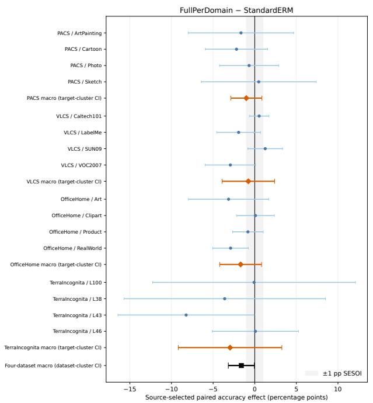
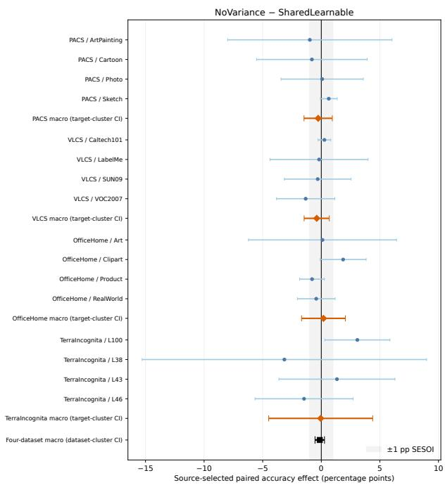

# A Controlled Evaluation of Curvature-Inspired Scalar Feature Scaling for Domain Generalization

Sunny Gupta

Indian Institute of Technology Bombay

sunnygupta@iitb.ac.in

Mumbai, Maharashtra, India

Amit Sethi

Indian Institute of Technology Bombay Mumbai, Maharashtra, India

asethi@iitb.ac.in

## Abstract

Domain-specific curvature is an appealing idea for domain generalization (DG), but curvature learning can denote substantially diferent computations. This paper evaluates one deliberately narrow implementation: the code calls it HyperDG, but it rescales Euclidean encoder features during training by learned positive scalars and predicts with an unscaled Euclidean feature and an ordinary linear classifier. It does not implement a Lorentz or Poincaré representation, geodesic prediction, or a Sharpness-Aware Minimization inner loop. We audit the executed objective and complete a six-condition, four-dataset (PACS, VLCS, OficeHome, TerraIncognita), four-target, four-seed evaluation (384 runs), with checkpoints selected using only the three source-validation environments and target-level efects, not 16 seed-by-target cells, as the per-dataset inferential unit. The full implementation’s equal-dataset macro estimate is 1.61 percentage points below native DomainBed ERM; all four dataset estimates favor ERM, but the primary four-dataset exact sign-flip test gives $p = . 1 2 5$ (Holm-adjusted p = .250), so we claim no adjusted evidence of a diference. The cleaner domain-specificity contrast, separate learned source scales without their dispersion penalty versus one shared learned source scale, is −0.13 pp and passes a revision-stage ±1 pp equivalence test (TOST $p = . 0 0 3 )$ for the source-selected suite macro, though not for every dataset, target, or the final-step endpoint. The study thus supplies a bounded negative result for this scalar training package; it does not test or refute genuine hyperbolic representation learning.

## 1 Introduction

Domain generalization (DG) trains on several source environments and evaluates on an unseen target environment (Wang et al., 2023; Gulrajani & Lopez-Paz, 2021). The setting invites geometric inductive biases: hyperbolic spaces can represent hierarchies and multiple scales compactly, and modern hyperbolic networks can operate directly on a curved manifold (Ganea et al., 2018; Fan et al., 2025). A much weaker intervention is to multiply an otherwise Euclidean feature vector by a learned scalar. Those interventions should not be evaluated or described as if they were interchangeable.

This distinction is central here. In this paper, HyperDG denotes the exact scalar-scaling formulation specified in Section ${ \mathrm { 3 ; } }$ it is not a reference to a separate external paper and it is not shorthand for hyperbolic DG in general. The implementation maps a Euclidean feature $h _ { \theta } ( x )$ to $h _ { \theta } ( x ) / \sqrt { c _ { i } }$ during its training loss, where $c _ { i } > 0$ is indexed by a source-loader slot. The model predicts with the unscaled Euclidean feature and a linear classifier. Calling $c _ { i }$ a curvature magnitude reflects the implementation’s motivation, not a claim that the representation has learned sectional curvature.

1. Does the complete HyperDG training package improve held-out-domain accuracy over native DomainBed ERM under a matched ResNet-50 protocol?

2. Within the same HyperDG update route, do three separately learned source scales provide a practically meaningful macro advantage over one shared learned source scale?

The first comparison is a whole-package utility test, because native ERM and HyperDG difer in update and BatchNorm routes. The second isolates the per-source parameterization more cleanly by comparing NoVariance with SharedLearnable; neither condition has an operative between-scale dispersion penalty.

This revision contributes:

• an implementation-level specification that separates the intended geometric interpretation from the executed computation, including an inactive local-gradient term, an algebraically scale-cancelling proxy, and the train–inference scaling mismatch;

• a completed six-condition, four-dataset, four-target, four-seed evaluation (384/384 runs), including native ERM and a fully replicated shared-learnable condition;

• source-only model selection and target-clustered uncertainty, with every named target and run seed reported separately; and

• a narrow negative conclusion: under this protocol, the full package shows no advantage over ERM, and separate source scales are macro-equivalent to one shared scale within the stated revision-stage margin.

## 2 Related Work and Scope Boundary

Domain generalization and ERM. ERM minimizes average source risk (Vapnik, 1998). DomainBed showed that controlled model selection and protocol matching can erase many claimed DG gains (Gulrajani & Lopez-Paz, 2021). Proposed DG objectives include invariance, risk extrapolation, and distribution alignment (Arjovsky et al., 2019; Krueger et al., 2021; Sun & Saenko, 2016). We therefore compare against unmodified DomainBed ERM rather than importing literature numbers, and we keep target-domain data out of the checkpoint score.

Genuine hyperbolic representations. Hyperbolic neural networks implement manifold-valued operations and hyperbolic classifiers (Ganea et al., 2018). MERU learns image–text representations on a Lorentz hyperboloid (Desai et al., 2023). Recent work learns curvature within hyperbolic networks (Fan et al., 2025), and DG-specific methods use hyperbolic state space hallucination or cross-branch consistency (Bi et al., 2025; Di Salvo et al., 2026). These are materially stronger geometric parameterizations than the scalar rescaling audited here. They are also diferent algorithms, tasks, architectures, and selection protocols, so their published numbers are not valid matched controls for our experiment. A controlled comparison would require implementing a manifold-valued encoder or head in the same 384-cell protocol; the present evidence does not contain such an experiment.

## 3 Method Under Test

## 3.1 Executed feature scaling

For source-loader slot $i ,$ the encoder produces $h _ { i } = h _ { \theta } ( x _ { i } ) \in \mathbb { R } ^ { 2 0 4 8 }$ . A free scalar $a _ { i }$ is transformed to

$$
c _ { i } = \mathrm { s o f t p l u s } ( a _ { i } ) + 1 0 ^ { - 4 } , \qquad z _ { i } = \frac { h _ { i } } { \sqrt { c _ { i } } } .\tag{1}
$$

All $a _ { i }$ and $a _ { g }$ start at zero, hence $c _ { i } = c _ { g } = \log 2 + 1 0 ^ { - 4 } = 0 . 6 9 3 2 4 7 { \mathrm { ~ a t } }$ initialization, giving a feature multiplier $1 / \sqrt { c } = 1 . 2 \bar { 0 1 } 0 3 6$ . In MatchedControl and Frozen the scale optimizer’s learning rate is set to zero, so $a _ { i }$ and $a _ { g }$ never move from zero and $c _ { i } = c _ { g } = 0 . 6 9 3 2 4 7$ is the constant value used for every update of the entire run, not merely the initial value. In FullPerDomain, NoVariance, and SharedLearnable, $a _ { i }$ (and, for SharedLearnable, the one shared a) and $a _ { g }$ are learned from this same starting point. A separate learned $c _ { g }$ defines $z _ { g , i } = h _ { i } / \sqrt { c _ { g } } .$ . In a leave-one-domain-out run there are three source loaders. Consequently, per-domain in the code means three source-loader slots, whose semantic domain mapping changes with the held-out target; there is no parameter for the unseen target.

Table 1: The claim boundary. The last row is the only mechanism tested in this paper. Hyperbolic in the other rows denotes manifold-valued operations or representations, not merely a scalar applied to Euclidean features.
<table><tr><td>Family</td><td>Representation and prediction</td><td>Relation to this study</td></tr><tr><td>Hyperbolic neural networks (Ganea et al., 2018)</td><td>Poincaré/Möbius operations and a hy- perbolic classifier</td><td>Genuine manifold baseline; not imple- mented here</td></tr><tr><td>MERU and learned-curvature HNNs (Desai et al., 2023; Fan et al., 2025)</td><td>Lorentz or hyperbolic embeddings with explicit manifold geometry</td><td>Stronger geometric parameterization; different protocol</td></tr><tr><td>Hyperbolic DG (Bi et al., 2025; Di Salvo et al., 2026)</td><td>Hyperbolic representations embedded in DG-specific objectives</td><td>Relevant recent direction; not a scalar- only ablation</td></tr><tr><td>HYPERDG (this audit)</td><td> $h _ { \theta } ( x ) / \sqrt { c _ { i } }$  in training; Euclidean linear prediction on  $h _ { \theta } ( x )$ </td><td>Curvature-inspired scalar feature scal- ing only</td></tr></table>

The local supervised loss is

$$
\mathcal { L } _ { \mathrm { s u p } } = \frac { 1 } { 3 } \sum _ { i } \mathrm { C E } ( W z _ { i } + b , y _ { i } ) .\tag{2}
$$

The code also forms domain-mean alignment

$$
\mathcal { L } _ { \mathrm { a l i g n } } = \frac { 1 } { 3 } \sum _ { i } \left. \bar { z } _ { i } - \sum _ { j } w _ { j } \bar { z } _ { j } \right. _ { 2 } ^ { 2 } ,\tag{3}
$$

where $\begin{array} { r } { \bar { z } _ { i } = \frac { 1 } { | B _ { i } | } \sum _ { k \in B _ { i } } z _ { i , k } } \end{array}$ is the mean of the scaled features over the $\left| B _ { i } \right| = 3 2$ examples in source minibatch $i ,$ and $\begin{array} { r } { w _ { j } = B _ { j } / \sum _ { k } B _ { k } } \end{array}$ weights each source by its minibatch size $\mathrm { ( a ~ 1 0 ^ { - 8 } }$ denominator stabilizer is otherwise negligible). Every source batch has 32 examples here, so $w _ { j } = 1 / 3$ for all $j ;$ the alignment term reduces to pulling each domain mean toward the unweighted mean of the three domain means. Pairwise scale dispersion is

$$
\mathcal { L } _ { \mathrm { v a r } } = \frac { 1 } { 9 } \sum _ { i , j } ( c _ { i } - c _ { j } ) ^ { 2 } ,\tag{4}
$$

and a global disagreement term

$$
\mathcal { L } _ { \mathrm { g l o b a l } } = \frac { 1 } { 3 } \sum _ { i } \left| \mathrm { C E } ( W z _ { g , i } + b , y _ { i } ) - \mathrm { s t o p g r a d } [ \mathrm { C E } ( W z _ { i } + b , y _ { i } ) ] \right| .\tag{5}
$$

## 3.2 Intended versus executed auxiliary terms

The executed code matters for interpretation. First, the quantity named the norm/sharpness proxy is

$$
\mathcal { L } _ { \mathrm { { n o r m } } } = \frac { 1 } { 3 } \sum _ { i } c _ { i } \mathrm { V a r } \big ( \| h _ { i } / \sqrt { c _ { i } } \| _ { 2 } \big ) = \frac { 1 } { 3 } \sum _ { i } \mathrm { V a r } ( \| h _ { i } \| _ { 2 } ) ,\tag{6}
$$

away from the inactive numerical clamp, where $\mathrm { V a r } ( \cdot )$ is the population variance (divisor $\left| B _ { i } \right| = 3 2$ $\mathrm { P y }$ Torch unbiased=False) of the 32 per-example scaled-feature norms $\| h _ { i , k } / \sqrt { c _ { i } } \| _ { 2 } , \ k \in B _ { i }$ , computed separately within each source minibatch i before the three domain values are averaged. Because $\sqrt { c _ { i } }$ is constant across the examples in minibatch $i ,$ it factors out of the variance and squares back in against the multiplying $c _ { i } ,$ which is why the expression collapses to ${ \mathrm { V a r } } ( \| h _ { i } \| _ { 2 } ) ;$ the term regularizes raw feature-norm dispersion but its value does not depend on $c _ { i } ,$ so it is not curvature-sensitive and it is not SAM (Foret et al., 2021).

Second, the intended local term diferentiates each supervised loss with respect to $a _ { i }$ . The implementation requests that gradient from a newly indexed view that is not the view used to construct the forward scale. Automatic diferentiation therefore returns None, which is converted to zero:

$$
\begin{array} { r } { \mathcal { L } _ { \mathrm { l o c a l } } ^ { \mathrm { e x e c u t e d } } = 0 . } \end{array}\tag{7}
$$

Every primary-run log records this term as zero. This is an implementation defect, not evidence that a correctly implemented curvature sensitivity is zero.

The executed total loss is

$$
\mathcal { L } = \mathcal { L } _ { \mathrm { s u p } } + \alpha \mathcal { L } _ { \mathrm { v a r } } + \beta \mathcal { L } _ { \mathrm { a l i g n } } + \gamma \mathcal { L } _ { \mathrm { n o r m } } + \delta _ { \ell } \mathcal { L } _ { \mathrm { l o c a l } } + \delta _ { g } \mathcal { L } _ { \mathrm { g l o b a l } } .\tag{8}
$$

The full coeficients are $( \alpha , \beta , \gamma , \delta _ { \ell } , \delta _ { g } ) = ( 0 . 2 , 0 . 5 , 0 . 0 5 , 0 . 1 , 0 . 1 )$ , but the local contribution is identically zero. Finally, predict() applies W ${ } ^ { \zeta } h _ { \theta } ( x ) + b ,$ not $W z + b .$ . Thus scales act only through training; they are not used for target prediction. With a linear head, a common global scale is also partly absorbable into W.

## 3.3 Six controlled conditions

The six conditions in Table 2 play two diferent inferential roles, and only two contrasts among them are primary claims of this paper. FullPerDomain−StandardERM and NoVariance−SharedLearnable are the two primary suite contrasts defined in Section 4 and carried through Holm correction in Section 5. MatchedControl and Frozen are secondary, descriptive diagnostics: no hypothesis test in this paper treats a contrast involving either condition as a primary claim. MatchedControl runs the HyperDG update route with a constant, non-learned feature rescaling and every auxiliary coeficient set to zero, so it shows what the route alone costs or gains relative to StandardERM before any HyperDG-specific loss term is active. Frozen is the fixed-scale counterpart of NoVariance: it keeps the same non-dispersion auxiliary losses active but never lets the scales move, so comparing it with NoVariance descriptively probes learned against fixed scaling. Frozen is not a substitute for SharedLearnable, because it changes learnability rather than per-source specificity; NoVariance−SharedLearnable is the condition pair that isolates the domain-specificity question.

Table 2: Completed conditions. All five non-ERM conditions use the same HyperDG update route. Only StandardERM, FullPerDomain, NoVariance, and SharedLearnable enter the paper’s two primary contrasts; MatchedControl and Frozen are descriptive diagnostics (see text).
<table><tr><td>Condition</td><td>Executed treatment</td></tr><tr><td>STANDARDERM MATCHEDCONTROL</td><td>Native DomainBed ERM; no scales or auxiliary losses. HYPERDG route; three fixed local scales and one fixed global scale; all five coefficients</td></tr><tr><td>FULLPERDOMAIN</td><td>zero. Three learned local scales and one learned global scale; full coefficients in Equation 8.</td></tr><tr><td>FROZEN NoOVARIANCE</td><td>All scales fixed; retains alignment, norm, local (inactive), and global terms;  $\alpha = 0 .$ </td></tr><tr><td>SHAREDLEARNABLE</td><td>Three learned local scales; same remaining objective as FuLLPERDoMAIN but α = 0. One learned local scale shared by all three source loaders plus the separate learned</td></tr></table>

## 4 Experimental Design

Benchmarks and why they are informative. We use PACS (Li et al., 2017), VLCS (Fang et al., 2013), OficeHome (Venkateswara et al., 2017), and TerraIncognita (Beery et al., 2018). Their four environments emphasize diferent shift types: depiction/style (PACS), acquisition and dataset source (VLCS), depiction plus object context (OficeHome), and camera location/background (TerraIncognita). This diversity is useful for asking whether one scalar specializes consistently across source environments. None of these datasets provides ground-truth manifold curvature, hierarchy, or a known geometric scale, so they cannot by themselves reveal that a representation’s true curvature difers by domain.

Protocol. Each environment is held out once; the other three are sources. Within every environment, $8 0 / 2 0$ splits are deterministic functions of the run seed and environment index. Seeds 0–3 vary data splits, initialization, minibatch order, and augmentation. All methods use timm resnet50.ram\_in1k ImageNet weights, a 2,048-dimensional feature, a biased linear classifier, source batch size 32, Adam with network learning rate $5 \times 1 0 ^ { - 5 }$ , zero weight decay, data augmentation, 5,000 updates, and evaluation every 200 updates plus update 4999. BatchNorm is trainable. Learned scales have a separate Adam optimizer at $1 0 ^ { - 4 }$ and the HyperDG route clips network and scale gradients to norm 5. By native DomainBed ERM we mean the unmodified upstream DomainBed ERM class (Gulrajani & Lopez-Paz, 2021), instantiated with the same data, splits, augmentation, timm ResNet-50 backbone, and source-only selector as every other condition: it concatenates the three source minibatches into one batch, computes a single cross-entropy loss, and takes one Adam step with one optimizer and no gradient clipping. It is the project’s training and evaluation harness around an otherwise untouched DomainBed ERM update rule, not a claim that the surrounding software stack is an unmodified upstream installation.

This last distinction prevents a curvature-only causal reading of FullPerDomain−StandardERM. Per update, HyperDG calls the feature extractor six times: three source-minibatch forward passes build the training objective, and, after the optimizer step, three additional forward passes under torch.no\_grad() recompute training accuracy for logging. no\_grad() only suppresses gradient tracking; it does not put the model in evaluation mode. The model is never switched to eval() during HyperDG’s update, so all six forward passes run in ordinary training-mode BatchNorm, updating the running mean, running variance, and batch counter exactly as any other training-mode forward pass. Native ERM instead concatenates the three source minibatches and calls the feature extractor once on all 96 examples, so its BatchNorm statistics update from one training-mode forward pass per step rather than HyperDG’s six. The comparison therefore estimates the utility of the complete implementation, including this BatchNorm-update asymmetry, not an isolated curvature efect. The NoVariance−SharedLearnable comparison uses the same route on both sides, so this asymmetry cancels out of that contrast.

Source-only checkpoint selection. For dataset $j ,$ held-out target $d ,$ seed $s ,$ and checkpoint $t ,$ selection maximizes

$$
q _ { j d s } ( t ) = \frac { 1 } { 3 } \sum _ { r \ne d } \operatorname { A c c } _ { j d s r } ^ { \mathrm { o u t } } ( t ) .\tag{9}
$$

Only source environments enter $q ;$ exact ties choose the earliest checkpoint. Held-out-target accuracy is read after $t ^ { * }$ is fixed. The trainer did log target curves, so the precise claim is that target accuracy is not used by the frozen selection rule. Source out subsets inherit stochastic source augmentation and are evaluated once per checkpoint, a limitation shared by all conditions. Update-4999 results are a prespecified revision-stage sensitivity endpoint.

Estimand. The scientific claim is about the equal-weighted macro over exactly these four benchmarks (PACS, VLCS, OficeHome, TerraIncognita) under this protocol, not about a population or superpopulation of all DG tasks that these four datasets are sampled from. We chose the suite for its heterogeneity of shift type (Section 4), not as a random draw from a broader task distribution, so every suite-level number below should be read as a fixed-suite macro, not a generalization to unseen benchmarks.

Estimands and uncertainty. Let $Y _ { m j d s }$ be source-selected target accuracy (percentage points) for method m. For contrast $A - B$

$$
g _ { j d s } = Y _ { A j d s } - Y _ { B j d s } , \quad \bar { g } _ { j d } = \frac { 1 } { 4 } \sum _ { s } g _ { j d s } , \quad \Delta _ { j } = \frac { 1 } { 4 } \sum _ { d } \bar { g } _ { j d } .\tag{10}
$$

Seeds are averaged within target first, and targets are averaged within dataset second; the suite-level procedures below use only the four resulting dataset means $\Delta _ { j }$ and do not separately repropagate seed- or target-level variance into the suite interval. That within-dataset variability is real and is reported descriptively (per-target efects, between-target SD, and within-target seed SD all appear in the supplement), but it enters the suite-level test only through the four dataset means it produced, not as an additional variance component.

Table 3: Source-validation-selected target accuracy (%). Each cell averages four named targets after averaging four run seeds within target. Bold marks the highest point estimate in a dataset, not a significance claim.
<table><tr><td>Condition</td><td>PACS</td><td>VLCS</td><td>OfficeHome</td><td>TerraInc.</td></tr><tr><td>STANDARDERM</td><td>85.88</td><td>77.19</td><td>70.21</td><td>47.13</td></tr><tr><td>MATCHEDCONTROL</td><td>84.22</td><td>75.38</td><td>70.05</td><td>44.14</td></tr><tr><td>FULLPERDOMAIN</td><td>84.87</td><td>76.42</td><td>68.52</td><td>44.17</td></tr><tr><td>FROZEN</td><td>86.14</td><td>75.84</td><td>67.81</td><td>44.20</td></tr><tr><td>NoVARIANCE</td><td>85.28</td><td>76.17</td><td>68.36</td><td>43.70</td></tr><tr><td>SHAREDLEARNABLE</td><td>85.55</td><td>76.56</td><td>68.17</td><td>43.75</td></tr></table>

The four named target efects $\bar { g } _ { j d }$ are the per-dataset inferential units. We report an exact two-sided sign-flip test over all $2 ^ { 4 } = 1 6$ target assignments, a $t _ { 3 }$ interval, and a four-cluster bootstrap sensitivity. The sign-flip test is exact conditional on treating the four target-level sign flips as exchangeable under the joint no-efect null (every one of the 16 sign patterns equally likely if $\bar { g } _ { j d }$ has a distribution symmetric about zero under the null); it is a working symmetry assumption for a four-cluster benchmark suite, not a claim that the datasets were themselves randomly assigned to conditions, and it does not test whether dataset-level efects cancel under a suite-macro-only null. The smallest possible two-sided exact $p$ is .125 with four clusters. At suite level, $\begin{array} { r } { \Delta _ { \mathrm { m a c r o } } = \frac { 1 } { 4 } \sum _ { j } \Delta _ { j } } \end{array}$ and the four dataset efects are the clusters. The two primary suite contrasts, FullPerDomain−StandardERM and NoVariance−SharedLearnable, form one Holm family (Holm, 1979). Per-dataset tests are an eight-test sensitivity family.

We declare the exact sign-flip test with Holm correction as the primary inferential procedure for both suite-leve diference claims; the $t _ { 3 }$ interval and the bootstrap sensitivity are secondary, working-model summaries that assume approximate normality or resampling validity with only four clusters and do not override the primary test. Where the two disagree, as for FullPerDomain−StandardERM (Section 5), the Holm-adjusted exact result governs the paper’s claim.

Practical equivalence uses TOST (Schuirmann, 1987) with a revision-stage smallest efect of practical interest (SESOI) of ±1 pp, chosen after the submitted results were known but before the added ERM/shared grid completed. Margins of ±0.5 and ±2 pp are sensitivities. TOST, like the $t _ { 3 }$ interval, is a secondary working model summary conditional on the same four-cluster suite macro; we do not interpret a nonsignificant diference-test result as equivalence, and equivalence conclusions are likewise scoped to this fixed four-dataset macro.

## 5 Results

## 5.1 Completed six-condition study

All 384 planned runs completed. Table 3 reports equal-target macro accuracies. Every named target and seed, along with between-target and within-target run-seed variability, appears in the supplement.

## 5.2 Primary utility and domain-specificity contrasts

Whole-package utility. FullPerDomain−StandardERM is $- 1 . 0 1 , \ : - 0 . 7 7 , \ : - 1 . 6 9$ , and −2.96 pp on PACS, VLCS, OficeHome, and TerraIncognita. Thus all four point estimates favor ERM. The suite $t _ { 3 }$ interval excludes zero, but with four dataset clusters the primary exact test is $p = . 1 2 5$ and Holm-adjusted $p = . 2 5 0 ;$ per Section 4, this primary Holm-adjusted result, not the secondary $t _ { 3 }$ interval, governs the paper’s claim. We therefore do not claim adjusted evidence of a diference. The compatible range also does not support equivalence of the packages. Relative to the HyperDG-path matched control, FullPerDomain changes the four dataset means by +0.65, +1.04, −1.53, and +0.03 pp; this secondary pattern is mixed.

Table 4: Primary suite-macro contrasts. Exact p-values sign-flip the four dataset efects; Holm adjusts the two primary tests. TOST uses the ±1 pp revision-stage SESOI.
<table><tr><td>Contrast</td><td>Effect [95% CI]</td><td></td><td>Exact / Holm p</td><td>TOST p</td><td>Interpretation</td></tr><tr><td>Full – ERM</td><td>-1.61 [−3.17, -0.04]</td><td>.125 / .250</td><td></td><td>.848</td><td>No adjusted evidence; equiva- lence not demonstrated</td></tr><tr><td>NoVar - Shared</td><td>1 -0.13 [−0.53, 0.27]</td><td></td><td>.375 / .375</td><td>.003</td><td>±1 pp source-selected macro- equivalent</td></tr></table>

  
Figure 1: Paired efects for the two primary contrasts. Blue intervals are $t _ { 3 }$ intervals across four paired run seeds within a named target; orange intervals cluster four target means within a dataset; black intervals cluster the four fixed dataset means. The visible target heterogeneity is why seed-by-target cells are not treated as 16 independent domain draws. These intervals describe this fixed, heterogeneous benchmark suite, not all DG tasks. Exact values and run-seed SDs are in the supplement.

Are separate source scales necessary? The clean NoVariance−SharedLearnable efects are −0.27, −0.39, +0.19, and −0.05 pp across the same datasets. The suite efect is −0.13 pp with 90% CI [−0.43, 0.17], wholly inside ±1 pp (TOST p = .003) and also inside the ±0.5 pp sensitivity margin (TOST p = .031). This supports a specific conclusion: for the source-selected, equal-dataset/equal-target macro estimand, three source-loader scales ofer no practically meaningful advantage over one shared learned scale. We do not extend equivalence to any individual dataset or target, whose intervals are wider.

Checkpoint sensitivity. Source selection improves over update 4999 in 20 of 24 condition-by-dataset cells, by 0.97 pp on average. At update 4999, NoVariance−SharedLearnable is −0.32 pp with 90% CI [−1.13, 0.50] and TOST p = .072; equivalence is not established. We therefore restrict the equivalence conclusion to the declared source-selected endpoint.

Mechanistic audit. The local-gradient regularizer is zero in all primary logs, and Equation 6 shows that the norm proxy cannot identify curvature. The close performance of NoVariance and SharedLearnable is consequently consistent with a weakly identified, partly absorbable training-time scale. It should not be interpreted as evidence that a correctly implemented manifold-valued curvature parameter would behave similarly.

## 6 Discussion

The empirical answer is narrower than the original geometric motivation. First, the complete implementation provides no evidence of improvement over native ERM under the tested protocol: its four dataset efects are negative, while exact small-cluster inference prevents a strong adjusted diference claim. Second, within the common HyperDG route, separately learned source scales are macro-equivalent to one shared learned scale at the stated source-selected endpoint. This directly answers the parameterization question that Frozen could not answer: Frozen changes learnability and is not a substitute for a shared-learnable condition.

The dataset suite is useful for stress-testing scale specialization because it spans artistic style, dataset acquisition, object context, and camera-location shifts. The heterogeneity in Figure 1 also shows why target identity dominates some uncertainty summaries. But benchmark diversity is not geometric supervision. Without known hierarchies, distances, or target curvatures, a learned scalar cannot be validated as physical or sectional curvature merely because it difers between environments.

The comparison to recent hyperbolic methods is therefore conceptual rather than numerical. A genuine follow-up should keep the present splits, seeds, backbone, budget, and source-only selector while replacing the Euclidean head with a correctly implemented Poincaré or Lorentz representation and hyperbolic classifier. Fixed- versus learned-curvature versions would then separate manifold geometry from scalar flexibility. That experiment is scientifically worthwhile, but adding incomplete MERU runs or post-hoc Poincaré projections would not answer it; we exclude those diagnostics from the evidentiary claims.

## 7 Limitations and Broader Impact

Limitations. There are only four named target clusters per benchmark and four dataset clusters at suite level, so exact tests are coarse and per-target intervals can be wide. The study uses one ImageNet-pretrained ResNet-50 recipe and four classification benchmarks. The SESOI and source-selected endpoint were fixed during revision rather than preregistered before the original study. Source validation is stochastic, and target curves existed in logs even though they do not enter the frozen selection rule. Native ERM and HyperDG have diferent BatchNorm/update routes. Most importantly, the implementation has an inactive local term, a scale-cancelling proxy, and unscaled inference, and the study does not include genuine manifold-valued training. These facts narrow the claim; they do not invalidate the negative result for the executed package.

Broader impact. This work uses standard image benchmarks and introduces no new human-subject data. Its main impact is methodological: reporting a carefully bounded negative result can prevent a scalar Euclidean implementation from being mistaken for evidence about hyperbolic learning as a whole. The same care is needed in the other direction; our results should not be cited to dismiss genuine hyperbolic representations.

## 8 Conclusion

We evaluated a specific curvature-inspired scalar feature-scaling package, not general hyperbolic representation learning. Across 384 completed runs, the full implementation showed no advantage over native ERM under the declared protocol, and its four dataset point estimates were lower. Within the shared update route, separate source-loader scales were equivalent to one shared learned scale for the source-selected suite macro within a revision-stage ±1 pp margin, but not for every dataset, target, or final-step endpoint. Together with the implementation audit, these results locate the negative finding precisely: it applies to weakly identified training-time Euclidean rescaling with this ResNet-50 protocol and should not be generalized to manifold-valued hyperbolic models.

## References

Martin Arjovsky, Léon Bottou, Ishaan Gulrajani, and David Lopez-Paz. Invariant risk minimization. arXiv preprint arXiv:1907.02893, 2019.

Sara Beery, Grant Van Horn, and Pietro Perona. Recognition in terra incognita. In Proceedings of the European Conference on Computer Vision, pp. 456–473, 2018.

Qi Bi, Jingjun Yi, Haolan Zhan, Wei Ji, and Gui-Song Xia. Learning fine-grained domain generalization via hyperbolic state space hallucination. In Proceedings of the AAAI Conference on Artificial Intelligence, volume 39, pp. 1853–1861, 2025. doi: 10.1609/aaai.v39i2.32180.

Karan Desai, Maximilian Nickel, Tanmay Rajpurohit, Justin Johnson, and Ramakrishna Vedantam. Hyperbolic image-text representations. In International Conference on Machine Learning, pp. 7694–7731. PMLR, 2023.

Francesco Di Salvo, Sebastian Doerrich, Jonas Alle, and Christian Ledig. HypCBC: Domain-invariant hyperbolic cross-branch consistency for generalizable medical image analysis. Transactions on Machine Learning Research, 2026. arXiv:2602.03264.

Xiaomeng Fan, Yuwei Wu, Zhi Gao, Mehrtash Harandi, and Yunde Jia. Curvature learning for generalization of hyperbolic neural networks. International Journal of Computer Vision, 133(12):8489–8525, 2025. doi: 10.1007/ s11263-025-02567-4.

Chen Fang, Ye Xu, and Daniel N. Rockmore. Unbiased metric learning: On the utilization of multiple datasets and web images for softening bias. In Proceedings of the IEEE International Conference on Computer Vision, pp. 1657–1664, 2013.

Pierre Foret, Ariel Kleiner, Hossein Mobahi, and Behnam Neyshabur. Sharpness-aware minimization for eficiently improving generalization. In International Conference on Learning Representations, 2021.

Octavian-Eugen Ganea, Gary Bécigneul, and Thomas Hofmann. Hyperbolic neural networks. In Advances in Neural Information Processing Systems, volume 31, 2018.

Ishaan Gulrajani and David Lopez-Paz. In search of lost domain generalization. In International Conference on Learning Representations, 2021.

Sture Holm. A simple sequentially rejective multiple test procedure. Scandinavian Journal of Statistics, 6(2):65–70, 1979.

David Krueger, Ethan Caballero, Joern-Henrik Jacobsen, Amy Zhang, Jonathan Binas, Dinghuai Zhang, Remi Le Priol, and Aaron Courville. Out-of-distribution generalization via risk extrapolation. In International Conference on Machine Learning, pp. 5815–5826. PMLR, 2021.

Da Li, Yongxin Yang, Yi-Zhe Song, and Timothy M. Hospedales. Deeper, broader and artier domain generalization. In Proceedings of the IEEE International Conference on Computer Vision, pp. 5542–5550, 2017.

Donald J. Schuirmann. A comparison of the two one-sided tests procedure and the power approach for assessing the equivalence of average bioavailability. Journal of Pharmacokinetics and Biopharmaceutics, 15(6):657–680, 1987. doi: 10.1007/BF01068419.

Baochen Sun and Kate Saenko. Deep CORAL: Correlation alignment for deep domain adaptation. In European Conference on Computer Vision, pp. 443–450, 2016.

Vladimir N. Vapnik. Statistical Learning Theory. Wiley, New York, 1998.

Hemanth Venkateswara, Jose Eusebio, Shayok Chakraborty, and Sethuraman Panchanathan. Deep hashing network for unsupervised domain adaptation. In Proceedings of the IEEE Conference on Computer Vision and Pattern Recognition, pp. 5018–5027, 2017.

Jindong Wang, Cuiling Lan, Chang Liu, Yidong Ouyang, Tao Qin, Wang Lu, Yiqiang Chen, Wenjun Zeng, and Philip S. Yu. Generalizing to unseen domains: A survey on domain generalization. IEEE Transactions on Knowledge and Data Engineering, 35(8):8052–8072, 2023. doi: 10.1109/TKDE.2022.3178128.