# APT: FEEDBACK-DRIVEN AGENTIC POST-TRAINING FOR TEXT-TO-IMAGE GENERATION

Sirui Zhang1,2∗ Fangyun Wei2 Dong Chen2 Jinjing Zhao3 Yitong Wang4 Yunuo Chen5 Baining Guo2 Zheng-Jun Zha1†

1 University of Science and Technology of China

2 Microsoft Research Asia

3 University of Sydney 4 Fudan University {zsr200901, zhazj}@mail.ustc.edu.cn {fawe, doch, bainguo}@microsoft.com

5 Shanghai Jiao Tong University

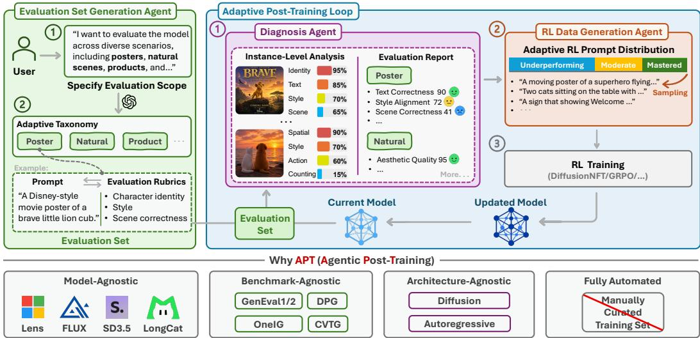  
Figure 1: APT (Agentic Post-Training) turns post-training into a fully automated, evaluationdriven adaptive loop. Given a user-specified evaluation scope, the Evaluation Set Generation Agent constructs a diverse evaluation set consisting of prompt–evaluation rubric pairs; the Diagnosis Agent evaluates the current model on these pairs to identify its strengths and failure modes; and the RL Data Generation Agent adaptively samples next-round training prompts, prioritizing underperforming capabilities. The updated model is then re-evaluated in the next round, allowing the training distribution to continuously adapt to the model’s evolving capability profile. This design eliminates the need for manually curated post-training data and makes APT model-agnostic, benchmark-agnostic, architecture-agnostic, and fully automated.

## ABSTRACT

Post-training is crucial for improving text-to-image models, yet existing pipelines typically rely on manually curated training data and fixed training distributions. We introduce APT (Agentic Post-Training), a fully automated framework that adaptively post-trains a base model according to its evolving capability profile. APT coordinates three agents to construct evaluation sets from user requirements, diagnose model-specific strengths and failure modes, and generate reinforcement learning data with an adaptive prompt distribution that emphasizes underperforming capabilities. By repeatedly evaluating, diagnosing, and updating the generator, APT lets the current model’s behavior shape its next training tasks, forming a feedback loop inspired by recursive self-improvement. For general-purpose settings without user-specified evaluation scenarios, we further develop an evaluation harness that enables broad and diverse evaluation set generation. Experiments across multiple base models, benchmarks, and generation architectures demonstrate that APT is model-agnostic, benchmark-agnostic, architecture-agnostic, and fully automated.

Recent text-to-image (T2I) models have achieved remarkable progress in visual quality, prompt following, text rendering, compositional generation, and controllability (Black Forest Labs, 2025; OpenAI, 2026; Google, 2026; SeedDance, 2026; Zhao et al., 2026). Beyond large-scale pre-training, post-training has become increasingly important for correcting specific failure modes and aligning model behavior with desired objectives (Xu et al., 2026; Chen et al., 2026a; Jiang et al., 2026a; Feng et al., 2026b). Existing post-training pipelines, however, typically rely on manually constructed training distributions: practitioners identify model weaknesses, collect or synthesize corresponding training data, and repeatedly adjust the data distribution based on empirical observations (Xu et al., 2026; Chen et al., 2026a; Feng et al., 2026b; Geng et al., 2025). Such a workflow is labor-intensive and difficult to scale as models, benchmarks, and user requirements continue to diversify.

More fundamentally, we argue that post-training should be model-adaptive. Different base models exhibit substantially different capability distributions: a model that performs well on text rendering may struggle with counting or spatial relations, while another may exhibit the opposite behavior. Consequently, a post-training dataset that is effective for one model is not necessarily optimal for another. We can view each base model M as inducing its own capability and failure distribution pM over generation tasks. Effective post-training should therefore identify where the current model un derperforms, sample training examples accordingly (Chen et al., 2026b), and continuously adapt the sampling distribution as the model improves (Li et al., 2026). In other words, the key question is not only how to optimize a model, but also what the current model should be trained on. This perspective naturally connects post-training to recursive self-improvement (RSI), in which the evaluation results of the updated model are used to determine the training tasks for the next round (Zelikman et al., 2023; Zweiger et al., 2026; Huang et al., 2026).

To address this problem, we introduce APT (Agentic Post-Training), a fully automated framework that turns post-training into an adaptive, evaluation-driven self-improvement loop, as illustrated in Figure 1. Given a T2I base model and an evaluation requirement, APT automatically constructs an evaluation set of prompt–rubric pairs, diagnoses the current model’s strengths and weaknesses, and generates model-specific RL training data. The updated model is then re-evaluated, allowing its evolving behavior to continuously reshape the training distribution for the next round. Rather than relying on a fixed, manually curated dataset, APT lets the current model determine what should be learned next.

As shown in Figure 1, APT is built around three collaborative agents. The Evaluation Set Generation Agent converts a high-level evaluation scope into a structured evaluation suite with an adaptive taxonomy, prompts, and task-specific rubrics. The Diagnosis Agent evaluates the current model at the instance and category levels and summarizes systematic strengths and failure modes. The RL Data Generation Agent then converts this diagnosis into an adaptive prompt distribution that prioritizes underperforming capabilities while retaining moderate and mastered ones, producing model-specific data for RL-based post-training (Zheng et al., 2026; Liu et al., 2026a; Shao et al., 2024). Repeated evaluation, diagnosis, and adaptive sampling provide an implicit mechanism for discovering and tracking the evolving model-dependent distribution $p _ { M }$ without explicitly estimating it.

APT also supports general-purpose post-training when no evaluation scope is specified. For this setting, we develop an evaluation harness that guides the Evaluation Set Generation Agent to systematically construct a broad and diverse evaluation set spanning common generation scenarios and capability dimensions (Feng et al., 2026c).

The resulting framework is model-agnostic, benchmark-agnostic, architecture-agnostic, and fully automated, and we validate these properties across multiple T2I models, generation architectures, and benchmarks (Chen et al., 2026a; Esser et al., 2024; Black Forest Labs, 2024; Team et al., 2025; Chen et al., 2025). APT consistently improves diverse base models and outperforms post-training with a carefully handcrafted RL training set. Moreover, transferring APT-generated training data across models is consistently inferior to adaptively generating data for the target model, supporting our central hypothesis that effective post-training distributions are model-specific and should evolve together with the model. Together, these results establish agentic, evaluation-driven adaptation as a practical step toward recursive self-improvement for text-to-image generation.

## 2 METHOD

Overview. Figure 1 provides an overview of APT. The Evaluation Set Generation Agent is invoked once before post-training to construct the fixed evaluation set $\mathcal { E }$ of prompt–rubric pairs (Section 2.1). Users may specify an evaluation scope; when no scope is provided, we use our general-purpose evaluation harness to ensure broad and comprehensive coverage. APT then enters an iterative posttraining loop. At each round, the Diagnosis Agent (Section 2.2) evaluates the current model and produces an evaluation report, which is passed to the RL Data Generation Agent (Section 2.3) to generate training data for the next RL update. This RSI-inspired loop repeats after each update, enabling the training distribution to adapt to the model’s evolving weaknesses. As described in Section 2.4, APT is model-agnostic, benchmark-agnostic, and architecture-agnostic, and can therefore be applied to diverse text-to-image models and evaluation settings.

Round-Wise Learning Objective. At the beginning of round $t , M _ { t }$ denotes the current text-toimage generator; $p$ and x denote a text prompt and a generated image, respectively. Let $D _ { t }$ be the generated dataset of training prompts for this round, and write $( p , R ) \sim D _ { t }$ to denote sampling a prompt–rubric-set pair from this dataset. For a prompt $p _ { i } ,$ , let $R _ { i }$ be its associated rubric set and $\rho \in R _ { i }$ an individual evaluation criterion. Both diagnosis and training use GPT-4.1-mini as visionlanguage evaluator, denoted by $V .$ Its binary output $V ( x , p , \rho ) \in \{ \bar { 0 } , 1 \}$ is 1 if image x satisfies criterion $\rho$ for prompt $p ,$ and 0 otherwise. For an image $x _ { i }$ generated from $p _ { i }$ , the training reward is the arithmetic mean of these rubric-level scores:

$$
r ( x _ { i } , p _ { i } ) = \frac { 1 } { | R _ { i } | } \sum _ { \rho \in R _ { i } } V ( x _ { i } , p _ { i } , \rho ) .
$$

Each prompt’s rubric set is fixed and shared across all its generated images within a rollout round. The evaluator’s scoring instructions are provided in Appendix E.3. The round-wise expected-reward objective is

$$
J ( M _ { t } ) = \mathbb { E } _ { ( p , R ) \sim D _ { t } , x \sim M _ { t } ( \cdot | p ) } [ r ( x , p ) ] .\tag{1}
$$

Starting from $M _ { t }$ , the configured RL algorithm takes a finite number of optimization steps aimed at increasing $J ( M _ { t } )$ , with $D _ { t }$ and the reward procedure fixed within the round.

Recursive Data–Model Coupling. APT couples an outer loop of diagnostic-driven task adaptation with an inner loop of RL-based model optimization. At round t, $\boldsymbol { B } _ { t } \subset \boldsymbol { \mathcal { E } }$ is a sampled diagnostic batch of prompt–rubric pairs, and $\mathcal { R } _ { t }$ denotes the resulting rubric-level evaluation report for $M _ { t }$ . Let Diag and $\mathcal { G }$ denote the diagnosis and data-generation procedures, respectively, and let U denote the RL update operator. The coupled update is

$$
\begin{array} { r } { \mathcal { R } _ { t } = \mathrm { D i a g } ( M _ { t } , \mathcal { B } _ { t } ) , \qquad D _ { t } = \mathcal { G } ( \mathcal { R } _ { t } ) , } \\ { M _ { t + 1 } = \mathcal { U } ( M _ { t } , D _ { t } ; V ) . } \end{array}\tag{2}
$$

The update operator $\mathcal { U }$ returns $M _ { t + 1 }$ by applying the configured finite number of RL steps to $M _ { t } .$ with the aim of maximizing $J ( M _ { t } )$ in Equation 1. Re-evaluating $M _ { t + 1 }$ yields a diagnostic report $\mathcal { R } _ { t + 1 }$ that guides the generation of training prompts $D _ { t + 1 }$ for the next RL update. We next describe the three agents that instantiate this feedback-driven post-training loop.

## 2.1 EVALUATION SET GENERATION AGENT

The Evaluation Set Generation Agent is responsible for constructing the evaluation data used to diagnose the current model before the post-training stage. When a user specifies an evaluation scope, the agent directly generates evaluation examples tailored to the requested scenarios. For the more general setting where no evaluation scope is provided, we further design a general-purpose evaluation harness that guides the agent to systematically construct a broad-coverage evaluation set spanning diverse image-generation scenarios and capabilities. Each evaluation example consists of an image-generation prompt paired with its corresponding prompt-specific evaluation rubrics. The evaluation set is constructed through a multi-step generation pipeline consisting of scenario generation, prompt generation, and rubric generation.

Step 1: Scenario Generation. We begin with a broad set of common image-generation scenario categories, including Human, Object, Animal, Plant, Scene, Food, Event, Fictional World, Text, and UI and Graphic Design. For each category, we prompt an LLM to generate dozens of finegrained sub-categories and corresponding items. For example, the Human category may include sub-categories such as Race, Occupation, and Gender, while the Occupation sub-category may further contain items such as Researcher and Doctor. This process produces a hierarchical scenario taxonomy that provides broad and structured coverage of diverse image-generation scenarios.

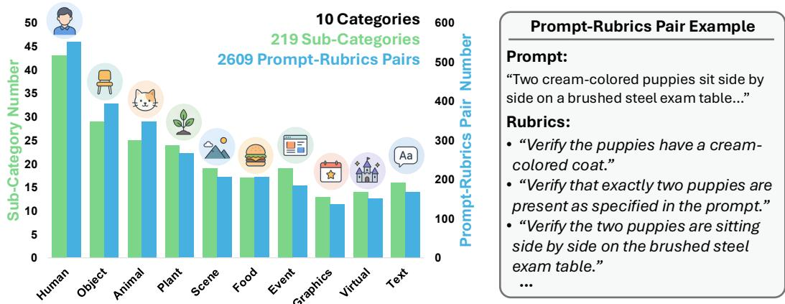  
Figure 2: Left: Statistics of the sub-categories within each category and the prompt-rubrics pairs within each category. All prompt-rubrics pairs are automatically generated by our Evaluation Set Generation Agent, providing comprehensive coverage for evaluating the current T2I model. Right: An example prompt-rubrics pair.

Step 2: Prompt Generation. Given the items derived from the scenario taxonomy, we further enrich them with a set of descriptive dimensions to generate diverse image-generation prompts. These descriptions capture common compositional and semantic requirements, such as attributes, spatial relationships, object counts, interactions, and colors. For each item, we randomly sample one to four descriptions and prompt GPT-4.1, together with a predefined system prompt described in Appendix E.1, to synthesize the final image-generation prompt. For example, an item such as Doctor can be combined with descriptions of color, interaction, and spatial relationship to produce a more compositional and challenging prompt. This design increases both the diversity and coverage of the generated evaluation prompts.

Step 3: Rubric Generation. For each generated prompt, we further construct prompt-specific evaluation rubrics (Feng et al., 2026c). Concretely, we feed the prompt, together with the rubricgeneration system prompt described in Appendix E.2, into GPT-4.1-mini to generate up to 10 prompt-specific rubrics. These rubrics specify the aspects that should be checked for the given prompt, such as identity consistency, text correctness, style alignment, scene correctness, spatial relations, or counting accuracy, depending on the prompt content. As a result, each evaluation example is represented as a prompt paired with its corresponding rubrics, enabling fine-grained and task-aware diagnosis of model behavior.

Overall, the Evaluation Set Generation Agent transforms a high-level evaluation requirement into a diverse evaluation set containing 2,609 prompt–rubrics pairs. Detailed statistics are provided in Figure 2. This evaluation set serves as the foundation for the subsequent Diagnosis Agent, which analyzes model performance and drives the adaptive post-training loop.

## 2.2 DIAGNOSIS AGENT

The Diagnosis Agent analyzes the performance of the current model on the evaluation set and summarizes its strengths and weaknesses into a structured evaluation report. At each post-training round t, we randomly sample a batch $\mathcal { B } _ { t } = \{ ( p _ { i } , R _ { i } ) \} _ { i = 1 } ^ { N } \subset \mathcal { E }$ of prompt–rubric pairs, where N is the diagnostic batch size (120 by default). The diagnosis process consists of two stages: instance-level analysis and evaluation report construction.

Instance-Level Analysis. Within round $t ,$ let $K _ { i } ~ = ~ | R _ { i } |$ be the number of rubrics for the i-th sampled prompt $p _ { i }$ , and let $\rho _ { i j }$ denote its j-th rubric. We generate an image $x _ { i } ^ { ( t ) }$ with the current model $M _ { t }$ and use the same evaluator V as in the training reward to obtain the rubric score $s _ { i j } ^ { ( t ) }$ :

$$
\boldsymbol { x } _ { i } ^ { ( t ) } \sim M _ { t } ( \cdot \mid \boldsymbol { p } _ { i } ) , \qquad \boldsymbol { s } _ { i j } ^ { ( t ) } = V ( \boldsymbol { x } _ { i } ^ { ( t ) } , \boldsymbol { p } _ { i } , \rho _ { i j } ) \in \{ 0 , 1 \} .\tag{3}
$$

This yields a set of prompt-specific rubric-level evaluation results $E _ { i } ^ { ( t ) } = \{ ( \rho _ { i j } , s _ { i j } ^ { ( t ) } ) \} _ { j = 1 } ^ { K _ { i } }$ , providing a fine-grained diagnosis of the current model for prompt $p _ { i }$

Evaluation Report Construction. After processing all N sampled prompt–rubric pairs, the Diagnosis Agent constructs the report $\mathcal { R } _ { t } = \{ ( p _ { i } , E _ { i } ^ { ( t ) } ) \} _ { i = 1 } ^ { N }$ , instantiating the diagnosis procedure Diag in Equation 2. Each entry in $\mathcal { R } _ { t }$ contains the original prompt together with its rubric-level evaluation results, where each result consists of an evaluation rubric and its corresponding binary score. The resulting report captures the current model’s successes and failures across diverse generation capabilities and is subsequently passed to the RL Data Generation Agent to guide the construction of training data for the subsequent RL update.

## 2.3 RL DATA GENERATION AGENT

The RL Data Generation Agent takes the evaluation report produced by the Diagnosis Agent as input and generates training prompts for the subsequent RL update. Its main role is to identify recurring failure patterns in the report, summarize the capabilities that should be improved, and translate these findings into a model-specific training distribution.

We use the evaluation report as an empirical characterization of the current model’s capability distribution. This is feasible for several reasons. First, the evaluation set is designed to provide broad coverage over diverse generation scenarios and capabilities. As a result, the sampled evaluation examples probe many different regions of the model’s capability space rather than concentrating on a narrow benchmark-specific domain. Second, each prompt is associated with multiple promptspecific rubrics, which provide fine-grained feedback on what the model succeeds or fails on. Therefore, the report contains not only whether a generation is successful, but also structured evidence about the underlying capability responsible for the success or failure. Third, modern language mod els such as GPT-5.4 have strong summarization and reasoning capabilities, allowing them to compare observations across many evaluation examples and identify recurring patterns that may not be obvious from any individual sample. For instance, prompts from different semantic categories may repeatedly fail for the same underlying reason, such as accurate counting, rendering text on objects, or preserving specific attributes. By aggregating these cross-example patterns, the agent can infer which capabilities are consistently underperforming and which are already handled reliably. Finally, because the evaluation report is regenerated from the current model at every post-training round, the inferred capability profile naturally changes as the model improves. In this sense, the Diagnosis Agent and RL Data Generation Agent together provide an implicit and continually updated estimate of the model’s current performance distribution, without requiring an additional explicitly trained estimator.

Based on the summarized failure patterns, the RL Data Generation Agent generates $N _ { \mathrm { t r a i n } }$ new prompts for the current round’s RL update, with $p _ { t , k } ^ { \mathrm { t r a i n } }$ denoting the k-th generated prompt and $R _ { t , k } ^ { \mathrm { t r a i n } }$ denoting its corresponding rubric set generated by GPT-4.1-mini using the same procedure and system prompt as for the evaluation set :

$$
D _ { t } = \mathcal { G } ( \mathcal { R } _ { t } ) = \{ ( p _ { t , k } ^ { \mathrm { t r a i n } } , R _ { t , k } ^ { \mathrm { t r a i n } } ) \} _ { k = 1 } ^ { N _ { \mathrm { t r a i n } } } .\tag{4}
$$

This instantiates the data-generation procedure G in Equation 2, conditioned on the current model’s diagnostic report $\mathcal { R } _ { t }$ . A clear majority of these prompts target recurring weak capabilities, while a smaller portion covers moderately performing and already-strong capabilities to preserve diversity and avoid over-concentrating on a single failure mode. Since different base models exhibit different patterns in the same broad evaluation space, this process naturally produces model-specific training data. Moreover, as the model evolves over successive rounds, the generated training distribution is updated accordingly.

We implement the RL Data Generation Agent with GPT-5.4. The detailed instruction prompt used by the agent is provided in Appendix E.4.

## 2.4 GENERAL, ADAPTIVE, AND FULLY AUTOMATED POST-TRAINING

APT is designed as a general post-training framework that can be applied across different evaluation settings, base models, and generation architectures without task-specific or model-specific redesign. Specifically, APT is (1) benchmark-agnostic: it does not require independently designed prompt sets for individual benchmarks, and a single APT run can be evaluated across multiple T2I benchmarks; (2) model-agnostic: the same agentic workflow can be directly applied to diverse base models, including Lens (Chen et al., 2026a), SD3.5 (Esser et al., 2024), FLUX (Black Forest Labs, 2024), and LongCat-Image (Team et al., 2025); (3) architecture-agnostic: APT is not tied to a particular image-generation formulation and is effective for both diffusion-based and autoregressive imagegeneration models (Chen et al., 2025; Sun et al., 2024); and (4) fully automated: the evaluation results of the current model directly drive the generation of prompts for subsequent RL updates, eliminating the need for manually inspecting failures, designing training distributions, or curating model-specific post-training data (Xu et al., 2026; Geng et al., 2025).

Recursive Self-Improvement for Text-to-Image Generation. APT brings recursive selfimprovement (RSI) (Zelikman et al., 2023; Zweiger et al., 2026) to text-to-image generation by making the generator’s evolving capabilities drive the construction of its own training curriculum. As formalized in Equation 2, the current model produces behavioral evidence that agents translate into targeted training tasks; RL updates the generator on these tasks, and the updated generator provides fresh evidence for the next round. This creates a recursive coupling between model optimization and task construction: learning changes the model’s capability profile, which in turn changes what the system trains on next. Through this feedback loop, APT continually revises its training priorities in response to the generator’s remaining and newly exposed weaknesses. By automating diagnosis, curriculum construction, and RL updates, APT turns the generator’s own successes and failures into actionable signals for directing subsequent improvement. APT thus operationalizes RSI for T2I post-training through an adaptive curriculum that evolves alongside the model, replacing manual intervention in deciding what the model should learn next.

## 3 EXPERIMENTS

## 3.1 EXPERIMENTAL SETUP

Base T2I Models. To demonstrate that APT is model-agnostic, we apply it to four diffusion-based T2I models: Lens (Chen et al., 2026a), SD3.5-Medium (Esser et al., 2024), FLUX.1 [dev] (Black Forest Labs, 2024), and LongCat-Image (Team et al., 2025). We further evaluate whether APT generalizes across model architectures by applying it to the autoregressive image generator Janus-Pro (Chen et al., 2025). We use the same APT agentic workflow across all models, without introducing any model-specific prompt sets, reward designs, or hyperparameter searches.

Benchmarks and Metrics. We evaluate on five widely used text-to-image benchmarks that jointly cover compositional generation, prompt following, and text rendering: GenEval (Ghosh et al., 2023), GenEval2 (Kamath et al., 2025), OneIG-EN (Chang et al., 2026), DPG (Hu et al., 2024), and CVTG-2K (Du et al., 2025). Details of each benchmark are provided in Section C. Since the benchmark scores are reported on different scales, we additionally report a normalized average by rescaling GenEval, OneIG-EN, and CVTG-2K to the [0, 100] range and then averaging the scores across all five benchmarks. Crucially, none of these benchmarks is used to construct the training prompts: a single APT run produces one post-trained model, which is then evaluated on all five benchmarks, directly testing the benchmark-agnostic nature of APT described in Section 2.4.

Implementation Details. We use DiffusionNFT (Zheng et al., 2026) as our default RL algorithm for post-training. All models are post-trained with LoRA (rank 64, α = 128), using a learning rate of 3e-4. During rollout, Lens, SD3.5-M, and LongCat-Image use 10 sampling steps, while FLUX.1 [dev] uses 6 steps. The training resolution is 768 × 768 for Lens and SD3.5-M, and 512 × 512 for FLUX.1 [dev] and LongCat-Image. For APT, each training round consists of 20 optimization steps. At the beginning of each round, the Diagnosis Agent samples 120 prompt-rubrics pairs from the evaluation set generated by the Evaluation Set Generation Agent and produces an evaluation report. This report is then fed into the RL Data Generation Agent, which automatically generates 480 RL training prompts for the subsequent training round. For the handcrafted RL baseline, we use the same total number of training prompts as APT and follow the same rubric-generation and rewardevaluation procedures. Unless otherwise stated, FLUX.1 [dev] is post-trained for 200 optimization steps, while all other models are post-trained for 400 steps. At inference time, all models are evaluated at a resolution of 768 × 768 with the following settings: Lens (20 steps, CFG = 5.0), SD3.5-M (20 steps, CFG = 4.5), FLUX.1 [dev] (16 steps, CFG = 3.5), and LongCat-Image (20 steps, CFG = 4.5).

Table 1: Comparison of APT with the original base models and a handcrafted RL post-training baseline across four T2I models. The handcrafted RL set is manually curated by human experts to cover diverse generation scenarios, while APT uses the same model-agnostic agentic workflow for all models. APT consistently achieves the best average performance and improves multiple benchmarks with a single post-training run, demonstrating both stronger post-training effectiveness and benchmark-agnostic generalization. Detailed results for each benchmark are shown in Tables 7– 10 in the Appendix C.
<table><tr><td rowspan="2">Model</td><td>GenEval</td><td>OneIG-EN</td><td>GenEval2</td><td>DPG</td><td>CVTG-2K</td><td rowspan="2">Average</td></tr><tr><td>Overall</td><td>Average</td><td>Soft-TIFAGM</td><td>Overall</td><td>Word Accuracy</td></tr><tr><td>Lens</td><td></td><td></td><td></td><td></td><td></td><td></td></tr><tr><td>Base Model</td><td>0.702</td><td>0.521</td><td>29.06</td><td>85.93</td><td>0.480</td><td>57.06</td></tr><tr><td>w/ Handcrafted RL Set</td><td>0.815</td><td>0.518</td><td>46.35</td><td>87.60</td><td>0.758</td><td>68.61</td></tr><tr><td>w/ APT</td><td>0.859</td><td>0.523</td><td>50.73</td><td>87.88</td><td>0.795</td><td>71.26</td></tr><tr><td>SD3.5-Medium</td><td></td><td></td><td></td><td></td><td></td><td></td></tr><tr><td>Base Model</td><td>0.684</td><td>0.408</td><td>17.63</td><td>83.67</td><td>0.312</td><td>48.34</td></tr><tr><td>w/ Handcrafted RL Set</td><td>0.722</td><td>0.399</td><td>27.64</td><td>86.54</td><td>0.534</td><td>55.94</td></tr><tr><td>w/ APT</td><td>0.763</td><td>0.404</td><td>29.50</td><td>86.50</td><td>0.569</td><td>57.92</td></tr><tr><td>FLUX.1 [Dev]</td><td></td><td></td><td></td><td></td><td></td><td></td></tr><tr><td>Base Model</td><td>0.660</td><td>0.388</td><td>22.23</td><td>82.54</td><td>0.260</td><td>47.11</td></tr><tr><td>w/ Handcrafted RL Set</td><td>0.721</td><td>0.435</td><td>29.47</td><td>85.53</td><td>0.310</td><td>52.32</td></tr><tr><td>w/ APT</td><td>0.751</td><td>0.459</td><td>31.01</td><td>85.75</td><td>0.513</td><td>57.81</td></tr><tr><td>LongCat-Image</td><td></td><td></td><td></td><td></td><td></td><td></td></tr><tr><td>Base Model</td><td>0.727</td><td>0.500</td><td>28.60</td><td>85.71</td><td>0.426</td><td>55.92</td></tr><tr><td>w/ Handcrafted RL Set</td><td>0.780</td><td>0.503</td><td>31.14</td><td>87.80</td><td>0.730</td><td>64.05</td></tr><tr><td>w/ APT</td><td>0.832</td><td>0.510</td><td>34.43</td><td>87.89</td><td>0.821</td><td>67.72</td></tr></table>

## 3.2 MAIN RESULTS

In Table 1, we apply APT to four different base models and compare each APT-trained model against two counterparts: its original base model and a version post-trained on a recent handcrafted RL training set proposed by Lens (Chen et al., 2026a) and manually curated by human experts. Importantly, all APT experiments use the same agentic workflow, without any model-specific prompt sets, reward designs, or hyperparameter tuning. We draw two main conclusions:

• APT Consistently Outperforms a Carefully Handcrafted RL Training Set Across All Four Base Models. The handcrafted RL set is carefully curated by human experts to cover a broad range of generation scenarios, making it a strong post-training baseline. Nevertheless, APT consistently achieves higher average performance across all four models. This suggests that manually designing RL training sets may not be necessary: human experts may struggle to anticipate all relevant failure modes or fully characterize the model-specific output distribution, whereas APT can automatically diagnose each model and adapt its training data accordingly.

• A Single APT Run Yields Consistent Improvements Across Multiple Benchmarks. Without using benchmark-specific training prompts or tuning, the same post-trained model improves over its base model across most evaluated benchmarks. This demonstrates strong benchmark-agnostic generalization, showing that APT does not rely on optimization toward any particular benchmark.

## 3.3 ABLATION STUDY

APT Captures Model-Specific Training Distributions. We investigate whether different T2I models exhibit distinct distributions, and whether APT can automatically adapt its RL data generation to each model. For each of the four models, we compare the standard APT setting against RL using the training data accumulated by APT when post-training another model. As shown in Table 2, each row corresponds to a target model being post-trained with RL data generated for different source models, while the diagonal entry represents the standard APT setting, where the RL data is generated adaptively for the same target model. The diagonal setting achieves the best average performance within every row across all four models. These results indicate that different T2I models exhibit distinct distributions, making RL data generated for one model suboptimal for another. APT addresses this issue by continuously diagnosing the current model and automatically generating RL data tailored to its evolving distribution, rather than relying on a fixed training set shared across models. Note that, for efficiency, we post-train each model for 200 steps in this study.

Table 2: APT Captures Model-Specific Training Distributions. Each row corresponds to a target model post-trained with RL data generated by APT from different source models. Diagonal entries denote the standard APT setting, where the RL data is adaptively generated for the same target model, while off-diagonal entries reuse data generated for another model. Detailed results for each benchmark are shown in Tables 11 in the Appendix C.  
(a) GenEval
<table><tr><td>Target/Source</td><td>Lens</td><td>SD3.5</td><td>FLUX</td><td>LongCat</td></tr><tr><td>Lens</td><td>0.851</td><td>0.833</td><td>0.846</td><td>0.798</td></tr><tr><td>SD3.5</td><td>0.736</td><td>0.743</td><td>0.742</td><td>0.722</td></tr><tr><td>FLUX</td><td>0.679</td><td>0.726</td><td>0.751</td><td>0.729</td></tr><tr><td>LongCat</td><td>0.823</td><td>0.786</td><td>0.827</td><td>0.828</td></tr></table>

(c) GenEval2

(b) OneIG-EN
<table><tr><td rowspan=1 colspan=5>Target/Source Lens SD3.5 FLUX LongCat</td></tr><tr><td rowspan=1 colspan=1>Lens</td><td rowspan=1 colspan=1>0.523</td><td rowspan=1 colspan=1>0.522</td><td rowspan=1 colspan=1>0.517</td><td rowspan=1 colspan=1>0.520</td></tr><tr><td rowspan=1 colspan=1>SD3.5</td><td rowspan=1 colspan=1>0.404</td><td rowspan=1 colspan=1>0.404</td><td rowspan=1 colspan=1>0.405</td><td rowspan=1 colspan=1>0.395</td></tr><tr><td rowspan=1 colspan=1>FLUX</td><td rowspan=1 colspan=1>0.436</td><td rowspan=1 colspan=1>0.443</td><td rowspan=1 colspan=1>0.459</td><td rowspan=1 colspan=1>0.440</td></tr><tr><td rowspan=1 colspan=1>LongCat</td><td rowspan=1 colspan=1>0.509</td><td rowspan=1 colspan=1>0.496</td><td rowspan=1 colspan=1>0.508</td><td rowspan=1 colspan=1>0.506</td></tr></table>

<table><tr><td>Target/Source</td><td>Lens</td><td>SD3.5</td><td>FLUX</td><td>LongCat</td></tr><tr><td>Lens</td><td>46.80</td><td>44.59</td><td>46.35</td><td>44.98</td></tr><tr><td>SD3.5</td><td>23.61</td><td>27.58</td><td>23.74</td><td>22.65</td></tr><tr><td>FLUX</td><td>30.06</td><td>28.69</td><td>31.01</td><td>30.02</td></tr><tr><td>LongCat</td><td>34.91</td><td>37.37</td><td>34.90</td><td>37.80</td></tr></table>

(d) Average Over Three Benchmarks
<table><tr><td>Target/Source</td><td>Lens</td><td>SD3.5</td><td>FLUX</td><td>LongCat</td></tr><tr><td>Lens</td><td>61.40</td><td>60.03</td><td>60.88</td><td>58.93</td></tr><tr><td>SD3.5</td><td>45.87</td><td>47.43</td><td>46.15</td><td>44.78</td></tr><tr><td>FLUX</td><td>47.19</td><td>48.53</td><td>50.67</td><td>48.97</td></tr><tr><td>LongCat</td><td>56.04</td><td>55.19</td><td>56.13</td><td>57.07</td></tr></table>

Table 3: Ablation of the evaluation set generation agent. We compare the APT-generated evaluation set with existing benchmark evaluation sets for producing diagnosis reports during post-training. Detailed results for each benchmark are shown in Tables 12–13 in the Appendix C.
<table><tr><td rowspan="2">Model</td><td>GenEval</td><td>OneIG-EN</td><td>GenEval2</td><td>DPG</td><td>CVTG-2K</td><td rowspan="2">Average</td></tr><tr><td>Overall</td><td>Average</td><td> $\mathbf { S o f t - T I F A _ { G M } }$ </td><td>Overall</td><td>Word Accuracy</td></tr><tr><td>Lens</td><td></td><td></td><td></td><td></td><td></td><td></td></tr><tr><td>Base Model</td><td>0.702</td><td>0.521</td><td>29.06</td><td>85.93</td><td>0.480</td><td>57.06</td></tr><tr><td>OneIG-EN Evaluation Set</td><td>0.847</td><td>0.528</td><td>47.08</td><td>87.39</td><td>0.823</td><td>70.85</td></tr><tr><td>GenEval Evaluation Set</td><td>0.887</td><td>0.505</td><td>41.43</td><td>84.23</td><td>0.674</td><td>66.45</td></tr><tr><td>APT Evaluation Set</td><td>0.859</td><td>0.523</td><td>50.73</td><td>87.88</td><td>0.795</td><td>71.26</td></tr><tr><td>SD3.5-Medium</td><td></td><td></td><td></td><td></td><td></td><td></td></tr><tr><td>Base Model</td><td>0.684</td><td>0.408</td><td>17.63</td><td>83.67</td><td>0.312</td><td>48.34</td></tr><tr><td>OneIG-EN Evaluation Set</td><td>0.800</td><td>0.431</td><td>26.38</td><td>86.69</td><td>0.497</td><td>57.17</td></tr><tr><td>GenEval Evaluation Set</td><td>0.692</td><td>0.390</td><td>17.35</td><td>79.02</td><td>0.458</td><td>50.07</td></tr><tr><td>APT Evaluation Set</td><td>0.763</td><td>0.404</td><td>29.50</td><td>86.50</td><td>0.569</td><td>57.92</td></tr></table>

Ablation on the Evaluation Set Generation Agent. We study the role of the Evaluation Set Generation Agent by replacing the automatically generated APT evaluation set with existing benchmark evaluation sets when producing the diagnosis report. Specifically, we use the OneIG-EN evaluation set and the GenEval evaluation set as alternatives, while keeping the remaining APT pipeline and training configuration unchanged. As shown in Table 3, using the APT-generated evaluation set consistently yields the best average performance on both Lens and SD3.5-Medium. In contrast, relying on a single existing benchmark tends to bias the diagnosis toward the corresponding capability and leads to less balanced improvements across benchmarks. This result highlights the importance of automatically constructing a diverse and comprehensive evaluation set for reliable diagnosis and adaptive post-training.

Table 4: Ablation on the Iterative Feedback Loop and the RL Data Generation Agent. This study is conducted using the Lens base model. Detailed results for each benchmark are shown in Tables 14–15 in the Appendix C.
<table><tr><td rowspan="2">Setting</td><td>GenEval</td><td>OneIG-EN</td><td>GenEval2</td><td>DPG</td><td>CVTG-2K</td><td rowspan="2">Average</td></tr><tr><td>Overall</td><td>Average</td><td>Soft-TIFAGM</td><td>Overall</td><td>Word Accuracy</td></tr><tr><td>APT</td><td>0.859</td><td>0.523</td><td>50.73</td><td>87.88</td><td>0.795</td><td>71.26</td></tr><tr><td>Ablation on the Iterative Feedback Loop w/o Iterative Feedback Loop</td><td>0.844</td><td></td><td></td><td></td><td></td><td></td></tr><tr><td></td><td></td><td>0.523</td><td>48.27</td><td>87.61</td><td>0.791</td><td>70.34</td></tr><tr><td>Ablation on the RL Data Generation Agent</td><td></td><td></td><td></td><td></td><td></td><td></td></tr><tr><td>Reduced Diagnostic Criteria</td><td>0.800</td><td>0.520</td><td>49.58</td><td>87.53</td><td>0.763</td><td>69.08</td></tr><tr><td>Hard-Only Sampling</td><td>0.853</td><td>0.530</td><td>47.91</td><td>87.58</td><td>0.794</td><td>70.64</td></tr></table>

Table 5: Architecture Generalization to Autoregressive Generation. Comparison of APT with the original base model and a handcrafted RL post-training baseline on the AR model Janus-Pro.
<table><tr><td rowspan="2">Model</td><td colspan="7">GenEval</td><td colspan="7">OneIG-EN</td><td>GenEval2</td></tr><tr><td>Single</td><td>Two</td><td>Count</td><td>Color</td><td>Position</td><td>Attribute</td><td>Overall</td><td>Alignment</td><td>Text</td><td>Reasoning</td><td>Style</td><td>Diversity</td><td>Average</td><td>Soft-TIFAGM</td></tr><tr><td>Janus-Pro</td><td></td><td></td><td></td><td></td><td></td><td></td><td></td><td></td><td></td><td></td><td></td><td></td><td></td><td></td></tr><tr><td>Base Model</td><td>0.994</td><td>0.869</td><td>0.538</td><td>0.891</td><td>0.758</td><td>0.635</td><td>0.781</td><td>0.799</td><td>0.068</td><td>0.165</td><td>0.293</td><td>0.243</td><td>0.314</td><td>15.25</td></tr><tr><td>w/ Handcrafted RL Set</td><td>0.984</td><td>0.891</td><td>0.609</td><td>0.902</td><td>0.790</td><td>0.660</td><td>0.806</td><td>0.804</td><td>0.074</td><td>0.175</td><td>0.297</td><td>0.229</td><td>0.316</td><td>20.42</td></tr><tr><td>w/ APT</td><td>0.991</td><td>0.909</td><td>0.606</td><td>0.910</td><td>0.808</td><td>0.668</td><td>0.815</td><td>0.809</td><td>0.074</td><td>0.175</td><td>0.297</td><td>0.233</td><td>0.318</td><td>21.61</td></tr></table>

Ablation on the Iterative Feedback Loop. We study whether repeatedly refreshing model feedback is necessary for effective post-training. We compare APT with a variant that continues generating new training prompts but does not re-diagnose the updated model after each round, while keeping the total number of training prompts and RL optimization steps unchanged. As shown in Table 4, removing the iterative feedback loop consistently degrades performance, demonstrating the benefit of continuously adapting the training distribution to the evolving model.

Ablation on the RL Data Generation Agent. We further ablate the prompt-sampling strategy of the RL Data Generation Agent. Removing part of the diagnostic criteria leads to a clear performance drop, while sampling only from the most difficult capabilities is also inferior to the full strategy. These results show that effective RL data generation benefits from both comprehensive diagnostic feedback and a balanced distribution that prioritizes weak capabilities while retaining moderate and mastered ones. The results are shown in Table 4, and the detailed instruction prompts for the two ablation settings are provided in Appendix E.5 and Appendix E.6.

Architecture Generalization to Autoregressive Generation. We further evaluate APT on an autoregressive image generation model, Janus-Pro (Chen et al., 2025), using GRPO (Shao et al., 2024) for RL post-training. As shown in Table 5, APT consistently outperforms both the original base model and the handcrafted RL post-training baseline across the evaluated benchmarks. These results demonstrate that APT is not tied to diffusion-based generators and can generalize effectively to autoregressive generation architectures, highlighting its architecture-agnostic nature.

Robustness to Different LLM Backbones. We further examine the sensitivity of APT to the LLM backbone used by the RL Data Generation Agent. All tested backbones yield substantial gains in average performance on Lens, suggesting that APT is robust across the evaluated LLM families and scales. Detailed results are provided in Appendix B, Table 6.

## 4 CONCLUSION

We presented APT, a fully automated framework for adaptive post-training of text-to-image models. By coordinating evaluation set generation, model diagnosis, and RL data generation, APT adapts the training distribution to each model’s evolving capabilities. Experiments across multiple mod els and benchmarks show higher average performance than post-training on handcrafted RL data, while transfer studies and ablations support the value of model-specific training data and iterative feedback. These findings highlight feedback-driven task adaptation as a practical direction for automated post-training and a step toward recursive self-improvement in text-to-image generation.

## REFERENCES

Kevin Black, Michael Janner, Yilun Du, Ilya Kostrikov, and Sergey Levine. Training diffusion models with reinforcement learning. In International Conference on Learning Representations, volume 2024, pp. 4965–4987, 2024.

Black Forest Labs. Flux. https://github.com/black-forest-labs/flux, 2024.

Black Forest Labs. FLUX.2: Frontier Visual Intelligence. https://bfl.ai/blog/flux-2, 2025.

Jingjing Chang, Yixiao Fang, Peng Xing, Shuhan Wu, Wei Cheng, Rui Wang, Xianfang Zeng, Gang Yu, and Hai-Bao Chen. Oneig-bench: Omni-dimensional nuanced evaluation for image generation. Advances in Neural Information Processing Systems, 38, 2026.

Dong Chen, Fangyun Wei, Ziyu Wan, Dongdong Chen, Jiawei Zhang, Jinjing Zhao, Sirui Zhang, Yang Yue, Zhiyang Liang, Baining Guo, et al. Lens: Rethinking training efficiency for foundational text-to-image models. arXiv preprint arXiv:2605.21573, 2026a.

Jiahui Chen, Philippe Hansen-Estruch, Xiaochuang Han, Yushi Hu, Emily Dinan, Amita Kamath, Michal Drozdzal, Reyhane Askari-Hemmat, Luke Zettlemoyer, and Marjan Ghazvininejad. Unified text-image generation with weakness-targeted post-training. arXiv preprint arXiv:2601.04339, 2026b.

Xiaokang Chen, Zhiyu Wu, Xingchao Liu, Zizheng Pan, Wen Liu, Zhenda Xie, Xingkai Yu, and Chong Ruan. Janus-pro: Unified multimodal understanding and generation with data and model scaling. arXiv preprint arXiv:2501.17811, 2025.

Nikai Du, Zhennan Chen, Zhizhou Chen, Shan Gao, Xi Chen, Zhengkai Jiang, Jian Yang, and Ying Tai. Textcrafter: Accurately rendering multiple texts in complex visual scenes. arXiv e-prints, pp. arXiv–2503, 2025.

Patrick Esser, Sumith Kulal, Andreas Blattmann, Rahim Entezari, Jonas Muller, Harry Saini, Yam¨ Levi, Dominik Lorenz, Axel Sauer, Frederic Boesel, et al. Scaling rectified flow transformers for high-resolution image synthesis. In Forty-first international conference on machine learning, 2024.

Kaituo Feng, Manyuan Zhang, Shuang Chen, Yunlong Lin, Kaixuan Fan, Yilei Jiang, Hongyu Li, Dian Zheng, Chenyang Wang, and Xiangyu Yue. Gen-searcher: Reinforcing agentic search for image generation. arXiv preprint arXiv:2603.28767, 2026a.

Ruoyu Feng, Jinming Liu, Yuqi Wang, Xin Cheng, Boyuan Liu, Shanglin Li, Hanshen Zhu, Wenfeng Lin, Mingyu Guo, and Xin Jin. Sefi-image: A text-to-image foundation model with semantic-first diffusion. arXiv e-prints, pp. arXiv–2606, 2026b.

Xuelu Feng, Yunsheng Li, Ziyu Wan, Zixuan Gao, Junsong Yuan, Dongdong Chen, and Chunming Qiao. Rubricrl: Simple generalizable rewards for text-to-image generation. In European Conference on Computer Vision, pp. 131–149. Springer, 2026c.

Zigang Geng, Yibing Wang, Yeyao Ma, Chen Li, Yongming Rao, Shuyang Gu, Zhao Zhong, Qinglin Lu, Han Hu, Xiaosong Zhang, et al. X-omni: Reinforcement learning makes discrete autoregressive image generative models great again. arXiv preprint arXiv:2507.22058, 2025.

Dhruba Ghosh, Hannaneh Hajishirzi, and Ludwig Schmidt. Geneval: An object-focused framework for evaluating text-to-image alignment. Advances in Neural Information Processing Systems, 36: 52132–52152, 2023.

Google. Gemini 3.1 flash image. https://deepmind.google/models/model-cards/ gemini-3-1-flash-image/, 2026.

Jun He, Junyan Ye, Zilong Huang, Dongzhi Jiang, Chenjue Zhang, Leqi Zhu, Renrui Zhang, Xiang Zhang, and Weijia Li. Mind-brush: Integrating agentic cognitive search and reasoning into image generation. arXiv preprint arXiv:2602.01756, 2026.

Xiwei Hu, Rui Wang, Yixiao Fang, Bin Fu, Pei Cheng, and Gang Yu. Ella: Equip diffusion models with llm for enhanced semantic alignment. arXiv preprint arXiv:2403.05135, 2024.

Chengsong Huang, Wenhao Yu, Xiaoyang Wang, Hongming Zhang, Zongxia Li, Ruosen Li, Jiaxin Huang, Haitao Mi, and Dong Yu. R-zero: Self-evolving reasoning llm from zero data. In International Conference on Learning Representations, volume 2026, pp. 130770–130790, 2026.

Dengyang Jiang, Dongyang Liu, Zanyi Wang, Qilong Wu, Liuzhuozheng Li, Hengzhuang Li, Xin Jin, Changsheng Lu, Zhen Li, Mengmeng Wang, et al. Distribution matching distillation meets reinforcement learning. In European Conference on Computer Vision, pp. 281–299. Springer, 2026a.

Kaixun Jiang, Yuzheng Wang, Junjie Zhou, Pandeng Li, Zhihang Liu, Chen-Wei Xie, Zhaoyu Chen, Yun Zheng, and Wenqiang Zhang. Genagent: Scaling text-to-image generation via agentic multimodal reasoning. arXiv preprint arXiv:2601.18543, 2026b.

Amita Kamath, Kai-Wei Chang, Ranjay Krishna, Luke Zettlemoyer, Yushi Hu, and Marjan Ghazvininejad. Geneval 2: Addressing benchmark drift in text-to-image evaluation. arXiv preprint arXiv:2512.16853, 2025.

Baoteng Li, Xianghao Zang, Xinran Wang, Xiangyu Na, Zhixiang He, Hao Sun, Chi Zhang, Zhongjiang He, Tianwei Cao, Kongming Liang, et al. Curriculum group policy optimization: Adaptive sampling for unleashing the potential of text-to-image generation. arXiv preprint arXiv:2605.17807, 2026.

Junzhe Li, Yutao Cui, Tao Huang, Weijie Kong, Yiming Cheng, Chuxuan Zeng, Yinping Ma, Chun Fan, Miles Yang, Zhao Zhong, et al. Mixgrpo: Unlocking flow-based grpo efficiency with mixed ode-sde. arXiv preprint arXiv:2507.21802, 2025.

Zhanhao Liang, Yuhui Yuan, Shuyang Gu, Bohan Chen, Tiankai Hang, Ji Li, and Liang Zheng. Step-aware preference optimization: Aligning preference with denoising performance at each step. arXiv preprint arXiv:2406.04314, 2(5):7, 2024.

Jie Liu, Gongye Liu, Jiajun Liang, Yangguang Li, Jiaheng Liu, Xintao Wang, Pengfei Wan, Di Zhang, and Wanli Ouyang. Flow-grpo: Training flow matching models via online rl. Advances in neural information processing systems, 38:40783–40818, 2026a.

Zunxu Liu, Zhaofan Qiu, Yazhen Xie, Yingwei Pan, Ting Yao, and Tao Mei. On-policy diffusion reinforcement learning meets off-policy quality anchoring. In European Conference on Computer Vision, pp. 567–585. Springer, 2026b.

OpenAI. Introducing chatgpt images 2.0. https://openai.com/index/ introducing-chatgpt-images-2-0/, 2026.

Rafael Rafailov, Archit Sharma, Eric Mitchell, Christopher D Manning, Stefano Ermon, and Chelsea Finn. Direct preference optimization: Your language model is secretly a reward model. Advances in neural information processing systems, 36:53728–53741, 2023.

John Schulman, Filip Wolski, Prafulla Dhariwal, Alec Radford, and Oleg Klimov. Proximal policy optimization algorithms. arXiv preprint arXiv:1707.06347, 2017.

SeedDance. Beyond generation, it understands design — introducing seedream 5.0 pro. https: //seed.bytedance.com/en/blog, 2026.

Zhihong Shao, Peiyi Wang, Qihao Zhu, Runxin Xu, Junxiao Song, Xiao Bi, Haowei Zhang, Mingchuan Zhang, YK Li, Yang Wu, et al. Deepseekmath: Pushing the limits of mathematical reasoning in open language models. arXiv preprint arXiv:2402.03300, 2024.

Peize Sun, Yi Jiang, Shoufa Chen, Shilong Zhang, Bingyue Peng, Ping Luo, and Zehuan Yuan. Autoregressive model beats diffusion: Llama for scalable image generation. arXiv preprint arXiv:2406.06525, 2024.

Meituan LongCat Team, Hanghang Ma, Haoxian Tan, Jiale Huang, Junqiang Wu, Jun-Yan He, Lishuai Gao, Songlin Xiao, Xiaoming Wei, Xiaoqi Ma, et al. Longcat-image technical report. arXiv preprint arXiv:2512.07584, 2025.

Bram Wallace, Meihua Dang, Rafael Rafailov, Linqi Zhou, Aaron Lou, Senthil Purushwalkam, Stefano Ermon, Caiming Xiong, Shafiq Joty, and Nikhil Naik. Diffusion model alignment using direct preference optimization. In 2024 IEEE/CVF Conference on Computer Vision and Pattern Recognition (CVPR), pp. 8228–8238. IEEE, 2024.

Kaishen Wang, Ruibo Chen, Tong Zheng, and Heng Huang. Imagent: A unified multimodal agent framework for test-time scalable image generation. arXiv preprint arXiv:2511.11483, 2025.

Ronald J Williams. Simple statistical gradient-following algorithms for connectionist reinforcement learning. Machine learning, 8(3):229–256, 1992.

Yixian Xu, Kaiyuan Gao, Yuxiang Chen, Yilei Chen, Zecheng Tang, Zihao Liu, Zikai Zhou, Deqing Li, Hao Meng, Kuan Cao, et al. Qwen-image-2.0-rl technical report. arXiv preprint arXiv:2606.27608, 2026.

Mingde Yao, Zhiyuan You, King-Man Tam, Menglu Wang, and Tianfan Xue. Photoagent: Agentic photo editing with exploratory visual aesthetic planning. arXiv e-prints, pp. arXiv–2602, 2026.

Eric Zelikman, Eliana Lorch, Lester Mackey, and Adam Tauman Kalai. Self-taught optimizer (stop): Recursively self-improving code generation. arXiv preprint arXiv:2310.02304, 2023.

Xinjie Zhang, Peng Zhang, Shicheng Zheng, Jinghao Guo, Zhaoyang Jia, Yifei Shen, Xun Guo, Yuxuan Luo, Jiahao Li, Wenxuan Xie, et al. Mage-flow: An efficient native-resolution foundation model for image generation and editing. arXiv preprint arXiv:2607.19064, 2026a.

Zekai Zhang, Jiahao Li, Jie Zhang, Kaiyuan Gao, Kun Yan, Lihan Jiang, Ningyuan Tang, Shengming Yin, Tianhe Wu, Xiaoyue Chen, et al. Qwen-image-agent: Bridging the context gap in real-world image generation. arXiv preprint arXiv:2606.26907, 2026b.

Bing Zhao, Chenfei Wu, Deqing Li, Hao Meng, Jiahao Li, Jie Zhang, Jingren Zhou, Junyang Lin, Kaiyuan Gao, Kuan Cao, et al. Qwen-image-2.0 technical report. arXiv preprint arXiv:2605.10730, 2026.

Kaiwen Zheng, Huayu Chen, Haotian Ye, Haoxiang Wang, Qinsheng Zhang, Kai Jiang, Hang Su, Stefano Ermon, Jun Zhu, and Ming-Yu Liu. Diffusionnft: Online diffusion reinforcement with forward process. In International Conference on Learning Representations, volume 2026, pp. 134129–134150, 2026.

Adam Zweiger, Jyo Pari, Han Guo, Yoon Kim, and Pulkit Agrawal. Self-adapting language models. Advances in Neural Information Processing Systems, 38:74084–74115, 2026.

## A RELATED WORK

Post-Training for Text-to-Image Generation. Post-training has become a standard paradigm for adapting pre-trained T2I models to downstream objectives. Supervised fine-tuning (SFT) adapts a model to curated image–text pairs, with performance gains largely determined by data filtering, recaptioning, and aesthetic curation, but it remains bounded by the collected corpus and costly human curation. A complementary line directly optimizes downstream rewards following the policygradient view of reinforcement learning (Williams, 1992; Schulman et al., 2017): DDPO (Black et al., 2024) formulates denoising as a multi-step decision-making problem and optimizes diffusion models with policy gradients; Diffusion-DPO (Wallace et al., 2024) adapts direct preference optimization (Rafailov et al., 2023) to diffusion models, and SPO (Liang et al., 2024) refines it with step-aware preference signals; more recently, Flow-GRPO (Liu et al., 2026a) and follow-ups (Li et al., 2025; Liu et al., 2026b) extend online policy-gradient training to flow matching via stochastic sampling, and DiffusionNFT (Zheng et al., 2026) performs negative-aware fine-tuning on the forward process without likelihood estimation.

Agentic Image Generation. Recent work augments image generation and editing with agentic capabilities such as planning (Yao et al., 2026), reasoning over implicit user intent (He et al., 2026), web and image search for open-world grounding (Feng et al., 2026a), and self-feedback for test-time scaling (Jiang et al., 2026b; Wang et al., 2025), with emerging systems unifying these abilities in a single framework (Zhang et al., 2026b).

These methods share a common design: the agent operates at inference time around afrozen generator, improving how a fixed model is used rather than changing the model itself. As a result, intrinsic failure modes persist once the agentic scaffolding is removed, and every deployment pays the extra inference cost. APT instead moves the agent from the inference loop into the post-training loop: discover model weaknesses through evaluation and address them through training. The gains are absorbed into the model parameters and retained under standard single-pass inference, and the training distribution is re-derived from the current model at every round, making APT model-adaptive rather than applying one fixed agentic policy to any generator. The two directions are thus complementary: prior work makes better use of a given model, while APT makes the model itself better.

## B MORE ABLATION STUDIES

Robustness to Different LLM Backbones in the RL Data Generation Agent. We investigate how sensitive APT is to the choice of LLM backbone used by the RL Data Generation Agent. Using Lens as the base image generation model, we replace the default GPT-5.4 backbone with LLMs from different families and model scales, while keeping all other components of the posttraining pipeline fixed. As shown in Table 6, all tested LLM backbones lead to effective post-training and achieve comparable improvements across the five benchmarks, despite noticeable difference in their absolute performance. This suggests that the effectiveness of APT does not depend on a specific LLM family or scale, and that the RL Data Generation Agent remains robust across diverse proprietary and open-source backbones.

## C DETAILED BENCHMARK RESULTS

We evaluate APT on five benchmarks, with the details of each benchmark described as follows:

• GenEval (Ghosh et al., 2023) focuses on object-centric compositional alignment, with 553 prompts spanning six templated tasks: single-object generation, two-object co-occurrence, counting, color, spatial relation, and attribute binding. It uses detector- and classifier-based verification to assess whether generated images satisfy these structured constraints.

• OneIG-EN (Chang et al., 2026) is the English split of OneIG-Bench, comprising 1,120 prompts across general objects, portraits, anime/stylization, text rendering, and knowledge/reasoning. It evaluates generated images with dimension-specific scores for subject alignment, text accuracy, reasoning, style, diversity, and overall performance.

• GenEval2 (Kamath et al., 2025) extends GenEval with 800 prompts of increasing compositionality, covering 40 objects, 18 attributes, 9 relations, and counts from 2 to 7. Each prompt contains 3 to 10 visual atoms, including objects, attributes, counts, and relations, and is evaluated using Soft-TIFA, which decomposes prompts into atom-level visual questions and aggregates soft correctness scores to measure fine-grained compositional alignment. $\mathbf { S o f t - T I F A _ { A M } }$ averages these scores arithmetically within each image to estimate atomlevel correctness, whereas $\mathbf { S o f t - T I F A _ { \mathrm { G M } } }$ uses their geometric mean to capture prompt-level correctness by more strongly penalizing poorly satisfied atoms. Both variants then average the image-level scores arithmetically across the benchmark. We report $\mathbf { S o f t - T I F A _ { \mathrm { G M } } }$ , as the GenEval2 (Kamath et al., 2025) finds that it achieves higher AUROC against promptlevel human judgments than $\mathbf { S o f t - T I F A _ { A M } }$ across the original, rewritten, and combined prompt sets.

Table 6: Ablation on the LLM backbone used in the RL Data Generation Agent. We replace the default GPT-5.4 with LLMs from different families and scales while keeping the remaining APT pipeline unchanged. Results are reported on five benchmarks using Lens as the base model.
<table><tr><td rowspan="2">Model</td><td>GenEval</td><td>OneIG-EN</td><td>GenEval2</td><td>DPG</td><td>CVTG-2K</td><td rowspan="2">Average</td></tr><tr><td>Overall</td><td>Average</td><td> $\mathbf { S o f t - T I F A _ { G M } }$ </td><td>Overall</td><td>Word Accuracy</td></tr><tr><td>Base Model</td><td>0.702</td><td>0.521</td><td>29.06</td><td>85.93</td><td>0.480</td><td>57.06</td></tr><tr><td>GPT Series</td><td></td><td></td><td></td><td></td><td></td><td></td></tr><tr><td>GPT-5.4</td><td>0.859</td><td>0.523</td><td>50.73</td><td>87.88</td><td>0.795</td><td>71.26</td></tr><tr><td>GPT-5.6-Sol</td><td>0.832</td><td>0.519</td><td>51.43</td><td>88.12</td><td>0.791</td><td>70.75</td></tr><tr><td>GPT-4.1</td><td>0.851</td><td>0.520</td><td>48.94</td><td>87.93</td><td>0.796</td><td>70.71</td></tr><tr><td>GPT-5.4-mini</td><td>0.825</td><td>0.518</td><td>50.79</td><td>87.69</td><td>0.810</td><td>70.76</td></tr><tr><td>Qwen Series</td><td></td><td></td><td></td><td></td><td></td><td></td></tr><tr><td>Qwen3.5-9B</td><td>0.861</td><td>0.520</td><td>47.03</td><td>88.36</td><td>0.793</td><td>70.56</td></tr><tr><td>Qwen3.5-122B-A10B</td><td>0.893</td><td>0.525</td><td>51.42</td><td>87.65</td><td>0.805</td><td>72.27</td></tr><tr><td>Gemini Series</td><td></td><td></td><td></td><td></td><td></td><td></td></tr><tr><td>Gemini-3.8-Flash</td><td>0.829</td><td>0.525</td><td>48.67</td><td>87.70</td><td>0.781</td><td>69.97</td></tr><tr><td>Grok Series</td><td></td><td></td><td></td><td></td><td></td><td></td></tr><tr><td>Grok-4.6</td><td>0.819</td><td>0.501</td><td>51.44</td><td>87.50</td><td>0.732</td><td>68.83</td></tr></table>

• DPG (Hu et al., 2024) evaluates dense prompt following with 1,065 lengthy prompts describing multiple objects, fine-grained attributes, and complex relationships. It decomposes each prompt into a dependency-aware question graph and employs an MLLM-based VQA evaluator to measure alignment across global, entity, attribute, relation, and other semantic dimensions.

• CVTG-2K (Du et al., 2025) evaluates complex visual text generation with multiple text regions, where prompts vary the number of regions from 2 to 5 and specify text content, position, length, and style attributes such as color, font, and size.

## Table 7 provides the detailed GenEval results corresponding to Table 1.

Table 8 provides the detailed OneIG-EN results corresponding to Table 1. We note that RL post-training can substantially reduce generation diversity, a phenomenon observed for both the Lens (Chen et al., 2026a) and Mage-Flow (Zhang et al., 2026a) models. Consequently, the Diversity score on OneIG-EN decreases markedly after RL post-training and may offset improvements in other dimensions, occasionally resulting in an average score lower than that of the base model. Nevertheless, the post-trained models consistently exhibit stronger performance in capability-oriented dimensions such as subject alignment, text rendering, and reasoning. More importantly, despite the diversity degradation shared by RL-based approaches, our method w/ APT generally achieves higher alignment, text, reasoning, and overall scores than w/ Handcrafted RL Set. These results suggest that APT produces more effective post-training data and improves the target capabilities more effectively than handcrafted RL post-training.

Table 9 provides the detailed DPG results corresponding to Table 1.

Table 10 provides the detailed CVTG-2K results corresponding to Table 1.

Table 11 provides the detailed GenEval and OneIG-EN results corresponding to Table 2.   
Table 12 provides the detailed GenEval and OneIG-EN results corresponding to Table 3.   
Table 13 provides the detailed DPG and CVTG-2K results corresponding to Table 3.   
Table 14 provides the detailed GenEval and OneIG-EN results corresponding to Table 4.   
Table 15 provides the detailed DPG and CVTG-2K results corresponding to Table 4.

Table 7: Detailed comparison of APT with the original base models and a handcrafted RL posttraining baseline across four T2I models on GenEval.
<table><tr><td>Model</td><td>Single</td><td>Two</td><td>Count</td><td>Color</td><td>Position</td><td>Attribute</td><td>Overall</td></tr><tr><td>Lens</td><td></td><td></td><td></td><td></td><td></td><td></td><td></td></tr><tr><td>Base Model</td><td>0.991</td><td>0.788</td><td>0.547</td><td>0.848</td><td>0.548</td><td>0.488</td><td>0.702</td></tr><tr><td>w/ Handcrafted RL Set</td><td>0.994</td><td>0.929</td><td>0.763</td><td>0.848</td><td>0.735</td><td>0.620</td><td>0.815</td></tr><tr><td>w/ APT</td><td>1.000</td><td>0.947</td><td>0.822</td><td>0.872</td><td>0.835</td><td>0.680</td><td>0.859</td></tr><tr><td>SD3.5-Medium</td><td></td><td></td><td></td><td></td><td></td><td></td><td></td></tr><tr><td>Base Model</td><td>0.994</td><td>0.854</td><td>0.593</td><td>0.844</td><td>0.260</td><td>0.560</td><td>0.684</td></tr><tr><td>w/ Handcrafted RL Set</td><td>0.997</td><td>0.955</td><td>0.622</td><td>0.840</td><td>0.370</td><td>0.550</td><td>0.722</td></tr><tr><td>w/ APT</td><td>0.997</td><td>0.932</td><td>0.794</td><td>0.862</td><td>0.335</td><td>0.660</td><td>0.763</td></tr><tr><td>FLUX.1 [Dev]</td><td></td><td></td><td></td><td></td><td></td><td></td><td></td></tr><tr><td>Base Model</td><td>0.981</td><td>0.813</td><td>0.709</td><td>0.801</td><td>0.228</td><td>0.428</td><td>0.660</td></tr><tr><td>w/ Handcrafted RL Set</td><td>0.972</td><td>0.869</td><td>0.813</td><td>0.798</td><td>0.295</td><td>0.580</td><td>0.721</td></tr><tr><td>w/ APT</td><td>0.988</td><td>0.924</td><td>0.756</td><td>0.846</td><td>0.353</td><td>0.638</td><td>0.751</td></tr><tr><td>LongCat-Image</td><td></td><td></td><td></td><td></td><td></td><td></td><td></td></tr><tr><td>Base Model</td><td>0.975</td><td>0.854</td><td>0.575</td><td>0.846</td><td>0.528</td><td>0.583</td><td>0.727</td></tr><tr><td>w/ Handcrafted RL Set</td><td>0.984</td><td>0.939</td><td>0.569</td><td>0.854</td><td>0.730</td><td>0.605</td><td>0.780</td></tr><tr><td>w/ APT</td><td>0.984</td><td>0.960</td><td>0.656</td><td>0.899</td><td>0.780</td><td>0.710</td><td>0.832</td></tr></table>

Table 8: Detailed comparison of APT with the original base models and a handcrafted RL posttraining baseline across four T2I models on OneIG-EN.
<table><tr><td>Model</td><td>Alignment</td><td>Text</td><td>Reasoning</td><td>Style</td><td>Diversity</td><td>Average</td></tr><tr><td>Lens</td><td></td><td></td><td></td><td></td><td></td><td></td></tr><tr><td>Base Model</td><td>0.840</td><td>0.872</td><td>0.247</td><td>0.387</td><td>0.257</td><td>0.521</td></tr><tr><td>w/ Handcrafted RL Set</td><td>0.868</td><td>0.949</td><td>0.274</td><td>0.314</td><td>0.184</td><td>0.518</td></tr><tr><td>w/ APT</td><td>0.874</td><td>0.947</td><td>0.284</td><td>0.335</td><td>0.174</td><td>0.523</td></tr><tr><td>SD3.5-Medium</td><td></td><td></td><td></td><td></td><td></td><td></td></tr><tr><td>Base Model</td><td>0.793</td><td>0.341</td><td>0.288</td><td>0.363</td><td>0.254</td><td>0.408</td></tr><tr><td>w/ Handcrafted RL Set</td><td>0.823</td><td>0.379</td><td>0.302</td><td>0.316</td><td>0.173</td><td>0.399</td></tr><tr><td>w/ APT</td><td>0.825</td><td>0.410</td><td>0.305</td><td>0.314</td><td>0.164</td><td>0.404</td></tr><tr><td>FLUX.1 [Dev]</td><td></td><td></td><td></td><td></td><td></td><td></td></tr><tr><td>Base Model</td><td>0.780</td><td>0.332</td><td>0.234</td><td>0.352</td><td>0.244</td><td>0.388</td></tr><tr><td>w/ Handcrafted RL Set</td><td>0.824</td><td>0.548</td><td>0.264</td><td>0.330</td><td>0.208</td><td>0.435</td></tr><tr><td>w/ APT</td><td>0.824</td><td>0.655</td><td>0.272</td><td>0.340</td><td>0.203</td><td>0.459</td></tr><tr><td>LongCat-Image</td><td></td><td></td><td></td><td></td><td></td><td></td></tr><tr><td>Base Model</td><td>0.816</td><td>0.750</td><td>0.228</td><td>0.396</td><td>0.309</td><td>0.500</td></tr><tr><td>w/ Handcrafted RL Set</td><td>0.863</td><td>0.877</td><td>0.235</td><td>0.322</td><td>0.220</td><td>0.503</td></tr><tr><td>w/ APT</td><td>0.872</td><td>0.907</td><td>0.236</td><td>0.322</td><td>0.215</td><td>0.510</td></tr></table>

Table 9: Detailed comparison of APT with the original base models and a handcrafted RL posttraining baseline across four T2I models on DPG.
<table><tr><td>Model</td><td>Global</td><td>Entity</td><td>Attribute</td><td>Relation</td><td>Other</td><td>Overall</td></tr><tr><td>Lens</td><td></td><td></td><td></td><td></td><td></td><td></td></tr><tr><td>Base Model</td><td>93.47</td><td>90.44</td><td>91.05</td><td>92.16</td><td>90.49</td><td>85.93</td></tr><tr><td>w/ Handcrafted RL Set</td><td>89.88</td><td>92.69</td><td>91.77</td><td>93.98</td><td>91.90</td><td>87.60</td></tr><tr><td>w/ APT</td><td>93.46</td><td>92.94</td><td>92.73</td><td>92.46</td><td>91.73</td><td>87.88</td></tr><tr><td>SD3.5-Medium</td><td></td><td></td><td></td><td></td><td></td><td></td></tr><tr><td>Base Model</td><td>92.15</td><td>89.67</td><td>88.60</td><td>91.89</td><td>85.19</td><td>83.67</td></tr><tr><td>w/ Handcrafted RL Set</td><td>90.34</td><td>91.98</td><td>91.71</td><td>92.27</td><td>89.96</td><td>86.54</td></tr><tr><td>w/ APT</td><td>91.53</td><td>93.05</td><td>90.82</td><td>91.50</td><td>90.91</td><td>86.50</td></tr><tr><td>FLUX.1 [Dev]</td><td></td><td></td><td></td><td></td><td></td><td></td></tr><tr><td>Base Model</td><td>87.53</td><td>88.41</td><td>88.21</td><td>89.55</td><td>88.75</td><td>82.54</td></tr><tr><td>w/ Handcrafted RL Set</td><td>91.37</td><td>91.12</td><td>89.83</td><td>91.30</td><td>87.78</td><td>85.53</td></tr><tr><td>w/ APT</td><td>92.25</td><td>91.49</td><td>90.61</td><td>88.77</td><td>90.51</td><td>85.75</td></tr><tr><td>LongCat-Image</td><td></td><td></td><td></td><td></td><td></td><td></td></tr><tr><td>Base Model</td><td>85.68</td><td>90.39</td><td>90.21</td><td>91.78</td><td>88.68</td><td>85.71</td></tr><tr><td>w/ Handcrafted RL Set</td><td>91.76</td><td>93.11</td><td>92.24</td><td>92.41</td><td>93.10</td><td>87.80</td></tr><tr><td>w/ APT</td><td>93.11</td><td>93.10</td><td>92.17</td><td>91.59</td><td>92.84</td><td>87.89</td></tr></table>

Table 10: Detailed comparison of APT with the original base models and a handcrafted RL posttraining baseline across four T2I models on CVTG-2K.
<table><tr><td>Model</td><td>Word Accuracy</td><td>NED</td><td>CLIPScore</td><td>VQAScore</td><td>Aesthetic</td></tr><tr><td>Lens</td><td></td><td></td><td></td><td></td><td></td></tr><tr><td>Base Model</td><td>0.480</td><td>0.711</td><td>0.785</td><td>0.932</td><td>4.986</td></tr><tr><td>w/ Handcrafted RL Set</td><td>0.758</td><td>0.878</td><td>0.786</td><td>0.959</td><td>5.926</td></tr><tr><td>w/ APT</td><td>0.795</td><td>0.905</td><td>0.784</td><td>0.963</td><td>5.999</td></tr><tr><td>SD3.5-Medium</td><td></td><td></td><td></td><td></td><td></td></tr><tr><td>Base Model</td><td>0.312</td><td>0.626</td><td>0.754</td><td>0.891</td><td>5.541</td></tr><tr><td>w/ Handcrafted RL Set</td><td>0.534</td><td>0.798</td><td>0.783</td><td>0.943</td><td>5.825</td></tr><tr><td>w/ APT</td><td>0.569</td><td>0.837</td><td>0.819</td><td>0.938</td><td>5.604</td></tr><tr><td>FLUX.1 [Dev]</td><td></td><td></td><td></td><td></td><td></td></tr><tr><td>Base Model</td><td>0.260</td><td>0.499</td><td>0.710</td><td>0.858</td><td>6.050</td></tr><tr><td>w/ Handcrafted RL Set</td><td>0.310</td><td>0.557</td><td>0.742</td><td>0.915</td><td>6.053</td></tr><tr><td>w/ APT</td><td>0.513</td><td>0.725</td><td>0.777</td><td>0.931</td><td>6.404</td></tr><tr><td>LongCat-Image</td><td></td><td></td><td></td><td></td><td></td></tr><tr><td>Base Model</td><td>0.426</td><td>0.682</td><td>0.756</td><td>0.935</td><td>5.501</td></tr><tr><td>w/ Handcrafted RL Set</td><td>0.730</td><td>0.866</td><td>0.781</td><td>0.960</td><td>6.032</td></tr><tr><td>w/ APT</td><td>0.821</td><td>0.927</td><td>0.775</td><td>0.961</td><td>6.054</td></tr></table>

Table 11: Detailed results of APT Captures Model-Specific Training Distributions on GenEval and OneIG-EN. Each block corresponds to a target model post-trained with RL data generated by APT from different source models, while rows denote the source model used for data generation. Shaded rows denote the standard APT setting.
<table><tr><td rowspan="2">Data Source</td><td colspan="7">GenEval</td><td colspan="6">OneIG-EN</td></tr><tr><td>Single</td><td>Two</td><td>Count</td><td>Color</td><td>Position</td><td>Attribute</td><td>Overall</td><td>Alignment</td><td>Text</td><td>Reasoning</td><td>Style</td><td>Diversity</td><td>Average</td></tr><tr><td colspan="10">Target Model: Lens</td><td></td><td></td><td></td><td></td></tr><tr><td>Lens</td><td>1.000</td><td>0.960</td><td>0.831</td><td>0.872</td><td>0.768</td><td>0.675</td><td>0.851</td><td>0.871</td><td>0.952</td><td>0.278</td><td>0.338</td><td>0.176</td><td>0.523</td></tr><tr><td>SD3.5-Medium</td><td>1.000</td><td>0.934</td><td>0.813</td><td>0.862</td><td>0.748</td><td>0.640</td><td>0.833</td><td>0.869</td><td>0.941</td><td>0.277</td><td>0.343</td><td>0.181</td><td>0.522</td></tr><tr><td>FLUX.1 [Dev]</td><td>0.997</td><td>0.939</td><td>0.797</td><td>0.875</td><td>0.813</td><td>0.658</td><td>0.846</td><td>0.871</td><td>0.950</td><td>0.276</td><td>0.317</td><td>0.173</td><td>0.517</td></tr><tr><td>LongCat-Image</td><td>0.997</td><td>0.917</td><td>0.728</td><td>0.819</td><td>0.733</td><td>0.595</td><td>0.798</td><td>0.865</td><td>0.946</td><td>0.270</td><td>0.321</td><td>0.199</td><td>0.520</td></tr><tr><td colspan="10">Target Model: SD3.5-Medium</td><td></td><td></td><td></td><td></td><td></td></tr><tr><td>Lens</td><td>0.994</td><td>0.904</td><td>0.794</td><td>0.811</td><td>0.318</td><td>0.595</td><td>0.736</td><td>0.821</td><td>0.398</td><td>0.309</td><td>0.316</td><td>0.174</td><td>0.404</td></tr><tr><td>SD3.5-Medium</td><td>0.988</td><td>0.907</td><td>0.781</td><td>0.835</td><td>0.343</td><td>0.605</td><td>0.743</td><td>0.824</td><td>0.402</td><td>0.307</td><td>0.322</td><td>0.166</td><td>0.404</td></tr><tr><td>FLUX.1 [Dev]</td><td>0.994</td><td>0.904</td><td>0.797</td><td>0.840</td><td>0.335</td><td>0.580</td><td>0.742</td><td>0.820</td><td>0.379</td><td>0.312</td><td>0.325</td><td>0.189</td><td>0.405</td></tr><tr><td>LongCat-Image</td><td>1.000</td><td>0.957</td><td>0.550</td><td>0.848</td><td>0.313</td><td>0.665</td><td>0.722</td><td>0.828</td><td>0.383</td><td>0.292</td><td>0.303</td><td>0.171</td><td>0.395</td></tr><tr><td colspan="10">Target Model: FLUX.1 [Dev]</td><td></td><td></td><td></td><td></td><td></td></tr><tr><td>Lens</td><td>0.997</td><td>0.833</td><td>0.709</td><td>0.785</td><td>0.260</td><td>0.488</td><td>0.679</td><td>0.810</td><td>0.558</td><td>0.264</td><td>0.331</td><td>0.215</td><td>0.436</td></tr><tr><td>SD3.5-Medium</td><td>0.988</td><td>0.884</td><td>0.763</td><td>0.827</td><td>0.298</td><td>0.598</td><td>0.726</td><td>0.812</td><td>0.600</td><td>0.262</td><td>0.338</td><td>0.201</td><td>0.443</td></tr><tr><td>FLUX.1 [Dev]</td><td>0.988</td><td>0.924</td><td>0.756</td><td>0.846</td><td>0.353</td><td>0.638</td><td>0.751</td><td>0.824</td><td>0.655</td><td>0.272</td><td>0.340</td><td>0.203</td><td>0.459</td></tr><tr><td>LongCat-Image</td><td>1.000</td><td>0.922</td><td>0.738</td><td>0.817</td><td>0.273</td><td>0.625</td><td>0.729</td><td>0.811</td><td>0.594</td><td>0.269</td><td>0.322</td><td>0.204</td><td>0.440</td></tr><tr><td colspan="10">Target Model: LongCat-Image</td><td></td><td></td><td></td><td></td><td></td></tr><tr><td>Lens</td><td>0.994</td><td>0.970</td><td>0.644</td><td>0.880</td><td>0.738</td><td>0.710</td><td>0.823</td><td>0.862</td><td>0.907</td><td>0.235</td><td>0.316</td><td>0.224</td><td>0.509</td></tr><tr><td>SD3.5-Medium</td><td>0.997</td><td>0.955</td><td>0.653</td><td>0.891</td><td>0.603</td><td>0.620</td><td>0.786</td><td>0.860</td><td>0.865</td><td>0.234</td><td>0.309</td><td>0.211</td><td>0.496</td></tr><tr><td>FLUX.1 [Dev]</td><td>0.991</td><td>0.942</td><td>0.763</td><td>0.864</td><td>0.740</td><td>0.660</td><td>0.827</td><td>0.860</td><td>0.882</td><td>0.235</td><td>0.338</td><td>0.224</td><td>0.508</td></tr><tr><td>LongCat-Image</td><td>0.991</td><td>0.972</td><td>0.688</td><td>0.910</td><td>0.728</td><td>0.683</td><td>0.828</td><td>0.863</td><td>0.880</td><td>0.237</td><td>0.324</td><td>0.226</td><td>0.506</td></tr></table>

Table 12: Detailed ablation of the evaluation set generation agent on GenEval and OneIG-EN.
<table><tr><td rowspan="2">Model</td><td colspan="7">GenEval</td><td colspan="6">OneIG-EN</td></tr><tr><td>Single</td><td>Two</td><td>Count</td><td>Color</td><td>Position</td><td>Attribute</td><td>Overall</td><td>Alignment</td><td>Text</td><td>Reasoning</td><td>Style</td><td>Diversity</td><td>Average</td></tr><tr><td>Lens</td><td></td><td></td><td></td><td></td><td></td><td></td><td></td><td></td><td></td><td></td><td></td><td></td><td></td></tr><tr><td>Base Model</td><td>0.991</td><td>0.788</td><td>0.547</td><td>0.848</td><td>0.548</td><td>0.488</td><td>0.702</td><td>0.840</td><td>0.872</td><td>0.247</td><td>0.387</td><td>0.257</td><td>0.521</td></tr><tr><td>OneIG-EN Evaluation Set</td><td>0.997</td><td>0.929</td><td>0.788</td><td>0.912</td><td>0.770</td><td>0.688</td><td>0.847</td><td>0.869</td><td>0.969</td><td>0.292</td><td>0.344</td><td>0.166</td><td>0.528</td></tr><tr><td>GenEval Evaluation Set</td><td>0.984</td><td>0.957</td><td>0.900</td><td>0.864</td><td>0.930</td><td>0.685</td><td>0.887</td><td>0.823</td><td>0.908</td><td>0.273</td><td>0.330</td><td>0.193</td><td>0.505</td></tr><tr><td>APT Evaluation Set</td><td>1.000</td><td>0.947</td><td>0.822</td><td>0.872</td><td>0.835</td><td>0.680</td><td>0.859</td><td>0.874</td><td>0.947</td><td>0.284</td><td>0.335</td><td>0.174</td><td>0.523</td></tr><tr><td>SD3.5-Medium</td><td></td><td></td><td></td><td></td><td></td><td></td><td></td><td></td><td></td><td></td><td></td><td></td><td></td></tr><tr><td>Base Model</td><td>0.994</td><td>0.854</td><td>0.593</td><td>0.844</td><td>0.260</td><td>0.560</td><td>0.684</td><td>0.793</td><td>0.341</td><td>0.288</td><td>0.363</td><td>0.254</td><td>0.408</td></tr><tr><td>OneIG-EN Evaluation Set</td><td>1.000</td><td>0.957</td><td>0.859</td><td>0.880</td><td>0.430</td><td>0.675</td><td>0.800</td><td>0.832</td><td>0.463</td><td>0.302</td><td>0.378</td><td>0.180</td><td>0.431</td></tr><tr><td>GenEval Evaluation Set</td><td>0.959</td><td>0.745</td><td>0.663</td><td>0.745</td><td>0.680</td><td>0.363</td><td>0.692</td><td>0.693</td><td>0.413</td><td>0.287</td><td>0.330</td><td>0.227</td><td>0.390</td></tr><tr><td>APT Evaluation Set</td><td>0.997</td><td>0.932</td><td>0.794</td><td>0.862</td><td>0.335</td><td>0.660</td><td>0.763</td><td>0.825</td><td>0.410</td><td>0.305</td><td>0.314</td><td>0.164</td><td>0.404</td></tr></table>

Table 13: Detailed ablation of the evaluation set generation agent on DPG and CVTG-2K.
<table><tr><td rowspan="2">Model</td><td colspan="6">DPG</td><td colspan="5">CVTG-2K</td></tr><tr><td>Global</td><td>Entity</td><td>Attribute</td><td>Relation</td><td>Other</td><td>Overall</td><td>Word Accuracy</td><td>NED</td><td>CLIPScore</td><td>VQAScore</td><td>Aesthetic</td></tr><tr><td>Lens</td><td></td><td></td><td></td><td></td><td></td><td></td><td></td><td></td><td></td><td></td><td></td></tr><tr><td>Base Model</td><td>93.47</td><td>90.44</td><td>91.05</td><td>92.16</td><td>90.49</td><td>85.93</td><td>0.480</td><td>0.711</td><td>0.785</td><td>0.932</td><td>4.986</td></tr><tr><td>OneIG-EN Evaluation Set</td><td>88.74</td><td>93.00</td><td>91.94</td><td>90.85</td><td>93.26</td><td>87.39</td><td>0.823</td><td>0.938</td><td>0.814</td><td>0.961</td><td>5.718</td></tr><tr><td>GenEval Evaluation Set</td><td>88.46</td><td>91.78</td><td>89.81</td><td>87.63</td><td>88.77</td><td>84.23</td><td>0.674</td><td>0.852</td><td>0.797</td><td>0.941</td><td>5.182</td></tr><tr><td>APT Evaluation Set</td><td>93.46</td><td>92.94</td><td>92.73</td><td>92.46</td><td>91.73</td><td>87.88</td><td>0.795</td><td>0.905</td><td>0.784</td><td>0.963</td><td>5.999</td></tr><tr><td>SD3.5-Medium</td><td></td><td></td><td></td><td></td><td></td><td></td><td></td><td></td><td></td><td></td><td></td></tr><tr><td>Base Model</td><td>92.15</td><td>89.67</td><td>88.60</td><td>91.88</td><td>85.19</td><td>83.67</td><td>0.312</td><td>0.626</td><td>0.754</td><td>0.891</td><td>5.541</td></tr><tr><td>OneIG-EN Evaluation Set</td><td>91.38</td><td>91.26</td><td>91.29</td><td>93.36</td><td>90.36</td><td>86.69</td><td>0.497</td><td>0.771</td><td>0.802</td><td>0.939</td><td>5.722</td></tr><tr><td>GenEval Evaluation Set</td><td>86.54</td><td>85.01</td><td>86.68</td><td>84.52</td><td>86.99</td><td>79.02</td><td>0.458</td><td>0.770</td><td>0.780</td><td>0.882</td><td>4.797</td></tr><tr><td>APT Evaluation Set</td><td>91.53</td><td>93.05</td><td>90.82</td><td>91.50</td><td>90.91</td><td>86.50</td><td>0.569</td><td>0.837</td><td>0.819</td><td>0.938</td><td>5.604</td></tr></table>

Table 14: Detailed ablation of the Iterative Feedback Loop and the RL Data Generation Agent on GenEval and OneIG-EN.
<table><tr><td rowspan="2">Setting</td><td colspan="7">GenEval</td><td colspan="6">OneIG-EN</td></tr><tr><td>Single</td><td>Two</td><td>Count</td><td>Color</td><td>Position</td><td>Attribute</td><td>Overall</td><td>Alignment</td><td>Text</td><td>Reasoning</td><td>Style</td><td>Diversity</td><td>Average</td></tr><tr><td>APT</td><td>1.000</td><td>0.947</td><td>0.822</td><td>0.872</td><td>0.835</td><td>0.680</td><td>0.859</td><td>0.874</td><td>0.947</td><td>0.284</td><td>0.335</td><td>0.174</td><td>0.523</td></tr><tr><td>Ablation on the Iterative Feedback Loop</td><td></td><td></td><td></td><td></td><td></td><td></td><td></td><td></td><td></td><td></td><td></td><td></td><td></td></tr><tr><td>w/o Iterative Feedback Loop</td><td>0.982</td><td>0.955</td><td>0.800</td><td>0.874</td><td>0.778</td><td>0.676</td><td>0.844</td><td>0.866</td><td>0.957</td><td>0.286</td><td>0.328</td><td>0.176</td><td>0.523</td></tr><tr><td>Ablation on the RL Data Generation Agent</td><td></td><td></td><td></td><td></td><td></td><td></td><td></td><td></td><td></td><td></td><td></td><td></td><td></td></tr><tr><td>Reduced Diagnostic Criteria</td><td>1.000</td><td>0.886</td><td>0.750</td><td>0.878</td><td>0.668</td><td>0.618</td><td>0.800</td><td>0.871</td><td>0.939</td><td>0.281</td><td>0.330</td><td>0.180</td><td>0.520</td></tr><tr><td>Hard-Only Sampling</td><td>1.000</td><td>0.965</td><td>0.869</td><td>0.825</td><td>0.818</td><td>0.643</td><td>0.853</td><td>0.869</td><td>0.960</td><td>0.292</td><td>0.339</td><td>0.190</td><td>0.530</td></tr></table>

Table 15: Detailed ablation of the Iterative Feedback Loop and the RL Data Generation Agent on DPG and CVTG-2K.
<table><tr><td rowspan="2">Setting</td><td colspan="6">DPG</td><td colspan="5">CVTG-2K</td></tr><tr><td>Global</td><td>Entity</td><td>Attribute</td><td>Relation</td><td>Other</td><td>Overall</td><td>Word Accuracy</td><td>NED</td><td>CLIPScore</td><td>VQAScore</td><td>Aesthetic</td></tr><tr><td>APT</td><td>93.46</td><td>92.94</td><td>92.73</td><td>92.46</td><td>91.73</td><td>87.88</td><td>0.795</td><td>0.905</td><td>0.784</td><td>0.963</td><td>5.999</td></tr><tr><td>Ablation on the Iterative Feedback Loop</td><td></td><td></td><td></td><td></td><td></td><td></td><td></td><td></td><td></td><td></td><td></td></tr><tr><td>w/o Iterative Feedback Loop</td><td>94.46</td><td>91.75</td><td>92.38</td><td>93.49</td><td>88.65</td><td>87.61</td><td>0.791</td><td>0.912</td><td>0.807</td><td>0.962</td><td>5.494</td></tr><tr><td>Ablation on the RL Data Generation Agent</td><td></td><td></td><td></td><td></td><td></td><td></td><td></td><td></td><td></td><td></td><td></td></tr><tr><td>Reduced Diagnostic Criteria</td><td>93.77</td><td>91.74</td><td>92.13</td><td>89.53</td><td>94.54</td><td>87.53</td><td>0.763</td><td>0.900</td><td>0.796</td><td>0.963</td><td>5.769</td></tr><tr><td>Hard-Only Sampling</td><td>93.71</td><td>93.55</td><td>91.65</td><td>91.87</td><td>89.08</td><td>87.58</td><td>0.794</td><td>0.917</td><td>0.806</td><td>0.962</td><td>5.734</td></tr></table>

## Base Model

�/ Handcrafted RL Set  

�/ APT  
  
A digitally rendered image of the iconic Monalisa capturing a selfie, boasting 8K resolution and hyper-realistic details that highlight the delicate textures of her skin and the intricate fibers of her clothing. The scene is illuminated with cinematic lighting that casts soft shadows and enhances the depth of field, giving a three-dimensional quality to the image. The background is blurred artfully, drawing full attention to her enigmatic expression and the modern device in her hands, all created with the precision of an Octane render engine.

  
five penguins to the left of a striped violin

  
Craft a chalkboard sign that reads with design elements, showing "Welcome to Emma & Jack's Wedding" with elegant cursive fonts, banners, and floral hand-drawn elements. The vintage blackboard rests at the garden entrance, surrounded by flowers and wooden décor.

  
a photo of a bird below a skateboard

  
Figure 3: Qualitative comparison of the base model, handcrafted RL baseline, and APT on Lens.

## Base Model

�/ Handcrafted RL Set  

�/ APT  
  
The image captures a whimsical scene with a brown tabby cat, its fur patterned in shades of dark brown, black, and light taupe. The cat, situated as if in the throes of space, is portrayed with a transparent, gleaming bubble encasing its head like an astronaut's helmet. Around it, an assortment of smaller bubbles float serenely in the imagined cosmos, with a creatively interpreted Saturn adorned with rings in the backdrop, providing an aura of interstellar exploration.

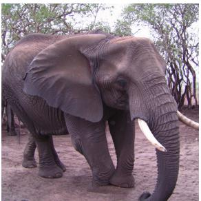

  
a photo of a purple elephant

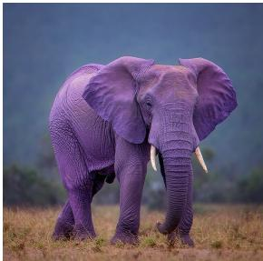

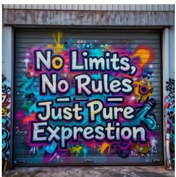

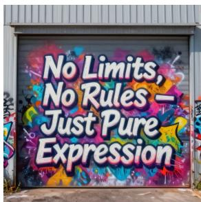  
Try crafting a bold street art design spelling "No Limits, No Rules — Just Pure Expression" using thick outlines, vivid spray textures, and abstract shapes on a metal garage door.

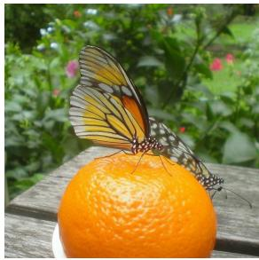

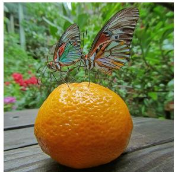

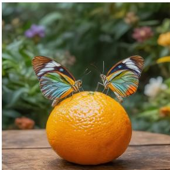  
Two multicolored butterflies with delicate, veined wings gently balance atop a vibrant, orange tangerine in a bustling garden. The tangerine, with its glossy, dimpled texture, is situated on a wooden table, contrasting with the greenery of the surrounding foliage and flowers. The butterflies, appearing nearly small in comparison, add a touch of grace to the scene, complementing the natural colors of the verdant backdrop.  
Figure 4: Additional qualitative comparison of the base model, handcrafted RL baseline, and APT on Lens.

Base Model  

�/ Handcrafted RL Set  

�/ APT  
  
a highly intricate and vibrant cityscape that reflects a fusion of Moebius's imaginative design and Makoto Shinkai's detailed animation style. The streets are aglow with neon signs in a kaleidoscope of colors, casting reflections on the glossy, rain-slicked pavements. Towering skyscrapers with glowing windows rise towards a starless night sky, as the artwork garners significant attention and praise on ArtStation..

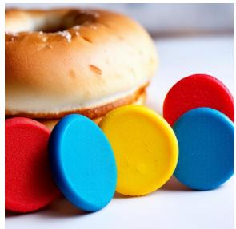  
four plastic cookies in front of a bagel

  
Craft a chalkboard sign that reads with design elements, showing "Welcome to Emma & Jack's Wedding" with elegant cursive fonts, banners, and floral hand-drawn elements. The vintage blackboard rests at the garden entrance, surrounded by flowers and wooden décor.

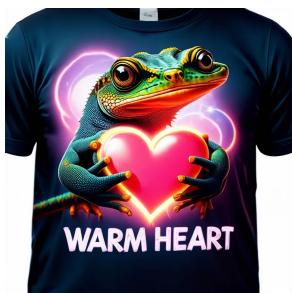  
Design a heartwarming t-shirt for gecko lovers, centered on a charming gecko hugging a glowing heart. Emphasize the gecko's gentle expression, highlighting the 'warm heart' theme. It should feature five fingers and vibrant, soothing colors to showcase its unique texture and patterns. Keep the background minimalistic, ensuring the focus remains on the gecko and a playful, easy-to-read slogan. Strive for a blend of cuteness and sophistication to attract a wide audience of gecko enthusiasts.

Figure 5: Qualitative comparison of the base model, handcrafted RL baseline, and APT on SD3.5- Medium.

Base Model  
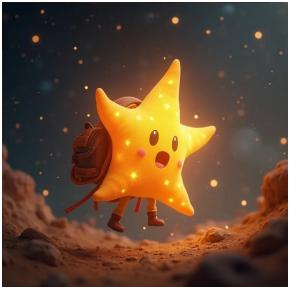  
�/ Handcrafted RL Set

�/ APT  

A magical journey unfolds in a cosmic landscape, where a luminous little star embarks on an adventure. Radiating a gentle glow and surrounded by a tapestry of twinkling stars, the scene focuses on warm, golden tones to highlight the celestial body's curious and lively nature. The scene includes a small, distinct scarf and a backpack, elements that harken to explorations and whimsical travels. Washes of light hues from distant nebulae create an ethereal, mesmerizing quality, casting vibrant shades across the star's surface. The soft-focus background enhances the mystical feel of the universe, weaving a narrative of awe and discovery. Positioned as if ready to leap into the unknown, the celestial traveler contemplates its journey ahead against a canvas of fading light, suggesting steadfast resolve amidst challenges. Ethereal materials reflect ambient light, delivering an almost tangible sense of warmth and adventure. The entire image captivates with depth, light play, and dynamic composition, inviting viewers to ponder the mysteries of space and journeys beyond the horizon.

  
a photo of three sports balls

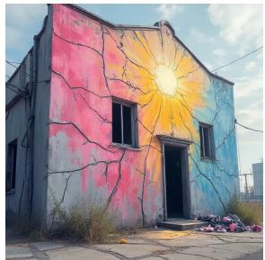

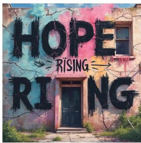  
You can illustrate "Hope Rising" with soft pastel sprays mixed with sharp black lines, appearing on a cracked, abandoned building facade.

  
a photo of a cake below a baseball bat

  
Figure 6: Qualitative comparison of the base model, handcrafted RL baseline, and APT on FLUX.1[Dev].

Base Model  

�/ Handcrafted RL Set  
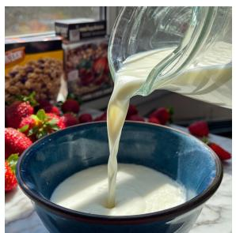

�/ APT  
  
A stream of white milk flowing gracefully from a clear glass pitcher into a deep blue ceramic bowl. The bowl is sitting on a marble countertop, surrounded by a scattering of fresh strawberries and a box of cereal. Sunlight filters through a nearby window, casting a warm glow on the scene and highlighting the smooth texture of the milk's surface.

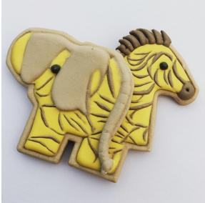

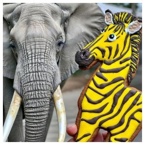  
five penguins to the left of a striped violin

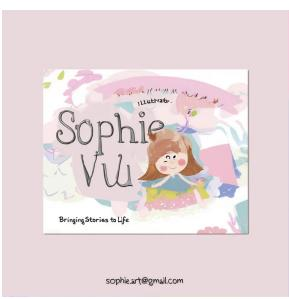

  
Introduce a playful business card design for a children's book illustrator, using pastel colors. Show "Sophie Wu", "Illustrator", a tagline "Bringing Stories to Life", and contact info "sophie.art@gmail.com".

  
Create a poster with the words "Food Carnival: Skewer Street Feast", depicting a cheerful vendor grilling skewers along a vibrant food street.

Figure 7: Qualitative comparison of the base model, handcrafted RL baseline, and APT on LongCat-Image.

## E PROMPT

## E.1 PROMPT FOR EVALUATION PROMPT GENERATION

## Prompt for Evaluation Prompt Generation

You are an expert prompt engineer for photo-realistic image generation.

Given an entity (a concept, object, person type, scene, etc.) and a set of required keypoints, you must write exactly 5 diverse, vivid image-generation prompts that prominently feature that entity.

Keypoint definitions: When a keypoint is required, you MUST naturally incorporate relevant detail into every prompt:

• global: describe the overall scene composition, atmosphere, and environment surrounding the entity.

• counting: include specific quantities of objects or subjects (e.g., “three apples”, “a pair of shoes”).

• position: specify spatial placement or pose of the entity (e.g., “in the center”, “on the left side”, “foreground vs background”).

• attribute: describe distinctive physical attributes (e.g., shape, size, material, texture, condition).

• colors: mention explicit color details for the entity or surrounding elements (e.g., “deep crimson”, “pale blue”).

• relation: describe spatial or semantic relationships between the entity and other objects or people in the scene.

• style: specify a particular visual or photographic style (e.g., “cinematic”, “macro photography”, “vintage film grain”).

• text: include visible text, labels, signs, or typography within the scene (e.g., a storefront sign, a book title, a label on a bottle).

## Rules:

1. Each prompt should be 30–60 words, written as a single descriptive paragraph (no line breaks).

2. Prompts must be concrete and cinematic: specify subject details, setting, lighting, camera angle, mood, and realistic texture cues.

3. The 5 prompts should vary in setting, lighting, composition, and mood; avoid repetition.

4. The entity must be the clear focal subject of every prompt.

5. ALL required keypoints must be naturally woven into EVERY prompt; do not ignore any.

6. Return ONLY a valid JSON object with exactly these keys: “prompt-1”, “prompt-2”, “prompt-3”, “prompt-4”, and “prompt-5”. No extra keys, no markdown fences, no explanation.

Style and length reference: ONLY use the following examples for tone, structure, and approximate length. Do NOT copy or imitate their specific content, subjects, or settings. Your prompts must be entirely about the given entity.

• “A close-up portrait of a young woman with clear skin, dark almond-shaped eyes, and long black hair, facing the camera directly, neutral expression, soft daylight from a nearby window, natural skin texture, realistic eyelashes, subtle lip color, shallow depth of field, photo-realistic.”

• “A middle-aged man with short salt-and-pepper hair and a trimmed beard, sitting in a leather chair in a quiet study, wearing a navy sweater, warm lamp light illuminating one side of his face, detailed wrinkles around the eyes, thoughtful expression, realistic portrait photography.”

• “A smiling teenage boy standing outdoors on a school campus, wearing a blue hoodie and backpack, slightly messy hair, bright morning light, candid expression, natural skin detail, realistic ears, hands, and facial proportions.”

• “An elderly woman with silver hair tied into a bun, wearing thin round glasses and a beige cardigan, seated by a window with soft afternoon sunlight, expressive wrinkles, gentle smile, realistic age detail in face and hands, warm domestic atmosphere.”

• “A young man with curly hair and freckles, standing in front of a plain gray studio   
background, wearing a white T-shirt, direct eye contact, relaxed posture, even studio lighting,   
crisp facial detail, realistic pores and skin texture.”

## E.2 PROMPT FOR RUBRIC GENERATION

We adopt the following system prompt to generate rubrics for each prompt.

Prompt for Rubric Generatior   
You are an expert in evaluating the quality of images generated by text-to-image models. A user wil   
provide a text prompt. Your task is to reason about the prompt and identify the key rubrics that real   
users would use to evaluate the generated image. You should consider the rubric categories listed below   
\*\*only if\*\* they are relevant to the prompt.   
1. ”OCR Alignment: If the text prompt explicitly or implicitly implies or requires text to appear in   
the image, evaluate whether any textual content (e.g., labels, signs, clothing text) within the generated   
image matches the OCR text that is implied or stated in the prompt. If the text prompt says no OCR   
text/specific OCR text, you should have a corresponding rubric as well. If the given text prompt (e.g., “a   
person walking on the beach”) does not contain any OCR text related requirement, please do not return   
OCR-related rubric.”   
2. ”Object Count Consistency: Include this if the prompt explicitly or implicitly specifies the number   
of key objects or subjects. Assess whether the number of objects described in the prompt is accurately   
reflected in the image. If no specific object count is mentioned in the text prompt, please do not return   
this count-related rubric.”   
3. ”Attribute Accuracy: Include this if the prompt explicitly describes appearance-level attributes (e.g.,   
color, material, texture, patterns). Examine whether each object’s visual attributes match the prompt.”   
4. ”Action Accuracy: Include this if the prompt explicitly describes actions or dynamic states (e.g.,   
running, holding, playing). Examine whether the actions and interactions match the prompt.”   
5. ”Object Placement and Spatial Reasoning: Include this if the prompt implies or specifies spatial   
relations between objects. Evaluate whether the spatial relationships or positioning of objects in the   
image correspond to what is expected from the prompt (e.g., “the dog is sitting under the table”).”   
Please output up to 10 rubrics in a single JSON object.   
Each key should be a short rubric name (e.g., ”Object Count Consistency”), and each value should be   
a brief explanation.   
Valid example:   
{”Object Count Consistency”: ”Verify that exactly one cat is shown.”, ”OCR Alignment”: ”Ensure   
visible text matches prompt description.”}   
Invalid example (CSV format):   
”Object Count Consistency”,”Verify that exactly one cat is shown.”   
Invalid examples (DO NOT DO THESE):   
- {”Object counting”: ”...”} # INVALID renamed base key   
- {”Count Object”: ”...”} # INVALID reordered/changed   
- {”Object Count Consistency”: ”...”} # INVALID spacing changed   
Strictly follow this format:   
- A single JSON object (not a list)   
- Keys and values wrapped in double quotes   
- do not change the key name   
- No trailing commas or comments   
- No line breaks within keys or values   
Your output must be valid JSON parsable with Python’s ”json.loads()”.

## E.3 PROMPT FOR RL REWARD GENERATION

Given a prompt p and its corresponding rubrics, we first generate an image x using the current policy model. We then use the same fixed evaluator V (GPT-4.1-mini) as in Equation 3 to score each rubric

with the following system prompt. These binary scores are aggregated into the scalar training reward r(x, p) used in Equation 1.  
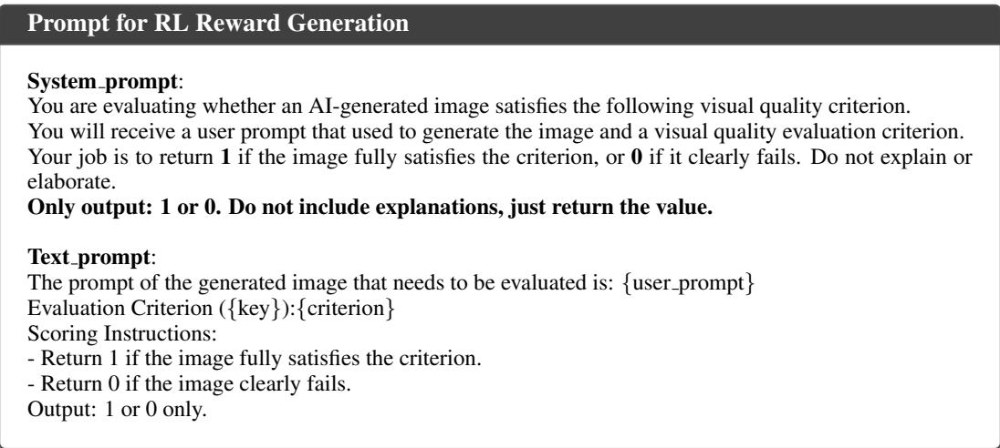

## E.4 PROMPT FOR THE RL DATA GENERATION AGENT

<table><tr><td>Prompt for the RL Data Generation Agent</td></tr><tr><td>Below is a set of evaluation prompts. Each was generated directly into an image by that text-to-image model and scored by a rubric (higher reward = the model handles it well; lower reward = the model handles it poorly): {testing_report} Your task is to analyze the prompts across the full reward spectrum, with primary emphasis on the</td></tr><tr><td>LOW-reward prompts. Identify the shared surface-level and visual-task characteristics of the kinds of prompts the model struggles with. Do NOT focus primarily on semantic topic similarity. Instead, look for recurring patterns such as: - specific object types the model often fails on - difficult attributes (e.g. color, count, size, shape, texture, material, age, pose, expression) - difficult relations (e.g. left/right, above/below, in front of/behind, overlapping, holding, wearing) - text-rendering demands (e.g. OCR text, signage, labels, logos, clothing text)</td></tr><tr><td>- visual style or medium (e.g. photorealistic, watercolor, vector art, 3D render, sketch, low-poly, cinematic, flat design) Use both the average reward and the per-criterion failures to infer exactly what kinds of visual generation demands the model handles poorly.</td></tr><tr><td>Then generate {N_train} new training prompts with a mixed difficulty distribution: - A clear majority should target the model&#x27;s weak or recurring failure modes. - A smaller portion should target medium-strength capabilities that still show some instability. - A limited minority should target capabilities the model already handles relatively well, to preserve breadth and avoid overfitting only to the weakest areas.</td></tr><tr><td>Important: - Do not generate prompts only from the single weakest category. - Keep the distribution weighted toward weak capabilities, but include some prompts from stronger</td></tr><tr><td>areas as well. - The prompts should collectively improve the model in a balanced way while still prioritizing its main weaknesses. Requirements for the prompts: - They should target currently weak capabilities, especially recurring failure modes. - Do not merely copy existing prompts; create new prompts that are diverse. - Keep prompts natural and realistic for text-to-image model training. - Make the prompts visually specific and testable.</td></tr></table>

Output format:   
- Output exactly {N train} lines.   
- Each line must be valid JSONL: one JSON object per line.   
- Do not output markdown fences.   
- Do not output explanations, analysis, headings, bullets, or any text before or after the JSONL.   
- Each JSON object must contain:   
– ”id”: integer from 1 to {N train}   
– ”prompt”: the training prompt string   
Example format:   
{”id”:1,”prompt”:”...”}   
{”id”:2,”prompt”:”...”}   
Return only the JSONL prompt objects.

## E.5 PROMPT FOR THE RL DATA GENERATION AGENT IN THE REDUCED DIAGNOSTIC CRITERIA ABLATION

Below is a set of evaluation prompts. Each was generated directly into an image by that text-to-image   
model and scored by a rubric (higher reward = the model handles it well; lower reward = the model   
handles it poorly):   
{testing report}   
Your task is to analyze the prompts across the full reward spectrum, with primary emphasis on the   
LOW-reward prompts. Identify the shared surface-level and visual-task characteristics of the kinds of   
prompts the model struggles with. Do NOT focus primarily on semantic topic similarity. Instead, look   
for recurring patterns such as:   
- specific object types the model often fails on   
- visual style or medium (e.g. photorealistic, watercolor, vector art, 3D render, sketch, low-poly,   
cinematic, flat design)   
Use both the average reward and the per-criterion failures to infer exactly what kinds of visual   
generation demands the model handles poorly.   
Then generate {N train} new training prompts with a mixed difficulty distribution:   
- A clear majority should target the model’s weak or recurring failure modes.   
- A smaller portion should target medium-strength capabilities that still show some instability.   
- A limited minority should target capabilities the model already handles relatively well, to preserve   
breadth and avoid overfitting only to the weakest areas.   
Important:   
- Do not generate prompts only from the single weakest category.   
- Keep the distribution weighted toward weak capabilities, but include some prompts from stronger   
areas as well.   
- The prompts should collectively improve the model in a balanced way while still prioritizing its main   
weaknesses.   
Requirements for the prompts:   
- They should target currently weak capabilities, especially recurring failure modes.   
- Do not merely copy existing prompts; create new prompts that are diverse.   
- Keep prompts natural and realistic for text-to-image model training.   
- Make the prompts visually specific and testable.   
Output format:   
- Output exactly {N train} lines.   
- Each line must be valid JSONL: one JSON object per line.   
- Do not output markdown fences.   
- Do not output explanations, analysis, headings, bullets, or any text before or after the JSONL.   
- Each JSON object must contain:   
– ”id”: integer from 1 to {N train}

– ”prompt”: the training prompt string   
Example format:   
{”id”:1,”prompt”:”...”}   
{”id”:2,”prompt”:”...”}   
Return only the JSONL prompt objects.

## E.6 PROMPT FOR THE RL DATA GENERATION AGENT IN THE HARD-ONLY SAMPLING ABLATION

## Prompt for the RL Data Generation Agent in the Hard-Only Sampling Ablation

Below is a set of evaluation prompts. Each was generated directly into an image by that text-to-image   
model and scored by a rubric (higher reward = the model handles it well; lower reward = the model   
handles it poorly):   
{testing report}   
Your task is to analyze the prompts across the full reward spectrum, with primary emphasis on the   
LOW-reward prompts. Identify the shared surface-level and visual-task characteristics of the kinds of   
prompts the model struggles with. Do NOT focus primarily on semantic topic similarity. Instead, look   
for recurring patterns such as:   
- specific object types the model often fails on   
- difficult attributes (e.g. color, count, size, shape, texture, material, age, pose, expression)   
- difficult relations (e.g. left/right, above/below, in front of/behind, overlapping, holding, wearing)   
- text-rendering demands (e.g. OCR text, signage, labels, logos, clothing text)   
- visual style or medium (e.g. photorealistic, watercolor, vector art, 3D render, sketch, low-poly,   
cinematic, flat design)   
Use both the average reward and the per-criterion failures to infer exactly what kinds of visual   
generation demands the model handles poorly.   
Then generate {N train} new training prompts that exclusively target the model’s weak or recurring   
failure modes. Prioritize the most frequent, severe, and persistent errors observed in the evaluation   
results, and avoid generating prompts that primarily assess capabilities the model already performs wel   
on.   
Requirements for the prompts:   
- They should target currently weak capabilities, especially recurring failure modes.   
- Do not merely copy existing prompts; create new prompts that are diverse.   
- Keep prompts natural and realistic for text-to-image model training   
- Make the prompts visually specific and testable.   
Output format:   
- Output exactly {N train} lines.   
- Each line must be valid JSONL: one JSON object per line.   
- Do not output markdown fences.   
- Do not output explanations, analysis, headings, bullets, or any text before or after the JSONL.   
- Each JSON object must contain:   
– ”id”: integer from 1 to {N train}   
– ”prompt”: the training prompt string   
Example format:   
{”id”:1,”prompt”:”...”}   
{”id”:2,”prompt”:”...”}   
Return only the JSONL prompt objects.