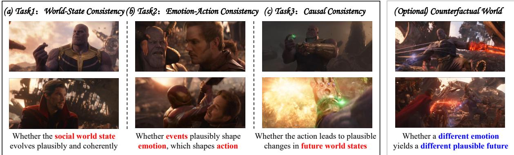
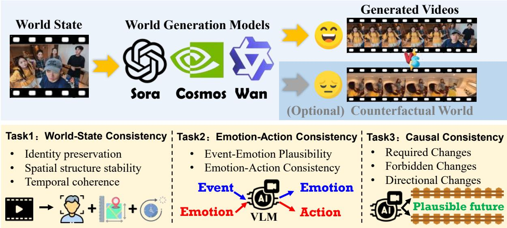
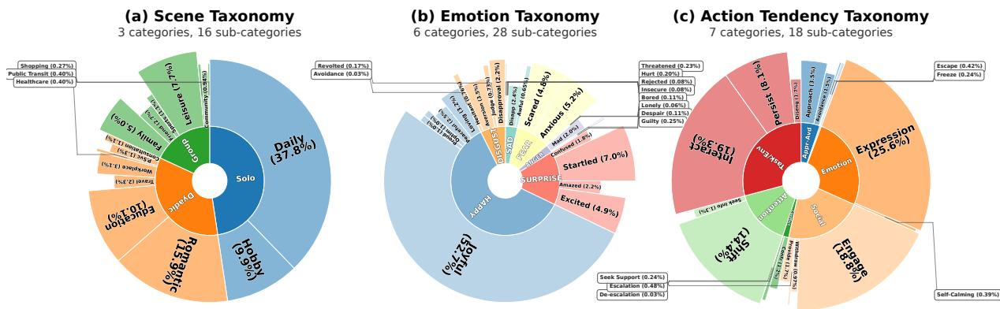
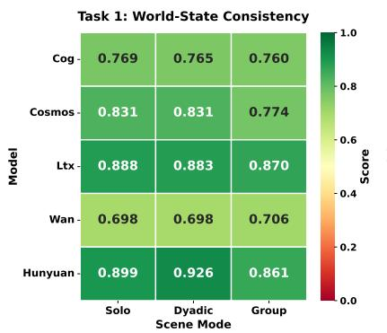
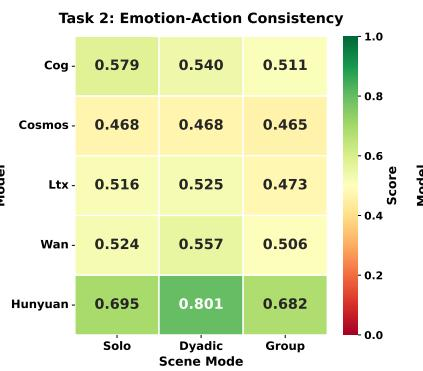
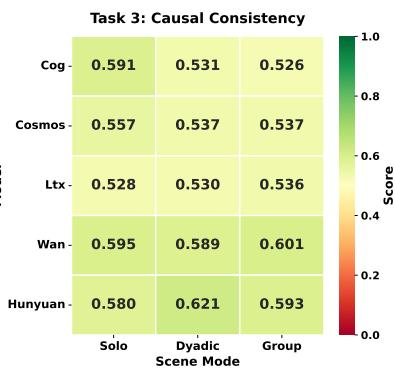
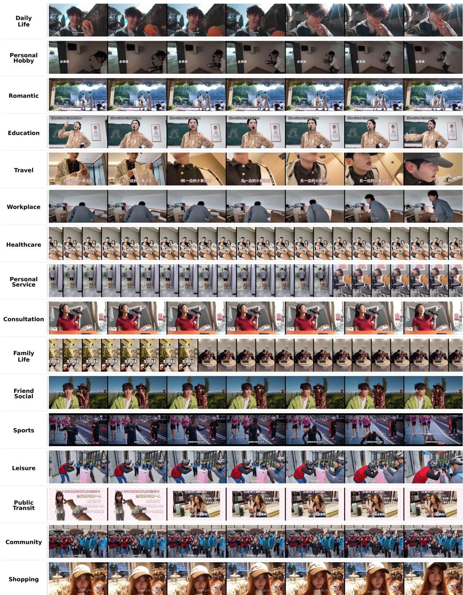
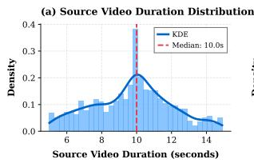
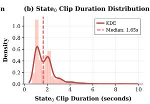

# AffectWorld: Benchmarking Emotion-Driven Future World Prediction

Changhao Song1, Yacong Chen2, Hui Gao1, Yazhou Zhang1\*, Peng Zhang1†

1School of Computer Science and Technology, Tianjin University, Tianjin, China 2International Joint Institute of Tianjin University, Fuzhou, China {songchanghao, yc\_chen, hui\_gao, yzhou\_zhang, pzhang}@tju.edu.cn

## Abstract

The world encompasses both physical environments and human actors. Predicting its evolution requires understanding both physical laws and how emotions shape human actions. However, existing world model benchmarks primarily assess physical plausibility and perceptual quality, leaving emotion-driven world evolution largely untested. We introduce AffectWorld, a benchmark that evaluates the chain Emotion → Action → World State through three tasks: World-State Consistency, Emotion–Action Consistency, and Causal Consistency. It comprises 1,498 everyday video samples annotated with plausible emotions, ac tion tendencies, and atomic world-state constraints. A counterfactual subset of 233 samples tests whether changing an agent’s emotion under fixed scene and event conditions yields corresponding changes in actions and consequences. We define eight metrics across the three tasks and an additional counterfactual metric, combining automatic visual assessment with human-calibrated VLM/LLM judgments. Evaluations of five SoTA world models (e.g., Cosmos3) required world-state change scores of 0.100–0.280 and counterfactual emotion sensitivity scores of 0.027–0.070 on a [0, 1] scale. These results reveal substantial gaps in generating the consequences of emotion-driven actions and adapting future predictions to emotional interventions. AffectWorld provides a testbed for advancing world models that capture how emotions shape future physical and social states1.

## 1 Introduction

Imagine watching a person receive bad news, their smile fade, and the room fall silent. Humans effortlessly predict how emotion will shape what happens next. However, this intuitive grasp of emotional and social dynamics remains a core challenge for AI. World models have become a cornerstone of embodied intelligence by enabling agents to predict future states conditioned on observations and actions (Ding et al., 2025). Recent benchmarks have moved beyond video quality to evaluate embodied world models as data engines, policy evaluators, and action planners, revealing a significant perception–functionality gap (Shang et al., 2026). However, these evaluations still treat the world as physical or task-oriented. Human action is also driven by emotion, social relations, and group atmosphere. A world model that predicts object trajectories but not the emotional consequences of actions cannot reliably anticipate human behavior. This raises a central question: can a world model treat emotion as a causal variable and predict the coupled physical–social future?

Existing world model benchmarks span physical commonsense understanding to embodied utility. For physical commonsense, VideoPhy (Bansal et al., 2025) curates solid–solid, solid–fluid, and fluid–fluid interactions, showing that even the best model follows captions and physics in only 39.6% of cases. WorldBench (Upadhyay et al., 2026) introduces concept-specific evaluation of intuitive physics and measurable parameters such as gravity and friction. For embodied utility, WorldSim-Bench (Qin et al., 2024) assesses video generation models as world simulators, EWMBench (Yue et al., 2025) evaluates scene, motion, and semantic quality, WorldEval (Li et al., 2025a) studies world models as robot policy evaluators, and World-in-World (Zhang et al., 2026b) places them in a closedloop setting. They broaden functional evaluation but offer limited assessment of emotion-driven future world evolution.

A critical gap therefore remains: whether a world model learns why people act, and how those actions reshape the future social world, is largely untested. Emotion is a latent causal variable that changes action selection, interpersonal distance, and group atmosphere over multiple steps.

  
Figure 1: AffectWorld illustrated with scenes from Avengers: Infinity War: (a) Thanos and Doctor Strange discuss the snap, (b) Anger over a loved one’s death drives Star-Lord to attack Thanos, allowing him to escape, (c) Thanos snaps his fingers, erasing half of all life, (Optional) Without Star-Lord’s outburst, the heroes might restrain Thanos.

To bridge this gap, we introduce AffectWorld, a unified benchmark for emotion-driven future world prediction. AffectWorld formalizes the task as Historical Observation → Future World State and treats emotion as a latent variable in a coupled physical–social world state. As illustrated in Figure 1, the benchmark comprises three progressive tasks: (a) Task 1: World-State Consistency, which evaluates whether the social world state evolves plausibly and coherently, (b) Task 2: Emotion-Action Consistency, which examines whether events plausibly shape emotion and emotion shapes action, and (c) Task 3: Causal Consistency, which tests whether actions lead to plausible world-state changes. An optional counterfactual subtask intervenes only on the target agent’s emotion while keeping the physical scene and event context fixed, testing whether a different emotion yields a different yet plausible future. Inspired by EWH (Song et al., 2025), we provide fine-grained transition annotations, including event context, plausible emotions, action tendencies, and world-state constraints, to support these evaluations. Evaluation combines automatic perception metrics for Task 1 and human-calibrated VLM/LLM semantic judgments for Tasks 2 and 3 and the counterfactual subtask, with each task score and its sub-dimensions reported separately. AffectWorld accepts multiple plausible emotional futures and rewards diversity as long as the evolution remains causally consistent.

We evaluate five state-of-the-art models, including Cosmos3, on 1,498 everyday video samples.

Results reveal substantial gaps: world-state change scores reach only 0.10–0.28, counterfactual emotion sensitivity scores 0.027–0.070, and action realization under counterfactual emotions drops by 41%. Models maintain physical consistency but struggle to infer plausible emotions, realize emotion-driven actions, and generate their necessary consequences. Performance degrades sharply as scene complexity increases—HunyuanVideo’s Task 2 score drops 27% from solo to group settings—exposing a core limitation: models track isolated trajectories but cannot coordinate coupled social systems. Together, these findings show that current models have not yet learned to treat emotion as a causal driver reshaping future social dynamics.

Our contributions are threefold:

• A unified benchmark for emotion-driven world prediction. We introduce AffectWorld, a unified benchmark that formulates emotiondriven future world prediction as a causal evaluation problem and tests the causal progression Emotion → Action → World State.

• Layered tasks and fine-grained datasets. We provide three progressive tasks, along with fine-grained transition annotations and an optional counterfactual subset.

• Hybrid evaluation pipeline. We combine automatic perception metrics, VLM/LLM semantic judgments, and human calibration, and aggregate the results into a unified score.

  
Figure 2: Overview of the AffectWorld generation and evaluation process. A world model generates a future video from a history video, which is evaluated by three progressive tasks: world-state consistency, emotion-action consistency, and causal consistency. An optional counterfactual subtask, applicable to models that accept emotion conditions, alters only the agent’s emotion to test whether the generated future changes accordingly.

## 2 Related Work

## 2.1 World Models

World models learn predictive representations of state transitions to support planning, policy learning, and decision-making (Ha and Schmidhuber, 2018; Ding et al., 2025). Early work focused on latent dynamics models (Hafner et al., 2023), while recent approaches scale to observable-space generation, producing future frames or action-conditioned trajectories (Brooks et al., 2024; Bruce et al., 2024; Agarwal et al., 2025). In embodied settings, world models serve as data synthesis engines (Jang et al., 2025), policy evaluation environments (Li et al., 2025a), and action planners (Hu et al., 2024). Recent work further extends world models from physical dynamics toward the human social world. Social world models (Zhou et al., 2025) structure unspoken dynamics such as intentions and beliefs into explicit representations for social reasoning. Mental world model (Fei and Zhao, 2026) treats beliefs, goals, emotions, and social norms as core state variables that evolve jointly with the physical world. LEWM (Song et al., 2025) factorizes future prediction into emotion prediction followed by emotion-conditioned state prediction. Together, these works move world modeling from the physical world toward the human world.

## 2.2 World Model Benchmarks

Existing benchmarks evaluate world models along several dimensions. For physical commonsense, VideoPhy (Bansal et al., 2025) and World-Bench (Upadhyay et al., 2026) test adherence to physical laws and measurable parameters. For perceptual and generative quality, WorldScore (Duan et al., 2025) and WorldArena (Shang et al., 2026) assess controllability, quality, and dynamics. For embodied utility, WorldSimBench (Qin et al., 2024), EWMBench (Yue et al., 2025), WorldEval (Li et al., 2025a), and World-in-World (Zhang et al., 2026b) evaluate closed-loop interaction and policy evaluation. The variables in these benchmarks remain physical, geometric, or taskoriented, while evaluations of human-centered models largely rely on discrete option selection or textual narratives. AffectWorld complements them by evaluating continuous future world states driven by emotion, through progressive tasks and an optional counterfactual subtask.

## 3 AffectWorld Benchmark

To test emotion-driven future world prediction in world models, we introduce AffectWorld, a unified benchmark designed to evaluate whether a model can treat emotion as a latent causal variable and predict the coupled physical–social future. The core methodology is to provide a model with a history observation and task it with generating a continuation that represents a plausible future world state. Table 3 (Appendix A) summarizes how AffectWorld relates to existing physical world and affective benchmarks.

  
Figure 3: Taxonomy and distribution of (a) scene, (b) emotions, and (c) action tendencies.

As shown in Figure 2, AffectWorld is divided into three progressive tasks, designed to probe deeper levels of emotion-aware world modeling. This structure ensures a comprehensive assessment from basic World-State Consistency to Emotion-Action Consistency and Causal Consistency. An optional counterfactual subtask further tests whether the generated future responds to emotional interventions. All samples are drawn from our annotated data (Sec. 3.1), and the evaluation combines automatic perception metrics and VLM/LLM semantic judgments. Since the tasks probe successive levels, we report each task score and its sub-dimensions separately, which helps identify the levels at which a model may fall short.

## 3.1 Data Construction

The benchmark comprises 1,498 real-world video samples collected from short-video platforms (Douyin/TikTok). Each sample consists of a history video state0, and a structured transition comprising the event context, the target emotion etarget, plausible\_emotions, plausible\_actions, and world-state constraints (detailed in Appendix F). The annotations are produced through a two-stage pipeline (detailed in Appendix H): a VLM first generates grounded visual descriptions, and a LLM then extracts structured emotion-world state transitions. Scenes span 3 major classes across 16 diverse everyday scenarios and are labeled as single- or multi-person. Emotions and actions are annotated from two predefined taxonomies with 6 emotion families and 7 action categories, detailed in Appendix B.1.

Since the same emotion can lead to different yet equally plausible futures, we do not annotate a single target world state. Instead, we annotate constraints over four state dimensions: physical object states, spatial relations, agent internal states, and social atmosphere (Appendix B.2). Each constraint belongs to one dimension and one of three types, must, must\_not, and directional (Sec. 3.4). Only constraints strongly causally related to the event and emotion are annotated, so a sample may cover only some types and dimensions.

To support causal evaluation, we further construct a counterfactual subset. For each selected sample, the physical scene and event context are kept fixed, and the target agent’s emotion is replaced with a different plausible emotion $e _ { c f }$ . Annotators re-derive the plausible action tendencies and world-state constraints under $e _ { c f } .$ , yielding two branches that share state0 but diverge in emotion and future evolution (Appendix B.3).

## 3.2 Task 1: World-State Consistency

Task 1 evaluates whether a model possesses basic human-centered social world modeling ability, which serves as the foundation for the subsequent emotion-driven tasks. We measure three dimensions: identity preservation, whether the main agent and key objects retain their identity across frames; spatial structure stability, whether the geometric layout remains consistent; and temporal coherence, whether motion evolves smoothly over time. These dimensions are essential for tracking who is present, how they relate spatially, and the continuity of social behaviors.

The final Task 1 score is the geometric mean of the three dimensions, ensuring balanced performance across all aspects. We compute identity preservation $S _ { i d } ,$ spatial structure stability $S _ { d e p t h } ,$ and temporal coherence $S _ { t e m p }$ using perceptual metrics (detailed in Appendix C):

$$
\mathrm { S c o r e } _ { T 1 } = \sqrt [ 3 ] { S _ { i d } \cdot S _ { d e p t h } \cdot S _ { t e m p } } .\tag{1}
$$

## 3.3 Task 2: Emotion-Action Consistency

Task 2 evaluates whether a model has learned the transition from event and emotion to observable behavior. We decompose it into two complementary dimensions: Event-Emotion Plausibility, which tests whether the generated future exhibits a contextually plausible emotion, and Emotion-Action Consistency, which tests whether the inferred emotion drives a compatible observable behavior.

Both dimensions are scored with a two-stage judge that decouples perception from judgment. A VLM first converts the generated future video $V _ { p r e d }$ into a time-anchored description $\begin{array} { r l } { D } & { { } = } \end{array}$ $\bar { \mathrm { V L M } } ( V _ { p r e d } )$ of observable cues. An LLM judge J then scores each candidate against D on a graded rubric mapped to [0, 1]. The event context C is used to interpret the reported cues.

For Event-Emotion plausibility, the judge matches the emotional tone described in D against the candidate emotion set $\begin{array} { r c l } { \mathcal { E } } & { = } & { \{ e _ { t a r g e t } \} } \end{array}$ ∪ plausible\_emotions:

$$
M _ { e m o } = \operatorname* { m a x } _ { e \in \mathcal { E } } J _ { e m o } ( D , e , \mathcal { C } )\tag{2}
$$

where $e _ { t a r g e t }$ is the target emotion, and plausi-$b l e _ { . }$ \_emotions is the set of plausible alternatives. To respect diverse emotional responses, we take the maximum score over the candidate set rather than enforcing a single target. We define the corresponding inferred emotion as

$$
e ^ { * } = \arg \operatorname* { m a x } _ { e \in { \mathcal { E } } } J _ { e m o } ( D , e , { \mathcal { C } } ) .\tag{3}
$$

Thus, $M _ { e m o }$ measures the best emotional match, while $e ^ { * }$ is used for the subsequent actionconsistency evaluation. This dimension measures whether the generated future expresses a cognitively plausible emotional response to the event.

For Emotion-Action consistency, the judge evaluates whether the observable behavior in $D$ is compatible with the inferred emotion $e ^ { * }$ . To respect the diversity of emotional futures, we allow multiple plausible action tendencies and take the maximum score over the candidate action set A = plausible\_actions:

$$
S _ { a c t i o n } = \operatorname* { m a x } _ { a \in \mathcal { A } } J _ { r e a l } ( D , a , \mathcal { C } ) \cdot w \big ( J _ { c o h } ( D , a , e ^ { * } ) \big )\tag{4}
$$

where $J _ { r e a l }$ measures whether the observable behavior realizes the core function of the candidate action tendency a, and $J _ { c o h }$ measures whether the manner of that behavior, such as its speed, force, and bodily tone, is consistent with $e ^ { * }$ . The function $w ( \cdot )$ is a monotone gate that assigns zero to behaviors whose manner conflicts with $e ^ { * }$

Task 2 score is the mean of the two dimensions:

$$
\mathrm { S c o r e } _ { T 2 } = \frac { 1 } { 2 } \left( M _ { e m o } + S _ { a c t i o n } \right)\tag{5}
$$

## 3.4 Task 3: Causal Consistency

Task 3 evaluates whether a model understands the causal evolution Emotion → Action → World State. The evaluation granularity focuses on the social and physical consequences of behavior, such as others’ reactions and interpersonal relationship changes.

Since an event admits many plausible futures, we annotate world-state constraints derived from the event, emotion, and action tendencies, which jointly characterize what all plausible futures share (must), what none of them contain (must\_not), and in which direction the world should evolve (directional). An LLM judge J checks each constraint against the semantic description D extracted by a VLM from the generated video $V _ { p r e d }$ , and outputs a graded verdict mapped to [0, 1].

The causal consistency of $V _ { p r e d }$ is computed from four components (detailed in Appendix D): $S _ { m u s t }$ for required consequences, $S _ { n o t }$ for prohibited changes, $S _ { d i r }$ for directional trends, and $S _ { e x i s t s }$ for any world-state change, combined as:

$$
S _ { c a u s a l } = S _ { n o t } . \frac { S _ { e x i s t s } + K _ { m u s t } S _ { m u s t } + K _ { d i r } S _ { d i r } } { 1 + K _ { m u s t } + K _ { d i r } }\tag{6}
$$

where $K _ { m u s t }$ and $K _ { d i r }$ weight by constraint count. The Task 3 score averages over all N samples:

$$
\mathrm { S c o r e } _ { T 3 } = \bar { S } _ { c a u s a l } = \frac { 1 } { N } \sum _ { i = 1 } ^ { N } S _ { c a u s a l } ^ { i }\tag{7}
$$

## 3.5 Optional Subtask: Counterfactual World

To test whether a model treats emotion as a causal driver, we construct a curated counterfactual subset in which the physical scene, characters, and event context are held fixed while only the target agent’s emotion is intervened. Each sample defines two branches sharing state0, $( s t a t e _ { 0 } , e _ { o r i g } $ $s t a t e _ { 1 } ^ { o r i g } )$ and $( s t a t e _ { 0 } , e _ { c f } ~  ~ s t a t e _ { 1 } ^ { c f } )$ , where $e _ { o r i g }$ and $e _ { c f }$ denote the original and counterfactual emotions, respectively.

Table 1: Main results on AffectWorld under video-to-video (V2V) and image-to-video (I2V) input settings.
<table><tr><td rowspan="2">Metric</td><td colspan="3">Video-to-Video (V2V)</td><td colspan="2">Image-to-Video (I2V)</td></tr><tr><td>Cosmos3</td><td>Wan2.1-VACE</td><td>LTX-Video</td><td>HunyuanVideo-1.5</td><td>CogVideoX-5B</td></tr><tr><td colspan="6">Task 1: World-State Consistency</td></tr><tr><td> $S _ { i d }$ </td><td>0.8336</td><td>0.7324</td><td>0.9282</td><td>0.7939</td><td>0.9538</td></tr><tr><td> $S _ { d e p t h }$ </td><td>0.3241</td><td>0.3160</td><td>0.4032</td><td>0.1202</td><td>0.5456</td></tr><tr><td> $S _ { t e m p }$ </td><td>0.7182</td><td>0.7426</td><td>0.8491</td><td>0.6547</td><td>0.8988</td></tr><tr><td> $\mathbf { S c o r e } _ { T 1 }$ </td><td>0.5136</td><td>0.4639</td><td>0.6308</td><td>0.3191</td><td>0.7390</td></tr><tr><td colspan="6">Task 2: Emotion-Action Consistency</td></tr><tr><td> $M _ { e m o }$ </td><td>0.4155</td><td>0.4566</td><td>0.4589</td><td>0.7088</td><td>0.5121</td></tr><tr><td> $S _ { a c t i o n }$ </td><td>0.5194</td><td>0.6131</td><td>0.5669</td><td>0.7903</td><td>0.5932</td></tr><tr><td>ScoreT2</td><td>0.4674</td><td>0.5348</td><td>0.5129</td><td>0.7496</td><td>0.5526</td></tr><tr><td colspan="6">Task 3: Causal Consistency</td></tr><tr><td> $S _ { m u s t }$ </td><td>0.1001</td><td>0.1431</td><td>0.1639</td><td>0.2801</td><td>0.1534</td></tr><tr><td> $S _ { n o t }$ </td><td>1.0000</td><td>1.0000</td><td>1.0000</td><td>1.0000</td><td>1.0000</td></tr><tr><td> $S _ { d i r }$ </td><td>0.2150</td><td>0.3238</td><td>0.2988</td><td>0.5000</td><td>0.2610</td></tr><tr><td>ScoreT3</td><td>0.5458</td><td>0.5938</td><td>0.5299</td><td>0.6036</td><td>0.5570</td></tr></table>

Given $s t a t e _ { 0 }$ and an emotion condition, the model generates $V _ { o r i g }$ under $e _ { o r i g }$ and $V _ { c f }$ under $e _ { c f }$ We assess whether each specified emotion induces plausible actions and causally consistent world-state changes through condition plausibility $R ( V , e ) ~ = ~ S _ { a c t i o n } ( V , e ) \cdot S _ { c a u s a l } ( V , e )$ , and whether each generation is specific to its own emotion through selectivity ${ \mathrm { S e l } } _ { y } ,$ which measures the relative drop in plausibility when the annotations of emotion $e _ { y }$ are applied to the other video $V _ { \bar { y } }$ (see Appendix E for detailed formulation).

The counterfactual sensitivity score is

$$
S _ { c o u n t e r } = \sqrt { R _ { o o } R _ { c c } } \cdot \frac { \mathrm { S e l } _ { o } + \mathrm { S e l } _ { c } } { 2 }\tag{8}
$$

which requires the model to generate plausible futures under both emotion conditions and to make each generation specific to its own emotion. The global score averages $S _ { c o u n t e r }$ over the $N _ { c f }$ triplets in the counterfactual subset:

$$
\bar { S } _ { c o u n t e r } = \frac { 1 } { N _ { c f } } \sum _ { i = 1 } ^ { N _ { c f } } S _ { c o u n t e r } ^ { i }\tag{9}
$$

## 4 Experiments

## 4.1 Experimental Setup

We evaluate models on AffectWorld, constructed as described in Section 3.1. We use Qwen-3.8-Max as the VLM to extract time-anchored descriptions of observable cues from generated videos, and GPT-5.6-sol as the LLM judge for semantic evaluation.

Scores are computed following the protocols defined in Section 3, with the three task scores reported separately. Core evaluation parameters are provided in Appendix G. Human review and judge calibration are detailed in Appendix H.4.

Given the limited availability of video-to-video models, we evaluate Cosmos3 (NVIDIA Cosmos Team, 2026), Wan2.1-VACE (Wang et al., 2025), and LTX-Video (HaCohen et al., 2024) using the history video state as input. We additionally include two image-to-video models, HunyuanVideo-1.5 (Tencent-Hunyuan, 2025) and CogVideoX-5B (Yang et al., 2024b), which receive the first frame of state0 together with textual background information describing the scene and event context.

## 4.2 Main Result

Table 1 presents the results of five representative models. Results reveal a clear gap between physical consistency and emotion-driven social prediction: models maintain reasonable world-state structure but struggle to infer plausible emotions and realize their behavioral and causal consequences.

For Task 1, which evaluates whether models maintain consistent world states in human-centered social settings, CogVideoX achieves the highest score of 0.7390 despite receiving only the first frame of state0, suggesting that single-frame conditioning can stabilize identity and motion coherence in current I2V models. Among V2V models, LTX-Video outperforms the others at 0.6308, benefiting from strong identity preservation and temporal smoothness. However, spatial structure stability $S _ { d e p t h }$ remains a common weakness across all models, indicating that current video generation approaches prioritize motion plausibility over geometric consistency in modeling social interactions.

  
Figure 4: Model performance across scene modes (Solo, Dyadic, Group) on three evaluation tasks.

For Task 2, which evaluates emotion-action consistency, HunyuanVideo achieves 0.7496, substantially ahead of V2V models. The gap is particularly pronounced in event-emotion plausibility $M _ { e m o }$ , where HunyuanVideo reaches 0.7088, approximately 70% higher than the lowest-scoring Cosmos at 0.4155. This suggests that I2V models with stronger semantic conditioning better capture the link between observed events and emotional responses. Action realization $S _ { a c t i o n }$ shows a similar pattern, with HunyuanVideo at 0.7903 outperforming the weakest V2V model by 52%, indicating that inferring plausible emotion alone is insufficient—models must also ground that emotion in compatible observable behavior.

For Task 3, which evaluates causal consistency, all models achieve moderate overall scores, with HunyuanVideo leading at 0.6036. The uniform $S _ { n o t } ~ = ~ 1 . 0$ indicates that prohibited changes are rarely violated, but this largely reflects the scarcity of $m u s t _ { n } o t$ constraints in the dataset. More telling is $S _ { m u s t }$ , where even the best model reaches only 0.2801, revealing that models frequently fail to produce the necessary consequences of emotion-driven actions. Directional consistency $S _ { d i r }$ shows stronger performance, with Hunyuan-Video at 0.5000 and the weakest V2V model at 0.2150, suggesting that models can partially capture the direction of social evolution even when they miss specific required changes.

Together, these results show that current video generation models possess basic physical world modeling capability but have not yet learned to treat emotion as a causal driver of future states.

## 4.3 Performance Across Scene Complexity

Figure 4 reveals a sharp hierarchy: solo scenarios remain tractable, dyadic interactions expose moderate weakness, and group settings trigger systematic failure. CogVideoX maintains 0.756 on Task 1 for solo scenes but collapses to 0.353 in groups, where coordinating multiple interacting bodies exceeds current architectures’ capacity. This pattern holds across all tasks—HunyuanVideo’s Task 2 score drops 27% from solo to group settings—reflecting a core limitation: models track isolated trajectories but cannot coordinate coupled social systems where spatial relations carry emotional meaning.

The failure is conceptual, not quantitative. In dyadic scenes, where one agent’s emotion should predict the partner’s reaction, scores drop 15–20% because models miss the reciprocal structure of social interaction. Group scenes compound this deficit: Task 3 falls below 0.50 for all models as emotional propagation and collective dynamics require interdependent causal chains that frame-byframe generation cannot sustain. Solo performance offers a misleading ceiling—models have learned motion priors but not social physics.

## 4.4 Fine-grained Discussion

Semantic Conditioning vs Visual History. I2V models substantially outperform V2V counterparts on emotion and causal reasoning despite less visual history. HunyuanVideo achieves 0.7496 on Task 2, 40% higher than the best V2V model, suggesting that explicit semantic conditioning through text provides stronger grounding for emotion-driven inference than implicit temporal patterns alone.

Temporal Smoothness vs Spatial Accuracy. All models favor temporal continuity over spatial consistency, with $S _ { t e m p }$ and $S _ { i d }$ exceeding 0.7 while $S _ { d e p t h }$ remains below 0.55. This becomes problematic in social contexts where spatial relations—proximity, orientation, positioning—carry emotional meaning that models fail to stabilize.

Table 2: Counterfactual emotion sensitivity on AffectWorld.
<table><tr><td rowspan="2">Metric</td><td colspan="3">Video-to-Video (V2V)</td><td colspan="2">Image-to-Video (I2V)</td></tr><tr><td>Cosmos3</td><td>Wan2.1-VACE</td><td>LTX-Video</td><td>HunyuanVideo-1.5</td><td>CogVideoX-5B</td></tr><tr><td>Saction</td><td>0.4664</td><td>0.5852</td><td>0.4678</td><td>0.5896</td><td>0.5084</td></tr><tr><td>Saction</td><td>0.3246</td><td>0.3077</td><td>0.2791</td><td>0.3458</td><td>0.1903</td></tr><tr><td></td><td>0.4992</td><td>0.5251</td><td>0.4324</td><td>0.5611</td><td>0.5044</td></tr><tr><td>Sc causal</td><td>0.5193</td><td>0.5392</td><td>0.4512</td><td>0.4319</td><td>0.3327</td></tr><tr><td> $\operatorname { S e l } _ { a v g }$ </td><td>0.2442</td><td>0.2630</td><td>0.2946</td><td>0.2750</td><td>0.2428</td></tr><tr><td>Šcounter</td><td>0.0529</td><td>0.0544</td><td>0.0467</td><td>0.0701</td><td>0.0265</td></tr></table>

Emotion Inference vs Action Realization. Event-to-emotion mapping remains the weakest link. Even HunyuanVideo achieves only 0.7088 on $M _ { e m o }$ , while the poorest V2V model scores 0.4155. This bottleneck undermines the entire causal chain: when models misidentify the emotional response, downstream behaviors become untethered from context regardless of action-realization capability. The gap between $M _ { e m o }$ and $S _ { a c t i o n }$ suggests that action execution is learnable, but emotion inference from social context remains harder.

Directional Trends vs Required Consequences. Models capture coarse directional consistency better than specific outcomes, with HunyuanVideo reaching 0.5000 on $S _ { d i r }$ but only 0.2801 on $S _ { m u s t } .$ This gap reveals that current architectures learn broad emotion-behavior associations without the fine-grained causal reasoning needed to commit to concrete world-state changes that necessarily follow from specific emotion-action pairs.

## 4.5 Counterfactual emotion sensitivity

Table 2 evaluates whether models generate plausibly different futures when the target agent’s emotion is intervened. All models exhibit severe counterfactual insensitivity: HunyuanVideo achieves $\bar { S } _ { c o u n t e r } ~ = ~ 0 . 0 7 0 1$ , over tenfold lower than its Task 2 score of 0.7496. This collapse reflects two failures: action realization under counterfactual emotions drops 41%, while emotion selectivity remains weak $( \mathrm { S e l } _ { a v g } = 0 . 2 7 5 )$ —models produce similar actions whether the agent is joyful or anxious. When behavior ignores the emotional intervention and consequences remain unchanged, their product yields near-zero sensitivity.

HunyuanVideo’s lead over V2V models widens under counterfactual probing—its 0.0701 outperforms Wan2.1 by 29% and exceeds CogVideoX by 164%. The failure modes differ: HunyuanVideo maintains causal consistency but struggles with emotion-appropriate actions, while CogVideoX’s causal reasoning deteriorates. These results expose a fundamental limitation: current models have not learned to treat emotion as a controllable causal variable that reshapes future social dynamics.

## 4.6 Case Study

Figure 5 illustrates Cosmos’s failure to generate emotion-driven futures without explicit guidance on actions. In the reference, the downcast girl contacts friends, gets up, and prepares a meal, a plausible progression from low mood toward supportseeking and self-care. The generated future instead keeps her lying nearly motionless, preserving the scene but offering little behavioral progression.

  
Figure 5: A downcast girl: reference future (top) and Cosmos-generated future (bottom).

Her sadness could motivate seeking support or engaging in everyday activities, leading to renewed communication, food preparation, and movement away from the sofa. The nearly static generation fails to exhibit the expected directional progression toward engagement or self-care. Such video generation models struggle to realize emotiondriven actions and their consequences, exposing weaknesses in emotion-driven causal consistency.

## 5 Conclusion

We introduced AffectWorld, a benchmark for emotion-driven future world prediction. Its three evaluation tasks assess world-state consistency, emotion–action consistency, and causal consistency, while a counterfactual subset tests how predicted futures respond to changes in emotion. World-state constraints accommodate multiple plausible futures rather than a single reference trajectory. Experiments on five world models reveal persistent weaknesses in generating the consequences of emotion-driven actions and responding to emotional interventions. AffectWorld establishes a basis for measuring progress in modeling human behavior alongside physical dynamics.

## Limitations

AffectWorld focuses on short everyday videos and may not fully represent diverse cultural contexts or long-term social dynamics. Because emotions and social consequences are often only partially observable, the annotations characterize plausible transitions rather than uniquely correct latent states or futures. Its semantic evaluation relies partly on VLM/LLM judges and may inherit evaluator biases despite human calibration.

## Ethics Statement

All video samples in this work were collected from publicly available short-video platforms (Douyin/TikTok) under their terms of service, depicting everyday social scenarios without sensitive content. The benchmark is intended for research purposes to advance understanding of how AI systems model human emotions and social dynamics. We acknowledge that emotion recognition and prediction technologies carry risks of misuse, including surveillance, manipulation, or discrimination. We strongly discourage use of models trained or evaluated on this benchmark for realtime monitoring, profiling, or any application that infringes on individual privacy or autonomy. Researchers should ensure compliance with applicable regulations and ethical guidelines when deploying emotion-aware systems.

## AI Assistance Statement

We used Claude and GPT-5 for drafting assistance in generating initial code templates for data processing and metric computation (subsequently reviewed and adapted). All core contributions—benchmark design, evaluation framework, model evaluation, and conclusions—were developed by the authors.

AI-generated content served as draft material and underwent full human review.

## References

Niket Agarwal, Arslan Ali, Maciej Bala, Yogesh Balaji, Erik Barker, Tiffany Cai, Prithvijit Chattopadhyay, Yongxin Chen, Yin Cui, Yifan Ding, et al. 2025. Cosmos world foundation model platform for physical ai. arXiv preprint arXiv:2501.03575.

Hritik Bansal, Zongyu Lin, Tianyi Xie, Zeshun Zong, Michal Yarom, Yonatan Bitton, Chenfanfu Jiang, Yizhou Sun, Kai-Wei Chang, and Aditya Grover. 2025. Videophy: Evaluating physical commonsense for video generation. In International Conference on Learning Representations, volume 2025, pages 102075–102121.

Tim Brooks, Bill Peebles, Connor Holmes, Will DePue, Yufei Guo, Leo Jing, David Schnurr, Joe Taylor, Troy Luhman, Eric Luhman, et al. 2024. Video generation models as world simulators. OpenAI Blog, 1(8):1.

Jake Bruce, Michael D Dennis, Ashley Edwards, Jack Parker-Holder, Yuge Shi, Edward Hughes, Matthew Lai, Aditi Mavalankar, Richie Steigerwald, Chris Apps, et al. 2024. Genie: Generative interactive environments. In Forty-first international conference on machine learning.

Jingtao Ding, Yunke Zhang, Yu Shang, Yuheng Zhang, Zefang Zong, Jie Feng, Yuan Yuan, Hongyuan Su, Nian Li, Nicholas Sukiennik, et al. 2025. Understanding world or predicting future? a comprehensive survey of world models. ACM Computing Surveys, 58(3):1–38.

Haoyi Duan, Hong-Xing Yu, Sirui Chen, Li Fei-Fei, and Jiajun Wu. 2025. Worldscore: A unified evaluation benchmark for world generation. In Proceedings of the IEEE/CVF international conference on computer vision, pages 27713–27724.

Paul Ekman. 1992. An argument for basic emotions. Cognition & emotion, 6(3-4):169–200.

Hao Fei and Yiran Zhao. 2026. Mental world modeling. arXiv preprint arXiv:2607.27201.

Nico H Frijda. 1986. The emotions. Studies in Emotion and Social Interaction.

Nico H Frijda, Peter Kuipers, and Elisabeth Ter Schure. 1989. Relations among emotion, appraisal, and emotional action readiness. Journal ofpersonality and social psychology, 57(2):212.

Lancheng Gao, Ziheng Jia, Yunhao Zeng, Wei Sun, Yiming Zhang, Wei Zhou, Guangtao Zhai, and Xiongkuo Min. 2025. Eemo-bench: a benchmark for multimodal large language models on image evoked emotion assessment. In Proceedings of the 33rd ACM International Conference on Multimedia, pages 7064– 7073.

David Ha and Jürgen Schmidhuber. 2018. World models. arXiv preprint arXiv:1803.10122, 2(3):440.

Yoav HaCohen, Nisan Chiprut, Benny Brazowski, Daniel Shalem, Dudu Moshe, Eitan Richardson, Eran Levin, Guy Shiran, Nir Zabari, Ori Gordon, Poriya Panet, Sapir Weissbuch, Victor Kulikov, Yaki Bitterman, Zeev Melumian, and Ofir Bibi. 2024. Ltx-video: Realtime video latent diffusion. arXiv preprint arXiv:2501.00103.

Danijar Hafner, Jurgis Pasukonis, Jimmy Ba, and Timothy Lillicrap. 2023. Mastering diverse domains through world models. arXiv preprint arXiv:2301.04104.

Yucheng Hu, Yanjiang Guo, Pengchao Wang, Xiaoyu Chen, Yen-Jen Wang, Jianke Zhang, Koushil Sreenath, Chaochao Lu, and Jianyu Chen. 2024. Video prediction policy: A generalist robot policy with predictive visual representations. arXiv preprint arXiv:2412.14803.

Joel Jang, Seonghyeon Ye, Zongyu Lin, Jiannan Xiang, Johan Bjorck, Yu Fang, Fengyuan Hu, Spencer Huang, Kaushil Kundalia, Yen-Chen Lin, et al. 2025. Dreamgen: Unlocking generalization in robot learning through video world models. arXiv preprint arXiv:2505.12705.

Yaxuan Li, Yichen Zhu, Junjie Wen, Chaomin Shen, and Yi Xu. 2025a. Worldeval: World model as real-world robot policies evaluator. arXiv preprint arXiv:2505.19017.

Yulong Li, Yuxuan Zhang, Rui Chen, Feilong Tang, Zhixiang Lu, Ming Hu, Jianghao Wu, Haochen Xue, Mian Zhou, Chong Li, et al. 2025b. Genesis: A large-scale benchmark for multimodal large language model in emotional causality analysis. In Proceedings of the 33rd ACM International Conference on Multimedia, pages 12651–12658.

NVIDIA Cosmos Team. 2026. Cosmos 3: Omnimodal world models for physical ai. Technical report.

Maxime Oquab, Timothée Darcet, Théo Moutakanni, Huy Vo, Marc Szafraniec, Vasil Khalidov, Pierre Fernandez, Daniel Haziza, Francisco Massa, Alaaeldin El-Nouby, et al. 2023. Dinov2: Learning robust visual features without supervision. arXiv preprint arXiv:2304.07193.

Wenshuo Peng, Gongxuan Wang, Tianmeng Yang, Chuanhao Li, Xiaojie Xu, Hui He, and Kaipeng Zhang. 2026. Svbench: Evaluation of video generation models on social reasoning. In Proceedings of the IEEE/CVF Conference on Computer Vision and Pattern Recognition, pages 32872–32881.

Yiran Qin, Zhelun Shi, Jiwen Yu, Xijun Wang, Enshen Zhou, Lijun Li, Zhenfei Yin, Xihui Liu, Lu Sheng, Jing Shao, et al. 2024. Worldsimbench: Towards video generation models as world simulators. arXiv preprint arXiv:2410.18072.

Nikhila Ravi, Valentin Gabeur, Yuan-Ting Hu, Ronghang Hu, Chaitanya Ryali, Tengyu Ma, Haitham Khedr, Roman Rädle, Chloe Rolland, Laura Gustafson, et al. 2025. Sam 2: Segment anything in images and videos. In International Conference on Learning Representations, volume 2025, pages 28085–28128.

Sahand Sabour, Siyang Liu, Zheyuan Zhang, June Liu, Jinfeng Zhou, Alvionna Sunaryo, Tatia Lee, Rada Mihalcea, and Minlie Huang. 2024. Emobench: Evaluating the emotional intelligence of large language models. In Proceedings of the 62nd Annual Meeting of the Association for Computational Linguistics (Volume 1: Long Papers), pages 5986–6004.

Yu Shang, Zhuohang Li, Yiding Ma, Weikang Su, Xin Jin, Ziyou Wang, Lei Jin, Xin Zhang, Yinzhou Tang, Haisheng Su, et al. 2026. Worldarena: A unified benchmark for evaluating perception and functional utility of embodied world models. AI Open, 7:208– 226.

Phillip Shaver, Judith Schwartz, Donald Kirson, and Cary O’connor. 1987. Emotion knowledge: further exploration of a prototype approach. Journal of personality and social psychology, 52(6):1061.

Changhao Song, Yazhou Zhang, Hui Gao, Chang Yang, and Peng Zhang. 2025. Large emotional world model. arXiv preprint arXiv:2512.24149.

Tencent-Hunyuan. 2025. Hunyuanvideo 1.5 technical report. Preprint, arXiv:2511.18870.

Rishi Upadhyay, Howard Zhang, Jim Solomon, Ayush Agrawal, Pranay Boreddy, Shruti Satya Narayana, Yunhao Ba, Alex Wong, Celso M de Melo, and Achuta Kadambi. 2026. Worldbench: Disambiguating physics for diagnostic evaluation of world models. arXiv preprint arXiv:2601.21282.

Ang Wang, Baole Ai, Bin Wen, Chaojie Mao, Chen-Wei Xie, Di Chen, Feiwu Yu, Haiming Zhao, Jianxiao Yang, Jianyuan Zeng, Jiayu Wang, Jingfeng Zhang, Jingren Zhou, Jinkai Wang, Jixuan Chen, Kai Zhu, Kang Zhao, Keyu Yan, Lianghua Huang, and 42 others. 2025. Wan: Open and advanced large-scale video generative models. arXiv preprint arXiv:2503.20314.

Zhou Wang, Alan C Bovik, Hamid R Sheikh, and Eero P Simoncelli. 2004. Image quality assessment: from error visibility to structural similarity. IEEE transactions on image processing, 13(4):600–612.

Lihe Yang, Bingyi Kang, Zilong Huang, Zhen Zhao, Xiaogang Xu, Jiashi Feng, and Hengshuang Zhao. 2024a. Depth anything v2. Advances in neural information processing systems, 37:21875–21911.

Zhuoyi Yang, Jiayan Teng, Wendi Zheng, Ming Ding, Shiyu Huang, Jiazheng Xu, Yuanming Yang, Wenyi Hong, Xiaohan Zhang, Guanyu Feng, et al. 2024b. Cogvideox: Text-to-video diffusion models with an expert transformer. arXiv preprint arXiv:2408.06072.

Hu Yue, Siyuan Huang, Yue Liao, Shengcong Chen, Pengfei Zhou, Liliang Chen, Maoqing Yao, and Guanghui Ren. 2025. Ewmbench: Evaluating scene, motion, and semantic quality in embodied world models. arXiv preprint arXiv:2505.09694.

Fan Zhang, Zebang Cheng, Chong Deng, Haoxuan Li, Zheng Lian, Qian Chen, Huadai Liu, Wen Wang, YiFan Zhang, Renrui Zhang, et al. 2026a. Mmeemotion: A holistic evaluation benchmark for emotional intelligence in multimodal large language models. In International Conference on Learning Representations, volume 2026, pages 48767–48807.

Guozhen Zhang, Chunxu Liu, Yutao Cui, Xiaotong Zhao, Kai Ma, and Limin Wang. Vfimamba: Video frame interpolation with state space models, 2024. URL https://arxiv. org/abs/2407.02315.

Jiahan Zhang, Muqing Jiang, Nanru Dai, Taiming Lu, Arda Uzunoglu, Shunchi Zhang, Yana Wei, Jiahao Wang, Vishal Patel, Paul Liang, et al. 2026b. Worldin-world: World models in a closed-loop world. In International Conference on Learning Representations, volume 2026, pages 55660–55699.

Xuhui Zhou, Jiarui Liu, Akhila Yerukola, Hyunwoo Kim, and Maarten Sap. 2025. Social world models. arXiv preprint arXiv:2509.00559.

## A Comparison with Existing Benchmarks

Table 3 places AffectWorld alongside representative existing benchmarks. The rows are grouped into two families: physical world benchmarks, which score generated futures by physical plausibility, and affective and social understanding benchmarks, whose inputs are images, videos, text, or dialogue. The first two columns list the modality and the evaluation target of each benchmark, and the remaining three columns mark which evaluation dimensions it covers. Physical understanding marks whether the evaluation involves physical laws, geometric consistency, or measurable physical parameters. Emotional causality marks whether emotion is treated as a causal variable that drives subsequent behavior and world-state change, rather than as a target of recognition or reasoning. Generation evaluation marks whether scores are computed on model-generated content rather than on given inputs. Our AffectWorld is the only benchmark that combines generation evaluation with emotion as a causal variable, while physical understanding enters only through the constraints that keep the generated world physically plausible.

## B Data and Annotation Definitions

## B.1 Scene, Emotion, and Action Taxonomies

We define a unified taxonomy covering three dimensions: 16 scene sub-categories grouped into 3 major classes (Solo, Dyadic, Group), 30 emotion sub-categories organized under 6 core categories (Sad, Fear, Anger, Surprise, Happy, Disgust), and 20 action tendency sub-categories spanning 7 major categories (Approach–Avoidance, Stress Response, Emotion Regulation, Social Interaction, Conflict Dynamics, Attention & Cognition, Task & Environment), as detailed in Table 4. The major scene classes are defined by participant count: Solo scenes involve a single person, while Dyadic and Group scenes involve two or more people. This structure enables evaluation of both selfbehavior evolution and social consequences. The emotion taxonomy aligns with basic emotions (Ekman, 1992) and follows a hierarchical emotion structure (Shaver et al., 1987). The action tendency taxonomy is grounded in the theory of emotional action readiness (Frijda, 1986; Frijda et al., 1989). plausible\_emotions and plausible\_actions are drawn from these taxonomies, forming a candidate space of emotionally coupled behaviors.

## B.2 World-State Dimensions and Constraints

World states are open-ended: the same emotion can lead to different yet equally plausible changes across four state dimensions. The first is physical object states, covering position, attributes, existence, and contact of movable entities. The second is spatial relations, covering gaze, distance, contact, occlusion, and orientation between two or more entities. The third is agent internal states, covering facial expression, posture, action pattern, speech, and attention focus of the target agent. The fourth is social atmosphere, covering conversation rhythm, group distribution, volume, energy, and interaction mode in multi-person scenes.

We annotate world-state constraints over these four dimensions. Each constraint item is associated with one dimension and belongs to one of three types: must, changes that any plausible future should contain, must\_not, changes that no plausible future should contain, and directional, changes that should move along a given direction without specifying an exact target state. For each sample, we annotate only the constraints that are strongly causally related to its event and emotion, so a sample may contain one or more of the three constraint types and corresponding items and may cover one or more of the four dimensions.

Table 3: Comparison of AffectWorld with physical world benchmarks and affective and social understanding benchmarks. Phys.: physical understanding, Emo. Causal.: emotional causality, Gen.: evaluation of generated content. $\checkmark :$ supported, ◦: partially supported, ✗: not supported.
<table><tr><td>Benchmark</td><td>Modality</td><td>Task</td><td>Phys.</td><td>Emo. Causal.</td><td>Gen.</td></tr><tr><td colspan="6">Physical World Benchmarks</td></tr><tr><td>VideoPhy (Bansal et al., 2025)</td><td>T2V</td><td>Physical commonsense</td><td>√</td><td>x</td><td>√</td></tr><tr><td>WorldBench (Upadhyay et al., 2026)</td><td>I2V</td><td>Intuitive physics</td><td>√</td><td>x</td><td>√</td></tr><tr><td>WorldScore (Duan et al., 2025)</td><td>Multi-type</td><td>World generation</td><td>o</td><td>x</td><td></td></tr><tr><td>World-in-World (Zhang et al., 2026b)</td><td>Closed-loop</td><td>Embodied task success</td><td>√</td><td>x</td><td>V√</td></tr><tr><td>WorldArena (Shang et al., 2026)</td><td>Embodied</td><td>Perception + function</td><td>√</td><td>x</td><td>√</td></tr><tr><td colspan="6">Affective and Social Understanding Benchmarks</td></tr><tr><td>EEmo-Bench (Gao et al., 2025)</td><td>Image</td><td>Evoked emotion</td><td>x</td><td>0</td><td>x</td></tr><tr><td>MME-Emotion (Zhang et al., 2026a)</td><td>Video</td><td>Emotional intelligence</td><td>x</td><td>o</td><td>x</td></tr><tr><td>EmoBench (Sabour et al., 2024)</td><td>Text</td><td>Emotional intelligence</td><td>x</td><td>o</td><td>x</td></tr><tr><td>Genesis (Li et al., 2025b)</td><td>Dialogue</td><td>Emotional causality</td><td>x</td><td>√</td><td>x</td></tr><tr><td>SVBench (Peng et al., 2026)</td><td>T2V</td><td>Social reasoning</td><td>x</td><td>0</td><td>√</td></tr><tr><td>AffectWorld (Ours)</td><td>V2V</td><td>Emotion-driven future</td><td>o</td><td>√</td><td>√</td></tr></table>

Table 4: Taxonomies for scene categories, emotions, and action tendencies.
<table><tr><td>Taxonomy</td><td>Category</td><td>Sub-categories</td></tr><tr><td rowspan="4">Scene</td><td>Solo</td><td>Daily Life, Personal Hobby</td></tr><tr><td>Dyadic</td><td>Romantic, Education, Travel, Workplace, Healthcare, Personal Service, Consultation</td></tr><tr><td>Group</td><td>Family Life, Friend Social, Sports, Leisure, Public Transit, Community, Shopping</td></tr><tr><td>Sad</td><td>Guilty, Despair, Lonely, Bored, Disappointed, Awful</td></tr><tr><td rowspan="5">Emotion</td><td>Fear</td><td>Scared, Anxious, Insecure, Rejected</td></tr><tr><td>Anger</td><td>Mad, Hurt, Threatened, Distant</td></tr><tr><td>Surprise</td><td>Confused, Startled, Amazed, Excited</td></tr><tr><td>Happy</td><td>Joyful, Proud, Optimistic, Peaceful, Loving, Hopeful</td></tr><tr><td>Disgust</td><td>Avoidance, Hesitant, Aversion, Judgmental, Revolted, Disapproval</td></tr><tr><td rowspan="5">Action</td><td>Approach-Avoidance Stress Response</td><td>Approach, Avoidance, Freeze Escape, Appeasement</td></tr><tr><td>Emotion Regulation</td><td>Expression, Suppression, Self-Calming</td></tr><tr><td>Social Interaction</td><td>Engagement, Withdrawal, Seek Support, Provide Support</td></tr><tr><td>Conflict Dynamics</td><td>Confrontation, Escalation, De-escalation</td></tr><tr><td>Attention &amp; Cognition Task &amp; Environment</td><td>Shift, Seek Info</td></tr></table>

## B.3 Counterfactual Subset

For each sample selected into the counterfactual subset, the physical scene and event context are fixed, and only the target agent’s emotion is replaced with a plausible emotion that differs from the original emotion. Annotators then re-derive the behavioral and world-state consequences under the new emotion, including its plausible action tendencies and world-state constraints, producing a new future state and its corresponding video. This yields two branches that share the same state0 but diverge in emotion and future evolution, enabling us to test whether the model treats emotion as a causal driver rather than merely a surface label.

## C Task 1 Detailed Formulation

This appendix provides the complete formulation of Task 1 world-state consistency evaluation.

## C.1 Identity Preservation

Identity preservation measures whether the main agent and key objects retain their identity across frames. We track salient subjects/objects with SAM2 (Ravi et al., 2025) and compute cross-frame DINOv2 (Oquab et al., 2023) feature similarity, weighted by optical flow:

$$
S _ { i d } = \frac { 1 } { T } \sum _ { t = 1 } ^ { T } \cos ( f _ { t } , f _ { t - 1 } ) \times \operatorname* { m i n } \left( 1 , \frac { \mathrm { F l o w } _ { t } } { \gamma } \right)\tag{10}
$$

where $T$ is the number of frame pairs, $f _ { t }$ is the DINOv2 feature of the tracked region at frame $t ,$

Flowt is the top-5% optical flow magnitude between frames t − 1 and t, and γ is a threshold that controls the motion weighting.

## C.2 Spatial Structure Stability

Spatial structure stability measures whether the geometric layout of the scene remains consistent. We extract cross-frame depth maps with Depth-Anything V2 (Yang et al., 2024a) and compute their temporal variance:

$$
S _ { d e p t h } = \exp \left( - \lambda \cdot \mathrm { V a r } ( D _ { t } ) \right) ,\tag{11}
$$

where $D _ { t }$ is the estimated depth map at frame t, $\mathrm { V a r } ( \cdot )$ denotes temporal variance across frames, and λ is a scaling factor.

## C.3 Temporal Coherence

Temporal coherence measures whether motion evolves smoothly over time. We use VFI-Mamba (Zhang et al.) to interpolate intermediate frames and compute their SSIM (Wang et al., 2004) with ground truth, weighted by normalized optical flow importance:

$$
S _ { t e m p } = \sum _ { i = 1 } ^ { N } \frac { \ln ( 1 +  { \mathrm { F l o w } } _ { i } ) } { \sum _ { j } \ln ( 1 +  { \mathrm { F l o w } } _ { j } ) } \cdot  { \mathrm { S S I M } } ( I _ { p r e d , i } , I _ { g t , i } )\tag{12}
$$

where N is the number of interpolated midpoints, $I _ { p r e d , i }$ and $I _ { g t , i }$ are the predicted and ground-truth frames, and Flowi is the average optical flow magnitude around midpoint i.

## D Task 3 Detailed Formulation

This appendix provides the complete formulation of Task 3 causal consistency evaluation.

## D.1 Must Score

The judge checks whether each must item, a minimal consequence shared by every plausible emotion-action combination for the event, is realized in the video:

$$
S _ { m u s t } = \prod _ { k = 1 } ^ { K _ { m u s t } } J _ { m u s t } ( D , \mathrm { i t e m } _ { k } ^ { m u s t } )\tag{13}
$$

where $K _ { m u s t }$ is the number of must items, $J _ { m u s t }$ measures the degree to which item k is satisfied.

## D.2 Must-Not Score

The judge checks whether any must\_not item, a change that contradicts every plausible transition

and thus signals a misread event or emotion, occurs in the video:

$$
\displaystyle S _ { n o t } = \prod _ { k = 1 } ^ { K _ { n o t } } \big ( 1 - J _ { n o t } ( D , \mathrm { i t e m } _ { k } ^ { n o t } ) \big )\tag{14}
$$

where $K _ { n o t }$ is the number of must\_not items, $J _ { { n o t } }$ measures the degree of violation of item k.

## D.3 Directional Score

The judge checks whether each directional item, a trend on which plausible futures agree in direction but not in magnitude or form changes in the stated direction:

$$
S _ { d i r } = \frac { 1 } { K _ { d i r } } \sum _ { k = 1 } ^ { K _ { d i r } } J _ { d i r } ( D , \mathrm { i t e m } _ { k } ^ { d i r } )\tag{15}
$$

where $K _ { d i r }$ is the number of directional items, and $J _ { d i r }$ indicates whether item k moves in the stated direction. Since these items specify a trend, they are averaged as graded evidence of the evolution rather than required jointly.

## D.4 Existence Check

To avoid rewarding static generations, we require at least one world-state change. Without access to the constraints, the judge lists the changes reported in D across physical objects, spatial relations, agent states, and social atmosphere, and sets $S _ { e x i s t s } = 1$ if any change is found:

$$
S _ { e x i s t s } = J _ { e x i s t s } ( D ) \in \{ 0 , 1 \}\tag{16}
$$

## E Counterfactual Evaluation Detailed Formulation

This appendix provides the complete formulation of counterfactual world evaluation.

## E.1 Condition Plausibility

Condition plausibility $R ( V , e )$ measures whether a generation V is reasonable under emotion e:

$$
R ( V , e ) = S _ { a c t i o n } ( V , e ) \cdot S _ { c a u s a l } ( V , e )\tag{17}
$$

where $S _ { a c t i o n }$ and $S _ { c a u s a l }$ are computed as in Eqs. (4) and (6), with e given as the emotion condition and with the plausible action tendencies and world-state constraints annotated for e.

## E.2 Emotion Selectivity

Emotion selectivity measures whether each generation is specific to its own emotion. We evaluate every generation under both emotions and write $R _ { x y } = R ( V _ { x } , e _ { y } )$ for $x , y \in \{ o , c \}$ , where o and c denote the original and counterfactual conditions. If emotion truly drives the generation, the annotations of an emotion should fit the video generated under it, but not the video generated under the other emotion. Selectivity is therefore the relative drop in plausibility when the annotations of emotion $e _ { y }$ are applied to the other video $V _ { \bar { y } }$

$$
{ \mathrm { S e l } } _ { y } = \mathrm { c l i p } \bigg ( \frac { R _ { y y } - R _ { \bar { y } y } } { R _ { y y } } , 0 , 1 \bigg )\tag{18}
$$

where y¯ denotes the other condition, and $\mathrm { S e l } _ { y } = 0$ when $R _ { y y } = 0 .$ . A model that ignores the emotion condition produces similar videos, so that $R _ { \bar { y } y }$ ≈ $R _ { y y }$ and selectivity approaches zero.

## F Data Analysis

## F.1 Video Visualization

To ensure ecological validity, we collect videos from popular short-video platforms (Douyin/TikTok) that reflect authentic everyday scenarios. The benchmark encompasses 16 distinct scene categories spanning Solo (Daily Life, Personal Hobby), Dyadic (Romantic, Education, Travel, Workplace, Healthcare, Personal Service, Consultation), and Group (Family Life, Friend Social, Sports, Leisure, Public Transit, Community, Shopping) interactions. For each scene category, we select representative video samples and extract several consecutive key frames from the state\_0 segments to capture characteristic visual patterns and emotion-triggering contexts. Figure 6 presents a visual overview of these diverse real-world scenarios, demonstrating the breadth and authenticity of our dataset across different social contexts and emotional settings.

## F.2 Duration Analysis

To characterize the temporal properties of our benchmark, we analyze the duration distributions of both source videos and extracted state\_0 clips. Figure 7 shows the duration statistics across 1,498 video samples. After collecting videos from shortvideo platforms, we perform temporal segmentation to identify clips that best capture emotiondriven behavioral transitions. The resulting source clips have a median duration of 10.0 seconds (mean=9.8±2.3s). From these clips, we extract state\_0 segments with a median duration of 1.65 seconds (mean=1.86±1.05s), which provide sufficient context about the event background and initial emotional state to enable models to anticipate subsequent emotion-driven actions and their effects on the world state. The kernel density estimation (KDE) curves reveal that both distributions are approximately unimodal, ensuring consistent temporal structure across the dataset. This configuration balances the need for rich contextual information with the focus on rapid emotional dynamics characteristic of authentic social interactions.

Table 5: Core parameters and score mappings.
<table><tr><td>Parameter</td><td>Value</td></tr><tr><td colspan="2">Shared Semantic Evaluation</td></tr><tr><td>Judge runs Judge temperature</td><td>3 0.3</td></tr><tr><td colspan="2">Task 1: World-State Consistency Sampling rate 2 fps Maximum sampled frames 9</td></tr><tr><td colspan="2">Maximum tracked objects 2 Motion threshold γ 0.02 Depth penalty coefficient λ</td></tr><tr><td>Task 2: Emotion-Action Consistency Emotion scores  $J _ { e m o }$ </td><td>5.0</td></tr><tr><td colspan="2">Action realization scores  $J _ { r e a l }$  Coherence weights w(  $\left[ J _ { c o h } \right)$ </td></tr><tr><td>Task 3: Causal Consistency Required scores  $J _ { m u s t }$ </td><td>(0, 0.5, 1)</td></tr></table>

## G Evaluation Parameters

Table 5 summarizes the numerical parameters and score mappings. For Task 1, frame sampling and tracking settings control the visual evidence used by the perceptual metrics. For Tasks 2 and 3, each semantic judgment is repeated three times at temperature 0.3, and the median score is retained. Candidate emotions, actions, and constraint items are shuffled across runs to reduce order effects.

For Task 2, emotion and action-realization levels 0–4 map to the five scores listed in the table. Coherence levels 0–2 map to weights of 0, 0.75, and 1, respectively, suppressing conflicting behavior while mildly discounting neutral or unreported manner. For Task 3, required consequences receive scores of 0, 0.5, or 1 for non-satisfaction, partial satisfaction, or satisfaction. Prohibited changes receive violation scores of 0, 0.5, or 1 for no violation, partial violation, or violation. Observable directional changes receive 1 for the correct direction and 0 for no change or the opposite direction.

  
Figure 6: Representative video samples across 16 scene categories. For each scene, we display several key frames extracted from the state\_0 (history) video segment. The samples showcase the diversity of real-world scenarios from short-video platforms, covering Solo, Dyadic, and Group interaction modes across various everyday contexts including social activities, professional settings, and leisure scenarios.

  
Figure 7: Duration distributions of (a) source videos and (b) state\_0 clips in the benchmark dataset.

## H Data Annotation Pipeline

This section describes the two-stage annotation pipeline used to construct the AffectWorld benchmark. The pipeline separates observation from inference: a Vision-Language Model (VLM) first generates grounded visual descriptions, and a Large Language Model (LLM) then extracts structured emotion-world state transitions.

## H.1 Two-Stage Architecture

Traditional video annotation often conflates observable facts with subjective inferences, making it difficult to trace which claims are grounded in visual evidence and which are interpretive leaps. This issue becomes particularly severe when handling AI-generated videos that contain identity discontinuities, incomplete actions, and object mutations. To address this, we adopt a two-stage observationinference separation architecture:

• Stage 1 (VLM): Generate time-anchored descriptions reporting only visible physical facts—such as actions, posture, gaze, facial configurations, object states—without emotional or intentional labels.

• Stage 2 (LLM): Extract structured annotations from the grounded descriptions, identifying emotional states, causal events, action tendencies, and world-state constraints.

This separation ensures that high-level semantic inferences are traceable to specific observable evidence, and that annotators can audit both the observational adequacy of Stage 1 and the inferential validity of Stage 2 independently.

## H.2 Stage 1: Grounded Visual Narrative (VLM)

## H.2.1 Design Motivation

The VLM stage produces purely observational descriptions that serve as a reliable evidence base for subsequent reasoning. Descriptions must capture temporal structure and narrative coherence without inventing causality or emotions.

## H.2.2 Core Principles

1. Narrative Coherence with Observability: Output a coherent visual narrative using temporal connectors ("then," "after this," "a moment later"), but coherence must come from accurate temporal sequencing, not from invented causal explanations ("because," "therefore," "decides").

2. Main Person Tracking: Establish one stable, visually identifiable main person as the narrative center. Keep the same person throughout the description. When identity becomes visually inconsistent across cuts, state the inconsistency explicitly rather than forcing continuity.

3. Temporal Anchors: Use [T=X%] markers to segment meaningful visual phases (typically 4–10 per video). Insert a new marker only when a substantive change occurs in action stage, posture, gaze, object state, interaction, or shot—not for subtitle changes or camera movements alone.

4. Information Preservation: Preserve (when visible): initial state (person appearance, setting, posture, gaze, task, objects), important events (task outcome, person entering, object change, readable text), immediate response (gaze shift, posture change, hand action, timing), facial and bodily cues (eyebrow/eye/lip/jaw/shoulder changes, movement speed), action trajectory (task continuation/stop/change, movement, completion status), object changes (who touches, action performed, location/possession/contact changes), others’ responses (gaze, approach/withdrawal, interpersonal distance change), and text/subtitles.

5. AI-Generated Video Handling: When encountering discontinuities (appearance changes, objects appearing/disappearing, incomplete actions, physically impossible contacts), describe the inconsistency concisely and neutrally. Do not fill missing steps with common-sense expectations.

6. Uncertainty Expression: State uncertainty only when it affects event or transition interpretation, avoid enumerating all absent information.

7. Forbidden Inferences: Never infer emotions, motivations, intentions, hidden thoughts, or unsupported causality. Forbidden terms include: "because," "therefore," "decides," "wants," "realizes," "disappointed," "determined," etc.

## H.2.3 Prompt Framework

## Stage 1: Grounded Visual Narrative (VLM)

Task: Generate a detailed, chronological description of what is actually shown in the video. A separate reasoning model will infer emotions and causality from your grounded description.

## Output Format:

• ONE paragraph starting with [T=0%], ending with [T=100%]

• Insert [T=X%] markers only for meaningful phase changes: action stage, posture, gaze, interaction, object state, shot change

• Do NOT create markers for subtitle changes alone

## Core Constraints:

• Write as coherent narrative using temporal connections: "then," "after this," "a moment later"

• Report concrete observables ONLY: actions, posture, gaze, facial movements (eyebrows, eyes, lips), body changes, object states

• NEVER infer: emotions, motivations, intentions, hidden thoughts, causality

• Forbidden terms: "because," "therefore," "decides," "wants," "realizes," "disappointed," "determined," etc.

## Main Person & Focus:

• Identify one stable main person (most salient, continuous, identifiable)

• Keep same person as narrative center, state visual inconsistencies explicitly if identity changes

• Describe other people only when directly interacting with main person

## Must Preserve (when visible):

• Initial state: person appearance, setting, posture, gaze, task, objects held/touched

• Important event: task success/failure, message, person entering, object change, readable text

• Immediate response: gaze shift, head movement, posture change, hand action, pause, timing

• Facial/body cues: eyebrow/eye/lip/jaw changes, shoulder position, hand tension, movement speed

• Action trajectory: task continuation/stop/change, movement, preparation, completion status

• Object changes: initial state, who touches, action performed, location/possession/contact changes

• Others’ responses: looking up/toward, approaching/withdrawing, handing over, distance change

• Text/subtitles: readable text with source, if speaker unclear, write "A subtitle reads..."

AI-Generated Video: If face/clothing changes, objects appear/disappear, locations jump, movements incomplete—describe the inconsistency briefly. Do NOT repair missing steps.

Uncertainty: State concisely only when affecting interpretation: "The phone screen is not readable," "Exchange not completed," "Main person no longer visible after cut"

Examples:

✓ "The claw retracts without carrying the toy. The   
woman then looks down, slowly removes her hands, and   
takes out a wallet."   
× "The failed attempt disappoints her, so she decides   
to try again."

## H.2.4 Implementation Notes

This design constrains VLM output through explicit forbidden terms, required physical descriptions, and temporal marker discipline. The mainperson tracking strategy balances narrative coherence with identity-discontinuity handling. Objectstate tracking requirements prevent omission of intermediate steps. The resulting descriptions enable subsequent reasoning models to perform emotional and causal inference from reliable visual evidence.

## H.3 Stage 2: Emotion-World State Annotation (LLM)

## H.3.1 Design Motivation

The LLM stage converts grounded visual descriptions into structured annotations suitable for emotion-driven world model evaluation. Each annotation must identify an initial emotional state, a triggering event, plausible emotional responses and action tendencies, and atomic world-state changes that characterize all plausible futures. The challenge is to admit multiple plausible emotional trajectories while maintaining causal consistency and grounding every claim in observable evidence from the Stage 1 description.

## H.3.2 Core Principles

1. Admission Criteria: Accept a sample only when all of the following hold:

• One stable, identifiable main human subject

• A defensible initial interval (state0) with a non-neutral emotion supported by visible cues (facial configuration, posture, gaze, activity engagement)

• A grounded situation/trigger (may already be present in state0, ordinary triggers suffice, dramatic reversals not required)

• Observable subsequent response and worldstate change after state0 ends

• Plausible emotional influence linking the trigger to the response

## 2. Closed Vocabularies:

• Emotions (30 labels): guilty, despair, lonely, bored, disappointed, awful, scared, anxious, insecure, rejected, mad, hurt, threatened, distant, confused, startled, amazed, excited, joyful, proud, optimistic, peaceful, loving, hopeful, avoidance, hesitant, aversion, judgmental, revolted, disapproval

• Actions (20 labels): approach, avoidance, freeze, escape, appeasement, expression, suppression, self-calming, engagement, withdrawal, seek\_support, provide\_support, confrontation, escalation, de-escalation, shift, seek\_info, object\_interaction, task\_persistence, disengagement

• Use exact labels only, "hesitation" is an emotion, "attention\_shift" is an action

3. Interval Selection: Choose two anchorbounded intervals from the description’s [T=X%] markers. state0.interval covers the initial emotional state (start < end < 100). Response evidence must exist after state0.end\_percent. Event and response may appear in one anchor if the text explicitly describes event then response, otherwise response anchors must follow the event anchor. Do not reorder video anchors or invent timestamps.

4. World-State Constraints: Annotate constraints over four dimensions (object state, spatial relation, agent state, social atmosphere) in 3 types:

• must: minimal consequences shared by every plausible emotion–action combination

• must\_not: changes contradicting every plausible transition

• directional: trends on which plausible futures agree in direction but not magnitude

Each constraint is an atom with explicit type field:

• object\_state: {type, object, from, to} or {type, object, attribute, change}

• spatial\_relation: {type, subject, target, relation, change}

• agent\_state: {type, subject, attribute, from, to} or {type, subject, attribute, change}

• social\_atmosphere: {type, dimension, change} (Pair/Group only)

5. Factual Grounding: Every atom requires independently observable evidence about the same entity/relation, with before evidence in or before state0 and after evidence strictly later than state0.end. Before/after observations must refer to the same entity, similar appearance across cuts does not establish identity. Do not invent identities, causality, or off-screen transitions. Facial expression, gaze/attention, speech, and social atmosphere atoms are permitted.

6. Decision Output: Return 1 of 3 decisions:

• candidate: all admission criteria met, with structured ewm\_unit and evidence fields

• excluded: clearly unsuitable (reason\_code: no\_salient\_initial\_emotion, no\_grounded\_event, no\_later\_world\_change, unstable\_subject, discontinuous\_scene)

• needs\_review: insufficient description to determine suitability

7. Counterfactual Placeholder: Set counterfactual: null as a generation placeholder. A separate review will construct counterfactual branches for selected samples.

8. Expanded Factual Tier: Under the current policy, one clearly observed change in the subject’s facial expression or vocal tone may serve as the sole agent\_state atom, provided it is a distinct response to a described trigger with before/after observations of the same subject.

## H.3.3 Prompt Framework

## Stage 2: Emotion-World State Annotation (LLM)

Task: Screen and annotate one video description for AffectWorld. Input is untrusted observation DATA. Return JSON only. Do not fabricate affect, events, or outcomes.

Vocabularies (exact labels only):

• Emotions: guilty, despair, lonely, bored, disappointed, awful, scared, anxious, insecure, rejected, mad, hurt, threatened, distant, confused, startled, amazed, excited, joyful, proud, optimistic, peaceful, loving, hopeful, avoidance, hesitant, aversion, judgmental, revolted, disapproval

• Actions: approach, avoidance, freeze, escape, appeasement, expression, suppression, self-calming, engagement, withdrawal, seek\_support, provide\_support, confrontation, escalation, de-escalation, shift, seek\_info, object\_interaction, task\_persistence, disengagement

Initial State: Choose a defensible interval with:

• Clearly identifiable main human subject

• Non-neutral emotion supported by visible cues (facial, posture, gaze, activity)

• Two existing [T=X%] anchors: start < end < 100

• Salient = recognizable (smile, laughter, frown, tears,   
affective posture), not necessarily intense   
• Looking, speaking, open mouth, routine work alone   
do NOT prove emotion   
Event & Response:   
• Require: grounded trigger, plausible emotional in  
fluence, observable world change   
• Trigger may already be present in state0, ordinary   
triggers suffice   
• Response evidence must exist after state0 ends   
• Event/response may appear in one anchor if text ex  
plicitly orders them, otherwise response anchors follow   
event anchor   
World-State Constraints (exactly must, must\_not,   
directional arrays):   
• Four atom types: object\_state,   
spatial\_relation, agent\_state,   
social\_atmosphere   
• must: {type, object/subject, from, to} (con  
crete change required)   
• must\_not: forbidden change/persistence (describe   
what’s forbidden, not violation evidence)   
• directional: {type, object/subject,   
attribute, change} (direction only, no exact   
endpoint)   
• Every atom needs independent observable evidence:   
same entity, before ≤ state0.end, after > state0.end   
• Facial expression, gaze, speech, social atmosphere   
atoms permitted   
• Camera framing, zoom, visibility due to cut NOT   
allowed   
Factual Grounding:   
• Before/after observations must refer to same entity   
• Similar appearance across cuts does NOT establish   
identity   
• Do not invent identities, causality, off-screen transi  
tions   
• Facial expression or vocal tone may be sole atom if:   
distinct response, same subject, before/after observations   
Decision Output:   
• candidate: return ewm\_unit (meta, state0,   
transition, reference\_state1, counterfactual:   
null) and evidence (initial\_observation\_ids,   
event\_observation\_id, response\_observation\_ids,   
within\_anchor\_order)   
• excluded: return reason\_code   
(no\_salient\_initial\_emotion, no\_grounded\_event,   
no\_later\_world\_change, unstable\_subject, discontinu  
ous\_scene)   
• needs\_review: insufficient description   
Schema:   
{   
"decision": "candidate|excluded|needs\_review"   
"reason": "..."   
"reason\_code": "   
"ewm\_unit": {   
"meta": {"scene\_category": "...",   
"scene\_mode": "Single|Pair|Group"},   
"state0": {"interval": {"start\_percent": X,   
"end\_percent": Y},   
"text": "...",   
"emotion": "closed\_label"},   
"transition": {   
"context": "...", "event": "...",   
"plausible\_emotions": ["..."],

"plausible\_actions": ["..."],   
"world\_state\_delta\_items": {   
"must": [], "must\_not": [],   
"directional": []   
}   
},   
"reference\_state1": null,   
"counterfactual": null   
},   
"evidence": {   
"initial\_observation\_ids": ["obs\_X"],   
"event\_observation\_id": "obs\_Y",   
"response\_observation\_ids": ["obs\_Z"],   
"within\_anchor\_order": null   
}   
}

## H.3.4 Implementation Notes

The closed vocabularies and explicit atom schemas constrain the annotation space while admitting multiple plausible emotional futures. The admission criteria balance inclusiveness (ordinary events and continuations qualify) with rigor (every claim must be grounded in observable evidence). The three constraint types (must, must\_not, directional) allow flexible characterization of futures without forcing a single trajectory. The decision output (candidate/excluded/needs\_review) ensures that only well-supported samples enter the benchmark, while samples with insufficient evidence are flagged for review rather than forced into weak annotations. The expanded factual tier policy broadens coverage to include subtle but clearly observed affective responses, provided the grounding and causal structure remain intact.

## H.4 Human Review and Calibration

Emotion labels, action tendencies, and social consequences may admit multiple plausible interpretations, we conduct human review and evaluation calibration on selected subsets. We review 300 of the 1,498 original samples and 60 of the 233 counterfactual cases using stratified sampling across scene modes and emotion categories. Two annotators independently check the visual grounding and plausibility of the emotion labels, action tendencies, and world-state constraints. For counterfactual cases, they additionally verify that the physical scene and event context remain fixed while the target emotion and its consequences change plausibly.

For semantic evaluation, we use 60 generated videos to calibrate the rubrics for Tasks 2 and 3. Each video is rated independently by three human annotators using the same criteria as the automatic judge, including event-emotion plausibility, emotion-action consistency, and causal consistency. After calibration, the judging instructions and score mapping are fixed. We further evaluate judge–human agreement on a separate held-out set of 150 generated videos, also rated by three annotators. The calibration and held-out sets are sampled from different historical inputs.

Table 6: Agreement values for semantic evaluation. α: interval Krippendorff’s agreement among human raters, $\rho \colon$ Spearman correlation between automatic scores and mean human scores, MAE: mean absolute error.
<table><tr><td>Evaluation Dimension</td><td>α↑  $\rho \uparrow$ </td><td>MAE↓</td></tr><tr><td>Event-Emotion  $( M _ { e m o } )$ </td><td>0.78 0.83</td><td>0.09</td></tr><tr><td>Emotion-Action  $( S _ { a c t i o n } )$ </td><td>0.74 0.80</td><td>0.11</td></tr><tr><td>Causal Consistency  $( S _ { c a u s a l } )$ </td><td>0.72 0.77</td><td>0.12</td></tr></table>

Table 6 reports human–human and judge–human agreement for the three semantic evaluation dimensions. Human–human agreement is measured using interval Krippendorff’s α, which is computed from the full rating matrix of three annotators across all 150 held-out videos. Judge–human agreement is measured using Spearman’s $\rho$ and mean absolute error (MAE). For each video, we first compute the mean of human ratings, then calculate $\rho$ and MAE between the automatic scores and these mean human scores. All scores are normalized to [0, 1].

In the results, Event-Emotion Plausibility has the highest α (0.78) and $\rho$ (0.83), together with the lowest MAE (0.09), indicating more consistent human judgments and closer judge–human alignment. Causal Consistency has lower agreement $( \alpha = 0 . 7 2 , \rho = 0 . 7 7 )$ and a larger scoring error $( \mathbf { M A E } = 0 . 1 2 )$ , suggesting that evaluating worldstate consequences is more challenging.