# AttenIR: Aligning Dense Visual Attention with Mesh Warping for Unsupervised Image Retargeting

Yun Zhang1 Zhiruo Zhang1\* Lifei Zhu1 Zhe Zhu2 Tong Li1 Fang-Lue Zhang3 Shengjuan Liu1 Xinyuan Zheng1

1School of Media Engineering, Communication University of Zhejiang, Hangzhou 310018, China

2Samsung Research America, Irvine, CA 92612, USA

3School of Computer Science and Engineering, The University of New South Wales, Sydney, NSW 2033, Australia

## Abstract

Image retargeting aims to resize images while preserving salient content free from distortion and stretching. Recent learning-based solutions reduce reliance on traditional hand-crafted features and optimization procedures, leading to more efficient and generalizable performance. Nevertheless, existing approaches still struggle to preserve global structure and content fidelity. To address these limitations, we propose AttenIR, an unsupervised image retargeting framework requiring no manual labels, based on content-aware mesh warping, which effectively couples dense visual attention with sparse mesh constraints. We formulate the mesh deformation as a vertex displacement regression task. Guided by saliency priors, our method jointly optimizes scale, structure, and geometry preservation losses. By combining dense visual attention with semantic features, it achieves robust, unsupervised retargeting without manual annotations. Our primary contributions include (1) a lightweight unsupervised method for image retargeting that ensures content fidelity and preserves global structure, and (2) a coarse-to-fine projection strategy to align dense visual attention priors with sparse mesh constraints, enabling content-aware deformation at the pixel level. Experiments demonstrate that our method achieves competitive and superior performance compared with both traditional and state-of-theart learning-based methods.

Keywords: Unsupervised image retargeting, Dense visual attention, Mesh warping, Content-aware

## 1. Introduction

Image retargeting adjusts aspect ratios while preserving salient content and minimizing structural distortion. As visual media is increasingly viewed across diverse screen sizes, retargeting has become a crucial problem in computer graphics and image processing. Image retargeting methods can be broadly divided into traditional optimizationbased approaches and learning-based approaches. Traditional methods perform content-aware resizing with operators such as seam carving [1], mesh-based warping [15, 20, 3], and operator-based editing [35, 30]. To reduce reliance on hand-crafted features and iterative optimization, learning-based methods have attracted increasing attention because they can capture semantic representations and provide stronger robustness and generalization. Representative works [6, 7, 21, 22] benefit from combining deep semantic features with content-aware geometric warping. However, most warping-based methods struggle to bridge the visual attention prior and mesh warping, leading to undesirable structure and content distortion. To overcome the limitations of warping-based methods and improve visual quality, recent approaches adopt generative models to retarget images via content removal, completion, or relocation [34, 10]. While effective in some scenarios, generative models are prone to content hallucination during retargeting, failing to faithfully preserve the original input details.

To address the aforementioned limitations, we propose AttenIR, an unsupervised retargeting framework requiring no manual labels, which aligns dense visual attention with mesh constraints to mitigate geometric warping distortions and preserve the fidelity of the original content. Specifically, “dense visual attention” denotes a pixel-level saliency prior [5, 2] employed to guide mesh warping, which is obtained from a pretrained saliency model [14]. In our method, we adopt mesh-based warping to adapt image geometry for target aspect ratios, where mesh deformation is formulated as a vertex displacement regression task. Guided by saliency priors, the regression is constrained by content-preserving, global structure-preserving, and local shape-preserving loss terms to maintain visual plausibility. Instead of averaging dense saliency values into coarse mesh-cell weights, we project mesh-induced devi ations derived from the loss functions to the pixel level. Specifically, the saliency prior is warped using the deformed mesh, aligning visual attention and geometric displacement within a shared output space. This enhances salient structure preservation while maintaining the flexibility of meshbased warping. Experiments demonstrate that our unsupervised method achieves robust retargeting and generalizes well across diverse scenarios.

In summary, the main contributions of this paper are as follows:

• We propose a lightweight unsupervised learning framework for image retargeting that preserves content fidelity and global structure without requiring manually labeled training data.

• We develop a coarse-to-fine projection strategy to align dense visual attention priors with sparse mesh constraints, enabling content-aware deformation at the pixel-level.

## 2. Related Work

## 2.1. Classical Content-Aware Retargeting

Image retargeting adapts an image to a target resolution or aspect ratio while preserving the perceptually important content and maintaining plausible geometry. Unlike uniform scaling and cropping, which respectively distort the whole image or discard content without considering visual importance, content-aware methods explicitly estimate where resizing operations can be applied with lower perceptual cost. Early discrete methods are represented by seam carving [1], which removes or inserts connected low-energy seams and thereby changes image size with a simple and effective local operator. Forward-energy seam carving and its video extension further reduce artifacts introduced by seam removal [32], while optimized seam carving combined with scaling balances pixel removal and global deformation [9]. Since no single operator is reliable for all images and all target sizes, multi-operator retargeting combines cropping, scaling, and seam carving through an optimized operator sequence [33]. Patch- and correspondence-based formulations, such as bidirectional similarity [35] and shift-map editing [30], broaden the search space by rearranging image content rather than only deleting seams. These operatorbased approaches are flexible and intuitive, but they may break long structures, remove thin objects, or introduce local discontinuities when salient objects and background textures are strongly interleaved.

## 2.2. Warping and Mesh-Based Deformation

A complementary line formulates retargeting as a continuous deformation problem. Wolf et al. [39] introduced non-homogeneous content-driven video retargeting, and optimized scale-and-stretch [38] distributes resizing distortion over an image grid under saliency-aware constraints. Subsequent methods improve geometric plausibility by preserving shapes [41], line structures [4], and axis-aligned deformation behavior [29]. Mesh-based methods are especially relevant to our work because they provide an explicit and controllable deformation space. Guo et al. [15] incorporate saliency and structure into a mesh parametrization, while subsequent grid- or polygonal finite-element formulations improve the representation of local image geometry and deformation constraints [20, 3]. Recent deformation-field retargeting further generalizes content-aware deformation beyond 2D images and learns where deformation can be applied with low information loss [12]. Compared with discrete deletion or recomposition, deformation-based retargeting preserves a direct source-to-target correspondence, which is desirable when the retargeted results must remain faithful to the original scene. However, conventional deformation methods often rely on hand-designed saliency maps and cell-level objectives; compressing dense visual attention into a single mesh-cell weight can lose small salient regions and fine object boundaries. This limitation motivates a tighter alignment between pixel-level visual attention and mesh-level geometric regularization.

## 2.3. Learning-Based and Generative Retargeting

Deep learning methods reduce the dependence on manually designed energy functions by learning semantic representations, deformation policies, or feature-space resizing objectives. Cho et al. [6] proposed a weakly and self-supervised CNN that predicts shift maps while implicitly learning attention from image-level supervision. Deep multi-operator retargeting learns to select resizing operators for photo squarization [36], while DeepIR [23] uses semantic features in a coarse-to-fine framework. Cycle-IR [37] introduces cyclic perceptual consistency so that a retargeted image can be mapped back to the source with limited semantic loss, and feature-reconstruction methods resize images by manipulating deep feature maps rather than raw pixels [7]. Learning-based retargeting has also been extended to video through end-to-end adaptive deformation [21]. More recent work revisits the connection between learning and explicit geometry: Object-IR [22] casts image retargeting as self-supervised mesh warping guided by object consistency and geometric preservation, and HALO [40] decomposes an image into salient and nonsalient layers that are warped with different fields. These methods show the benefit of combining semantic awareness with geometric deformation, but they still leave open how dense saliency should be coupled to mesh constraints across scales.

Generative models provide another direction by treating retargeting as content removal, relocation, and image completion. PruneRepaint [34] uses semantic importance to prune less important regions and repaint local content for arbitrary aspect ratios, while AIR-DR [10] relocates foreground instances and uses dual-guided repainting to recover background regions. Such methods are effective for aggressive aspect-ratio changes and can produce visually plausible images, but they may synthesize or relocate content beyond the original pixel correspondence. For applications where the output should remain a faithful geometric transformation of the input, a deformation-based formulation remains preferable.

## 2.4. Visual Attention and Retargeting Quality

Across classical, learning-based, and generative retargeting, a central question is how to represent visual importance. Classical methods use gradients, edges, faces, or saliency maps to suppress distortion in important regions [1, 38, 15]. Semantic segmentation and pixel-fusion strategies introduce stronger object-level priors [28], and recent foundation-model-based salient object detectors such as MDSAM [14] provide more detailed masks with stronger generalization. These advances make it possible to guide retargeting with dense visual attention, but they also expose a scale mismatch: visual attention is naturally defined at the pixel or object-boundary level, whereas mesh deformation is controlled by sparse vertices and cells. A coarse cell-wise aggregation of saliency is therefore insufficient for preserving small objects and fine structures.

Evaluation studies reinforce the importance of semantic and geometric preservation. The RetargetMe benchmark and comparative user study established a perceptual basis for comparing representative retargeting operators [31]. Objective retargeting quality assessment further models content loss and shape distortion [25, 26], and recent surveys summarize the development of retargeting algorithms, datasets, and quality metrics [16, 13]. These studies indicate that retargeting quality is not determined only by global image similarity; users are particularly sensitive to deformation, structure breakage, and content loss in salient regions. Therefore, our work follows the faithful deformation-based line but introduces the content-aware warping based on the alignment of dense visual attention with sparse mesh constraints, preserving important structures while allowing less salient regions to absorb necessary aspect-ratio changes.

## 3. Method

As shown in Fig. 1, our method takes the original image and the target aspect ratio as inputs and outputs a contentaware retargeted image through mesh warping learned in an unsupervised manner. The framework is constrained by a comprehensive objective that encourages uniform scaling of salient regions while preserving global structures and local mesh geometry. To avoid the degraded retargeting caused by coarse saliency averaged over mesh cells, we propose an unsupervised retargeting framework that effectively aligns dense visual attention with mesh constraints.

In the following sections, we describe our unsupervised image retargeting framework in Sec. 3.1, introduce finegrained pixel-level constraints in Sec. 3.2, and detail the objective functions in Sec. 3.3.

## 3.1. Unsupervised Image Retargeting via Warping

To provide a light-weighted and effective solution for image retargeting, we adopt the traditional mesh warping model [22], where retargeting is achieved by predicting vertex displacements on a rigid quad mesh. Given an input image $\mathbf { \bar { \chi } } _ { I } ^ { \ } \in \ \mathbb { R } ^ { H \times W \times 3 }$ and a target aspect ratio $r ,$ we first construct a uniform rigid mesh $M ^ { r }$ over the image with a resolution of $U \times V .$ , which consists of $( U + 1 ) \times ( V + 1 )$ vertices. Then, a convolutional regression network is constructed to predict the vertex-wise displacement field $\Delta M$ and the deformed mesh is obtained by

$$
\mathcal { M } = M ^ { r } + \Delta M .\tag{1}
$$

Finally, the retargeted image $\mathcal { I }$ is generated by warping the input image according to the correspondence between the deformed mesh and the target rigid mesh, $\mathcal { I } =$ $\mathcal { W } ( I , \mathcal { M } )$ , where W refers the Thin-plate spline transformation (TPS) [18] that provides more natural and smoother transitions.

Similar to previous learning-based image warping tasks [42, 22], we also employ ResNet-50 [17] feature extractor with pre-trained parameters to obtain dense semantic representations of the input image. Instead of directly feeding the extracted high-dimensional feature map into the regression head, we introduce a compact feature projection module before the vertex regression. This module projects features into a compact, deformation-aware representation to reduce redundancy and stabilize the input for the subsequent vertex displacement regression, which predicts the final vertex offsets.

To stabilize the deformation and avoid irregular output boundaries, we further apply a boundary constraint to the motion field. Top and bottom boundary vertices are restricted to horizontal sliding, while left and right boundary vertices are constrained to vertical sliding. The four corner vertices are fixed. This design prevents boundary drift while preserving sufficient tangential flexibility for aspectratio adaptation.

As no ground-truth labels are accessible for image retargeting tasks, our displacement regression is optimized via an unsupervised framework built upon multiple complementary loss functions: the saliency-guided scale preservation loss $\mathcal { L } _ { c } ,$ , the saliency-guided structure preservation loss $\mathcal { L } _ { t } ,$ and the mesh geometry preservation loss ${ \mathcal { L } } _ { g } .$ To fully leverage dense saliency for constraining scale variation of salient regions, we incorporate a pixel-level fine-grained constraint to couple dense visual attention with cell-level mesh constraints.

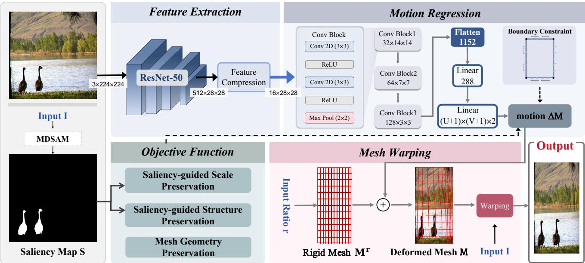  
Figure 1: Overall network architecture of the proposed method. The network takes an image and a target aspect ratio as input and outputs the vertex displacement of the original rigid mesh, which is then used to warp the input image and produce the retargeting result.

## 3.2. Aligning Dense Saliency with Sparse Mesh Constraints

Visual attention [5, 2] has been widely used as an effective prior in content-aware image retargeting, such as [20, 38]. Inspired by these methods, we also focus on preserving the scale and structure of visually salient regions within our retargeting framework.

However, it is nontrivial to build effective connections between dense saliency and sparse mesh deformation. As shown in Fig. 2, cell-level coarse constraints, which are generated by averaging pixel-level dense saliency across each mesh cell to obtain cell-wise saliency, fail to fully preserve salient structures in warping-based retargeting. This limitation primarily stems from the inherent difficulty in aligning sparse mesh-level constraints with dense saliency priors. To address this challenge, We introduce pixel-wise constraints to precisely align the warped image with dense saliency priors while preserving structural integrity. The detailed process follows.

In this paper, instead of directly constraining the scaling and deformation of salient regions with pixel-level saliency, we convert cell-level loss of the vertex displacement regression network to the pixel domain via interpolation over the mesh cells, and impose fine-grained constraints on salient regions in a content-aware manner. As demonstrated in Fig. 3, with the cell-level loss of the regression network defined in Sec. 3.1, we first calculate the loss value on each vertex according to its adjacent meshes, and then derive the per-pixel loss inside each cell by interpolating values from the corresponding vertices. The detailed implementation is elaborated as follows:

For each vertex v of the mesh, we search a set of mesh cells denoted as $\mathcal { N } ( v )$ that share v in the mesh topology, and the loss on v is defined as:

$$
\eta ^ { v } = \frac { 1 } { \vert \mathcal { N } ( v ) \vert } \sum _ { \mathcal { C } \in \mathcal { N } ( v ) } \Gamma _ { \mathcal { C } } ,\tag{2}
$$

where $\Gamma _ { C }$ denotes the loss value of each neighboring mesh cell C, which is determined by the Saliency-guided Scale Preservation and Saliency-guided Structure Preservation defined in Sec. 3.3.

We map the vertex-wise losses to the pixel level using bilinear interpolation within each mesh cell. Specifically, let $\hat { \mathcal { D } } _ { i j }$ denote the candidate loss interpolated from grid cell $\mathcal { C } _ { i j }$ , where $i = 1 , \dots , U$ and $j = 1 , \dotsc , V$ . For each pixel $p$ in the target output domain, we compute its normalized local coordinates $( m , n )$ with respect to $\mathcal { C } _ { i j }$ . As illustrated in Fig. 3, $\hat { \mathcal { D } } _ { i j } ( p )$ denotes the set of all pixel loss candidates interpolated by each individual mesh cell. Accordingly, the candidate loss contributed by each mesh cell is then computed as:

$$
\begin{array} { l } { { \hat { \mathcal { D } } _ { i j } ( p ) = \ ( 1 - m ) ( 1 - n ) \cdot \eta ^ { v _ { 0 0 } } + m ( 1 - n ) \cdot \eta ^ { v _ { 0 1 } } } } \\ { { \qquad + m n \cdot \eta ^ { v _ { 1 1 } } + ( 1 - m ) n \cdot \eta ^ { v _ { 1 0 } } . } } \end{array}\tag{3}
$$

where $\eta ^ { v _ { 0 0 } } , \eta ^ { v _ { 0 1 } } , \eta ^ { v _ { 1 1 } }$ , and $\eta ^ { v _ { 1 0 } }$ denote the vertex-level loss at the four vertices of each mesh cell.

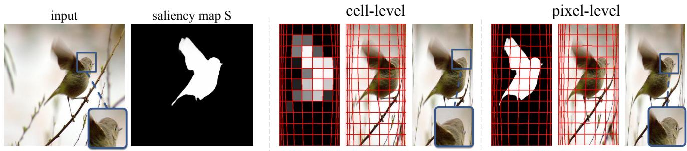  
Figure 2: Comparison between results generated by cell-level coarse constraints and pixel-level fine-grained constraints. The zoom-in views indicate that methods employing cell-level constraints, obtained by averaging dense saliency values over each mesh cell, cannot adequately preserve appearance and structural features. In contrast, our pixel-level constraints yield more favorable results.

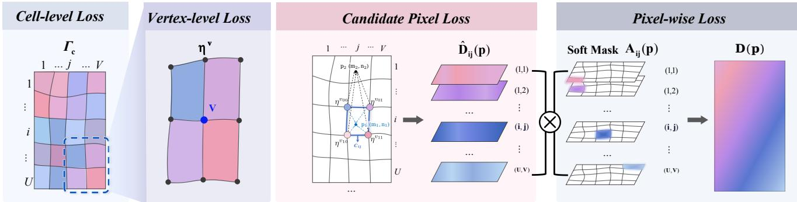  
v00η v01 ηFigure 3: Flowchart of building the pixel-wise constraints. The cell-level mesh loss is first transformed into vertex-level values by averaging the losses over adjacent cells. These vertex values are subsequently interpolated within each deformed cell to derive candidate pixel-level constraints, and a soft mask is employed to select valid cell contributions.

Since $\hat { \mathcal { D } _ { i j } }$ provides the loss values interpolated by an individual cell $\mathcal { C } _ { i j }$ , only pixel losses within $\mathcal { C } _ { i j }$ are valid. We therefore further design a mask function to extract the effective losses. The main idea of this function is to evaluate the spatial relation between each pixel and every mesh cell, assigning a soft weight approaching $\cdot _ { 1 } \cdot$ to pixels inside the cell and approaching $\cdot _ { 0 } ,$ to pixels outside the cell. Concretely, signed distances from the pixel to the four boundaries of each cell are calculated, and the normalized minimum signed distance is mapped to a soft weight by the Sigmoid function. We define the function as follows:

$$
\begin{array} { r } { \mathcal { A } _ { i j } ( p ) = \sigma \left( \bar { d } _ { i j } ( p ) \right) , } \end{array}\tag{4}
$$

where $\sigma$ refers to the Sigmoid function, and $\bar { d } _ { i j } ( p )$ denotes the normalized minimum signed distance from pixel p to the edges of the grid cell $\mathcal { C } _ { i j }$ . The positive and negative values indicate pixels inside and outside the cell, respectively. As illustrated in Fig. 4, the signed distance for each pixel has a dimension equal to the number of mesh cells. By simply extracting each dimension, we can conveniently obtain the cell-wise soft mask.

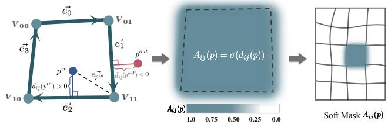  
Figure 4: Illustration of the soft mask $\mathcal { A } _ { i j } ( \boldsymbol { p } )$ . For a grid cell $\mathcal { C } _ { i j }$ , the normalized minimum signed distance is defined as $\begin{array} { r } { \bar { d } _ { i j } \tilde { ( p ) } = \operatorname* { m i n } _ { t \in \{ 0 , 1 , 2 , 3 \} } \frac { \vec { e } _ { t } \times \vec { e } _ { p } } { \| \vec { e } _ { t } \| _ { 2 } } } \end{array}$ , where $\vec { e _ { t } }$ denotes an oriented cell edge, and $\vec { e } _ { p }$ denotes the vector connecting the starting vertex of $\vec { e _ { t } }$ to pixel $p .$ . Pixels inside and outside the cell are assigned positive and negative signed distances, respectively. The Sigmoid function maps $\bar { d } _ { i j } ( p )$ to the corresponding soft mask weight $A _ { i j } ( p )$

Finally, we calculate the pixel-wise loss using the following function:

$$
\mathcal { D } ( p ) = \frac { \sum _ { i = 1 } ^ { U } \sum _ { j = 1 } ^ { V } \mathcal { A } _ { i j } ( p ) \hat { \mathcal { D } } _ { i j } ( p ) } { \sum _ { i = 1 } ^ { U } \sum _ { j = 1 } ^ { V } \mathcal { A } _ { i j } ( p ) } ,\tag{5}
$$

where $i , j$ denote the row and column indices of mesh cells, respectively.

## 3.3. Objective functions

We optimize network parameters with a comprehensive three-term objective function formulated as:

$$
\mathcal { L } _ { t o t a l } = \lambda _ { c } \mathcal { L } _ { c } + \lambda _ { t } \mathcal { L } _ { t } + \lambda _ { g } \mathcal { L } _ { g } ,\tag{6}
$$

where $\mathcal { L } _ { c }$ denotes the saliency-guided scale preservation, $\mathcal { L } _ { t }$ denotes the saliency-guided structure preservation, and $\mathcal { L } _ { g }$ denotes the mesh geometry preservation. $\lambda _ { c } , \lambda _ { t }$ , and $\lambda _ { g }$ denote the corresponding weights.

## 3.3.1 Saliency-guided Scale Preservation

Given the saliency map S of the input image, our saliencyaware content-preserving loss enforces proper scaling and suppresses distortion for salient regions during retargeting.

To achieve this goal, we first define a cell-level loss to enforce content-aware scaling in salient regions, then we further map the cell-wise loss to pixel-level for fine-grained constraint, according to the solution defined in Sec. 3.2. For each mesh cell, we measure its horizontal and vertical scaling factors as:

$$
s ^ { x } = \frac { V } { W } w , \qquad s ^ { y } = \frac { U } { H } h ,\tag{7}
$$

where $w$ and h denote the horizontal and vertical dimensions of the deformed mesh cell, and $W$ and H denote the dimensions of the input image. The loss value of each cell is then defined as:

$$
\begin{array} { r } { \Gamma c = ( s ^ { x } - 1 ) ^ { 2 } + ( s ^ { y } - 1 ) ^ { 2 } . } \end{array}\tag{8}
$$

With the cell-level constraint $\Gamma _ { C } .$ , we further define the pixel-wise loss ${ \mathcal { D } } ( { \boldsymbol { p } } )$ according to the equations defined from Eq. 2 to Eq. 5, and the saliency-aware contentpreserving loss is formulated as:

$$
\mathcal { L } _ { c } = \sum _ { p \in Y } \mathcal { W } ( \boldsymbol { S } , \mathcal { M } ) \mathcal { D } ( p ) ,\tag{9}
$$

where $\mathcal { W } ( S , \mathcal { M } )$ denotes the saliency map obtained by warping the input saliency map S according to the deformed mesh M.

## 3.3.2 Saliency-guided Structure Preservation

Although the saliency-guided scale preservation term constrains local scale variations in salient regions, the mesh cells may still undergo irregular deformation to accommodate aspect-ratio changes. Such unconstrained deformation can introduce shear, rotation, or bending artifacts in the retargeted image. We therefore introduce a saliency-guided structure preservation term to suppress irregular mesh deformation. For each mesh cell C in the deformed mesh M, we denote its four edges as e, which contains two horizontal edges $\mathbf { e } ^ { h }$ and two vertical edges $\mathbf { e } ^ { v }$ . The orientation deviation of edge e is defined as:

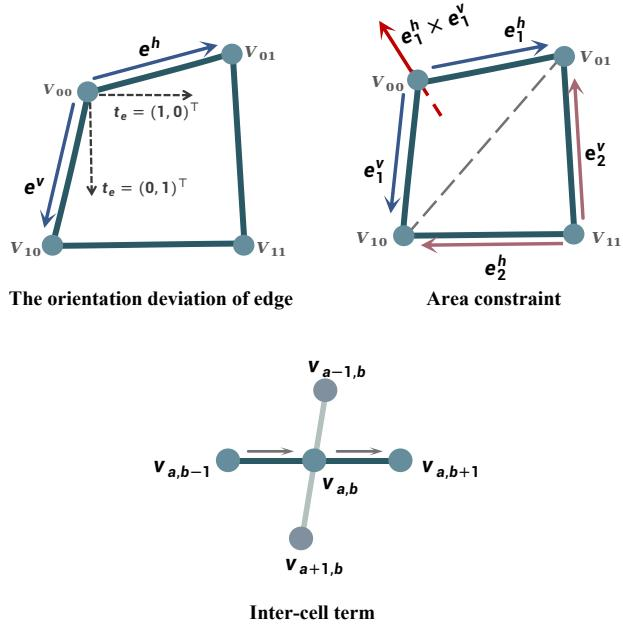  
Figure 5: Mesh geometry preservation constraint, which consists of intra-cell and inter-cell terms.

$$
\psi ( \mathbf { e } ) = 1 - { \frac { ( \mathbf { e } ^ { \top } \mathbf { t _ { e } } ) ^ { 2 } } { \| \mathbf { e } \| _ { 2 } ^ { 2 } } } ,\tag{10}
$$

where $\mathbf { t _ { e } }$ denotes the expected unit orientation of edge $\mathbf { e } ,$ with $\mathbf { t _ { e } } = ( 1 , 0 ) ^ { \top }$ for horizontal edges and $\mathbf { t _ { e } } = ( 0 , 1 ) ^ { \top }$ for vertical edges. Then, the cell-wise structural loss $\Gamma _ { C }$ is computed by averaging the orientation deviations of its four edges:

$$
\Gamma _ { \mathcal { C } } = \frac { 1 } { 4 } \sum _ { \mathbf { e } \in \mathcal { E } } \psi ( \mathbf { e } ) .\tag{11}
$$

Similar to the scale preservation loss defined above, we further map the mesh-wise loss to pixel-level using the equations defined from Eqs. 2 to 5 and the pixel-wise loss ${ \mathcal { D } } ( { \boldsymbol { p } } )$ is adopted to impose global structural constraint, the definition is as follows:

$$
\mathcal { L } _ { t } = \sum _ { p \in Y } \left[ \mathcal { W } ( \mathcal { S } , \mathcal { M } ) + \beta \left( 1 - \mathcal { W } ( \mathcal { S } , \mathcal { M } ) \right) \right] \mathcal { D } ( p ) ,\tag{12}
$$

where $\beta = 0 . 5$ regulates the degree of structural preservation imposed on less salient regions.

## 3.3.3 Mesh Geometry Preservation

To maintain the geometric validity and smoothness of the mesh cells during deformation, we design both intra-cell and inter-cell constraints. The former suppresses flipping and folding via local edge and area metrics, while the latter enforces a smoothness regularization to encourage coherent motion among neighboring cells.

Intra-cell term. For each mesh cell, we first enforce the direction and magnitude of each edge to avoid flipping and folding. Similar to [27], we also encourage horizontal edges to project toward the right and vertical edges to project downward, while imposing constraints on their lengths. For each horizontal edge $\mathbf { e } \in \mathcal { E } ^ { h }$ and vertical edge $\mathbf { e } \in \mathcal { E } ^ { v }$ , following the formulation in [27], we construct penalty terms $\mathcal { P } _ { h }$ and $\mathcal { P } _ { v }$ to mitigate cell flipping and folding, and the edge constraint is defined as:

$$
\mathcal { L } _ { e d g e } = \sum _ { i = 1 } ^ { U } \sum _ { j = 1 } ^ { V } \left( \sum _ { \mathbf { e } \in \mathcal { E } _ { i j } ^ { h } } \mathcal { P } _ { h } ( \mathbf { e } ) + \sum _ { \mathbf { e } \in \mathcal { E } _ { i j } ^ { v } } \mathcal { P } _ { v } ( \mathbf { e } ) \right) .\tag{13}
$$

To further prevent the geometric degeneration of mesh cells, such as flipping, we impose an area constraint on each mesh cell. As illustrated in Fig. 5, each mesh cell C is decomposed into two triangles. For each mesh cell, we define the area penalty as:

$$
\mathcal { P } _ { r } ( \mathcal { C } ) = \left\{ \begin{array} { l l } { \sum _ { r = 1 } ^ { 2 } ( A _ { m i n } - \mathbf { e } _ { r } ^ { h } \times \mathbf { e } _ { r } ^ { v } ) ^ { 2 } } & { \mathbf { e } _ { r } ^ { h } \times \mathbf { e } _ { r } ^ { v } < A _ { m i n } } \\ { 0 , } & { \mathbf { e } _ { r } ^ { h } \times \mathbf { e } _ { r } ^ { v } \geq A _ { m i n } } \end{array} \right. ,\tag{14}
$$

where $r \in \{ 1 , 2 \} , { \bf e } _ { r } ^ { h }$ and $\mathbf { e } _ { r } ^ { v }$ denote the directed horizontal and vertical mesh edges of a triangle in the mesh, respectively. $\mathbf { e } _ { r } ^ { h } \times \mathbf { e } _ { r } ^ { v }$ denotes the signed area formed by adjacent edges. Specifically, a signed area near zero means the corresponding triangle degenerates into a line segment, whereas a negative value indicates flipped triangle geometry. $A _ { m i n } = \stackrel { \smile } { 0 } . 2 \cdot \frac { W } { V } \cdot \frac { H } { U }$ defines the minimum area threshold. The area constraint is then formulated as:

$$
\mathcal { L } _ { a r e a } = \sum _ { i = 1 } ^ { U } \sum _ { j = 1 } ^ { V } \mathcal { P } _ { r } ( \mathcal { C } _ { i j } ) .\tag{15}
$$

Inter-cell term. The intra-cell term defined above ensures geometric correctness inside each mesh cell, yet it cannot produce smooth transitions between cells for natural deformation results. To maintain smooth vertex displacement and uniform displacements among adjacent vertices, we constrain the discrete second derivatives of the mesh vertices, defined as follows:

$$
\begin{array} { r } { \sum _ { s m o o t h } \displaystyle \sum _ { a = 0 } ^ { U } \sum _ { b = 0 } ^ { V - 1 } \| v _ { a - 1 , b } - 2 \cdot v _ { a , b } + v _ { a + 1 , b } \| _ { 2 } ^ { 2 } } \\ { \mathscr { L } _ { s m o o t h } = \frac { a = 0 \displaystyle \sum _ { b = 0 } ^ { U } \sum _ { b = 0 } ^ { V - 1 } \| \boldsymbol { v } _ { a + 1 } - \boldsymbol { 1 } \| \cdot \boldsymbol { V } } { ( U + 1 ) \cdot  V } } \\ { \displaystyle \sum _ { a = 0 } ^ { U - 1 } \sum _ { b = 0 } ^ { V } \| v _ { a , b - 1 } - 2 \cdot v _ { a , b } + v _ { a , b + 1 } \| _ { 2 } ^ { 2 } } \\ { \displaystyle + \frac { a = 0 \displaystyle b = 0 \displaystyle \sum _ { b = 0 } ^ { U } \| \boldsymbol { v } _ { a , b + 1 } - \boldsymbol { 1 } \| } { U \cdot ( V + 1 ) } . } \end{array}\tag{16}
$$

In sum, the total mesh geometry loss is formulated as:

$$
\mathcal { L } _ { g } = \mathcal { L } _ { e d g e } + \lambda _ { a } \mathcal { L } _ { a r e a } + \mathcal { L } _ { s m o o t h } ,\tag{17}
$$

where $\lambda _ { a } = 0 . 8$ is set to balance the contributions of these terms.

## 4. Experiments

## 4.1. Implementation Details

Our framework is implemented in PyTorch on a single NVIDIA A40 GPU. During training, all input images are resized to 224 × 224 and normalized to [−1, 1]. The corresponding saliency maps are obtained by the pretrained model from [14], and normalized to [0, 1]. Following the practice of prior work [6], we randomly sample input scaling ratios from 1/4 to 1/2 for each batch, which corresponds to scaling the original 224-pixel side length to a size between 224/4 and 224/2. During the training stage, we use the Adam optimizer with an initial learning rate of $3 \times 1 0 ^ { - 5 } .$ and the learning rate is decayed by a factor of 0.97. We train the network over 50 epochs with a batch size of 32 and ReLU as the activation function. To stabilize the optimization process under large mesh deformation, gradient clipping with a maximum norm of 3 is adopted during backpropagation. For the loss function, we set $\lambda _ { c } , \lambda _ { t }$ , and $\lambda _ { g }$ to 300, 50, and 1, respectively, and set $U \times V$ to $1 1 \times 1 1$

Similar to [22], we train the model only for size reduction; enlarged retargeting results are produced by applying inverse mesh deformation. Specifically, for an enlargement target, we first estimate the deformation under the corresponding reduction setting and then reverse the meshguided warping direction to obtain the enlarged output.

We evaluate our model across two standard datasets for image retargeting tasks. Most of our training and testing are performed on the Object-IR dataset [22]. The dataset is derived from a filtered COCO dataset [24], which contains 18023 images in total, including 17043 images for training and 980 images for testing. We further evaluate our method on the public image retargeting dataset RetargetMe [31], which contains 80 images spanning a wide range of scenes. Many representative retargeting methods have reported retargeted results at different aspect ratios on RetargetMe, which makes direct comparison under this benchmark straightforward. For methods with available source codes, we generate their results and conduct comprehensive comparisons using both quantitative and visual quality assessment. In the experiment, we compare our approach with several representative and state-of-theart methods, including CR (Cropping), SCL (Simple Scaling), SC [1], SNS [9], WSSDCNN [6], GDPM [11], Object-IR [22].

## 4.2. Quantitative Comparison

Table 1: Quantitative comparisons with representative retargeting approaches on two datasets using the object-based distortion error metric from Object-IR [22], including CR (Cropping), SCL (Simple Scaling), SC [1], SNS [9], WSSDCNN [6], GDPM [11], Object-IR [22]. Each cell is formatted as “value on ObjectIR testing dataset [22] / value on RetargetMe dataset [31]”. Red and Cyan colorboxes indicate the best performance on the ObjectIR [22] and RetargetMe [31] datasets, respectively. Underlined values denote the second-best results, and lower values indicate superior retargeting quality.
<table><tr><td>Methods</td><td>0.5×</td><td>0.75×</td><td>1.25×</td><td>1.5×</td><td>1.75×</td></tr><tr><td>CR</td><td>0.4652/0.7761</td><td>0.3251/0.5347</td><td>-1-</td><td>-1-</td><td>-1-</td></tr><tr><td>SCL</td><td>0.6357/0.7721</td><td>0.3074/0.3507</td><td>0.2873/0.2531</td><td>0.5323/0.5392</td><td>0.8096/0.7096</td></tr><tr><td>SC [1]</td><td>0.4054/0.5615</td><td>0.2984/0.2944</td><td>0.2597/0.2182</td><td>0.3352/0.4945</td><td>0.6042/0.6991</td></tr><tr><td>SNS [9]</td><td>0.3280/0.6689</td><td>0.2941/0.4677</td><td>0.2550/0.3993</td><td>0.4901/0.4971</td><td>0.4824/0.4853</td></tr><tr><td>WSSDCNN [6]</td><td>0.7934/0.7304</td><td>0.5268/0.4249</td><td>-1-</td><td>-1-</td><td>-1-</td></tr><tr><td>GDPM [11]</td><td>0.8658/0.8158</td><td>0.6828/0.7113</td><td>0.4878/0.4393</td><td>0.4974/0.6837</td><td>0.4572/0.6243</td></tr><tr><td>ObjectIR [22]</td><td>0.4074/0.5434</td><td>0.2114/0.3080</td><td>0.2440/0.2514</td><td>0.4666/0.4831</td><td>0.6794/0.6945</td></tr><tr><td>Ours</td><td>0.2917 0.4420</td><td>0.2271/0.2845</td><td>0.1758 0.2004</td><td>0.3178 0.4453</td><td>0.3400 /0.4273</td></tr></table>

Table 2: Additional perceptual quality comparison with PruneRepaint [34] on Retargetme [31] dataset. DISTS and MUSIQ are used to measure perceptual distortion and noreference image quality, respectively.
<table><tr><td>Methods</td><td>DISTS ↓</td><td>MUSIQ↑</td></tr><tr><td>Prune [34]</td><td>0.2016</td><td>65.56</td></tr><tr><td>Ours</td><td>0.1429</td><td>70.79</td></tr></table>

We first perform quantitative comparison using the object distortion metric proposed in [22], where lower values indicate better retargeting performance. We evaluate the retargeting performance at five distinct scales: 0.5, 0.75, 1.2, 1.5 and 1.75. To achieve comprehensive quantitative assessment, we conduct evaluations on both the Object-IR [22] and RetargetMe [31] datasets, as reported in Table 1. The symbol “–” indicates that the corresponding method cannot generate retargeted results under the given resizing ratio. The best and second-best results are marked in bold and underlined, respectively. For the CR and WSSDCNN [6] baselines, only image downscaling is supported, so we do not include upscaling measurements for these two methods. As shown in Table 1, our distortion scores outperform prior methods across diverse scaling settings on different datasets. Other content-aware retargeting methods, such as SC [1], SNS [9], and ObjectIR [22], can mitigate objectlevel distortion to a certain degree, yet their performance fluctuates drastically under varying resizing ratios. Specifically, ObjectIR [22] only attains a marginal performance gain at the scaling factor of 0.75. In contrast, our method maintains superior performance throughout all scales, fully validating its excellent adaptability and robustness.

Table 2 provides extensive comparisons with generative learning-based methods via two comprehensive perceptual metrics: DISTS [8] and MUSIQ [19]. Specifically, DISTS indicates perceptual distortion between the retargeted image and the reference image, and MUSIQ refers to a noreference image quality assessment metric. As shown in Table 2, our method achieves a lower DISTS score and a higher MUSIQ score, which indicates that our method produces less perceptual distortion and better overall visual quality. The visual examples in Fig. 6 further demonstrate that our method better preserves original image content and avoids artifacts.

## 4.3. Qualitative Comparison

We first conduct a qualitative comparison across different scales, methods, and scenarios. As shown in Fig. 7, we first compare our method with the SOTA retargeting method [22] across different scales. Compared with this state-of-the-art method, our approach better preserves the scale and geometric structure of salient foreground objects at all tested scales, while simultaneously enabling reasonable deformation of background regions.

We further conduct a comprehensive comparison with representative methods, including traditional [39, 38] and learning-based [6, 37, 11, 22] methods. As shown in Fig. 8, it is easy to see that cropping (CR) can well preserve salient object but lose much contents, while simple scaling (SCL) severely distorted salient regions. Other traditional contentaware warping methods can preserve the scale and structure of prominent content to a certain extent, yet their visual performance is slightly inferior to ours. Most learningbased methods [6, 37, 22] learn content-aware image warping from data and are more efficient and robust than traditional methods, but they still face challenges such as salientobject and structural distortion. For learning-based generative methods such as GPDM [11], content fidelity remains a common drawback, and generated outputs may fail to maintain structurally coherent and semantically reasonable layouts.

Input  

PruneRepaint  
  
DISTS↓ : 0.2781 MUS IQ↑ : 51.24

Ours  
  
DISTS↓: 0.1285 MUS IQ↑ : 71.21

PruneRepaint  
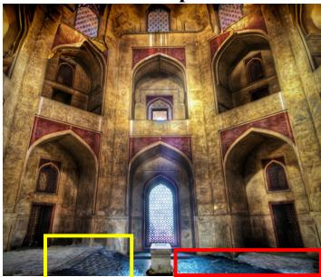  
Ours  
D I ST S ↓ :0.2381 MUS IQ↑ : 50.42

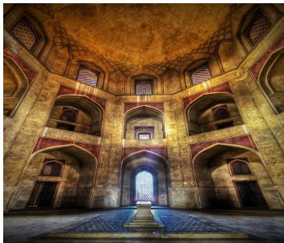

  
DISTS↓ : 0.0627 MUS IQ↑ : 68.43

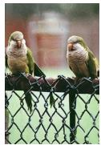

  
DISTS↓ : 0.2480 MUS IQ↑ : 58.28

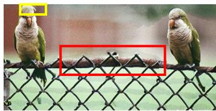  
DISTS↓: 0.1614 MUS IQ↑ : 60.01

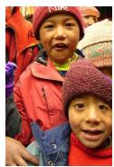  
DISTS↓ : 0.0564 MUS IQ↑ : 52.10  
DISTS↓ : 0.2051 MUSIQ↑: 73.36

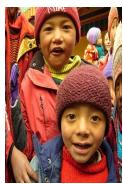  
DISTS↓ : 0.2401 MUS IQ↑ : 49.02  
0.5×  
DISTS↓ : 0.1659 MUS IQ↑ : 74.66

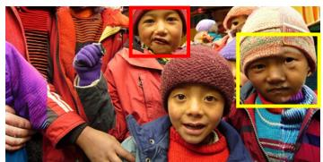  
DISTS↓: 0.1973MUS IQ↑ : 64.30

1.5×  
  
DISTS↓ : 0.0685 MUS IQ↑ : 74.34

Figure 6: Visual comparison with PruneRepaint [34]. DISTS and MUSIQ are reported below each retargeted result. Lower DISTS and higher MUSIQ values indicate better perceptual consistency and overall image quality, respectively.  
Input  
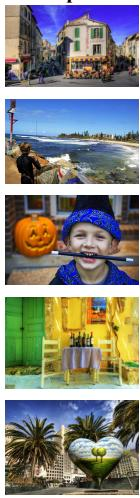

ObjectIR Ours  
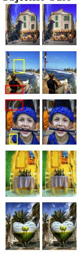  
0.5×

ObjectIR  
Ours  
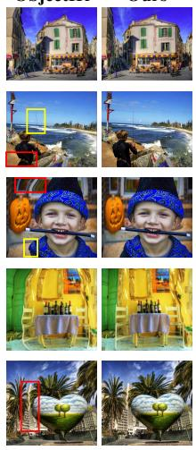  
0.75×

ObjectIR  
Ours  
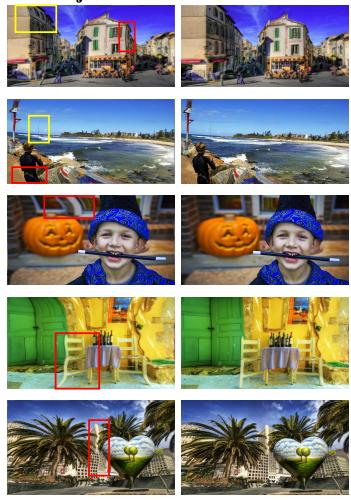  
1.25×

ObjectIR  
Ours  
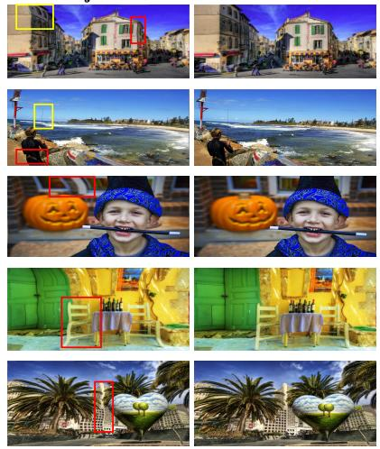  
1.5×  
Figure 7: Visual comparison with the SOTA retargeting method [22] across different scales, where colored boxes mark the distorted artifacts of [22].

We finally evaluate the performance of our method in challenging examples. As illustrated in Fig. 9, for images with intricate background structures and widely scattered salient regions, ObjectIR [22] only imposes constraints on

Input

CR

SCL

SNS

WSSCNN

CycleIR

GPDM

Ours  
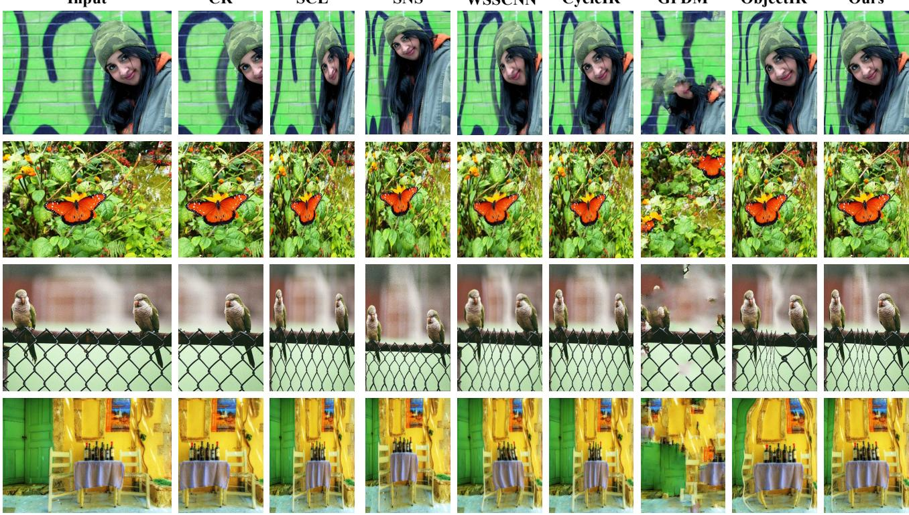  
Figure 8: More visual comparisons on the RetargetMe dataset [31]. All results are generated scaling the width to 0.5× it original value. From left to right are the original input, CR (manual cropping), SCL (simple scaling), SNS [38], WSSCNN [6], CycleIR [37], GPDM [11], ObjectIR [22] and our method.

the bounding boxes of foreground salient regions while leaving background deformation unregulated, which results in unsatisfying retargeting on complex scenes. Consequently, its outputs frequently suffer from distorted background textures and failure to preserve critical foreground information. In contrast, our method introduces pixel-wise constraints on salient regions together with global structural regularization, yielding visually more favorable retargeting outputs.

## 4.4. Ablation Study

We conduct ablation studies on the ObjectIR [22] and RetargetMe [31] datasets, to verify the effectiveness of our method, as shown in Table 3 and Fig. 10.

Loss functions. We first ablate the three losses to evaluate their individual contributions. As illustrated in Rows 1–3 of Table 3, removing any loss term degrades the results performance to different extents. The visual results in Fig. 10 further illustrate the role of each loss term. Without $\mathcal { L } _ { c } ,$ the model fails to sufficiently preserve salient content and tends to degenerate into nearly uniform scaling.

Mesh resolution. We further explore the influence of mesh resolution via ablation experiments. Three typical mesh sizes are adopted: 5×5, 11×11, and 22×22. As listed in the last 3 rows of Table 3, the 5 × 5 mesh yields inferior retargeting performance because its coarse deformation grid cannot capture fine structures. In contrast, the two higher resolutions support delicate pixel warping and achieve visually superior results. Since the performance gap between 11 × 11 and 22 × 22 is marginal, we select 11 × 11 as our final mesh resolution to strike a balance between model performance and computational efficiency.

Pixel & Cell-level constraints. We finally perform ablation analysis to investigate the impacts of mesh-level and pixel-level constraints imposed on visually salient regions. Compared with the mesh-level constraint, as listed in Rows 5–6 of Table 3, the fine-grained pixel-level constraint makes full use of dense saliency information, leading to more favorable preservation of salient regions. Results in Fig. 10 further clarify the effectiveness of the pixel-level constraints.

## 4.5. User Study

We conduct a user study to quantitatively evaluate human preferences over retargeted outputs generated by different algorithms. Specifically, we take the dataset from [31] as input images and generate scaled retargeting results via several representative methods, including SC [1], ObjectIR [22], Prune [34], and our proposed approach. Each sample is randomly retargeted at two scales, 0.5× and 1.75× the original width, to evaluate the performance under both reduction and enlargement settings. We recruit 25 undergraduate participants, including 15 majoring in engineering and 10 from liberal arts and art-related majors, to independently evaluate randomly selected 30 groups of retargeted images. To eliminate subjective bias and guarantee fair evaluation, all participants are blinded to the source methods, and the order of results is randomly shuffled for each trial. Participants are asked to assign a score ranging from 1 to 5 (1 denotes the worst visual quality while 5 denotes the best) from three perspectives: structural integrity, visual naturalness and aesthetics, as well as the severity of geometric distortions and residual artifacts. The results in Table. 4 show that our method is preferred by most users. We further conduct a two-tailed paired t-test between ObjectIR [22] and our methods, and the resulting p-value is far below 0.05, which indicates a statistically significant improvement in visual quality over the SOTA retargeting baseline [22].

Table 3: Ablation studies on the ObjectIR [22] and RetargetMe [31] datasets. The gray row corresponds to the results of our model, while the boldfaced and underlined entries indicate the best and second-best results, respectively.
<table><tr><td rowspan="2">ID</td><td colspan="3">Loss function</td><td colspan="2">Projection</td><td colspan="3">Mesh resolution</td><td colspan="2">Dataset</td></tr><tr><td> $\mathcal { L } _ { c }$ </td><td> $\mathcal { L } _ { t }$ </td><td> $\mathcal { L } _ { g }$ </td><td>Cell</td><td>Pixel</td><td> $5 \times 5$ </td><td> $1 1 \times 1 1$ </td><td> $2 2 \times 2 2$ </td><td>ObjectIR [22]</td><td>RetargetMe [31]</td></tr><tr><td>1</td><td></td><td>√</td><td>√</td><td></td><td>√</td><td></td><td>√</td><td></td><td>0.6391</td><td>0.7487</td></tr><tr><td>2</td><td>√</td><td></td><td>√</td><td></td><td>√</td><td></td><td>√</td><td></td><td>0.4032</td><td>0.5493</td></tr><tr><td>3</td><td>√</td><td>√</td><td></td><td></td><td>√</td><td></td><td>√</td><td></td><td>0.9876</td><td>1.0000</td></tr><tr><td>4</td><td>√</td><td>√</td><td>V</td><td>√</td><td></td><td></td><td>√</td><td></td><td>0.3096</td><td>0.4568</td></tr><tr><td>5</td><td>√</td><td>√</td><td>√</td><td></td><td>√</td><td></td><td>√</td><td></td><td>0.2917</td><td>0.4420</td></tr><tr><td>6</td><td>√</td><td>√</td><td>√</td><td></td><td>√</td><td>√</td><td></td><td></td><td>0.3472</td><td>0.4771</td></tr><tr><td>7</td><td>√</td><td>√</td><td>√</td><td></td><td></td><td>√</td><td></td><td>√</td><td>0.2911</td><td>0.4625</td></tr></table>

Input  
CycleIR  
GPDM  
ObjectIR  
Ours  
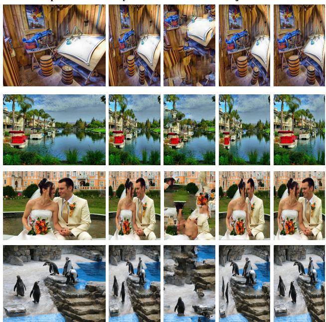  
Figure 9: Comparison on challenging examples with complex backgrounds (1–3 lines) and dispersed foreground regions (the last line).

Table 4: User Study on the RetargetMe Dataset [31]. 25 participants were invited to score 30 image groups randomly sampled from the RetargetMe dataset and generated by representative retargeting algorithms [34, 1, 22]. The mean score and variance for each method are reported in the table.
<table><tr><td>Metric</td><td>Ours</td><td>Prune[34]</td><td>SC[1]</td><td>ObjectIR[22]</td></tr><tr><td>Avg.</td><td>3.1040</td><td>2.7560</td><td>2.0240</td><td>2.3760</td></tr><tr><td>Var.</td><td>1.0811</td><td>1.6383</td><td>1.2617</td><td>1.0998</td></tr></table>

## 5. Conclusion

This paper proposes AttenIR, an unsupervised image retargeting approach that requires no manual labels and is built upon the alignment between dense visual attention and mesh warping. We model mesh deformation as a regression task constrained by multiple loss functions that preserve salient content, local shapes, and global structures without manual feature design or labeled data. Extensive ablation studies verify the effectiveness of the proposed pixel-level and mesh-level constraints, as well as the selected mesh resolution. Experimental results show that our method outperforms existing learning-based competitors in structural integrity and content fidelity.

In future work, we will extend our AttenIR framework to video retargeting and dynamic real-time scene adaptation. We also plan to incorporate aesthetic perception as an explicit evaluation and regularization criterion for image retargeting.

�/� ��

�/� ��

  
�/� ��  
Ours

�/� ��  
  
Original image

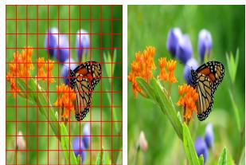

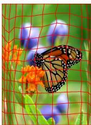

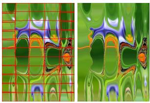

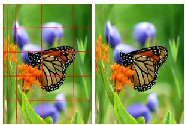  
� × � Mesh resolution

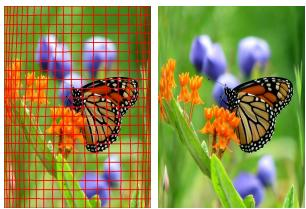  
�� × �� Mesh resolution

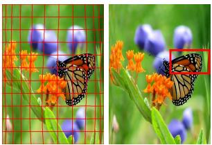  
Cell-level constraints

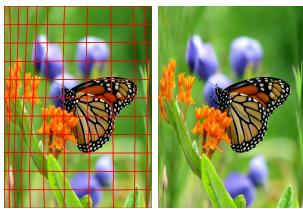

  
Original image

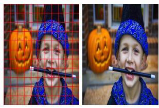

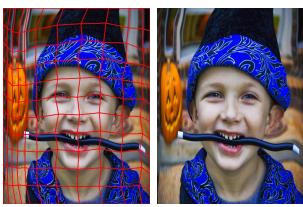

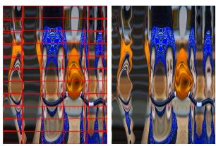

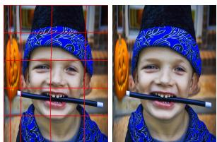  
� × � Mesh resolution

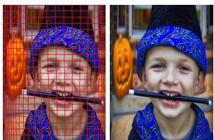  
�� × �� Mesh resolution

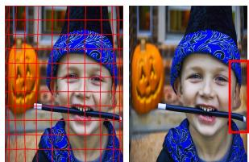  
Cell-level constraints

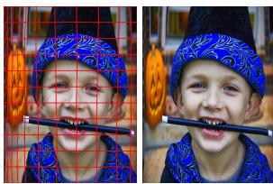  
Ours

Figure 10: Visual comparisons of ablation analysis on loss functions, mesh resolution, as well as pixel-level and cell-level constraints.

## References

[1] S. Avidan and A. Shamir. Seam carving for content-aware image resizing. ACM Transactions on Graphics, 26(3):10, 2007.

[2] A. Borji, M.-M. Cheng, H. Jiang, and J. Li. Salient object detection: A benchmark. IEEE TIP, 24(12):5706–5722, 2015.

[3] J. Cao, H. Zhang, L. Liu, X. Yang, S. Liu, Y. Xu, and J. Chen. Polygonal finite element-based content-aware image warping. Computational Visual Media, 9(2):325–338, 2023.

[4] C.-H. Chang and Y.-Y. Chuang. A line-structure-preserving approach to image resizing. In IEEE Conference on Computer Vision and Pattern Recognition, CVPR, pages 1075–1082. IEEE, 2012.

[5] M.-M. Cheng, N. J. Mitra, X. Huang, P. H. S. Torr, and S.-M. Hu. Global contrast based salient region detection. IEEE TPAMI, 37(3):569–582, 2015.

[6] D. Cho, J. Park, T.-H. Oh, Y.-W. Tai, and I. S. Kweon. Weaklyand self-supervised learning for content-aware deep image retargeting. In Proceedings of the IEEE International Conference on Computer Vision, pages 4568–4577, 2017.

[7] D. Danon, M. Arar, D. Cohen-Or, and A. Shamir. Image resizing by reconstruction from deep features. Computational Visual Media, 7(4):453–466, 2021.

[8] K. Ding, K. Ma, S. Wang, and E. P. Simoncelli. Image quality assessment: Unifying structure and texture similarity. IEEE transactions on pattern analysis and machine intelligence, 44(5):2567–2581, 2020.

[9] W. Dong, N. Zhou, J.-C. Paul, and X. Zhang. Optimized image resizing using seam carving and scaling. ACM Transactions on Graphics, 28(5):1–10, 2009.

[10] Z. Dong, C. Li, Y. Deng, and H. Chen. Air-dr: Adaptive image retargeting with instance relocation and dual-guidance repainting. In Proceedings ofthe AAAI Conference on Artificial Intelligence, pages 3668–3676, 2026.

[11] A. Elnekave and Y. Weiss. Generating natural images with direct patch distributions matching. In European Conference on Computer Vision, pages 544–560. Springer, 2022.

[12] T. Elsner, J. Berger, T. Wu, V. Czech, L. Gao, and L. Kobbelt. Retargeting visual data with deformation fields. In Computer Vision – ECCV 2024, pages 271–288. Springer, 2024.

[13] X. Fan, Z. Zhang, L. Sun, B. Xiao, and P. Li. A comprehensive review of image retargeting. Neurocomputing, 579:127416, 2024.

[14] S. Gao, P. Zhang, T. Yan, and H. Lu. Multi-scale and detailenhanced segment anything model for salient object detection. In Proceedings of the 32nd ACM International Conference on

Multimedia, pages 9894–9903, 2024.

[15] Y. Guo, F. Liu, J. Shi, Z. Zhou, and M. Gleicher. Image retargeting using mesh parametrization. IEEE Transactions on Multimedia, 11(5):856–867, 2009.

[16] Y. Guo, D. Wang, G. Yan, and Y. Zhu. Image retargeting quality assessment: A survey. Journal of Intelligent & Fuzzy Systems, 44(2):1921–1942, 2023.

[17] K. He, X. Zhang, S. Ren, and J. Sun. Deep residual learning for image recognition. In IEEE Conference on Computer Vision and Pattern Recognition, CVPR, pages 770–778. IEEE, 2016.

[18] M. Jaderberg, K. Simonyan, A. Zisserman, and K. Kavukcuoglu. Spatial transformer networks. In Proceedings of the 29th International Conference on Neural Information Processing Systems - Volume 2, NIPS’15, page 2017–2025, Cambridge, MA, USA, 2015. MIT Press.

[19] J. Ke, Q. Wang, Y. Wang, P. Milanfar, and F. Yang. Musiq: Multi-scale image quality transformer. In Proceedings of the IEEE/CVF international conference on computer vision, pages 5148–5157, 2021.

[20] Y. Kim, H. Eun, C. Jung, and C. Kim. A quad edgebased grid encoding model for content-aware image retargeting. IEEE Transactions on Visualization and Computer Graphics, 25(12):3202–3215, Dec. 2019.

[21] T. N. H. Le, H. G. Huang, Y. R. Chen, and T. Y. Lee. Retargeting video with an end-to-end framework. IEEE Transactions on Visualization and Computer Graphics, 30(9):6164–6176, 2024.

[22] T. Liao, R. Wang, S. Zhang, L. Li, G. Liu, C. Zhao, H. Cao, and P. Li. Object-ir: Leveraging object consistency and mesh deformation for self-supervised image retargeting. Pattern Recognition, 172:112651, 2026.

[23] J. Lin, T. Zhou, and Z. Chen. Deepir: A deep semantics driven framework for image retargeting. In 2019 IEEE International Conference on Multimedia and Expo Workshops, pages 54–59. IEEE, 2019.

[24] T.-Y. Lin, M. Maire, S. Belongie, J. Hays, P. Perona, D. Ramanan, P. Dollar, and C. L. Zitnick. Microsoft coco: Common´ objects in context. In European conference on computer vision, pages 740–755. Springer, 2014.

[25] Y.-J. Liu, X. Luo, Y.-M. Xuan, W.-F. Chen, and X.-L. Fu. Image retargeting quality assessment. Computer Graphics Forum, 30(2):583–592, 2011.

[26] L. Ma, W. Lin, C. Deng, and K. N. Ngan. Image retargeting quality assessment: A study of subjective scores and objective metrics. IEEE Journal of Selected Topics in Signal Processing, 6(6):626–639, 2012.

[27] L. Nie, C. Lin, K. Liao, S. Liu, and Y. Zhao. Deep rectangling for image stitching: A learning baseline. In IEEE/CVF Conference on Computer Vision and Pattern Recognition (CVPR), pages 5730–5738. IEEE, 2022.

[28] X. Niu, B. Bare, and W. Tan. Semantic segmentation guided pixel fusion for image retargeting. IEEE Transactions on Multimedia, 22(3):676–687, 2020.

[29] D. Panozzo, O. Weber, and O. Sorkine. Robust image retargeting via axis-aligned deformation. Computer Graphics Forum, 31(2pt1):229–236, 2012.

[30] Y. Pritch, E. Kav-Venaki, and S. Peleg. Shift-map image editing. In Proceedings of the IEEE International Conference on Computer Vision, pages 151–158, 2009.

[31] M. Rubinstein, D. Gutierrez, O. Sorkine, and A. Shamir. A comparative study of image retargeting. ACM Transactions on Graphics, 29(6):160:1–160:10, 2010.

[32] M. Rubinstein, A. Shamir, and S. Avidan. Improved seam carving for video retargeting. ACM Transactions on Graphics, 27(3):16:1–16:9, 2008.

[33] M. Rubinstein, A. Shamir, and S. Avidan. Multi-operator media retargeting. ACM Transactions on Graphics, 28(3):23:1–23:11,

2009.

[34] F. Shen, C. Li, Y. Geng, Y. Deng, and H. Chen. Prune and repaint: Content-aware image retargeting for any ratio. In Advances in Neural Information Processing Systems, volume 37, pages 75177–75198, 2024.

[35] D. Simakov, Y. Caspi, E. Shechtman, and M. Irani. Summarizing visual data using bidirectional similarity. In Proceedings of the IEEE Conference on Computer Vision and Pattern Recognition, pages 1–8, 2008.

[36] Y. Song, F. Tang, W. Dong, X. Zhang, O. Deussen, and T.-Y. Lee. Photo squarization by deep multi-operator retargeting. In Proceedings of the 26th ACM International Conference on Multimedia, pages 1047–1055, 2018.

[37] W. Tan, B. Yan, C. Lin, and X. Niu. Cycle-ir: Deep cyclic image retargeting. IEEE transactions on multimedia, 22(7):1730–1743, 2019.

[38] Y.-S. Wang, C.-L. Tai, O. Sorkine, and T.-Y. Lee. Optimized scale-and-stretch for image resizing. In ACM SIGGRAPH Asia 2008 papers, pages 1–8. ACM, 2008.

[39] L. Wolf, M. Guttmann, and D. Cohen-Or. Non-homogeneous content-driven video-retargeting. In 2007 IEEE 11th international conference on computer vision, pages 1–6. IEEE, 2007.

[40] Y. Xu, S. Xie, Z. Li, H. Shadmany, Y. Li, L. Sbaiz, M. Wang, J. Ke, J. Lezama, H. Qi, et al. Halo: Human-aligned endto-end image retargeting with layered transformations. In IEEE/CVF Conference on Computer Vision and Pattern Recognition (CVPR), pages 2733–2742. IEEE, 2026.

[41] G.-X. Zhang, M.-M. Cheng, S.-M. Hu, and R. R. Martin. A shape-preserving approach to image resizing. Computer Graphics Forum, 28(7):1897–1906, 2009.

[42] Y. Zhang, J. Yang, R. Liang, Y. Xu, L. Nie, J. Xu, F.-L. Zhang, and X. Zheng. Revisiting unsupervised image stitching via efficient boundary rectification. Computers & Graphics, 137:104615, 2026.