# Bifocal: Training-Free Mixed Granularity Visual Token Pruning for Multimodal LLMs

Peiran Yin1,2 Hao Wu1,2 Zihao Yang3 Fengyu Zhou1 Yijuan Liang1,4 Haozhe Hu1,2 Xudong Wang1 Wei Zhang1 Xiaoyu Shen1,†

1EIT-NLP Lab, Eastern Institute of Technology, Ningbo 2Shanghai Jiao Tong University 3Uppsala University 4University of Science and Technology of China

†Corresponding author.

peiran.yin@sjtu.edu.cnxyshen@eitech.edu.cn

## Abstract

Visual token pruning for multimodal large language models (MLLMs) appears highly effective, with existing methods retaining over 95% of unpruned performance on common VQA benchmarks using a quarter of the visual tokens or fewer. However, our extensive evaluation of ten methods across three MLLM families and five ability groups reveals a critical gap: strong general performance often comes at the cost of severe degradation on fine-grained tasks such as OCR and visual grounding. We trace these failures to two limitations of the prevailing paradigm of retaining the highest-ranked native patches. A single importance ranking overlooks the complementary evidence required by different tasks, while sparse patch selection disrupts both image content and spatial integrity. To address these limitations, we propose Bifocal, a training-free, two-stage pruning method built on a mixed-granularity framework. It allocates separate budgets to query-focused and image-intrinsic evidence, complemented by a pooled coarse representation of the entire image. Before the LLM, Bifocal matches question words to visual regions through a soft conjunction balanced against norm-debiased image saliency, while selecting image-intrinsic evidence to maximize representational coverage. Inside the LLM, it further prunes tokens using density-adjusted textto-image attention. With roughly a quarter of the original visual tokens, Bifocal is the only evaluated method to retain over 90% of unpruned performance in every ability group across all three models, and ranks first on average in all nine model–budget settings. The code is available at: https://github.com/EIT-NLP/Bifocal

Visual token pruning has attracted considerable attention for its ability to improve inference efficiency in multimodal large language models (MLLMs) [3, 8, 17, 37, 47, 48|. Existing methods report impressive results, often retaining about 95% of the unpruned performance on common VQA benchmarks with a quarter of the visual tokens or fewer. Such results have fostered a widespread view that visual tokens can already be effectively pruned with minimal performance loss.This optimism, however, does not survive a broader evaluation. We conduct an extensive evaluation of ten representative pruning methods on the widely used LLaVA-1.5-7B [23] under three layer-averaged visual token budgets. The evaluation spans 14 benchmarks in five ability groups: general VQA, reasoning, OCR and document understanding, object hallucination, and visual grounding. Our evaluation reveals a starkly different picture. General VQA proves a lenient test, since even random selection or plain pooling retains most of its performance. On fine-grained tasks, by contrast, methods with near-lossless general performance degrade severely or even collapse. Figure 1(a) illustrates this striking contrast on LLaVA-1.5-7B: with a third of the visual tokens, HiPrune [24], EADP [43], and SID [10] retain 93.9%–98.1% of the unpruned general performance, yet only 9.5%-14.0% of the grounding performance. OCR erodes as well: the OCRBench score of Nüwa [15] falls from 314 to 152 with 11% of the tokens. Related observations have been reported in specific settings [4, 7, 22, 35, 52]. Our evaluation further shows that this performance gap is systematic and recurs across models and token budgets, including LLaVA-NeXT and Qwen2.5-VL (Section 4.2).

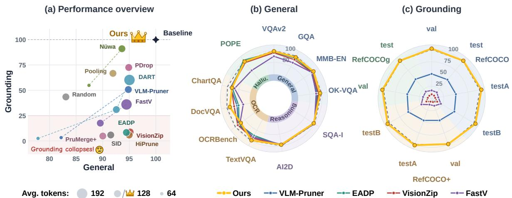  
Figure 1: Performance overview of Bifocal on LLaVA-1.5-7B. (a) General versus grounding performance of pruning methods in our evaluation, under matched budgets. (b, c) Radar charts over 20 evaluations in five ability groups, at an average of 128 visual tokens. Bifocal achieves state-of-the-art overall performance.

We trace these failures to the paradigm shared by existing training-free methods: score each visual token by an importance estimated from the image [1, 9, 53, 57], the question [14, 20, 46, 58], or both, and keep the top-ranked native patches. Our analysis across 20 benchmarks reveals two limitations of this paradigm.

First, a single ranking makes the retained evidence homogeneous. However many cues a score combines, all tokens compete in one ordering, so the budget flows to whichever kind of evidence the score favours. Yet different tasks need different evidence. Under the same budget, image-driven and question-driven selections retain largely distinct visual regions: OCR tasks favour the former, while visual grounding tasks favour the latter. Fortunately, simply splitting the budget evenly between the two already achieves performance close to the upper envelope of either selection alone across tasks.

Second, subset-based pruning compromises the dual integrity of the visual representation. As a subset of the original visual sequence, the retained patch set is spatially sparse and irregularly distributed, while part of the visual content is discarded. This disruption of representational integrity, rather than inaccurate token selection, limits fine-grained task performance. Even keeping exactly the patches on the ground-truth object yields only 39.1 Acc@0.5 on RefCOCO testA. In contrast, allocating part of the budget to pooled tokens distributed across the image raises the accuracy to 63.0, close to the unpruned 64.5.

Since both limitations concern what the retained set contains, a better scoring function alone cannot remove them. We therefore ask: what visual evidence should be preserved under a reduced token budget to support diverse tasks? We answer with a training-free mixed-granularity visual token pruning framework that allocates the limited budget to three complementary token sets at two granularities. For the first limitation, two fine-grained evidence sets are kept as native patches under separate budgets: query-focused evidence preserves the details the question refers to, and image-intrinsic evidence preserves what best represents the rest of the image. Evidence composition thus becomes an explicit allocation rather than a byproduct of one ordering.For the second, a coarse context of pooled tokens covers the whole image, summarising the discarded content and restoring an image-wide layout around the scattered fine tokens. Plugging existing methods into this framework improves their grounding accuracy by 9.7

to 20.6 points.

We further propose Bifocal, a training-free two-stage visual token pruning method. In Stage 1, before the LLM, Bifocal applies the mixed-granularity framework with dedicated selection strategies for the two fine-grained evidence sets. For query-focused evidence, we first derive an image saliency map by removing the component of CLS attention explained by patch norms. Spatially smoothed word saliency maps are then weighted by their spatial correlation with this map and combined through a weighted geometric mean, forming a soft AND that favours patches jointly supported by informative words. For image-intrinsic evidence, we greedily select patches that maximise the marginal gain in attention-weighted representational coverage of the image. given the tokens already retained. Finally, coarse context is constructed by pooling the remaining patches within spatial blocks, completing the mixed-granularity representation. In Stage 2, inside the LLM, Bifocal further removes redundant visual tokens using text-to-image attention adjusted by local token density.

In our evaluation, Bifocal is the only method that consistently retains over 90% of the unpruned performance across all five ability groups on all three models with roughly a quarter of the visual tokens. In contrast, every baseline falls below 90% in at least one group, typically grounding or OCR. On LLaVA-1.5-7B with a layer-averaged budget of 128 visual tokens, Bifocal's weakest group, OCR, still retains 92.4%, while the second-best method on grounding retains only 86.3% on OCR. On Qwen2.5-VL-7B with 25% of the visual tokens, the strongest baseline retains 89.2% on OCR and 85.4% on grounding, compared with 92.3% and 90.2% for Bifocal. On LLaVA-NeXT-7B with a layer-averaged budget of approximately 640 visual tokens, no baseline retains more than 73% of the unpruned grounding performance, whereas Bifocal retains 90.7%. Across all nine model-budget settings, Bifocal also ranks first in both general and grounding averages.

Our contributions are threefold. (1) Diagnosis. Motivated by the lopsided performance of existing pruners, we examine 20 benchmarks under a small token budget. First, image- and question-driven visual evidence are complementary across tasks, and explicitly allocating the budget between them improves robustness. Second, mean pooling neatly restores both the content and positional integrity broken by pruning. (2) Framework. We propose a mixedgranularity framework that combines separately budgeted query-focused and image-intrinsic evidence with pooled coarse context, and that also improves existing methods. (3) Method. We propose Bifocal, which instantiates the framework with dedicated selection rules. Bifocal achieves state-of-the-art averages in all nine model-budget settings and, with roughly a quarter of the visual tokens, retains over 90% of the unpruned performance in every ability group.

## 1 Related Work

Text-Guided Visual Token Pruning. Within an LLM, textual hidden states progressively integrate linguistic context and visual information through multiple layers of causal self-attention. A simple and computationally efficient strategy is therefore to use the final text token as a proxy for the full instruction and estimate visual token importance from its attention to visual tokens [3, 7, 51]. Building on this idea, subsequent methods select or aggregate multiple text tokens to extract task-relevant textual cues for visual token pruning [25, 38, 58]. Beyond directly reusing existing textual hidden states, some studies explicitly construct or learn text-conditioned representations for visual token pruning. IVTP [14] constructs a pseudo-CLS token that is semantically associated with the current instruction and uses it as a reference for visual token selection. LVPruning [42] introduces learnable cross-attention modules to explicitly fuse textual and visual representations and predict visual token retention decisions.

Before visual features enter the LLM, instruction embeddings have not undergone deep contextualization or extensive interaction with the current visual input, although pretrained vision encoders and modality projectors already provide a certain degree of cross-modal semantic alignment. Accordingly, methods such as TRIM [40] exploit embedding-level text-vision relevance by measuring the similarity between CLIP text embeddings and visual patch embeddings, while subsequent approaches apply pooling or aggregation to derive text-vision relevance scores [12, 26, 56]. Rather than treating the entire instruction as a single unit, CRISP [20] extracts keywords and compares them with projected visual tokens, whereas ICCTP [55] uses instruction nouns as visual-semantic anchors for cross-modal clustering and visual token compression.

Image-Guided Visual Token Pruning. Unlike methods conditioned on the current textual instruction, image-guided approaches compress visual tokens solely according to intrinsic visual cues, such as saliency, informativeness, similarity, and redundancy. One line of work estimates visual token saliency from the attention maps produced by the vision encoder. A common strategy is to use the attention from the CLS token to image patches to identify visually important tokens [36]. HiPrune [24| further exploits distinct attention patterns across different vision-encoder layers to capture object-level and global visual information, while EntropyPrune [44| measures visual token informativeness from an information-theoretic perspective using representation entropy. Another line of work focuses on similarity and redundancy among visual tokens, reducing repeated information by retaining representative or diverse visual features [1, 53]. VisPruner [57] combines these two types of visual cues by first selecting salient tokens according to visual attention and then removing redundant tokens based on feature similarity.

Joint Text-Image-Guided Visual Token Pruning. Some approaches jointly exploit textual and visual cues for visual token compression. Multi-stage pruning strategies naturally fall into this category because they use complementary guidance signals at different compression stages. MustDrop [25] first removes redundant tokens according to visual similarity during visual encoding and subsequently leverages textual semantics to further filter visual information. DUET-VLM [38] first performs redundancy-aware merging based on correlations among visual tokens and then applies progressive pruning within the LLM using text-to-vision attention. Another line of work combines textual and visual signals within a unified selection process to estimate visual token importance. AdaV [12] and CrisPrune [29] both use ViT CLS-patch self-attention to characterize visual saliency and the cosine similarity between visual tokens and text embeddings to estimate textual relevance. AdaV aggregates textual relevance using the maximum similarity, whereas CrisPrune further combines the two signals into a token-quality score. CoIn [6] measures intrinsic visual saliency using the $\ell _ { 2 }$ norm of visual token embeddings and evaluates textual relevance through the cosine similarity between visual tokens and the mean-pooled text embedding. The two normalized scores are then combined to obtain an overall informativeness score.

## 2 Mixed-Granularity Pruning Framework

## 2.1 Information: Two Sources

Existing training-free pruning methods often exhibit pronounced task-wise biases [4, 7]. We therefore turn the question around: what visual evidence does an LLM actually need to solve different tasks?

At inference time, a training-free pruning method has access to only two sources of information: the image itself and the question. We therefore examine how token selections driven by each source behave under the same budget. We fix the token budget at one quarter of the visual tokens and turn each source into a route with a common, simple scoring rule: the image route ranks patches by CLS attention, and the text route ranks them by their cosine similarity to the mean word embedding of the question.

Figure 2 (left) shows that the two routes retain noticeably different regions, and their selections overlap only slightly. Figure 2 (right) shows that this difference is systematic across tasks: OCR and document tasks favour the image route, REC tasks favour the text route, and the general benchmarks show much smaller gaps. Relying on either source alone therefore leads to a clear task-wise bias, which suggests that the two sources provide complementary rather than interchangeable evidence. We further include two references: random retention and an even split of the budget between the two routes. The even-split curve largely tracks the upper envelope of the two single-route curves; its advantage is not concentrated on any particular task but lies in robustness across tasks. Appendix A analyses the effect of each single route.

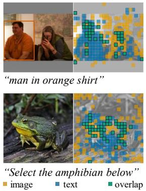

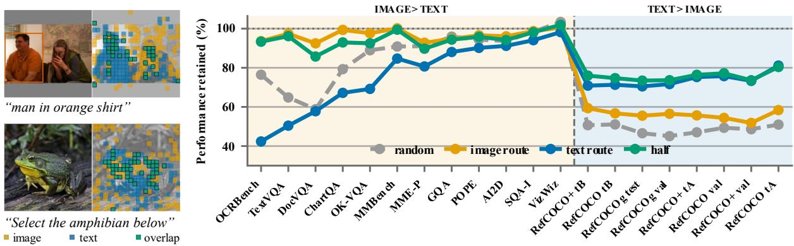  
Figure 2: The image and text routes under a fixed token budget.image route; text route. Left: tokens selected by each route on two examples;marks tokens selected by both. Right: performance relative to the baseline on 20 benchmarks at 144 of 576 tokens; half splits the budget evenly between the two routes, and  random retains tokens at random.

## 2.2 Structure: Two Integrities

Even after combining the two routes, grounding remains the least recovered capability. Is the remaining gap simply a matter of inaccurate token selection? Figure 3 suggests otherwise. In ③, we push selection to the extreme and retain only the patches on the ground-truth target, yet localisation falls well below the two-route selection in ②. Conventional visual token pruning methods, including our two routes, share the same compression paradigm: retaining a subset of native patches from the full visual sequence. This subset-based compression breaks the integrity of the original visual sequence in two ways: positional integrity and content integrity.

Positional integrity. Subset pruning leaves tokens at only a sparse and irregular set of positions, breaking the global positional organization of the original visual sequence. Starting from this extreme strategy in ③, we progressively restore coverage beyond the target—first around its boundary (④), then across the full image with random or lattice layouts (⑤, ⑥) Localisation improves substantially as the retained tokens recover a more complete image-wide distribution.

Content integrity. token pruning also incurs an unavoidable loss of content. To examine this effect, we keep the image-wide positional layout fixed and vary only what the distributed tokens contain. In ⑧, all distributed tokens carry the same image-wide average, yet localisation improves over the native lattice in ⑥. Replacing this global summary with region-specific summaries (⑨) improves performance further. Discarded content need not be preserved at its original resolution, but retaining a low-resolution account of it is important for content integrity.

A layer of pooled coarse tokens addresses both deficiencies at once: each coarse token summarizes content that would otherwise be discarded, while together they restore an even positional layout

over the image. The strong performance of ⑨ confirms the effectiveness of this design. This closely mirrors the coarse-fine decomposition of classical image pyramids [2], where local detail and global structure are represented at different resolutions. It also motivates our mixed-granularity design: fine tokens preserve task-relevant native detail, while coarse tokens recover, at a lower resolution, the content and positional integrity lost through subset selection. Appendix B validates the framework by integrating existing pruning methods into it.
<table><tr><td>Visual tokens</td><td></td><td>Center ↑</td><td>ACC@0.5 ↑</td></tr><tr><td>①</td><td>No pruning, 576 patches</td><td>91.07 / 85.16</td><td>64.47 / 47.48</td></tr><tr><td>②</td><td>144 patches, both routes</td><td>85.95 / 77.64</td><td>51.83 / 35.47</td></tr><tr><td>③</td><td>144 patches on the GT bbox</td><td>71.92 / 65.78</td><td>39.14 / 27.80</td></tr><tr><td>④</td><td>80 patches + 64 rim</td><td>81.37 / 79.25</td><td>42.50 / 29.62</td></tr><tr><td>5</td><td>80 patches + 64 random</td><td>88.19 / 84.20</td><td>54.52 / 40.82</td></tr><tr><td>6</td><td>80 patches + 64 lattice</td><td>87.64 / 84.79</td><td>54.98 / 40.88</td></tr><tr><td>⑦</td><td>144 summaries, no patches</td><td>85.66 / 77.74</td><td>44.62 / 29.11</td></tr><tr><td>8</td><td>80 patches + 64 blanked</td><td>89.92 / 86.65</td><td>56.62 / 42.59</td></tr><tr><td>⑨</td><td>80 patches + 64 pooled</td><td>90.53 / 86.12</td><td>63.02 ／ 46.18</td></tr></table>

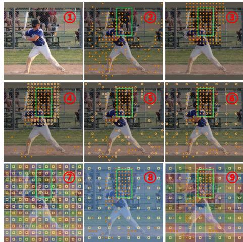  
Figure 3: Left: experiments testing positional and content integrity. Every row except ① keeps 144 of the 576 visual tokens; each cell reports RefCOCO testA / testB, with the best pruned result in bold and the second best underlined. Right: the tokens each row retains on one example.  ground-truth box; predicted box;  retained patch;  extra native patch;  pooled token, averaging its tile.

## 3 Methodology

Figure 4 gives an overview of the design of Bifocal. We describe query-focused evidence in §3.1, image-intrinsic evidence in §3.2, coarse context in §3.3, and Stage 2 in §3.4.

## 3.1 Query-Focused Evidence

Query-focused evidence assigns each patch a question-dependent score $I _ { j }$ and retains the top-K patches as the evidence the question needs. Existing methods typically compress the question into a single vector and score each patch by its cosine similarity to it. Whether the words are pooled by a max or a mean, a strong match to one word can stand in for the absence of another, an OR-like rule under which a “red shirt" is no different from a red fire hydrant elsewhere in the image. Since no model reads the question as a sentence before the LLM, we treat it as a set of words and model two ingredients explicitly: word weighting and word conjunction. For weighting, we invite the image back to sit on the jury alongside the question: a word earns a louder voice when its saliency map agrees with what the image itself finds salient. For conjunction, we combine the words with a geometric mean, a soft AND that favours patches supported by all relevant words jointly.

Word Saliency Maps We construct a word saliency map for each word to locate the image patches it attends to. Let $e _ { w }$ be the embedding of word w and $p _ { j }$ the feature of patch j after the projector maps it into the LLM space. Cosine similarity measures how strongly word w attends to patch $j \colon$

$$
s _ { w } ( j ) = \cos ( \hat { e } _ { w } , \ \hat { p } _ { j } ) , \qquad \hat { e } _ { w } = e _ { w } / \lVert e _ { w } \rVert .\tag{1}
$$

In fact, we observe that this commonly used operation of assigning each patch a score via cosine similarity leads to large score gaps between neighboring patches on the same object. Such discrepancies arise from estimation noise rather than genuine differences in content. Because patches are selected by ranking these scores, the noise can promote patches that happen to score high while displacing those that actually lie on the target. Fortunately, signal and noise occupy different spatial scales: an object spans several patches, so the correlation of interest is spatially coherent, whereas estimation noise fluctuates independently from patch to patch. We find that, on a word saliency map, a simple spatial smoothing $\mathcal { G }$ is enough: this low-pass filter averages away uncorrelated noise while leaving extended structure largely intact, yielding $\tilde { s } _ { w } = \mathcal { G } s _ { w }$ . We then min-max normalise each smoothed map over the patches, $\hat { s } _ { w } = \mathrm { m m } ( \tilde { s } _ { w } )$ , SO that the conjunction compares the spatial shape of the word maps rather than their overall level, which is typically high for content words and low for function words. Appendix C analyses the smoothing further.

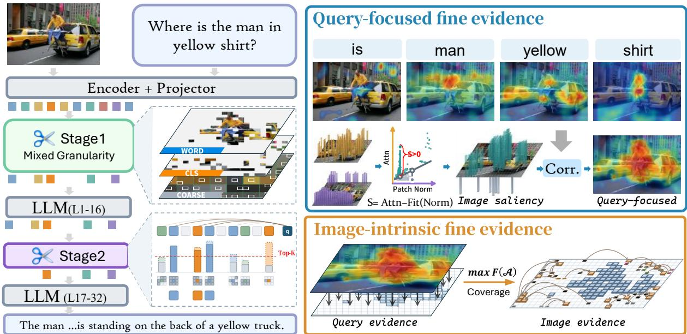  
Figure 4: Overview of Bifocal, a training-free, two-stage visual token pruning method. Stage 1 runs before the LLM and retains a mixed-granularity representation: fine evidence at native-patch resolution, of two kinds, query-focused evidence selected for the question and image-intrinsic evidence selected from the image itself, and coarse tokens obtained by average pooling. Stage 2 keeps the top-K tokens by text-to-image attention inside the LLM.

Image Saliency Map Word weighting needs a referee for the word saliency maps, and Appendix A.1 suggests a natural one: what the image itself attends to after the ViT. Following common practice, we start from the attention of the ViT's CLS token, which aggregates global information. It is not, however, a clean content map: a substantial part of the CLS score follows the norm of a patch rather than its content, most visibly in the attention sink [5, 50], a few patches of abnormally large norm that mostly sit on low-information background. Since this map weights the words, one that points at the background hands the say to words unrelated to the query.

The reason, derived and verified in Appendix D, is that the CLS attention factorises exactly as $a _ { j } = n _ { j } c _ { j }$ , a gain $n _ { j }$ set by the norm times a content score $c _ { j }$ . To obtain the content saliency, we need to decouple the norm from the content. Neither factor is observed, so we separate the product directly in the attention, using only the attention scores and the norm. By the second-order Taylor expansion of xy about $( { \bar { x } } , { \bar { y } } )$ , which is exact, for any x, y and any reference values x, ¯,

$$
x y = { \bar { y } } x + { \bar { x } } y - { \bar { x } } { \bar { y } } + ( x - { \bar { x } } ) ( y - { \bar { y } } ) .\tag{2}
$$

Substituting $x = n _ { j }$ and $y = c _ { j }$ , with the reference values taken to be their image-wide means ñ and č:

$$
a _ { j } = { \bar { c } } n _ { j } \ + \ { \bar { n } } c _ { j } \ - \ { \bar { n } } { \bar { c } } \ + \ \left( n _ { j } - { \bar { n } } \right) \left( c _ { j } - { \bar { c } } \right) .\tag{3}
$$

With the means as reference values, the four terms separate cleanly. The first depends only on the gain and is linear in it; the second ranks patches exactly as $c _ { j }$ does; the third is a constant; only the cross term involves both, and it is small wherever the gain stays near its mean. Removing the first term therefore leaves, up to a constant and the cross term, a map that ranks patches by content. The first term is not observable, but the gain rises with the norm, so over one image we approximate it by a linear function of the smoothed norm map $\nu$ of the projected patch features: we regress the smoothed CLS attention $\tilde { a } = \mathcal { G } a$ on ν over the patches of the image by least squares and subtract the fit patch by patch. If content does not co-vary with the norm, the fit recovers the first term; whatever does co-vary with the norm is removed along with it. The residual is the image saliency map:

$$
S _ { j } = \tilde { a } _ { j } - \big ( \hat { \beta } \nu _ { j } + \hat { b } \big ) .\tag{4}
$$

Word Weighting and Word Conjunction With both maps in hand, each word is weighted by how well its saliency map agrees with the image saliency map:

$$
\alpha _ { w } \propto \mathrm { r e l u } \bigl ( \mathrm { c o r r } ( \hat { s } _ { w } , \ S ) \bigr ) , \qquad \sum _ { w } \alpha _ { w } = 1 ,\tag{5}
$$

where corr is the Pearson correlation over patches and relu discards words whose map disagrees with the image. The words are then combined by a weighted geometric mean, a soft AND under which a patch scores high only if every weighted word points to it:

$$
R _ { j } \ = \ \prod _ { w } \hat { s } _ { w } ( j ) ^ { \alpha _ { w } } .\tag{6}
$$

The norm map ν removed above also carries information of its own: high-norm patches mostly lie on background, so $B = - \nu$ serves as a query-independent background penalty. The query-focused score combines the three maps by an unweighted geometric mean of their min-max normalised versions:

$$
I _ { j } \ = \ \left[ \mathrm { m m } ( R _ { j } ) \cdot \mathrm { m m } ( S _ { j } ) \cdot \mathrm { m m } ( B _ { j } ) \right] ^ { 1 / 3 }\tag{7}
$$

## 3.2 Image-Intrinsic Evidence

With part of the token budget spent on query-focused evidence, and following the analysis of Figure 2, we now select a second kind of evidence that comes from the image itself. Query-focused evidence concentrates on the object the question names; image-intrinsic evidence spends its budget elsewhere, on the $N _ { i }$ patches that best represent the rest of the image. This calls for a measure of how well the image is represented. Let A be the set of tokens currently in place. For each patch j we take its similarity to the closest token in ${ \mathcal { A } } ,$ and sum these values weighted by the CLS attention $a _ { j }$ , we call the result the representational coverage of A:

$$
F ( A ) = \sum _ { j } a _ { j } \cdot \operatorname* { m a x } _ { i \in \mathcal { A } } \cos ( x _ { j } , x _ { i } )\tag{8}
$$

Because of the max, a patch needs only one representative, and a near-copy of a token already in place adds nothing. $F$ is monotone and submodular, so greedy selection is near-optimal: at each step we add the patch with the largest marginal gain,

$$
\Delta ( t ) = F ( A \cup \{ t \} ) - F ( A ) = \sum _ { j } a _ { j } \operatorname { r e l u } \bigl ( \cos ( x _ { t } , x _ { j } ) - \cos _ { j } \bigr ) , \qquad \mathrm { c o v } _ { j } = \operatorname * { m a x } _ { i \in A } \cos ( x _ { j } , x _ { i } )\tag{9}
$$

where covj is how well patch j is represented so far (Algorithm 1, Appendix E).

## 3.3 Coarse Context

Following the pooling analysis of Figure 3, we add a layer of pooled coarse tokens after the fine evidence. We make one adaptation here: the content of each pooling block averages only the patches inside the block that were not selected as fine evidence, and its position is taken to be the attention-weighted centroid of the block. Let $B _ { b }$ denote the members of block b and Q the patches selected as fine evidence, so that the residual set is $\mathcal { R } _ { b } = B _ { b } \ \backslash \ \mathcal { Q }$ . Then

$$
\bar { x } _ { b } = \sum _ { j \in \mathcal { R } _ { b } } \frac { a _ { j } } { \sum _ { k \in \mathcal { R } _ { b } } a _ { k } } x _ { j } , \qquad \hat { r } _ { b } = \Big \lfloor \sum _ { j \in \mathcal { B } _ { b } } \frac { a _ { j } } { \sum _ { k \in \mathcal { B } _ { b } } a _ { k } } r _ { j } + \frac { 1 } { 2 } \Big \rfloor ,\tag{10}
$$

where $r _ { j }$ is the grid coordinate of patch $j ,$ the rounding puts the centroid back on the nearest patch inside the block, and $\hat { r } _ { b }$ is the position this coarse token takes in the sequence. Under a fixed budget this reduces redundancy among the tokens: every patch is either present natively or enters exactly one coarse token.

## 3.4 Stage 2: Pruning inside the LLM

Stage 1 decides which visual evidence enters the LLM, yet the visual tokens remain highly redundant inside it [3]. By then the causal attention has also let them absorb the question, so the text-to-image attention reliably reflects which visual information the answer still needs. Following FastV, at layer L we score each visual token by the attention $t _ { j }$ it receives from the last text token and keep the top-K.

We make one adjustment, with the integrity of the retained set in mind. After Stage 1 the grid is sparse, and this attention often peaks on isolated survivors whose neighbours have been pruned. We therefore weight each score by a local-density prior:

$$
\tilde { t } _ { j } = t _ { j } \cdot d _ { j } ,\tag{11}
$$

where $d _ { j }$ is the fraction of the neighbourhood of token j that survived Stage 1. Pruned patches no longer receive attention; they enter Stage 2 only by lowering the density of their neighbours.

## 4 Experiments

We evaluate Bifocal at three budgets on LLaVA-1.5-7B (Tables 1 and 2), Qwen2.5-VL-7B (Table 3) and LLaVA-NeXT-7B (Appendix G), followed by ablations (§4.3), an efficiency analysis (Appendix H) and visualisations (§4.4).

## 4.1 Experimental Setup

Models and benchmarks. We report main results on LLaVA-1.5-7B and verify on LLaVA-NeXT-7B and Qwen2.5-VL-7B. The benchmarks are $\mathrm { V Q A } ^ { \mathrm { v 2 } }$ [11], GQA [16], MMBench [27], OK-VQA [32], ScienceQA-IMG [30], AI2D [19], TextVQA [39], OCRBench [28], DocVQA [34], ChartQA [33], POPE [21], RefCOCO, RefCOCO+ [54] and RefCOCOg [31].

Baselines. We select representative visual-token pruning methods as baselines, including FastV [3], PDrop [51], VisionZip [53], and PruMerge+ [36]. We further reproduce recent publicly available representative works and conduct fair comparisons with open-source methods that provide favorable reproducibility, including DART [45], Nüwa [15], HiPrune [24], EADP [43] SID [10], and VLM-Pruner [49].

## 4.2 Main Results

Results on LLaVA-1.5-7B. Existing methods are markedly lopsided across tasks. On the general benchmarks they are hard to tell apart: at the 192-token budget in Table 1, the top five baselines are all crammed between 96.7% and 98.1%. Yet they diverge sharply the moment they leave the general tasks: the OCRBench score of Nüwa drops from 314 without pruning to 244 at 192 tokens and to only 152 at 64, and on grounding (Table 2) HiPrune, EADP and SID retain merely 10.6%, 14.0% and 9.5% even at 192 tokens, no longer a mild degradation but a breakdown. Bifocal holds both ends. It attains the best general average at all three budgets, reaching 98.5%, 96.3% and 90.6%, while on grounding it scores 111.0% and 101.8% at 192 and 128 tokens, above the unpruned model, and still retains 66.7% at 64, 11.8 points above the strongest baseline, Nüwa. That gap is larger than it looks, because Nüwa itself already leads the third-place method, EADP, by 48.7 points at 64 tokens.

Results on Qwen2.5-VL-7B. The same pattern persists on a stronger backbone. Qwen2.5-VL is a much better grounder to begin with, scoring above 80 on all three grounding datasets without pruning. At the 50% budget most methods still keep the bulk of it, but tightening the budget quickly pulls them apart. Under the most aggressive compression, keeping only 15% of the tokens, the deduplication-based DART and VLM-Pruner, which look competitive on general benchmarks at moderate budgets, fall to 6.9% and 9.5% of the unpruned grounding accuracy, and VisionZip, EADP and HiPrune all hover around 40%. As shown in Table 3, Bifocal ranks first in both general and grounding averages at all three token budgets, and it leads on every grounding split (Appendix F). Its lead also widens exactly where pruning hurts most. At 15%, Bifocal still keeps about two thirds of the unpruned grounding accuracy, while no baseline retains even 60%.

Table 1: General multimodal benchmarks on LLaVA-1.5-7B. Methods are matched by layeraveraged visual-token budget. Within each budget, the best and second-best results are bold and underlined. Avg. averages benchmark-wise performance relative to the baseline.
<table><tr><td rowspan="2">Method</td><td colspan="4">General</td><td colspan="2">Reasoning</td><td colspan="4">OCR</td><td>Hall.</td><td rowspan="2">Avg.</td></tr><tr><td>VQAv2</td><td>GQA</td><td>MMB</td><td>VQAOK</td><td>SQA-I</td><td>AI2D</td><td>VQAT</td><td></td><td></td><td>OCR-B DocVQAChartQA POPE</td><td></td></tr><tr><td>Baseline 78.5</td><td>61.9</td><td></td><td>64.1</td><td>53.5</td><td>69.4</td><td>55.2</td><td>46.0</td><td>314</td><td>21.5</td><td>18.2</td><td>85.9</td><td>100.0%</td></tr><tr><td colspan="10">Average Tokens = 192</td><td></td><td></td><td></td></tr><tr><td>FastV</td><td>75.0</td><td>57.0</td><td>63.6</td><td>51.1</td><td>69.1</td><td>54.1</td><td>44.6</td><td>300</td><td>18.2</td><td>17.1</td><td>75.8</td><td>94.5%</td></tr><tr><td>PDrop</td><td>77.4</td><td>60.0</td><td>63.5</td><td>52.4</td><td>68.9</td><td>54.1</td><td>45.9</td><td>308</td><td>19.9</td><td>18.2</td><td>85.3</td><td>98.1%</td></tr><tr><td>PruMerge+</td><td>74.6</td><td>57.6</td><td>61.3</td><td>48.6</td><td>69.0</td><td>54.6</td><td>39.0</td><td>282</td><td>14.8</td><td>16.5</td><td>79.9</td><td>90.9%</td></tr><tr><td>VisionZip</td><td>76.8</td><td>59.3</td><td>63.8</td><td>52.8</td><td>68.7</td><td>55.5</td><td>44.5</td><td>312</td><td>19.4</td><td>17.4</td><td>85.3</td><td>97.5%</td></tr><tr><td>SID</td><td>76.4</td><td>58.9</td><td>63.3</td><td>51.9</td><td>68.9</td><td>54.9</td><td>40.9</td><td>289</td><td>15.4</td><td>17.0</td><td>85.8</td><td>93.9%</td></tr><tr><td>DART</td><td>76.7</td><td>59.5</td><td>62.9</td><td>51.3</td><td>68.9</td><td>54.7</td><td>43.6</td><td>300</td><td>19.6</td><td>17.5</td><td>81.8</td><td>96.2%</td></tr><tr><td>Nüwa</td><td>77.8</td><td>61.0</td><td>63.8</td><td>53.5</td><td>68.6</td><td>54.4</td><td>45.7</td><td>244</td><td>20.2</td><td>18.2</td><td>84.6</td><td>96.7%</td></tr><tr><td>EADP</td><td>77.2</td><td>60.3</td><td>62.9</td><td>51.3</td><td>68.8</td><td>54.5</td><td>43.3</td><td>301</td><td>19.3</td><td>17.2</td><td>87.4</td><td>96.7%</td></tr><tr><td>VLM-Pruner</td><td>77.9</td><td>61.2</td><td>62.0</td><td>51.3</td><td>69.9</td><td>55.1</td><td>44.1</td><td>299</td><td>19.5</td><td>17.6</td><td>85.6</td><td>97.2%</td></tr><tr><td>HiPrune</td><td>76.8</td><td>59.2</td><td>63.0</td><td>52.4</td><td>68.8</td><td>54.5</td><td>44.9</td><td>316</td><td>20.5</td><td>17.8</td><td>86.1</td><td>98.1%</td></tr><tr><td>Bifocal (ours) 78.2</td><td></td><td>61.5</td><td>64.4</td><td>53.4</td><td>68.4</td><td>55.6</td><td>46.2</td><td>284</td><td>21.6</td><td>17.0</td><td>85.7</td><td>98.5%</td></tr><tr><td colspan="10">Average Tokens = 128</td><td></td><td></td><td></td></tr><tr><td>FastV</td><td>71.0</td><td>54.1</td><td>62.0</td><td>48.6</td><td>69.1</td><td>53.9</td><td>42.9</td><td>284</td><td>15.4</td><td>16.0</td><td>68.2</td><td>89.5%</td></tr><tr><td>PDrop</td><td>74.9</td><td>57.4</td><td>61.4</td><td>50.4</td><td>70.9</td><td>52.9</td><td>44.5</td><td>299</td><td>18.2</td><td>17.5</td><td>81.8</td><td>94.9%</td></tr><tr><td>PruMerge+</td><td>74.0</td><td>57.6</td><td>60.3</td><td>47.2</td><td>69.7</td><td>54.3</td><td>39.2</td><td>279</td><td>14.2</td><td>15.9</td><td>81.1</td><td>90.0%</td></tr><tr><td>VisionZip</td><td>75.6</td><td>57.7</td><td>62.2</td><td>50.7</td><td>68.8</td><td>54.7</td><td>43.8</td><td>298</td><td>18.8</td><td>17.0</td><td>82.9</td><td>95.2%</td></tr><tr><td>SID</td><td>75.4</td><td>58.0</td><td>62.2</td><td>50.1</td><td>68.5</td><td>54.6</td><td>39.3</td><td>272</td><td>14.7</td><td>16.4</td><td>84.4</td><td>91.5%</td></tr><tr><td>DART</td><td>74.8</td><td>57.8</td><td>61.6</td><td>49.9</td><td>69.6</td><td>53.9</td><td>41.6</td><td>275</td><td>17.0</td><td>17.2</td><td>77.8</td><td>92.6%</td></tr><tr><td>Nüwa</td><td>77.1</td><td>60.3</td><td>63.1</td><td>51.9</td><td>68.2</td><td>54.2</td><td>43.5</td><td>202</td><td>19.0</td><td>17.8</td><td>83.6</td><td>93.6%</td></tr><tr><td>EADP</td><td>76.5</td><td>59.6</td><td>62.7</td><td>50.1</td><td>68.8</td><td>54.8</td><td>41.4</td><td>290</td><td>17.2</td><td>16.7</td><td>87.2</td><td>94.5%</td></tr><tr><td>VLM-Pruner</td><td>77.1</td><td>60.3</td><td>61.4</td><td>49.3</td><td>69.3</td><td>54.2</td><td>42.6</td><td>294</td><td>17.8</td><td>17.2</td><td>84.4</td><td>94.8%</td></tr><tr><td>HiPrune</td><td>74.9</td><td>57.3</td><td>61.9</td><td>50.5</td><td>68.4</td><td>55.2</td><td>43.6</td><td>296</td><td>19.3</td><td>16.8</td><td>82.8</td><td>95.0%</td></tr><tr><td>Bifocal (ours)</td><td>77.6</td><td>60.5</td><td>64.1</td><td>52.1</td><td>68.2</td><td>54.2</td><td>45.6</td><td>262</td><td>20.4</td><td>16.8</td><td>84.7</td><td>96.3%</td></tr><tr><td colspan="10">Average Tokens = 64</td><td></td><td></td></tr><tr><td>SID</td><td>74.2</td><td>57.3</td><td>59.5</td><td>48.4</td><td>68.3</td><td>53.6</td><td>38.0</td><td>276</td><td>13.8</td><td>16.2</td><td>84.3</td><td>89.8%</td></tr><tr><td>DART</td><td>65.4</td><td>51.1</td><td>54.8</td><td>42.5</td><td>68.8</td><td>51.7</td><td>29.3</td><td>214</td><td>11.7</td><td>14.2</td><td>59.0</td><td>77.8%</td></tr><tr><td>Nüwa</td><td>74.6</td><td>58.6</td><td>62.0</td><td>49.4</td><td>67.8</td><td>53.0</td><td>39.9</td><td>152</td><td>15.5</td><td>16.3</td><td>79.8</td><td>87.4%</td></tr><tr><td>EADP</td><td>75.3</td><td>58.1</td><td>60.7</td><td>47.9</td><td>69.1</td><td>53.9</td><td>37.6</td><td>268</td><td>14.4</td><td>15.6</td><td>85.6</td><td>90.0%</td></tr><tr><td>VLM-Pruner</td><td>69.9</td><td>54.4</td><td>57.7</td><td>43.0</td><td>69.3</td><td>52.5</td><td>32.8</td><td>240</td><td>11.9</td><td>14.3</td><td>69.1</td><td>82.2%</td></tr><tr><td>HiPrune</td><td>69.1</td><td>53.6</td><td>59.5</td><td>46.3</td><td>68.9</td><td>53.4</td><td>39.9</td><td>258</td><td>16.1</td><td>16.1</td><td>73.0</td><td>87.9%</td></tr><tr></table>

## 4.3 Ablation Study

Bifocal selects and allocates three kinds of tokens from different angles, so we verify that each of them is indeed useful. Taking LLaVA-1.5-7B with an average of 128 tokens per LLM layer as an example, we vary how the 224 Stage-1 tokens are split among C, I and Q (Table 4). C clearly pays off on grounding: adding it lifts REC from 83.6% to 89.0% with I alone, and from 97.0% to 101.8% with Q alone. Like I, C is query-free, so the general average changes little. As expected, removing I lowers POPE from 84.7 to 83.2, and removing Q drops REC from 102.7% to 89.0%. We also note that the full configuration is not the best on every benchmark, which is a matter of balance. As analysed in Section 2.1, keeping all three kinds of tokens yields the best overall ability, making it the only allocation that leads on both averages, with 95.4% on general and 102.7% on grounding.

Table 2: Visual grounding on LLaVA-1.5-7B. All entries are AcC@0.5. Budget groups and highlighting follow Table 1.
<table><tr><td>Method</td><td>RefCOCO val</td><td>testA</td><td>testB</td><td>RefCOCO+ val</td><td>testA</td><td>testB</td><td>RefCOCOg val</td><td>test</td><td>Avg.</td></tr><tr><td colspan="10">56.2 64.4 47.5 50.1</td></tr><tr><td></td><td></td><td></td><td></td><td>Average Tokens = 192</td><td></td><td></td><td></td><td></td><td></td></tr><tr><td>DART</td><td>32.9</td><td>36.5</td><td>30.7</td><td>28.5</td><td>33.0</td><td>26.8</td><td>29.6</td><td>29.4</td><td>60.2%</td></tr><tr><td>Nüwa</td><td>59.0</td><td>67.3</td><td>49.0</td><td>50.5</td><td>60.8</td><td>40.2</td><td>51.7</td><td>50.1</td><td>103.6%</td></tr><tr><td>HiPrune</td><td>5.3</td><td>5.5</td><td>7.2</td><td>4.5</td><td>4.8</td><td>5.6</td><td>5.2</td><td>4.8</td><td>10.6%</td></tr><tr><td>EADP</td><td>7.4</td><td>7.7</td><td>9.2</td><td>6.4</td><td>7.0</td><td>7.1</td><td>6.1</td><td>5.9</td><td>14.0%</td></tr><tr><td>SID</td><td>5.2</td><td>5.2</td><td>6.4</td><td>4.1</td><td>4.2</td><td>5.2</td><td>4.3</td><td>4.1</td><td>9.5%</td></tr><tr><td>VLM-Pruner Bifocal (ours)</td><td>46.0</td><td>54.6</td><td>39.7</td><td>39.8</td><td>48.2</td><td>32.5</td><td>38.9</td><td>39.1</td><td>81.9%</td></tr><tr><td></td><td>62.4</td><td>71.4</td><td>52.9</td><td>54.7</td><td>66.2</td><td>43.1</td><td>55.1</td><td>54.2</td><td>111.0%</td></tr><tr><td colspan="10">Average Tokens = 128</td></tr><tr><td>DART</td><td>17.0</td><td>17.5</td><td>17.1</td><td>14.8</td><td>15.7</td><td>15.1</td><td>15.4</td><td>14.6</td><td>31.0%</td></tr><tr><td>Nüwa</td><td>52.1</td><td>61.3</td><td>42.8</td><td>43.4</td><td>53.0</td><td>35.4</td><td>45.1</td><td>43.6</td><td>91.1%</td></tr><tr><td>HiPrune</td><td>3.2</td><td>3.0</td><td>4.3</td><td>2.3</td><td>2.4</td><td>3.4</td><td>2.6</td><td>2.4</td><td>5.8%</td></tr><tr><td>EADP</td><td>4.2</td><td>5.0</td><td>5.8</td><td>3.1</td><td>4.2</td><td>4.6</td><td>3.5</td><td>3.4</td><td>8.3%</td></tr><tr><td>SID</td><td>3.0</td><td>3.0</td><td>3.9</td><td>2.6</td><td>2.8</td><td>3.5</td><td>2.5</td><td>2.4</td><td>5.9%</td></tr><tr><td>VLM-Pruner</td><td>28.3</td><td>32.4</td><td>25.5</td><td>23.9</td><td>28.3</td><td>21.5</td><td>24.7</td><td>24.8</td><td>50.8%</td></tr><tr><td>Bifocal (ours)</td><td>57.3</td><td>66.4</td><td>49.1</td><td>49.6</td><td>60.3</td><td>40.4</td><td>49.8</td><td>48.7</td><td>101.8%</td></tr><tr><td colspan="10">Average Tokens = 64</td></tr><tr><td>DART</td><td>1.4</td><td>0.9</td><td>1.9</td><td>0.9</td><td>0.8</td><td>1.9</td><td>1.1</td><td>1.1</td><td>2.5%</td></tr><tr><td>Nüwa</td><td>32.7</td><td>39.7</td><td>24.4</td><td>26.2</td><td>33.9</td><td>20.5</td><td>25.6</td><td>24.3</td><td>54.9%</td></tr><tr><td>HiPrune</td><td>1.3</td><td>1.3</td><td>2.1</td><td>1.1</td><td>1.1</td><td>1.6</td><td>1.3</td><td>0.9</td><td>2.6%</td></tr><tr><td>EADP</td><td>3.2</td><td>3.7</td><td>4.2</td><td>2.6</td><td>3.2</td><td>3.2</td><td>2.6</td><td>2.3</td><td>6.2%</td></tr><tr><td>SID</td><td>3.0</td><td>2.3</td><td>3.8</td><td>2.5</td><td>2.6</td><td>3.1</td><td>2.2</td><td>2.2</td><td>5.4%</td></tr><tr><td>VLM-Pruner</td><td>1.7</td><td>1.3</td><td>2.5</td><td>1.4</td><td>1.2</td><td>2.2</td><td>1.5</td><td>1.3</td><td>3.3%</td></tr><tr><td>Bifocal (ours)</td><td>38.6</td><td>49.0</td><td>30.7</td><td>31.9</td><td>41.9</td><td>24.3</td><td>31.0</td><td>30.4</td><td>66.7%</td></tr></table>

Table 3: Results on Qwen2.5-VL-7B. Budgets are fractions of the visual tokens. Gen. and REC are the performance relative to the baseline on the general and grounding benchmarks.
<table><tr><td rowspan="2">Method</td><td colspan="2">General</td><td colspan="2">Reason.</td><td colspan="2">OCR</td><td colspan="2">Hall.</td><td colspan="2">Grounding</td><td colspan="2">Avg.</td></tr><tr><td></td><td>GQA MMB 84.0</td><td>SQA AI2D 88.2 82.3</td><td></td><td>VQAT 82.8 842</td><td>94.7</td><td>OCR-B DocVQA POPE 86.4</td><td>RefCOCO 88.7</td><td></td><td>RefCOCO+ RefCOCOg 84.1</td><td>Gen.</td><td>REC</td></tr><tr><td colspan="10">Baseline 60.9</td><td></td><td>100.0% 100.0%</td></tr><tr><td></td><td></td><td></td><td></td><td></td><td></td><td></td><td>Retain 50% Tokens</td><td></td><td></td><td></td><td></td><td></td></tr><tr><td>VisionZip</td><td>57.4</td><td>78.7</td><td>79.6 73.5</td><td>74.8</td><td>734</td><td>89.5</td><td>86.5</td><td>77.8</td><td>74.9</td><td>77.5</td><td>91.5%</td><td>89.6%</td></tr><tr><td>DART</td><td>59.3</td><td>81.5</td><td>86.2 78.0</td><td>79.5</td><td>721</td><td>77.5</td><td>85.6</td><td>76.1</td><td>69.8</td><td>72.5</td><td>93.1%</td><td>85.5%</td></tr><tr><td>Nüwa</td><td>60.1</td><td>83.7</td><td>87.6 81.6</td><td>81.4</td><td>813</td><td>93.2</td><td>86.0</td><td>86.7</td><td>79.6</td><td>81.9</td><td>97.6%</td><td>97.2%</td></tr><tr><td>HiPrune</td><td>57.3</td><td>79.2</td><td>79.3</td><td>74.0 74.8</td><td>731</td><td>89.3</td><td>86.6</td><td>77.5</td><td>74.7</td><td>77.7</td><td>91.7%</td><td>89.4%</td></tr><tr><td>EADP</td><td>59.5</td><td>82.6</td><td>85.5</td><td>80.0 77.3</td><td>741</td><td>81.0</td><td>84.9</td><td>82.1</td><td>74.5</td><td>76.7</td><td>93.4%</td><td>91.5%</td></tr><tr><td>VLM-Pruner</td><td>59.9</td><td>83.0</td><td>87.3 82.1</td><td>81.0</td><td>820</td><td>91.3</td><td>85.8</td><td>83.7</td><td>77.2</td><td>79.2</td><td>97.4%</td><td>94.0%</td></tr><tr><td>Bifocal (ours) 60.1</td><td>82.6</td><td>87.3</td><td>82.0</td><td>82.8</td><td>814</td><td>94.0</td><td>86.3</td><td>87.5</td><td>80.7</td><td>82.8</td><td>98.4%</td><td>98.3%</td></tr><tr><td colspan="10">Retain 25% Tokens</td><td colspan="3"></td></tr><tr><td>VisionZip</td><td>55.1</td><td>77.0</td><td>78.3</td><td>70.0 68.6</td><td>601</td><td>77.5</td><td>84.0</td><td>61.2</td><td>58.5</td><td>59.4</td><td>84.8%</td><td>69.9%</td></tr><tr><td>DART</td><td>55.7</td><td>77.3</td><td>82.8</td><td>70.1 66.4</td><td>528</td><td>48.7</td><td>80.8</td><td>26.6</td><td>24.1</td><td>25.9</td><td>80.3%</td><td>29.9%</td></tr><tr><td>Nüwa</td><td>58.5</td><td>82.4</td><td>86.7</td><td>81.0 77.9</td><td>680</td><td>87.8</td><td>85.7</td><td>77.0</td><td>68.2</td><td>72.7</td><td>93.4%</td><td>85.4%</td></tr><tr><td>HiPrune</td><td>54.9</td><td>77.7</td><td>77.7</td><td>70.2 68.8</td><td>604</td><td>78.4</td><td>84.5</td><td>59.3</td><td>56.3</td><td>58.7</td><td>85.1%</td><td>67.9%</td></tr><tr><td>EADP</td><td>58.6</td><td>79.5</td><td>83.7 76.2</td><td>70.8</td><td>641</td><td>66.7</td><td>83.3</td><td>61.0</td><td>55.7</td><td>56.3</td><td>86.8%</td><td>67.9%</td></tr><tr><td>VLM-Pruner</td><td>58.9</td><td>80.7</td><td>85.7</td><td>78.5 76.3</td><td>678</td><td>76.8</td><td>84.9</td><td>44.1</td><td>40.5</td><td>40.1</td><td>90.3%</td><td>49.1%</td></tr><tr><td>Bifocal (ours)</td><td>59.5</td><td>82.0</td><td>87.2 81.3</td><td>80.3</td><td>711</td><td>90.3</td><td>86.2</td><td>81.2</td><td>72.0</td><td>77.0</td><td>94.9%</td><td>90.2%</td></tr><tr><td colspan="10">Retain 15% Tokens</td><td colspan="3"></td></tr><tr><td>VisionZip</td><td>53.3</td><td>75.1</td><td>76.7</td><td>66.1</td><td>60.8 463</td><td>60.3</td><td>82.1</td><td>38.9</td><td>36.3</td><td>36.6</td><td>77.0%</td><td>43.8%</td></tr><tr><td>DART</td><td>50.8</td><td>71.4</td><td>80.0</td><td>66.5</td><td>49.9 383</td><td>30.1</td><td>70.1</td><td>6.3</td><td>5.5</td><td>5.8</td><td>68.0%</td><td>6.9%</td></tr><tr><td>Nüwa</td><td>56.2</td><td>80.5</td><td>85.2</td><td>77.6</td><td>72.2 540</td><td>75.5</td><td>84.0</td><td>53.7</td><td>44.3</td><td>49.4</td><td>86.7%</td><td>58.0%</td></tr><tr><td>HiPrune</td><td>52.5</td><td>75.0</td><td>76.6</td><td>66.9</td><td>62.8</td><td>457 64.0</td><td>82.3</td><td>35.7</td><td>33.0</td><td>34.4</td><td>77.7%</td><td>40.3%</td></tr><tr><td>EADP</td><td>57.7</td><td>78.0</td><td>82.3</td><td>72.7</td><td>65.5</td><td>564</td><td>56.8 80.9</td><td>36.6</td><td>33.7</td><td>34.1</td><td>81.4%</td><td>40.9%</td></tr><tr><td>VLM-Pruner</td><td>55.2</td><td>76.0</td><td>83.5</td><td>71.1</td><td>66.5</td><td>487</td><td>78.5</td><td>8.5</td><td>8.0</td><td>7.8</td><td>77.8%</td><td>9.5%</td></tr><tr><td>Bifocal (ours)</td><td>57.7</td><td>79.5</td><td>85.8</td><td>77.9 76.3</td><td>578</td><td>53.2 81.1</td><td>85.3</td><td>62.7</td><td>52.4</td><td>57.5</td><td>89.0%</td><td>67.9%</td></tr></table>

## 4.4 Visualisation

We further examine Bifocal qualitatively in Figure 5, from two angles. The top row visualises the two kinds of fine evidence Bifocal keeps for one image under different queries, with more cases in Appendix J. The image-intrinsic evidence spreads over the whole image and stays the same whatever the question, while the query-focused evidence moves with the query. For person and orange, two objects present in the image, the query-focused tokens land on the region each query names. The two kinds of fine evidence thus split the work as intended, one covering the image and the other following the question. The bottom row turns to fine-grained ability. We visualise both grounding and OCR, and show one grounding case here, with the rest in Figures 12 and 13. The image holds several donuts that easily mislead the model, yet Bifocal's

Table 4: Evidence ablation. C, I and Q are the numbers of coarse-context, image-intrinsic and query-focused tokens, all rows apply the same Stage-2 pruning.
<table><tr><td colspan="2">Token allocation</td><td colspan="2"></td><td colspan="2">General</td><td colspan="2">Reasoning</td><td colspan="2">OCR</td><td>Hall.</td><td colspan="2">RefCOCO+</td><td colspan="2">Avg.</td></tr><tr><td>C</td><td>I Q</td><td></td><td>GQA</td><td>MMB</td><td>SQA</td><td>AI2D</td><td></td><td>OCR-B DocVQAChartQAPOPE</td><td></td><td></td><td>testA</td><td>testB</td><td>Gen.</td><td>REC</td></tr><tr><td colspan="2">Baseline(576)</td><td></td><td>61.9</td><td>64.1</td><td>69.4</td><td>55.2</td><td>314</td><td>21.5</td><td>18.2</td><td>85.9</td><td>59.4</td><td>38.9</td><td>100.0%</td><td>100.0%</td></tr><tr><td></td><td>224</td><td></td><td>60.6</td><td>63.8</td><td>68.2</td><td>54.8</td><td>200</td><td>20.9</td><td>17.3</td><td>84.3</td><td>49.7</td><td>32.5</td><td>93.6%</td><td>83.6%</td></tr><tr><td></td><td>112</td><td>112</td><td>59.8</td><td>63.9</td><td>68.3</td><td>53.1</td><td>213</td><td>21.2</td><td>17.4</td><td>84.2</td><td>55.0</td><td>38.3</td><td>93.9%</td><td>95.5%</td></tr><tr><td></td><td></td><td>224</td><td>59.6</td><td>63.7</td><td>68.0</td><td>51.9</td><td>242</td><td>20.8</td><td>16.8</td><td>83.7</td><td>56.5</td><td>38.5</td><td>93.9%</td><td>97.0%</td></tr><tr><td>64</td><td>160</td><td></td><td>60.3</td><td>63.7</td><td>68.2</td><td>54.6</td><td>209</td><td>19.4</td><td>17.3</td><td>83.7</td><td>53.1</td><td>34.4</td><td>92.9%</td><td>89.0%</td></tr><tr><td>64</td><td>80</td><td>80</td><td>60.5</td><td>64.1</td><td>68.2</td><td>54.2</td><td>262</td><td>20.4</td><td>16.8</td><td>84.7</td><td>60.3</td><td>40.4</td><td>95.4%</td><td>102.7%</td></tr><tr><td>64</td><td></td><td>160</td><td>60.0</td><td>63.1</td><td>67.7</td><td>53.5</td><td>226</td><td>19.3</td><td>16.3</td><td>83.2</td><td>58.6</td><td>40.8</td><td>92.2%</td><td>101.8%</td></tr></table>

prediction is clearly better than those of the other methods in both centre and IoU.  
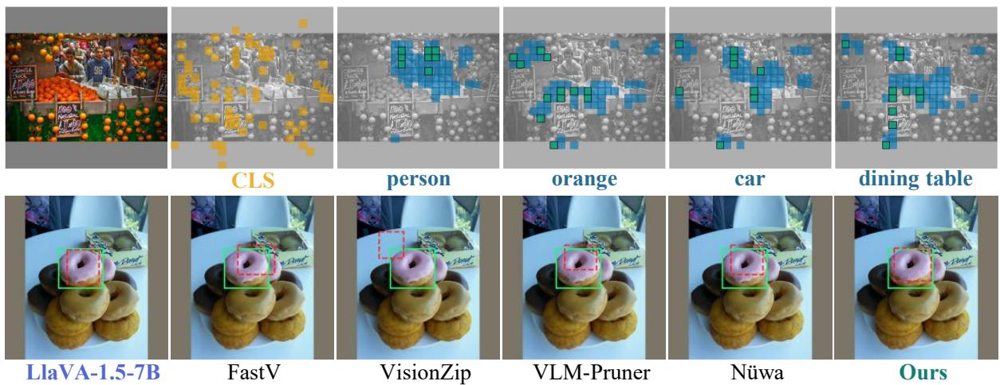  
Figure 5: Top: the fine evidence Bifocal selects for one image under different queries,  image-intrinsic evidence and query-focused evidence. Bottom: grounding results of LLaVA-1.5-7B and pruning methods under the same budget, with  the ground truth and  the prediction.

## 5 Conclusion

This paper approaches visual token pruning from a novel perspective and proposes a mixedgranularity pruning framework before the LLM, composed of query-focused evidence, imageintrinsic evidence and a coarse context, which preserves the abilities of the model more comprehensively. Building on this framework, we optimise the selection of each kind of token. We combine the word and image saliency maps to better preserve query-focused evidence through word weighting and word conjunction, then select the optimal token subset by representational coverage, and finally add a coarse context pooled from the remaining patches. Together with Stage 2, which further removes redundant tokens inside the LLM, Bifocal achieves the best overall performance across multiple models and budgets.

## References

[1] Saeed Ranjbar Alvar, Gursimran Singh, Mohammad Akbari, and Yong Zhang. Divprune: Diversity-based visual token pruning for large multimodal models. In 2025 IEEE/CVF Conference on Computer Vision and Pattern Recognition (CVPR), pages 9392–9401. IEEE, 2025.

[2] Peter J Burt and Edward H Adelson. The laplacian pyramid as a compact image code. In Readings in computer vision, pages 671–679. Elsevier, 1987.

[3] Liang Chen, Haozhe Zhao, Tianyu Liu, Shuai Bai, Junyang Lin, Chang Zhou, and Baobao Chang. An image is worth 1/2 tokens after layer 2: Plug-and-play inference acceleration for large vision-language models. In European Conference on Computer Vision, pages 19–35. Springer, 2024.

[4] Tzu-Chun Chien, Chieh-Kai Lin, Shiang-Feng Tsai, Ruei-Chi Lai, Hung-Jen Chen, and Min Sun. Grounding-aware token pruning: Recovering from drastic performance drops in visual grounding caused by pruning. arXiv preprint arXiv:2506.21873, 2025.

[5] Timothée Darcet, Maxime Oquab, Julien Mairal, and Piotr Bojanowski. Vision transformers need registers. In International conference on learning representations, volume 2024, pages 2632–2652, 2024.

[6] Chenxi Du, Yongheng Deng, Jiani Liu, Yujia Zhang, Xi Chen, and Ju Ren. Coin: Coverage and informativeness-guided token reduction for efficient large multimodal models. In Proceedings of the IEEE/CVF Conference on Computer Vision and Pattern Recognition, pages 10492–10501, 2026.

[7] Mark Endo, Xiaohan Wang, and Serena Yeung-Levy. Feather the throttle: Revisiting visual token pruning for vision-language model acceleration. In 2025 IEEE/CVF International Conference on Computer Vision (ICCV), pages 22826–22835. IEEE, 2025.

[8] Yingqi Fan, Anhao Zhao, Jinlan Fu, Junlong Tong, Hui Su, Yijie Pan, Wei Zhang, and Xiaoyu Shen. Visipruner: Decoding discontinuous cross-modal dynamics for efficient multimodal 1lms. In Proceedings of the 2025 Conference on Empirical Methods in Natural Language Processing, pages 18896–18913, 2025.

[9] Yingqi Fan, Junlong Tong, Anhao Zhao, and Xiaoyu Shen. What do visual tokens really encode? uncovering sparsity and redundancy in multimodal large language models. In Proceedings of the IEEE/CVF Conference on Computer Vision and Pattern Recognition (CVPR), pages 11987–11997, June 2026.

[10] Zhengyao Fang, Pengyuan Lyu, Chengquan Zhang, Guangming Lu, Jun Yu, and Wenjie Pei. Prune redundancy, preserve essence: Vision token compression in VLMs via synergistic importance-diversity. In The Fourteenth International Conference on Learning Representations, 2026.

[11] Yash Goyal, Tejas Khot, Douglas Summers-Stay, Dhruv Batra, and Devi Parikh. Making the v in vqa matter: Elevating the role of image understanding in visual question answering In Proceedings of the IEEE conference on computer vision and pattern recognition, pages 6904–6913, 2017.

[12] Jiayi Han, Liang Du, Yiwen Wu, Guanming Liang, Xiangguo Zhou, Weibo Zheng, Donghong Han, and Zixun Sun. Adav: Adaptive text-visual redirection for vision-language models. In Findings of the Association for Computational Linguistics: ACL 2025, pages 4985-4997, 2025.

[13] Haozhe Hu, Hao Wu, Anhao Zhao, Longwei Ding, Peiran Yin, Yunpu Ma, and Xiaoyu Shen. Beyond flops: Benchmarking real inference acceleration of llm pruning under a gemm-centric taxonomy. arXiv preprint arXiv:2606.09080, 2026.

[14] Kai Huang, Hao Zou, Ye Xi, BoChen Wang, Zhen Xie, and Liang Yu. Ivtp: Instructionguided visual token pruning for large vision-language models. In European conference on computer vision, pages 214–230. Springer, 2024.

[15] Yihong Huang, Fei Ma, Yihua Shao, Jingcai Guo, Zitong YU, Laizhong Cui, and Qi Tian. Nüwa: Mending the spatial integrity torn by vlm token pruning. In C. Vondrick, B. Hariharan, C. Raffel, L. Pinto, D. Yang, and A. Faust, editors, International Conference on Learning Representations, volume 2026, pages 100825–100856, 2026.

[16] Drew A Hudson and Christopher D Manning. Gqa: A new dataset for real-world visual reasoning and compositional question answering. In 2019 IEEE/CVF Conference on Computer Vision and Pattern Recognition (CVPR), pages 6693–6702. IEEE, 2019.

[17] Yizhang Jin, Jian Li, Tianjun Gu, Yexin Liu, Bo Zhao, Jinxiang Lai, Zhenye Gan, Yabiao Wang, Chengjie Wang, Xin Tan, et al. Efficient multimodal large language models: A survey. Visual Intelligence, 3(1):27, 2025.

[18] Sahar Kazemzadeh, Vicente Ordonez, Mark Matten, and Tamara Berg. Referitgame: Referring to objects in photographs of natural scenes. In Proceedings of the 2014 conference on empirical methods in natural language processing (EMNLP), pages 787–798, 2014.

[19] Aniruddha Kembhavi, Mike Salvato, Eric Kolve, Minjoon Seo, Hannaneh Hajishirzi, and Ali Farhadi. A diagram is worth a dozen images. In European conference on computer vision, pages 235–251. Springer, 2016.

[20] Xu Li, Yi Zheng, Mengyang Zhao, Yuxuan Liang, Zhe Liu, Rui Zhu, Xiaolei Chen, Wei Zhou, Baoquan Zhao, and Juncen Guo. Crisp: Pre-llm yet text-driven visual token pruning for efficient lvlm inference. arXiv preprint arXiv:2607.16326, 2026.

[21] Yifan Li, Yifan Du, Kun Zhou, Jinpeng Wang, Xin Zhao, and Ji-Rong Wen. Evaluating object hallucination in large vision-language models. In Proceedings of the 2023 conference on empirical methods in natural language processing, pages 292–305, 2023.

[22] Chenfei Liao, Wensong Wang, Zichen Wen, Xu Zheng, Yiyu Wang, Haocong He, Yuanhuiyi Lyu, Lutao Jiang, Xin Zou, Yuqian Fu, et al. Are we using the right benchmark: An evaluation framework for visual token compression methods. In Proceedings of the 64th Annual Meeting of the Association for Computational Linguistics (Volume 1: Long Papers), pages 4236–4253, 2026.

[23] Haotian Liu, Chunyuan Li, Yuheng Li, and Yong Jae Lee. Improved baselines with visual instruction tuning. In 2024 IEEE/CVF Conference on Computer Vision and Pattern Recognition (CVPR), pages 26286–26296. IEEE, 2024.

[24] Jizhihui Liu, Guangdao Zhu, Feiyi Du, Niu Lian, Jun Li, Bin Chen, Weili Guan, and Yaowei Wang. Hiprune: Hierarchical attention for efficient token pruning in vision-language models. In Findings of the Association for Computational Linguistics: ACL 2026, pages 3274–3291, 2026.

[25] Ting Liu, Liangtao Shi, Richang Hong, Yue Hu, Quanjun Yin, and Linfeng Zhang. Multistage vision token dropping: Towards efficient multimodal large language model. arXiv preprint arXiv:2411.10803, 2024.

[26] Yingen Liu, Fan Wu, Ruihui Li, Zhuo Tang, and Kenli Li. Par: Prompt-aware token reduction method for efficient large multimodal models. In ICASSP 2026-2026 IEEE International Conference on Acoustics, Speech and Signal Processing (ICASSP), pages 12897–12901. IEEE, 2026.

[27] Yuan Liu, Haodong Duan, Yuanhan Zhang, Bo Li, Songyang Zhang, Wangbo Zhao, Yike Yuan, Jiaqi Wang, Conghui He, Ziwei Liu, et al. Mmbench: Is your multi-modal model an all-around player? In European conference on computer vision, pages 216–233. Springer, 2024.

[28] Yuliang Liu, Zhang Li, Mingxin Huang, Biao Yang, Wenwen Yu, Chunyuan Li, Xu-Cheng Yin, Cheng-Lin Liu, Lianwen Jin, and Xiang Bai. Ocrbench: on the hidden mystery of ocr in large multimodal models. Science China Information Sciences, 67(12):220102, 2024.

[29] Ziniu Liu, Shuheng Zhou, Mingqing Liu, Hao Deng, and Huijia Zhu. Crisprune: Combining contextual relevance and intrinsic saliency for efficient visual token pruning in mllms. In Findings of the Association for Computational Linguistics: ACL 2026, pages 13546–13564, 2026.

[30] Pan Lu, Swaroop Mishra, Tanglin Xia, Liang Qiu, Kai-Wei Chang, Song-Chun Zhu, Oyvind Tafjord, Peter Clark, and Ashwin Kalyan. Learn to explain: Multimodal reasoning via thought chains for science question answering. Advances in neural information processing systems, 35:2507–2521, 2022.

[31] Junhua Mao, Jonathan Huang, Alexander Toshev, Oana Camburu, Alan L Yuille, and Kevin Murphy. Generation and comprehension of unambiguous object descriptions. In Proceedings of the IEEE conference on computer vision and pattern recognition, pages 11–20, 2016.

[32] Kenneth Marino, Mohammad Rastegari, Ali Farhadi, and Roozbeh Mottaghi. Ok-vqa: A visual question answering benchmark requiring external knowledge. In 2019 IEEE/CVF conference on computer vision and pattern recognition (CVPR), pages 3190–3199. IEEE, 2019.

[33] Ahmed Masry, Do Long, Jia Qing Tan, Shafiq Joty, and Enamul Hoque. ChartQA: A benchmark for question answering about charts with visual and logical reasoning. In Findings of the Association for Computational Linguistics: ACL 2022, pages 2263–2279, Dublin, Ireland, May 2022. Association for Computational Linguistics.

[34] Minesh Mathew, Dimosthenis Karatzas, and CV Jawahar. Docvqa: A dataset for vqa on document images. In 2021 IEEE Winter Conference on Applications of Computer Vision (WACV), pages 2199–2208. IEEE, 2021.

[35] Tianfan Peng, Yuntao Du, Pengzhou Ji, Shijie Dong, Kailin Jiang, Mingchuan Ma, Yijun Tian, Jinhe Bi, Qian Li, Wei Du, et al. Can visual input be compressed? a visual token compression benchmark for large multimodal models. arXiv preprint arXiv:2511.02650, 2025.

[36] Yuzhang Shang, Mu Cai, Bingxin Xu, Yong Jae Lee, and Yan Yan. Llava-prumerge: Adaptive token reduction for efficient large multimodal models. In 2025 IEEE/CVF International Conference on Computer Vision (ICCV), pages 22857–22867. IEEE, 2025.

[37] Kele Shao, Keda Tao, Kejia Zhang, Sicheng Feng, Mu Cai, Yuzhang Shang, Haoxuan You, Can Qin, Yang Sui, and Huan Wang. A survey of token compression for efficient multimodal large language models. Transactions on Machine Learning Research, 2026.

[38] Aditya Kumar Singh, Hitesh Kandala, Pratik Prabhanjan Brahma, Zicheng Liu, and Emad Barsoum. Duet-vlm: Dual stage unified efficient token reduction for vlm training and inference. In Proceedings of the IEEE/CVF Conference on Computer Vision and Pattern Recognition (CVPR), pages 17651–17660, June 2026.

[39] Amanpreet Singh, Vivek Natarajan, Meet Shah, Yu Jiang, Xinlei Chen, Dhruv Batra, Devi Parikh, and Marcus Rohrbach. Towards vqa models that can read. In 2019 IEEE/CVF Conference on Computer Vision and Pattern Recognition (CVPR), pages 8309–8318. IEEE, 2019.

[40] Dingjie Song, Wenjun Wang, Shunian Chen, Xidong Wang, Michael X Guan, and Benyou Wang. Less is more: A simple yet effective token reduction method for efficient multi-modal llms. In Proceedings of the 31st International Conference on Computational Linguistics, pages 7614–7623, 2025.

[41] Mingjie Sun, Xinlei Chen, J Zico Kolter, and Zhuang Liu. Massive activations in large language models. arXiv preprint arXiv:2402.17762, 2024.

[42] Yizheng Sun, Yanze Xin, Hao Li, Jingyuan Sun, Chenghua Lin, and Riza Batista-Navarro. LVPruning: An effective yet simple language-guided vision token pruning approach for multi-modal large language models. In Findings of the Association for Computational Linguistics: NAACL 2025, pages 4299–4308, 2025.

[43] Xuehui Wang, Xuankun Yang, and Wei Shen. Combating textual noise and redundancy: Entropy-aware dense visual token pruning. In European Conference on Computer Vision, pages 559–580. Springer, 2026.

[44] Yahong Wang, Juncheng Wu, Zhangkai Ni, Chengmei Yang, Yihang Liu, Longzhen Yang, Yuyin Zhou, Ying Wen, and Lianghua He. Entropyprune: Matrix entropy guided visual token pruning for multimodal large language models. arXiv preprint arXiv:2602.17196, 2026.

[45] Zichen Wen, Yifeng Gao, Shaobo Wang, Junyuan Zhang, Qintong Zhang, Weijia Li, Conghui He, and Linfeng Zhang. Stop looking for “important tokens" in multimodal language models: Duplication matters more. In Proceedings of the 2025 Conference on Empirical Methods in Natural Language Processing, pages 9972–9991, 2025.

[46] Hao Wu, Yingqi Fan, Dai Jinyang, Junlong Tong, Yunpu Ma, and Xiaoyu Shen. Hidrop: Hierarchical vision token reduction in mllms via late injection, concave pyramid pruning, and early exit. In International Conference on Learning Representations, volume 2026, pages 97296–97316, 2026.

[47] Hao Wu, Junlong Tong, Xudong Wang, Yang Tan, Changyu Zeng, Anastasia Antsiferova, and Xiaoyu Shen. From data to model: A survey of the compression lifecycle in MLLMs. TechRxiv preprint, February 2026. doi: 10.36227/techrxiv.177220375.55495124/v1. URL https://www.techrxiv.org/doi/10.36227/techrxiv.177220375.55495124/v1.

[48] Hao Wu, Xudong Wang, Jialiang Zhang, Junlong Tong, Xinghao Chen, Junyan Lin, Yunpu Ma, and Xiaoyu Shen. Utptrack: Towards simple and unified token pruning for visual tracking. In Proceedings of the IEEE/CVF Conference on Computer Vision and Pattern Recognition (CVPR), pages 20963–20972, June 2026.

[49] Zhenkai Wu, Xiaowen Ma, Zhenliang Ni, Dengming Zhang, Han Shu, Xin Jiang, and Xinghao Chen. Vlm-pruner: Buffering for spatial sparsity in an efficient vlm centrifugal token pruning paradigm. In Proceedings of the IEEE/CVF Conference on Computer Vision and Pattern Recognition, pages 31952–31961, 2026.

[50] Guangxuan Xiao, Yuandong Tian, Beidi Chen, Song Han, and Mike Lewis. Efficient streaming language models with attention sinks. In International Conference on Learning Representations, 2024.

[51] Long Xing, Qidong Huang, Xiaoyi Dong, Jiajie Lu, Pan Zhang, Yuhang Zang, Yuhang Cao, Conghui He, Jiaqi Wang, Feng Wu, et al. Conical visual concentration for efficient large vision-language models. In 2025 IEEE/CVF Conference on Computer Vision and Pattern Recognition (CVPR), pages 14593–14603. IEEE, 2025.

[52] Cheng-Yu Yang, Shao-Yuan Lo, and Yu-Lun Liu. Reroute, don't remove: Recoverable visual token routing for vision-language models. arXiv preprint arXiv:2606.12412, 2026.

[53] Senqiao Yang, Yukang Chen, Zhuotao Tian, Chengyao Wang, Jingyao Li, Bei Yu, and Jiaya Jia. Visionzip: Longer is better but not necessary in vision language models. In 2025 IEEE/CVF Conference on Computer Vision and Pattern Recognition (CVPR), pages 19792–19802. IEEE, 2025.

[54] Licheng Yu, Patrick Poirson, Shan Yang, Alexander C Berg, and Tamara L Berg. Modeling context in referring expressions. In European conference on computer vision, pages 69–85. Springer, 2016.

[55] Yunqian Yu, Biao Chen, Yunya Zhang, Tonglan Xie, Mengmeng Jing, and Lin Zuo. Instruction-guided cross-modal clustering for training-free visual token pruning in visionlanguage models. In Proceedings of the AAAI Conference on Artificial Intelligence, volume 40, pages 12213–12221, 2026

[56] Pu Zhang, Yuwei Li, Xingyuan Xian, and Guoming Tang. Zspaprune: Zero-shot promptaware token pruning for vision-language models. arXiv preprint arXiv:2510.17197, 2025.

[57] Qizhe Zhang, Aosong Cheng, Ming Lu, Renrui Zhang, Zhiyong Zhuo, Jiajun Cao, Shaobo Guo, Qi She, and Shanghang Zhang. Beyond text-visual attention: Exploiting visual cues for effective token pruning in vlms. In 2025 IEEE/CVF International Conference on Computer Vision (ICCV), pages 20857–20867. IEEE, 2025.

[58] Yuan Zhang, Chun-Kai Fan, Junpeng Ma, Wenzhao Zheng, Tao Huang, Kuan Cheng Denis A Gudovskiy, Tomoyuki Okuno, Yohei Nakata, Kurt Keutzer, and Shanghang Zhang. SparseVLM: Visual token sparsification for efficient vision-language model inference. In Proceedings of the 42nd International Conference on Machine Learning, volume 267 of Proceedings of Machine Learning Research, pages 74840–74857. PMLR, 2025.

## A the Contribution of Each Evidence Route

The main text (§2.1) concludes that the two evidence routes fail in different ways and cannot substitute for each other. In this appendix we discuss the contribution of each route in turn.

## A.1 Which route matches the intuition of the dense model?

We first look at which evidence a dense model relies on when it solves a task normally. For each sample, let $A _ { j }$ be the attention that the dense model pays to visual token $j$ while generating its answer, and $s _ { j } ^ { r }$ the score that route r assigns to it. Since pruning only depends on the ranking of the scores, we measure their agreement by the Spearman correlation over the 576 visual tokens:

$$
\rho ^ { r } = \operatorname { c o r r } ( \operatorname { r a n k } ( A ) , \operatorname { r a n k } ( s ^ { r } ) ) , \qquad r \in \{ { \operatorname { t e x t } } , { \operatorname { i m a g e } } \} .\tag{12}
$$

Figure 6 shows a clear trend. The image route is positively correlated with the attention of the dense model on all 18 tasks, and is higher than the text route on 92% to 100% of the samples in every task. The strength of this agreement, however, varies with the task: it is around 0.38 on grounding and reaches 0.74 on OCR and document tasks. The text route stays much weaker, slightly positive only on grounding and negative on the other tasks. The image thus lays the foundation of what the dense model reads, and different tasks attend to it to different degrees. Although the text route agrees less with the dense model, it is still necessary: as the next subsection shows, on grounding it decides whether the right tokens are kept at all.

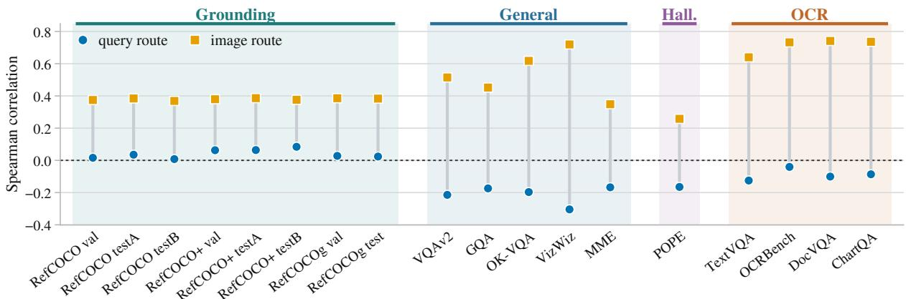  
Figure 6: Alignment of the image and text routes with the baseline's attention. • text route. image route. Error bars are 95% confidence intervals.

## A.2 The text route: a necessary condition for grounding

For the text route, we use a deletion test to ask the most direct question: can we do without it? Starting from the unpruned sequence of 576 visual tokens, we remove equal numbers of tokens selected by the text route, the image route, or at random, while progressively increasing the number removed. Figure 7 shows a consistent trend across eight REC splits: at low removal rates, random deletion has only a limited effect, whereas removing text-route tokens causes Acc@0.5 to drop sharply, usually faster than removing image-route tokens. The text route may not carry the majority of the evidence, but it provides query-specific evidence that grounding cannot do without—if the model does not know what the question refers to, how can it draw the box accurately? As the removal rate approaches one half, the curves of the two evidence routes gradually converge. At this point, large-scale information loss begins to dominate, and which route the removed tokens come from is no longer the main issue. This further supports our conclusion in the main text: the two evidence routes cannot substitute for each other and should each be allocated their own share of the fixed budget.

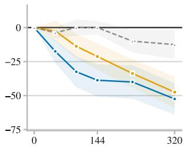  
(a) RefCOCO val

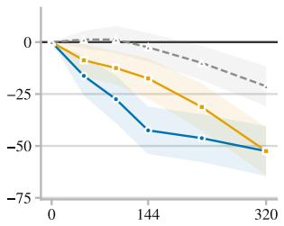  
(b) RefCOCO testA

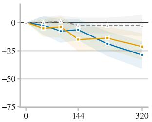  
(c) RefCOCO testB

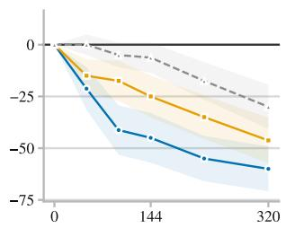  
(d) RefCOCO+ val

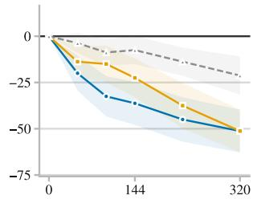  
(e) RefCOCO+ testA

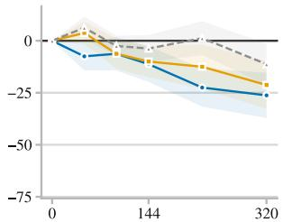  
(f) RefCOCO+ testB

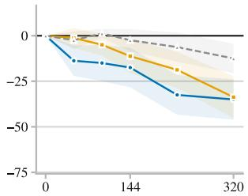  
(g) RefCOCOg val

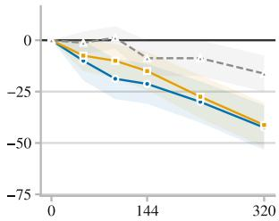  
(h) RefCOCOg test  
Figure 7: Deletion test on the eight REC splits. The horizontal axis is the number of tokens removed from the unpruned 576. The vertical axis is the change in Acc@0.5 relative to keeping all 576, in percentage points. Each panel shows three curves: --text route, image route, and --▲--random.

## A.3 The image route: a wider view

However well the text route is optimised, what it keeps is still word-level evidence: before the LLM there is no real understanding of the question, so the route can only keep the patches that look like the words it was given. This fails in two ways: the object the question refers to is not in the image at all, or the answer sits on something the question never names (or the question has no target to begin with). In both cases, selecting tokens purely by word similarity means that, under a reduced budget, the model is shown the wrong evidence, and hallucination follows. This is exactly what the image route is for: it does not read the question, and its wider view brings a more diverse sample of the scene into the budget.

Figure 8 shows three cases. In the first, the same image is asked two different questions: the tokens selected by the text route change with the question, while the image route does not read the query and its two rows are identical patch for patch. When asked about a bottle that is not in the image, only the text route answers “yes", while the image route and the half-and-half mix both answer correctly. When asked about the sink that is present, all four inputs answer correctly—so the text route does not say “yes" to everything, it says “yes" on fragments that merely look like the queried object. The remaining two cases show the other failure: what the question names is not where the answer lies, the text route again answers wrong, and the image route is needed to bring that wider view back.

## B Plugging Existing Pruning Methods into the Framework

To verify whether the mixed-granularity framework is effective in itself, we plug existing pruning methods into it (Table 5). Each method replaces the selection rule of only one kind of fine evidence, while the budgets of all three kinds of tokens stay fixed, and is compared with the same method used on its own under the same total budget. For image-intrinsic evidence, HiPrune and VisionZip replace our image-evidence selection on LLaVA-1.5-7B. Grounding on LLaVA-1.5-7B hardly separates different query-focused methods, so for query-focused evidence EADP replaces our query-evidence selection on Qwen2.5-VL-7B. With the mixed-granularity framework, every method improves substantially, most clearly on grounding: the per-dataset gains range from 9.7 to 20.6 points, and Avg. rises by 6.8 to 9.7 points.

mix

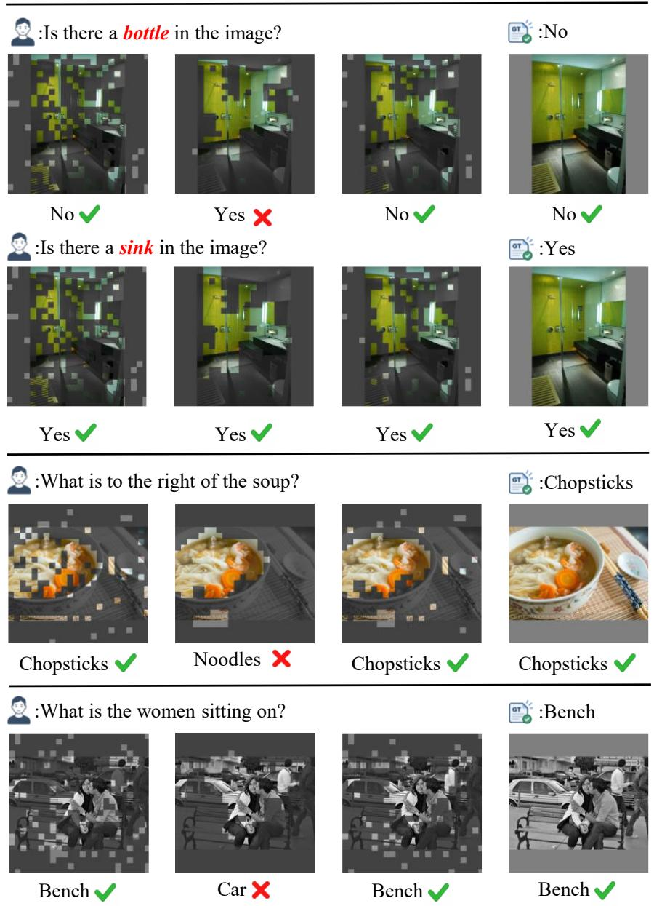  
Figure 8: Answers under single-route inputs. Each row is one question, with the ground truth shown by the icon on the right. The four columns are four visual token inputs: image route (CLS top-144) text route (scoring-chain top-144), mix (half from each route), and baseline (all 576 tokens). Within each panel, kept tokens retain their colour and discarded ones are dimmed.

## C Per-Cell Noise in the Cosine Map and What Smoothing Removes

The starting point is simple. Pruning keeps the top-m cells by score, and 576 cells compete for that small handful of seats at the upper tail. If the score of each cell has picked up the perturbation that comes with computing a cosine, the quality of the top-k suffers. This section is therefore about three things: that the noise exists, that a simple averaging operation can filter it out, and that this operation is safe, since the low-pass filter does not remove the information that matters.

Which cells of a cosine map are content and which are jitter can be told apart by a property that requires no labels: the two spread over different ranges. Content is contiguous—an object always occupies several cells, so the values of neighbouring cells are correlated—whereas estimation jitter is independent from cell to cell and is already unrelated one cell away. The vague question of whether there is noise, and how much, thus becomes a measurable one: how much of the variance in the map lives only at the scale of a single cell.

Table 5: Existing methods with and without our framework. HiPrune and VisionZip select the image-intrinsic evidence within the framework on LLaVA-1.5-7B, and EADP selects the query-focused evidence on Qwen2.5-VL-7B. Each grounding column averages Acc@0.5 over the val and test splits of that dataset, and Avg. averages all metrics relative to the unpruned model.
<table><tr><td rowspan="2">Method</td><td colspan="2">General</td><td colspan="2">Reasoning</td><td colspan="2">OCR</td><td colspan="2">Hall.</td><td colspan="2">Grounding</td><td rowspan="2">Avg.</td></tr><tr><td></td><td>GQA MMB</td><td>SQA-I AI2D</td><td></td><td> $\mathrm { \overline { { V Q A ^ { T } } } }$ </td><td></td><td></td><td></td><td>OCR-B POPE RefCOCO RefCOCO+ RefCOCOg</td><td></td></tr><tr><td colspan="10">LLaVA-1.5-7B, image-intrinsic evidence</td></tr><tr><td>HiPrune</td><td>58.2</td><td>64.0</td><td>68.3</td><td>53.0</td><td>44.2</td><td>290</td><td>81.2</td><td>16.3</td><td>13.9</td><td>15.2</td><td>75.9%</td></tr><tr><td>+ framework</td><td>59.3</td><td>63.3</td><td>68.2</td><td>52.9</td><td>43.8</td><td>288</td><td>80.5</td><td>36.9+20.6</td><td>30.7+16.8</td><td>28.6+13.4</td><td>85.6%+9.7</td></tr><tr><td>VisionZip</td><td>58.4</td><td>63.4</td><td>68.2</td><td>52.3</td><td>44.6</td><td>301</td><td>81.1</td><td>26.4</td><td>22.6</td><td>22.8</td><td>81.3%</td></tr><tr><td>+ framework</td><td>59.2</td><td>63.6</td><td>68.1</td><td>52.7</td><td>44.5</td><td>297</td><td>80.4</td><td>41.5+15.1</td><td>34.8+12.2</td><td>32.5+9.7</td><td>88.5% +7.2</td></tr><tr><td colspan="10">Qwen2.5-VL-7B, query-focused evidence</td></tr><tr><td>EADP</td><td>58.6</td><td>79.5</td><td>83.7</td><td>76.2</td><td>70.8</td><td>641</td><td>83.3</td><td>61.0</td><td>55.7</td><td>56.3</td><td>84.0%</td></tr><tr><td>+ framework</td><td>58.8</td><td>81.7</td><td>85.8</td><td>80.2</td><td>78.2</td><td>703</td><td>84.7</td><td>73.4+12.4</td><td>66.6+10.9</td><td>67.4+11.1</td><td>90.8%+6.8</td></tr></table>

We therefore look for evidence in two directions. One is spatial: how much relation a token still has with the cells around it. The other is spectral: among the light-and-dark fluctuations on the map, how many are large patches that vary slowly, and how many vary from one cell to the next? Objects are contiguous, so the fluctuations they produce can only be the former, that is concentrated at low frequency.

Figure 9 shows both. The first is the spatial one, which plots autocorrelation against distance. The horizontal axis is the distance d between two cells (in cells), and the vertical axis is the correlation coefficient of the values of two cells that far apart, averaged over samples,

$$
\rho ( d ) = \frac { \mathrm { { C o v } } \left( s ( i ) , s ( j ) \right) } { { \mathrm { V a r } } ( s ) } , \qquad \| i - j \| = d .
$$

The red curve is $\rho ( d )$ of the raw per-word map. The correlation of a cell with itself is always 1. It decreases with distance, and once the gap between two cells exceeds the scale of the content itself it falls to zero. What we actually read is this: the red curve has already dropped to about a half at $d = 1$ , and only then decays gently, reaching zero at around six cells, which matches the median half-width of the ground-truth boxes (dashed line). The initial drop and the subsequent decay say two different things. Writing the per-word map as content plus noise, $s = c + \varepsilon$ with ε independent from cell to cell, ε contributes nothing to the covariance at $d \geq 1$ , SO

$$
\rho ( d ) = ( 1 - \alpha ) \rho _ { c } ( d ) \quad ( d \geq 1 ) , \qquad \alpha = { \frac { \mathrm { V a r } ( \varepsilon ) } { \mathrm { V a r } ( s ) } } .
$$

That is, the drop from 1 to $\rho ( 1 )$ is exactly the share of variance α held by the cell-independent component, while the distance over which the gentle part extends is the correlation length of the content. The grey curve is the autocorrelation of the removed component: one cell out it already sits at zero, or even slightly below—it is unrelated even to its own neighbours and cannot carry content.

The second figure is another way of looking at the same thing. Autocorrelation splits the variance by distance, the power spectrum splits the same variance by scale, and the two are strict Fourier pairs (Wiener-Khinchin theorem). Concretely, a two-dimensional discrete Fourier transform of the $2 4 \times 2 4$ per-word map gives coefficients $F ( u )$ , and the energy at a given frequency is $| F ( u ) | ^ { 2 }$ which we then average radially over the modulus of the frequency:

$$
P ( f ) = \big \langle | F ( u ) | ^ { 2 } \big \rangle _ { \| u \| = f } .
$$

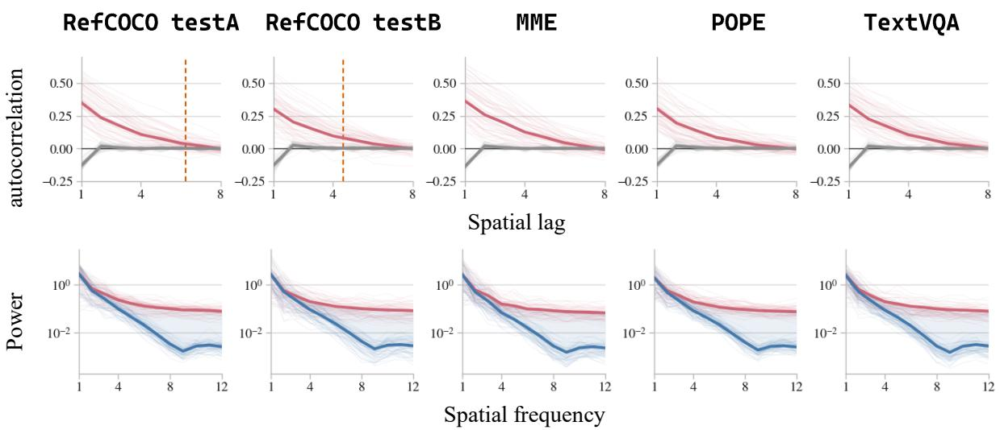  
Figure 9: Top row: autocorrelation against spatial lag, in cells. Bottom row: radially averaged power spectrum against spatial frequency, on a logarithmic vertical axis. Curves are  the raw map $s _ { w } , \perp$ the map after the 3×3 mean filter ${ \tilde { s } } _ { w } ,$ andthe removed component $s _ { w } - \tilde { s } _ { w }$ . Thin lines are individual samples and thick lines their mean. The dashed vertical line marks the median half-width of the ground-truth boxes.

Summing the energy over all frequencies gives exactly the total variance of the map (Parseval's identity), so asking which frequencies the energy falls on is asking how coarse the fluctuations that make up this variance are: the horizontal axis is spatial frequency, where low frequency corresponds to large, slow variation and high frequency to jitter that changes cell by cell. The vertical axis is logarithmic because the magnitudes are too far apart— the energy of the content at low frequency is one to two orders above the noise plateau, and on a linear axis the plateau would be squashed against zero, hiding the fact that it is flat.

The red curve is markedly high at low frequency, which says the map does carry contiguous content, while at high frequency it flattens into a horizontal plateau. Flatness means equal energy at every frequency, which is the signature of cell-independent noise, and the height of the plateau is the power of that noise. The blue curve is the spectrum after smoothing: at low frequency the two curves almost coincide, while at high frequency it is an order of magnitude lower—what has been removed is exactly that plateau, and the low frequency where the content lives is barely touched.

The other two curves in the figure confirm this. The grey curve is the removed part, and one cell out it is unrelated to its neighbours, which says that what we dropped is not content. The blue curve is the spectrum after smoothing, pushed down only at high frequency and almost coinciding with the red curve at low frequency, which says the content at low frequency is still there as it was. The 3 × 3 filter is therefore not smearing detail away but removing the jitter that should not win a seat: the part it removes carries no content, and the step is safe.

## D Norm Bias in the CLS Attention

The image saliency map S of Section 3.1 is the residual of the smoothed CLS attention after a linear regression on the patch norm (Eq. (4)). This appendix explains why this correction is needed. We first derive why the CLS attention follows the norm and verify each step of the derivation empirically (Appendix D.1), and then show how removing the norm-explained component changes the patches ranked at the top (Appendix D.2).

## D.1 Why the CLS Attention Follows the Norm

LayerNorm rescales every patch feature to the same length before the attention, so it is not obvious why the norm should affect the CLS attention at all. The CLS logit for patch $j$ is the inner product between the CLS query q and the key, and the key is a linear transform of the normalised feature $z _ { j }$ . LayerNorm fixes the length of $z _ { j }$ but not its composition. A large norm comes from a few channels with massive activations [5, 41], which point along a shared direction v that is stable across images. We call it the high-norm direction. We therefore split $z _ { j }$ into its component along v and the rest:

$$
z _ { j } = \| z \| \big ( \rho _ { j } v + \sqrt { 1 - \rho _ { j } ^ { 2 } } u _ { j } \big ) ,\tag{13}
$$

where $\rho _ { j } = \cos ( z _ { j } , v )$ , which we call the norm alignment of patch $j ,$ and $u _ { j } \perp v$ is the direction of the remainder. The larger the norm, the more these channels weigh after normalisation, and the higher the norm alignment: LayerNorm removes the norm, but the norm survives as alignment.

Since both the key projection and the inner product are linear, substituting this split separates the logit in each attention head into two terms:

$$
\log \mathrm { i t } _ { j } = { \frac { q ^ { \top } W _ { k } z _ { j } } { \sqrt { d } } } = \rho _ { j } { \frac { \| z \| q ^ { \top } W _ { k } v } { \sqrt { d } } } + { \sqrt { 1 - \rho _ { j } ^ { 2 } } } { \frac { \| z \| q ^ { \top } W _ { k } u _ { j } } { \sqrt { d } } } = G \rho _ { j } + g _ { j } .\tag{14}
$$

The first term is where the norm enters. G is shared by all patches, so $G \rho _ { j }$ is a bonus that each patch receives in proportion to its norm alignment, regardless of what it contains, and only $g _ { j }$ reflects the content. The softmax then turns this sum into a product:

$$
a _ { j } = \frac { e ^ { \mathrm { l o g i t } _ { j } } } { \sum _ { k } e ^ { \mathrm { l o g i t } _ { k } } } = n _ { j } c _ { j } , \qquad n _ { j } = e ^ { G \rho _ { j } } , \quad c _ { j } = \frac { e ^ { g _ { j } } } { Z } ,\tag{15}
$$

where $\begin{array} { r } { Z = \sum _ { k } e ^ { G \rho _ { k } + g _ { k } } } \end{array}$ is the softmax normaliser, $n _ { j }$ is a gain set by the norm alignment, and $c _ { j }$ is the content score. This is why the CLS attention follows the norm: a patch of large norm is multiplied by a large gain, whatever it contains. The derivation only needs G to exist, and its sign and size differ from head to head.

To verify this account, we feed all images of GQA, TextVQA, RefCOCO testA and RefCOCO testB to LLaVA-1.5-7B and measure, on the ViT layer used for scoring, three things: how strongly the CLS attention is biased toward high-norm patches, whether the bias arises through the mechanism derived above, and what the fit of Eq. (4) does to the map. Table 6 reports the medians over images. Throughout, H denotes the eight highest-norm patches of an image, 1.4% of the grid.

Bias. π is the share of the CLS attention received by H, and κ is the ratio of its mean attention to that of an ordinary patch. r and $r _ { \backslash \mathcal { H } }$ are the Pearson correlations between the attention map ã and the norm map ν, over all patches and with H excluded. The bias is large: H receives 17%-22% of the attention, 14 to 19 times an ordinary patch. It is also not confined to H, since the correlation drops only slightly once H is excluded. We therefore remove the whole norm-explained component rather than a few patches.

Mechanism. $\gamma$ is the mean cosine between the high-norm directions v of different images, and $R _ { \rho } ^ { 2 }$ and $R _ { \| h \| } ^ { 2 }$ are the shares of the logit variance explained by a linear fit on the norm alignment $\rho _ { j }$ and on the patch norm $\| h _ { j } \|$ . With $\gamma = 0 . 9 6$ on every split, v is a property of the model rather than of the image. $R _ { \rho } ^ { 2 }$ is about four times $R _ { \| h \| } ^ { 2 }$ , so the logit follows the norm alignment rather than the norm itself, as the derivation predicts once LayerNorm has removed the length.

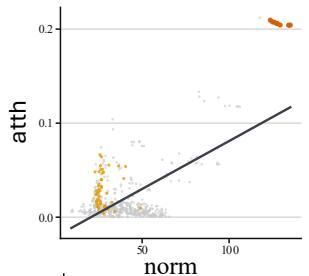

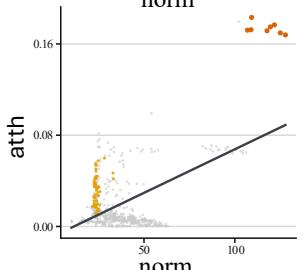

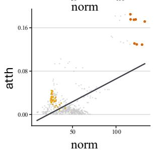

Correction. Taking the top 5% of patches by ν as high-norm, $\eta _ { \tilde { a } }$ and $\eta _ { S }$ are their share of the top 10% of ă and of $S ,$ where chance is $1 0 \% . \ r _ { s }$ is the Spearman correlation between ã and S. The fit of Eq. (4) lowers the high-norm share from 64%–75% to 46%–50%, while $r _ { s } \ge 0 . 8 7$ shows that the ranking of the other patches stays largely intact. The share remains above chance because the correction is first-order: sinks that rise far above the fitted line stay on top.

Table 6: Empirical check of the norm bias on LLaVA-1.5-7B, median over all images of each split. Symbols are defined in the text.
<table><tr><td rowspan="2">Split</td><td colspan="4">Bias</td><td colspan="3">Mechanism</td><td colspan="3">Correction</td></tr><tr><td>π</td><td>κ</td><td>r</td><td> $r _ { \backslash \mathcal { H } }$ </td><td>γ</td><td> $R _ { \rho } ^ { 2 }$ </td><td> $R _ { \| h \| } ^ { 2 }$ </td><td> $\eta _ { \tilde { a } }$ </td><td>ηs</td><td> $r _ { s }$ </td></tr><tr><td>GQA</td><td>22%</td><td>19×</td><td>0.53</td><td>0.49</td><td>0.96</td><td>0.67</td><td>0.17</td><td>75%</td><td>46%</td><td>0.87</td></tr><tr><td>TextVQA</td><td>17%</td><td>14×</td><td>0.30</td><td>0.25</td><td>0.96</td><td>0.59</td><td>0.16</td><td>64%</td><td>46%</td><td>0.92</td></tr><tr><td>RefCOCO testA</td><td>21%</td><td>18×</td><td>0.53</td><td>0.48</td><td>0.96</td><td>0.67</td><td>0.18</td><td>68%</td><td>46%</td><td>0.88</td></tr><tr><td>RefCOCO testB</td><td>22%</td><td>19×</td><td>0.54</td><td>0.49</td><td>0.96</td><td>0.63</td><td>0.14</td><td>75%</td><td>50%</td><td>0.87</td></tr></table>

## D.2 Effect on Token Selection

The derivation predicts that raw CLS attention hands its top ranks to high-norm patches, which mostly lie on the background, and that removing the norm-explained component returns these ranks to the content. Figure 10 illustrates this step from left to right on three cases. The two panels on the left are what one sees when raw CLS is borrowed as a content criterion: many of the bright cells fall on sea, grass, sky and other background, and most of the top-80 seats go to them. The middle panel shows why. The 576 points spread along a rising line — attention does follow norm — and that line is the baseline to be subtracted. The largest-norm cells are thrown far out to the right and almost all of them lie outside the box, so their score is bought by norm The cells inside the box, in contrast, crowd into the low-norm side and float above the line, and it is the part above the baseline that counts as content. Subtracting the baseline deducts the more from a cell the larger its norm, so the cells at the right end fall the furthest and those inside the box rise relative to them. The two panels on the right are the result of that subtraction: sink cells have not disappeared, but the background is markedly weakened and the seats have returned to the target. Nor should they disappear — they were never pushed below the line, and a sink is not meaningless to begin with, it aggregates information from the whole image.

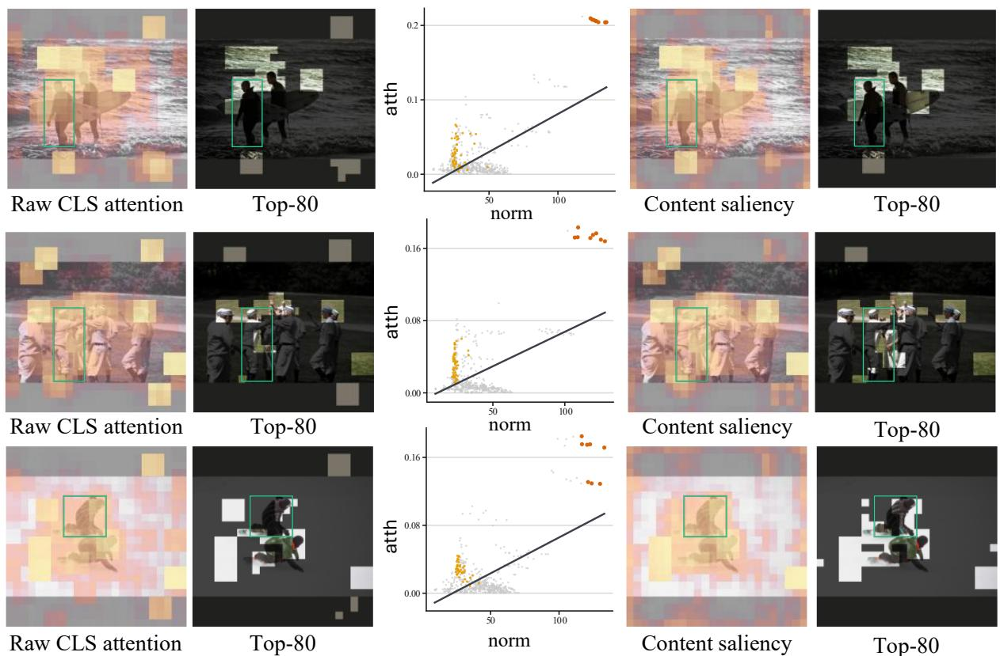  
Figure 10: Three cases, one per row, five panels read left to right. (a) raw CLS attention $\tilde { a } ;$ (b) the top-80 cells kept by ã; (c) the 576 cells as points, abscissa the patch norm $\nu ,$ ordinate ${ \tilde { a } } ,$ with the least-squares baseline in dark — points areinside the box,  outside it, andthe eight cells of largest norm; (d) the residual S; (e) the top-80 cells kept by S. In (b) and (e) kept cells retain their colour and discarded ones are dimmed. The box is the ground truth.

For token pruning a more direct reading is to ask where the high-norm tokens rank and where the tokens inside the ground-truth box rank. Figure 11 measures both on five grounding benchmarks. The top row plots the probability that the cell ranked r is one of the eight largest-norm cells: raw CLS hands its foremost seats to sink cells, about six in ten of the first eight being sink cells. The bottom row plots the probability that the cell ranked r falls inside the ground-truth box. An ideal ranking should be most accurate at r = 1 and decay from there, yet raw CLS starts below chance and climbs past it only around rank twenty, landing inside the box just 10% of the time over the first eight ranks. The norm control stays at the bottom throughout, which confirms the premise this section rests on: where the norm is high is background.

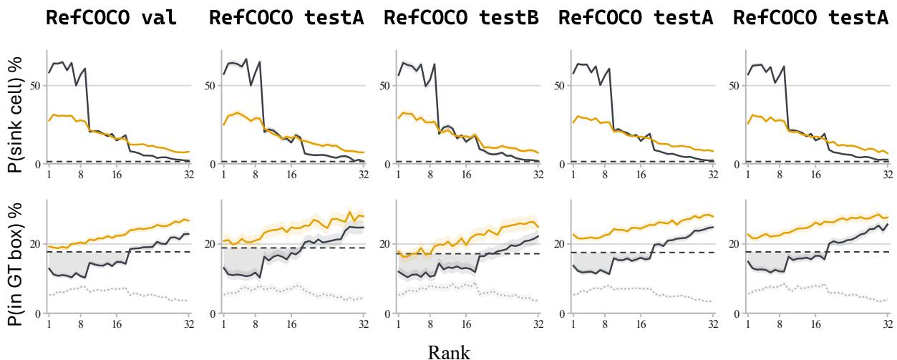  
Figure 11: One column per split, n = 600 images each. The horizontal axis is the rank r under the score (r = 1 is the highest-scoring cell). Top row: the probability that the cell ranked r is one of the eight largest-norm cells. Bottom row: the probability that it falls inside the ground-truth box. Curves are raw CLS ã andthe debiased S, with  the norm ν itself as a control in the bottom row. Bands are 95% confidence intervals of the mean and the dashed line is chance.

After debiasing both rows move in the intended direction. The peak in the top row roughly halves and shifts right, but it does not vanish: the median rank of a sink cell moves only from 5–6 to 13–15. That is the result we want rather than a defect — a sink still does its job of aggregating information over the whole image, and this step only weakens the say of the background, sink cells included. The in-box rate of the first eight ranks rises accordingly in the bottom row, which is the direct gain for token pruning: at the same budget, more of the selected tokens land on the target.

## E Algorithm for Image-Intrinsic Evidence Selection

Algorithm 1 shows the greedy procedure that maximises the representational coverage in Eq. (8).

Algorithm 1 Image-intrinsic evidence by attention-weighted coverage   
Require: patch features $\{ x _ { j } \} _ { j = 1 } ^ { N } $ CLS attention {aj}, tokens in place   
A0, budget Ni   
Ensure: image-intrinsic evidence Qi with |Qi| = Ni   
1: Cjk ← cos(xj, xk) for all j, k   
2: covj ← max (0, maxi∈A0 Cij) 0 if A0 = ∅   
3: A ← A0, Qi ← ∅   
4: for n = 1, . . . , Ni do   
5: t\* ← arg maxt∉A Σj aj relu(Ctj − covj)   
6: A ← A ∪ {t\*}, Qi ← Qi ∪ {t\*}   
7: covj ← max (covj, Ct\*j) for all j   
8: end for   
9: return Qi

## F Detailed Grounding Results on Qwen2.5-VL-7B

Table 7 lists the per-split grounding results behind the REC average in Table 3. Bifocal is best on every split at all three budgets.

Table 7: Visual grounding on Qwen2.5-VL-7B. All entries are ACC@0.5.
<table><tr><td>Method</td><td>RefCOCO val</td><td>test</td><td>testA</td><td>testB</td><td>RefCOCO+ val</td><td>testA</td><td>testB</td><td>RefCOCOg val</td><td>test</td><td>Avg.</td></tr><tr><td colspan="10">89.4 89.4 91.6 84.4</td></tr><tr><td></td><td></td><td></td><td></td><td></td><td>Retain 50% Tokens</td><td></td><td></td><td></td><td></td><td></td></tr><tr><td>VisionZip</td><td>77.9</td><td>78.4</td><td>81.9</td><td>72.9</td><td>75.2</td><td>81.1</td><td>68.4</td><td>77.5</td><td>77.4</td><td>89.6%</td></tr><tr><td>DART</td><td>75.7</td><td>76.7</td><td>80.8</td><td>71.2</td><td>70.0</td><td>76.7</td><td>62.8</td><td>72.2</td><td>72.8</td><td>85.5%</td></tr><tr><td>Nüwa</td><td>86.8</td><td>87.6</td><td>89.2</td><td>83.0</td><td>79.8</td><td>85.4</td><td>73.6</td><td>81.9</td><td>81.8</td><td>97.2% 89.4%</td></tr><tr><td>HiPrune</td><td>77.5</td><td>78.0</td><td>81.2 86.4</td><td>73.2</td><td>75.1</td><td>80.6</td><td>68.3</td><td>77.5</td><td>77.8</td><td>91.5%</td></tr><tr><td>EADP VLM-Pruner</td><td>82.6</td><td>83.0</td><td></td><td>76.3</td><td>75.5</td><td>81.9</td><td>66.0</td><td>76.7</td><td>76.6</td><td>94.0%</td></tr><tr><td>Bifocal (ours)</td><td>84.6 87.8</td><td>84.3 88.1</td><td>87.8 90.8</td><td>78.1 83.5</td><td>78.2 81.4</td><td>84.0 86.9</td><td>69.4 73.7</td><td>78.8 83.1</td><td>79.5 82.6</td><td>98.3%</td></tr><tr><td colspan="10"></td></tr><tr><td>VisionZip</td><td>61.5</td><td>61.7</td><td>66.6</td><td>Retain 25% Tokens</td><td></td><td>65.0</td><td>52.0</td><td>59.9</td><td>59.0</td><td>69.9%</td></tr><tr><td>DART</td><td>26.5</td><td>26.6</td><td>29.9</td><td>54.9 23.3</td><td>58.5 24.2</td><td>27.9</td><td>20.3</td><td>26.2</td><td>25.5</td><td>29.9%</td></tr><tr><td>Nüwa</td><td>77.0</td><td>77.6</td><td>80.3</td><td>73.2</td><td>68.2</td><td>73.9</td><td>62.5</td><td>72.8</td><td>72.7</td><td>85.4%</td></tr><tr><td>HiPrune</td><td></td><td>60.2</td><td>64.4</td><td></td><td>56.4</td><td>63.2</td><td>49.2</td><td>59.0</td><td>58.4</td><td>67.9%</td></tr><tr><td>EADP</td><td>59.4</td><td>62.1</td><td>68.6</td><td>53.1</td><td>56.8</td><td>64.9</td><td>45.4</td><td>56.4</td><td>56.1</td><td>67.9%</td></tr><tr><td>VLM-Pruner</td><td>60.9 43.9</td><td>44.4</td><td>51.3</td><td>52.4 36.7</td><td>41.1</td><td>48.2</td><td>32.3</td><td>40.4</td><td>39.8</td><td>49.1%</td></tr><tr><td>Bifocal (ours)</td><td>81.0</td><td>81.8</td><td>84.2</td><td>77.8</td><td>72.7</td><td>77.2</td><td>66.1</td><td>77.1</td><td>77.0</td><td>90.2%</td></tr><tr><td colspan="10">Retain 15% Tokens</td></tr><tr><td>VisionZip</td><td>38.6</td><td>38.9</td><td>44.2</td><td>34.1</td><td>36.7</td><td>41.6</td><td>30.6</td><td>36.6</td><td>36.5</td><td>43.8%</td></tr><tr><td>DART</td><td>6.0</td><td>6.1</td><td>6.3</td><td>6.6</td><td>5.2</td><td>5.8</td><td>5.4</td><td>6.2</td><td>5.5</td><td>6.9%</td></tr><tr><td>Nüwa</td><td>53.2</td><td>53.9</td><td>57.7</td><td>50.1</td><td>44.8</td><td>48.0</td><td>40.2</td><td>49.3</td><td>49.4</td><td>58.0%</td></tr><tr><td>HiPrune</td><td>35.6</td><td>35.9</td><td>39.9</td><td>31.6</td><td>32.9</td><td>37.3</td><td>28.9</td><td>34.6</td><td>34.1</td><td>40.3%</td></tr><tr><td>EADP</td><td>36.4</td><td>36.9</td><td>43.1</td><td>29.8</td><td>33.6</td><td>41.5</td><td>26.1</td><td>34.1</td><td>34.0</td><td>40.9%</td></tr><tr><td>VLM-Pruner</td><td>8.2</td><td>8.9</td><td>8.5</td><td>8.2</td><td>7.9</td><td>8.3</td><td>7.8</td><td>8.0</td><td>7.7</td><td>9.5%</td></tr><tr><td>Bifocal (ours)</td><td>62.1</td><td>63.4</td><td>67.2</td><td>58.1</td><td>51.5</td><td>58.1</td><td>47.8</td><td>57.6</td><td>57.3</td><td>67.9%</td></tr></table>

## G Results on LLaVA-NeXT-7B

The ANYREs backbone is a harder test: it splits each image into a variable number of crops, so the visual sequence is about four times longer than on LLaVA-1.5 and varies across images and a fixed token budget no longer corresponds to a fixed fraction of the sequence. As shown in Tables 8 and 9, the gap between general and grounding performance widens further on this backbone. On the general benchmarks all methods fall within a narrow band, and even at the 160-token budget the baselines differ by at most 10.9 points in Avg., whereas on grounding, Avg. ranges from 3.1% to 52.1%. At this budget, VisionZip reaches a general Avg. of 78.2%, close to the 79.8% of Bifocal, yet retains only 3.1% on grounding, about 17× lower than ours. General VQA is therefore largely insensitive to which tokens are retained, while grounding exposes the difference. Moreover, the four baselines that prune once before the LLM (VisionZip, HiPrune, EADP and SID) perform similarly on grounding at every budget, whether or not they use the query text, suggesting that where the budget is spent in the pipeline matters more than text awareness.

Table 8: General benchmarks on LLaVA-NeXT-7B. Within each tier, the best and second-best results are bold and underlined. Avg. averages benchmark-wise performance relative to the baseline.
<table><tr><td rowspan="2">Method</td><td colspan="3">General</td><td colspan="2">Reasoning</td><td colspan="4">OCR</td><td>Hall.</td><td rowspan="2">Avg.</td></tr><tr><td>GQA</td><td>MMB</td><td>VQAOK</td><td>SQA-I</td><td>AI2D</td><td> $\overline { { \mathrm { V Q A } ^ { \mathrm { T } } } }$ </td><td></td><td>OCR-B DocVQA ChartQA</td><td></td><td>POPE</td></tr><tr><td>Baseline</td><td>64.2</td><td>67.2</td><td>44.2</td><td>70.2</td><td>65.4</td><td>64.9</td><td>521</td><td>68.5</td><td>54.9</td><td>86.4</td><td>100.0%</td></tr><tr><td></td><td></td><td></td><td></td><td>Average Tokens ≈ 640</td><td></td><td></td><td></td><td></td><td></td><td></td><td></td></tr><tr><td>VisionZip</td><td>61.2</td><td>65.0</td><td>46.8</td><td>68.0</td><td>63.5</td><td>61.2</td><td>474</td><td>55.3</td><td>42.0</td><td>86.2</td><td>93.4%</td></tr><tr><td>SID</td><td>62.5</td><td>65.1</td><td>40.5</td><td>68.3</td><td>63.8</td><td>58.1</td><td>415</td><td>50.0</td><td>39.5</td><td>86.1</td><td>89.5%</td></tr><tr><td>Nüwa</td><td>63.4</td><td>64.6</td><td>43.7</td><td>68.8</td><td>64.0</td><td>63.0</td><td>376</td><td>60.9</td><td>48.5</td><td>85.6</td><td>93.5%</td></tr><tr><td>EADP</td><td>63.2</td><td>65.5</td><td>39.2</td><td>67.0</td><td>64.4</td><td>56.8</td><td>405</td><td>47.6</td><td>38.3</td><td>87.7</td><td>88.4%</td></tr><tr><td>HiPrune</td><td>61.8</td><td>66.2</td><td>41.6</td><td>68.6</td><td>65.0</td><td>61.6</td><td>486</td><td>57.1</td><td>44.0</td><td>85.6</td><td>93.7%</td></tr><tr><td>Bifocal (ours)</td><td>63.9</td><td>67.0</td><td>46.6</td><td>69.9</td><td>64.6</td><td>64.2</td><td>507</td><td>65.2</td><td>53.2</td><td>86.3</td><td>99.1%</td></tr><tr><td colspan="10">Average Tokens ≈ 320</td><td></td></tr><tr><td>VisionZip</td><td>58.9</td><td>63.6</td><td>43.8</td><td>67.5</td><td>62.4</td><td>58.3</td><td>397</td><td>41.8</td><td>35.9</td><td>82.0</td><td>86.4%</td></tr><tr><td>SID</td><td>60.6</td><td>63.0</td><td>30.8</td><td>67.7</td><td>62.1</td><td>53.4</td><td>363</td><td>40.8</td><td>34.2</td><td>85.8</td><td>82.2%</td></tr><tr><td>Nüwa</td><td>61.9</td><td>63.1</td><td>39.8</td><td>68.0</td><td>63.8</td><td>58.5</td><td>312</td><td>49.5</td><td>34.7</td><td>83.3</td><td>85.7%</td></tr><tr><td>EADP</td><td>61.7</td><td>63.1</td><td>26.1</td><td>67.6</td><td>63.2</td><td>49.7</td><td>312</td><td>32.6</td><td>27.4</td><td>86.1</td><td>77.5%</td></tr><tr><td>HiPrune</td><td>57.6</td><td>64.2</td><td>30.2</td><td>67.7</td><td>62.7</td><td>56.9</td><td>402</td><td>40.5</td><td>35.8</td><td>79.9</td><td>82.8%</td></tr><tr><td>Bifocal (ours)</td><td>63.3</td><td>64.8</td><td>45.9</td><td>66.4</td><td>62.5</td><td>61.0</td><td>415</td><td>54.4</td><td>46.8</td><td>84.8</td><td>92.6%</td></tr><tr><td colspan="10">Average Tokens ≈ 160</td><td></td></tr><tr><td>VisionZip</td><td>55.5</td><td>59.6</td><td>41.6</td><td>68.1</td><td>62.0</td><td>52.6</td><td>308</td><td>27.5</td><td>29.6</td><td>74.7</td><td>78.2%</td></tr><tr><td>SID</td><td>57.7</td><td>58.9</td><td>18.1</td><td>67.4</td><td>61.4</td><td>46.6</td><td>283</td><td>28.0</td><td>24.7</td><td>82.7</td><td>71.6%</td></tr><tr><td>Nüwa</td><td>58.5</td><td>60.1</td><td>33.3</td><td>66.5</td><td>62.2</td><td>51.8</td><td>219</td><td>31.4</td><td>28.1</td><td>77.6</td><td>75.4%</td></tr><tr><td>EADP</td><td>59.2</td><td>59.8</td><td>16.3</td><td>67.1</td><td>61.1</td><td>39.2</td><td>253</td><td>22.6</td><td>22.3</td><td>82.3</td><td>68.5%</td></tr><tr><td>HiPrune</td><td>51.6</td><td>59.9</td><td>17.5</td><td>68.7</td><td>60.7</td><td>42.7</td><td>259</td><td>22.0</td><td>26.8</td><td>65.9</td><td>67.3%</td></tr><tr><td>Bifocal (ours)</td><td>60.4</td><td>60.8</td><td>38.6</td><td>59.7</td><td>58.8</td><td>54.4</td><td>298</td><td>36.3</td><td>33.1</td><td>83.8</td><td>79.8%</td></tr></table>

Table 9: Visual grounding on LLaVA-NeXT-7B (ANYRES). All entries are ACC@0.5.
<table><tr><td>Method</td><td>RefCOCO val</td><td>testA</td><td>testB</td><td>RefCOCO+ val</td><td>testA</td><td>testB</td><td>RefCOCOg val</td><td>test</td><td>Avg.</td></tr><tr><td colspan="10">85.4 89.6 78.0</td></tr><tr><td></td><td></td><td></td><td></td><td>Average Tokens ≈ 640</td><td></td><td></td><td></td><td></td><td></td></tr><tr><td>VisionZip</td><td>8.5</td><td>8.4</td><td>8.2</td><td>7.1</td><td>7.9</td><td>7.0</td><td>9.0</td><td>9.2</td><td>10.1%</td></tr><tr><td>SID</td><td>35.0</td><td>38.9</td><td>30.6</td><td>30.8</td><td>34.8</td><td>26.0</td><td>33.1</td><td>33.5</td><td>40.7%</td></tr><tr><td>Nüwa</td><td>63.9</td><td>67.7</td><td>57.4</td><td>56.3</td><td>63.2</td><td>46.8</td><td>57.7</td><td>56.9</td><td>72.8%</td></tr><tr><td>EADP</td><td>35.9</td><td>39.0</td><td>30.9</td><td>31.4</td><td>35.1</td><td>25.1</td><td>33.8</td><td>34.2</td><td>41.1%</td></tr><tr><td>HiPrune Bifocal (ours)</td><td>32.0 78.1</td><td>35.3 83.6</td><td>29.5</td><td>27.2 70.2</td><td>31.5 79.2</td><td>24.2 58.2</td><td>29.0 73.9</td><td>29.1 72.5</td><td>36.9% 90.7%</td></tr><tr><td colspan="10">69.6 Average Tokens ≈ 320</td></tr><tr><td></td><td>4.5</td><td>4.2</td><td>4.8</td><td>3.7</td><td>3.5</td><td>4.2</td><td>4.7</td><td>4.8</td><td>5.3%</td></tr><tr><td>VisionZip SID</td><td>21.9</td><td>23.8</td><td>18.7</td><td>20.1</td><td>21.9</td><td>16.1</td><td>20.3</td><td>20.1</td><td>25.2%</td></tr><tr><td>Nüwa</td><td>33.7</td><td>35.4</td><td>32.8</td><td>26.1</td><td>29.6</td><td>22.5</td><td>28.6</td><td>28.4</td><td>36.8%</td></tr><tr><td>EADP</td><td>22.6</td><td>24.6</td><td></td><td></td><td>22.6</td><td>17.9</td><td>22.3</td><td>21.9</td><td>26.7%</td></tr><tr><td>HiPrune</td><td>13.2</td><td>11.2</td><td>19.4</td><td>21.1</td><td>10.6</td><td>11.5</td><td>11.6</td><td>12.7</td><td>14.8%</td></tr><tr><td>Bifocal (ours)</td><td>64.7</td><td>70.7</td><td>13.0 56.7</td><td>11.7 56.1</td><td>65.3</td><td>45.1</td><td>59.9</td><td>58.7</td><td>74.0%</td></tr><tr><td colspan="10">Average Tokens ≈ 160</td></tr><tr><td>VisionZip</td><td>2.6</td><td>2.1</td><td>3.3</td><td>2.0</td><td>1.6</td><td>2.7</td><td>2.7</td><td>2.8</td><td>3.1%</td></tr><tr><td>SID</td><td>12.4</td><td>12.3</td><td>12.2</td><td>11.1</td><td>11.5</td><td>10.6</td><td>10.6</td><td>11.5</td><td>14.3%</td></tr><tr><td>Nüwa</td><td>17.9</td><td>17.3</td><td>18.4</td><td>12.5</td><td>13.1</td><td>12.7</td><td>15.2</td><td>15.5</td><td>19.0%</td></tr><tr><td>EADP</td><td>16.0</td><td>17.4</td><td>14.5</td><td>15.1</td><td>15.9</td><td>13.0</td><td>14.6</td><td>14.7</td><td>18.8%</td></tr><tr><td>HiPrune</td><td>5.0</td><td>4.2</td><td>5.6</td><td>5.0</td><td>3.8</td><td>5.1</td><td>4.8</td><td>4.7</td><td>5.9%</td></tr><tr><td>Bifocal (ours)</td><td>45.6</td><td>50.4</td><td>40.2</td><td>38.3</td><td>45.5</td><td>31.2</td><td>42.9</td><td>42.1</td><td>52.1%</td></tr></table>

## H Efficiency Analysis

Token pruning primarily reduces prefill computation, but FLOP reductions do not necessarily translate into proportional speedups, as practical efficiency also depends on execution patterns and kernel implementations [13]. We therefore report FLOPs, per-sample prefill time, time to first token (TTFT), and peak memory on TextVQA at the 128-token budget in Table 10. While leading clearly on accuracy, Bifocal also achieves a 1.27× speedup in TTFT, faster than EADP, DART and VLM-Pruner and close to the fastest methods, with no extra memory cost.

Table 10: Efficiency on LLaVA-1.5-7B.
<table><tr><td>Method</td><td>Avg. Tokens</td><td>FLOPs (T)</td><td>Peak Mem. (GiB)</td><td>Prefill (ms)</td><td>TTFT (ms)</td><td>Speedup</td></tr><tr><td>LLaVA-1.5-7B</td><td>576</td><td>8.450</td><td>13.5</td><td>50.36</td><td>89.32</td><td>1.00×</td></tr><tr><td>VLM-Pruner</td><td>128</td><td>2.459</td><td>13.8</td><td>45.54</td><td>85.57</td><td>1.04×</td></tr><tr><td>EADP</td><td>128</td><td>2.454</td><td>13.5</td><td>25.41</td><td>81.67</td><td>1.09×</td></tr><tr><td>DART</td><td>128</td><td>2.483</td><td>13.4</td><td>35.86</td><td>75.00</td><td>1.19×</td></tr><tr><td>VisionZip</td><td>128</td><td>2.454</td><td>13.5</td><td>24.37</td><td>65.42</td><td>1.37×</td></tr><tr><td>HiPrune</td><td>128</td><td>2.454</td><td>13.5</td><td>24.40</td><td>64.75</td><td>1.38×</td></tr><tr><td>Bifocal (ours)</td><td>128</td><td>2.458</td><td>13.4</td><td>28.61</td><td>70.61</td><td>1.27×</td></tr></table>

## I Details of Benchmarks

VQAv2 [11]. evaluates open-ended visual question answering on balanced image-question pairs, with complementary images designed to reduce language priors and encourage stronger visual grounding.

GQA [16]. GQA evaluates compositional visual reasoning over natural images using questions derived from scene graphs, emphasizing objects, attributes, spatial relations, and structured reasoning.

MMBench [27]. MMBench is a comprehensive multimodal benchmark that evaluates a broad range of perception and reasoning abilities through carefully designed multiple-choice questions.

OK-VQA [32]. OK-VQA evaluates knowledge-based visual question answering, where answering often requires external or commonsense knowledge beyond information directly observable in the image.

ScienceQA [30]. ScienceQA evaluates multimodal scientific reasoning over questions from natural science, social science, and language domains, requiring models to combine visual understanding with contextual and domain knowledge.

AI2D [19]. AI2D evaluates diagram understanding and reasoning over scientific illustrations, requiring models to interpret visual components, textual labels, symbols, and their structural relationships.

TextVQA [39]. TextVQA evaluates visual question answering over text-rich natural images, requiring models to recognize scene text and reason jointly over textual and surrounding visual information.

OCRBench [28]. OCRBench evaluates OCR-related capabilities of multimodal large language models across text recognition, scene-text understanding, document understanding, and information extraction.

DocVQA [34]. DocVQA evaluates question answering over document images, emphasizing text recognition, layout understanding, information localization, and reasoning over structured document content.

ChartQA [33]. ChartQA evaluates question answering over chart images, requiring models to understand chart elements and perform visual, logical, and arithmetic reasoning over the underlying data.

POPE [21]. POPE is a diagnostic benchmark for object hallucination, using binary questions to test whether multimodal models incorrectly report objects that are absent from the image.

RefCOCO [18, 54]. RefCOCO evaluates referring expression comprehension by requiring models to localize objects described by natural-language expressions in complex visual scenes.

RefCOCO+ [18, 54]. RefCOCO+ evaluates referring expression comprehension while restricting explicit location words, placing greater emphasis on object appearance, attributes, and relational

cues.

RefCOCOg [18, 54]. RefCOCOg contains longer and more descriptive referring expressions, requiring models to integrate fine-grained object attributes and contextual relationships for accurate visual grounding.

## J Visualisations

J.1 Fine-Grained Tasks on Qwen2.5-VL-7B  
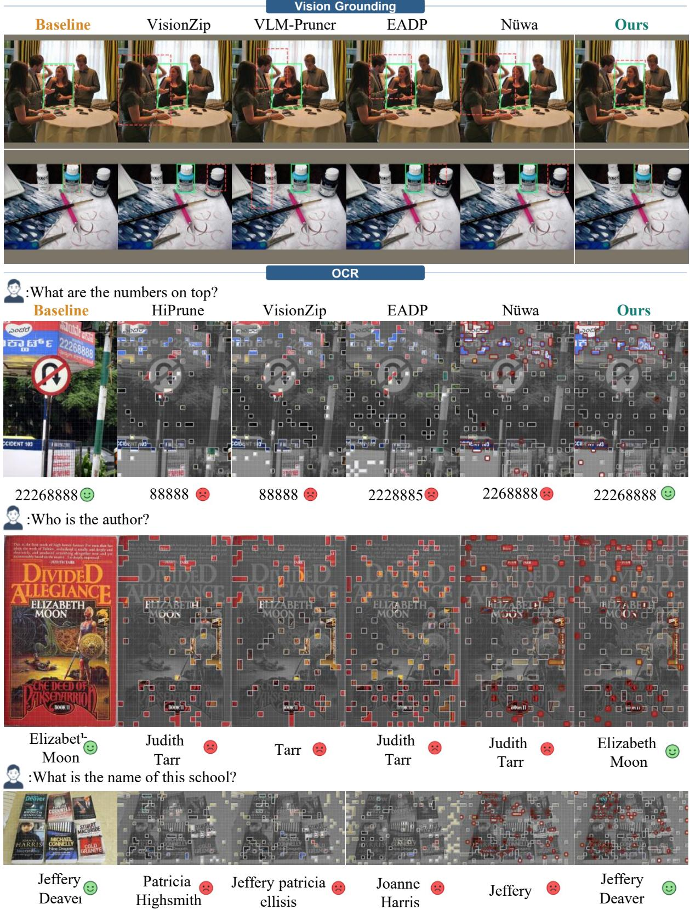  
Figure 12: Grounding and OCR cases on Qwen2.5-VL-7B. In the grounding cases,  is the ground truth and  the prediction.

J.2 Fine-Grained Tasks on LLaVA-1.5-7B  
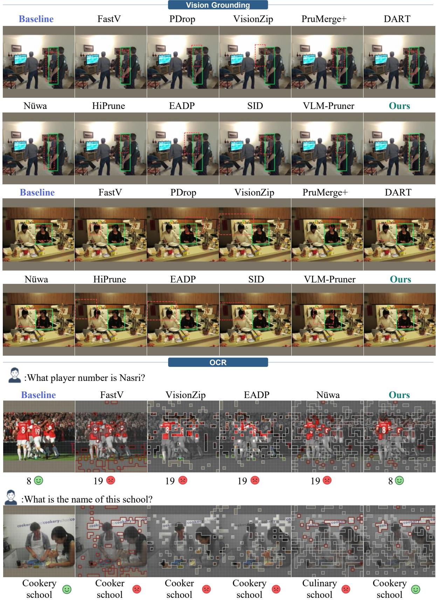  
Figure 13: Grounding and OCR cases on LLaVA-1.5-7B. Outputs of the unpruned model and of pruning methods under the same budget.

## J.3 Image-Intrinsic and Query-Focused Evidence

Figure 14 shows the fine evidence Bifocal selects for one image under several POPE queries. The image-intrinsic evidence, selected from the CLS attention, spreads over the whole image and barely changes across queries. The query-focused evidence instead changes with the query and gathers on the object it names. The two kinds of evidence thus play the roles they are designed for: one covers the image, the other follows the question.

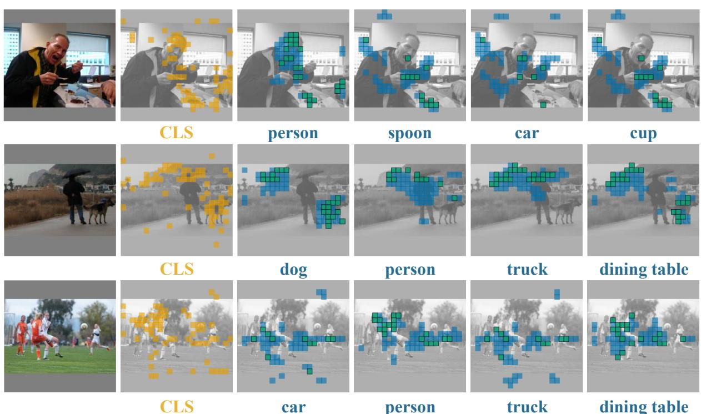  
Figure 14: The two kinds of fine evidence under different queries. Each row is one POPE image. The first panel after the input showsthe image-intrinsic evidence, and the remaining panels show the query-focused evidence for each query.