# CÆNL: Collapse-Based Active Neural Learning with Objective-Aligned Representation Control

Saad Alqithami

alqithami@gmail.com

13 October 2026

## Abstract

Active learning changes the representations used to acquire subsequent labels. We study this interaction through Collapse-Based Active Neural Learning (CÆNL), which separates acquisition, Dynamic Collapse Regularization (DCR), and its coeficient policy. DCR penalizes a normalized within-class to between-class scatter residual above a frozen reference, with a separate class-separation safeguard. Fixed, scheduled, deterministicfeedback, and learned-feedback policies apply this objective. The analysis establishes scatter invariances, conditional local descent, and coeficient bounds, and shows why clean geometry alone cannot guarantee input robustness. Six-seed classification comparisons are complemented by a 104-run study with separate control selection and ten-seed evaluations on each of two backbones. At 60% annotations on ImageNet-100, entropy acquisition with DCR and MACC-Lite reaches 73.420 ± 0.512% accuracy on ResNet-50 and 73.086 ± 0.397% on ResNet-18 (mean ± seed SD), exceeding entropy alone by 1.742 and 1.834 percentage points. Both gains survive Holm correction under paired-t and exact sign-flip tests, with unchanged feedback settings across backbones. Independently tuned constants attain slightly higher mean accuracy; the paired comparisons establish neither adaptive superiority nor equivalence. Separate six-seed spectral studies yield a small fixed-regularization C4 loss reduction, worse CIFAR-10 difusion FID, and inconclusive AudioCaps captioning efects. Earlier classification studies find near-zero AutoAttack accuracy at L radius 8/255 and no added benefit from learned control. The results support the evaluated combined classification treatment and identify the task dependence of geometry-informed regularization.

Keywords: neural collapse; active learning; representation geometry; feedback control; regularization; discriminative learning

## 1 Introduction

Active learning seeks to make efective use of a limited annotation budget by selecting examples from an unlabeled pool [1]. In deep learning, this selection depends on a representation that is itself updated after new labels are acquired. Uncertainty, coverage, and gradient diversity provide complementary criteria for choosing examples [2, 3], while the training objective determines how those examples reshape the representation. These two decisions interact: changing the learned features can alter subsequent predictions and acquisitions, even when the acquisition rule remains fixed. This interaction motivates studying representation regularization as an explicit part of the active-learning process.

Neural collapse ofers a geometric motivation for such regularization. During the terminal phase of classifier training, features from the same class become concentrated, and class means and classifier weights approach a structured configuration [4]. Relative within-class compactness and between-class separation therefore provide measurable properties of a developing representation. In an active-learning setting, however, the labeled sample and its class support change across rounds. A geometry measurement must be interpreted with respect to that changing sample, and a desired geometric structure must be connected to an objective that can influence training. The relevant question is whether using this information improves prediction at a given annotation budget.

Turning geometry into a feedback signal introduces two design questions. First, the observed statistic should have an explicit relationship to the loss term whose influence the controller changes. Otherwise, a coeficient update may modulate an objective that does not directly penalize the measured deviation. Second, the benefit of the representation loss must be distinguished from the benefit of adapting its coeficient. Adaptive loss weighting has established precedents, including gradient balancing in multitask learning [5]; here the feedback concerns a representation statistic within a task. A comparison with unregularized training assesses the complete treatment, whereas tuned constant and preset-schedule controls test whether observing geometry adds predictive value to coeficient selection. These considerations define our central question: under a common acquisition and optimization protocol, how does geometry-driven regularization afect prediction, and how do fixed, scheduled, and feedbackcontrolled strengths compare?

We investigate this question through Collapse-Based Active Neural Learning (CÆNL), a framework with separately specified acquisition, representation-loss, and coeficient-control components. Dynamic Collapse Regularization (DCR) uses a normalized within-class to between-class scatter statistic for classification. A onesided penalty acts on deviations above targets calibrated at initialization, and a separate safeguard discourages loss of between-class separation. The same statistic enters the loss and the feedback state, implementing objective–feedback alignment. The Meta-Adaptive Collapse Controller (MACC) provides deterministic bounded feedback in MACC-Lite and learned coeficient actions in Full MACC. Acquisition can use predicted-class geometric deviation or an established criterion such as entropy. This modular formulation allows the acquisition rule and the training treatment to be compared separately. Here, “collapse-based” refers to regulating relative class dispersion; the scatter statistic does not by itself characterize every property of neural collapse.

The contributions are as follows:

1. Objective-aligned representation control. We formulate the normalized scatter objective, its fixed targets and separation safeguard, and the deterministic and learned coeficient updates within a budgeted active-learning loop. The formulation makes the measured quantity, the modulated loss, and the acquired-label information available to each component explicit.

2. Supporting geometric and control analysis. We characterize scatter decomposition and invariance, the local efect of an isolated regularizer step, and bounds on coeficient updates. An explicit fullupdate condition and a constructive robustness counterexample identify the additional assumptions needed to connect feature geometry to task behavior.

3. Controlled evaluation across methods and tasks. We compare acquisition rules and regularization controls in six-seed ImageNet-100 studies, followed by separate control selection and ten-seed confirmation and backbone transfer. Further sixseed studies evaluate spectral regularization for language modeling, image generation, and audio captioning, with task-specific outcomes and computational measurements.

The principal classification finding is a benefit of the combined aligned-DCR and MACC-Lite treatment over entropy acquisition alone. At 60% annotations, the paired gains are 1.742 percentage points on ResNet-50 and 1.834 points on ResNet-18, and both survive the specified multiplicity correction. The feedback settings transfer unchanged between these backbones. The independently tuned constant has slightly higher mean accuracy in both cases, and neither paired comparison establishes superiority or equivalence. These comparisons distinguish the benefit of the complete classification treatment from the contribution of coeficient adaptation. The earlier acquisition and controller comparisons provide complementary evidence; their designs and statistical families are distinguished in Section 6.1.

The other tasks assess a separate spectral objective rather than the supervised class-scatter loss. Fixed spectral regularization produces a small C4 languagemodeling loss reduction, all evaluated spectral conditions worsen CIFAR-10 difusion FID relative to unregularized fine-tuning, and the AudioCaps comparisons establish no captioning benefit. Classification robustness is also evaluated separately, with near-zero accuracy under the specified AutoAttack threat model. These results make task performance the criterion for judging a geometric intervention and delineate the scope of the framework beyond its classification gains.

Section 2 positions the approach in the literature. Sections 3–5 develop the formulation, controllers, and supporting analysis. Sections 6 and 7 present the protocols and results, followed by interpretation and limitations in Section 8 and conclusions in Section 9.

## 2 Background and related work

CÆNL sits at the intersection of representation geometry, label acquisition, and adaptive optimization. These areas address diferent decisions: what structure features should acquire, which examples should be annotated, and how strongly an auxiliary objective should influence training. Reviewing these decisions separately helps identify the role of collapse-based feedback within an active-learning system.

## 2.1 Neural collapse and its theoretical scope

Papyan et al. [4] identified a coordinated terminaltraining geometry: within-class variability contracts, centered class means approach a simplex equiangular tight frame (ETF), classifier weights align with those means, and classification approaches a nearest-centroid rule. These properties jointly define the phenomenon. A scalar scatter ratio can measure relative class compactness, but cannot by itself verify ETF angles, classifier alignment, or agreement with nearest-centroid decisions. It is also distinct from the pseudoinversenormalized NC1 statistic. We therefore use collapse as motivation for a measurable regularization target, rather than equating one favorable statistic with the full phenomenon.

Theoretical work explains when such geometry is compatible with an optimization objective. Zhu et al. [6] analyze regularized cross-entropy in an unconstrained-feature model, where features are optimization variables rather than outputs constrained by a complete network. Under their assumptions, global minimizers have simplex-ETF structure and other critical points are strict saddles. This establishes a precise link between an objective and its optimal geometry, while leaving the feature-learning dynamics of a general finite network outside that model.

Subsequent results show why architecture and regularization must be specified. Súkeník et al. [7] find regimes of the deep unconstrained-feature model in which lower-rank solutions are preferred to deep neural collapse. Their later work [8] establishes approximate collapse at global optima of particular regularized ResNet and transformer models with LayerNorm, with the approximation improving as depth increases. These results concern diferent models and assumptions. Hong and Ling [9] further analyze shallow ReLU networks with explicit data dependence: the conditions for collapse and its generalization consequences depend on architecture and signal-to-noise structure. Collapse can coexist with poor generalization in their low-signal regime.

Recent work also broadens the geometry beyond a balanced simplex. Wang et al. [10] study feature– classifier space misalignment in long-tailed learning and introduce explicit alignment strategies. Alcala et al. [11], in a 2026 preprint, characterize alternative configurations in the orthoplex regime, where feature dimension d and class count C satisfy $d + 2 \leq C \leq 2 d .$ Together, these studies motivate measuring class separation as well as contraction. They also distinguish geometric alignment of features and classifiers from the objective–feedback alignment investigated here: consistency between the statistic penalized by a loss and the statistic observed by its coeficient controller.

## 2.2 Discriminative and spectral representation objectives

The use of within-class and between-class moments predates neural collapse. Fisher’s discriminant criterion [12] seeks directions that separate class means relative to within-class variation. DeepLDA [13] brings a discriminant objective into learned representations. Center loss [14] instead penalizes feature distances to learned class centers alongside softmax training. Supervised contrastive learning [15] uses class labels to bring same-class embeddings together while separating diferent-class embeddings. These approaches establish compactness and separation as useful, longstanding representation objectives; the use of class moments alone is not the contribution of CÆNL.

The distinctions concern the quantity optimized and how it enters training. Center loss controls distances to learned prototypes, DeepLDA uses a discriminant criterion, and supervised contrastive learning operates through relations among embeddings. Our classification objective uses a normalized log ratio of equal-classweighted scatter, penalizes only deviations above a frozen reference target, and includes a separate safeguard against loss of between-class separation. Its controller observes that same ratio. This construction permits direct comparisons between a constant coeficient, a predetermined schedule, and feedback without changing the underlying auxiliary objective. The present experiments evaluate those controls, rather than ranking all discriminative representation losses.

Class-conditional contraction should also be distinguished from degenerate representation collapse. In self-supervised learning, VICReg [16] preserves perdimension variability and reduces covariance redundancy while encouraging agreement between views. A useful representation can therefore require preserving variation, not simply suppressing it. This distinction is particularly relevant to our spectral extensions: reducing spectral complexity without class labels need not preserve the distinctions required for language prediction, generation, or captioning. Those extensions use a separate objective and require their own task evaluations.

## 2.3 Active learning through uncertainty and coverage

Pool-based active learning allocates annotations using the current model and the remaining unlabeled data [1]. Predictive entropy is an accessible uncertainty score, but uncertainty about an output and uncertainty about model parameters need not be the same. Gal et al. [17] integrate approximate Bayesian neural-network uncertainty into image acquisition, including Bayesian active learning by disagreement (BALD), which selects points for their information about model parameters. Such criteria motivate careful interpretation of any geometric score: distance from a class center is not automatically an estimate of epistemic uncertainty.

Batch selection introduces a complementary coverage problem because individually uncertain points may be redundant. Core-set selection [2] addresses coverage in embedding space. BADGE [3] combines uncertainty and diversity by selecting from hallucinated last-layer gradient embeddings. Noise Stability [18] estimates uncertainty from output changes under parameter perturbations and relates the resulting selection to large, diverse gradients. These mechanisms use diferent information and incur diferent acquisition costs; an equal annotation count does not make their computational workloads identical.

Uncertainty Herding [19] formulates uncertainty coverage to connect the low- and high-label-budget regimes. Its greedy selection balances uncertainty with coverage in a fixed feature space, addressing the budget dependence of purely uncertainty- or representationdriven selection. Our numerical comparison implements its margin-weighted coverage mechanism using shared-initial task-model features under the common candidate-pass and warm-start conventions specified in Section 6.6.

Recent acquisition methods make this balance adaptive. Jung et al. [20] study combinations of acquisition functions and their accuracy–computation trade-ofs, including feedback-based aggregation. Cui et al. [21] use labeled-data feedback to construct a TrustSet and learn a batch acquisition policy. In CÆNL, the optional Mahalanobis score instead measures deviation from the predicted class using acquired-label statistics. It is a roundwise selection criterion. Our principal control study holds entropy acquisition fixed so that its comparisons address the training treatment; the acquisition alternatives are examined separately.

## 2.4 Adaptive weighting and representation feedback

Adapting the influence of loss terms is an established optimization idea. Kendall et al. [22] learn task weights through a likelihood formulation based on homoscedastic uncertainty. GradNorm [5] adjusts weights using gradient magnitudes and relative training rates to balance multitask learning. Both demonstrate that the choice of feedback signal is central to an adaptive weighting rule. Their task-balancing objectives differ from controlling a representation statistic within a single classification task, but they provide relevant precedents for learning or updating loss weights during training.

MACC-Lite uses a bounded deterministic update driven by deviations of the monitored scatter statistic from its frozen target. Full MACC learns coeficient actions through a policy-gradient mechanism [23]; its acquisition-policy head is disabled in the evaluated conditions. Thus the feedback acts on regularization strengths, whereas aggregation and TrustSet act on the selection of examples. Holding this distinction explicit avoids attributing a training improvement to a better query policy.

This literature motivates a specific empirical question: once a representation objective is fixed, does observing its state improve the choice of its coeficient? A constant, a predetermined schedule, and feedback can produce diferent training trajectories even when they share the same loss. Comparing only against unregularized training cannot distinguish the usefulness of the loss from the usefulness of adaptation. Our separately tuned controls and subsequent confirmation therefore test that distinction directly. Table 1 summarizes the relevant methodological relationships and identifies the comparisons actually executed.

## 2.5 Geometry, robustness, and predictive evaluation

Representation geometry, predictive confidence, and resistance to input perturbations describe diferent properties. Su et al. [24] study neural collapse in both standard and adversarially trained networks, showing that small adversarial perturbations can disrupt the clean simplex structure of nonrobust models. Their analysis also identifies aligned clean and perturbed geometry in robust models. These findings make robustness a separate empirical question, rather than a consequence of clean-feature compactness. AutoAttack [25] provides an ensemble evaluation designed to reduce dependence on a single attack; its interpretation still requires the input norm, radius, and preprocessing to be stated.

Calibration likewise concerns the relationship between reported confidence and correctness [26]. An auxiliary representation loss can change both accuracy and confidence, so we report calibration separately from the scatter statistic and clean accuracy. This evaluation perspective connects the literature to our experimental design: geometry motivates the intervention, while matched task outcomes assess its usefulness. The paper’s focus is the specified coupling of representation loss and coeficient feedback, with acquisition, robustness, and cross-task efects evaluated as distinct questions.

## 3 Problem formulation and representation measurements

The classification formulation distinguishes three roles for representation geometry: a diferentiable training statistic, an aggregate feedback signal, and a samplelevel acquisition score. The first two use the same normalized scatter measurement; acquisition uses a separate raw-feature distance. The spectral formulation for the other tasks is given in Section 4.5.

## 3.1 Sets, budgets, and information access

Let $\mathcal { D } = ( x _ { i } ) _ { i \in \mathcal { I } }$ be a fixed training pool with index set $\mathcal { I } = \{ 1 , \ldots , N \}$ and class labels $y _ { i } \in \{ 1 , \ldots , C \}$ . All partitions below are sets of indices. After acquisition round r, $A _ { r } \subseteq \tau$ contains the annotated indices and $\mathcal { U } _ { r } = \mathcal { T } \setminus \mathcal { A } _ { r }$ the remaining pool. A fixed feedback set $\mathcal { H } \subset A _ { 0 }$ is included in the annotation budget and excluded from model-gradient updates and acquisition statistics. Thus, $\mathcal { T } _ { r } = \mathcal { A } _ { r } \backslash \mathcal { H }$ supplies gradient-training examples. Feedback labels are available to the control and tuning procedures specified in Sections 4 and 6.4.

For total annotation budget B, round $r + 1$ selects distinct indices $Q _ { r + 1 } \subseteq \mathcal { U } _ { r }$ with $| Q _ { r + 1 } | = b _ { r + 1 } \leq$ min $\{ \vert \mathcal { U } _ { r } \vert , B - \vert \mathcal { A } _ { r } \vert \}$ . After their labels are obtained,

$$
\mathcal { A } _ { r + 1 } = \mathcal { A } _ { r } \cup Q _ { r + 1 } , \qquad \mathcal { U } _ { r + 1 } = \mathcal { U } _ { r } \setminus Q _ { r + 1 } .
$$

Consequently, $\begin{array} { r } { | A _ { r } | = | A _ { 0 } | + \sum _ { i = 1 } ^ { r } b _ { j } \le B } \end{array}$ , including feedback labels. The initial stratified annotation protocol is specified in Section $6 . 2 ;$ subsequent query decisions do not use the hidden labels of $\mathcal { U } _ { r }$

The model produces logits $f _ { \theta } ( x ) \in \mathbb { R } ^ { C }$ and pooled features $z _ { l } ( x ) \in \mathbb { R } ^ { d _ { l } }$ at monitored layers $l \in { \mathcal { L } } .$ Training, feedback, acquisition, and evaluation transforms are specified separately. Oficial evaluation labels do not enter the acquisition or online controller. Partition disjointness is by index; content duplicates and their sensitivity analysis are reported in Section 7.3. Performance is compared at fixed annotation budgets. Using 60% of the pool does not alone establish a 40% annotation saving at equal accuracy.

## 3.2 Class-balanced normalized scatter

Consider a labeled measurement set S with finite features. Let ${ \mathcal { C } } _ { S } = \{ y _ { i } : i \in S \}$ be its represented classes, $K = | \mathcal { C } _ { S } |$ , and $S _ { c } = \{ i \in { \mathcal { S } } : y _ { i } = c \}$ with $n _ { c } = | S _ { c } |$ Thus K may be smaller than the total class count C. For each monitored layer, define

$$
h _ { i , l } = \frac { z _ { l } ( \boldsymbol { x } _ { i } ) } { \operatorname* { m a x } \{ \| z _ { l } ( \boldsymbol { x } _ { i } ) \| _ { 2 } , \epsilon _ { \mathrm { n } } \} } , \qquad \epsilon _ { \mathrm { n } } = 1 0 ^ { - 6 } .\tag{1}
$$

Table 1: Positioning relative to representative acquisition, representation, and loss-weighting methods. Numerical entries are ImageNet-100 clean accuracy at 60% annotations in the earlier six-seed studies (mean ± seed SD), not numbers pooled from diferent published benchmarks. A dash denotes a conceptual comparison that was not evaluated here.
<table><tr><td>Method</td><td>Principal strength or focus</td><td>Distinction or limitation for this study Matched top-1</td><td>(%)</td></tr><tr><td>Center loss / DeepLDA [13, 14]</td><td>Direct discriminative representation objectives</td><td>No matched coefficient-control experiment here</td><td></td></tr><tr><td>Supervised contrastive learning [15]</td><td>Label-based attraction and separation of embeddings</td><td>Different objective; not a tested alternative loss here</td><td></td></tr><tr><td>VICReg [16]</td><td>Preserves variance while reducing redundancy</td><td>Self-supervised objective; distinct from class-conditional contraction</td><td></td></tr><tr><td>GradNorm / uncertainty weighting [5, 22]</td><td>Adaptive balancing of multiple task losses</td><td>Different feedback signals and optimization goals; not executed here</td><td></td></tr><tr><td>BADGE [3]</td><td>Uncertainty and gradient diversity</td><td>Acquisition criterion; does not modulate the scatter objective</td><td> $7 1 . 1 1 0 \pm 0 . 4 6 7$ </td></tr><tr><td>Noise Stability [18]</td><td>Perturbation-based acquisition signal</td><td>Higher measured acquisition cost in this implementation</td><td> $7 1 . 0 2 3 \pm 0 . 2 4 9$ </td></tr><tr><td>Uncertainty Herding [19]</td><td>Uncertainty-weighted feature coverage</td><td>Local fixed-initial-R50 adaptation; published benchmark recipe not</td><td> $7 1 . 7 4 7 \pm 0 . 6 2 6$ </td></tr><tr><td>Aggregation/ TrustSet [20, 21]</td><td>Adaptive acquisition using feedback</td><td>reproduced Acquisition actions differ from the regularization-only Full MACC studied</td><td></td></tr><tr><td>Aligned DCR + Lite (entropy)</td><td>Shared statistic in loss and coefficient feedback</td><td>here Specified-control comparison; later tuned-control results in Section 7.1</td><td> $7 3 . 3 6 0 \pm 0 . 2 0 8$ </td></tr></table>

Let $\begin{array} { r } { \mu _ { c , l } = n _ { c } ^ { - 1 } \sum _ { i \in S _ { c } } h _ { i , l } } \end{array}$ and $\begin{array} { r } { \bar { \mu } _ { l } = K ^ { - 1 } \sum _ { c \in \mathcal { C } _ { S } } { \mu _ { c , l } } . } \end{array}$ The equal-class-weighted population moments and stabilized log ratio are

$$
W _ { l } = \frac { 1 } { K } \sum _ { c \in \mathcal { C } _ { S } } \frac { 1 } { n _ { c } } \sum _ { i \in \mathcal { S } _ { c } } \| h _ { i , l } - \mu _ { c , l } \| _ { 2 } ^ { 2 } ,\tag{2}
$$

$$
B _ { l } = \frac { 1 } { K } \sum _ { c \in \mathcal { C } _ { S } } \| \mu _ { c , l } - \bar { \mu } _ { l } \| _ { 2 } ^ { 2 } ,\tag{3}
$$

$$
q _ { l } = \log ( W _ { l } + \epsilon _ { \mathrm { s } } ) - \log ( B _ { l } + \epsilon _ { \mathrm { s } } ) .\tag{4}
$$

Here $\epsilon _ { \mathrm { s } } = 1 0 ^ { - 6 }$ and $\kappa _ { l } = \exp ( q _ { l } ) = ( W _ { l } + \epsilon _ { \mathrm { s } } ) / ( B _ { l } + \epsilon _ { \mathrm { s } } )$ The denominator $n _ { c }$ defines a population moment, rather than an unbiased sample-variance estimate. Each class receives weight $1 / K$ regardless of its example count.

The implementation requires $K \ge 2$ and $n _ { c } \geq 2$ for every represented class. Training further requires balanced batches: $K = 1 6$ classes with eight distinct examples per class. Assessment permits unequal counts and computes the moments once over the complete assessment set, using all represented classes. In contrast, feedback uses moving averages of training-batch $q _ { l }$ and $B _ { l }$ . A mean of batch log ratios is generally diferent from the log ratio computed over their pooled examples; class support and input transforms also difer across these measurements.

A smaller $q _ { l }$ indicates lower stabilized within-class dispersion relative to between-class dispersion. It does not determine every pairwise class distance, the full covariance spectrum, or the classifier boundary. In particular, identical features give $W _ { l } = B _ { l } = 0$ and $q _ { l } = 0 ;$ numerical finiteness does not certify useful class separation. Section 4 therefore specifies a separate separation penalty and its limitations. Normalization gives $\| h _ { i , l } \| _ { 2 } \leq 1$ , with equality above the norm floor. The moments are invariant to a common orthogonal transformation and, when the floor is inactive before and after scaling, to common positive feature rescaling (Proposition 1).

## 3.3 Sample-level geometry for acquisition

At an acquisition checkpoint, use raw pooled features from ${ \mathcal { T } } _ { r } ,$ with the same deterministic transform used for pool scoring. For each global class $c \in \{ 1 , \ldots , C \}$ , let ${ \mathcal { T } } _ { r , c } = \{ i \in { \mathcal { T } } _ { r } : y _ { i } = c \}$ and $m _ { r , c } = | T _ { r , c } |$ . The reference statistics are

$$
\widehat { \mu } _ { c , l } = \frac { 1 } { m _ { r , c } } \sum _ { i \in { \mathcal { T } } _ { r , c } } z _ { l } ( x _ { i } ) ,
$$

$$
\widehat { v } _ { c , l , j } = \frac { 1 } { m _ { r , c } } \sum _ { i \in \mathcal { T } _ { r , c } } ( z _ { l , j } ( x _ { i } ) - \widehat { \mu } _ { c , l , j } ) ^ { 2 } .
$$

Round and checkpoint dependence are suppressed in this notation. The implementation requires $m _ { r , c } \geq 2$ for every global class; there is no fallback estimate for an unsupported class. With predicted class ${ \widehat { c } } ( x ) =$ arg max<sub>c</sub> $f _ { \boldsymbol { \theta } } ( \boldsymbol { x } ) _ { c }$ , define

$$
u _ { l } ( x ) = \sum _ { j = 1 } ^ { d _ { l } } \frac { ( z _ { l , j } ( x ) - \widehat { \mu } _ { \widehat { c } ( x ) , l , j } ) ^ { 2 } } { \widehat { v } _ { \widehat { c } ( x ) , l , j } + \epsilon _ { a } } ,\tag{5}
$$

$$
s ( x ) = \sum _ { l \in \mathcal { L } } \alpha _ { l } u _ { l } ( x ) , \qquad \alpha _ { l } \geq 0 , \quad \sum _ { l } \alpha _ { l } = 1 .\tag{6}
$$

Here $\epsilon _ { a } = 1 0 ^ { - 5 }$ is added once to each variance, and layer3 and layer4 have weights 0.5 each. Thus $u _ { l }$ is a squared diagonal Mahalanobis distance; it uses neither a square root nor a full covariance inverse. Acquired true labels define the reference classes, while predictions assign unlabeled candidates to a reference class.

The checkpoint and reference statistics remain fixed during a round’s query selection and are recomputed after subsequent training. The largest scores are selected within repeated candidate passes, with ties resolved by candidate order, until the round quota is filled (Section 4.4). This procedure does not select the global topscoring subset of the entire pool. A high score indicates deviation from the predicted-class reference; confident outliers can also score highly. The raw-feature diagonal score does not inherit the general orthogonal or exact scale invariance of the normalized scatter statistic. Its usefulness for acquisition is therefore evaluated separately from the training and feedback efects.

## 4 Objective-aligned DCR and regularization control

Building on Section 3, the classification method uses the normalized scatter statistic to define both a representation loss and the feedback that adjusts its strength. The construction has two time scales: coeficients act within training phases, while label acquisition occurs between phases. We first specify the shared objective and frozen reference targets, then the deterministic and learned controllers, and finally their integration into active learning. The spectral task variants use the separate formulation in Section 4.5.

## 4.1 Frozen targets and classification objective

Each seed begins with a shared cross-entropy-only checkpoint trained on $\mathcal { T } _ { 0 }$ . Before the first acquisition, 16 fixed class-balanced anchor batches from $\mathcal { T } _ { 0 }$ are evaluated using deterministic center crops. Let $\overline { { q } } _ { l , 0 }$ and $\overline { { B } } _ { l , 0 }$ be their mean log ratio and mean between-class dispersion. The targets are

$$
q _ { l } ^ { \star } = \overline { { q } } _ { l , 0 } + \log ( 0 . 9 ) , \qquad B _ { l } ^ { \operatorname* { m i n } } = 0 . 5 \overline { { B } } _ { l , 0 } .\tag{7}
$$

Thus $\exp ( q _ { l } ^ { \star } )$ is 90% of the geometric mean of the anchor ratios. Calibration requires $\overline { { B } } _ { l , 0 } > 1 0 \epsilon _ { \mathrm { s } }$ , giving $B _ { l } ^ { \mathrm { m i n } } > 5 \epsilon _ { \mathrm { s } } > 0$ . These seed-specific targets are shared across methods and remain frozen as the annotated set grows. They define a reference intervention, rather than an optimal geometry or a threshold for the diferently aggregated 100-class assessment statistic.

For a current gradient-training batch, $\mathcal { L } _ { \mathrm { C E } }$ is its mean cross-entropy and $q _ { l } , B _ { l }$ are the instantaneous moments defined in Section 3. Define the one-sided Huber penalty

$$
H _ { \delta } ( u ) = \left\{ \begin{array} { l l } { 0 , } & { u \le 0 , } \\ { u ^ { 2 } / ( 2 \delta ) , } & { 0 < u < \delta , } \\ { u - \delta / 2 , } & { u \ge \delta . } \end{array} \right.\tag{8}
$$

The aligned Dynamic Collapse Regularization (DCR) objective is

$$
R _ { l } = H _ { \delta } ( q _ { l } - q _ { l } ^ { \star } ) ,\tag{9}
$$

$$
F _ { l } = H _ { \delta } \left( \log B _ { l } ^ { \mathrm { m i n } } - \log ( B _ { l } + \epsilon _ { \mathrm { s } } ) \right) ,\tag{10}
$$

$$
\mathcal { L } _ { \mathrm { A D } } = \mathcal { L } _ { \mathrm { C E } } + \sum _ { l \in \mathcal { L } } \lambda _ { l } ^ { \mathrm { e f f } } R _ { l } + \beta _ { B } \sum _ { l \in \mathcal { L } } F _ { l } .\tag{11}
$$

We use $\delta = 0 . 2 5 , \ \epsilon _ { \mathrm { s } } = \epsilon _ { \mathrm { n } } = 1 0 ^ { - 6 }$ , and $\beta _ { B } ~ = ~ 0 . 0 1$ The ratio penalty vanishes when $q _ { l } \leq q _ { l } ^ { \star }$ ; it therefore penalizes excess dispersion without forcing equality to the target. The separation penalty vanishes when $B _ { l } + \epsilon _ { \mathrm { s } } \geq B _ { l } ^ { \mathrm { m i n } }$ . It discourages the degenerate geometry identified in Section 3, but does not exclude every degenerate stationary point or separate every class pair.

The nonnegative applied coeficients $\lambda _ { l } ^ { \mathrm { e f f } }$ distinguish fixed, scheduled, and feedback-controlled treatments. All regularized classification treatments retain the same separation penalty, including when Full MACC disables a ratio term. The unregularized reference omits both penalties. Coeficients and targets are held constant during each model-gradient update; gradients pass through the current batch moments. The dense class-incidence calculation costs $O ( n K d _ { l } )$ per layer for a batch of n examples, with $K = 1 6$ , without forming a full covariance matrix.

For feedback, moving moments are initialized at the calibration means. After each optimizer step k, the observations from that step’s forward pass update

$$
\widetilde { m } _ { l } ^ { ( k ) } = 0 . 9 5 \widetilde { m } _ { l } ^ { ( k - 1 ) } + 0 . 0 5 m _ { l } ^ { ( k ) } , \qquad m \in \{ q , B \} .
$$

At a control boundary t, denote the latest values by $\widehat { q } _ { l , t }$ and $\widehat { B } _ { l , t }$ . This aligns the loss and feedback at the level of the measured statistic, while retaining the distinction between instantaneous and smoothed measurements made in Section 3. Cross-entropy, augmentation, momentum, and interactions among layers still afect the resulting trajectory.

## 4.2 Deterministic coeficient control: MACC-Lite

The Meta-Adaptive Collapse Controller (MACC) adjusts regularization strength from observed training state. MACC-Lite uses a deterministic rule. With residual $e _ { l , t } = \widehat { q } _ { l , t } - q _ { l } ^ { \star }$ and $[ e ] _ { + } = \operatorname* { m a x } \{ e , 0 \}$ , its bounded leaky update is

$$
u _ { l , t } = \lambda _ { \mathrm { m a x } } \operatorname { t a n h } \left( \frac { [ e _ { l , t } ] _ { + } } { \delta } \right) ,\tag{12}
$$

$$
\lambda _ { l , t + 1 } = ( 1 - \rho ) \lambda _ { l , t } + \rho u _ { l , t } .\tag{13}
$$

Here $\lambda _ { \operatorname* { m a x } } = 0 . 1 0 , \rho = 0 . 2 0$ , and the coeficient state is initialized at $\lambda _ { l , 0 } = 0 . 0 3$ before the first phase-start action. Lite applies $\lambda _ { l } ^ { \mathrm { e f f } } = \lambda _ { l }$ without activation flags. Positive residuals set a positive desired strength; when the residual is nonpositive, the coeficient decays toward zero. The convex update preserves its stated bounds (Proposition 4), without establishing closedloop stability or target convergence.

Holdout cross-entropy is recorded, but does not enter the Lite action. The original fixed-strength comparison uses $\lambda _ { l } = 0 . 0 3$ . The later study independently selects a constant and a predetermined schedule while keeping the Lite rule unchanged (Section 6.4). These controls distinguish the efect of the representation objective from the additional value of responding to its observed state.

## 4.3 Learned coeficient control: Full MACC

Full MACC learns which coeficient increments and activation flags to apply. Its policy has two 128-unit hidden layers with GELU activations. At boundary t, the state for the next action contains each layer’s smoothed log ratio, target deviation, temporal-change feature, current coeficient, and activation flag, followed by training progress and feedback cross-entropy on H. The two-layer classification configuration therefore has 12 state entries. Progress is the fraction of planned control windows completed across the acquisition phases.

With $\widehat { \kappa } _ { l , t } = \exp ( \widehat { q } _ { l , t } )$ and $q _ { l , t } ^ { \mathrm { p r e v } }$ the reference from the preceding completed window, the temporal feature is

$$
d _ { l , t } = \frac { \lvert \widehat { q } _ { l , t } - q _ { l , t } ^ { \mathrm { p r e v } } \lvert \widehat { \kappa } _ { l , t } } { \operatorname* { m a x } \{ \widehat { \kappa } _ { l , t } , 1 0 ^ { - 1 2 } \} } .\tag{14}
$$

Away from the numerical floor, this is the absolute log-ratio change, without additional standardization. The reference starts at the calibration mean and is refreshed after each completed window.

Each action chooses a layer-wise increment from $\{ - 0 . 0 1 , - 0 . 0 0 5 , 0 , 0 . 0 0 5 , 0 . 0 1 \}$ and a binary flag $g _ { l }$ The stored coeficient is incremented and projected to [0, 0.10]; the applied coeficient is $\lambda _ { l } ^ { \mathrm { e f f } } = g _ { l } \lambda _ { l }$ . Stored coeficients begin at 0.03 and flags at one, before the first action. The selected coeficients remain fixed during the following window of at most 100 optimizer steps.

Index completed windows by t. Let $\ell _ { t } ^ { H }$ be feedback cross-entropy at the end of window $t ,$ and $s _ { H } =$ max $\{ 0 . 1 , \ell _ { \mathrm { p h a s e } , 0 } ^ { H } \}$ the scale fixed at the start of its acquisition phase. Define the geometric potential from the smoothed moments as

$$
\begin{array} { l } { \displaystyle \Psi _ { t } = \sum _ { l \in \mathcal { L } } H _ { \delta } \big ( \widehat { q } _ { l , t } - q _ { l } ^ { \star } \big ) } \\ { \displaystyle + \beta _ { B } \sum _ { l \in \mathcal { L } } H _ { \delta } \Big ( \log B _ { l } ^ { \mathrm { m i n } } - \log ( \widehat { B } _ { l , t } + \epsilon _ { \mathrm { s } } ) \Big ) . } \end{array}
$$

For the action applied during that window, the reward is

$$
\begin{array} { l } { { \displaystyle r _ { t } = \mathrm { c l i p } \bigg ( \frac { \ell _ { t - 1 } ^ { H } - \ell _ { t } ^ { H } } { s _ { H } } , - 1 , 1 \bigg ) } } \\ { { \displaystyle ~ + 0 . 1 \mathrm { c l i p } ( \Psi _ { t - 1 } - \Psi _ { t } , - 1 , 1 ) } } \\ { { \displaystyle ~ - 0 . 0 1 \frac { 1 } { | \mathcal { L } | } \sum _ { l \in \mathcal { L } } \frac { \chi _ { l , t } ^ { \mathrm { e f f } } } { 0 . 1 0 } } . } \end{array}\tag{15}
$$

The three terms reward feedback-loss reduction and geometric progress, and penalize applied strength. The ratio terms in $\Psi _ { t }$ are not multiplied by the controlled coeficients, so switching a ratio term of cannot alone produce a geometric reward. At the first window of each phase, the preceding loss and potential are that phase’s starting values. Oficial evaluation labels do not enter this reward.

Uniform exploration decreases linearly from probability 0.10 toward 0.02 over the planned actions. Otherwise, actions are sampled from the policy’s categorical distributions. Only policy-sampled actions receive RE-INFORCE updates [23]; uniform exploratory actions still contribute to the moving reward baseline. The advantage uses the previous baseline, which is updated afterward with observation weight 0.05. The first reward initializes this baseline and has zero centered advantage, although the entropy term can still update the policy. Policy optimization uses Adam with learning rate $\mathrm { { 3 } \times 1 0 ^ { - \bar { 4 } } }$ and entropy coeficient 0.001.

Algorithm 1 specifies the order of reward attribution, policy updating, and action selection. The terminal action receives its reward before the phase ends. The acquisition-policy head is disabled: query counts and candidate-pass settings remain those in Section 4.4. Full MACC consequently learns regularization control online within each run; it is not meta-trained across tasks.

## 4.4 Round-based active learning

Figure 1 connects the data partitions and measurements of Section 3 to the loss and controllers above. Algorithm 2 gives the classification execution order. Each method starts from the same seed-specific model and optimizer checkpoint. A round first acquires labels using that checkpoint, then trains on the enlarged $\mathcal { T } _ { r } .$

During acquisition, the checkpoint is fixed and required pool predictions and features are cached. Candidate passes contain at most 10,000 examples, sampled without replacement within each pass. For a pass of size $n ,$ the quota is min $\{ b _ { \mathrm { r e m } } , \lceil 0 . 1 0 n \rceil \}$ , where $b _ { \mathrm { r e m } }$ is the remaining round quota. Selected indices are removed; unselected candidates may recur in later passes. The Mahalanobis conditions rank Equation (6) within each pass, breaking ties by candidate order. Random, entropy, BADGE, and Noise Stability share the annotation and candidate-pass budgets, with method-specific selection rules and computational costs.

After the labels are acquired, model parameters and optimizer momentum are retained. Controller state and moving geometry also carry across phases, while the learning-rate schedule restarts. Each phase measures its starting holdout loss and geometric potential and selects an initial action before gradient training begins. Subsequent control boundaries occur every 100 steps and at the final step. Lite selects a new strength at nonterminal boundaries; Full MACC credits the completed action and then selects its successor. At the terminal boundary, Full MACC credits the last action without sampling an unused successor. Reinitializing the next phase’s loss and potential references prevents changes caused by acquisition and the learning-rate restart from being attributed to the preceding phase’s final action.

Algorithm 1 Full-MACC update at the end of a control window   
Input: Controller state C with policy $\pi _ { \phi }$ and pending pair $( S _ { t } , A _ { t } )$ ; model $f _ { \theta }$ after at most 100 SGD steps under $A _ { t } ;$ fixed   
holdout $\mathcal { H } ;$ reward baseline $b _ { t } ;$ terminal flag d.   
Output: Updated controller state $C ,$ baseline $b _ { t + 1 } ,$ and pending pair $P \in \{ ( S _ { t + 1 } , A _ { t + 1 } ) , \emptyset \}$   
Evaluate the completed window   
1 $\ell _ { t } ^ { H } \gets \mathsf { C }$ rossEntropy $( f _ { \theta } , \mathcal { H } ) ; \Psi _ { t }  \mathrm { G l }$ eometricPotential $\mathbf { \Omega } _ { \iota } ( C )$   
2 $r _ { t } \gets \mathrm { R E W A R D } ( \ell _ { t - 1 } ^ { H } , \ell _ { t } ^ { H } , \Psi _ { t - 1 } , \Psi _ { t } , s _ { H } , \lambda _ { t } ^ { \mathrm { e f f } } )$ ▷ Equation (15); phase-fixed $s _ { H }$   
Credit the action before selecting its successor   
3 if b is uninitialized then   
$\begin{array} { r l r l } { { 4 } } & { { } } & { } & { { } b _ { t }  r _ { t } } \end{array}$ ▷ The first centered advantage is zero   
5 end if   
6 $a _ { t }  r _ { t } - b _ { t }$   
7 $b _ { t + 1 } \gets 0 . 9 5 b _ { t } + 0 . 0 5 r _ { t }$   
8 if $A _ { t }$ was sampled from $\pi _ { \phi }$ then   
9 ϕ ← ReinforceUpdat $\mathfrak { z } ( \phi , S _ { t } , A _ { t } , a _ { t } , \eta _ { \mathrm { e n t } } = 0 . 0 0 1 )$ ▷ Regularization heads and entropy term only   
10 end if   
11 $P  \emptyset$ ▷ Uniform exploratory actions receive no policy-gradient update   
12 if ¬d then   
13 $S _ { t + 1 } \gets \mathrm { B U I L D S T A T E } ( C , \ell _ { t } ^ { H } )$   
14 $A _ { t + 1 } \gets \mathrm { S A M P L E A C T I O N } ( \pi _ { \phi } , S _ { t + 1 } )$ ▷ Policy sampling or scheduled uniform exploration   
15 $C \gets \mathrm { A P P L Y B o U N D E D A C T I O N } ( C , A _ { t + 1 } )$ ▷ Project strengths to [0, 0.10] and apply layer flags   
16 $P \gets ( S _ { t + 1 } , A _ { t + 1 } )$   
17 end if   
18 $C $ RefreshReferences $( C , \ell _ { t } ^ { H } , \Psi _ { t } , \widehat { q _ { t } } )$   
19 return $( C , b _ { t + 1 } , P )$ ▷ Terminal reward is retained; no unused next action is sampled

## 4.5 Spectral formulation for language, difusion, and audio

The other tasks retain the idea of controlling a representation penalty, but use the covariance-spectrum formulation discussed in Section 2.2. They do not use the supervised class partition or the scatter target of the classification method. Their objective is

$$
\mathcal { L } _ { \mathrm { s p e c } } = \mathcal { L } _ { \mathrm { t a s k } } + \sum _ { l \in \mathcal { L } } \lambda _ { l } \| p _ { l } - p _ { l } ^ { \star } \| _ { 2 } ^ { 2 } ,\tag{16}
$$

where $\lambda _ { l }$ denotes the applied strength, including any activation flag. The penalty matches eigenvalue vectors rather than full covariance matrices.

For a centered feature matrix $Z _ { l } \in \mathbb { R } ^ { n _ { l } \times d _ { l } }$ , the implementation computes descending, nonnegative eigenvalues $\sigma _ { l , j }$ of $Z _ { l } ^ { \top } Z _ { l } / n _ { l }$ , using the smaller Gram matrix $Z _ { l } Z _ { l } ^ { \top } / n _ { l }$ when appropriate. With $k _ { l } = \operatorname* { m i n } ( k , d _ { l } )$ , retain the first $k _ { l }$ eigenvalues and pad with zeros if fewer are available. The batch spectrum is normalized over these retained entries:

$$
p _ { l , j } = \frac { \sigma _ { l , j } } { \sum _ { a = 1 } ^ { k _ { l } } \sigma _ { l , a } + \epsilon _ { \mathrm { s p e c } } } , \quad j = 1 , \ldots , k _ { l } .\tag{17}
$$

With $\epsilon _ { \mathrm { s p e c } } = 1 0 ^ { - 8 }$ , the total mass can be appreciably smaller than one when the retained spectral sum is very small. A rank-r flat target assigns mass $1 / r$ to its first r entries and zero to the rest. The target rank is restricted by the feature dimension, retained spectrum size, and, when necessary, the centered sample-rank bound $n _ { l } - 1$ . Matching these eigenvalues leaves eigenvectors and class arrangements unspecified.

The spectral monitor uses the full moving covariance spectrum, whereas the loss is computed by eigenspectrum autodiferentiation from the current truncated batch spectrum. Smoothness is local to regions where the relevant eigenvalues remain separated. Ties crossing the retained-spectrum or target-rank boundary can make the penalty nonsmooth; autodiferentiation does not establish global smoothness. For an exactly normalized nonzero spectrum π, efective rank is $\begin{array} { r } { \exp \bigl ( - \sum _ { j } \pi _ { j } \log \pi _ { j } \bigr ) } \end{array}$ . Neither this spectral measurement nor the loss is the supervised trace ratio of Equation (4). The spectral controller rules and settings are task-specific; Table 3 and Section 6.8 distinguish them from the aligned classification controllers above.

Language modeling uses token hidden states with next-token cross-entropy. Difusion uses spatially pooled U-Net mid-block activations with noiseprediction mean squared error. Audio captioning uses learned prefix embeddings and pooled audio-tokenencoder features with next-token cross-entropy. These experiments evaluate spectral regularization and coeficient control without learned label acquisition.

## 5 Analysis of representation geometry and coeficient control

Sections 3 and 4 define the geometry measurements, the aligned objective, and the coeficient updates. We now establish their mathematical properties and identify the conditions under which geometric quantities can inform prediction. The analysis proceeds from the measurements to an isolated regularizer step, the controller response, and conditional error and robustness bounds. The scatter and control results concern the aligned classification method; the spectral variants in Section 4.5 use diferent objectives and update rules.

```latex
Algorithm 2 CÆNL active learning in the original classification study
Input: Indexed pool D with indices $\boldsymbol { \mathcal { T } } ;$ initial annotations $\mathcal { A } _ { 0 } ;$ fixed feedback set $\mathcal { H } \subset A _ { 0 } ;$ oficial evaluation set $\nu ;$ methods
M; layers $\mathcal { L } ;$ per-round budget b; $R = 5$ acquisition rounds.
Output: Scheduled checkpoints and clean/robust evaluation results for every method, using the same seed-specific
initialization.
Shared initialization and calibration
1 $\mathcal { T } _ { 0 }  \mathcal { A } _ { 0 } \setminus \mathcal { H } ; \mathcal { U } _ { 0 }  \mathcal { T } \setminus \mathcal { A } _ { 0 }$
2 $( \theta _ { 0 } , \Omega _ { 0 } ) \gets \mathrm { T R A I N C R O S S E N T R O P Y } ( \mathcal { T } _ { 0 } )$ ▷ Ω denotes optimizer state, including momentum
3 $\Gamma  \mathrm { C } .$ alibrateTargets $( f _ { \theta _ { 0 } } , T _ { 0 } , \stackrel { . } { \cal L } )$ ▷ Freeze all $q _ { l } ^ { \star }$ and $B _ { l } ^ { \mathrm { m i n } }$
4 for each method m $\in \mathcal { M }$ do
5 $( \theta , \Omega ) \gets \mathrm { R E S T O R E } ( \theta _ { 0 } , \Omega _ { 0 } ) ; C \gets \mathrm { I N I T I A L I Z E C O N T R O L } ( m , \Gamma )$
6 $\dot { \mathcal { A } }  \dot { \mathcal { A } } _ { 0 } ; \mathcal { U }  \mathcal { U } _ { 0 }$
7 for $r = 1 , \ldots , R$ do
Acquire labels using the current model
8 $F \gets \mathrm { I N F E R P o o L } ( f _ { \theta } , \mathcal { U } ) ; G \gets$ FitRe<sub>q</sub>uiredStatistics $\left( f _ { \theta } , \mathcal { A } \setminus \mathcal { H } , m \right)$
9 $Q \gets \mathrm { C A P P E D A }$ cquisition $\mathbb { \Gamma } ( m , F , G , b )$ ▷ $| Q | = b$ distinct examples; hidden labels are inaccessible
10 $\mathrm { Q } \mathrm { U E R Y L A B E L S } ( Q ) ; \mathcal { A }  \mathcal { A } \cup Q ; \mathcal { U }  \mathcal { U } \setminus Q$
11 $\mathcal { T } _ { r }  A \setminus \mathcal { H } ; K _ { r } $ ScheduledSteps $( \mathcal { T } _ { r } , 2 0$ epochs)
12 C ← BeginPhase $( C , f _ { \theta } , { \mathcal { H } } )$ ▷ Set phase references and first action; retain states
Train and update the designated controller
13 for $k = 1 , \ldots , K _ { r }$ do
14 $B _ { k }  \mathrm { C L }$ assBalancedBatch(T<sub>r</sub>)
15 (θ, Ω, ξ ) ← TrainingStep $( \theta , \dot { \Omega } , \dot { B } _ { k } , m , C , \Gamma )$
16 $C \gets \mathrm { U P D A T E M O M E N T S } ( C , \xi _ { k } )$
17 if k mod $1 0 0 = 0$ or $k = K _ { \tau }$ <sub>r</sub> then
18 C ← UpdateControl $( C , f _ { \theta } , { \mathcal { H } } , d = ( k = K _ { r } ) )$
19 end if
20 end for
21 ${ \cal K } _ { m , r } \gets \mathrm { S A V E C }$ heckpoint(θ, Ω, C); E ← EvaluateClean $( f _ { \boldsymbol { \theta } } , \mathcal { V } )$
22 end for
23 $E _ { m } ^ { \mathrm { r o b u s t } } \gets \mathrm { A U T O A T T A C K } ( \mathcal { K } _ { m , R } , \mathcal { V } )$ ▷ Frozen full-set protocol; final scheduled checkpoint
24 end for
25 return $\{ ( K _ { m , r } , E _ { m , r } ) : m \in \mathcal { M } , \ 1 \leq r \leq R \} , \ \{ E _ { m } ^ { \mathrm { r o b u s t } } : m \in \mathcal { M } \}$
TrainingStep applies the scheduled SGD update and returns training moments $\xi _ { k } ;$ unregularized methods omit both penalties.
UpdateControl leaves fixed strength unchanged, applies Equation (13) for Lite at nonterminal boundaries, or calls Algorithm 1 for
Full MACC. Control operations are omitted for unregularized methods. Neither acquisition nor feedback uses oficial evaluation labels.
The later control study follows this loop with the changes in Section 6.4: fixed/scheduled control selection, no oficial evaluation
during tuning, and no additional attack evaluation.
```

## 5.1 Scatter geometry and acquisition scores

The equal-class weighting in Section 3 gives a variance decomposition even when class counts difer. All quantities in the following proposition refer to the same measurement set.

Proposition 1 (Scatter decomposition and invariance). For represented classes $\mathcal { C } _ { S }$ with positive counts, let

$$
T _ { l } = \frac { 1 } { K } \sum _ { c \in \mathcal { C } _ { S } } \frac { 1 } { n _ { c } } \sum _ { i \in S _ { c } } \| h _ { i , l } - \bar { \mu } _ { l } \| _ { 2 } ^ { 2 } .
$$

Then $T _ { l } = W _ { l } + B _ { l }$ . Under Equation $( 1 ) , 0 \leq W _ { l } , B _ { l } \leq$ $T _ { l } \ \leq \ 1$ These moments and the stabilized log ratio q<sub>l</sub> are invariant under a common orthogonal transformation of the features. They are also invariant under common positive rescaling of the raw features when the normalization floor is inactive both before and after rescaling.

Proof. Expand $h _ { i , l } - \bar { \mu } _ { l } = ( h _ { i , l } - \mu _ { c , l } ) + ( \mu _ { c , l } - \bar { \mu } _ { l } )$ The cross term sums to zero within each class, yielding $T _ { l } = W _ { l } + B _ { l }$ . Since $\| h _ { i , l } \| _ { 2 } \leq 1$ 2

$$
T _ { l } = \frac { 1 } { K } \sum _ { c } \frac { 1 } { n _ { c } } \sum _ { i \in \mathcal { S } _ { c } } \| h _ { i , l } \| _ { 2 } ^ { 2 } - \| \bar { \mu } _ { l } \| _ { 2 } ^ { 2 } \leq 1 .
$$

Nonnegativity gives the remaining bounds. Orthogonal maps preserve norms and squared distances; normalization cancels a common positive scale whenever neither normalization activates the floor. □

Between-class dispersion is an average separation:

$$
B _ { l } = \frac { 1 } { 2 K ^ { 2 } } \sum _ { c , c ^ { \prime } \in \mathcal { C } _ { S } } \Vert \mu _ { c , l } - \mu _ { c ^ { \prime } , l } \Vert _ { 2 } ^ { 2 } .
$$

Consequently, the safeguard in Equation (11) penalizes a small aggregate dispersion, but permits some class means to coincide when others remain separated. This distinction matters for the prediction bound below.

The acquisition score uses a diferent geometry: raw features and a fitted diagonal metric. Its interpretation follows from the quadratic-form identity, with a centering term retained explicitly.

Lemma 2 (Expected quadratic score). Let $Z \in \mathbb { R } ^ { d }$ have mean µ, covariance Σ, and finite second moments. For a fixed symmetric matrix A and fixed center $m _ { : }$

$$
\begin{array} { r } { \begin{array} { r l } { \mathbb { E } [ ( Z - m ) ^ { \top } A ( Z - m ) ] = \mathrm { t r } ( A \Sigma ) } & { { } } \\ { + ( \mu - m ) ^ { \top } A ( \mu - m ) . } \end{array} } \end{array}\tag{18}
$$

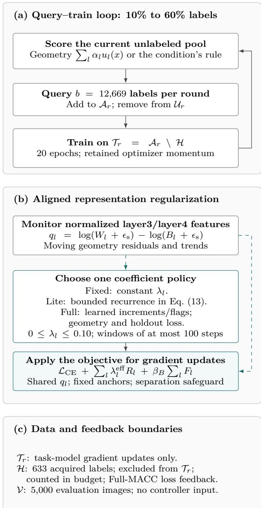  
Figure 1: The classification workflow of CÆNL. (a) Acquisition expands the annotated set between training phases. (b) The regularizer and adaptive controllers use the same normalized scatter statistic, while the separation safeguard penalizes insuficient between-class separation. Fixed strength, deterministic feedback, and learned feedback are alternatives. The initial fixed strength is 0.03; the later control study selects 0.10 and also tests preset schedules (Section 6.4). Full MACC credits the terminal reward and keeps its acquisition-policy head disabled. (c) The fixed holdout supplies Full-MACC feedback without task-model gradient updates; oficial evaluation is separate. Solid arrows indicate execution or applied control; dashed arrows indicate measured signals. Language, difusion, and audio use their task-specific spectral formulations.

Proof. Write $Z - m = ( Z - \mu ) + ( \mu - m )$ . The mixed terms have zero expectation, while ${ \mathbb E } [ \operatorname { t r } ( A ( Z - \mu ) ( Z -$ $\mu ) ^ { \top } ) ] = \operatorname { t r } ( A \Sigma )$ □

At the population center, Euclidean squared distance has expectation $\operatorname { t r } ( \Sigma )$ , whereas squared Mahalanobis distance has expectation d for $A = \Sigma ^ { - 1 }$ when Σ is nonsingular. For the population diagonal metric $A = \mathrm { d i a g } ( ( \Sigma _ { j j } + \epsilon _ { a } ) ^ { - 1 } )$ , the expectation instead equals ${ \textstyle \sum _ { j = 1 } ^ { d } \sum _ { j j } } / { ( \sum _ { j j } + \epsilon _ { a } ) }$ . Thus the implemented score is variance-standardized deviation, rather than an estimate of the within-class trace. Equation (6) additionally uses estimated centers and a predicted class. Conditioning on fitted references gives the identity with the corresponding conditional moments; conditioning on a predicted-class event can change those moments again. Neither the identity nor a high score establishes the expected predictive value of acquiring that example’s label.

## 5.2 Local efect of the aligned regularizer

Objective–feedback alignment has a precise local meaning: when the ratio target is exceeded, the ratio penalty points along the gradient of that same measured residual. The next result makes the required step-size and smoothness assumptions explicit.

Proposition 3 (Direct local alignment). Fix a measurement batch, a layer, and its target, and define $g ( \theta ) = q _ { l } ( \theta ) - q _ { l } ^ { \star }$ . Suppose $g ( \theta ) > 0$ and g has an $\boldsymbol { L _ { g } } - \boldsymbol { L } \boldsymbol { i } _ { \boldsymbol { l } }$ schitz gradient, $L _ { g } > 0 ,$ on a convex neighborhood containing the step segment. Hold the applied coeficient $\lambda = \lambda _ { l } ^ { \mathrm { e f f } } \ge 0$ fixed and let $a = H _ { \delta } ^ { \prime } ( g ( \theta ) )$ = min $\{ g ( \theta ) / \delta , 1 \}$ . For $\eta \geq 0$ , the isolated ratio-penalty step $\theta ^ { \prime } = \theta - \eta \lambda a \nabla g ( \theta )$ satisfies

$$
g ( \theta ^ { \prime } ) \leq g ( \theta ) - \eta \lambda a \left( 1 - \frac { L _ { g } \eta \lambda a } { 2 } \right) \| \nabla g ( \theta ) \| _ { 2 } ^ { 2 } .\tag{19}
$$

Hence g and $H _ { \delta } ( g )$ do not increase when $0 \leq \eta \lambda a \leq$ $2 / L _ { g }$ . The residual decreases strictly $i f 0 < \eta \lambda a < 2 / L _ { g }$ and $\nabla g ( \theta ) \neq 0$

Proof. Apply the smoothness inequality $g ( \theta + v ) \leq$ $g ( { \boldsymbol { \theta } } ) + \nabla g ( { \boldsymbol { \theta } } ) ^ { \top } { \boldsymbol { v } } + ( L _ { g } / 2 ) \| { \boldsymbol { v } } \| _ { 2 } ^ { 2 }$ with $\boldsymbol { v } = - \eta \lambda a \nabla g ( \theta )$ The penalty $H _ { \delta }$ is nondecreasing in its argument.

The result applies to a fixed or adaptively selected coeficient once its value is held fixed for the model update, as in Section 4.1. It establishes the local direction of the isolated intervention, rather than an advantage of feedback over fixed strength. When $g \le 0$ , the ratio term has zero gradient. For the complete training update, cross-entropy, the separation penalty, other layers, momentum, and changing batches can alter the direction. The smoothness condition is local and need not hold across activation or normalization-floor boundaries. For the actual optimizer direction $v ,$ defined by $\theta ^ { + } = \theta - \eta v$ , suppose the same local smoothness assumption holds on a convex neighborhood containing the actual update segment. It then yields

$$
\begin{array} { r l } & { g ( \theta ^ { + } ) \leq g ( \theta ) - \eta \langle \nabla g ( \theta ) , v \rangle } \\ & { \qquad + \frac { L _ { g } \eta ^ { 2 } } { 2 } \| v \| _ { 2 } ^ { 2 } . } \end{array}\tag{20}
$$

If $v \ne 0$ and $\langle \nabla g ( \theta ) , v \rangle \ > \ 0 .$ , strict descent follows for $0 < \eta < 2 \langle \nabla g ( \theta ) , v \rangle / ( L _ { g } \| v \| _ { 2 } ^ { 2 } )$ . For plain gradient descent, write $p = \nabla g ( \theta )$ and $v = d + \lambda a p ,$ where $d$ contains the other gradient terms. Then $\langle p , v \rangle =$ $\langle p , d \rangle + \lambda a \| p \| _ { 2 } ^ { 2 } \mathrm { ; }$ the other losses may oppose the isolated intervention. With momentum, clipping, or weight decay, v must denote the resulting realized direction. The scalar residual and coeficient bounds alone do not ensure this directional condition or a monotone full-training trajectory.

## 5.3 Bounded coeficients and the feedback response

MACC-Lite combines a bounded desired strength with a leaky update. Its coeficient bounds hold for every finite residual sequence, including the first phase-start action described in Section 4.4.

Proposition 4 (Bounded feedback coeficients). Let $0 \leq \lambda _ { l , 0 } \leq \lambda _ { \operatorname* { m a x } } , 0 < \rho \leq 1$ , and $\delta > 0$ . Equation (13) keeps every coeficient in $\left[ 0 , \lambda _ { \operatorname* { m a x } } \right]$ . For $t \geq 1$ , its response to an arbitrary sequence of desired strengths is

$$
\lambda _ { l , t } = ( 1 - \rho ) ^ { t } \lambda _ { l , 0 } + \rho \sum _ { j = 0 } ^ { t - 1 } ( 1 - \rho ) ^ { t - 1 - j } u _ { l , j } .
$$

$I f u _ { l , j } = u _ { l }$ is constant, this reduces to

$$
\lambda _ { l , t } - u _ { l } = ( 1 - \rho ) ^ { t } ( \lambda _ { l , 0 } - u _ { l } ) .\tag{21}
$$

Proof. The map $\lambda _ { \operatorname* { m a x } } \operatorname { t a n h } ( [ e ] _ { + } / \delta )$ lies in $[ 0 , \lambda _ { \operatorname* { m a x } } ]$ Each update is a convex combination of this value and the previous coeficient, proving invariance of the interval by induction. Unrolling the recurrence gives the arbitrary-input formula; subtracting a constant u<sub>l</sub> gives Equation (21). □

With $\rho = 0 . 2 0$ , the fixed-input coeficient error contracts by a factor of 0.8 per control event. If the residual remains nonpositive, $u _ { l } = 0$ and the coeficient decays toward zero; this does not deactivate the separate separation penalty. Full MACC also has bounded applied coeficients because its projection and binary flags preserve $\left[ 0 , \lambda _ { \operatorname* { m a x } } \right]$ , but it does not follow the Lite recurrence. These are properties of the coeficient mechanism. In the coupled system, residuals depend on the evolving network and moving measurements, so coeficient boundedness alone establishes neither target convergence nor closed-loop stability.

## 5.4 Conditions linking geometry to prediction

Within-class concentration can control prediction error when class separation and the decision rule are specified. The following population statement identifies these additional conditions.

Proposition 5 (Conditional nearest-centroid error bound). Let H be a feature vector with finite second moments and equal class probabilities over $C \geq 2$ classes. Define population means $\mu _ { c } = \mathbb { E } [ H \mid Y = c ]$ , minimum separation $\begin{array} { r } { d _ { \operatorname* { m i n } } = \operatorname* { m i n } _ { c \neq c ^ { \prime } } \| \mu _ { c } - \mu _ { c ^ { \prime } } \| _ { 2 } > 0 } \end{array}$ , and

$$
W _ { \mathrm { p o p } } = \frac { 1 } { C } \sum _ { c } \mathbb { E } [ \| H - \mu _ { c } \| _ { 2 } ^ { 2 } \mid Y = c ] .
$$

The classifier $\widehat { Y } ( H ) = \arg \operatorname* { m i n } _ { c } \| H - \mu _ { c } \| _ { 2 }$ , with any fixed tie rule, satisfies

$$
\operatorname* { P r } \{ \widehat { Y } ( H ) \neq Y \} \leq \operatorname* { m i n } \{ 1 , 4 W _ { \mathrm { p o p } } / d _ { \operatorname* { m i n } } ^ { 2 } \} .\tag{22}
$$

Proof. $\mathrm { I f ~ } \| H - \mu _ { Y } \| _ { 2 } < d _ { \operatorname* { m i n } } / 2 .$ the triangle inequality makes every other centroid farther away. An error therefore requires $\| \ b { H } - \mu _ { Y } \| _ { 2 } ^ { 2 } \geq d _ { \operatorname* { m i n } } ^ { 2 } / 4$ . Markov’s inequality and averaging over the equally probable classes give the bound, capped by one. □

Here $W _ { \mathrm { p o p } }$ is a population moment, distinct from the finite-batch $W _ { l }$ used in training. The trained softmax head is not constrained to implement nearest-centroid prediction, and a positive aggregate $B _ { l }$ does not imply $d _ { \operatorname* { m i n } } > 0$ . Consequently, reducing the batch ratio does not by itself tighten this population error bound.

Input-space robustness. A corresponding robustness condition concerns logit margins and input sensitivity, as in Lipschitz-based certification [48]. For a correctly classified input x with true class $y ,$ let $m _ { y , j } ( x ) = f _ { \boldsymbol { \theta } } ( x ) _ { y } - f _ { \boldsymbol { \theta } } ( x ) _ { j }$ . Suppose each margin is $\boldsymbol { L } _ { y , j } { - } \boldsymbol { \mathrm { I } }$ ipschitz with respect to $\| \cdot \| _ { \infty }$ throughout the admissible radius-ϵ neighborhood. Every admissible perturbation v with $\| v \| _ { \infty } \leq \epsilon$ then satisfies

$$
m _ { y , j } ( x + v ) \geq m _ { y , j } ( x ) - \epsilon L _ { y , j } .
$$

Thus $m _ { y , j } ( x ) > \epsilon L _ { y , j }$ for every $j \neq y$ is suficient to preserve the correct class. Neither the scatter nor the spectral objective supplies the required bounds on $L _ { y , j } .$ Section 6 therefore specifies separate evaluations of predictive performance, representation geometry, and adversarial robustness, together with matched controls for the value of coeficient adaptation.

The need for input-sensitivity control is not merely a missing step in the preceding suficient condition. The following construction preserves the clean measurements while changing robustness.

Proposition 6 (Identical clean geometry with arbitrarily small robust radius). There is a four-example data set in $[ 0 , 1 ] ^ { 2 }$ , with two distinct examples in each of two classes, and a family of finite ReLU feature maps with a fixed linear classifier such that every member has identical clean features, positive within-class and between-class scatter, identical clean logits and crossentropy, and perfect clean accuracy. For every $\epsilon > 0$ , a member admits an admissible misclassifying perturbation of $L _ { \infty }$ norm less than ϵ at every clean example.

Proof. Set $\begin{array} { r l r } { b } & { { } = } & { 1 / 5 } \end{array}$ and $c \ = \ \sqrt { { 2 4 } / { 2 5 } }$ Assign class 1 to $( 1 / 4 , 2 / 5 ) , ( 1 / 4 , 3 / 5 )$ and class 2 to $( 3 / 4 , 2 / 5 ) , ( 3 / 4 , 3 / 5 )$ . For $0 \textless \eta < 1 / 8$ , define the ReLU triangle

$$
T _ { t , \eta } ( u ) = \frac { [ u - t ] _ { + } - 2 [ u - t - \eta ] _ { + } + [ u - t - 2 \eta ] _ { + } } { \eta } .
$$

It vanishes outside $[ t , t + 2 \eta ]$ , is zero at t, and is one at $t + \eta$ . Define the finite ReLU map

$$
\begin{array} { c } { { a _ { \eta } ( u ) = c ( 2 - 4 u ) - 2 c T _ { 1 / 4 , \eta } ( u ) + 2 c T _ { 3 / 4 , \eta } ( u ) , } } \\ { { z _ { \eta } ( u , v ) = ( a _ { \eta } ( u ) , b ( 1 0 v - 5 ) ) , } } \end{array}
$$

and fixed classifier weights $w _ { 1 } = ( 1 , 0 ) , w _ { 2 } = ( - 1 , 0 )$ with logits $f _ { j } ( x ) ~ = ~ w _ { j } ^ { \top } z _ { \eta } ( x )$ The triangles vanish at every clean example. Their features are $( c , - b ) , ( c , b ) , ( - c , - b ) , ( - c , b )$ for every η, each of norm one. Normalization therefore leaves them unchanged, and equal class weighting gives

$$
W = b ^ { 2 } = 1 / 2 5 , \qquad B = c ^ { 2 } = 2 4 / 2 5 , \qquad W + B = 1 .
$$

The stabilized log ratio, frozen-target penalties, clean margin $2 c$ , and cross-entropy log $( 1 + e ^ { - 2 c } )$ are independent of $\eta .$

Perturb each clean input by $( \eta , 0 )$ . The inputs remain in $[ 0 , 1 ] ^ { 2 }$ and the triangle supports do not overlap. The first feature coordinate becomes $- c ( 1 + 4 \eta ) < 0$ for class 1 and $c ( 1 - 4 \eta ) > 0$ for class $2 ,$ so all four predictions flip. The second coordinate remains $\pm b$ , keeping the raw norm above the normalization floor; normalization does not change the decision. Choose $0 < \eta < \mathrm { m i n } \{ \epsilon , 1 / 8 \}$ to obtain the stated perturbation. □

Removing the two triangles preserves the same clean features and logits but places the decision boundary at $u = 1 / 2$ , at input distance $1 / 4$ from every clean example. The constructed family has no uniform weight or input-sensitivity bound as η decreases. It proves that the measured clean geometry and logits alone cannot supply a uniform positive lower bound on robust radius across such feature maps; it does not identify the mechanism in the trained models. Matched measurements of margins, perturbation-induced feature displacement, and attack success are still required for that empirical question.

## 6 Experimental design

The evaluation follows the distinction between representation objectives and coeficient control developed in Sections 4 and 5. Classification studies compare acquisition rules and regularization treatments at matched annotation budgets, then test feedback against independently selected constant and scheduled strengths. Separate language, difusion, and audio studies evaluate the spectral variants under their task-specific protocols.

## 6.1 Study organization

Throughout this paper, a condition is a method configuration, a run is one condition under one seed, and a phase is one acquisition/training stage within a run.

The initial ImageNet-100 comparison evaluated nine conditions across six paired seeds. After reviewing those results, we evaluated two additional conditions: entropy acquisition with aligned DCR and MACC-Lite, and a matched-protocol UHerding-Margin comparator. Each used the original six seed-specific initializations, targets, splits, annotation budgets, and evaluation endpoint. Their comparison lists were fixed before the additional runs, and their statistical families are reported separately. A third follow-up added entropy with fixed aligned DCR, retaining the same per-seed initial model and optimizer, splits, targets, floor penalty, acquisition protocol, and optimization schedule. Its two contrasts were declared before the new fixed-condition outcomes were inspected, after the entropy and Lite outcomes were already known. This later control adds six runs and 30 phases; it is not fresh-seed confirmation. The resulting classification record for these studies comprises 72 method–seed runs and 360 post-initialization phases across 12 conditions, with six paired seeds.

A separate study then tunes fixed and presetschedule controls on three new ResNet-50 seeds, confirms the selected comparisons on ten further ResNet-50 seeds, and transfers all settings to ten ResNet-18 seeds. Its 104 method runs, 23 shared initializations, and 520 post-initialization phases are additional experiments. The tuning, confirmation, and transfer seed sets are disjoint. They are not pooled with the earlier six-seed comparisons, and fresh seeds do not make the previously studied dataset an untouched benchmark.

Engineering checks verify implementation behavior and are not counted as predictive-performance experiments. The original ImageNet-100 spectral pilot uses seeds 601 and 602. Saved-checkpoint attack diagnostics and a bounded aligned-objective development screen precede the final seeds 801–806. The aligned and spectral development protocols also difer in sampling, BatchNorm treatment, and integration choices; their absolute accuracies cannot isolate the efect of changing DCR.

C4 uses six separate training seeds and an additional unused-shard evaluation of the same saved checkpoints. Difusion development uses seeds 1001 and 1002, followed by confirmation seeds 1101–1106. Audio development uses seeds 1201 and 1202 for two epochs per condition; confirmation uses seeds 1301–1306 for ten epochs. Confirmation starts from the original pretrained assets and new seed-specific task components, not development-final checkpoints. Only audio confirmation evaluates caption-model predictions on the retained oficial test split. Development results are not pooled into confirmation inference.

## 6.2 ImageNet-100 data and label accounting

We use the fixed 100-class subset associated with Contrastive Multiview Coding [27], drawn from ImageNet [28]. It contains 126,689 training images and $5 { , } 0 0 0$ validation images, with 50 validation images per class. Original image bytes and dimensions are retained. A manifest records class mappings, source revision, paths, and SHA-256 values, which are checked before execution. The evaluated benchmark is ImageNet-100, not ImageNet-1K.

Stratified sampling supplies 12,669 initial annotations per seed. The controller holdout contains 633 of these, leaving 12,036 gradient-training images. Five rounds each acquire 12,669 additional examples. Annotation totals are 12,669, 25,338, 38,007, 50,676, 63,345, and 76,014. The final gradient-training set contains 75,381 images. The final annotation fraction is approximately 60.0005%, reported as 60%. Holdout labels are included in every method’s annotation cost. Pool labels are consulted only after selection.

The split procedure excludes holdout indices from gradient training and acquisition. A subsequent content-hash audit identifies five training–validation image matches and duplicate content within the training inventory. The frozen benchmark results are retained, with post-hoc duplicate-exclusion sensitivity reported in Section 7.3. Index-disjoint partitions are therefore not asserted to be content-disjoint.

## 6.3 Classification optimization and matching

The initial study and later confirmation use a randomly initialized ResNet-50 with a 100-class head; the transfer stage uses ResNet-18 [29]. Geometry is measured at the spatially pooled outputs of layer3 and layer4. Each seed has one shared 40-nominal-epoch cross-entropy initialization, reused by the original methods and later matched conditions within that seed. The new control study uses independently initialized models for its own seed sets. A physical minibatch contains 16 uniformly selected represented classes and eight distinct acquired examples per class. A nominal epoch has $\lceil \lvert \mathcal { T } _ { r } \rvert / 1 2 8 \rceil$ sampled minibatches rather than a permutation pass through the labeled set.

Training uses random resized $2 2 4 \times 2 2 4$ crops and horizontal flips. Scoring, feedback, and evaluation resize the shorter side to 256 and take a 224-pixel center crop. ImageNet normalization is inside the model, so attacks act in pixel space. Augmentation and sampling streams are keyed by seed, phase, step, and example index. Common random-number conventions do not make sampled images identical once acquired sets difer.

Optimization uses SGD with momentum 0.9, Nesterov acceleration, and weight decay $1 0 ^ { - 4 }$ on multidimensional parameters. One-dimensional parameters receive no decay. Parameters remain FP32 with BF16 autocast, and gradients are clipped at norm 5. Initialization uses learning rate 0.05, three nominal warm-up epochs, and cosine decay. Each subsequent 20-epoch phase starts at rate 0.025 with one warm-up epoch and cosine decay; momentum is retained. BatchNorm running statistics are updated during initialization and frozen afterward; afine parameters remain trainable.

The five acquired-label phases contain 3,880, 5,840, 7,820, 9,800, and 11,780 optimizer steps. Initialization contains 3,800 steps. Each conceptual condition run therefore includes 42,920 steps and 5,493,760 sampled example presentations. Initialization is executed once per seed and allocated once per conceptual condition when reporting comparable costs.

## 6.4 Tuned controls and backbone transfer

All four treatments share entropy acquisition, annotation budgets, and the optimization protocol. The three regularized treatments share the aligned loss, target calibration, and fixed separation penalty; entropy alone omits both representation penalties. The experiment therefore compares the complete regularized-feedback treatment with entropy alone, and compares coeficient rules within the same regularized treatment. Four constant strengths, 0.003, 0.01, 0.03, and 0.10, and four linear schedules are evaluated on ResNet-50 seeds 41001– 41003, giving 24 tuning runs. Each schedule is either increasing or decreasing, with peak $a \in \{ 0 . 0 3 , 0 . 1 0 \}$

$$
\lambda _ { l } ( p ) = a p \quad \mathrm { o r } \quad a ( 1 - p ) , \qquad p \in [ 0 , 1 ] .\tag{23}
$$

Progress $p$ is the cumulative fraction of the 39,120 post-initialization optimizer steps across all five rounds. Strengths refresh at phase starts and nonterminal 100- step control boundaries, using the same event cadence as Lite. Schedules receive no observation feedback. Both layers use the same fixed or scheduled strength.

Within each family, selection maximizes mean final accuracy on the 633-example training holdout across the three tuning seeds. Accuracy ties within $1 0 ^ { - 1 2 }$ are broken by lower mean holdout cross-entropy, then candidate identifier. Oficial validation is not evaluated during tuning. The selected constant and schedule are frozen before confirmation begins. Lite retains $\lambda _ { \operatorname* { m a x } } = 0 . 1 0$ , initial strength 0.03, smoothing 0.20, and Huber scale 0.25 from the earlier development, without additional tuning in this study.

Confirmation uses ResNet-50 seeds 42001–42010; transfer uses ResNet-18 seeds 43001–43010. Each stage compares entropy alone, entropy with Lite, entropy with the selected constant, and entropy with the selected schedule, for 40 runs per backbone. Every seed has a shared initial model, targets, holdout and first acquisition. Later labeled sets can diverge with the model predictions. Each backbone is initialized from scratch, and ResNet-18 receives no retuning. This is architecture transfer on one dataset, not transfer of trained weights or evaluation on a new image benchmark.

## 6.5 Acquisition baselines and matched comparisons

Table 2 separates acquisition, regularization, and adaptation. BADGE uses exact factorized last-linear-layer weight-gradient inner products rather than the pilot’s random projection; bias terms are excluded. Noise Stability uses five globally normalized Gaussian perturbations of the trainable parameter vector at relative scale 0.001, normalized softmax-output deviations, concatenation without projection, and greedy farthest-first selection. Model parameters and bufers are restored after noisy forwards.

Nonrandom methods cache required pool outputs at the current checkpoint. Mahalanobis acquisition additionally estimates class statistics from acquired examples. Equal annotation budgets and pass sizes do not equalize acquisition time, especially for Noise Stability. Random plus aligned fixed DCR tests whether the objective contributes without geometric acquisition. The final matrix has no new full-label reference; the pilot’s diferent-budget supervised reference is not mixed into the matched final comparison.

Table 2: Initial ImageNet-100 comparison. All nine conditions use seeds 801–806 and the same 10–60% annotation schedule. “None” disables both aligned penalties; all conditions record geometry. The three follow-up conditions are reported separately.
<table><tr><td>Condition</td><td>Acquisition</td><td>Representation control</td></tr><tr><td>Random</td><td>Uniform random selection</td><td>None</td></tr><tr><td>Entropy</td><td>Highest predictive entropy</td><td>None</td></tr><tr><td>BADGE</td><td>Exactfactorized gradient distances</td><td>weight- None; independent implementation, bias excluded</td></tr><tr><td>Noise Stability</td><td>with greedy coverage</td><td>Perturbed-output deviations None; five noise draws, independent implementation</td></tr><tr><td>CAENL acquisition only</td><td>Predicted-class diagonal Maha- None lanobis score</td><td></td></tr><tr><td>Random + aligned fixed DCR</td><td>Uniform random selection</td><td>Aligned objective,  $\lambda _ { l } = 0 . 0 3$ </td></tr><tr><td>CAENL + aligned fixed DCR</td><td>Mahalanobis score</td><td>Aligned objective,  $\lambda _ { l } = 0 . 0 3$ </td></tr><tr><td>CAENL + aligned MACC-Lite</td><td>Mahalanobis score</td><td>Bounded, smoothed coefficient feedback</td></tr><tr><td>CAENL + aligned Full MACC</td><td>Mahalanobis score</td><td>Learned coefficient increments and activation flags</td></tr></table>

## 6.6 UHerding-Margin: matchedprotocol implementation

The recent comparator implements the uncertaintyweighted coverage mechanism of Uncertainty Herding [19], as uherding\_margin\_initial\_r50. Each seed’s shared-initial supervised ResNet-50 supplies unitnormalized layer4 features $g _ { i }$ , cached for the full training pool and fixed across rounds. This difers from a separately pretrained self-supervised representation. The task classifier continues under the common warmstart schedule.

Before acquisition, temperature T minimizes 15-bin ECE over 81 logarithmically spaced values in [0.1, 10] using the budgeted 633-image holdout. Temperaturescaled probabilities define $\omega _ { i } = 1 - ( p _ { i , ( 1 ) } - p _ { i , ( 2 ) } )$ The bandwidth σ is the smallest positive Euclidean distance between fixed features of currently annotated examples, including held-out annotations. Squared distances at most $1 0 ^ { - 1 2 }$ are numerical zero. The kernel is $k _ { \sigma } ( g _ { i } , g _ { j } ) = \exp ( - \| g _ { i } - g _ { j } \| _ { 2 } ^ { 2 } / \sigma ^ { 2 } )$

For candidate pass $P ,$ greedy selection maximizes

$$
G _ { P } ( j \mid \mathcal { C } ) = \sum _ { i \in P } \omega _ { i } \left[ k _ { \sigma } ( g _ { i } , g _ { j } ) - \operatorname* { m a x } _ { a \in \mathcal { C } } k _ { \sigma } ( g _ { i } , g _ { a } ) \right] _ { + } ,\tag{24}
$$

where C contains annotated centers and examples already selected in the round. The 10,000-candidate and 10%-per-pass convention is retained until 12,669 new examples are acquired. Distances, kernels, and gains use float64. Lazy greedy is checked against exhaustive greedy on deterministic CPU and CUDA fixtures.

No DCR is applied. Initializations, optimizer states, label accounting, balanced batches, post-initialization BatchNorm treatment, and the final attack endpoint match the task protocol. Feature extraction, acquisition including calibration, and training are timed separately. This comparison evaluates the disclosed adaptation, not the original authors’ representation, unrestricted selection domain, or published benchmark scores.

## 6.7 Classification evaluation and statistical analysis

Every post-initialization phase in the original studies and the later confirmation/transfer stages is evaluated on all 5,000 oficial validation images in full precision. Shared initializations and tuning in the later control study do not evaluate oficial validation. Reported outcomes include pooled cross-entropy, top-1 and top-5 accuracy, 15-bin ECE, and equal-class normalized moments. The selected checkpoint is the final scheduled checkpoint, not the best validation epoch. Logits, predictions, labels, and compact class-moment suficient statistics are retained.

The final checkpoint in the original six-seed studies receives standard AutoAttack [25] at $L _ { \infty }$ radius 8/255 on all 5,000 images. Its components are APGD-CE, targeted APGD, targeted FAB, and Square Attack, without shortened prescribed iterations. Attack minibatches contain 64 images; restartable storage chunks contain 256. Pixel bounds, perturbation norms, and survival masks are recorded. No adversarial training is used. The later control study adds no adversarial evaluations. A compatibility repair changed view to reshape in the library’s zero-gradient diagnostic, retaining the diagnostic, attack configuration, and completed training.

For the original classification studies, the paired experimental units are six seeds, conditional on the fixed dataset and protocol. Seven contrasts are specified separately for final clean and robust accuracy. For target-minus-reference diferences $d _ { i } ,$ the individual paired-t interval is

$$
{ \bar { d } } \pm t _ { 0 . 9 7 5 , 5 } { \frac { s _ { d } } { \sqrt { 6 } } } .
$$

Both paired-t tests and enumeration of all $2 ^ { 6 }$ sign flips are retained. Holm correction [30] is applied within each declared endpoint and test family. Intervals are individual, unadjusted intervals, not simultaneous confidence bands. The paired-t analysis relies on its distributional approximation for the diferences. Interpreting sign-flip enumeration as an exact null test requires the corresponding sign-exchangeability or sym metry assumption; enumeration alone does not make it assumption-free.

Resolution of the six-seed exact tests. For the two-sided absolute-mean statistic, a sign pattern and its negation are equally extreme. Hence

$$
\begin{array} { r } { p _ { \mathrm { { e x a c t } } } \geq 2 / 2 ^ { 6 } = 0 . 0 3 1 2 5 . } \end{array}\tag{25}
$$

For a Holm family of $m \geq 2$ comparisons at $\alpha = 0 . 0 5$ the first threshold is $0 . 0 5 / m \le 0 . 0 2 5$ . No rejection is therefore attainable with these six-seed, two-sided, Holm-adjusted exact tests. This is a resolution limit, not evidence that the efects are absent. Raw and adjusted values are retained alongside the paired-t analysis.

The entropy-plus-Lite, UHerding, and entropy-plusfixed follow-ups each use a separate two-contrast cleanaccuracy family, specified before the respective additional runs but after earlier outcomes were available. For UHerding, the contrasts are UHerding minus entropy and entropy-plus-Lite minus UHerding. For the fixed-control follow-up, they are entropy-plus-fixed minus entropy and entropy-plus-Lite minus entropy-plusfixed. New fixed-condition robustness is descriptive; the original robustness family is unchanged. These within-family corrections do not provide one familywise error guarantee for the full sequential research programme. Geometry, calibration, top-5 accuracy, and intermediate budgets are descriptive secondary outcomes.

Ten-seed control study. The later study declares six final-top-1 contrasts: Lite minus entropy, tuned fixed, and tuned schedule, separately on each backbone. These form one Holm family across both backbones, with separate corrections for paired-t and exact sign-flip tests. Each contrast uses ten paired seeds; its individual interval uses $t _ { 0 . 9 7 5 , 9 } s _ { d } / \sqrt { 1 0 }$ and its exact test enumerates $2 ^ { 1 0 }$ signs. The smallest attainable two-sided raw value is $2 / 2 ^ { 1 0 } = 0 . 0 0 1 9 5 3 1 2 5$ , so adjusted rejection is possible in this family. The six-seed resolution restriction above does not apply to this study. Sample size and comparisons were fixed before execution, without outcome-dependent stopping or seed replacement. A 0.5-percentage-point practical reference is descriptive, not an equivalence margin or stopping rule. Intermediate budgets, controller dynamics, secondary metrics and duplicate-exclusion analyses do not redefine the primary endpoint.

## 6.8 Cross-task experimental protocols

These protocols concern Equation (16). The fixed, Lite, and Full names identify task-specific implementations; the aligned classification loss is not used in these studies.

## 6.8.1 Language modeling on C4

Pretrained GPT-2 [31], with 124,439,808 parameters, is fine-tuned on a deterministic C4 subset [32]. Each of seeds 301–306 processes 99,999,744 tokens in 12,207 steps, with sequence length 1,024 and eight sequences per step. Baseline, fixed spectral DCR, spectral MACC-Lite, and spectral Full MACC share the budget and training configuration. The spectral implementation monitors h6 and h12 with target ranks 16 and 4, retained spectrum size 128, and a 2,048-token DCR subsample. Fixed strength is 0.01.

Training uses the first English C4 training shard, with the first validation shard used for feedback and development (Appendix D). All four conditions therefore evaluate the same single-shard training distribution. The original reporting set has 1,889 validation sequences, with 64 additional sequences reserved for controller feedback.

After checkpoint selection and training were frozen, all 24 checkpoints were evaluated on validation shard 00002, which had not been used for local training, feedback, or configuration development. Each checkpoint makes 1,999,872 next-token predictions. NLL and accuracy are pooled over tokens; ECE is computed from pooled confidence-bin statistics. Perplexity is the exponential of NLL, not an independent endpoint. “Untouched” concerns local study use, not verified absence of GPT-2 pretraining overlap.

Optimization uses learning rate $5 \times 1 0 ^ { - 5 }$ , weight decay 0.01, and 200 warm-up steps. AdamW has $\beta _ { 1 } = 0 . 9$ $\beta _ { 2 } = 0 . 9 5 ;$ ; one-dimensional, bias, and normalization parameters are exempt from decay. Norm-1 clipping and linear warm-up followed by cosine decay toward 10% of the base rate are used. Parameters remain FP32 with BF16 CUDA autocast.

Spectral controllers operate every 25 steps. Both adaptive methods initialize their coeficients at 0.005 within [0, 0.08]. Spectral Lite uses step size 0.002 and deadband 0.1. Full MACC uses two 128-unit hidden layers, policy learning rate $3 \times 1 0 ^ { - 4 }$ , exploration probability 0.15 decreasing to 0.02, reward-baseline weight 0.1, and entropy coeficient 0.001. Its coeficient increments are $\{ - 0 . 0 0 5 , - 0 . 0 0 2 5 , 0 , 0 . 0 0 2 5 , 0 . 0 0 5 \}$ . Its language-specific reward settings include validationdelta scale 5.0, value-delta clip 0.1, target-deviation weight 0.005, and zero query penalty. These settings are not replaced by the later difusion/audio or alignedclassification controller settings.

The unused-shard evaluator compares fixed DCR, Lite, and Full separately with baseline, giving three contrasts per endpoint. It reports individual paired-t intervals and raw paired-t and exact sign-flip values. Holm adjustment is applied separately to the paired-t and exact values within each three-contrast endpoint family. NLL is primary; perplexity is its monotone transformation, while token accuracy and ECE remain secondary.

## 6.8.2 CIFAR-10 difusion

We fine-tune the 35,746,307-parameter pretrained goog le/ddpm-cifar10-32 U-Net with the noise-prediction objective [33]. Seeds 1101–1106 evaluate baseline fine-tuning, fixed spectral DCR, spectral MACC-Lite, and spectral Full MACC. The unchanged pretrained model is also sampled with each seed’s generationnoise stream. Those six references measure sampling variation for one model, not six pretrained-model replications.

Table 3: Task-specific regularization and feedback conventions. $^ { 6 6 } \mathrm { L i t e } ^ { 9 3 }$ and $^ { 6 6 } \mathrm { F u l l } ^ { \dag }$ denote diferent task-specific implemen tations, not an unchanged controller transferred across all tasks. Task protocols provide the remaining settings.
<table><tr><td>Task</td><td>Loss and observed statistic</td><td>Fixed/adaptive coefficients</td><td>Update convention</td></tr><tr><td>ImageNet-100 classi- Aligned normalized fication</td><td>within/between log ratio; fixed separation safeguard</td><td>Fixed 0.03 in the initial study and selected 0.10 in the later study; adaptive initialization 0.03; bounds [0, 0.10]</td><td>Aligned Lite uses the leaky rule; Full uses the aligned reward; windows of at most 100 steps and phase-boundary handling</td></tr><tr><td>GPT-2/C4</td><td>Spectral loss with  $k = 1 2 8 ,$  ranks 16 and 4 at h6/h12; separate covariance-spectrum feedback</td><td>Fixed 0.01; adaptive initialization 0.005; bounds [0, 0.08]</td><td>Spectral control every 25 steps; Lite step size 0.002 and deadband 0.1</td></tr><tr><td>CIFAR-10 diffusion</td><td>Spectral loss with  $k = 6 4 ,$  rank-16 target; full EMA-covariance monitor</td><td>Fixed 0.01; adaptive initialization 0.01; bounds [0, 0.05]</td><td>Spectral control every 50 steps; Lite step size 0.001 and deadband 0.1</td></tr><tr><td>AudioCaps caption- Spectral loss with ing</td><td> $k = 6 4 ,$  rank-16 targets at prefix/encoder; different sample [0, 0.05] axes and zero padding</td><td>Fixed 0.01; adaptive initialization 0.01; bounds</td><td>Spectral control every 50 steps and final step; terminal reward credited without an unused next action</td></tr></table>

A fixed partition of the original 50,000 CIFAR-10 training images [34] supplies 45,000 fine-tuning images and 5,000 internal holdout images. The holdout contains 256 controller images and 1,024 disjoint denoisingassessment images with fixed noise and timesteps. These images may have been seen during pretraining; the holdout is not pristine relative to the pretrained model. Oficial test outcomes do not enter control or checkpoint selection.

Each trained condition performs 10,000 updates with batch size 128, matched per-seed image order and noise streams, horizontal flips, AdamW learning rate $2 \times 1 0 ^ { - 5 }$ zero weight decay, and norm-1 clipping. Parameters are FP32 with BF16 autocast. EMA weights use decay 0.9995. The final scheduled checkpoint is retained independently of performance. No active label acquisition occurs.

DCR uses 256-dimensional spatially pooled midblock features across timesteps 0–999, retained spectrum size 64, and target rank 16. The full EMAcovariance monitor uses decay 0.99 and cadence 50 steps. Fixed strength is 0.01. Adaptive methods start at 0.01 within [0, 0.05]. For finite monitored rank $r _ { \mathrm { e f f } , l , t } .$ spectral Lite uses

$$
\begin{array} { r l } & { e _ { l , t } ^ { \mathrm { s p } } = \left| \log \left( \frac { \operatorname* { m a x } \{ r _ { \mathrm { e f f } , l , t } , 1 0 ^ { - 1 2 } \} } { 1 6 } \right) \right| - 0 . 1 , } \\ & { \lambda _ { l , t + 1 } = \Pi _ { [ 0 , 0 . 0 5 ] } \left( \lambda _ { l , t } + 0 . 0 0 1 e _ { l , t } ^ { \mathrm { s p } } \right) , } \end{array}\tag{26}
$$

where $\Pi _ { [ a , b ] } ( v ) = \operatorname* { m i n } \{ b , \operatorname* { m a x } \{ a , v \} \}$ . The error is not replaced by its positive part: the coeficient increases outside the log-rank deadband, decreases inside it, and is unchanged at its boundary, subject to projection. Missing or nonfinite rank observations leave the corresponding coeficient unchanged. This accumulating projected rule difers from the leaky classification rule in Equation (13).

Spectral Full MACC uses the retained two-layer 128-unit policy, increments $\{ - 0 . 0 0 5 , - 0 . 0 0 2 5 , 0 , 0 . 0 0 2 5 , 0 . 0 0 5 \}$ activation flags, policy learning rate $3 \times 1 0 ^ { - 4 }$ , exploration decreasing from 0.10 to 0.02, baseline weight 0.05, and entropy coeficient 0.001. Its reward combines the scaled held-out loss improvement (scale 10, clipped to [−2, 2]) and $\mathrm { ~ a ~ } - 0 . 1 | \log ( r _ { \mathrm { e f f } } / 1 6 ) |$ target-deviation term. The query head is disabled, and uniformly explored actions are excluded from on-policy gradient updates. At termination, the pending action is credited without sampling an unused next action.

Each final EMA model generates 50,000 uint8 images with DDIM [35], 100 sampling steps, $\eta = 0$ , and batches of 128. Noise streams are matched within a seed. The primary endpoint is FID [36] against the complete original 50,000-image training distribution, using torch-fidelity 0.4.0. KID [37] and Inception score [38] are secondary. A final EMA denoising assessment uses all 10,000 oficial test images and fixed noise/timestep seed 541211. Per-image errors are retained.

Four FID contrasts are frozen: baseline minus pretrained reference and each regularized condition minus baseline. Negative diferences favor the target. Paired-t and all 64 sign flips are reported with separate Holm correction across these four contrasts. The exact-resolution limitation in Section 6.7 applies. Development uses two diferent seeds, 2,000 updates, and 5,000 generated samples; its absolute FID values are not pooled with confirmation.

## 6.8.3 AudioCaps captioning

The audio study uses original AudioCaps annotations [39] and a documented available-recording subset from OpenSound/AudioCaps. All 473 hosted Parquet shards were checked against published digests. IDs, start times, and captions were matched to pinned original annotations. The retained counts are 44,466 training, 440 validation, and 866 test clips, versus original inventories of 49,838, 495, and 975 unique clips. Coverage is 89.22%, 88.89%, and 88.82%. Each retained validation/test clip has five references.

Preparation excludes recordings outside eight to twelve seconds, one test identity with conflicting decoded variants, and both members of a nonzero waveform duplicate spanning train and test. Sources, variants, and exclusion records are preserved. Four all-zero training waveforms remain flagged and retained. Checks found no cross-split video IDs or exact nonzero waveform duplicates, including after actual mono/resampling preprocessing. These checks do not establish acoustic authenticity, absence of nearduplicates, or equivalence to an oficial raw-audio distribution. The mirror’s provenance and licensing limitations remain explicit; raw audio is not redistributed.

The frozen Audio Spectrogram Transformer (AST) [40] checkpoint MIT/ast- finetuned- aud ioset-10-10-0.4593 supplies shared features. Channels are averaged, resampled to 16 kHz, and limited to the first 10.24 seconds for a single-window representation. Original waveforms are not rewritten. FP32 AST computation supplies 64 pooled patch tokens of dimension 768, stored in FP16 and reused read-only. The test features use the frozen backbone only. AudioSet [41] pretraining may include underlying recordings, so no absence of pretraining overlap is claimed.

The task model has a two-layer trainable audio-token encoder, an eight-token learned prefix, and trainable pretrained GPT-2, totaling 141,774,336 parameters. Baseline, fixed spectral DCR, spectral Lite, and spectral Full use matched accepted initial task weights, epoch permutations, per-step dropout seeds, and optimizer budgets. Seeds 1301–1306 start from original GPT-2 assets and new seed-specific encoder/prefix parameters, not pilot-final weights. The initialization recovery is documented in Appendix D.

AdamW uses encoder/prefix rate $1 0 ^ { - 4 }$ , decoder rate $5 \times 1 0 ^ { - 5 }$ , decay 0.01, and norm-1 clipping. Parameters remain FP32 with BF16 autocast. Each epoch permutes 44,466 training pairs and uses 1,389 batches of 32, dropping the last 18 pairs. A new deterministic permutation is used every epoch. Each of the 24 runs performs ten epochs, or 13,890 updates.

For zero-based optimizer-step index $s = 0 , \ldots , S - 1$ with $S = 1 3 , 8 9 0$ and $w = 1 0 0$ warm-up steps, every parameter group’s base rate $\eta _ { g , 0 }$ is multiplied by

$$
a ( s ) = \left\{ \begin{array} { l l } { ( s + 1 ) / w , } & { 0 \leq s < w , } \\ { \displaystyle \frac { 1 + \cos \bigl ( \pi p ( s ) \bigr ) } { 2 } , } & { w \leq s , } \end{array} \right.\tag{27}
$$

where $p ( s ) = \operatorname* { m i n } \{ 1 , ( s - w ) / ( S - w ) \}$ and $\eta _ { g } ( s ) = $ $\eta _ { g , 0 } a ( s )$ . The schedule has terminal factor zero and no positive learning-rate floor. Its zero endpoint is $s = S ;$ the last executed update is $s = S - 1$ , so its final applied factor is slightly above zero. The final scheduled checkpoint is evaluated without best-epoch selection or early stopping.

Spectral sample axes and rank. The prefix representation reshapes eight embeddings per clip into

$3 2 \times 8 = 2 5 6$ vectors of dimension 768. The pooled encoder representation has 32 vectors of dimension 768. Thus their centered sample-rank bounds are 255 and 31, respectively. The configured 64-entry spectrum is a storage and truncation dimension, not a claim of 64 nonzero eigenvalues for both representations. The encoder Gram spectrum is zero-padded to 64 entries as in Equation (17). A rank-16 template is feasible for both full training batches. The EMA-covariance monitor is distinct from either current-batch spectrum and can have a larger efective rank.

Control operates every 50 steps and at the final step, yielding 278 adaptive events. The fixed coeficient is 0.01. Adaptive coeficients start at 0.01 within [0, 0.05]. Spectral Lite uses Equation (26) at both monitored layers, with step size 0.001, deadband 0.1, and target rank 16. Full retains the difusion spectral-policy settings, replacing denoising feedback loss with caption loss on the audio holdout. Its terminal action is credited without an unused next action, and the acquisition head is disabled.

The first 64 validation IDs in frozen manifest order provide controller feedback; the remaining 376 provide development assessment. Neither is used for task-model gradient updates. Final confirmation checkpoints evaluate all 866 retained test recordings. Beam size is three, decoding batch size is 32, and at most 30 new tokens are generated.

The primary endpoint is CIDEr-D [42] from the retained pycocoevalcap/PTB path. BLEU-1–4 [43], ROUGE-L [44], METEOR [45], SPICE [46], SPI-DEr [47], and pooled token NLL are secondary outcomes. SPIDEr combines CIDEr-D and SPICE on their recorded scales. NLL is weighted by actual next-token target counts. A separate development diagnostic mismatches audio and captions deterministically without training updates.

The three primary CIDEr-D contrasts compare fixed, Lite, and Full with baseline. Positive diferences favor the regularized condition. Both paired-t and all 64 sign flips are retained with separate Holm corrections across these three comparisons and individual unadjusted intervals. Secondary outcomes do not replace the primary endpoint. The six paired seeds remain the experimental units; repeated evaluation of 866 clips does not create extra training replications.

## 6.9 Execution environment and reproducibility

Experiments run sequentially on an IBM Cloud instance with one NVIDIA L40S GPU, PyTorch 2.6.0, torchvision 0.21.0, CUDA runtime 12.4, and Python 3.11.7. Datasets and checkpoints reside on persistent storage. Protocols, source hashes, splits, acquisitions, controller records, summaries, and attack-chunk digests are retained. Integrity checks establish consistency of recorded artifacts, not third-party replication of GPU execution.

Table 4: All candidate controls on the three ResNet-50 tuning seeds 41001–41003. Values are final training-holdout mean ± sample SD; each seed has 633 holdout images. Selection maximizes mean accuracy within each family, with cross-entropy and identifier tie-breaks. These are selection scores, not independent performance estimates. Oficial validation is not evaluated during tuning.
<table><tr><td>Control</td><td>Holdout top-1 (%)</td><td>Holdout cross-entropy</td><td>Selected</td></tr><tr><td>Constant 0.003</td><td> $7 5 . 4 0 8 \pm 2 . 5 1 9$ </td><td> $0 . 9 7 6 \pm 0 . 0 6 6$ </td><td></td></tr><tr><td>Constant 0.010</td><td> $7 5 . 6 1 9 \pm 1 . 0 0 3$ </td><td> $0 . 9 5 5 \pm 0 . 0 5 0$ </td><td></td></tr><tr><td>Constant 0.030</td><td> $7 5 . 1 9 7 \pm 0 . 7 9 0$ </td><td> $0 . 9 6 3 \pm 0 . 0 5 6$ </td><td></td></tr><tr><td>Constant 0.100</td><td> $7 6 . 5 6 7 \pm 1 . 1 2 1$ </td><td> $0 . 8 8 6 \pm 0 . 0 5 8$ </td><td>Yes</td></tr><tr><td>Decreasing, peak 0.03</td><td> $7 4 . 8 2 9 \pm 0 . 6 3 8$ </td><td> $0 . 9 6 9 \pm 0 . 0 4 7$ </td><td></td></tr><tr><td>Decreasing, peak 0.10</td><td> $7 6 . 4 6 1 \pm 0 . 6 3 2$ </td><td> $0 . 9 4 8 \pm 0 . 0 4 5$ </td><td>Yes</td></tr><tr><td>Increasing, peak 0.03</td><td> $7 5 . 5 6 6 \pm 1 . 2 2 7$ </td><td> $0 . 9 8 0 \pm 0 . 0 5 2$ </td><td></td></tr><tr><td>Increasing, peak 0.10</td><td> $7 5 . 9 3 5 \pm 1 . 1 6 4$ </td><td> $0 . 9 3 6 \pm 0 . 0 2 3$ </td><td></td></tr></table>

## 7 Results and analysis

We first report the ten-seed control comparisons, their coeficient dynamics, and sensitivity to content duplicates. The earlier six-seed studies then address acquisition choices, the original fixed-strength control, learned feedback, and adversarial performance. The spectral task results and computational measurements follow. This order places the principal control comparison first while retaining each study’s separate experimental units and statistical family.

## 7.1 Confirmation with tuned controls and backbone transfer

The training-holdout search selects constant strength 0.10 and the linearly decreasing schedule with peak 0.10. Their mean tuning accuracies are 76.567% and 76.461%, respectively; these are selection scores rather than independent performance estimates. The complete candidate ranking is shown in Table 4, including the 0.03 constant used in the earlier comparisons. Selection occurs within the specified grid; it does not establish a globally optimal constant or schedule.

Table 5 reports the subsequent ten-seed evaluations. Lite improves final accuracy over entropy by 1.742 percentage points on ResNet-50 and 1.834 points on ResNet-18. Every paired seed diference is positive on each backbone. Both contrasts pass the planned sixcomparison Holm correction under paired-t and exact sign-flip tests (Table 6). The same feedback settings therefore retain a classification benefit on the second architecture without retuning.

The tuned fixed condition has the highest final mean on both backbones. Lite minus fixed is −0.188 points on ResNet-50 and −0.334 on ResNet-18, with individual intervals spanning zero. Neither comparison establishes superiority in either direction, equivalence, or non-inferiority. Lite exceeds the selected schedule by 0.398 and 0.324 points; only the ResNet-18 comparison survives the family correction. The final-budget gain over entropy is therefore supported, but these paired comparisons do not establish an advantage over the independently tuned constant.

(a) ResNet-50 confirmation  
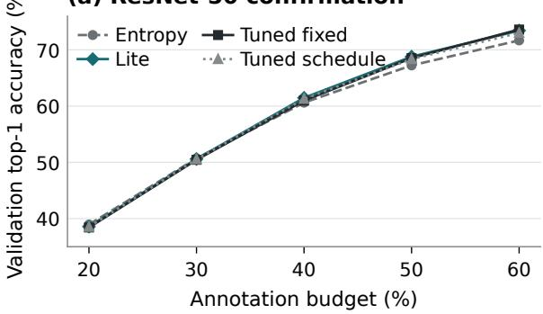

(b) ResNet-18 transfer  
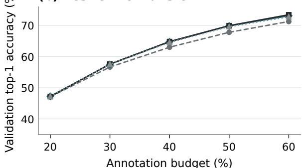  
(c) Paired effects: individual 95% CIs

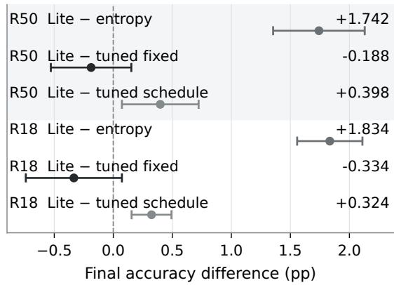  
Figure 2: Fresh-seed control comparison. Panels (a) and (b) show mean oficial validation accuracy over ten seeds at measured acquisition budgets. Panel (c) shows all six final Lite-minus-control efects and individual 95% paired t intervals. The zero line denotes no diference; interval exclusion does not by itself imply multiplicity-adjusted significance. The test results are given in Table 6.

Figure 2 shows the measured trajectories and primary efect intervals. Benefits are budget dependent: on ResNet-50, Lite trails entropy by 0.362 and 0.108 points at 20% and 30% annotations, then leads by 0.850, 1.552 and 1.742 points at 40%, 50% and 60%. Corresponding ResNet-18 gains are 0.150, 0.882, 1.750, 2.040 and 1.834 points. These intermediate outcomes are descriptive; they do not establish a universal label-saving rate.

## 7.2 Feedback dynamics and representation outcomes

The recorded coeficients follow the prescribed recurrence throughout training. Step-weighted mean layer3/layer4 strengths are 0.0450/0.0866 on ResNet-50 and 0.0537/0.0789 on ResNet-18. Their layer depen-

Table 5: Control-study outcomes at 60% annotations on ImageNet-100. Values are mean ± sample SD over ten paired seeds per backbone. Every treatment uses entropy acquisition. Fixed and scheduled strengths are selected using separate ResNet-50 tuning seeds; all settings are frozen for confirmation and transfer.
<table><tr><td>Backbone Treatment</td><td></td><td></td><td>Clean top-1 (%) Cross-entropy</td><td>ECE</td></tr><tr><td>ResNet-50 Entropy</td><td></td><td></td><td> $7 1 . 6 7 8 \pm 0 . 8 0 8$ </td><td> $1 . 1 3 7 \pm 0 . 0 2 4$   $0 . 0 7 9 \pm 0 . 0 0 7$ </td></tr><tr><td></td><td>ResNet-50 Entropy + MACC-Lite</td><td></td><td> $7 3 . 4 2 0 \pm 0 . 5 1 2$   $1 . 0 2 0 \pm 0 . 0 1 4$ </td><td> $0 . 0 5 8 \pm 0 . 0 0 6$ </td></tr><tr><td></td><td>ResNet-50 Entropy + tuned fixed</td><td></td><td> $7 3 . 6 0 8 \pm 0 . 4 7 4$   $1 . 0 1 0 \pm 0 . 0 1 9$ </td><td> $0 . 0 5 4 \pm 0 . 0 0 6$ </td></tr><tr><td></td><td>ResNet-50 Entropy + tuned schedule</td><td></td><td> $7 3 . 0 2 2 \pm 0 . 3 7 1$   $1 . 0 5 2 \pm 0 . 0 1 9$ </td><td> $0 . 0 6 4 \pm 0 . 0 0 4$ </td></tr><tr><td>ResNet-18 Entropy</td><td></td><td></td><td> $7 1 . 2 5 2 \pm 0 . 3 9 7$   $1 . 1 9 7 \pm 0 . 0 2 2$ </td><td> $0 . 0 9 5 \pm 0 . 0 0 4$ </td></tr><tr><td></td><td>ResNet-18 Entropy + MACC-Lite</td><td></td><td> $7 3 . 0 8 6 \pm 0 . 3 9 7$   $1 . 0 9 1 \pm 0 . 0 1 8$ </td><td> $0 . 0 8 2 \pm 0 . 0 0 3$ </td></tr><tr><td></td><td>ResNet-18 Entropy + tuned fixed</td><td></td><td> $7 3 . 4 2 0 \pm 0 . 6 7 3$ </td><td> $1 . 0 8 6 \pm 0 . 0 2 4$   $0 . 0 7 9 \pm 0 . 0 0 6$ </td></tr><tr><td></td><td>ResNet-18 Entropy + tuned schedule</td><td></td><td> $7 2 . 7 6 2 \pm 0 . 4 8 3$   $1 . 1 1 3 \pm 0 . 0 2 5$ </td><td> $0 . 0 8 4 \pm 0 . 0 0 4$ </td></tr></table>

Table 6: All six predeclared final-top-1 contrasts in the control study. Efects and individual, unadjusted 95% paired-t intervals are in percentage points. Each test column is separately Holm-adjusted across the full six-comparison family.
<table><tr><td>Backbone Contrast</td><td></td><td>Difference</td><td></td><td>95% CI Adjusted t p Adjusted exact p</td><td></td></tr><tr><td>ResNet-50 Lite – entropy</td><td></td><td>+1.742</td><td> $[ + 1 . 3 5 4 , + 2 . 1 3 0 ]$ </td><td> $1 . 5 7 \times 1 0 ^ { - 5 }$ </td><td>0.01172</td></tr><tr><td>ResNet-50 Lite - tuned fixed</td><td></td><td>-0.188</td><td> $[ - 0 . 5 2 9 , + 0 . 1 5 3 ]$ </td><td> $0 . 2 4 3 6$ </td><td>0.25781</td></tr><tr><td></td><td>ResNet-50 Lite - tuned schedule</td><td>+0.398</td><td> $[ + 0 . 0 7 3 , + 0 . 7 2 3 ]$ </td><td>0.065</td><td>0.08203</td></tr><tr><td>ResNet-18 Lite – entropy</td><td></td><td>+1.834</td><td> $\left[ + 1 . 5 5 8 , + 2 . 1 1 0 \right]$ </td><td> $6 . 7 4 \times 1 0 ^ { - 7 }$ </td><td>0.01172</td></tr><tr><td>ResNet-18 Lite - tuned fixed</td><td></td><td>-0.334</td><td> $[ - 0 . 7 4 1 , + 0 . 0 7 3 ]$ </td><td>0.1929</td><td>0.20312</td></tr><tr><td></td><td>ResNet-18 Lite - tuned schedule</td><td>+0.324</td><td> $\left[ + 0 . 1 5 5 , + 0 . 4 9 3 \right]$ </td><td>0.007541</td><td>0.03125</td></tr></table>

In a post-hoc sensitivity analysis, the same five validation indices are excluded for every method, retaining 4,995 examples. Lite-minus-entropy efects become 1.742 and 1.836 points on ResNet-50 and ResNet-18, while Lite-minus-fixed becomes −0.188 and −0.328 points. All six adjusted test decisions remain unchanged; excluding duplicate-content holdout items also leaves the selected controls unchanged.

The dataset manifest contains five exact SHA-256 matches between training and validation images, all with conflicting class labels, and 51 duplicate-content pairs within training, 43 with conflicting labels. Seven of the 23 new seed holdouts contain one or two examples duplicated elsewhere in training; their counterpart enters the final gradient-training set in 24 method runs. None of the three tuning holdouts is afected. The exclusions by index operate as specified, but do not eliminate overlap by content.

dence and within-phase changes are visible in Figure 3. This verifies that feedback acts on the measured signal; it does not isolate the causal value of adaptation. Subsequent acquired sets also depend on the resulting model predictions.

## 7.3 Content-duplicate sensitivity

Final mean log scatter ratios for entropy, Lite, fixed and schedule are 1.387, 0.471, 0.322 and 0.991 on ResNet-50, and 1.162, 0.528, 0.406 and 0.802 on ResNet-18. These descriptive changes accompany lower crossentropy and ECE under the regularized treatments, but do not establish geometry as a mediator or a robustness certificate. The fixed separation safeguard is active on only 5 layer3 and 102 layer4 minibatch records across the regularized post-initialization traces; its independent contribution is not identified by this experiment.

(a) ResNet-50 confirmation  
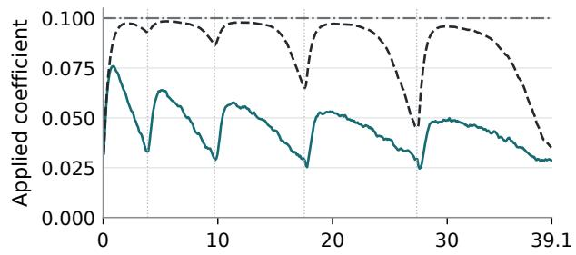

(b) ResNet-18 transfer  
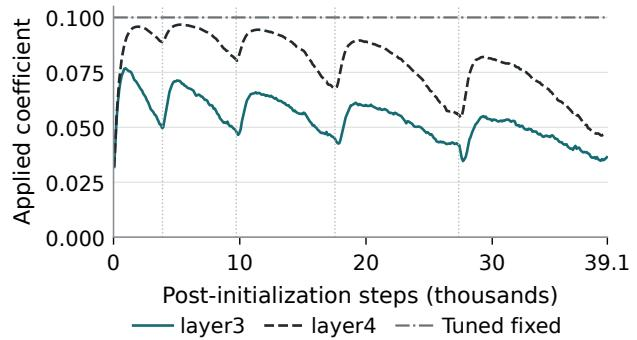  
Figure 3: Applied Lite strengths from native training traces. Each curve is the ten-seed mean coeficient in successive windows of at most 100 steps within each phase; separate line styles identify layer3 and layer4. Vertical separators mark acquisition-round boundaries, and the horizontal reference is the tuned constant strength 0.10. Coefficients carry state across phases while responding to their respective moving geometry residuals.

The planned 5,000-image outcomes remain primary. Evaluation-time exclusion does not undo possible training influence, and hash equality does not diagnose the source of the conflicting labels. Appendix B provides the sensitivity contrasts and seed-level endpoints.

## 7.4 Earlier six-seed classification comparisons

The earlier studies complement the tuned-control comparison by testing acquisition rules and learned control. Table 7 consolidates their 12 conditions. Entropy acquisition with aligned DCR and MACC-Lite has the highest mean within these six-seed studies, $7 3 . 3 6 0 \pm 0 . 2 0 8 \%$ clean accuracy, compared with 71.463 ± 0.320% for entropy alone and $7 1 . 7 4 7 \pm 0 . 6 2 6 \%$ for UHerding-Margin. The later entropy-plus-fixed condition reaches $7 2 . 2 6 3 \pm 0 . 3 8 1 \%$ The table distinguishes the initial comparison from the three follow-up conditions; their inferential families remain separate. Within the initial nine-condition comparison, geometric acquisition with aligned MACC-Lite attains $7 2 . 1 2 0 \pm 0 . 4 9 0 \%$ Adding fixed aligned DCR to geometric acquisition gives +0.850 percentage points, and replacing fixed strength with Lite gives another +1.080 points. Both component diferences are positive in all six paired seeds.

Figure 4 shows the available per-phase cleanaccuracy measurements, separating acquisition rules from aligned regularization. The budget trajectories are descriptive; the final 60% endpoint remains the basis of the declared clean-accuracy comparisons. The entropy-plus-Lite and entropy-plus-fixed trajectories are shown separately in Figure 5, together with paired gains over entropy. All displayed points are measured phase endpoints.

The two component contrasts pass the planned adjusted paired-t threshold. Geometric acquisition with Lite versus unregularized entropy does not: its raw paired-t value is 0.0466, but its adjusted value is 0.0931. This contrast difers from the entropy-plus-Lite treatment evaluated in Section 7.1. The individual interval narrowly excludes zero but is not a simultaneous interval. Table 8 preserves all original efects and intervals. The nonrejection of the adjusted exact tests must be interpreted with their design-imposed resolution limit, not as an independent demonstration that the efects are absent.

Acquisition alone improves over random by +0.897 points, while random plus fixed aligned DCR improves by +0.820. These comparisons show favorable directions for both components within the declared regime. Acquisition alone remains below entropy in mean accuracy. The acquisition-rule ablation shows that geometric acquisition is not necessary for the favorable entropy-plus-Lite treatment. No equal-performance full-supervision comparison establishes a 40% annotation saving.

## 7.5 Acquisition-rule ablation under aligned MACC-Lite

The acquisition-rule condition replaces geometric acquisition with entropy while retaining the aligned objective, Lite settings, six shared initializations, annotation and feedback splits, targets, and five 20-epoch phases. Its first acquisition is checked against the original entropy selection. Thirty additional phases and full-set final attacks are completed. These are paired acquisitionrule runs, not new independent seeds for the original matrix.

(a) Acquisition without DCR  
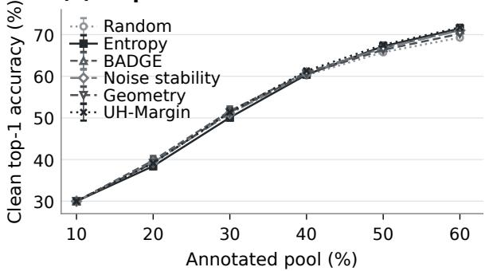

(b) Aligned regularization  
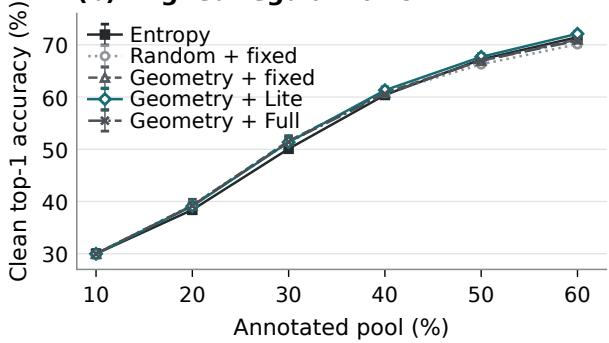  
(c) Final-budget comparison

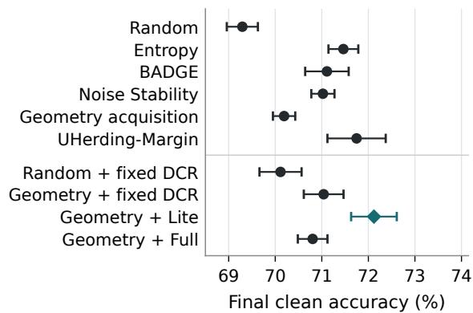  
Figure 4: Acquisition and aligned regularization under the common ImageNet-100 protocol. Panels (a) and (b) show measured accuracy trajectories on identical axes; panel (c) enlarges the final 60% endpoint for the original nine conditions and the UHerding-Margin follow-up. Markers and bars represent six-seed means and sample SDs, not confidence intervals. All trajectories start from the same 10% checkpoint. Fixed, Lite, and Full denote aligned DCR conditions; entropy regularization follow-ups appear in Figure 5. Connecting lines guide the eye, and no new area-under-curve test or inferential family is introduced. Geometry and UH-Margin abbreviate geometry acquisition and UHerding-Margin.

Entropy with aligned DCR and Lite reaches $7 3 . 3 6 0 \pm 0 . 2 0 8 \%$ and exceeds unregularized entropy and geometry-plus-Lite in every seed. Table 9 gives the paired comparisons; Appendix A.1 provides the seed-level outcomes (Table 22).

The gain over entropy is +1.897 percentage points, with individual 95% paired-t interval [+1.625, +2.169].

Table 7: The 12 earlier six-seed ImageNet-100 conditions at 60% annotations. Values are mean ± sample SD over six paired seeds; clean and standard AutoAttack accuracy use all 5,000 validation images. Study I denotes the initial nine-condition comparison, A the later acquisition-rule ablation, B the later UHerding comparison, and C the later entropy-plus-fixed control. The table is descriptive: study-specific inferential families remain separate. Bold identifies the highest observed mean clean accuracy, not a universal superiority claim.
<table><tr><td>Condition</td><td>Study</td><td>Clean top-1 (%)</td><td>AutoAttack 8/255 (%)</td><td>Cross-entropy</td><td>ECE</td></tr><tr><td>Random</td><td>I</td><td> $6 9 . 2 9 3 \pm 0 . 3 3 4$ </td><td> $0 . 0 1 3 \pm 0 . 0 1 0$ </td><td> $1 . 2 7 2 7 1 2 \pm 0 . 0 2 1 1 4 5$ </td><td> $0 . 0 9 4 9 4 5 \pm 0 . 0 0 2 9 1 7$ </td></tr><tr><td>Entropy</td><td>I</td><td> $7 1 . 4 6 3 \pm 0 . 3 2 0$ </td><td> $0 . 0 1 0 \pm 0 . 0 1 1$ </td><td> $1 . 1 5 0 5 9 1 \pm 0 . 0 2 0 2 9 3$ </td><td> $0 . 0 7 9 6 9 8 \pm 0 . 0 0 3 8 4 9$ </td></tr><tr><td>BADGE</td><td>I</td><td> $7 1 . 1 1 0 \pm 0 . 4 6 7$ </td><td> $0 . 0 0 3 \pm 0 . 0 0 8$ </td><td> $1 . 1 4 9 5 8 1 \pm 0 . 0 0 7 0 2 2$ </td><td> $0 . 0 7 7 0 8 8 \pm 0 . 0 0 4 0 5 8$ </td></tr><tr><td>Noise Stability</td><td>I</td><td> $7 1 . 0 2 3 \pm 0 . 2 4 9$ </td><td> $0 . 0 0 3 \pm 0 . 0 0 8$ </td><td> $1 . 1 6 2 8 2 1 \pm 0 . 0 0 6 1 6 7$ </td><td> $0 . 0 7 8 7 0 3 \pm 0 . 0 0 2 3 7 5$ </td></tr><tr><td>CAENL acquisition only</td><td>I</td><td> $7 0 . 1 9 0 \pm 0 . 2 4 0$ </td><td> $0 . 0 1 3 \pm 0 . 0 1 0$ </td><td> $1 . 2 1 0 5 4 5 \pm 0 . 0 1 0 4 0 4$ </td><td> $0 . 0 8 5 5 5 2 \pm 0 . 0 0 4 5 0 1$ </td></tr><tr><td>Random + aligned fixed</td><td>I</td><td> $7 0 . 1 1 3 \pm 0 . 4 5 2$ </td><td> $0 . 0 1 7 \pm 0 . 0 0 8$ </td><td> $1 . 2 1 7 9 3 9 \pm 0 . 0 2 1 3 1 5$ </td><td> $0 . 0 8 5 9 6 4 \pm 0 . 0 0 6 2 2 8$ </td></tr><tr><td>DCR CAENL + aligned fixed DCR</td><td>I</td><td> $7 1 . 0 4 0 \pm 0 . 4 2 7$ </td><td> $0 . 0 1 7 \pm 0 . 0 0 8$ </td><td> $1 . 1 5 5 3 5 1 \pm 0 . 0 1 5 2 3 0$ </td><td> $0 . 0 7 8 4 2 8 \pm 0 . 0 0 3 6 6 7$ </td></tr><tr><td>CAENL + aligned MACC- Lite</td><td>I</td><td> $7 2 . 1 2 0 \pm 0 . 4 9 0$ </td><td> $0 . 0 0 7 \pm 0 . 0 1 0$ </td><td> $1 . 0 7 8 8 8 5 \pm 0 . 0 0 8 0 1 4$ </td><td> $0 . 0 6 2 9 4 8 \pm 0 . 0 0 4 9 6 5$ </td></tr><tr><td>CENL + aligned Full MACC</td><td>I</td><td> $7 0 . 8 0 3 \pm 0 . 3 1 8$ </td><td> $0 . 0 0 7 \pm 0 . 0 1 0$ </td><td> $1 . 1 7 1 3 2 2 \pm 0 . 0 2 3 7 4 6$ </td><td> $0 . 0 8 1 6 3 9 \pm 0 . 0 0 4 6 7 1$ </td></tr><tr><td>Entropy + aligned MACC-</td><td>A</td><td> $\mathbf { 7 3 . 3 6 0 \pm 0 . 2 0 8 }$ </td><td> $0 . 0 0 3 \pm 0 . 0 0 8$ </td><td> $1 . 0 2 8 9 6 7 \pm 0 . 0 1 0 1 0 1$ </td><td> $0 . 0 5 5 4 2 6 \pm 0 . 0 0 1 2 5 6$ </td></tr><tr><td>Lite UHerding-Margin</td><td>B</td><td> $7 1 . 7 4 7 \pm 0 . 6 2 6$ </td><td> $0 . 0 0 7 \pm 0 . 0 1 0$ </td><td> $1 . 1 2 7 9 2 2 \pm 0 . 0 2 1 0 3 9$ </td><td> $0 . 0 7 3 9 7 7 \pm 0 . 0 0 3 2 9 4$ </td></tr><tr><td>Entropy + aligned fixed DCR</td><td>C</td><td> $7 2 . 2 6 3 \pm 0 . 3 8 1$ </td><td> $0 . 0 0 0 \pm 0 . 0 0 0$ </td><td> $1 . 0 9 2 0 1 4 \pm 0 . 0 1 3 3 8 6$ </td><td> $0 . 0 7 1 0 3 7 \pm 0 . 0 0 4 2 5 3$ </td></tr></table>

Table 8: All seven original clean-accuracy contrasts in percentage points. Intervals are individual unadjusted 95% paired-t intervals. Each p-value column is separately Holm-adjusted across seven contrasts. The exact tests have the resolution limit described in Section 6.7.
<table><tr><td>Target minus reference</td><td>Difference (pp)</td><td>95% CI (pp)</td><td></td><td>Adjusted t p Adjusted exact p</td></tr><tr><td>Aligned fixed DCR – acquisition only</td><td>+0.850</td><td> $[ + 0 . 4 3 0 , + 1 . 2 7 0 ]$ </td><td>0.0208</td><td>0.2188</td></tr><tr><td>Aligned MACC-Lite – aligned fixed DCR</td><td>+1.080</td><td> $[ + 0 . 4 4 7 , + 1 . 7 1 3 ]$ </td><td>0.0309</td><td>0.2188</td></tr><tr><td>Aligned Full MACC - aligned fixed DCR</td><td>-0.237</td><td> $[ - 0 . 7 1 4 , + 0 . 2 4 1 ]$ </td><td>0.2589</td><td>0.2813</td></tr><tr><td> $\mathrm { A l i g n e d ~ M A C C - L i t e - e n t r o p y }$ </td><td>+0.657</td><td> $\left[ + 0 . 0 1 5 , + 1 . 2 9 9 \right]$ </td><td>0.0931</td><td>0.2188</td></tr><tr><td>Aligned Full MACC – entropy</td><td>-0.660</td><td> $[ - 0 . 8 6 9 , - 0 . 4 5 1 ]$ </td><td>0.0032</td><td>0.2188</td></tr><tr><td>Acquisition only - random</td><td>+0.897</td><td> $\left[ + 0 . 3 8 9 , + 1 . 4 0 5 \right]$ </td><td>0.0309</td><td>0.2188</td></tr><tr><td>Random + aligned fixed DCR − random</td><td>+0.820</td><td> $\left[ + 0 . 2 9 7 , + 1 . 3 4 3 \right]$ </td><td>0.0309</td><td>0.2188</td></tr></table>

The gain over geometry plus Lite is +1.240 points, with interval [+0.707, +1.773]. Both comparisons pass the acquisition-rule adjusted paired-t analysis. Their raw exact value is 0.03125 and adjusted value 0.0625, consistent with the resolution limit. The evidence supports the combined aligned-loss-and-Lite treatment within entropy acquisition. That acquisition-rule study did not include a fixed-strength entropy control. The later matched follow-up in Section 7.6 provides that comparison while preserving the acquisition-rule study’s original two-contrast family.

The third follow-up keeps entropy acquisition and replaces Lite with the fixed aligned coeficient $\lambda _ { l } = 0 . 0 3$ at layer3 and layer4. The separation penalty remains

One image survives the attack for seed 802 and none for the other seeds, giving mean robust accuracy 0.0033%. This descriptive result does not change the robustness conclusion or the original robustness family.

## 7.6 Matched fixed-strength control within entropy acquisition

$\beta _ { B } = 0 . 0 1$ with the original per-seed targets and floors. All six initial model and optimizer states, label/holdout splits, training settings, and the five-round schedule are reused. The first acquisition matches original entropy exactly; later acquired sets are allowed to change with the trained model. This tests the coeficient-control treatment within the active-learning pipeline, including its subsequent efect on selection.

Entropy plus fixed DCR reaches 72.263 ± 0.381%, improving over entropy by +0.800 percentage points with individual 95% interval [+0.498, +1.102]. Lite improves over fixed by +1.097 points with interval [+0.714, +1.479]. Both diferences are positive in all six seeds. Within this six-seed two-contrast family, both Holm-adjusted paired-t values are 0.001442. Both raw exact values are 0.03125 and adjusted values are 0.0625. Table 10 reports the full statistics, and Table 22 gives the paired outcomes. This follow-up favors Lite over the prespecified 0.03 coeficient under the pairedt analysis. The independently tuned constant and schedule are evaluated with new seeds in Section 7.1; those comparisons address diferent controls.

Figure 5 includes the Lite trajectory and the matched fixed trajectory. At 20% and 30% annotations, fixed DCR has slightly higher mean accuracy than Lite; the ordering reverses at later budgets. Thus the finalbudget advantage should not be described as uniform throughout acquisition. Fixed DCR has zero robustcorrect images in every seed under standard AutoAttack 8/255 on all 5,000 validation images. This fixedstrength condition also has negligible adversarial accuracy under the specified threat model.

Open points: seeds; filled points: mean ± SD  
Table 9: Two acquisition-rule clean-accuracy contrasts. Positive values favor entropy with aligned DCR and Lite. Intervals are individual unadjusted paired-t intervals; each test family is Holm-adjusted across these two contrasts. This family was specified after inspection of the initial comparison.
<table><tr><td>Reference condition</td><td>Gain (pp)</td><td>95% CI (pp) Adjusted t p Adjusted exact p</td><td></td><td></td></tr><tr><td>Entropy without aligned regularization</td><td>+1.897</td><td> $\left[ + 1 . 6 2 5 , + 2 . 1 6 9 \right]$ </td><td>0.0000198</td><td>0.0625</td></tr><tr><td>Geometry acquisition + aligned MACC-Lite</td><td>+1.240</td><td> $[ + 0 . 7 0 7 , + 1 . 7 7 3 ]$ </td><td>0.001875</td><td>0.0625</td></tr></table>

## 7.7 Comparison with UHerding-Margin

Under the matched protocol in Section 6.6, UHerding-Margin attains mean clean accuracy $7 1 . 7 4 7 \pm 0 . 6 2 6 \%$ versus $7 1 . 4 6 3 { \pm } 0 . 3 2 0 \%$ for entropy and $7 3 . 3 6 0 { \pm } 0 . 2 0 8 \%$ for entropy with aligned DCR and Lite. UHerding minus entropy is +0.283 points with interval $\left[ - 0 . 4 3 0 , + 0 . 9 9 7 \right]$ , adjusted paired-t value 0.3540, and adjusted exact value 0.3125. This does not establish superiority or equivalence.

Entropy with the aligned Lite treatment exceeds the UHerding adaptation in every seed. The mean diference is +1.613 points, with interval $[ + 0 . 9 5 7 , + 2 . 2 7 0 ]$ The adjusted paired-t value is 0.002923; the adjusted exact value is 0.0625. This compares complete pipelines and does not establish superiority of entropy alone, or of the combined treatment over the authors’ unmodified UHerding benchmark implementation.

UHerding retains one correct adversarial image for each of seeds 802 and 805, and none otherwise: mean robust accuracy 0.0067%. The comparison adds an executed recent mechanism while retaining its representation and selection-domain adaptations.

## 7.8 Earlier representation and learnedcontrol results

Within the original nine-condition matrix, geometric acquisition with aligned Lite has the lowest mean log trace ratio, cross-entropy, and ECE. Table 12 reports descriptive geometry separately from task performance. These statistics are not a causal mediation analysis, and the all-class assessment ratio does not establish attainment of the 16-class anchor target.

Full MACC executes 370, 368, 368, 374, 365, and 373 learned-policy updates for seeds 801–806. Its mean accuracy is 0.237 points below aligned fixed DCR, with an interval spanning zero, and 0.660 points below entropy. The latter diference passes the adjusted paired-t test. The learned controller is active, but its additional capacity does not establish benefit under the present settings. Feedback horizon, changing acquisition phases, and imperfect credit assignment are possible explanations rather than identified causes.

(a) Matched entropy treatments  
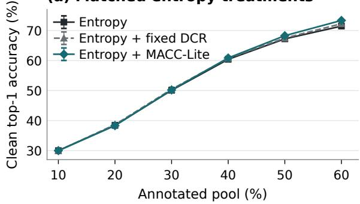

(b) Budget-dependent gains  
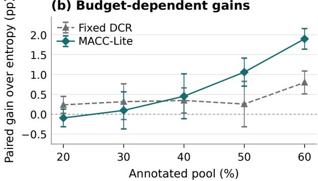  
(c) Final budget: six paired seeds

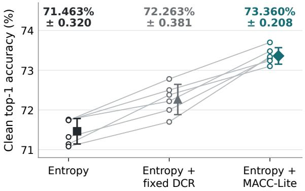  
Figure 5: Matched entropy treatments across annotation budgets and seeds. (a) Mean clean accuracy and sample SD across six seeds. (b) Mean and sample SD of within-seed diferences from entropy; the common 10% initialization has zero gain and is omitted. (c) Individual final-budget accuracies, with lines joining the same seed across conditions; adjacent filled markers and bars show mean ± sample SD. Overlapping seed values are retained. These bars are not confidence intervals. Fixed DCR uses $\lambda _ { l } = 0 . 0 3$ and the same separation penalty as Lite. Lite is not uniformly better at early budgets, but exceeds both comparators in all six final-budget seeds. Only the final 60% comparisons enter the declared follow-up tests. All points derive from recorded measurements.

Table 10: The six-seed fixed-control follow-up’s two clean-accuracy contrasts. Diferences and individual unadjusted 95% paired-t intervals are in percentage points. Holm correction is applied separately to the two paired-t and the two exact tests in this family. Prior families are unchanged.
<table><tr><td>Target minus reference</td><td>Difference</td><td>95% CI Raw</td><td> $t \ p$ </td><td>Adjusted  $t \ p$ </td><td>Exact raw / adjusted</td></tr><tr><td> $\mathrm { E n t r o p y } + \mathrm { f i x e d } - \mathrm { e n t r o p y }$ </td><td>+0.800</td><td> $\left[ + 0 . 4 9 8 , + 1 . 1 0 2 \right]$ </td><td>0.001047</td><td>0.001442</td><td>0.03125 / 0.0625</td></tr><tr><td>Entropy + Lite – entropy + fixed</td><td>+1.097</td><td> $[ + 0 . 7 1 4 , + 1 . 4 7 9 ]$ </td><td>0.000721</td><td>0.001442</td><td>0.03125 / 0.0625</td></tr></table>

Table 11: The UHerding comparison’s two clean-accuracy contrasts, in percentage points. Intervals are individual unadjusted 95% paired-t intervals; each test column is Holm-adjusted across these two comparisons only.
<table><tr><td>Target minus reference</td><td>Difference</td><td>95% CI Adjusted</td><td> $t \ p$  Adjusted exact p</td></tr><tr><td>UHerding-Margin – entropy</td><td> $+ 0 . 2 8 3$ </td><td> $\left[ - 0 . 4 3 0 , + 0 . 9 9 7 \right]$ </td><td>0.3540</td><td>0.3125</td></tr><tr><td>Entropy + aligned Lite – UHerding-Margin</td><td>+1.613</td><td> $[ + 0 . 9 5 7 , + 2 . 2 7 0 ]$ </td><td>0.002923</td><td>0.0625</td></tr></table>

Table 12: Final all-class normalized geometry, mean ± seed SD. The statistic averages layer3 and layer4 $\log ( ( W +$ $\epsilon ) / ( B + \epsilon ) )$
<table><tr><td>Condition</td><td>Mean log trace ratio</td></tr><tr><td>Random</td><td> $1 . 3 8 8 1 \pm 0 . 0 1 9 7$ </td></tr><tr><td>Entropy</td><td> $1 . 3 9 1 6 \pm 0 . 0 1 7 0$ </td></tr><tr><td>Acquisition only</td><td> $1 . 3 8 6 4 \pm 0 . 0 1 5 1$ </td></tr><tr><td>Random + aligned fixed</td><td> $1 . 0 6 0 7 \pm 0 . 0 2 1 8$ </td></tr><tr><td> $\mathrm { C } \mathrm { E N L } + \mathrm { a l i g n e d \ f i x e d }$ </td><td> $0 . 9 7 6 7 \pm 0 . 0 2 0 0$ </td></tr><tr><td> $\mathrm { C } \mathrm { E N L } + \mathrm { a l i g n e d \ L i t e }$ </td><td> $0 . 4 9 3 7 \pm 0 . 0 3 9 0$ </td></tr><tr><td> $\mathrm { C } \mathrm { E N L } + \mathrm { a l i g n e d ~ F u l l }$ </td><td> $1 . 0 8 2 5 \pm 0 . 0 9 8 2$ </td></tr><tr><td> $\mathrm { E n t r o p y } + \mathrm { a l i g n e d \ f i x e d }$ </td><td> $1 . 0 0 2 7 \pm 0 . 0 1 2 5$ </td></tr><tr><td> ${ \mathrm { E n t r o p y } } + { \mathrm { a l i g n e d ~ L i t e } }$ </td><td> $0 . 4 7 2 5 \pm 0 . 0 4 3 4$ </td></tr></table>

Short development continuations found Lite coeficients below the 0.10 cap. That observation does not substitute for a long-run stability analysis. Proposition 4 bounds coeficients, not the network’s geometric state or task error.

## 7.9 Adversarial evaluation

Across the earlier six-seed classification studies, final checkpoints retain zero or one correct adversarial prediction out of 5,000. Mean robust accuracy is approximately 0.000%–0.017%. No planned robustness comparison establishes an improvement. Table 24 reports all seven original paired contrasts and their uncertainty, with the original test families retained. These near-zero empirical outcomes are not a population certificate, and repeated predictions on the same images do not become independent observations when pooled across seeds.

The original spectral pilot also had zero robustness at $8 / 2 5 5 ;$ extending its selected-checkpoint diagnostic from 1,000 to all 5,000 images reproduced that result. Smaller-radius post-hoc diagnostics did not establish an overall advantage over random acquisition. The final study retains the original attack radius. Improved clean accuracy and supervised geometry therefore coexist with negligible adversarial accuracy under this threat model.

## 7.10 Language modeling on C4

The following three task studies evaluate the spectral formulation in Section 4.5, with protocols given in Section 6.8. For C4, Table 13 reports the unused local validation shard, and Table 14 gives all three NLL contrasts against baseline. Fixed spectral DCR lowers NLL in every paired seed, with mean diference −0.00029250 nats/token and individual interval $\left[ - 0 . 0 0 0 3 2 8 1 3 , - 0 . 0 0 0 2 5 6 8 8 \right]$ . Its raw paired-t value is $4 . 4 2 \times 1 0 ^ { - 6 }$ and its archived within-endpoint Holmadjusted value is $8 . 8 5 \times 1 0 ^ { - 6 }$ . The raw exact value is 0.03125; applying Holm correction within the same three-contrast family gives 0.09375.

The efect is close to the original-shard diference of $- 0 . 0 0 0 2 8 7 3 4 .$ . The second shard checks sensitivity to local data reuse but adds no independent training seeds. The practical change is approximately 0.0086% in NLL and 0.0292% in perplexity. Fixed DCR does not establish a token-accuracy or pooled-ECE benefit. Spectral Lite increases NLL in all six seeds by a mean of 0.00194729 nats/token, with interval [0.00187898, 0.00201560]. Full is inconclusive relative to baseline: +0.00023624, interval $\left[ - 0 . 0 0 0 1 8 7 7 8 , + 0 . 0 0 0 6 6 0 2 5 \right]$ , raw paired-t value 0.2115. This is not an equivalence result. The secondary comparison outputs are retained in Appendix C.

The language controller records 488 actions per seed. Lite spends much of training at the 0.08 coeficient cap; Full records 428–445 learned-policy updates. The adaptive results therefore do not reflect an inactive controller. Efective ranks increase under regularization, so the mechanism is spectral shaping rather than uniformly stronger low-rank collapse. The small fixed-DCR NLL result does not establish broader calibration, memorization, or cross-modal gains.

## 7.11 CIFAR-10 difusion

Unregularized fine-tuning lowers mean FID from 10.512 to 8.057. Fixed spectral DCR, Lite, and Full instead increase FID relative to that baseline by 0.156, 0.415, and 0.154. Each increase occurs in every seed. Improvement over the unchanged pretrained model therefore does not establish added value from DCR.

All four contrasts pass their adjusted paired-t tests. Each raw exact value is 0.03125, giving adjusted value

Table 13: Unused-local-shard C4 evaluation of the same 24 final GPT-2 checkpoints. Values are mean $\pm$ sample SD over six training seeds, with 1,999,872 next-token predictions per checkpoint. The formulations are spectral, not aligned classification DCR.
<table><tr><td>Condition</td><td> $\mathrm { N L L \ ( n a t s / t o k e n ) }$ </td><td>Perplexity</td><td>Pooled token ECE</td><td>Token accuracy</td></tr><tr><td>Baseline</td><td> $3 . 3 8 4 2 1 2 \pm 0 . 0 0 0 2 3 9$ </td><td> $2 9 . 4 9 4 7 3 \pm 0 . 0 0 7 0 5$ </td><td> $0 . 0 1 2 3 2 4 \pm 0 . 0 0 0 4 2 6$ </td><td> $0 . 3 8 0 0 6 7 \pm 0 . 0 0 0 1 2 3$ </td></tr><tr><td>Fixed spectral DCR</td><td> $3 . 3 8 3 9 1 9 \pm 0 . 0 0 0 2 5 3$ </td><td> $2 9 . 4 8 6 1 1 \pm 0 . 0 0 7 4 6$ </td><td> $0 . 0 1 2 2 1 6 \pm 0 . 0 0 0 4 3 8$ </td><td> $0 . 3 8 0 0 2 9 \pm 0 . 0 0 0 0 8 3$ </td></tr><tr><td>Spectral MACC-Lite</td><td> $3 . 3 8 6 1 5 9 \pm 0 . 0 0 0 2 2 0$ </td><td> $2 9 . 5 5 2 2 2 \pm 0 . 0 0 6 5 1$ </td><td> $0 . 0 1 3 1 3 1 \pm 0 . 0 0 0 3 9 6$ </td><td> $0 . 3 7 9 9 2 0 \pm 0 . 0 0 0 0 9 8$ </td></tr><tr><td>Spectral Full MACC</td><td> $3 . 3 8 4 4 4 8 \pm 0 . 0 0 0 4 6 2$ </td><td> $2 9 . 5 0 1 7 0 \pm 0 . 0 1 3 6 2$ </td><td> $0 . 0 1 2 4 3 8 \pm 0 . 0 0 0 5 8 4$ </td><td> $0 . 3 8 0 0 4 0 \pm 0 . 0 0 0 1 1 1$ </td></tr></table>

Table 14: All three unused-shard C4 NLL contrasts. Diferences and individual 95% paired-t intervals are in $1 0 ^ { - 4 }$ nats/token; negative diferences favor regularization. Holm adjustment is within the three NLL contrasts, separately for each test. Both test families use the same three contrasts; intervals are unadjusted.
<table><tr><td>Condition minus baseline Difference</td><td></td><td>95% CI</td><td>Raw t p</td><td>Holm  $t \ p$ </td><td>Raw exact  $p$ </td><td>Holm exact p</td></tr><tr><td>Fixed spectral DCR</td><td> $- 2 . 9 2 5 0 5$ </td><td> $[ - 3 . 2 8 1 2 9 , - 2 . 5 6 8 8 1 ]$ </td><td> $4 . 4 2 3 9 \times 1 0 ^ { - 6 }$ </td><td> $8 . 8 4 7 7 \times 1 0 ^ { - 6 }$ </td><td>0.03125</td><td>0.09375</td></tr><tr><td>Spectral MACC-Lite</td><td> $+ 1 9 . 4 7 2 8 9$ </td><td> $\left[ + 1 8 . 7 8 9 7 9 , + 2 0 . 1 5 5 9 9 \right]$ </td><td> $8 . 9 6 5 1 \times 1 0 ^ { - 9 }$ </td><td> $2 . 6 8 9 5 \times 1 0 ^ { - 8 }$ </td><td>0.03125</td><td>0.09375</td></tr><tr><td>Spectral Full MACC</td><td> $+ 2 . 3 6 2 3 6$ </td><td> $[ - 1 . 8 7 7 7 8 , + 6 . 6 0 2 5 0 ]$ </td><td>0.21152</td><td> $0 . 2 1 1 5 2$ </td><td>0.21875</td><td>0.21875</td></tr></table>

Table 15: Difusion confirmation with 50,000 generated images per condition and seed. Values are mean ± sample SD over six seed streams. FID is primary. Reference variation is sampling variation for one unchanged pretrained model.
<table><tr><td>Condition</td><td>FID ↓</td><td> $\mathrm { K I D \times 1 0 ^ { 3 } \downarrow }$ </td><td>Inception score ↑</td></tr><tr><td>Pretrained reference</td><td> $1 0 . 5 1 2 \pm 0 . 1 0 0$ </td><td> $9 . 1 5 3 \pm 0 . 1 2 4$ </td><td> $8 . 4 7 9 \pm 0 . 0 3 9$ </td></tr><tr><td>Unregularized fine-tuning</td><td> $\mathbf { 8 . 0 5 7 \pm 0 . 0 4 8 }$ </td><td> $6 . 6 0 5 \pm 0 . 0 8 4$ </td><td> $8 . 6 9 2 \pm 0 . 0 4 3$ </td></tr><tr><td>Fixed spectral</td><td> $8 . 2 1 3 \pm 0 . 0 7 0$ </td><td> $6 . 7 2 6 \pm 0 . 1 0 5$ </td><td> $8 . 7 2 4 \pm 0 . 0 4 9$ </td></tr><tr><td>DCR Spectral</td><td> $8 . 4 7 2 \pm 0 . 1 0 0$ </td><td> $6 . 9 3 9 \pm 0 . 1 1 5$ </td><td> $8 . 7 2 8 \pm 0 . 0 5 5$ </td></tr><tr><td>MACC-Lite Spectral Full MACC</td><td> $8 . 2 1 1 \pm 0 . 1 1 6$ </td><td> $6 . 7 4 4 \pm 0 . 0 8 8$ </td><td> $8 . 7 2 9 \pm 0 . 0 5 0$ </td></tr></table>

0.125. The consistent adverse direction is retained with the small-sample assumptions and resolution qualification. It is not a claim that every difusion regularizer is harmful.

KID is also higher in mean under every regularized condition. Slightly higher Inception scores remain secondary and do not replace FID. Mean oficial-test EMA denoising MSE is 0.02918539 for baseline, 0.02918606 for fixed DCR, 0.02918634 for Lite, and 0.02918632 for Full, compared with 0.02935395 for the reference. These small descriptive diferences are not formal equivalence or significant secondary efects.

Full executes 188, 186, 189, 185, 183, and 186 learned updates, with 200 controller events per seed. Lite also executes 200 events and ends at the 0.05 cap. The final value does not specify its occupancy over training. Final monitored ranks are approximately 23–24 for baseline, 49 for fixed DCR, 38–39 for Lite, and 42–60 for Full. Active control and representation changes do not establish target attainment or better generation.

The two-seed pilot favored fixed DCR and Full relative to its baseline. That direction does not persist in confirmation. Training horizon and generated-sample count both changed, so the present comparison does not isolate the reason for the reversal.

## 7.12 AudioCaps captioning

Fixed DCR has a slightly higher mean CIDEr-D than baseline; Lite and Full have lower means. Every primary interval spans zero, and both adjusted test families give $p = 1 . 0 0 0 0$ for all three contrasts. This is an inconclusive comparison, not proof of equivalence, zero population efect, or universal inefectiveness.

Seed-level CIDEr-D values are reported in Appendix A.2.

Raw paired-t values are 0.8971, 0.4673, and 0.5072; raw exact values are 0.84375, 0.50000, and 0.53125. Unlike a case resting only on the exact-test resolution limit, these raw results also provide no strong evidence of a diference. Mean test NLL is 2.026833 for baseline, 2.029867 for fixed, 2.033260 for Lite, and 2.030362 for Full. These remain descriptive secondary results.

Full records 260, 253, 260, 266, 259, and 254 learnedpolicy updates. Both adaptive conditions record 278 events. All 24 runs produce 866 nonempty captions. The mismatched-audio development diagnostic has higher NLL than correctly paired audio in every run. That establishes sensitivity to the supplied conditioning under this diagnostic, not added benefit from DCR or a comprehensive grounding guarantee.

The pilot evaluates 376 development clips after two epochs; confirmation evaluates 866 test clips after ten epochs. Their absolute scores cannot attribute a diference solely to training duration. The study evaluates audio–text captioning; audio retrieval, audio classification, other architectures, and full-original-benchmark comparability remain outside its scope.

## 7.13 Computational cost and memory

The implementation costs follow the components being used. Fixed DCR still computes diferentiable layer statistics because they define the regularization loss. MACC-Lite adds moving measurements, coeficient states, and bounded update arithmetic. The evaluated Lite path also records held-out cross-entropy at control boundaries, although this metric does not enter its coefficient action. Full MACC uses held-out task feedback in its state and reward and additionally optimizes a policy. These are training operations and can be omitted during ordinary logits-based classifier inference. Geometric acquisition between training rounds still requires feature extraction and fitted class statistics.

Table 16: All four difusion FID contrasts. Positive diferences indicate worse FID for the target. Intervals are individual unadjusted paired-t intervals. Each test family is Holm-adjusted over these four comparisons.
<table><tr><td>Target minus reference</td><td>Difference</td><td>95% interval</td><td></td><td>Adjusted t p Adjusted exact p</td></tr><tr><td>Baseline – pretrained reference</td><td>-2.45468</td><td> $\left[ - 2 . 5 8 3 4 6 , - 2 . 3 2 5 8 9 \right]$ </td><td> $2 . 6 7 6 9 \times 1 0 ^ { - 7 }$ </td><td>0.125</td></tr><tr><td>Fixed DCR – baseline</td><td>+0.15601</td><td> $\left[ + 0 . 1 1 3 5 7 , + 0 . 1 9 8 4 5 \right]$ </td><td> $0 . 0 0 0 4 4 8 1$ </td><td>0.125</td></tr><tr><td>MACC-Lite - baseline</td><td>+0.41472</td><td> $[ + 0 . 3 1 9 3 1 , + 0 . 5 1 0 1 2 ]$ </td><td> $0 . 0 0 0 3 0 0 4$ </td><td>0.125</td></tr><tr><td>Full MACC – baseline</td><td>+0.15431</td><td> $\left[ + 0 . 0 6 2 0 5 , + 0 . 2 4 6 5 8 \right]$ </td><td>0.0077204</td><td>0.125</td></tr></table>

Table 17: AudioCaps results on the fixed available subset: mean ± sample SD over seeds 1301–1306. Each run uses 866 test clips with five references each. Metrics retain their native scales; CIDEr-D is primary.
<table><tr><td>Condition</td><td>CIDEr-D</td><td>BLEU-4</td><td>METEOR</td><td>SPICE</td><td>SPIDEr</td></tr><tr><td>Baseline</td><td> $0 . 6 7 3 6 \pm 0 . 0 2 2 0$ </td><td> $0 . 2 4 0 1 \pm 0 . 0 1 3 7$ </td><td> $0 . 2 3 2 8 \pm 0 . 0 0 4 3$ </td><td> $0 . 1 6 6 4 \pm 0 . 0 0 4 6$ </td><td> $0 . 4 2 0 0 \pm 0 . 0 1 3 2$ </td></tr><tr><td>Fixed spectral DCR</td><td> $0 . 6 7 4 5 \pm 0 . 0 1 8 5$ </td><td> $0 . 2 3 8 4 \pm 0 . 0 1 1 4$ </td><td> $0 . 2 3 3 5 \pm 0 . 0 0 2 2$ </td><td> $0 . 1 6 5 0 \pm 0 . 0 0 4 1$ </td><td> $0 . 4 1 9 8 \pm 0 . 0 1 1 0$ </td></tr><tr><td>Spectral MACC-Lite</td><td> $0 . 6 6 6 8 \pm 0 . 0 2 1 2$ </td><td> $0 . 2 3 7 8 \pm 0 . 0 1 0 8$ </td><td> $0 . 2 3 2 0 \pm 0 . 0 0 3 5$ </td><td> $0 . 1 6 6 4 \pm 0 . 0 0 2 0$ </td><td> $0 . 4 1 6 6 \pm 0 . 0 1 1 2$ </td></tr><tr><td>Spectral Full MACC</td><td> $0 . 6 7 0 3 \pm 0 . 0 1 7 5$ </td><td> $0 . 2 3 8 2 \pm 0 . 0 0 9 4$ </td><td> $0 . 2 3 1 9 \pm 0 . 0 0 2 3$ </td><td> $0 . 1 6 5 9 \pm 0 . 0 0 4 1$ </td><td> $0 . 4 1 8 1 \pm 0 . 0 1 0 0$ </td></tr></table>

Table 18: All three primary audio CIDEr-D contrasts. Positive diferences favor the target. Intervals are individual unadjusted paired-t intervals; each test family is Holm-adjusted across three comparisons.
<table><tr><td>Target minus baseline</td><td>Difference</td><td>95% interval Adjusted</td><td> $t \ p$ </td><td>Adjusted exact p</td></tr><tr><td>Fixed spectral DCR</td><td>+0.000896</td><td> $\left[ - 0 . 0 1 6 0 4 0 , + 0 . 0 1 7 8 3 3 \right]$ </td><td>1.0000</td><td>1.0000</td></tr><tr><td>Spectral MACC-Lite</td><td>-0.006781</td><td> $\left[ - 0 . 0 2 8 9 5 0 , + 0 . 0 1 5 3 8 9 \right]$ </td><td>1.0000</td><td>1.0000</td></tr><tr><td>Spectral Full MACC</td><td>-0.003329</td><td> $\left[ - 0 . 0 1 5 3 1 3 , + 0 . 0 0 8 6 5 6 \right]$ </td><td>1.0000</td><td>1.0000</td></tr></table>

Table 19 reports timing components for the initial nine-condition ImageNet-100 study. The synchronized training-compute timer includes forward, loss, backward, clipping, and optimizer execution, but excludes subsequent controller observation and policy operations. Feedback and acquisition have separate timers. Loading, serialization, evaluation, and orchestration are not fully represented by summing these columns. All references record geometry, and initialization is allocated once per conceptual condition. Thus, these comparisons do not estimate overhead against the leanest unregularized or fixed-weight implementation. Coeficient selection and earlier method development incur costs beyond one selected run; the recorded selection costs below are reported separately rather than absorbed into a per-run overhead percentage.

The maximum PyTorch-allocated memory is 6,075,090,432 bytes for every conceptual run in the original nine-condition matrix. Shared initialization may dominate that maximum; equal values do not establish zero additional controller memory. The phase-specific comparison below is narrower but still does not isolate a complete controller footprint.

The duration in Table 20 and the synchronized training-compute component in Table 19 have diferent measurement boundaries. The former is a phaseduration record; the latter excludes controller observation and policy operations and includes an allocated initialization component. They are not additive or directly subtractable. These timers do not define a common end-to-end boundary.

The entropy-plus-Lite mean phase duration is 2.59% higher, a diference of 136.29 s. These are sequential campaigns, not interleaved timing trials. The peak diference is 262,144 bytes, or 0.25 MiB. Neither quantity is complete application overhead or an isolated controller measurement.

The entropy-plus-fixed follow-up separately records means of 4,837.85 s for synchronized training compute, 182.55 s for feedback inference, 483.99 s for acquisition, and 782.66 s for final AutoAttack. The training and feedback components exclude the reused initialization; they therefore cannot be inserted directly into Table 19 or compared as complete application time. The fixedcontrol records do not contain a phase-duration or phase-peak memory aggregate for this new condition, so no new overhead ratio is inferred.

Tuned-control study. The additional 24 tuning runs take 39.66 hours of recorded post-initialization phase training plus acquisition, or 40.07 hours including the three shared initializations. These totals exclude final reporting and other unrecorded overhead. Mean post-initialization training-plus-acquisition time per run is 1.626, 1.669, 1.674 and 1.674 hours for entropy, Lite, fixed and schedule on ResNet-50; corresponding ResNet-18 times are 0.759, 0.760, 0.764 and 0.762 hours. The small per-run diference between Lite and fixed does not account for the separate tuning cost or Lite’s earlier development cost. Hence, unchanged feedback in this campaign is not synonymous with an absence of prior tuning. All four conditions compute the monitored holdout metric at matched control windows, including those whose actions do not consume it.

Table 19: Recorded ImageNet-100 timing components in seconds per conceptual condition run, averaged over six seeds. Training and feedback include their allocated shared-initialization costs. These are component, not complete application, timings.
<table><tr><td>Method</td><td>Training compute Feedback inference</td><td></td><td></td><td>Acquisition Final AutoAttack</td></tr><tr><td>Random</td><td>5093.24</td><td>182.25</td><td>0.85</td><td>792.52</td></tr><tr><td>Entropy</td><td>5092.81</td><td>182.45</td><td>490.83</td><td>800.95</td></tr><tr><td>BADGE</td><td>5093.97</td><td>182.55</td><td>523.26</td><td>775.80</td></tr><tr><td>Noise Stability</td><td>5093.61</td><td>182.52</td><td>2942.89</td><td>777.36</td></tr><tr><td>Acquisition only</td><td>5093.23</td><td>182.38</td><td>739.69</td><td>798.50</td></tr><tr><td>Random + aligned fixed</td><td>5240.51</td><td>182.30</td><td>0.86</td><td>811.51</td></tr><tr><td> $\mathrm { C } \mathrm { E N L } + \mathrm { a l i g n e d \ f i x e d }$ </td><td>5238.40</td><td>182.28</td><td>740.18</td><td>820.73</td></tr><tr><td> $\mathrm { C } \mathrm { E N L } + \mathrm { a l i g n e d \ L i t e }$ </td><td>5238.85</td><td>182.27</td><td>739.58</td><td>804.70</td></tr><tr><td> $\mathrm { C } \mathrm { E N L } + \mathrm { a l i g n e d ~ F u l l }$ </td><td>5240.13</td><td>182.30</td><td>738.97</td><td>783.91</td></tr></table>

Table 20: Post-initialization training time and peak allocation. Duration is the mean sum over five post-initialization training phases. Peaks describe PyTorch allocation in those phases, not isolated controller memory.
<table><tr><td>Condition</td><td>Five-phase duration (s)</td><td>Recorded phase peak (bytes)</td></tr><tr><td>Entropy</td><td>5,255.02</td><td>6,066,439,680</td></tr><tr><td>Entropy + aligned MACC-Lite</td><td>5,391.31</td><td>6,066,701,824</td></tr><tr><td></td><td></td><td></td></tr><tr><td>Difference</td><td>+136.29</td><td>+262,144</td></tr></table>

Spectral-task costs. A five-pair GPT-2/C4 microbenchmark times 250 optimizer steps. Plain execution takes 33.5293 ± 0.0429 s; the sampled-monitoring path takes $3 3 . 7 6 3 3 { \pm } 0 . 0 7 3 1 { \mathrm { s } } .$ The paired time increase is 0.698% with SD 0.142 percentage points; peak allocation increases about 0.089 GiB. Its BF16 parameters, microbatches of two sequences with four accumulation passes, ten monitor events, optimizer initialization, and timing boundary difer from production.

Production C4 time increases by 7.88%, 7.68%, and 16.62% for fixed, Lite, and Full relative to its monitored baseline. These ratios cannot be combined with the microbenchmark to obtain total overhead relative to plain training.

Difusion mean task-job wall times are 1,616.81 s for reference sampling and 2,919.80, 2,974.48, 2,978.48, and 2,977.43 s for baseline, fixed, Lite, and Full. They include task-driver training, sampling, and metrics, but exclude the wrapper’s later oficial-test EMA assessment and study preparation. The reference has no training updates and is not an overhead denominator.

Audio successful training-loop times span 1,175.53– 1,201.80 s for baseline, 1,308.80–1,333.21 s for fixed, 1,309.24–1,337.74 s for Lite, and 1,336.39–1,375.73 s for Full. These include controller feedback and checkpoints but exclude setup, final decoding, metrics, and saved-result audits. Feature extraction is reused from the pilot. Rejected initialization attempts and verification are separate. No universal sub-10% or end-to-end overhead claim follows.

## 8 Discussion and limitations

The central question is whether representation geometry can guide regularization during active learning, and whether adapting its coeficient improves on a separately selected constant. The combined aligned-DCR and MACC-Lite treatment improves final-budget classification over entropy acquisition alone. The tuned constant attains slightly higher mean accuracy, with inconclusive paired diferences. These findings support geometry-informed regularization under the evaluated protocol and motivate a separate assessment of the coeficient policy. Their interpretation connects the measured gains to the formulation in Sections 3–4, the analysis in Section 5, and the distinct task protocols.

## 8.1 Implications for representation control

The ten-seed comparisons provide the strongest evidence for the classification treatment. At 60% annotations, its gains over entropy are 1.742 percentage points on ResNet-50 and 1.834 points on ResNet-18; both survive the planned Holm corrections under paired-t and exact tests. The feedback settings are unchanged across backbones, and the content-duplicate sensitivity analysis preserves the inferential decisions. Together with the earlier acquisition-rule ablation, these results show that the representation treatment can complement a standard uncertainty-based acquisition rule. The benefit does not require the proposed geometric acquisition score.

The comparison with fixed strength addresses a more specific question. Earlier six-seed studies favor Lite over the prespecified coeficient 0.03 under adjusted paired-t inference. In the later study, independent selection chooses 0.10, which yields slightly higher mean accuracy than Lite on both backbones. The Liteminus-fixed efects are −0.188 and −0.334 percentage points, with individual 95% intervals [−0.529, +0.153] and [−0.741, +0.073] (Table 6). These intervals permit a disadvantage as well as a small advantage for Lite; they establish neither superiority nor equivalence. The earlier and later findings therefore concern diferent comparators. They support the importance of coeficient selection without demonstrating that feedback is the source of the gain over unregularized training. Lite exceeds the selected schedule under adjusted inference only on ResNet-18, further indicating that its relative performance depends on the control and architecture.

The formulation contributes an explicit connection between the measured quantity and the intervention: the supervised scatter residual enters both the loss and the coeficient update. Section 5 characterizes this connection through an isolated local descent result and bounded coeficient responses. The recorded layerdependent trajectories confirm that the implemented controller responds to the signal. These analytical and implementation properties make the mechanism interpretable, but do not establish that alignment is necessary for the predictive gain. The experiment does not independently identify the contributions of normalization, the separation safeguard, feedback, and the subsequently acquired examples. Moreover, a lower aggregate scatter ratio need not improve minimum class separation or control input sensitivity. The near-zero adversarial accuracy is consistent with this distinction between representation geometry and robustness.

Full MACC adds learned actions but provides no established task benefit over the relevant controls. Its result is conditional on the specified state, reward, action space, and horizon; the present comparisons do not identify which of these choices limits performance. For practical evaluation, the tuned constant is therefore an essential reference alongside Lite. Both transfer here without backbone-specific retuning, so the transfer result alone cannot show that feedback saves tuning efort. The measured computation in Section 7.13 informs this comparison, but its protocol-specific timing boundaries do not support a universal overhead or deploymenteficiency claim. When representative labeled feedback data permit coeficient selection, tuned fixed DCR is the simplest regularized reference supported by these comparisons. MACC-Lite is an explicit feedback alternative, but the completed evidence does not establish a predictive or total-cost advantage that would justify recommending it generally. Full MACC incurs policy optimization without an established additional benefit under the tested configuration.

Table 21 summarizes the findings and the scope of the corresponding inferences.

## 8.2 Limits of classification and statistical inference

The classification evidence covers two ResNet backbones on one 100-class subset, with a class-balanced sampler and frozen post-initialization BatchNorm statistics. Matching these choices supports comparison within the protocol, but does not establish the best training recipe for every method. In particular, UHerding-Margin uses fixed shared-initial supervised features, capped candidate passes, holdout temperature calibration, and warm-start training. Its ranking cannot be generalized to uncertainty-weighted coverage methods under their original or independently optimized protocols. ImageNet-1K and ViT performance

remain unevaluated.

The endpoint also matters. Mixed early-budget ordering on ResNet-50 shows that a final-budget gain is not a uniform improvement throughout acquisition. No matched full-supervision comparison establishes an equal-performance annotation saving. Geometric atypicality may select unhelpful examples, while aggregate scatter can conceal a poorly separated class pair. Training anchors and all-class assessment difer in class support and transforms. Consequently, the measured geometry should be interpreted alongside predictive outcomes at each budget.

New seeds quantify variability from initialization and data partitioning within this benchmark. They do not create an untouched image benchmark: oficial validation images were used for reporting during development. The five exact training–validation content matches with conflicting labels further prevent a claim of complete content separation. Excluding them at evaluation leaves the comparison decisions unchanged, but cannot undo their possible influence during training. The within-training duplicates and afected feedback holdouts reported in Section 7.3 also remain part of the study’s data provenance.

Statistical interpretation must retain the distinction between study families. The original six-seed exact tests have the resolution limit derived in Section 6.7; their nonrejection does not independently demonstrate absent efects. The ten-seed family permits rejection and retains both test types. Paired-t inference remains conditional on small-sample assumptions, and neither procedure provides study-wide error control across the full sequence of experiments. The later comparisons were specified before execution, but were informed by earlier findings. Keeping the original and later families separate preserves this chronology; it does not eliminate the influence of sequential development on the research questions selected.

## 8.3 Task dependence and generalization

The language, difusion, and audio experiments evaluate spectral regularization, whereas classification uses a supervised class-scatter objective. Their joint value is to test the scope of geometry-based interventions across tasks, with outcomes judged by the relevant task metrics. They do not constitute a transfer test of one unchanged loss or controller across modalities.

On C4, fixed spectral DCR produces a small loss reduction on an unused local validation shard. This is evidence for that objective and protocol, rather than for adaptive control. The result concerns a locally selected single-shard training subset and pretrained GPT-2; local non-use of the evaluation shard does not establish absence of pretraining overlap. In CIFAR-10 difusion, every spectral condition worsens FID relative to matched unregularized fine-tuning. One possible explanation is that the imposed spectral target restricts variation needed by the denoising objective, but the present experiments do not test that mechanism. The result covers one pretrained U-Net, sampler, and training schedule, without determining whether a separately tuned spectral objective could behave diferently.

Table 21: Interpretation and scope of the reported evidence. Analytical statements retain their stated assumptions; empirical findings apply to the evaluated protocols.
<table><tr><td>Question</td><td>Supported finding</td><td>Limit of the inference</td></tr><tr><td>ment</td><td>Objective-feedback align- Shared supervised scatter residual, local isolated descent, and bounded coefficients</td><td>Necessity of alignment, global optimization, and closed-loop stability are not established</td></tr><tr><td>Active learning</td><td>Matched acquisition comparisons; entropy can be combined with aligned regularization</td><td>No universal acquisition ranking or equal-performance 40% annotation saving</td></tr><tr><td>MACC-Lite</td><td>Final-budget gains over entropy on two backbones; earlier gains over specified 0.03</td><td>No established superiority to the tuned constant, equivalence, or isolated causal benefit of adaptation</td></tr><tr><td>Full MACC</td><td>Policy updates execute, without an established added classification benefit</td><td>Results concern the evaluated controller; learned query thresholds are not tested</td></tr><tr><td>Adversarial robustness</td><td>specified radius</td><td>Near-zero full-set AutoAttack accuracy at the No meaningful robustness gain or certification follows from the geometric objectives</td></tr><tr><td>Language modeling</td><td>Small fixed spectral-DCR loss reduction on an unused local C4 shard</td><td>Effect is specific to this spectral objective and language-modeling protocol</td></tr><tr><td>Diffusion</td><td>All spectral conditions have higher FID than The result does not evaluate aligned matched fine-tuning</td><td>classification DCR or other tuned generative objectives</td></tr><tr><td>Audio captioning</td><td>Six-seed available-subset comparison with no No equivalence or full-original-benchmark established CIDEr-D gain</td><td>comparability is established</td></tr></table>

AudioCaps provides no established CIDEr-D benefit or statistical equivalence. Interpretation is limited by the approximately 89%-coverage third-party subset, possible AST pretraining overlap, and four flagged zero training clips retained under the frozen data policy. Exact identity and waveform checks do not establish acoustic authenticity or exclude all near-duplicates. These conditions limit comparability to the full original benchmark and extrapolation to other audio tasks.

Across these studies, a geometric target is a modeling choice whose usefulness depends on its relationship to the task loss. The positive classification result, small fixed C4 efect, adverse difusion result, and inconclusive audio contrasts motivate task-specific validation of that relationship. None supplies evidence of a universal cross-task gain, and the spectral outcomes cannot directly validate or invalidate the diferent aligned classification objective.

## 8.4 Directions for further research

The most direct next question is which component produces the classification benefit. A factorial comparison of the scatter penalty, separation safeguard, and coefficient policy, with matched control-selection budgets, would distinguish their contributions more clearly. Replaying common acquired sets across treatments would complement the current adaptive-acquisition experiment: it would test the training intervention conditional on a shared labeled sequence, while allowing sets to evolve would retain the full pipeline efect. These designs address diferent mechanisms and should be reported separately.

The practical value of feedback also warrants a test beyond backbone transfer on the same subset. Predefined comparisons on new datasets, architectures, class-imbalance regimes, and annotation budgets could measure whether unchanged feedback settings reduce control-selection efort while maintaining predictive performance. Such a study should specify the primary endpoint and a meaningful efect size in advance, use a sample size appropriate to that question, and account for both tuning and training cost. Content-based grouping before partitioning, with label conflicts resolved or quarantined, would address the overlap limitations identified here.

For the spectral variants, varying target rank and regularization strength would help test whether the observed task dependence reflects the imposed geometry or its magnitude. Any robustness extension would require an explicit link to input sensitivity or robust optimization, followed by a dedicated adversarial evaluation. These are directions for testing mechanisms and scope; their outcomes are not implied by the present clean-accuracy or representation measurements.

## 8.5 Reproducibility and data availability

Code, experiment configurations, numeric result records, and CPU statistical reconstruction scripts are available at https://github.com/alqithami/CANL. The released code, numerical records, and reconstruction tools are pinned to revision caf2c05; each protocol identifies its frozen training launcher. Historical studies and later variants remain separate; licensed raw data and large checkpoints are excluded. Appendix D documents the retained evidence, the audio initialization workaround that limits seed-only byte-identical reproduction, and the verification boundaries. Statistical reconstruction from released records is distinct from independently repeating training or checkpoint inference.

## 9 Conclusion

This study introduced CÆNL, an active-learning framework that connects representation measurements to an explicit regularization objective and its coeficient control. For classification, the same normalized withinclass to between-class scatter residual enters the loss and feedback, alongside a safeguard against loss of class separation. Separating acquisition, regularization, and coeficient selection makes their roles open to controlled comparison. The supporting analysis characterizes the geometry measurements, conditional local regularizer descent, and bounded coeficient responses, while identifying the additional conditions needed to relate feature geometry to prediction and robustness. The full-update condition makes gradient interaction explicit, and the constructive counterexample shows that identical clean geometry and logits can coexist with arbitrarily small robust radii when input sensitivity is unconstrained.

The principal empirical finding is a final-budget classification benefit from combining aligned DCR and deterministic MACC-Lite with entropy acquisition. At 60% annotations on ImageNet-100, ten-seed comparisons show gains of 1.742 percentage points on ResNet-50 and 1.834 points on ResNet-18 over entropy alone. Both survive the planned multiplicity corrections, with unchanged feedback settings across backbones. Independently tuned constants attain slightly higher mean accuracy; the paired comparisons establish neither superiority nor equivalence between Lite and those controls. The evidence therefore supports the complete classification treatment without attributing its benefit specifically to coeficient adaptation.

The complementary experiments define the scope of this finding. Earlier acquisition comparisons show that the benefit can be obtained without geometric acquisition, whereas learned Full MACC adds no established classification advantage. Near-zero accuracy under the specified AutoAttack evaluation precludes a meaningful robustness claim. The separate spectral formulations yield a small fixed-DCR loss reduction on C4, worse CIFAR-10 difusion FID, and no established AudioCaps captioning benefit. These task-dependent outcomes emphasize that a geometric objective must be assessed through the predictive or generative task it is intended to improve.

The study provides a specified representation-control mechanism, conditional analytical guarantees, and controlled evidence for its use with entropy-based active learning. It also establishes tuned fixed regularization as a necessary empirical reference when assessing the additional value of feedback. Further work should isolate component efects and evaluate transfer across datasets and architectures under matched tuning budgets. The released implementations and numerical records support reproduction of the reported comparisons and further investigation of geometry-informed learning.

## Funding

This research received no external funding or in-kind support.

## Declaration of competing interest

The author declares no known competing financial interests or personal relationships that could have appeared to influence the work reported in this paper.

## CRediT authorship contribution statement

Saad Alqithami: Conceptualization, Methodology, Data curation, Formal analysis, Investigation, Project administration, Resources, Software, Validation, Visualization, Writing – original draft, Writing – review and editing.

## Declaration of generative AI and AI-assisted technologies in the manuscript preparation process

ChatGPT (OpenAI) was used to assist with manuscript organization and editing, mathematical exposition, programming and debugging, interpretation of saved experimental artifacts, reference checking, and preparation of the LaTeX/TikZ and Matplotlib figures. Numerical figures use recorded experimental measurements or stated statistical summaries; schematics describe the implemented workflow. The scope of saved-result verification is documented in Appendix D. The author is responsible for the scientific design, interpretation, and content of this work.

## A Supplementary results and development analysis

This appendix provides paired observations for the sixseed classification follow-ups and AudioCaps evaluation, followed by the development screen that motivated the aligned classification objective. The separate ten-seed control study is reported in Appendix B, and secondary C4 comparisons in Appendix C. Experimental units and comparison families follow Section 6.7.

## A.1 Paired classification outcomes

Table 22 gives the observations underlying the entropytreatment comparisons in Sections 7.5 and 7.6. Each row pairs methods under the same seed and shared initialization. The fixed condition uses aligned DCR with coeficient 0.03; it is distinct from the independently tuned constant in Appendix B. Table 23 adds the UHerding-Margin comparison from Section 7.7. The repeated entropy and Lite columns are shared reference runs, not additional independent observations. The tables retain the separate inferential families specified for these follow-ups.

Table 24 completes the original robustness family from Section 6.7. The same six paired seeds and fullset attack endpoint are used for each contrast. All Holm-adjusted paired-t and exact values exceed 0.05. The individual intervals are reported under the stated small-sample assumptions; they are not population robustness certificates.

## A.2 Paired AudioCaps outcomes

Table 25 reports CIDEr-D for the six paired training seeds in the AudioCaps study. Baseline, fixed, Lite, and Full follow the task-specific spectral protocol in Section 6.8.3; the latter three names do not denote the aligned classification loss. All conditions use the same 866 retained test recordings and reference captions. These seed-level observations underlie the means and primary contrasts in Tables 17 and 18. The training seed remains the replication unit; the test recordings are evaluation examples within each run.

## A.3 Development screen for the classification objective

The aligned formulation was selected using a bounded development screen before the end-to-end classification comparisons. Each of two source seeds had a shared 200-step stabilization and five matched 2,000- step continuations on a fixed labeled set. The selection criterion required a favorable geometric direction and an assessment-loss increase no larger than 0.02 nats in either seed. This tolerance guided development; it was not a statistical noninferiority test.

Relative to no regularization, spectral DCR changed the geometric-mean trace ratio by +0.077% and +0.054% in the two seeds. The corresponding changes were −2.009% and −2.365% for aligned fixed DCR, −4.426% and −5.015% for aligned Lite, and −1.691% and −1.300% for aligned Full. Loss changes were mixed but remained within the screen’s tolerance. These observations motivated testing the aligned objective under the full acquisition and training protocol; they do not themselves establish annotation eficiency or robustness. The development observations remain separate from the six-seed and ten-seed performance comparisons.

## B Control-study seed outcomes and sensitivity

The control study separates coeficient selection from paired confirmation and backbone transfer. This appendix supplements Section 7.1 with the individual final outcomes and the content-duplicate sensitivity analysis described in Section 7.3.

## B.1 Confirmation and transfer outcomes

Table 26 reports final oficial-validation accuracy for every confirmation and transfer seed. All four treatments use entropy acquisition. Constant and scheduled strengths were selected using the distinct ResNet-50 tuning seeds 41001–41003 (Table 4) and then held fixed for both backbones. Those tuning runs do not enter the paired confirmation or transfer comparisons. Within each backbone, rows retain the seed pairing used for the efects in Table 6.

## B.2 Sensitivity to content-duplicate exclusion

Table 27 excludes the same five content-overlapping validation examples from every treatment, retaining 4,995 images. It preserves the six primary contrasts and applies Holm correction separately to the paired-t and exact test values across that family. All adjusted decisions agree with the primary analysis. This post-hoc check assesses the sensitivity of the reported comparisons; it does not reverse possible training exposure or reproduce training on a deduplicated dataset. The planned 5,000-image endpoint remains primary.

## C Secondary C4 outcomes

The C4 results in Section 7.10 use NLL as the primary endpoint. Table 28 provides the accompanying perplexity, pooled token ECE, and token-accuracy contrasts on the unused local validation shard. They evaluate the same final checkpoints from six training seeds; the additional shard does not introduce new training replications. Perplexity is the exponential of NLL and is reported as a descriptive transformation, not an independent primary outcome.

Each endpoint has three regularized-condition-minusbaseline contrasts. Individual paired-t confidence intervals are unadjusted; Holm correction is applied separately to the paired-t and exact sign-flip values within each endpoint’s three-contrast family. The adjusted exact values are reconstructed from the archived raw values. This correction does not control multiplicity jointly across endpoints. Positive diferences indicate worse perplexity or ECE, whereas negative diferences indicate worse token accuracy. The scaling shown in each panel applies to both efects and interval limits; test p-values are not rescaled.

## D Data provenance and reproducibility

Reproducibility depends on the data sources, accepted model states, and records available for verification. This appendix documents those boundaries for the protocols in Section 6 and the materials released in Section 8.5.

Table 22: Paired entropy-acquisition treatments at 60% annotations on ImageNet-100. Clean accuracies are percentages and diferences are percentage points; fixed aligned DCR uses coeficient 0.03. The entropy and Lite reference runs are shared with the corresponding follow-up comparisons. Robust-correct counts use standard AutoAttack at $L _ { \infty }$ radius 8/255 on all 5,000 validation images. Fixed DCR has 0/5,000 robust-correct images in every seed.
<table><tr><td>Seed</td><td>Entropy</td><td>Entropy + fixed</td><td></td><td>Entropy + Lite Fixed – entropy</td><td>Lite - fixed</td><td>Lite robust correct</td></tr><tr><td>801</td><td>71.14</td><td>72.38</td><td>73.10</td><td>+1.24</td><td>+0.72</td><td>0/5,000</td></tr><tr><td>802</td><td>71.76</td><td>72.22</td><td>73.48</td><td>+0.46</td><td>+1.26</td><td>1/5,000</td></tr><tr><td>803</td><td>71.32</td><td>72.00</td><td>73.30</td><td>+0.68</td><td>+1.30</td><td>0/5,000</td></tr><tr><td>804</td><td>71.74</td><td>72.78</td><td>73.70</td><td>+1.04</td><td>+0.92</td><td>0/5,000</td></tr><tr><td>805</td><td>71.08</td><td>71.70</td><td>73.34</td><td>+0.62</td><td>+1.64</td><td>0/5,000</td></tr><tr><td>806</td><td>71.74</td><td>72.50</td><td>73.24</td><td>+0.76</td><td>+0.74</td><td>0/5,000</td></tr><tr><td>Mean</td><td>71.463</td><td>72.263</td><td>73.360</td><td>+0.800</td><td>+1.097</td><td></td></tr><tr><td>Sample SD</td><td>0.320</td><td>0.381</td><td>0.208</td><td>0.288</td><td>0.364</td><td></td></tr></table>

Table 23: Paired UHerding-Margin comparison at 60% annotations on ImageNet-100. Clean accuracies are percentages; the summary row reports mean ± sample SD. Entropy and entropy-plus-Lite are the same reference runs as in Table 22. UHerding-Margin uses the fixed shared-initial ResNet-50 features specified in Section 6.6. Robust-correct counts concern UHerding-Margin under standard AutoAttack at $L _ { \infty }$ radius 8/255 on all 5,000 validation images.
<table><tr><td>Seed</td><td>Entropy</td><td>UHerding-Margin</td><td>Entropy + aligned Lite UHerding robust</td><td>correct</td></tr><tr><td>801</td><td>71.14</td><td>71.58</td><td>73.10</td><td>0/5,000</td></tr><tr><td>802</td><td>71.76</td><td>72.64</td><td>73.48</td><td>1/5,000</td></tr><tr><td>803</td><td>71.32</td><td>72.38</td><td>73.30</td><td>0/5,000</td></tr><tr><td>804</td><td>71.74</td><td>71.46</td><td>73.70</td><td>0/5,000</td></tr><tr><td>805</td><td>71.08</td><td>71.40</td><td>73.34</td><td>1/5,000</td></tr><tr><td>806</td><td>71.74</td><td>71.02</td><td>73.24</td><td>0/5,000</td></tr><tr><td>Mean ± SD</td><td> $7 1 . 4 6 3 \pm 0 . 3 2 0$ </td><td> $7 1 . 7 4 7 \pm 0 . 6 2 6$ </td><td> $7 3 . 3 6 0 \pm 0 . 2 0 8$ </td><td></td></tr></table>

Table 24: All seven original AutoAttack accuracy contrasts at $L _ { \infty }$ radius 8/255 on 5,000 ImageNet-100 validation images. Efects and individual, unadjusted 95% paired-t intervals are in percentage points over six paired seeds. Each test column is separately Holm-adjusted across these seven comparisons. Aligned conditions use geometric acquisition unless random acquisition is named explicitly.
<table><tr><td>Target minus reference</td><td>Difference (pp)</td><td>95% CI (pp) Adjusted</td><td> $t \ p$  Adjusted exact p</td></tr><tr><td>Aligned fixed DCR – acquisition only</td><td>+0.0033</td><td>[-0.0125, +0.0191]</td><td>1.0000</td></tr><tr><td>Aligned MACC-Lite − aligned fixed DCR</td><td>-0.0100</td><td>[-0.0215, +0.0015]</td><td>0.5291</td></tr><tr><td>Aligned Full MACC – aligned fixed DCR</td><td>-0.0100</td><td>[-0.0215, +0.0015]</td><td>0.5291 1.0000</td></tr><tr><td>Aligned MACC-Lite - entropy</td><td>-0.0033</td><td>[-0.0119, +0.0052]</td><td>1.0000 1.0000</td></tr><tr><td>Aligned Full MACC – entropy</td><td>-0.0033</td><td>[-0.0191, +0.0125]</td><td>1.0000 1.0000</td></tr><tr><td>Acquisition only - random</td><td>0.0000</td><td>[-0.0133, +0.0133]</td><td>1.0000 1.0000</td></tr><tr><td>Random + aligned fixed DCR − random</td><td>+0.0033</td><td>[-0.0052, +0.0119]</td><td>1.0000 1.0000</td></tr></table>

Table 25: Paired AudioCaps CIDEr-D outcomes on the 866 retained test recordings, on the native metric scale. Fixed, Lite, and Full denote the task-specific spectral conditions; larger values indicate better caption agreement. Each row corresponds to one shared training seed.
<table><tr><td>Seed</td><td>Baseline</td><td>Fixed</td><td>Lite</td><td>Full</td></tr><tr><td>1301</td><td>0.699902</td><td>0.706662</td><td>0.695297</td><td>0.697474</td></tr><tr><td>1302</td><td>0.683473</td><td>0.656485</td><td>0.683658</td><td>0.675072</td></tr><tr><td>1303</td><td>0.634166</td><td>0.656615</td><td>0.658886</td><td>0.647493</td></tr><tr><td>1304</td><td>0.681798</td><td>0.678712</td><td>0.663435</td><td>0.671009</td></tr><tr><td>1305</td><td>0.672890</td><td>0.676179</td><td>0.633839</td><td>0.655220</td></tr><tr><td>1306</td><td>0.669446</td><td>0.672400</td><td>0.665875</td><td>0.675435</td></tr></table>

## D.1 Data sources and evaluation partitions

ImageNet-100 uses the CMC class selection from the original ImageNet images, preserved without reencoding. The selected inventory contains 126,689 training and 5,000 validation images. Content-hash overlaps and label conflicts are described in Section 7.3. The recorded checksums identify the copies used and support integrity checks; they do not independently certify upstream data provenance.

C4 training uses en/c4-train.00000-of-01024 .json.gz, and controller feedback and development use en/c4-validation.00000-of-00008.json.gz. Final unused-shard evaluation uses en/c4-validatio n.00002-of-00008.json.gz. The latter shard was not used in local training or development; absence of

Table 26: Control-study final top-1 accuracy (%) at 60% annotations on all 5,000 ImageNet-100 validation images. Each row pairs four entropy-acquisition treatments under one seed. Fixed and scheduled strengths were selected before these runs and transferred unchanged to ResNet-18.
<table><tr><td>Backbone</td><td>Seed</td><td>Entropy</td><td>Lite</td><td>Tuned fixed</td><td>Tuned schedule</td></tr><tr><td>ResNet-50</td><td>42001</td><td>70.78</td><td>73.16</td><td>73.10</td><td>72.40</td></tr><tr><td>ResNet-50</td><td>42002</td><td>71.22</td><td>72.68</td><td>73.32</td><td>72.64</td></tr><tr><td>ResNet-50</td><td>42003</td><td>72.04</td><td>73.56</td><td>73.30</td><td>72.98</td></tr><tr><td>ResNet-50</td><td>42004</td><td>72.76</td><td>73.66</td><td>74.68</td><td>73.40</td></tr><tr><td>ResNet-50</td><td>42005</td><td>70.28</td><td>72.84</td><td>73.52</td><td>72.62</td></tr><tr><td>ResNet-50</td><td>42006</td><td>71.50</td><td>73.62</td><td>73.58</td><td>72.92</td></tr><tr><td>ResNet-50</td><td>42007</td><td>72.56</td><td>74.14</td><td>74.06</td><td>73.34</td></tr><tr><td>ResNet-50</td><td>42008</td><td>72.12</td><td>73.16</td><td>73.60</td><td>73.44</td></tr><tr><td>ResNet-50</td><td>42009</td><td>72.30</td><td>74.22</td><td>73.76</td><td>73.14</td></tr><tr><td>ResNet-50</td><td>42010</td><td>71.22</td><td>73.16</td><td>73.16</td><td>73.34</td></tr><tr><td>ResNet-18</td><td>43001</td><td>71.66</td><td>73.02</td><td>73.06</td><td>72.56</td></tr><tr><td>ResNet-18</td><td>43002</td><td>70.48</td><td>72.96</td><td>72.90</td><td>72.36</td></tr><tr><td>ResNet-18</td><td>43003</td><td>71.04</td><td>73.28</td><td>73.60</td><td>72.86</td></tr><tr><td>ResNet-18</td><td>43004</td><td>71.28</td><td>73.02</td><td>74.34</td><td>73.14</td></tr><tr><td>ResNet-18</td><td>43005</td><td>71.40</td><td>73.18</td><td>72.54</td><td>72.68</td></tr><tr><td>ResNet-18</td><td>43006</td><td>70.72</td><td>72.52</td><td>73.14</td><td>72.32</td></tr><tr><td>ResNet-18</td><td>43007</td><td>71.72</td><td>73.88</td><td>74.12</td><td>73.88</td></tr><tr><td>ResNet-18</td><td>43008</td><td>71.38</td><td>72.88</td><td>73.82</td><td>72.60</td></tr><tr><td>ResNet-18</td><td>43009</td><td>71.50</td><td>73.48</td><td>74.14</td><td>72.94</td></tr><tr><td>ResNet-18</td><td>43010</td><td>71.34</td><td>72.64</td><td>72.54</td><td>72.28</td></tr></table>

Table 27: Content-duplicate sensitivity on 4,995 validation images. Efects and individual, unadjusted 95% paired-t intervals are in percentage points. Fixed and schedule denote the selected controls. Each test column is separately Holm-adjusted across the same six contrasts as in the primary analysis; all adjusted decisions are unchanged. Positive efects favor Lite.
<table><tr><td>Backbone</td><td>Contrast</td><td>Difference</td><td></td><td>95% CI Adjusted t p Adjusted exact p</td><td></td></tr><tr><td></td><td>ResNet-50 Lite – entropy</td><td>+1.742</td><td> $\left[ + 1 . 3 5 8 , + 2 . 1 2 5 \right]$ </td><td> $1 . 4 2 \times 1 0 ^ { - 5 }$ </td><td>0.01172</td></tr><tr><td>ResNet-50 Lite - fixed</td><td></td><td>-0.188</td><td> $[ - 0 . 5 2 7 , + 0 . 1 5 1 ]$ </td><td>0.2406</td><td>0.25391</td></tr><tr><td></td><td>ResNet-50 Lite - schedule</td><td>+0.398</td><td> $[ + 0 . 0 7 5 , + 0 . 7 2 2 ]$ </td><td>0.06367</td><td>0.08789</td></tr><tr><td></td><td>ResNet-18 Lite - entropy</td><td>+1.836</td><td> $[ + 1 . 5 6 4 , + 2 . 1 0 8 ]$ </td><td> $5 . 8 6 \times 1 0 ^ { - 7 }$ </td><td>0.01172</td></tr><tr><td>ResNet-18 Lite - fixed</td><td></td><td>-0.328</td><td> $[ - 0 . 7 3 2 , + 0 . 0 7 5 ]$ </td><td>0.1978</td><td>0.20703</td></tr><tr><td></td><td>ResNet-18 Lite - schedule</td><td>+0.322</td><td> $[ + 0 . 1 5 5 , + 0 . 4 9 0 ]$ </td><td>0.00744</td><td>0.03125</td></tr></table>

Table 28: Secondary C4 comparisons on the unused local validation shard. Each panel reports three regularized-condition minus-baseline contrasts with individual, unadjusted 95% paired-t intervals. The paired-t and exact sign-flip p-values are separately Holm-adjusted within each panel. Multiply efects and interval limits by the scale shown in the panel heading to recover their original units; token ECE and accuracy use proportions rather than percentages.
<table><tr><td>Condition minus baseline</td><td>Difference</td><td>95% CI</td><td>Raw t p</td><td></td><td></td><td>Holm t p Raw exact p Holm exact p</td></tr><tr><td colspan="7">Perplexity: differences in  $1 0 ^ { - 2 }$ </td></tr><tr><td>Fixed spectral DCR</td><td>-0.86260</td><td> $[ - 0 . 9 6 7 5 7 , - 0 . 7 5 7 6 3 ]$ </td><td> $4 . 4 0 6 1 \times 1 0 ^ { - 6 }$ </td><td> $8 . 8 1 2 2 \times 1 0 ^ { - 6 }$ </td><td>0.03125</td><td>0.09375</td></tr><tr><td>Spectral MACC-Lite</td><td>+5.74906</td><td>[+5.54778, +5.95034]</td><td> $8 . 8 7 8 1 \times 1 0 ^ { - 9 }$ </td><td> $2 . 6 6 3 4 \times 1 0 ^ { - 8 }$ </td><td>0.03125</td><td>0.09375</td></tr><tr><td>Spectral Full MACC</td><td>+0.69705</td><td> $\left[ - 0 . 5 5 3 9 0 , + 1 . 9 4 8 0 0 \right]$ </td><td>0.21147</td><td>0.21147</td><td>0.21875</td><td>0.21875</td></tr><tr><td colspan="7">Pooled token ECE: differences in 10−4</td></tr><tr><td>Fixed spectral DCR</td><td></td><td>-1.07333 [-4.14827,+2.00161]</td><td>0.41069</td><td>0.78043</td><td>0.37500</td><td>0.68750</td></tr><tr><td>Spectral MACC-Lite</td><td>+8.07857</td><td> $\left[ + 6 . 4 1 8 3 6 , + 9 . 7 3 8 7 7 \right]$ </td><td> $5 . 7 9 4 2 \times 1 0 ^ { - 5 }$ </td><td>0.00017</td><td>0.03125</td><td>0.09375</td></tr><tr><td>Spectral Full MACC</td><td>+1.14058</td><td> $[ - 1 . 9 7 7 3 7 , + 4 . 2 5 8 5 3 ]$ </td><td>0.39021</td><td>0.78043</td><td>0.34375</td><td>0.68750</td></tr><tr><td colspan="7">Token accuracy: differences in 10−4</td></tr><tr><td>Fixed spectral DCR</td><td>-0.38336</td><td>[-1.21617, +0.44945]</td><td>0.28989</td><td>0.28989</td><td>0.28125</td><td>0.28125</td></tr><tr><td>Spectral MACC-Lite</td><td>-1.47509</td><td>[-1.89933, -1.05086]</td><td>0.00029</td><td>0.00088</td><td>0.03125</td><td>0.09375</td></tr><tr><td>Spectral Full MACC</td><td>-0.26752</td><td>[-0.63924, +0.10420]</td><td>0.12355</td><td>0.2471</td><td>0.09375</td><td>0.18750</td></tr></table>

GPT-2 pretraining overlap is not established.

The CIFAR-10 difusion study partitions the original training images for fine-tuning and internal assessment, while FID uses the complete original training distribution as its reference. The partition and oficial-test denoising assessment are specified in Section 6.8.2; the internal holdout is not claimed to be unseen during model pretraining. AudioCaps uses original annotations matched to the available OpenSound/AudioCaps recordings. The coverage, exclusions, waveform checks, and possible AST pretraining overlap are documented in Section 6.8.3. These data-specific conditions continue to apply when reproducing the reported comparisons.

## D.2 Verification of saved results and execution records

Verification of the initial classification study reconstructs metrics from saved validation, feedback, and attack arrays. Checks of the exported numerical records also reproduce paired efects and tests across classification, C4, difusion, and audio, including the entropytreatment budget curves and layer-geometry summaries. The server-recorded audio verification additionally recomputes caption metrics from saved predictions and original references. These checks establish the arithmetic of the retained records; they do not independently regenerate predictions, adversarial examples, generated images, or captions from raw inputs and checkpoints.

For the control study, an independent NumPy/SciPy reconstruction checks all 104 final holdout arrays and 80 final oficial-validation arrays, including labels, logits, top-1/top-5 accuracy, cross-entropy, ECE, and classscatter suficient statistics. It also checks 543 training traces containing 4,155,880 recorded optimizer steps, 520 acquisition selections, and 40,872 control windows. Source and payload digests, split reconstruction, target calibration, learning-rate schedules, regularizer arithmetic, moving residuals, and applied coeficients are consistent with the recorded protocol.

This reconstruction does not rerun checkpoint inference, recover individual feature vectors, or independently recompute every earlier-round prediction and acquisition-candidate score. Earlier-round learning curves use hash-verified summaries. The server exporter records verification of 543 checkpoint hashes; the checkpoint bytes were not included in the independent reconstruction. This distinction separates verification of saved evidence from a new execution of the experiment.

## D.3 Audio model initialization

Audio initialization required a bounded retry after a pre-training mismatch in the encoder positional parameter. A construction was accepted only when its whole-model digest matched the original seed-specific record. No training outcome or evaluation score entered that acceptance rule. The completed outputs, seeds, and acceptance records were preserved.

The acceptance procedure enforces a match to the recorded model state, but does not resolve the underlying initialization nondeterminism. Accepted-state hashes alone cannot reconstruct their tensors, and the availability of all corresponding initial-state binaries is not established. Exact regeneration from seeds alone is therefore not claimed. This limitation concerns reconstruction of the initial state; it does not change the paired comparisons computed from the retained completed runs.

## D.4 Released materials and access boundaries

The repository identifies dataset revisions, source-file digests, experiment configurations, and exported perseed measurements, together with the numerical reconstruction workflows. Raw licensed images, corpus text, audio recordings, and large model checkpoints are not redistributed. Original data-access conditions and the audio subset’s coverage and provenance limitations continue to apply. The release supports inspection and statistical reconstruction within the evidence boundaries described above; independent training or inference also requires the relevant data and model assets.

## References

[1] B. Settles, Active Learning Literature Survey, Computer Sciences Technical Report 1648, University of Wisconsin–Madison, 2009; updated 26 January 2010. https://burrsettles.com/pub/settles.activelearning.p df

[2] O. Sener, S. Savarese, Active learning for convolutional neural networks: A core-set approach, in: International Conference on Learning Representations, 2018. https://arxiv.org/abs/1708.00489

[3] J. T. Ash, C. Zhang, A. Krishnamurthy, J. Langford, A. Agarwal, Deep batch active learning by diverse, uncertain gradient lower bounds, in: International Conference on Learning Representations, 2020. https: //openreview.net/forum?id=ryghZJBKPS

[4] V. Papyan, X. Y. Han, D. L. Donoho, Prevalence of neural collapse during the terminal phase of deep learning training, Proceedings of the National Academy of Sciences 117(40) (2020) 24652–24663. doi:10.1073/ pnas.2015509117

[5] Z. Chen, V. Badrinarayanan, C.-Y. Lee, A. Rabinovich, GradNorm: Gradient normalization for adaptive loss balancing in deep multitask networks, in: Proceedings of the 35th International Conference on Machine Learning, PMLR 80, 2018, pp. 794–803. https://proceedings.mlr.press/v80/chen18a.html

[6] Z. Zhu, T. Ding, J. Zhou, X. Li, C. You, J. Sulam, Q. Qu, A geometric analysis of neural collapse with unconstrained features, in: Advances in Neural Information Processing Systems 34, 2021, pp. 29820–29834. https://arxiv.org/abs/2105.02375

[7] P. Súkeník, C. Lampert, M. Mondelli, Neural collapse vs. low-rank bias: Is deep neural collapse really optimal?, in: Advances in Neural Information Processing Systems 37, 2024, pp. 138250–138288. doi:10.52202/0 79017-4388

[8] P. Súkeník, C. H. Lampert, M. Mondelli, Neural collapse is globally optimal in deep regularized ResNets and transformers, in: Advances in Neural Information Processing Systems 38, 2025, pp. 43573–43604. doi:10.52202/085713-1450 NeurIPS 2025 proceedings.

[9] W. Hong, S. Ling, Beyond unconstrained features: Neural collapse for shallow neural networks with general data, Journal of Machine Learning Research 27(82) (2026) 1–46. https://jmlr.org/papers/v27/24-1429.ht ml

[10] J. Wang, Z. Gao, Z. Xie, Space alignment matters: The missing piece for inducing neural collapse in longtailed learning, Proceedings of the AAAI Conference on Artificial Intelligence 40(31) (2026) 26302–26309. doi:10.1609/aaai.v40i31.39835

[11] J. Alcala, R. Andreeva, V. A. Kobzar, D. G. Mixon, S. Na, S. Sule, Y. Xie, Neural collapse in the orthoplex regime, arXiv preprint arXiv:2603.20587, 2026. https: //arxiv.org/abs/2603.20587

[12] R. A. Fisher, The use of multiple measurements in taxonomic problems, Annals of Eugenics 7(2) (1936) 179–188. doi:10.1111/j.1469-1809.1936.tb02137.x

[13] M. Dorfer, R. Kelz, G. Widmer, Deep linear discriminant analysis, in: International Conference on Learning Representations, 2016. https://arxiv.org/abs/1511 .04707

[14] Y. Wen, K. Zhang, Z. Li, Y. Qiao, A discriminative feature learning approach for deep face recognition, in: European Conference on Computer Vision, LNCS 9911, 2016, pp. 499–515. doi:10.1007/978-3-319-46478-7\_31

[15] P. Khosla, P. Teterwak, C. Wang, A. Sarna, Y. Tian, P. Isola, A. Maschinot, C. Liu, D. Krishnan, Supervised contrastive learning, in: Advances in Neural Information Processing Systems 33, 2020, pp. 18661–18673. NeurIPS 2020 proceedings.

[16] A. Bardes, J. Ponce, Y. LeCun, VICReg: Varianceinvariance-covariance regularization for self-supervised learning, in: International Conference on Learning Representations, 2022. https://arxiv.org/abs/2105.049 06

[17] Y. Gal, R. Islam, Z. Ghahramani, Deep Bayesian active learning with image data, in: Proceedings of the 34th International Conference on Machine Learning, PMLR 70, 2017, pp. 1183–1192. https://proceedings.mlr.pres s/v70/gal17a.html

[18] X. Li, P. Yang, Y. Gu, X. Zhan, T. Wang, M. Xu, C. Xu, Deep active learning with noise stability, Proceedings of the AAAI Conference on Artificial Intelligence 38(12) (2024) 13655–13663. doi:10.1609/aaai.v38i12. 29270

[19] W. Bae, D. J. Sutherland, G. L. Oliveira, Uncertainty herding: One active learning method for all label budgets, in: International Conference on Learning Representations, 2025, pp. 788–805. ICLR 2025 proceedings.

[20] C. Jung, S. Salehi, A. Schmeink, Active learning using aggregated acquisition functions: Accuracy and sustainability analysis, IEEE Journal of Selected Topics in Signal Processing, 2026, pp. 1–15. doi:10.1109/JSTSP.2026.3673105 Author version: https://arxiv.org/abs/2602.07440

[21] G. Cui, Y. Liu, P. Wang, H. Hsu, X. Sun, X. Hao, Z. Liu, Labeled TrustSet guided: Batch active learning with reinforcement learning, in: International Joint Conference on Neural Networks, 2026, author manuscript. https://arxiv.org/abs/2604.12303

[22] A. Kendall, Y. Gal, R. Cipolla, Multi-task learning using uncertainty to weigh losses for scene geometry and semantics, in: IEEE Conference on Computer Vision and Pattern Recognition, 2018, pp. 7482–7491. doi:10.1109/CVPR.2018.00781

[23] R. J. Williams, Simple statistical gradient-following algorithms for connectionist reinforcement learning, Machine Learning 8(3–4) (1992) 229–256. doi:10.1007/ BF00992696

[24] J. Su, Y. S. Zhang, N. Tsilivis, J. Kempe, On the robustness of neural collapse and the neural collapse of robustness, Transactions on Machine Learning Research, 2024. https://arxiv.org/abs/2311.07444

[25] F. Croce, M. Hein, Reliable evaluation of adversarial robustness with an ensemble of diverse parameterfree attacks, in: Proceedings of the 37th International Conference on Machine Learning, PMLR 119, 2020, pp. 2206–2216. https://proceedings.mlr.press/v119/c roce20b.html

[26] C. Guo, G. Pleiss, Y. Sun, K. Q. Weinberger, On calibration of modern neural networks, in: Proceedings of the 34th International Conference on Machine Learning, PMLR 70, 2017, pp. 1321–1330. https: //proceedings.mlr.press/v70/guo17a.html

[27] Y. Tian, D. Krishnan, P. Isola, Contrastive multiview coding, in: European Conference on Computer Vision, LNCS 12356, 2020, pp. 776–794. doi:10.1007/978-3-0 30-58621-8\_45

[28] J. Deng, W. Dong, R. Socher, L.-J. Li, K. Li, L. Fei-Fei, ImageNet: A large-scale hierarchical image database, in: IEEE Conference on Computer Vision and Pattern Recognition, 2009, pp. 248–255. doi:10.1109/CVPR.2 009.5206848

[29] K. He, X. Zhang, S. Ren, J. Sun, Deep residual learning for image recognition, in: IEEE Conference on Computer Vision and Pattern Recognition, 2016, pp. 770–778. doi:10.1109/CVPR.2016.90

[30] S. Holm, A simple sequentially rejective multiple test procedure, Scandinavian Journal of Statistics 6(2) (1979) 65–70. https://www.jstor.org/stable/4615733

[31] A. Radford, J. Wu, R. Child, D. Luan, D. Amodei, I. Sutskever, Language Models are Unsupervised Multitask Learners, OpenAI technical report, 2019. Technical report.

[32] C. Rafel, N. Shazeer, A. Roberts, K. Lee, S. Narang, M. Matena, Y. Zhou, W. Li, P. J. Liu, Exploring the limits of transfer learning with a unified text-to-text

transformer, Journal of Machine Learning Research 21(140) (2020) 1–67. https://jmlr.org/papers/v21/20 -074.html

[33] J. Ho, A. Jain, P. Abbeel, Denoising difusion probabilistic models, in: Advances in Neural Information Processing Systems 33, 2020, pp. 6840–6851. https://arxiv.org/abs/2006.11239

[34] A. Krizhevsky, Learning Multiple Layers of Features from Tiny Images, technical report, University of Toronto, 2009. https://www.cs.toronto.edu/\~kri z/learning-features-2009-TR.pdf

[35] J. Song, C. Meng, S. Ermon, Denoising difusion implicit models, in: International Conference on Learning Representations, 2021. https://arxiv.org/abs/2010.025 02

[36] M. Heusel, H. Ramsauer, T. Unterthiner, B. Nessler, S. Hochreiter, GANs trained by a two time-scale update rule converge to a local Nash equilibrium, in: Advances in Neural Information Processing Systems 30, 2017, pp. 6626–6637. https://arxiv.org/abs/1706.08500

[37] M. Bińkowski, D. J. Sutherland, M. Arbel, A. Gretton, Demystifying MMD GANs, in: International Conference on Learning Representations, 2018. https: //arxiv.org/abs/1801.01401

[38] T. Salimans, I. Goodfellow, W. Zaremba, V. Cheung, A. Radford, X. Chen, Improved techniques for training GANs, in: Advances in Neural Information Processing Systems 29, 2016, pp. 2234–2242. https://arxiv.org/ abs/1606.03498

[39] C. D. Kim, B. Kim, H. Lee, G. Kim, AudioCaps: Generating captions for audios in the wild, in: Proceedings of the 2019 Conference of the North American Chapter of the Association for Computational Linguistics: Human Language Technologies, Volume 1 (Long and Short Papers), 2019, pp. 119–132. doi:10.18653/v1/N19-1011

[40] Y. Gong, Y.-A. Chung, J. Glass, AST: Audio Spectrogram Transformer, in: Interspeech, 2021, pp. 571– 575. doi:10.21437/Interspeech.2021- 698 https: //www.isca-archive.org/interspeech\_2021/gong 21b\_interspeech.html

[41] J. F. Gemmeke, D. P. W. Ellis, D. Freedman, A. Jansen, W. Lawrence, R. C. Moore, M. Plakal, M. Ritter, Audio Set: An ontology and human-labeled dataset for audio events, in: IEEE International Conference on Acoustics, Speech and Signal Processing, 2017, pp. 776–780. doi:10.1109/ICASSP.2017.7952261 Author publication record.

[42] R. Vedantam, C. L. Zitnick, D. Parikh, CIDEr: Consensus-based image description evaluation, in: IEEE Conference on Computer Vision and Pattern Recognition, 2015, pp. 4566–4575. doi:10.1109/CVPR .2015.7299087 CVPR open-access paper.

[43] K. Papineni, S. Roukos, T. Ward, W.-J. Zhu, Bleu: A method for automatic evaluation of machine translation, in: Proceedings of the 40th Annual Meeting of the Association for Computational Linguistics, 2002, pp. 311–318. doi:10.3115/1073083.1073135

[44] C.-Y. Lin, ROUGE: A package for automatic evaluation of summaries, in: Text Summarization Branches Out, 2004, pp. 74–81. https://aclanthology.org/W04-1 013/

[45] M. Denkowski, A. Lavie, Meteor Universal: Language specific translation evaluation for any target language, in: Proceedings of the Ninth Workshop on Statistical Machine Translation, 2014, pp. 376–380. doi:10.3115/ v1/W14-3348

[46] P. Anderson, B. Fernando, M. Johnson, S. Gould, SPICE: Semantic propositional image caption evaluation, in: European Conference on Computer Vision, LNCS 9909, 2016, pp. 382–398. doi:10.1007/978-3-319 -46454-1\_24

[47] S. Liu, Z. Zhu, N. Ye, S. Guadarrama, K. Murphy, Improved image captioning via policy gradient optimization of SPIDEr, in: IEEE International Conference on Computer Vision, 2017, pp. 873–881. doi:10.1109/ICCV.2017.100 ICCV open-access paper.

[48] M. Hein, M. Andriushchenko, Formal guarantees on the robustness of a classifier against adversarial manipulation, in: Advances in Neural Information Processing Systems, 30, 2017, pp. 2266–2276. Conference publication record.