(Left) Point tracker on DAVIS video

# CEPHEID: DECOUPLING SCALE FROM STRUCTURE FOR CROSS-FAMILY MOTION COMPLETION

Chih-Hai Su<sup>1</sup> Tsung-Wei Ke<sup>2</sup> Yu-Lun Liu<sup>1</sup>

<sup>1</sup>National Yang Ming Chiao Tung University

<sup>2</sup>Department of Computer Science and Information Engineering, National Taiwan University

Training Families (Seen)

Held Out: Zero-Shot (Unseen)

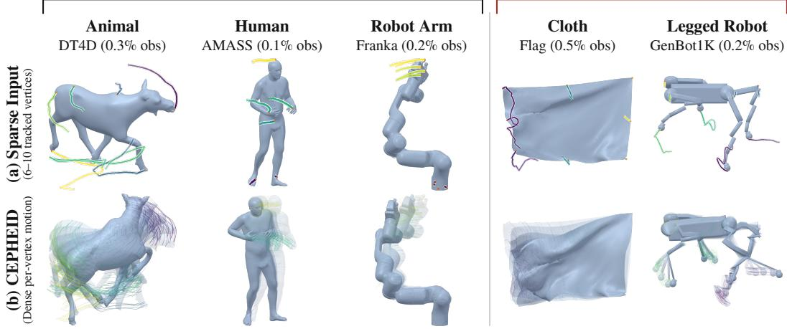  
(c) Zero-Shot Applications (Evaluated without retraining or adaptation)

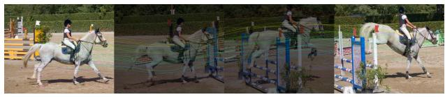

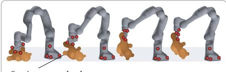  
0 points on payload

Figure 1: Our unified model, CEPHEID, completes dense motion on various geometry families, including those never seen in training. (a) Input: a mesh and the trajectories of 6–10 of its vertices (0.09–0.5% of the mesh); no skeleton, registration, or cross-mesh correspondence is given. (b) Output: the motion CEPHEID predicts for every vertex, drawn as per-vertex trajectories with the predicted poses ghosted. Every panel in (b) is a prediction, not ground truth. The model is trained on the three families on the left only and is evaluated zero-shot on the cloth and the legged robot. (c) The same checkpoint, without retraining, densifies a point tracker’s output (CoTracker3) on a DAVIS video (left) and completes the motion of a soft body lifted by a Franka arm from eight proprioceptive points on the robot and none on the payload (right).

## ABSTRACT

Sparse-to-dense motion completion recovers dense mesh motion from sparse vertex displacements. Residual priors trained on one geometry family frequently fail to beat parameter-free harmonic extension off-family. Moreover, cross-family training meets a scaling barrier: residual amplitude varies by more than an order of magnitude across geometry families and collapses as observations become denser. Since this scale depends on unknown target motion, it cannot be measured directly at test time. We decouple residual structure from physical scale by learning a dimensionless prior, estimating amplitude from observables and a lightweight correction fitted only on training sources. Our unified model surpasses harmonic extension across all evaluated families, including unseen cloth and legged bodies, without skeletons, registration, or cross-mesh correspondence. The same prior applies without retraining to point-tracked animal video and a robot grasping a soft body.

Project page: https://su-terry.github.io/cepheid-website/

## 1 INTRODUCTION

Without skeletons, registration, or cross-mesh correspondence, sparse-to-dense motion completion infers dense mesh motion from sparse displacements under partial visibility. Mesh connectivity yields a closed-form discrete harmonic extension, solving the graph Dirichlet problem in one sparse linear solve with observed vertices as boundary conditions. We use harmonic extension as the base for the learned residual and as the parameter-free control. Predictions worse than this control reveal that completion would have been more accurate without learning.

Priors trained on one geometry family fail to transfer reliably. Across three single-family models (DT4D animals, AMASS humans, Franka arm) and a unified model, seven of twelve single-family transfers fail to improve on harmonic extension. On cloth, the AMASS and Franka priors are 25.5% and 7.8% worse than the base, respectively. Because all share a frozen amplitude rule, these are failures of the residual priors. Training jointly across families also encounters extent-normalized residual amplitudes varying by 18–39× across the three training families at matched density and falling by more than an order of magnitude across densities. Lacking target motion at inference, the residual cannot be normalized by its own scale.

In CEPHEID, we decouple residual structure from physical scale, learning a dimensionless residual motion prior conditioned on geometry and harmonic extension while recovering amplitude without requiring target motion (Figure 1). On cloth, completion error with recovered amplitude is within 1–8% of a target-informed oracle (the per-condition optimal scalar that requires ground truth). Our unified model stays below harmonic extension on all five evaluated families, cutting error by 15.6% on an unseen cloth sheet and 10.1% on unseen procedural legged bodies.

Our contributions are threefold:

1. Harmonic extension as a general base and control. We formulate motion completion around a Dirichlet solve on the mesh graph with the observed vertices as boundary conditions, providing the base for the residual and the control that seven of the twelve singlefamily transfers fail to improve on.

2. Target-independent amplitude recovery. We recover physical amplitude without target motion, bringing completion error on cloth within 1–8% of the error with the targetinformed oracle across observation densities.

3. A shared dimensionless residual prior. We learn a dimensionless residual prior with flow matching (Lipman et al., 2023; Liu et al., 2023a; Albergo & Vanden-Eijnden, 2023), conditioned on geometry and the harmonic extension. We are not aware of prior work showing that a single learned prior can complete dense per-vertex motion from sparse, unlabeled vertex displacements across geometry families, without skeletons, templates, or cross-mesh correspondence, and transfer zero-shot to families absent from training. CEPHEID introduces such a prior. Fine-tuning to a fixed three-marker gripper placement more than halves the error of the same checkpoint evaluated zero-shot (Appendix G). The same checkpoint applies without retraining to point-tracked animal video and to a robot grasping a soft body.

## 2 RELATED WORK

Deformation from sparse handles. Harmonic extension solves the graph-Laplacian Dirichlet problem with observed vertices as boundary conditions, as in label propagation (Zhu et al., 2003). Handle-based deformation minimizes quadratic energies (Botsch & Sorkine, 2008): Laplacian editing (Sorkine et al., 2004), biharmonic deformation and weights (Botsch & Kobbelt, 2004; Jacobson et al., 2011), as-rigid-as-possible energies (Sorkine & Alexa, 2007; Baieri et al., 2025), and embedded deformation graphs (Sumner et al., 2007); deformation transfer needs cross-mesh correspon dence (Sumner & Popovic, 2004). Learned handles predict cages (Yifan et al., 2020), keypoints´ (Jakab et al., 2021), meta-handles (Liu et al., 2021), per-face Jacobians (Aigerman et al., 2022), or local detail (Sundararaman et al., 2024; Maggioli et al., 2024), or follow 2D diffusion priors (Yoo et al., 2024), each trained per category. NSDP (Tang et al., 2022) regresses dense motion from sparse handles per class with per-frame scale normalization; we retrain it on our split (§5.1). Per-scene optimization needs no training set (Zhang et al., 2024b; Song et al., 2025b; Wang et al., 2025a; Bozic et al., 2021); DOMA (Zhang et al., 2024b) is evaluated in §5.1 and Appendix E. Other sparse-input methods need facial landmarks on a template (Otberdout et al., 2022), labeled keypoints (Muralikrishnan et al., 2025), skeletons (Muralikrishnan et al., 2024), partial views, depth, or point clouds (Merrouche et al., 2024; Maheshwari et al., 2023; Newcombe et al., 2015; Bozic et al., 2020; Palafox et al., 2021; Li & Harada, 2022; Han et al., 2018), or images (Collins et al., 2023), or reconstruct 4D shapes without meshes (Cao et al., 2024; Niemeyer et al., 2019; Lei & Daniilidis, 2022). We instead take unlabeled displacements on a mesh, use harmonic extension as a parameter-free base and control, and learn one residual prior across families.

Family-specific and unified motion models. Deformable families usually come with their own representation: body models for humans and quadrupeds (Loper et al., 2015; Zuffi et al., 2017), the Unified Robot Description Format for robots, learned skeletal articulation for characters (Li et al., 2021a), or a cloth or soft-body simulator (Narain et al., 2012; Lai et al., 2026). Inside one family, sparse-to-dense recovery is mature: full-body human motion is recovered from three trackers (Dittadi et al., 2021; Aliakbarian et al., 2022; Du et al., 2023; Castillo et al., 2023; Feng et al., 2024; Tang et al., 2024), optical markers (Ghorbani & Black, 2021), or sparse 4D input (Marsot et al., 2022a;b), but only through the body model. Unified models span categories with one network: UniMate (Mou et al., 2026), AnyTop (Gat et al., 2025), and OmniMotionGPT (Yang et al., 2024) need an articulated motion chain, ScanMove (Besnier et al., 2025) a driving motion, MeshLoom (Chen et al., 2026b) a complete mesh per frame, and AnimateAnyMesh (Wu et al., 2025; 2026) a text prompt. Skeleton-free transfer (Wang et al., 2020; Liao et al., 2022; Wang et al., 2023b;a; Zhang et al., 2024a; Chen et al., 2025b; Zhang et al., 2026) needs a source pose, motion, or bone correspondence; automatic rigging (Zhang et al., 2025; Song et al., 2025a; Chen et al., 2026a) and trajectory control (Liu et al., 2026) reintroduce a skeleton; video- or text-driven animation (Jiang et al., 2024; Uzolas et al., 2025; Shi et al., 2025; Sabathier et al., 2026) conditions on a prompt or a video. Closest to us, CANOR (He et al., 2025) drives a mesh from learned blobs but trains per category, and CompletionAny4D (Nishizawa et al., 2026) in-betweens temporally sparse but spatially complete keyframes, leaving partial regions and point trajectories to future work. Crossembodiment robot policies (Gupta et al., 2022; Bohlinger et al., 2025; Doshi et al., 2025; Sferrazza et al., 2025) motivate our held-out legged family. Our only signal is sparse motion observations on the target.

Learning one prior across families. Source diversity can help transfer (Fang et al., 2022), but distribution mismatch causes negative transfer (Albuquerque et al., 2021; Wang et al., 2019; 2023c); a mesh tracker trained on six objects underperforms per-object training (Amin Mansour et al., 2024). These findings assume shared input spaces, whereas our families differ in topology, vertex count, and correspondence, so we test diversity empirically. Joint training also needs scale normalization by a training-set statistic (Lam et al., 2023) or an instance-level observable (Kim et al., 2022; Passalis et al., 2020; Salinas et al., 2020; Yin et al., 2023; Liu et al., 2022; McCabe et al., 2024; Zuo et al., 2025). Villar et al. (2023) write shared forms as a gauge length times a dimensionless function (Buckingham, 1914), and dimensionless groups can be discovered from data (Bakarji et al., 2022; Xie et al., 2022). We apply this to the residual after harmonic extension, in the spirit of residual physics (Zeng et al., 2020), and recover the unit from observed displacement dispersion plus a dimensionless correction (§3.3, §5.3). Our backbone follows graph-network simulators (Sanchez-Gonzalez et al., 2020), whose multiscale (Fortunato et al., 2022; Cao et al., 2023) and attention-augmented variants (Janny et al., 2023; Hao et al., 2023; Wu et al., 2024) carry information between distant observed vertices. Unlike flow matching on manifolds (Chen & Lipman, 2024), latent-point mesh diffusion (Lyu et al., 2023), or native 4D generation (Li et al., 2025), we sample a dimensionless residual field in Euclidean space with the standard flow-matching objective.

Point tracking and 4D reconstruction. Point trackers (Harley et al., 2022; Doersch et al., 2023; Karaev et al., 2024; Wang et al., 2023d; Le Moing et al., 2024; Xiao et al., 2024; Koppula et al., 2024; Xiao et al., 2025; Zheng et al., 2023; Cho et al., 2024) follow points identifiable in a query frame (Doersch et al., 2022); dense 3D trackers (Ngo et al., 2025a;b; Nam et al., 2026) and monocular 4D reconstruction (Liu et al., 2023b; Wang et al., 2025b; Fan et al., 2025; Shih et al., 2025; Chen et al., 2025a; Chan et al., 2026; Lin et al., 2026) lift every visible pixel but start from a video. We complete every mesh vertex, including those never seen by the camera, from any observation source; tracking is an input rather than a baseline, and §6 uses CoTracker3 (Karaev et al., 2025).

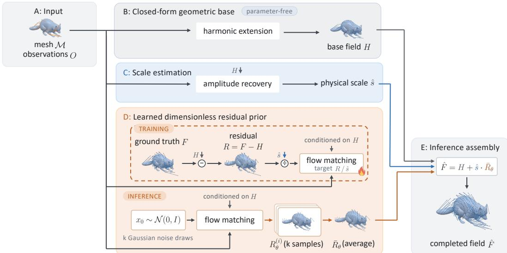  
Figure 2: CEPHEID constructs dense motion by decoupling residual structure from physical scale. Given a mesh M with coordinates $X$ and sparse observed displacements O on vertex subset $\Omega \ ( \mathbf { A } )$ , harmonic extension first yields a closed-form base field H (B). Amplitude recovery then estimates physical scale sˆ using frozen fitted coefficients (C; Algorithm 1). Conditioned on H and O, the flow-matching network learns the normalized target $R / \hat { s }$ with $R = F - H$ during training, while mapping k Gaussian noise draws to samples averaged into $\bar { R } _ { \theta }$ at inference (D); it is the sole component trained by gradient descent (flame icon). Finally, the completed field is assembled as $\hat { F } = H + \hat { s } \cdot \bar { R } _ { \theta } \left( \mathrm { E } \right)$

## 3 METHOD

## 3.1 PROBLEM SETTING AND THE HARMONIC RESIDUAL

Let $\mathcal { M } = ( \mathcal { V } , \mathcal { E } )$ be a surface mesh with $N = | \nu |$ vertices and edge set $\mathcal { E } ,$ and let $\boldsymbol { X } \in \mathbb { R } ^ { N \times 3 }$ denote its source-frame coordinates (Figure 2). Vertex displacements yield a dense motion field $\boldsymbol { F } \in \mathbb { R } ^ { N \times 3 }$ whose i-th row is the 3D translation of vertex $v _ { i }$ between two frames. Motion is observed solely on a subset $\Omega \subset \mathcal { V } \left( M = | \Omega | \right)$ ), giving sparse observations $O = F _ { \Omega } \in \mathbb { R } ^ { M \times 3 }$ . We recover $F$ on the remaining $N - M$ unobserved vertices from X, Ω, and O alone. Density $M / N$ spans 0.5% to 50%, assuming no skeletons, registration, or cross-mesh correspondence.

The task admits a closed-form geometric prior, so learning only needs to model what that analytical prior leaves behind. Let $\mathbf { L } = \mathbf { \bar { D } } - \mathbf { A } \in \mathbb { R } ^ { \mathbf { \hat { N } } \times N }$ be the unweighted graph Laplacian of $\mathcal { E } ,$ , where A is the adjacency matrix and D is the degree matrix. The discrete harmonic extension of the observed displacements is the solution to the Dirichlet problem on the mesh graph:

$$
( \mathbf { L } H ) _ { i } = 0 \quad \forall v _ { i } \not \in \Omega , \qquad \mathrm { s u b j e c t } \mathrm { t o } \quad H \Omega = O ,\tag{1}
$$

requiring one sparse linear solve per observation condition. We denote this solve as $\mathcal { H }$ and the resulting dense base field as $H = \mathcal { \dot { H } } ( \mathcal { E } , \Omega , O ) \in \mathbb { R } ^ { N \times 3 }$ . This linear extension provides the simplest analytical prior in our setting, in the spirit of classical handle-based deformation such as Laplacian mesh editing (Sorkine et al., 2004) and as-rigid-as-possible modeling (Sorkine & Alexa, 2007).

Operating strictly on mesh connectivity without metric edge lengths, templates, or correspondence, H serves as a parameter-free control across all geometry families. The residual motion to predict is:

$$
R = F - H \in \mathbb { R } ^ { N \times 3 } .\tag{2}
$$

## 3.2 SEPARATING RESIDUAL STRUCTURE FROM PHYSICAL SCALE

The extent-normalized residual amplitude varies by 18–39× across training sources at matched density and drops by more than an order of magnitude across densities (Appendix C), motivating factoring physical amplitude out of learning targets. Let $\mathrm { s t d } _ { 9 9 . 5 } ( \cdot )$ denote the empirical standard deviation over all scalar components (3M for O) clipped to ± the 99.5th percentile of absolute values, guarded by $+ 1 0 ^ { - 1 2 }$ . Because target motion is unknown at test time, residual dispersion $s = { \mathrm { s t d } } _ { 9 9 . 5 } ( R )$ cannot be measured. Instead, amplitude recovery estimates physical scale sˆ without requiring target motion (§3.3), yielding normalized target:

$$
R _ { \mathrm { t r a i n } } = \frac { R } { \hat { s } } ,\tag{3}
$$

with dispersion $s / { \hat { s } } .$ . At inference, physical scale is restored via:

$$
\hat { F } = H + \hat { s } \bar { R } _ { \theta } , \qquad \mathrm { w h e r e } \quad \bar { R } _ { \theta } = \frac { 1 } { k } \sum _ { i = 1 } ^ { k } R _ { \theta } ^ { ( i ) } ,\tag{4}
$$

with $k = 8$ draws. Only sˆ is used at training and deployment; s and oracle $s ^ { * } \left( \ S 5 . 3 \right)$ serve strictly as analysis references.

## 3.3 TARGET-INDEPENDENT AMPLITUDE RECOVERY

Amplitude recovery multiplies a dimensional gauge by a dimensionless correction:

$$
\hat { s } = \sigma _ { \mathrm { o b s } } \exp \left( b + w ^ { \top } z ( \varphi ) \right) ,\tag{5}
$$

where the gauge $\sigma _ { \mathrm { o b s } } = \mathrm { s t d } _ { 9 9 . 5 } ( O )$ provides physical units $[ L ]$ and $z ( \cdot )$ standardizes $\varphi \in \mathbb { R } ^ { 1 1 }$ , containing dimensionless descriptors of observation density, graph connectivity to Ω, observed motion variation, and base field properties and ratios to observations (Appendix C.2, Table 9).

Parameters $\{ b , w \}$ are fitted via ridge regression on $\log ( s / \sigma _ { \mathrm { o b s } } )$ on DT4D, AMASS, and Franka (Table 10, Appendix C.4) and frozen before held-out evaluation; Algorithm 1 (Appendix C.3) details inference, including clamping $\varphi$ to its training support. All four transfer-matrix rows share this rule, isolating differences to learned residual priors. The gauge $\sigma _ { \mathrm { o b s } }$ collapses cross-source scale spread from $3 \bar { 7 } . 5 \times$ to 3.2× at the sparsest rung across held-out conditions of the three training sources, while the correction brings completion error within 1–8% of the target-informed oracle at every density on cloth (Table 3).

## 3.4 RESIDUAL PREDICTOR AND GENERATION

The residual distribution $R _ { \theta }$ is modeled with an MGN-T backbone (Iparraguirre et al., 2026), placing a Transformer attention block (Vaswani et al., 2017) between two message-passing blocks (Gilmer et al., 2017; Pfaff et al., 2021; Grigorev et al., 2023); lacking official code, we implement MGN-T ourselves, pricing attention against message passing in Appendix C.7. Conditioned on geometry X, mask Ω, displacements O, and base field H, messages pass over a 12-nearest-neighbor coordinate graph (mesh connectivity reaches the network only through H). We train with OT-CFM (Tong et al., 2024) and sample 30 Euler steps, averaging $k = 8$ draws (error is essentially flat by $k = 8 ;$ Table 13, Appendix C.8).

## 4 EXPERIMENTAL SETUP

Sources. DT4D (articulated animals and humanoids), AMASS (Mahmood et al., 2019) (human motion capture), Franka (a rigid kinematic chain), and two held out of training entirely: cloth and a set of procedurally generated legged bodies (splits and citations in Appendix A.5).

Baselines and control. We evaluate against three references: (1) Harmonic extension: a closedform Dirichlet solve on the mesh graph (Eq. 1) with zero learned parameters, serving as our parameter-free control rather than a competing method; (2) NSDP (Tang et al., 2022): regresses dense motion from sparse handles via a learned neural field, retrained on our standardized split; and (3) DOMA (Zhang et al., 2024b): optimizes a continuous per-scene deformation field from point trajectories without offline training.

Protocol. Table 1 evaluates across five densities from 0.5% to 50% (7 held-out identities, 30 pairs each, 2 masks per pair, 2,100 conditions total). Table 2 presents a transfer matrix where columns draw random masks (four per pair and density) on their own grids, reporting errors relative to column mean motion magnitude (Appendix $\mathbf { A . { \dot { 7 } } _ { i } }$ , Table 5). AMASS and DT4D withhold identities, Franka tests unseen trajectories, and cloth and legged bodies are held out at source level. Their cells are not interchangeable: Table 1 balances pairs evenly across identities, whereas Table 2 pools unevenly. Implementation details are in Appendix A. Frozen amplitude recovery (§3.3), fitted on DT4D, AMASS, and Franka, is applied by ours (unified) in Table 1, all four Table 2 priors, and all ablations keeping it.

Table 1: Baseline comparison on DT4D: NSDP and DOMA against ours, on one split. NSDP is above the no-learning base at every density; DOMA and ours are below it, and ours is lowest at all five. Seven held-out identities, five densities (2,100 conditions), error divided by that density’s mean motion magnitude. DOMA’s row is its best iteration budget and reading at each density, chosen after scoring.
<table><tr><td rowspan="2">err ÷ mean |F|</td><td colspan="5">Observed vertices</td></tr><tr><td>0.5%</td><td>2%</td><td>5%</td><td>10%</td><td>50%</td></tr><tr><td>harmonic</td><td>0.6255</td><td>0.3533</td><td>0.2257</td><td>0.1598</td><td>0.0754</td></tr><tr><td>NSDP (Tang et al., 2022), retrained</td><td>1.0406</td><td>0.5789</td><td>0.4018</td><td>0.3275</td><td>0.2683</td></tr><tr><td>DOMA (Zhang et al., 2024b)</td><td>0.5750</td><td>0.2370</td><td>0.1204</td><td>0.0720</td><td>0.0246</td></tr><tr><td>ours (unified)</td><td>0.3533</td><td>0.1116</td><td>0.0485</td><td>0.0300</td><td>0.0180</td></tr></table>

Table 2: Transfer matrix: three single-family priors and one trained on all three, each scored on five families. Seven of the twelve off-diagonal cells sit at or above their column’s base, while the unified checkpoint is below it in every column. 3,000 conditions per column, 3,840 on cloth; cells are completion error divided by that column’s mean motion magnitude, with harmonic the nolearning base. † The DT4D column’s denominator is in mAU, that dataset’s own artist units, not a length. ‡ No arm trains on cloth or on the legged bodies.
<table><tr><td rowspan="2">Model</td><td colspan="5">Evaluated on</td></tr><tr><td>DT4D ↑</td><td>AMASS</td><td>Franka</td><td>cloth ‡</td><td>legged </td></tr><tr><td>harmonic</td><td>0.2685</td><td>0.0693</td><td>0.1011</td><td>0.4377</td><td>0.2474</td></tr><tr><td>ours (DT4D)</td><td>0.1097</td><td>0.0698</td><td>0.0782</td><td>0.4256</td><td>0.2238</td></tr><tr><td>ours (AMASS)</td><td>0.2701</td><td>0.0182</td><td>0.0459</td><td>0.5493</td><td>0.2482</td></tr><tr><td>ours (Franka)</td><td>0.2910</td><td>0.0797</td><td>0.0155</td><td>0.4717</td><td>0.2426</td></tr><tr><td>ours (unified)</td><td>0.1243</td><td>0.0214</td><td>0.0201</td><td>0.3692</td><td>0.2225</td></tr></table>

Metric. Let $\mathcal { V } _ { \mathrm { e v a l } } ^ { ( c ) } \ \subseteq \ \mathcal { V } \ \backslash \ \Omega ^ { ( c ) }$ denote the evaluated unobserved vertices in condition c (excluding fixed handle vertices on cloth). For each condition $c ,$ we compute the mean per-vertex $L _ { 2 }$ completion error $\begin{array} { r } { \bar { e } _ { c } = \frac { 1 } { | \mathcal { V } _ { \mathrm { e v a l } } ^ { ( c ) } | } \sum _ { v \in \mathcal { V } _ { \mathrm { e v a l } } ^ { ( c ) } } \| F _ { v } ^ { ( c ) } - \hat { F } _ { v } ^ { ( c ) } \| _ { 2 } } \end{array}$ and mean ground-truth displacement $\begin{array} { r } { \bar { f } _ { c } = \frac { 1 } { | \mathcal { V } _ { \mathrm { e v a l } } ^ { ( c ) } | } \sum _ { v \in \mathcal { V } _ { \mathrm { e v a l } } ^ { ( c ) } } \| F _ { v } ^ { ( c ) } \| _ { 2 } } \end{array}$ , both in the source’s stored coordinates. The metric is the pooled relative error:

$$
E = \frac { \sum _ { c } u _ { c } \bar { e } _ { c } } { \sum _ { c } u _ { c } \bar { f } _ { c } } ,\tag{6}
$$

where the sums run over the conditions of one table cell and $u _ { c }$ is the per-condition factor that converts stored coordinates to physical length: the bounding-box extent times millimeters per native unit on the three extent-normalized sources (DT4D, AMASS and cloth), and millimeters per native unit alone on Franka and the legged bodies, which are stored unnormalized (on DT4D the result is mAU, not a length). Averaging over $\mathcal { V } _ { \mathrm { e v a l } } ^ { ( c ) }$ removes vertex-count dependence, so each condition is weighted in the pooled quotient by its mean motion magnitude in physical units $( u _ { c } \bar { f } _ { c } )$ , not by its vertex count.

Learning gain is $G = 1 - E / E _ { \mathrm { b a s e } } \ ( G > 0$ positive, $G \ < \ 0$ negative transfer). Result tables report relative completion error E directly, using harmonic extension as $E _ { \mathrm { b a s e } }$ , except Tables 14 (condition mean error in mAU, $\begin{array} { r } { \frac { 1 } { C } \sum _ { c } u _ { c } \bar { e } _ { c } ) } \end{array}$ and 15 (Franka links 1–7 error in mm). Relative metric E mitigates DT4D’s 118× cross-identity artist-unit disparity. Appendix F details why the metric pools rather than averages per-condition ratios, and the normalization used in Table 2.

## 5 RESULTS

## 5.1 COMPARISON WITH NSDP AND DOMA ON DT4D

Our model achieves lower error than NSDP and DOMA at all five densities on DT4D, landing 44–81% below harmonic extension (Table 1). All three methods are evaluated on the same seven held-out identities of one split: NSDP is retrained on that split’s training identities, DOMA fits per scene and needs no training split, and ours is the unified checkpoint of Table 2.

The harmonic row is the parameter-free control: a cell above it is one where harmonic extension alone would have been more accurate. DOMA is below the base at every density, by 8% at 0.5% rising to 67% at 50%, with error 1.4–2.5× ours. NSDP is above the base at every density, at 1.6– 3.6× the base’s error.

## 5.2 TRANSFERRING ACROSS GEOMETRY FAMILIES

To test cross-family residual transfer, we compare three single-family priors (DT4D animals, AMASS human bodies, Franka arm) and one unified prior trained on all three. All four share architecture, training budget, and frozen amplitude recovery fitted on the training sources, differing only in training data. Table 2 evaluates these priors on the training families and two source-level held-out families: cloth (a continuum sheet without parts or kinematic chains) and nine procedural legged bodies with 8 to 30 degrees of freedom. Columns are normalized by mean motion magnitude, making error comparable within a column, not across columns.

Column denominators, for recovering a length: DT4D 85.511 mAU, AMASS 127.369 mm, Franka 3.287 mm, cloth 114.454 mm, legged 3.365 mm.

Seven of twelve off-diagonal specialist cells land at or above harmonic extension. On cloth, the AMASS and Franka priors are 25.5% and 7.8% above the base; on legged bodies, all specialists are within 10%, with the AMASS prior 0.3% above. The unified model beats the base in pooled error across all five families, crossing above harmonic extension only at 0.5% on legged bodies (Table 7) and outperforming it from 1% up. Relative to the base, it reduces error by 15.6% on cloth and 10.1% on legged bodies, topping the DT4D prior (the specialist with lowest error in both columns) by 12.9 and 0.5 percentage points. On training sources, error remains below base, though 13–30% above native specialists. Figure 6 (Appendix B) illustrates cloth at 2% observation.

Per-density readings, the per-cell diagonals and each arm’s training exposure are in Appendix B; replacing harmonic extension on mesh edges with a thin-plate spline on a k-NN graph leaves com pletion viable at a cost concentrated at sparse observation (Appendix E).

## 5.3 AMPLITUDE RECOVERY ON CLOTH

On cloth, amplitude recovery lands within 1.4–8.1% of the target-informed oracle error across densities (Table 3). The network is frozen, so non-harmonic rows scale identical outputs (Figure 7, Appendix C); the target-informed oracle and borrowed lookup table require ground truth and are not deployable. Amplitude recovery is below the borrowed lookup table by 0.4% and 0.1% at 0.5% and 1%, and 5.6–26.4% from 2% up. It outperforms harmonic extension across densities (1.4% at 0.5% to 58% at 50%), whereas raw observed scale without correction consistently underperforms it.

The Borrowed lookup table (best source) row takes, at each density, whichever training table minimizes cloth error; because the optimal source varies across densities, hindsight selects no single table. The Target-informed oracle row is the per-condition scalar $\begin{array} { r } { s ^ { * } = \arg \operatorname* { m i n } _ { \alpha } \sum _ { v \in \mathcal { V } _ { \mathrm { e v a l } } ^ { ( c ) } } \| ( \bar { H ^ { } } + } \end{array}$ $x \bar { R } _ { \theta } ) _ { v } - F _ { v } \| _ { 2 }$ , the optimal scalar achievable for the network’s predicted residual.

## 5.4 ABLATIONS

We ablate CEPHEID’s five design choices by removing each from the unified model (ours (unified) in Table 2), retraining when necessary and scoring across the five columns. Removing harmonic extension eliminates its conditioning path; disabling amplitude recovery sets sˆ = 1. Table 4 reports held-out families, and Table 8 (Appendix B) reports the three training families.

Two removals can cross the base. Without harmonic extension, the model is above it in both columns, by 2.4× on each; without amplitude recovery, it crosses on legged and stays below on cloth. The remaining three removals stay below harmonic extension in both columns and therefore never cross it. Reading the same weights at k = 1 is an inference setting rather than a trained arm, and costs 8–13% on the two held-out families.

Table 3: Amplitude rules on cloth: one set of frozen network predictions, scaled four ways, against the no-learning base. Cloth is held out of training; each cell is error ÷ mean |F|. Targetinformed oracle: for each condition, the single scalar that minimizes error along the residual the network predicted, chosen after seeing the target and not computable at inference. harmonic: the base field H alone, with no learned residual. Raw observed scale: $\hat { s } = \sigma _ { \mathrm { o b s } } ,$ the dispersion of the observed displacements, without the fitted correction. Borrowed lookup table: a per-density amplitude table fitted on one training source, taking at each density whichever of the three gives the lowest error on cloth. Amplitude recovery: $\sigma _ { \mathrm { o b s } }$ times the correction fitted on the training sources (Algorithm 1), within 1–8% of the oracle at every density.
<table><tr><td></td><td colspan="5">Observed vertices</td></tr><tr><td>cloth, err ÷ mean |F|</td><td>0.5%</td><td>1%</td><td>2%</td><td>10%</td><td>50%</td></tr><tr><td>Target-informed oracle</td><td>0.6283</td><td>0.5175</td><td>0.3917</td><td>0.1492</td><td>0.0529</td></tr><tr><td>harmonic</td><td>0.6888</td><td>0.5925</td><td>0.4953</td><td>0.2824</td><td>0.1295</td></tr><tr><td>Raw observed scale (no correction)</td><td>0.8073</td><td>0.7326</td><td>0.7650</td><td>1.1599</td><td>1.3197</td></tr><tr><td>Borrowed lookup table (best source)</td><td>0.6817</td><td>0.5530</td><td>0.4330</td><td>0.2056</td><td>0.0652</td></tr><tr><td>Amplitude recovery (ours)</td><td>0.6790</td><td>0.5524</td><td>0.4087</td><td>0.1513</td><td>0.0548</td></tr></table>

Table 4: Component ablation on the two held-out families: each row removes one choice from CEPHEID. Two removals can turn learning into negative transfer; three cannot. A check marks a component the row keeps; in the amplitude column a dash is sˆ = 1, and in the samples column a check is eight samples and a dash is one. The three training columns are Table 8.
<table><tr><td></td><td>harmonic</td><td>mean of k samples matching</td><td>flow</td><td>on harmonic</td><td>conditioned amplitude recovery</td><td>cloth ‡ legged ‡</td><td></td></tr><tr><td>harmonic</td><td></td><td></td><td></td><td></td><td></td><td>0.438</td><td>0.247</td></tr><tr><td rowspan="6">CEPHEID (ours)</td><td>一</td><td>√</td><td>√</td><td></td><td>√</td><td>1.047</td><td>0.585</td></tr><tr><td>√</td><td>一</td><td>√</td><td>√</td><td>√</td><td>0.416</td><td>0.240</td></tr><tr><td>√</td><td>√</td><td>一</td><td>√</td><td>√</td><td>0.415</td><td>0.226</td></tr><tr><td>√</td><td>√</td><td>√</td><td>一</td><td>√</td><td>0.400</td><td>0.244</td></tr><tr><td>√</td><td>√</td><td>√</td><td>√</td><td></td><td>0.391</td><td>0.409</td></tr><tr><td>√</td><td>√</td><td>√</td><td>√</td><td>√</td><td>0.369</td><td>0.222</td></tr></table>

The ablation clarifies component roles. Harmonic extension and amplitude recovery are the only removals that can turn learning into negative transfer relative to the no-learning base: harmonic extension supplies the geometric base field, while amplitude recovery establishes physical scale without target motion. Conditioning, flow matching, and multi-sampling affect gain magnitude without determining its sign in these experiments.

## 6 APPLICATIONS

In two settings the observation comes from a signal that exists independently of the model: a robot’s proprioception, and a point tracker’s output. In Isaac Lab (Mittal et al., 2025), a Franka arm grips and lifts a soft bar (Figure 3). We represent the arm, base, and payload as a unified 5,525-point set without faces, connected solely by a 12-nearest-neighbor spatial graph without contact constraints. Observations comprise eight robot proprioceptive points (four on the gripper, four on the base) and zero on the payload. Figure 3 shows five independent completions, propagating boundary signals across bodies without kinematic models. On a DAVIS (Perazzi et al., 2016) sequence, 12 consistent vertex tracks derived from CoTracker3 (Karaev et al., 2025) across frames 4–39 serve as sparse inputs on the target. These tracker outputs, rather than exact displacements, are completed across a mesh reconstructed from one frame by TripoSR (Tochilkin et al., 2024). Figure 4b visualizes 120 completed vertices on the animal’s far side, facing away from the reference camera and disjoint from the observed set (Appendix D).

time  
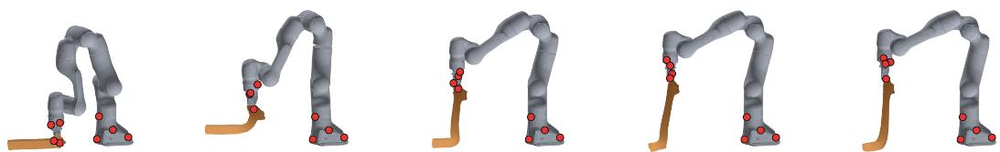  
Figure 3: Demo: five independent completions on a multi-body point set in Isaac Lab (Mittal et al., 2025). The arm and grasped body form a face-free point set coupled by a 12-NN graph. From eight proprioceptive points (red; zero on object; markers can overlap at this viewpoint), the model predicts plausible coupled motion.

(a)  
what is observed: 12 tracked points  
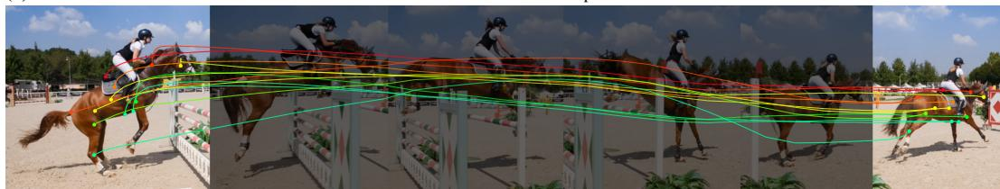  
what is completed: 120 points, same viewpoint

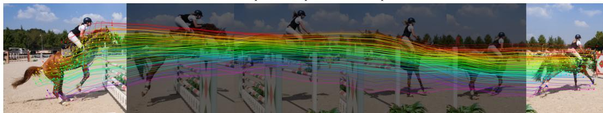  
the points on the other side of the horse, hidden from the camera the whole time: 120 of them

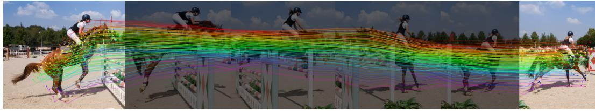  
Figure 4: Demo: densifying video point tracks. Across frames 4–39, the model observes the same 12 tracked vertices in every frame. (a) Twelve observed points and 120 completed points. (b) 120 camera-opposed far-side points (0 of 2,164 ever observed). Without ground truth, this shows the checkpoint connects to a tracker and completions exist on the far side, not that either is accurate. Overlays degrade away from fitted frame 18 (Appendix D).

## 7 CONCLUSION

CEPHEID completes dense motion across geometry families without skeletons, registration, or crossmesh correspondence. Discrete harmonic extension is our parameter-free base and control; seven of twelve single-family transfers fail to beat it. Decoupling residual structure from scale, we estimate amplitude without target motion alongside a dimensionless flow-matching prior; on unseen cloth, completion error is within 1–8% of a target-informed oracle. One unified model beats harmonic extension on all five families (15.6% lower error on cloth, 10.1% on legged bodies) and applies without retraining to point-tracked animal video and a robot grasping a soft body.

Limitations. Our quantitative evaluation assumes exact vertex displacements, free of sensor noise, lost tracks, depth distortion, or scanned geometry, and only AMASS and the RH20T episodes in the appendix are recorded data: DT4D is artist-animated, Franka uses forward kinematics on random joint trajectories, and cloth and legged robots are simulated. Training also uses random masks only; the prior transfers zero-shot to a fixed gripper placement (Appendix G), but fixed three-marker layouts gain substantially from fine-tuning (Table 15). Validation on noisy inputs and training across mask families are left to future work.

## REFERENCES

Advanced Computing Center for the Arts and Design. ACCAD MoCap Dataset. URL https: //accad.osu.edu/research/motion-lab/mocap-system-and-data.

Bo Ai, Liu Dai, Nico Bohlinger, Dichen Li, Tongzhou Mu, Zhanxin Wu, K. Fay, Henrik I Christensen, Jan Peters, and Hao Su. Towards embodiment scaling laws in robot locomotion. In Proceedings of The 9th Conference on Robot Learning, volume 305 of Proceedings of Machine Learning Research, pp. 3483–3515. PMLR, 2025. URL https://proceedings.mlr. press/v305/ai25a.html.

Noam Aigerman, Kunal Gupta, Vladimir G Kim, Siddhartha Chaudhuri, Jun Saito, and Thibault Groueix. Neural jacobian fields: Learning intrinsic mappings of arbitrary meshes. ACM Transactions on Graphics, 41(4):1–17, 2022. doi: 10.1145/3528223.3530141.

Ijaz Akhter and Michael J. Black. Pose-conditioned joint angle limits for 3D human pose reconstruction. In IEEE Conf. on Computer Vision and Pattern Recognition (CVPR), June 2015.

Michael Samuel Albergo and Eric Vanden-Eijnden. Building normalizing flows with stochastic interpolants. In The Eleventh International Conference on Learning Representations, 2023. URL https://openreview.net/forum?id=li7qeBbCR1t.

Isabela Albuquerque, Joao Monteiro, Mohammad Darvishi, Tiago H. Falk, and Ioannis Mitliagkas.˜ Generalizing to unseen domains via distribution matching, 2021. URL https://arxiv.org/ abs/1911.00804.

Sadegh Aliakbarian, Pashmina Cameron, Federica Bogo, Andrew Fitzgibbon, and Thomas J Cashman. Flag: Flow-based 3d avatar generation from sparse observations. In 2022 IEEE/CVF Conference on Computer Vision and Pattern Recognition (CVPR), pp. 13243–13252. IEEE, 2022.

Elham Amin Mansour, Hehui Zheng, and Robert K. Katzschmann. Fast point cloud to mesh reconstruction for deformable object tracking. In Robotics, Computer Vision and Intelligent Systems, Communications in Computer and Information Science, pp. 391–409. Springer Nature Switzerland, 2024. doi: 10.1007/978-3-031-59057-3 25.

Daniele Baieri, Filippo Maggioli, Emanuele Rodola, Simone Melzi, and Zorah L\` ahner. Implicit-¨ arap: Efficient handle-guided neural field deformation via local patch meshing. In Advances in Neural Information Processing Systems, volume 38, pp. 138280–138310, 2025. doi: 10.52202/ 085713-4158.

Joseph Bakarji, Jared Callaham, Steven L Brunton, and J Nathan Kutz. Dimensionally consistent learning with buckingham pi. Nature Computational Science, 2(12):834–844, 2022.

Thomas Besnier, Sylvain Arguillere, and Mohamed Daoudi. ScanMove: Motion prediction and \` transfer for unregistered body meshes. Computers & Graphics, 132:104409, 2025. ISSN 0097-8493. doi: 10.1016/j.cag.2025.104409. URL https://www.sciencedirect.com/ science/article/pii/S009784932500250X.

Nico Bohlinger, Grzegorz Czechmanowski, Maciej Piotr Krupka, Piotr Kicki, Krzysztof Walas, Jan Peters, and Davide Tateo. One policy to run them all: an end-to-end learning approach to multi-embodiment locomotion. In Proceedings of The 8th Conference on Robot Learning, volume 270 of Proceedings ofMachine Learning Research, pp. 3356–3378. PMLR, 2025. URL https://proceedings.mlr.press/v270/bohlinger25a.html.

Fred L. Bookstein. Principal warps: Thin-plate splines and the decomposition of deformations. IEEE Transactions on pattern analysis and machine intelligence, 11(6):567–585, 1989.

Mario Botsch and Leif Kobbelt. An intuitive framework for real-time freeform modeling. ACM Transactions on Graphics (TOG), 23(3):630–634, 2004.

Mario Botsch and Olga Sorkine. On linear variational surface deformation methods. IEEE transactions on visualization and computer graphics, 14(1):213–230, 2008.

Aljaz Bozic, Michael Zollhofer, Christian Theobalt, and Matthias Nießner. Deepdeform: Learning non-rigid rgb-d reconstruction with semi-supervised data. In Proceedings of the IEEE/CVF Conference on Computer Vision and Pattern Recognition, pp. 7002–7012, 2020.

Aljaz Bozic, Pablo Palafox, Michael Zollhofer, Justus Thies, Angela Dai, and Matthias Nießner. Neural deformation graphs for globally-consistent non-rigid reconstruction. In Proceedings of the IEEE/CVF Conference on Computer Vision and Pattern Recognition, pp. 1450–1459, 2021.

Edgar Buckingham. On physically similar systems; illustrations of the use of dimensional equations. Physical review, 4(4):345–376, 1914.

Wei Cao, Chang Luo, Biao Zhang, Matthias Nießner, and Jiapeng Tang. Motion2VecSets: 4D latent vector set diffusion for non-rigid shape reconstruction and tracking. In Proceedings of the IEEE/CVF Conference on Computer Vision and Pattern Recognition (CVPR), pp. 20496–20506, June 2024.

Yadi Cao, Menglei Chai, Minchen Li, and Chenfanfu Jiang. Efficient learning of mesh-based physical simulation with bi-stride multi-scale graph neural network. In International conference on machine learning, pp. 3541–3558. PMLR, 2023.

Carnegie Mellon University. CMU MoCap Dataset. URL http://mocap.cs.cmu.edu.

Angela Castillo, Maria Escobar, Guillaume Jeanneret, Albert Pumarola, Pablo Arbelaez, Ali Thabet, ´ and Artsiom Sanakoyeu. Bodiffusion: Diffusing sparse observations for full-body human motion synthesis. In 2023 IEEE/CVF International Conference on Computer Vision Workshops (ICCVW), pp. 4223–4233. IEEE, 2023.

Jiewen Chan, Zhenjun Zhao, and Yu-Lun Liu. Adagar: Adaptive gabor representation for dynamic scene reconstruction. arXiv preprint arXiv:2601.00796, 2026.

Honglin Chen, Karran Pandey, Rundi Wu, Matheus Gadelha, Yannick Hold-Geoffroy, Ayush Tewari, Niloy J Mitra, Changxi Zheng, and Paul Guerrero. Vips: Video-informed pose spaces for autorigged meshes. arXiv preprint arXiv:2604.17623, 2026a.

Jianqi Chen, Biao Zhang, Xiangjun Tang, and Peter Wonka. V2m4: 4d mesh animation reconstruction from a single monocular video. In 2025 IEEE/CVF International Conference on Computer Vision (ICCV), pp. 11643–11653. IEEE, 2025a.

Jianqi Chen, Jiraphon Yenphraphai, Xiangjun Tang, Sergey Tulyakov, Chaoyang Wang, Peter Wonka, and Rameen Abdal. MeshLoom: Feed-forward non-rigid registration of mesh sequences. arXiv preprint arXiv:2606.17027, 2026b.

Ling-Hao Chen, Yuhong Zhang, Zixin Yin, Zhiyang Dou, Xin Chen, Jingbo Wang, Taku Komura, and Lei Zhang. Motion2motion: Cross-topology motion transfer with sparse correspondence. In Proceedings of the SIGGRAPH Asia 2025 Conference Papers, pp. 1–11, 2025b.

Ricky TQ Chen and Yaron Lipman. Flow matching on general geometries. In International Conference on Learning Representations, volume 2024, pp. 47922–47945, 2024.

Seokju Cho, Jiahui Huang, Jisu Nam, Honggyu An, Seungryong Kim, and Joon-Young Lee. Local all-pair correspondence for point tracking. In European conference on computer vision, pp. 306– 325. Springer, 2024.

Jasmine Collins, Anqi Liang, Jitendra Malik, Hao Zhang, and Fred´ eric Devernay. CA´ <sup>2</sup>T-Net: Category-agnostic 3D articulation transfer from single image, 2023. URL https://arxiv. org/abs/2301.02232.

Andrea Dittadi, Sebastian Dziadzio, Darren Cosker, Ben Lundell, Thomas J Cashman, and Jamie Shotton. Full-body motion from a single head-mounted device: Generating smpl poses from partial observations. In Proceedings of the IEEE/CVF International Conference on Computer Vision, pp. 11687–11697, 2021.

Carl Doersch, Ankush Gupta, Larisa Markeeva, Adria Recasens, Lucas Smaira, Yusuf Aytar, Jo\` ao˜ Carreira, Andrew Zisserman, and Yi Yang. TAP-Vid: a benchmark for tracking any point in a video. In Proceedings of the 36th International Conference on Neural Information Processing Systems, NIPS ’22, pp. 13610–13626, Red Hook, NY, USA, 2022. Curran Associates Inc. ISBN 9781713871088.

Carl Doersch, Yi Yang, Mel Vecerik, Dilara Gokay, Ankush Gupta, Yusuf Aytar, Joao Carreira, and Andrew Zisserman. TAPIR: Tracking any point with per-frame initialization and temporal refinement. In Proceedings of the IEEE/CVF International Conference on Computer Vision (ICCV), pp. 10061–10072, October 2023.

Ria Doshi, Homer Rich Walke, Oier Mees, Sudeep Dasari, and Sergey Levine. Scaling crossembodied learning: One policy for manipulation, navigation, locomotion and aviation. In Proceedings of The 8th Conference on Robot Learning, volume 270 of Proceedings of Machine Learning Research, pp. 496–512. PMLR, 2025. URL https://proceedings.mlr. press/v270/doshi25a.html.

Yuming Du, Robin Kips, Albert Pumarola, Sebastian Starke, Ali Thabet, and Artsiom Sanakoyeu. Avatars grow legs: Generating smooth human motion from sparse tracking inputs with diffusion model. In 2023 IEEE/CVF Conference on Computer Vision and Pattern Recognition (CVPR), pp. 481–490. IEEE, 2023.

Eyes JAPAN Co. Ltd. Eyes Japan MoCap Dataset. URL http://mocapdata.com.

Cheng-De Fan, Chen-Wei Chang, Yi-Ruei Liu, Jie-Ying Lee, Jiun-Long Huang, Yu-Chee Tseng, and Yu-Lun Liu. Spectromotion: Dynamic 3d reconstruction of specular scenes. In 2025 IEEE/CVF Conference on Computer Vision and Pattern Recognition (CVPR), pp. 21328–21338. IEEE, 2025.

Alex Fang, Gabriel Ilharco, Mitchell Wortsman, Yuhao Wan, Vaishaal Shankar, Achal Dave, and Ludwig Schmidt. Data determines distributional robustness in contrastive language image pretraining (CLIP). In Kamalika Chaudhuri, Stefanie Jegelka, Le Song, Csaba Szepesvari, Gang Niu, and Sivan Sabato (eds.), Proceedings of the 39th International Conference on Machine Learning, volume 162 of Proceedings of Machine Learning Research, pp. 6216–6234. PMLR, 17–23 Jul 2022. URL https://proceedings.mlr.press/v162/fang22a.html.

Hao-Shu Fang, Hongjie Fang, Zhenyu Tang, Jirong Liu, Chenxi Wang, Junbo Wang, Haoyi Zhu, and Cewu Lu. RH20T: A comprehensive robotic dataset for learning diverse skills in one-shot. In 2024 IEEE International Conference on Robotics and Automation (ICRA), pp. 653–660. IEEE, 2024.

Han Feng, Wenchao Ma, Quankai Gao, Xianwei Zheng, Nan Xue, and Huijuan Xu. Stratified avatar generation from sparse observations. In 2024 IEEE/CVF Conference on Computer Vision and Pattern Recognition (CVPR), pp. 153–163. IEEE, 2024.

Meire Fortunato, Tobias Pfaff, Peter Wirnsberger, Alexander Pritzel, and Peter Battaglia. Multiscale meshgraphnets. arXiv preprint arXiv:2210.00612, 2022.

Inbar Gat, Sigal Raab, Guy Tevet, Yuval Reshef, Amit H Bermano, and Daniel Cohen-Or. AnyTop: Character animation diffusion with any topology. In SIGGRAPH 2025 Conference Papers, 2025.

Nima Ghorbani and Michael J Black. Soma: Solving optical marker-based mocap automatically. In 2021 IEEE/CVF International Conference on Computer Vision (ICCV), pp. 11097–11106. IEEE, 2021.

Justin Gilmer, Samuel S Schoenholz, Patrick F Riley, Oriol Vinyals, and George E Dahl. Neural message passing for quantum chemistry. In International conference on machine learning, volume 70, pp. 1263–1272. Pmlr, 2017.

Artur Grigorev, Michael J. Black, and Otmar Hilliges. HOOD: Hierarchical graphs for generalized modelling of clothing dynamics. In Proceedings of the IEEE/CVF Conference on Computer Vision and Pattern Recognition (CVPR), pp. 16965–16974, June 2023.

Agrim Gupta, Linxi Fan, Surya Ganguli, and Li Fei-Fei. Metamorph: Learning universal controllers with transformers. In International Conference on Learning Representations, 2022.

Tao Han, Xuan Zhao, Peigen Sun, and Jia Pan. Robust shape estimation for 3d deformable object manipulation. Communications in Information and Systems, 18(2):107–124, 2018. doi: 10.4310/ cis.2018.v18.n2.a3.

Zhongkai Hao, Zhengyi Wang, Hang Su, Chengyang Ying, Yinpeng Dong, Songming Liu, Ze Cheng, Jian Song, and Jun Zhu. Gnot: A general neural operator transformer for operator learning. In International conference on machine learning, pp. 12556–12569. PMLR, 2023.

Adam W Harley, Zhaoyuan Fang, and Katerina Fragkiadaki. Particle video revisited: Tracking through occlusions using point trajectories. In European Conference on Computer Vision, pp. 59–75. Springer, 2022.

Guangzhao He, Chen Geng, Shangzhe Wu, and Jiajun Wu. Category-agnostic neural object rigging. In 2025 IEEE/CVF Conference on Computer Vision and Pattern Recognition (CVPR), pp. 22078– 22088. IEEE, 2025.

Arthur E Hoerl and Robert W Kennard. Ridge regression: Biased estimation for nonorthogonal problems. Technometrics, 12(1):55–67, 1970.

Ludovic Hoyet, Kenneth Ryall, Rachel McDonnell, and Carol O’Sullivan. Sleight of hand: perception of finger motion from reduced marker sets. In Proceedings of the ACM SIGGRAPH symposium on interactive 3D graphics and games, pp. 79–86, 2012.

Mikel M. Iparraguirre, Iciar Alfaro, David Gonzalez, and Elias Cueto. MeshGraphNet-Transformer: Scalable mesh-based learned simulation for solid mechanics, 2026. URL https://arxiv. org/abs/2601.23177.

Alec Jacobson, Ilya Baran, Jovan Popovic, and Olga Sorkine. Bounded biharmonic weights for real-time deformation. ACM Trans. Graph., 30(4):1–8, 2011.

Tomas Jakab, Richard Tucker, Ameesh Makadia, Jiajun Wu, Noah Snavely, and Angjoo Kanazawa. Keypointdeformer: Unsupervised 3d keypoint discovery for shape control. In 2021 IEEE/CVF Conference on Computer Vision and Pattern Recognition (CVPR), pp. 12778–12787. IEEE, 2021.

Steeven Janny, Aurelien Beneteau, Madiha Nadri, Julie Digne, Nicolas Thome, and Christian Wolf.´ Eagle: Large-scale learning of turbulent fluid dynamics with mesh transformers. In International Conference on Learning Representations, 2023.

Yanqin Jiang, Chaohui Yu, Chenjie Cao, Fan Wang, Weiming Hu, and Jin Gao. Animate3d: Animating any 3d model with multi-view video diffusion. Advances in Neural Information Processing Systems, 37:125879–125906, 2024.

Nikita Karaev, Ignacio Rocco, Benjamin Graham, Natalia Neverova, Andrea Vedaldi, and Christian Rupprecht. Cotracker: It is better to track together. In European conference on computer vision, pp. 18–35. Springer, 2024.

Nikita Karaev, Yuri Makarov, Jianyuan Wang, Natalia Neverova, Andrea Vedaldi, and Christian Rupprecht. Cotracker3: Simpler and better point tracking by pseudo-labeling real videos. In 2025 IEEE/CVF International Conference on Computer Vision (ICCV), pp. 6013–6022. IEEE, 2025.

Taesung Kim, Jinhee Kim, Yunwon Tae, Cheonbok Park, Jang-Ho Choi, and Jaegul Choo. Reversible instance normalization for accurate time-series forecasting against distribution shift. In International Conference on Learning Representations, 2022. URL https://openreview. net/forum?id=cGDAkQo1C0p.

Skanda Koppula, Ignacio Rocco, Yi Yang, Joe Heyward, Joao Carreira, Andrew Zisserman, Gabriel Brostow, and Carl Doersch. Tapvid-3d: A benchmark for tracking any point in 3d. In Advances in Neural Information Processing Systems, volume 37, pp. 82149–82165, 2024. doi: 10.52202/ 079017-2611.

Shih-Yu Lai, Sung-Han Tien, Jui-I Huang, Yen-Chen Tseng, Yi-Ting Chiu, Siyuan Luo, Ziqiu Zeng, Fan Shi, Peter Yichen Chen, Tiantian Liu, et al. Diffphd: A unified differentiable solver for projective heterogeneous materials in elastodynamics with contact-rich gpu-acceleration. arXiv preprint arXiv:2605.14526, 2026.

Remi Lam, Alvaro Sanchez-Gonzalez, Matthew Willson, Peter Wirnsberger, Meire Fortunato, Ferran Alet, Suman Ravuri, Timo Ewalds, Zach Eaton-Rosen, Weihua Hu, Alexander Merose, Stephan Hoyer, George Holland, Oriol Vinyals, Jacklynn Stott, Alexander Pritzel, Shakir Mohamed, and Peter Battaglia. Learning skillful medium-range global weather forecasting. Science, 382(6677):1416–1421, 2023. doi: 10.1126/science.adi2336.

Guillaume Le Moing, Jean Ponce, and Cordelia Schmid. Dense optical tracking: Connecting the dots. In Proceedings of the IEEE/CVF Conference on Computer Vision and Pattern Recognition (CVPR), pp. 19187–19197, June 2024.

Jiahui Lei and Kostas Daniilidis. CaDeX: Learning canonical deformation coordinate space for dynamic surface representation via neural homeomorphism. In Proceedings of the IEEE/CVF Conference on Computer Vision and Pattern Recognition (CVPR), pp. 6624–6634, June 2022.

Peizhuo Li, Kfir Aberman, Rana Hanocka, Libin Liu, Olga Sorkine-Hornung, and Baoquan Chen. Learning skeletal articulations with neural blend shapes. ACM Transactions on Graphics (TOG), 40(4):1–15, 2021a.

Yang Li and Tatsuya Harada. Non-rigid point cloud registration with neural deformation pyramid. Advances in Neural Information Processing Systems, 35:27757–27768, 2022.

Yang Li, Hikari Takehara, Takafumi Taketomi, Bo Zheng, and Matthias Nießner. 4DComplete: Non-rigid motion estimation beyond the observable surface. In IEEE International Conference on Computer Vision (ICCV), 2021b.

Zhibing Li, Mengchen Zhang, Tong Wu, Jing Tan, Jiaqi Wang, and Dahua Lin. Ss4d: Native 4d generative model via structured spacetime latents. ACM Transactions on Graphics (TOG), 44(6): 1–12, 2025.

Zhouyingcheng Liao, Jimei Yang, Jun Saito, Gerard Pons-Moll, and Yang Zhou. Skeleton-free pose transfer for stylized 3d characters. In European Conference on Computer Vision, pp. 640–656. Springer, 2022.

Shing Ho J Lin, Wenzhao Zheng, Dong Zhuo, Yuqi Wu, Jie Zhou, and Jiwen Lu. Sm4rt: Learning structured motion geometry for 4d reconstruction. arXiv preprint arXiv:2607.22534, 2026.

Yaron Lipman, Ricky T. Q. Chen, Heli Ben-Hamu, Maximilian Nickel, and Matthew Le. Flow matching for generative modeling. In The Eleventh International Conference on Learning Representations, 2023. URL https://openreview.net/forum?id=PqvMRDCJT9t.

Minghua Liu, Minhyuk Sung, Radomir Mech, and Hao Su. Deepmetahandles: Learning deformation meta-handles of 3d meshes with biharmonic coordinates. In 2021 IEEE/CVF Conference on Computer Vision and Pattern Recognition (CVPR), pp. 12–21. IEEE, 2021.

Xingchao Liu, Chengyue Gong, and Qiang Liu. Flow straight and fast: Learning to generate and transfer data with rectified flow. In The Eleventh International Conference on Learning Representations, 2023a. URL https://openreview.net/forum?id=XVjTT1nw5z.

Yong Liu, Haixu Wu, Jianmin Wang, and Mingsheng Long. Non-stationary transformers: Exploring the stationarity in time series forecasting. In S. Koyejo, S. Mohamed, A. Agarwal, D. Belgrave, K. Cho, and A. Oh (eds.), Advances in Neural Information Processing Systems, volume 35, pp. 9881–9893. Curran Associates, Inc., 2022. doi: 10.52202/ 068431-0718. URL https://proceedings.neurips.cc/paper\_files/paper/ 2022/file/4054556fcaa934b0bf76da52cf4f92cb-Paper-Conference.pdf.

Yu-Lun Liu, Chen Gao, Andreas Meuleman, Hung-Yu Tseng, Ayush Saraf, Changil Kim, Yung-Yu Chuang, Johannes Kopf, and Jia-Bin Huang. Robust dynamic radiance fields. In 2023 IEEE/CVF Conference on Computer Vision and Pattern Recognition (CVPR), pp. 13–23. IEEE, 2023b.

Yueting Liu, Yanqin Jiang, Nian Liu, Jingmen Zhou, Zhengjun Zha, Weiming Hu, and Jin Gao. Follow your track: Precise skeleton animation controlled by 3d trajectories. arXiv preprint arXiv:2606.25344, 2026.

Matthew Loper, Naureen Mahmood, Javier Romero, Gerard Pons-Moll, and Michael J. Black. Smpl: a skinned multi-person linear model. ACM Trans. Graph., 34(6):248:1–248:16, November 2015. ISSN 0730-0301. doi: 10.1145/2816795.2818013. URL https://doi.org/10.1145/ 2816795.2818013.

Matthew M. Loper, Naureen Mahmood, and Michael J. Black. MoSh: Motion and shape capture from sparse markers. ACM Transactions on Graphics, (Proc. SIGGRAPH Asia), 33(6):220:1– 220:13, November 2014. doi: 10.1145/2661229.2661273. URL http://doi.acm.org/ 10.1145/2661229.2661273.

Zhaoyang Lyu, Jinyi Wang, Yuwei An, Ya Zhang, Dahua Lin, and Bo Dai. Controllable mesh generation through sparse latent point diffusion models. In 2023 IEEE/CVF Conference on Computer Vision and Pattern Recognition (CVPR), pp. 271–280. IEEE, 2023.

Filippo Maggioli, Daniele Baieri, Zorah Lahner, and Simone Melzi. Sshade: scalable shape defor-¨ mation via local representations. arXiv preprint arXiv:2409.17961, 2024.

Shubh Maheshwari, Rahul Narain, and Ramya Hebbalaguppe. Transfer4D: A framework for frugal motion capture and deformation transfer. In Proceedings of the IEEE/CVF Conference on Computer Vision and Pattern Recognition (CVPR), pp. 12836–12846, June 2023.

Naureen Mahmood, Nima Ghorbani, Nikolaus F. Troje, Gerard Pons-Moll, and Michael J. Black. AMASS: Archive of motion capture as surface shapes. In International Conference on Computer Vision, pp. 5442–5451, October 2019.

Christian Mandery, Omer Terlemez, Martin Do, Nikolaus Vahrenkamp, and Tamim Asfour. The kit<sup>¨</sup> whole-body human motion database. In 2015 International Conference on Advanced Robotics (ICAR), pp. 329–336. IEEE, 2015.

Christian Mandery, Omer Terlemez, Martin Do, Nikolaus Vahrenkamp, and Tamim Asfour. Uni-<sup>¨</sup> fying representations and large-scale whole-body motion databases for studying human motion. IEEE Transactions on Robotics, 32(4):796–809, 2016.

Mathieu Marsot, Stefanie Wuhrer, Jean-Sebastien Franco, and Stephane Durocher. A structured´ latent space for human body motion generation. In 2022 International Conference on 3D Vision (3DV), pp. 557–566. IEEE, 2022a.

Mathieu Marsot, Stefanie Wuhrer, Jean-Sebastien Franco, and Anne Hel´ ene Olivier. Representing \` motion as a sequence of latent primitives, a flexible approach for human motion modelling. arXiv preprint arXiv:2206.13142, 2022b.

Michael McCabe, Bruno Regaldo-Saint Blancard, Liam Parker, Ruben Ohana, Miles Cranmer, Al-´ berto Bietti, Michael Eickenberg, Siavash Golkar, Geraud Krawezik, Francois Lanusse, Mariel Pettee, Tiberiu Tesileanu, Kyunghyun Cho, and Shirley Ho. Multiple physics pretraining for spatiotemporal surrogate models. In Advances in Neural Information Processing Systems, volume 37, pp. 119301–119335. Curran Associates, Inc., 2024. doi: 10.52202/079017-3791.

Aymen Merrouche, Stefanie Wuhrer, and Edmond Boyer. NF3DM: Combining Neural Fields and Deformation Models for 3D Non-Rigid Motion Reconstruction. arXiv e-prints, art. arXiv:2412.08511, December 2024. doi: 10.48550/arXiv.2412.08511.

Ben Mildenhall, Pratul P. Srinivasan, Matthew Tancik, Jonathan T. Barron, Ravi Ramamoorthi, and Ren Ng. Nerf: Representing scenes as neural radiance fields for view synthesis. In Computer Vision – ECCV 2020, Lecture Notes in Computer Science, pp. 405–421, Cham, 2020. Springer International Publishing. doi: 10.1007/978-3-030-58452-8 24.

Mayank Mittal, Pascal Roth, James Tigue, Antoine Richard, Octi Zhang, Peter Du, Antonio Serrano-Munoz, Xinjie Yao, Ren˜ e Zurbr´ ugg, Nikita Rudin, Lukasz Wawrzyniak, Milad Rakhsha, Alain¨ Denzler, Eric Heiden, Ales Borovicka, Ossama Ahmed, Iretiayo Akinola, Abrar Anwar, Mark T. Carlson, Ji Yuan Feng, Animesh Garg, Renato Gasoto, Lionel Gulich, Yijie Guo, M. Gussert, Alex Hansen, Mihir Kulkarni, Chenran Li, Wei Liu, Viktor Makoviychuk, Grzegorz Malczyk, Hammad Mazhar, Masoud Moghani, Adithyavairavan Murali, Michael Noseworthy, Alexander Poddubny, Nathan Ratliff, Welf Rehberg, Clemens Schwarke, Ritvik Singh, James Latham Smith, Bingjie Tang, Ruchik Thaker, Matthew Trepte, Karl Van Wyk, Fangzhou Yu, Alex Millane, Vikram Ramasamy, Remo Steiner, Sangeeta Subramanian, Clemens Volk, CY Chen, Neel Jawale, Ashwin Varghese Kuruttukulam, Michael A. Lin, Ajay Mandlekar, Karsten Patzwaldt, John Welsh, Huihua Zhao, Fatima Anes, Jean-Francois Lafleche, Nicolas Moenne-Loccoz, Soowan¨ Park, Rob Stepinski, Dirk Van Gelder, Chris Amevor, Jan Carius, Jumyung Chang, Anka He Chen, Pablo de Heras Ciechomski, Gilles Daviet, Mohammad Mohajerani, Julia von Muralt, Viktor Reutskyy, Michael Sauter, Simon Schirm, Eric L. Shi, Pierre Terdiman, Kenny Vilella, Tobias Widmer, Gordon Yeoman, Tiffany Chen, Sergey Grizan, Cathy Li, Lotus Li, Connor Smith, Rafael Wiltz, Kostas Alexis, Yan Chang, David Chu, Linxi ”Jim” Fan, Farbod Farshidian, Ankur Handa, Spencer Huang, Marco Hutter, Yashraj Narang, Soha Pouya, Shiwei Sheng, Yuke Zhu, Miles Macklin, Adam Moravanszky, Philipp Reist, Yunrong Guo, David Hoeller, and Gavriel State. Isaac lab - a gpu-accelerated simulation framework for multi-modal robot learning. arXiv preprint arXiv:2511.04831, 2025. doi: 10.48550/arXiv.2511.04831. URL https://arxiv.org/abs/2511.04831.

Linzhan Mou, Jiahui Lei, Zhiyang Dou, Chenyue Cai, Chaoyue Song, Adam Finkelstein, and Szymon Rusinkiewicz. UniMate: One unified model to animate diverse skeletons. arXiv preprint arXiv:2609.05415, 2026.

M. Muller, T. R¨ oder, M. Clausen, B. Eberhardt, B. Kr¨ uger, and A. Weber. Documentation mocap¨ database hdm05. Technical Report CG-2007-2, Universitat Bonn, June 2007.¨

Sanjeev Muralikrishnan, Niladri Dutt, Siddhartha Chaudhuri, Noam Aigerman, Vladimir Kim, Matthew Fisher, and Niloy J Mitra. Temporal residual jacobians for rig-free motion transfer. In European Conference on Computer Vision, pp. 93–109. Springer, 2024.

Sanjeev Muralikrishnan, Niladri Shekhar Dutt, and Niloy J Mitra. SMF: Template-free and rig-free animation transfer using kinetic codes. ACM Transactions on Graphics (TOG), 44(6):1–11, 2025. doi: 10.1145/3763309.

Jisu Nam, Jahyeok Koo, Soowon Son, Jaewoo Jung, Honggyu An, Junhwa Hur, and Seungryong Kim. Trackcraft3r: Repurposing video diffusion transformers for dense 3d tracking. arXiv preprint arXiv:2605.12587, 2026.

Rahul Narain, Armin Samii, and James F O’brien. Adaptive anisotropic remeshing for cloth simulation. ACM transactions on graphics (TOG), 31(6):1–10, 2012.

Richard A Newcombe, Dieter Fox, and Steven M Seitz. Dynamicfusion: Reconstruction and tracking of non-rigid scenes in real-time. In Proceedings of the IEEE conference on computer vision and pattern recognition, pp. 343–352, 2015.

Tuan Ngo, Peiye Zhuang, Evangelos Kalogerakis, Chuang Gan, Sergey Tulyakov, Hsin-Ying Lee, and Chaoyang Wang. Delta: Dense efficient long-range 3d tracking for any video. In International Conference on Learning Representations, volume 2025, pp. 44620–44641, 2025a.

Tuan Duc Ngo, Ashkan Mirzaei, Guocheng Qian, Hanwen Liang, Chuang Gan, Evangelos Kalogerakis, Peter Wonka, and Chaoyang Wang. Deltav2: Accelerating dense 3d tracking. arXiv preprint arXiv:2508.01170, 2025b.

Michael Niemeyer, Lars Mescheder, Michael Oechsle, and Andreas Geiger. Occupancy flow: 4d reconstruction by learning particle dynamics. In 2019 IEEE/CVF International Conference on Computer Vision (ICCV), pp. 5378–5388. IEEE, 2019.

Hiroki Nishizawa, Hubert PH Shum, Yoshihiro Fukuhara, Hirokatsu Kataoka, and Shigeo Morishima. Feed-forward motion in-betweening for any 4d. arXiv preprint arXiv:2606.22131, 2026.

Naima Otberdout, Claudio Ferrari, Mohamed Daoudi, Stefano Berretti, and Alberto Del Bimbo. Sparse to dense dynamic 3D facial expression generation. In IEEE Conf. on Computer Vision and Pattern Recognition (CVPR), pp. 20385–20394, 2022.

Pablo Palafox, Aljaz Boˇ ziˇ c, Justus Thies, Matthias Nießner, and Angela Dai. Npms: Neural para-ˇ metric models for 3d deformable shapes. In 2021 IEEE/CVF International Conference on Computer Vision (ICCV), pp. 12675–12685. IEEE, 2021.

Nikolaos Passalis, Anastasios Tefas, Juho Kanniainen, Moncef Gabbouj, and Alexandros Iosifidis. Deep adaptive input normalization for time series forecasting. IEEE transactions on neural networks and learning systems, 31(9):3760–3765, 2020.

Federico Perazzi, Jordi Pont-Tuset, Brian McWilliams, Luc Van Gool, Markus Gross, and Alexander Sorkine-Hornung. A benchmark dataset and evaluation methodology for video object segmentation. In Proceedings of the IEEE conference on computer vision and pattern recognition, pp. 724–732, 2016.

Tobias Pfaff, Meire Fortunato, Alvaro Sanchez-Gonzalez, and Peter W Battaglia. Learning meshbased simulation with graph networks. In International Conference on Learning Representations, 2021.

Ulrich Pinkall and Konrad Polthier. Computing discrete minimal surfaces and their conjugates. Experimental mathematics, 2(1):15–36, 1993.

Remy Sabathier, David Novotny, Niloy J. Mitra, and Tom Monnier. Actionmesh: Animated 3d mesh generation with temporal 3d diffusion. In Proceedings ofthe IEEE/CVF Conference on Computer Vision and Pattern Recognition (CVPR), pp. 34312–34321, 2026.

David Salinas, Valentin Flunkert, Jan Gasthaus, and Tim Januschowski. Deepar: Probabilistic forecasting with autoregressive recurrent networks. International journal of forecasting, 36(3):1181– 1191, 2020.

Alvaro Sanchez-Gonzalez, Jonathan Godwin, Tobias Pfaff, Rex Ying, Jure Leskovec, and Peter Battaglia. Learning to simulate complex physics with graph networks. In International conference on machine learning, pp. 8459–8468. Pmlr, 2020.

Carmelo Sferrazza, Dun-Ming Huang, Fangchen Liu, Jongmin Lee, and Pieter Abbeel. Body transformer: Leveraging robot embodiment for policy learning. In Proceedings of The 8th Conference on Robot Learning, volume 270 of Proceedings of Machine Learning Research, pp. 3407–3424. PMLR, 2025. URL https://proceedings.mlr.press/v270/ sferrazza25a.html.

Yahao Shi, Yang Liu, Yanmin Wu, Xing Liu, Chen Zhao, Jie Luo, and Bin Zhou. Drive any mesh: 4d latent diffusion for mesh deformation from video. arXiv preprint arXiv:2506.07489, 2025.

Meng-Li Shih, Ying-Huan Chen, Yu-Lun Liu, and Brian Curless. Prior-enhanced gaussian splatting for dynamic scene reconstruction from casual video. In Proceedings ofthe SIGGRAPH Asia 2025 Conference Papers, pp. 1–13, 2025.

Leonid Sigal, Alexandru O. Balan, and Michael J. Black. HumanEva: Synchronized video and motion capture dataset and baseline algorithm for evaluation of articulated human motion. International Journal ofComputer Vision, 87(1–2):4–27, 2009. doi: 10.1007/s11263-009-0273-6.

Simon Fraser University and National University of Singapore. SFU Motion Capture Database. URL http://mocap.cs.sfu.ca/.

Chaoyue Song, Xiu Li, Fan Yang, Zhongcong XU, Jiacheng Wei, Fayao Liu, Jiashi Feng, Guosheng Lin, and Jianfeng Zhang. Puppeteer: Rig and animate your 3d models. In Advances in Neural Information Processing Systems, volume 38, Main Conference, pp. 72152–72184. Curran Associates, Inc., 2025a. doi: 10.52202/085713-2422.

Mingyang Song, Yang Zhang, Marko Mihajlovic, Siyu Tang, Markus Gross, and Tunc¸ Ozan Aydın. Spline deformation field. In Proceedings of the Special Interest Group on Computer Graphics and Interactive Techniques Conference Conference Papers, pp. 1–10, 2025b.

Olga Sorkine and Marc Alexa. As-rigid-as-possible surface modeling. In Proceedings of EURO GRAPHICS/ACM SIGGRAPH Symposium on Geometry Processing, pp. 109–116, 2007.

Olga Sorkine, Daniel Cohen-Or, Yaron Lipman, Marc Alexa, Christian Rossl, and Hans-Peter Sei-¨ del. Laplacian surface editing. In Proceedings of the 2004 Eurographics/ACM SIGGRAPH Symposium on Geometry Processing, pp. 175–184. ACM Press, 2004. doi: 10.1145/1057432. 1057456.

Robert W Sumner and Jovan Popovic. Deformation transfer for triangle meshes.´ ACM Transactions on graphics (TOG), 23(3):399–405, 2004.

Robert W Sumner, Johannes Schmid, and Mark Pauly. Embedded deformation for shape manipulation. In ACM SIGGRAPH 2007 papers, pp. 80. ACM, 2007. doi: 10.1145/1275808.1276478.

Ramana Sundararaman, Nicolas Donati, Simone Melzi, Etienne Corman, and Maks Ovsjanikov. Deformation recovery: Localized learning for detail-preserving deformations. ACM Transactions on Graphics (TOG), 43(6):1–16, 2024.

Jiangnan Tang, Jingya Wang, Kaiyang Ji, Lan Xu, Jingyi Yu, and Ye Shi. A unified diffusion framework for scene-aware human motion estimation from sparse signals. In 2024 IEEE/CVF Conference on Computer Vision and Pattern Recognition (CVPR), pp. 21251–21262. IEEE, 2024.

Jiapeng Tang, Lev Markhasin, Bi Wang, Justus Thies, and Matthias Nießner. Neural shape deformation priors. In Advances in Neural Information Processing Systems, 2022.

The Newton Contributors. Newton: GPU-accelerated physics simulation for robotics and simulation research. https://github.com/newton-physics/newton, 2025. Version 1.5.2.

Dmitry Tochilkin, David Pankratz, Zexiang Liu, Zixuan Huang, Adam Letts, Yangguang Li, Ding Liang, Christian Laforte, Varun Jampani, and Yan-Pei Cao. Triposr: Fast 3d object reconstruction from a single image. arXiv preprint arXiv:2403.02151, 2024.

Alexander Tong, Kilian FATRAS, Nikolay Malkin, Guillaume Huguet, Yanlei Zhang, Jarrid Rector-Brooks, Guy Wolf, and Yoshua Bengio. Improving and generalizing flow-based generative models with minibatch optimal transport. Transactions on Machine Learning Research, 2024. ISSN 2835-8856. URL https://openreview.net/forum?id=CD9Snc73AW. Expert Certification.

Nikolaus F. Troje. Decomposing biological motion: A framework for analysis and synthesis of human gait patterns. Journal ofVision, 2(5):2–2, September 2002. doi: 10.1167/2.5.2.

Matthew Trumble, Andrew Gilbert, Charles Malleson, Adrian Hilton, and John Collomosse. Total capture: 3d human pose estimation fusing video and inertial sensors. In Proceedings of 28th British Machine Vision Conference, 2017. doi: 10.5244/c.31.14.

Lukas Uzolas, Elmar Eisemann, and Petr Kellnhofer. Motiondreamer: Exploring semantic video diffusion features for zero-shot 3d mesh animation. In 2025 International Conference on 3D Vision (3DV), pp. 893–904. IEEE, 2025.

Ashish Vaswani, Noam Shazeer, Niki Parmar, Jakob Uszkoreit, Llion Jones, Aidan N Gomez, Łukasz Kaiser, and Illia Polosukhin. Attention is all you need. Advances in neural information processing systems, 30, 2017.

Soledad Villar, Weichi Yao, David W. Hogg, Ben Blum-Smith, and Bianca Dumitrascu. Dimensionless machine learning: imposing exact units equivariance. J. Mach. Learn. Res., 24(1), January 2023. ISSN 1532-4435.

Haoyu Wang, Shaoli Huang, Fang Zhao, Chun Yuan, and Ying Shan. Hmc: Hierarchical mesh coarsening for skeleton-free motion retargeting. arXiv preprint arXiv:2303.10941, 2023a.

Jiashun Wang, Chao Wen, Yanwei Fu, Haitao Lin, Tianyun Zou, Xiangyang Xue, and Yinda Zhang. Neural pose transfer by spatially adaptive instance normalization. In 2020 IEEE/CVF Conference on Computer Vision and Pattern Recognition (CVPR), pp. 5830–5838. IEEE, 2020.

Jiashun Wang, Xueting Li, Sifei Liu, Shalini De Mello, Orazio Gallo, Xiaolong Wang, and Jan Kautz. Zero-shot pose transfer for unrigged stylized 3D characters. In Proceedings of the IEEE/CVF Conference on Computer Vision and Pattern Recognition (CVPR), pp. 8704–8714, June 2023b.

Jindong Wang, Cuiling Lan, Chang Liu, Yidong Ouyang, Tao Qin, Wang Lu, Yiqiang Chen, Wenjun Zeng, and Philip Yu. Generalizing to unseen domains: A survey on domain generalization. IEEE Transactions on Knowledge and Data Engineering, 35(8):8052–8072, 2023c. ISSN 2326- 3865. doi: 10.1109/tkde.2022.3178128. URL http://dx.doi.org/10.1109/tkde. 2022.3178128.

Miaowei Wang, Changjian Li, and Amir Vaxman. Canfields: Consolidating diffeomorphic flows for non-rigid 4d interpolation from arbitrary-length sequences. In 2025 IEEE/CVF International Conference on Computer Vision (ICCV), pp. 28587–28598. IEEE, 2025a.

Qianqian Wang, Yen-Yu Chang, Ruojin Cai, Zhengqi Li, Bharath Hariharan, Aleksander Holynski, and Noah Snavely. Tracking everything everywhere all at once. In Proceedings of the IEEE/CVF International Conference on Computer Vision (ICCV), pp. 19795–19806, October 2023d.

Qianqian Wang, Vickie Ye, Hang Gao, Weijia Zeng, Jake Austin, Zhengqi Li, and Angjoo Kanazawa. Shape of motion: 4D reconstruction from a single video. In Proceedings of the IEEE/CVF International Conference on Computer Vision (ICCV), pp. 9660–9672, October 2025b.

Zirui Wang, Zihang Dai, Barnabas P ´ oczos, and Jaime Carbonell. Characterizing and avoiding ´ negative transfer. In 2019 IEEE/CVF Conference on Computer Vision and Pattern Recognition (CVPR), pp. 11285–11294. IEEE, 2019.

Haixu Wu, Huakun Luo, Haowen Wang, Jianmin Wang, and Mingsheng Long. Transolver: A fast transformer solver for PDEs on general geometries. In Proceedings of the 41st International Conference on Machine Learning, volume 235 of Proceedings of Machine Learning Research, pp. 53681–53705. PMLR, 2024. URL https://proceedings.mlr.press/v235/wu24r. html.

Zijie Wu, Chaohui Yu, Fan Wang, and Xiang Bai. AnimateAnyMesh: A feed-forward 4D foundation model for text-driven universal mesh animation. In Proceedings of the IEEE/CVF International Conference on Computer Vision (ICCV), pp. 13557–13568, 2025.

Zijie Wu, Chaohui Yu, Fan Wang, and Xiang Bai. Animateanymesh++: A flexible feed-forward framework for high-fidelity text-driven mesh animation. IEEE Transactions on Pattern Analysis and Machine Intelligence, 2026.

Yuxi Xiao, Qianqian Wang, Shangzhan Zhang, Nan Xue, Sida Peng, Yujun Shen, and Xiaowei Zhou. SpatialTracker: Tracking any 2D pixels in 3D space. In Proceedings of the IEEE/CVF Conference on Computer Vision and Pattern Recognition (CVPR), pp. 20406–20417, June 2024.

Yuxi Xiao, Jianyuan Wang, Nan Xue, Nikita Karaev, Yuri Makarov, Bingyi Kang, Xing Zhu, Hujun Bao, Yujun Shen, and Xiaowei Zhou. SpatialTrackerV2: Advancing 3D point tracking with explicit camera motion. In Proceedings of the IEEE/CVF International Conference on Computer Vision (ICCV), pp. 6726–6737, October 2025.

Xiaoyu Xie, Arash Samaei, Jiachen Guo, Wing Kam Liu, and Zhengtao Gan. Data-driven discovery of dimensionless numbers and governing laws from scarce measurements. Nature communications, 13(1):7562, 2022.

Zhangsihao Yang, Mingyuan Zhou, Mengyi Shan, Bingbing Wen, Ziwei Xuan, Mitch Hill, Junjie Bai, Guo-Jun Qi, and Yalin Wang. OmniMotionGPT: Animal motion generation with limited data. In Proceedings of the IEEE/CVF Conference on Computer Vision and Pattern Recognition (CVPR), pp. 1249–1259, June 2024.

Wang Yifan, Noam Aigerman, Vladimir G Kim, Siddhartha Chaudhuri, and Olga Sorkine-Hornung. Neural cages for detail-preserving 3d deformations. In 2020 IEEE/CVF Conference on Computer Vision and Pattern Recognition (CVPR), pp. 72–80. IEEE, 2020.

Wei Yin, Chi Zhang, Hao Chen, Zhipeng Cai, Gang Yu, Kaixuan Wang, Xiaozhi Chen, and Chunhua Shen. Metric3D: Towards zero-shot metric 3D prediction from a single image. In Proceedings ofthe IEEE/CVF International Conference on Computer Vision (ICCV), pp. 9043–9053, October 2023.

Seungwoo Yoo, Kunho Kim, Vladimir G Kim, and Minhyuk Sung. As-plausible-as-possible: Plausibility-aware mesh deformation using 2d diffusion priors. In 2024 IEEE/CVF Conference on Computer Vision and Pattern Recognition (CVPR), pp. 4315–4324. IEEE, 2024.

Andy Zeng, Shuran Song, Johnny Lee, Alberto Rodriguez, and Thomas A. Funkhouser. TossingBot: Learning to throw arbitrary objects with residual physics. IEEE Trans. Robotics, 36(4):1307– 1319, 2020. doi: 10.1109/TRO.2020.2988642.

Jia-Peng Zhang, Cheng-Feng Pu, Meng-Hao Guo, Yan-Pei Cao, and Shi-Min Hu. One model to rig them all: Diverse skeleton rigging with unirig. ACM Transactions on Graphics (ToG), 44(4): 1–18, 2025.

Jiaxu Zhang, Shaoli Huang, Zhigang Tu, Xin Chen, Xiaohang Zhan, Gang Yu, and Ying Shan. Tapmo: Shape-aware motion generation of skeleton-free characters. In International Conference on Learning Representations, volume 2024, pp. 34575–34589, 2024a.

Yan Zhang, Sergey Prokudin, Marko Mihajlovic, Qianli Ma, and Siyu Tang. Degrees of freedom matter: Inferring dynamics from point trajectories. In Proceedings IEEE Conf. on Computer Vision and Pattern Recognition (CVPR), 2024b.

Zongye Zhang, Yuzhuo Cui, Qingjie Liu, and Yunhong Wang. Semantic-aware motion encoding for topology-agnostic character animation. arXiv preprint arXiv:2605.27055, 2026.

Yang Zheng, Adam W. Harley, Bokui Shen, Gordon Wetzstein, and Leonidas J. Guibas. PointOdyssey: A large-scale synthetic dataset for long-term point tracking. In Proceedings of the IEEE/CVF International Conference on Computer Vision (ICCV), pp. 19855–19865, October 2023.

Xiaojin Zhu, Zoubin Ghahramani, and John D. Lafferty. Semi-supervised learning using Gaussian fields and harmonic functions. In International Conference on Machine Learning, pp. 912–919, 2003. URL https://mlanthology.org/icml/2003/zhu2003icml-semi/.

Silvia Zuffi, Angjoo Kanazawa, David W Jacobs, and Michael J Black. 3d menagerie: Modeling the 3d shape and pose of animals. In 2017 IEEE conference on computer vision and pattern recognition (CVPR), pp. 5524–5532. IEEE, 2017.

Yiming Zuo, Willow Yang, Zeyu Ma, and Jia Deng. OMNI-DC: Highly robust depth completion with multiresolution depth integration. In Proceedings ofthe IEEE/CVF International Conference on Computer Vision, pp. 9287–9297, 2025.

## A IMPLEMENTATION DETAILS

## A.1 NETWORK INPUT

Initial node features comprise 53 channels: the flow-matching state $x _ { t } \ ( 3 ) ;$ ; the observed displacements $O \left( 3 \right)$ , set to zero at unobserved vertices; a binary observation indicator (1); a Fourier position encoding of coordinates (Mildenhall et al., 2020) centered and divided by the bounding-box extent, using frequencies $2 ^ { k } \pi$ for $k \in \{ 0 , \ldots , 5 \}$ with sine and cosine per coordinate (36); the mean and range (maximum minus minimum) of the observed displacements across observed vertices $( 3 + 3 )$ and the observed fraction (1), replicated across all vertices; and the harmonic extension H (3). The predicted amplitude sˆ from amplitude recovery is not a network input; the network output is multiplied by sˆ after sampling, and the training target is the residual $R$ divided by sˆ. The continuous flow time t is embedded and added to node representations after the input encoder rather than concatenated.

## A.2 TRAINING

All models are trained using the Adam optimizer with PyTorch default settings $( \beta _ { 1 } = 0 . 9 , \beta _ { 2 } =$ $0 . 9 9 9 , \epsilon = 1 0 ^ { - 8 }$ , and no weight decay), with a learning rate of $3 \times 1 0 ^ { - 4 }$ following a 1,000-step linear warmup and a cosine decay to 0.02 of that rate. Training uses gradient clipping at a maximum ℓ<sub>2</sub> norm of 1.0, a batch size of 16, and single-precision floating point (fp32) on a single NVIDIA RTX PRO 6000 Blackwell GPU (96 GB VRAM) per run with random seed 0 for 500,000 steps. Peak memory is dominated by the largest training meshes (AMASS, 6,890 vertices), which consume approximately 5.3 GB of VRAM per sample. Every arm in Tables 2, 4, and 8 uses these values.

## A.3 SAMPLING

We use OT-CFM (Tong et al., 2024). At inference, probability trajectories are integrated using 30 uniform Euler steps, and predictions are averaged across k = 8 independent stochastic draws. Each completion requires one sparse linear solve for H, one evaluation of the amplitude rule, and 30 Euler integration steps, where the k = 8 sample draws are evaluated simultaneously by batching 8 disjoin graph copies, executing the network 30 times on 8N nodes per completion.

## A.4 SOURCE SAMPLING FOR THE UNIFIED MODEL

Training batches for the unified model are drawn across sources according to the fixed ratio: DT4D 0.5, AMASS 0.3, and Franka 0.2.

## A.5 DATA SOURCES AND SPLITS

• DT4D (Li et al., 2021b): articulated animals and humanoids. Training uses 116 identities; seven identities no arm trains on (elkML, foxYSY, ironman, moose45D, mremireh, raccoonVGG, tigerD8H) are held out, and Tables 1 and 2 evaluate on them.

• AMASS (Mahmood et al., 2019): human motion capture under the official split. Training uses the nine official-train sub-datasets, ACCAD (Advanced Computing Center for the Arts and Design), BMLrub (Troje, 2002), CMU (Carnegie Mellon University), EKUT and KIT (Mandery et al., 2015; 2016), Eyes Japan (Eyes JAPAN Co. Ltd.), PosePrior (Akhter & Black, 2015), TCDHands (Hoyet et al., 2012) and TotalCapture (Trumble et al., 2017). The four official-validation sub-datasets, HDM05 (Muller et al., 2007), HumanEva (Sigal ¨ et al., 2009), MoSh (Loper et al., 2014) and SFU (Simon Fraser University & National University of Singapore), are held out and form the AMASS column of Table 2.

• Franka: forward-kinematic trajectories of the Panda arm, generated from its URDF with random joint-space splines; 54 trajectories train, and 12 held out form its column.

• Cloth: the flag data of MeshGraphNets (Pfaff et al., 2021). No arm trains on it; Table 2 evaluates 24 trajectories of its validation split.

• Legged: nine GenBot1K embodiments (Ai et al., 2025), three quadrupeds, three hexapods and three humanoids, moving under the released locomotion experts rolled out in Isaac Lab (Mittal et al., 2025). No arm trains on them.

• Commercial manipulators: one RH20T episode each (Fang et al., 2024) for a Flexiv, a Kuka and a UR5 (Appendix B); no arm trains on them.

## A.6 SHARED EXPERIMENTAL PROTOCOL ACROSS ARMS

The four arms share their architecture, base conditioning, flow-matching objective, optimizer, schedule, total training budget (500,000 steps), and random-mask family. The arms differ in the sources their residual prior was trained on and in nothing else.

L uses unit edge weights, so it is defined on any graph, including the face-free 12-nearest-neighbor graph of Section 6, on which cotangent weights are undefined (Pinkall & Polthier, 1993). The harmonic solve adds $1 0 ^ { - 6 } \mathbf { I }$ (Tikhonov regularization) to $\mathbf { L } _ { u u } ,$ so a connected component with no observed vertex receives $H = 0 ;$ this occurs on DT4D at 0.5% observation. In Section 6, a 12- nearest-neighbor graph is constructed once from the initial frame and reused across all five frames for the unweighted Laplacian solve yielding H and for computing graph-hop features, whereas the network’s 12-nearest-neighbor connectivity is reconstructed at each frame.

Table 5: What each evaluation column samples. Each source is sampled on its own density grid. Its data are organized either by frame pair or by frame across continuous trajectories. Masks are drawn from the random-mask family throughout, four per pair and density.
<table><tr><td>column</td><td>sampled over</td><td>masks</td><td>densities</td><td>motion norm.</td></tr><tr><td>DT4D</td><td>250 pairs</td><td>4</td><td>0.5 / 10 / 50%</td><td>extent</td></tr><tr><td>AMASS</td><td>250 pairs</td><td>4</td><td>0.5 / 10 / 50%</td><td>extent</td></tr><tr><td>Franka</td><td>250 pairs</td><td>4</td><td>0.5 / 10 / 50%</td><td>none</td></tr><tr><td>cloth</td><td>24 trajectories × 8 frames</td><td>4</td><td>0.5 / 1 / 2 / 10 / 50%</td><td>extent</td></tr><tr><td>legged</td><td>250 pairs</td><td>4</td><td>0.5 / 10 / 50%</td><td>none</td></tr></table>

The committed configurations record the learning-rate schedule, clipping, batch, step count and seed; Adam’s betas, eps and weight decay are PyTorch’s defaults, and the checkpoints store none of these values.

## A.7 EVALUATION PROTOCOL PER COLUMN

Each cell of Table 2 pools over its own column’s grid.

## B CROSS-FAMILY TRANSFER AND TRAINING-SET ABLATIONS

## B.1 READING THE TRANSFER MATRIX

In raw physical units, the unified model achieves completion errors of 0.066 mm on Franka and 10.6 mAU on DT4D. Furthermore, the dataset-wide mean motion denominators span a 39× factor across columns. This motivates normalizing each column by its mean ground-truth displacement in Table 2.

Dividing by one constant per column makes relative error directly readable within each column, but a normalized-only table would not be invertible back to a length. The column denominators are therefore printed: DT4D 85.511 mAU, AMASS 127.369 mm, Franka 3.287 mm, cloth 114.454 mm, and legged 3.365 mm, so every normalized cell in Table 2 can be inverted back to physical length.

## B.2 THE DIAGONALS, AND WHAT EACH COLUMN HOLDS OUT

Every column in Table 2 holds out evaluation data, but the nature of the held-out split differs across sources:

• AMASS evaluates generalization across subjects by withholding four complete subdatasets from training (Appendix A.5).

• DT4D evaluates generalization across body shapes by withholding seven distinct geometric identities.

• Franka evaluates generalization across motions by withholding twelve continuous trajectories executed on a single robot geometry.

Consequently, the Franka diagonal benchmarks unseen trajectories on a seen physical embodiment, whereas the AMASS and DT4D diagonals benchmark unseen embodiments. The three diagonal evaluations are therefore structurally distinct.

## B.3 TRAINING EXPOSURE

At matched optimization steps (500,000) and batch size (16), each specialist model processes 8.0 million training samples drawn exclusively from its single native domain. In comparison, the unified model processes 4.0 million samples from DT4D, 2.4 million from AMASS, and 1.6 million from Franka (2–5× fewer exposures per individual source).

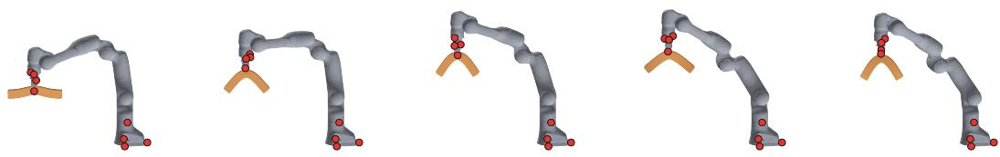  
Figure 5: Demo: soft-bar manipulation in Newton. Five instants of a Franka arm carrying a soft bar simulated in Newton 1.5.2 (The Newton Contributors, 2025) as a face-free 12-NN point set. Given eight proprioceptive points (red) and none on the sagging bar, the frozen checkpoint completes dense motion, closely matching harmonic extension on the unobserved payload.

Moreover, the unified model sees no additional unique training items: it encounters the identical set of unique items on DT4D and Franka, and only 8% of the unique training items available in AMASS. The performance of the unified model is therefore not explained by greater exposure to any one source.

## B.4 EMISSION RATIOS

What the unified model exhibits that the specialists do not is the ability to output a residual correction of approximately the required scale across diverse target geometries. We measure this property using the emission ratio, defined as the mean per-vertex $\ell _ { 2 }$ length of the predicted physical correction sˆR<sup>¯</sup><sub>θ</sub> divided by that of the unobserved residual left by the base field F − H, over the evaluated vertices and pooled across conditions.

For the unified model, this ratio remains stably bounded between 0.57 and 0.99 across the four evaluation columns that record these statistics (the legged evaluation outputs do not store these field diagnostics), remaining below unity throughout. In contrast, specialist priors deviate substantially from unity off-source: the Franka prior yields emission ratios of 0.21–0.96, under-predicting the required correction across all columns, while the AMASS prior yields ratios of 0.94–1.51, overpredicting on most. Consequently, one specialist consistently under-corrects while the other overcorrects on the identical completion task.

This diagnostic also clarifies the unscaled ablation in Tables 4 and 8, where amplitude recovery is removed (sˆ = 1). Across the density ladder, the emission ratio of the fixed-amplitude arm expands from 0.72 to 1.03 on DT4D, 0.77 to 1.61 on AMASS, and 1.09 to 5.93 on Franka, whereas the adaptive predictor maintains ratios near unity. The resulting performance penalties are 1.17–1.79× on DT4D, 1.58–5.98× on AMASS, 4.66–94.0× on Franka, and 1.02–1.48× on cloth. Franka represents the extreme case of this mechanism: when evaluated in the bounding-box-normalized coordinates where the amplitude acts, its residual is roughly 26–42× smaller than DT4D’s across the density grid, causing a single shared static amplitude to severely overshoot on that domain first.

## B.5 THE THREE COMMERCIAL MANIPULATORS, PER ARM

We evaluate the unified checkpoint zero-shot on one recorded teleoperation episode each from three commercial manipulators in RH20T (Fang et al., 2024): a Flexiv 7-DoF arm, a Kuka LBR iiwa, and a Universal Robots UR5. Geometries and kinematic topologies are parsed directly from vendorshipped URDFs, with completion executed without any task-specific fine-tuning.

Observations are restricted to four points on the end-effector and four points on the fixed base, corresponding to 0.200% of the manipulator’s vertices. Across all three systems, completions remain below harmonic extension, and in all cases the unified model outperforms the specialist prior trained exclusively on the Franka manipulator. Because these experiments evaluate single demonstration episodes (24–25 frame pairs each), we report directional validation across diverse robotic kinematic chains rather than aggregate benchmark statistics. Figure 5 demonstrates a Franka arm carrying a gravity-sagged soft bar simulated in Newton 1.5.2 (The Newton Contributors, 2025); from eight robot points without retraining, the completion on the unobserved bar closely matches harmonic extension.

Table 6: Cloth by density: the four priors and the base at each rung. Every specialist crosses the no-learning base and the unified model never does. 3,840 conditions, 768 per density; Table 2 pools all five rungs.
<table><tr><td>err ÷ mean |F|, cloth</td><td>0.5%</td><td>1%</td><td>2%</td><td>10%</td><td>50%</td></tr><tr><td>harmonic</td><td>0.6888</td><td>0.5925</td><td>0.4953</td><td>0.2824</td><td>0.1295</td></tr><tr><td>DT4D</td><td>0.8131</td><td>0.6479</td><td>0.4578</td><td>0.1550</td><td>0.0544</td></tr><tr><td>AMASS</td><td>0.9511</td><td>0.8393</td><td>0.6440</td><td>0.2360</td><td>0.0765</td></tr><tr><td>Franka</td><td>0.7594</td><td>0.6451</td><td>0.5268</td><td>0.2926</td><td>0.1346</td></tr><tr><td>CEPHEID</td><td>0.6790</td><td>0.5524</td><td>0.4087</td><td>0.1513</td><td>0.0548</td></tr></table>

Table 7: Legged by density: the four priors and the base at each rung. At the sparsest rung every arm is above the no-learning base; at 1% only the AMASS prior still is, and from 2% up none is. Table 2 pools three of these five rungs: 0.5, 10 and 50%.
<table><tr><td>err ÷ mean |F|, legged</td><td>0.5%</td><td>1%</td><td>2%</td><td>10%</td><td>50%</td></tr><tr><td>harmonic</td><td>0.6033</td><td>0.4228</td><td>0.2640</td><td>0.0954</td><td>0.0435</td></tr><tr><td>DT4D</td><td>0.6227</td><td>0.4181</td><td>0.2274</td><td>0.0383</td><td>0.0102</td></tr><tr><td>AMASS</td><td>0.6955</td><td>0.4293</td><td>0.2127</td><td>0.0308</td><td>0.0183</td></tr><tr><td>Franka</td><td>0.6626</td><td>0.4195</td><td>0.2268</td><td>0.0478</td><td>0.0175</td></tr><tr><td>CEPHEID</td><td>0.6222</td><td>0.3990</td><td>0.2067</td><td>0.0355</td><td>0.0096</td></tr></table>

## B.6 TRANSFER TO THE HELD-OUT FAMILIES BY DENSITY

Each specialist prior exceeds harmonic extension in its column under sparse observations. On cloth (Table 6), the Franka prior remains above the base across all densities, the AMASS prior through 2%, and the DT4D prior through 1%. On legged bodies (Table 7), all three specialists sit above the base at 0.5%, only the AMASS prior remains above at 1%, and from 2% upward all three fall below.

The unified model improves over the base across all five evaluated densities on cloth. On legged bodies, it sits above the base at 0.5% and below it from 1% upward. Across both held-out domains, the unified model achieves the lowest completion error among the four learned models at the three sparsest rungs (0.5%, 1%, and 2%).

The cloth entries in Table 2 pool across all five rungs in Table 6, whereas the legged entries in Table 2 pool across the 0.5%, 10%, and 50% rungs (the density grid shared across the source columns). Each rung is normalized by its own mean motion magnitude: across the 0.5%, 1%, 2%, 10%, and 50% densities, the cloth denominators are 114.4419, 114.4454, 114.4417, 114.4664, and 114.4751 mm, and the legged denominators are 3.3657, 3.3659, 3.3664, 3.3656, and 3.3648 mm.

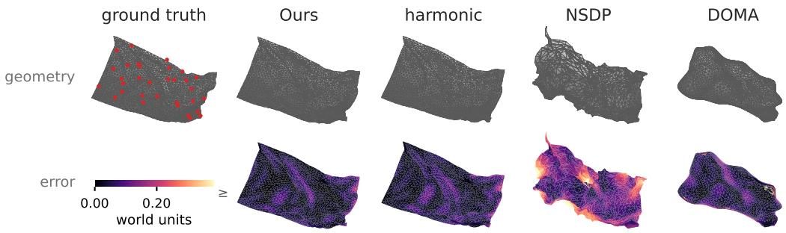  
Figure 6: Qualitative comparison on cloth, a family no model trained on. Completion from 32 observed vertices of the 1,577 free vertices, shown as geometry above and per-vertex error below on a shared ramp; the observed points are marked on the ground truth. Ours is the unified checkpoint and NSDP is retrained on our DT4D split. NSDP tears the sheet and DOMA loses its shape and self-intersects, while our completion keeps the flag intact and its error field dark. Ours is the only one of the three below harmonic extension here.

Table 8: The same component ablation on the three training families. The arms, conditions and scoring are those of Table 4, which carries the two held-out columns; together they are one fivecolumn ablation, with rows in that table’s order (cloth, worst first). A check marks a component the row keeps; in the amplitude column a dash is sˆ = 1, and in the samples column a check is eight samples and a dash is one.
<table><tr><td></td><td>harmonic</td><td>mean of k samples matching</td><td>flow</td><td>conditioned amplitude on harmonic</td><td>recovery</td><td>DT4D</td><td>AMASS</td><td>Franka</td></tr><tr><td>harmonic</td><td></td><td></td><td></td><td></td><td></td><td>0.269</td><td>0.069</td><td>0.101</td></tr><tr><td rowspan="6">CEPHEID (ours)</td><td></td><td>√</td><td>√</td><td></td><td>√</td><td>0.752</td><td>0.341</td><td>0.457</td></tr><tr><td>一 √</td><td>-</td><td>√</td><td>一 √</td><td>√</td><td>0.152</td><td>0.025</td><td>0.024</td></tr><tr><td>√</td><td>√</td><td>一</td><td>√</td><td>√</td><td>0.126</td><td>0.021</td><td>0.028</td></tr><tr><td>√</td><td>√</td><td>√</td><td>一</td><td>√</td><td>0.166</td><td>0.027</td><td>0.032</td></tr><tr><td>√</td><td>√</td><td>√</td><td>√</td><td></td><td>0.152</td><td>0.038</td><td>0.209</td></tr><tr><td>√</td><td>√</td><td>√</td><td>√</td><td>√</td><td>0.124</td><td>0.021</td><td>0.020</td></tr></table>

## B.7 QUALITATIVE COMPARISON WITH NSDP AND DOMA ON CLOTH

On an unseen cloth condition at 2% observation, Figure 6 compares our unified checkpoint, retrained NSDP, and per-scene DOMA against harmonic extension. Geometry is shown above and per-vertex error fields below.

## B.8 THE ABLATION ON THE THREE TRAINING FAMILIES

Table 8 presents the corresponding five-choice ablation evaluated on the three native training families. In the arm without harmonic extension, H = 0 leaves the four amplitude features computed from H undefined; $\mathrm { a 1 0 ^ { - 1 2 } }$ guard keeps each finite but far below its fitted range, so the support clamp fixes each at the lower edge. Removing harmonic extension causes error to exceed the harmonic row across all columns in both tables, by 4.9× on AMASS. Removing amplitude recovery crosses the base on Franka (0.020 → 0.209) while remaining below it on AMASS and DT4D; together with the legged column in Table 4, these represent the two columns out of five where removing amplitude recovery induces negative transfer.

The relative degradation from removing intermediate components does not strictly track the distinction between training and held-out domains: removing base conditioning degrades completion by 8.4% relative to CEPHEID on cloth, while removing flow matching costs 12.5% and removing sample averaging costs 12.7%. On AMASS, the corresponding removals degrade performance by 28.6%, leave error unchanged at three decimals, and degrade it by 19.0%, respectively.

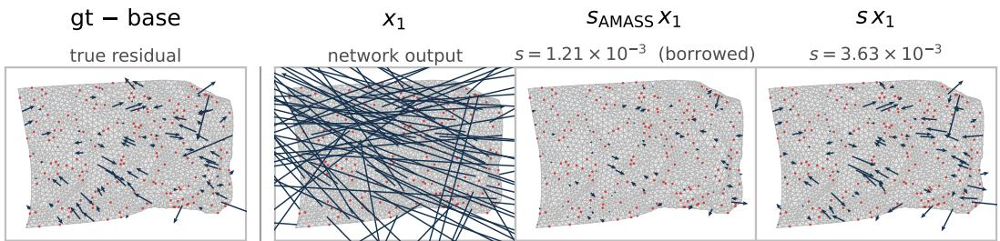  
Figure 7: The predicted amplitude recovers the residual; a borrowed one does not. Cloth at 10% observation, one shared arrow scale; red dots are the observed vertices. The first panel is the true residual; the three that follow show the same frozen network output, differing only in the scale applied to it. The network’s raw output carries no physical scale, and AMASS’s table restores it at a third of the predicted scale.

Finally, evaluating single-draw inference $( k = 1 )$ increases error by 19–23% across the three training sources, compared to the 8–13% increase observed on the two held-out families in Table 4.

## C AMPLITUDE RECOVERY, BACKBONE ATTENTION, AND INFERENCE SAMPLING

## C.1 WHAT IS FITTED

We define the residual amplitude s and the observed-displacement gauge $\sigma _ { \mathrm { o b s } }$ (§3.2) as:

$$
s = \mathrm { s t d } _ { 9 9 . 5 } ( R ) , \qquad \sigma _ { \mathrm { o b s } } = \mathrm { s t d } _ { 9 9 . 5 } ( O ) .\tag{7}
$$

Across the three training sources at matched density, s spans 18–39× when pooled per density over training data with extent-normalized objects (Franka is divided by its bounding-box extent only for this comparison). It also falls by another order of magnitude across the density grid while the ground-truth motion stays flat. Measured across DT4D training runs differing only in the base, the 99.5%-clipped standard deviation of motion with the base set to zero varies by 6.8% across 0.5% to 50% observation (max over min), whereas the same statistic of the residual after harmonic extension varies by 18.3×.

Because $\sigma _ { \mathrm { o b s } }$ is evaluated directly on observed displacements at inference, the ratio $s / \sigma _ { \mathrm { o b s } }$ is dimensionless. We fit a ridge regression model (Hoerl & Kennard, 1970) on its logarithm:

$$
\log \frac { s } { \sigma _ { \mathrm { o b s } } } \approx b + w ^ { \top } z ( \varphi ) ,\tag{8}
$$

where $z ( \cdot )$ standardizes the feature vector $\varphi$ against frozen statistics. Exponentiating yields the served scale:

$$
\hat { s } = \sigma _ { \mathrm { o b s } } \exp ( b + w ^ { \top } z ( \varphi ) ) .\tag{9}
$$

Fitting $\log ( s / \sigma _ { \mathrm { o b s } } )$ rather than log s directly removes dataset-specific unit conventions from the regression objective. Training targets $R / \hat { s }$ are clipped to [−8, 8]; inference evaluates $\hat { F } = H + \hat { s } \bar { R } _ { \theta }$ by multiplication alone, so stationary observations yield $\hat { s } \approx 0$ and ${ \hat { F } } = H$

The gauge does most of the unit work and the correction does the rest. Evaluated on held-out conditions of the three training sources with Franka in meters, the cross-source span of the geometric mean of per-condition s at the sparsest rung is $3 7 . 5 \times ;$ the same geometric mean for per-condition $s / \sigma _ { \mathrm { o b s } }$ spans 3.2×. What the correction adds is variation that depends on the condition: the gauge alone is above the no-learning base at every density on cloth, 0.8073 to 1.3197 against the base’s 0.6888 to 0.1295 (Table 3).

Table 9: The eleven amplitude-recovery features, as the code computes them. Together they form $\varphi \in \mathbb { R } ^ { 1 1 }$  
```tcl
Feature Mathematical Definition
log frac $\log ( M / N )$
$\mathtt { l o g \_ n \_ o b s }$ log M
log n vert log N
log hop mean $\log ( \bar { h } + 1 )$ , with $\bar { h }$ the mean graph hops to Ω over unobserved vertices
that can reach it
log hop max $\log ( h _ { \operatorname* { m a x } } + 1 )$ , with $h _ { \mathrm { m a x } }$ the maximum graph hops to Ω over the same
vertices
unreach frac Share of the unobserved vertices with no path to Ω
obs norm cv $\mathrm { s t d } _ { j } \parallel O _ { j } \parallel _ { 2 } /$ mean<sub>j</sub> $\| O _ { j } \| _ { 2 }$
log base over obs log $( \mathrm { m e a n } _ { i \notin \Omega } \| H _ { i } \| _ { 2 } /$ mea $\mathbf { n } _ { j } \parallel O _ { j } \parallel _ { 2 } )$
log sigbase over sigobs log $( \mathrm { s t d } _ { 9 9 . 5 } ( H _ { \mathcal { V } \setminus \Omega } ) / \sigma _ { \mathrm { o b s } } \Big )$
log base rough log $\left( \operatorname* { m e a n } _ { - } _ { ( i , j ) \in \mathcal { E } } \| \dot { H } _ { i } - \dot { H } _ { j } \| _ { 2 } / \operatorname* { m e a n } _ { i \in \mathcal { V } } \| H _ { i } \| _ { 2 } \right)$
log base rough hop log $\begin{array} { r } { \left( \bar { d } \mathrm { m e a n } _ { ( i , j ) \in \mathcal { E } } \| H _ { i } - H _ { j } \| _ { 2 } / \mathrm { m e a n } _ { i \in \mathcal { V } } \| H _ { i } \| _ { 2 } \right) } \end{array}$
```

## C.2 THE FEATURES

The vector $\varphi \in \mathbb { R } ^ { 1 1 }$ comprises eleven entries, defined in design-matrix order in Table 9. We denote the observed displacements as $O ,$ the harmonic extension as ${ \bar { H } } ,$ vertex count as $N$ , observed count as M, and mean vertex degree as $\bar { d } = 2 | \mathcal { E } | / N$

Every feature in Table 9 is dimensionless: each represents a count, a proportion, or a ratio between two matching lengths. Native length scales cancel out before regression, allowing a single rule fitted on three training sources to be deployed directly onto unseen geometries (§3.3).

## C.3 FITTING

From an initial pool of 15 candidate features across five groups (density, connectivity, observedmotion variation, base field, and mesh), an inner leave-one-source-out selection drops at most one entire group, which for the deployed fold eliminated the four mesh features to yield the final 11. The ridge regression is fitted on log amplitude ratios with sample weights balanced across the three training sources. The intercept b is unpenalized. Feature standardization and the 1st/99th-percentile clamp bounds are frozen statistics, not free parameters: 12 fitted values and 56 numbers frozen in total. Clamp bounds are applied to φ prior to standardization, ensuring that features exceeding the training distribution support are evaluated at the boundary rather than extrapolated.

Algorithm 1 Inference-Time Amplitude Recovery   
Require: Frozen rule: standardized weights w and intercept b (Table 10); feature means $\mu _ { \varphi } ,$ , standard devia  
tions $\sigma _ { \varphi }$ (with ⊘ denoting element-wise division), and clamp bounds $\varphi _ { \mathrm { m i n } } , \varphi _ { \mathrm { m a x } }$ , frozen statistics released   
with the code (Appendix C.3)   
Ensure: Predicted physical scale sˆ   
1: $\sigma _ { \mathrm { o b s } }  \mathrm { s t d } _ { 9 9 . 5 } \acute { ( } O \mathrm { ) }$   
2: φ ← ExtractFeatures $( \mathcal { E } , \Omega , O , H )$ ▷ Table 9   
3: φ ← clip(φ, φ<sub>min</sub>, φ<sub>max</sub>)   
4: $z  ( \varphi - \mu _ { \varphi } ) \oslash \sigma _ { \varphi }$   
5: $\hat { s } \gets \sigma _ { \mathrm { o b s } } \cdot \exp ( b + w ^ { \top } z )$   
6: return sˆ

## C.4 AMPLITUDE-RECOVERY COEFFICIENTS

Table 10 presents the learned standardized weights w and intercept b. At the training mean, all standardized features evaluate to zero $( z = 0 )$ , reducing the correction factor $\hat { s } / \sigma _ { \mathrm { o b s } }$ to $\exp ( b ) =$ 0.0873. Under average training conditions, the residual amplitude is therefore approximately oneeleventh of the dispersion of the observed displacements $( \hat { s } \overset { - } { \approx } 0 . 0 8 7 3 \sigma _ { \mathrm { o b s } } )$

Table 10: The deployed standardized amplitude-recovery weights w and intercept b = −2.439. The rule is the leave-cloth-out fold, fitted on standardized features from DT4D, AMASS and Franka with the mesh group dropped; individual weights are not interpretable because log frac = log n obs − log n vert and log base rough hop = log base rough + log <sup>¯</sup>d exactly (Table 9).
<table><tr><td>feature</td></tr><tr><td>log-frac -0.202</td></tr><tr><td>log-n_obs -0.237</td></tr><tr><td>log-n_vert -0.173</td></tr><tr><td>log-hop-mean +0.171</td></tr><tr><td>log_hop_max +0.189</td></tr><tr><td>unreach_frac +0.075</td></tr><tr><td>obs_norm_cv +0.011 log_base_over_obs -0.057 log_sigbase_over_sigobs -0.068</td></tr></table>

Table 11: Oracle table comparison on held-out cloth. Conditions match Table 3, normalized by mean motion magnitude. Relative to the ground-truth-fitted oracle table $( \alpha ^ { * } )$ , amplitude recovery differs by +1.04% at 0.5%, −0.09% at 1%, and reduces error by 2.81% to 10.77% from 2% upward.
<table><tr><td>cloth, err ÷ mean |F|</td><td>0.5%</td><td>1%</td><td>2%</td><td>10%</td><td>50%</td></tr><tr><td>harmonic</td><td>0.6888</td><td>0.5925</td><td>0.4953</td><td>0.2824</td><td>0.1295</td></tr><tr><td>Amplitude recovery (ours)</td><td>0.6790</td><td>0.5524</td><td>0.4087</td><td>0.1513</td><td>0.0548</td></tr><tr><td>Oracle table (α*)</td><td>0.6720</td><td>0.5529</td><td>0.4205</td><td>0.1670</td><td>0.0614</td></tr><tr><td>Relative difference vs α* *</td><td>+1.04%</td><td>-0.09%</td><td>-2.81%</td><td>-9.40%</td><td>-10.77%</td></tr></table>

During production deployment, features are standardized and clamped using the released configuration parameters, which reproduce the exact served amplitude values.

## C.5 SELECTION

Within each leave-one-source-out fold, an inner cross-validation loop across the three remaining training sources determines whether to retain all five feature groups or eliminate one. The held-out evaluation source is strictly excluded from both feature selection and coefficient estimation.

## C.6 THE PER-DENSITY OPTIMAL TABLE

As an additional target-informed reference, we compute an oracle table whose per-density entries minimize completion error on cloth, representing the performance ceiling for any single-value-perdensity rule accessing the ground truth. Amplitude recovery approaches this oracle within approximately one percentage point at the two sparsest densities, and outperforms it by 2.8% to 10.8% from 2% observation density upward (Table 11). This advantage arises because an empirical table assigns a static scalar per density, whereas amplitude recovery adapts dynamically to individual test conditions.

## C.7 THE ATTENTION ABLATION

Message passing resolves local deformation shared across neighboring vertices, whereas non-local attention relates distant surface regions lacking short graph paths. As reported in Table 12, comparing MGN-T against a matched-budget message-passing control yields relative error reductions of 7.5% at 0.5% observation and between 2.0% and 3.3% from 2% through 50% density. Pooled over the five densities, MGN-T achieves a 4.9% error reduction and is lower on all seven held-out identities.

Table 12: Attention ablation on DT4D. Comparison of MGN-T against a matched-budget messagepassing control across seven held-out identities at five densities (0.5, 2, 5, 10, 50%). MGN-T achieves a 4.9% pooled relative reduction and yields lower error on all seven identities.
<table><tr><td>DT4D held-out,  $\mathrm { e r r } \div \mathrm { m e a n }$  |F|</td><td>0.5%</td><td>2%</td><td>5%</td><td>10%</td><td>50%</td><td>pooled</td></tr><tr><td>MGN-T (ours)</td><td>0.3997</td><td>0.1963</td><td>0.1224</td><td>0.0898</td><td>0.0548</td><td>0.1837</td></tr><tr><td>Message-passing control</td><td>0.4321</td><td>0.2012</td><td>0.1249</td><td>0.0929</td><td>0.0562</td><td>0.1933</td></tr><tr><td>Relative reduction</td><td>7.5%</td><td>2.4%</td><td>2.0%</td><td>3.3%</td><td>2.3%</td><td>4.9%</td></tr></table>

Table 13: Averaging more samples at inference: the same checkpoint read at five values of k. Little is left by $k = 8 ,$ with $k = 8$ sitting only 0.8–2.1% above $k = 1 6 .$ . Every row is read off the same sixteen draws per condition, so its $\bar { k } = 1 \bar { }$ and $k = 8$ are not the cells of Tables 4 and 8, and no row can sit above the one before it. ‡ Held out at source level.
<table><tr><td>k</td><td>DT4D</td><td>AMASS</td><td>Franka</td><td>cloth ‡</td><td>legged ‡</td></tr><tr><td>harmonic</td><td>0.2685</td><td>0.0693</td><td>0.1011</td><td>0.4377</td><td>0.2474</td></tr><tr><td>1</td><td>0.1519</td><td>0.0254</td><td>0.0244</td><td>0.4154</td><td>0.2404</td></tr><tr><td>2</td><td>0.1372</td><td>0.0232</td><td>0.0221</td><td>0.3905</td><td>0.2313</td></tr><tr><td>4</td><td>0.1287</td><td>0.0220</td><td>0.0208</td><td>0.3765</td><td>0.2258</td></tr><tr><td>8</td><td>0.1241</td><td>0.0214</td><td>0.0202</td><td>0.3690</td><td>0.2226</td></tr><tr><td>16</td><td>0.1216</td><td>0.0210</td><td>0.0198</td><td>0.3651</td><td>0.2209</td></tr></table>

Because performance gains are concentrated where unobserved vertices lie multiple hops away from observations, attention is primarily advantageous under sparse coverage. We note that a uniform learning rate was maintained across backbones rather than tuned individually; because learning rate sensitivity is comparable in magnitude to this performance difference, we report these directional trends without basing core model rankings upon them.

## C.8 NUMBER OF SAMPLES AVERAGED AT INFERENCE

Table 13 evaluates completion error for the unified checkpoint across five values of sample averaging $( k \in \{ 1 , 2 , 4 , 8 , 1 6 \} )$ , computed on the benchmark conditions of Table 2. Because each set of 2k draws forms the union of two disjoint k-draw subsets, the triangle inequality ensures that relative error is monotonically non-increasing with k.

Marginal improvements diminish rapidly with sample count: $k = 8$ sits only 0.8–2.1% above $k =$ 16, whereas $k = 1$ sits 8.8–24.9% above $k = 1 6 .$ . Because computational latency scales linearly with k during integration, we adopt $k = 8$ throughout all primary benchmarks.

The two held-out columns exhibit smaller relative gaps from multi-sample averaging than the three training columns at every doubling step: $k = 1$ sits 3.9–6.4% above $\bar { k } = 2$ on held-out families versus 9.5–10.7% on training families, and $k = 8$ sits 0.8–1.1% above k = 16 versus 1.9–2.1%. Tables 4 and 8 demonstrate this same pattern at $k = 1$ , where evaluating single draws incurs an 8–13% penalty on held-out domains compared to 19–23% on training domains.

## D COMPLETION FROM A POINT TRACKER

Figure 4 demonstrates the unified model applied to an in-the-wild video sequence from the DAVIS dataset (Perazzi et al., 2016). Frames 4–39 of DAVIS horsejump-high represent the highest-motion 36-frame window that passes the tracking gates, among non-rigid subjects that remain fully inside the image throughout the clip. The surface geometry is a single-image TripoSR reconstruction (Tochilkin et al., 2024) from frame 18, cropped using that frame’s DAVIS annotation mask and decimated to 3,996 vertices.

The camera is modeled as an orthographic projection with an axis-aligned rotation and scale fitted to frame 18’s silhouette. 2D tracks from CoTracker3 (Karaev et al., 2025) are matched at frame 18 to the nearest camera-facing vertex within 10 pixels; pixel displacements relative to frame 18 are divided by the fitted scale, assigned zero depth in the image plane, and rotated into the mesh coordinate system. The matched tracks remain fixed across the sequence, using CoTracker3’s predicted positions during occlusions. A track is dropped entirely if it ever deviates from the frame median displacement by more than 4 times the median absolute deviation, or if its mean-centered displacement exceeds 0.4 of the mesh extent, leaving 63 of 65 tracks. Farthest-point sampling on reference vertices with at most 3 occluded frames selects 12 vertices observed in every frame. Global translation is removed by subtracting per-frame mean displacement, and each frame is completed independently from the frame-18 mesh. For drawing only, each frame’s overlay shifts by the median displacement of all matched tracks visible in that frame.

Table 14: Completion without mesh connectivity: harmonic extension on mesh edges replaced by a thin-plate spline on a k-NN graph. It stays viable, at a cost concentrated at sparse observation. The DT4D density ladder, in mAU rather than the err ÷ mean |F| of the other tables. The two (ours) rows are 200k-step models on their own matched pair. DOMA’s cells are each its best over seven iteration budgets and two readings of its prediction, chosen per density after scoring.
<table><tr><td></td><td>input</td><td>0.5%</td><td>1%</td><td>2%</td><td>10%</td><td>50%</td></tr><tr><td>Laplacian</td><td>mesh</td><td>53.26</td><td>41.73</td><td>30.08</td><td>13.61</td><td>6.42</td></tr><tr><td>TPS</td><td>points</td><td>46.98</td><td>31.42</td><td>20.24</td><td>6.92</td><td>2.63</td></tr><tr><td>DOMA</td><td>points</td><td>48.96</td><td>33.94</td><td>20.18</td><td>6.13</td><td>2.10</td></tr><tr><td>Laplacian + GNN (ours)</td><td>mesh</td><td>37.47</td><td>26.52</td><td>17.64</td><td>8.73</td><td>5.29</td></tr><tr><td>TPS + kNN (ours)</td><td>points</td><td>43.16</td><td>26.82</td><td>15.71</td><td>4.63</td><td>1.91</td></tr></table>

To demonstrate completion on surfaces no tracker can observe, Figure 4b displays 120 completed vertices on the far side of the animal. These are defined as vertices whose reference-frame surface normals orient away from the camera; because 2D point tracks are initialized strictly on camerafacing surfaces in that frame, these far-side vertices remain disjoint from the observed set throughout the clip. There is no ground truth for these points; the visualization demonstrates that a completion exists across unobserved regions through mesh connectivity, not that it is exact. The frame-18 camera is kept for all frames; for drawing only, every other frame’s projection is shifted by the median track displacement, then scaled about the dilated segmentation mask centroid and translated to maximize intersection-over-union between camera-facing faces and the mask via grid search, so the overlay degrades with temporal distance from the fitted frame.

## E CONNECTIVITY-FREE COMPLETION

Table 14 evaluates whether motion completion remains viable when surface mesh connectivity is removed entirely. The discrete harmonic extension on mesh edges is replaced by a Thin-Plate Spline (TPS) interpolant (Bookstein, 1989) on point coordinates, and both learned models run the network over the same 12-nearest-neighbor spatial graph.

These arms are 200k-step models on their own matched pair, differing only in the base; neither shares the unified model’s budget or training sources. The point-input arms read no connectivity: deleting the face list on a nine-condition check leaves their inputs bit-identical, and the full evaluation keeps faces only to bin error by topological hop distance.

Among closed-form interpolants, TPS alone is below DOMA at the two sparsest densities: 46.98 against 48.96 at 0.5%, and 31.42 against 33.94 at 1%, with DOMA leading from 2% upward. TPS is also the lower of the two interpolants at every density. When paired with the neural prior, the point-based model remains viable: while it incurs higher error under sparse observation relative to the mesh-based model, it achieves lower error from 2% observation density upward.

## F POOLING CONVENTIONS AND THE AMPLITUDE PROTOCOL

## F.1 WHY THE METRIC POOLS RATHER THAN AVERAGES

The pooled relative error (Equation 6) aggregates condition-specific errors and motion displacements across all evaluation instances before taking their quotient. An arithmetic mean of per-condition

Table 15: Fine-tuning the pretrained prior to a fixed sensor placement on a Franka gripper. It more than halves the error against the same checkpoint zero-shot. 12 held-out episodes, 36 frame pairs, error over the free arm links 1–7 in mm; $k = 3$ is the number of observed markers.
<table><tr><td></td><td> $k = 3$ </td></tr><tr><td>harmonic</td><td>2.652</td></tr><tr><td>zero-shot</td><td>2.283</td></tr><tr><td>fine-tuned</td><td>0.991</td></tr></table>

relative errors normalizes by each condition’s own motion magnitude, allowing instances with nearzero ground-truth motion to disproportionately dominate the summary statistic. In contrast, pooled aggregation weights each condition strictly in proportion to its physical motion magnitude.

## F.2 THE NORMALIZATION USED IN TABLE 2

Table 2 reports entries divided by a single constant per column, defined as the mean ground-truth displacement across that column’s evaluation conditions. Because numerator and denominator are averaged over identical evaluation instances, the resulting quotient matches the pooled relative error exactly, ensuring that any normalized cell remains directly invertible back to physical units.

## F.3 THE BASE FIXED POINT

Because the base is closed-form and model-independent, it serves as the fixed point every row is anchored to. It is the first row of Table 1, where it reads 0.6255 / 0.3533 / 0.2257 / 0.1598 / 0.0754; averaged over the same conditions in mAU, it gives 53.256 / 30.084 / 19.216 / 13.611 / 6.423. We verified it independently against our own run’s base column, DOMA’s aggregation, and NSDP’s choice of weighting. Recomputing the harmonic row from NSDP’s evaluation using motion-weighted pooling reproduces this exact fixed point.

## F.4 THE AMPLITUDE PROTOCOL

Every cell in Table 2 uses the predicted amplitude, read from parameters stored in the checkpoint rather than from any external configuration, and all four models carry the single rule fitted on DT4D, AMASS, and Franka. The rule has access to the three source columns and to neither held-out family. A table fitted on the target serves strictly as a target-informed reference and is never quoted as a deployable result.

## G FINE-TUNING TO A DEPLOYMENT OBSERVATION PATTERN

A deployed arm observes the same few points every frame, which is not how any of our training masks are drawn. We fine-tune the unified checkpoint for 10k steps at $\mathrm { l r } = 1 0 ^ { - 4 }$ on this source, drawing each training sample’s observed subset and its size once, from a seeded draw over sizes from 1 to all vertices, mostly from the gripper and in about 7% of samples across the arm, so the model sees many placements rather than the one it is evaluated on. We evaluate on held-out episodes at the marker count a three-marker rig would carry, with the observations drawn from the gripper vertices by farthest-point selection.

As reported in Table 15, the fine-tuned prior more than halves the error, from 0.86× the base to 0.37× it. Because the architecture and amplitude recovery are unchanged from the zero-shot row, the gain is in the weights and not in the inference procedure.