# CINEMEM: ATTENTION-ALIGNED FINE-GRAINEDMEMORY RETRIEVAL FOR MULTI-SHOT LONG VIDEOGENERATION

Xiaoxue Wu1,2∗, Xinyu Gao3, Fang Yu1,4, Yu Qiao1†, Xinyuan Chen1†   
1Shanghai Artificial Intelligence Laboratory   
2Fudan University   
3Shanghai Jiao Tong University   
4East China Normal University

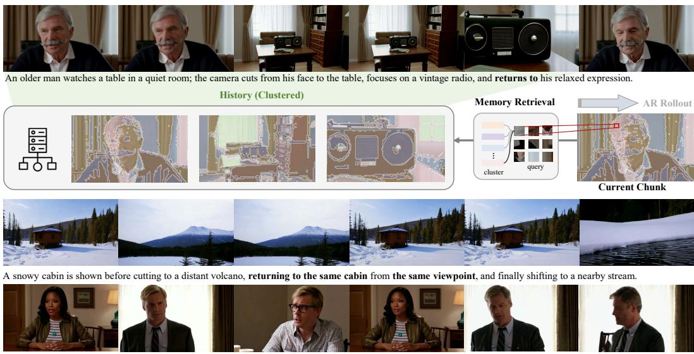  
Three people are having an intense conversation at a dining table, with alternating shot/reverse shot views capturing the conversation from each speaker's perspective.

Figure 1: 15-second multi-shot videos autoregressively generated by CineMem. By combining clustered memory with fine-grained query-adaptive retrieval, CineMem maintains coherent semantic flow across shot transitions, particularly in revisitation scenarios. Project page: https://uknowsth.github.io/CineMem/

## ABSTRACT

Autoregressive video generation relies on memory retrieval to model long-range dependencies. This capability becomes particularly critical for multi-shot generation, where models must reconcile substantial visual changes across shot transitions with persistent semantic continuity. Existing methods tend to perform memory retrieval at the frame level and share the same historical context across all query tokens, overlooking the heterogeneous information needs and leading to redundant retrieval and inefficient use of historical memory. To bridge this gap, we introduce CineMem, an attention-aligned fine-grained memory retrieval framework that combines online memory organization with query-adaptive retrieval for autoregressive multi-shot video generation. Specifically, guided by intrinsic memory-access patterns revealed through attention analysis, we propose an online-clustered KV cache as a memory organization strategy over all historical tokens, enabling semantic-aware memory grouping and more precise retrieval. In addition, we introduce a query-level retrieval mechanism that provides broader

access to historical information under a fixed retrieval budget, thereby improving long-term memory utilization. Together, these designs enable the multi-shot video generator to preserve long-range consistency across shot transitions, particularly in revisitation scenarios, while approximating full-memory access under a constrained memory budget. To facilitate evaluation, we further introduce a suite of task-specific, VLM-assisted metrics for faithful inter-shot consistency assessment. Extensive experiments demonstrate the effectiveness of our framework.

## 1 INTRODUCTION

Building on bidirectional architectures and extensive pre-training, recent diffusion models (Blattmann et al., 2023; Ho et al., 2020; Rombach et al., 2022; Song et al., 2020) deliver impressive visual quality, but at substantial computational cost for long-duration generation. Autoregressive generation offers a natural alternative for streaming video synthesis, typically combining a sliding window mechanism with memory routing to maintain long-range consistency and stable generation (Huang et al., 2026; Yin et al., 2025). This capability is particularly important for multi-shot video generation (Guo et al., 2025b; Luo et al., 2026), which aims to synthesize coherent, film-like narratives through frequent shot transitions accompanied by substantial viewpoint changes. Maintaining a continuous and coherent narrative flow across discrete shot boundaries naturally calls for a well-designed memory retrieval strategy, especially when previously observed subjects, scenes, or viewpoints reappear after intervening shots.

Existing memory mechanisms for causal video generation remain generally coarse-grained. Basic sliding-window strategies are widely adopted in single-shot causal models (Huang et al., 2026; Yang et al., 2025), inevitably discarding distant information as autoregressive rollout proceeds. In multishot scenarios, some methods preserve temporally predefined anchors as persistent memory (Chen et al., 2026b), such as the first frames of individual shots. These designs follow fixed routing patterns determined by temporal structures rather than the model’s intrinsic memory-access patterns, limiting their ability to fully exploit historical information. More recent studies introduce retrieval-based memory strategies (Meng et al., 2026a; Luo et al., 2026), which typically augment fixed sinks and adjacent context with frame-level routing. The resulting routing decision is shared across all query tokens. Although such designs allow content-aware access to historical cues, they still rely on coarse temporal grouping and overlook heterogeneous memory requirements across queries. Consequently, long-horizon autoregressive generation remains constrained by frame-level historical conditioning, leaving much of the available memory underutilized.

In this work, we explore how an autoregressive multi-shot video model can retrieve long-term historical information under a constrained memory budget by leveraging its intrinsic memory-access patterns. Rather than merely preserving adjacent-frame information for pixel-level continuity, memory in multi-shot scenarios should support the recovery of previously observed visual content after multiple shot transitions, a setting we refer to as revisitation. To this end, we propose CineMem, an attention-aligned fine-grained memory retrieval framework that combines online memory organization with query-adaptive retrieval for autoregressive multi-shot video generation. By adapting memory organization and retrieval granularity to attention-based selection patterns, CineMem enables more effective access to long-term history and improves long-range consistency across shot transitions, particularly in revisitation scenarios, as illustrated in Figure 1.

To investigate the intrinsic memory-access patterns of autoregressive diffusion models, we first develop a training framework that converts a bidirectional video model into a long-duration autoregressive multi-shot generator operating in a chunk-by-chunk manner, while allowing each current chunk to attend to the full generation history. To stabilize long-horizon rollout, we further incorporate an error accumulation mitigation strategy during adaptation. We then analyze the attention distributions between query tokens in the current chunk and all historical memory tokens. We observe a clear clustering structure among historical memory tokens and substantial variation in retrieval preferences across query tokens and attention heads. These observations motivate our designs for online memory organization and query-adaptive retrieval.

Specifically, our framework comprises two complementary designs, as illustrated in Figure 2. First, we apply online clustering to the KV cache to organize historical memory throughout autoregressive rollout. As generation proceeds, historical tokens are grouped according to their semantic similarity, with each cluster serving as a retrieval unit. In contrast to conventional frame-level schemes that partition tokens by fixed frame membership regardless of content, our design forms content-aware groups, which alleviates the redundancy introduced by retrieving entire frames, while avoiding the high computational cost of treating every historical token as an individual memory unit. Second, we introduce query-adaptive memory access in a query-wise and head-wise manner. Given their heterogeneous retrieval preferences, each query-head pair selects its most relevant clusters from memory. Under a fixed per-query memory budget, this individualized retrieval provides broader access to the generation history, yielding a larger effective attention receptive field without increasing the retrieval cost. Together, these designs better match intrinsic memory-access patterns while bal ancing retrieval granularity, historical coverage, and computational efficiency, enabling CineMem to maintain long-range consistency across frequent shot transitions.

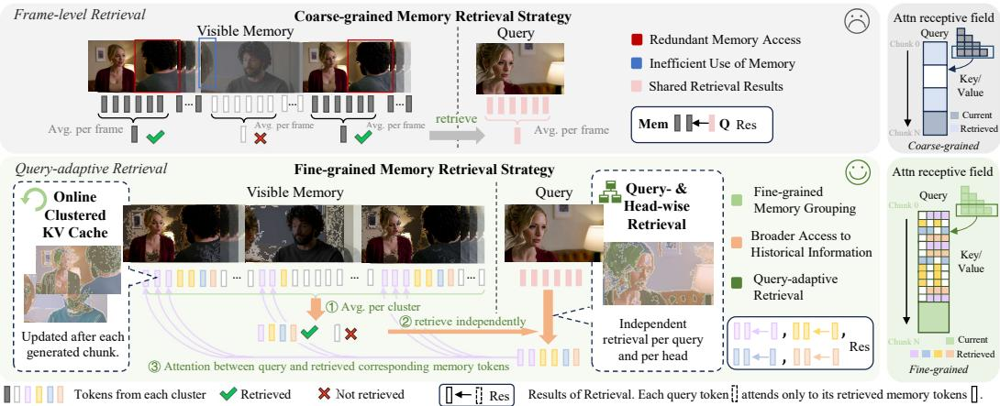  
Figure 2: Overview of CineMem. Existing autoregressive video generation methods tend to perform memory retrieval at the frame level, which may result in redundant retrieval, inefficient memory utilization, and overlooked heterogeneous information needs across query tokens. CineMem combines an online-clustered KV cache with query-adaptive retrieval to enable a finer-grained memory retrieval strategy. As illustrated by the attention receptive fields, CineMem provides broader (2/3 vs. 12/12) access to historical information under the same retrieval budget.

For evaluation, we adopt a comprehensive protocol covering video-level quality, intra-shot consistency, and inter-shot consistency. Since conventional similarity-based metrics can assign deceptively high inter-shot consistency scores to videos that fail to perform the intended shot transition, we further introduce a VLM-assisted evaluation protocol that jointly considers transition execution and semantic preservation. This provides a more faithful assessment of inter-shot consistency in multishot generation. Experimental results show that CineMem achieves superior consistency compared with existing autoregressive baselines while remaining competitive with large-scale bidirectional models. Moreover, our attention-aligned retrieval designs are effective in a plug-in setting without additional fine-tuning, demonstrating their ability to better exploit historical information during autoregressive rollout. Overall, our work highlights the importance of fine-grained memory organi zation and retrieval for coherent long-horizon autoregressive multi-shot video generation.

## 2 RELATED WORK

Autoregressive Video Generation and Memory. Diffusion-based autoregressive video generation enables streaming synthesis by progressively generating frames or chunks through autoregressive rollout (Gao et al., 2024; Chen et al., 2024; Liu et al., 2026b; Bruce et al., 2024; Liu et al., 2026a; Guo et al., 2025a). Recent methods adapt pretrained bidirectional video models through post-training or distillation (Zhu et al., 2026; Huang et al., 2026; Yin et al., 2025; Cui et al., 2026), relying on fixed anchors, sliding windows, or coarse-grained memory retrieval to maintain long-range consistency (Ji et al., 2025; Hu et al., 2026). OminiMem (Zhao et al., 2026) further introduces a fine-grained head adaptive retrieval framework, but primarily focuses on single-shot video generation. Meanwhile, fine-grained KV-cache organization has been explored in LLMs (Liu et al., 2025; 2026c; Zhu et al.,

2025) mainly for inference acceleration in the text domain. In contrast, our work investigates finegrained retrieval over visual memory with the primary goal of preserving long-range consistency, which we study in the more demanding setting of autoregressive multi-shot video generation.

Multi-Shot Video Generation. Multi-shot video generation aims to synthesize sequences with discrete shot transitions while preserving narrative, subject, and scene consistency. Most existing approaches are built upon bidirectional video models and can be broadly categorized into two paradigms: generating individual shots separately and subsequently composing them (He et al., 2023; Xie et al., 2024; Zheng et al., 2024; Long et al., 2024), or directly modeling multi-shot sequences in an end-to-end manner (Guo et al., 2025b; Qi et al., 2025; Wu et al., 2026b;a; Meng et al., 2026b; Wang et al., 2026; Jia et al., 2026). In autoregressive video generation, several methods enable dynamic content control by updating prompts during streaming synthesis, but primarily focus on single-shot generation (Yang et al., 2025; Ji et al., 2025). More recently, autoregressive approaches have begun to explore multi-shot generation. ShotStream (Luo et al., 2026) reformulates the problem as next-shot generation, while CausalCine introduces content-aware memory routing for accessing historical information (Meng et al., 2026a). Nevertheless, their memory retrieval remains relatively coarse-grained, limiting the effective use of long-term historical information.

## 3 METHOD

In this section, we present the methodology and insights of CineMem. After introducing the preliminaries in Section 3.1, we describe our autoregressive adaptation framework in Section $3 . 2 ,$ , which enables the analysis of intrinsic memory-access patterns in Section 3.3. Guided by these insights, Sections 3.4 and 3.5 present our online-clustered KV cache and query-adaptive memory retrieval mechanism. Figure 3 provides an overview of CineMem.

## 3.1 PRELIMINARY

Flow-Matching. Flow matching learns a continuous velocity field along a probability path connecting noise and data samples (Lipman et al., 2022). Given a clean latent $x _ { 0 }$ and Gaussian noise ϵ, the intermediate state is defined as $x _ { t } = ( 1 - t ) x _ { 0 } + t \epsilon .$ and the velocity field is optimized by:

$$
\mathcal { L } _ { \mathrm { F M } } = \mathbb { E } _ { t , x _ { 0 } , \epsilon } [ \| v _ { \theta } ( x _ { t } , t ) - ( \epsilon - x _ { 0 } ) \| _ { 2 } ^ { 2 } ] .\tag{1}
$$

Modern video diffusion models typically parameterize such velocity fields with transformer-based architectures (Peebles & Xie, 2023; Vaswani et al., 2017), where vθ predicts the transport direction of video latents conditioned on text prompts or other conditions.

Autoregressive Diffusion with Teacher Forcing. Built upon flow-matching video diffusion, autoregressive generation introduces causal dependency by generating each frame or chunk conditioned on previous history, formulated as $v _ { \theta } ( x _ { i } ^ { t } , t , x _ { < i } , c )$ . During training, teacher forcing replaces the generated history with ground-truth history:

$$
\mathcal { L } _ { \mathrm { A R } } = \mathbb { E } _ { t , x , \epsilon } [ \| v _ { \theta } ( x _ { i } ^ { t } , t , x _ { < i } ^ { g t } , c ) - ( \epsilon _ { i } - x _ { i } ) \| _ { 2 } ^ { 2 } ] .\tag{2}
$$

In multi-shot generation, the condition c can be updated during autoregressive rollout to control shot transitions, resulting in substantial visual changes across shots while requiring temporal consistency.

## 3.2 LONG-HORIZON AUTOREGRESSIVE ADAPTATION

To analyze intrinsic memory-access patterns without introducing any explicit memory retrieval, we first adapt a bidirectional video model into a long-horizon autoregressive multi-shot generator with chunk rollout and prompt-controlled shot transitions, as illustrated in the left part of Figure 3.

During adaptation, teacher forcing is first applied for autoregressive initialization. However, the resulting train-inference gap may cause error accumulation during long-horizon rollout and affect reliable memory analysis. Following Guo et al. (2025a), we mitigate this issue with resampled context training, where the ground-truth history is perturbed with low-level noise and denoised through a one-step rollout without gradient computation to obtain simulated inference history $\widetilde { \boldsymbol { x } } _ { < i }$ that better approximates model-generated history. Accordingly, Equation 2 is reformulated as:

$$
\mathcal { L } _ { \mathrm { A R - r e s a m p l e } } = \mathbb { E } _ { t , x , \epsilon } [ \| v _ { \theta } ( x _ { i } ^ { t } , t , \tilde { x } _ { < i } , c ) - ( \epsilon _ { i } - x _ { i } ) \| _ { 2 } ^ { 2 } ] .\tag{3}
$$

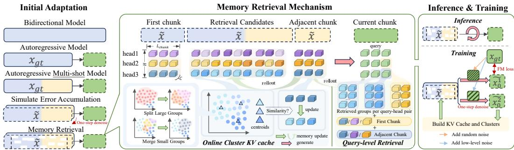  
Figure 3: Our memory retrieval framework. Through multi-stage initial adaptation, we convert a bidirectional model into an autoregressive multi-shot model with memory retrieval. During inference, queries access memory from the first chunk, adjacent chunk, and retrieved candidates via token-wise and head-wise retrieval. Previous adjacent chunks are progressively integrated into retrieval candidates through online KV-cache clustering with cluster balancing. During training, resampling ground truth frames provides memory inputs to alleviate error accumulation.

This training strategy reduces train-inference discrepancy and improves long-horizon rollout stability, enabling the model to generate longer multi-shot videos with reduced error accumulation.

Meanwhile, to equip the model with multi-shot generation capability, we fine-tune the model on 15-second multi-shot videos. During training, a shot-level mask restricts each shot to attend only to the global description and its corresponding caption, enabling controllable shot transitions through prompt updates during autoregressive rollout.

## 3.3 MEMORY SELECTION IN ATTENTION MODULE

Based on the full-memory model, we analyze memory-access patterns during autoregressive rollout to guide the design of a fine-grained retrieval mechanism that best matches the model’s intrinsic selection behavior under full-memory attention. While conventional retrieval schemes typically define the retrieval unit at the chunk-to-frame level, we revisit the fundamental token-to-token memory selection process inherent in attention, which motivates our fine-grained retrieval design. For each generated chunk, memory selection is essentially the process by which current tokens, serving as queries, select relevant historical memory tokens through their keys and values. For a query, highly attended keys receive higher attention probabilities, which mathematically correspond to larger normalized dot-product similarities. We therefore use this signal to study token-wise selection relationships and reveal the underlying memory-selection patterns.

Memory structure. Efficient retrieval requires grouping, since treating each token as a separate group reduces retrieval to full-memory attention. Frame-level retrieval instead treats each frame as a group, implicitly assuming stronger correlations among tokens within the same frame. However, this assumption may not always hold, especially when a frame contains diverse content. To investigate this, we cluster the full-memory tokens and visualize the results in Figure 4a. Clear clustering patterns emerge: highly similar tokens tend to form cross-frame clusters, while tokens within each cluster exhibit semantic consistency to some extent. We also observe stronger correlations among tokens from the first frame than among those from other frames, consistent with prior findings on the importance of the first latent sink (Chen et al., 2026a). These observations motivate grouping memory by token similarity rather than frame membership. This is because frame-based grouping may introduce redundant information, as retrieving a group due to a few highly relevant tokens also includes many weakly related ones. Moreover, using a single centroid to represent semantically diverse tokens from the same frames can weaken their semantics and reduce retrieval precision.

Heterogeneous memory selection. Turning to the query side, each query in attention independently computes its similarity to all keys, naturally motivating query-level retrieval. In practice, different queries and attention heads attend to distinct memory tokens. We visualize these selection patterns in Figure 4b and observe clear heterogeneity across queries and heads. Even when each query-head pair selects only the top 30% most relevant memory tokens, their overall memory receptive field covers nearly the full memory, which indicates the necessity of query-wise and head-wise retrieval.

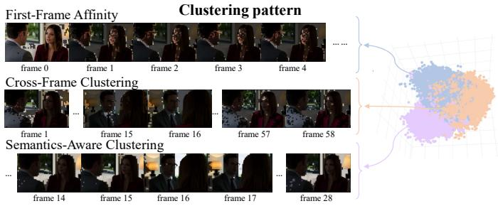  
(a) Clustering of full-memory tokens and representative patterns of selected clusters.

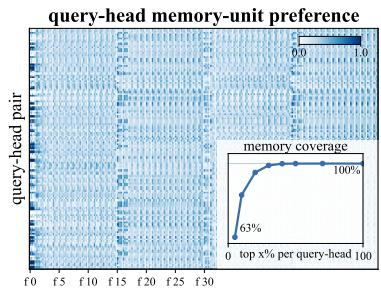  
(b) Heatmap of query-head memory preferences and memory coverage.  
Figure 4: Intrinsic memory-selection patterns under the full-memory setting. Memory tokens exhibit semantically meaningful clustering structures, while different query-head pairs show distinct preferences over memory tokens. Although each query-head pair selects a subset of the most relevant tokens, their union covers nearly the entire memory. See Appendix A for more details.

## 3.4 ONLINE CLUSTERED KV CACHE

To enable fine-grained memory grouping, we introduce an online cluster KV cache. During autoregressive rollout, memory tokens are dynamically grouped according to their cosine similarity, such that semantically related tokens are assigned to the same cluster. This design leverages the semantic coherence within each cluster: tokens relevant to the same query are likely to share similar semantic information, reducing redundant retrieval while improving retrieval effectiveness. To support finegrained query-level retrieval, clustering is performed independently for each attention head. We retain the first and latest chunks as memory anchors. As rollout proceeds, expired adjacent chunks are progressively incorporated into retrieval candidates through online clustering. Specifically, newly introduced tokens are assigned to existing clusters based on centroid similarity, followed by cluster refinement. To maintain balanced and stable clusters during online updates, we introduce several balancing strategies. In particular, over-sized and under-sized clusters are handled through explicit split and merge operations, as illustrated in Figure 3, while cluster assignment is further stabilized by incorporating load penalties and assignment consistency terms into the assignment score, which is formulated as:

$$
z _ { i } = \arg \operatorname* { m a x } _ { c } ( \hat { k } _ { i } ^ { \top } \mu _ { c } - \lambda \phi ( n _ { c } ) + \eta \mathbb { I } [ c = z _ { i } ^ { o l d } ] ) ,\tag{4}
$$

where $\hat { k } _ { i }$ and $\mu _ { c }$ denote the normalized key and centroid of cluster $c ,$ respectively; $\phi ( n _ { c } )$ is the cluster-size penalty, and the last term preserves previous assignments.

Through the online clustered KV cache, CineMem enables semantic-based grouping and establishes a context-aware memory organization strategy. By allowing cross-frame token associations, the proposed memory structure better exploits historical information and aligns with the model’s intrinsic understanding of autoregressive generation, rather than reducing it to a frame-conditioned video extension process. More details are provided in Appendix B.1.

## 3.5 QUERY-LEVEL RETRIEVAL

Considering the heterogeneous memory selection patterns discussed in Section 3.3, we design a query-level retrieval mechanism, specifically query-wise and head-wise retrieval, for fine-grained memory access. Conventional retrieval shares a single historical memory subset across all queries, which cannot capture diverse query and head preferences, causing redundant retrieval of irrelevant tokens and missing relevant historical information. This motivates a more fine-grained retrieval unit. Instead of sharing, we allow each query-head pair to independently select relevant memory from the full history. Combined with the clustered KV cache in Section 3.4, this design enables query-specific access to relevant memory clusters while maintaining the same retrieval budget, substantially expanding effective memory access and approximating full-memory attention under a constrained memory budget. Based on query-centroid similarity, the retrieved memory is formulated as:

$$
\mathcal { M } _ { q , h } = \mathcal { M } _ { \mathrm { f r s t } } \cup \{ ( k _ { i } , v _ { i } ) | z _ { i } \in \mathcal { S } _ { q , h } \} \cup \mathcal { M } _ { \mathrm { l a t e s t } } , \quad \mathcal { S } _ { q , h } = \mathrm { R e t r i e v e } ( q _ { h } , \mathcal { C } _ { h } ) ,\tag{5}
$$

where $q _ { h }$ denotes the query token of head h, C the clustered KV cache, and $\boldsymbol { \mathcal { S } } _ { \boldsymbol { q } , h }$ the selected cluster set. During training, we follow the error simulation mechanism introduced in Section $3 . 2$ and construct KV caches from resampled ground-truth frames under low-level noise, which maintains consistency with the autoregressive adaptation setting, as illustrated in the right part of Figure 3. Further details are provided in Appendix B.2 and Appendix B.3.

Together with the clustered KV cache, query-level retrieval better adapts memory access to the diverse information requirements of individual query tokens, leveraging query-specific preferences and head-specific representations to achieve effective memory retrieval.

## 4 EXPERIMENT

In this section, we present the implementation details, evaluation settings, and experimental results of CineMem. Section 4.1 describes the implementation details and the dataset. Section 4.2 introduces the evaluation protocol and results, and Section 4.3 presents ablation studies, which further validate the effectiveness of our design choices. Additional results are provided in Appendix E.

## 4.1 IMPLEMENTATION DETAILS

We implement CineMem based on Wan2.1-T2V-1.3B (Wan et al., 2025) and train it on 16 NVIDIA H200 GPUs. For the autoregressive adaptation in Section 3.2, we train for 20K steps after teacher forcing warmup, with the timestep shifting factor set to $s = 0 . 6$ for low-level resampling following Guo et al. (2025a). We then train the memory retrieval model for 3K steps with a learning rate of $1 \times 1 0 ^ { - 5 }$ , using flash attn varlen func for efficient variable-length attention. The online clustered KV cache is implemented with K-means-style clustering, with target and maximum cluster sizes of 1,024 and 1,200 tokens, respectively. We retrieve 28 groups per query, approximately matching the attention budget of the original bidirectional model.

We compare the theoretical efficiency with full-history attention and frame-level retrieval in Table 1. The results show that CineMem reduces the overall computation relative to full-history attention while achieving a lower self-attention cost than frame-level retrieval, despite the additional overhead of online clustering. This overhead remains moderate relative to the dominant attention computation, enabling finer-grained and content-adaptive memory access at a competitive computational cost. See Appendix C for detailed analysis.

Dataset. We train on a 45K video dataset constructed from raw movie footage through shottransition detection (Soucek & Lokoc, 2024), stitching (Girdhar et al., 2023), aesthetic filtering (LAION-AI, 2022), OCR filtering, and detailed captioning (Achiam et al., 2023), resulting in a hierarchically annotated multi-shot video dataset.

## 4.2 EVALUATION AND RESULTS

Metrics. To comprehensively evaluate streaming multi-shot video generation, we construct an evaluation set of 100 prompts and establish an evaluation protocol covering video-level, intra-shot-level, and inter-shot-level metrics. Video-level metrics assess fundamental properties of generated videos, including visual aesthetics (LAION-AI, 2022), transition control (Soucek & Lokoc, 2024), and text alignment (Wang et al., 2023), while intra-shot metrics (Oquab et al., 2024; Fu et al., 2023) evaluate consistency within individual shots. More importantly, inter-shot evaluation measures semantic consistency across shot transitions. However, existing similarity-based inter-shot metrics suffer from an inherent ambiguity: a high similarity score may indicate either strong transition consistency or simply the absence of a meaningful transition. Consequently, models with weak transition control may receive deceptively high consistency scores. To address this issue, we introduce a VLM-based metric (Achiam et al., 2023), the Prompt-conditioned Transition-Consistency Score (PTCS), as illustrated in Figure 6. PTCS rewards transitions only when they are successfully executed while preserving the required semantic consistency. PTCS consists of two complementary components:

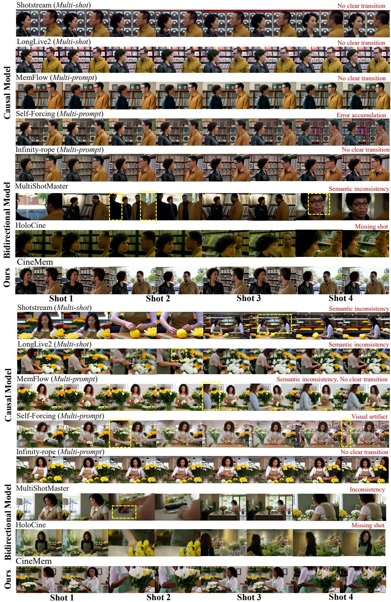  
Figure 5: Qualitative Results. We compare CineMem with representative causal and bidirectional baselines on 15s multi-shot video generation. Representative examples illustrate the qualitative improvements of our method.

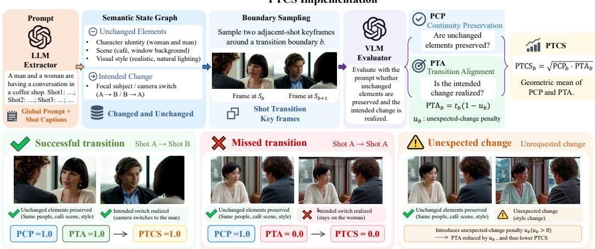  
Figure 6: Implementation of PTCS. PTCS assigns low scores when either unchanged semantic elements are not preserved or intended changes are not correctly realized.

Table 1: Theoretical efficiency comparison. FLOPs are calculated for self-attention and retrievalrelated operations. Collected K/V denotes the logical amount of retrieved memory elements.
<table><tr><td>Method</td><td>Retrieval Overhead (TFLOPs)</td><td>Attention (TFLOPs)</td><td>Total FLOPs (TFLOPs)</td></tr><tr><td>Full history</td><td>0</td><td>932.56</td><td>932.56</td></tr><tr><td>Frame retrieval (K = 20)</td><td>0.0453</td><td>649.97</td><td>650.02</td></tr><tr><td>Cluster retrieval (K = 28, S = 1024)</td><td>15.0180</td><td>623.80</td><td>638.82</td></tr></table>

Prompt-conditioned Continuity Preservation (PCP) and Prompt-conditioned Transition Alignment (PTA). Given a hierarchical prompt, we first construct a semantic state graph to identify the semantic elements that should remain unchanged and those expected to change across the transition. PCP measures whether the required elements are consistently preserved before and after the transition, whereas PTA evaluates whether the intended changes, such as modifications in focal subjects or camera configurations, are correctly realized. For each transition, PTCS is computed as the geometric mean of PCP and PTA and then averaged over the evaluation set. By jointly evaluating unchanged elements and intended changes, PTCS provides a more direct and faithful assessment of inter-shot consistency.

Qualitative Results. Figure 5 presents visual comparisons between CineMem and representative causal and bidirectional baselines. Causal multi-prompt models (Yesiltepe et al., 2026; Ji et al., 2025; Huang et al., 2026), despite using varying prompts to enrich the generated content, often struggle to produce explicit shot transitions under multi-shot conditioning and may introduce visual artifacts. Among causal multi-shot baselines, LongLive2 (Chen et al., 2026b) still exhibits limited transition control, while ShotStream (Luo et al., 2026) tends to lose consistency as the number of shots increases. Notably, we do not include CausalCine (Meng et al., 2026a) in the comparison since its model weights are not publicly available. Instead, we implement a comparable framegrouping strategy with shared retrieval, which is further analyzed in our ablation study. Strong bidirectional baselines (Wang et al., 2026; Meng et al., 2026b) also occasionally suffer from crossshot inconsistency or incorrect shot counts. In contrast, CineMem generates stable multi-shot videos in an autoregressive setting while faithfully following the prescribed transitions and maintaining cross-shot consistency, including challenging revisitation scenarios.

Quantitative Results. Table 2 reports the quantitative comparison on our evaluation set. Cine-Mem achieves strong performance across video-level quality and intra-shot consistency metrics, demonstrating its ability to generate high-quality videos while maintaining stable shot-level content. For inter-shot evaluation, CineMem achieves the best performance on PTCS, which jointly consid ers unchanged elements and intended changes during shot transitions. Notably, models with high similarity-based inter-shot scores or PCP values often exhibit limited transition control, while models specifically designed for multi-shot generation may still receive relatively low scores on these metrics. This indicates that similarity-based or preservation-only metrics can overestimate inter-shot consistency when the intended transition is not properly realized. By explicitly considering both preserved and changing elements specified in the prompt, PTCS provides a more faithful evaluation of transition quality. Finally, CineMem achieves superior PTCS performance and even surpasses larger bidirectional models with substantially more parameters.

Table 2: Quantitative comparison on streaming multi-shot video generation. The best and second-best results are highlighted in bold and underlined, respectively.
<table><tr><td rowspan="2">Method</td><td rowspan="2">Params.</td><td colspan="3">Video-level</td><td colspan="2">Intra-shot</td><td colspan="4">Inter-shot</td></tr><tr><td>Trans. Ctrl. ↑</td><td>Text-Video Sim. ↑</td><td>Aesthetic ↑</td><td>Subject Cons. ↑</td><td>Background Cons. ↑</td><td>Inter-shot Sim. ↑</td><td>PCP↑</td><td>PTA↑</td><td>PTCS ↑</td></tr><tr><td colspan="10">Causal multi-shot models</td></tr><tr><td>LongLive2</td><td>5B</td><td>0.3856</td><td>0.2118</td><td>0.5571</td><td>0.9496</td><td>0.9454</td><td>0.9420</td><td>0.9808</td><td>0.3764</td><td>0.3905</td></tr><tr><td>ShotStream</td><td>1.3B</td><td>0.9080</td><td>0.2207</td><td>0.5776</td><td>0.9571</td><td>0.9616</td><td>0.7409</td><td>0.9501</td><td>0.6756</td><td>0.6917</td></tr><tr><td colspan="10">Causal multi-prompt models</td></tr><tr><td>Infinity-RoPE</td><td>1.3B</td><td>0.0124</td><td>0.2178</td><td>0.5747</td><td>0.9159</td><td>0.9167</td><td>0.9396</td><td>0.9801</td><td>0.3619</td><td>0.3881</td></tr><tr><td>Self-Forcing</td><td>1.3B</td><td>0.1866</td><td>0.2208</td><td>0.5732</td><td>0.9183</td><td>0.9152</td><td>0.9021</td><td>0.9609</td><td>0.2779</td><td>0.2964</td></tr><tr><td>MemFlow</td><td>1.3B</td><td>0.0440</td><td>0.2163</td><td>0.5799</td><td>0.9456</td><td>0.9374</td><td>0.9545</td><td>0.9807</td><td>0.2143</td><td>0.2254</td></tr><tr><td colspan="10">Bidirectional models</td></tr><tr><td>MultiShotMaster</td><td>1.3B</td><td>0.9797</td><td>0.2292</td><td>0.5701</td><td>0.9413</td><td>0.9398</td><td>0.6626</td><td>0.9031</td><td>0.7956</td><td>0.7984</td></tr><tr><td>HoloCine</td><td>14B</td><td>0.9671</td><td>0.2315</td><td>0.5473</td><td>0.9294</td><td>0.9360</td><td>0.7214</td><td>0.9250</td><td>0.7309</td><td>0.7385</td></tr><tr><td>CineMem (Ours)</td><td>1.3B</td><td>0.9960</td><td>0.2336</td><td>0.5779</td><td>0.9716</td><td>0.9630</td><td>0.7598</td><td>0.9270</td><td>0.8004</td><td>0.8242</td></tr></table>

Table 3: Ablation study. The best and runner-up are in bold and underlined. C: clustered KV cache; F: frame grouping; Q-wise: query- and head-wise retrieval; Shared: shared across queries.
<table><tr><td>Method</td><td colspan="5">T-Ctrl ↑ T-V Sim. ↑ Aes. ↑ Intra. ↑ PTCS ↑ Method</td><td></td><td colspan="5">T-Ctrl ↑ T-V Sim. ↑ Aes. ↑ Intra. ↑ PTCS ↑</td></tr><tr><td></td><td colspan="5">Training Strategy</td><td colspan="5">Retrieval Strategy (Plug-in)</td></tr><tr><td>Teacher Forcing</td><td>0.9789</td><td>0.2306</td><td>0.5696</td><td>0.9615</td><td>0.7120</td><td>Full-memory</td><td>0.9983</td><td>0.2337</td><td>0.5776</td><td>0.9640</td><td>0.7922</td></tr><tr><td>Resampled Context</td><td>0.9983</td><td>0.2337</td><td>0.5776</td><td>0.9640</td><td>0.7922</td><td>F + Shared</td><td>0.9949</td><td>0.2379</td><td>0.5746</td><td>0.9643</td><td>0.7280</td></tr><tr><td>Query-level Retrieval Variant</td><td></td><td></td><td></td><td></td><td></td><td>F + Q-wise</td><td>0.9946</td><td>0.2368</td><td>0.5755</td><td>0.9645</td><td>0.7525</td></tr><tr><td>Query-group</td><td>0.9953</td><td>0.2362</td><td>0.5748</td><td>0.9656</td><td>0.8233</td><td>C + Shared</td><td>0.9950</td><td>0.2378</td><td>0.5732</td><td>0.9626</td><td>0.7442</td></tr><tr><td>Query-wise (Ours)</td><td>0.9960</td><td>0.2336</td><td>0.5779</td><td>0.9673</td><td>0.8242</td><td>C + Q-wise (Ours)</td><td>0.9953</td><td>0.2382</td><td>0.5768</td><td>0.9654</td><td>0.8007</td></tr></table>

## 4.3 ABLATION STUDY

To validate the effectiveness of different design choices in CineMem, we conduct ablation studies from three perspectives, with results summarized in Table 3.

Training Strategy. In Section 3.2, we introduce resampled history context to simulate autoregressive error accumulation during training. Compared with the standard teacher-forcing strategy, resampling context training provides more consistent training conditions with autoregressive inference and achieves superior performance across different metrics, especially in long-horizon consistency.

Retrieval Strategy. We analyze different retrieval strategies introduced in Sections 3.4 and 3.5 under a plug-in setting. Specifically, we compare our clustered KV cache and query-wise retrieval with frame-level grouping and shared retrieval. To isolate the effect of retrieval design, we directly apply different strategies to the adapted base model without additional training. As shown, query-wise retrieval consistently improves performance under both frame-level and clustered memory organization, demonstrating the importance of fine-grained memory access. Moreover, clustered KV cache further improves transition quality and inter-shot consistency over frame-level grouping, validating the effectiveness of semantic-based memory organization. Notably, without additional training, our retrieval strategy achieves comparable performance to full-memory attention while obtaining higher inter-shot consistency, demonstrating its effectiveness under a constrained memory budget.

Query-level Retrieval Variant. We investigate a query grouping variant of our retrieval mechanism. Instead of performing independent retrieval for each query, this variant recursively partitions queries into groups according to their spatial and semantic similarity using an adaptive tree structure and shares retrieved memory within each group. Although query grouping provides an effective approximation by exploiting query similarity, it remains slightly inferior to fully query-wise retrieval, further validating the importance of fine-grained query retrieval.

## 5 CONCLUSION

In this paper, we introduce CineMem, a fine-grained memory retrieval framework for autoregressive multi-shot video generation. Combining an online clustered KV cache with query-adaptive retrieval, CineMem enables broader historical access and improves long-range consistency in revisitation scenarios. We develop an autoregressive adaptation framework with resampled context to analyze intrinsic memory-access patterns, revealing semantic clustering among memory tokens and heterogeneous query-head preferences that motivate our design. Extensive experiments demonstrate the effectiveness of our framework. Our results highlight the importance of fine-grained memory modeling for autoregressive video generation. Rather than relying only on recent frames, autoregressive models should exploit information throughout history. Advances in memory organization and retrieval will enable scalable long-horizon video generation.

## REFERENCES

Josh Achiam, Steven Adler, Sandhini Agarwal, Lama Ahmad, Ilge Akkaya, Florencia Leoni Aleman, Diogo Almeida, Janko Altenschmidt, Sam Altman, Shyamal Anadkat, et al. Gpt-4 technical report. arXiv preprint arXiv:2303.08774, 2023.

Andreas Blattmann, Tim Dockhorn, Sumith Kulal, Daniel Mendelevitch, Maciej Kilian, Dominik Lorenz, Yam Levi, Zion English, Vikram Voleti, Adam Letts, et al. Stable video diffusion: Scaling latent video diffusion models to large datasets. arXiv preprint arXiv:2311.15127, 2023.

Jake Bruce, Michael D Dennis, Ashley Edwards, Jack Parker-Holder, Yuge Shi, Edward Hughes, Matthew Lai, Aditi Mavalankar, Richie Steigerwald, Chris Apps, et al. Genie: Generative interactive environments. In Forty-first international conference on machine learning, 2024.

Boyuan Chen, Diego Mart´ı Monso, Yilun Du, Max Simchowitz, Russ Tedrake, and Vincent Sitz-´ mann. Diffusion forcing: Next-token prediction meets full-sequence diffusion. Advances in Neural Information Processing Systems, 37:24081–24125, 2024.

Jingxi Chen, Zongxia Li, Zhichao Liu, Guangyao Shi, Xiyang Wu, Fuxiao Liu, Cornelia Fermuller,¨ Brandon Y Feng, and Yiannis Aloimonos. First frame is the place to go for video content customization. In Proceedings of the IEEE/CVF Conference on Computer Vision and Pattern Recognition, pp. 9243–9252, 2026a.

Yukang Chen, Luozhou Wang, Wei Huang, Shuai Yang, Bohan Zhang, Yicheng Xiao, Ruihang Chu, Weian Mao, Qixin Hu, Shaoteng Liu, et al. Longlive-2.0: An nvfp4 parallel infrastructure for long video generation. arXiv preprint arXiv:2605.18739, 2026b.

Jiaxing Cui, Jie Wu, Ming Li, Tao Yang, Xiaojie Li, Rui Wang, Andrew Bai, Yuanhao Ban, and Cho-Jui Hsieh. Self-forcing++: Towards minute-scale high-quality video generation. In International Conference on Learning Representations, volume 2026, pp. 85802–85822, 2026.

Stephanie Fu, Netanel Tamir, Shobhita Sundaram, Lucy Chai, Richard Zhang, Tali Dekel, and Phillip Isola. Dreamsim: Learning new dimensions of human visual similarity using synthetic data. In Neural Information Processing Systems, volume 36, pp. 50742–50768, 2023.

Kaifeng Gao, Jiaxin Shi, Hanwang Zhang, Chunping Wang, and Jun Xiao. Vid-gpt: Introducing gpt-style autoregressive generation in video diffusion models. arXiv preprint arXiv:2406.10981, 2024.

Rohit Girdhar, Alaaeldin El-Nouby, Zhuang Liu, Mannat Singh, Kalyan Vasudev Alwala, Armand Joulin, and Ishan Misra. Imagebind: One embedding space to bind them all. In Computer Vision and Pattern Recognition, pp. 15180–15190, 2023.

Yuwei Guo, Ceyuan Yang, Hao He, Yang Zhao, Meng Wei, Zhenheng Yang, Weilin Huang, and Dahua Lin. End-to-end training for autoregressive video diffusion via self-resampling. arXiv preprint arXiv:2512.15702, 2025a.

Yuwei Guo, Ceyuan Yang, Ziyan Yang, Zhibei Ma, Zhijie Lin, Zhenheng Yang, Dahua Lin, and Lu Jiang. Long context tuning for video generation. arXiv preprint arXiv:2503.10589, 2025b.

Yingqing He, Menghan Xia, Haoxin Chen, Xiaodong Cun, Yuan Gong, Jinbo Xing, Yong Zhang, Xintao Wang, Chao Weng, Ying Shan, et al. Animate-a-story: Storytelling with retrievalaugmented video generation. arXiv preprint arXiv:2307.06940, 2023.

Jonathan Ho, Ajay Jain, and Pieter Abbeel. Denoising diffusion probabilistic models. In Neural Information Processing Systems, volume 33, pp. 6840–6851, 2020.

Qixin Hu, Shuai Yang, Wei Huang, Song Han, and Yukang Chen. Longlive-rag: A general retrievalaugmented framework for long video generation. arXiv preprint arXiv:2606.02553, 2026.

Xun Huang, Zhengqi Li, Guande He, Mingyuan Zhou, and Eli Shechtman. Self forcing: Bridging the train-test gap in autoregressive video diffusion. Advances in Neural Information Processing Systems, 38:167283–167308, 2026.

Sihui Ji, Xi Chen, Shuai Yang, Xin Tao, Pengfei Wan, and Hengshuang Zhao. Memflow: Flowing adaptive memory for consistent and efficient long video narratives. arXiv preprint arXiv:2512.14699, 2025.

Weinan Jia, Yuning Lu, Mengqi Huang, Hualiang Wang, Binyuan Huang, Nan Chen, Jidong Jiang, Zhendong Mao, et al. Moga: Mixture-of-groups attention for end-to-end long video generation. In International Conference on Learning Representations, volume 2026, pp. 115944–115964, 2026.

LAION-AI. aesthetic-predictor. https://github.com/LAION-AI/aesthetic-predictor, 2022.

Yaron Lipman, Ricky TQ Chen, Heli Ben-Hamu, Maximilian Nickel, and Matt Le. Flow matching for generative modeling. arXiv preprint arXiv:2210.02747, 2022.

Guangda Liu, Chengwei Li, Jieru Zhao, Chenqi Zhang, and Minyi Guo. Clusterkv: Manipulating llm kv cache in semantic space for recallable compression. In 2025 62nd ACM/IEEE Design Automation Conference (DAC), pp. 1–7. IEEE, 2025.

Kunhao Liu, Wenbo Hu, Jiale Xu, Ying Shan, and Shijian Lu. Rolling forcing: Autoregressive long video diffusion in real time. In International Conference on Learning Representations, volume 2026, pp. 91177–91196, 2026a.

Wei Liu, Ziyu Chen, Zizhang Li, Yue Wang, Hong-Xing Yu, and Jiajun Wu. Realwonder: Real-time physical action-conditioned video generation. arXiv preprint arXiv:2603.05449, 2026b.

Xiang Liu, Zhenheng Tang, Peijie Dong, Zeyu Li, Bo Li, Xuming Hu, and Xiaowen Chu. Chunkkv: Semantic-preserving kv cache compression for efficient long-context llm inference. Advances in Neural Information Processing Systems, 38:28728–28778, 2026c.

Fuchen Long, Zhaofan Qiu, Ting Yao, and Tao Mei. Videostudio: Generating consistent-content and multi-scene videos. In European Conference on Computer Vision, pp. 468–485. Springer, 2024.

Yawen Luo, Xiaoyu Shi, Junhao Zhuang, Yutian Chen, Quande Liu, Xintao Wang, Pengfei Wan, and Tianfan Xue. Shotstream: Streaming multi-shot video generation for interactive storytelling. arXiv preprint arXiv:2603.25746, 2026.

Yihao Meng, Zichen Liu, Hao Ouyang, Qiuyu Wang, Ka Leong Cheng, Yue Yu, Hanlin Wang, Haobo Li, Jiapeng Zhu, Yanhong Zeng, et al. Causalcine: Real-time autoregressive generation for multi-shot video narratives. arXiv preprint arXiv:2605.12496, 2026a.

Yihao Meng, Hao Ouyang, Yue Yu, Qiuyu Wang, Wen Wang, Ka Leong Cheng, Hanlin Wang, Shuailei Ma, Yixuan Li, Cheng Chen, et al. Holocine: Holistic generation of cinematic multishot long video narratives. In Proceedings of the IEEE/CVF conference on computer vision and pattern recognition, pp. 461–471, 2026b.

Maxime Oquab, Timothee Darcet, Th´ eo Moutakanni, Huy Vo, Marc Szafraniec, Vasil Khalidov,´ Pierre Fernandez, Daniel Haziza, Francisco Massa, Alaaeldin El-Nouby, et al. Dinov2: Learning robust visual features without supervision. Transactions on Machine Learning Research Journal, pp. 1–31, 2024.

William Peebles and Saining Xie. Scalable diffusion models with transformers. In 2023 IEEE/CVF International Conference on Computer Vision (ICCV), pp. 4172–4182. IEEE, 2023.

Tianhao Qi, Jianlong Yuan, Wanquan Feng, Shancheng Fang, Jiawei Liu, SiYu Zhou, Qian He, Hongtao Xie, and Yongdong Zhang. Maskˆ 2dit: Dual mask-based diffusion transformer for multi-scene long video generation. In Proceedings of the Computer Vision and Pattern Recognition Conference, pp. 18837–18846, 2025.

Robin Rombach, Andreas Blattmann, Dominik Lorenz, Patrick Esser, and Bjorn Ommer. High- ¨ resolution image synthesis with latent diffusion models. In Computer Vision and Pattern Recognition, pp. 10684–10695, 2022.

Yang Song, Jascha Sohl-Dickstein, Diederik P Kingma, Abhishek Kumar, Stefano Ermon, and Ben Poole. Score-based generative modeling through stochastic differential equations. arXiv preprint arXiv:2011.13456, 2020.

Tomas Soucek and Jakub Lokoc. Transnet v2: An effective deep network architecture for fast shot´ transition detection. In ACM International Conference on Multimedia, pp. 11218–11221, 2024.

Ashish Vaswani, Noam Shazeer, Niki Parmar, Jakob Uszkoreit, Llion Jones, Aidan N Gomez, Łukasz Kaiser, and Illia Polosukhin. Attention is all you need. In Neural Information Processing Systems, volume 30, 2017.

Team Wan, Ang Wang, Baole Ai, Bin Wen, Chaojie Mao, Chen-Wei Xie, Di Chen, Feiwu Yu, Haiming Zhao, Jianxiao Yang, et al. Wan: Open and advanced large-scale video generative models. arXiv preprint arXiv:2503.20314, 2025.

Qinghe Wang, Xiaoyu Shi, Baolu Li, Weikang Bian, Quande Liu, Huchuan Lu, Xintao Wang, Pengfei Wan, Kun Gai, and Xu Jia. Multishotmaster: A controllable multi-shot video generation framework. In Proceedings of the IEEE/CVF Conference on Computer Vision and Pattern Recognition, pp. 16268–16278, 2026.

Yi Wang, Yinan He, Yizhuo Li, Kunchang Li, Jiashuo Yu, Xin Ma, Xinhao Li, Guo Chen, Xinyuan Chen, Yaohui Wang, et al. Internvid: A large-scale video-text dataset for multimodal understanding and generation. arXiv preprint arXiv:2307.06942, 2023.

Xiaoxue Wu, Xinyuan Chen, Yaohui Wang, and Yu Qiao. Shotdirector: Directorially controllable multi-shot video generation with cinematographic transitions. In Proceedings of the IEEE/CVF Conference on Computer Vision and Pattern Recognition, pp. 2079–2089, 2026a.

Xiaoxue Wu, Bingjie Gao, Yu Qiao, Yaohui Wang, and Xinyuan Chen. Cinetrans: Learning to generate videos with cinematic transitions via masked diffusion models. In International Conference on Learning Representations, volume 2026, pp. 60198–60230, 2026b.

Zhifei Xie, Daniel Tang, Dingwei Tan, Jacques Klein, Tegawend F Bissyand, and Saad Ezzini. Dreamfactory: Pioneering multi-scene long video generation with a multi-agent framework. arXiv preprint arXiv:2408.11788, 2024.

Shuai Yang, Wei Huang, Ruihang Chu, Yicheng Xiao, Yuyang Zhao, Xianbang Wang, Muyang Li, Enze Xie, Yingcong Chen, Yao Lu, et al. Longlive: Real-time interactive long video generation. arXiv preprint arXiv:2509.22622, 2025.

Hidir Yesiltepe, Tuna Meral, Adil Kaan Akan, Kaan Oktay, and Pinar Yanardag. Infinity-rope: Action-controllable infinite video generation emerges from autoregressive self-rollout. In Proceedings ofthe IEEE/CVF Conference on Computer Vision and Pattern Recognition, pp. 40256– 40265, 2026.

Tianwei Yin, Qiang Zhang, Richard Zhang, William T Freeman, Fredo Durand, Eli Shechtman, and Xun Huang. From slow bidirectional to fast autoregressive video diffusion models. In 2025 IEEE/CVF Conference on Computer Vision and Pattern Recognition (CVPR), pp. 22963–22974. IEEE, 2025.

Lin Zhao, Yushu Wu, Yifan Gong, Yanzhi Wang, and Pu Zhao. Omnimem: Scalable and adaptive memory retrieval for long video generation. arXiv preprint arXiv:2605.30519, 2026.

Mingzhe Zheng, Yongqi Xu, Haojian Huang, Xuran Ma, Yexin Liu, Wenjie Shu, Yatian Pang, Feilong Tang, Qifeng Chen, Harry Yang, et al. Videogen-of-thought: A collaborative framework for multi-shot video generation. arXiv preprint arXiv:2412.02259, 2024.

Hongzhou Zhu, Min Zhao, Guande He, Hang Su, Chongxuan Li, and Jun Zhu. Causal forcing: Autoregressive diffusion distillation done right for high-quality real-time interactive video generation. arXiv preprint arXiv:2602.02214, 2026.

Yuxuan Zhu, Ali Falahati, David H Yang, and Mohammad Mohammadi Amiri. Sentencekv: Efficient llm inference via sentence-level semantic kv caching. arXiv preprint arXiv:2504.00970, 2025.

## CONTENTS

1 Introduction 2   
2 Related Work 3   
3 Method 4   
3.1 Preliminary 4   
3.2 Long-Horizon Autoregressive Adaptation 4   
3.3 Memory Selection in Attention Module 5   
3.4 Online Clustered KV Cache 6   
3.5 Query-level Retrieval 6   
4 Experiment 7   
4.1 Implementation details 7   
4.2 Evaluation and Results 7   
4.3 Ablation Study 10   
5 Conclusion 11   
A Details of Memory-Access Pattern 16   
A.1 Heterogeneous Query and Head Memory Preferences 16   
A.2 Pre-RoPE Clustering vs. Post-RoPE Clustering 19   
A.3 Retrieval Alignment with Full-Memory Attention 20   
B Details of Methodology 21   
B.1 Online Clustered KV Cache 21   
B.2 Query-adaptive Retrieval 23   
B.3 Training with Memory Retrieval Mechanism . 24   
C Analysis of Efficiency 26   
D Details of Evaluation 27   
D.1 Implementation of Metrics 27   
D.2 The effectiveness of Prompt-conditioned Transition-Consistency Score . 28   
E Additional Results 28   
E.1 Qualitative Results of Ablation Study 28   
E.2 Fine-Grained Analysis of Generation Quality 31   
E.3 Longer Video Generation . 32   
F Limitation and Failure Case 33   
G Future Work 33

## A DETAILS OF MEMORY-ACCESS PATTERN

In this section, we provide further analysis of the memory selection patterns discussed in Section 3.3. Figure 4b presents the heatmaps of query-head memory preferences and the resulting memory coverage achieved by selecting different percentages of memory tokens for each query-head pair. The query-head pairs shown in the figure are randomly sampled for visualization. In Section A.1, we provide a more comprehensive analysis to demonstrate the heterogeneous memory selection behaviors across queries and attention heads. Section A.2 investigates the clustering behaviors before and after positional encoding, providing further evidence for our memory organization design. Finally, Section A.3 analyzes the retrieval overlap between CineMem and full-memory attention, demonstrating that our proposed memory access mechanism can effectively approximate full-memory access patterns during autoregressive rollout.

## A.1 HETEROGENEOUS QUERY AND HEAD MEMORY PREFERENCES

In Figure 4b, we provide an overall visualization of the heterogeneous memory selection behaviors across queries and attention heads. The memory coverage curve shows that when each query-head pair selects only the top 30% memory tokens with the highest attention probabilities, the aggregated receptive field can cover nearly all historical memory frames. In the heatmap, each row corresponds to a query-head pair, while each column represents a spatial memory unit from a historical frame. Specifically, each frame is divided into $2 \times 2$ spatial regions, resulting in four memory units per frame. The color intensity indicates the ratio of selected tokens within each memory unit among the top 30% tokens selected by the corresponding query-head pair, reflecting its preference over different historical regions. Due to the large number of query-head pairs, only a subset of rows is randomly sampled for visualization while preserving all historical memory units, providing an overview of the selection patterns.

Although the differences among highlighted regions across rows in Figure 4b already reveal the existence of heterogeneous memory selection over the entire history sequence, the diversity of query preferences is also manifested within individual memory frames. However, the $2 \times 2$ spatial partition provides only a coarse characterization of such intra-frame variations. To further analyze fine-grained spatial selection behaviors, we focus on two representative memory frames, adopt a finer-grained memory unit partition, and provide additional visualizations of query-specific and head-specific memory preferences.

We first focus on the heterogeneous memory selection behaviors across different queries. In Figure 7, we analyze how query tokens from the current chunk attend to local regions within historical memory frames. We select representative memory frames from different shots and visualize the spatial preferences of different queries. In contrast to Figure 4b, where each frame is aggregated into four coarse spatial regions using a $2 \times 2$ partition, here we adopt a finer token-level visualization by grouping neighboring $3 \times 3$ spatial tokens into individual memory units. The visualization reveals clear differences in the memory preferences of different queries, even within the same historical frame. This indicates that heterogeneous memory selection is not only manifested across different frames in the entire memory sequence, but also exists among local spatial regions within a single frame. These observations further demonstrate the necessity of fine-grained memory retrieval.

To further investigate the diversity of memory selection across attention heads, we conduct the same analysis from the head-wise perspective and visualize the results in Figure 8. For different attention heads, we show their attention probabilities over two selected memory frames and observe substantial variations in their selection patterns. Consistent with the motivation of multi-head attention (Vaswani et al., 2017), different heads focus on different types of information and thus play distinct roles in memory selection. These observations further support the necessity of independent retrieval across attention heads.

Finally, the lower-right inset of Figure 4b provides the memory coverage curve for query-head-wise retrieval. To further characterize the heterogeneous preferences of queries and attention heads, we analyze memory coverage and retrieval overlap ratio from the query-wise and head-wise perspectives, as shown in Figure 9. We observe that query-head-wise retrieval achieves the largest memory coverage, while separating query-wise and head-wise selection reveals stronger diversity among attention heads. Specifically, head-wise retrieval exhibits faster coverage growth and lower over lap ratios compared with query-wise retrieval, indicating more diverse memory preferences across attention heads and further motivating independent head-wise retrieval.

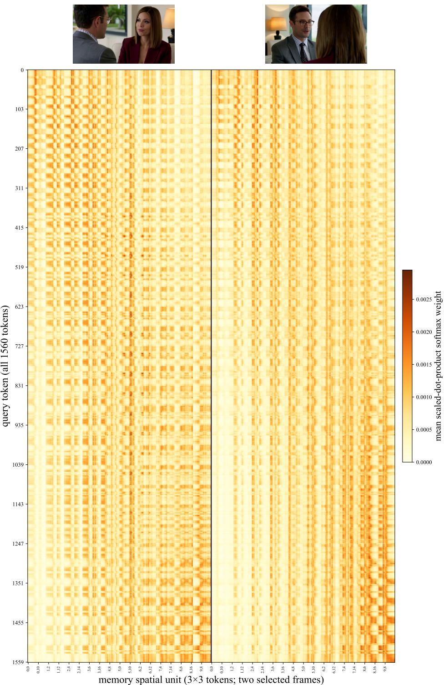  
Figure 7: Visualization of query-wise memory selection diversity. For the selected memory frames, different queries exhibit distinct spatial preferences within the same frame, revealing heterogeneous memory selection behaviors. Each query corresponds to the first latent of the current chunk, and each memory unit is formed by grouping neighboring 3 × 3 spatial tokens.

Head-wise query-to-memory attention  
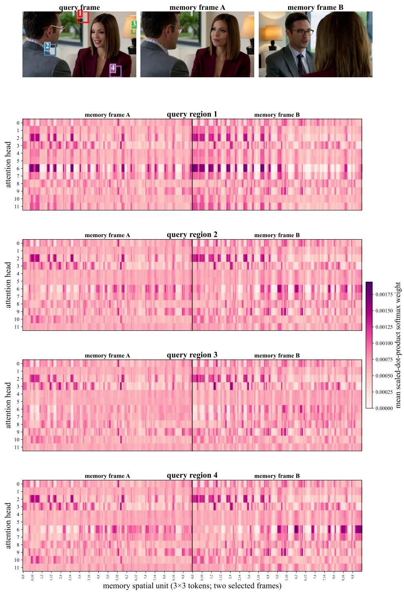  
Figure 8: Visualization of head-wise memory selection diversity. For the selected memory frames, different attention heads exhibit distinct memory preferences. We visualize multiple query regions for generality. The variations among highlighted regions across rows in each heatmap illustrate the diversity of head-wise memory selection.

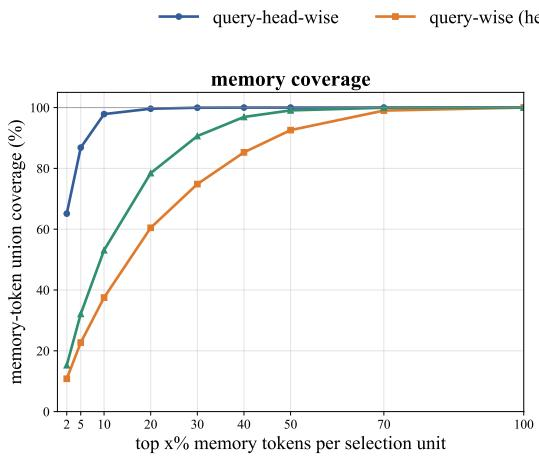

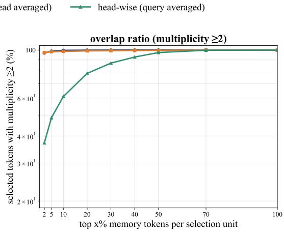  
Figure 9: Comparison of memory-token coverage and selection overlap under three selection granularities: query-head-wise, query-wise with head averaging, and head-wise with query averaging. The horizontal axis denotes the fraction of memory tokens selected by each selection unit. The left panel reports the percentage of distinct memory-token positions covered by the union of all selections, while the right panel shows the percentage of selected positions with multiplicity at least two.

Post-RoPE Clustering  
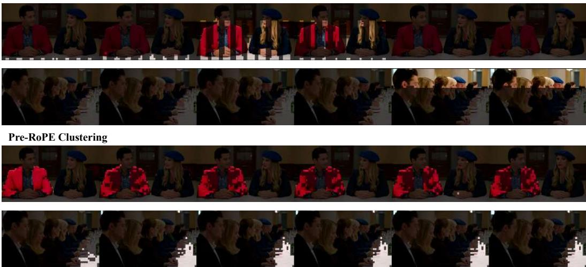  
Figure 10: Visualization of token clustering before and after RoPE. Compared with Pre-RoPE representations, Post-RoPE similarities exhibit stronger positional dependency and weaker semantic clustering structures.

In general, these analyses provide further evidence for heterogeneous query and head memory preferences, which motivate the design of query-wise and head-wise retrieval in CineMem.

## A.2 PRE-ROPE CLUSTERING VS. POST-ROPE CLUSTERING

In Section 3.4, we introduce an online clustering mechanism to organize memory tokens into semantic groups rather than predefined frame-based partitions. In practice, before entering each transformer block, token representations are augmented with positional encoding. Our clustering and retrieval operations are therefore performed before RoPE (Pre-RoPE). This design choice is moti-

# Memory retrieval strategy comparison

CineMem Frame-group + Shared-Retrieval Frame-group + Query&Head-wise-Retrieval Sliding Window

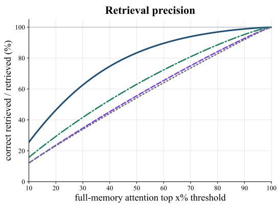

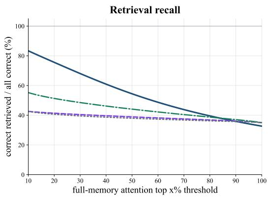  
Figure 11: Precision (left) and recall (right) of different retrieval strategies under varying fullmemory attention thresholds. For each query-head pair, full-memory attention serves as the oracle, and retrieved tokens are considered matched if they fall within the $\mathrm { t o p } { - } x \%$ oracle-ranked memory tokens. Online-clustered KV cache retrieves tokens from query-specific selected clusters, while Latent-group, Frame-group, and Sliding Window perform frame-level or fixed-context retrieval. All curves are averaged over attention blocks. Online-clustered KV cache achieves a better precision-recall trade-off, providing a selective approximation to full-memory access.

vated by the observation that positional encoding introduces strong absolute position information into token representations, which can obscure semantic similarity and weaken semantic clustering structures.

In fact, the visualization in Figure 4a is obtained using token representations before positional encoding. To further investigate this effect, Figure 10 presents representative clustering results before and after applying RoPE. We observe that RoPE-transformed tokens exhibit stronger position-dependent similarity patterns, while the semantic grouping structure becomes less apparent. Therefore, performing clustering and retrieval after positional encoding may bias memory organization toward positional grouping and degrade into a behavior similar to frame-level partitioning, limiting the benefits of semantic-aware memory organization. These observations support our choice of conducting clustering and retrieval in the Pre-RoPE space.

## A.3 RETRIEVAL ALIGNMENT WITH FULL-MEMORY ATTENTION

Our retrieval mechanism aims to approximate the memory access pattern of full-memory attention under a constrained retrieval budget. To further evaluate this property, we analyze retrieval alignment from the perspective of full-memory attention. Specifically, we treat full-memory attention as an oracle: for each query-head pair, memory tokens are ranked according to their attention scores, and highly attended tokens are regarded as the oracle retrieval targets.

We compare different retrieval strategies under varying selection thresholds. A retrieved token is considered matched if it belongs to the top-x% memory tokens ranked by the full-memory attention distribution, where the ranking is determined by the corresponding query-key similarity using normalized dot products. We report precision, defined as the proportion of retrieved tokens overlapping with the oracle top-x% set, and recall, defined as the proportion of oracle top-x% tokens successfully recovered by the retrieval strategy:

$$
\mathcal { O } _ { q , h } ^ { x } = \mathrm { T o p } _ { x \mathcal { I } _ { 0 } } \left( A _ { q , h } ^ { \mathrm { f u l l } } \right) , \quad P _ { x } = \frac { \left| \mathcal { R } _ { q , h } \cap \mathcal { O } _ { q , h } ^ { x } \right| } { \left| \mathcal { R } _ { q , h } \right| } , \quad R _ { x } = \frac { \left| \mathcal { R } _ { q , h } \cap \mathcal { O } _ { q , h } ^ { x } \right| } { \left| \mathcal { O } _ { q , h } ^ { x } \right| } ,\tag{6}
$$

where $A _ { q , h } ^ { \mathrm { f u l l } }$ denotes the full-memory attention distribution of query-head pair $( q , h ) , \mathcal { O } _ { q , h } ^ { x }$ represents the oracle $\mathrm { t o p } { - } x \%$ memory tokens, and $\mathcal { R } _ { q , h }$ denotes the tokens retrieved by a given strategy. Both metrics are computed independently for each query-head pair and then averaged across query-head pairs and attention blocks.

As shown in Figure 11, CineMem achieves consistently higher precision than frame-level grouping and sliding-window retrieval across almost the entire threshold range. It also achieves higher recall in the low-to-moderate threshold regime, indicating that it can recover a larger fraction of highly relevant memory tokens while introducing fewer irrelevant tokens. At very high thresholds, the recall of the online-clustered KV cache becomes slightly lower than fixed-budget baselines. This behavior does not indicate inferior retrieval quality. When $x = 1 0 0 \%$ , the oracle set contains all memory tokens, and recall mainly reflects the proportion of memory tokens retrieved. Fixed-budget baselines always retrieve a predetermined number of tokens, whereas the online-clustered KV cache adaptively retrieves a compact set of relevant clusters. Therefore, the reduced recall at large x reflects a smaller and less redundant retrieval set rather than a failure to identify important memory information.

Overall, these results demonstrate that CineMem provides a more selective approximation to fullmemory attention, achieving a better precision-recall trade-off while preserving access to highly relevant historical information.

## B DETAILS OF METHODOLOGY

In this section, we provide additional details of the retrieval mechanisms introduced in Section 3.4 and Section 3.5, including the implementation of the clustered KV cache and query-adaptive retrieval. We further describe the post-training procedure for adapting the model with the proposed retrieval framework.

## B.1 ONLINE CLUSTERED KV CACHE

We provide additional implementation details of the online-clustered KV cache introduced in Section 3.4. The cache is maintained independently for each transformer block, attention head, and classifier-free guidance branch. For each attention head $h ,$ the clustered historical memory is represented as:

$$
\mathcal C _ { h } = \{ ( k _ { i } , v _ { i } , z _ { i } ) \} _ { i = 1 } ^ { T } ,\tag{7}
$$

where $k _ { i }$ and $v _ { i }$ denote the key and value of the i-th historical memory token, and $z _ { i }$ denotes its cluster assignment. Each active cluster c maintains its token count $n _ { c } ,$ , accumulated key vector $s _ { c } .$ and normalized centroid:

$$
\mu _ { c } = \frac { s _ { c } } { \| s _ { c } \| _ { 2 } } .\tag{8}
$$

The KV tensors are stored separately from cluster metadata. Specifically, pre-RoPE keys are used for semantic clustering and query routing, while the corresponding post-RoPE keys are retained for final attention computation.

The complete online update procedure is summarized in Algorithm 1. Below, we provide additional details of each step.

Algorithm 1 Online Update Procedure of the Head-wise Clustered KV Cache   
Require: Existing cache $\mathcal { C } _ { h }$ , newly generated key-value chunk $( K _ { \mathrm { n e w } } , V _ { \mathrm { n e w } } )$ , target cluster size $S ,$   
and maximum cluster size Smax   
Ensure: Updated clustered cache $\mathcal { C } _ { h }$ and routing metadata   
1: If adjacent-frame retention is enabled, move the newest latent frame to the recent-memory   
buffer and append the remaining keys and values to the clusterable cache   
2: Normalize the clusterable keys independently for head h to obtain $\hat { K }$   
3: if $\mathcal { C } _ { h }$ is empty then   
4: Set $G _ { 0 } \gets \operatorname* { m a x } ( 1 , \lceil \lvert \hat { K } \rvert / S \rceil )$   
5: Select $G ^ { \star }$ diverse seeds from $\hat { K }$ using farthest-point sampling   
6: Assign every token to its most similar seed and run several Lloyd refinement iterations   
7: else   
8: Append the new keys and values to $\mathcal { C } _ { h }$   
9: Compute $G ^ { \star } \gets \lceil \rceil \dot { \mathcal { C } } _ { h } \vert _ { \mathrm { t o k e n } } / S \rceil$   
10: Activate additional cluster slots when the current number of clusters is smaller than $G ^ { \star }$   
11: Seed new clusters with low-similarity new tokens using farthest-point sampling   
12: Assign new tokens according to Equation 4, using the load penalty and assignment   
consistency term   
13: Recompute cluster sums, counts, centroids, and assignments over all tokens in $\mathcal { C } _ { h }$   
14: Run global Lloyd refinement for a fixed number of iterations   
15: end if   
16: for each split pass do   
17: if there exists a cluster c with $n _ { c } > S _ { \operatorname* { m a x } }$ then   
18: Select the least similar token in c as a child-cluster seed   
19: Partition the members of c into two balanced subsets   
20: Recompute statistics and refine the assignments   
21: end if   
22: end for   
23: for each merge pass do   
24: if the number of active clusters exceeds $G ^ { \star }$ then   
25: Select the smallest cluster as a donor   
26: Find the most similar compatible target cluster whose merged size does not exceed $S _ { \mathrm { m a x } }$   
27: Merge the donor into the target and recompute cluster statistics   
28: end if   
29: end for   
30: Reorder the historical keys and values by cluster assignment independently for each head   
31: Compute cumulative cluster offsets and compact active-cluster metadata   
32: return $\mathcal { C } _ { h }$

Initialization. At the beginning of rollout, the cache is empty. When the first generated chunk becomes available, its keys are normalized independently for each attention head and initialized into clusters. Given $T _ { 0 }$ available memory tokens and target cluster size S, the initial number of clusters is:

$$
G _ { 0 } = \operatorname* { m a x } \left( 1 , \left\lceil \frac { T _ { 0 } } { S } \right\rceil \right) .\tag{9}
$$

In our implementation, $S = 1 0 2 4$ . Initial centroids are selected using farthest-point sampling to provide diverse seeds in the key space, followed by several Lloyd refinement iterations.

Online Cluster Assignment. After each generated chunk, newly generated key-value pairs are appended to the persistent cache. When adjacent-frame retention is enabled, the newest latent frame is temporarily maintained in a separate recent-memory buffer. During the next update, the previous recent frame is incorporated into clusterable memory, while the newest frame remains directly accessible. This implements the latest-memory anchor in Equation 5. The initial chunk is never removed from the historical cache and remains available throughout the rollout.

For each newly appended token, cluster assignment is determined by the cosine similarity between its normalized key and active cluster centroids. The assignment rule in Equation 4 is implemented

as:

$$
z _ { i } = \arg \operatorname* { m a x } _ { c } \left( \hat { k } _ { i } ^ { \top } \mu _ { c } - \lambda \mathrm { c l i p } \left( \operatorname* { m a x } \left( \frac { n _ { c } } { S } - 1 , 0 \right) , 0 , 1 \right) + \eta \mathbb { I } [ c = z _ { i } ^ { \mathrm { o l d } } ] \right) ,\tag{10}
$$

where $\lambda = 0 . 0 2$ and $\eta = 0 . 0 2$ . The load penalty discourages assignments to clusters exceeding the target size, while the consistency term stabilizes assignments during online refinement.

Dynamic Cluster Maintenance. As autoregressive rollout proceeds, the number of historical memory tokens continuously increases. Maintaining a fixed number of clusters would enlarge the average cluster size and reduce the semantic coherence of cluster-level retrieval. Therefore, we dynamically adjust the number of active clusters according to the target cluster size S.

Given $T$ clusterable historical tokens, the desired number of active clusters is

$$
G ^ { \star } = \left\lceil { \frac { T } { S } } \right\rceil .\tag{11}
$$

Here, $G ^ { \star }$ represents a target cluster count rather than a strict upper bound. The number of active clusters may temporarily exceed this value after split operations and is reduced through subsequent capacity-aware merging.

When newly generated tokens arrive, additional clusters are activated only when the current number of clusters is smaller than $G ^ { \star }$ . New centroids are initialized using farthest-point sampling from tokens with low similarity to existing centroids. The number of newly activated clusters is constrained by available cluster slots, the number of new tokens, and the per-update activation limit. After assignment, cluster statistics are recomputed over all historical tokens, and global refinement is performed, allowing previous tokens to change assignments when the centroid configuration changes.

Cluster Balancing and Retrieval Preparation. To avoid highly imbalanced clusters, we further apply explicit split and merge operations as shown in Figure 3. A cluster is considered over-sized when its occupancy exceeds $S _ { \mathrm { m a x } } ~ = ~ 1 2 0 0$ Such a cluster is split by selecting its least similar token as a new seed and partitioning the original members into two approximately balanced subsets, followed by additional Lloyd refinement. If the number of active clusters is larger than $G ^ { \star }$ , the smallest compatible cluster is merged into the most similar neighboring cluster, provided that the resulting cluster does not exceed $\bar { S } _ { \operatorname* { m a x } }$ . The complete online update procedure is summarized in Algorithm 1.

To avoid highly imbalanced clusters, we apply explicit split and merge operations as illustrated in Figure 3. A cluster is considered oversized when its occupancy exceeds $\bar { S } _ { \operatorname* { m a x } } = 1 2 0 0$ . Such clusters are split by selecting the least similar token as a new seed and partitioning the cluster members into two approximately balanced subsets, followed by additional Lloyd refinement. When the number of active clusters exceeds $G ^ { \star }$ , the smallest compatible cluster is merged into its most similar neighboring cluster, provided that the resulting cluster size does not exceed $S _ { \mathrm { m a x } }$

After the update, tokens are reordered according to their cluster labels independently for each head, making tokens within the same cluster contiguous in memory. The implementation additionally maintains cumulative offsets, compact centroid tensors, active-cluster masks, and mappings between compact cluster indices and original cluster slots. These structures allow retrieval to gather complete clusters efficiently without scanning the entire historical KV cache.

## B.2 QUERY-ADAPTIVE RETRIEVAL

The query-adaptive retrieval module is implemented within each attention layer. Let the current chunk contain $\bar { L }$ query tokens. The projected query tensor has shape $[ B , L , H , \dot { D } ]$ , where H denotes the number of attention heads. For each query position $\ell$ and head $h ,$ the normalized query is compared with the compact centroids of the corresponding clustered cache:

$$
r _ { \ell , h , c } = \mathrm { N o r m a l i z e } ( q _ { \ell , h } ) ^ { \top } \mu _ { h , c } .\tag{12}
$$

The active clusters with the highest scores are selected independently for each query-head pair:

$$
\begin{array} { r } { S _ { q , h } = \mathrm { T o p K } _ { c } \left( r _ { \ell , h , c } \right) . } \end{array}\tag{13}
$$

This implements the retrieval operation defined in Equation 5.

The routing decision is performed using pre-RoPE queries and normalized cluster centroids. The selected clusters are then used to gather the corresponding historical keys and values from the reordered cache. The retrieved pre-RoPE keys are transformed with positional encoding to obtain post-RoPE keys for final attention computation. Therefore, semantic routing is performed in a position-independent representation space, while positional information is preserved during attention calculation.

If the total number of historical tokens is smaller than the retrieval budget, selective routing is bypassed and full historical attention is applied. Otherwise, the selected cluster indices form a routing tensor of shape $[ B , H , L , K _ { \mathrm { r e t } } ]$ . The retrieved memory corresponds to Equation 5, where the first and latest terms represent the retained boundary context, and the middle term is assembled from clusters selected specifically for each query-head pair.

For computational efficiency, attention computation is divided into two branches. The first branch performs attention over the current chunk and the directly retained recent memory. The second branch applies FlashAttention to the historical tokens gathered from the selected clusters. The selected-cluster outputs are combined using their log-sum-exp normalization and merged with the current-chunk branch using the corresponding attention normalizers. Thus, retrieved memory is integrated within the original attention normalization rather than introduced as an independent residual feature.

The clustered cache is updated only after a generated chunk completes its denoising trajectory. Conditional and unconditional caches are maintained separately for classifier-free guidance, and the same query-head-wise retrieval procedure is applied to both branches. During subsequent denoising steps, each query-head pair can therefore access a different subset of historical clusters, while the current chunk remains fully accessible.

## B.3 TRAINING WITH MEMORY RETRIEVAL MECHANISM

In Section 3.2, we follow the resampled context strategy (Guo et al., 2025a) during autoregressive adaptation, where model-generated frames are used as historical context to simulate error accumulation and facilitate long-horizon multi-shot video generation. As discussed in Section 3.5, the same error simulation mechanism is further adopted when training with memory retrieval. In this section, we provide additional details of the training procedure with the proposed memory retrieval framework. The complete procedure is summarized in Algorithm 2.

Training with the proposed memory retrieval mechanism must preserve the causal cache evolution used during inference. In particular, the historical memory available to chunk k should be determined by preceding generated chunks, rather than by a single forward pass over the complete video with an attention mask. We therefore train the model using a sequential chunk-level rollout. The memory cache is initialized as empty and updated only after the current chunk has been processed. Consequently, the retrieval clusters and query-head-wise routing used for chunk k are constructed from the same type of progressively accumulated memory as during inference.

Let $\mathbf { x } _ { k } ^ { 0 }$ denote the clean latent representation of chunk k. For the supervised denoising objective, we independently sample a training noise level $\sigma _ { k }$ and a noise tensor $\epsilon _ { k }$ for each chunk. The training input and flow-matching target are defined as:

$$
\mathbf { x } _ { k } ^ { \mathrm { t r a i n } } = ( 1 - \sigma _ { k } ) \mathbf { x } _ { k } ^ { 0 } + \sigma _ { k } \epsilon _ { k } ,\tag{14}
$$

$$
\mathbf { v } _ { k } ^ { * } = \epsilon _ { k } - \mathbf { x } _ { k } ^ { 0 } .\tag{15}
$$

The model is evaluated on $\mathbf { x } _ { k } ^ { \mathrm { { t r a i n } } }$ using the current memory cache $\mathcal { C } _ { < k }$ , and the denoising loss is computed only for the current chunk:

$$
\mathcal { L } _ { k } = \left| \left| v _ { \theta } \left( \mathbf { x } _ { k } ^ { \mathrm { t r a i n } } , \sigma _ { k } , \mathcal { C } _ { < k } \right) - \mathbf { v } _ { k } ^ { * } \right| \right| _ { 2 } ^ { 2 } .\tag{16}
$$

Importantly, the loss forward pass is performed before the current chunk is inserted into the memory cache. Therefore, the current prediction cannot access its own future key-value representations through the retrieval branch.

Algorithm 2 Training with sequential memory retrieval and resampled context.   
Require: Model $v _ { \theta } ,$ , clean latent chunks $\begin{array} { r } { \{ \mathbf { x } _ { k } ^ { 0 } \} _ { k = 1 } ^ { N } , } \end{array}$ , chunk-wise contexts, and noise scheduler   
Ensure: Training loss and updated model parameters   
1: Initialize an empty memory cache $ { \mathcal { C } } _ { < 1 }$   
2: Sample independent training noise levels $\{ \sigma _ { k } \} _ { k = 1 } ^ { N }$ and noises $\{ \epsilon _ { k } \} _ { k = 1 } ^ { N }$   
3: Construct training inputs $\mathbf { x } _ { k } ^ { \mathrm { { t r a i n } } }$ and flow-matching targets $\mathbf { v } _ { k } ^ { * }$ for all chunks   
4: Sample $\sigma _ { \mathrm { l o w } }$ and construct low-noise chunks $\{ \widetilde { \mathbf { x } } _ { k } \} _ { k = 1 } ^ { N }$ using the resampled context strategy   
5: for $\bar { k } = 1$ to N do   
6: Select the global and current-shot text contexts for chunk $k$   
7: Compute $\breve { \widehat { \mathbf { v } } } _ { k } ^ { \mathrm { t r a i n } } = v _ { \theta } ( \mathbf { x } _ { k } ^ { \mathrm { t r a i n } } , \sigma _ { k } , \mathcal { C } _ { < k } )$ with query-adaptive memory retrieval   
8: Accumulate the chunk loss   
$\mathcal { L } _ { k } = \| \widehat { \mathbf { v } } _ { k } ^ { \mathrm { t r a i n } } - \mathbf { v } _ { k } ^ { * } \| _ { 2 } ^ { 2 }$   
9: Backpropagate $\mathcal { L } _ { k }$ while keeping $\mathcal { C } _ { < k }$ detached   
10: Disable gradients and compute the one-step low-noise prediction   
$\widehat { \mathbf { v } } _ { k } ^ { \mathrm { l o w } } = v _ { \theta } ( \widetilde { \mathbf { x } } _ { k } , \sigma _ { \mathrm { l o w } } , \mathcal { C } _ { < k } )$   
11: Estimate the generated clean chunk   
$\widehat { \mathbf { x } } _ { k } ^ { 0 } = \widetilde { \mathbf { x } } _ { k } - \sigma _ { \mathrm { l o w } } \widehat { \mathbf { v } } _ { k } ^ { \mathrm { l o w } }$   
12: Run a zero-noise-level forward pass on $\widehat { \mathbf { x } } _ { k } ^ { 0 }$ to extract key-value representations   
13: Detach the new key-value tensors, append them to the cache, and update online clusters and   
routing metadata   
14: Set $\mathcal { C } _ { < k + 1 }  \mathcal { C } _ { \leq k }$   
15: end for   
16: Update θ using the accumulated loss   
17: return Updated parameters θ

The cache update follows the resampled context procedure. We sample one low-noise level $\sigma _ { \mathrm { l o w } }$ for the whole training example using the same shifted sampling strategy as in the adaptation stage:

$$
u \sim \mathcal { N } ( 0 , 1 ) , \qquad r = \mathrm { s i g m o i d } ( u ) , \qquad \sigma _ { \mathrm { l o w } } = \frac { \gamma r } { 1 + ( \gamma - 1 ) r } ,\tag{17}
$$

where $\gamma$ is the shift parameter. A low-noise version of each chunk is then constructed as:

$$
\widetilde { \mathbf { x } } _ { k } = ( 1 - \sigma _ { \mathrm { l o w } } ) \mathbf { x } _ { k } ^ { 0 } + \sigma _ { \mathrm { l o w } } \epsilon _ { k } ^ { \mathrm { l o w } } .\tag{18}
$$

After computing the supervised loss for chunk k, the model performs a one-step low-noise prediction using the same historical cache:

$$
\widehat { \mathbf { v } } _ { k } = v _ { \theta } \left( \widetilde { \mathbf { x } } _ { k } , \sigma _ { \mathrm { l o w } } , \mathcal { C } _ { < k } \right) ,\tag{19}
$$

$$
\widehat { \mathbf { x } } _ { k } ^ { 0 } = \widetilde { \mathbf { x } } _ { k } - \sigma _ { \mathrm { l o w } } \widehat { \mathbf { v } } _ { k } .\tag{20}
$$

The estimated clean chunk $\widehat { \mathbf { x } } _ { k } ^ { 0 } ,$ , rather than the ground-truth chunk $\mathbf { x } _ { k } ^ { 0 } .$ , is subsequently forwarded at $t = 0$ to extract its key-value representations. These representations are detached from the computation graph and appended to the memory cache. The online clustering, cluster refinement, split/merge balancing, and cache layout construction are then performed using the same procedures as during inference. The updated cache ${ \mathcal { C } } _ { \leq k }$ is used for the next chunk.

This procedure provides two forms of consistency. First, sequential cache rollout exposes the model to the same causal memory organization and query-adaptive retrieval process used during inference. Second, the low-noise one-step prediction introduces accumulated modeling errors into subsequent memory states, following the resampled context strategy used during autoregressive adaptation. The cache itself is treated as a detached state: gradients are propagated through the current loss forward pass, but not through previous chunks, cluster assignments, or the resampled context rollout. During training, the top- $\bar { \boldsymbol { K } }$ retrieval routes are computed from detached queries and reused within the corresponding transformer block, while the selected-cluster attention operation remains differentiable with respect to model parameters.

## C ANALYSIS OF EFFICIENCY

In this section, we analyze the efficiency of CineMem and compare it with two representative memory access strategies. Full-history attention is considered as an upper bound in terms of memory availability, as it provides access to the complete historical context without retrieval constraints. Meanwhile, frame-group retrieval serves as an efficient coarse-grained baseline by selecting a fixed number of historical frames with shared routing. In contrast, CineMem performs fine-grained queryhead-wise retrieval over online-clustered memory, aiming to achieve a better balance between re trieval granularity and computational cost. We evaluate these strategies from both theoretical and practical perspectives. The theoretical analysis focuses on self-attention computation and retrieval overhead, while the practical evaluation measures actual inference efficiency.

For the theoretical efficiency analysis, we follow the 15-second generation setting of Wan2.1-T2V-1.3B, where the video is generated through 21 autoregressive rollout steps with three latent frames per chunk. The analysis focuses on the self-attention computation and retrieval operations. For a key/value sequence of length K, the self-attention FLOPs scale linearly with K, as:

$$
C _ { \mathrm { a t t n } } ( K ) = 4 B H L K d ,\tag{21}
$$

where B, H, and d denote the number of transformer blocks, attention heads, and head dimension, respectively.

For full-history attention, the visible memory grows with the rollout length, resulting in the highest attention cost. Frame-group retrieval reduces this cost by retrieving a fixed number of latent frames and sharing the retrieved memory across queries. In contrast, online-clustered retrieval maintains historical tokens in semantic clusters and performs query-head-wise retrieval. In our setting, framegroup retrieval selects 20 latent frames.

Table 1 summarizes the theoretical comparison. The reported FLOPs include self-attention and retrieval-related computation, while the collected K/V volume denotes the logical amount of retrieved memory elements. The theoretical comparison shows that both retrieval strategies substan tially reduce the self-attention cost compared with full-history attention. With the current configurations, online-clustered retrieval achieves a slightly lower attention cost than frame-group retrieval by accessing a more compact set of retrieved tokens. Although the online clustering process introduces additional computation overhead, this overhead mainly comes from cluster refinement and maintenance operations, including centroid refinement, cluster splitting, and merging. Nevertheless, the retrieval overhead remains small compared with the dominant self-attention computation. The overall cost therefore remains comparable to frame retrieval while providing finer-grained and contentadaptive memory access. These results indicate that the proposed retrieval mechanism improves memory utilization not only through computational reduction, but also through better alignment with full-memory attention patterns.

We further evaluate the practical inference efficiency of different memory strategies. We measure both the per-chunk denoising time and peak GPU memory usage during a 42-chunk autoregressive rollout. All measurements are conducted on four H200 GPUs with sequence parallelism (sp size = 4). As shown in Figure 12, retrieval-based methods exhibit much more stable inference time compared with full-history attention. Although full-history attention achieves lower latency at the beginning of generation, its denoising time increases continuously as more historical tokens participate in attention computation. In contrast, both frame-group retrieval and CineMem maintain relatively stable latency by constraining the amount of historical memory retrieved. CineMem introduces a small additional overhead compared with frame-group retrieval due to online clustering and query-adaptive routing, but the difference remains limited throughout the rollout. For peak memory consumption, CineMem and frame-group retrieval exhibit nearly identical memory growth, as shown in Figure 12. Although CineMem maintains additional cluster metadata, the overall memory usage is dominated by KV cache storage. Consequently, the extra memory required by cluster statistics and routing information is marginal, resulting in comparable memory footprints between the two retrieval strategies. These results demonstrate that CineMem achieves fine-grained and adaptive memory retrieval without introducing substantial practical efficiency overhead.

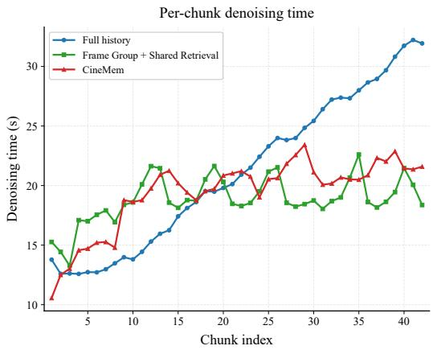

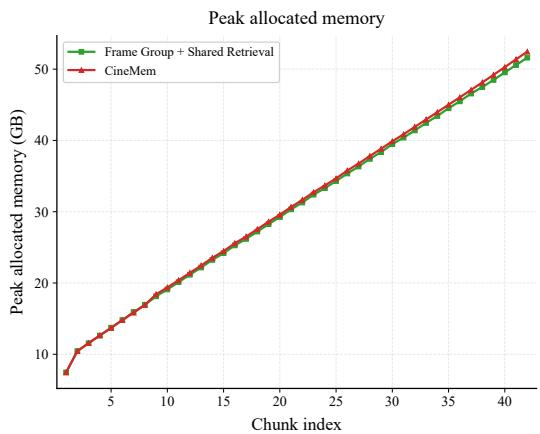  
Figure 12: Practical efficiency comparison during autoregressive rollout. The left figure shows the per-chunk denoising time, and the right figure shows the peak allocated GPU memory during 42-chunk generation.

## D DETAILS OF EVALUATION

In Section 4.2, we introduce an evaluation protocol for streaming multi-shot video generation from three perspectives: video-level, intra-shot-level, and inter-shot-level evaluation. In this section, we provide additional details of each evaluation component.

## D.1 IMPLEMENTATION OF METRICS

For video-level evaluation, we focus on fundamental properties of generated videos, including visual quality, text-video alignment, and transition controllability. We adopt widely used evaluation tools for these aspects, including LAION aesthetic score (LAION-AI, 2022), ViCLIP-based similarity (Wang et al., 2023), and TransNetV2-based transition evaluation (Soucek & Lokoc, 2024).

For intra-shot-level evaluation, we treat each shot as an individual video and evaluate temporal consistency within the shot. Specifically, we extract frame-level features using DINO (Oquab et al., 2024) and compute consistency scores based on feature similarities between frames.

For inter-shot-level evaluation, we first adopt a conventional similarity-based metric commonly used in multi-shot video generation (Wang et al., 2023). Similar to intra-shot evaluation, this metric measures feature similarity between frames from different shots. In addition, we introduce a VLM-assisted metric, Prompt-conditioned Transition-Consistency Score (PTCS), which consists of two complementary components: Prompt-conditioned Continuity Preservation (PCP) and Promptconditioned Transition Alignment (PTA). Given a hierarchical prompt, we first construct a semantic state graph to identify the semantic elements that should remain unchanged and those expected to change across each transition. PCP evaluates whether the required elements are consistently preserved before and after the transition, while PTA measures whether the intended changes, such as modifications in focal subjects or camera configurations, are correctly realized.

PTCS. For a video containing shots $\{ S _ { k } \} _ { k = 1 } ^ { K }$ , we evaluate each transition boundary b between $S _ { b }$ and $S _ { b + 1 }$ . The evaluator takes the middle frames of the two adjacent shots, the global prompt, and their corresponding shot prompts as input. It grounds the prompt-defined semantic elements and returns, for each category $c \in$ {identity, scene, style}, an applicability flag ${ { a } _ { b , \mathfrak { c } } }$ and a consistency score $s _ { b , c } \in [ 0 , 1 ]$ . Specifically, identity corresponds to subjects and stable appearance, scene corresponds to location and background, and style corresponds to lighting, color treatment, and rendering style. The continuity score is computed as:

$$
\mathrm { P C P } _ { b } = \frac { 1 } { | { \mathcal C } _ { b } | } \sum _ { c \in { \mathcal C } _ { b } } s _ { b , c } , \qquad { \mathcal C } _ { b } = \{ c : a _ { b , c } = 1 \} ,\tag{22}
$$

Let $t _ { b } \in [ 0 , 1 ]$ denote the alignment between the prompt-specified transition and the observed compositional change. A required but unobserved transition is assigned $t _ { b } = 0$ . If the evaluator identifies m unrequested semantic changes with severities $e _ { b , j } \in [ 0 , 1 ]$ , we compute their average severity as:

$$
\begin{array} { r } { u _ { b } = \left\{ \begin{array} { l l } { \frac { 1 } { m _ { b } } \sum _ { j = 1 } ^ { m _ { b } } e _ { b , j } , } & { m _ { b } > 0 , } \\ { 0 , } & { m _ { b } = 0 . } \end{array} \right. } \end{array}\tag{23}
$$

The transition alignment score is then defined as:

$$
\mathrm { P T A } _ { b } = t _ { b } ( 1 - u _ { b } ) .\tag{24}
$$

Finally, the joint PTCS score is computed as the geometric mean of PCP and PTA:

$$
\mathrm { P T C S } _ { b } = \sqrt { \mathrm { P C P } _ { b } \cdot \mathrm { P T A } _ { b } } .\tag{25}
$$

This formulation assigns low scores when either unchanged semantic elements are not preserved or intended changes are not correctly realized, as shown in Figure 6. The reported PCP, PTA, and PTCS values are computed by averaging valid boundary-level scores over all transitions.

## D.2 THE EFFECTIVENESS OF PROMPT-CONDITIONED TRANSITION-CONSISTENCY SCORE

As discussed in Section 4.2, conventional similarity-based inter-shot consistency metrics evaluate transitions by measuring feature similarity between frames from different shots. However, such metrics inherently favor cases where adjacent shots exhibit limited visual changes, assigning high consistency scores even when the intended transition is not successfully realized. This limitation explains why some methods can achieve high inter-shot consistency scores while exhibiting poor transition control. These observations motivate our design of PTCS, which explicitly considers both semantic preservation and prompt-specified transition changes. Given that PTCS serves as a key metric for evaluating the effectiveness of CineMem, we further analyze its validity in this section.

We visualize several multi-shot examples with PTCS evaluations in Figure 13. Qualitatively, PCP successfully reflects transitions where semantic consistency is violated, while PTA captures both missing transitions, where the intended shot change is not realized, and unexpected changes introduced during transitions, including inconsistencies in style, character identity, spatial relationships, or even subtle local details. By jointly considering these two complementary aspects, PTCS provides scores that better align with the desired properties of shot transitions. In contrast, similarity-based inter-shot consistency metrics may produce misleading evaluations: when the visual composition remains similar, they can assign high scores despite missing or incorrect transitions, while failing to distinguish valid and invalid transitions under substantial compositional changes.

To complement the quantitative evaluation, we conduct a user study to investigate whether PTCS aligns with human perception of inter-shot consistency. Specifically, we select 30 prompts for evalu ation, and participants rate each generated video on a scale from 1 to 5 from three perspectives: overall video quality, intra-shot consistency, and inter-shot consistency. The mean opinion scores (MOS) are summarized in Table 4. As shown, the human evaluation results are consistent with the trend observed in PTCS. Methods with higher PTCS scores generally receive higher inter-shot consistency ratings from human participants, while models that achieve high similarity-based consistency scores but fail to perform the intended transitions receive substantially lower human scores. This agreement indicates that PTCS better captures human-perceived transition consistency by jointly considering semantic preservation and prompt-specified changes. Furthermore, CineMem achieves the highest MOS in inter-shot consistency and competitive overall video quality, demonstrating its ability to generate coherent multi-shot videos with controllable transitions.

## E ADDITIONAL RESULTS

In this section, we provide additional analyses and results to complement the experiments presented in Section 4.2 and Section 4.3.

## E.1 QUALITATIVE RESULTS OF ABLATION STUDY

Figure 15 provides additional qualitative results for the ablation study. As shown, CineMem maintains long-horizon consistency after multiple shot transitions. Even under the training-free setting, our fine-grained retrieval mechanism achieves better results than approaches based on frame-level grouping or shared retrieval. The trained model further improves visual consistency and preserves finer details. For the query-group retrieval variant, we provide additional implementation details in Figure 14. This variant also achieves promising performance and serves as an alternative design fo efficient query-adaptive retrieval.

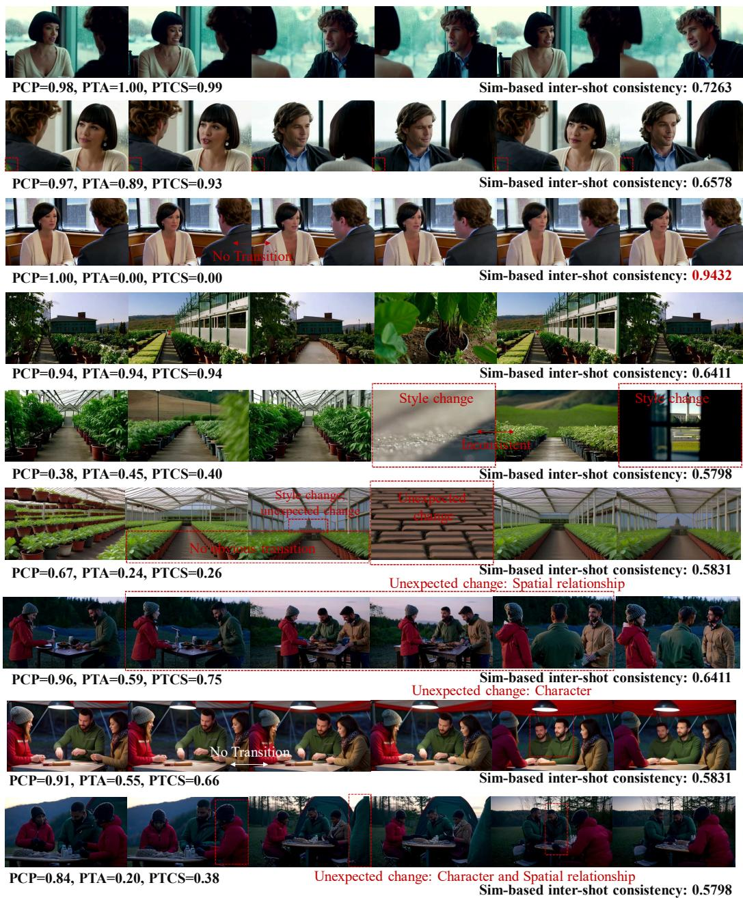  
Figure 13: Qualitative comparison between PTCS and similarity-based inter-shot consistency metrics. The examples illustrate cases where PTCS better reflects transition correctness by jointly considering semantic preservation and prompt-specified changes.

Cluster-KV Cache + Query-Group Retrieval (Variant)  
Table 4: User study results. Participants rate generated videos from three perspectives on a scale from 1 to 5. The best results are highlighted in bold.
<table><tr><td>Method</td><td>Overall Video Quality</td><td>Intra-shot Consistency</td><td>Inter-shot Consistency</td></tr><tr><td>ShotStream</td><td> $4 . 0 0 \pm 0 . 6 3$ </td><td> $4 . 0 3 \pm 0 . 7 7$ </td><td> $4 . 0 3 \pm 0 . 4 2$ </td></tr><tr><td>Self-Forcing</td><td> $2 . 4 0 \pm 0 . 4 4$ </td><td> $3 . 9 0 \pm 0 . 6 9$ </td><td> $1 . 2 3 \pm 0 . 4 5$ </td></tr><tr><td>Infinity-RoPE</td><td> $2 . 5 0 \pm 0 . 3 2$ </td><td> $3 . 9 3 \pm 0 . 6 6$ </td><td> $1 . 4 1 \pm 0 . 4 2$ </td></tr><tr><td>LongLive2</td><td> $3 . 7 3 \pm 0 . 5 0$ </td><td> $3 . 9 8 \pm 0 . 8 0$ </td><td> $3 . 0 3 \pm 0 . 5 0$ </td></tr><tr><td>MemFlow</td><td> $2 . 7 1 \pm 0 . 3 4$ </td><td> $3 . 9 3 \pm 0 . 8 0$ </td><td> $1 . 9 7 \pm 0 . 4 3$ </td></tr><tr><td>HoloCine</td><td> $4 . 1 3 \pm 0 . 6 5$ </td><td> $4 . 1 3 \pm 0 . 4 5$ </td><td> $4 . 1 3 \pm 0 . 5 2$ </td></tr><tr><td>MultiShotMaster</td><td> ${ \bf 4 . 1 8 \pm 0 . 4 2 }$ </td><td> $4 . 0 7 \pm 0 . 8 0$ </td><td> $4 . 3 0 \pm 0 . 4 1$ </td></tr><tr><td>CineMem (Ours)</td><td> $4 . 1 5 \pm 0 . 4 7$ </td><td> ${ \bf 4 . 1 7 \pm 0 . 4 7 }$ </td><td> ${ \bf 4 . 3 7 \pm 0 . 3 1 }$ </td></tr></table>

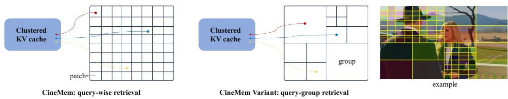  
Figure 14: Comparison between query-wise retrieval and the query-group retrieval variant. Querywise retrieval performs independent memory retrieval for each query token, while the query-group variant recursively partitions query tokens based on intra-group content diversity. Queries with similar content preferences are assigned to the same group and share the retrieved memory.

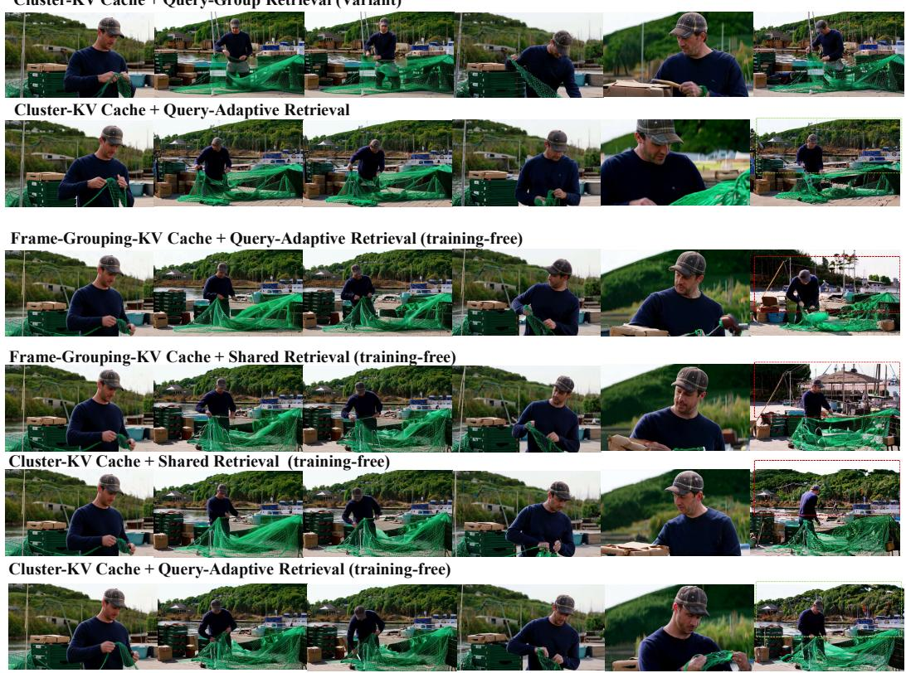  
Figure 15: A case of qualitative result of ablation study.

Prompt content categories

Maximum revisit distance

Shot-count categories

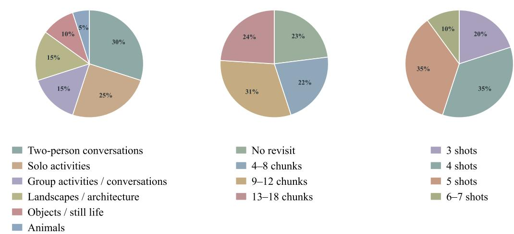

Figure 16: Distribution of evaluation prompts across different content categories, shot counts, and revisit distances.

## E.2 FINE-GRAINED ANALYSIS OF GENERATION QUALITY

In Table 2, we present the overall comparison between CineMem and existing baselines. In this section, we provide a more fine-grained analysis of the evaluation results by categorizing the evaluation prompts from three perspectives: content category, shot count, and revisit distance.

Figure 16 illustrates the distribution of our evaluation set across these three categories. We use these categorizations to further analyze the performance of different methods under diverse generation scenarios. Here, revisit distance denotes the maximum number of chunks between two revisited appearances within a prompt, reflecting the difficulty of maintaining long-range consistency.

Content category. Table 5 reports the results across six content categories. Overall, CineMem exhibits consistently strong transition control and intra-shot consistency across diverse visual content, while achieving the best or second-best PTCS in five out of the six categories. In particular, CineMem achieves the highest PTCS on Objects and Still Life and Solo Activities, and remains competitive on more complex scenarios involving conversations, multiple entities, and animals. These results suggest that the proposed fine-grained memory retrieval is not specific to a particular type of visual content, but generalizes across substantially different generation scenarios.

Shot count. We further group the evaluation prompts according to the number of shots, as shown in Table 6. CineMem achieves the highest PTCS across all shot-count groups, while also consistently obtaining the strongest transition control and intra-shot consistency. Notably, its advantage is preserved for prompts containing six to seven shots, where autoregressive error accumulation and long-range dependency modeling become more challenging. This result indicates that our memory retrieval mechanism remains effective as the generation horizon increases.

Revisit distance. Finally, Table 7 analyzes performance with respect to revisit distance, which directly reflects the temporal range over which previously generated content needs to be recalled. CineMem maintains strong performance across all distance ranges and achieves the highest PTCS for the longest revisit range of 13-18 chunks. It also consistently achieves the best transition control and intra-shot consistency across different revisit distances. These results further support the effectiveness of our fine-grained memory retrieval in preserving long-range historical information and maintaining consistency when previously observed content reappears after a long temporal interval.

Table 5: Fine-grained results across different content categories. The best and runner-up within each category are in bold and underlined, respectively.
<table><tr><td>Method</td><td>T-Ctrl ↑ T-V Sim. ↑ Aes. ↑ Intra. ↑ PTCS ↑ Method</td><td></td><td></td><td></td><td></td><td></td><td>T-Ctrl ↑ T-V Sim. ↑ Aes. ↑ Intra. ↑ PTCS ↑</td><td></td><td></td><td></td><td></td></tr><tr><td></td><td colspan="4">Landscapes and Architecture</td><td colspan="7">Objects and Still Life</td></tr><tr><td>LongLive2</td><td>0.5653</td><td>0.2743</td><td>0.6086</td><td>0.9422</td><td>0.3741</td><td>LongLive2</td><td>0.7803</td><td>0.2444</td><td>0.5695</td><td>0.9539</td><td>0.5017</td></tr><tr><td>ShotStream</td><td>0.9952</td><td>0.2313</td><td>0.5639</td><td>0.9597</td><td>0.6500</td><td>ShotStream</td><td>1.0000</td><td>0.2428</td><td>0.5579</td><td>0.9637</td><td>0.7791</td></tr><tr><td>Infinity-RoPE</td><td>0.0000</td><td>0.2674</td><td>0.5966</td><td>0.8736</td><td>0.3743</td><td>Infinity-RoPE</td><td>0.1248</td><td>0.2518</td><td>0.5692</td><td>0.9175</td><td>0.4577</td></tr><tr><td>Self-Forcing</td><td>0.5740</td><td>0.2606</td><td>0.5949</td><td>0.8773</td><td>0.5071</td><td>Self-Forcing</td><td>0.3119</td><td>0.2551</td><td>0.5708</td><td>0.9206</td><td>0.3354</td></tr><tr><td>MemFlow</td><td>0.2837</td><td>0.2669</td><td>0.5846</td><td>0.8762</td><td>0.3923</td><td>MemFlow</td><td>0.0147</td><td>0.2424</td><td>0.5750</td><td>0.9453</td><td>0.3291</td></tr><tr><td>MultiShotMaster</td><td>0.9869</td><td>0.2204</td><td>0.5737</td><td>0.9646</td><td>0.7047</td><td>MultiShotMaster</td><td>0.9866</td><td>0.2545</td><td>0.5108</td><td>0.9668</td><td>0.4981</td></tr><tr><td>HoloCine</td><td>0.9624</td><td>0.2471</td><td>0.5377</td><td>0.9423</td><td>0.6181</td><td>HoloCine</td><td>0.9049</td><td>0.2600</td><td>0.4989</td><td>0.9377</td><td>0.6667</td></tr><tr><td>CineMem (Ours)</td><td>1.0000</td><td>0.2434</td><td>0.6076</td><td>0.9777</td><td>0.6218</td><td>CineMem (Ours)</td><td>0.9680</td><td>0.2320</td><td>0.5372</td><td>0.9842</td><td>0.7841</td></tr><tr><td colspan="4">Solo Activities</td><td colspan="8">Two-person Conversations</td></tr><tr><td>LongLive2</td><td>0.4092</td><td>0.2159</td><td>0.5598</td><td>0.9400</td><td>0.5863</td><td>LongLive2</td><td>0.2232</td><td>0.1875</td><td>0.5369</td><td>0.9537</td><td>0.3356</td></tr><tr><td>ShotStream</td><td>0.9764</td><td>0.2463</td><td>0.5718</td><td>0.9574</td><td>0.9241</td><td>ShotStream</td><td>0.7417</td><td>0.1937</td><td>0.6057</td><td>0.9598</td><td>0.4784</td></tr><tr><td>Infinity-RoPE</td><td>0.0000</td><td>0.2233</td><td>0.5681</td><td>0.9167</td><td>0.5320</td><td>Infinity-RoPE</td><td>0.0000</td><td>0.1942</td><td>0.5745</td><td>0.9339</td><td>0.3032</td></tr><tr><td>Self-Forcing</td><td>0.1344</td><td>0.2372</td><td>0.5579</td><td>0.9030</td><td>0.5639</td><td>Self-Forcing</td><td>0.0762</td><td>0.1948</td><td>0.5801</td><td>0.9327</td><td>0.0862</td></tr><tr><td>MemFlow</td><td>0.0000</td><td>0.2272</td><td>0.5746</td><td>0.9502</td><td>0.3303</td><td>MemFlow</td><td>0.0000</td><td>0.1922</td><td>0.5851</td><td>0.9604</td><td>0.0674</td></tr><tr><td>MultiShotMaster</td><td>0.9875</td><td>0.2579</td><td>0.5324</td><td>0.9162</td><td>0.9031</td><td>MultiShotMaster</td><td>0.9669</td><td>0.2204</td><td>0.6248</td><td>0.9484</td><td>0.8783</td></tr><tr><td>HoloCine</td><td>1.0000</td><td>0.2589</td><td>0.5444</td><td>0.9211</td><td>0.8126</td><td>HoloCine</td><td>0.9556</td><td>0.1977</td><td>0.5718</td><td>0.9458</td><td>0.6803</td></tr><tr><td>CineMem (Ours)</td><td>1.0000</td><td>0.2469</td><td>0.5463</td><td>0.9514</td><td>0.9265</td><td>CineMem (Ours)</td><td>0.9977</td><td>0.2280</td><td>0.5992</td><td>0.9725</td><td>0.8682</td></tr><tr><td colspan="10">Animals</td><td>Group Activities and Conversations</td><td></td><td></td></tr><tr><td>LongLive2</td><td>0.4415</td><td>0.2415</td><td>0.5286</td><td>0.9494</td><td>0.4194</td><td>LongLive2</td><td>0.2098</td><td>0.1595</td><td>0.5425</td><td>0.9482</td><td>0.1065</td></tr><tr><td>ShotStream</td><td>1.0000</td><td>0.2847</td><td>0.5312</td><td>0.9618</td><td>0.8459</td><td>ShotStream</td><td>0.9476</td><td>0.1853</td><td>0.5737</td><td>0.9578</td><td>0.6633</td></tr><tr><td>Infinity-RoPE</td><td>0.0000</td><td>0.2628</td><td>0.5799</td><td>0.9360</td><td>0.3415</td><td>Infinity-RoPE</td><td>0.0000</td><td>0.1685</td><td>0.5664</td><td>0.9161</td><td>0.3010</td></tr><tr><td>Self-Forcing</td><td>0.0843</td><td>0.2575</td><td>0.5870</td><td>0.9421</td><td>0.3074</td><td>Self-Forcing</td><td>0.0577</td><td>0.1706</td><td>0.5600</td><td>0.9368</td><td>0.0404</td></tr><tr><td>MemFlow</td><td>0.0000</td><td>0.2629</td><td>0.5640</td><td>0.9500</td><td>0.4120</td><td>MemFlow</td><td>0.0000</td><td>0.1630</td><td>0.5835</td><td>0.9492</td><td>0.0686</td></tr><tr><td>MultiShotMaster</td><td>0.9718</td><td>0.2817</td><td>0.5701</td><td>0.9543</td><td>0.8536</td><td>MultiShotMaster</td><td>0.9832</td><td>0.1741</td><td>0.5597</td><td>0.9196</td><td>0.7403</td></tr><tr><td>HoloCine</td><td>1.0000</td><td>0.2906</td><td>0.5899</td><td>0.9590</td><td>0.9111</td><td>HoloCine</td><td>0.9710</td><td>0.1995</td><td>0.5307</td><td>0.9047</td><td>0.8423</td></tr><tr><td>CineMem (Ours)</td><td>1.0000</td><td>0.2666</td><td>0.5888</td><td>0.9727</td><td>0.8695</td><td>CineMem (Ours)</td><td>1.0000</td><td>0.2029</td><td>0.5817</td><td>0.9596</td><td>0.7796</td></tr></table>

Table 6: Fine-grained results across different shot counts. The best and runner-up within each category are in bold and underlined, respectively.
<table><tr><td>Method</td><td>T-Ctrl ↑ T-V Sim. ↑</td><td></td><td></td><td>Aes. ↑ Intra. ↑ PTCS ↑ Method</td><td></td><td></td><td></td><td>T-Ctrl ↑ T-V Sim. ↑ Aes. ↑ Intra. ↑ PTCS ↑</td><td></td><td></td><td></td></tr><tr><td></td><td>3 Shots</td><td></td><td></td><td></td><td></td><td></td><td></td><td>4 Shots</td><td></td><td></td><td></td></tr><tr><td>LongLive2</td><td>0.3609</td><td>0.2260</td><td>0.5578</td><td>0.9520</td><td>0.3433</td><td>LongLive2</td><td>0.4123</td><td>0.2000</td><td>0.5584</td><td>0.9482</td><td>0.3866</td></tr><tr><td>ShotStream</td><td>0.9000</td><td>0.2327</td><td>0.5669</td><td>0.9592</td><td>0.6788</td><td>ShotStream</td><td>0.9027</td><td>0.2170</td><td>0.5721</td><td>0.9594</td><td>0.6750</td></tr><tr><td>Infinity-RoPE</td><td>0.0340</td><td>0.2379</td><td>0.5918</td><td>0.9251</td><td>0.4320</td><td>Infinity-RoPE</td><td>0.0120</td><td>0.2081</td><td>0.5654</td><td>0.9231</td><td>0.3781</td></tr><tr><td>Self-Forcing</td><td>0.2502</td><td>0.2368</td><td>0.5803</td><td>0.9346</td><td>0.2648</td><td>Self-Forcing</td><td>0.1966</td><td>0.2150</td><td>0.5751</td><td>0.9253</td><td>0.3226</td></tr><tr><td>MemFlow</td><td>0.0680</td><td>0.2345</td><td>0.5869</td><td>0.9517</td><td>0.1980</td><td>MemFlow</td><td>0.0120</td><td>0.2114</td><td>0.5699</td><td>0.9464</td><td>0.2208</td></tr><tr><td>MultiShotMaster</td><td>0.9770</td><td>0.2480</td><td>0.5709</td><td>0.9379</td><td>0.6961</td><td>MultiShotMaster</td><td>0.9879</td><td>0.2292</td><td>0.5681</td><td>0.9425</td><td>0.8582</td></tr><tr><td>HoloCine</td><td>0.9039</td><td>0.2431</td><td>0.5407</td><td>0.9136</td><td>0.7164</td><td>HoloCine</td><td>0.9776</td><td>0.2246</td><td>0.5319</td><td>0.9337</td><td>0.7944</td></tr><tr><td>CineMem (Ours)</td><td>0.9840</td><td>0.2441</td><td>0.5750</td><td>0.9662</td><td>0.7516</td><td>CineMem (Ours)</td><td>0.9980</td><td>0.2303</td><td>0.5618</td><td>0.9634</td><td>0.8747</td></tr><tr><td></td><td></td><td>5 Shots</td><td></td><td></td><td></td><td></td><td>6–7 Shots</td><td></td><td></td><td></td><td></td></tr><tr><td>LongLive2</td><td>0.3816</td><td>0.2138</td><td>0.5570</td><td>0.9472</td><td>0.4226</td><td>LongLive2</td><td>0.3558</td><td>0.2179</td><td>0.5511</td><td>0.9375</td><td>0.3861</td></tr><tr><td>ShotStream</td><td>0.9089</td><td>0.2173</td><td>0.5883</td><td>0.9595</td><td>0.7164</td><td>ShotStream</td><td>0.9397</td><td>0.2215</td><td>0.5810</td><td>0.9592</td><td>0.6890</td></tr><tr><td>Infinity-RoPE</td><td>0.0000</td><td>0.2149</td><td>0.5706</td><td>0.9095</td><td>0.3931</td><td>Infinity-RoPE</td><td>0.0147</td><td>0.2214</td><td>0.5875</td><td>0.8995</td><td>0.3178</td></tr><tr><td>Self-Forcing</td><td>0.1339</td><td>0.2175</td><td>0.5656</td><td>0.9089</td><td>0.2853</td><td>Self-Forcing</td><td>0.2095</td><td>0.2207</td><td>0.5788</td><td>0.8797</td><td>0.3067</td></tr><tr><td>MemFlow</td><td>0.0434</td><td>0.2112</td><td>0.5858</td><td>0.9378</td><td>0.2179</td><td>MemFlow</td><td>0.1102</td><td>0.2151</td><td>0.5802</td><td>0.9170</td><td>0.3229</td></tr><tr><td>MultiShotMaster</td><td>0.9727</td><td>0.2216</td><td>0.5710</td><td>0.9375</td><td>0.8192</td><td>MultiShotMaster</td><td>0.9810</td><td>0.2190</td><td>0.5726</td><td>0.9502</td><td>0.7218</td></tr><tr><td>HoloCine</td><td>0.9914</td><td>0.2332</td><td>0.5660</td><td>0.9376</td><td>0.7018</td><td>HoloCine</td><td>0.9725</td><td>0.2261</td><td>0.5492</td><td>0.9510</td><td>0.7154</td></tr><tr><td>CineMem (Ours)</td><td>1.0000</td><td>0.2328</td><td>0.5875</td><td>0.9693</td><td>0.8349</td><td>CineMem (Ours)</td><td>1.0000</td><td>0.2266</td><td>0.6063</td><td>0.9757</td><td>0.7556</td></tr></table>

## E.3 LONGER VIDEO GENERATION

To further investigate the long-horizon generation capability of CineMem, we provide additional qualitative results on 30-second videos. As shown in Figure 17, CineMem can continuously extend autoregressive generation while maintaining coherent visual content and long-range consis-

Table 7: Fine-grained results across different revisit distances. The best and runner-up within each category are in bold and underlined, respectively.
<table><tr><td>Method</td><td>T-Ctrl ↑ T-V Sim. ↑</td><td></td><td></td><td></td><td></td><td>Aes. ↑ Intra. ↑ PTCS ↑ Method</td><td>T-Ctrl ↑</td><td>T-V Sim. ↑</td><td></td><td></td><td>Aes. ↑ Intra. ↑ PTCS ↑</td></tr><tr><td></td><td colspan="3">No Revisit</td><td colspan="3"></td><td colspan="3">4–8 Chunks</td><td></td><td></td></tr><tr><td>LongLive2</td><td>0.3696</td><td>0.2010</td><td>0.5404</td><td>0.9472</td><td>0.3659</td><td>LongLive2</td><td>0.3049</td><td>0.2085</td><td>0.5411</td><td>0.9512</td><td>0.3127</td></tr><tr><td>ShotStream</td><td>0.9609</td><td>0.2252</td><td>0.5451</td><td>0.9603</td><td>0.7442</td><td>ShotStream</td><td>0.7995</td><td>0.2178</td><td>0.5856</td><td>0.9584</td><td>0.5135</td></tr><tr><td>Infinity-RoPE</td><td>0.0000</td><td>0.2124</td><td>0.5542</td><td>0.9255</td><td>0.4194</td><td>Infinity-RoPE</td><td>0.0000</td><td>0.2150</td><td>0.5755</td><td>0.9232</td><td>0.3231</td></tr><tr><td>Self-Forcing</td><td>0.1896</td><td>0.2242</td><td>0.5574</td><td>0.9258</td><td>0.3223</td><td>Self-Forcing</td><td>0.1548</td><td>0.2176</td><td>0.5794</td><td>0.9381</td><td>0.1502</td></tr><tr><td>MemFlow</td><td>0.0295</td><td>0.2166</td><td>0.5511</td><td>0.9487</td><td>0.1811</td><td>MemFlow</td><td>0.0309</td><td>0.2138</td><td>0.5904</td><td>0.9547</td><td>0.1013</td></tr><tr><td>MultiShotMaster</td><td>0.9920</td><td>0.2364</td><td>0.5494</td><td>0.9282</td><td>0.8577</td><td>MultiShotMaster</td><td>0.9574</td><td>0.2275</td><td>0.5859</td><td>0.9508</td><td>0.6240</td></tr><tr><td>HoloCine</td><td>0.9748</td><td>0.2352</td><td>0.5233</td><td>0.9256</td><td>0.7726</td><td>HoloCine</td><td>0.9013</td><td>0.2336</td><td>0.5596</td><td>0.9183</td><td>0.6249</td></tr><tr><td>CineMem (Ours)</td><td>0.9969</td><td>0.2384</td><td>0.5532</td><td>0.9607</td><td>0.8030</td><td>CineMem (Ours)</td><td>0.9854</td><td>0.2344</td><td>0.5848</td><td>0.9730</td><td>0.8183</td></tr><tr><td></td><td colspan="3">9–12 Chunks</td><td></td><td colspan="6">13–18 Chunks</td><td></td></tr><tr><td>LongLive2</td><td>0.4319</td><td>0.2234</td><td>0.5642</td><td>0.9455</td><td>0.4569</td><td>LongLive2</td><td>0.4152</td><td>0.2101</td><td>0.5785</td><td>0.9472</td><td>0.3995</td></tr><tr><td>ShotStream</td><td>0.9330</td><td>0.2282</td><td>0.5844</td><td>0.9593</td><td>0.7710</td><td>ShotStream</td><td>0.9246</td><td>0.2094</td><td>0.5928</td><td>0.9595</td><td>0.7024</td></tr><tr><td>Infinity-RoPE</td><td>0.0047</td><td>0.2285</td><td>0.5786</td><td>0.9100</td><td>0.4633</td><td>Infinity-RoPE</td><td>0.0459</td><td>0.2116</td><td>0.5888</td><td>0.9095</td><td>0.3205</td></tr><tr><td>Self-Forcing</td><td>0.2078</td><td>0.2225</td><td>0.5667</td><td>0.9093</td><td>0.4032</td><td>Self-Forcing</td><td>0.1858</td><td>0.2184</td><td>0.5910</td><td>0.8984</td><td>0.2676</td></tr><tr><td>MemFlow</td><td>0.0801</td><td>0.2174</td><td>0.5726</td><td>0.9360</td><td>0.3179</td><td>MemFlow</td><td>0.0233</td><td>0.2170</td><td>0.6080</td><td>0.9296</td><td>0.2623</td></tr><tr><td>MultiShotMaster</td><td>0.9864</td><td>0.2312</td><td>0.5738</td><td>0.9406</td><td>0.8411</td><td>MultiShotMaster</td><td>0.9797</td><td>0.2217</td><td>0.5707</td><td>0.9432</td><td>0.8467</td></tr><tr><td>HoloCine</td><td>0.9906</td><td>0.2324</td><td>0.5411</td><td>0.9378</td><td>0.7754</td><td>HoloCine</td><td>0.9900</td><td>0.2251</td><td>0.5670</td><td>0.9465</td><td>0.7622</td></tr><tr><td>CineMem (Ours)</td><td>1.0000</td><td>0.2354</td><td>0.5858</td><td>0.9662</td><td>0.8228</td><td>CineMem (Ours)</td><td>1.0000</td><td>0.2259</td><td>0.5850</td><td>0.9697</td><td>0.8517</td></tr></table>

tency across multiple shot transitions. These results highlight the potential of fine-grained memory retrieval for enabling more scalable autoregressive video generation over extended durations.

## F LIMITATION AND FAILURE CASE

Limitations. Due to limited computational resources, our experiments are conducted on a relatively small-scale autoregressive backbone with a limited amount of training data for adapting a bidirectional model into a long-horizon autoregressive generator. Consequently, the visual quality of generated videos may lag behind that of large-scale state-of-the-art diffusion models with substantially larger model capacity and training data. Nevertheless, our experiments demonstrate the effectiveness of the proposed memory retrieval framework and reveal meaningful insights into memory utilization in autoregressive diffusion models. We expect that the proposed approach can further benefit from larger-scale models and datasets.

Failure Cases. Our memory retrieval mechanism aims to approximate the intrinsic full-memory access pattern under a constrained memory budget by enabling more effective historical information retrieval. However, it still struggles in scenarios requiring complex multi-entity reasoning, as illustrated in Figure 18. In the presented example, the generated video exhibits issues such as missing characters and inconsistent details across shot transitions. Such failures are particularly challenging for autoregressive generation. In this case, an early chunk introduces four characters through its prompt, while a later chunk requires only three characters. The model must therefore generate a valid transition by adjusting the camera viewpoint while preserving the spatial relationships and identities established in previous shots. However, the earlier chunks are generated without knowledge of future shot requirements, making such coordinated transitions inherently difficult, especially when the initial composition does not provide sufficient flexibility. Therefore, multi-entity scenarios with complex shot transitions remain challenging even for full-memory autoregressive generation or bidirectional models, as they require reasoning beyond historical information retrieval. While our proposed memory mechanism improves access to relevant historical content and achieves promising results on certain multi-entity scenarios (see supplementary project page), handling complex entity interactions remains an important direction for future work.

## G FUTURE WORK

Beyond the proposed online clustered KV cache and query-adaptive retrieval framework, several directions remain open for future exploration. For memory organization, more effective clustering strategies could further improve retrieval quality. Meanwhile, exploiting the shared retrieval patterns among queries may provide more efficient alternatives to fully query-wise and head-wise retrieval, as explored by the query-group variant in Section 4.3. These directions may enable more scalable and efficient memory mechanisms for autoregressive video generation.

29s  
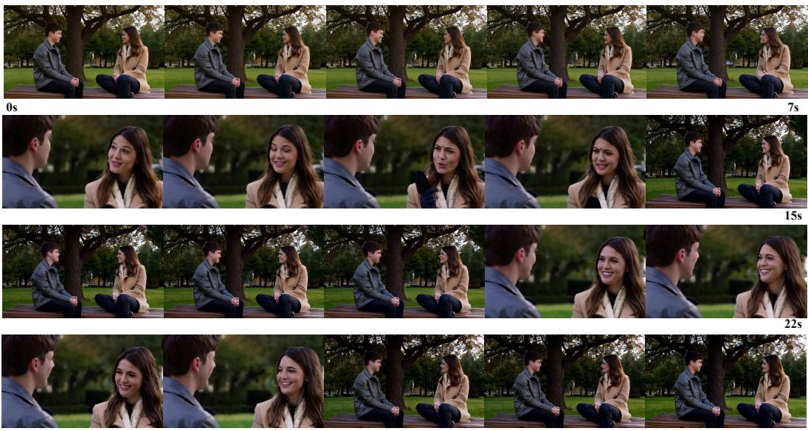

(a)  
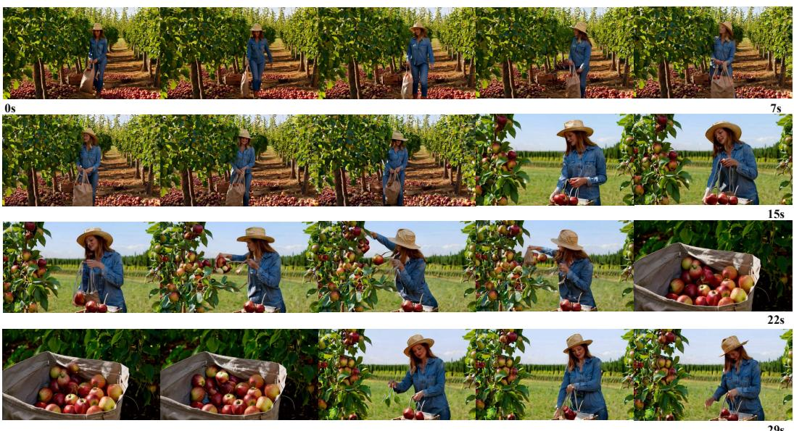  
(b)

Figure 17: Cases of longer video generated by CineMem.  
  
Figure 18: A failure case in complex multi-entity scenarios. Although the generated video preserves revisitation consistency across shots, inconsistencies such as character disappearance and detail changes occur during the transition from Shot 1 to Shot 2. This example highlights the difficulty of handling multi-entity reasoning and spatial relationship preservation in autoregressive video generation.

From the perspective of autoregressive video generation, integrating entity-aware or structure-aware memory retrieval could help address challenging multi-entity scenarios discussed in Section F. Furthermore, extending autoregressive generation to substantially longer horizons remains a promising direction toward more scalable long-form video synthesis.