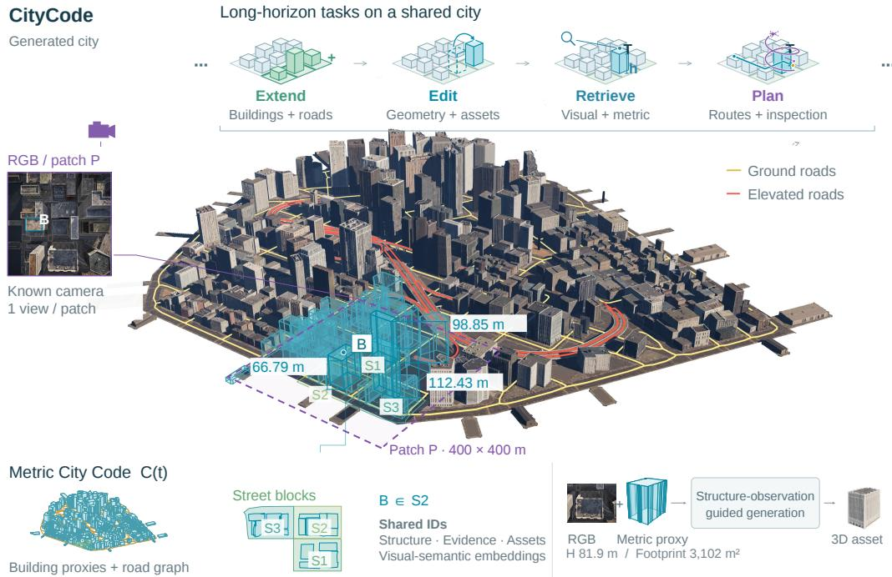
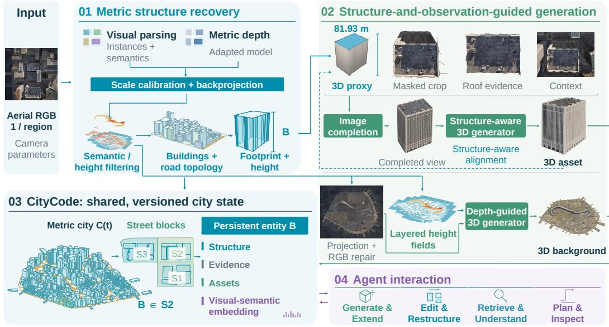
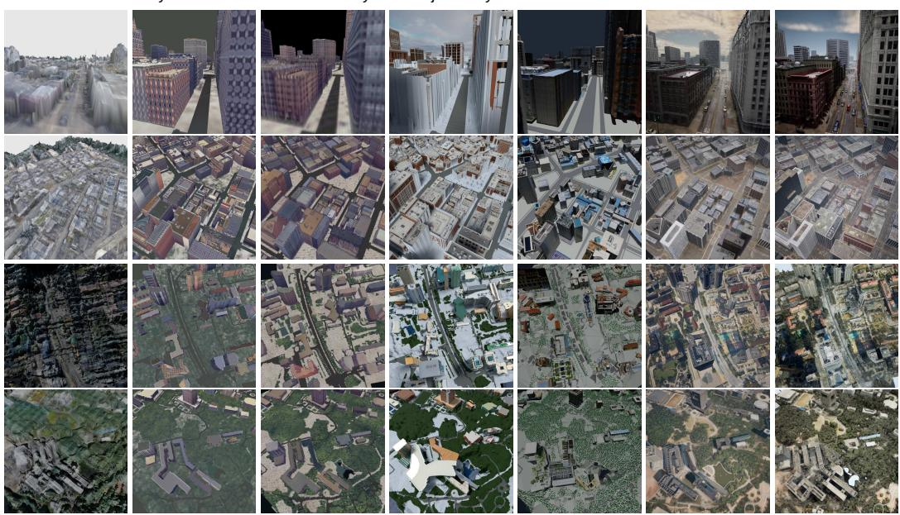
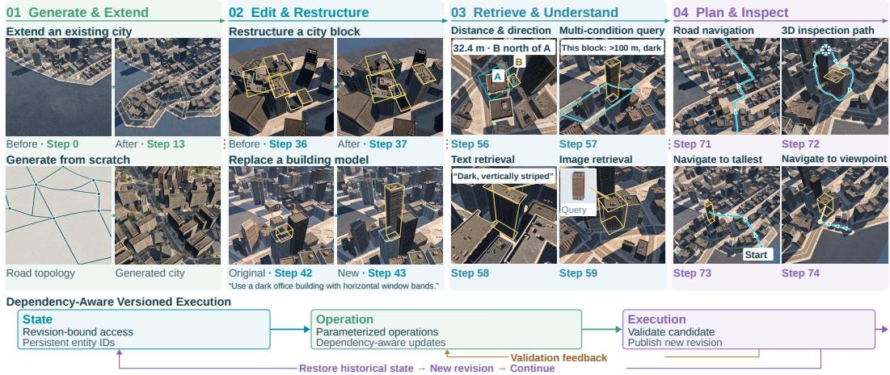

# CITYCODE: BUILDING AGENT-OPERABLE 3D CITIESFROM SPARSE AERIAL OBSERVATIONS

Jiahui Sun1,2,\*, Ran Bi1,\*, Yifei Liu2,6,\*, Xiaolong Zhou2,5 Yishuo Xu1, Yuanqi Li1, Congcong Zhu3, Lei Yang4 Yanwen Guo1,†, Zhihang Zhong5,†, Hongjie Zhang2,†

1Nanjing University 2Shanghai Artificial Intelligence Laboratory   
3University of Science and Technology of China   
4SenseTime 5Shanghai Jiao Tong University 6Beihang University

\*Equal contribution. †Co-corresponding authors.

Version note. This preprint contains only the main paper and references. Appendix references use the original manuscript’s numbering. The cited supplementary text, code, and video are not included in this version.

## ABSTRACT

Urban spatial intelligence calls for 3D cities that agents can measure, interpret, and modify across successive tasks. Maintaining such cities as persistent, codebased states requires lightweight acquisition and support for consistent state updates without repeated dense reconstruction. We therefore formulate a new setting for grounded urban world construction: generating large-scale, instance-level parameterized 3D cities from one low-altitude aerial RGB image per region and known camera parameters, while recovering metrically scaled buildings and explicit road geometry and connectivity. We introduce CityCode, an agent-operable representation that unifies metric geometry, urban topology, visual semantics, and 3D assets through persistent entity identities, with dependency-aware versioned execution for validated updates and historical restoration. We further develop Air2Code to construct this representation by combining visual structure extraction with adapted metric depth estimation. To address occlusion and incomplete coverage, recovered structure and observed appearance guide generative completion and subsequent structure-aware 3D generation for buildings and backgrounds. Experiments on CitySample-Aerial and UrbanScene3D demonstrate substantially more accurate metric structure recovery and superior visual fidelity to the target cities compared with the evaluated baselines. Across 50 task chains of 50 steps each, CityCode supports continued querying, editing, planning, and historical restoration over evolving city states. Together, CityCode and Air2Code turn sparse aerial observations into persistent, agent-operable urban worlds for longhorizon urban spatial intelligence.

## 1 INTRODUCTION

Urban spatial intelligence calls for agents that can understand and act on 3D environments across successive tasks. For a specific city, this includes locating buildings, measuring their geometry, reasoning about road access, and modifying layouts, etc. These operations require connecting the city’s metric geometry, road connectivity, and visual semantics, etc. (Zhang et al., 2026; Caldarelli et al., 2023). As edits accumulate, subsequent queries and plans must remain consistent with the updated entities and spatial relationships. These needs motivate constructing agent-operable 3D cities: structured environments built from observations of a target city and maintained across tasks for continued spatial reasoning and action.

A key challenge is constructing such worlds from limited input. Design-driven approaches, including CityGenAgent, CityCraft, and MajutsuCity, generate programs, layouts, and assets from user requirements (Liu et al., 2026; Deng et al., 2024; Huang et al., 2025). Other methods, including the UrbanWorld series and layout-conditioned generative models, use maps, building geometry, semantic layouts, or height information to guide construction (Shang et al., 2024; Wang et al., 2025b;c; Xie et al., 2025; Chung et al., 2026). These inputs provide structural control, but synthesized layouts need not correspond to a target city, while maps may have incomplete coverage, missing heights, or outdated geometry (Herfort et al., 2023; Bernard et al., 2022; Juhasz, 2021). Sparse aerial observa-´ tions offer a lightweight and timely source of visual evidence about a target city (Remondino et al., 2011), allowing its structure to be recovered for generation and spatial operations.

  
Figure 1: From sparse aerial observations to agent-operable 3D cities. The city is assembled by fusing patch outputs in a shared metric frame. CityCode unifies metric building instances, road and block topology, and generated appearance through persistent entity identities. The highlighted building links visual evidence, a geometric proxy, and a 3D asset. The sequence illustrates extension, editing, retrieval, and planning over a shared city state. See the supplementary video for city generation results and long-horizon spatial interaction.

Image-conditioned methods such as Sat2City v2, Sat2Density++, Sat3DGen, MagicCity, and SceneFuse-3D generate or reconstruct urban scenes from aerial or satellite imagery (Hua et al., 2026; Qian et al., 2026a;b; Yao et al., 2025; Zheng et al., 2025). Their primary focus is scene-level synthesis or reconstruction, rather than jointly recovering metrically parameterized building instances, explicit road connectivity, and entity-linked assets for subsequent spatial operations. Sparse aerial views leave substantial facade appearance and occluded geometry unobserved. Constructing a usable city from these views requires coordinating structure recovery with generative completion: synthesized details must remain compatible with recovered massing, location, and metric scale.

We introduce a new setting for grounded urban world construction: generating instance-level parameterized 3D cities from sparse aerial observations for continued spatial reasoning and action. Given one low-altitude aerial RGB image per region and known camera parameters, the goal is to jointly construct measurable building geometry, explicit road connectivity, and detailed appearance (Figure 1). Our central idea is to use recovered metric entities as a common interface between observations, generated assets, and spatial operations. Each building retains one identity linking its visual evidence, metric structure, and generated asset across construction and subsequent tasks.

To realize this idea, we introduce CityCode, an agent-operable representation linking metric urban structure, observation evidence, visual semantics, and 3D assets through persistent entity identities.

Air2Code constructs this representation by combining visual structure extraction with adapted metric depth estimation (Figure 2). Its structure-and-observation-guided generation completes geometry and appearance from sparse observations, combining appearance completion and structure-aware 3D generation for buildings with height-guided background generation. During subsequent interaction, CityCode’s dependency-aware versioned execution validates supported edits, updates affected records, and enables queries, planning, and historical restoration.

Experiments on synthetic and real-world-derived scenes demonstrate improved metric geometry and leading visual quality on CitySample-Aerial (CS-Aerial) and UrbanScene3D among the evaluated baselines. Ablations examine the contributions of depth adaptation, scale calibration, and structural guidance in generation. We further evaluate continued city-state use across 50 task chains of 50 steps each, covering construction, editing, querying, planning, and historical restoration. All 2,500 steps pass their task checks under the documented execution protocol, with operations continuing after restoration. Together, CityCode and Air2Code construct grounded urban worlds with accurate metric geometry and leading visual quality, providing persistent, agent-operable environments for long-horizon urban spatial intelligence.

## 2 RELATED WORK

## 2.1 URBAN MODELING AND GENERATION

Design-driven and structure-conditioned generation. CityGenAgent, CityCraft, and MajutsuCity synthesize programs, layouts, and assets from design specifications, supporting structured control and editing (Liu et al., 2026; Deng et al., 2024; Huang et al., 2025). CityX and UrbanWorld support map-conditioned construction; UrbanWorld2.0 adds street-view evidence for reality-aligned assets (Zhang et al., 2024; Shang et al., 2024; Wang et al., 2025b). CityDreamer, GaussianCity, and CityDreamer4D use layouts and heights; CityDreamer4D supports dynamic traffic and navigation (Xie et al., 2024; 2025; 2026). Sat2RealCity combines satellite appearance with building footprints and heights (Wang et al., 2025c). Sat2City and Map2World use height and segment maps, respectively (Hua et al., 2025; Chung et al., 2026). Structural conditions are synthesized or supplied.

Image-conditioned 3D scene generation. Sat2City v2 generates textured 3D city assets from satellite imagery (Hua et al., 2026). Sat2Density++ learns radiance fields for satellite-to-streetview synthesis, while Sat3DGen generates street-level scenes with mesh extraction (Qian et al., 2026a;b). MagicCity reconstructs Gaussian scenes from generated views with instance-consistency guidance (Yao et al., 2025). SceneFuse-3D combines regional generation and 3D inpainting from a single top-down image (Zheng et al., 2025). These methods emphasize scene-level generation; Air2Code constructs metric building instances, explicit road connectivity, and associated 3D assets from sparse observations.

## 2.2 STRUCTURED REPRESENTATIONS AND SPATIAL INTERACTION

CityGML 3.0 defines semantic urban objects and model versions (Open Geospatial Consortium, 2021). SpatialLM recovers indoor layouts and objects from point clouds (Mao et al., 2025). Hydra and ConceptGraphs build 3D scene graphs (Hughes et al., 2022; Gu et al., 2023). SayPlan uses hierarchical scene graphs and feedback for planning (Rana et al., 2023). LEO integrates 3D perception, grounding, reasoning, and action (Huang et al., 2024). CityBench evaluates urban understanding and decision-making (Feng et al., 2025). CityCube studies cross-view spatial reasoning (Xu et al., 2026). MetaUrban provides urban environments for embodied navigation (Wu et al., 2025).

Code World Model separates code-maintained state evolution from proxy-conditioned visual generation (Chen et al., 2026). SceneCode links indoor-world programs and simulation assets through a persistent registry for local editing (Wang et al., 2026). Recursive Code World Models reconstruct image-conditioned 3D worlds through recursive scene programs (Li et al., 2026b). CityCode links metric building instances, road connectivity, and assets to observations and supports version-bound queries and plans after dependent edits and historical restoration.

  
Figure 2: Overview of CityCode and Air2Code. Air2Code recovers metric urban structure from regional aerial observations and uses recovered geometry and visual evidence to guide building and background generation. CityCode links structure, evidence, assets, and visual-semantic embeddings through persistent entity identities in a shared, versioned city state.

## 3 METHOD

## 3.1 CITYCODE REPRESENTATION

Metric urban structure. CityCode organizes buildings, roads, blocks, and environment layers in a shared metric frame (Figure 1). Building footprints, base elevations, and heights define LoD1 proxies. Roads form a spatial graph with centerlines, widths, and connectivity; blocks and spatial relations encode building membership, neighborhoods, and road associations. Environment layers provide registered background imagery and available height and confidence fields. Structural projections to OSM XML and CityJSON support map and semantic 3D interchange (Appendix H).

Entity representation. For building i at revision $r ,$ the linked records are summarized as

$$
b _ { i } ^ { ( r ) } = \big ( \mathrm { i d } _ { i } , ~ P _ { i } ^ { ( r ) } , ~ z _ { i } ^ { ( r ) } , ~ h _ { i } ^ { ( r ) } , ~ \mathcal { O } _ { i } , ~ a _ { i } ^ { ( r ) } , ~ T _ { i } ^ { ( r ) } , ~ \mathcal { E } _ { i } ^ { ( r ) } \big ) ,\tag{1}
$$

where $P _ { i }$ is the building footprint polygon and $( z _ { i } , h _ { i } )$ are its base elevation and height; $\mathcal { O } _ { i }$ references observations and construction provenance; and $( a _ { i } , T _ { i } )$ bind a textured asset and its local-toworld transform. Generated completions are recorded separately from observations. Entity identity persists when assets or placements change. The structural footprint $P _ { i }$ is distinct from the transformed mesh footprint and bounds used for placement checks. The linked visual-semantic embeddings $\mathcal { E } _ { i } ^ { ( r ) }$ , computed from rendered asset views, support text and image retrieval over these entities.

Versioned city state. An immutable city revision stores entities, the road graph, blocks, spatial relations, environment layers, and asset bindings. Entity lookup and derived appearance indexes are revision-bound. Unchanged evidence and assets are shared across revisions. Section 3.3 describes updates, validation, and restoration.

## 3.2 AIR2CODE: CONSTRUCTION FROM SPARSE AERIAL OBSERVATIONS

Air2Code constructs the CityCode representation from one aerial RGB image I per region, camera intrinsics K, and camera-to-world pose (R, t).

## 3.2.1 METRIC URBAN STRUCTURE RECOVERY

Depth adaptation and scale calibration. Gemini 3 Pro Image extracts building-instance and background-semantic masks. Road and hardscape pixels in the latter provide ground anchors for scale calibration. We fine-tune MoGe2-Aerial (Song et al., 2026) on rendered BigCity RGB–depth pairs from CS-Aerial using an affine-invariant point-map loss and metric-scale supervision, yielding camera-forward depth ˆd and recovering a metrically scaled scene before ground calibration.

When a local ground-height reference is available, we further refine this learned scale using ground anchors ${ \mathcal { A } } ,$ as in our main evaluations. Assuming locally horizontal ground, the camera height $H ( u )$ above each anchor plane and ray $\begin{array} { r } { \boldsymbol { q } ( u ) = \boldsymbol { K } ^ { - 1 } \tilde { \boldsymbol { u } } } \end{array}$ give reference depths for scale calibration and backprojection (Appendix C.4):

$$
\begin{array} { l } { { d _ { \mathrm { { r e f } } } ( u ) = \displaystyle - \frac { H ( u ) } { ( R q ( u ) ) _ { z } } , \qquad s = \mathrm { { m e d i a n } } \frac { d _ { \mathrm { { r e f } } } ( u ) } { { \hat { d } } ( u ) } , } } \\ { { X ( u ) = R \big ( s \hat { d } ( u ) q ( u ) \big ) + t . } } \end{array}\tag{2}
$$

Instance-aware building recovery. Backprojected points retain their instance and semantic labels. In a metric BEV grid, stable height bands with connected support guide footprint cleanup and roof-elevation estimation. Polygonizing the cleaned support yields $P _ { i } ;$ the highest accepted roof elevation above base $z _ { i }$ gives height $h _ { i } .$ , defining a LoD1 proxy. Overlapping regional observations are associated with global building identities while retaining source links (Appendix C.6).

Layered background and road structure. Background observations are fused into ground and elevated height fields, allowing ground and bridge decks to coexist at the same XY location, with validity and confidence retained for generation. Road masks are skeletonized and vectorized into junctions and centerlines; the network defines blocks and building–road relations.

## 3.2.2 STRUCTURE-AND-OBSERVATION-GUIDED GENERATION

Structure-guided appearance completion. To complete occluded or truncated buildings, we use GPT-image-2 (C) to synthesize a complete, isolated oblique view $J _ { i }$ from a LoD1 rendering of $( P _ { i } , h _ { i } )$ ), the masked source crop $I _ { i } ^ { \mathrm { s r c } }$ , BEV roof crop $I _ { i } ^ { \mathrm { r o o f } }$ , context crop $I _ { i } ^ { \mathrm { c t x } }$ , and recovered height:

$$
J _ { i } = C \big ( \mathrm { R e n d e r } ( P _ { i } , h _ { i } ) , I _ { i } ^ { \mathrm { s r c } } , I _ { i } ^ { \mathrm { r o o f } } , I _ { i } ^ { \mathrm { c t x } } , h _ { i } \big ) .\tag{3}
$$

The proxy supplies coarse massing and proportions; source and roof crops provide observed appearance; and the context crop provides a broader view of the building and its surroundings. These cues guide synthesis of missing facade and roof appearance for 3D generation.

Structure-aware building generation. We adapt the sparse-structure, geometry, and material stages of TRELLIS.2 (Xiang et al., 2025) on a separate building-asset dataset curated from SAT-SKYLINES (Jin & Feng, 2025). A frozen decoder maps the predicted clean latent to surfaceoccupancy probabilities. Vertical-column maxima yield a soft footprint ${ \hat { F } } ,$ supervised against the training asset’s canonical binary footprint $F \colon$

$$
\mathcal { L } _ { \mathrm { s t r u c t u r e } } = \mathcal { L } _ { \mathrm { F M } } + \alpha ( k ) \left[ \lambda _ { b } \mathcal { L } _ { \mathrm { b a l B C E } } ( \hat { F } , F ) + \lambda _ { i } \mathcal { L } _ { \mathrm { I o U } } ( \hat { F } , F ) + \lambda _ { r } \mathcal { L } _ { \mathrm { r a t i o } } \right] .\tag{4}
$$

Alongside flow matching $\mathcal { L } _ { \mathrm { F M } }$ , balanced BCE and soft IoU supervise footprints, while $\mathcal { L } _ { \mathrm { r a t i o } }$ penalizes predicted-versus-target log differences in $H / { \sqrt { A } }$ , with height H and footprint area A. $\alpha ( k )$ warms up the auxiliary losses (Appendix D.4). Geometry and material stages retain flow matching.

At inference (Figure 2), $J _ { i }$ conditions sparse-structure sampling. Recovered height $h _ { i }$ and footprint area of $P _ { i }$ determine a target vertical extent in the model frame. We remap the sampled Z coordinates while preserving XY support, then generate geometry and materials from the corrected structure to obtain a textured local mesh $M _ { i }$

Height-guided background generation. We mosaic valid projected background RGB into $I _ { \mathrm { B E V } }$ with M marking missing and building-reservation regions. Completion and patch generation (Fig-

ure 2) follow

$$
\begin{array} { r l } & { \widetilde { I } _ { \mathrm { B E V } } = C _ { \mathrm { b g } } ( I _ { \mathrm { B E V } } , \mathcal { M } ) , } \\ & { { M } _ { j } ^ { \mathrm { b g } } = G _ { \mathrm { b g } } \Big ( \mathrm { C r o p } _ { j } ( \widetilde { I } _ { \mathrm { B E V } } ) ; \mathbf { H } _ { j } \Big ) . } \end{array}\tag{5}
$$

Here $C _ { \mathrm { b g } }$ applies GPT-image-2 completion and blends overlapping outputs, repairing gaps and projection artifacts while filling reservation regions with empty ground. For patch $j ,$ Pixal3D (Li et al., 2026a) $G _ { \mathrm { b g } }$ uses the completed RGB and recovered ground and elevated height fields $\mathbf { H } _ { j }$ , including validity and confidence, to constrain support near valid heights at sparse and fine geometry stages. Registered patches are fused in world coordinates into a city-wide background, with continuous terrain filling remaining gaps (Appendices E.2–E.3).

Metric registration and CityCode assembly. Each building mesh is aligned to the recovered footprint, orientation, height, and base elevation. Placement checks evaluate ground contact, road intrusion, and neighboring-building clearance. The asset and transform are bound to the original entity with construction evidence. Embeddings from multiple isolated asset views provide $\mathcal { E } _ { i } ^ { ( \bar { r } ) }$ for the corresponding city revision.

## 3.3 DEPENDENCY-AWARE VERSIONED EXECUTION

CityCode supports tool-mediated interaction (Yao et al., 2023) over an evolving city by coupling revision-bound queries with dependency-aware, validated edits (Figure 4). Operation schemas, dependency rules, and recovery are detailed in Appendix F.

Revision-grounded interaction. Each request specifies an operation, arguments, and a read revision. Queries leave that snapshot unchanged: measurements use its entity geometry, routing its road graph, and visibility its transformed meshes. Edits must reference the current revision. Stale requests are rejected with feedback for replanning. Results remain linked to the revision they read.

Dependency-aware updates. An edit produces a candidate updated through operation-specific dependency rules. Building edits synchronize geometry, asset transforms, block membership, and spatial relations; road edits update the graph, blocks, affected building associations, and background layers. Applicable checks on geometry, road clearance, and preservation of unselected entities precede publication. If checks fail, validation feedback guides the caller in revising the candidate. Appearance-index maintenance follows publication: geometric queries remain available, while semantic queries requiring that index are withheld until it is ready and matches the published revision.

Historical restoration and continued execution. Accepted edits publish immutable snapshots with receipts linking requests to their read and resulting revisions. Request identifiers prevent duplicate commits on retry. Historical queries inspect earlier snapshots; restoration verifies referenced resources and publishes the selected historical state as a new revision, preserving intervening history. Queries, edits, and plans can continue from the restored state.

## 4 EXPERIMENTS

## 4.1 EXPERIMENTAL SETUP

We construct CS-Aerial from the Unreal Engine City Sample project (Epic Games, 2022), comprising rendered aerial RGB images, camera intrinsics and poses, and simplified 3D urban layout annotations. BigCity provides rendered RGB–depth pairs for adaptation. A separate map provides evaluation data. Their sampled areas cover approximately 22.58 and 2.79 km2, respectively. We also evaluate on the three largest UrbanScene3D scenes by area (Lin et al., 2022): Qingdao Square, Qingdao Hospital, and Shenzhen University Campus, rendering observations from their reconstructed textured meshes. Reconstruction uses one aerial RGB image per approximately 400×400 m patch, at 2560 × 2560 for CS-Aerial and 1024 × 1024 for UrbanScene3D. We use eight NVIDIA A100 GPUs. Data preparation and structural extraction details are provided in Appendix C.

Our baselines include GaussianCity (Xie et al., 2025), CityDreamer4D (GoogleEarth) (Xie et al., 2026), Sat3DGen (Qian et al., 2026b), Sat2Density++ (Qian et al., 2026a), UrbanWorld2.0 (Wang et al., 2025b), and MajutsuCity (Huang et al., 2025). Visual metrics cover pixel and structural fidelity (PSNR/SSIM), perceptual similarity (LPIPS, AlexNet), and rendered-image distributions (FID/KID). Building metrics include foreground RGB MAE, DINOv2 feature similarity, and footprint and 2.5D prism IoU after similarity alignment. Method-specific inputs, rendering, and evaluation protocols are detailed in Appendix G.

Table 1: City-level visual quality on CS-Aerial and UrbanScene3D. KID is shown ×103. DeepSeek V4.1 Flash assesses visual quality (Visual pref.) and reference fidelity (GT-cond. pref.), with scores reported in % (Appendix G.1).
<table><tr><td></td><td colspan="6">CS-Aerial</td><td colspan="6">UrbanScene3D</td></tr><tr><td></td><td>PSNR↑ SSIM↑ LPIPS↓</td><td></td><td></td><td></td><td></td><td>Visual GT-cond.</td><td></td><td></td><td></td><td></td><td>Visual GT-cond.</td><td></td></tr><tr><td>Method</td><td></td><td></td><td></td><td>FID↓</td><td>KID↓ pref.↑</td><td>pref.↑</td><td></td><td>PSNR↑ SSIM↑ LPIPS↓</td><td></td><td>FID↓</td><td>KID↓ pref.↑</td><td>pref.↑</td></tr><tr><td>GaussianCity</td><td>11.21</td><td>0.352</td><td>0.553 128.45</td><td></td><td>83.9843.65</td><td>51.12</td><td>8.88</td><td>0.202</td><td>0.746 201.80 160.2051.39</td><td></td><td></td><td>50.38</td></tr><tr><td>CityDreamer4D</td><td>10.91</td><td>0.308</td><td>0.534 133.71</td><td></td><td>87.14 61.33</td><td>65.89</td><td>10.75</td><td>0.290</td><td></td><td>0.688 197.88143.1049.27</td><td></td><td>50.08</td></tr><tr><td>Sat3DGen</td><td>11.79</td><td>0.333</td><td></td><td>0.584 235.74 190.87</td><td>14.70</td><td>11.44</td><td>9.24</td><td>0.182</td><td>0.625 172.39 115.40</td><td></td><td>12.92</td><td>29.69</td></tr><tr><td>Sat2Density++</td><td>11.57</td><td>0.352</td><td></td><td>0.579 235.71 196.04</td><td>3.85</td><td>4.37</td><td>8.48</td><td>0.164</td><td>0.626 167.90 115.70</td><td></td><td>4.43</td><td>19.76</td></tr><tr><td>UrbanWorld2.0</td><td>11.58</td><td>0.360</td><td></td><td>0.553 148.80 109.23</td><td>60.30</td><td>44.83</td><td>9.02</td><td>0.184</td><td>0.637 209.64 163.60</td><td></td><td>62.55</td><td>53.69</td></tr><tr><td>MajutsuCity</td><td>11.85</td><td>0.357</td><td>0.523 126.61</td><td></td><td>81.9871.64</td><td>79.94</td><td>9.26</td><td>0.280</td><td>0.686 202.95 140.90</td><td></td><td>68.70</td><td>46.85</td></tr><tr><td>CityCode (Ours)</td><td>13.02</td><td>0.453</td><td>0.466 105.21</td><td></td><td>67.66 93.81</td><td>90.03</td><td>11.48</td><td>0.286</td><td>0.538 116.73</td><td></td><td>47.70 99.62</td><td>98.43</td></tr></table>

## 4.2 CITY AND BUILDING GENERATION QUALITY

CityCode ranks first on all seven CS-Aerial metrics and six of seven UrbanScene3D metrics (Ta ble 1). It ranks second on UrbanScene3D SSIM (0.286 vs. 0.290). CS-Aerial PSNR exceeds the strongest baseline by 1.17 dB. Across both datasets and prompts, its VLM preference rates lead the strongest baseline by 10.09–44.74 percentage points. Image metrics use 1,000 CS-Aerial and 217 UrbanScene3D views at 1024×1024. VLM comparisons use 300 and 217 views, respectively.

CityCode more closely matches reference building massing, street layout, and appearance (Figure 3), consistent with the quantitative results. Recovered structure and observed appearance jointly ground generative completion in aerial evidence, while structure-aware 3D generation helps preserve building shape and proportions. Although UrbanWorld2.0 and Sat3DGen also use input imagery, their outputs show weaker correspondence to the observed scene, suggesting less effective use of this evidence to constrain generation. Ground regions also show simplified road and vegetation patterns in UrbanWorld2.0 and blurred surface textures in Sat3DGen.

Building-level fidelity. We compare CityCode with MajutsuCity and UrbanWorld2.0 on 547 building instances. CityCode leads all appearance metrics, improving PSNR by 3.47 and 3.67 dB and reducing foreground RGB MAE by 39.8% and 36.1%, respectively. These gains are consistent with our completion strategy, which combines observed source and roof appearance with recovered geometry to guide building proportions. Its 2.5D prism IoU is 0.737, slightly below MajutsuCity’s 0.746 but above UrbanWorld2.0’s 0.394 (Appendix G.2).

## 4.3 METRIC DEPTH AND CITY GEOMETRY

Since Sat3DGen (Qian et al., 2026b) and Sat2Density++ (Qian et al., 2026a) lack instance build ing dimensions, Table 2 compares their mesh surfaces with CityCode’s depth-derived surface be fore proxy construction. CityCode leads all four DSM metrics on both datasets. Relative to the strongest baseline, RMSE decreases from 33.99 to 14.37 m on CS-Aerial and from 19.88 to 12.87 m on UrbanScene3D, without real-scene fine-tuning. We calibrate the adapted depths before backprojection using road and hardscape anchors, camera geometry, and local ground elevations. Without depth-scale calibration, CityCode still achieves lower DSM RMSE than both baselines on CS-Aerial (Appendix G.4).

With other stages fixed, CityCode-Depth also achieves the best proxy footprint IoU, XY error, and height MAE (Table 3), linking improved depth to more accurate building recovery.

Sat3DGen  
CityDreamer4D  
GaussianCity  
MajutsuCity  
UrbanWorld2.0  
Reference  
Ours  
  
Figure 3: City-level qualitative comparison. Top two rows: CS-Aerial; bottom two: Qingdao Hospital and Shenzhen University Campus. Reference denotes renders of the source scenes.

Table 2: Pre-structuring surface geometry. All methods use known cameras and ground-elevation priors for metric adaptation. Surface elevation is evaluated on a common 1 m DSM grid after mean fusion over the same regions. Input views and adaptation procedures are detailed in Appendix G.4.
<table><tr><td rowspan="2">Method</td><td colspan="4">CS-Aerial (synthetic)</td><td colspan="4">UrbanScene3D (sampled real-world scenes)</td></tr><tr><td>DSM MAE↓ (m)</td><td>DSM RMSE↓ (m)</td><td>Acc@2.5m↑ (%)</td><td>Acc@7.5m↑ (%)</td><td>DSM MAE↓ (m)</td><td>DSM RMSE↓ (m)</td><td>Acc@2.5m↑ Acc@7.5m↑ (%)</td><td>(%)</td></tr><tr><td>Sat3DGen</td><td>23.44</td><td>37.03</td><td>15.65</td><td>34.99</td><td>9.60</td><td>19.88</td><td>32.00</td><td>64.91</td></tr><tr><td>Sat2Density++</td><td>17.37</td><td>33.99</td><td>15.03</td><td>54.36</td><td>10.01</td><td>20.97</td><td>30.98</td><td>66.29</td></tr><tr><td>CityCode (ours)</td><td>6.08</td><td>14.37</td><td>62.29</td><td>81.37</td><td>7.38</td><td>12.87</td><td>33.94</td><td>68.04</td></tr></table>

## 4.4 LONG-HORIZON URBAN INTERACTION

Beyond the example in Figure 4, we evaluate CityCode on 50 task chains of 50 steps each, spanning construction, editing, spatial queries, multimodal retrieval, planning, and historical restoration. Each chain maintains its own evolving scene state. CityCode completes all 50 chains, with all 2,500 steps passing their task checks. Protocols and artifact verification are detailed in Appendix G.7.

We also test the same 50 task chains on the data structures produced by UrbanWorld2.0 and MajutsuCity. The diagnostics expose gaps in task-level execution: UrbanWorld2.0’s adapted edits show cross-object constraint violations, while MajutsuCity lacks required road-relation workflows. Source inspection further finds no integrated workflow for restoring task-indexed city states in either evaluated implementation.

## 4.5 ABLATIONS AND ANALYSIS

We cross BigCity depth adaptation with scale calibration while fixing segmentation and structure recovery. Table 4(a) reports camera-depth RMSE averaged over 79 images, distinct from the DSM elevation RMSE in Table 2. Adaptation reduces it from 69.58 to 8.75 m without calibration, and the combined configuration achieves 6.27 m. On the shared subset, combining both gives the best geometry: height MAE is 3.38 m versus 4.17 m (adaptation alone) and 6.98 m (calibration alone).

Structure-guided appearance completion supplies complete building views for 3D generation, improving geometry and appearance over source crops (Table 4(b)). Structure guidance during appearance completion further improves footprint fidelity. Height correction improves vertical agreement, raising prism IoU from 0.6641 to 0.7373 with nearly unchanged footprint overlap. Auxiliary structure losses add modest geometric gains with height correction retained, at a slight PSNR cost. Official TRELLIS.2 retains the highest DINOv2 similarity.

  
Figure 4: Long-horizon urban interaction. Selected checkpoints from a 116-step history show city extension, editing, retrieval, spatial queries, and planning. Step numbers identify checkpoints. The unnumbered from-scratch panel is an additional construction example. The lower strip shows versioned execution, validation feedback, and restoration followed by continued interaction.

Table 3: Depth backbone comparison within CityCode, with fixed segmentation, calibration, and structure recovery. Evaluation uses 339 common CS-Aerial building pairs (Appendix G.5).
<table><tr><td>Depth model</td><td>Proxy footprint IoU↑</td><td>XY error (m)↓</td><td>Height MAE (m)↓</td></tr><tr><td>MoGe-2 (Wang et al., 2025a)</td><td>0.7584</td><td>3.09</td><td>8.06</td></tr><tr><td>MoGe-3 (Kong et al., 2026)</td><td>0.7858</td><td>2.69</td><td>6.80</td></tr><tr><td>MoGe2-Aerial</td><td>0.7700</td><td>2.82</td><td>6.12</td></tr><tr><td>CityCode-Depth</td><td>0.8446</td><td>1.58</td><td>2.92</td></tr></table>

## 5 CONCLUSION

We introduced CityCode and Air2Code to build grounded urban worlds from sparse aerial observations. Persistent identities and versioned execution link instance geometry, topology, and assets. Experiments show substantially more accurate metric structure recovery and superior visual fidelity to target cities than evaluated baselines. Across 50 task chains of 50 steps, these persistent, agent operable cities support long-horizon urban spatial intelligence.

## AI USE STATEMENT

We used large language models to assist with language polishing, literature search and review, code debugging, and checking final results. We also used GPT-5.6-sol as an agent for long-horizon task execution.

## REPRODUCIBILITY STATEMENT

We support reproducibility through detailed supplementary documentation and selected core implementations. The appendix describes data preparation, training, and structure recovery (Appendix C); generation and prompt templates (Appendices D, E, and I); and execution, evaluation, and task verification (Appendices F, G, and G.7). The accompanying code supplement provides core implementations, configurations, interface schemas, a paper-to-code map, a CityCode data example, and ten task chains with saved requests and tool responses. The supplementary video illustrates city generation results and long-horizon spatial interaction. The code supplement supports inspection of the implementation; end-to-end execution additionally requires external checkpoints, datasets, API services, and integration components. We plan to make runnable code publicly available.

Table 4: Ablations of Air2Code components. (a) Adapted or calibrated configurations share 445 matched pairs. (b) 547 buildings, 48 views each; GT footprints and heights define reference prisms. Protocols: Appendices G.6 and G.3.  
(a) Metric structure recovery
<table><tr><td>Depth adaptation</td><td>Scale calibration</td><td>Camera-depth RMSE (m)↓</td><td>Proxy footprint IoU↑</td><td>XY error (m)↓</td><td>Height MAE (m)↓</td></tr><tr><td>X</td><td>X</td><td>69.58</td><td>0.4831</td><td>5.85</td><td>62.55</td></tr><tr><td>√</td><td>×</td><td>8.75</td><td>0.7723</td><td>2.73</td><td>4.17</td></tr><tr><td>X</td><td>√</td><td>11.84</td><td>0.7153</td><td>3.65</td><td>6.98</td></tr><tr><td>√</td><td>√</td><td>6.27</td><td>0.8039</td><td>2.18</td><td>3.38</td></tr></table>

(b) Generated building quality
<table><tr><td>Configuration</td><td>Footprint IoU↑</td><td>2.5D prism IoU↑</td><td>PSNR (dB)↑</td><td>SSIM ↑</td><td>DINOv2 ↑</td><td>RGB MAE↓</td></tr><tr><td>Full</td><td>0.8423</td><td>0.7373</td><td>14.4586</td><td>0.7706</td><td>0.5678</td><td>0.1611</td></tr><tr><td>w/o appearance completion</td><td>0.7356</td><td>0.6190</td><td>13.4382</td><td>0.7152</td><td>0.4312</td><td>0.1767</td></tr><tr><td>Completion w/o structure guidance</td><td>0.7920</td><td>0.6710</td><td>14.0885</td><td>0.7633</td><td>0.5605</td><td>0.1624</td></tr><tr><td>Official TRELLIS.2</td><td>0.8404</td><td>0.6616</td><td>13.6701</td><td>0.7639</td><td>0.5824</td><td>0.1743</td></tr><tr><td>w/o height correction</td><td>0.8413</td><td>0.6641</td><td>14.4206</td><td>0.7687</td><td>0.5596</td><td>0.1602</td></tr><tr><td>w/o auxiliary structure losses</td><td>0.8341</td><td>0.7295</td><td>14.5252</td><td>0.7697</td><td>0.5617</td><td>0.1621</td></tr></table>

## REFERENCES

Jer´ emy Bernard, Erwan Bocher, Elisabeth Le Saux Wiederhold, Franc¸ois Leconte, and Val´ ery´ Masson. Estimation of missing building height in OpenStreetMap data: a French case study using GeoClimate 0.0.1. Geoscientific Model Development, 15:7505–7532, 2022. doi: 10.5194/gmd-15-7505-2022. URL https://gmd.copernicus.org/articles/15/ 7505/2022/.

G. Caldarelli, E. Arcaute, M. Barthelemy, M. Batty, C. Gershenson, D. Helbing, S. Mancuso, Y. Moreno, J. J. Ramasco, C. Rozenblat, A. Sanchez, and J. L. Fern´ andez-Villaca´ nas. The˜ role of complexity for digital twins of cities. Nature Computational Science, 3:374–381, 2023. doi: 10.1038/s43588-023-00431-4. URL https://www.nature.com/articles/ s43588-023-00431-4.

Yiwen Chen, Guosheng Lin, and Chi Zhang. Code World Model: Coding Agent as World Brain. arXiv preprint arXiv:2608.25927, 2026. URL https://arxiv.org/abs/2608.25927.

Jaeyoung Chung, Suyoung Lee, Jianfeng Xiang, Jiaolong Yang, and Kyoung Mu Lee. Map2World: Segment Map Conditioned Text to 3D World Generation. arXiv preprint arXiv:2605.00781, 2026. URL https://arxiv.org/abs/2605.00781.

Jie Deng, Wenhao Chai, Junsheng Huang, Zhonghan Zhao, Qixuan Huang, Mingyan Gao, Jianshu Guo, Shengyu Hao, Wenhao Hu, Jenq-Neng Hwang, Xi Li, and Gaoang Wang. CityCraft: A Real Crafter for 3D City Generation. arXiv preprint arXiv:2406.04983, 2024. URL https: //arxiv.org/abs/2406.04983.

Epic Games. City Sample. Unreal Engine sample project, 2022. URL https://dev.epicgames.com/documentation/unreal-engine/ city-sample-project-unreal-engine-demonstration.

Jie Feng, Jun Zhang, Tianhui Liu, Xin Zhang, Tianjian Ouyang, Junbo Yan, Yuwei Du, Siqi Guo, and Yong Li. CityBench: Evaluating the Capabilities of Large Language Models for Urban Tasks. In Proceedings ofthe ACM SIGKDD Conference on Knowledge Discovery and Data Mining, 2025. URL https://arxiv.org/abs/2406.13945.

Qiao Gu, Alihusein Kuwajerwala, Sacha Morin, Krishna Murthy Jatavallabhula, Bipasha Sen, Aditya Agarwal, Corban Rivera, William Paul, Kirsty Ellis, Rama Chellappa, Chuang Gan, Celso Miguel de Melo, Joshua B. Tenenbaum, Antonio Torralba, Florian Shkurti, and Liam Paull. ConceptGraphs: Open-vocabulary 3D scene graphs for perception and planning. arXiv preprint arXiv:2309.16650, 2023. URL https://arxiv.org/abs/2309.16650.

Benjamin Herfort, Sven Lautenbach, Joao Porto de Albuquerque, Jennings Anderson, and˜ Alexander Zipf. A spatio-temporal analysis investigating completeness and inequalities of global urban building data in OpenStreetMap. Nature Communications, 14:3985, 2023. doi: 10.1038/s41467-023-39698-6. URL https://www.nature.com/articles/ s41467-023-39698-6.

Tongyan Hua, Lutao Jiang, Ying-Cong Chen, and Wufan Zhao. Sat2City: 3D city generation from a single satellite image with cascaded latent diffusion. arXiv preprint arXiv:2507.04403, 2025. URL https://arxiv.org/abs/2507.04403.

Tongyan Hua, Dongli Wu, Jinjing Zhu, Yinrui Ren, Zhongcheng Hong, Ying-Cong Chen, Hui Xiong, and Wufan Zhao. Sat2City v2: Native 3D City Asset Generation from a Single Satellite Image. arXiv preprint arXiv:2606.24138, 2026. URL https://arxiv.org/abs/2606. 24138.

Jiangyong Huang, Silong Yong, Xiaojian Ma, Xiongkun Linghu, Puhao Li, Yan Wang, Qing Li, Song-Chun Zhu, Baoxiong Jia, and Siyuan Huang. An Embodied Generalist Agent in 3D World. In International Conference on Machine Learning, 2024. URL https://arxiv.org/abs/ 2311.12871.

Zilong Huang, Jun He, Xiaobin Huang, Ziyi Xiong, Yang Luo, Junyan Ye, Weijia Li, Yiping Chen, and Ting Han. MajutsuCity: Language-driven aesthetic-adaptive city generation with controllable 3D assets and layouts. arXiv preprint arXiv:2511.20415, 2025. URL https://arxiv.org/ abs/2511.20415.

Nathan Hughes, Yun Chang, and Luca Carlone. Hydra: A Real-time Spatial Perception System for 3D Scene Graph Construction and Optimization. In Robotics: Science and Systems, 2022. URL https://arxiv.org/abs/2201.13360.

Zhangyu Jin and Andrew Feng. SAT-SKYLINES: 3D building generation from satellite imagery and coarse geometric priors. arXiv preprint arXiv:2508.18531, 2025. URL https://arxiv. org/abs/2508.18531.

Levente Juhasz. Towards understanding the temporal accuracy of OpenStreetMap: A quantitative´ experiment. In Proceedings ofthe Academic Track at the State ofthe Map 2021, pp. 19–22, 2021. doi: 10.5281/zenodo.5112236. URL https://doi.org/10.5281/zenodo.5112236. Extended abstract.

Lingyu Kong, Ruicheng Li, Ruicheng Wang, Sicheng Xu, Chengtang Yao, Jianfeng Xiang, and Jiaolong Yang. MoGe-3: Fine-detail monocular geometry estimation with self-guided sparse volumetric refinement. arXiv preprint arXiv:2607.17967, 2026. URL https://arxiv.org/ abs/2607.17967.

Dong-Yang Li, Wang Zhao, Yuxin Chen, Wenbo Hu, Meng-Hao Guo, Fang-Lue Zhang, Ying Shan, and Shi-Min Hu. Pixal3D: Pixel-aligned 3D generation from images. arXiv preprint arXiv:2605.10922, 2026a. URL https://arxiv.org/abs/2605.10922.

Zhiqi Li, Yuxuan Liao, and Bo Zhu. Recursive code world models: Building complex worlds through recursive scene programs. arXiv preprint arXiv:2609.11499, 2026b. doi: 10.48550/ arXiv.2609.11499. URL https://arxiv.org/abs/2609.11499.

Liqiang Lin, Yilin Liu, Yue Hu, Xingguang Yan, Ke Xie, and Hui Huang. Capturing, Reconstructing, and Simulating: the UrbanScene3D Dataset. In European Conference on Computer Vision, 2022. URL https://arxiv.org/abs/2107.04286.

Zishan Liu, Zecong Tang, RuoCheng Wu, Xinzhe Zheng, Jingyu Hu, Ka-Hei Hui, Haoran Xie, Bo Dai, and Zhengzhe Liu. Imagine a City: CityGenAgent for Procedural 3D City Generation. arXiv preprint arXiv:2602.05362, 2026. URL https://arxiv.org/abs/2602.05362.

Yongsen Mao, Junhao Zhong, Chuan Fang, Jia Zheng, Rui Tang, Hao Zhu, Ping Tan, and Zihan Zhou. SpatialLM: Training Large Language Models for Structured Indoor Modeling. arXiv preprint arXiv:2506.07491, 2025. URL https://arxiv.org/abs/2506.07491.

Open Geospatial Consortium. OGC City Geography Markup Language (CityGML) Part 1: Conceptual Model Standard. Technical Report 20-010, Open Geospatial Consortium, 2021. URL https://docs.ogc.org/is/20-010/20-010.html. Version 3.0.

Ming Qian, Bin Tan, Qiuyu Wang, Xianwei Zheng, Hanjiang Xiong, Gui-Song Xia, Yujun Shen, and Nan Xue. Seeing through satellite images at street views. arXiv preprint arXiv:2505.17001v2, 2026a. URL https://arxiv.org/abs/2505.17001v2. Accepted to IEEE Transactions on Pattern Analysis and Machine Intelligence.

Ming Qian, Zimin Xia, Changkun Liu, Shuailei Ma, Wen Wang, Zeran Ke, Bin Tan, Hang Zhang, and Gui-Song Xia. Sat3DGen: Comprehensive street-level 3D scene generation from single satellite image. arXiv preprint arXiv:2605.14984, 2026b. URL https://arxiv.org/abs/ 2605.14984.

Krishan Rana, Jesse Haviland, Sourav Garg, Jad Abou-Chakra, Ian Reid, and Niko Suenderhauf. SayPlan: Grounding Large Language Models using 3D Scene Graphs for Scalable Robot Task Planning. In Conference on Robot Learning, 2023. URL https://arxiv.org/abs/2307. 06135.

F. Remondino, L. Barazzetti, F. Nex, M. Scaioni, and D. Sarazzi. UAV photogrammetry for mapping and 3D modeling – current status and future perspectives. The International Archives of the Photogrammetry, Remote Sensing and Spatial Information Sciences, XXXVIII-1/C22:25–31, 2011. doi: 10.5194/isprsarchives-XXXVIII-1-C22-25-2011. URL https://isprs-archives. copernicus.org/articles/XXXVIII-1-C22/25/2011/.

Yu Shang, Yuming Lin, Yu Zheng, Hangyu Fan, Jingtao Ding, Jie Feng, Jiansheng Chen, Li Tian, and Yong Li. UrbanWorld: An urban world model for 3D city generation. arXiv preprint arXiv:2407.11965, 2024. URL https://arxiv.org/abs/2407.11965.

Zhongqiang Song, Guanying Chen, Yuqi Zhang, Yin Zou, Chuanyu Fu, Zhiyuan Yuan, Chuan Huang, Shuguang Cui, and Xiaochun Cao. AerialMetric: Benchmarking and adapting UAV monocular metric depth estimation in the real world. arXiv preprint arXiv:2606.29716, 2026.

Puyi Wang, Yuhao Wang, Linjie Li, Zhengyuan Yang, Kevin Qinghong Lin, Yangguang Li, and Yu Cheng. SceneCode: Executable world programs for editable indoor scenes with articulated objects. arXivpreprint arXiv:2605.19587, 2026. doi: 10.48550/arXiv.2605.19587. URL https: //arxiv.org/abs/2605.19587.

Ruicheng Wang, Sicheng Xu, Yue Dong, Yu Deng, Jianfeng Xiang, Zelong Lv, Guangzhong Sun, Xin Tong, and Jiaolong Yang. MoGe-2: Accurate monocular geometry with metric scale and sharp details. In Advances in Neural Information Processing Systems, volume 38, 2025a. doi: 10.52202/085713-1207. URL https://proceedings.neurips.cc/paper\_files/paper/2025/hash/ 336572db3e99930814d6b328d4220cb6-Abstract-Conference.html.

Shengyuan Wang, Zhiheng Zheng, Yu Shang, Lixuan He, Yangcheng Yu, Fan Hangyu, Jie Feng, Qingmin Liao, and Yong Li. UrbanWorld2.0: A Multimodal Agentic Framework for Reality-Aligned 3D World Generation at City-Scale. arXiv preprint arXiv:2511.18005, 2025b. URL https://arxiv.org/abs/2511.18005. Version 3, revised August 2026.

Xinliang Wang, Yijie Kang, Zhenyu Wu, and Yifeng Shi. Sat2RealCity: Geometry-Aware and Appearance-Controllable 3D Urban Generation from Satellite Imagery. arXiv preprint arXiv:2511.11470, 2025c. URL https://arxiv.org/abs/2511.11470.

Wayne Wu, Honglin He, Jack He, Yiran Wang, Chenda Duan, Zhizheng Liu, Quanyi Li, and Bolei Zhou. MetaUrban: An embodied AI simulation platform for urban micromobility. In International Conference on Learning Representations, 2025. URL https://metadriverse. github.io/metaurban/.

Jianfeng Xiang, Xiaoxue Chen, Sicheng Xu, Ruicheng Wang, Zelong Lv, Yu Deng, Hongyuan Zhu, Yue Dong, Hao Zhao, Nicholas Jing Yuan, and Jiaolong Yang. Native and compact structured latents for 3D generation. Tech report, 2025.

Haozhe Xie, Zhaoxi Chen, Fangzhou Hong, and Ziwei Liu. CityDreamer: Compositional generative model of unbounded 3D cities. In Proceedings ofthe IEEE/CVF Conference on Computer Vision and Pattern Recognition, 2024. URL https://arxiv.org/abs/2309.00610.

Haozhe Xie, Zhaoxi Chen, Fangzhou Hong, and Ziwei Liu. Generative Gaussian splatting for unbounded 3D city generation. In Proceedings of the IEEE/CVF Conference on Computer Vision and Pattern Recognition, pp. 6111–6120, 2025. URL https://arxiv.org/abs/2406. 06526.

Haozhe Xie, Zhaoxi Chen, Fangzhou Hong, and Ziwei Liu. Compositional Generative Model of Unbounded 4D Cities. IEEE Transactions on Pattern Analysis and Machine Intelligence, 48 (1):312–328, 2026. doi: 10.1109/TPAMI.2025.3603078. URL https://arxiv.org/abs/ 2501.08983.

Haotian Xu, Yue Hu, Zhengqiu Zhu, Chen Gao, Ziyou Wang, Junreng Rao, Wenhao Lu, Weishi Li, Quanjun Yin, and Yong Li. CityCube: Benchmarking Cross-view Spatial Reasoning on Vision-Language Models in Urban Environments. arXiv preprint arXiv:2601.14339, 2026. URL https://arxiv.org/abs/2601.14339.

Shunyu Yao, Jeffrey Zhao, Dian Yu, Nan Du, Izhak Shafran, Karthik Narasimhan, and Yuan Cao. ReAct: Synergizing Reasoning and Acting in Language Models. In International Conference on Learning Representations, 2023. URL https://arxiv.org/abs/2210.03629.

Xingbo Yao, Xuanmin Wang, Hao Wu, Chengliang Ping, Doudou Zhang, and Hui Xiong. MagicCity: Geometry-Aware 3D City Generation from Satellite Imagery with Multi-View Consistency. In Proceedings of the IEEE/CVF International Conference on Computer Vision, pp. 25325–25334, 2025. URL https://openaccess.thecvf.com/content/ ICCV2025/html/Yao\_MagicCity\_Geometry-Aware\_3D\_City\_Generation\_ from\_Satellite\_Imagery\_with\_Multi-View\_ICCV\_2025\_paper.html.

Shougao Zhang, Mengqi Zhou, Yuxi Wang, Chuanchen Luo, Rongyu Wang, Yiwei Li, Zhaoxiang Zhang, and Junran Peng. CityX: Controllable procedural content generation for unbounded 3D cities. arXiv preprint arXiv:2407.17572, 2024. URL https://arxiv.org/abs/2407. 17572.

Yunke Zhang, Fengli Xu, Qi R. Wang, Esteban Moro, Yang Yue, Huandong Wang, Bin Chen, Yu Liu, Dongping Fang, Peng Gong, Lu´ıs M. A. Bettencourt, Michael Batty, and Yong Li. Generative AI in urban science and practice. Nature Cities, 3:688–699, 2026. doi: 10.1038/s44284-026-00492-2. URL https://www.nature.com/articles/ s44284-026-00492-2.

Kaizhi Zheng, Ruijian Zha, Zishuo Xu, Jing Gu, Jie Yang, and Xin Eric Wang. Constructing a 3D scene from a single image. arXiv preprint arXiv:2505.15765, 2025. URL https://arxiv. org/abs/2505.15765.