# CRYOTRACER: A SYNTHETIC-TO-REAL SYSTEM FOR FILAMENT INSTANCE TRACING IN CRYO-EM

Radosław Kuczbanski´ 1∗, Wojciech Kozłowski1, Mateusz Grzesiuk1, Konrad Karanowski1, Lukas Frey2, Andrzej Rzepiela2, Maciej Zi˛eba1,3 1WUST, Poland 2ETH Zurich, Switzerland 3Tooploox, Poland \*radoslaw.kuczbanski@pwr.edu.pl

## ABSTRACT

Particle picking in cryo-electron microscopy is commonly formulated as an object-detection problem in which individual particles are represented by bounding boxes, a natural representation for globular particles but a poor match for filaments that can extend across an entire micrograph. Existing methods reconstruct filament trajectories by linking local predictions in a separate post-processing stage, decoupling detection from instance formation and creating potential ambiguities at gaps and crossings. Directly preserving filament identity is particularly useful for polymorphic specimens, where segments originating from the same filament should remain associated. However, learning such instance-level representations is challenging because expert centerline annotations are scarce and costly to obtain. We introduce CryoTracer, a synthetic-to-real framework that addresses this limitation through procedural micrograph generation, transformerbased polyline prediction, and specimen-specific fine-tuning. Procedural pretraining exposes the model to diverse filament geometries, intersections, and imaging conditions before adaptation using a limited number of fully annotated experimental micrographs. CryoTracer represents filaments as ordered centerline polylines and optimizes their geometry using an orientation-invariant discrete Fréchet objective, enabling consistent learning regardless of tracing direction. Evaluation on established and newly expert-annotated datasets shows that CryoTracer improves instance-level filament recovery over existing particle-detection approaches. These results establish end-to-end polyline prediction as a practical alternative to detection-and-linking pipelines for recovering complete filament instances with limited micrograph annotation budgets. Code and data are available at https://github.com/cryotracer/cryotracer.

## 1 INTRODUCTION

Cryo-electron microscopy (cryo-EM) uses two-dimensional images of vitrified specimens to determine three-dimensional macromolecular structures. Software packages such as RELION Scheres (2012) and cryoSPARC Punjani et al. (2017) require an initial particle-picking step to identify particles in noisy micrographs. For filamentous specimens, this step must recover centerlines and distinguish individual filaments. Helical reconstruction workflows extract overlapping segments along these traces. Grouping segments by their parent filament allows an entire filament to be inspected or excluded and classification evidence to be combined across its segments. This grouping is particularly useful for specimens containing multiple structural polymorphs that must be separated before reconstruction Frey et al. (2024). For example, α-synuclein is a major component of the protein aggregates associated with Parkinson’s disease and dementia with Lewy bodies Spillantini et al. (1997); Schweighauser et al. (2020); Yang et al. (2022); Enomoto et al. (2025). Its fibrils can occur in distinct structural polymorphs Li et al. (2018), and filament-level subset selection has been used when processing mixed α-synuclein polymorph datasets Lövestam et al. (2023). Preserving filament identity during picking requires following each filament through curves, crossings, and low-contrast regions. A fading signal can resemble an endpoint, while a crossing can leave several possible continuations. A tracer must consider the surrounding filament geometry to avoid splitting one filament into fragments or joining different filaments. Preparing real training data requires annotators to mark each filament’s endpoints and place points along its centerline. At crossings or gaps in the visible signal, they must decide which segments belong to the same filament.

Established particle pickers such as crYOLO and Topaz assemble filament traces from local predictions. crYOLO’s filament mode requires training on manually annotated filaments Wagner et al. (2020). It connects local bounding boxes into traces without directly predicting a complete ordered centerline. Topaz’s filament extension Lövestam & Scheres (2022) selects regions above a thresh old in a heatmap of likely particle locations and reduces them to thin lines. It then detects straight segments and merges nearby segments with similar orientations into longer traces. In both workflows, filament continuity is reconstructed through geometric rules with user-selected parameters, which required expert tuning in our comparisons. On α-synuclein, both methods produced more nu merous, shorter traces than the annotated filaments, a pattern consistent with fragmentation despite substantial spatial coverage.

To address these limitations, we introduce CryoTracer, a synthetic-to-real system that predicts each filament as an ordered five-point centerline from a full micrograph. Direct centerline prediction makes filament continuity part of the learning task, removing the need to assemble traces from local detections using geometric linking rules. The model adapts RF-DETR Robinson et al. (2026) with curve proposals refined through deformable attention and successive decoder stages. An orientationinvariant discrete Fréchet objective supervises curve matching and regression. To reduce reliance on expert annotations, procedural micrograph generation provides centerlines, endpoints, and filament identities by construction, while varying curvature, density, crossings, width, and background appearance. This enables pretraining on diverse examples without tracing each micrograph manually. Fine-tuning on real annotations then adapts the model to the specimen and acquisition conditions.

Our contributions are as follows.

• We introduce a synthetic-to-real filament-tracing system that learns filament continuity through direct centerline prediction and reduces reliance on expert annotations through procedural pretraining followed by specimen-specific fine-tuning.

• We release filament annotations for EMPIAR-10022 and evaluate on an in-house α- synuclein dataset comprising 325 expert-annotated micrographs from 11 reconstruction sessions.

• We compare CryoTracer with established cryo-EM methods under standard and limitedannotation regimes, using instance-level and spatial-overlap metrics to distinguish complete filament recovery from local coverage.

## 2 RELATED WORK

Set detection and centerline representations. DETR Carion et al. (2020) formulates object detection as prediction of a set of instances with bipartite matching. RF-DETR builds on transformer detection with an architecture designed for efficient inference Robinson et al. (2026). CryoTracer adapts this detector to ordered curves. Centerline representations themselves are not unique to this work: Alonso and Kirkegaard Alonso & Kirkegaard (2023) predict centerlines of slender bodies in microscopy videos using a convolutional network trained on synthetic data. Their method uses tem poral context and targets detection and tracking of moving organisms. CryoTracer instead conditions a transformer decoder on polyline references in individual cryo-EM micrographs and fine-tunes on specimen-specific annotations.

Particle picking in cryo-EM. Topaz Bepler et al. (2019) uses positive-unlabeled learning to train particle pickers with sparse annotations. crYOLO’s filament mode Wagner et al. (2020) combines learned box detections with tracing post-processing. Other learned particle pickers include EPicker Zhang et al. (2022), which uses CenterNet and continual learning, and CryoTransformer Dhakal et al. (2024), which adapts transformer detection to particle picking. These methods illustrate the range of learned particle-localization approaches. Their particle-level outputs do not directly provide the ordered sequences of points along individual filaments considered here.

Filament tracing. FibrilFinder Thurber et al. (2021) uses classical image processing to identify amyloid fibrils and prepare coordinates for helical reconstruction. RELION 5.1’s AmyTracer Lövestam et al. (2026) combines the characteristic 4.75 $\mathring \mathrm { A }$ repeat signal of amyloid cross-β sheets with U-Net segmentation. This repeat reflects the spacing of β-strands along the filament axis and produces a directional Fourier signal. Filament centerlines are then extracted by thresholding and skeletonizing the predicted probability maps.

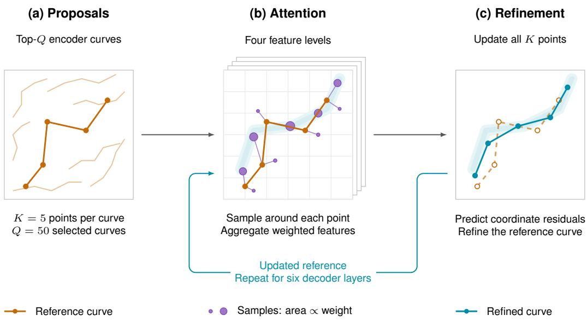  
Figure 1: Polyline prediction and iterative refinement in CryoTracer. (a) The Q = 50 highestscoring encoder proposals provide initial reference polylines with K = 5 ordered points. (b) Crossattention updates each query using encoder features around its current polyline (orange). Purple markers indicate sampling locations, with marker area proportional to attention weight. (c) The updated query refines the polyline, and the resulting curve (teal) guides attention in the next decoder layer. This process progressively refines the predictions.

## 3 METHOD

Below, we present CryoTracer, a method for detecting filament instances in high-resolution, noisy micrographs. First, we describe our proposed architecture, which modifies RF-DETR to enable a polyline-based representation of detected structures. Next, we explain a two-stage training paradigm that addresses the problem of limited annotated real data. The key components of our method are illustrated in Figure 1.

Architecture overview. Our detection model consists of an encoder ${ \mathcal { E } } _ { \theta }$ and a decoder ${ \mathcal { D } } _ { \phi } ,$ parameterized by θ and $\phi ,$ respectively. The decoder contains several learnable projection modules (ψ, Φ, Γ). Although these modules have separate parameter subsets, we denote all of them by ϕ for simplicity, emphasizing that they jointly constitute the decoder $\mathcal { D } _ { \phi }$

Feature extraction. Given an input micrograph $\mathbf { X } \in \mathbb { R } ^ { 1 \times W \times H }$ , the encoder ${ \mathcal { E } } _ { \theta }$ extracts a set of feature maps $\{ \mathbf { F } _ { l } \} _ { l = 1 } ^ { L }$ from L selected intermediate layers. Each spatial location of each feature map $\mathbf { { F } } _ { l }$ defines one candidate polyline proposal.

Initial proposal construction. For a spatial location $( x , y )$ in feature map $\mathbf { { F } } _ { l }$ , we obtain a latent proposal representation

$$
\mathbf { z } _ { i } = \psi _ { \phi } ( \mathbf { F } _ { l , x , y } ) ,\tag{1}
$$

where, for simplicity, we use a single index i to enumerate proposals across all feature maps. Each proposal is additionally associated with a center $\mathbf { c } _ { i } ,$ , corresponding to the normalized spatial position $( x , y )$ , and a scale $\mathbf { r } _ { i }$ determined by the feature-map level l. Coarser feature maps correspond to larger spatial scales.

From the latent representation $\mathbf { z } _ { i } ,$ , we predict a confidence score $\gamma _ { i } = \Phi _ { \phi } ( \mathbf { z } _ { i } )$ . We retain the $Q = 5 0$ proposals with the highest confidence scores. This exceeds the observed filament counts in both datasets (means: 20.3 and 5.9), while limiting decoder cost. Given the image sizes and filament widths, substantially denser scenes would also increase overlap and tracing ambiguity. For each retained proposal, an MLP $\Gamma _ { \phi }$ predicts offsets for $K$ ordered polyline points:

$$
\mathbf { D } _ { i } = \Gamma _ { \phi } \big ( \mathbf { z } _ { i } \big ) , \qquad \mathbf { D } _ { i } \in \mathbb { R } ^ { K \times 2 } .\tag{2}
$$

The initial polyline is then constructed as

$$
\mathbf { P } _ { i } = \left( \mathbf { c } _ { i } + \operatorname { t a n h } ( \mathbf { D } _ { i , k } ) \odot \mathbf { r } _ { i } \right) _ { k = 1 } ^ { K } .\tag{3}
$$

Each row $\mathbf { D } _ { i , k }$ specifies the offset of the k-th polyline point relative to the proposal center. The tanh function bounds the predicted offsets, while r scales them according to the spatial scale associated with the corresponding feature-map level. The resulting K ordered points form the initial polyline prediction $\mathbf { P } _ { i }$

Iterative polyline refinement. Each initial polyline is predicted independently from a single feature-map location $\mathbf { F } _ { l , x , y } .$ . Consequently, the initial predictions have two limitations. First, multiple proposals may correspond to the same filament, while other filaments may receive no proposal. Second, predicting the entire polyline from a single feature representation may result in inaccurate localization or shape estimates. Following RF-DETR, we address both limitations through an iterative refinement procedure depicted in Figure 1 b) and c).

For each decoder query slot i, we initialize the query content $\mathbf { q } _ { i } ^ { ( 0 ) }$ from a learned query embedding shared across images. The selected encoder proposal ${ \bf P } _ { i }$ supplies the initial reference geometry, ${ \bf P } _ { i } ^ { ( 0 ) } = { \bf P } _ { i }$

At decoder layer t, the queries first interact through self-attention,

$$
\tilde { \mathbf { q } } _ { i } ^ { ( t ) } = \mathrm { S e l f A t t n } _ { \phi } \left( \mathbf { q } _ { i } ^ { ( t - 1 ) } , \{ \mathbf { q } _ { j } ^ { ( t - 1 ) } \} _ { j = 1 } ^ { Q } \right) ,\tag{4}
$$

allowing information to be exchanged between proposals. This interaction helps the decoder reason jointly about the $Q$ candidate objects rather than refining each proposal independently.

Next, cross-attention aggregates information from all encoder feature levels $\{ \mathbf { F } _ { l } \} _ { l = } ^ { L }$ into query $\tilde { \mathbf { q } } _ { i } ^ { ( t ) }$ The current polyline $\mathbf { P } _ { i } ^ { ( t - 1 ) }$ provides the reference locations for sampling features around each of its points:

$$
{ \bf q } _ { i } ^ { ( t ) } = \mathrm { C r o s s A t t n } _ { \phi } \left( \tilde { \bf q } _ { i } ^ { ( t ) } , \{ { \bf F } _ { l } \} _ { l = 1 } ^ { L } ; { \bf P } _ { i } ^ { ( t - 1 ) } \right) .\tag{5}
$$

Consequently, the query is updated using features sampled around its current polyline across all feature levels.

Finally, the updated query predicts a correction to the current polyline,

$$
\mathbf { P } _ { i } ^ { ( t ) } = \mathrm { R e f i n e } _ { \phi } \left( \mathbf { P } _ { i } ^ { ( t - 1 ) } , \mathbf { q } _ { i } ^ { ( t ) } \right) .\tag{6}
$$

The refined polyline $\mathbf { P } _ { i } ^ { ( t ) }$ and query $\mathbf { q } _ { i } ^ { ( t ) }$ are passed to the next decoder layer, progressively improving the predictions. After the final layer, the resulting polylines $\{ \hat { \mathbf { P } } _ { i } \} _ { i = 1 } ^ { Q }$ form the decoder outputs.

Training objective. Since we are representing objects with polylines, a simple regression from off-the-shelf DETR methods is not applicable. Instead, to compare the predicted polyline $\hat { { \bf P } } _ { i }$ with a ground truth polyline $\mathbf { Y } _ { j } ,$ we use the Fréchet Distance $d _ { F } ( \hat { \bf P } _ { i } , { \bf Y } _ { j } )$ , which measures the spatial distance between two polylines rather than exact point-to-point alignment. To make the distance invariant to point direction (forward vs backward), we define it as

$$
\bar { d } _ { F } ( \hat { \mathbf { P } } _ { i } , \mathbf { Y } _ { j } ) = \operatorname* { m i n } \{ d _ { F } ( \hat { \mathbf { P } } _ { i } , \mathbf { Y } _ { j } ) , d _ { F } ( \mathrm { r e v } ( \hat { \mathbf { P } } _ { i } ) , \mathbf { Y } _ { j } ) \} ,\tag{7}
$$

where rev reverses the order of points. To find a proper match between the sets of predictions $\{ \hat { \mathbf { P } } _ { i } \} _ { i = 1 } ^ { Q }$ and ground truths $\{ \mathbf { Y } _ { j } \} _ { j = 1 } ^ { N }$ , we use Hungarian matching to find a minimum-cost oneto-one assignment that balances geometric distance $\bar { d } _ { F }$ and prediction confidence. Predictions not

selected by the assignment are optimized as no-object (polyline confidence $\gamma$ is minimized for them via the cross entropy loss term $\mathcal { L } _ { C E } )$ . For matched polylines, we optimize the following criterion

$$
\mathcal { L } _ { F } = \frac { 1 } { \operatorname* { m a x } ( N , 1 ) } \sum _ { j = 1 } ^ { N } \bar { d } _ { F } \left( \hat { \mathbf { P } } _ { \pi ( j ) } , { \mathbf { Y } } _ { j } \right) ,\tag{8}
$$

where $\pi ( j )$ is the index of the prediction matched to the j-th ground truth polyline. The crossentropy loss $\mathcal { L } _ { C E }$ also encourages high confidence for matched predictions. Combining classification and geometry gives

$$
\mathcal { L } = \mathcal { L } _ { C E } + \lambda _ { F } \mathcal { L } _ { F } ,\tag{9}
$$

with geometric loss weight $\lambda _ { F } = 1 0$

We apply Equation 9 independently to the final decoder predictions and the Q selected initial en coder proposals, obtaining ${ \mathcal { L } } _ { \mathrm { d e c } }$ and ${ \mathcal { L } } _ { \mathrm { e n c } } .$ , respectively. Each prediction set has its own Hungarian assignment. Encoder supervision directly trains the proposal heads because the initial coordinates are detached before decoder refinement. We therefore compute ${ \mathcal { L } } _ { \mathrm { e n c } }$ from an undetached copy of the selected proposals.

The decoder and encoder losses are combined as

$$
\mathcal { L } _ { \mathrm { t o t a l } } = \lambda _ { \mathrm { d e c } } \mathcal { L } _ { \mathrm { d e c } } + \lambda _ { \mathrm { e n c } } \mathcal { L } _ { \mathrm { e n c } } ,\tag{10}
$$

where $\lambda _ { \mathrm { d e c } } = \lambda _ { \mathrm { e n c } } = 1$

Synthetic pretraining. Starting from RF-DETR weights, we pretrain on procedural micrographs with exact centerline labels. The generator varies filament geometry, crossings, density, and image appearance, and includes empty fields. Procedural generation supplies diverse examples without additional manual tracing, providing supervision for learning filament shape and instance separation before adaptation to real data.

Real data finetuning. The synthetic checkpoint initializes finetuning on annotated real micrographs. This stage uses the available centerline annotations to adapt the pretrained representation to specimen-specific filament morphology and experimental image appearance. Both stages use the same architecture and objective, with all parameters trainable. Data generation and preprocessing are specified in Appendix A; optimization and checkpoint selection are specified in Appendix B.

Inference and non-maximum suppression. At inference, we retain predictions with confidence at least 0.5 and apply polyline non-maximum suppression (NMS) to remove duplicate filament detections. Duplicates are identified by similar unoriented directions, substantial projected overlap, and small perpendicular separation, preserving the geometry of the higher-confidence curve. We use the same thresholds across both datasets and evaluation regimes (Appendix B.2).

## 4 EXPERIMENTS

We evaluate how accurately CryoTracer and established cryo-EM methods recover complete filaments on EMPIAR-10022 and α-synuclein. We use a 70/15/15% train/validation/test split in the standard regime.

A typical reconstruction session contains about 2,000 micrographs, but experts may annotate only 30 to 50 to adapt a tracing model to a new specimen. We study this limited-annotation setting with a practical regime, using a 15/15/70% train/validation/test split.

We report precision, recall, and F1 for filament detection, with Box IoU and coverage as complementary overlap metrics. We detail the splits, baseline configurations, and prediction conversions in Appendix B.3.

## 4.1 EVALUATION METRICS

We measure complete-instance recovery using orientation-invariant discrete Fréchet matching between predicted and annotated centerlines. Precision, recall, and F1 are computed per micrograph and averaged across the evaluation set. Matching is sensitive to fragmentation and endpoint errors. Our primary metric, mF1, averages these macro F1 scores equally over distance tolerances of 25, 50, 100, 150, and 200 Å. We compute mRecall and mPrecision by the same averaging procedure. Main results summarize five training seeds for confirmation, while ablations use only one seed. Appendix tables give per-tolerance scores and sample standard deviations.

Box IoU and coverage provide complementary measures of spatial agreement between predicted and annotated filament regions. Pick counts and mean pick lengths in nanometres describe prediction and ground truth on the same evaluation images. Appendix B.4 specifies matching, resampling, and overlap definitions.

## 4.2 MAIN RESULTS

CryoTracer achieves the highest mF1 on both datasets and in both evaluation regimes (Tables 1 and 2).

EMPIAR-10022. CryoTracer achieves mF1 of 0.63 and 0.54 in the standard and practical regimes, compared with 0.08 and 0.09 for Topaz, the strongest baseline by mF1. CryoTracer leads both overlap metrics in the standard regime, whereas Topaz leads them in the practical regime.

Table 1: Filament detection on EMPIAR-10022 in the standard and practical regimes. mF1, mRecall, and mPrecision average per-micrograph scores over five distance tolerances (Section 4.1). Box IoU measures spatial overlap; coverage is the fraction of annotated area recovered. Pick count and mean polyline length (nm) summarize filament traces, with ground truth as a reference. CryoTracer values are means over five training seeds. Bold marks the highest unrounded score per metric and regime; pick statistics are descriptive.
<table><tr><td>Method</td><td>mF1</td><td>mRecall</td><td>mPrecision</td><td>Box IoU</td><td>Coverage</td><td>Pick count</td><td>Mean pick length (nm)</td></tr><tr><td colspan="6">Standard regime: ground truth</td><td>347</td><td>181</td></tr><tr><td>CryoTracer (ours)</td><td>0.63</td><td>0.63</td><td>0.63</td><td>0.84</td><td>0.90</td><td>337</td><td>176</td></tr><tr><td>Topaz</td><td>0.08</td><td>0.13</td><td>0.06</td><td>0.82</td><td>0.88</td><td>947</td><td>56</td></tr><tr><td>crÝOLO</td><td>0.03</td><td>0.03</td><td>0.03</td><td>0.66</td><td>0.69</td><td>329</td><td>122</td></tr><tr><td colspan="6">Practical regime: ground truth</td><td>1,578</td><td>190</td></tr><tr><td>CryoTracer (ours)</td><td>0.54</td><td>0.53</td><td>0.56</td><td>0.81</td><td>0.86</td><td>1,474</td><td>184</td></tr><tr><td>Topaz</td><td>0.09</td><td>0.16</td><td>0.06</td><td>0.86</td><td>0.92</td><td>4,607</td><td>61</td></tr><tr><td>crÝOLO</td><td>0.02</td><td>0.02</td><td>0.02</td><td>0.65</td><td>0.68</td><td>1,559</td><td>118</td></tr></table>

α-synuclein. CryoTracer achieves mF1 of 0.40 and 0.34 in the standard and practical regimes, compared with 0.11 and 0.09 for the RELION Amyloid model, the strongest baseline by mF1. CryoTracer leads Box IoU in both regimes; Topaz has higher practical-regime coverage.

Implications for filament processing. On standard α-synuclein, Topaz produces 1,659 picks with mean pick length 33 nm, compared with 272 annotated filaments averaging 203 nm. CryoTracer produces 278 picks averaging 176 nm. The shorter, more numerous Topaz picks are consistent with fragmentation, although false positives and endpoint errors can also contribute. Thus, substantial spatial overlap can coexist with poor recovery of individual filaments. Figure 7 illustrates these differences in the picked-filament length distributions.

Figures 2 and 3 show selected predictions, with additional galleries in Appendix C.

## 4.3 ABLATIONS

In this section, we study how synthetic initialization, curve supervision, and architecture affect filament detection. We compare each variant with the main model in Table 3. We describe the training changes in Appendix B.1 and report results at each matching tolerance in Appendix C.

Synthetic initialization. With identical real-data partitions, 20,000 synthetic steps followed by 5,000 real-data steps yield standard-regime mF1 of 0.62 on EMPIAR-10022 and 0.44 on α- synuclein. Training directly from RF-DETR for 25,000 real-data steps gives 0.59 and 0.39, respectively. The corresponding practical-regime scores are 0.53 and 0.36 with synthetic initialization, versus 0.40 and 0.11 for real-only training. The observed advantage is therefore larger in the practical regime.

Table 2: Filament detection on α-synuclein in the standard and practical regimes. mF1, mRecall, and mPrecision average per-micrograph scores over five distance tolerances (Section 4.1). Box IoU measures spatial overlap; coverage is the fraction of annotated area recovered. Pick count and mean polyline length (nm) summarize filament traces, with ground truth as a reference. CryoTracer values are means over five training seeds. Bold marks the highest unrounded score per metric and regime; pick statistics are descriptive.
<table><tr><td>Method</td><td>mF1</td><td>mRecall</td><td>mPrecision</td><td>Box IoU</td><td>Coverage</td><td>Pick count</td><td>Mean pick length (nm)</td></tr><tr><td colspan="6">Standard regime: ground truth</td><td>272</td><td>203</td></tr><tr><td>CryoTracer (ours)</td><td>0.40</td><td>0.43</td><td>0.39</td><td>0.75</td><td>0.84</td><td>278</td><td>176</td></tr><tr><td>Topaz</td><td>0.01</td><td>0.04</td><td>0.01</td><td>0.59</td><td>0.80</td><td>1,659</td><td>33</td></tr><tr><td>crÝOLO</td><td>0.01</td><td>0.01</td><td>0.01</td><td>0.60</td><td>0.66</td><td>540</td><td>60</td></tr><tr><td>RELION Amyloid</td><td>0.11</td><td>0.11</td><td>0.11</td><td>0.59</td><td>0.63</td><td>342</td><td>94</td></tr><tr><td colspan="6">Practical regime: ground truth</td><td>1,364</td><td>203</td></tr><tr><td>CryoTracer (ours)</td><td>0.34</td><td>0.36</td><td>0.33</td><td>0.69</td><td>0.80</td><td>1,374</td><td>181</td></tr><tr><td>Topaz</td><td>0.02</td><td>0.05</td><td>0.01</td><td>0.63</td><td>0.83</td><td>7,891</td><td>34</td></tr><tr><td>crÝOLO</td><td>0.00</td><td>0.00</td><td>0.00</td><td>0.58</td><td>0.62</td><td>2,498</td><td>61</td></tr><tr><td>RELION Amyloid</td><td>0.09</td><td>0.09</td><td>0.09</td><td>0.61</td><td>0.66</td><td>1,914</td><td>88</td></tr></table>

Table 3: CryoTracer ablations of synthetic initialization, curve supervision, and architecture. Synthetic pretraining uses up to 20,000 steps; real-data training uses up to 5,000 steps unless marked 25k. Bold labels identify the main model configuration. Higher mF1 and Box IoU are better. Training and architecture details appear in Appendix B.1.
<table><tr><td colspan="5"></td><td colspan="2">EMPIAR-10022</td><td colspan="2">α-synuclein</td></tr><tr><td>Experiment</td><td>Training</td><td>Distance</td><td>Points</td><td>Pyramid levels</td><td>mF1</td><td>Box IoU</td><td>mF1</td><td>Box IoU</td></tr><tr><td colspan="7">Standard regime</td><td></td><td></td></tr><tr><td>Main</td><td>Synthetic + real Fréchet</td><td></td><td>5</td><td>4</td><td>0.62</td><td>0.85</td><td>0.44</td><td>0.75</td></tr><tr><td rowspan="2">Training strategy</td><td>Synthetic only</td><td>Fréchet</td><td>5</td><td>4</td><td>0.00</td><td>0.05</td><td>0.00</td><td>0.01</td></tr><tr><td>Real only (5k)</td><td>Fréchet</td><td>5</td><td>4</td><td>0.16</td><td>0.49</td><td>0.18</td><td>0.51</td></tr><tr><td rowspan="2"></td><td>Real only (25k)</td><td>Fréchet</td><td>5</td><td>4</td><td>0.59</td><td>0.83</td><td>0.39</td><td>0.71</td></tr><tr><td>Real only (5k)</td><td>Chamfer</td><td>5</td><td>4</td><td>0.00</td><td>0.42</td><td>0.00</td><td>0.35</td></tr><tr><td rowspan="2">Distance metric</td><td>Synthetic + real</td><td>Chamfer</td><td>5</td><td>4</td><td>0.03</td><td>0.71</td><td>0.01</td><td>0.69</td></tr><tr><td>Synthetic + real</td><td>Fréchet</td><td>3</td><td>4</td><td>0.65</td><td>0.85</td><td>0.41</td><td>0.73</td></tr><tr><td rowspan="2">Number of points Feature pyramid</td><td>Synthetic + real</td><td>Fréchet</td><td>10</td><td>4</td><td>0.60</td><td>0.83</td><td>0.42</td><td>0.74</td></tr><tr><td>Synthetic + real</td><td>Fréchet</td><td>5</td><td>1</td><td>0.56</td><td>0.81</td><td>0.36</td><td>0.73</td></tr><tr><td>Original attention</td><td>Synthetic + real</td><td>Fréchet</td><td>5</td><td>4</td><td>0.57</td><td>0.82</td><td>0.33</td><td>0.69</td></tr><tr><td>Practical regime</td><td></td><td></td><td></td><td></td><td></td><td></td><td></td><td></td></tr><tr><td>Main</td><td>Synthetic + real</td><td> Fréchet</td><td>5</td><td>4</td><td>0.53</td><td>0.80</td><td>0.36</td><td>0.70</td></tr><tr><td rowspan="3">Training strategy</td><td>Synthetic only</td><td>Fréchet</td><td>5</td><td>4</td><td>0.00</td><td>0.05</td><td>0.00</td><td>0.01</td></tr><tr><td>Real only (5k)</td><td>Fréchet</td><td>5</td><td>4</td><td>0.07</td><td>0.45</td><td>0.02</td><td>0.28</td></tr><tr><td>Real only (25k)</td><td>Fréchet</td><td>5</td><td>4</td><td>0.40</td><td>0.68</td><td>0.11</td><td>0.44</td></tr></table>

With only 5,000 real-only steps, mF1 is 0.16 and 0.18 in the standard regime and 0.07 and 0.02 in the practical regime. Synthetic initialization also improves spatial overlap relative to both real-only budgets. Real-data adaptation remains necessary, as the frozen synthetic-only model yields mF1 of 0.00 in all four settings.

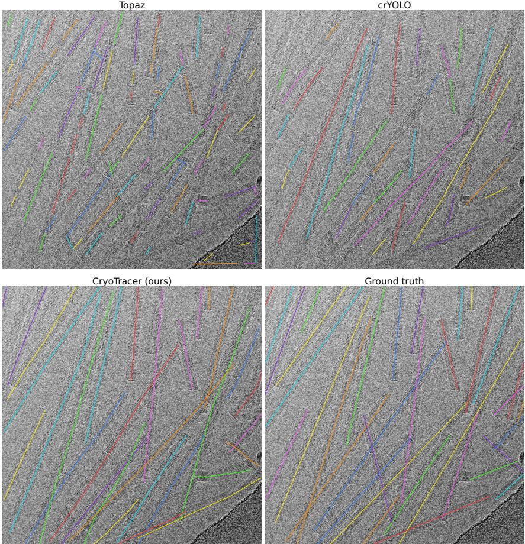  
Figure 2: EMPIAR-10022, standard regime. One selected micrograph from the corresponding evaluation set, with method predictions and ground truth labeled in the panels. Images are low-pass filtered and contrast adjusted for display. Colors distinguish curves within a panel and do not indicate matched identities across methods.

Curve supervision. Replacing Fréchet distance with Chamfer distance in both Hungarian matching and regression reduces standard-regime mF1 from 0.62 to 0.03 on EMPIAR-10022 and from 0.44 to 0.01 on α-synuclein after synthetic pretraining. Box IoU remains 0.71 and 0.69, respectively. Substantial spatial overlap can therefore coexist with poor complete-instance agreement. This is consistent with Chamfer’s insensitivity to point order.

Architecture. Restoring original RF-DETR box attention, while retaining five-point polyline outputs, lowers standard-regime mF1 to 0.57 on EMPIAR-10022 and 0.33 on α-synuclein, compared with 0.62 and 0.44 for the main model. Box IoU decreases to 0.82 and 0.69, respectively.

Reducing the feature pyramid from four levels to one lowers standard-regime mF1 from 0.62 to 0.56 on EMPIAR-10022 and from 0.44 to 0.36 on α-synuclein. Point-count effects vary by dataset. Three points score highest on EMPIAR-10022, whereas five score highest on α-synuclein. The simpler three-point representation may suit EMPIAR-10022’s relatively clean, straight filaments. However, its two line segments limit the representation of more strongly curved filaments, so this advantage may not generalize to more complex geometries. Ten points improve neither mF1 nor Box IoU over five.

We find that synthetic pretraining followed by real-data adaptation improves mF1 over real-only training, with larger gains when annotations are limited. Our results also support Fréchet supervision, the modified attention design, and a four-level feature pyramid. Although the preferred point count depends on the dataset, we find five points to offer a reasonable compromise across the two datasets.

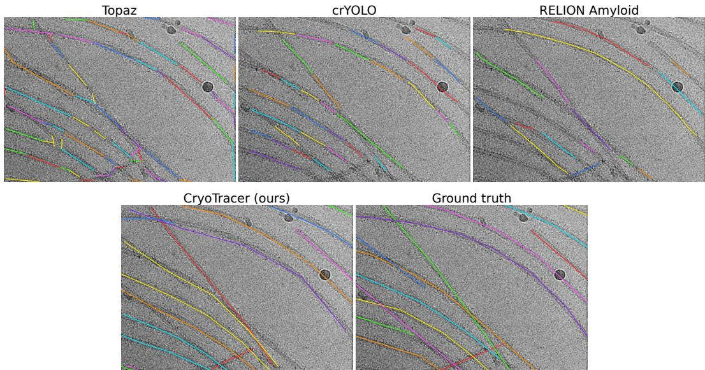  
Figure 3: α-synuclein, standard regime. One selected micrograph from the corresponding evaluation set, with method predictions and ground truth labeled in the panels. Images are low-pass filtered and contrast adjusted for display. Colors distinguish curves within a panel and do not indicate matched identities across methods.

## 4.4 LIMITATIONS

CryoTracer remains sensitive to ambiguous filament geometry. At crossings and overlaps, predicted traces can connect distinct filaments or recover only part of an instance. The fixed five-point representation may also limit the fidelity of traces with complex curvature. Synthetic pretraining reduces reliance on real training annotations but does not eliminate it. Our results cover two datasets with specimen-specific fine-tuning. Generalization to unseen specimens and acquisition conditions requires further evaluation. The next step is to test whether improved filament recovery translates into more effective downstream classification and reconstruction.

## 5 CONCLUSION

CryoTracer learns to trace individual cryo-EM filaments by predicting ordered centerline polylines, making geometry and instance identity explicit in the model output. The framework combines procedural synthetic pretraining, orientation-invariant Fréchet supervision, and specimen-specific fine-tuning. On EMPIAR-10022 and α-synuclein, it achieves higher complete-instance mF1 than Topaz and crYOLO in both standard and limited-annotation regimes, and outperforms the RELION Amyloid baseline on α-synuclein. Ablations support the value of synthetic initialization, with larger gains when real training annotations are scarce. Together with the overlap metrics, these results show why filament tracing should be evaluated for both spatial coverage and instance continuity. We release new EMPIAR-10022 centerline annotations to support further evaluation.

## ACKNOWLEDGMENTS

Computations were performed at the Wrocław Centre for Networking and Supercomputing under grant No. 1766404231.

## REFERENCES

Albert Alonso and Julius B Kirkegaard. Fast detection of slender bodies in high density microscopy data. Communications Biology, 6(1):754, 2023.

Tristan Bepler, Andrew Morin, Micah Rapp, Julia Brasch, Lawrence Shapiro, Alex J. Noble, and Bonnie Berger. Positive-unlabeled convolutional neural networks for particle picking in cryo-electron micrographs. Nature Methods, 2019. ISSN 1548-7105. doi: 10.1038/ s41592-019-0575-8. URL https://doi.org/10.1038/s41592-019-0575-8.

Nicolas Carion, Francisco Massa, Gabriel Synnaeve, Nicolas Usunier, Alexander Kirillov, and Sergey Zagoruyko. End-to-end object detection with transformers. In European conference on computer vision, pp. 213–229. Springer, 2020.

Ashwin Dhakal, Rajan Gyawali, Liguo Wang, and Jianlin Cheng. Cryotransformer: A transformer model for picking protein particles from cryo-em micrographs. Bioinformatics, 2024. doi: 10. 1093/bioinformatics/btae109. URL https://doi.org/10.1093/bioinformatics/ btae109.

Masahiro Enomoto, Ivan Martinez-Valbuena, Shelley L. Forrest, Xiaoxiao Xu, Renato P. Munhoz, Jun Li, Ekaterina Rogaeva, Anthony E. Lang, and Gabor G. Kovacs. Lewy-msa hybrid fold drives distinct neuronal α-synuclein pathology. Communications Biology, 8(1), June 2025. ISSN 2399-3642. doi: 10.1038/s42003-025-08355-7. URL http://dx.doi.org/10.1038/ s42003-025-08355-7.

Lukas Frey, Dhiman Ghosh, Bilal M. Qureshi, David Rhyner, Ricardo Guerrero-Ferreira, Aditya Pokharna, Witek Kwiatkowski, Tetiana Serdiuk, Paola Picotti, Roland Riek, and Jason Greenwald. On the ph-dependence of α-synuclein amyloid polymorphism and the role of secondary nucleation in seed-based amyloid propagation. eLife, 12:RP93562, 2024. doi: 10.7554/eLife. 93562.4. URL https://elifesciences.org/articles/93562.

Simon A. Fromm, Tanmay A.M. Bharat, Arjen J. Jakobi, Wim J.H. Hagen, and Carsten Sachse. Seeing tobacco mosaic virus through direct electron detectors. Journal of Structural Biology, 189(2):87–97, 2015. ISSN 1047-8477. doi: 10.1016/j.jsb.2014.12.002. URL https://www. sciencedirect.com/science/article/pii/S1047847714002652.

Binsen Li, Peng Ge, Kevin A. Murray, Phorum Sheth, Meng Zhang, Gayatri Nair, Michael R. Sawaya, Woo Shik Shin, David R. Boyer, Shulin Ye, David S. Eisenberg, Z. Hong Zhou, and Lin Jiang. Cryo-em of full-length α-synuclein reveals fibril polymorphs with a common structural kernel. Nature Communications, 9:3609, 2018. doi: 10.1038/s41467-018-05971-2. URL https://www.nature.com/articles/s41467-018-05971-2.

Sofia Lövestam and Sjors H. W. Scheres. High-throughput cryo-em structure determination of amyloids. Faraday Discussions, 240:243–260, 2022. doi: 10.1039/D2FD00034B.

Sofia Lövestam, David Li, Jane L. Wagstaff, Abhay Kotecha, Dari Kimanius, Stephen H. McLaughlin, Alexey G. Murzin, Stefan M. V. Freund, Michel Goedert, and Sjors H. W. Scheres. Diseasespecific tau filaments assemble via polymorphic intermediates. Nature, 625(7993):119–125, November 2023. ISSN 1476-4687. doi: 10.1038/s41586-023-06788-w. URL http://dx. doi.org/10.1038/s41586-023-06788-w.

Sofia Lövestam, Jenny Shi, David Li, Kiarash Jamali, and Sjors H.W. Scheres. Cryo-em image processing of amyloid filaments in relion-5.1. bioRxiv, 2026. doi: 10.64898/2026.03.17. 712386. URL https://www.biorxiv.org/content/early/2026/03/17/2026. 03.17.712386.

Ali Punjani, John L Rubinstein, David J Fleet, and Marcus A Brubaker. cryosparc: algorithms for rapid unsupervised cryo-em structure determination. Nature methods, 14(3):290–296, 2017.

Isaac Robinson, Peter Robicheaux, Matvei Popov, Deva Ramanan, and Neehar Peri. RF-DETR: Neural Architecture Search for Real-Time Detection Transformers. In International Conference on Learning Representations, 2026.

Sjors H.W. Scheres. Relion: Implementation of a bayesian approach to cryo-em structure determination. Journal ofStructural Biology, 180(3):519–530, December 2012. ISSN 1047-8477. doi: 10. 1016/j.jsb.2012.09.006. URL http://dx.doi.org/10.1016/j.jsb.2012.09.006.

Manuel Schweighauser, Yang Shi, Airi Tarutani, Fuyuki Kametani, Alexey G. Murzin, Bernardino Ghetti, Tomoyasu Matsubara, Taisuke Tomita, Takashi Ando, Kazuko Hasegawa, Shigeo Murayama, Mari Yoshida, Masato Hasegawa, Sjors H. W. Scheres, and Michel Goedert. Structures of α-synuclein filaments from multiple system atrophy. Nature, 585(7825):464–469, May 2020. ISSN 1476-4687. doi: 10.1038/s41586-020-2317-6. URL http://dx.doi.org/10. 1038/s41586-020-2317-6.

Maria Grazia Spillantini, Marie Luise Schmidt, Virginia M.-Y. Lee, John Q. Trojanowski, Ross Jakes, and Michel Goedert. α-Synuclein in lewy bodies. Nature, 388(6645):839–840, August 1997. ISSN 1476-4687. doi: 10.1038/42166. URL http://dx.doi.org/10.1038/ 42166.

Kent R Thurber, Yi Yin, and Robert Tycko. Automated picking of amyloid fibrils from cryo-em images for helical reconstruction with relion. Journal of structural biology, 213(2):107736, 2021.

Thorsten Wagner, Luca Lusnig, Sabrina Pospich, Markus Stabrin, Fabian Schönfeld, and Stefan Raunser. Two particle-picking procedures for filamentous proteins: Sphire-cryolo filament mode and sphire-striper. Acta Crystallographica Section D: Structural Biology, 76(7):613–620, 2020. doi: 10.1107/S2059798320007342.

Yang Yang, Yang Shi, Manuel Schweighauser, Xianjun Zhang, Abhay Kotecha, Alexey G. Murzin, Holly J. Garringer, Patrick W. Cullinane, Yuko Saito, Tatiana Foroud, Thomas T. Warner, Kazuko Hasegawa, Ruben Vidal, Shigeo Murayama, Tamas Revesz, Bernardino Ghetti, Masato Hasegawa, Tammaryn Lashley, Sjors H. W. Scheres, and Michel Goedert. Structures of α- synuclein filaments from human brains with lewy pathology. Nature, 610(7933):791–795, September 2022. ISSN 1476-4687. doi: 10.1038/s41586-022-05319-3. URL http://dx. doi.org/10.1038/s41586-022-05319-3.

Xinyu Zhang, Tianfang Zhao, Jiansheng Chen, Yuan Shen, and Xueming Li. Epicker is an exemplarbased continual learning approach for knowledge accumulation in cryoem particle picking. Nature Communications, 13(1):2468, 2022.

# CryoTracer Appendix

## A DATA

We use two real cryo-electron microscopy datasets and a procedurally generated dataset. All annotations are represented as ordered polylines, where each polyline describes the centerline of one filament.

EMPIAR-10022. EMPIAR-10022 is a public dataset of tobacco mosaic virus micrographs Fromm et al. (2015). The original helical annotations were of insufficient quality for reliable filament-level evaluation, so we reannotated the micrographs with ordered filament centerlines. We make these new annotations publicly available. Our annotated dataset contains 109 images at a native resolution of 4096 × 4096 pixels and a pixel size of 1.06 $\mathring { \mathbf { A } } / \mathfrak { p } \mathrm { x }$

α-synuclein. The α-synuclein dataset is a private, in-house collection of 11 reconstruction sessions comprising 325 cryo-EM micrographs annotated by a cryo-EM expert. All sessions were collected by the same person in the same laboratory. Each micrograph has a native resolution of 5760 × 4092 pixels and a pixel size of 0.65 Å/px.

Real-image preprocessing. Micrographs are downsampled by a factor of 4 using bicubic interpolation with antialiasing (torchvision resize with antialias=True). EMPIAR-10022 images are mapped from 4096 × 4096 to 1024 × 1024, and α-synuclein images from 5760 × 4092 to 1440 × 1023. Polyline coordinates are divided by 4 and normalized by the resulting image dimensions. Pixel-size metadata is multiplied by 4. Training applies horizontal and vertical flips independently with probability 0.5 and uniformly sampled in-plane rotations. A radial Fourier lowpass mask at $0 . 2 \mathring \mathrm { A } ^ { - 1 }$ filters the images, which are standardized over valid pixels and clipped to [−5, 5]. Validation and test preprocessing uses the same filtering and normalization without geometric augmentation.

Synthetic pretraining data. To expose the model to a broad range of filament geometries before adaptation to real data, we construct a procedural micrograph dataset. Each example is defined in a native 4096 × 4096 coordinate system and rendered directly at 1024 × 1024 resolution. Non empty images contain between one and 30 curved filaments. Filaments are generated from smooth parametric curves, clipped at the image boundary, and include explicit crossing configurations. Ten percent of examples are empty, allowing the model to learn from background-only micrographs.

We randomize both imaging and specimen properties. The native pixel size is sampled uniformly from 0.65 to $1 . 5 \mathring \mathrm { A } / \mathfrak { p } \mathbf { x } .$ , corresponding to an effective input sampling of $2 . 6 \mathrm { - 6 . 0 \mathring { A } / p x }$ at the rendered resolution. Filament widths are sampled from 100-200 Å. Appearance variation includes both contrast polarities, spatial background gradients, Gaussian blur, and additive noise. These perturbations are intended to encourage transfer across datasets rather than reproduce a particular microscope contrast-transfer function.

## A.1 POLYLINE SAMPLING

Synthetic and real annotations use the same five-point target conversion. For annotations with more than five points, we select five vertices at uniformly spaced indices, rounded down, including both endpoints. For annotations with at most five points, we retain every annotated point and add any needed points along the existing segments in proportion to their lengths. Thus, short annotations are only augmented rather than resampled, so no annotated bend is inadvertently omitted or replaced by a chord.

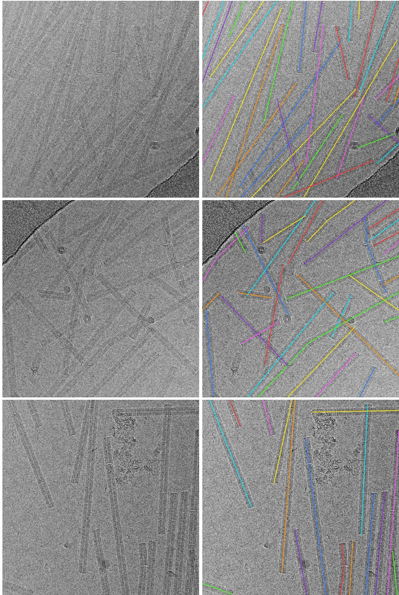  
Figure 4: EMPIAR-10022 dataset examples. Each row pairs an image (left) with a low-pass-filtered image and its ground-truth centerlines (right). Colors distinguish annotated filament instances.

For evaluation, predicted and reference polylines are sampled uniformly by arc length to 32 points. This gives curves with different original point counts a common representation for matching and metric computation while preserving a denser approximation of local bends.

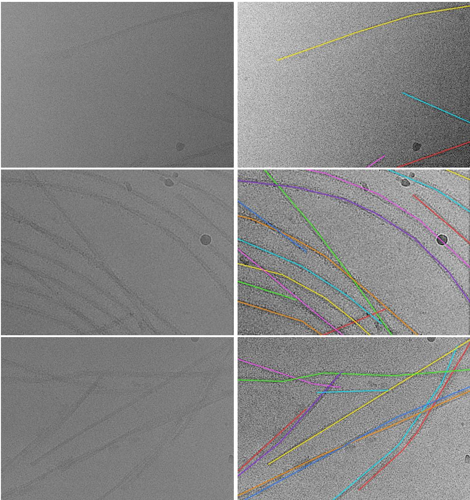  
Figure 5: α-synuclein dataset examples. Each row pairs an image (left) with a low-pass-filtered image and its ground-truth centerlines (right). Colors distinguish annotated filament instances.

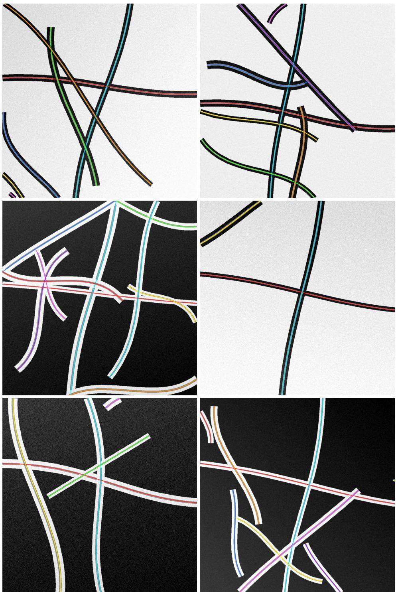  
Figure 6: Synthetic dataset examples. Six synthetic micrographs are shown with their ground-truth centerlines. Colors distinguish annotated filament instances.

## B TRAINING AND EVALUATION DETAILS

## B.1 TRAINING CONFIGURATION

Hardware and optimization. Each CryoTracer run uses one NVIDIA H100 GPU, bfloat16 mixed precision, gradient checkpointing, and a batch size of 64 micrographs. AdamW uses weight decay $\mathrm { \dot { 1 } 0 ^ { - 4 } }$ and initial learning rates of 10−4 for the detector and $1 0 ^ { - 5 }$ for the backbone. A cosine schedule decays both towards $1 \mathrm { { 0 } ^ { - 6 } }$ over each stage, with gradient clipping at 1.0. The complete model remains trainable throughout.

Training stages and validation. Synthetic pretraining starts from RF-DETR weights adapted to single-channel input and runs for at most 20,000 steps, with validation every 500 steps. The selected synthetic model initializes dataset-specific fine-tuning for at most 5,000 steps, with validation every 100 steps on the corresponding real validation partition. Fine-tuning starts a new optimizer and learning-rate schedule. Within each seed, the same selected synthetic initialization is used for both real datasets and their standard and practical regimes.

Checkpoint selection. At each stage, we retain the checkpoint minimizing the final decoder’s classification loss plus weighted polyline regression loss on the validation set. Encoder and intermediate decoder terms are excluded from this selection criterion. Final evaluation uses the selected real-data checkpoint. Test metrics do not influence model selection.

Loss implementation. Batch regression losses are normalized by the total target count, clamped to at least one. Distributed training synchronizes this normalization across workers. Squared distances are floored at $1 0 ^ { - 1 2 }$ before taking square roots. The hard minimum and maximum operations in the Fréchet recurrence are piecewise differentiable. Automatic differentiation follows the selected branches with the framework’s subgradient convention at ties. Reversal invariance applies to the objective, not to the decoder’s internal features.

Ablation configurations. The ablation reference uses the main model’s configuration, including synthetic pretraining, Fréchet matching and regression, auxiliary decoder supervision, five polyline points, and a four-level feature pyramid. The no-synthetic condition starts directly from RF-DETR weights with a 5,000-step real-data training budget. Additional real-only controls train for 25,000 steps with the cosine schedule extended over that budget, matching the total optimizer steps of 20,000-step synthetic pretraining plus 5,000-step fine-tuning. These controls retain the same model, data partitions, and validation-selection criterion in both regimes. Optimizer-step matching does not imply identical wall time or computational cost. The Chamfer condition changes both matching and regression in pretraining and fine-tuning, using its own validation-selected synthetic initialization. The architecture ablations use three or ten polyline points, or a single feature-pyramid level. Each is pretrained and fine-tuned with the corresponding architecture.

The original-attention ablation restores RF-DETR’s box-based deformable cross-attention and box positional encoding. At each decoder layer, the reference polyline supplies its axis-aligned enclosing box. This variant samples four locations per head and feature level, compared with four per polyline point (20 total) in the main model. It retains five-point outputs, polyline refinement and losses, and the four-level feature pyramid, using its own 20,000-step synthetic pretraining and 5,000-step realdata fine-tuning. The comparison therefore changes reference geometry, positional encoding, and sampling budget together.

## B.2 INFERENCE AND PARTICLE EXPORT

Duplicate suppression. For filament evaluation, polyline NMS identifies duplicates using their unoriented directions, projected overlap relative to the shorter projected trace, and perpendicular separation. We use a 12◦ angular threshold, minimum overlap ratio 0.8, and maximum separation 140 Å across both datasets and regimes. Suppression favors the higher-confidence curve and preserves its geometry. Fragments remain separate.

RELION particle export. The optional export samples confidence-filtered curves uniformly by arc length, with physical spacing equal to the user-specified helical rise times the number of asymmetric units between samples. Centers whose extraction boxes would extend outside the micrograph are omitted. Each particle records its native coordinates, parent filament identifier, local tangentangle prior, and cumulative distance along the original trace. Export-specific duplicate suppression and optional crossing exclusion operate on sampled particles. Removed samples leave gaps without resetting track distances. Filament identifiers restart within each micrograph. The resulting STAR file includes the associated optics and CTF metadata from the supplied micrographs STAR file and supports subsequent particle extraction in RELION. CryoTracer writes particle metadata, and RE-LION performs image extraction.

## B.3 EVALUATION PROTOCOL

Repeated runs and aggregation. Main-text CryoTracer results report means over five training runs (seeds 42-46). Appendix tables add the sample standard deviation. Ablations use seed 42, and each baseline has one run. Within each seed, instance scores are averaged over the same evaluation micrographs within each regime. mF1, mRecall, and mPrecision additionally average over distance tolerances before aggregation across runs. Pick counts and mean pick lengths are also computed separately for each seed before reporting their mean and sample standard deviation. Standard deviations describe variation across seeds, not across tolerances, micrographs, or individual filament lengths.

Data regimes. We evaluate two data regimes. In the standard regime, EMPIAR-10022 is split into 76 training, 16 validation, and 17 test micrographs, while the α-synuclein dataset is split into 227 training, 48 validation, and 50 test micrographs. These correspond approximately to a 70/15/15% train/validation/test split.

The practical regime reduces the amount of annotated data available for training to approximately 15% of each dataset while retaining approximately 15% for validation and leaving about 70% for evaluation. We obtain this split by rotating the standard partitions. The validation set is used for training, the test set for validation, and the training set for evaluation. This results in 16/17/76 train/validation/evaluation micrographs for EMPIAR-10022 and 48/50/227 for α-synuclein.

Partitions are defined at the micrograph level. For α-synuclein, reconstruction sessions overlap across training, validation, and evaluation partitions in both regimes, while individual micrographs remain disjoint within each regime. This protocol evaluates held-out micrographs from the collection described in Appendix A.

Comparison methods. Topaz and crYOLO use the same supervised partitions as CryoTracer. Their configuration required substantial manual tuning by a cryo-EM expert, including datasetspecific picking and filament-tracing settings, which were then fixed for evaluation. Topaz is trained for 10 epochs with an expected particle count of 200, using downsampling factors of four and six and extraction thresholds of −3 and −4 for EMPIAR-10022 and α-synuclein, respectively. crY-OLO uses filament mode with expert-selected box sizes of 400 and 512 pixels, approximately twice the filament width to include surrounding image context. The filament-width argument (-fw) is set to the corresponding box size, with tracing box distances of 40 and 51 pixels, respectively. These expert-selected picking and tracing settings are independent of the tighter physical filament widths used for spatial-overlap evaluation below. CryoTracer uses the same optimization recipe and inference thresholds across both datasets and regimes, without corresponding dataset-specific manual tuning. Its specimen-specific model-weight fine-tuning remains part of training. This comparison of tuning effort is qualitative. The experiments compare configured systems without matched hyperparameter-search or compute budgets, and do not quantify expert time or the number of tuning trials.

RELION Amyloid. RELION 5.1’s AmyTracer pipeline combines an amyloid-specific Fourier signal with a pretrained neural network and subsequent tracing Lövestam et al. (2026). It is therefore a learned, pretrained reference, even when used without dataset-specific training. We evaluate the official pretrained AmyTracer v2.0 checkpoint only on α-synuclein. The RELION-5.1.0 release supplies inference code but no AmyTracer training or fine-tuning code, so we perform no dataset-specific weight updates. The same checkpoint is evaluated on the original test partition in the standard regime and the original training partition in the practical regime, matching the evaluation micrographs used by the other methods within each regime. We also retain the RELION-5.1 default tracing parameters. Its amyloid cross-beta signal makes it applicable to α-synuclein, but not the tobacco mosaic virus filaments in EMPIAR-10022.

Inference settings and representations. CryoTracer uses a confidence threshold of 0.5 and the polyline NMS described in Appendix B.2. Topaz predictions are interpreted as consecutive endpoint pairs. crYOLO box centers and RELION traces are grouped by filament identifier. These conversions preserve the methods’ exported representations. Short fragments can therefore achieve high spatial overlap while failing to match a complete annotated instance. All coordinates are mapped to native pixels and converted to physical units for evaluation.

## B.4 EVALUATION METRIC DEFINITIONS

Instance matching. Predicted and reference curves are sampled uniformly by arc length to 32 points. The distinction from the five-point training construction is explained in Appendix A.1. Following the notation in Section 3, let $\mathcal { P } = \{ \hat { \mathbf { P } } _ { i } \}$ and ${ \mathcal G } = \{ \mathbf { Y } _ { j } \}$ denote the predicted and ground truth polylines, respectively, and define

$$
D _ { i j } = \bar { d } _ { F } ( \hat { \bf P } _ { i } , { \bf Y } _ { j } ) ,\tag{11}
$$

using the orientation-invariant distance in Equation 7, measured in $\mathring \mathrm { A } .$ At tolerance τ, only pairs with $D _ { i j } \leq \tau$ are eligible. Hungarian assignment with this tolerance constraint first maximizes the number of valid one-to-one matches, then minimizes their total distance. Matched pairs are true positives. Unmatched predictions and ground truth polylines are false positives and false negatives, respectively. The per-image counts give

$$
\begin{array} { l } { \displaystyle P _ { \tau } = \frac { \mathrm { T P } _ { \tau } } { \mathrm { T P } _ { \tau } + \mathrm { F P } _ { \tau } } , } \\ { \displaystyle R _ { \tau } = \frac { \mathrm { T P } _ { \tau } } { \mathrm { T P } _ { \tau } + \mathrm { F N } _ { \tau } } , } \\ { \displaystyle F 1 _ { \tau } = \frac { 2 P _ { \tau } R _ { \tau } } { P _ { \tau } + R _ { \tau } } . } \end{array}\tag{12}
$$

We report the mean of each per-image score, with undefined ratios assigned zero, including images with no predictions or annotations. Macro F1 is therefore the mean of per-image F1 scores. With the fixed tolerance set T = {25, 50, 100, 150, 200} Å, our primary metric is

$$
\mathrm { m F 1 } = \frac { 1 } { | T | } \sum _ { \tau \in \mathcal { T } } \frac { 1 } { M } \sum _ { i = 1 } ^ { M } F 1 _ { i , \tau } ,\tag{13}
$$

where M is the number of evaluation micrographs. mRecall and mPrecision use the same equalweight averaging of the corresponding per-image scores. mF1 averages F1 directly and is not the harmonic mean of mPrecision and mRecall. Scores at individual tolerances are secondary diagnostics.

Spatial overlap. For each image, let $B _ { \mathcal { P } }$ and $B _ { \mathcal { G } }$ be the unions of axis-aligned boxes swept along the predicted and reference curves. The metric box width is independent of the particle-extraction box. We use 170 native pixels for EMPIAR-10022, corresponding to the established 180 Å TMV diameter, and 215 pixels for α-synuclein, corresponding to an assumed 140 Å filament width. These tight widths measure agreement around the filament itself and are shared by all methods within each dataset. Define

$$
\begin{array} { r } { \mathrm { B o x I o U } = \frac { \left| B _ { \mathcal { P } } \cap B _ { \mathcal { G } } \right| } { \left| B _ { \mathcal { P } } \cup B _ { \mathcal { G } } \right| } , } \\ { \mathrm { C o v e r a g e } = \frac { \left| B _ { \mathcal { P } } \cap B _ { \mathcal { G } } \right| } { \left| B _ { \mathcal { G } } \right| } . } \end{array}\tag{14}
$$

Box IoU penalizes both missing and excess predicted area. Coverage measures the fraction of reference area recovered. We average Box IoU over all images, assigning one when both masks are empty, and coverage over images with non-empty ground truth. These union-based metrics do not measure instance identity and depend on the specified box width.

## C ADDITIONAL RESULTS

Table 4: Detailed filament-detection results on EMPIAR-10022. Precision (P), recall (R), and F1 are averaged over micrographs at each distance tolerance (in Å). Box IoU and coverage measure spatial overlap. Pick count and mean polyline length (nm) summarize filament traces, with ground truth as a reference. CryoTracer values are mean ± sample standard deviation over five seeds, with statistics computed separately per seed. Bold marks the highest unrounded score per metric and regime. Pick statistics are descriptive. Regimes use different evaluation sets.

<table><tr><td>Regime Method</td><td>P@25</td><td>R@25</td><td>F1@25</td><td>P@50</td><td></td><td>R@50</td><td>F1@50</td><td>P@100</td><td>R@100</td><td>F1@100</td><td>P@150</td><td>R@150</td><td>F1@150 </td><td>P@200</td><td>R@200</td><td>F1@200</td><td>Box IoU</td><td>Coverage</td><td>Pick count</td><td>Mean pick length (nm)</td></tr><tr><td></td><td>CryoTracer (ours)</td><td>0.25 ± 0.04</td><td>0.25 ± 0.04</td><td>0.25 ± 0.04</td><td>0.55 ± 0.02</td><td>0.55 ± 0.02</td><td>0.55 ± 0.02</td><td>0.74 ± 0.02</td><td>0.74 ± 0.02</td><td>0.74 ± 0.02</td><td>0.80 ± 0.02</td><td>0.79 ± 0.02</td><td>0.79 ± 0.02</td><td>0.82 ± 0.02</td><td>0.82 ± 0.01</td><td>0.82 ± 0.02</td><td>0.84 ± 0.01</td><td>0.90 ± 0.01</td><td>337 ± 4</td><td>176 ± 3</td></tr><tr><td>Topaz standard crYOLO</td><td></td><td>0.01 0.01</td><td>0.02 0.01</td><td>0.01 0.01</td><td>0.02 0.01</td><td>0.04 0.01</td><td>0.03 0.01</td><td>0.06 0.02</td><td>0.13 0.02</td><td>0.08 0.02</td><td>0.09 0.04</td><td>0.22 0.03</td><td>0.13 0.04</td><td>0.11</td><td></td><td>0.25</td><td>0.15 0.82</td><td>0.88</td><td>947 329</td><td>52</td></tr><tr><td></td><td>Ground truth</td><td></td><td></td><td></td><td></td><td></td><td></td><td></td><td></td><td></td><td></td><td></td><td></td><td></td><td>0.06</td><td>0.05</td><td>0.06 0.66</td><td>0.69</td><td>347</td><td>181</td></tr><tr><td>Topaz</td><td>CryoTracer (ours)</td><td>0.14 ± 0.04 0.13 ± 0.04 0.01</td><td>0.14 ± 0.04 0.04</td><td>0.02</td><td>0.45 ± 0.06 0.03</td><td>0.43 ± 0.05 0.09</td><td>0.44 ± 0.05 0.05</td><td>0.67 ± 0.05 0.06</td><td>0.64 ± 0.04 0.17</td><td>0.65 ± 0.04 0.09</td><td>0.74 ± 0.04 0.09</td><td>0.71 ± 0.03 0.24</td><td>0.72 ± 0.04</td><td>0.78 ± 0.04 0.13</td><td>0.75 ± 0.03 0.10</td><td>0.76 ± 0.03 0.28</td><td>0.15 0.81 ± 0.01 0.86</td><td>0.86 ± 0.01 0.92</td><td>1,474 ± 34 4,607</td><td>184 ±5 61</td></tr><tr><td>practical crYOLO Ground truth</td><td></td><td>0.00</td><td>0.00</td><td>0.00</td><td>0.00</td><td>0.00</td><td>0.00</td><td>0.02</td><td>0.02</td><td>0.02</td><td>0.03</td><td>0.03</td><td>0.03</td><td>0.04</td><td></td><td>0.03</td><td>0.04 0.65</td><td>0.68</td><td>1,559 1,578</td><td>118 190</td></tr></table>

Table 5: Detailed filament-detection results on α-synuclein. Precision (P), recall (R), and F1 are averaged over micrographs at each distance tolerance (in Å). Box IoU and coverage measure spatial overlap. Pick count and mean polyline length (nm) summarize filament traces, with ground truth as a reference. CryoTracer values are mean ± sample standard deviation over five seeds, with statistics computed separately per seed. Bold marks the highest unrounded score per metric and regime. Pick statistics are descriptive. Regimes use different evaluation sets.
<table><tr><td>Method Regime</td><td></td><td>P@25</td><td>R@25</td><td>F1@25</td><td>P@50</td><td>R@50</td><td>F1@50</td><td>P@ 100</td><td>R@100</td><td>F1@100</td><td>P@150</td><td>R@150</td><td>F1@150</td><td>P@200</td><td>R@200</td><td>F1@200</td><td>Box IoU</td><td></td><td>Pick count</td><td>Mean pick length (nm)</td></tr><tr><td></td><td>CryoTracer (ours)</td><td>0.02 ± 0.01</td><td>0.03 ± 0.02</td><td></td><td>0.18 ± 0.04</td><td></td><td></td><td></td><td></td><td></td><td></td><td></td><td></td><td></td><td></td><td></td><td></td><td></td><td></td><td></td></tr><tr><td>standard</td><td>Topaz</td><td>0.00</td><td>0.00</td><td></td><td>0.00</td><td>0.20 ± 0.04 0.01</td><td>0.19 ± 0.04 0.00</td><td>0.47 ± 0.05 0.01</td><td>0.51 ± 0.06 0.05</td><td>0.48 ± 0.05 0.01</td><td>0.62 ± 0.04 0.01</td><td>0.67 ± 0.04 0.07</td><td>0.63 ± 0.04 0.02</td><td>0.68 ± 0.03 0.01</td><td>0.73 ± 0.01 0.08</td><td>0.69 ± 0.02</td><td>0.02 0.75 ± 0.01</td><td>0.84 ± 0.01 0.59 0.80</td><td>278 .± 11</td><td>176 ± 7</td></tr><tr><td></td><td>crYOLO</td><td>0.00</td><td>0.00</td><td>0.00</td><td>0.01</td><td>0.01</td><td>0.01</td><td></td><td>0.01</td><td>0.01 0.01</td><td>0.01</td><td>0.01</td><td></td><td>0.01</td><td>0.02</td><td>0.02</td><td>0.02</td><td>0.60</td><td>0.66 540</td><td>3 0</td></tr><tr><td></td><td>RELION Amyloid Ground truth</td><td>0.00</td><td>0.00</td><td>0.00</td><td>0.00</td><td>0.00</td><td>0.00</td><td></td><td>0.13</td><td>0.12 0.12</td><td>0.20</td><td>0.20</td><td>0.20</td><td></td><td>0.23</td><td>0.23</td><td>0.22</td><td>0.59</td><td>0.63 342 272</td><td>203 94</td></tr><tr><td></td><td>CryoTracer (ours)</td><td>0.01 ± 0.00</td><td>0.01 ± 0.00</td><td>0.01 ± 0.00</td><td>0.12 ± 0.03</td><td>0.12 ± 0.03</td><td>0.12 ± 0.03</td><td>0.40 ± 0.05</td><td>0.43 ± 0.03</td><td>0.40 ± 0.04</td><td>0.54 ± 0.04</td><td>0.58 ± 0.01</td><td>0.54 ± 0.03</td><td>0.61 ± 0.05</td><td>0.66 ± 0.01</td><td>0.62 ± 0.03</td><td>0.69 ± 0.01</td><td>0.80 ± 0.01</td><td>1,374 ±97</td><td>181 ± 9</td></tr><tr><td>practical</td><td>Topaz crYOLO</td><td>0.00 0.00</td><td>0.00 0.00</td><td>0.00 0.00</td><td>0.00 0.00</td><td>0.01 0.00</td><td>0.00 0.00</td><td>0.01 0.00</td><td>0.05 0.00</td><td>0.02</td><td>0.02 0.00</td><td>0.07 0.00</td><td>0.03 0.00</td><td>0.02 0.00</td><td>0.11</td><td></td><td>0.04 0.01</td><td>0.63 0.58</td><td>0. 7,891 2,498</td><td>34 61</td></tr><tr><td></td><td>RELION Amyloid</td><td>0.00</td><td>0.00</td><td>0.00</td><td>0.00</td><td>0.00</td><td>0.00</td><td>0.07</td><td>0.08</td><td>0.00 0.07</td><td>0.16</td><td>0.18</td><td>0.16</td><td>0.19</td><td>0.01 0.21</td><td></td><td>0.20</td><td>0.61</td><td>0.66 1,914</td><td>88</td></tr><tr><td></td><td>Ground truth</td><td></td><td></td><td></td><td></td><td></td><td></td><td></td><td></td><td></td><td></td><td></td><td></td><td></td><td></td><td></td><td></td><td></td><td>1,364</td><td>203</td></tr></table>

Table 6: CryoTracer ablations on EMPIAR-10022. Precision (P), recall (R), and F1 are averaged over micrographs at each distance tolerance (in Å). Box IoU and coverage measure spatial overlap. Synthetic pretraining uses up to 20,000 steps. Real-data training uses up to 5,000 steps unless marked 25k. Synthetic-only rows evaluate the same frozen checkpoint in both regimes. Bold labels identify the main model configuration. Bold scores mark the highest unrounded value per metric and regime. Higher scores are better. Training and architecture details appear in Appendix B.1.
<table><tr><td colspan="2">Regime Experiment</td><td colspan="2">training distance architecture</td><td colspan="12">R@150 F1@200 Box loU Coverage</td></tr><tr><td rowspan="7">Main</td><td rowspan="7"></td><td>Synthetic + real</td><td>Fréchet 5 points, 4 levels</td><td>0.23 0.23</td><td>0.23</td><td>0.54</td><td>0.54</td><td>0.54</td><td>0.74</td><td>0.73</td><td>0.73 0.79</td><td>0.79</td><td>0.79</td><td>0.83</td><td>0.82</td><td>0.82</td></tr><tr><td>Synthetic only Fréchet</td><td>5 points, 4 levels</td><td>0.00 0.00</td><td>0.00 0.00</td><td>0.00</td><td>0.00</td><td>0.00</td><td>0.00</td><td>0.00</td><td>0.00 0.00</td><td>0.00</td><td>0.00</td><td>0.00</td><td>0.00</td><td>0.85 0.90 0.05 0.05</td></tr><tr><td>Training strategy Real only</td><td>Fréchet</td><td>5 points, 4 levels 0.00</td><td>0.00</td><td>0.00 0.03</td><td>0.02</td><td>0.02</td><td>0.16 0.12</td><td>0.13</td><td>0.33</td><td>0.23</td><td>0.27</td><td>0.45</td><td>0.31 0.37</td><td>0.49</td><td>0.56</td></tr><tr><td></td><td>Real only (25k) Fréchet</td><td>5 points, 4 levels</td><td>0.25 0.24</td><td>0.24</td><td>0.51 0.50</td><td>0.50</td><td>0.70</td><td>0.68</td><td>0.69 0.77</td><td>0.74</td><td>0.75</td><td>0.80</td><td>0.78</td><td>0.79</td><td>0.83 0.88</td></tr><tr><td>Real only</td><td>Chamfer</td><td>5 points, 4 levels</td><td>0.00 0.00</td><td>0.00</td><td>0.00 0.00</td><td>0.00</td><td>0.00</td><td>0.00</td><td>0.00 0.00</td><td>0.00</td><td>0.00</td><td>0.00</td><td>0.00</td><td>0.00</td><td>0.42 0.60</td></tr><tr><td>standard Distance metric</td><td>Synthetic + real Chamfer</td><td>5 points, 4 levels</td><td>0.00</td><td>0.00</td><td>0.00 0.00</td><td>0.00</td><td>0.02</td><td>0.02</td><td>0.02 0.05</td><td>0.05</td><td>0.05</td><td>0.08</td><td>0.08</td><td>0.08</td><td>0.71 0.8T</td></tr><tr><td>Number of points</td><td></td><td>3 points, 4 levels</td><td>0.00 0.28 0.28</td><td>0.28</td><td>0.57</td><td>0.57</td><td>0.57 0.76</td><td>0.76</td><td>0.76</td><td>0.81</td><td>0.81</td><td>0.81</td><td>0.83</td><td>0.83 0.83</td><td>0.85</td><td>0.90</td></tr><tr><td></td><td>Synthetic + real</td><td>Fréchet</td><td>10 points, 4 levels 0.18</td><td>0.18</td><td>0.18 0.50</td><td>0.50</td><td>0.49</td><td>0.74</td><td>0.74</td><td>0.74</td><td>0.79 0.79</td><td>0.79</td><td>0.82</td><td>0.82</td><td>0.82</td><td>0.83 0.88</td></tr><tr><td>Feature pyramid</td><td>Synthetic + real</td><td>Fréchet</td><td>5 points, I level 0.19</td><td>0.19</td><td>0.19 0.47</td><td>0.49</td><td>0.48</td><td>0.66 0.68</td><td>0.68</td><td>0.67 0.72</td><td>0.74</td><td>0.73</td><td>0.75</td><td>0.77</td><td>0.75</td><td>0.81 0.88</td></tr><tr><td>Original attention</td><td>Synthetic + real</td><td>Fréchet 5 points, 4 levels</td><td>0.13</td><td>0.14 0.14</td><td>0.42</td><td>0.42</td><td>0.42</td><td>0.69</td><td>0.68</td><td>0.77</td><td>0.78</td><td>0.77</td><td>0.82</td><td>0.82 0.82</td><td>0.82</td><td>0.89</td></tr><tr><td>Main</td><td>Synthetic + real</td><td>Fréchet 5 points, 4 levels</td><td>0.12</td><td>0.12 0.12</td><td>0.42 0.00</td><td>0.40 0.00</td><td>0.41</td><td>0.66 0.63</td><td>0.64 0.00</td><td>0.74 0.00</td><td>0.71 0.00</td><td>0.72 0.00</td><td>0.77 0.00</td><td>0.74 0.75</td><td>0.80</td><td>0.86</td></tr><tr><td rowspan="3">practical</td><td></td><td>Synthetic only Fréchet</td><td>5 points, 4 levels 5 points, 4 levels</td><td>0.00 0.00</td><td>0.00 0.00</td><td>0.00</td><td>0.00 0.00</td><td>0.00 0.06</td><td>0.00 0.04</td><td>0.05</td><td></td><td></td><td></td><td>0.00 0.16</td><td>0.00 0.18</td><td>0.05</td><td>0.05</td></tr><tr><td>Training strategy Real only</td><td>Fréchet Real only (25k) Fréchet</td><td>5 points, 4 levels</td><td>0.00 0.00 0.06 0.06</td><td>0.06</td><td>0.00 0.27</td><td>0.23</td><td>0.25 0.53</td><td>0.45</td><td>0.48</td><td>0.13 0.62</td><td>0.09 0.54</td><td>0.11 0.57</td><td>0.22 0.69</td><td>0.59</td><td>0.45 0.63 0.68</td><td>0.56 0.74</td></tr><tr><td></td><td></td><td></td><td></td><td></td><td></td><td></td><td></td><td></td><td></td><td></td><td></td><td></td><td></td><td></td><td></td><td></td></tr></table>

Table 7: CryoTracer ablations on α-synuclein. Precision (P), recall (R), and F1 are averaged over micrographs at each distance tolerance (in Å). Box IoU and coverage measure spatial overlap. Synthetic pretraining uses up to 20,000 steps. Real-data training uses up to 5,000 steps unless marked 25k. Synthetic-only rows evaluate the same frozen checkpoint in both regimes. Bold labels identify the main model configuration. Bold scores mark the highest unrounded value per metric and regime. Higher scores are better. Training and architecture details appear in Appendix B.1.
<table><tr><td rowspan="2">Regime Experiment Main</td><td rowspan="2"></td><td rowspan="2">training</td><td rowspan="2">distance architecture</td><td colspan="12">P@25 R@25 F1@25 P@50 R@50 F1@50 P@100 R@100 F1@100 P@150 R@150 F1@150 P@200 R@200 F1@200 Box IoU Coverage</td></tr><tr><td></td><td></td><td></td><td></td><td></td><td></td><td></td><td></td><td></td><td></td><td></td><td></td><td></td></tr><tr><td rowspan="9">standard Distance metric</td><td rowspan="4">Training strategy</td><td>Synthetic + real Fréchet</td><td>Fréchet 5 points, 4 levels 5 points, 4 levels</td><td>0.02 0.00</td><td>0.03 0.02 0.00 0.00</td><td>0.22 0.00</td><td>0.24 0.23 0.00 0.00</td><td>0.54 0.00</td><td>0.56 0.00</td><td>0.54 0.00</td><td>0.64 0.00</td><td>0.67 0.00</td><td>0.64 0.00</td><td>0.75 0.77 0.00 0.00</td><td>0.75 0.00</td><td>0.75 0.01</td></tr><tr><td>Synthetic only Real only</td><td>Fréchet</td><td>5 points, 4 levels 0.00</td><td>0.00 0.00</td><td>0.04</td><td>0.04</td><td>0.04 0.15</td><td>0.14</td><td>0.15</td><td>0.29</td><td>0.28</td><td>0.27</td><td>0.48</td><td>0.46 0.45</td><td>0.51</td></tr><tr><td>Real only (25k)</td><td>Fréchet</td><td>5 points, 4 levels 0.02</td><td>0.02 0.02</td><td>0.15</td><td>0.16</td><td>0.15 0.48</td><td>0.49</td><td>0.48</td><td>0.62</td><td>0.62</td><td>0.61</td><td>0.70 0.69</td><td>0.68</td><td>0.63 0.71 0.81</td></tr><tr><td>Real only</td><td>Chamfer</td><td>5 points, 4 levels</td><td>0.00 0.00</td><td>0.00 0.00</td><td>0.00</td><td>0.00</td><td>0.00</td><td>0.00 0.00</td><td>0.00</td><td>0.00</td><td>0.00</td><td>0.00</td><td>0.00 0.00</td><td>0.35 0.48</td></tr><tr><td></td><td>Synthetic + real Chamfer</td><td>5 points, 4 levels</td><td>0.00 0.00</td><td>0.00</td><td>0.00 0.00</td><td>0.00</td><td>0.01</td><td>0.01 0.01</td><td>0.01</td><td>0.01</td><td>0.01</td><td>0.02</td><td>0.02 0.02</td><td>0.69 0.87</td></tr><tr><td>Number of points</td><td>Synthetic + real Fréchet</td><td>3 points, 4 levels</td><td>0.04 0.05</td><td>0.04</td><td>0.21 0.25</td><td>0.22</td><td>0.47 0.56</td><td>0.50</td><td>0.59</td><td>0.68</td><td>0.61</td><td>0.66 0.74</td><td>0.68</td><td>0.73 0.83</td></tr><tr><td>Feature pyramid</td><td></td><td>10 points, 4 levels</td><td>0.01 0.01</td><td>0.01</td><td>0.20 0.22</td><td>0.21</td><td>0.49 0.55</td><td>0.51</td><td>0.63</td><td>0.68</td><td>0.65 0.70</td><td>0.76</td><td>0.72</td><td>0.74 0.84</td></tr><tr><td>Original attention</td><td>Synthetic + real Fréchet Synthetic + real Fréchet</td><td>5 points, 1 level</td><td>0.01 0.01</td><td>0.01 0.10</td><td>0.12</td><td>0.10</td><td>0.43 0.47</td><td>0.44 0.34</td><td>0.58</td><td>0.64</td><td>0.59</td><td>0.66 0.73</td><td>0.68</td><td>0.73 0.83</td></tr><tr><td>Main</td><td>Synthetic + real Fréchet</td><td>5 points, 4 levels 5 points, 4 levels</td><td>0.01 0.01 0.01 0.01</td><td>0.01 0.01</td><td>0.09 0.10 0.13 0.12</td><td>0.10 0.12</td><td>0.34 0.45</td><td>0.36 0.43</td><td>0.56 0.43 0.61</td><td>0.59 0.58</td><td>0.56 0.58</td><td>0.66 0.70</td><td>0.69 0.67</td><td>0.69 0.79</td></tr><tr><td rowspan="3">practical</td><td>Training strategy</td><td>Synthetic only Fréchet</td><td>5 points, 4 levels</td><td>0.00 0.00</td><td>0.00</td><td>0.00 0.00</td><td>0.00</td><td>0.00</td><td>0.00</td><td>0.00 0.00</td><td>0.00</td><td>0.00</td><td>0.00</td><td>0.66 0.00</td><td>0.66 0.70 0.00 0.01</td><td>0.79 0.01</td></tr><tr><td>Real only</td><td>Fréchet</td><td>5 points, 4 levels</td><td>0.00 0.00</td><td>0.00</td><td>0.00 0.00</td><td>0.00</td><td>0.01</td><td>0.01</td><td>0.01 0.04</td><td>0.03</td><td>0.03</td><td>0.07</td><td>0.06</td><td>0.06</td><td>0.28 0.41</td></tr><tr><td>Real only (25k)</td><td>Fréchet</td><td>5 points, 4 levels</td><td>0.00 0.00</td><td>0.00 0.01</td><td>0.01</td><td>0.01</td><td>0.09</td><td>0.10</td><td>0.09</td><td>0.20 0.19</td><td>0.18</td><td>0.27</td><td>0.26</td><td>0.25</td><td>0.44 0.56</td></tr></table>

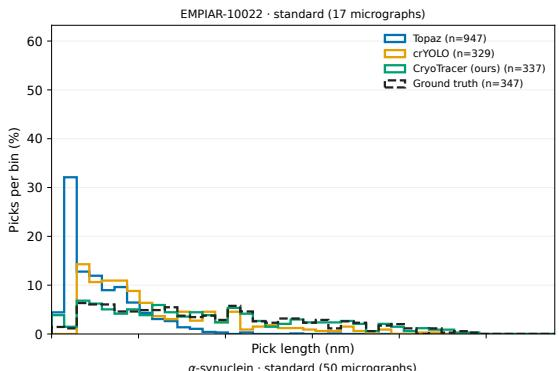

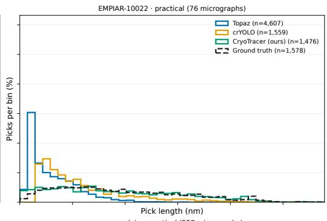

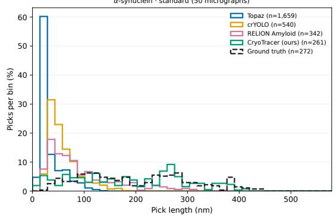

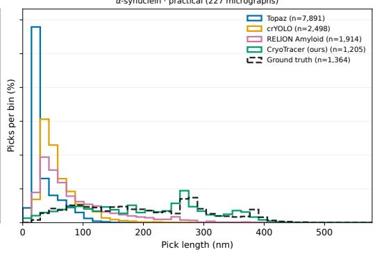  
Figure 7: Picked-filament length distributions for EMPIAR-10022 (top) and α-synuclein (bottom), under the standard (left) and practical (right) evaluation regimes. Length is measured along each polyline in nanometres. Histograms share 40 equal-width bins and show the percentage of each method’s picks in each bin, summing to 100% per method within a panel. The dashed curve denotes ground truth. Legend counts give the total number of picks.

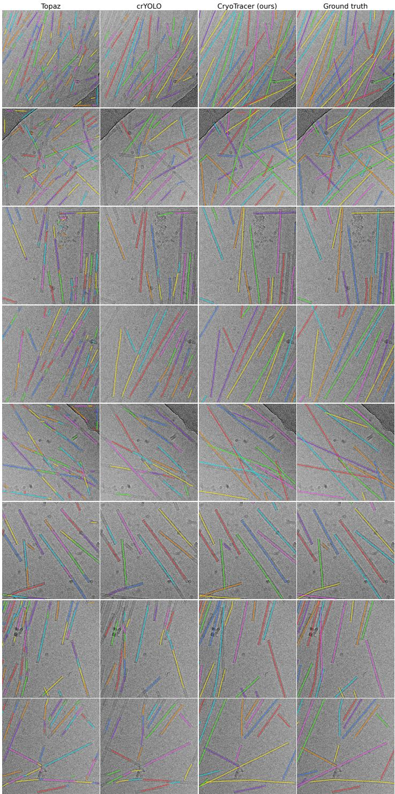  
Figure 8: EMPIAR-10022, standard regime. Eight selected micrographs from the corresponding evaluation set, with method predictions and ground truth labeled in the panels. Images are lowpass filtered and contrast adjusted for display. Colors distinguish curves within a panel and do not indicate matched identities across methods.

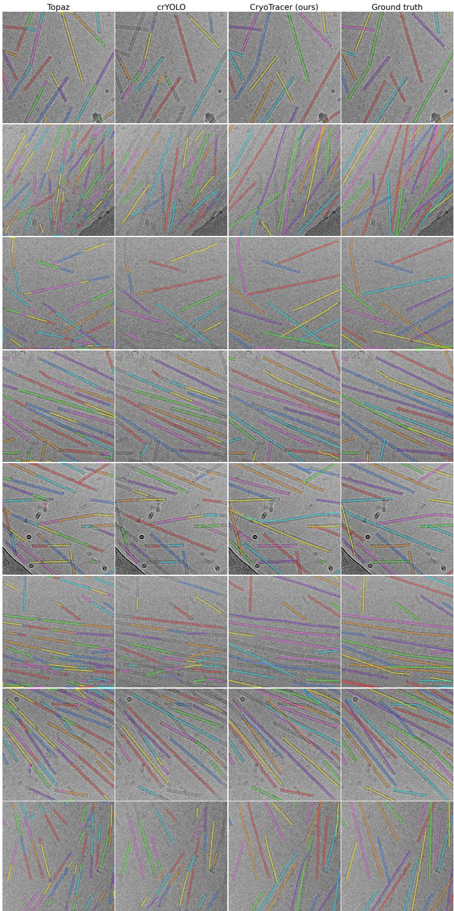  
Figure 9: EMPIAR-10022, practical regime. Eight selected micrographs from the corresponding evaluation set, with method predictions and ground truth labeled in the panels. Images are lowpass filtered and contrast adjusted for display. Colors distinguish curves within a panel and do not indicate matched identities across methods.

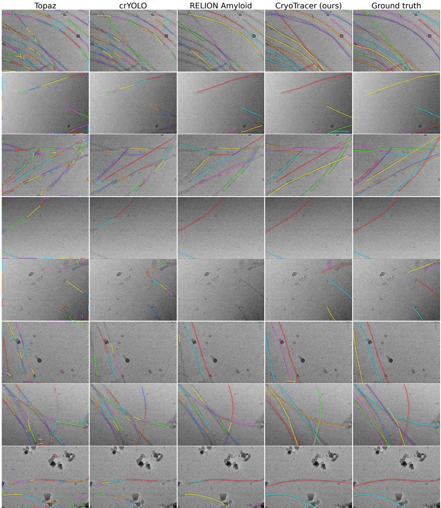  
Figure 10: α-synuclein, standard regime. Eight selected micrographs from the corresponding evaluation set, with method predictions and ground truth labeled in the panels. Images are low-pass filtered and contrast adjusted for display. Colors distinguish curves within a panel and do not indicate matched identities across methods.

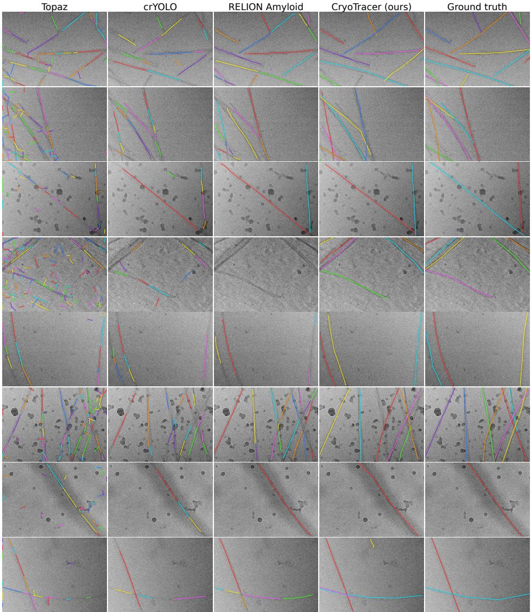  
Figure 11: α-synuclein, practical regime. Eight selected micrographs from the corresponding evaluation set, with method predictions and ground truth labeled in the panels. Images are low-pass filtered and contrast adjusted for display. Colors distinguish curves within a panel and do not indicate matched identities across methods.