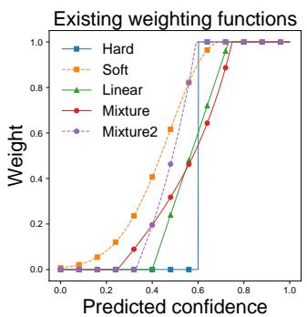
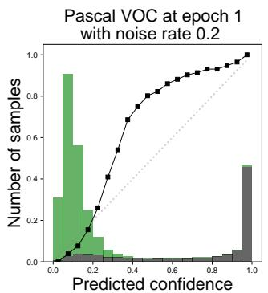
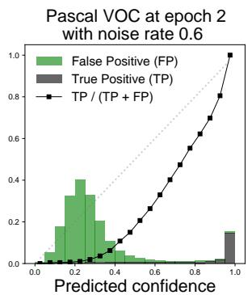
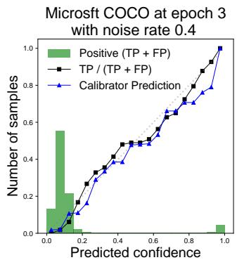
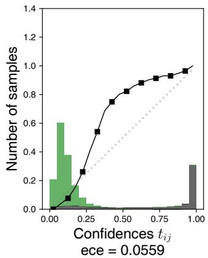
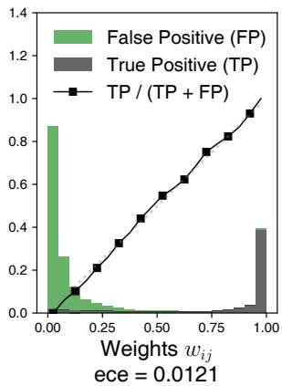
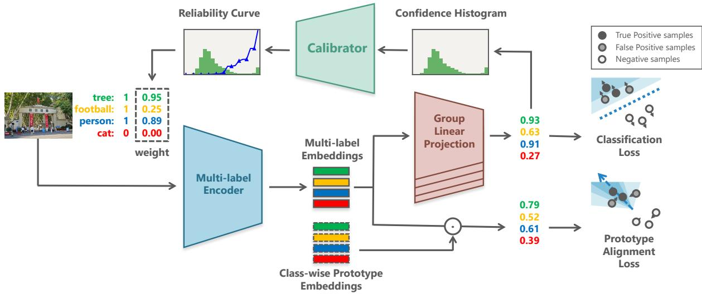

# Calibrated Disambiguation for Partial Multi-label Learning

Zhuoming Li 1,2, Yuheng Jia 1,2\*, Mi Yu 2, Zicong Miao 2

1 School of Computer Science and Engineering, Southeast University 2 China Telecom Cloud Computing Corporation, Beijing 100088, China {leezhuoming, yhjia}@seu.edu.cn; {yumi2.cq, miaozc}@chinatelecom.cn

## Abstract

Partial multi-label learning (PML) aims to train a classifier on datasets whose instances are over-annotated with not only relevant labels but also irrelevant labels, which is common when datasets are collected from crowd-sourcing platform. Existing works primarily approach it from a curriculum learning perspective, leveraging the memorization effect to disambiguate noisy labels and produce robust predictions. However, these methods are based on non-adaptive weighting functions and lack theoretical guidance for optimal weighting. To overcome these issues, a calibrated disambiguation model named PML-CD is proposed. We first formulate the optimal weighting function for curriculum-based disambiguation, which is equivalent to the calibration of the model’s predicted confidences, thus providing guidance for curriculum designing. To obtain the optimal weighting function from PML dataset during the training, a transferable calibrator is designed, which takes the histogram of positive samples’ confidences as input, and outputs the optimal curriculum weighting for training. Prototype alignment regularization is also proposed to promote the model’s performance. Experiments conducted on Pascal VOC, MS-COCO, NUS-WIDE and CUB have verified that our method outperforms existing state-of-the-art PML methods.

Code — https://github.com/lee-plus-plus/PML-CD

## Introduction

In recent years, multi-label learning has become a popular research topic, whose goal is to predict whether each category of label is relevant to a sample (Liu et al. 2021b). Given the fact that precisely annotated datasets are often difficult to be obtained due to high labor cost, crowd-sourcing platforms become common adopted for data collection, irrelevant labels are assigned by non-expert annotators, resulting the samples to be over-annotated, therefore leading to the problem of Partial Multi-label Learning (PML) (Yu et al. 2018). PML works with the problem that each instance is associated with a candidate label set, which contains not only all the relevant labels but also some irrelevant labels. Several PML methods have been proposed to disambiguate corrupted labels and learn robust model, achieving remarkable performance on PML table datasets (Xie and Huang 2021; Xu, Liu, and Geng 2020; Wang et al. 2023). Inspired by the success of deep neural networks (DNNs), researchers begin to explore the potentials of designing PML methods with DNNs, particularly on PML image classification (Sun, Xie, and Huang 2024), yet few methods have been proposed.

Curriculum learning, which let the model gradually learn from easy knowledge to hard knowledge by controlling the sample’s weight during the training (Bengio et al. 2009), is learnt to be helpful to disambiguate noisy labels (Jiang et al. 2018; Kim et al. 2022). Therefore, it has been adopted by the majority of existing PML image classification methods (Sun, Xie, and Huang 2024; Chen et al. 2024). In curriculum-based PML methods, the weighting function, also be named as the curriculum, is crucial for disambiguation. Among these proposed methods, however, although abundant weighting functions have been proposed (see Figure 1(a)) (Wang, Chen, and Zhu 2021), they are heuristically designed, e.g., hard threshold (Sun, Xie, and Huang 2024), soft threshold (Chen et al. 2023), and temperature annealing (Xu et al. 2021), and therefore provide limited explanation for the criteria of designing curriculum, leading the evaluation or comparison between curriculum impossible.

Besides, it is noticed that the suitable curriculum should vary on different dataset, different noise rate and different training epoch. Figure 1(b) provides such an example, showing that the best threshold to separate the true positive and false positive samples according to their predicted confidences vary. Therefore, a proper curriculum weighting function should be adaptive to the feedback of the training. However, existing curriculum-based PML approaches fail to achieve this (Sun, Xie, and Huang 2024; Chen et al. 2024).

Motivated by the aforementioned limitations, we propose an approach named Calibrated Disambiguation for Partial Multi-label Learning (PML-CD), with a new perspective towards curriculum-based disambiguation by calibration. As it is shown in Figure 1(b), given the histogram of the confidences of candidate samples, the aim of curriculum weighting is to separate them into clean samples and corrupted samples, assigning high weights for the former and low weights for the latter. Given the fact that samples with same confidence are indiscriminate during the disambiguation, we prove that the optimal mapping curve from samples’ confidence to sample’s weight should equals to the TP/(TP + FP) curve, which is named as the optimal weighting function. By applying the optimal weighting function during the curriculum-based disambiguation, the potentiality of the memorization effect can be fully mined, providing an upper bound for curriculum-based disambiguation. Figure 2 shows that the optimal weighting function is equivalent to the calibration on sample’s confidences.

  
(a) Existing weighting functions.

  
(b) Histogram of the predict confidence.

  
(c) Calibrator predict on unseen dataset with high precision.  
Figure 1: Illustration of Calibrated Disambiguation. (a) shows the weighting function proposed in previous curriculum learning approaches, whose shape are heuristically designed; (b) is two histograms of predicted confidences on clean partial labels and corrupted partial samples. The optimal weighting curve, which is equivalent to the calibration curve, can be derived from the frequency statistics if the ground-truth information is given; (c) shows that the optimal weighting curve can be precisely predicted according to the histogram of predicted confidences on partial labels, perceive a general relations between confidences histogram and calibration curve according to the memorization effect.

In PML training, however, the statistics of whether a positive sample belongs to true positive or false positive, is unknown. To predict the optimal weighting function when training on PML dataset, we designed a transferable calibrator to learn the relationship between the distribution of positive samples’ confidence, and the optimal weighting function. A data-driven approach is adopted to train the calibrator, which avoids making assumptions on the distribution of confidences. Figure 1(c) shows that our pre-trained calibrator can give fine-grained prediction for optimal weighting curve on unseen dataset.

To enhance the robustness of our model, prototype alignment regularization is also proposed, which helps the model learn better multi-label representation and perform better.

In summary, our contributions are listed as follows:

1. An analysis for the optimal weighting function is provided. which demonstrates the essence of weighting in curriculum-based disambiguation is confidence calibration.

2. An adaptive and transferable calibrator is developed, which is based on the common patterns observed between the confidence distribution histograms of candidate samples and the ratio of clean samples.

3. A prototype alignment regularization loss is proposed, which can help multi-label encoder produce not only separable features, but also discriminative features, therefore leading to robust performance.

## Related Work

## Multi-label Image Classification

In recent years, multi-label image classification has drawn increasing attention, since it is more reasonable for each image to contain multiple relevant labels(Chen and Yeh 2024). To fully exploit the label correlations, convolutional neural networks (CNNs) with new architectures have been proposed according to various perspectives, including recurrent neural networks (Wang et al. 2016), graph convolutional networks (Chen et al. 2019; Singh et al. 2024), graph propagation (Zhu et al. 2023), and Transformer architecture (Liu et al. 2021a; Lanchantin et al. 2021).

## Partial Multi-label Learning

Partial Multi-label Learning (PML) considers a situation where each instance is associated with a set of candidate labels, while only part of them are the ground-truth labels. Some existing work utilizes global and local information to guide disambiguation, following the manifold assumption and the label correlation assumption (Xu, Liu, and Geng 2020; Wang et al. 2019; Zhao et al. 2022). Other existing works, following the low-rank decomposition assumption, prefer to separate ground truth and noise from corrupted data by applying low-rank constraints while optimizing (Sun et al. 2019; Xie and Huang 2021). Lately proposed PML methods usually incorporate both the manifold and low-rank assumptions in a delicate way (Xu et al. 2022; Lyu et al. 2021; Sun et al. 2021; Yang et al. 2024).

In recent years, researchers began exploring the compatibility of PML with DNNs and investigated PML image classification. Current image PML methods are primarily based on memory effects (Arpit et al. 2017), and apply curriculumguided disambiguation through small-loss criteria (Sun, Xie, and Huang 2024; Chen et al. 2024).

## Curriculum Learning

The concept of curriculum learning is inspired by the human learning process, where individuals first acquire simple and general knowledge, then gradually learns more complex and specialized knowledge and thereby achieving well understanding (Bengio et al. 2009). By leveraging the memorization effect (Arpit et al. 2017) and employing training sample loss as the difficulty measurer (Wang, Chen, and Zhu 2021), noisy label learning approaches can progressively disambiguate labels through curriculum learning strategies (Jiang et al. 2018).

Based on the small-loss criteria, a series of weighting functions that map samples’ loss to their weights have been proposed in curriculum learning (Wang, Chen, and Zhu 2021), with various forms such as hard (Kumar, Packer, and Koller 2010), linear (Jiang et al. 2014), logarithmic (Jiang et al. 2014), Gaussian (Chen et al. 2023), and etc. Since the most appropriate curriculum varies on different training conditions, the weighting function should be adaptively adjusted by the feedback during the training. Existing approaches have proposed various curriculum adaptation strategies, by introducing the confidence histograms (Lee, Lim, and Chung 2021), the mean and variance of predicted confidence (Chen et al. 2023), quantized logical differences (Kim et al. 2024), loss rankings (Chen et al. 2024), and etc. Corresponding parameter updating schemes have also been designed in different approaches, including fitting two Gaussian distribution (Lee, Lim, and Chung 2021), temperature annealing (Xu et al. 2021), and etc.

Overall, designing adaptive weighting strategies heuristically is challenging for three main reasons: 1) a mathematical formulation for optimal curriculum lacks; 2) certain feature construction approaches, such as ranking, are inherently suboptimal for precise inference; 3) some predictors employ generative models that rely on assumptions, such as the confidence levels of noisy and clean samples following two separable normal distributions (Lee, Lim, and Chung 2021), which may not always be applicable.

In addition to re-weighting, some approaches explore how to re-label corrupted labels in a curriculum-based manner (Bengio et al. 2009; Kim et al. 2022), or combine reweighting and re-labeling together (Zhou, Wang, and Bilmes 2020). It is also referred to as re-labeling or label correction. The main challenge with re-labeling lies in the possibility of incorrectly correcting difficult but accurate labels in the early stages of training, which could even damage further learning (Kim et al. 2022).

## Preliminaries

We first provide a detailed explanation of the notations used in the paper. The multi-label training dataset is denoted as $\mathcal { D } = \{ ( \bar { x } _ { i } , y _ { i } ) \mid i = 1 , \ldots , N \}$ , where N is the number of samples of the training set, $\boldsymbol { x } _ { i } ~ \in ~ \mathbb { R } ^ { W \times H \times 3 }$ is the image of the i-th sample, and $y _ { i } = [ y _ { i } ^ { 1 } , \ldots , y _ { i } ^ { C } ] ^ { T } \in \{ 0 , 1 \} ^ { C }$ denotes the ground truth labels for each category of the ith sample, with a total of $C$ categories. In PML, since labels are not precisely annotated, only a corrupted dataset $\tilde { \mathcal { D } } = \{ ( x _ { i } , \tilde { y } _ { i } ) \ | \ i = 1 , \dots , n \}$ is available, whose candidate labels $\tilde { y } _ { i } = [ y _ { i 1 } , \dotsc , y _ { i c } ] ^ { T } \in \{ 0 , 1 \} ^ { C }$ for the i-th sample contains not only relevant labels corresponding to $y _ { i } .$ , but also additional noise. For convenience, we denote $\{ \cdot \}$ in this paper to succinctly represent a collection of certain variable of every sample on the training set, $\mathrm { e . g . } , \{ x _ { i } \}$

  
Figure 2: An example of optimal curriculum weighting1 with histograms of model’s predicted confidences (left) and weights (right) by assigning $w _ { i j } = P ( y _ { i j } = \tilde { y } _ { i j } \mid t _ { i j } ) $ . It is shown that weighting is equivalent to calibrating model’s predicted confidences. The expected calibration error (ECE) of confidences and weights are presented.

Given a model $f : \mathbb { R } ^ { W \times H \times 3 } \to \breve { \left\lceil 0 , 1 \right\rceil } ^ { C }$ , the confidence predictions $t _ { i } = \check { f } ( x _ { i } ) \in [ 0 , 1 ] ^ { C }$ for each sample on training set can be collected. According to the memorization effect, when a model learns on a noisy dataset, it tends to first memorize the clean samples. It suggests that the small-loss criteria to filter reliable samples and assign higher weights to samples with lower loss during the training. Such disambiguation procedure is also known as curriculum learning, which can be formulated as

$$
\begin{array} { r } { \ell _ { \mathrm { c u r r } } ( \hat { y } _ { i j } , \tilde { y } _ { i j } ) = w _ { i j } \ell _ { \mathrm { B C E } } ( \hat { y } _ { i j } , \tilde { y } _ { i j } ) , } \end{array}\tag{1}
$$

where $\begin{array} { r l r } { \hat { y } _ { i j } } & { { } = } & { f _ { j } ( x _ { i } ) } \end{array}$ is the model’s predicted confi dence for i-th sample and j-th class, and $\ell _ { \mathrm { B C E } } ( \hat { y } , \tilde { y } ) \ =$ $- \left( \tilde { y } \log ( \hat { y } ) + ( 1 - \tilde { y } ) \log ( 1 - \hat { y } ) \right)$ is the binary cross entropy loss. Given a predicted score t, we hope to assign weight $w ( t )$ to samples to better train the model. It is expected to assign as much weight as possible to clean samples, and as little weight as possible to corrupted samples. which can be evaluated by

$$
\begin{array} { r } { \ell _ { \mathrm { B C E } } \left( w ( t ) , \mathbb { I } [ y = \tilde { y } ] \right) = \underbrace { - \mathbb { I } [ y = \tilde { y } ] \cdot \log ( w ( t ) ) } _ { \mathrm { m a x i m i z e c l e a n s a m p l e s } ^ { \prime } \mathrm { ~ w e i g h t s } } + } \\ { \underbrace { ( - \mathbb { I } [ y \neq \tilde { y } ] ) \cdot \log ( 1 - w ( t ) ) } _ { \mathrm { m i n i m i z e c o r r u p t e d ~ s a m p l e s } ^ { \prime } \mathrm { ~ w e i g h t s } } , } \end{array}\tag{2}
$$

and the optimal weighting function $w ^ { * } ( t )$ can be induced as

$$
\begin{array} { r l } & { w ^ { * } ( t ) = \arg \underset { w ( t ) } { \operatorname* { m i n } } \ \mathbb { E } _ { y \mid t } \left[ \ell _ { \mathrm { B C E } } ( w ( t ) , \mathbb { I } [ y = \tilde { y } ] ) \right] } \\ & { ~ = P ( y = \tilde { y } \mid t ) . } \end{array}\tag{3}
$$

Since other baseline methods try to model $w ^ { * } ( t )$ in a binarization way, $\boldsymbol { \mathrm { e . g . } } , \boldsymbol { w } ( t ) \ = \ \mathbb { I } [ t \geq \eta ]$ , our method pro-

vides theoretical upper bound. Therefore, the optimal curriculum weighting function is to model the posterior probability $P ( y _ { i j } = \tilde { y } _ { i j } \mid t _ { i j } )$ as

$$
\ell _ { \mathrm { c u r r } } ^ { * } ( \hat { y } _ { i j } , \tilde { y } _ { i j } , y _ { i j } ) = P ( y _ { i j } = \tilde { y } _ { i j } \mid t _ { i j } ) \ell _ { \mathrm { B C E } } ( \hat { y } _ { i j } , \tilde { y } _ { i j } ) .\tag{4}
$$

To better understand the meaning of Equation $^ { 4 , }$ an example of optimal curriculum weighting is given in Figure 2. In summary, our analysis below provides three insights:

1. In curriculum learning based disambiguation schemes, the essence of weighting is the calibration of model’s predicted confidence.

2. The optimal weighting function $P ( y _ { i j } \ = \ \tilde { y } _ { i j } \ | t _ { i j } )$ provides a theoretically upper bounds for small-loss guided disambiguation.

3. The quality of weighing function can be evaluated according to the quality of calibration, via metrics like expected calibration error (ECE).

## Methods

In this section, we first introduce the overall architecture and training process of our proposed model PML-CD, which is also presented in Figure 3. Design proposals and implementation details of each module will be introduced later.

Two phase training. The training progress of our PML-CD model is divided into two phases. The first phase is the warm-up phase, where the model is trained via Binary Cross-Entropy (BCE) loss on raw training set until early stopping (Bai et al. 2021). This phase aims to initialize the model’s random parameters to a reasonable state and to produce reasonable multi-label representations. The second phase is the disambiguation phase. In this phase, we collect the model’s predicted confidence on the training set, and apply the calibrator to estimate the reliability of candidate labels, then apply the reliability score as the weights in a curriculum learning. The model is robustly trained via weighted BCE loss along with the prototype alignment regularization until early stopping.

Multi-label encoder. Current researches in multi-label learning suggests that it is more appropriate to learn a representation for each categories in an image. In multi-label images, objects of different classes are often situated in distinct regions of the image and can sometimes be quite small. Therefore, compressing all regional features into one feature vector through adaptive pooling is suboptimal (Liu et al. 2021a; Chen and Yeh 2024). Applying attention mechanisms on regional features enables the model to learn which regional features are relevant to each class, thus helping the model to learn more consistent feature representations (Liu et al. 2021a; Ridnik et al. 2023). Following the architecture of ML-Decoder (Ridnik et al. 2023), we first extract regional features from the image using pre-trained CNN backbone, and then pass them into a Transformer with C query vectors, therefore outputs the multi-label representations of an image $\boldsymbol { z } \in \mathbb { R } ^ { C \times D }$

Group linear projection. To produce confidence predictions, the Group Linear Projection (Ridnik et al. 2023) is adopted, where the representation in each class is passed through its corresponding linear layer.

## Calibrator

Following the above analysis that the essence of weighting is calibration, unlike previous methods that heuristically formulating weighting function, we formulate our calibrator from the analysis of the optimal calibrator. Given the information of the ground-truth labels $\{ y _ { i } \}$ , the optimal calibrator can be derived from the confidences on true partial labels and false partial labels in a histogram way. Given the predicted confidence on partial labels $\{ t _ { i j } \mid \tilde { y _ { i j } } = 1 \}$ we split the partial confidences $\{ t _ { i j } \} ^ { \mathrm { P } } = \{ t _ { i j } | \tilde { y } _ { i j } = \mathrm { i } \}$ into two groups, the True Positive (TP) group $\{ t _ { i j } \} ^ { \mathrm { T P } } =$ $\{ t _ { i j } \ | \ \tilde { y } _ { i j } = \bar { 1 } , y _ { i j } = 1 \}$ and the False Positive (FP) group $\{ t _ { i j } \} ^ { \mathrm { F P } } = \{ t _ { i j } | \stackrel { \sim } { y } _ { i j } = 1 , y _ { i j } = 0 \}$ . We denote the number of bins $K \ : = \ : 2 0$ , confidences in each bin $\{ t _ { i j } \} ^ { [ k ] } =$ $\{ ( k - 1 ) / K \le t _ { i j } < k / K \}$ , and then the frequency distribution of TP and FP confidences are collected as

$$
\begin{array} { r l } & { q _ { k } ^ { \mathrm { P } } = \frac { \left| \left\{ t _ { i j } \right\} ^ { [ k ] } \cap \left\{ t _ { i j } \right\} ^ { \mathrm { P } } \right| } { \left| \left\{ t _ { i j } \right\} ^ { \mathrm { P } } \right| } \mathrm { , } } \\ & { q _ { k } ^ { \mathrm { F P } } = \frac { \left| \left\{ t _ { i j } \right\} ^ { [ k ] } \cap \left\{ t _ { i j } \right\} ^ { \mathrm { F P } } \right| } { \left| \left\{ t _ { i j } \right\} ^ { \mathrm { P } } \right| } \mathrm { , } } \\ & { q _ { k } ^ { \mathrm { T P } } = \frac { \left| \left\{ t _ { i j } \right\} ^ { [ k ] } \cap \left\{ t _ { i j } \right\} ^ { \mathrm { T P } } \right| } { \left| \left\{ t _ { i j } \right\} ^ { \mathrm { P } } \right| } \mathrm { . } } \end{array}\tag{5}
$$

Therefore, the reliability histogram can be derived as

$$
r _ { k } = q _ { k } ^ { \mathrm { T P } } / ( q _ { k } ^ { \mathrm { T P } } + q _ { k } ^ { \mathrm { F P } } ) .\tag{6}
$$

In the end, we can export the confidence-reliability relationship between $t _ { i }$ and $\bar { P } ( y _ { i j } = \tilde { y } _ { i j } \mid t _ { i j } )$ via applying interpolation on reliability histogram

$$
\begin{array} { c } { { P ( y _ { i j } = \tilde { y } _ { i j } \mid t _ { i j } ) = ( \displaystyle \frac { k + 1 } { K } - t _ { i j } ) r _ { k } + ( t _ { i j } - \displaystyle \frac { k } { K } ) r _ { k + 1 } , } } \\ { { s . t . \displaystyle \frac { k } { K } \leq t _ { i j } < \displaystyle \frac { k + 1 } { K } . } } \end{array}\tag{7}
$$

To produce precise calibration, the confidence-reliability relationship can be individually accomplished on each class.

It has been witnessed that the histogram of predicted confidence is highly relevant to the ground-truth confidencereliability relationship during the training (Lee, Lim, and Chung 2021; Chen et al. 2024). Reasonable attempts that fit the TP and FP confidences via two Gaussian distribution has been made (Lee, Lim, and Chung 2021). However, according to our observation, it can hardly be adopted to general situations where the histogram of TP and FP confidences are skewed or are highly overlapping.

To overcome this issue, a data-driven approach is adopted. We model our calibrator $g : [ 0 , 1 ] ^ { K } { \overset { * } {  } } [ 0 , 1 ] ^ { K }$ with the frequency of confidences in each bin $\left( q ^ { \mathrm { P } } \right) _ { k \in K }$ as input, and the confidence-reliability relationship $( q _ { k } ^ { \mathrm { T P } } / ( q _ { k } ^ { \mathrm { T P } } +$ $q _ { k } ^ { \mathrm { F P } } ) \bigr ) _ { k \in K }$ as output. The structure of the calibrator is designed as a 2-layer Multi-layer Perceptron with the activation of LeakyReLU. To enable the calibrator to learn the relationship, we collect information of $\{ q ^ { \mathrm { P } } , q ^ { \mathrm { T P } } , q ^ { \mathrm { F P } } \}$ during the training of baseline model on every epoch at the disambiguation phase. The baseline model is implemented with the same architecture as PML-CD but adopts a trivial disambiguation strategy $P ( y _ { i j } = \tilde { y } _ { i j } \mid t _ { i j } ) = t _ { i j }$ adopted. In order to enable our calibrator be adaptive to different situation, the training data is collected from multiple training procedures on a dataset with different noise rate. After pretraining, the calibrator can be run on any dataset with any noise rate by loading parameters, and therefore serving as a plugin. Since our calibrator avoids making assumptions on the distribution of TP and FP confidences, and learns from data with both low noise and high noise, it can adapt to various scenario.

  
Figure 3: Illustration of the proposed model PML-CD. During the training, the model is updated by both classification loss and prototype alignment loss. Predicted confidences on training set are collected and are fed into the calibrator to generate reliability of candidate labels, which guides the curriculum disambiguation training in the next epoch.

## Prototype Alignment Regularization

It is common for multi-label DNN methods to first encode the multi-label representation, then produce the confidence through a Linear Projection layer for each class. Given the multi-label representation of i-th sample on j-th class $z _ { i j } \in$ $\mathbb { R } ^ { D }$ , and the parameter of j-th class linear projection layer $\theta _ { j } \in \mathbb { R } ^ { D } , b _ { j } \in \mathbb { R }$ , the confidence $\hat { y } _ { i j } ^ { \mathrm { c l f } }$ is predicted as

$$
\begin{array} { r } { \hat { y } _ { i j } ^ { \mathrm { c l f } } = \theta _ { j } ^ { T } z _ { i j } + b _ { j } . } \end{array}\tag{8}
$$

Therefore, the classification loss

$$
\mathcal { L } _ { \mathrm { c l f } } = \sum _ { i \in N } \sum _ { j \in C } \ell _ { \mathrm { c u r r } } ( \hat { y } _ { i j } ^ { \mathrm { c l f } } , \tilde { y } _ { i j } )\tag{9}
$$

can be viewed as seeking an optimal hyperplane to separate the representations of positive and negative examples for each class. However, the decision boundary learned through linear projection can be easily disrupted by noisy labels, therefore lacking robustness (Yi et al. 2022). On the other hand, another widely applied way to produce confidence via multi-label representations is Prototype Alignment, which is reckoned to be robust in noisy label learning and is less prone to be over-fitting. Given the prototype representation of j-th class $\bar { z } _ { j } \in \mathbb { R } ^ { D }$ , the confidence $\hat { y } _ { i j } ^ { \mathrm { p r o t o } }$ is predicted as

$$
\hat { y } _ { i j } ^ { \mathrm { p r o t o } } = \frac { \langle z _ { i j } , \bar { z } _ { j } \rangle } { \| z _ { i j } \| \cdot \| \bar { z } _ { j } \| } .\tag{10}
$$

Given the prototype alignment loss

$$
\mathcal { L } _ { \mathrm { p r o t o } } = \sum _ { i \in N } \sum _ { j \in C } \ell _ { \mathrm { c u r r } } ( \hat { y } _ { i j } ^ { \mathrm { p r o t o } } , \tilde { y } _ { i j } ) ,\tag{11}
$$

unlike maximizing the distance of representations from the decision hyperplane, the prototype alignment method compute the cosine similarity between sample’s representation and the corresponding class prototype. It has been widely applied in partial label learning to guide disambiguation and provide more reliable label guesses for uncertain samples (Wang et al. 2022a,b; Yang et al. 2025). However, this projection method struggles to achieve fine-grained fitting, resulting in suboptimal prediction performance.

Taking the impact on the encoder into consideration, optimization on linear projection score $\ell _ { \mathrm { c u r r } } ( \hat { y } _ { i j } ^ { \mathrm { c l f } } , \tilde { y } _ { i j } )$ lets the embeddings of positive and negative samples linear separable, while optimization on prototype alignment score $\ell _ { \mathrm { c u r r } } ( \hat { y } _ { i j } ^ { \mathrm { p r o t o } } , \tilde { y } _ { i j } )$ lets the embeddings of positive and negative be clustered around their prototype embeddings. By applying both of them, a representation which is not only separable, but also discriminative, is encouraged (Wen et al. 2016).

Above all, in warm-up phase, the training loss is

$$
\mathcal { L } _ { \mathrm { w a r m u p } } = \mathcal { L } _ { \mathrm { c l f } } ,\tag{12}
$$

and training loss in disambiguation phase is defined as

$$
\mathcal { L } _ { \mathrm { d i s a m } } = \mathcal { L } _ { \mathrm { c l f } } + \mathcal { L } _ { \mathrm { p r o t o } } .\tag{13}
$$

During the training, we allow the prototype representations be updated via gradient, therefore no explicit updating strategy is required. Since the multi-label representation is not well initialized during the warm-up training, making their prototypes meaningless, the prototype alignment regularization is only applied during the disambiguation phase.

Algorithm 1: Algorithm of PML-CD   
Input: partial multi-label learning dataset $\{ ( x _ { i } , \tilde { y } _ { i } ) \}$   
Parameter: pre-trained calibrator g, learning rate η   
Output: network $f ( \cdot \mid \theta )$ for PML   
1: repeat   
2: Update network parameters $\theta  \theta - \eta \Delta \mathcal { L } _ { \mathrm { \scriptscriptstyle V } }$ warmup   
3: until early stopping   
4: Initialize $w _ { i j } \gets 1$   
5: repeat   
6: Collect predicted confidences $\{ t _ { i j } \}  f ( \{ x _ { i } \} )$   
7: Compute $q ^ { \mathrm { P } }$ via Equation. 5   
8: Predict reliability histogram r via Equation. 6   
9: Update curriculum weights $w _ { i j } = P ( y _ { i j } = \tilde { y } _ { i j } \mid t _ { i j } )$   
via Equation. 7, if $\tilde { y } _ { i j } = 1$   
10: Update network parameters $\theta \gets \theta - \eta \Delta \mathcal { L } _ { \mathrm { d i s a m } }$   
11: until early stopping

## Experiments

## Settings

Datasets. To validate our proposed approach, we conducted experiments on several commonly used real-world multilabel image datasets, including MS-COCO 2014 (Lin et al. 2014), Pascal VOC 2007 (Everingham et al. 2010), NUS-WIDE (Chua et al. 2009), and CUB 200 (Wah et al. 2011). Specifically, we took the 312 binary attributes instead of the bird category as predicted labels, therefore making it a multi-label dataset. To create PML datasets from multi-label datasets, we injected random noise into the label matrices by randomly flipping the zero values in the original label matrix with a certain probability, denoted as noise rate ρ.

Comparison Methods. We compare our PML-CD model with three groups of methods.

• Multi-label learning methods. BCE is a standard multilabel classification model trained with binary cross entropy loss. ASL (Ridnik et al. 2021) is a multi-label learning method that addresses the issue of imbalance between positive and negative labels. ML-Decoder (Ridnik et al. 2023) re-designs the decoder architecture and introduces a group-decoding scheme to provide efficiency. These methods do not specifically address noise disambiguation, and have achieved state-of-the-art results on many multi-label image classification datasets.

• Traditional PML methods. PML-NI (Xie and Huang 2021) applies low-rank constraints to decompose the PML label matrix, while PML-LRS (Sun et al. 2019) decomposes the projection matrix of linear regression model. PLAIN (Wang et al. 2023) disambiguates gradually with instance similarity and label correlations. These methods are shallow methods that are not specifically designed for image classification. Therefore, we use ResNet-101 (He et al. 2016) pre-trained on ImageNet to extract feature embeddings to make them applicable.

• Curriculum-based PML methods. LL-R (Kim et al. 2022) ignores training samples with high loss during the training. PML-CDCR (Sun, Xie, and Huang 2024)

trains on strongly-augmented images and selecting reliable samples on weakly-augmented images with a loss threshold. UNM (Chen et al. 2024) applies cyclical learning rate to transform the model from over-fitting status back to under-fitting status, therefore providing more reliable disambiguation during the training. These methods adopt a curriculum disambiguation framework similar to ours.

Setting and evaluation. Our experiments are run on GeForce RTX 4090 with PyTorch 1.13.1. We employ ResNet-101 (He et al. 2016) pre-trained on ImageNet as the backbone, and the detailed setting for all experiments are described as follows.

During the training, all images are resized to $2 2 4 \times 2 2 4 ,$ and strong data augmentation are applied for training set, including horizontal flip, RandAugment (Cubuk et al. 2020) and Cutout. The same data processing is adopted for almost all comparison methods. We train the model with the following optimization setting: an Adam Optimizer with fixed learning rate $1 \times 1 0 ^ { - 4 }$ for VOC and CUB, $1 \times 1 0 ^ { - 5 }$ for COCO and NUS-WIDE; a weight decay of $5 \times 1 0 ^ { - 5 }$ . The size of mini-batch is set to be 32. Early stopping is applied for all comparison methods, since noisy labels learning is highly dependent on it (Bai et al. 2021). Mean Average Precision (mAP) is applied to evaluate models’ performance.

Calibrator pre-training. Our calibrator is pre-trained with the following procedure. First, the baseline model without prototype alignment regularization loss and with an identity weighting function is trained on VOC dataset, with noise rate ranging from 10%, 20%, . . . , 90%. The partial label matrix, ground-truth label matrix, and the confidence prediction matrix at every epoch are collected during the training. On every epoch, the confidence histogram and the reliability histogram for each class are calculated independently, therefore making C feature-label pairs $( q ^ { \mathrm { P } } , r )$ . After the dataset is constructed, the calibrator is trained by minimizing Mean Squared Error (MSE) via an Adam optimizer with a fixed learning rate $1 \times 1 0 ^ { - 2 }$

## Comparison Results

Results are reported in Table 1, which shows that our model outperforms other baseline models on 15/16 conditions, thus achieving state-of-the-art results. PML-CD performs slightly inferior to other baseline methods under low noise condition on VOC, but performs significantly superior to others under high noise conditions, which can be explained as PML-CDCR and LL-R is more suitable on low noise condition since they adopt simpler network architecture, i.e., ResNet only. It is noticed that our model performs well on CUB, which has over 300 fine-grained visual attributes, making it challenging for PML. Our model outperforms other curriculum-based PML baseline models with significant advantages, for the reason that our model adopts the ML-Decoder’s multi-layer transformer architecture as the encoder, therefore advantageous in extracting fine-grained visual features.

To summarize, our model outperforms other baseline models for 15/16 times under different training conditions, which shows that our model, together with the pre-trained calibrator, can not only perform well on VOC dataset, but also on unseen dataset including COCO, NUS-WIDE, and CUB. Given the complexity of multi-label encoder can sometimes lead to sub-optimal performance on on easy PML dataset, e.g., VOC with low noise rate, it enables our model to encode fine-grained visual features on images, which is of necessity when training on CUB.

<table><tr><td rowspan="2">Method</td><td colspan="4">VOC</td><td colspan="4">COCO</td><td colspan="4">NUS-WIDE</td><td colspan="4">CUB</td></tr><tr><td>20%</td><td>40%</td><td>60%</td><td>80%</td><td>20%</td><td>40%</td><td>60%</td><td>80%</td><td>20%</td><td>40%</td><td>60%</td><td>80%</td><td>20%</td><td>40%</td><td>60%</td><td>80%</td></tr><tr><td>PML-NI</td><td>62.57</td><td>35.37</td><td>20.97</td><td>13.84</td><td>60.14</td><td>53.41</td><td>43.02</td><td>24.52</td><td>21.26</td><td>16.39</td><td>12.02</td><td>7.89</td><td>12.92</td><td>12.04</td><td>11.42</td><td>10.96</td></tr><tr><td>PML-LRS</td><td>79.96</td><td>63.45</td><td>32.86</td><td>16.66</td><td>61.56</td><td>53.80</td><td>42.85</td><td>24.23</td><td>21.52</td><td>16.23</td><td>11.85</td><td>7.76</td><td>14.56</td><td>12.91</td><td>11.83</td><td>11.19</td></tr><tr><td>PLAIN</td><td>80.76</td><td>72.45</td><td>54.59</td><td>27.24</td><td>60.13</td><td>53.71</td><td>44.99</td><td>21.56</td><td>19.22</td><td>17.85</td><td>13.72</td><td>7.44</td><td>14.98</td><td>11.38</td><td>10.55</td><td>10.37</td></tr><tr><td>BCE</td><td>87.73</td><td>84.26</td><td>75.27</td><td>48.86</td><td>73.66</td><td>69.62</td><td>63.52</td><td>50.47</td><td>50.81</td><td>45.78</td><td>37.90</td><td>27.06</td><td>29.66</td><td>27.01</td><td>22.19</td><td>17.39</td></tr><tr><td>ASL</td><td>88.63</td><td>84.43</td><td>77.23</td><td>52.95</td><td>73.19</td><td>68.53</td><td>62.56</td><td>50.46</td><td>46.27</td><td>37.86</td><td>31.67</td><td>21.97</td><td>28.58</td><td>25.75</td><td>22.66</td><td>17.35</td></tr><tr><td>MLDecoder</td><td>87.94</td><td>85.49</td><td>80.41</td><td>64.46</td><td>74.29</td><td>70.35</td><td>68.55</td><td>60.55</td><td>50.92</td><td>46.11</td><td>40.01</td><td>30.83</td><td>29.72</td><td>27.63</td><td>24.99</td><td>21.13</td></tr><tr><td>UNM</td><td>87.99</td><td>86.58</td><td>79.94</td><td>44.07</td><td>65.56</td><td>63.51</td><td>61.68</td><td>27.87</td><td>37.83</td><td>34.57</td><td>29.62</td><td>12.04</td><td>23.93</td><td>19.73</td><td>18.42</td><td>11.66</td></tr><tr><td>PML-CDCR</td><td>88.56</td><td>86.87</td><td>69.26</td><td>38.31</td><td>72.44</td><td>69.90</td><td>66.88</td><td>42.17</td><td>42.91</td><td>39.96</td><td>31.99</td><td>22.37</td><td>26.67</td><td>24.63</td><td>23.05</td><td>16.38</td></tr><tr><td>LL-R</td><td>88.99</td><td>82.87</td><td>72.36</td><td>40.32</td><td>74.35</td><td>67.79</td><td>61.47</td><td>41.28</td><td>43.75</td><td>42.09</td><td>30.56</td><td>24.76</td><td>29.03</td><td>26.47</td><td>22.54</td><td>18.62</td></tr><tr><td>PML-CD</td><td>88.83</td><td>87.12</td><td>83.87</td><td>71.70</td><td>75.26</td><td>74.65</td><td>69.88</td><td>62.10</td><td>51.30</td><td>46.11</td><td>40.41</td><td>32.10</td><td>30.52</td><td>27.87</td><td>25.42</td><td>21.69</td></tr></table>

Table 1: Comparison of our model PML-CD with baseline methods, with noise rate 20%, 40%, 60% and 80%. mAP(%) is adopted as metric. The best performances on each column are highlighted with background color.

## Ablation Study

Effectiveness of calibrator. To evaluate whether the pretrained calibrator can accurately predict the optimal calibration curve on unseen datasets, and therefore calibrate their predicted confidences, we evaluate the expected calibration error (ECE) of predicted confidences and the curriculum weighting, during the disambiguation phase of the training on VOC, COCO datasets. Also, to compare with other weighting policy, we adopt the pre-trained calibrator, the optimal calibrator, and other commonly used curriculum weighting functions for comparison. We denote the hard weighting function $v ^ { \mathrm { h a r d } } ( t _ { i j } ) \ \stackrel { \cdot } { = } \ \mathbb { I } [ t _ { i j } \ \geq \ 0 . 6 ]$ , the soft weighting function $v ^ { \mathrm { s o f t } } ( t _ { i j } ) ~ = ~ ( t _ { i j } ) ^ { 2 }$ , the identity weighting function $v ^ { \mathrm { i d e n t i t y } } ( t _ { i j } ) \stackrel { \textstyle - } { = } t _ { i j }$ . Comparison results are shown in Table 2.

<table><tr><td>weighting policy</td><td>ECE of confidences (epoch 1)</td><td>ECE of weights (epoch 1)</td><td>mAP per class (overall)</td></tr><tr><td>hard</td><td>76.78</td><td>92.96</td><td>59.79</td></tr><tr><td>soft</td><td>76.78</td><td>61.68</td><td>60.08</td></tr><tr><td>identity</td><td>76.78</td><td>76.78</td><td>59.93</td></tr><tr><td>calibrator</td><td>76.78</td><td>3.74</td><td>61.48</td></tr><tr><td>optimal</td><td>76.78</td><td>3.74</td><td>66.42</td></tr></table>

Table 2: Effectiveness of weighting policies on MS-COCO with noise rate 80%. ECE(%) and mAP(%) are presented.

Effectiveness of prototype alignment regularization. To verify whether the prototype alignment regularization (PAR) enhances the performance of PML-CD, we train our model on the VOC and COCO datasets with corresponding settings: 1) applying no PAR; 2) applying PAR at the disambiguation phase; 3) applying PAR at both the warmup phase and disambiguation phase. Comparison results are presented in Table 3. It is shown that prototype alignment regularization helps the model perform better especially in high noise condition.

<table><tr><td rowspan="2">dataset</td><td rowspan="2"> $\scriptstyle { \mathcal { L } } _ { \mathrm { p r o t o } }$ </td><td colspan="4">noise rate</td></tr><tr><td>20%</td><td>40%</td><td>60%</td><td>80%</td></tr><tr><td rowspan="3">VOC</td><td>neither</td><td>89.28</td><td>87.93</td><td>85.05</td><td>66.91</td></tr><tr><td>2nd-phase only</td><td>88.77</td><td>88.12</td><td>85.07</td><td>71.70</td></tr><tr><td>1st &amp; 2nd-phase</td><td>87.89</td><td>86.11</td><td>83.90</td><td>71.40</td></tr><tr><td rowspan="3">COCO</td><td>neither</td><td>75.54</td><td>73.86</td><td>69.78</td><td>60.13</td></tr><tr><td>2nd-phase only</td><td>75.26</td><td>74.65</td><td>69.88</td><td>62.10</td></tr><tr><td>1st &amp; 2nd-phase</td><td>74.79</td><td>72.58</td><td>70.27</td><td>62.16</td></tr></table>

Table 3: Ablation study of the prototype alignment regularization. mAP(%) is adopted as metric.

## Conclusion

In this work, we present a novel model PML-CD to apply curriculum-based disambiguation on PML in a calibration way. We derive the optimal weighting function from existing curriculum-based PML methods, and provide an insight that assigning curriculum weights for samples is equivalent to the calibration of the model’s predicted confidences. Guided by the optimal weighting function, we design a calibrator based on the general relations between confidences histogram and calibration curve, which can provide high quality calibration on unseen dataset after pre-training, therefore serving as an adaptive weighting function on different training condition. We also propose the prototype alignment regularization to improve model’s robustness during the training. Comparison experiments have been conducted to verify the effectiveness of PML-CD.

## Acknowledgements

This research work is supported in part by National Natural Science Foundation of China (Grant 62106044 and Grant U24A20322), in part by the Big Data Computing Center of Southeast University.

## References

Arpit, D.; Jastrz˛ebski, S.; Ballas, N.; Krueger, D.; Bengio, E.; Kanwal, M. S.; Maharaj, T.; Fischer, A.; Courville, A.; Bengio, Y.; et al. 2017. A closer look at memorization in deep networks. In International conference on machine learning, 233–242. PMLR.

Bai, Y.; Yang, E.; Han, B.; Yang, Y.; Li, J.; Mao, Y.; Niu, G.; and Liu, T. 2021. Understanding and improving early stopping for learning with noisy labels. Advances in Neural Information Processing Systems, 34: 24392–24403.

Bengio, Y.; Louradour, J.; Collobert, R.; and Weston, J. 2009. Curriculum learning. In Proceedings of the 26th annual international conference on machine learning, 41–48.

Chen, C.-Y.; and Yeh, M.-C. 2024. Self-Supervised Multi-Label Classification with Global Context and Local Attention. In Proceedings of the 2024 International Conference on Multimedia Retrieval, 934–942.

Chen, H.; Tao, R.; Fan, Y.; Wang, Y.; Wang, J.; Schiele, B.; Xie, X.; Raj, B.; and Savvides, M. 2023. SoftMatch: Addressing the Quantity-Quality Trade-off in Semi-Supervised Learning. In International Conference on Learning Representations.

Chen, J.-Y.; Li, S.-Y.; Huang, S.-J.; Chen, S.; Wang, L.; and Xie, M.-K. 2024. UNM: A Universal Approach for Noisy Multi-label Learning. IEEE Transactions on Knowledge and Data Engineering.

Chen, Z.-M.; Wei, X.-S.; Wang, P.; and Guo, Y. 2019. Multilabel image recognition with graph convolutional networks. In Proceedings of the IEEE/CVF conference on computer vision and pattern recognition, 5177–5186.

Chua, T.-S.; Tang, J.; Hong, R.; Li, H.; Luo, Z.; and Zheng, Y. 2009. Nus-wide: a real-world web image database from national university of singapore. In Proceedings ofthe ACM international conference on image and video retrieval, 1–9.

Cubuk, E. D.; Zoph, B.; Shlens, J.; and Le, Q. V. 2020. Randaugment: Practical automated data augmentation with a reduced search space. In Proceedings of the IEEE/CVF conference on computer vision and pattern recognition workshops, 702–703.

Everingham, M.; Van Gool, L.; Williams, C. K.; Winn, J.; and Zisserman, A. 2010. The pascal visual object classes (voc) challenge. International journal of computer vision, 88: 303–338.

He, K.; Zhang, X.; Ren, S.; and Sun, J. 2016. Deep residual learning for image recognition. In Proceedings of the IEEE conference on computer vision and pattern recognition, 770–778.

Jiang, L.; Meng, D.; Mitamura, T.; and Hauptmann, A. G. 2014. Easy samples first: Self-paced reranking for zeroexample multimedia search. In Proceedings of the 22nd ACM international conference on Multimedia, 547–556.

Jiang, L.; Zhou, Z.; Leung, T.; Li, L.-J.; and Fei-Fei, L. 2018. Mentornet: Learning data-driven curriculum for very deep neural networks on corrupted labels. In International conference on machine learning, 2304–2313. PMLR.

Kim, S.; Lee, D.; Kang, S.; Chae, S.; Jang, S.; and Yu, H. 2024. Learning Discriminative Dynamics with Label Corruption for Noisy Label Detection. In Proceedings of the IEEE/CVF Conference on Computer Vision and Pattern Recognition, 22477–22487.

Kim, Y.; Kim, J. M.; Akata, Z.; and Lee, J. 2022. Large loss matters in weakly supervised multi-label classification. In Proceedings of the IEEE/CVF Conference on Computer Vision and Pattern Recognition, 14156–14165.

Kumar, M.; Packer, B.; and Koller, D. 2010. Self-paced learning for latent variable models. Advances in neural information processing systems, 23.

Lanchantin, J.; Wang, T.; Ordonez, V.; and Qi, Y. 2021. General multi-label image classification with transformers. In Proceedings of the IEEE/CVF conference on computer vision and pattern recognition, 16478–16488.

Lee, J.; Lim, H.; and Chung, K.-S. 2021. CLC: Noisy label correction via curriculum learning. In 2021 IEEE Symposium Series on Computational Intelligence (SSCI), 1–7. IEEE.

Lin, T.-Y.; Maire, M.; Belongie, S.; Hays, J.; Perona, P.; Ramanan, D.; Dollár, P.; and Zitnick, C. L. 2014. Microsoft coco: Common objects in context. In Computer Vision– ECCV 2014: 13th European Conference, Zurich, Switzerland, September 6-12, 2014, Proceedings, Part V 13, 740– 755. Springer.

Liu, S.; Zhang, L.; Yang, X.; Su, H.; and Zhu, J. 2021a. Query2label: A simple transformer way to multi-label classification. arXiv preprint arXiv:2107.10834.

Liu, W.; Wang, H.; Shen, X.; and Tsang, I. W. 2021b. The emerging trends of multi-label learning. IEEE transactions on pattern analysis and machine intelligence, 44(11): 7955– 7974.

Lyu, G.; Feng, S.; Jin, Y.; Wang, T.; Lang, C.; and Li, Y. 2021. Prior knowledge regularized self-representation model for partial multilabel learning. IEEE Transactions on Cybernetics, 53(3): 1618–1628.

Ridnik, T.; Ben-Baruch, E.; Zamir, N.; Noy, A.; Friedman, I.; Protter, M.; and Zelnik-Manor, L. 2021. Asymmetric loss for multi-label classification. In Proceedings of the IEEE/CVF international conference on computer vision, 82–91.

Ridnik, T.; Sharir, G.; Ben-Cohen, A.; Ben-Baruch, E.; and Noy, A. 2023. Ml-decoder: Scalable and versatile classification head. In Proceedings of the IEEE/CVF winter conference on applications ofcomputer vision, 32–41.

Singh, I. P.; Ghorbel, E.; Oyedotun, O.; and Aouada, D. 2024. Multi-label image classification using adaptive graph convolutional networks: from a single domain to multiple domains. Computer Vision and Image Understanding, 247: 104062.

Sun, F.; Xie, M.-K.; and Huang, S.-J. 2024. A Deep Model for Partial Multi-label Image Classification with Curriculum-based Disambiguation. Machine Intelligence Research, 21(4): 801–814.

Sun, L.; Feng, S.; Liu, J.; Lyu, G.; and Lang, C. 2021. Global-local label correlation for partial multi-label learning. IEEE Transactions on Multimedia, 24: 581–593.

Sun, L.; Feng, S.; Wang, T.; Lang, C.; and Jin, Y. 2019. Partial multi-label learning by low-rank and sparse decomposition. In Proceedings of the AAAI conference on artificial intelligence, volume 33, 5016–5023.

Wah, C.; Branson, S.; Welinder, P.; Perona, P.; and Belongie, S. 2011. The caltech-ucsd birds-200-2011 dataset.

Wang, H.; Liu, W.; Zhao, Y.; Zhang, C.; Hu, T.; and Chen, G. 2019. Discriminative and Correlative Partial Multi-Label Learning. In IJCAI, 3691–3697.

Wang, H.; Xiao, R.; Li, Y.; Feng, L.; Niu, G.; Chen, G.; and Zhao, J. 2022a. Pico: Contrastive label disambiguation for partial label learning. In International conference on learning representations.

Wang, H.; Xiao, R.; Li, Y.; Feng, L.; Niu, G.; Chen, G.; and Zhao, J. 2022b. Pico+: Contrastive label disambiguation for robust partial label learning. arXiv preprint arXiv:2201.08984.

Wang, H.; Yang, S.; Lyu, G.; Liu, W.; Hu, T.; Chen, K.; Feng, S.; and Chen, G. 2023. Deep partial multilabel learning with graph disambiguation. arXiv preprint arXiv:2305.05882.

Wang, J.; Yang, Y.; Mao, J.; Huang, Z.; Huang, C.; and Xu, W. 2016. Cnn-rnn: A unified framework for multi-label image classification. In Proceedings ofthe IEEE conference on computer vision and pattern recognition, 2285–2294.

Wang, X.; Chen, Y.; and Zhu, W. 2021. A survey on curriculum learning. IEEE transactions on pattern analysis and machine intelligence, 44(9): 4555–4576.

Wen, Y.; Zhang, K.; Li, Z.; and Qiao, Y. 2016. A discriminative feature learning approach for deep face recognition. In Computer vision–ECCV 2016: 14th European conference, amsterdam, the netherlands, October 11–14, 2016, proceedings, part VII 14, 499–515. Springer.

Xie, M.-K.; and Huang, S.-J. 2021. Partial multi-label learning with noisy label identification. IEEE Transactions on Pattern Analysis and Machine Intelligence, 44(7): 3676– 3687.

Xu, N.; Liu, Y.-P.; and Geng, X. 2020. Partial multi-label learning with label distribution. In Proceedings ofthe AAAI conference on artificial intelligence, volume 34, 6510–6517.

Xu, N.; Wu, Y.-D.; Qiao, C.; Ren, Y.; Zhang, M.; and Geng, X. 2022. Multi-view partial multi-label learning via graphfusion-based label enhancement. IEEE Transactions on Knowledge and Data Engineering, 35(11): 11656–11667.

Xu, Y.; Shang, L.; Ye, J.; Qian, Q.; Li, Y.-F.; Sun, B.; Li, H.; and Jin, R. 2021. Dash: Semi-supervised learning with dynamic thresholding. In International conference on machine learning, 11525–11536. PMLR.

Yang, F.; Cheng, J.; Liu, H.; Dong, Y.; Jia, Y.; and Hou, J. 2025. Mixed Blessing: Class-Wise Embedding guided Instance-Dependent Partial Label Learning. In Proceedings of the 31st ACM SIGKDD Conference on Knowledge Discovery and Data Mining, 1763–1772.

Yang, F.; Jia, Y.; Liu, H.; Dong, Y.; and Hou, J. 2024. Noisy Label Removal for Partial Multi-Label Learning. In Proceedings of the 30th ACM SIGKDD Conference on Knowledge Discovery and Data Mining, 3724–3735.

Yi, L.; Liu, S.; She, Q.; McLeod, A. I.; and Wang, B. 2022. On learning contrastive representations for learning with noisy labels. In Proceedings of the IEEE/CVF conference on computer vision and pattern recognition, 16682–16691.

Yu, G.; Chen, X.; Domeniconi, C.; Wang, J.; Li, Z.; Zhang, Z.; and Wu, X. 2018. Feature-induced partial multi-label learning. In 2018 IEEE international conference on data mining (ICDM), 1398–1403. IEEE.

Zhao, P.; Zhao, S.; Zhao, X.; Liu, H.; and Ji, X. 2022. Partial multi-label learning based on sparse asymmetric label correlations. Knowledge-Based Systems, 245: 108601.

Zhou, T.; Wang, S.; and Bilmes, J. 2020. Robust curriculum learning: from clean label detection to noisy label selfcorrection. In International Conference on Learning Representations.

Zhu, X.; Liu, J.; Liu, W.; Ge, J.; Liu, B.; and Cao, J. 2023. Scene-aware label graph learning for multi-label image classification. In Proceedings of the IEEE/CVF International Conference on Computer Vision, 1473–1482.