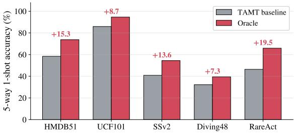
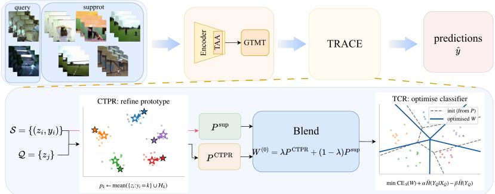
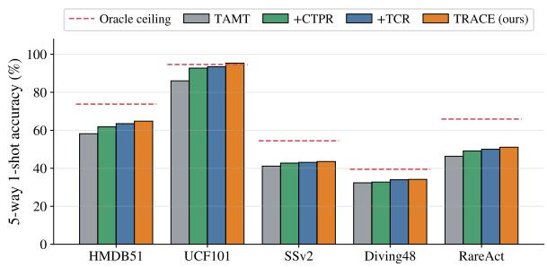
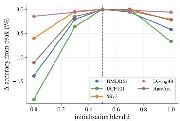
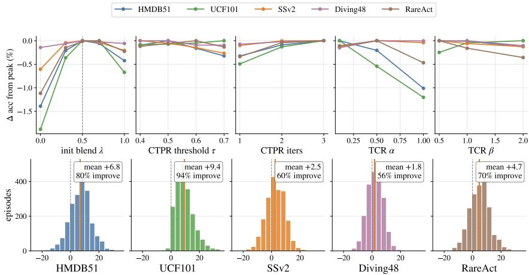
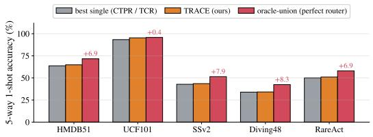
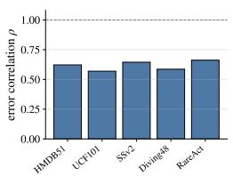

# Closing the Estimation Gap: Training-Free Transductive Inference for Cross-Domain Few-Shot Action Recognition

Changyi Li changyi.li@aalto.fi

<sup>2</sup>Zeyu Yang zeyu.yang@aalto.fi

Yu Xiao cyu.xiao@aalto.fi

Dept. of Information and Communications Engineering Aalto University 02150 Espoo, Finland

## Abstract

Cross-domain few-shot action recognition (CD-FSAR) aims to recognise unseen action classes in a target domain from a handful of labelled videos. Despite advances in representation learning, CD-FSAR inference still relies on prototypes estimated from extremely limited support examples. To assess this bottleneck, we perform an oracle analysis with the feature representation fixed. Constructing oracle prototypes and decision boundaries from ground-truth query labels improves 5-way 1-shot accuracy by 7–20 percentage points across five target datasets. This reveals a substantial estimation gap: the representation contains useful discriminative information, but prototypes and boundaries estimated from scarce supports fail to capture each episode’s true class structure. Motivated by this finding, we propose TRACE, a training-free transductive inference framework that improves episode-level estimation without modifying the backbone. TRACE comprises two complementary stages. Confidence-Thresholded Transductive Prototype Refinement (CTPR) refines support-based prototypes using confidently predicted queries. The refined prototypes initialise a lightweight per-episode classifier, which Transductive Classifier Refinement (TCR) further adapts by encouraging confident, class-balanced predictions over all queries. Together, the two stages improve prototype and boundary estimation, enabling better use of information already present in the unlabelled queries. Across five target datasets (HMDB51, UCF101, SSv2, Diving48, and RareAct) in both 1-shot and 5-shot settings, TRACE consistently improves a strong CD-FSAR baseline, including gains of more than six percentage points on HMDB51 1- shot, while recovering a substantial fraction of the oracle-estimated gap. These results suggest that improving test-time estimation is a powerful, broadly applicable complement to representation learning for CD-FSAR under extreme support scarcity. Code: https://github.com/hisalaheiyo/TRACE.

## 1 Introduction

Large pre-trained video models have substantially advanced action recognition capabilities, but their success typically relies on abundant labelled data for every class of interest. Many real-world applications violate this assumption. Surveillance of rare events, sports analytics, clinical video analysis, and assistive monitoring [7] often involve domain-specific actions that are expensive to annotate and differ substantially from the web-scale videos used for pretraining. Cross-domain few-shot action recognition (CD-FSAR) formalises this challenge: a model trained on a source domain must recognise unseen action classes in a different target domain using only a handful of labelled videos per class. The combination of severe domain shift and extreme label scarcity makes CD-FSAR considerably more challenging than either few-shot recognition or domain adaptation alone.

  
Figure 1: Oracle estimation reveals a substantial gap across target datasets (1-shot). Left bars: TAMT baseline; right bars: oracle estimation, both under the held-out-half protocol. Numbers above bars give the gap in percentage points.

Most existing approaches address this challenge through representation learning. Recent methods design temporally-aware backbones, introduce lightweight adaptation modules, or develop specialised meta-training objectives to improve transferability across domains [14, 22, 24]. While these advances are valuable, they largely operate before a target episode is observed. Once training is complete, inference typically reduces to matching each query video against prototypes estimated from only a few support examples. This raises a simple but largely unexplored question: given a strong and fixed representation, how much performance is still limited by episode-level estimation at inference time? By estimation we mean the construction of prototypes and decision boundaries from each episode’s few labelled supports.

To answer this question, we perform an oracle analysis that isolates representation quality from estimation quality. Specifically, we keep the feature representation (the frozen encoder and its embeddings) fixed and construct oracle prototypes and decision boundaries using the ground-truth labels of the query videos within each episode. The resulting gains are large and consistent. Across five target datasets, oracle estimation improves 1-shot accuracy by 7–20 percentage points, as shown in Fig. 1; on HMDB51, for example, accuracy increases from 58.4% to 73.8% under the held-out-half evaluation. Because the encoder remains unchanged, these improvements cannot be attributed to better representations. Instead, they reveal a substantial estimation gap: under extreme support scarcity, prototypes and decision boundaries estimated from only a few support examples fail to capture the true class structure of an episode. Importantly, the information required to improve these estimates is already available at test time in the distribution of the unlabelled query videos.

Guided by this diagnosis, we seek to close the estimation gap without modifying the representation itself. We propose TRACE, a training-free transductive inference framework that operates entirely within a single test episode. TRACE consists of two complementary stages that target the two components of the estimation gap. Confidence-Thresholded Transductive Prototype Refinement (CTPR) improves prototype estimation by incorporating confidently predicted query videos into the support-based prototypes. The refined prototypes are then used to initialise a lightweight per-episode classifier. Transductive Classifier Refinement (TCR) subsequently improves boundary estimation by adapting this classifier using the information-maximisation principle of Boudiaf et al. [1], encouraging predictions over the query set to become both confident and class-balanced. Together, the two stages enable more accurate episode-level estimation while leaving the backbone entirely unchanged.

We evaluate TRACE on five target datasets (HMDB51, UCF101, SSv2, Diving48, and RareAct) under both 1-shot and 5-shot settings. A central question raised by our oracle analysis is how much of the estimation gap can be recovered without changing the representation. Across all five datasets, TRACE consistently recovers a substantial fraction of this gap, improving a strong CD-FSAR baseline by more than six percentage points on HMDB51 1-shot. Despite requiring no additional training, it remains competitive with state-of-the-art methods that modify the training procedure. Because TRACE only re-estimates episode-specific prototypes and decision boundaries, its benefits are largely independent of the underlying recognition framework. We verify this by applying TRACE unchanged to three different episodic heads, where it achieves the best average performance in all cases.

In summary, our contributions are three-fold:

• We reveal a substantial estimation gap in CD-FSAR under extreme support scarcity through an oracle diagnostic framework, and demonstrate that a large portion of this gap can be recovered at test time (Sec. 3).

• We propose TRACE, a training-free transductive inference framework that improves both prototype estimation and boundary estimation through the combination of CTPR and TCR, without modifying the backbone or requiring additional training (Sec. 4).

• We conduct extensive experiments across five datasets, two shot settings, and three episodic heads, demonstrating consistent improvements over a strong baseline and analysing when and why the two transductive estimators are complementary (Sec. 5).

## 2 Related Work

Cross-domain few-shot action recognition. Cross-domain few-shot action recognition (CD-FSAR) builds upon a large body of work on within-domain few-shot action recognition, including temporal alignment, relation-based matching, and transformer-based approaches such as OTAM [2], TRX [11], HyRSM [21], STRM [16], and MoLo [22]. CD-FSAR further introduces a substantial distribution shift between a label-rich source domain and a labelscarce target domain. Existing methods primarily address this challenge through representation learning or training-time adaptation. Representative approaches exploit self-training, distillation, self-supervised temporal learning, mixed-source distillation, or curriculum learning to improve cross-domain transfer [3, 5, 12, 14, 23]. Most relevant to our setting, TAMT keeps a frozen VideoMAE backbone [18] and adapts lightweight temporal modules through meta-training, achieving strong performance without joint source–target training [24]. Despite their differences, these methods share a common characteristic: cross-domain transfer is improved primarily through stronger representations or better training procedures before a target episode is observed. In contrast, we study a complementary question: once a strong representation is fixed, how much performance is still limited by episode-level estimation at inference time?

Transductive and test-time estimation in few-shot learning. A complementary line of work improves few-shot recognition at inference time by exploiting relationships among the query samples. In image-domain few-shot learning, transductive inference has been explored through label propagation, manifold smoothing, Laplacian regularisation, and optimal transport [4, 6, 9, 13, 25]. Transductive information maximisation further adapts a per-episode classifier by encouraging predictions to be both confident and class-balanced [1], while testtime adaptation more broadly updates models on unlabelled test data through objectives such as entropy minimisation [20]. Related ideas have also been explored for within-domain fewshot video recognition [10, 19]. Another closely related direction is prototype rectification, which reduces prototype bias by incorporating unlabelled queries through pseudo-labelling and prototype re-estimation [8].

Collectively, these methods demonstrate that the unlabelled query set contains information that can substantially improve episode-level decisions. However, they are typically evaluated in image or single-domain settings and are rarely grounded in an explicit diagnosis of which estimation errors they address. In contrast, we begin with an oracle analysis that identifies a substantial estimation gap in CD-FSAR and separates representation quality from estimation quality. This diagnosis provides the basis for our training-free test-time inference framework.

## 3 An Oracle Analysis of the Estimation Gap

We begin by asking what limits CD-FSAR accuracy once a strong representation is fixed. Our analysis shows that a large and recoverable portion of the error arises from episode-level estimation: prototypes and decision boundaries must be inferred from only a few labelled support videos. This diagnosis directly motivates the design of our method in Sec. 4.

Setup and notation. A CD-FSAR episode is a K-way N-shot task sampled from a target domain whose classes are unseen during training. It contains a labelled support set ${ \boldsymbol { S } } =$ $( x _ { i } , y _ { i } ) * i = 1 ^ { K N }$ with N videos per class, and an unlabelled query set $\mathcal { Q } = \stackrel { \_ } { x } _ { j } * j = 1 ^ { K M }$ whose labels are to be predicted. Following TAMT [24], a frozen feature extractor maps each video to an embedding $z = \phi ( x ) \in \mathbb { R } ^ { d }$ and is never updated at test time. The standard baseline forms a per-class prototype

$$
p _ { k } = \frac { 1 } { N } \sum _ { i : y _ { i } = k } z _ { i } ,\tag{1}
$$

and predicts $\hat { y } _ { j } = \arg \operatorname* { m a x } _ { k } \sin ( z _ { j } , p _ { k } )$ , where sim is the inner product for N=1 and the negative squared Euclidean distance for $N { > } 1$ , matching the baseline metric.

Oracle protocol. With the representation fixed, the episode-specific quantities are the prototypes in Eq. 1 and, more generally, the decision boundaries induced by them. Rather than asking how to improve these estimates, we first ask how much performance could be gained if they were estimated with access to perfect label information. To quantify this, we construct three transductive upper bounds that use ground-truth query labels for analysis only. The term is diagnostic rather than formal: each oracle scores one specific label-assisted estimator on the fixed features, not the best possible decision rule. To avoid fitting the evaluation set, each oracle uses the labels of one half of the query set and is evaluated on the other half.

<table><tr><td>Dataset</td><td>Baseline</td><td>TUB-P</td><td>TUB-C</td><td>TUB-I</td><td>gap ∆</td></tr><tr><td>HMDB51</td><td>58.45</td><td>71.24</td><td>71.05</td><td>73.79</td><td>+15.34</td></tr><tr><td>UCF101</td><td>85.90</td><td>94.63</td><td>94.33</td><td>94.18</td><td>+8.73</td></tr><tr><td>SSv2</td><td>40.87</td><td>54.42</td><td>50.64</td><td>54.47</td><td>+13.60</td></tr><tr><td>Diving48</td><td>32.21</td><td>39.47</td><td>35.98</td><td>39.07</td><td>+7.26</td></tr><tr><td>RareAct</td><td>46.40</td><td>63.68</td><td>64.13</td><td>65.91</td><td>+19.51</td></tr></table>

Table 1: Oracle upper bounds on 5-way 1-shot CD-FSAR. Baseline denotes TAMT prototype matching evaluated on the held-out query half. TUB-P, TUB-C, and TUB-I denote oracle prototype estimation, oracle boundary estimation, and classifier refinement initialised from oracle prototypes, respectively. Each oracle uses the true labels of the other query half and is evaluated on the same held-out half as the baseline. Gap ∆ is the difference between the best oracle and the baseline. Best oracle per row is shown in bold.

The baseline is evaluated on the same held-out query half, so all performance gaps are directly comparable.

The Prototype Oracle (TUB-P) recomputes prototypes from the support set and the truelabelled query half, estimating the best performance achievable by a prototype classifier with oracle prototype estimation. The Classifier Oracle (TUB-C) fits a linear classifier on the support set and the true-labelled query half, estimating the benefit of oracle boundary estimation. The Initialisation Oracle (TUB-I) optimises the same per-episode classifier as TUB-C but initialises it from the oracle prototypes, estimating the value of accurate prototype initialisation for boundary refinement.

A substantial estimation gap exists. Table 1 compares the baseline with the three oracle upper bounds on all five target datasets in the 5-way 1-shot setting. Across all datasets, the oracle upper bounds consistently outperform the baseline by a large margin, indicating that support-based estimation leaves substantial room for improvement even when the representation is fixed. With the encoder and embeddings kept fixed, the best oracle improves accuracy by +7.3 (Diving48) to +19.5 (RareAct) percentage points; for example, HMDB51 increases from 58.4 to 73.8. Since the representation is unchanged throughout this comparison, the observed improvement arises from better episode-level estimation rather than from changes to the features themselves. These gains show that the fixed representation retains class information that support-based estimation leaves unused. Whether that information can be recovered from the unlabelled queries alone is an empirical question; Secs. 4 and 5 show that much of it can.

Fig. 1 visualises this estimation gap across target datasets. The left bar shows the TAMT baseline, which estimates prototypes solely from the support set, while the right bar shows the best oracle under the same held-out-half evaluation protocol. Numbers above the bars indicate the gap in percentage points. The consistent separation between the two bars highlights that support-based episode-level estimation remains a substantial source of error under extreme label scarcity.

Prototype estimation and boundary estimation are complementary. Comparing the three oracles reveals how prototype estimation and boundary estimation interact. A freely fitted classifier (TUB-C) does not always outperform the Prototype Oracle. On more challenging temporal datasets, it underperforms TUB-P (SSv2: 50.6 vs. 54.4; Diving48: 36.0 vs. 39.5), suggesting that an unconstrained decision boundary can overfit when the labelled set is extremely small.

  
Figure 2: TRACE: recovering the estimation gap at test time. Top: a target-domain episode is encoded by a frozen VideoMAE-S encoder equipped with Temporal-Aware Adapters (TAA) and a Global Temporal-aware Moment Tuning (GTMT) head. Bottom: TRACE first applies Confidence-Thresholded Transductive Prototype Refinement (CTPR) to refine prototype estimates using only confident query samples, then performs Transductive Classifier Refinement (TCR) to adapt the decision boundary to the query distribution. The refined prototypes initialise the classifier before boundary refinement. Insets illustrate the effect of CTPR and TCR in a schematic feature space (stars: support; dots: query).

In contrast, the Initialisation Oracle (TUB-I) is the best or tied-best oracle on three of five datasets and remains within 0.5 percentage points of the strongest oracle elsewhere. Because TUB-I optimises the same classifier as TUB-C but starts from oracle prototypes, its advantage reflects the value of accurate prototype initialisation. These results suggest that prototype estimation and boundary estimation address complementary aspects of the estimation problem: a reliable prototype provides a strong starting point, while subsequent classifier refinement can further exploit information contained in the query distribution.

## 4 TRACE: Test-Time Recovery of the Estimation Gap

The oracle analysis in Sec. 3 showed that recovering the estimation gap requires addressing two complementary sources of error: prototype estimation and boundary estimation. It further shows that boundary refinement is most effective when initialised from an improved prototype estimate. These observations motivate TRACE, a training-free transductive inference procedure that operates entirely at test time while keeping the representation fixed.

Given the support and query videos, a frozen VideoMAE-S encoder equipped with Temporal-Aware Adapters (TAA) and a Global Temporal-aware Moment Tuning (GTMT) head first maps every clip into an embedding, after which all subsequent computation is performed within the episode while keeping the encoder fixed.

As illustrated in Fig. 2, TRACE addresses the resulting estimation problem through two complementary stages. Confidence-Thresholded Transductive Prototype Refinement (CTPR) reduces prototype estimation error by incorporating only confidently predicted query samples into the prototype estimate. Transductive Classifier Refinement (TCR) then adapts a lightweight per-episode classifier to the structure of the query distribution, improving boundary estimation. Rather than treating prototype refinement and boundary refinement as independent improvements, TRACE uses the refined prototypes produced by CTPR to initialise TCR. This refined-prototype initialisation directly follows the insight provided by the Initialisation Oracle: boundary refinement is most effective when it starts from an improved prototype estimate rather than from the raw support prototypes alone.

## 4.1 Confidence-Thresholded Transductive Prototype Refinement (CTPR)

The oracle analysis in Sec. 3 showed that a substantial portion of the estimation gap arises from inaccurate prototype estimation. The Prototype Oracle indicates that more accurate prototype estimates can substantially improve recognition accuracy. CTPR seeks to approximate this oracle behaviour at test time by refining support prototypes using confidently pseudo-labelled query samples.

Under severe domain shift, incorrect pseudo-labels can easily move a prototype away from its class centre. CTPR therefore prioritises precision over coverage: only highly confident queries are incorporated into the prototype estimate. Starting from the support prototypes of Eq. (1), we iteratively score all query samples, assign pseudo-labels, and retain only those whose confidence exceeds a threshold τ.

$$
\hat { y } _ { j } ^ { ( t ) } = \underline { { \operatorname { a r g m a x } } } \sin \bigl ( z _ { j } , p _ { k } ^ { ( t - 1 ) } \bigr ) , \qquad c _ { j } ^ { ( t ) } = \operatorname * { m a x } _ { k } \operatorname { s o f t m a x } \bigl ( \sin ( z _ { j } , p ^ { ( t - 1 ) } ) \bigr ) _ { k } ,\tag{2}
$$

This gives the high-confidence set $\mathcal { H } _ { k } ^ { ( t ) } = \{ j : \hat { y } _ { j } ^ { ( t ) } = k , c _ { i } ^ { ( t ) } > \tau \}$ . Each prototype is then recomputed as the mean of its support embeddings and selected query embeddings,

$$
p _ { k } ^ { ( t ) } = \mathrm { m e a n } \Big ( \{ z _ { i } : y _ { i } = k \} \cup \{ z _ { j } : j \in \mathcal { H } _ { k } ^ { ( t ) } \} \Big ) .\tag{3}
$$

After T refinement rounds, we obtain the refined prototypes $p _ { k } ^ { \mathrm { { C T P R } } }$ . CTPR deliberately adopts a hard confidence threshold and simple averaging. This keeps the procedure parameter-free, avoids fitting additional parameters from extremely limited support data, and makes refinement depend only on highly reliable query evidence.

## 4.2 Transductive Classifier Refinement (TCR)

While CTPR improves prototype estimation, it still classifies queries through nearest-prototype matching. The Classifier Oracle in Sec. 3 showed that additional gains remain available through improved boundary estimation. TCR addresses this by adapting a lightweight classifier to the structure of the query distribution.

Unlike prototype refinement, boundary refinement requires exploiting the global structure of the query set rather than only re-estimating class centres. Following the transductive information-maximisation framework of Boudiaf et al. [1], TCR optimises a per-episode linear classifier initialised from a prototype matrix.

$$
\ell _ { k } ( z ; W ) = \gamma \frac { \langle z , W _ { k } \rangle } { \| z \| \| W _ { k } \| } , \qquad P ( k \mid z ) = \mathrm { s o f t m a x } \big ( \ell ( z ; W ) \big ) _ { k } .\tag{4}
$$

The objective fits the labelled supports while encouraging the query predictions to be confident and class-balanced:

$$
{ \mathcal L } ( W ) = \mathbf { C E } _ { S } ( W ) + \alpha \widehat H ( Y _ { { \mathcal Q } } | X _ { { \mathcal Q } } ) - \beta \widehat H ( Y _ { { \mathcal Q } } ) ,\tag{5}
$$

```latex
Algorithm 1 TRACE: training-free recovery of the estimation gap within a test episode.
Require: support embeddings $( z _ { i } , y _ { i } )$ , query embeddings z ; hyperparameters $\tau , T , \lambda , \alpha , \beta , \gamma$
1: $\begin{array} { r } { \dot { P } _ { k } ^ { \mathrm { s u p } }  \frac { \bar { 1 } } { N } \sum _ { i : y _ { i } = k } z _ { i } ; ; p _ { k }  \bar { P } _ { k } ^ { \mathrm { s u p } } } \end{array}$ ▷ support prototypes
2: for $t = 1$ to T do ▷ CTPR
3: Assign pseudo-labels and confidence scores to all queries using $p _ { k _ { k = 1 } } ^ { K } ( \mathrm { E q . } 2 )$
4: Collect $\mathcal { H } _ { k } ^ { ( t ) }$ , queries pseudo-labelled k with confidence $> \tau$
5: $\begin{array} { r } { \mathbf { i f } \cup _ { k } \mathcal { H } _ { k } ^ { ( t ) } = \emptyset } \end{array}$ then continue
6: end if
7: $p _ { k } \gets \mathrm { m e a n } ( z _ { i } : y _ { i } = k \cup z _ { j } : j \in \mathcal { H } _ { k } ^ { ( t ) } )$ ▷ Eq. 3
8: end for
9: $P ^ { \mathrm { C T P R } } \gets [ p _ { 1 } , . . . , p _ { K } ]$
10: $W  \lambda P ^ { \mathrm { { \bar { c } T P R } } } + ( 1 - \bar { \lambda } ) P ^ { \mathrm { { s u p } } }$ ▷ refined-prototype initialisation, Eq. 8
11: for 100 steps do ▷ TCR
12: $W \gets \mathrm { A d a m S t e p } ( W , \nabla _ { W } \mathcal { L } ( W ) )$ ▷ Eq. 5
13: end for
14: return arg max ${ } _ { \cdot k } \ell _ { k } ( z _ { j } ; W )$ for each query j
```

where $\begin{array} { r } { \mathrm { C E } _ { \mathcal { S } } ( W ) = - \frac { 1 } { | \mathcal { S } | } \sum _ { ( x _ { i } , y _ { i } ) \in { \cal S } } \log P ( y _ { i } \mid z _ { i } ) } \end{array}$ is the support cross-entropy, and

$$
\widehat { H } ( Y _ { \mathcal { Q } } | X _ { \mathcal { Q } } ) = - \frac { 1 } { \left| \mathcal { Q } \right| } \sum _ { j } \sum _ { k } P ( k \mid z _ { j } ) \log P ( k \mid z _ { j } ) ,\tag{6}
$$

$$
\widehat { H } ( Y _ { \mathcal { Q } } ) = - \sum _ { k } \bar { p } _ { k } \log \bar { p } _ { k } , \quad \bar { p } _ { k } = \frac { 1 } { \left| \mathcal { Q } \right| } \sum _ { j } P ( k \mid z _ { j } ) .\tag{7}
$$

The conditional-entropy term encourages confident predictions, while the marginal-entropy term discourages degenerate solutions in which most queries collapse to a small subset of classes. Together, the two terms encourage confident predictions while maintaining class balance across the query set. Since $\widehat { H } ( Y _ { \mathcal { Q } } ) \bar { ( } { - } \widehat { H } ( Y _ { \mathcal { Q } } | X _ { \mathcal { Q } } ) $ equals the empirical mutual information between queries and predicted labels, Eq. (5) can be viewed as maximising query mutual information while fitting the support set. Only the classifier parameters are updated within the episode; the feature representation remains unchanged throughout.

## 4.3 TRACE: Refined-Prototype Initialisation

The oracle analysis further showed that prototype refinement and boundary refinement should not be treated as independent improvements. The Initialisation Oracle consistently provides the strongest or near-strongest oracle performance, indicating that classifier refinement benefits most from starting from a high-quality prototype estimate.

Motivated by this observation, TRACE uses the CTPR-refined prototypes to initialise TCR. Rather than optimising the classifier from raw support prototypes alone, we initialise it from a convex combination of the raw and refined prototypes:

$$
W ^ { ( 0 ) } = \lambda P ^ { \mathrm { C T P R } } + ( 1 - \lambda ) P ^ { \mathrm { s u p } } ,\tag{8}
$$

where $P ^ { \mathrm { s u p } } , P ^ { \mathrm { C T P R } } \in \mathbb { R } ^ { K \times d }$ stack the raw and CTPR-refined prototypes, with k-th rows $p _ { k }$ and $p _ { k } ^ { \mathrm { { C T P R } } }$ , respectively. TCR is then optimised from this initialisation using Eq. (5). The resulting design allows boundary refinement to inherit the robustness of the refined prototypes while retaining the flexibility of classifier adaptation. In this sense, TRACE is not merely a sequential combination of CTPR and TCR, but a realisation of the refined-prototype initialisation strategy identified by the Initialisation Oracle. Algorithm 1 summarises the complete procedure.

<table><tr><td>Method</td><td>HMDB51</td><td>UCF101</td><td>SSv2</td><td>Diving48</td><td>RareAct</td><td>Avg.</td></tr><tr><td colspan="7">Source: Kinetics-400 (5-way 1-shot)</td></tr><tr><td>TAMT []‡</td><td>58.19</td><td>86.04</td><td>41.14</td><td>32.36</td><td>46.33</td><td>52.81</td></tr><tr><td>TRACE (ours)</td><td>64.81</td><td>95.35</td><td>43.56</td><td>34.15</td><td>51.09</td><td>57.79</td></tr><tr><td>Source: Kinetics-400</td><td colspan="6">(5-way 5-shot)</td></tr><tr><td>STARTUP++ []</td><td>44.71</td><td>60.82</td><td>39.60</td><td>14.92</td><td>45.22</td><td>41.05</td></tr><tr><td>DD++ [0]</td><td>48.04</td><td>63.26</td><td>44.50</td><td>16.23</td><td>47.01</td><td>43.81</td></tr><tr><td>STRM []</td><td>24.98</td><td>42.33</td><td>35.01</td><td>16.69</td><td>39.01</td><td>31.60</td></tr><tr><td>HyRSM []</td><td>29.81</td><td>45.65</td><td>40.09</td><td>17.57</td><td>44.27</td><td>35.49</td></tr><tr><td>CDFSL-V []</td><td>53.23</td><td>65.42</td><td>49.92</td><td>17.84</td><td>49.80</td><td>47.24</td></tr><tr><td> $\mathrm { T A M T } [ \mathbf { \square } ] ^ { \div }$ </td><td>72.50</td><td>95.96</td><td>59.28</td><td>44.91</td><td>68.18</td><td>68.17</td></tr><tr><td>TRACE (ours)</td><td>74.23</td><td>97.43</td><td>61.45</td><td>45.55</td><td>69.67</td><td>69.67</td></tr><tr><td>Source: Kinetics-100</td><td colspan="6">(5-way 1-shot)</td></tr><tr><td>STARTUP++ []</td><td>16.66</td><td>24.48</td><td>14.17</td><td>13.13</td><td>17.21</td><td>17.13</td></tr><tr><td>DD++ [0]</td><td>17.44</td><td>26.04</td><td>14.96</td><td>13.73</td><td>19.02</td><td>18.24</td></tr><tr><td>CDFSL-V []</td><td>18.59</td><td>27.78</td><td>16.01</td><td>14.11</td><td>20.06</td><td>19.31</td></tr><tr><td> $\mathrm { S E F N ^ { * \dagger } \left[ \pmb { \bigtriangledown } \right] }$ </td><td>39.50</td><td>64.60</td><td>26.20</td><td>31.23</td><td>34.28</td><td>39.16</td></tr><tr><td> $\mathrm { D M S D ^ { * } } ^ { \dagger } \left[ \pmb { \Xi } \right]$ </td><td>39.62</td><td>65.00</td><td>26.78</td><td>34.20</td><td>37.50</td><td>40.62</td></tr><tr><td> $\mathrm { T A M T } [ \pmb { \Sigma } ] ] ^ { \ddag }$ </td><td>47.02</td><td>72.38</td><td>34.45</td><td>27.04</td><td>36.04</td><td>43.39</td></tr><tr><td>TRACE (ours)</td><td>52.81</td><td>80.27</td><td>36.62</td><td>28.76</td><td>40.89</td><td>47.87</td></tr><tr><td colspan="7">Source: Kinetics-100 (5-way 5-shot)</td></tr><tr><td>STARTUP++ []</td><td>24.97</td><td>32.20</td><td>15.16</td><td>14.55</td><td>31.77</td><td>23.73</td></tr><tr><td>DD++ [0]</td><td>25.99</td><td>34.10</td><td>16.00</td><td>16.24</td><td>31.20</td><td>24.71</td></tr><tr><td>CDFSL-V []</td><td>29.80</td><td>36.53</td><td>17.21</td><td>16.37</td><td>33.91</td><td>26.76</td></tr><tr><td> $\mathrm { S E F N ^ { * \dagger } \ [ \pmb { \bigtriangledown } ] }$ </td><td>52.80</td><td>79.60</td><td>31.20</td><td>40.90</td><td>50.20</td><td>50.94</td></tr><tr><td> $\mathrm { D M S D ^ { * } } ^ { \dagger } \left[ \pmb { \square } \right]$ </td><td>54.90</td><td>81.90</td><td>32.10</td><td>42.28</td><td>53.30</td><td>52.90</td></tr><tr><td> $\mathrm { T A M T } [ \mathbf { \square } ] ^ { \div }$ </td><td>61.76</td><td>87.76</td><td>48.90</td><td>38.33</td><td>52.81</td><td>57.91</td></tr><tr><td>TRACE (ours)</td><td>62.99</td><td>89.11</td><td>51.23</td><td>38.83</td><td>54.08</td><td>59.25</td></tr><tr><td></td><td></td><td></td><td></td><td></td><td></td><td></td></tr></table>

Table 2: Main results across five CD-FSAR target datasets (5-way accuracy, Methods marked with <sup>∗</sup> or <sup>†</sup> use different input resolutions or backbones and are included for reference. All other methods follow the common VideoMAE ViT-S/112 protocol. <sup>‡</sup> denotes our reproduction of TAMT, the base model on which TRACE is applied. Prior work does not report K-400 1-shot results; therefore only TAMT and TRACE are shown in this setting. Best results under the common ViT-S/112 protocol are highlighted in bold.

## 5 Experiments

## 5.1 Setup

Datasets and source domains. We evaluate on five standard CD-FSAR target datasets: HMDB51, UCF101, SSv2, Diving48, and RareAct. Following prior work, we report results under two source domains: Kinetics-400 (with target-overlapping classes removed, leaving 364 categories [24]) and Kinetics-100, the smaller source domain used by SEEN [23] and

DMSD [3]. We adopt the CDFSL-V splits [14] for HMDB51, UCF101, SSv2, and Diving48, and the TAMT 48/8/8 base/validation/novel split for RareAct [24]. Source and target classes are disjoint in all settings.

Protocol and evaluation. Following [14, 24], we evaluate 5-way 1-shot and 5-shot classification with 12 query videos per class. Each video is represented by 16 sampled frames at $1 1 2 \times 1 1 2$ resolution. We report mean accuracy over 10,000 test episodes (5 splits × 2,000 episodes), matching the evaluation protocol of TAMT [24]. The baseline predicts each query by matching it to support prototypes using inner-product similarity in the 1-shot setting and negative squared Euclidean distance in the 5-shot setting.

Backbone. The main experiments build on TAMT [24], a strong CD-FSAR baseline consisting of a frozen VideoMAE-S [18] backbone augmented with Temporal-Aware Adapters (TAA) and a Global Temporal-aware Moment Tuning (GTMT) head. Since TRACE operates entirely at test time, it does not modify the backbone or episodic head. Using a strong baseline reduces the risk that improvements arise from weaknesses in the representation.

TRACE configuration and implementation. Unless stated otherwise, all experiments use a single configuration across datasets and shot settings: CTPR with confidence threshold $\tau =$ 0.5 and $T = 3$ refinement rounds; TCR with α = 0.1, $\beta = 1 . 0$ , temperature $\gamma = 1 5 ,$ , and 100 Adam optimisation steps at learning rate $1 0 ^ { - 3 }$ ; and refined-prototype blending weight $\lambda =$ 0.5. No per-dataset hyperparameter tuning is performed. Sec. 5.3 analyses the sensitivity of these choices and shows that a single configuration performs consistently across datasets.

We implement TRACE in PyTorch and evaluate using the publicly released TAMT checkpoints [24] for both Kinetics-400 and Kinetics-100 source domains. Experiments are conducted on a single NVIDIA H200 GPU. Relative to standard prototype inference, TRACE adds approximately 100,ms per episode, with the TCR optimisation accounting for most of the overhead.

## 5.2 Comparison with the State of the Art

Table 2 reports the main CD-FSAR results across five target datasets, two source domains, and both 1-shot and 5-shot settings. Across all settings, TRACE consistently improves its TAMT baseline despite requiring no additional training and modifying neither the backbone nor the episodic head.

Under the Kinetics-400 source domain, TRACE improves every target dataset. The gains are particularly pronounced in the 1-shot regime, where average accuracy increases by roughly five points and exceeds nine points on UCF101. Similar improvements are observed under the Kinetics-100 source domain, where TRACE consistently outperforms TAMT across all datasets and shot settings. Under the common ViT-S/112 protocol, TRACE achieves the best result in every Kinetics-100 setting.

A clear pattern emerges across both source domains: improvements are substantially larger in the 1-shot setting than in the 5-shot setting. This trend is consistent with the oracle analysis in Sec. 3, which showed that the estimation gap grows as support becomes scarcer. The largest gains therefore occur precisely in the settings where estimation errors are expected to be most severe. Taken together, these results indicate that a substantial portion of the remaining performance gap can be recovered through improved episode-level estimation at test time, without modifying the representation or training procedure.

<table><tr><td>Dataset</td><td>Shot</td><td>Baseline</td><td>+CTPR</td><td>+TCR</td><td>+TRACE</td></tr><tr><td>HMDB51</td><td>1</td><td>58.19</td><td>61.82</td><td>63.50</td><td>64.81</td></tr><tr><td rowspan="3">UCF101</td><td>5</td><td>72.50</td><td>73.95</td><td>73.25</td><td>74.23</td></tr><tr><td>1</td><td>86.04</td><td>92.73</td><td>93.44</td><td>95.35</td></tr><tr><td>5</td><td>95.96</td><td>96.48</td><td>97.47</td><td>97.43</td></tr><tr><td rowspan="2">SSv2</td><td>1</td><td>41.14</td><td>42.74</td><td>43.12</td><td>43.56</td></tr><tr><td>5</td><td>59.28</td><td>60.76</td><td>60.50</td><td>61.45</td></tr><tr><td rowspan="2">Diving48</td><td>1</td><td>32.36</td><td>32.74</td><td>33.96</td><td>34.15</td></tr><tr><td>5</td><td>44.91</td><td>45.35</td><td>45.17</td><td>45.55</td></tr><tr><td rowspan="2">RareAct</td><td>1</td><td>46.33</td><td>49.12</td><td>50.02</td><td>51.09</td></tr><tr><td>5</td><td>68.18</td><td>68.90</td><td>70.26</td><td>69.67</td></tr></table>

Table 3: Ablation of prototype and boundary refinement (5-way accuracy, Baseline denotes the original TAMT inference procedure. +CTPR applies prototype refinement only, +TCR applies classifier refinement only, and +TRACE combines the two through refinedprototype initialisation. Best results in each row are shown in bold.

<table><tr><td>Base</td><td>Method</td><td>HMDB51</td><td>UCF101</td><td>SSv2</td><td>Diving48</td><td>RareAct</td><td>Avg.</td></tr><tr><td>ProtoNet</td><td>Baseline</td><td>58.26</td><td>87.63</td><td>39.93</td><td>31.89</td><td>47.86</td><td>53.11</td></tr><tr><td></td><td>+CTPR</td><td>62.30</td><td>93.43</td><td>41.44</td><td>32.37</td><td>51.06</td><td>56.12</td></tr><tr><td></td><td>+TCR</td><td>63.10</td><td>94.27</td><td>41.98</td><td>31.57</td><td>51.12</td><td>56.41</td></tr><tr><td></td><td>TRACE (ours)</td><td>64.87</td><td>95.95</td><td>42.54</td><td>32.36</td><td>52.29</td><td>57.60</td></tr><tr><td>Good-embed</td><td>Baseline</td><td>51.94</td><td>84.75</td><td>31.08</td><td>25.70</td><td>47.26</td><td>48.15</td></tr><tr><td></td><td>+CTPR</td><td>55.42</td><td>91.46</td><td>31.42</td><td>25.49</td><td>50.27</td><td>50.81</td></tr><tr><td></td><td>+TCR</td><td>54.06</td><td>89.66</td><td>31.30</td><td>25.82</td><td>48.54</td><td>49.88</td></tr><tr><td></td><td>TRACE (ours)</td><td>56.76</td><td>93.42</td><td>31.60</td><td>25.69</td><td>50.83</td><td>51.66</td></tr></table>

Table 4: Generalisation across episodic heads (5-way 1-shot accuracy, TRACE is applied unchanged to a ProtoNet head and a good-embedding linear head. Best results within each head are highlighted in bold.

## 5.3 Ablation of Prototype and Boundary Refinement

Table 3 evaluates the contribution of the two refinement stages and their composition. Both CTPR and TCR consistently improve over the TAMT baseline, indicating that prototype refinement and boundary refinement provide complementary benefits. Their combination typically achieves the strongest performance; in the remaining two settings, the difference between TRACE and the strongest individual component is less than 0.6 points.

The gains are particularly pronounced in the 1-shot regime, where TRACE improves upon the baseline by between 1.8 and 9.3 points across datasets. This trend is consistent with the oracle analysis in Sec. 3, which showed that the estimation gap becomes larger as support becomes scarcer. It is also consistent with the finding that refined-prototype initialisation is the most effective way to combine prototype and boundary estimation.

## 5.4 Generality Across Episodic Heads

To assess whether the gains of TRACE depend on a particular episodic head, we apply it unchanged to ProtoNet [15] and a good-embedding linear head [17], in addition to the TAMT head used throughout the main experiments.

Table 4 shows that TRACE consistently improves all three heads. Across the five target datasets, it increases the average 1-shot accuracy by 4.5 points on ProtoNet and 3.5 points on the good-embedding head, while achieving the strongest average performance in both cases. The gains are observed across nearly all datasets, indicating that the benefit of TRACE is not tied to a particular head design.



  
Figure 3: Recovering the estimation gap through refined-prototype initialisation. Left: comparison of TAMT, CTPR, TCR, and TRACE against the corresponding oracle ceiling for each dataset (dashed lines; Table 1). Right: effect of the initialisation blend λ. $\lambda = 0$ corresponds to TCR initialised from the raw support prototype, while $\lambda = 1$ corresponds to using only the refined prototype from CTPR. Curves show the accuracy difference from each dataset’s peak performance, allowing all datasets to be compared on a common scale.

The effectiveness of TRACE across substantially different heads is consistent with the central hypothesis of this work. Because TRACE operates entirely through test-time estimation using the support and query sets, its gains do not rely on head-specific architectural choices. The results therefore suggest that the recovered performance stems from improved episode-level estimation rather than from a particular classifier design.

## 5.5 Mechanism and Robustness Analysis

Figure 3 (left) compares the gains of TRACE with the oracle gaps identified in Sec. 3. Without any additional training, TRACE recovers a substantial fraction of the available headroom on every target dataset, improving upon the baseline by 1.8–9.3 points. The remaining headroom is largest on SSv2 and Diving48, suggesting greater scope for future improvements on highly temporal actions. Figure 3 (right) examines the refined-prototype initialisation that links CTPR and TCR. Performance peaks consistently around $\lambda = 0 . 5$ , while performance decreases toward either extreme. In particular, $\lambda = 0$ reduces to TCR initialised from the raw support prototypes, whereas λ = 1 relies entirely on the refined prototypes. This behaviour is consistent with the Initialisation Oracle in Sec. 3, which identified refined-prototype initialisation as the most effective way to combine prototype refinement and boundary refinement.

Figure 4 (top) further shows broad performance plateaus around the default configuration, indicating that TRACE is not sensitive to precise hyperparameter choices. Across all datasets, the default setting lies close to the optimum and no dataset-specific tuning is required. Figure 4 (bottom) plots the distribution of per-episode accuracy changes relative to the baseline. The majority of episodes improve, while only a small minority experience a decrease, indicating that the average improvement reflects a broad shift across episodes rather than a few favourable cases.

  
Figure 4: Robustness to hyperparameters and consistency across episodes. Top: sensitivity to τ, T, α, and $\beta$ around the default configuration. Curves show the accuracy difference from each dataset’s peak performance, allowing all datasets to be compared on a common scale. Bottom: per-episode distribution of TRACE accuracy minus baseline accuracy over 1,000 episodes per dataset. Each panel reports the mean improvement and the proportion of episodes that outperform the baseline.

## 6 Discussion

Shot dependence of the estimation gap. TRACE delivers its largest gains in the lowshot regime, which is exactly what the estimation-gap hypothesis predicts. Repeating the oracle analysis of Sec. 3 at 5-shot shows that the gap itself contracts substantially relative to 1-shot. With more labelled examples, prototypes and decision boundaries are already estimated more accurately from the support set, leaving less room for test-time refinement. The reduced benefit at 5-shot is therefore not a limitation of TRACE, but a direct consequence of the bottleneck becoming less severe. More generally, the recoverable gain depends on two factors: the size of the estimation gap and the reliability of the pseudo-labels used for refinement. When either becomes small, little headroom remains for test-time adaptation.

Initialisation versus routing. CTPR and TCR are complementary, but their complementarity is difficult to exploit directly. Figure 5 (left) shows that a perfect per-episode router could substantially outperform TRACE, indicating that additional complementarity remains available in principle. However, Figure 5 (right) shows that the errors of CTPR and TCR are strongly correlated $( \rho \approx 0 . 6 )$ , and we found no reliable label-free routing signal that predicts which estimator will perform better on a given episode. As a result, confidence-based routing recovers only a small fraction of the available headroom.

Taken together, the two panels suggest that the limitation is not a lack of complementarity, but the absence of a reliable routing signal. Rather than selecting between two competing estimators, TRACE combines them through refined-prototype initialisation, allowing information from both estimators to influence the final decision boundary without requiring an explicit routing decision. This makes the combination substantially more robust than the routing schemes we explored. Closing the remaining oracle-routing gap therefore appears to require new forms of label-free episode-level uncertainty estimation, which we regard as an interesting direction for future work.



  
Figure 5: Initialisation succeeds where routing fails. Left: per dataset, the left bar shows the better of CTPR and TCR, the centre bar shows TRACE, and the right bar shows the accuracy of a perfect per-episode router (oracle routing), representing the maximum benefit obtainable from selecting between the two estimators. Right: per-episode error correlation $\rho$ between CTPR and TCR. Higher correlation indicates that the two estimators tend to fail on the same episodes.

Limits of additional complexity. We also explored several alternatives aimed at exploiting the residual complementarity between CTPR and TCR. None produced consistent improvements over TRACE. This negative result is consistent with the analysis above. Although some complementary information remains, it is not readily separable using the unlabelled signal accessible at test time. Additional machinery therefore adds complexity without reliably recovering further estimation gains. We consequently retain the simplest design that consistently realises the estimation-gap reductions identified by the oracle analysis.

## 7 Conclusion

We revisited cross-domain few-shot action recognition through the lens of the estimation gap. Our oracle analysis showed that, even with strong frozen representations, a substantial portion of the remaining error arises from estimating prototypes and decision boundaries from extremely limited support data. Crucially, the unlabelled query set contains sufficient signal to recover much of this gap at test time. Based on this observation, we introduced TRACE, a training-free transductive inference procedure that improves episode-level estimation using only the data available at test time. Across datasets, shot settings, and episodic heads, TRACE consistently recovers a substantial fraction of the gap predicted by the oracle analysis. More broadly, representation quality is not the only bottleneck in CD-FSAR: under severe support scarcity, better episode-level estimation is an effective and portable complement to representation learning. We hope the estimation-gap perspective proves useful for other cross-domain few-shot problems.

## Acknowledgements

This work was funded by Business Finland (grant No 69/31/2025) under the project Humancentric AI-enabled Collaborative Fieldwork Operations (AiWo). The calculations were performed using computational resources provided by the Aalto University Science-IT project.

## References

[1] Malik Boudiaf, Imtiaz Ziko, Jérôme Rony, José Dolz, Pablo Piantanida, and Ismail Ben Ayed. Information maximization for few-shot learning. Advances in Neural Information Processing Systems, 33:2445–2457, 2020.

[2] Kaidi Cao, Jingwei Ji, Zhangjie Cao, Chien-Yi Chang, and Juan Carlos Niebles. Fewshot video classification via temporal alignment. In Proceedings of the IEEE/CVF conference on computer vision and pattern recognition, pages 10618–10627, 2020.

[3] Fei Guo, Yikang Wang, Han Qi, Li Zhu, and Jing Sun. Dmsd-cdfsar: Distillation from mixed-source domain for cross-domain few-shot action recognition. Expert Systems with Applications, 270:126411, 2025.

[4] Yuqing Hu, Vincent Gripon, and Stéphane Pateux. Leveraging the feature distribution in transfer-based few-shot learning. In International conference on artificial neural networks, pages 487–499. Springer, 2021.

[5] Ashraful Islam, Chun-Fu Richard Chen, Rameswar Panda, Leonid Karlinsky, Rogerio Feris, and Richard J Radke. Dynamic distillation network for cross-domain few-shot recognition with unlabeled data. Advances in Neural Information Processing Systems, 34:3584–3595, 2021.

[6] Changyi Li and Yu Xiao. Revisiting the impact of domain similarity on the performance of cross-domain few-shot activity recognition. In 2025 IEEE International Conference on Big Data (BigData), pages 8281–8283. IEEE, 2025.

[7] Changyi Li and Yu Xiao. Reachability is not generalization: Understanding verb–noun decomposition in assembly action recognition. arXiv preprint arXiv:2610.00064, 2026.

[8] Jinlu Liu, Liang Song, and Yongqiang Qin. Prototype rectification for few-shot learning. In European conference on computer vision, pages 741–756. Springer, 2020.

[9] Yanbin Liu, Juho Lee, Minseop Park, Saehoon Kim, Eunho Yang, Sung Ju Hwang, and Yi Yang. Learning to propagate labels: Transductive propagation network for few-shot learning. In Proceedings ofthe International Conference on Learning Representations, 2019.

[10] Khoi D Nguyen, Quoc-Huy Tran, Khoi Nguyen, Binh-Son Hua, and Rang Nguyen. Inductive and transductive few-shot video classification via appearance and temporal alignments. In European Conference on Computer Vision, pages 471–487. Springer, 2022.

[11] Toby Perrett, Alessandro Masullo, Tilo Burghardt, Majid Mirmehdi, and Dima Damen. Temporal-relational crosstransformers for few-shot action recognition. In Proceedings of the IEEE/CVF conference on computer vision and pattern recognition, pages 475– 484, 2021.

[12] Cheng Perng Phoo and Bharath Hariharan. Self-training for few-shot transfer across extreme task differences. In Proceedings of the International Conference on Learning Representations, 2021.

[13] Pau Rodríguez, Issam Laradji, Alexandre Drouin, and Alexandre Lacoste. Embedding propagation: Smoother manifold for few-shot classification. In European conference on computer vision, pages 121–138. Springer, 2020.

[14] Sarinda Samarasinghe, Mamshad Nayeem Rizve, Navid Kardan, and Mubarak Shah. Cdfsl-v: Cross-domain few-shot learning for videos. In Proceedings of the IEEE/CVF international conference on computer vision, pages 11643–11652, 2023.

[15] Jake Snell, Kevin Swersky, and Richard Zemel. Prototypical networks for few-shot learning. Advances in neural information processing systems, 30, 2017.

[16] Anirudh Thatipelli, Sanath Narayan, Salman Khan, Rao Muhammad Anwer, Fahad Shahbaz Khan, and Bernard Ghanem. Spatio-temporal relation modeling for fewshot action recognition. In Proceedings of the IEEE/CVF conference on computer vision and pattern recognition, pages 19958–19967, 2022.

[17] Yonglong Tian, Yue Wang, Dilip Krishnan, Joshua B Tenenbaum, and Phillip Isola. Rethinking few-shot image classification: a good embedding is all you need? In European conference on computer vision, pages 266–282. Springer, 2020.

[18] Zhan Tong, Yibing Song, Jue Wang, and Limin Wang. Videomae: Masked autoencoders are data-efficient learners for self-supervised video pre-training. Advances in neural information processing systems, 35:10078–10093, 2022.

[19] Andrés Villa, Juan-Manuel Perez-Rua, Victor Escorcia, Vladimir Araujo, Juan Carlos Niebles, and Alvaro Soto. TNT: Text-conditioned network with transductive inference for few-shot video classification. In The British Machine Vision Conference (BMVC), November 2021.

[20] Dequan Wang, Evan Shelhamer, Shaoteng Liu, Bruno Olshausen, and Trevor Darrell. Tent: Fully test-time adaptation by entropy minimization. In Proceedings of the Inter national Conference on Learning Representations, 2021.

[21] Xiang Wang, Shiwei Zhang, Zhiwu Qing, Mingqian Tang, Zhengrong Zuo, Changxin Gao, Rong Jin, and Nong Sang. Hybrid relation guided set matching for few-shot action recognition. In Proceedings of the IEEE/CVF conference on computer vision and pattern recognition, pages 19948–19957, 2022.

[22] Xiang Wang, Shiwei Zhang, Zhiwu Qing, Changxin Gao, Yingya Zhang, Deli Zhao, and Nong Sang. Molo: Motion-augmented long-short contrastive learning for few-shot action recognition. In Proceedings of the IEEE/CVF conference on computer vision and pattern recognition, pages 18011–18021, 2023.

[23] Xiang Wang, Shiwei Zhang, Zhiwu Qing, Yiliang Lv, Changxin Gao, and Nong Sang. Cross-domain few-shot action recognition with unlabeled videos. Computer Vision and Image Understanding, 233:103737, 2023.

[24] Yilong Wang, Zilin Gao, Qilong Wang, Zhaofeng Chen, Peihua Li, and Qinghua Hu. Tamt: Temporal-aware model tuning for cross-domain few-shot action recognition. In Proceedings of the IEEE/CVF conference on computer vision and pattern recognition, pages 3449–3459, 2025.

[25] Imtiaz Ziko, Jose Dolz, Eric Granger, and Ismail Ben Ayed. Laplacian regularized fewshot learning. In International conference on machine learning, pages 11660–11670. PMLR, 2020.