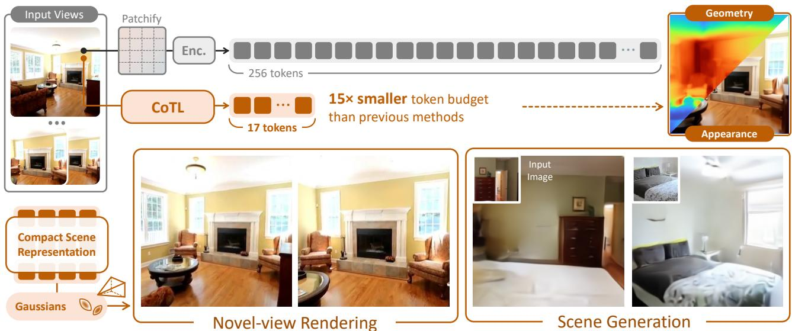
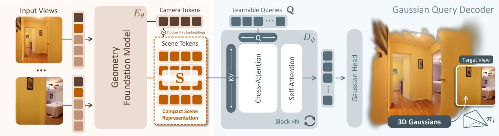
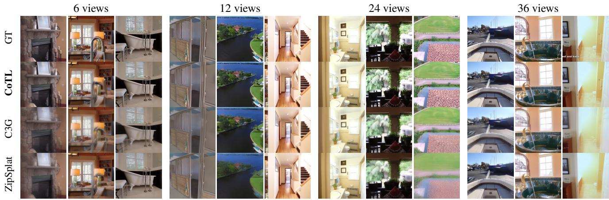
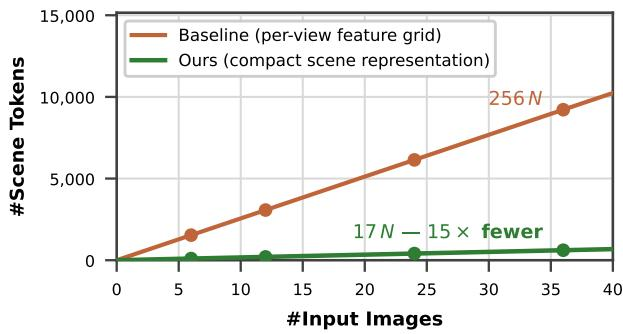
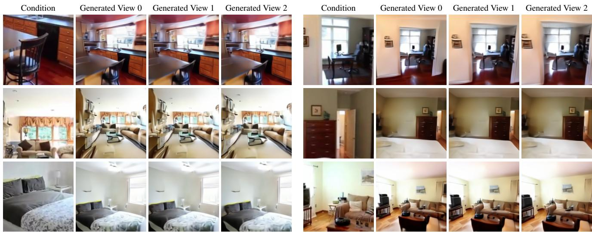
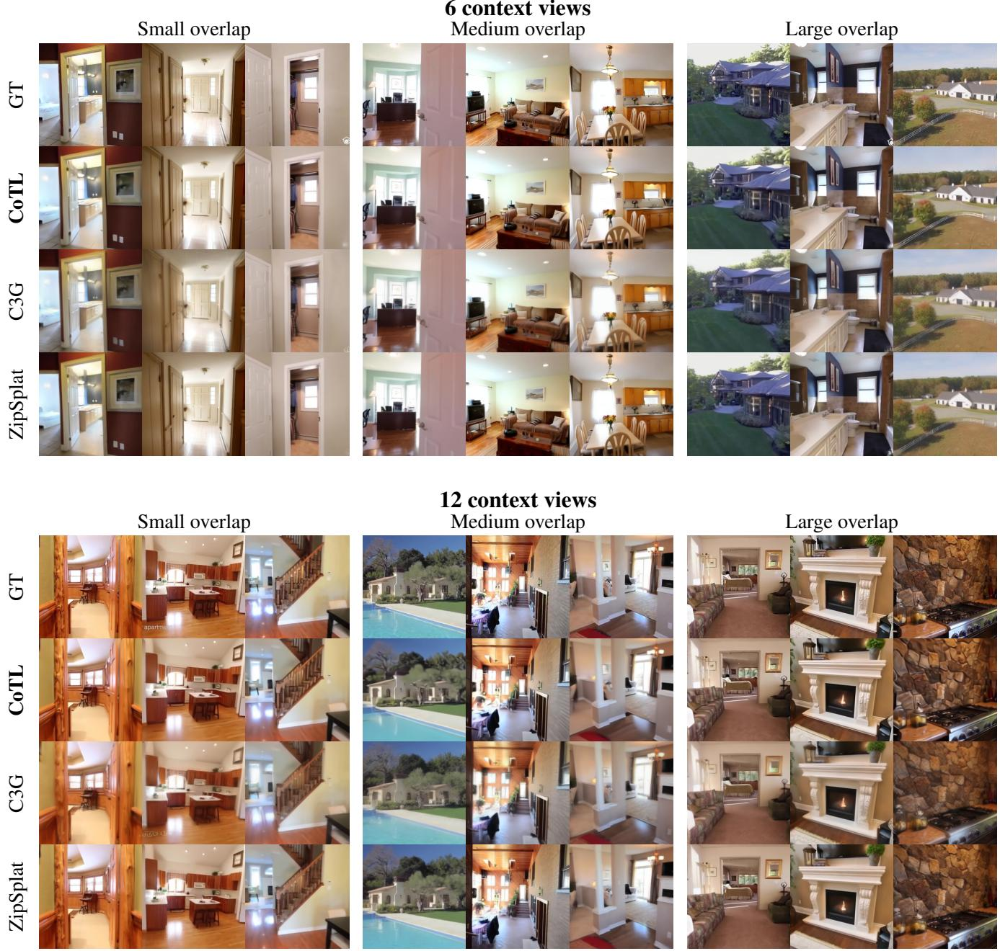
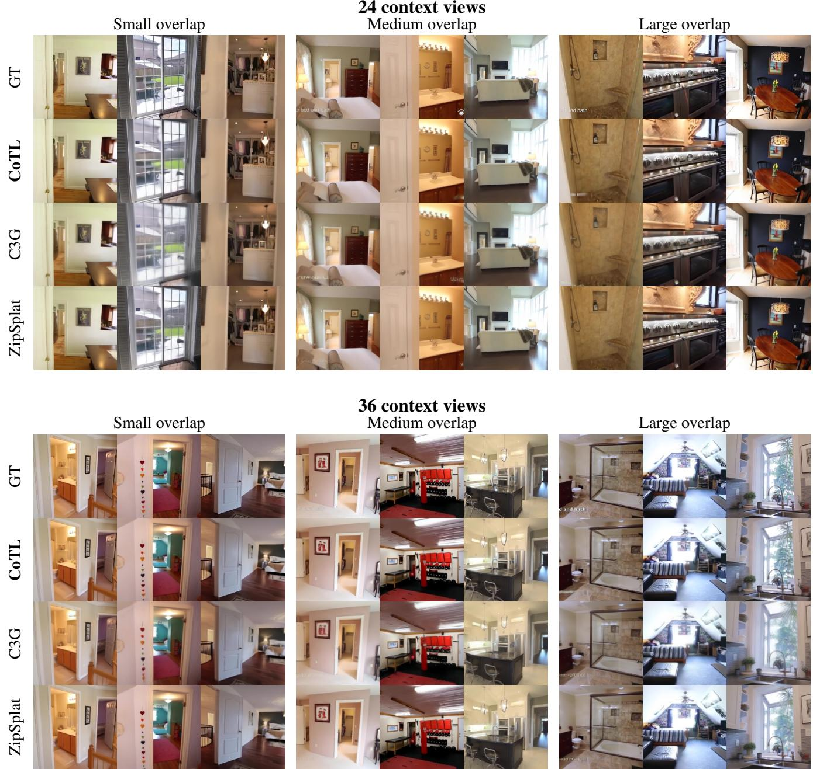

# CoTL: Compact Token Learning for 3D Scene Representation

Han Liang 1,2\*† Sibo Wu 3\* Anpei Chen 3† Rudiger Westermann ¨ 1,2 1 TU Munich 2 MCML 3 Westlake University

  
Figure 1. Compact token learning for 3D scene representation. CoTL compresses dense per-view image features into a compact scene representation with 17 tokens per view, reducing the token budget by roughly 15× relative to a dense patch-token grid. A query-based decoder with scene-independent Gaussian queries accesses only these tokens to reconstruct an explicit, renderable 3D Gaussian scene. The resulting representation supports novel-view rendering and can further serve as the latent space of a generative model for 3D scene generation.

## Abstract

We present CoTL, a framework that learns a compact set of tokens that preserves scene geometry and appearance from unposed multi-view images. Our encoder compresses the input images into small per-view sets of latent tokens that aggregate information across views to form a viewconsistent scene representation. Each additional view expands the representation with only a small, resolutionindependent set oftokens, allowing its capacity to grow with the available observations. To force this compact bottleneck to retain sufficient scene information, a query-based Gaussian decoder uses scene-independent queries to attend to the learned tokens and recover an explicit, renderable set of 3D Gaussian primitives. Novel-view rendering

supervision trains the compact representation end to end through the reconstructed Gaussian scene. Experiments on RealEstate10K and ACID show that the resulting compact, unstructured token set supports competitive novel-view synthesis and can serve as the latent space of a generative model for 3D Gaussian scene generation. Together, these results show that 3D Gaussian reconstruction is an effective objective for compact scene representation learning and the learned token space provides a basis for broader downstream tasks in 3D vision.

## 1. Introduction

Learning a scene representation from multi-view images requires compressing view-dependent observations into a compact encoding of the underlying 3D world. This representation must preserve shared geometry and appearance across views while discarding redundant view-specific information. Yet many recent feed-forward reconstruction models retain dense feature representations produced by pretrained multi-view geometry backbones, comprising hundreds of patch tokens per image. A dominant class of feed-forward reconstruction methods uses dense pixelaligned features as the visual memory, predicting pixelaligned Gaussian primitives from dense per-view feature grids [20, 64, 65]. Other approaches decouple the Gaussian output budget from the input grid using clustered visual tokens, global latent tokens, adaptive 3D anchors, or learned queries [1, 17, 18, 28, 35, 46]. This indicates that the explicit scene output need not inherit the size and layout of the image grid, but the decoder still retrieves scene information from dense per-view patch features. A compact Gaussian output therefore does not imply a compact latent scene representation.

Compact scene representations provide a practical interface for downstream models. In 3D scene understanding, vision–language models often aggregate dense scene features into a compact set of tokens, enabling scene-level representations to be efficiently processed within the context budget of a language model [7, 14, 29]. Compact representations are particularly useful for generation because they allow scene distributions to be modeled in a lowerdimensional latent space rather than directly over highdimensional signals [37]. Some existing 3D object-level generation models operate on 1D shape tokens [66, 74], and recent work compresses entire scenes into 1D tokens for generation or reconstruction [2, 8, 56]. In these methods, however, the tokens either encode geometry without appearance [8, 66, 74] or are decoded directly into target views without yielding an explicit, renderable 3D scene [2, 56]. These designs leave open how to learn a compact scenelevel representation that jointly carries geometry and appearance and can be decoded into an explicit, renderable 3D scene.

This raises a fundamental question: can a small set of learned tokens replace the dense feature grid at the encoder– decoder interface, while preserving the geometry and appearance needed to reconstruct an explicit, renderable 3D scene?

In this work, we explicitly study compact scene representation learning from unposed multi-view images. We present CoTL, a framework that places a strict representation bottleneck between dense visual encoding and downstream tasks. Given N unposed images, our encoder represents each view with a small, fixed set of latent tokens that aggregate information from its dense visual features. The resulting scene representation is view-scalable: its capacity grows with the number of observations, while its perview token budget remains independent of image resolution. These tokens are jointly contextualized across views to form a compact, scene-dependent representation. Crucially, after this compression stage, downstream prediction no longer accesses the original dense patch features.

Since the contents of a latent scene representation are not specified by a direct supervision target, we instead learn the representation by decoding it into an explicit 3D Gaussian scene and supervising the rendered novel views. For this objective to require the latent memory to carry the scene information needed for reconstruction, the Gaussian decoder must receive no other input-dependent visual scene content derived from the input. It therefore has no access to dense patch features, and its Gaussian queries are learned globally across scenes rather than initialized from image features or 3D anchors. The controlled interface forces all scenespecific visual evidence through the latent memory, while rendering supervision trains the memory to encode the information required for novel-view reconstruction.

We build the encoder on a pretrained multi-view geometry foundation model [48], which maintains a small number of tokens per view that participate in cross-view attention alongside its dense features. We adopt these tokens as the compact scene representation, initialize the encoder from the pretrained weights, and optimize it jointly with the Gaussian decoder. Joint optimization adapts the representation to the reconstruction objective.

We evaluate the novel-view synthesis quality supported by the learned representation across different numbers of context views and overlap regimes on RealEstate10K [76]. Across the evaluated settings, the compact representation supports competitive novel-view synthesis. Experiments across view counts show that the representation incorporates additional observations through a small, resolution-independent set of tokens per view. The RealEstate10K [76]-trained model also supports novel-view synthesis on ACID [31] without fine-tuning, providing evidence of zero-shot cross-dataset transfer. As a downstream proof of concept, we train a flow-matching model in the learned token space and decode its generated latents into explicit 3D Gaussian scenes using the frozen Gaussian decoder. Together, these results show that renderingsupervised 3D Gaussian reconstruction is an effective objective for compact scene representation learning and that the resulting latent space provides a basis for broader downstream tasks in 3D vision.

## 2. Related Work

Latent Scene Rrepresentations. Scene representations can be learned from multi-view observations through rendering supervision. [11] aggregates posed observations into a fixed-size global scene representation and decodes it directly into the image at a queried viewpoint. [25] similarly infers a global scene latent from posed observations, but decodes it through a conditional radiance field. Some approaches [24, 38, 39, 43] retain spatial features for each input view, so their memory grows with both the number of views and the encoder feature-map resolution. The encoder–decoder variant of LVSM [21] instead compresses all observations into a fixed set of latent tokens, and RayZer [19] extends this fixed-latent design to unposed images. In such designs, additional observations must share the same latent budget. [55] condenses dense features into ray-anchored tokens and allows the token budget to be selected at inference. Although these approaches allocate representational capacity differently, their decoders synthesize each requested view from target-camera or ray queries, rather than first decoding an explicit 3D scene.

Other work develops compact 3D token spaces for modeling and generation. At the object level, [26, 66, 69, 73] learn latent representations of shape geometry, while appearance is generated separately from the shape latent. At the scene level, Nova3R [8] and Surflo [13] decode fixed global tokens into geometry, whereas Can3Tok [12] autoencodes preconstructed per-scene 3D Gaussians. 3DRAE [56] and SceneTok [2] learn fixed-size scene token sets from multi-view observations and model their distributions in token space. Their target-camera-conditioned decoders produce RGB images, or RGB images together with point maps. Other scene generation systems retain spatially structured latents: [36] uses sparse voxels, whereas [15, 62] uses multi-view RGB-D latents tied to image grid.

Scene features can also serve as token interfaces for downstream models. [7, 14, 29, 45] provide tokenized scene features to language models for 3D understanding. Against this background, our formulation learns a view-scalable, unstructured scene memory from unposed images through 3D Gaussian reconstruction, with each input view contributing a small, resolution-independent token set. A separate Gaussian decoder maps this memory once into an explicit, renderable 3D scene that carries both geometry and appearance.

Feed-forward 3D Gaussian Reconstruction. Feedforward 3D Gaussian reconstruction methods predict 3D Gaussian primitives from multi-view images in a single pass [67] rather than optimizing a separate 3DGS representation for each scene [23]. A major family ties primitive prediction to the input image grid [41, 42, 44, 61, 68], aggregating cross-view features through epipolar attention [5] or multi-view cost volumes [9, 10, 32, 59]. VolSplat [51] instead produces Gaussians from a learned 3D voxel grid, providing a voxel-aligned alternative to image-grid-based prediction. Other variants modify the predicted primitive or the inference procedure through variational feature Gaussians, oriented triangle primitives, or recurrent refinement [52, 57, 58]. Pose-free methods extend feedforward reconstruction to images without using camera poses as input [16, 20, 60, 64, 65, 71]. Several build on pretrained geometry models and inherit priors for multiview correspondence, camera estimation, and 3D structure [3, 4, 6, 22, 27, 47, 49, 54]. For pixel-aligned methods, the native primitive count grows with both the number and resolution of the input views. Subsequent work reduces this redundancy through fusion, pooling, selection, or compression [34, 40, 53, 70].

A second group decouples Gaussian allocation from the input image grid. Some methods use free learnable queries [1, 18, 28, 35], while others derive tokens by clustering visual features or construct them from depth-based 3D anchors [17, 46, 72]. These designs reduce or adapt the Gaussian output budget, but several retain dense perview features in the Gaussian-prediction path. A compact Gaussian output therefore does not by itself establish a compact latent scene representation. Our method instead defines a compact, view-scalable scene memory at the encoder– decoder interface, with a small, resolution-independent token allocation per view, while its Gaussian output budget is controlled separately. Rendering-supervised 3D Gaussian reconstruction provides the learning objective for this memory, while its separation from the Gaussian output makes it available as a latent interface for downstream 3D tasks.

## 3. Method

Our method learns a compact latent representation that summarizes scene information across multiple unposed images. We learn this representation through pose-free 3D Gaussian reconstruction, using novel-view rendering supervision to optimize it end to end. Figure 2 summarizes the pipeline.

Our model first encodes the input views, into a small set of scene tokens, which form the only source of visual scene content available to the Gaussian decoder. Learned queries shared across scenes then retrieve information from this memory and decode it into an explicit set of 3D Gaussians, which can be rendered from novel viewpoints. During training, the loss between rendered novel views and their corresponding ground-truth target views, together with the auxiliary terms in Sec. 3.4, is backpropagated through the decoder into the encoder and optimizes the scene representation itself.

In the following, Section 3.1 formalizes the task setting. Section 3.2 describes how the encoder constructs the compact scene representation. Section 3.3 presents the Gaussian query decoder, and Sec. 3.4 the training objective.

## 3.1. Problem Setup

Given N unposed context images $\mathcal { T } = \{ I _ { i } \} _ { i = 1 } ^ { N }$ , our encoder produces a compact scene memory, from which a sceneagnostic Gaussian decoder $\mathcal { D } _ { \phi }$ predicts a set of 3D Gaussians G by conditioning a set of shared, learnable queries $\mathbf { Q } \in \mathbb { R } ^ { M \times d }$ on this memory. This decoupling separates the scene-specific representation from the decoding mechanism:

  
Figure 2. Method overview. Our method learns a compact latent representation through rendering-supervised 3D Gaussian reconstruction. The encoder $E _ { \theta } .$ , initialized from a pretrained geometry foundation model, encodes the unposed context images into one camera token and n scene tokens per view. The camera information anchors the scene tokens to form the compact scene representation S. Learned scene independent queries $\mathbf { Q }$ attend to this memory through stacked decoder blocks of cross- and self-attention, and a Gaussian head maps the final query features to an explicit 3D Gaussian scene.

$$
\mathbf { S } = E _ { \theta } ( \mathcal { T } ) , \quad \mathcal { G } = D _ { \phi } ( \mathbf { Q } ; \mathbf { S } ) , \quad \widehat { I } _ { t } = \mathcal { R } ( \mathcal { G } , \pi _ { t } ) ,\tag{1}
$$

where $E _ { \theta }$ denotes the multi-view encoder and S represents the latent scene tokens. The decoder $D _ { \phi }$ maps the queries Q into the 3D Gaussian attributes $\mathcal { G }$ conditioned on S. Finally, a differentiable Gaussian splatting renderer R synthesizes the target view $\widehat { I } _ { t }$ given the camera pose $\boldsymbol { \pi } _ { t } = \left( \mathbf { K } _ { t } , \mathbf { T } _ { t } \right)$ where $\mathbf { K } _ { t }$ and $\mathbf { T } _ { t }$ denote the camera intrinsics and extrinsics, respectively.

## 3.2. Compact Scene Representation

We build a compact scene representation by coupling a set of view-wise latent scene tokens with corresponding camera tokens. For view $i ,$ let $\mathbf { z } _ { i , r } ~ \in ~ \mathbb { R } ^ { d }$ denote the r-th latent scene feature and $\mathbf { z } _ { i } ^ { \mathrm { { c a m } } } \in \mathbb { R } ^ { d }$ the corresponding camera token, where d is the feature dimension. The view-level representation $\mathbf { S } _ { i } \in \mathbb { R } ^ { n \times d }$ and the full scene representation $\mathbf { S } \doteq \mathbb { R } ^ { [ N \cdot n ] \times d }$ are constructed as follows:

$$
\mathbf { S } _ { i } = [ \widetilde { \mathbf { z } } _ { i , 1 } , . . . , \widetilde { \mathbf { z } } _ { i , n } ] , \quad \mathbf { S } = [ \mathbf { S } _ { 1 } ; . . . , \mathbf { S } _ { N } ] .\tag{2}
$$

Here, $\widetilde { \mathbf { z } } _ { i , r }$ represents the camera-conditioned feature derived from ${ \bf z } _ { i , r }$ and ${ \bf z } _ { i } ^ { \mathrm { c a m } }$ . The sequence S aggregates multiview scene context and acts as the input to the downstream Gaussian decoder. Each additional view contributes n tokens to S. The available representational capacity therefore grows with the number of observations, while the token allocation per view remains independent of image resolution.

Backbone Instantiation. We instantiate $\mathbf { z } _ { i , \mathrm { i } }$ r and ${ \bf z } _ { i } ^ { \mathrm { c a m } }$ using the final-layer register and camera tokens from VGGT-Ω [48]. For each view, the encoder prepends n learnable register tokens and one camera token to the dense grid of image patch tokens. Intra-view frame-attention updates all tokens, whereas inter-frame cross-attention is restricted to camera and register tokens, allowing dense patch tokens to bypass costly cross-view interaction. Although standard VGGT-Ω heads rely on dense patch grids for downstream predictions, our Gaussian decoder reconstructs the scene from the compact representation rather than the dense patch grid. We jointly optimize the backbone and decoder under rendering supervision, so the latent tokens are learned for reconstruction.

Camera Reference Conditioning. Because the extracted latent tokens ${ \bf z } _ { i , r }$ and shared Gaussian queries Q are not anchored to pixel grids, camera rays, or explicit 3D positions, we explicitly inject a coordinate reference derived from the corresponding camera into each feature. Specifically, we project the camera parameters of view i into a Plucker ray¨ map. During training, this map is derived from ground-truth poses $( \mathbf { K } _ { i } , \mathbf { T } _ { i } ) ;$ ; at inference, it uses predicted parameters $( \widehat { \mathbf { K } } _ { i } , \widehat { \mathbf { T } } _ { i } )$ output by the auxiliary camera head. All extrinsics are expressed in a canonical frame anchored at the first context camera. We normalize the scene scale using the camera-distance rule described in Sec. 4.5.2.

We patch-embed and pool the Plucker ray map into ¨ n ray embeddings ${ \bf e } _ { i , r } ^ { \mathrm { r a y } } \in \bar { \mathbb { R } ^ { d } }$ . The camera-conditioned scene token is then formed via additive fusion:

$$
\widetilde { \mathbf { z } } _ { i , r } = \mathbf { z } _ { i , r } + \mathbf { e } _ { i , r } ^ { \mathrm { { r a y } } } .\tag{3}
$$

To enable unposed inference, the VGGT-Ω camera head predicts $( \widehat { \mathbf { K } } _ { i } , \widehat { \mathbf { T } } _ { i } )$ from ${ \bf z } _ { i } ^ { \mathrm { c a m } }$ and the final-layer register tokens $\{ \mathbf { z } _ { i , r } \} _ { r = 1 } ^ { n }$ . During training, we pass stop-gradient features $\{ \mathrm { s g } ( \mathbf { z } _ { i , r } ) \} _ { r = 1 } ^ { n }$ to this head, isolating the register features from backpropagation through the auxiliary camera loss. As a result, our model operates in an unposed setting during testing without requiring external context poses. Ablations on this conditioning strategy are provided in Sec. 4.5.1.

## 3.3. Gaussian Query Decoder

The Gaussian decoder maps the compact scene memory S to a set of 3D Gaussians $\mathcal { G }$ via cross-attention. Specifically, the decoder consists of a stack of Transformer layers initialized with M scene-agnostic, learnable queries $\dot { \mathbf { Q } } \in \mathbb { R } ^ { M \times d } ,$ To improve computational efficiency, the scene memory S is projected into key and value representations once and reused across all decoder layers. Each layer performs crossattention over S and query self-attention, followed by a feed-forward network. Importantly, because the queries Q are shared across scenes without any input-derived spatial initialization or 3D anchors, all scene-specific information is forcibly bottlenecked through the compact memory S.

A lightweight prediction head subsequently decodes each final query token into $K _ { \mathrm { G } }$ 3D Gaussians. Each Gaussian is parameterized by its 3D position, appearance coefficients, anisotropic scale, rotation quaternion, and opacity. The total number of generated Gaussians is fixed at $N _ { \mathrm { G } } = M \cdot K _ { \mathrm { G } }$ , ensuring a constant computational budget for downstream rendering regardless of the number of context views N. Further architectural details, parameter settings (M, $K _ { \mathrm { G } }$ , depth), and output parameterization heads are provided in Sec. 4.1 and the supplementary material.

## 3.4. Training Objective

Our model is trained end-to-end under joint rendering supervision, geometric regularization, and auxiliary pose supervision. The total loss function is formulated as follows:

$$
\mathcal { L } = \mathcal { L } _ { \mathrm { r g b } } + \lambda _ { \mathrm { s s i m } } \mathcal { L } _ { \mathrm { s s i m } } + \lambda _ { \mathrm { v i s } } \mathcal { L } _ { \mathrm { v i s } } + \lambda _ { \mathrm { c a m } } \mathcal { L } _ { \mathrm { c a m } } ,\tag{4}
$$

where $\mathcal { L } _ { \mathrm { r g b } }$ denotes the $L _ { 2 }$ photometric loss between the rendered and ground-truth target views, and $\mathcal { L } _ { \mathrm { s s i m } }$ measures structural similarity.

Auxiliary Regularization. To eliminate unconstrained Gaussians in invisible regions, we incorporate the visibility regularization loss ${ \mathcal { L } } _ { \mathrm { v i s } }$ from TokenGS [35], which penalizes Gaussians projecting outside the visual frustums of all supervision cameras. Additionally, following VGGT-Ω [48], $\mathcal { L } _ { \mathrm { c a m } }$ is a Smooth $L _ { 1 }$ loss between the predicted and ground-truth 9D camera representations. We empirically set the loss weights to $\lambda _ { \mathrm { s s i m } } = 0 . 2 , \lambda _ { \mathrm { v i s } } = 1 . 0$ , and $\lambda _ { \mathrm { c a m } } = 0 . 0 5$

## 4. Experiments

We first describe the implementation, architecture, and training setup of CoTL in Sec. 4.1. We then evaluate the novel-view synthesis quality supported by the learned compact scene representation and examine its zero-shot transfer to out-of-domain data in Sec. 4.2. Next, Sec. 4.3 quantifies the compactness of the representation, and Sec. 4.4 demonstrates its downstream utility for 3D Gaussian scene generation. Finally, Sec. 4.5 studies the role of camera references in anchoring the latent scene features and the choice of scene normalization.

## 4.1. Implementation Details

## 4.1.1. Architecture

We initialize the encoder from the pretrained VGGT-Ω [48]. For each input view, the 16 final-layer register tokens are augmented with pooled Plucker-ray embeddings and con-¨ stitute the compact scene memory. We retain the VGGT-Ω camera head to estimate the intrinsics and extrinsics of the context views, while discarding all dense prediction heads. The Gaussian decoder consists of 12 Transformer blocks, each comprising cross-attention to the compact scene memory, query self-attention, and an MLP. It has a hidden dimension of 1,024 and 16 attention heads, and operates on $M = 1$ ,024 learned scene-independent queries. Each query predicts $K _ { G } ~ = ~ 3 2 $ Gaussians, resulting in a fixed output budget of $N _ { G } = M K _ { G } = 3 2$ ,768 Gaussians. The encoder and Gaussian decoder are optimized jointly end to end.

## 4.1.2. Training

We train our model on the official RealEstate10K training split [76] using four NVIDIA H100 GPUs with a per-GPU batch size of 6, corresponding to a total batch size of 24. Each training sample is constructed from a temporal window of a training video. The first and last frames serve as the context endpoints, additional context views are sampled from the intermediate frames, and six of the remaining frames are used as rendering targets. Training is performed at a resolution of $2 5 6 \times 2 5 6$ with a patch size of 16. We express all camera poses and scene coordinates in a canonical frame anchored at the first context camera and apply camera-distance normalization. We use AdamW with $\beta _ { 1 } = 0 . 9$ and $\beta _ { 2 } = 0 . 9 5$ , together with a OneCycle learning-rate schedule.

## 4.2. Novel View Synthesis

## 4.2.1. Setup

We evaluate in-domain performance on the RealEstate10K test split and assess zero-shot cross-dataset generalization on ACID [31], without any finetuning on ACID. Unless otherwise stated, rendered views are aligned to the groundtruth target views before the metrics are computed, following NoPoSplat [64]. For a fair comparison, all methods resize and central-crop each source image to the input resolution used during their training. Target images and rendered outputs are evaluated at 256 × 256. The per-method preprocessing and the shared alignment procedure are detailed in the supplementary material.

Table 1. Novel view synthesis comparison under various input settings. We report results on RealEstate10K with 6–36 context views. CoTL achieves competitive PSNR and SSIM while decoding from a compact scene representation, whereas the reconstruction-oriented ZipSplat reads dense per-view features and an additional RGB-derived appearance path, and attains lower LPIPS. Cells report PSNR ↑ / SSIM ↑ / LPIPS ↓. The best and second-best results for each metric in every row are highlighted.
<table><tr><td>Overlap</td><td>N</td><td>CoTL(ours)</td><td>C3G</td><td>ZipSplat</td></tr><tr><td rowspan="4">small</td><td>6</td><td>25.91 / 0.838 / 0.245</td><td>22.81 / 0.734 / 0.240</td><td>27.81 / 0.870 / 0.142</td></tr><tr><td>12</td><td>27.07 / 0.867 / 0.211</td><td>23.15 / 0.744 / 0.231</td><td>28.03 / 0.874 / 0.140</td></tr><tr><td>24</td><td>27.29 9/0.872/0.204</td><td>23.28 / 0.749 / 0.229</td><td>28.09 / 0.875 / 0.138</td></tr><tr><td>36</td><td>27.26 / 0.871 / 0.205</td><td>23.28 / 0.749 / 0.229</td><td>28.09 / 0.876 / 0.137</td></tr><tr><td rowspan="4">medium</td><td>6</td><td>26.60 / 0.850 / 0.236</td><td>23.36 / 0.737 / 0.223</td><td>28.30 / 0.873 / 0.130</td></tr><tr><td>12</td><td>27.64 / 0.875 / 0.207</td><td>23.67 / 0.746 / 0.217</td><td>28.44 / 0.876 / 0.129</td></tr><tr><td>24</td><td>27.83 / 0.879 / 0.201</td><td>23.79 / 0.749 / 0.215</td><td>28.50 / 0.877 / 0.127</td></tr><tr><td>36</td><td>27.80 / 0.879 / 0.202</td><td>23.79 / 0.749 / 0.215</td><td>28.48 / 0.877 / 0.127</td></tr><tr><td rowspan="4">large</td><td>6</td><td>27.10 / 0.852 / 0.238</td><td>23.42 / 0.714 / 0.225</td><td>28.22 / 0.858 / 0.130</td></tr><tr><td>12</td><td>27.95 / 0.872 / 0.215</td><td>23.65 / 0.721 / 0.220</td><td>28.32 / 0.860 / 0.128</td></tr><tr><td>24</td><td>28.06 / 0.875 / 0.211</td><td>23.71 / 0.723 / 0.219</td><td>28.32 / 0.860 / 0.128</td></tr><tr><td>36</td><td>28.04 / 0.875 / 0.211</td><td>23.69 / 0.722 / 0.220</td><td>28.32 / 0.860 / 0.128</td></tr></table>

Table 2. Zero-shot transfer to ACID. Cells report PSNR ↑ / SSIM ↑ / LPIPS ↓ over the indexed target views. The best and second-best results for each metric in every row are highlighted.
<table><tr><td>N</td><td>CoTL(ours)</td><td>C3G</td><td>ZipSplat</td></tr><tr><td>12</td><td>26.12 / 0.771 / 0.366</td><td>22.25 / 0.598 / 0.331</td><td>24.90 / 0.718 / 0.244</td></tr><tr><td>24</td><td>26.24 / 0.776 / 0.361</td><td>22.24 / 0.599 / 0.331</td><td>24.90 / 0.718 / 0.244</td></tr><tr><td>36</td><td>26.22 / 0.776 / 0.361</td><td>22.21 / 0.598 / 0.332</td><td>24.86 / 0.717 / 0.244</td></tr></table>

## 4.2.2. Evaluation Protocols and Metrics

Following the C3G evaluation protocol [1], we start from the NoPoSplat [64] two-view RealEstate10K [76] index and uniformly insert frames between the two indexed context endpoints. This produces context sets of 6, 12, 24, and 36 views while keeping the three indexed target views unchanged. Novel-view rendering quality is evaluated using PSNR, SSIM, and LPIPS.

## 4.2.3. Baselines

To contextualize the novel-view rendering quality supported by the learned representation We report two pose-free methods for generalizable novel view synthesis that decode global Gaussian sets as reference points: C3G [1] and Zip-Splat [46]. C3G uses a fixed output budget of 2K Gaussians.

We configure ZipSplat with the same 32K-Gaussian output budget as CoTL.

## 4.2.4. Reconstruction Quality

As shown in Tab. 1, reconstruction quality improves most from 6 to 12 context views across all three overlap regimes and changes little beyond 24 views. The endpoint views and Gaussian output budget are held fixed. Under this control, the additional observations can affect the Gaussian decoder only through the compact scene representation. The improvement therefore provides direct evidence that the memory integrates additional visual evidence across views and retains both geometric and appearance information useful for rendering.

C3G provides a lower-output-budget reference with 2K Gaussians; CoTL achieves higher PSNR and SSIM across all settings and lower LPIPS with at least 12 context views. ZipSplat provides a dense-memory reference at the same Gaussian output budget. With 12 or more context views in the large-overlap regime, CoTL approaches ZipSplat in PSNR and exceeds it in SSIM, although a clear LPIPS gap remains. Qualitative comparisons in Fig. 3 are consistent with this metric pattern: CoTL retains the overall scene structure and appearance, while ZipSplat preserves finer local textures in some regions.

The differences between CoTL and ZipSplat should also be interpreted in light of their distinct decoder interfaces. ZipSplat is designed primarily for 3D reconstruction and does not isolate a compact latent scene representation at the encoder–decoder interface: its decoder reads dense perview features, and its Gaussian head additionally receives color features obtained by cross-attending directly to patchembedded RGB inputs. In contrast, we explicitly separate the compact scene representation from the Gaussian decoder that reads it. This separation exposes a reusable latent interface for downstream modeling beyond reconstruction.

The results in Tab. 2 show that the RealEstate10Ktrained model supports novel-view synthesis on ACID without fine-tuning, providing evidence of zero-shot crossdomain transfer. Together, these results show that rendering-supervised 3D Gaussian reconstruction learns a compact scene memory that retains sufficient visual information for pose-free novel-view synthesis.

## 4.3. Compactness Comparison

Beyond reconstruction quality, we examine the token count of the learned scene representation and how it scales with the number of input views. Figure 4 compares our compact scene representation with the dense-grid interface used by methods whose Gaussian decoder attends to full per-view features as keys and values. A 16 × 16 feature grid contributes 256 key–value tokens per view, so the decoder context grows as 256N. In contrast, our representation uses

  
Figure 3. Qualitative novel-view synthesis with increasing context-view counts. For each setting, columns show representative target views, while rows show the ground truth and predictions from CoTL, C3G, and ZipSplat. Using only the compact scene tokens at the encoder–decoder interface, CoTL preserves the global scene structure and appearance more faithfully than C3G and approaches the dense memory ZipSplat baseline as more context views are provided. ZipSplat retains finer local textures in some regions, consistent with the remaining LPIPS gap in Tab. 1.

  
Figure 4. Token-count scaling with the number of input views. For methods that use a dense per-view feature grid as the Gaussian decoder’s keys and values, a 16×16 grid yields 256N tokens. Our compact scene representation uses 17 tokens per view and grows as 17N, approximately 15× fewer.

17 tokens per view and grows as 17N, approximately 15× fewer across the evaluated view counts.

## 4.4. 3D Scene Generation

We further demonstrate that the compact, unstructured scene representation learned through reconstruction can serve as the latent space of a generative model [37] for 3D scene generation. We use the trained reconstruction model as a frozen first stage. During second-stage training, the frozen encoder maps eight views of each scene to the latent scene features $\textbf { Z } \in \mathbb { R } ^ { ( 8 n ) \times d }$ These features serve as the training targets for a second-stage flow-matching model [30], which generates Z conditioned on the first of the eight images supplied to the encoder, together with the camera parameters of all eight views. The network architecture, conditioning mechanism, and training details of the flow-matching model are provided in the supplementary material.

At inference, the generated features are combined with the corresponding camera references to form the scene representation S, following Eq. (3). The frozen Gaussian decoder then maps S to an explicit 3D Gaussian scene, which can be rendered from novel viewpoints in real time. Figure 5 shows six generated scenes, each rendered from multiple viewpoints. The samples show plausible scene completions that remain coherent across the rendered views, providing evidence that the learned token representation supports downstream 3D scene generation.

## 4.5. Ablation Study

This section examines two design choices for learning the compact, unstructured scene representation: the camera reference used to anchor its latent features and scene-scale normalization.

## 4.5.1. Anchoring Latent Scene Features

We ablate the camera reference used to anchor the latent scene features. We train three variants while keeping all other settings identical. In the scene features only variant, the decoder reads the latent scene features without a camera reference. In the global camera anchor variant, each view’s camera token is concatenated with its latent scene features. In our pooled ray-map references variant, each latent scene feature is associated with a pooled ray-map reference derived from its source camera, as described in Sec. 3.2. We compare validation PSNR and the fraction of active Gaussians (opacity above 0.1) at the same training step. The first two variants behave almost identically: relative to the ray embeddings, their PSNR drops by about 2.5 dB, and the fraction of active Gaussians is more than ten percentage points lower. Without a coordinate reference, the rendering loss reduces a poorly placed Gaussian’s opacity more readily than it relocates the Gaussian. As the opacity approaches zero, the Gaussian receives progressively weaker rendering gradients and remains inactive, so reconstruction stays blurry. Our pooled ray-map construction provides a coarse coordinate reference from the start of training and mitigates this failure mode.

  
Figure 5. Conditional 3D Gaussian scene generation in the learned compact latent space. For each of six samples, a four-column group shows one conditioning image followed by three novel views. A flow-matching model generates the compact latent, which the frozen Gaussian decoder decodes into an explicit 3D Gaussian representation. The three output images are novel views rendered from this representation.

## 4.5.2. Scene Normalization

We now compare three difference scene normalization choices. Our camera-distance normalization uses $\rho _ { \mathrm { s c e n e } } =$ $\operatorname* { m a x } _ { i } \| \mathbf { c } _ { i } - \mathbf { c } _ { 1 } \| _ { 2 }$ —the maximum distance from any context camera to the first—as the scene scale. We divide all camera translations and scene coordinates by this scale. The pointcloud-radius normalization instead uses the 95th-percentile radius of the point cloud obtained by unprojecting the precomputed context-view depth maps. The no normalization variant retains the raw dataset scale. The point-cloud and unnormalized variants lead to less stable early optimization, with the latter showing the largest degradation. Camera-distance normalization instead defines a consistent scale from the context-camera configuration. We therefore use camera-distance normalization in all experiments.

## 5. Conclusion

In this work, we present CoTL, a framework for learning a compact, view-scalable scene representation directly from unposed multi-view images via 3D Gaussian reconstruction. By compressing multi-view inputs into a concise set of view-wise tokens, CoTL establishes an explicit information bottleneck: the scene memory serves as the sole condition for a set of scene-agnostic queries, forcing it to retain only the essential scene tokens required for high-fidelity geometric and appearance reconstruction.

Furthermore, we demonstrate that this compact token representation provides an effective latent space for 3D generative modeling. Compared to video-diffusion-based scene synthesis, generating scene latents directly in this space significantly accelerates inference while enforcing strict crossview geometric consistency. Once generated, the latent representation is decoded in a single feed-forward pass into an explicit 3D Gaussian scene, enabling real-time novel-view rendering without the per-view decoding overhead inherent to prior approaches.

Looking forward, we anticipate several promising directions. Future work includes scaling up the pre-training data to explore whether this compact representation is able to generalize to open-world environments. Additionally, we plan to extend the generative latent space to support flexible view counts and multi-modal controls (e.g., text conditioning). More broadly, we envision this compact scene memory acting as a general-purpose, reusable interface for downstream 3D understanding, interactive editing, and persistent spatial memory in embodied intelligence.

## References

[1] Honggyu An, Jaewoo Jung, Mungyeom Kim, Chaehyun Kim, Minkyeong Jeon, Jisang Han, Kazumi Fukuda, Takuya Narihira, Hyuna Ko, Junsu Kim, et al. C3g: Learning compact 3d representations with 2k gaussians. arXiv preprint arXiv:2512.04021, 2025. 2, 3, 6, 12

[2] Mohammad Asim, Christopher Wewer, and Jan Eric Lenssen. Scenetok: A compressed, diffusable token space for 3d scenes. arXiv preprint arXiv:2602.18882, 2026. 2, 3

[3] Alessandro Burzio, Tobias Fischer, Sven Elflein, Qunjie Zhou, Riccardo de Lutio, Jiawei Ren, Jiahui Huang, Shengyu Huang, Marc Pollefeys, Laura Leal-Taixe, et al. D´ \’ej\a view: Looping transformers for multi-view 3d reconstruction. arXiv preprint arXiv:2605.30215, 2026. 3

[4] Yohann Cabon, Lucas Stoffl, Leonid Antsfeld, Gabriela Csurka, Boris Chidlovskii, Jerome Revaud, and Vincent Leroy. Must3r: Multi-view network for stereo 3d reconstruction. In 2025 IEEE/CVF Conference on Computer Vision and Pattern Recognition (CVPR), 2025. 3

[5] David Charatan, Sizhe Lester Li, Andrea Tagliasacchi, and Vincent Sitzmann. pixelsplat: 3d gaussian splats from image pairs for scalable generalizable 3d reconstruction. In 2024 IEEE/CVF Conference on Computer Vision and Pattern Recognition (CVPR), 2024. 3

[6] Lin-Zhuo Chen, Jian Gao, Yihang Chen, Ka Leong Cheng, Yipengjing Sun, Liangxiao Hu, Nan Xue, Xing Zhu, Yujun Shen, Yao Yao, et al. Geometric context transformer for streaming 3d reconstruction. arXiv preprint arXiv:2604.14141, 2026. 3

[7] Sijin Chen, Xin Chen, Chi Zhang, Mingsheng Li, Gang Yu, Hao Fei, Hongyuan Zhu, Jiayuan Fan, and Tao Chen. Ll3da: Visual interactive instruction tuning for omni-3d understanding, reasoning, and planning. In 2024 IEEE/CVF Conference on Computer Vision and Pattern Recognition (CVPR), 2024. 2, 3

[8] Weirong Chen, Chuanxia Zheng, Ganlin Zhang, Andrea Vedaldi, and Daniel Cremers. Nova3r: Non-pixel-aligned visual transformer for amodal 3d reconstruction. arXiv preprint arXiv:2603.04179, 2026. 2, 3

[9] Yuedong Chen, Haofei Xu, Chuanxia Zheng, Bohan Zhuang, Marc Pollefeys, Andreas Geiger, Tat-Jen Cham, and Jianfei Cai. Mvsplat: Efficient 3d gaussian splatting from sparse multi-view images. In European conference on computer vision, 2024. 3

[10] Yuedong Chen, Chuanxia Zheng, Haofei Xu, Bohan Zhuang, Andrea Vedaldi, Tat-Jen Cham, and Jianfei Cai. Mvsplat360: Feed-forward 360 scene synthesis from sparse views. Advances in Neural Information Processing Systems, 2024. 3

[11] SM Ali Eslami, Danilo Jimenez Rezende, Frederic Besse, Fabio Viola, Ari S Morcos, Marta Garnelo, Avraham Ruderman, Andrei A Rusu, Ivo Danihelka, Karol Gregor, et al. Neural scene representation and rendering. Science, 2018. 2

[12] Quankai Gao, Iliyan Georgiev, Tuanfeng Y Wang, Krishna Kumar Singh, Ulrich Neumann, and Jae Shin Yoon. Can3tok: Canonical 3d tokenization and latent modeling of scene-level 3d gaussians. In 2025 IEEE/CVF International Conference on Computer Vision (ICCV), 2025. 3

[13] Antoine Guedon, Shu Nakamura, Nicolas Dufour, Jiahui´ Lei, Ko Nishino, and Angjoo Kanazawa. Surflo: Consistent 3d surface flow model with global state. arXiv preprint arXiv:2606.13644, 2026. 3

[14] Yining Hong, Haoyu Zhen, Peihao Chen, Shuhong Zheng, Yilun Du, Zhenfang Chen, and Chuang Gan. 3d-llm: Injecting the 3d world into large language models. Advances in Neural Information Processing Systems, 2023. 2, 3

[15] Jiaxin Huang, Yuanbo Yang, Bangbang Yang, Lin Ma, Yuewen Ma, and Yiyi Liao. Gen3r: 3d scene generation meets feed-forward reconstruction. In Proceedings of the IEEE/CVF Conference on Computer Vision and Pattern Recognition, 2026. 3

[16] Ranran Huang and Krystian Mikolajczyk. No pose at all: Self-supervised pose-free 3d gaussian splatting from sparse views. In 2025 IEEE/CVF International Conference on Computer Vision (ICCV), 2025. 3

[17] Cho In, Jeonghwan Cho, Mijin Yoo, Gim Hee Lee, and Seon Joo Kim. Atsplat: Compact feed-forward 3d gaussian splatting with adaptive token expansion. arXiv preprint arXiv:2607.20417, 2026. 2, 3

[18] Roni Itkin, Noam Issachar, Yehonatan Keypur, Xingyu Chen, Anpei Chen, and Sagie Benaim. Globalsplat: Efficient feed-forward 3d gaussian splatting via global scene tokens. arXiv preprint arXiv:2604.15284, 2026. 2, 3

[19] Hanwen Jiang, Hao Tan, Peng Wang, Haian Jin, Yue Zhao, Sai Bi, Kai Zhang, Fujun Luan, Kalyan Sunkavalli, Qixing Huang, et al. Rayzer: A self-supervised large view synthesis model. In 2025 IEEE/CVF International Conference on Computer Vision (ICCV), 2025. 3

[20] Lihan Jiang, Yucheng Mao, Linning Xu, Tao Lu, Kerui Ren, Yichen Jin, Xudong Xu, Mulin Yu, Jiangmiao Pang, Feng Zhao, et al. Anysplat: Feed-forward 3d gaussian splatting from unconstrained views. ACM Transactions on Graphics (TOG), 2025. 2, 3

[21] Haian Jin, Hanwen Jiang, Hao Tan, Kai Zhang, Sai Bi, Tianyuan Zhang, Fujun Luan, Noah Snavely, and Zexiang Xu. Lvsm: A large view synthesis model with minimal 3d inductive bias. arXiv preprint arXiv:2410.17242, 2024. 3

[22] Nikhil Keetha, Norman Muller, Johannes Sch ¨ onberger,¨ Lorenzo Porzi, Yuchen Zhang, Tobias Fischer, Arno Knapitsch, Duncan Zauss, Ethan Weber, Nelson Antunes, et al. Mapanything: Universal feed-forward metric 3d reconstruction; map-anything. github. io. In 2026 International Conference on 3D Vision (3DV), 2026. 3

[23] Bernhard Kerbl, Georgios Kopanas, Thomas Leimkuhler,¨ George Drettakis, et al. 3d gaussian splatting for real-time radiance field rendering. ACM Trans. Graph., 2023. 3

[24] Evan Kim, Hyunwoo Ryu, Thomas W Mitchel, and Vincent Sitzmann. Scaling view synthesis transformers. In Proceedings of the IEEE/CVF Conference on Computer Vision and Pattern Recognition, 2026. 3

[25] Adam R Kosiorek, Heiko Strathmann, Daniel Zoran, Pol Moreno, Rosalia Schneider, Sona Mokra, and´ Danilo Jimenez Rezende. Nerf-vae: A geometry aware 3d scene generative model. In International conference on machine learning, 2021. 2

[26] Zeqiang Lai, Yunfei Zhao, Haolin Liu, Zibo Zhao, Qingxi

ang Lin, Huiwen Shi, Xianghui Yang, Mingxin Yang, Shuhui Yang, Yifei Feng, et al. Hunyuan3d 2.5: Towards highfidelity 3d assets generation with ultimate details. arXiv preprint arXiv:2506.16504, 2025. 3

[27] Vincent Leroy, Yohann Cabon, and Jer´ ome Revaud. Ground-ˆ ing image matching in 3d with mast3r. In European conference on computer vision, 2024. 3

[28] Yinglong Li, Donghui Shen, Xiaoyu Zhang, Zhichao Ye, Hongyu Wu, Aimin Hao, Guofeng Zhang, and Haomin Liu. Querysplat: Decoupling geometry and appearance representations in 3dgs prediction. arXiv preprint arXiv:2608.01186, 2026. 2, 3

[29] Lucy Lin, Ayush Jain, Yifan Liu, and Katerina Fragkiadaki. Qwen-3d: A generalist 3d vision-language model for spatial understanding. arXiv preprint arXiv:2608.02980, 2026. 2, 3

[30] Yaron Lipman, Ricky TQ Chen, Heli Ben-Hamu, Maximilian Nickel, and Matt Le. Flow matching for generative modeling. arXiv preprint arXiv:2210.02747, 2022. 7, 13

[31] Andrew Liu, Richard Tucker, Varun Jampani, Ameesh Makadia, Noah Snavely, and Angjoo Kanazawa. Infinite nature: Perpetual view generation of natural scenes from a single image. In Proceedings of the IEEE/CVF International Conference on Computer Vision (ICCV), 2021. 2, 5

[32] Tianqi Liu, Guangcong Wang, Shoukang Hu, Liao Shen, Xinyi Ye, Yuhang Zang, Zhiguo Cao, Wei Li, and Ziwei Liu. Mvsgaussian: Fast generalizable gaussian splatting reconstruction from multi-view stereo. In European conference on computer vision, 2024. 3

[33] Maxime Oquab, Timothee Darcet, Th´ eo Moutakanni, Huy´ Vo, Marc Szafraniec, Vasil Khalidov, Pierre Fernandez, Daniel Haziza, Francisco Massa, Alaaeldin El-Nouby, et al. Dinov2: Learning robust visual features without supervision. arXiv preprint arXiv:2304.07193, 2023. 13

[34] Jongmin Park, Minh-Quan Viet Bui, Juan Luis Gonzalez, Jaeho Moon, Jihyong Oh, and Munchurl Kim. Ecosplat: Efficiency-controllable feed-forward 3d gaussian splatting from multi-view images. In Proceedings of the IEEE/CVF Conference on Computer Vision and Pattern Recognition, 2026. 3

[35] Jiawei Ren, Michal Jan Tyszkiewicz, Jiahui Huang, and Zan Gojcic. Tokengs: Decoupling 3d gaussian prediction from pixels with learnable tokens. arXiv preprint arXiv:2604.15239, 2026. 2, 3, 5, 12

[36] Xuanchi Ren, Yifan Lu, Hanxue Liang, Zhangjie Wu, Huan Ling, Mike Chen, Sanja Fidler, Francis Williams, and Jiahui Huang. Scube: Instant large-scale scene reconstruction using voxsplats. Advances in Neural Information Processing Systems, 2024. 3

[37] Robin Rombach, Andreas Blattmann, Dominik Lorenz, Patrick Esser, and Bjorn Ommer. High-resolution image syn-¨ thesis with latent diffusion models. In 2022 IEEE/CVF conference on computer vision and pattern recognition (CVPR), 2022. 2, 7

[38] Mehdi SM Sajjadi, Henning Meyer, Etienne Pot, Urs Bergmann, Klaus Greff, Noha Radwan, Suhani Vora, Mario Luciˇ c, Daniel Duckworth, Alexey Dosovitskiy, et al. Scene´ representation transformer: Geometry-free novel view synthesis through set-latent scene representations. In 2022

IEEE/CVF Conference on Computer Vision and Pattern Recognition (CVPR), 2022. 3

[39] Mehdi SM Sajjadi, Aravindh Mahendran, Thomas Kipf, Eti enne Pot, Daniel Duckworth, Mario Luciˇ c, and Klaus Greff.´ Rust: Latent neural scene representations from unposed im agery. In 2023 IEEE/CVF Conference on Computer Vision and Pattern Recognition (CVPR), 2023. 3

[40] Zetian Song, Jiaye Fu, Jiaqi Zhang, Xiaohan Lu, Chuanmin Jia, Siwei Ma, and Wen Gao. Tinysplat: Feedforward approach for generating compact 3d scene representation. IEEE Transactions on Circuits and Systems for Video Tech nology, 2026. 3

[41] Stanislaw Szymanowicz, Chrisitian Rupprecht, and Andrea Vedaldi. Splatter image: Ultra-fast single-view 3d reconstruction. In Proceedings of the IEEE/CVF conference on computer vision and pattern recognition, 2024. 3

[42] Stanislaw Szymanowicz, Eldar Insafutdinov, Chuanxia Zheng, Dylan Campbell, Joao F Henriques, Christian Rup precht, and Andrea Vedaldi. Flash3d: Feed-forward generalisable 3d scene reconstruction from a single image. In 2025 International Conference on 3D Vision (3DV), 2025. 3

[43] Stanislaw Szymanowicz, Minghao Chen, Jianyuan Wang, Christian Rupprecht, and Andrea Vedaldi. Lagernvs: Latent geometry for fully neural real-time novel view synthesis. In Proceedings of the IEEE/CVF Conference on Computer Vi sion and Pattern Recognition, 2026. 3

[44] Jiaxiang Tang, Zhaoxi Chen, Xiaokang Chen, Tengfei Wang, Gang Zeng, and Ziwei Liu. Lgm: Large multi-view gaussian model for high-resolution 3d content creation. In European Conference on Computer Vision, 2024. 3

[45] Hugues Thomas, Chen Chen, and Jian Zhang. Pts3d-llm: Studying the impact of token structure for 3d scene understanding with large language models. arXiv preprint arXiv:2506.05689, 2025. 3

[46] Alexander Veicht, Sunghwan Hong, Daniel Bar ´ ath, and´ Marc Pollefeys. Zipsplat: Fewer gaussians, better splats. arXiv preprint arXiv:2606.05102, 2026. 2, 3, 6, 12

[47] Jianyuan Wang, Minghao Chen, Nikita Karaev, Andrea Vedaldi, Christian Rupprecht, and David Novotny. Vggt: Visual geometry grounded transformer. In 2025 IEEE/CVF Conference on Computer Vision and Pattern Recognition (CVPR), 2025. 3

[48] Jianyuan Wang, Minghao Chen, Shangzhan Zhang, Nikita Karaev, Johannes Schonberger, Patrick Labatut, Piotr Bo-¨ janowski, David Novotny, Andrea Vedaldi, and Christian Rupprecht. VGGT-Ω. arXiv preprint arXiv:2605.15195, 2026. 2, 4, 5, 12

[49] Shuzhe Wang, Vincent Leroy, Yohann Cabon, Boris Chidlovskii, and Jerome Revaud. Dust3r: Geometric 3d vision made easy. In 2024 IEEE/CVF Conference on Computer Vision and Pattern Recognition (CVPR), 2024. 3

[50] Shuai Wang, Zhi Tian, Weilin Huang, and Limin Wang. Ddt: Decoupled diffusion transformer. In Proceedings of the IEEE/CVF conference on computer vision and pattern recognition, 2026. 13

[51] Weijie Wang, Yeqing Chen, Zeyu Zhang, Hengyu Liu, Haox iao Wang, Zhiyuan Feng, Wenkang Qin, Feng Chen, Jia-Wang Bian, Zheng Zhu, et al. Volsplat: Rethinking feed

forward 3d gaussian splatting with voxel-aligned prediction. arXiv preprint arXiv:2509.19297, 2025. 3

[52] Weijie Wang, Zimu Li, Jinchuan Shi, Zeyu Zhang, Botao Ye, Marc Pollefeys, Donny Y Chen, and Bohan Zhuang. Trisplat: Simulation-ready feed-forward 3d scene reconstruction. arXiv preprint arXiv:2605.26115, 2026. 3

[53] Yunsong Wang, Tianxin Huang, Hanlin Chen, and Gim Hee Lee. Freesplat: Generalizable 3d gaussian splatting towards free view synthesis of indoor scenes. Advances in Neural Information Processing Systems, 2024. 3

[54] Yifan Wang, Jianjun Zhou, Haoyi Zhu, Wenzheng Chang, Yang Zhou, Zizun Li, Junyi Chen, Jiangmiao Pang, Chunhua Shen, and Tong He. π3: Permutation-equivariant visual geometry learning. In International Conference on Learning Representations, 2026. 3

[55] Zhengqing Wang, Yuefan Wu, Jiacheng Chen, Fuyang Zhang, and Yasutaka Furukawa. Clift: Compressive lightfield tokens for compute efficient and adaptive neural rendering. Advances in Neural Information Processing Systems, 2026. 3

[56] Dongxu Wei, Qi Xu, Zhiqi Li, Hangning Zhou, Cong Qiu, Hailong Qin, Mu Yang, Zhaopeng Cui, and Peidong Liu. Any 3d scene is worth 1k tokens: 3d-grounded representation for scene generation at scale. arXiv preprint arXiv:2604.11331, 2026. 2, 3, 13

[57] Christopher Wewer, Kevin Raj, Eddy Ilg, Bernt Schiele, and Jan Eric Lenssen. latentsplat: Autoencoding variational gaussians for fast generalizable 3d reconstruction. In European conference on computer vision, 2024. 3

[58] Haofei Xu, Daniel Barath, Andreas Geiger, and Marc Pollefeys. Resplat: Learning recurrent gaussian splatting. arXiv preprint arXiv:2510.08575, 2025. 3

[59] Haofei Xu, Songyou Peng, Fangjinhua Wang, Hermann Blum, Daniel Barath, Andreas Geiger, and Marc Pollefeys. Depthsplat: Connecting gaussian splatting and depth. In 2025 IEEE/CVF Conference on Computer Vision and Pattern Recognition (CVPR), 2025. 3

[60] Jiale Xu, Shenghua Gao, and Ying Shan. Freesplatter: Posefree gaussian splatting for sparse-view 3d reconstruction. In 2025 IEEE/CVF International Conference on Computer Vision (ICCV), 2025. 3

[61] Yinghao Xu, Zifan Shi, Wang Yifan, Hansheng Chen, Ceyuan Yang, Sida Peng, Yujun Shen, and Gordon Wetzstein. Grm: Large gaussian reconstruction model for efficient 3d reconstruction and generation. In European Conference on Computer Vision, 2024. 3

[62] Yuanbo Yang, Jiahao Shao, Xinyang Li, Yujun Shen, Andreas Geiger, and Yiyi Liao. Prometheus: 3d-aware latent diffusion models for feed-forward text-to-3d scene generation. In 2025 IEEE/CVF Conference on Computer Vision and Pattern Recognition (CVPR), 2025. 3

[63] Jingfeng Yao, Bin Yang, and Xinggang Wang. Reconstruction vs. generation: Taming optimization dilemma in latent diffusion models. In 2025 IEEE/CVF Conference on Computer Vision and Pattern Recognition (CVPR), 2025. 13

[64] Botao Ye, Sifei Liu, Haofei Xu, Xueting Li, Marc Pollefeys, Ming-Hsuan Yang, and Songyou Peng. No pose, no problem: Surprisingly simple 3d gaussian splats from sparse unposed

images. In International Conference on Learning Represen tations, 2025. 2, 3, 6

[65] Botao Ye, Boqi Chen, Haofei Xu, Daniel Barath, and Marc Pollefeys. Yonosplat: You only need one model for feedforward 3d gaussian splatting. In International Conference on Learning Representations, 2026. 2, 3

[66] Biao Zhang, Jiapeng Tang, Matthias Niessner, and Peter Wonka. 3dshape2vecset: A 3d shape representation for neural fields and generative diffusion models. ACM Transactions On Graphics (TOG), 2023. 2, 3

[67] J Zhang, Y Li, A Chen, M Xu, K Liu, J Wang, XX Long, H Liang, Z Xu, H Su, et al. Advances in feed-forward 3d reconstruction and view synthesis: A survey. Computer Graphics Forum, 2026. 3

[68] Kai Zhang, Sai Bi, Hao Tan, Yuanbo Xiangli, Nanxuan Zhao, Kalyan Sunkavalli, and Zexiang Xu. Gs-lrm: Large recon struction model for 3d gaussian splatting. In European Con ference on Computer Vision, 2024. 3

[69] Longwen Zhang, Ziyu Wang, Qixuan Zhang, Qiwei Qiu, Anqi Pang, Haoran Jiang, Wei Yang, Lan Xu, and Jingyi Yu. Clay: A controllable large-scale generative model for creating high-quality 3d assets. ACM Transactions On Graphics (TOG), 2024. 3

[70] Shengjun Zhang, Xin Fei, Fangfu Liu, Haixu Song, and Yueqi Duan. Gaussian graph network: Learning efficient and generalizable gaussian representations from multi-view images. Advances in Neural Information Processing Systems, 2024. 3

[71] Shangzhan Zhang, Jianyuan Wang, Yinghao Xu, Nan Xue, Christian Rupprecht, Xiaowei Zhou, Yujun Shen, and Gor don Wetzstein. Flare: Feed-forward geometry, appearance and camera estimation from uncalibrated sparse views. In 2025 IEEE/CVF Conference on Computer Vision and Pat tern Recognition (CVPR), 2025. 3

[72] Xiaoxue Zhang, Xiaoxu Zheng, Yixuan Yin, Tiao Zhao, Kaihua Tang, Michael Bi Mi, Zhan Xu, and Dave Zhenyu Chen. Anchorsplat: Feed-forward 3d gaussian splatting with 3d geometric priors. arXiv preprint arXiv:2604.07053, 2026. 3

[73] Zibo Zhao, Wen Liu, Xin Chen, Xianfang Zeng, Rui Wang, Pei Cheng, Bin Fu, Tao Chen, Gang Yu, and Shenghua Gao. Michelangelo: Conditional 3d shape generation based on shape-image-text aligned latent representation. Advances in neural information processing systems, 2023. 3

[74] Zibo Zhao, Zeqiang Lai, Qingxiang Lin, Yunfei Zhao, Haolin Liu, Shuhui Yang, Yifei Feng, Mingxin Yang, Sheng Zhang, Xianghui Yang, et al. Hunyuan3d 2.0: Scaling diffu sion models for high resolution textured 3d assets generation. arXiv preprint arXiv:2501.12202, 2025. 2

[75] Boyang Zheng, Nanye Ma, Shengbang Tong, and Saining Xie. Diffusion transformers with representation autoen coders. In International Conference on Learning Represen tations, 2026. 13

[76] Tinghui Zhou, Richard Tucker, John Flynn, Graham Fyffe, and Noah Snavely. Stereo magnification: Learning view synthesis using multiplane images. arXiv preprint arXiv:1805.09817, 2018. 2, 5, 6

# CoTL: Compact Token Learning for 3D Scene Representation

Supplementary Material

## A. Overview

This supplementary material complements the main paper with additional implementation details, evaluation protocols, and analyses of the compact scene representation used for reconstruction and generation. Section B describes the Gaussian output parameterization and training schedule, while Sec. C details the image preprocessing and pose-alignment procedures used for evaluation. Section D presents additional qualitative comparisons across contextview counts and overlap regimes. Finally, Sec. E describes the latent construction, conditioning, training, and sampling procedure used for 3D scene generation.

## B. Additional Implementation Details

## B.1. Gaussian Output Head

We build on the Gaussian output head of TokenGS [35]. A linear prediction layer maps each decoded query feature to 32 raw Gaussian parameter vectors, which are mapped through attribute-specific activation functions. The raw center outputs use the signed-exponential activation sign $( x ) ( e ^ { | x | } - 1 )$ ). We then add a constant offset of one to the predicted z coordinate, placing the initial centers near one normalized scene unit along the positive optical axis (+z) of the first context camera. The raw scale outputs are passed through the shifted, clipped exponential min $( e ^ { x - s } , c )$ , where $c = 0 . 0 7 5$ and $s = 1 - \log c$ . Each raw opacity logit x is mapped to $\sigma ( x - 2 )$ , and the four raw rotation outputs are normalized to form a unit quaternion. For appearance, the three raw color values are mapped to RGB range (0, 1) using $\begin{array} { r } { \frac { 1 } { 2 } \operatorname { t a n h } ( x ) + \frac { 1 } { 2 } } \end{array}$ . The weights of the linear prediction layer are initialized from a truncated normal distribution with standard deviation 0.002, and its biases are initialized to zero.

## B.2. Training Details

The complete model comprises the VGGT-Ω [48] encoder, a 12-layer Gaussian decoder, and the retained camera head, with 1,116 M parameters in total. We initially train the model for 500,000 steps using AdamW $( \beta _ { 1 } = 0 . 9 , \beta _ { 2 } =$ 0.95) and a OneCycle learning-rate schedule with a peak learning rate of $4 \times 1 0 ^ { - 4 }$ and a 5,000-step warm-up. This training uses eight context views and spherical harmonics of degree zero. We subsequently fine-tune the model using a randomized number of context views and spherical harmonics of degree three. We initialize the DC coefficients from the learned degree-zero color readout and set the newly introduced higher-order coefficients to zero. For each batch, the context-view count is sampled uniformly from 6–12 with probability 0.75 or from 13–24 with probability 0.25.

## C. Evaluation Protocol

## C.1. Image Preprocessing

We prepare the input images for each method at the resolution used during its training. Starting from the original 640 × 360 frames, CoTL and C3G [1] resize each frame to a height of 256 pixels while preserving its aspect ratio, followed by a $2 5 6 \times 2 5 6$ center crop. ZipSplat [46] follows the same procedure at its native training resolution, resizing each original frame to a height of 252 pixels before taking a 252 × 252 center crop.

## C.2. Pose Alignment

Pose alignment and metric evaluation are performed at 256 × 256 for all methods. For ZipSplat [46], target images processed at its native 252 × 252 resolution are upsampled to 256 × 256 for evaluation, while its reconstructed scene is rendered directly at $2 5 6 \times 2 5 6$

The ground-truth target cameras are first transformed into each method’s canonical reconstruction frame according to its scene canonicalization and normalization convention. Starting from these transformed target cameras, we refine each target pose photometrically while keeping the reconstructed Gaussians fixed. For C3G [1] and ZipSplat [46] we use their officially released evaluation scripts. Across all methods, we use shared alignment settings: rotation and translation learning rates of 0.005, 100 optimization steps, and no early stopping.

## D. Additional Qualitative Results

Figure 6 provides additional qualitative comparisons at four context-view counts, over the same overlap regimes.

## E. Scene Generation

The generative model performs single-image-conditioned 3D scene generation. The reference image provides the observed scene content, while the camera parameters of eight views define the spatial extent of the generated scene. Conditioned on both, the model produces a 3D scene that can be rendered from novel viewpoints throughout this extent.

Latent Space. The flow-matching model operates on the latent scene features Z of the reconstruction model. The reconstruction encoder maps eight views of each scene to

$8 \times 1 6 = 1 2 8$ features of width 1024, extracted before the camera reference in Eq. (3) is added. We normalize the features per channel using statistics estimated over the training split and denote their interpolated state at flow time t by $\mathbf { Z } _ { t }$ The model is conditioned on the first of the eight images and the camera parameters of all eight views, expressed in the canonical frame anchored at the first camera.

Flow-matching Network. The flow-matching network follows the transformer architecture of LightningDiT [63]. Its backbone contains 12 blocks of width 1024 with 16 attention heads. Following [56, 75], we append a two-block DDT head [50] of width 2048 to the backbone for highdimensional velocity prediction.

Conditioning. The image and camera conditions enter the flow-matching network through separate paths. A frozen DINOv2 ViT-L/14 [33] encodes the reference image into 18 × 18 patch features, which are combined with the corresponding Plucker-ray embeddings to form¨ 324 conditioning tokens. These tokens are prepended to $\mathbf { Z } _ { t }$ , and the complete sequence is processed jointly by self-attention. Camera control is applied directly to $\mathbf { Z } _ { t } .$ : the Plucker ray map ¨ of each view is patch-embedded and average-pooled into a single vector, which is added to all 16 latent features of that view.

Training. Following the general strategy of noiseaugmented decoding [75], we fine-tune the reconstruction model with additive Gaussian perturbations applied to the latent scene features, improving its robustness to latent perturbations. We then freeze the adapted encoder and Gaussian decoder during flow-matching training. The flowmatching network regresses the velocity using a meansquared-error objective [30]. Timesteps follow a logitnormal distribution with a dimension-dependent shift, following [56]. During training, the image condition is dropped with probability 0.1 to enable classifier-free guidance at sampling time.

We train the flow-matching network for 100,000 steps using the full reference image and then fine-tune it for a further 50,000 steps using random crops covering one quarter of the image area. Both training periods use a per-GPU batch size of 32 and a peak learning rate of $1 \times 1 0 ^ { - 4 }$ with 1,000 warm-up steps. Each crop is resized to the original conditioning resolution before tokenization, preserving the 324-token layout.

Sampling and Decoding. We sample with 50 Euler steps using classifier-free guidance with a scale of 1.5. The generated latent scene features are denormalized and combined with the camera references of the requested views to form the compact scene representation S, following Eq. (3). The frozen Gaussian decoder maps S in a single forward pass to an explicit 3D Gaussian scene, which can subsequently be rendered from any viewpoint in real time.

  
Figure 6. Additional novel-view synthesis results. Each group is one setting of N, the number of context views the model receives as input, stated above the group. Within a group the nine columns are three scenes from each of three overlap bands where overlap is the value measures how much of the scene those views share. Rows are the ground truth and the renderings of CoTL, C3G and ZipSplat from the same held-out viewpoint. Continued on the next page with N = 24 and N = 36.

  
Figure 6. Additional novel-view synthesis results (continued). Layout as on the previous page.