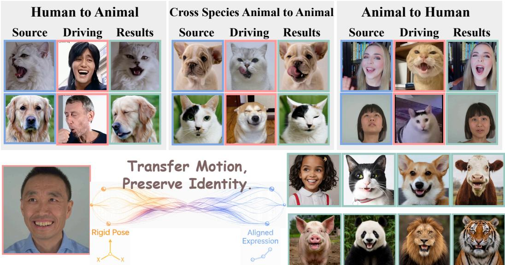
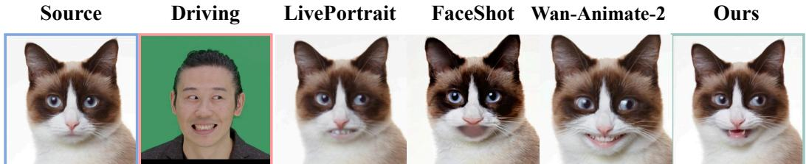
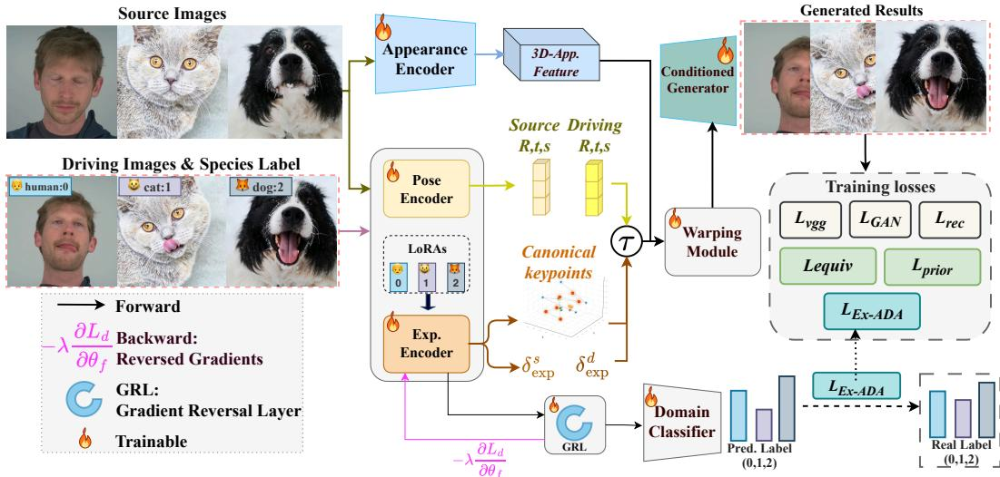
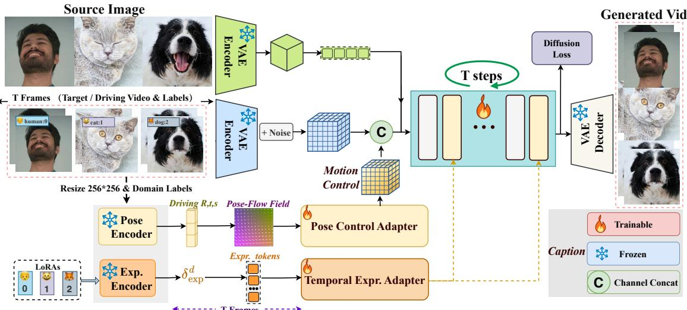
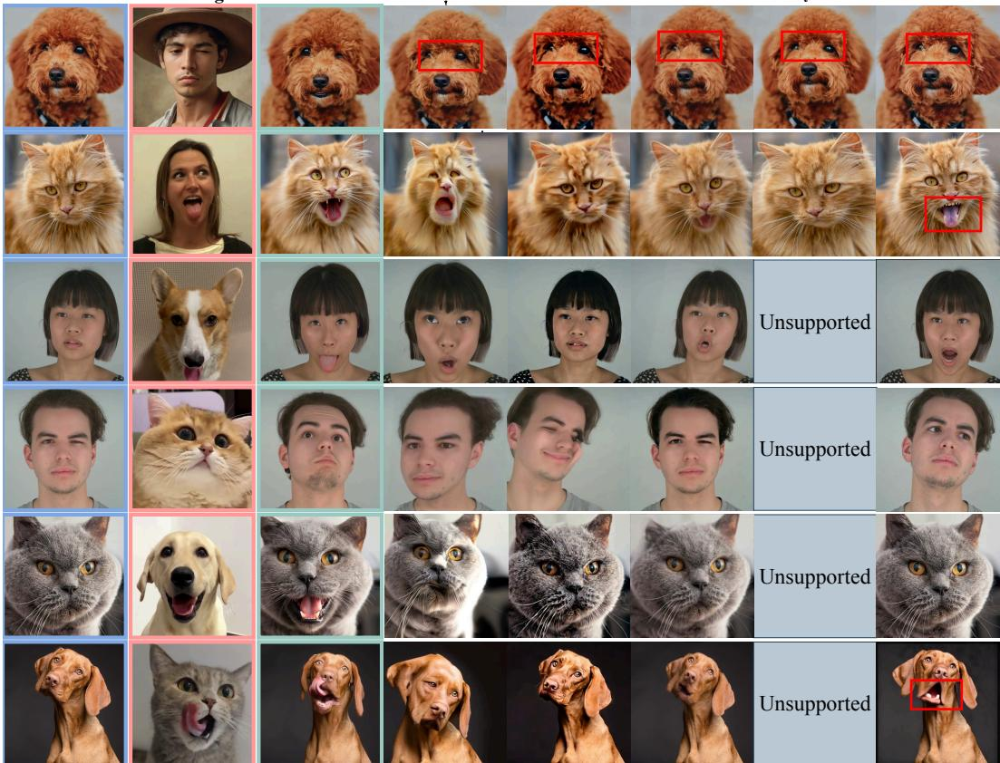
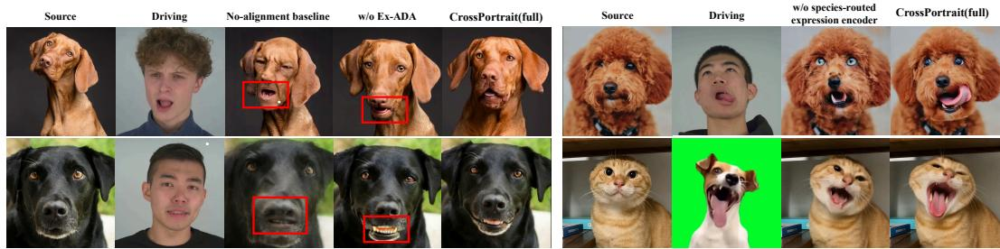
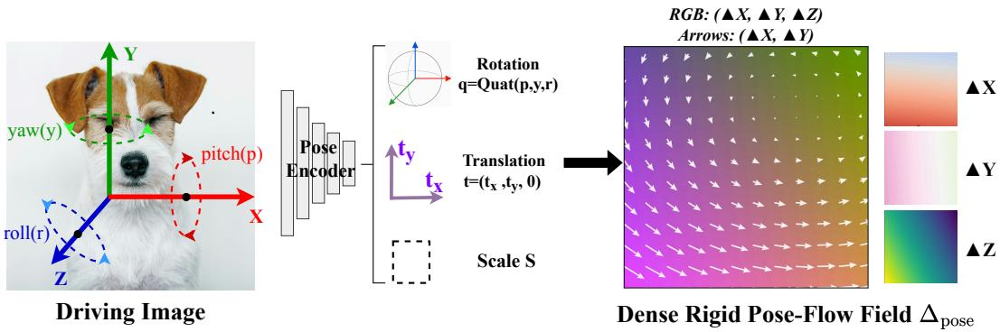
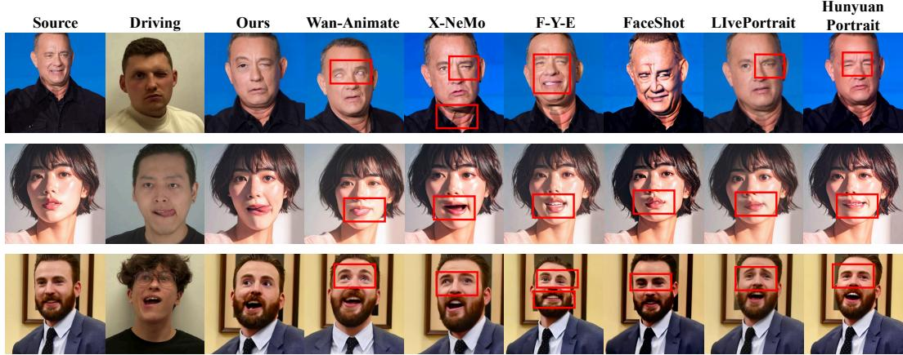
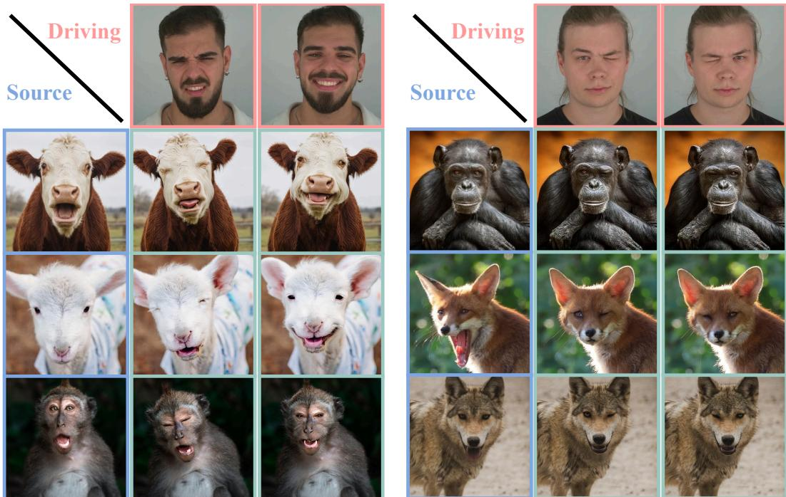

# CrossPortrait: Cross-Species Portrait Animation via Adversarial Motion Alignment

Gezhong Pan1,2,∗ Zhe Li3,∗ Yunfan Tao1 Yongheng Zhao3 Shiqi Zhou3 Juyong Zhang1 Xiaosong Jia4 Yanyong Zhang1 Shuquan Ye2 Shaofeng Zhang1

1University of Science and Technology of China 2Shenzhen Loop Area Institute   
3Huawei Technologies Ltd. 4Fudan University ∗Equal contribution.

  
Figure 1: Cross-species animation by CrossPortrait. Our method transfers motion while preserving source identity in human-to-animal, animal-to-animal, and animal-to-human scenarios. Blue, red, and green borders denote source portraits, driving images, and CrossPortrait outputs, respectively.

## ABSTRACT

Cross-species portrait animation, which aims to animate a source portrait of species A using a driving video of species B, is particularly challenging due to substantial anatomical differences in facial structures across species. Previous works typically fine-tune human portrait animation models on animal video datasets but often suffer from driving-species leakage. To address this, we propose CROSSPORTRAIT, a novel framework for expressive cross-species portrait animation, supporting diverse scenarios including human-to-animal, animal-to-human and cross-species animalto-animal (e.g. cat-to-dog) animation. Specifically, we decompose the portrait motion into rigid head poses and expression keypoints. To accommodate speciesspecific facial structures while facilitating cross-species expression alignment, we introduce a species-routed expression encoder that incorporates species-specific LoRAs into a unified expression encoder. Furthermore, we introduce expressionlevel adversarial domain adaptation (Ex-ADA) to suppress driving-species-specific information in the expression latents, thereby mitigating species leakage and promoting a shared expression space across species. Extensive experiments show that our method enables expressive and identity-preserving portrait animation across diverse species and outperforms other state-of-the-art approaches.

  
Figure 2: Comparison of species leakage with LivePortrait (Guo et al., 2024), FaceShot (Gao et al., 2025), and Wan-Animate-2 (Wang et al., 2026). These approaches tend to transfer human dental characteristics to the animated cat, whereas our method faithfully follows the driving mouth motion while preserving the source cat’s oral morphology. For a fair comparison, we further post-train all applicable baselines on the same animal training data.

## 1 INTRODUCTION

Portrait animation synthesizes a video of a source portrait that follows a driving video. Although AIGC-based methods (Zhao et al., 2025; Wang et al., 2025; Cheng et al., 2025; Shi et al., 2026) have achieved expressive human portrait animation, most of them suffer from generalization to other species, let alone cross-species animation. In this paper, we focus on cross-species portrait animation, where the source and driving input may depict different species, such as humans, cats, or dogs, while the output preserves the source identity, appearance, and species-specific morphology. We use X → Y to denote a driving clip from species X applied to a source portrait of species Y ; for example, H→A denotes a human driving clip applied to an animal source portrait. Specifically, our cross-species animation setting mainly includes human-to-animal (H→A), animal-to-human (A→H), and cross-species animal-to-animal (A1→A2) animation, as shown in Fig. 1.

Portrait motion can be decomposed into head pose and facial expression. Although head poses across different species can be represented by a shared rigid transformation comprising rotation, translation, and scale (RTS), facial expressions vary substantially across species due to their distinct anatomical structures. Therefore, a key challenge lies in learning a shared expression space that aligns semantically corresponding expressions across species, such that the expression of a driving subject can be effectively transferred to a source subject of a different species. However, directly encoding the driving image into an expression feature may entangle expression-related information with species-specific cues, leading to species-information leakage. As illustrated in Fig. 2, such leakage may undesirably transfer characteristics of the driving species to the animated source, thereby degenerating source-species fidelity. Consequently, another key challenge is to effectively suppress species-specific identity cues.

To address these two challenges, we propose an adversarial expression learning framework for cross-species portrait animation. For the first challenge, we employ a shared expression encoder to map facial expressions of humans, cats, and dogs into a common representation space, and leverage LivePortrait (Guo et al., 2024) as a training framework to align expression representations across species. To accommodate species-specific anatomical variations without compromising the shared representation space, we further introduce a species-routed expression encoder, which incorporates species-specific LoRA (Hu et al., 2022) adapters into a unified driving-side expression encoder. The shared backbone facilitates cross-species expression alignment, while the species-specific adapters enhance the representation capacity for capturing fine-grained expression patterns unique to each species. For the second challenge, we introduce expression-level adversarial domain adaptation (Ex-ADA) (Ganin et al., 2016), where a domain classifier is jointly trained to predict the species category from the encoded expression features. Through adversarial training with a gradient reversal layer (GRL), the expression encoder is encouraged to suppress species-specific identity cues, yielding more species-agnostic expression representations and thereby mitigating driving-species leakage. Finally, we reshape the driving expression features into expression tokens and inject them into the video DiT (Team Wan et al., 2025) via cross-attention, enabling expressive cross-species portrait animation while preserving source-species fidelity.

Overall, our contributions are summarized as follows:

• We propose CrossPortrait, a unified dual-path framework for cross-species portrait-motion alignment: rigid head motion is represented with dense pose-flow, while facial deformation is represented with shared implicit-keypoint tokens, covering human-to-animal, animal-to-human, and crossspecies animal-to-animal animation.

• We introduce species-routed expression encoder, which inserts species-specific LoRA adapters into a unified driving-side expression encoder, preserving capacity for anatomical differences while providing a shared expression-conditioning interface.

• We introduce expression-level adversarial domain adaptation (Ex-ADA), applied to expression features to suppress driving-species-specific information, mitigate species leakage, and avoid adversarially aligning rigid pose or source morphology.

## 2 RELATED WORK

Motion representations for portrait animation. Portrait animation methods condition generation on motion representations with varying levels of structure. Parametric models provide interpretable pose and expression coefficients: PIRenderer (Ren et al., 2021), for example, uses coefficients from a 3D morphable model. Self-supervised approaches instead discover sparse keypoints or regions and convert their motion into dense warps (Siarohin et al., 2019; 2021; Zhao & Zhang, 2022). FaceVid2Vid (Wang et al., 2021) decomposes learned 3D keypoints into canonical geometry, rigid pose, and non-rigid deformation, while LivePortrait (Guo et al., 2024) extends this interface with stitching and retargeting. Dense motion can also condition video generators: MOFA-Video (Niu et al., 2024) converts sparse controls into motion fields, while FG-Portrait (Xu et al., 2026) derives 3D motion flow from a parametric head model. Other methods learn motion conditions directly from images or latent features. X-Portrait (Xie et al., 2024) extracts hierarchical features from driving frames, whereas HunyuanPortrait and X-NeMo (Xu et al., 2025; Zhao et al., 2025) inject compact implicit motion representations through attention. DeX-Portrait (Shi et al., 2026) combines explicit global pose with latent expression, and DPE (Pang et al., 2023) studies pose–expression disentanglement. Wan-Animate (Cheng et al., 2025) uses causal convolutions to compress an implicit face representation to the video-latent frame rate. Overall, explicit geometry offers a stable, interpretable interface but is tied to predefined anatomy, whereas learned representations are more flexible but not inherently comparable across domains. We therefore model rigid head motion geometrically and facial deformation with learned implicit-keypoint tokens. Each keypoint trajectory is refined at the original frame rate before the retained tokens are packed to match the VAE timeline.

Portrait animation beyond human faces. Most portrait-animation methods study cross-identity transfer within the human-face domain, including X-Portrait (Xie et al., 2024), EMOPortraits (Drobyshev et al., 2024), Follow-Your-Emoji (Ma et al., 2024; 2026), HunyuanPortrait (Xu et al., 2025), and X-NeMo (Zhao et al., 2025). A smaller body of work broadens the source domain. Animate-X (Tan et al., 2025) animates anthropomorphic characters from pose guidance, FaceShot (Gao et al., 2025) retargets facial landmarks to diverse characters, FantasyPortrait (Wang et al., 2025) reports animal-source examples, and LivePortrait provides an animal model. These works mainly show that human-derived motion can animate broader source appearances, rather than extracting motion from non-human drivers. Animal-driven portrait animation remains less explored. FaceShot includes several non-human driving examples, although its CharacBench evaluation uses human drivers. AnimateZoo (Xu et al., 2024) studies cross-species motion transfer, but focuses on full-body actions and mismatched skeletons rather than portrait-scale head pose and facial deformation. Our work instead considers human, cat, and dog sources and drivers, covering human-to-animal, animal-to-human, same-species animal, and cross-species animal-to-animal animation within one shared generator.

Adversarial domain alignment and domain-specific routing. Domain-adversarial learning reduces domain-predictive information by training a domain classifier through a gradient reversal layer (Ganin et al., 2016). Related approaches separate shared and domain-private features (Bousmalis et al., 2016), condition alignment on task predictions (Long et al., 2018), or use multiple discriminators for finer-grained alignment (Pei et al., 2018). Residual adapters provide domain-specific capacity around a shared model (Rebuffi et al., 2017), while low-rank adaptation offers parameter-efficient routed updates (Hu et al., 2022). We adopt this dual-path interface for cross-species motion conditioning; related video-generation work explores similar alignment and decoupling choices (Zhang et al., 2025; Zheng et al., 2026). At inference, the driving-species label selects a species-routed LoRA adapter in the expression encoder to capture species-specific appearance and anatomy. During Stage 1 training, Ex-ADA is applied to both source- and driving-frame expression features from same-species reconstruction pairs; at inference, only the driving-side expression features are used for motion conditioning. The rigid-pose pathway, source-reference pathway, and shared video generator remain species-agnostic and are not adversarially aligned.

  
Figure 3: Stage 1: Learning cross-species motion alignment. We align expression representations across species while suppressing species-specific identity cues through the species-routed expression encoder and expression-level adversarial domain adaptation (Ex-ADA).

## 3 METHOD

## 3.1 PROBLEM FORMULATION AND OVERVIEW

Given a source portrait $I _ { s }$ and a driving video $V _ { d } = ( I _ { d } ^ { t } ) _ { t = 1 } ^ { T }$ , possibly from different species, we synthesize

$$
\hat { V } = G \left( I _ { s } , M ( V _ { d } ) \right) ,\tag{1}
$$

where $\hat { V }$ preserves the source identity, appearance, and species-specific morphology while following the driving motion, $M ( \cdot )$ denotes the motion extractor, and G(·) $G ( \cdot )$ is the generator. Unlike previous human portrait animation methods, our goal is to enable cross-species animation, although the training datasets contain only same-species pairs including human, cat, and dog videos. As illustrated in Fig. 3 and Fig. 4, our method contains two stages:

1. Learning cross-species motion alignment. We employ LivePortrait (Guo et al., 2024) for motion alignment. Specifically, rigid head motion is represented by an affine transformation, while facial expression is encoded as shared implicit keypoints. First, we augment the shared expression backbone with LoRA components used by the species-routed expression encoder, enhancing the encoder’s capacity to model anatomically distinct expression patterns while preserving a common representation across species. We then introduce expression-level adversarial domain adaptation (Ex-ADA) to suppress driving-species-specific information in the expression latents, thereby mitigating species leakage and facilitating cross-species expression alignment.

2. DiT-based cross-species portrait animation. Given the pretrained pose and expression encoders from Stage 1, we inject head pose as a motion flow and expression features as cross-attention tokens into the DiT-based video generation backbone. Benefiting from the well-aligned expression encoders with suppressed species leakage, the model achieves faithful cross-species animation despite being trained solely on same-species data pairs.

## 3.2 LEARNING CROSS-SPECIES MOTION ALIGNMENT

Cross-species motion transfer requires a common expression representation that accommodates anatomical differences while suppressing driving-species cues. We learn this representation within

the LivePortrait (Guo et al., 2024) reconstruction framework using same-species source–driving pairs from human, cat, and dog videos.

Motion representations. We decompose portrait motion into rigid head pose and non-rigid facial expression. For an input portrait I with species label c ∈ {human, cat, dog}, we estimate

$$
( R , t , s ) = E _ { \mathrm { p o s e } } ( I ) , \quad \delta _ { \mathrm { e x p } } = H _ { \mathrm { e x p } } ( E _ { \mathrm { e x p } } ( I ; c ) ) .\tag{2}
$$

Here, $R , \mathbf { t } ,$ and s denote rotation, translation, and scale, respectively. The expression encoder produces an intermediate feature $F _ { \mathrm { e x p } } = E _ { \mathrm { e x p } } ( I ; c ) \in \mathbb { R } ^ { 7 6 \bar { 8 } }$ , which is mapped by the shared prediction head $H _ { \mathrm { e x p } }$ to $K = 2 1$ implicit 3D keypoint offsets $\delta _ { \mathrm { e x p } } ~ \in ~ \mathbb { R } ^ { K \times 3 }$ . During Stage 1, these motion components are combined with canonical keypoints to drive the shared warping and reconstruction modules, while appearance is provided by the source portrait.

Species-routed expression encoder. A shared expression backbone provides a common representation space, but must accommodate anatomically distinct expression patterns. We therefore augment selected backbone layers with LoRA components used by the species-routed expression encoder (Hu et al., 2022). The backbone and expression prediction head are shared across species, while these components provide additional capacity for interpreting subtle species-dependent facial expressions. As illustrated on the right of Fig. 6, the LoRA components used by the species-routed expression encoder enable more accurate expression reenactment.

Expression-level adversarial domain adaptation (Ex-ADA). Species-specific adaptation alone does not prevent expression features from retaining anatomical or appearance cues that can leak into the animated source. We therefore introduce expression-level adversarial domain adaptation (Ex-ADA). A three-class (human, cat, and dog) species classifier D takes the expression feature as input through a gradient reversal layer (GRL). Given a same-species source–driving pair $( I _ { s } , I _ { d } )$ with species label c, we define the ADA loss as

$$
\mathcal { L } _ { \mathrm { A D A } } = \frac { 1 } { 2 } \sum _ { i \in \{ s , d \} } \mathrm { C E } \left( D \left( \mathrm { G R L } ( F _ { \mathrm { e x p } } ^ { i } ) \right) , c \right) ,\tag{3}
$$

where $F _ { \mathrm { e x p } } ^ { i } = E _ { \mathrm { e x p } } ( I _ { i } ; c )$ and CE denotes cross-entropy. The GRL acts as an identity mapping during the forward pass, while reversing and scaling the gradient during backpropagation. The ADA loss trains the classifier to predict species labels, while the reversed gradients encourage the expression encoder to suppress species-specific information in its features.

Ex-ADA complements the reconstruction objective: reconstruction and motion priors encourage the representation to retain expression-related information, while adversarial training discourages reliance on species cues. Together, they promote a shared expression interface for cross-species transfer without paired cross-species supervision. As shown on the left of Fig. 6, Ex-ADA enables expression transfer while better preserving the source animal’s species-specific oral morphology.

## 3.3 DIT-BASED CROSS-SPECIES PORTRAIT ANIMATION

We freeze the motion encoders learned in Stage 1 and condition a shared video DiT on driving pose and expression, while the reference pathway provides source appearance and morphology.

Pose condition. Following DeX-Portrait (Shi et al., 2026), we convert the predicted rotation, translation, and scale into dense pose-flow fields. These fields are temporally packed and projected to match the VAE latents, then concatenated with the noisy latents to provide spatial motion guidance.

Expression condition. For each driving frame t, we convert the predicted expression offsets $\delta _ { \mathrm { e x p } } ^ { t }$ into keypoint-wise expression tokens. Specifically, for the k-th keypoint, we first obtain an initial token $z _ { t , k }$ and refine its temporal trajectory:

$$
z _ { t , k } = \phi ( \delta _ { \mathrm { e x p } , k } ^ { t } ) + p _ { k } , \qquad \widetilde { z } _ { t , k } = z _ { t , k } + \mathcal { G } _ { \mathrm { c a u s a l } } ( z _ { \le t , k } ) , \quad k = 1 , \ldots , K .\tag{4}
$$

where ϕ is a shared MLP that projects each 3D keypoint offset into a token embedding, $p _ { k }$ is a learned keypoint embedding, and $\mathcal { G } _ { \mathrm { c a u s a l } }$ applies left-padded causal convolutions independently to each keypoint trajectory. Refinement operates at the original frame rate, and its final projection is zero-initialized to preserve the initial frame-wise representation.

To match the VAE timeline, we prepend three copies of the first token frame and pack every four consecutive frames into 4K expression tokens per latent time step. After projection to the DiT hidden dimension, these tokens serve as keys and values in expression cross-attention adapters, with video tokens as queries. The adapters are inserted every two transformer blocks and use zeroinitialized output projections. This supplies temporally refined expression guidance through the shared cross-species expression representations learned in Stage 1.

  
Figure 4: Stage 2: DiT-based cross-species portrait animation. We inject the pose and expression features extracted from pretrained pose and expression encoders into the video DiT for expressive cross-species animation.

## 3.4 TRAINING

In Stage 1, pose and expression encoders (Liu et al., 2022) are initialized from pretrained human weights of LivePortrait (Guo et al., 2024) and jointly optimized with reconstruction, motion prior, and ADA losses. The warping and reconstruction modules are shared across species. In Stage 2, pose and expression encoders are frozen. We train the DiT denoising backbone, motion projections, causal expression refiner, and shared expression cross-attention adapters on human, cat, and dog videos. Neither stage introduces generator-side species routing to encourage learning facial structures from the source image. Complete objectives and optimization settings are provided in Appendix A.

## 4 EXPERIMENTS

We evaluate motion fidelity and identity preservation across three transfer settings: human-to-animal (H→A), animal-to-human (A→H), and animal-to-animal (A→A). For A→A, we use balanced cat– dog transfer as the primary trained-species setting and additionally assess generalization to unseen source species qualitatively. We further conduct controlled studies with a joint No-Alignment baseline and ablations of Ex-ADA, the species-routed expression encoder, and temporal stabilization.

## 4.1 EXPERIMENTAL SETUP

Data and splits. Both stages use the same training data, comprising public human portrait datasets and internally collected cat and dog videos. Stage 1 uses two sampled frames per video for reconstruction training, while Stage 2 uses continuous 81-frame clips. All evaluation identities and driving clips are held out from training. The animal self-reenactment benchmark contains 50 cat and 50 dog videos; the remaining evaluation covers H→A, A→H, cross- and same-species A→A, and unseen-source transfer with trained-species drivers. Dataset details, preprocessing, resolutions, and split construction are provided in Appendix G.

Compared methods. We group the compared methods by their roles and supported settings. LivePortrait-Animal (Guo et al., 2024) serves as our principal external animal-trained baseline for H→A, A→H, and the applicable A→A settings. FaceShot (Gao et al., 2025), Follow-Your-Emoji (Ma et al., 2024), FantasyPortrait (Wang et al., 2025), and Wan-Animate-2 (Wang et al., 2026) provide additional comparisons in the cross-species settings they support. FantasyPortrait’s released pipeline relies on human-face detection/alignment and pretrained facial-motion features, so it does not officially support animal videos as drivers. Its animal examples use human drivers for animal portraits; we therefore retain it only for H→A and mark animal self-reenactment as N/A. Human-only methods are evaluated only in the H→H sanity check because they do not support the cross-species settings. Appendix C shows that CROSSPORTRAIT achieves the best or tied-best H→H scores on all metrics except APD, on which it ranks second. The No-Alignment Baseline uses the same human–cat–dog data and generator backbone, providing a matched-data joint baseline for the cross species motion interface; component ablations are reported separately below. For each supported setting, all methods are evaluated using identical source–driving pairs and their official preprocessing. Each applicable baseline is post-trained on the same animal training data using its official pipeline. Methods with partial applicability are evaluated only on the settings they support, and unsupported method–direction pairs are marked N/A. Protocol-specific applicability is summarized in Appendix Table 5.

Table 1: Animal self-reenactment reconstruction and H→A pairwise preference evaluation. Selfreenactment uses 50 cat and 50 dog videos. Each preference value denotes the rate at which users prefer the corresponding method over CROSSPORTRAIT.
<table><tr><td rowspan="2">Method</td><td colspan="4">Animal Self-Reenactment</td><td colspan="4">H→A User Preference: Method over CROssPORTRAIT</td></tr><tr><td>PSNR ↑</td><td>SSIM ↑</td><td>LPIPS ↓</td><td> $L _ { 1 } \downarrow$ </td><td>Expr. (%) ↓</td><td>Pose (%) ↓</td><td>ID (%) ↓</td><td>Overall (%) ↓</td></tr><tr><td>Follow-Your-Emoji</td><td>21.38</td><td>0.7639</td><td>0.1730</td><td>0.05030</td><td>0.0</td><td>0.0</td><td>0.0</td><td>0.0</td></tr><tr><td>FaceShot</td><td>16.17</td><td>0.6019</td><td>0.3822</td><td>0.1012</td><td>3.2</td><td>1.6</td><td>12.9</td><td>3.2</td></tr><tr><td>LivePortrait-Animal</td><td>24.37</td><td>0.7720</td><td>0.1438</td><td>0.04010</td><td>21.2</td><td>21.2</td><td>34.6</td><td>23.1</td></tr><tr><td>FantasyPortrait</td><td>N/A</td><td>N/A</td><td>N/A</td><td>N/A</td><td>0.0</td><td>0.0</td><td>12.9</td><td>0.0</td></tr><tr><td>Wan-Animate-2</td><td>23.54</td><td>0.7834</td><td>0.1955</td><td>0.0590</td><td>30.0</td><td>22.5</td><td>34.2</td><td>19.8</td></tr><tr><td>No-Alignment Baseline</td><td>24.59</td><td>0.7743</td><td>0.1400</td><td>0.04001</td><td>23.6</td><td>26.9</td><td>14.9</td><td>26.2</td></tr><tr><td>CROSSPORTRAIT</td><td>25.06</td><td>0.7893</td><td>0.1360</td><td>0.03970</td><td>1</td><td>1</td><td>1</td><td>1</td></tr></table>

Evaluation metrics. For paired animal self-reenactment, we use the first frame of each target video as the source image and the remaining frames as ground-truth targets. We report peak signal-to-noise ratio (PSNR), structural similarity (SSIM) (Wang et al., 2004), learned perceptual image patch similarity (LPIPS) (Zhang et al., 2018), and $L _ { 1 }$ error. For A→H, we additionally report CSIM between the generated human face and the source portrait to measure source identity preservation; CSIM is not used to measure motion fidelity. For same-species animal cross-identity transfer, we report pairwise preferences in Appendix Table 6. AED and APD are reported only for human frames. Detailed metric definitions are provided in Appendix B.

Pairwise user study. Because the evaluated cross-species and animal cross-identity settings lack paired ground truth and a validated animal-motion evaluator, H→A, A→H, and cross- and samespecies A→A trials use anonymized pairwise preferences. Participants view the source portrait, a synchronized driving clip, and two anonymized outputs, with the output order randomized and counterbalanced. They independently judge four criteria: Expr. measures expression fidelity and temporal alignment; Pose measures head-pose agreement; the ID criterion measures preservation of source identity and morphology, including driving-species leakage; and Overall measures motion, identity and morphology preservation, temporal coherence, and visual quality. The study enrolled 50 participants, each completing 10 comparison trials and five ablation trials, yielding 500 comparison and 250 ablation trials in total. A→H pairs are balanced between cat and dog drivers. For crossspecies A→A, we use equal numbers of cat→dog and dog→cat pairs, and every regime is balanced across the motion strata defined in Appendix G. Every question includes a tie option, with ties assigned a preference score of 0.5. We report Method over CROSSPORTRAIT preference rates. Lower values indicate better performance by CROSSPORTRAIT. Failures of applicable official pipelines on the fixed evaluation pairs are counted as losses, while unsupported method–direction pairs are marked N/A and excluded from the analysis.

## 4.2 CROSS-SPECIES RESULTS

Quantitative comparison. Tables 1 and 2 report reconstruction, CSIM, and pairwise preference results across animal self-reenactment and cross-species transfer. Figure 5 shows fixed-pair examples, and Appendix Table 4 reports the H→H sanity check. CROSSPORTRAIT achieves the best selfreenactment metrics and highest A→H CSIM, while every valid baseline-over-CROSSPORTRAIT preference rate remains below 50% across cross-species settings.

Table 2: A→H and cross-species A→A (A1→A2) evaluation. A→H uses balanced cat and dog driving clips. Each value denotes the preference rate for the corresponding method over CROSS-PORTRAIT; lower values indicate better performance by CROSSPORTRAIT.
<table><tr><td>Method</td><td colspan="5">A→H (Balanced cat/dog drivers)</td><td colspan="4">Cross-species A→A (A1→A2)</td></tr><tr><td></td><td>CSIM ↑</td><td>Expr. (%) ↓</td><td>Pose (%) ↓</td><td>ID (%) ↓</td><td>Overall (%) ↓</td><td>Expr. (%) ↓</td><td>Pose (%) ↓</td><td>ID (%) ↓</td><td>Overall (%) ↓</td></tr><tr><td>FaceShot</td><td>0.8657</td><td>0.0</td><td>0.0</td><td>6.2</td><td>0.0</td><td>0.0</td><td>0.0</td><td>0.0</td><td>0.0</td></tr><tr><td>Follow-Your-Emoji</td><td>0.8445</td><td>0.0</td><td>0.0</td><td>0.0</td><td>0.0</td><td>0.0</td><td>0.0</td><td>0.0</td><td>0.0</td></tr><tr><td>LivePortrait-Animal</td><td>0.8625</td><td>0.0</td><td>0.0</td><td>0.0</td><td>0.0</td><td>0.0</td><td>0.0</td><td>12.5</td><td>0.0</td></tr><tr><td>Wan-Animate-2</td><td>0.8629</td><td>0.4</td><td>8.8</td><td>4.2</td><td>7.9</td><td>6.2</td><td>8.2</td><td>0.0</td><td>3.8</td></tr><tr><td>No-Alignment Baseline</td><td>0.8451</td><td>18.2</td><td>8.2</td><td>0.0</td><td>12.2</td><td>23.9</td><td>17.1</td><td>10.9</td><td>20.6</td></tr><tr><td>CROSSPORTRAIT</td><td>0.8825</td><td>1</td><td>1</td><td>1</td><td>1</td><td>1</td><td>1</td><td>/</td><td>1</td></tr></table>

Source  
Driving  
Ours  
Follow-Your-Emoji FaceShot  
LivePortrait Fantasy Portrait Wan-Animate-2  
  
Figure 5: Qualitative comparison of CROSSPORTRAIT with competing methods. The top, middle, and bottom rows show human-to-animal, animal-to-human, and cross-species cat↔dog animation, respectively. Blue, red, and green borders indicate source portraits, driving images, and Cross-Portrait outputs, respectively. Red boxes mark visible artifacts, and gray cells indicate unsupported cases.

Qualitative comparison. Figures 1 and 5 present bidirectional cross-species transfer, including unseen source portraits driven by trained species. Baselines show motion errors, geometric distortion, and species-specific feature leakage, while CROSSPORTRAIT better preserves source morphology and follows the driving motion.

## 4.3 ABLATION STUDIES

All ablation variants use the same data, source–driving pairs, and generator backbone, with the corresponding user-study results summarized in Table 3.

No-Alignment Baseline. The No-Alignment variant uses a single shared ConvNeXt encoder to process both pose-flow and expression-token motion. It removes the LoRA components used by the species-routed expression encoder and does not apply expression-level adversarial domain adaptation (Ex-ADA). This configuration substantially weakens cross-species motion transfer and can yield unstable mouth geometry (Figure 6, left).

  
Figure 6: Qualitative H→A ablations. Left: No-Alignment and w/o expression-level ADA. Right: w/o species-routed expression encoder

Table 3: Ablation user study on bidirectional human–animal animation. Each value denotes the preference rate for the corresponding method over CROSSPORTRAIT; lower values indicate better performance by CROSSPORTRAIT.
<table><tr><td>Variant</td><td>Expr. (%) ↓</td><td>Pose (%) ↓</td><td>ID (%) ↓</td><td>Overall (%) ↓</td></tr><tr><td>(A) No-alignment baseline</td><td>6.4</td><td>15.4</td><td>11.5</td><td>14.1</td></tr><tr><td>(B) w/o Ex-ADA</td><td>23.1</td><td>26.9</td><td>23.1</td><td>19.2</td></tr><tr><td>(C) w/o species-routed expression encoder</td><td>21.2</td><td>30.3</td><td>33.3</td><td>27.9</td></tr><tr><td>(D) w/o temporal stabilization.</td><td>30.0</td><td>48.0</td><td>44.0</td><td>32.0</td></tr></table>

w/o Ex-ADA. Removing only expression-level ADA leaves more driving-species information in the expression features, increasing species-specific feature leakage in H→A transfer (Figure 6, left). ADA suppresses species-predictive information at the expression level without applying adversarial alignment to the pose-flow or source-reference pathways.

w/o species-routed expression encoder. Removing the species-routed expression encoder leaves a shared expression encoder to model species-dependent anatomical variations, weakening fine-grained motions such as tongue protrusion and mouth opening. The species-routed expression encoder restores the ability to model variations while retaining a shared expression backbone (Figure 6, right).

w/o temporal stabilization. Replacing causal temporal refinement with non-causal processing allows future driving states to influence earlier expression tokens, leading to less temporally consistent mouth and tongue motion. This results in lower Expression and Overall preference rates, and can also slightly degrade perceived pose quality during joint generation.

## 5 LIMITATIONS

Our training data cover human, cat, and dog drivers. Generalization to unseen species is therefore evaluated only qualitatively on the source side, using drivers from the trained species, while unseenspecies driving and arbitrary facial topologies remain unexplored. Moreover, cross-species animation lacks paired ground truth and validated cross-species motion metrics. As a result, preference-based evaluation and identity metrics cannot fully characterize motion accuracy or biological plausibility.

## 6 CONCLUSION

We presented CROSSPORTRAIT, a unified framework for cross-species portrait animation across human, cat, and dog domains. Rather than enforcing domain invariance over all motion information, CROSSPORTRAIT uses complementary pathways for explicit geometric motion and learned expression conditioning, retains species-specific modeling capacity through the species-routed expression encoder, and applies alignment only to expression features to suppress species-predictive information. A lightweight causal temporal module further stabilizes expression-motion tokens before video generation. Our results show that this design enables a single shared generator to support diverse source–driving directions while improving motion transfer and source preservation over applicable baselines. Ablation studies further indicate the importance of balancing shared motion representations with species-specific modeling capacity for cross-species animation. While the model generalizes qualitatively to unseen source species when driven by trained species, unseen driver species remain unexplored. Extending the framework to a broader range of species and less structured motion domains is a promising direction for future work.

## REPRODUCIBILITY STATEMENT

We describe the model architecture, training objectives, optimization settings, data construction, evaluation splits, metric definitions, and user-study protocol in the main paper and the supplementary appendices. All evaluation source identities and driving clips are held out from training, and the implementation details needed to reproduce the reported experiments are provided in the supplementary material.

## AI ASSISTANCE

We used large language models to assist with language editing and manuscript organization, including improving grammar, clarity, and presentation. All AI-assisted text was reviewed and revised by the authors, who take full responsibility for the final manuscript, claims, and references.

## REFERENCES

Konstantinos Bousmalis, George Trigeorgis, Nathan Silberman, Dilip Krishnan, and Dumitru Erhan. Domain separation networks. In Advances in Neural Information Processing Systems, volume 29, pp. 343–351, 2016.

Xiaoxu Chen, Jingfan Tan, Tao Wang, Kaihao Zhang, Wenhan Luo, and Xiaochun Cao. Towards real-world blind face restoration with generative diffusion prior. arXiv preprint arXiv:2312.15736, 2023. URL https://arxiv.org/abs/2312.15736.

Gang Cheng, Xin Gao, Li Hu, Siqi Hu, Mingyang Huang, Chaonan Ji, Ju Li, Dechao Meng, Jinwei Qi, Penchong Qiao, Zhen Shen, Yafei Song, Ke Sun, Linrui Tian, Feng Wang, Guangyuan Wang, Qi Wang, Zhongjian Wang, Jiayu Xiao, Sheng Xu, Bang Zhang, Peng Zhang, Xindi Zhang, Zhe Zhang, Jingren Zhou, and Lian Zhuo. Wan-Animate: Unified character animation and replacement with holistic replication, 2025. URL https://arxiv.org/abs/2509.14055.

Jiankang Deng, Jia Guo, Niannan Xue, and Stefanos Zafeiriou. ArcFace: Additive angular margin loss for deep face recognition. In Proceedings ofthe IEEE/CVF Conference on Computer Vision and Pattern Recognition, pp. 4690–4699, 2019.

Nikita Drobyshev, Antoni Bigata Casademunt, Konstantinos Vougioukas, Zoe Landgraf, Stavros Petridis, and Maja Pantic. EMOPortraits: Emotion-enhanced multimodal one-shot head avatars. In Proceedings ofthe IEEE/CVF Conference on Computer Vision and Pattern Recognition, pp. 8498–8507, 2024.

Yaroslav Ganin, Evgeniya Ustinova, Hana Ajakan, Pascal Germain, Hugo Larochelle, François Laviolette, Mario March, and Victor Lempitsky. Domain-adversarial training of neural networks. Journal ofMachine Learning Research, 17(59):1–35, 2016. URL https://www.jmlr.org/ papers/v17/15-239.html.

Junyao Gao, Yanan Sun, Fei Shen, Xin Jiang, Zhening Xing, Kai Chen, and Cairong Zhao. FaceShot: Bring any character into life. In International Conference on Learning Representations, 2025. URL https://openreview.net/forum?id=oJA1GUqRww.

Jianzhu Guo, Dingyun Zhang, Xiaoqiang Liu, Zhizhou Zhong, Yuan Zhang, Pengfei Wan, and Di Zhang. LivePortrait: Efficient portrait animation with stitching and retargeting control. arXiv preprint arXiv:2407.03168, 2024. URL https://arxiv.org/abs/2407.03168.

Edward J. Hu, Yelong Shen, Phillip Wallis, Zeyuan Allen-Zhu, Yuanzhi Li, Shean Wang, Lu Wang, and Weizhu Chen. LoRA: Low-rank adaptation of large language models. In International Conference on Learning Representations, 2022. URL https://openreview.net/forum? id=nZeVKeeFYf9.

Tobias Kirschstein, Shenhan Qian, Simon Giebenhain, Tim Walter, and Matthias Nießner. NeRSemble: Multi-view radiance field reconstruction of human heads. ACM Transactions on Graphics, 42(4):161:1–161:14, 2023. doi: 10.1145/3592455. URL https://doi.org/10.1145/ 3592455.

Zhuang Liu, Hanzi Mao, Chao-Yuan Wu, Christoph Feichtenhofer, Trevor Darrell, and Saining Xie. A ConvNet for the 2020s. In Proceedings of the IEEE/CVF Conference on Computer Vision and Pattern Recognition, pp. 11976–11986, 2022.

Mingsheng Long, Zhangjie Cao, Jianmin Wang, and Michael I. Jordan. Conditional adversarial domain adaptation. In Advances in Neural Information Processing Systems, volume 31, pp. 1640–1650, 2018.

Yue Ma, Hongyu Liu, Hongfa Wang, Heng Pan, Yingqing He, Junkun Yuan, Ailing Zeng, Chengfei Cai, Heung-Yeung Shum, Wei Liu, and Qifeng Chen. Follow-Your-Emoji: Fine-controllable and expressive freestyle portrait animation. In ACM SIGGRAPH Asia 2024 Conference Papers, pp. 110:1–110:12, 2024. doi: 10.1145/3680528.3687587.

Yue Ma, Zexuan Yan, Hongyu Liu, Hongfa Wang, Heng Pan, Yingqing He, Junkun Yuan, Ailing Zeng, Chengfei Cai, Heung-Yeung Shum, Zhifeng Li, Wei Liu, Linfeng Zhang, and Qifeng Chen. Follow-Your-Emoji-Faster: Towards efficient, fine-controllable, and expressive freestyle portrait animation. International Journal of Computer Vision, 134(3):130, 2026. doi: 10.1007/s11263-025-02685-z.

Julieta Martinez, Emily Kim, Javier Romero, Timur Bagautdinov, Shunsuke Saito, Shoou-I Yu, Stuart Anderson, Michael Zollhöfer, Te-Li Wang, Shaojie Bai, Chenghui Li, Shih-En Wei, Rohan Joshi, Wyatt Borsos, Tomas Simon, Jason Saragih, Paul Theodosis, Alexander Greene, Anjani Josyula, Silvio Mano Maeta, Andrew I. Jewett, Simon Venshtain, Christopher Heilman, Yueh-Tung Chen, Sidi Fu, Mohamed Ezzeldin A. Elshaer, Tingfang Du, Longhua Wu, Shen-Chi Chen, Kai Kang, Michael Wu, Youssef Emad, Steven Longay, Ashley Brewer, Hitesh Shah, James Booth, Taylor Koska, Kayla Haidle, Matt Andromalos, Joanna Hsu, Thomas Dauer, Peter Selednik, Tim Godisart, Scott Ardisson, Matthew Cipperly, Ben Humberston, Lon Farr, Bob Hansen, Peihong Guo, Dave Braun, Steven Krenn, He Wen, Lucas Evans, Natalia Fadeeva, Matthew Stewart, Gabriel Schwartz, Divam Gupta, Gyeongsik Moon, Kaiwen Guo, Yuan Dong, Yichen Xu, Takaaki Shiratori, Fabian Prada, Bernardo R. Pires, Bo Peng, Julia Buffalini, Autumn Trimble, Kevyn McPhail, Melissa Schoeller, and Yaser Sheikh. Codec Avatar Studio: Paired human captures for complete, driveable, and generalizable avatars. In Advances in Neural Information Processing Systems, volume 37, pp. 83008–83023. Curran Associates, Inc., 2024. doi: 10.52202/079017-2640. URL https://papers.nips.cc/paper\_files/paper/ 2024/hash/9712b78386cebdc3db7f1a48c2d20edb-Abstract-Datasets\_ and\_Benchmarks\_Track.html.

Muyao Niu, Xiaodong Cun, Xintao Wang, Yong Zhang, Ying Shan, and Yinqiang Zheng. MOFA-Video: Controllable image animation via generative motion field adaptions in frozen image-tovideo diffusion model. In European Conference on Computer Vision, pp. 111–128, 2024. doi: 10.1007/978-3-031-72655-2\_7.

Youxin Pang, Yong Zhang, Weize Quan, Yanbo Fan, Xiaodong Cun, Ying Shan, and Dong-Ming Yan. DPE: Disentanglement of pose and expression for general video portrait editing. In Proceedings of the IEEE/CVF Conference on Computer Vision and Pattern Recognition, pp. 427–436, 2023.

Zhongyi Pei, Zhangjie Cao, Mingsheng Long, and Jianmin Wang. Multi-adversarial domain adaptation. In Proceedings ofthe AAAI Conference on Artificial Intelligence, volume 32, pp. 3934–3941, 2018. doi: 10.1609/aaai.v32i1.11767.

Pexels. Pexels. https://www.pexels.com/. Accessed: 2026-07-08.

Pixabay. Pixabay. https://pixabay.com/. Accessed: 2026-07-08.

Sylvestre-Alvise Rebuffi, Hakan Bilen, and Andrea Vedaldi. Learning multiple visual domains with residual adapters. In Advances in Neural Information Processing Systems, volume 30, pp. 506–516, 2017.

Yurui Ren, Ge Li, Yuanqi Chen, Thomas H. Li, and Shan Liu. PIRenderer: Controllable portrait image generation via semantic neural rendering. In Proceedings ofthe IEEE/CVF International Conference on Computer Vision, pp. 13759–13768, 2021.

George Retsinas, Panagiotis P. Filntisis, Radek Danecek, Victoria F. Abrevaya, Anastasios Roussos, Timo Bolkart, and Petros Maragos. 3d facial expressions through analysis-by-neural-synthesis. In Proceedings ofthe IEEE/CVF Conference on Computer Vision and Pattern Recognition (CVPR), pp. 2490–2501, 2024. doi: 10.1109/CVPR52733.2024.00241.

Yuxiang Shi, Zhe Li, Yanwen Wang, Hao Zhu, Xun Cao, and Ligang Liu. DeX-Portrait: Disentangled and expressive portrait animation via explicit and latent motion representations. In Proceedings of the IEEE/CVF Conference on Computer Vision and Pattern Recognition, pp. 40009–40019, 2026.

Aliaksandr Siarohin, Stéphane Lathuilière, Sergey Tulyakov, Elisa Ricci, and Nicu Sebe. First order motion model for image animation. In Advances in Neural Information Processing Systems, volume 32, 2019.

Aliaksandr Siarohin, Oliver J. Woodford, Jian Ren, Menglei Chai, and Sergey Tulyakov. Motion representations for articulated animation. In Proceedings ofthe IEEE/CVF Conference on Computer Vision and Pattern Recognition, pp. 13653–13662, 2021.

Shuai Tan, Biao Gong, Xiang Wang, Shiwei Zhang, Dandan Zheng, Ruobing Zheng, Kecheng Zheng, Jingdong Chen, and Ming Yang. Animate-X: Universal character image animation with enhanced motion representation. In International Conference on Learning Representations, 2025.

Team Wan, Ang Wang, Baole Ai, Bin Wen, Chaojie Mao, Chen-Wei Xie, Di Chen, Feiwu Yu, Haiming Zhao, Jianxiao Yang, Jianyuan Zeng, Jiayu Wang, Jingfeng Zhang, Jingren Zhou, Jinkai Wang, Jixuan Chen, Kai Zhu, Kang Zhao, Keyu Yan, Lianghua Huang, Mengyang Feng, Ningyi Zhang, Pandeng Li, Pingyu Wu, Ruihang Chu, Ruili Feng, Shiwei Zhang, Siyang Sun, Tao Fang, Tianxing Wang, Tianyi Gui, Tingyu Weng, Tong Shen, Wei Lin, Wei Wang, Wei Wang, Wenmeng Zhou, Wente Wang, Wenting Shen, Wenyuan Yu, Xianzhong Shi, Xiaoming Huang, Xin Xu, Yan Kou, Yangyu Lv, Yifei Li, Yijing Liu, Yiming Wang, Yingya Zhang, Yitong Huang, Yong Li, You Wu, Yu Liu, Yulin Pan, Yun Zheng, Yuntao Hong, Yupeng Shi, Yutong Feng, Zeyinzi Jiang, Zhen Han, Zhi-Fan Wu, and Ziyu Liu. Wan: Open and advanced large-scale video generative models. arXiv preprint arXiv:2503.20314, 2025. URL https://arxiv.org/abs/2503.20314.

Guangyuan Wang, Li Hu, Dechao Meng, Zhongyi Zhang, Peng Zhang, Xindi Zhang, Mingyang Huang, Ruoshi Zhang, Ke Sun, Zhe Zhang, Xingjun Wang, Gang Cheng, Hai Xu, and Bang Zhang. Wan-Animate-2: Pushing the application boundaries of character animation. arXiv preprint arXiv:2608.06009, 2026. URL https://arxiv.org/abs/2608.06009.

Qiang Wang, Mengchao Wang, Fan Jiang, Yaqi Fan, Yonggang Qi, and Mu Xu. FantasyPortrait: Enhancing multi-character portrait animation with expression-augmented diffusion transformers. arXiv preprint arXiv:2507.12956, 2025. URL https://arxiv.org/abs/2507.12956.

Ting-Chun Wang, Arun Mallya, and Ming-Yu Liu. One-shot free-view neural talking-head synthesis for video conferencing. In Proceedings of the IEEE/CVF Conference on Computer Vision and Pattern Recognition, pp. 10039–10049, 2021.

Zhou Wang, Alan C. Bovik, Hamid R. Sheikh, and Eero P. Simoncelli. Image quality assessment: From error visibility to structural similarity. IEEE Transactions on Image Processing, 13(4): 600–612, 2004.

Liangbin Xie, Xintao Wang, Honglun Zhang, Chao Dong, and Ying Shan. VFHQ: A high-quality dataset and benchmark for video face super-resolution. In Proceedings of the IEEE/CVF Conference on Computer Vision and Pattern Recognition Workshops, pp. 657–666, 2022.

You Xie, Hongyi Xu, Guoxian Song, Chao Wang, Yichun Shi, and Linjie Luo. X-Portrait: Expressive portrait animation with hierarchical motion attention. In ACM SIGGRAPH 2024 Conference Papers, pp. 1–11, 2024. doi: 10.1145/3641519.3657459.

Yating Xu, Yunqi Miao, Evangelos Ververas, Jiankang Deng, and Jifei Song. FG-Portrait: 3d flow guided editable portrait animation. In Proceedings of the IEEE/CVF Conference on Computer Vision and Pattern Recognition, pp. 32947–32956, 2026.

Yuanfeng Xu, Yuhao Chen, Zhongzhan Huang, Zijian He, Guangrun Wang, Philip H. S. Torr, and Liang Lin. AnimateZoo: Zero-shot video generation of cross-species animation via subject alignment. arXiv preprint arXiv:2404.04946, 2024. URL https://arxiv.org/abs/2404. 04946.

Zunnan Xu, Zhentao Yu, Zixiang Zhou, Jun Zhou, Xiaoyu Jin, Fa-ting Hong, Xiaozhong Ji, Junwei Zhu, Chengfei Cai, Shiyu Tang, Qin Lin, Xiu Li, and Qinglin Lu. HunyuanPortrait: Implicit condition control for enhanced portrait animation. In Proceedings ofthe IEEE/CVF Conference on Computer Vision and Pattern Recognition, pp. 15909–15919, 2025. doi: 10.1109/CVPR52734. 2025.01483.

Richard Zhang, Phillip Isola, Alexei A. Efros, Eli Shechtman, and Oliver Wang. The unreasonable effectiveness of deep features as a perceptual metric. In Proceedings ofthe IEEE Conference on Computer Vision and Pattern Recognition (CVPR), June 2018.

Xiangdong Zhang, Jiaqi Liao, Shaofeng Zhang, Fanqing Meng, Xiangpeng Wan, Junchi Yan, and Yu Cheng. VideoREPA: Learning physics for video generation through relational alignment with foundation models. In Advances in Neural Information Processing Systems, volume 38, pp. 122647–122676. Curran Associates, Inc., 2025. URL https://proceedings.neurips.cc/paper\_files/paper/2025/ file/b1d4973f5d21708abef3cd6f17d842c8-Paper-Conference.pdf.

Jian Zhao and Hui Zhang. Thin-plate spline motion model for image animation. In Proceedings of the IEEE/CVF Conference on Computer Vision and Pattern Recognition, pp. 3657–3666, 2022.

Xiaochen Zhao, Hongyi Xu, Guoxian Song, You Xie, Chenxu Zhang, Xiu Li, Linjie Luo, Jinli Suo, and Yebin Liu. X-NeMo: Expressive neural motion reenactment via disentangled latent attention. In International Conference on Learning Representations, 2025. URL https://proceedings.iclr.cc/paper\_files/paper/2025/hash/ bfb6a69c0d9e2bc596e1cd31f16fcdde-Abstract-Conference.html.

Guangting Zheng, Haojing Chen, Hao Li, Jingtao Zhang, Zhen Yang, Xiaosong Jia, Xue Yang, Shaofeng Zhang, and Yanyong Zhang. Enhancing video physical consistency via role-aware joint training and modality-decoupled denoising. arXiv preprint arXiv:2607.04653, 2026. URL https://arxiv.org/abs/2607.04653.

## Supplementary Material

A Method and Training Details . 15   
A.1 Pose Representation and Pose-Flow Conditioning . 15   
A.2 Adversarial Schedule and Dataset Sampling . . 15   
A.3 Stage-1 Reconstruction Objective . . 15   
B Evaluation Metric Details . . . 16   
B.1 Notation and Temporal Aggregation. .16   
B.2 Average Expression Distance . . 16   
B.3 Average Pose Distance. .16   
B.4 Cosine Similarity 16   
C Human-to-Human Sanity Check . 16   
C.1 Evaluation Setup . 16   
D Baseline Applicability. .17   
D.1 Applicability Matrix . 17   
E Implementation Details . 17   
E.1 Stage-1 Network Architecture 17   
E.2 Stage-1 Optimization . . 18   
E.3 Stage-2 Motion Conditioning . . 18   
E.4 Stage-2 Optimization . 19   
F Same-Species Animal Evaluation . . 19   
F.1 Evaluation Setting . 19   
G Data and Evaluation Protocol . 19   
G.1 Training Data . . 19   
G.2 Evaluation Splits . . . 20   
G.3 Pairwise User-Study Protocol . . 20

  
Figure 7: Pose branch for dense rigid pose-flow. PoseNet predicts pitch, yaw, roll, translation, and scale; these parameters are converted into the dense three-channel displacement field $\Delta _ { \mathrm { p o s e } }$

## A METHOD AND TRAINING DETAILS

## A.1 POSE REPRESENTATION AND POSE-FLOW CONDITIONING

Pose parameterization. PoseNet predicts pitch, yaw, and roll, together with translation and scale:

$$
p , y , r = H _ { \mathrm { r o t } } ( F _ { \mathrm { p o s e } } ) , \qquad t = H _ { t } ( F _ { \mathrm { p o s e } } ) , \qquad s = H _ { s } ( F _ { \mathrm { p o s e } } ) .\tag{5}
$$

Each rotation angle is obtained by taking a soft expectation over $B _ { \mathrm { b i n } }$ bins, $\theta = \textstyle \sum _ { i }$ softmax $( l ) _ { i } b _ { i }$ where l denotes the angle logits and $b _ { i }$ the corresponding bin centers. The resulting Euler angles are converted to a quaternion $q = \operatorname { Q u a t } ( p , y , r )$ . For translation, we use $t = ( t _ { x } , t _ { y } , 0 )$ in normalized crop coordinates. These pose parameters are further converted into a dense rigid pose-flow field, as illustrated in Figure 7. For video conditioning, four consecutive pose-flow fields are channelpacked, resulting in 12 channels, which are projected by a $1 \times 1 \times 1$ Conv3D to the 48-channel VAE latent-control dimension.

## A.2 ADVERSARIAL SCHEDULE AND DATASET SAMPLING

After a 3,000-step warm-up, the GRL multiplier used by Ex-ADA follows

$$
\lambda ( p ) = \frac { 2 } { 1 + \exp ( - \gamma p ) } - 1 ,\tag{6}
$$

where $p$ denotes the normalized training progress and $\gamma = 1 0$ The sampling weights of the human, cat, and dog datasets have total masses of 6.7, 7.5, and 7.5, respectively, corresponding to approximately 30.9%, 34.6%, and 34.6% of the training mixture. Training batches are shuffled from this mixture rather than explicitly constructed to be class-balanced.

## A.3 STAGE-1 RECONSTRUCTION OBJECTIVE

The full reconstruction-stage loss is

$$
\begin{array} { r } { \mathcal { L } _ { \mathrm { s t a g e 1 } } = \lambda _ { \mathrm { r e c } } \mathcal { L } _ { \mathrm { r e c } } + \lambda _ { \mathrm { p e r } } \mathcal { L } _ { \mathrm { p e r } } + \lambda _ { \mathrm { e q u i v } } \mathcal { L } _ { \mathrm { e q u i v } } + \lambda _ { \mathrm { k p } } \mathcal { L } _ { \mathrm { k p } } ^ { \mathrm { p r i o r } } } \\ { + \lambda _ { \mathrm { d e f } } \mathcal { L } _ { \mathrm { d e f } } ^ { \mathrm { p r i o r } } + \lambda _ { \mathrm { g a n } } \mathcal { L } _ { \mathrm { g a n } } + \lambda _ { \mathrm { E x - A D A } } \mathcal { L } _ { \mathrm { E x - A D A } } . } \end{array}\tag{7}
$$

All terms operate on Stage-1 source–driving reconstruction pairs. Stage 1 contains no temporal operation, and causal processing is used only in the Stage-2 expression refiner. The reconstruction and perceptual terms preserve image fidelity, the equivariance term regularizes motion consistency, and the keypoint and deformation priors stabilize the predicted geometry. The global GAN term improves local realism, while Ex-ADA penalizes species-predictive information in the expression representation through the gradient-reversal pathway.

## B EVALUATION METRIC DETAILS

## B.1 NOTATION AND TEMPORAL AGGREGATION

Here, $\hat { I } ^ { t }$ and $I _ { d } ^ { t }$ denote the generated and driving frames at time $t ,$ respectively, and $T$ denotes the number of evaluated frames.

## B.2 AVERAGE EXPRESSION DISTANCE (AED)

AED measures the accuracy of facial expression transfer using parameters extracted by SMIRK (Retsinas et al., 2024). Following the evaluation protocol of prior work, we construct the expression vector by concatenating the facial-expression, eyelid, and jaw-pose parameters predicted by SMIRK:

$$
\begin{array} { r } { E _ { \mathrm { S M I R K } } ( I ) = \left[ { \bf e } ( I ) , 1 ( I ) , { \bf j } ( I ) \right] , } \end{array}\tag{8}
$$

where $\mathbf { e } ,$ l, and j denote the facial-expression, eyelid, and jaw-pose parameters, respectively. AED is computed as the mean absolute difference between the expression vectors of the generated and driving frames:

$$
\mathrm { A E D } = \frac { 1 } { T D _ { E } } \sum _ { t = 1 } ^ { T } \left. E _ { \mathrm { S M I R K } } ( \hat { I } ^ { t } ) - E _ { \mathrm { S M I R K } } ( I _ { d } ^ { t } ) \right. _ { 1 } ,\tag{9}
$$

where $D _ { E }$ is the dimensionality of the expression vector. Lower AED indicates better agreement with the driving expression.

## B.3 AVERAGE POSE DISTANCE (APD)

APD measures head-pose accuracy using the pose parameters predicted by SMIRK. Let $P _ { \mathrm { S M I R K } } ( I )$ denote the SMIRK head-pose parameter vector. APD is computed as

$$
\mathrm { A P D } = \frac { 1 } { T D _ { P } } \sum _ { t = 1 } ^ { T } \left\| P _ { \mathrm { S M I R K } } ( \hat { I } ^ { t } ) - P _ { \mathrm { S M I R K } } ( I _ { d } ^ { t } ) \right\| _ { 1 } ,\tag{10}
$$

where $D _ { P }$ is the dimensionality of the pose vector. Lower APD indicates better agreement with the driving head pose.

## B.4 COSINE SIMILARITY (CSIM)

Identity preservation is evaluated using cosine similarity between ArcFace (Deng et al., 2019) embeddings. For cross-identity reenactment, CSIM is computed between each generated frame and the source portrait:

$$
\mathrm { C S I M } = \frac { 1 } { T } \sum _ { t = 1 } ^ { T } \cos \left( A _ { \mathrm { A r c F a c e } } ( \hat { I } ^ { t } ) , A _ { \mathrm { A r c F a c e } } ( I _ { s } ) \right) ,\tag{11}
$$

where $A _ { \mathrm { A r c F a c e } } ( \cdot )$ denotes the pretrained ArcFace embedding extractor, and $\cos ( \cdot , \cdot )$ denotes cosine similarity. Higher CSIM indicates better preservation of the source identity.

## C HUMAN-TO-HUMAN SANITY CHECK

## C.1 EVALUATION SETUP

Human-to-human animation is not the primary focus of this work. We nevertheless include an H→H evaluation as a sanity check to examine whether multi-species training and the proposed motionconditioning design maintain standard human portrait-animation performance. We evaluate on 100 held-out human videos from Pixabay (Pixabay) and Pexels (Pexels), using the same preprocessing protocol as in the animal evaluation. For self-reenactment, the first frame serves as the source portrait and the remaining frames provide pixel-level ground truth. For cross-identity reenactment, the source and driving videos contain different identities. We compare with Follow-Your-Emoji, LivePortrait-Human, FaceShot, HunyuanPortrait (Xu et al., 2025), X-NeMo (Zhao et al., 2025), and

Table 4: Human-to-human sanity check. Self-reenactment is evaluated with pixel-level ground truth, while cross-identity reenactment uses unpaired human motion and identity metrics.
<table><tr><td rowspan="2">Method</td><td colspan="5">Self-Reenactment</td><td colspan="3">Cross-Identity Reenactment</td></tr><tr><td>PSNR ↑</td><td>SSIM ↑</td><td>LPIPS↓</td><td> $L _ { 1 } \downarrow$ </td><td>CSIM ↑</td><td>AED↓</td><td>APD ↓</td><td>CSIM ↑</td></tr><tr><td>Follow-Your-Emoji</td><td>22.20</td><td>0.7650</td><td>0.1204</td><td>0.0428</td><td>0.8130</td><td>0.3039</td><td>0.0540</td><td>0.4282</td></tr><tr><td>LivePortrait-Human</td><td>20.83</td><td>0.7419</td><td>0.1443</td><td>0.0518</td><td>0.8750</td><td>0.3328</td><td>0.2615</td><td>0.5528</td></tr><tr><td>FaceShot</td><td>17.99</td><td>0.6836</td><td>0.2382</td><td>0.0696</td><td>0.7078</td><td>0.3868</td><td>0.3104</td><td>0.2971</td></tr><tr><td>HunyuanPortrait</td><td>21.46</td><td>0.7584</td><td>0.1328</td><td>0.0459</td><td>0.8589</td><td>0.2270</td><td>0.1182</td><td>0.7208</td></tr><tr><td>X-NeMo</td><td>21.12</td><td>0.7501</td><td>0.1397</td><td>0.0486</td><td>0.8463</td><td>0.2250</td><td>0.0200</td><td>0.6650</td></tr><tr><td>Wan-Animate</td><td>24.05</td><td>0.8065</td><td>0.1055</td><td>0.0316</td><td>0.8407</td><td>0.2402</td><td>0.0190</td><td>0.6056</td></tr><tr><td>CROSSPORTRAIT</td><td>24.20</td><td>0.8156</td><td>0.1016</td><td>0.0305</td><td>0.8765</td><td>0.2241</td><td>0.0191</td><td>0.7308</td></tr></table>

  
Figure 8: Qualitative H→H cross-identity comparison on fixed source–driving pairs. Columns show the source portrait, driving frame, and outputs from CROSSPORTRAIT, Wan-Animate, X-NeMo, Follow-Your-Emoji, FaceShot, LivePortrait-Human, and HunyuanPortrait. Red boxes highlight local artifacts in the eye or mouth regions.

Wan-Animate (Cheng et al., 2025). For self-reenactment, we report PSNR, SSIM, LPIPS, $L _ { 1 } , \mathrm { A E D } .$ APD, and CSIM. For cross-identity reenactment, where pixel-level ground truth is unavailable, we report the unpaired human-face metrics AED, APD, and CSIM. Table 4 and Figure 8 report the quantitative and qualitative comparisons, respectively.

## D BASELINE APPLICABILITY

## D.1 APPLICABILITY MATRIX

Table 5 distinguishes source-side animal generalization from support for animal driving. Cross-species A→A is evaluated quantitatively with balanced cat↔dog pairs; additional qualitative examples use unseen species only as sources.

## E IMPLEMENTATION DETAILS

## E.1 STAGE-1 NETWORK ARCHITECTURE

PoseNet and ExpNet use separate ConvNeXt backbones initialized from the corresponding weights of the human LivePortrait checkpoint and are jointly trained under the Stage-1 objectives. Both networks take $2 5 6 \times 2 5 6$ portrait crops as input. PoseNet uses 66-bin heads for pitch, yaw, and roll, with soft expectation converting the predicted distributions to angles at a $3 ^ { \circ }$ interval before quaternion conversion. The expression head predicts 21 shared 3D keypoint offsets. The speciesrouted expression encoder is implemented using LoRA residuals inserted only into the pwconv2 linear layers of the last three blocks of ConvNeXt stage 3 and all three blocks of stage 4, corresponding to zero-based stage indices 2 and 3. Each human, cat, and dog route uses rank $8 , \alpha = 8 \quad$ , and dropout

Table 5: Applicability of compared methods under our evaluation protocol.
<table><tr><td rowspan="2">Method</td><td colspan="3">Same-species</td><td rowspan="2">A→H</td><td rowspan="2">Cross-species A→A</td></tr><tr><td>H→H</td><td>A→A</td><td>H→A</td></tr><tr><td colspan="6">Cross-domain and animal-capable baselines</td></tr><tr><td>Follow-Your-Emoji</td><td>Yes</td><td>Partial</td><td>Yes</td><td>Partial</td><td>Partial</td></tr><tr><td>LivePortrait-Animal</td><td>N/A</td><td>Yes</td><td>Yes</td><td>Yes</td><td>Partial</td></tr><tr><td>FaceShot</td><td>Yes</td><td>Yes</td><td>Yes</td><td>Yes</td><td>Yes</td></tr><tr><td>FantasyPortrait</td><td>Yes</td><td>N/A</td><td>Yes</td><td>N/A</td><td>N/A</td></tr><tr><td>Wan-Animate-2</td><td>Yes</td><td>Yes</td><td>Yes</td><td>Yes</td><td>Yes</td></tr><tr><td>Human-only baselines</td><td></td><td></td><td></td><td></td><td></td></tr><tr><td>LivePortrait-Human</td><td>Yes</td><td>N/A</td><td>N/A</td><td>N/A</td><td>N/A</td></tr><tr><td>HunyuanPortrait</td><td>Yes</td><td>N/A</td><td>N/A</td><td>N/A</td><td>N/A</td></tr><tr><td>X-NeMo</td><td>Yes</td><td>N/A</td><td>N/A</td><td>N/A</td><td>N/A</td></tr><tr><td>Wan-Animate</td><td>Yes</td><td>N/A</td><td>N/A</td><td>N/A</td><td>N/A</td></tr><tr><td>Matched-data comparison</td><td></td><td></td><td></td><td></td><td></td></tr><tr><td>No-Alignment Baseline</td><td>Yes</td><td>Yes</td><td>Yes</td><td>Yes</td><td>Yes</td></tr><tr><td>CROSSPORTRAIT</td><td>Yes</td><td>Yes</td><td>Yes</td><td>Yes</td><td>Yes</td></tr></table>

Protocol notes. “Yes” denotes an applicable setting covered by the evaluation protocol, while “Partial” denotes cases in which valid outputs are available for only a subset of source–driving pairs. N/A denotes an officially unsupported setting and is excluded from the corresponding evaluation. “Failed” denotes an applicable setting that was attempted but did not produce a valid output; such failures are retained in the evaluation rather than discarded. LivePortrait-Human and LivePortrait-Animal are separate released pipelines; the latter supports animation with animal data and is evaluated on animal-driven settings where valid outputs can be obtained. FantasyPortrait is used as a zero-shot H→A baseline in our cross-species evaluation and does not officially support animal driving. Wan-Animate and Wan-Animate-2 are treated as separate baselines: the former is used in the H→H sanity check, while the latter is evaluated in cross-species and animal-driven settings.

0.05. The LoRA up-projection is zero-initialized, such that all routed branches are initially identical to the shared backbone.

The three-class species discriminator receives the 768-dimensional ExpNet backbone feature and has linear dimensions $7 6 8 \to 2 5 6 \to 6 4 \to 3$ . The two hidden layers use LeakyReLU with slope 0.2 and dropout 0.3; Gaussian noise with standard deviation 0.1 is added to discriminator inputs during training. The GRL is disabled for the first 3,000 optimization steps and then follows the schedule in Eq. (6) with $\gamma = 1 0$ . Its expression-gradient scale is 0.30. Ex-ADA is applied only to the expression branch and not to the pose branch.

## E.2 STAGE-1 OPTIMIZATION

Stage 1 uses mean squared error (MSE) reconstruction, VGG perceptual, equivariance, keypointprior, deformation-prior, global image generative adversarial network (GAN), and Ex-ADA losses. Their respective weights are 0.1, 0.1, 1.0, 1.0, 1.0, 0.5, and 0.3. We optimize with Adam using $\beta = ( 0 , \bar { 0 . 9 9 9 } )$ . The learning rates are $5 \times 1 0 ^ { - 5 }$ for PoseNet and the remaining generator modules, $1 0 ^ { - 5 }$ for the shared ExpNet backbone, $2 \times 1 0 ^ { - 5 }$ for the expression keypoint heads, $5 \times 1 0 ^ { - 5 }$ for the species-routed LoRA parameters, and $1 0 ^ { - 4 }$ for the image discriminator. Training runs for approximately three days on four GPUs using bfloat16 mixed precision, a per-GPU batch size of 20 without gradient accumulation, gradient clipping at 1.0, and seed 42.

## E.3 STAGE-2 MOTION CONDITIONING

Stage 2 uses a Wan2.2-Fun-5B-Control backbone and a frozen Wan VAE (Team Wan et al., 2025). Training clips contain 81 frames at $5 1 2 \times 5 1 2$ with temporal stride 1; shorter clips are padded by repeating sampled frames. Driving frames are resized to $2 5 6 \times 2 5 6$ for MotionNet. The frozen pose branch converts absolute pose into a three-channel dense pose-flow field at the VAE latent spatial resolution. Four consecutive fields are channel-packed, with the first field repeated to align the first latent time step, and a $1 \times 1 \times 1$ Conv3D projects the resulting 12 channels to the 48-channel VAE latent control dimension.

Table 6: Same-species animal cross-identity user study. Entries are pairwise preference rates for CROSSPORTRAIT over each evaluated baseline, with ties counted as half a vote. The preference columns are percentages (%): Expr. measures expression fidelity and temporal alignment; Pose measures head-pose agreement; ID measures source identity and morphology preservation, including driving-species leakage; and Overall measures motion, source preservation, temporal coherence, and visual quality.
<table><tr><td>Method</td><td>Valid n</td><td>Expr. (%) ↑</td><td>Pose (%) ↑</td><td>ID (%) ↑</td><td>Overall (%) ↑</td></tr><tr><td>FaceShot</td><td>50</td><td>100</td><td>100</td><td>100</td><td>100</td></tr><tr><td>Follow-Your-Emoji</td><td>50</td><td>100</td><td>100</td><td>100</td><td>100</td></tr><tr><td>LivePortrait-Animal</td><td>50</td><td>100</td><td>100</td><td>91</td><td>100</td></tr><tr><td>Wan-Animate-2</td><td>50</td><td>100</td><td>98</td><td>100</td><td>100</td></tr></table>

Each of the 21 three-dimensional expression offsets is mapped by a $3  6 4  5 1 2$ multilayer perceptron with Gaussian error linear unit (GELU) activations and added to a learned keypoint embedding. The token-wise causal residual refiner applies non-affine LayerNorm followed by leftpadded temporal convolutions $5 1 2  1 0 2 4  5 1 2$ , both with kernel size 3, and a sigmoid linear unit (SiLU) activation between them. The final convolution is zero-initialized, and the encoder output is added residually to preserve temporal length and provide an identity initialization. After prepending three copies of the first frame, every four frames are packed into 84 tokens and linearly projected to the DiT hidden dimension. Expression cross-attention adapters are inserted every two transformer blocks, and their output projections are zero-initialized. Expression conditioning is independently dropped for each training sample with probability 0.2.

## E.4 STAGE-2 OPTIMIZATION

The VAE, PoseNet, ExpNet, and Stage-1 species-routed LoRA parameters are frozen in Stage 2. We train the full DiT denoising backbone, the $3  6 4  5 1 2$ expression projection and positional embedding, the pose Conv3D projection, the causal expression refiner, and the expression crossattention adapters. The flow-matching target is the difference between sampled Gaussian noise and the clean video latent, optimized with the configured sigma-weighted MSE objective. We use AdamW with $\beta = ( 0 . 9 , 0 . 9 9 9 )$ , weight decay 0.03, and $\epsilon = 1 0 ^ { - 1 0 }$ . The main DiT learning rate is $2 \times 1 0 ^ { - 5 }$ the patch-embedding rate is $1 0 ^ { - 5 }$ , and the learning rate for motion projections and expression crossattention adapters is $1 0 ^ { - 4 }$ . The learning-rate scheduler is constant; the configuration specifies 500 warmup steps per process and the distributed launcher passes $5 0 0 \times 4 = 2 { , } 0 0 { \bar { 0 } }$ warmup steps to the scheduler. Training uses four GPUs, bfloat16 precision, gradient checkpointing, a per-GPU batch size of 1 without accumulation, gradient clipping at 0.05, and seed 42. Checkpoints and validation samples are produced every 1,500 and 750 optimization steps, respectively.

## F SAME-SPECIES ANIMAL EVALUATION

## F.1 EVALUATION SETTING

Table 6 reports the supplementary same-species animal cross-identity user study. Because no broadly accepted species-aware motion evaluator or paired cross-identity ground truth is available, animal-toanimal cross-identity evaluation uses pairwise human preference rather than a human-face metric.

## G DATA AND EVALUATION PROTOCOL

## G.1 TRAINING DATA

Both stages are trained on the same underlying human–cat–dog collection, which combines the human portrait datasets NeRSemble (Kirschstein et al., 2023), AVA-256 (Martinez et al., 2024), PFHQ (Chen et al., 2023), and VFHQ (Xie et al., 2022) with internally collected cat and dog portrait videos. Each animal domain contributes approximately 15 hours of data. For Stage 2, the same collection is organized into a merged metadata index, where the known driving-species label $s _ { \mathrm { d r v } }$ selects the corresponding ExpNet route. Both stages follow the same portrait detection and cropping pipeline. Stage 1 feeds 256 × 256 crops to PoseNet and ExpNet and supervises reconstruction at $5 1 2 \times 5 1 2$ , whereas Stage 2 trains on 512 × 512 video clips with MotionNet inputs resized to $2 5 6 \times 2 5 6$

  
Figure 9: Qualitative unseen-source generalization by CROSSPORTRAIT. Our method transfers human driving motion while preserving the identity and species-specific morphology of source portraits from unseen species. Blue, red, and green borders denote source portraits, driving images, and CrossPortrait outputs, respectively. The driving species is human and is covered by training; this figure therefore evaluates source-side generalization only and does not evaluate unseen-species driving.

## G.2 EVALUATION SPLITS

All source identities and driving clips used for evaluation are held out from training. The animal self-reenactment subset contains 50 cat and 50 dog videos collected from Pixabay (Pixabay) and Pexels (Pexels), each cropped to 512×512 and trimmed to 3–5 seconds. Beyond self-reenactment, the evaluation includes H→A, A→H, cross-species A→A, same-species animal cross-identity transfer, and a qualitative unseen-source study with trained-species drivers (Fig. 9).

## G.3 PAIRWISE USER-STUDY PROTOCOL

For each pairwise user-study setting, driving clips are balanced across five motion types: head rotation, head nodding, eye closure, mouth opening, and mixed motion. This selection emphasizes motions with meaningful correspondence across species and avoids over-weighting a single expression or pose pattern. For H→A, cat and dog source portraits are equally represented so that the preference rates are not dominated by one animal species.

Each comparison uses the same source–driving pair for the methods being compared. Participants judge expression fidelity, head-pose agreement, source identity and morphology preservation, and overall visual quality in separate preference questions. A tie contributes half a vote to each method, so a reported preference rate is computed as the wins plus half of the ties divided by the number of valid comparisons. This protocol makes the preference columns comparable across settings while keeping the motion distribution balanced.