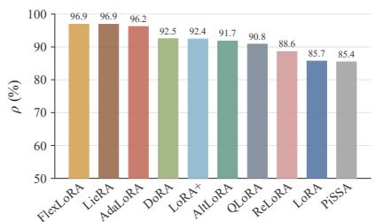
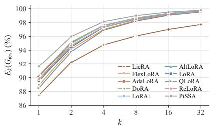
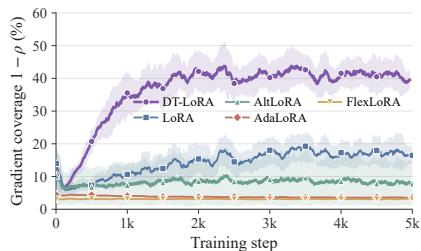
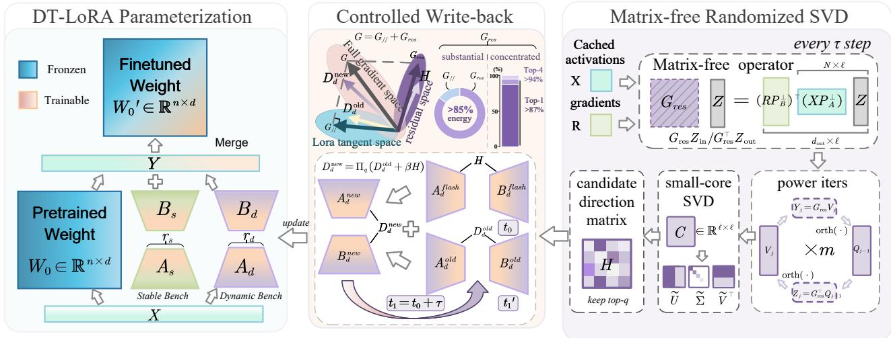

# DT-LoRA: Reaching Beyond the Tangent Space of Low-Rank Adaptation

Yangming Zhang1, Ling Yi1\*, Datong Li2, Jinliang Ding3, Xiaojie Wang1, Tiecheng Song1, Zhaolong Ning1

1Chongqing University of Posts and Telecommunications, China 2Anhui University of Science and Technology 3Northeastern University, China

## Abstract

Low-rank adaptation (LoRA) often underperformsfullfinetuning. We investigate this performance gap through a tangent-space lens: factorized updates are confined to the tangent space of the current low-rank factors, leaving gradient components outside this space unexploited. An analysis of ten representative LoRA variants reveals that these residual components account for most of the gradient energy and exhibit strong spectral concentration. Motivated by this finding, we propose Dynamic Tangent LoRA (DT-LoRA), which partitions a fixed rank budget into a stable branch and a dynamic branch to capture theprincipal residual gradient directions. We show that these directions define the optimal update of a local quadratic model under orthogonal-complement and rank constraints. Matrix-free randomized SVD recovers them without materializing the residual gradient, while controlled write-back preserves accumulated updates and stabilizes training within the allocated rank. DT-LoRA adds no trainable parameters or inference cost over LoRA. Experiments across computer vision and natural language processing tasks demonstrate consistent improvements over LoRA and its variants. Moreover, despite being a general-purpose adaptation method, DT-LoRA outperforms task-specific approaches to openvocabulary domain generalization for semantic segmentation, achieving state-of-the-art results. Code is available at https://github.com/Snipine/DT-LoRA.

## 1. Introduction

Large-scale pre-trained models serve as general-purpose foundations for a wide range of vision and language tasks. However, as model sizes increase, full fine-tuning becomes prohibitively expensive, requiring all model parameters to be updated and a separate set of weights to be stored for each downstream task. Parameter-efficient fine-tuning (PEFT) reduces this cost by freezing the pre-trained weights and optimizing only a small set of parameters [11, 14, 17]. Among PEFT methods, low-rank adaptation (LoRA) [12] has been widely adopted for its low-rank parameterization of weight updates, which can be merged into the pre-trained weights without additional inference overhead.

Nevertheless, LoRA often falls short of full fine-tuning. Prior work narrows this gap by modifying the update structure (DoRA [25]), improving subspace initialization (PiSSA [26], LoRA-GA [35]), or correcting the factor gradients and optimizer states to better approximate full finetuning updates (LoRA-Pro [36], AltLoRA [41], LoFT [31]). However, a fundamental local constraint remains: under factor perturbations δA and δB, the first-order weight update lies entirely in the tangent space defined by the current factors. The dense gradient component orthogonal to this space therefore cannot be captured by any first-order update, regardless of how the factor gradients are corrected at the current step.

This raises a question: how much gradient information lies outside the current tangent space? We analyze the tangent-space residual gradient across ten representative LoRA variants (Fig. 1) and identify two consistent properties. First, the residual accounts for more than 85% of the total gradient energy across all methods. Second, it exhibits strong spectral concentration: the leading singular component captures more than 87% of the residual energy, while the top four capture more than 94%. These findings reveal that the current tangent space leaves substantial gradient information unexploited, yet most of this information can be recovered through a very low-rank approximation.

A natural idea to exploit the residual gradient is to continually incorporate its principal directions into the trainable subspace. However, increasing the rank incurs a proportional parameter cost, whereas replacing existing factors at a fixed rank can discard accumulated adaptation information and disrupt training continuity. ReLoRA [20],

Flora [8], and GaLore [47] also switch low-rank subspaces during training, primarily to overcome rank limitations or reduce training memory, but do not explicitly target gradient components outside the current tangent space. The key challenge is therefore to incorporate these principal residual directions within a fixed rank budget while retaining learned information, maintaining training stability, and preserving mergeability into the pre-trained weights.

To address this challenge, we propose Dynamic Tangent LoRA (DT-LoRA), which partitions a fixed rank budget into a stable branch that accumulates task-specific directions as in standard LoRA and a dynamic branch that periodically absorbs principal residual directions outside the current tangent space. We prove that, under orthogonalcomplement and rank constraints, the optimal update for a local quadratic model is given by the truncated SVD of the tangent-space residual gradient. Crucially, this residual inherits a factored structure from backpropagation, enabling its products with narrow matrices to be computed directly from cached input activations and output gradients. This structure allows us to construct matrix-free operators for Matrix-Free Randomized SVD, which extracts the principal residual directions via randomized SVD [7] without explicitly forming the residual gradient. To incorporate these directions while maintaining training stability, we introduce Controlled Write-back mechanism, which merges them with the current dynamic branch update, compresses the result back to the original rank, and bounds the relative change at each refresh. After training, both branches are merged into the pre-trained weights, yielding the same inference cost as standard LoRA.

We evaluate DT-LoRA across diverse vision and language tasks: the 19 image classification tasks in VTAB-1K; object detection and instance segmentation on MS COCO; open-vocabulary domain generalization for semantic segmentation (OVDG-SS) in both real-to-real and synthetic-to-real settings; eight commonsense reasoning tasks using LLaMA2-7B and LLaMA3-8B; and GLUE using DeBERTaV3-base. Under matched trainable parameter budgets, DT-LoRA consistently outperforms LoRA and its variants. On MS COCO, DT-LoRA at r = 16 achieves an average score of 46.6, exceeding LoRA at the same rank by 8.2 points and outperforming LieRA [29], which uses twice as many trainable parameters. On OVDG-SS, DT-LoRA establishes new state-of-the-art results, surpassing the taskspecific S2-Corr [46] despite being a general-purpose finetuning method.

Our main contributions are summarized as follows:

• We identify a geometric limitation of factorized LoRA: substantial gradient energy lies outside the current tangent space. Across ten representative LoRA variants, we show that this tangent-space residual exhibits strong spectral concentration, and establish that its truncated SVD yields the optimal update under orthogonal-complement and rank constraints for a local quadratic model.

• We propose DT-LoRA, which partitions a fixed rank budget into Stable and Dynamic branches to incorporate principal residual directions. Matrix-Free Randomized SVD extracts these directions without materializing the residual gradient, while Controlled Write-back integrates them with accumulated updates and bounds the change at each refresh, enabling dynamic tangent-space adaptation without additional trainable parameters or inference overhead.

• We demonstrate the effectiveness of DT-LoRA across diverse vision and language tasks, with consistent improvements over LoRA and its variants under matched trainable parameter budgets. On OVDG-SS, DT-LoRA outperforms task-specific methods and establishes new stateof-the-art results.

## 2. Related Work

## 2.1. Parameter-Efficient Fine-Tuning

To avoid the memory and storage costs of full fine-tuning, PEFT freezes the pre-trained backbone and trains only a small number of parameters. Early methods can be roughly divided into three categories. The first category inserts additional trainable modules into the network, such as Adapter [11], which adds bottleneck modules sequentially within Transformer layers, and AdaptFormer [3], which places them in parallel with the MLP. The second category introduces learnable continuous prompts into the input or intermediate representations, such as Prompt Tuning [17], Prefix-Tuning [18], and VPT [14] for vision Transformers. The third category tunes only a subset of the model parameters or features, such as BitFit [1], which fine-tunes only the bias terms, and SSF [21], which scales and shifts the features. However, the first two categories retain extra modules or prompt tokens at inference, adding inference overhead, while the third offers limited flexibility for adaptation. In contrast, reparameterization methods such as LoRA [12] represent the weight update with low-rank matrices that can be merged into the pre-trained weights after training, balancing expressiveness and deployment efficiency.

## 2.2. Low-Rank Adaptation and Its Variants

Subsequent work improves LoRA mainly in three aspects. The first concerns the structure of the update and rank allocation: DoRA [25] decomposes the weight into magnitude and direction and updates the direction in low-rank form; LieRA [29] extends low-rank updates to high-dimensiona parameters such as convolution kernels via the exponential map of Lie groups; AdaLoRA [44] and FlexLoRA [24] dynamically allocate the rank budget across layers according to matrix importance. The second concerns the choice of the low-rank subspace: PiSSA [26] initializes the adapter with the principal singular components of the pre-trained weights, MiLoRA [34] and SoMA [42] instead select the minor singular components to reduce interference with pretrained knowledge, and LoRA-GA [35] aligns the initial update direction with the gradient of full fine-tuning. However, these methods determine the subspace only at the beginning of training. The third concerns the optimization process: LoRA-Pro [36] and AltLoRA [41] correct the factor gradients so that the induced equivalent gradient better approximates the full fine-tuning gradient, and LoFT [31] further aligns the moment estimates of the optimizer. Nevertheless, the first-order updates of these methods remain confined to the tangent space determined by the current factors, leaving the gradient components outside it unexploited. ReLoRA [20], Flora [8], and GaLore [47] switch subspaces by periodically restarting the low-rank update, resampling projections, or updating the projection subspace via the SVD of the gradient, respectively. However, they either discard the learned low-rank factors, rely on random sampling, or target full-parameter training rather than mergeable adapters, and none of them explicitly consider the residual gradients outside the current tangent space.

  
(a) Residual-gradient energy ratio ρ.

  
(b) Top-k residual spectral energy $E _ { k } .$

  
(c) Gradient coverage during training.  
Figure 1. Analysis of the tangent-space residual gradient. (a) Tangent-space residual gradient energy ratio $\rho$ of ten LoRA variants. (b) Cumulative spectral energy $E _ { k }$ of the tangent-space residual gradient. (c) Gradient coverage $1 - \rho$ of four LoRA variants and DT-LoRA during training. For various LoRA variants, the tangent-space residual gradient accounts for a large proportion of the gradient energy and exhibits spectral concentration. Our DT-LoRA explicitly accounts for this property, and its gradient coverage keeps increasing during training, indicating that the principal directions of the tangent-space residual gradient are effectively exploited.

## 3. Motivation

## 3.1. Preliminaries

We first review LoRA. Consider a linear projection layer in a pre-trained model, and denote its frozen pre-trained weight by $W _ { 0 } ~ \in ~ \mathbb { R } ^ { d _ { \mathrm { o u t } } \times d _ { \mathrm { i n } } }$ . Instead of updating $W _ { 0 }$ directly, standard LoRA adds a low-rank update to it:

$$
W = W _ { 0 } + D , \qquad D = s B A ,\tag{1}
$$

where $A \in \mathbb { R } ^ { r \times d _ { \mathrm { i n } } }$ and $B \in \mathbb { R } ^ { d _ { \mathrm { o u t } } \times r }$ are trainable factors, r is the factor width, and $s = \alpha / r$ is a scaling factor. Since rank $( D ) \leq r .$ , this parameterization represents a low-rank weight update with $r ( d _ { \mathrm { i n } } + d _ { \mathrm { o u t } } )$ parameters.

## 3.2. Tangent-Space Residual of Factorized LoRA

LoRA’s low-rank parameterization constrains both the rank of the weight update and the gradient directions accessible at each optimization step. Under infinitesimal perturbations δA and δB of the factors in Eq. (1), the first-order change in the weight update is

$$
\delta D = s \big ( B \delta A + \delta B A \big ) .\tag{2}
$$

The set of all such changes defines the tangent space $\tau$ induced by the current LoRA factors, $i . e .$ , the weight directions accessible to first order through factor updates. Thus, under the Frobenius inner product, a direction $\Delta$ is orthogonal to $\tau$ if and only if $B ^ { \bar { \top } } \Delta = 0$ and $\Delta A ^ { \top } = 0$

At a probe step, let $X \in \mathbb { R } ^ { N \times d _ { \mathrm { i n } } }$ denote the layer’s input activations and $\bar { R } = { \partial \mathcal { L } } / { \partial Y } \in \mathbb { R } ^ { N \times d _ { \mathrm { o u t } } }$ the corresponding output gradients from the same backward pass, where $Y =$ $X \bar { W } ^ { \top }$ and $\mathcal { L }$ is the training loss. We define the normalized local weight gradient estimate as the token-averaged outer product:

$$
G = \frac { 1 } { N } R ^ { \top } X .\tag{3}
$$

Let $Q _ { A } = \operatorname { o r t h } ( A ^ { \top } )$ and $Q _ { B } = \mathrm { o r t h } ( B )$ be orthonormal bases for the row space of A and the column space of $B ,$ respectively. The orthogonal projectors onto their complementary subspaces are

$$
P _ { A } ^ { \perp } = I - Q _ { A } Q _ { A } ^ { \top } , \qquad P _ { B } ^ { \perp } = I - Q _ { B } Q _ { B } ^ { \top } .\tag{4}
$$

We define the tangent-space residual gradient as the component of the local gradient orthogonal to the current tangent space:

$$
G _ { \mathrm { r e s } } = P _ { B } ^ { \perp } G P _ { A } ^ { \perp } = \frac { 1 } { N } ( R P _ { B } ^ { \perp } ) ^ { \top } ( X P _ { A } ^ { \perp } ) .\tag{5}
$$

By construction, $Q _ { B } ^ { \top } G _ { \mathrm { r e s } } = 0$ and $G _ { \mathrm { r e s } } Q _ { A } = 0$ . Thus, for every first-order change $\delta D \in { \mathcal { T } }$ , we have

$$
\langle G _ { \mathrm { r e s } } , \delta D \rangle _ { F } = 0 ,\tag{6}
$$

where $\langle \cdot , \cdot \rangle _ { F }$ denotes the Frobenius inner product. Since $G - G _ { \mathrm { r e s } } \in { \mathcal { T } } , G _ { \mathrm { r e s } }$ is precisely the orthogonal projection of G onto $\mathcal { T } ^ { \perp }$ , i.e., the gradient component inaccessible to first-order updates of the current factors.

## 3.3. Empirical Analysis of Gradient Coverage

We quantify gradient coverage by the current tangent space during training. Taking CAT-Seg fine-tuning as an example, we analyze the query, key, value, and output projections across all layers of the vision and text encoders, 144 matrices in total. At each probe step, we compute the local gradient $G _ { i }$ of the i-th matrix by Eq. (3) and its residual $G _ { \mathrm { r e s } , i }$ by Eq. (5). For each LoRA variant, we define the residual with respect to the tangent space induced by its own parameterization. We measure the residual energy ratio and cumulative residual spectral energy as

$$
\rho = \frac { \sum _ { i } \Vert G _ { \mathrm { r e s } , i } \Vert _ { F } ^ { 2 } } { \sum _ { i } \Vert G _ { i } \Vert _ { F } ^ { 2 } } , \qquad E _ { k } ( G _ { \mathrm { r e s } } ) = \frac { \sum _ { i } \sum _ { j = 1 } ^ { k } \sigma _ { j } ^ { 2 } ( G _ { \mathrm { r e s } , i } ) } { \sum _ { i } \Vert G _ { \mathrm { r e s } , i } \Vert _ { F } ^ { 2 } } .\tag{7}
$$

where $\sigma _ { j } ( \cdot )$ denotes the j-th singular value. The ratio $\rho$ measures the fraction of gradient energy outside the current tangent space, while $1 - \rho$ measures its coverage. The quantity $E _ { k }$ measures the fraction of residual energy captured by retaining the top-k singular components of each matrix. We compute both metrics by aggregating energies across all matrices at each probe step, then average the resulting ratios over probe steps.

Fig. 1 reveals two consistent phenomena across ten LoRA variants. First, the residual accounts for a substantial fraction of gradient energy: $\rho$ exceeds 85% for every method (Fig. 1a), ranging from 85.4% for PiSSA to approximately 96.9% for FlexLoRA and LieRA, with standard LoRA at 85.7%. Improved parameterizations thus do not consistently improve tangent-space gradient coverage, and some even leave more energy outside the tangent space. Second, the residual exhibits strong spectral concentration: $E _ { 1 }$ exceeds 87% and $E _ { 4 }$ exceeds 94% for all methods (Fig. 1b).

The high residual energy ratio reveals substantial gradient information inaccessible to first-order updates, while its spectral concentration suggests that most of this information can be captured at a low rank. Motivated by these findings, DT-LoRA tracks the dominant residual directions during training and incorporates them through a dedicated low-rank branch.

## 4. Method

DT-LoRA splits a fixed rank budget into a Stable branch that accumulates task-specific directions and a Dynamic branch that periodically absorbs the principal directions of the tangent-space residual gradient (Fig. 2).

Every τ steps, Matrix-Free Randomized SVD extracts the top-q residual directions directly from cached activations X and output gradients R, without explicitly forming $G _ { \mathrm { r e s } } .$ . Controlled Write-back then integrates these directions into the Dynamic branch. At all other steps, both branches follow standard LoRA updates.

## 4.1. Dual-Branch Parameterization

For each adapted layer, we parameterize the weight update using two branches:

$$
W = W _ { 0 } + D _ { s } + D _ { d } , \qquad D _ { s } = s B _ { s } A _ { s } , \quad D _ { d } = s B _ { d } A _ { d } ,\tag{8}
$$

where $A _ { s } , B _ { s }$ and $A _ { d } , B _ { d }$ are the factors of the Stable and Dynamic branches, with widths $r _ { s }$ and $r _ { d } = q$ and a fixed total width $r = r _ { s } + r _ { d } . $ . Both branches are trained as standard LoRA, but only the Dynamic branch is refreshed. The Stable branch retains the learned directions, while the Dynamic branch reserves a fixed capacity for new ones. Since the tangent space is determined by both branches, we compute $G _ { \mathrm { r e s } }$ by substituting the concatenated factors

$$
A = \left[ \begin{array} { l } { A _ { s } } \\ { A _ { d } } \end{array} \right] , \qquad B = \left[ \begin{array} { l l } { B _ { s } } & { B _ { d } } \end{array} \right] .\tag{9}
$$

## 4.2. Closed-Form Low-Rank Residual Update

The strong spectral concentration of the tangent-space residual gradient motivates a low-rank update along its principal directions. We seek this update in the orthogonal complement of the current tangent space, ${ \cal T } ^ { \bot } = \bar  \{ \Delta \ : \Delta =$ $\bar { P } _ { B } ^ { \perp } \Delta P _ { A } ^ { \perp } \}$ . By Eq. (5), $G _ { \mathrm { r e s } } \in \mathcal { T } ^ { \perp }$ . We therefore formulate the following optimization problem over this space.

Proposition 4.1 (Optimal low-rank update in the residual space). Given a step size $\eta > 0$ and a target rank $q ,$ consider the local quadratic model in the residual space $\mathcal { T } ^ { \perp }$

$$
\operatorname* { m i n } _ { \mathrm { \ r { r a n k } } ( \Delta ) \le q } \langle G _ { \mathrm { r e s } } , \Delta \rangle _ { F } + \frac { 1 } { 2 \eta } \| \Delta \| _ { F } ^ { 2 } .\tag{10}
$$

The optimal solution to this problem is

$$
\Delta ^ { \star } = - \eta [ G _ { \mathrm { r e s } } ] _ { q } ,\tag{11}
$$

where $[ G _ { \mathrm { r e s } } ] _ { q }$ denotes the rank-q truncated SVD of $G _ { \mathrm { r e s } } .$

Proof. Completing the square gives

$$
\langle G _ { \mathrm { r e s } } , \Delta \rangle _ { F } + \frac { 1 } { 2 \eta } \| \Delta \| _ { F } ^ { 2 } = \frac { 1 } { 2 \eta } \| \Delta + \eta G _ { \mathrm { r e s } } \| _ { F } ^ { 2 } - \frac { \eta } { 2 } \| G _ { \mathrm { r e s } } \| _ { F } ^ { 2 } .\tag{12}
$$

  
Figure 2. Overview of DT-LoRA. A fixed rank budget is split into a Stable branch and a Dynamic branch. Every τ steps, Matrix-Free Randomized SVD extracts the principal directions of the tangent-space residual gradient from the cached activations X and output gradients R, yielding a candidate update H. Controlled Write-back then merges H into the Dynamic branch, keeping the branch at rank q. Afte training, both branches are merged into the pre-trained weights, so inference costs the same as LoRA.

Dropping the constant term, Eq. (10) is equivalent to

$$
\operatorname* { m i n } _ { \mathrm { \Gamma } ^ { \mathrm { a n k } ( \Delta ) \leq q } } \| \Delta + \eta G _ { \mathrm { r e s } } \| _ { F } ^ { 2 } .\tag{13}
$$

By the Eckart–Young theorem [6], the optimal solution without the constraint $\Delta \in { \mathcal { T } } ^ { \perp } { \mathrm { i s } } - \eta [ G _ { \mathrm { r e s } } ] _ { q }$ . Since $G _ { \mathrm { r e s } } \in$ $\mathcal { T } ^ { \perp }$ , its left and right singular vectors lie in the ranges of $P _ { B } ^ { \perp }$ and $P _ { A } ^ { \perp }$ , respectively. Hence $[ G _ { \mathrm { r e s } } ] _ { q } ~ \in ~ \mathcal { T } ^ { \perp }$ , making $- \eta [ G _ { \mathrm { r e s } } ] _ { q }$ feasible and therefore the optimal solution of Eq. (10). □

## 4.3. Matrix-Free Randomized SVD

Eq. (11) requires the truncated SVD of $G _ { \mathrm { r e s } } .$ , but explicitly forming and decomposing this matrix is costly. The key observation is that $G _ { \mathrm { r e s } }$ never needs to be formed: by Eq. (5), its action on any narrow matrix reduces to products with the cached X and R. We exploit this structure to derive matrix-free operators (Proposition 4.2) and use them to drive randomized SVD [7], which gives Matrix-Free Randomized SVD.

Lemma 4.2 (Matrix-free operators). Given $X \_ { \in }$ $\mathbb { R } ^ { N \times d _ { \mathrm { i n } } } , R \in \mathbb { R } ^ { N \times d _ { \mathrm { o u t } } } , P _ { A } ^ { \perp }$ , and $P _ { B } ^ { \perp }$ , for any $Z _ { \mathrm { i n } } ~ \in$ $\mathbb { R } ^ { d _ { \mathrm { i n } } \times \ell }$ and $Z _ { \mathrm { o u t } } \in \mathbb { R } ^ { d _ { \mathrm { o u t } } \times \ell }$

$$
\begin{array} { c } { G _ { \mathrm { r e s } } Z _ { \mathrm { i n } } = \displaystyle \frac { 1 } { N } ( R P _ { B } ^ { \perp } ) ^ { \top } \big ( X P _ { A } ^ { \perp } Z _ { \mathrm { i n } } \big ) , } \\ { G _ { \mathrm { r e s } } ^ { \top } Z _ { \mathrm { o u t } } = \displaystyle \frac { 1 } { N } ( X P _ { A } ^ { \perp } ) ^ { \top } \big ( R P _ { B } ^ { \perp } Z _ { \mathrm { o u t } } \big ) , } \end{array}\tag{14}
$$

each computed in $\mathcal { O } ( N \ell d )$ time with $\mathcal { O } ( ( N { + } d ) \ell )$ extra memory, where $d = \operatorname* { m a x } ( d _ { \mathrm { i n } } , d _ { \mathrm { o u t } } )$

Eq. (14) follows from expanding Eq. (5). Evaluated from right to left, each product involves only narrow intermediates of sizes $d \times \ell$ and $N \times \ell .$ Let $\ell = q + p$ with oversampling parameter p. We draw a Gaussian random matrix $\Omega \in \mathbb { R } ^ { d _ { \mathrm { i n } } \times \ell }$ and form $Y _ { 0 } = G _ { \mathrm { r e s } } \Omega$ to obtain a randomized sketch of the dominant left singular subspace. To improve approximation accuracy, we perform m power iterations, with intermediate orthogonalization for numerical stability:

$$
\begin{array} { r l } & { Q _ { j - 1 } = \mathrm { o r t h } ( Y _ { j - 1 } ) , \quad Z _ { j } = G _ { \mathrm { r e s } } ^ { \top } Q _ { j - 1 } , } \\ & { \qquad V _ { j } = \mathrm { o r t h } ( Z _ { j } ) , \quad Y _ { j } = G _ { \mathrm { r e s } } V _ { j } , \qquad j = 1 , \ldots , m , } \end{array}\tag{15}
$$

where $\mathrm { o r t h } ( \cdot )$ returns an orthonormal basis via QR decomposition. We then construct $Q _ { U } ~ = ~ \operatorname { o r t h } ( Y _ { m } )$ and $Q _ { V } \ = \ \mathrm { o r t h } ( G _ { \mathrm { r e s } } ^ { \top } Q _ { U } )$ , and form the core matrix ${ \cal { C } } = $ $Q _ { U } ^ { \top } G _ { \mathrm { r e s } } Q _ { V } \ \in \ \mathbb { R } ^ { \ell \times \ell }$ . After computing its SVD, ${ \cal { C } } = $ $\widetilde { U } { \widetilde { \Sigma } } \widetilde { V } ^ { \top }$ , we recover a rank-q candidate descent direction:

$$
\begin{array} { r } { H = - Q _ { U } \widetilde U _ { [ : , 1 : q ] } \widetilde \Sigma _ { [ 1 : q , 1 : q ] } \widetilde V _ { [ : , 1 : q ] } ^ { \top } Q _ { V } ^ { \top } \approx - [ G _ { \mathrm { r e s } } ] _ { q } . } \end{array}\tag{16}
$$

All products involving $G _ { \mathrm { r e s } }$ or $G _ { \mathrm { r e s } } ^ { \top }$ are evaluated by Eq. (14), requiring $2 m + 3$ operator calls in total, so each refresh costs $\mathcal { O } ( N q d )$ for small constants m and $p .$ . This procedure has three advantages: (i) it never stores $G _ { \mathrm { r e s } } .$ , which requires $\mathcal { O } ( d _ { \operatorname* { m i n } } d )$ memory with $d _ { \operatorname* { m i n } } \ = \ \operatorname* { m i n } ( d _ { \operatorname { i n } } , d _ { \operatorname { o u t } } ) ;$ (ii) it performs SVD only on the $\ell \times \ell$ core matrix; and (iii) it reuses the cached X and R without additional forward or backward passes.

Table 1. Accuracy (%) on VTAB-1K across natural, specialized, and structured tasks. In all result tables, our method is shaded in gray and the best results are in bold.
<table><tr><td rowspan=2 colspan=1>Method    Param. (M)</td><td rowspan=1 colspan=1>Natural</td><td rowspan=1 colspan=1>Specialized</td><td rowspan=1 colspan=1>Structured</td><td rowspan=2 colspan=1>Avg.</td></tr><tr><td rowspan=1 colspan=1>Ciar10  Cat101       FIw102       NHAS Sung7DTDPets</td><td rowspan=1 colspan=1>Cayon             ReiupopthyEoSATResisc45</td><td rowspan=1 colspan=1>Clevr-Count                            SNO-imCle-DistKIT-Tist  SNOR-EIEDMabd&#x27;p-ocdp-rri</td></tr><tr><td rowspan=1 colspan=1>Full FT       85.8Linear         0</td><td rowspan=1 colspan=1>68.987.764.397.286.984.738.864.485.063.297.086.336.651.0</td><td rowspan=1 colspan=1>79.795.784.273.978.587.568.574.0</td><td rowspan=1 colspan=1>56.358.641.765.557.546.725.729.134.330.633.255.412.520.09.619.2</td><td rowspan=1 colspan=1>68.957.6</td></tr><tr><td rowspan=1 colspan=1>Adapter [11]     0.16</td><td rowspan=1 colspan=1>69.290.168.098.889.982.854.3</td><td rowspan=1 colspan=1>84.094.981.975.5</td><td rowspan=2 colspan=1>80.965.348.678.374.848.529.941.681.964.349.380.376.345.731.741.1</td><td rowspan=2 colspan=1>73.974.7</td></tr><tr><td rowspan=1 colspan=1>AdaptFormer [3]   0.16</td><td rowspan=1 colspan=1>70.891.270.599.190.986.654.8</td><td rowspan=1 colspan=1>83.095.884.476.3</td></tr><tr><td rowspan=1 colspan=1>AdaLoRA [44]    0.37</td><td rowspan=1 colspan=1>70.590.371.999.191.487.056.0</td><td rowspan=1 colspan=1>83.995.385.675.2</td><td rowspan=1 colspan=1>81.668.151.880.275.349.128.941.1</td><td rowspan=1 colspan=1>75.1</td></tr><tr><td rowspan=1 colspan=1>NOAH [45]     0.36</td><td rowspan=1 colspan=1>69.692.770.299.190.486.153.7</td><td rowspan=1 colspan=1>84.495.483.975.8</td><td rowspan=1 colspan=1>82.868.949.981.781.848.332.844.2</td><td rowspan=2 colspan=1>75.575.7</td></tr><tr><td rowspan=1 colspan=1>SSF [21]       0.24</td><td rowspan=1 colspan=1>69.092.675.199.491.890.252.9</td><td rowspan=1 colspan=1>87.495.987.475.5</td><td rowspan=1 colspan=1>75.962.353.380.677.354.929.537.9</td></tr><tr><td rowspan=1 colspan=1>LoRA [12]      0.34</td><td rowspan=1 colspan=1>69.692.570.599.090.189.953.7</td><td rowspan=1 colspan=1>85.995.887.575.8</td><td rowspan=1 colspan=1>82.964.553.481.382.748.131.836.8</td><td rowspan=1 colspan=1>75.7</td></tr><tr><td rowspan=1 colspan=1>PiSSA [26]      0.31</td><td rowspan=1 colspan=1>69.492.372.499.091.389.654.6</td><td rowspan=1 colspan=1>86.795.886.475.7</td><td rowspan=1 colspan=1>81.865.954.180.481.045.029.841.4</td><td rowspan=1 colspan=1>75.8</td></tr><tr><td rowspan=1 colspan=1>DoRA [25]      0.34</td><td rowspan=1 colspan=1>70.091.971.399.090.088.755.5</td><td rowspan=1 colspan=1>85.495.586.876.5</td><td rowspan=1 colspan=1>82.566.553.080.382.546.830.141.9</td><td rowspan=1 colspan=1>75.8</td></tr><tr><td rowspan=1 colspan=1>FlexLoRA [24]    0.34</td><td rowspan=1 colspan=1>71.292.572.199.190.790.654.7</td><td rowspan=1 colspan=1>86.4 96.087.576.0</td><td rowspan=1 colspan=1>81.965.653.980.280.645.629.941.1</td><td rowspan=1 colspan=1>76.0</td></tr><tr><td rowspan=1 colspan=1>DT-LoRA      0.34</td><td rowspan=1 colspan=1>71.594.370.799.091.286.555.2</td><td rowspan=1 colspan=1>87.295.284.572.7</td><td rowspan=1 colspan=1>83.762.751.882.884.951.737.044.9</td><td rowspan=1 colspan=1>76.2</td></tr></table>

Table 2. Object detection and instance segmentation results of fine-tuned ConvNeXt-V2-B on MS COCO.
<table><tr><td rowspan="2">Method</td><td rowspan="2"># Params (M)</td><td colspan="6">Detection</td><td colspan="6">Instance Segmentation</td><td rowspan="2">All Avg.</td></tr><tr><td>mAP</td><td> $\overline { { \mathrm { A P } _ { 5 0 } } }$ </td><td> $\overline { { \mathrm { A P } _ { 7 5 } } }$ </td><td> $\overline { { \mathsf { A P } _ { S } } }$ </td><td> $\overline { { \mathsf { A P } _ { M } } }$ </td><td> $\overline { { \mathsf { A P } _ { L } } }$ </td><td>mAP</td><td> $\overline { { \mathrm { A P } _ { 5 0 } } }$ </td><td> $\overline { { \mathsf { A P } _ { 7 5 } } }$ </td><td> $\overline { { \mathsf { A P } _ { S } } }$ </td><td> $\overline { { \mathsf { A P } _ { M } } }$   $\overline { { \mathsf { A P } _ { L } } }$ </td><td></td></tr><tr><td>Full FT</td><td>104.97</td><td>49.0</td><td>69.1</td><td>54.6</td><td>31.7</td><td>53.5</td><td>61.7</td><td>43.4</td><td>66.2</td><td>47.6</td><td>23.4</td><td>47.1</td><td>60.9</td><td>50.7</td></tr><tr><td>LoRAr=16 [12]</td><td>17.27</td><td>35.5</td><td>55.9</td><td>38.9</td><td>22.7</td><td>38.4</td><td>45.1</td><td>33.6</td><td>53.1</td><td>36.3</td><td>17.4</td><td>35.9</td><td>48.2</td><td>38.4</td></tr><tr><td>LieRA [29]</td><td>17.27</td><td>39.1</td><td>59.9</td><td>43.1</td><td>25.9</td><td>42.6</td><td>49.2</td><td>37.0</td><td>57.6</td><td>40.2</td><td>20.1</td><td>40.0</td><td>53.2</td><td>42.3</td></tr><tr><td>DoRA [25]</td><td>17.27</td><td>39.7</td><td>60.6</td><td>43.6</td><td>25.3</td><td>43.2</td><td>51.4</td><td>37.2</td><td>57.9</td><td>40.1</td><td>19.4</td><td>40.2</td><td>53.9</td><td>42.7</td></tr><tr><td>DT-LoRA</td><td>17.27</td><td>44.1</td><td>65.2</td><td>48.2</td><td>28.7</td><td>47.9</td><td>56.5</td><td>40.3</td><td>62.6</td><td>43.6</td><td>21.9</td><td>43.5</td><td>57.1</td><td>46.6</td></tr><tr><td>LoRAr=32 [12]</td><td>34.54</td><td>35.9</td><td>56.4</td><td>39.7</td><td>22.9</td><td>39.6</td><td>45.7</td><td>34.4</td><td>54.2</td><td>37.1</td><td>18.3</td><td>36.7</td><td>48.9</td><td>39.2</td></tr><tr><td>DoRA [25]</td><td>34.54</td><td>40.3</td><td>61.1</td><td>44.2</td><td>24.1</td><td>44.0</td><td>52.2</td><td>37.4</td><td>58.4</td><td>40.6</td><td>18.5</td><td>40.2</td><td>53.6</td><td>42.9</td></tr><tr><td>LieRA [29]</td><td>34.54</td><td>40.5</td><td>61.2</td><td>45.1</td><td>25.3</td><td>44.1</td><td>50.8</td><td>38.2</td><td>58.9</td><td>41.8</td><td>19.8</td><td>41.2</td><td>53.9</td><td>43.4</td></tr><tr><td>DT-LoRA</td><td>34.54</td><td>45.3</td><td>66.0</td><td>49.7</td><td>28.9</td><td>49.3</td><td>57.7</td><td>41.1</td><td>63.5</td><td>44.5</td><td>22.5</td><td>44.7</td><td>58.3</td><td>47.6</td></tr></table>

## 4.4. Controlled Write-back

Directly replacing the Dynamic branch with candidate direction matrix H would discard accumulated adaptation information and could introduce abrupt changes in the model weights. We therefore introduce Controlled Writeback, which integrates H through adaptive injection scaling, merge-and-compress, and a relative-change constraint.

Let $D _ { d } ^ { \mathrm { o l d } }$ be the Dynamic branch update immediately before a refresh, and let $D _ { d } ^ { \mathrm { a n c h o r } }$ denote its state after the last accepted refresh. We measure the accumulated change since that refresh as

$$
w _ { d } = \left. \frac { D _ { d } ^ { \mathrm { o l d } } } { d } - D _ { d } ^ { \mathrm { a n c h o r } } \right. _ { F }\tag{17}
$$

measures how much the branch has changed since then, and we scale H accordingly:

$$
\beta = \frac { \rho _ { \mathrm { r e f r e s h } } w _ { d } } { \| H \| _ { F } + \varepsilon } ,\tag{18}
$$

where $\rho _ { \mathrm { r e f r e s h } } > 0$ controls the refresh ratio and $\varepsilon > 0$ ensures numerical stability. Since $H \approx - [ G _ { \mathrm { r e s } } ] _ { q }$ , the scaled candidate βH approximates the optimal residual-space update in Eq. (11), with $\beta$ serving as a layer-specific step size calibrated to the recent change in the Dynamic branch.

We then combine $\beta H$ with the accumulated update and compress the result to the allocated rank $q \colon$

$$
D _ { d } ^ { \mathrm { n e w } } = \Pi _ { q } \big ( D _ { d } ^ { \mathrm { o l d } } + \beta H \big ) ,\tag{19}
$$

where $\Pi _ { q }$ denotes a best rank-at-most-q approximation in the Frobenius norm. Since $D _ { d } ^ { \mathrm { o l d } }$ and H both have rank at most $q ,$ this compression can be performed via QR decompositions of their concatenated factors followed by an SVD of a core matrix of size at most $2 q \times 2 q$

To control the perturbation introduced by a refresh, we impose

$$
E _ { \mathrm { a c t u a l } } = D _ { d } ^ { \mathrm { n e w } } - D _ { d } ^ { \mathrm { o l d } } , \qquad { \frac { \| E _ { \mathrm { a c t u a l } } \| _ { F } } { \| D _ { d } ^ { \mathrm { o l d } } \| _ { F } + \varepsilon } } \le \rho _ { \mathrm { j u m p } } ,\tag{20}
$$

Table 3. Comparison of different methods across different backbones under the Real-to-Real OVDG-SS setting.
<table><tr><td rowspan="2">Method</td><td rowspan="2">Backbone</td><td rowspan="2">Training Data ACDC-19 BDD-19</td><td colspan="4">Dv-19</td><td colspan="5">Dv-58</td></tr><tr><td></td><td></td><td>Mapi-19</td><td>Avg.</td><td>ACDC-41 BDD-41</td><td></td><td>Mapi-30</td><td>RW-10</td><td>Avg.</td></tr><tr><td>OVSeg (CVPR&#x27;23) [22]</td><td></td><td>CS-7</td><td>36.6</td><td>40.9</td><td>45.8</td><td>41.1</td><td>41.2</td><td>48.3</td><td>31.7</td><td>32.6</td><td>38.5</td></tr><tr><td>SAN (CVPR’23) [39]</td><td></td><td>CS-7</td><td>37.6</td><td>39.4</td><td>44.0</td><td>40.3</td><td>44.3</td><td>46.8</td><td>35.4</td><td>30.7</td><td>39.3</td></tr><tr><td>CAT-Seg (CVPR’24) [4]</td><td></td><td>CS-7</td><td>38.9</td><td>44.0</td><td>47.6</td><td>43.5</td><td>47.6</td><td>51.6</td><td>38.2</td><td>36.5</td><td>43.5</td></tr><tr><td>MAFT+ (ECCV&#x27;24) [15]</td><td></td><td>CS-7</td><td>40.4</td><td>43.5</td><td>50.2</td><td>44.7</td><td>46.4</td><td>48.8</td><td>38.1</td><td>35.4</td><td>42.2</td></tr><tr><td>ESC-Net (CVPR’25) [16]</td><td></td><td>CS-7</td><td>40.4</td><td>43.6</td><td>45.9</td><td>43.3</td><td>47.3</td><td>49.2</td><td>40.1</td><td>34.5</td><td>42.7</td></tr><tr><td>MaskAdapter (CVPR&#x27;25) [19]</td><td></td><td>CS-7</td><td>38.9</td><td>47.7</td><td>49.9</td><td>45.5</td><td>48.3</td><td>51.2</td><td>39.8</td><td>36.1</td><td>43.8</td></tr><tr><td>CLIPSelf (ICLR’24) [37]</td><td></td><td>CS-7+COCO</td><td>43.6</td><td>45.6</td><td>47.9</td><td>45.7</td><td>49.4</td><td>54.3</td><td>39.6</td><td>36.5</td><td>45.0</td></tr><tr><td>RSC-CLIPSelf (ICLR’25) [28]</td><td></td><td>CS-7+COCO</td><td>41.5</td><td>46.3</td><td>50.2</td><td>46.0</td><td>50.0</td><td>53.0</td><td>40.1</td><td>35.1</td><td>44.5</td></tr><tr><td>CAT-Seg+AdvStyle</td><td>EVA02 [30]</td><td>CS-7</td><td>37.2</td><td>43.2</td><td>44.6</td><td>41.7</td><td>48.0</td><td>47.9</td><td>36.0</td><td>36.5</td><td>42.1</td></tr><tr><td>CAT-Seg+DGInStyle</td><td>ViT-B/16</td><td>CS-7</td><td>42.5</td><td>49.8</td><td>49.4</td><td>47.2</td><td>46.1</td><td>53.7</td><td>36.8</td><td>36.0</td><td>43.2</td></tr><tr><td>LoRA-ProCAT-Seg</td><td></td><td>CS-7</td><td>40.7</td><td>43.7</td><td>45.7</td><td>43.3</td><td>48.5</td><td>54.9</td><td>36.6</td><td>29.0</td><td>42.2</td></tr><tr><td>DoRA CAT-Seg</td><td></td><td>CS-7</td><td>44.9</td><td>46.5</td><td>53.8</td><td>48.4</td><td>53.3</td><td>57.8</td><td>42.6</td><td>37.4</td><td>47.8</td></tr><tr><td>SoMACAT-Seg</td><td></td><td>CS-7</td><td>44.5</td><td>46.6</td><td>53.8</td><td>48.3</td><td>52.3</td><td>57.5</td><td>42.0</td><td>39.7</td><td>47.9</td></tr><tr><td>LoRA CAT-Seg</td><td></td><td>CS-7</td><td>44.2</td><td>46.5</td><td>53.2</td><td>48.0</td><td>52.7</td><td>58.2</td><td>42.4</td><td>39.7</td><td>48.3</td></tr><tr><td>S2-Corr (CVPR’26) [46]</td><td></td><td>CS-7</td><td>44.6</td><td>50.1</td><td>56.2</td><td>50.3</td><td>52.3</td><td>58.6</td><td>42.0</td><td>38.6</td><td>47.9</td></tr><tr><td>DT-LoRACAT-Seg</td><td></td><td>CS-7</td><td>48.5 +9.6</td><td>48.6 +4.6</td><td>56.2 +8.6</td><td>51.1 +7.6</td><td>55.3 +7.7</td><td>59.5 +7.9</td><td>44.1 +5.9</td><td>39.0 +2.5</td><td>49.5 +6.0</td></tr><tr><td>CAT-Seg (CVPR’24) [4]</td><td></td><td>CS-7</td><td>48.5</td><td>48.5</td><td>50.8</td><td>49.3</td><td>59.2</td><td>60.0</td><td>41.1</td><td>39.5</td><td>50.0</td></tr><tr><td>MaskAdapter (CVPR&#x27;25) [19]</td><td></td><td>CS-7</td><td>48.1</td><td>49.4</td><td>54.6</td><td>50.7</td><td>59.7</td><td>59.7</td><td>41.8</td><td>36.1</td><td>49.3</td></tr><tr><td>CLIPSelf (ICLR’24) [37]</td><td></td><td>CS-7+COCO</td><td>51.1</td><td>53.0</td><td>55.7</td><td>53.3</td><td>61.3</td><td>60.3</td><td>44.7</td><td>39.8</td><td>51.5</td></tr><tr><td>CAT-Seg+DGInStyle</td><td></td><td>CS-7</td><td>50.4</td><td>51.7</td><td>50.4</td><td>50.8</td><td>60.2</td><td>60.8</td><td>43.5</td><td>38.7</td><td>50.8</td></tr><tr><td>LoRA-ProCAT-Seg</td><td>EVA02</td><td>CS-7</td><td>42.2</td><td>44.5</td><td>47.5</td><td>44.7</td><td>49.1</td><td>53.5</td><td>38.7</td><td>30.0</td><td>42.8</td></tr><tr><td>LoRA CAT-Seg</td><td>ViT-L/14</td><td>CS-7</td><td>51.2</td><td>50.9</td><td>55.7</td><td>52.6</td><td>53.6</td><td>54.1</td><td>44.2</td><td>43.9</td><td>49.0</td></tr><tr><td>SoMACAT-Seg</td><td></td><td>CS-7</td><td>48.5</td><td>48.7</td><td>50.7</td><td>49.3</td><td>52.3</td><td>56.6</td><td>41.3</td><td>40.0</td><td>47.5</td></tr><tr><td>PCA-Seg (CVPR’26) [40]</td><td></td><td>CS-7</td><td>53.8</td><td>53.7</td><td>57.5</td><td>55.0</td><td>60.9</td><td>60.3</td><td>50.3</td><td>39.0</td><td>52.6</td></tr><tr><td>S2-Corr (CVPR’26) [46]</td><td></td><td>CS-7</td><td>54.3</td><td>53.1</td><td>60.0</td><td>55.8</td><td>62.0</td><td>61.7</td><td>47.4</td><td>41.9</td><td>53.2</td></tr><tr><td>DoRA CAT-Seg</td><td></td><td>CS-7</td><td>55.7</td><td>55.6</td><td>59.9</td><td>57.1</td><td>62.3</td><td>61.5</td><td>50.3</td><td>44.1</td><td>54.6</td></tr><tr><td>DT-LoRAPCA-Seg</td><td></td><td>CS-7</td><td>55.8 +2.0</td><td>55.8 +2.1</td><td>60.5 +3.0</td><td>57.4+2.4</td><td>61.0 +0.1</td><td>61.1 +0.8</td><td>50.6 +0.3</td><td>47.9 +8.9</td><td>55.2+2.6</td></tr><tr><td>DT-LoRACAT-Seg</td><td></td><td>CS-7</td><td>58.9 +10.</td><td>57.3 +8.8</td><td>61.5 +10.</td><td>59.2 +9.9</td><td>63.8 +4.6</td><td>64.3 +4.3</td><td>51.7 +10.</td><td>44.5 +5.0</td><td>56.1 +6.1</td></tr></table>

where $\rho _ { \mathrm { j u m p } } > 0$ is the maximum allowed relative change. If the constraint is violated, we shrink $\beta$ and recompute Eq. (19). If no feasible $\beta$ satisfies the constraint within the prescribed backtracking limit, we skip the refresh and retain $D _ { d } ^ { \mathrm { o l d } }$ . Otherwise, we refactorize the accepted update as $D _ { d } ^ { \mathrm { n e w } } = s B _ { d } A _ { d }$ and set $D _ { d } ^ { \mathrm { a n c h o r } } = D _ { d } ^ { \mathrm { n e w } }$ . Under the smoothness assumptions stated in Section B, the constraint also bounds the changes in the loss and weight gradient induced by the refresh.

After each accepted refresh, we reset the Adam moment estimates associated with the Dynamic factors to account for their changed parameter coordinates. The Stable branch and its optimizer states remain unchanged by the refresh. Algorithm 1 summarizes the full procedure. After training, both branches are merged into the pre-trained weights:

$$
W _ { 0 } ^ { \prime } = W _ { 0 } + s ( B _ { s } A _ { s } + B _ { d } A _ { d } ) ,\tag{21}
$$

so the additional computation is confined to training, and inference uses a standard linear layer.

## 5. Experiments

We evaluate DT-LoRA on vision tasks spanning image classification, object detection, instance segmentation, and OVDG-SS, as well as language tasks covering commonsense reasoning and natural language understanding. We compare DT-LoRA with LoRA and representative variants across these tasks, and additionally with task-specific methods on OVDG-SS.

## 5.1. Experimental Setup

Datasets and Models. For image classification, we use VTAB-1K, which comprises 19 tasks across natural, specialized, and structured categories, each with 1,000 training examples. Following [38, 43], we adapt ViT-B/16 [5] pre-trained on ImageNet-21K. For object detection and instance segmentation, we follow LieRA [29] and fine-tune a ConvNeXt-V2-B backbone within Mask R-CNN [9] on MS COCO, using MMDetection [2].

For OVDG-SS, we adopt the benchmark protocol of $S ^ { 2 } \cdot$ Corr [46], training on CS-7 for real-to-real transfer or GTA-7 for synthetic-to-real transfer and reporting mIoU on two groups of unseen target domains, Dv-19 and Dv-58. We use EVA02-CLIP [30] encoders with ViT-B/16 and ViT-L/14 backbones within the CAT-Seg [4] and PCA-Seg [40] frameworks.

For commonsense reasoning, we follow [13] to fine-tune LLaMA2-7B and LLaMA3-8B on Commonsense170K and evaluate on the test sets of eight tasks, including BoolQ and PIQA. For natural language understanding, we fine-tune DeBERTaV3-base [10] on eight GLUE tasks [33]. Dataset details are provided in Sec. C.

Table 4. Comparison of different methods across different backbones under the Synthetic-to-Real OVDG-SS setting.
<table><tr><td rowspan="2">Method</td><td rowspan="2">Backbone</td><td rowspan="2">Training Data</td><td colspan="5">Dv-19</td><td colspan="5">Dv-58</td></tr><tr><td>CS-19</td><td>ACDC-19</td><td>BDD-19</td><td>Mapi-19</td><td>Avg.</td><td>ACDC-41 BDD-41</td><td></td><td>Mapi-30</td><td>RW-10</td><td>Avg.</td></tr><tr><td>OVSeg (CVPR’23) [22]</td><td></td><td>GTA-7</td><td>41.2</td><td>34.9</td><td>42.5</td><td>45.1</td><td>40.9</td><td>45.1</td><td>52.6</td><td>35.5</td><td>32.9</td><td>41.5</td></tr><tr><td>SAN (CVPR’23) [39]</td><td></td><td>GTA-7</td><td>43.3</td><td>36.7</td><td>42.0</td><td>48.1</td><td>42.5</td><td>47.7</td><td>49.0</td><td>37.8</td><td>30.3</td><td>41.2</td></tr><tr><td>CAT-Seg (CVPR’24) [4]</td><td></td><td>GTA-7</td><td>43.7</td><td>37.6</td><td>45.4</td><td>48.8</td><td>43.9</td><td>51.2</td><td>56.2</td><td>39.3</td><td>35.7</td><td>45.6</td></tr><tr><td>MAFT+ (ECCV&#x27;24) [15]</td><td></td><td>GTA-7</td><td>45.7</td><td>38.5</td><td>43.7</td><td>50.2</td><td>44.5</td><td>49.1</td><td>48.3</td><td>39.9</td><td>31.8</td><td>42.3</td></tr><tr><td>ESC-Net (CVPR’25) [16]</td><td></td><td>GTA-7</td><td>42.2</td><td>35.9</td><td>44.6</td><td>48.1</td><td>42.7</td><td>49.4</td><td>52.4</td><td>37.9</td><td>33.3</td><td>43.3</td></tr><tr><td>MaskAdapter (CVPR&#x27;25) [19]</td><td></td><td>GTA-7</td><td>46.0</td><td>36.4</td><td>45.7</td><td>50.1</td><td>44.6</td><td>50.1</td><td>49.2</td><td>38.1</td><td>32.7</td><td>42.5</td></tr><tr><td>CLIPSelf (ICLR’24) [37]</td><td></td><td>GTA-7+COCO</td><td>48.1</td><td>37.6</td><td>47.9</td><td>51.1</td><td>46.2</td><td>50.6</td><td>52.1</td><td>40.4</td><td>34.6</td><td>44.4</td></tr><tr><td>RSC-CLIPSelf (ICLR’25) [28]</td><td></td><td>GTA-7+COCO</td><td>46.2</td><td>37.9</td><td>46.0</td><td>51.6</td><td>45.4</td><td>51.1</td><td>50.7</td><td>40.3</td><td>32.0</td><td>43.5</td></tr><tr><td>CAT-Seg+AdvStyle</td><td>EVA02</td><td>GTA-7</td><td>44.9</td><td>38.2</td><td>43.8</td><td>51.1</td><td>44.5</td><td>49.2</td><td>54.2</td><td>39.1</td><td>34.3</td><td>44.2</td></tr><tr><td>CAT-Seg+DGInStyle</td><td>ViT-B/16</td><td>GTA-7</td><td>44.4</td><td>39.1</td><td>48.1</td><td>51.4</td><td>45.8</td><td>50.7</td><td>55.9</td><td>39.6</td><td>34.0</td><td>45.1</td></tr><tr><td>SoMACAT-Seg</td><td></td><td>GTA-7</td><td>44.7</td><td>39.8</td><td>45.6</td><td>52.1</td><td>45.6</td><td>50.6</td><td>56.2</td><td>41.4</td><td>30.5</td><td>44.7</td></tr><tr><td>LoRA CAT-Seg</td><td></td><td>GTA-7</td><td>44.6</td><td>40.1</td><td>45.8</td><td>51.7</td><td>45.6</td><td>51.7</td><td>57.0</td><td>41.1</td><td>31.9</td><td>45.4</td></tr><tr><td>LoRA-ProCAT-Seg</td><td></td><td>GTA-7</td><td>39.5</td><td>36.9</td><td>42.9</td><td>46.6</td><td>41.5</td><td>46.9</td><td>54.6</td><td>34.1</td><td>26.4</td><td>40.5</td></tr><tr><td>DoRACAT-Seg</td><td></td><td>GTA-7</td><td>45.3</td><td>40.1</td><td>46.7</td><td>52.4</td><td>46.1</td><td>52.4</td><td>57.7</td><td>41.5</td><td>32.8</td><td>46.1</td></tr><tr><td>S2-Corr (CVPR’26) [46]</td><td></td><td>GTA-7</td><td>49.3</td><td>40.4</td><td>48.6</td><td>54.5</td><td>48.2</td><td>51.3</td><td>56.4</td><td>42.4</td><td>36.7</td><td>46.7</td></tr><tr><td>DT-LoRACAT-Seg</td><td></td><td>GTA-7</td><td>47.4+3.7</td><td>41.3 +3.7</td><td>47.8+2.4</td><td>53.8 +5.0</td><td>47.6+3.7</td><td> ${ \underline { { 5 3 . 1 } } } _ { + 1 . 9 }$ </td><td>58.3 +2.1</td><td>42.4 +3.1</td><td>32.9-2.8</td><td>46.7 +1.1</td></tr><tr><td>CAT-Seg (CVPR&#x27;24) [4]</td><td></td><td>GTA-7</td><td>48.7</td><td>42.4</td><td>47.9</td><td>50.8</td><td>47.5</td><td>53.6</td><td>59.7</td><td>41.1</td><td>38.2</td><td>48.2</td></tr><tr><td>MaskAdapter (CVPR&#x27;25) [19]</td><td></td><td>GTA-7</td><td>47.9</td><td>40.4</td><td>47.2</td><td>50.4</td><td>46.5</td><td>52.1</td><td>55.9</td><td>37.1</td><td>37.1</td><td>45.6</td></tr><tr><td>CLIPSelf (ICLR&#x27;24) [37]</td><td></td><td>GTA-7+COCO</td><td>47.8</td><td>43.1</td><td>50.0</td><td>50.1</td><td>47.8</td><td>51.2</td><td>59.7</td><td>40.6</td><td>39.7</td><td>48.0</td></tr><tr><td>CAT-Seg+DGInStyle</td><td></td><td>GTA-7</td><td>46.0</td><td>43.9</td><td>48.9</td><td>51.0</td><td>47.5</td><td>53.7</td><td>59.0</td><td>37.9</td><td>38.0</td><td>47.2</td></tr><tr><td>SoMACAT-Seg</td><td>EVA02</td><td>GTA-7</td><td>52.4</td><td>47.3</td><td>51.8</td><td>53.7</td><td>51.3</td><td>57.6</td><td>60.1</td><td>42.6</td><td>41.1</td><td>50.4</td></tr><tr><td>LoRA CAT-Seg</td><td></td><td>GTA-7</td><td>52.0</td><td>47.7</td><td>52.0</td><td>53.3</td><td>51.3</td><td>57.3</td><td>61.3</td><td>43.4</td><td>39.6</td><td>50.4</td></tr><tr><td>LoRA-ProCAT-Seg</td><td>ViT-L/14</td><td>GTA-7</td><td>45.1</td><td>39.8</td><td>42.6</td><td>44.6</td><td>43.0</td><td>48.0</td><td>51.9</td><td>36.6</td><td>30.2</td><td>41.7</td></tr><tr><td>DoRACAT-Seg</td><td></td><td>GTA-7</td><td>52.6</td><td>47.8</td><td>51.7</td><td>53.6</td><td>51.4</td><td>57.4</td><td>60.8</td><td>44.8</td><td>36.2</td><td>49.8</td></tr><tr><td>S2-Corr (CVPR’26) [46]</td><td></td><td>GTA-7</td><td>52.2</td><td>44.2</td><td>50.3</td><td>53.3</td><td>49.9</td><td>55.4</td><td>59.8</td><td>41.5</td><td>40.8</td><td>49.4</td></tr><tr><td>PCA-Seg (CVPR’26) [40]</td><td></td><td>GTA-7</td><td>50.8</td><td>50.7</td><td>50.3</td><td>52.8</td><td>51.2</td><td>44.4</td><td>44.5</td><td>40.8</td><td>43.0</td><td>43.2</td></tr><tr><td>DT-LoRAPCA-Seg</td><td></td><td>GTA-7</td><td> $5 2 . 6 _ { + 1 . 8 }$ </td><td>46.9-3.8</td><td> $5 2 . 7 _ { + 2 . 4 }$ </td><td> $5 4 . 0 _ { + 1 . 2 }$ </td><td>51.6 +0.4</td><td> ${ \bar { \mathbf { 5 9 . 4 } } } _ { + 1 5 . }$ </td><td>62.6 +18.</td><td>44.2 +3.4</td><td>40.9 -2.1</td><td>51.8 +8.6</td></tr><tr><td> $\mathrm { D T - L o R A _ { C A T - S e g } }$ </td><td></td><td>GTA-7</td><td> $\underline { { 5 2 . 8 } } _ { + 4 . 1 }$ </td><td> $\underline { { 4 7 . 9 } } _ { + 5 . 5 }$ </td><td> $5 2 . 6 _ { + 4 . 7 }$ </td><td> $\underline { { 5 5 . 4 _ { + 4 . 6 } } }$ </td><td>52.2 +4.7</td><td> $\underline { { 5 8 . 1 } } _ { \pm 4 . 5 }$ </td><td> $\underline { { 6 1 . 0 _ { + 1 . 3 } } }$ </td><td> $\underline { { 4 4 . 5 } } _ { + 3 . 4 }$ </td><td> $\underline { { 3 9 . 4 } } _ { + 1 . 2 }$ </td><td>50.7 +2.5</td></tr></table>

Implementation Details. Across all tasks, DT-LoRA matches the trainable parameter budget of the LoRA baseline. For competing methods, we use the hyperparameter settings recommended in their original papers. Full taskspecific configurations for DT-LoRA, including learning rates and refresh intervals, are provided in Sec. D.

## 5.2. Results on Computer Vision Tasks

Image Classification. As shown in Tab. 1, DT-LoRA achieves an average accuracy of 76.2% with 0.34M trainable parameters, surpassing LoRA (75.7%), DoRA (75.8%), and FlexLoRA (76.0%) under matched parameter budgets. The largest gains occur on structured tasks involving geometric attributes, with improvements of 8.1 and 5.2 percentage points over LoRA on sNORB-Ele and sNORB-Azim, respectively. These results suggest that incorporating residual gradient directions is particularly beneficial for tasks that differ substantially from the natural-image pretraining distribution. DT-LoRA also improves performance on natural and specialized tasks, including a 1.9-point gain on CIFAR-100.

Object Detection and Instance Segmentation. As shown in Tab. 2, DT-LoRA at r = 16 outperforms LoRA and LieRA [29] across all reported detection and instance segmentation metrics. It achieves an All Avg. score of 46.6, exceeding LoRA and LieRA by 8.2 and 4.3 points, respectively, with detection and segmentation mAP scores of 44.1 and 40.3. DT-LoRA also surpasses $\mathrm { L o R A } _ { r = 3 2 }$ and $\mathbf { L i e R A } _ { r = 3 2 }$ , which use twice as many trainable parameters. Doubling LoRA’s rank yields only a 0.8-point improvement in All Avg., suggesting that increasing rank alone provides limited benefits in this setting. In contrast, DT-LoRA achieves substantially larger gains within a fixed rank budget by incorporating principal residual directions outside the current tangent space.

Open-Vocabulary Domain Generalization in Semantic Segmentation. OVDG-SS requires recognizing and segmenting unseen categories in unseen target domains, jointly testing open-vocabulary recognition and cross-domain generalization. We integrate DT-LoRA into segmentation frameworks as a general-purpose fine-tuning method and compare it with LoRA, DoRA, LoRA-Pro, the domaingeneralization-oriented SoMA [42], and S2-Corr [46], a method specifically designed for OVDG-SS. All LoRAbased methods use a total rank budget of $r = 1 6 .$ , and improvements are measured relative to the baseline of each segmentation framework.

Tabs. 3 and 4 report the results. With EVA02 ViT-L/14, DT-LoRA achieves the highest average mIoU in both transfer settings. In real-to-real transfer, DT-LoRACAT-Seg reaches 59.2 and 56.1 mIoU on Dv-19 and Dv-58, respectively, improving over CAT-Seg by 9.9 and 6.1 points, over LoRA at the same rank by 6.6 and 7.1 points, and over $S ^ { 2 } .$ -Corr by 3.4 and 2.9 points. It also surpasses $S ^ { 2 } -$

Table 5. Accuracy (%) on eight Commonsense170K evaluation benchmarks. HS: HellaSwag; WG: WinoGrande; ARC-e: ARC-Easy; ARC-c: ARC-Challenge; OBQA: OpenBookQA.
<table><tr><td>Model</td><td>Method</td><td># Params (%)</td><td>BoolQ</td><td>PIQA</td><td>SIQA</td><td>HellaSwag</td><td>WinoGrande</td><td>ARC-e</td><td>ARC-c</td><td>OBQA</td><td>Avg.</td></tr><tr><td>ChatGPT</td><td></td><td></td><td>73.1</td><td>85.4</td><td>68.5</td><td>78.5</td><td>66.1</td><td>89.8</td><td>79.9</td><td>74.8</td><td>77.0</td></tr><tr><td rowspan="4">LLaMA2-7B</td><td> $\overline { { \mathrm { L o R A } _ { r = 3 2 } \ [ 1 2 ] } }$ </td><td>0.83</td><td>69.8</td><td>79.9</td><td>79.5</td><td>83.6</td><td>79.8</td><td>79.3</td><td>64.7</td><td>81.0</td><td>77.6</td></tr><tr><td> $_ { \mathrm { L o R A } _ { r = 1 6 } } [ 1 2 ]$ </td><td>0.43</td><td>72.4</td><td>82.5</td><td>79.1</td><td>88.5</td><td>80.6</td><td>82.3</td><td>67.1</td><td>78.9</td><td>79.3</td></tr><tr><td> $\mathrm { D o R A } _ { r = 3 2 } \ [ 2 5 ]$ </td><td>0.84</td><td>71.8</td><td>83.7</td><td>76.0</td><td>89.1</td><td>82.6</td><td>83.7</td><td>68.2</td><td>82.4</td><td>79.7</td></tr><tr><td> $\mathrm { D T - L o R A } _ { r = 1 6 }$ </td><td>0.43</td><td>72.2</td><td>82.9</td><td>79.0</td><td>90.0</td><td>82.8</td><td>82.5</td><td>69.2</td><td>81.2</td><td>80.0</td></tr><tr><td rowspan="5">LLaMA3-8B</td><td> $\overline { { \mathrm { { L o R A } } _ { r = 3 2 } \ [ 1 2 ] } }$ </td><td>0.70</td><td>70.8</td><td>85.2</td><td>79.9</td><td>91.7</td><td>84.3</td><td>84.2</td><td>71.2</td><td>79.0</td><td>80.8</td></tr><tr><td> $\mathrm { P i S S A } _ { r = 3 2 } \ [ 2 6 ]$ </td><td>0.70</td><td>67.1</td><td>81.1</td><td>77.2</td><td>83.6</td><td>78.9</td><td>77.7</td><td>63.2</td><td>74.6</td><td>75.4</td></tr><tr><td> $\mathrm { M i L o R A } _ { r = 3 2 } \ [ 3 4 ]$ </td><td>0.70</td><td>68.8</td><td>86.7</td><td>77.2</td><td>92.9</td><td>85.6</td><td>86.8</td><td>75.5</td><td>81.8</td><td>81.9</td></tr><tr><td> $_ { \mathrm { L o R A } _ { r = 1 6 } } [ 1 2 ]$ </td><td>0.35</td><td>72.3</td><td>86.7</td><td>79.3</td><td>93.5</td><td>84.8</td><td>87.7</td><td>75.7</td><td>82.8</td><td>82.8</td></tr><tr><td> $\mathrm { D T - L o R A } _ { r = 1 6 }$ </td><td>0.35</td><td>72.9</td><td>86.9</td><td>79.1</td><td>94.3</td><td>84.8</td><td>88.8</td><td>75.1</td><td>84.8</td><td>83.3</td></tr></table>

Table 6. Results of fine-tuned DeBERTaV3-base on the GLUE development set.
<table><tr><td>Method</td><td>Params</td><td>CoLA (Mcc.)</td><td> $\overline { { \mathbf { M N L I } \left( \mathbf { A c c . } \right) } }$ </td><td> $\overline { { \mathbf { M R P C } \left( \mathbf { A c c . } \right) } }$ </td><td> $\overline { { \mathrm { R T E } \left( \mathrm { A c c } . \right) } }$ </td><td> $\overline { { \mathrm { Q N L I } \left( \mathrm { A c c . } \right) } }$ </td><td>SST-2 (Acc.)</td><td>STS-B (Corr.)</td><td>QQP (Acc.)</td><td>Avg.</td></tr><tr><td>Full FT</td><td>184.3M</td><td>69.2</td><td>89.9</td><td>90.2</td><td>83.8</td><td>94.0</td><td>95.6</td><td>91.6</td><td>92.4</td><td>88.3</td></tr><tr><td>BitFit [1]</td><td>0.1M</td><td>67.0</td><td>89.4</td><td>87.8</td><td>78.7</td><td>92.2</td><td>94.8</td><td>91.4</td><td>88.4</td><td>86.2</td></tr><tr><td>H-Adapter [11]</td><td>1.2M</td><td>62.6</td><td>86.5</td><td>89.9</td><td>80.4</td><td>92.8</td><td>93.7</td><td>90.2</td><td>90.8</td><td>85.9</td></tr><tr><td>P-Adapter [27]</td><td>1.2M</td><td>63.9</td><td>86.8</td><td>89.5</td><td>80.5</td><td>92.6</td><td>93.8</td><td>90.7</td><td>90.5</td><td>86.0</td></tr><tr><td>DoRA [25]</td><td>1.3M</td><td>65.4</td><td>87.8</td><td>90.1</td><td>81.7</td><td>93.0</td><td>91.3</td><td>91.3</td><td>91.3</td><td>86.5</td></tr><tr><td> $\mathrm { D y L o R A } _ { r = 8 } \ [ 3 2 ]$ </td><td>0.9M</td><td>59.5</td><td>86.8</td><td>91.4</td><td>77.6</td><td>93.0</td><td>94.4</td><td>91.1</td><td>89.9</td><td>85.5</td></tr><tr><td> $_ { \mathrm { L o R A } _ { r = 8 } [ 1 2 ] }$ </td><td>1.3M</td><td>68.5</td><td>89.8</td><td>90.7</td><td>84.8</td><td>94.1</td><td>94.0</td><td>91.2</td><td>87.9</td><td>87.6</td></tr><tr><td> $\mathrm { A d a L o R A } \ [ 4 4 ]$ </td><td>1.9M</td><td>70.0</td><td>89.0</td><td>90.9</td><td>88.1</td><td>94.1</td><td>94.6</td><td>91.2</td><td>87.2</td><td>88.1</td></tr><tr><td>DT-LoRA</td><td>1.3M</td><td>70.6</td><td>89.6</td><td>90.4</td><td>85.9</td><td>94.1</td><td>95.5</td><td>91.8</td><td>91.5</td><td>88.7</td></tr></table>

Corr in synthetic-to-real transfer by 2.3 and 1.3 points on the two evaluation groups. With ViT-B/16, DT-LoRA remains the best-performing method in real-to-real transfer. In synthetic-to-real transfer, it matches S2-Corr on Dv-58 and trails it by 0.6 points on Dv-19, while outperforming all compared LoRA variants. Improvements also extend to PCA-Seg: DT-LoRA raises its mIoU by 2.4 and 2.6 points on Dv-19 and Dv-58 in real-to-real transfer, and by 8.6 points on Dv-58 in synthetic-to-real transfer, achieving the highest reported score of 51.8 on that evaluation group. These results demonstrate consistent improvements across encoder backbones, segmentation frameworks, and source datasets, without task-specific architectural modifications.

## 5.3. Results on Natural Language Processing Tasks

Commonsense Reasoning. To assess whether the benefits extend beyond vision, we evaluate DT-LoRA on commonsense reasoning (Tab. 5). On LLaMA2-7B, DT-LoRA achieves an average accuracy of 80.0% while training only 0.43% of the model parameters, exceeding LoRA [12], which trains 0.83%, by 2.4 percentage points and slightly surpassing DoRA [25] (79.7%). On LLaMA3-8B, DT-LoRA reaches 83.3% accuracy with 0.35% trainable parameters, outperforming LoRA under the same parameter budget by 0.5 points and also surpassing MiLoRA [34]. These results demonstrate that DT-LoRA’s benefits extend to language tasks without increasing the trainable parameter budget.

Natural Language Understanding. On GLUE (Tab. 6), DT-LoRA achieves the highest average score of 88.7, outperforming LoRA under the same parameter budget by 1.1 points and AdaLoRA, which uses more trainable parameters, by 0.6 points. It also surpasses full fine-tuning (88.3) while training less than 1% of the model parameters. The largest improvement over LoRA is observed on QQP, with a gain of 3.6 points.

## 5.4. Ablation Study

We ablate three key components of DT-LoRA on OVDG-SS (real-to-real, CAT-Seg with EVA02 ViT-L/14) and MS COCO (ConvNeXt-V2-B), using the training configurations of the main experiments. w/o Dynamic Branch replaces the Dynamic branch with an additional rank-4 Stable branch, preserving the total rank budget of r = 16 and the trainable parameter count. w/ Full-Gradient Refresh extracts candidate directions from the full gradient rather than the tangent-space residual. w/o Controlled Write-back directly replaces the Dynamic branch update with the candidate update.

As shown in Tab. 7, each ablation reduces performance. Without the Dynamic branch, mIoU drops to 52.7 and 48.5 on Dv-19 and Dv-58, respectively, approaching standard LoRA performance and supporting the importance of residual-driven subspace refresh. The same trend holds on MS COCO, where the detection mAP drops from 44.1 to 36.2, close to LoRA (35.5). Full-gradient refresh also yields lower performance, suggesting that explicitly targeting directions outside the current tangent space is more effective than selecting dominant directions from the full gradient. Removing Controlled Write-back causes the largest degradation, reducing mIoU to 27.3 and 16.8 and detection mAP to 33.7, below LoRA in both cases. This result highlights the importance of integrating candidate directions with accumulated updates while controlling refresh-induced perturbations. Consistent with these findings, Fig. 1c shows increasing tangent-space gradient coverage during training, providing further evidence that DT-LoRA improves access to previously unexploited gradient directions.

Table 7. Ablation study of the Dynamic branch in DT-LoRA on OVDG-SS and MS COCO. All variants use the same total rank $r = 1 6$
<table><tr><td rowspan="2">Variant</td><td colspan="2">OVDG-SS</td><td colspan="2">MS COCO</td></tr><tr><td>Dv-19</td><td>Dv-58</td><td>Det.mAP</td><td>Seg.mAP</td></tr><tr><td>DT-LoRA w/o Dynamic Branch</td><td>52.7</td><td>48.5</td><td>36.2</td><td>34.5</td></tr><tr><td>DT-LoRA w/o Controlled Write-back</td><td>27.3</td><td>16.8</td><td>33.7</td><td>32.9</td></tr><tr><td>DT-LoRA w/ Full-Gradient Refresh</td><td>54.2</td><td>51.9</td><td>43.0</td><td>39.3</td></tr><tr><td>DT-LoRA</td><td>59.2</td><td>56.1</td><td>44.1</td><td>40.3</td></tr></table>

Table 8. Training efficiency and extra cost of direction extraction. MF: Matrix-Free; DG: Dense gradient; RSVD/FSVD: Randomized/Full SVD. Speed is relative to DG+FSVD. Time is the steadystate per-iteration training time with $\tau = 5 ,$ , measured on one A100 for OVDG-SS with CAT-Seg and EVA02 ViT-L/14 under the main experimental settings, extra memory excludes the cached X and R, and $q \ll d _ { \mathrm { m i n } } .$
<table><tr><td>Method</td><td>#Params (M)</td><td>Extra time</td><td>Extra memory</td><td>Time (s/iter)</td><td>Relative speed</td></tr><tr><td>LoRA [12]</td><td>4.33</td><td>-</td><td>=</td><td>0.82</td><td>5.55×</td></tr><tr><td>MF+RSVD (ours)</td><td>4.33</td><td> $\mathcal { O } ( N q d / \tau )$ </td><td> $O ( ( N + d ) q )$ </td><td>0.89</td><td>5.11×</td></tr><tr><td>DG+RSVD</td><td>4.33</td><td> $\mathcal { O } ( N d _ { \operatorname* { m i n } } d / \tau )$ </td><td> $O ( d _ { \operatorname* { m i n } } d )$ </td><td>0.93</td><td>4.89×</td></tr><tr><td>MF+FSVD</td><td>4.33</td><td> $\mathcal { O } ( ( N { + } d _ { \operatorname* { m i n } } ) d _ { \operatorname* { m i n } } d / \tau )$ </td><td> $\mathcal { O } ( ( N + d ) d _ { \operatorname* { m i n } } )$ </td><td>4.30</td><td>1.06×</td></tr><tr><td>DG+FSVD</td><td>4.33</td><td> $\mathcal { O } ( ( N { + } d _ { \operatorname* { m i n } } ) d _ { \operatorname* { m i n } } d / \tau )$ </td><td> $\mathcal { O } ( d _ { \operatorname* { m i n } } d )$ </td><td>4.55</td><td>1.00×</td></tr></table>

## 5.5. Efficiency and Deployment

As shown in Tab. 8, DT-LoRA matches LoRA’s trainable parameter count while introducing modest training overhead. With $\tau \ = \ 5 .$ , it requires 0.89 s per iteration, only 70 ms more than LoRA, and is 5.11× faster than explicitly forming the residual gradient and applying full SVD (4.55 s per iteration). The four configurations isolate the contributions of randomized SVD and matrix-free computation. Randomized SVD restricts the decomposition to an ℓ-dimensional sketch and accounts for most of the measured runtime reduction; the two full-SVD configurations have similar runtimes of 4.30 and 4.55 s per iteration. Matrixfree operators eliminate the need to materialize $G _ { \mathrm { r e s } } ,$ reducing additional workspace from $O ( d _ { \operatorname* { m i n } } d )$ to $\mathcal { O } ( ( N + d ) q )$ excluding cached activations, output gradients, and projection bases. After training, both branches merge into the pretrained weights, introducing no additional inference overhead.

## 6. Conclusion

In this work, we presented DT-LoRA, a parameter-efficient adaptation method that addresses the tangent-space constraint on factorized LoRA’s first-order updates. Our analysis showed that the gradient components outside the current tangent space carry substantial energy concentrated in a few dominant directions, motivating their periodic incorporation within a fixed rank budget. DT-LoRA combines matrix-free residual direction extraction with controlled write-back to adapt the trainable subspace while limiting refresh-induced perturbations. Experiments across vision and language tasks demonstrated consistent improvements over LoRA and its variants, including new state-ofthe-art results on OVDG-SS, without additional trainable parameters or inference overhead. These findings highlight the value of adapting low-rank update subspaces to previously unexploited gradient information.

## References

[1] Elad Ben Zaken, Yoav Goldberg, and Shauli Ravfogel. Bit-Fit: Simple parameter-efficient fine-tuning for transformerbased masked language-models. In Proceedings of the 60th Annual Meeting of the Association for Computational Linguistics (Volume 2: Short Papers), pages 1–9. Association for Computational Linguistics, 2022. 2, 9

[2] Kai Chen, Jiaqi Wang, Jiangmiao Pang, Yuhang Cao, Yu Xiong, Xiaoxiao Li, Shuyang Sun, Wansen Feng, Ziwei Liu, Jiarui Xu, Zheng Zhang, Dazhi Cheng, Chenchen Zhu, Tianheng Cheng, Qijie Zhao, Buyu Li, Xin Lu, Rui Zhu, Yue Wu, Jifeng Dai, Jingdong Wang, Jianping Shi, Wanli Ouyang, Chen Change Loy, and Dahua Lin. MMDetection: Open MMLab detection toolbox and benchmark. arXiv preprint arXiv:1906.07155, 2019. 7

[3] Shoufa Chen, Chongjian Ge, Zhan Tong, Jiangliu Wang, Yibing Song, Jue Wang, and Ping Luo. AdaptFormer: Adapting vision transformers for scalable visual recogni tion. In Advances in Neural Information Processing Systems (NeurIPS), pages 16664–16678, 2022. 2, 6

[4] Seokju Cho, Heeseong Shin, Sunghwan Hong, Anurag Arnab, Paul Hongsuck Seo, and Seungryong Kim. CAT-Seg: Cost aggregation for open-vocabulary semantic segmenta tion. In Proceedings of the IEEE/CVF Conference on Computer Vision and Pattern Recognition (CVPR), pages 4113– 4123, 2024. 7, 8

[5] Alexey Dosovitskiy, Lucas Beyer, Alexander Kolesnikov, Dirk Weissenborn, Xiaohua Zhai, Thomas Unterthiner, Mostafa Dehghani, Matthias Minderer, Georg Heigold, Syl vain Gelly, Jakob Uszkoreit, and Neil Houlsby. An image is worth 16x16 words: Transformers for image recognition at scale. In International Conference on Learning Representations (ICLR), 2021. 7

[6] Carl Eckart and Gale Young. The approximation of one matrix by another of lower rank. Psychometrika, 1(3):211–218, 1936. 5

[7] Nathan Halko, Per-Gunnar Martinsson, and Joel A. Tropp.

Finding structure with randomness: Probabilistic algorithms for constructing approximate matrix decompositions. SIAM Review, 53(2):217–288, 2011. 2, 5

[8] Yongchang Hao, Yanshuai Cao, and Lili Mou. Flora: Lowrank adapters are secretly gradient compressors. In International Conference on Machine Learning (ICML), pages 17554–17571. PMLR, 2024. 2, 3

[9] Kaiming He, Georgia Gkioxari, Piotr Dollár, and Ross Girshick. Mask R-CNN. In Proceedings of the IEEE International Conference on Computer Vision (ICCV), pages 2961– 2969, 2017. 7

[10] Pengcheng He, Jianfeng Gao, and Weizhu Chen. De-BERTaV3: Improving DeBERTa using ELECTRA-style pre-training with gradient-disentangled embedding sharing. In International Conference on Learning Representations (ICLR), 2023. 7, 14

[11] Neil Houlsby, Andrei Giurgiu, Stanislaw Jastrzebski, Bruna Morrone, Quentin De Laroussilhe, Andrea Gesmundo, Mona Attariyan, and Sylvain Gelly. Parameter-efficient transfer learning for NLP. In International Conference on Machine Learning (ICML), pages 2790–2799. PMLR, 2019. 1, 2, 6, 9

[12] Edward J. Hu, Yelong Shen, Phillip Wallis, Zeyuan Allen-Zhu, Yuanzhi Li, Shean Wang, Lu Wang, and Weizhu Chen. LoRA: Low-rank adaptation of large language models. In International Conference on Learning Representations (ICLR), 2022. 1, 2, 6, 9, 10, 15

[13] Zhiqiang Hu, Lei Wang, Yihuai Lan, Wanyu Xu, Ee-Peng Lim, Lidong Bing, Xing Xu, Soujanya Poria, and Roy Ka-Wei Lee. LLM-Adapters: An adapter family for parameterefficient fine-tuning of large language models. In Proceedings ofthe 2023 Conference on Empirical Methods in Natural Language Processing, pages 5254–5276. Association for Computational Linguistics, 2023. 7, 14

[14] Menglin Jia, Luming Tang, Bor-Chun Chen, Claire Cardie, Serge Belongie, Bharath Hariharan, and Ser-Nam Lim. Visual prompt tuning. In European Conference on Computer Vision (ECCV), pages 709–727. Springer, 2022. 1, 2

[15] Siyu Jiao, Hongguang Zhu, Jiannan Huang, Yao Zhao, Yunchao Wei, and Humphrey Shi. Collaborative vision-text representation optimizing for open-vocabulary segmentation. In European Conference on Computer Vision (ECCV), pages 399–416. Springer, 2024. 7, 8

[16] Minhyeok Lee, Suhwan Cho, Jungho Lee, Sunghun Yang, Heeseung Choi, Ig-Jae Kim, and Sangyoun Lee. Effective SAM combination for open-vocabulary semantic segmentation. In Proceedings of the IEEE/CVF Conference on Computer Vision and Pattern Recognition (CVPR), pages 26081– 26090, 2025. 7, 8

[17] Brian Lester, Rami Al-Rfou, and Noah Constant. The power of scale for parameter-efficient prompt tuning. In Proceedings ofthe 2021 Conference on Empirical Methods in Natural Language Processing, pages 3045–3059. Association for Computational Linguistics, 2021. 1, 2

[18] Xiang Lisa Li and Percy Liang. Prefix-tuning: Optimizing continuous prompts for generation. In Proceedings of the 59th Annual Meeting of the Association for Computational Linguistics and the 11th International Joint Confer-

ence on Natural Language Processing (Volume 1: Long Pa pers), pages 4582–4597. Association for Computational Linguistics, 2021. 2

[19] Yongkang Li, Tianheng Cheng, Bin Feng, Wenyu Liu, and Xinggang Wang. Mask-Adapter: The devil is in the masks for open-vocabulary segmentation. In Proceedings of the IEEE/CVF Conference on Computer Vision and Pattern Recognition (CVPR), pages 14998–15008, 2025. 7, 8

[20] Vladislav Lialin, Sherin Muckatira, Namrata Shivagunde, and Anna Rumshisky. ReLoRA: High-rank training through low-rank updates. In International Conference on Learning Representations (ICLR), 2024. 1, 3

[21] Dongze Lian, Daquan Zhou, Jiashi Feng, and Xinchao Wang. Scaling & shifting your features: A new baseline for efficient model tuning. In Advances in Neural Information Processing Systems (NeurIPS), pages 109–123, 2022. 2, 6

[22] Feng Liang, Bichen Wu, Xiaoliang Dai, Kunpeng Li, Yinan Zhao, Hang Zhang, Peizhao Zhang, Peter Vajda, and Diana Marculescu. Open-vocabulary semantic segmentation with mask-adapted CLIP. In Proceedings of the IEEE/CVF Conference on Computer Vision and Pattern Recognition (CVPR), pages 7061–7070, 2023. 7, 8

[23] Tsung-Yi Lin, Michael Maire, Serge Belongie, James Hays, Pietro Perona, Deva Ramanan, Piotr Dollár, and C. Lawrence Zitnick. Microsoft COCO: Common objects in context. In European Conference on Computer Vision (ECCV), pages 740–755. Springer, 2014. 14

[24] Muqing Liu, Chongjie Si, and Yuheng Jia. FlexLoRA: Entropy-guided flexible low-rank adaptation. In International Conference on Learning Representations (ICLR), pages 33476–33496, 2026. 2, 6

[25] Shih-Yang Liu, Chien-Yi Wang, Hongxu Yin, Pavlo Molchanov, Yu-Chiang Frank Wang, Kwang-Ting Cheng, and Min-Hung Chen. DoRA: Weight-decomposed low-rank adaptation. In International Conference on Machine Learning (ICML), pages 32100–32121. PMLR, 2024. 1, 2, 6, 9, 15

[26] Fanxu Meng, Zhaohui Wang, and Muhan Zhang. PiSSA: Principal singular values and singular vectors adaptation of large language models. In Advances in Neural Information Processing Systems (NeurIPS), pages 121038–121072, 2024. 1, 2, 6, 9

[27] Jonas Pfeiffer, Aishwarya Kamath, Andreas Rücklé, Kyunghyun Cho, and Iryna Gurevych. AdapterFusion: Non destructive task composition for transfer learning. In Pro ceedings of the 16th Conference of the European Chapter ofthe Associationfor Computational Linguistics: Main Volume, pages 487–503. Association for Computational Linguistics, 2021. 9

[28] Congpei Qiu, Yanhao Wu, Wei Ke, Xiuxiu Bai, and Tong Zhang. Refining CLIP’s spatial awareness: A visual-centric perspective. In International Conference on Learning Rep resentations (ICLR), pages 14450–14476, 2025. 7, 8

[29] Chongjie Si, Zhiyi Shi, Xuehui Wang, Yichen Xiao, Xiaokang Yang, and Wei Shen. Generalized tensor-based parameter-efficient fine-tuning via Lie group transformations. In Proceedings of the IEEE/CVF International Con

ference on Computer Vision (ICCV), pages 197–207, 2025. 2, 6, 7, 8, 14

[30] Quan Sun, Yuxin Fang, Ledell Wu, Xinlong Wang, and Yue Cao. EVA-CLIP: Improved training techniques for CLIP at scale. arXiv preprint arXiv:2303.15389, 2023. 7

[31] Nurbek Tastan, Stefanos Laskaridis, Martin Takác, Karthikˇ Nandakumar, and Samuel Horváth. LoFT: Low-rank adaptation that behaves like full fine-tuning. In International Conference on Learning Representations (ICLR), pages 71294– 71324, 2026. 1, 3

[32] Mojtaba Valipour, Mehdi Rezagholizadeh, Ivan Kobyzev, and Ali Ghodsi. DyLoRA: Parameter-efficient tuning of pretrained models using dynamic search-free low-rank adaptation. In Proceedings of the 17th Conference of the European Chapter of the Association for Computational Linguistics, pages 3274–3287. Association for Computational Linguistics, 2023. 9

[33] Alex Wang, Amanpreet Singh, Julian Michael, Felix Hill, Omer Levy, and Samuel R. Bowman. GLUE: A multi-task benchmark and analysis platform for natural language understanding. In International Conference on Learning Representations (ICLR), 2019. 7, 14

[34] Hanqing Wang, Yixia Li, Shuo Wang, Guanhua Chen, and Yun Chen. MiLoRA: Harnessing minor singular components for parameter-efficient LLM finetuning. In Proceedings of the 2025 Conference of the Nations of the Americas Chapter of the Association for Computational Linguistics: Human Language Technologies (Volume 1: Long Papers), pages 4823–4836. Association for Computational Linguistics, 2025. 3, 9

[35] Shaowen Wang, Linxi Yu, and Jian Li. LoRA-GA: Lowrank adaptation with gradient approximation. In Advances in Neural Information Processing Systems (NeurIPS), pages 54905–54931, 2024. 1, 3

[36] Zhengbo Wang, Jian Liang, Ran He, Zilei Wang, and Tieniu Tan. LoRA-Pro: Are low-rank adapters properly optimized? In International Conference on Learning Representations (ICLR), 2025. 1, 3

[37] Size Wu, Wenwei Zhang, Lumin Xu, Sheng Jin, Xiangtai Li, Wentao Liu, and Chen Change Loy. CLIPSelf: Vision transformer distills itself for open-vocabulary dense prediction. In International Conference on Learning Representations (ICLR), 2024. 7, 8

[38] Yi Xin, Siqi Luo, Xuyang Liu, Yuntao Du, Haodi Zhou, Xinyu Cheng, Christina Lee, Junlong Du, Haozhe Wang, Mingcai Chen, Ting Liu, Guimin Hu, Zhongwei Wan, Rongchao Zhang, Aoxue Li, Mingyang Yi, and Xiaohong Liu. V-PETL Bench: A unified visual parameter-efficient transfer learning benchmark. In Advances in Neural Information Processing Systems (NeurIPS), pages 80522–80535. Curran Associates, Inc., 2024. 7

[39] Mengde Xu, Zheng Zhang, Fangyun Wei, Han Hu, and Xiang Bai. Side adapter network for open-vocabulary semantic segmentation. In Proceedings of the IEEE/CVF Conference on Computer Vision and Pattern Recognition (CVPR), pages 2945–2954, 2023. 7, 8

[40] Jianjian Yin, Tao Chen, Yi Chen, Gensheng Pei, Xiangbo Shu, Yazhou Yao, and Fumin Shen. PCA-Seg: Revisit-

ing cost aggregation for open-vocabulary semantic and part segmentation. In Proceedings of the IEEE/CVF Conference on Computer Vision and Pattern Recognition (CVPR), pages 27633–27643, 2026. 7, 8

[41] Xin Yu, Yujia Wang, Jinghui Chen, and Lingzhou Xue. Al tLoRA: Towards better gradient approximation in low-rank adaptation with alternating projections. In Advances in Neu ral Information Processing Systems (NeurIPS), 2025. 1, 3

[42] Seokju Yun, Seunghye Chae, Dongheon Lee, and Youngmin Ro. SoMA: Singular value decomposed minor components adaptation for domain generalizable representation learning. In Proceedings of the IEEE/CVF Conference on Computer Vision and Pattern Recognition (CVPR), pages 25602–25612, 2025. 3, 8

[43] Xiaohua Zhai, Joan Puigcerver, Alexander Kolesnikov, Pierre Ruyssen, Carlos Riquelme, Mario Lucic, Josip Djolonga, Andre Susano Pinto, Maxim Neumann, Alexey Dosovitskiy, Lucas Beyer, Olivier Bachem, Michael Tschannen, Marcin Michalski, Olivier Bousquet, Sylvain Gelly, and Neil Houlsby. A large-scale study of representation learning with the visual task adaptation benchmark. arXiv preprint arXiv:1910.04867, 2019. 7

[44] Qingru Zhang, Minshuo Chen, Alexander Bukharin, Nikos Karampatziakis, Pengcheng He, Yu Cheng, Weizhu Chen, and Tuo Zhao. AdaLoRA: Adaptive budget allocation for parameter-efficient fine-tuning. In International Conference on Learning Representations (ICLR), 2023. 2, 6, 9, 15

[45] Yuanhan Zhang, Kaiyang Zhou, and Ziwei Liu. Neural prompt search. IEEE Transactions on Pattern Analysis and Machine Intelligence, 47(7):5268–5280, 2025. 6

[46] Dong Zhao, Qi Zang, Nan Pu, Wenjing Li, Nicu Sebe, and Zhun Zhong. Open-vocabulary domain generalization in urban-scene segmentation. In Proceedings ofthe IEEE/CVF Conference on Computer Vision and Pattern Recognition (CVPR), pages 20388–20398, 2026. 2, 7, 8, 14

[47] Jiawei Zhao, Zhenyu Zhang, Beidi Chen, Zhangyang Wang, Anima Anandkumar, and Yuandong Tian. GaLore: Memory efficient LLM training by gradient low-rank projection. In International Conference on Machine Learning (ICML), pages 61121–61143. PMLR, 2024. 2, 3

□

Table 9. Statistics of the VTAB-1K datasets.
<table><tr><td rowspan="3"></td><td colspan="4">Natural</td><td colspan="2">Specialized</td><td colspan="5">Structured</td></tr><tr><td rowspan="2">Ciar10</td><td rowspan="2">Calt101 DTD</td><td rowspan="2">Fw102</td><td rowspan="2">Cammyon Sun97</td><td rowspan="2">Retpndoathy ESAT Reic45</td><td rowspan="2">Clev-Count</td><td rowspan="2">CIiev-Dit</td><td rowspan="2">RITI-ist DMab</td><td rowspan="2">dp-O</td><td rowspan="2">dp-rr</td><td rowspan="2">SNO-Aiimm SNORR--EL</td></tr><tr><td>NHAS Pets</td></tr><tr><td>Dataset # Classes Train / Val.</td><td colspan="12">100 102 47 102 37 10 397 2 10 45 5 8 6 6 4 16 16</td></tr><tr><td>Test</td><td colspan="9">18 800 / 200 (1,000 for final retraining) 10000 6084 1880 6149 3669 26032 21750 327685400 6300 42670| 1500015000 22735 711 73728 73728 1215012150</td></tr></table>

Algorithm 1 DT-LoRA training with periodic dynamic re  
fresh.   
Input: Stable factors $\left( A _ { s } , B _ { s } \right)$ , Dynamic factors $( A _ { d } , B _ { d } )$ , re  
fresh interval $\tau ,$ Dynamic rank $q ,$ shrink ratio $\gamma \in ( 0 , 1 )$   
Output: Updated Stable and Dynamic factors   
1: for each training step t do   
2: Compute the loss with $W = W _ { 0 } + s ( B _ { s } A _ { s } + B _ { d } A _ { d } )$ and   
back-propagate   
3: Update all factors with the ordinary optimizer   
4: if t mod $\tau = 0$ then   
5: Obtain matched activations X and output gradients R   
6: Extract $H \approx - [ G _ { \mathrm { r e s } } ] _ { q }$ by Matrix-Free Randomized   
SVD without forming $G _ { \mathrm { r e s } }$   
7: $D _ { d } ^ { \mathrm { o l d } }  s B _ { d } \bar { A } _ { d } , D _ { d } ^ { \mathrm { n e w } }  \Pi _ { q } ( D _ { d } ^ { \mathrm { o l d } } + \beta H )$ with the   
bounded refresh scale β   
8: Shrink $\beta  \gamma \beta$ and recompute $D _ { d } ^ { \mathrm { n e w } }$ until the jump   
constraint holds or the backtracking limit is reached   
9: if the jump constraint holds then   
10: Factorize $D _ { d } ^ { \mathrm { n e w } } = s B _ { d } A _ { d } ,$ , update $D _ { d } ^ { \mathrm { a n c h o r } }$ , and   
reset only Dynamic optimizer states   
11: end if   
12: end if   
13: end for   
14: return $( A _ { s } , B _ { s } , A _ { d } , B _ { d } )$

## A. Training Procedure

Algorithm 1 summarizes the training procedure of DT-LoRA. Both branches are updated by the standard optimizer, and every τ steps the Dynamic branch is refreshed: the principal residual directions are extracted by Matrix-Free Randomized SVD and merged into the branch through Controlled Write-back.

## B. Properties of Controlled Write-back

This section establishes the properties of the two operations in the Controlled Write-back mechanism: mergeand-compress keeps the refresh perturbation bounded and, under a spectral-gap condition, preserves the accumulated principal subspace, while the jump constraint maintains training stability. Following the notation of Sec. 4.4, let $E = D _ { d } ^ { \mathrm { n e w } } - D _ { d } ^ { \mathrm { o l d } }$ . Since the refresh changes only the Dynamic branch, E is exactly the weight change $W ^ { \mathrm { n e w } } - W$ old caused by the refresh.

Proposition B.1 (Perturbation bound of merge-and– compress). Suppose rank $( D _ { d } ^ { \mathrm { o l d } } ) ~ \leq ~ q , ~ D _ { d } ^ { \mathrm { n e w } }$ is given by Eq. (19), and $\beta$ is given by Eq. (18). Then $\| E \| _ { F } \le 2 \beta \| H \| _ { F } \le 2 \rho _ { \mathrm { r e f r e s h } } w _ { d } ,$ (22) and $| \sigma _ { i } ( D _ { d } ^ { \mathrm { n e w } } ) - \sigma _ { i } ( D _ { d } ^ { \mathrm { o l d } } ) | \leq 2 \beta \| H \| _ { F } f o r$ any $i \leq q .$

Proof. Let $M = D _ { d } ^ { \mathrm { o l d } } + \beta H$ . Since $D _ { d } ^ { \mathrm { o l d } }$ is an approximation of M with rank at most q and $\Pi _ { q } ( M )$ is the best such approximation,

∥M − Dnewd ∥F ≤ ∥M − Doldd ∥F = β∥H∥F. (23)   
By the triangle inequality,   
$\| E \| _ { F } \leq \| D _ { d } ^ { \mathrm { n e w } } - M \| _ { F } + \| M - D _ { d } ^ { \mathrm { o l d } } \| _ { F } \leq 2 \beta \| H \| _ { F } .$   
(24)   
By Eq. $( 1 8 ) , \beta \| H \| _ { F } = \rho _ { \mathrm { r e f r e s h } } w _ { d } \| H \| _ { F } / ( \| H \| _ { F } + \varepsilon ) \leq$   
$\rho _ { \mathrm { r e f r e s h } } w _ { d } .$ . The singular-value bound follows from Weyl’s   
inequality,

$$
| \sigma _ { i } ( D _ { d } ^ { \mathrm { o l d } } + E ) - \sigma _ { i } ( D _ { d } ^ { \mathrm { o l d } } ) | \leq \| E \| _ { 2 } \leq \| E \| _ { F } .\tag{25}
$$

Equation (22) shows that the refresh perturbation depends only on the injection magnitude: it is of the same order as the cumulative update of the branch within one refresh interval and is independent of $\| D _ { d } ^ { \mathrm { o l d } } \| _ { F }$ When $2 \beta \| H \| _ { F }$ is smaller than the leading singular values of $D _ { d } ^ { \mathrm { o l d } }$ , these singular values undergo only a bounded relative change. Moreover, by Wedin’s sin Θ theorem, the deviation between the top-k singular subspaces of $D _ { d } ^ { \mathrm { o l d } }$ and $D _ { d } ^ { \mathrm { n e w } }$ is $\mathcal { O } \big ( \beta \| H \| _ { F } / ( g _ { k } - 2 \beta \| H \| _ { F } ) \big )$  for any $k \leq q$ with spectral gap $g _ { k } = \sigma _ { k } ( D _ { d } ^ { \mathrm { o l d } } ) - \sigma _ { k + 1 } ( D _ { d } ^ { \mathrm { o l d } } ) > 2 \beta \| H \| _ { F }$ Hence the accumulated principal directions are preserved whenever the injection is small relative to the spectral gap. In contrast, direct replacement $D _ { d } ^ { \mathrm { n e w } } = \beta H$ gives $\| E \| _ { F } \geq$ $\| D _ { d } ^ { \mathrm { o l d } } \| _ { F } - \beta \| H \| _ { F } \colon$ the perturbation grows with the accumulated state, and all existing directions are discarded.

Proposition B.2 (Jump constraint and training stability). Suppose the loss L is L-smooth with respect to W, i.e., ∇L is L-Lipschitz. If the refresh satisfies Eq. (20), then with $\delta = \rho _ { \mathrm { j u m p } } ( \| D _ { d } ^ { \mathrm { o l d } } \| _ { F } + \varepsilon )$

$$
\| \nabla \mathcal { L } ( W ^ { \mathrm { n e w } } ) - \nabla \mathcal { L } ( W ^ { \mathrm { o l d } } ) \| _ { F } \leq L \delta ,\tag{26}
$$

$$
\big | \mathcal { L } ( W ^ { \mathrm { n e w } } ) - \mathcal { L } ( W ^ { \mathrm { o l d } } ) \big | \leq \| \nabla \mathcal { L } ( W ^ { \mathrm { o l d } } ) \| _ { F } \delta + \frac { L } { 2 } \delta ^ { 2 } .\tag{27}
$$

Moreover, the backtracking procedure that reduces $\beta$ by a fixed ratio terminates in a finite number of steps.

Proof. By Eq. (20), $\lVert W ^ { \mathrm { n e w } } - W ^ { \mathrm { o l d } } \rVert _ { F } = \lVert E \rVert _ { F } \leq \delta .$ Equation (26) then follows directly from the Lipschitz continuity of ∇L. By the quadratic bound implied by $L _ { - }$ smoothness,

$$
\big | \mathcal { L } ( { W } ^ { \mathrm { n e w } } ) - \mathcal { L } ( { W } ^ { \mathrm { o l d } } ) - \langle \nabla \mathcal { L } ( { W } ^ { \mathrm { o l d } } ) , E \rangle _ { F } \big | \leq \frac { L } { 2 } \| E \| _ { F } ^ { 2 } ,\tag{28}
$$

and Eq. (27) follows from the Cauchy–Schwarz inequality. For the backtracking procedure, Proposition B.1 gives $\| E \| _ { F } \leq 2 \beta \| H \| _ { F } \to 0$ as $\beta  0$ , whereas the right-hand side satisfies $\delta \ge \rho _ { \mathrm { j u m p } } \varepsilon > 0$ . Hence the constraint must hold after finitely many reductions of $\beta .$ □

The smoothness assumption is only needed along the segment between $W ^ { \mathrm { o l d } }$ and $W ^ { \mathrm { n e w } }$ . The two operations of Controlled Write-back act at different scales. By Proposition B.1, merge-and-compress alone bounds $\| E \| _ { F }$ by $2 \rho _ { \mathrm { r e f r e s h } } w _ { d }$ , which scales with the recent cumulative update, whereas the jump constraint bounds $\| E \| _ { F }$ relative to the current branch magnitude $\| D _ { d } ^ { \mathrm { o l d } } \| _ { F } ^ { } .$ Hence the jump constraint holds without backtracking whenever $2 \rho _ { \mathrm { r e f r e s h } } w _ { d } \leq \rho _ { \mathrm { j u m p } } ( \| D _ { d } ^ { \mathrm { o l d } } \| _ { F } + \varepsilon )$ . It becomes active only when the recent update is large relative to the accumulated branch, e.g., early in training when $D _ { d } ^ { \mathrm { o l d } }$ is still small.

## C. Dataset Details

## C.1. VTAB-1K

VTAB-1K contains 19 classification tasks grouped into Natural, Specialized, and Structured categories. The number of classes and the size of the official test set for each task are listed in Tab. 9. Following the VTAB-1K protocol, for each task we first select hyperparameters by training on 800 samples and validating on the remaining 200, then retrain on all 1,000 samples and report the top-1 accuracy on the test set.

## C.2. MS COCO

For object detection and instance segmentation, we follow the setting of LieRA [29], training on MS COCO [23] train2017 and evaluating on val2017 (Tab. 10). Standard

COCO metrics are computed on bounding boxes for detection and on masks for segmentation: mAP is the average precision over IoU thresholds from 0.5 to 0.95, and we additionally report $\mathrm { A P } _ { 5 0 } , \mathrm { A P } _ { 7 5 }$ , and $\mathrm { A P } _ { S } , \mathrm { A P } _ { M } , \mathrm { A P } _ { L }$ for small, medium, and large objects. All Avg. in the main text is the average of these 12 detection and segmentation metrics.

Table 10. Statistics of the MS COCO splits.
<table><tr><td>Split</td><td>Images</td><td>Classes</td><td>Usage</td></tr><tr><td>train2017</td><td>118,287</td><td>80</td><td>Training</td></tr><tr><td>val2017</td><td>5,000</td><td>80</td><td>Evaluation</td></tr></table>

## C.3. OVDG-SS

OVDG-SS follows the benchmark protocol of $S ^ { 2 } .$ -Corr [46] (Tab. 11). CS-7 and GTA-7 define the Real-to-Real and Synthetic-to-Real training settings, respectively, and share seven source categories: road, sidewalk, building, vegetation, sky, person, and car. The target domains are divided into two groups. Dv-19 consists of ACDC-19, BDD-19, and Mapi-19, plus CS-19 under the Synthetic-to-Real setting, while Dv-58 consists of ACDC-41, BDD-41, Mapi-30, and RW-10, whose union of categories contains 58 classes. All target domains are evaluated by mIoU.

Table 11. Source and target datasets for OVDG-SS.
<table><tr><td>Split</td><td>Dataset</td><td>Source</td><td>Images</td><td>Resolution</td><td>Classes</td><td>Group</td></tr><tr><td>Train</td><td>CS-7</td><td>Cityscapes</td><td>2,975</td><td>2048 × 1024</td><td>7</td><td>一</td></tr><tr><td>Train</td><td>GTA-7</td><td>GTA5</td><td>24,999</td><td>2048 × 1024</td><td>7</td><td>一</td></tr><tr><td>Test</td><td>CS-19 (GTA-7 only)</td><td>Cityscapes</td><td>500</td><td>2048 × 1024</td><td>19</td><td>Dv-19</td></tr><tr><td>Test</td><td>ACDC-19</td><td>ACDC</td><td>1,600</td><td>1920 × 1080</td><td>19</td><td>Dv-19</td></tr><tr><td>Test</td><td>BDD-19</td><td>BDD100K</td><td>1,000</td><td>1280 × 720</td><td>19</td><td>Dv-19</td></tr><tr><td>Test</td><td>Mapi-19</td><td>Mapillary</td><td>2,000</td><td>2K-4K</td><td>19</td><td>Dv-19</td></tr><tr><td>Test</td><td>ACDC-41</td><td>ACDC + SD 2.1</td><td>1,000</td><td>1920 × 1080</td><td>41</td><td>Dv-58</td></tr><tr><td>Test</td><td>BDD-41</td><td>BDD100K + SD 2.1</td><td>1,000</td><td>1280 × 720</td><td>41</td><td>Dv-58</td></tr><tr><td>Test</td><td>Mapi-30</td><td>Mapillary</td><td>3,943</td><td>2K-4K</td><td>30</td><td>Dv-58</td></tr><tr><td>Test</td><td>RW-10</td><td>ROADWork</td><td>2,098</td><td>1280 × 720</td><td>10</td><td>Dv-58</td></tr></table>

## C.4. Commonsense Reasoning

Following LLM-Adapters [13], we fine-tune a single model on Commonsense170K, which merges the training sets of the eight tasks, and evaluate it on the test set of each task by accuracy (Tab. 12).

Table 12. Statistics of the commonsense reasoning tasks.
<table><tr><td>Task</td><td>Train</td><td>Test</td><td>Answer</td></tr><tr><td>BoolQ</td><td>9.4K</td><td>3,270</td><td>Yes/No</td></tr><tr><td>PIQA</td><td>16.1K</td><td>1,838</td><td>Option</td></tr><tr><td>SIQA</td><td>33.4K</td><td>1,954</td><td>Option</td></tr><tr><td>HellaSwag</td><td>39.9K</td><td>10,042</td><td>Option</td></tr><tr><td>WinoGrande</td><td>63.2K</td><td>1,267</td><td>Option</td></tr><tr><td>ARC-e</td><td>1.1K</td><td>2,376</td><td>Option</td></tr><tr><td>ARC-c</td><td>2.3K</td><td>1,172</td><td>Option</td></tr><tr><td>OBQA</td><td>5.0K</td><td>500</td><td>Option</td></tr></table>

## C.5. GLUE

GLUE [33] consists of nine natural language understanding tasks. We fine-tune DeBERTaV3-base [10] on eight tasks

and report mean results over 5 random seeds on the development set (Tab. 13). WNLI is excluded following common practice [12, 25, 44].

Table 13. GLUE tasks and statistics.
<table><tr><td>Task</td><td>Type</td><td>Train</td><td>Dev</td><td>Metric</td></tr><tr><td>CoLA</td><td>Acceptability</td><td>8.5k</td><td>1.0k</td><td>Matthews Corr.</td></tr><tr><td>MNLI</td><td>NLI</td><td>393k</td><td>20k</td><td>Accuracy</td></tr><tr><td>MRPC</td><td>Paraphrase</td><td>3.7k</td><td>408</td><td>Accuracy</td></tr><tr><td>RTE</td><td>NLI</td><td>2.5k</td><td>277</td><td>Accuracy</td></tr><tr><td>QNLI</td><td>QA/NLI</td><td>105k</td><td>5.4k</td><td>Accuracy</td></tr><tr><td>SST-2</td><td>Sentiment</td><td>67k</td><td>872</td><td>Accuracy</td></tr><tr><td>STS-B</td><td>Similarity</td><td>7.0k</td><td>1.5k</td><td>Pearson Corr.</td></tr><tr><td>QQP</td><td>Paraphrase</td><td>364k</td><td>40k</td><td>Accuracy</td></tr></table>

## D. Hyperparameter Settings

All tables use the same notation as the main text: r is the total rank, $r _ { s }$ and $r _ { d }$ are the ranks of the Stable and Dynamic branches, and α is the LoRA scaling factor. The refresh interval τ is measured in optimization steps, and $\rho _ { \mathrm { r e f r e s h } }$ and $\rho _ { \mathrm { j u m p } }$ are the refresh ratio in Eq. (18) and the upper bound on the relative jump in Eq. (20), respectively. If the jump constraint is violated, we reduce $\beta$ and recompress until the constraint is satisfied or the maximum number of backtracks is reached.

## D.1. Image Classification

The hyperparameters for VTAB-1K are listed in Tab. 14. The learning rate and weight decay are selected from the given candidate sets based on validation results, and all other settings are kept the same across the 19 tasks.

Table 14. Hyperparameters of DT-LoRA on VTAB-1K.
<table><tr><td>Hyperparameter</td><td>ViT-B/16</td></tr><tr><td>Rank  $\textit { r } ( r _ { s } / r _ { d } )$ </td><td>8(6 / 2)</td></tr><tr><td>Refresh Interval τ</td><td>5 steps</td></tr><tr><td>Oversampling p</td><td>2</td></tr><tr><td>Power Iterations m</td><td>2</td></tr><tr><td>ρrefresh</td><td>0.25</td></tr><tr><td>ρjump</td><td>0.05</td></tr><tr><td>Optimizer</td><td>AdamW</td></tr><tr><td>Learning Rate</td><td> $\{ 1 0 ^ { - 3 } , 5 \times 1 0 ^ { - 3 } , 1 0 ^ { - 2 } \}$ </td></tr><tr><td>Weight Decay</td><td> $\{ 1 0 ^ { - 4 } , 5 \times 1 0 ^ { - 4 } , 1 0 ^ { - 3 } \}$ </td></tr><tr><td>Batch Size (train / eval)</td><td> $6 4 / 5 1 2$ </td></tr><tr><td>Warmup</td><td> $1 0 \mathrm { e p o c h s } , \mathrm { f r o m } 1 \times 1 0 ^ { - 6 }$ </td></tr></table>

## D.2. Object Detection and Instance Segmentation

The hyperparameters for MS COCO are listed in Tab. 15. The Dynamic branch is refreshed every τ steps starting from step 0, while the Stable branch is never refreshed. The learning rate is linearly warmed up over the first 1,000 iterations and decayed by a factor of 0.1 at epochs 8 and 11.

Table 15. Hyperparameters of DT-LoRA on MS COCO.
<table><tr><td>Hyperparameter</td><td>ConvNeXt-V2-B</td></tr><tr><td>Adapted Modules</td><td>All Conv2d and Linear layers</td></tr><tr><td>Rank r  $\cdot ( r _ { s } / r _ { d } )$ </td><td>16 (12 / 4) / 32 (24 / 8)</td></tr><tr><td>α Refresh Interval τ</td><td>16 /32 5 steps</td></tr><tr><td></td><td></td></tr><tr><td>Oversampling p</td><td>4/8</td></tr><tr><td>Power Iterations m</td><td>2</td></tr><tr><td>ρrefresh</td><td>0.25</td></tr><tr><td>ρjump</td><td>0.05</td></tr><tr><td>Optimizer</td><td>AdamW</td></tr><tr><td>Learning Rate</td><td> $1 \times 1 0 ^ { - 4 }$ </td></tr><tr><td>Weight Decay</td><td>0.05</td></tr><tr><td>Batch Size</td><td>16</td></tr><tr><td>LR Schedule</td><td>Step (×0.1 at epochs 8, 11)</td></tr><tr><td>Warmup</td><td>Linear, 1,000 iters</td></tr><tr><td>Epochs</td><td>12</td></tr><tr><td>Mixed Precision</td><td>AMP</td></tr></table>

## D.3. OVDG-SS

The hyperparameters for OVDG-SS are listed in Tab. 16. ViT-B/16 and ViT-L/14, CAT-Seg and PCA-Seg, and CS-7 and GTA-7 all share the same configuration; only the number of adapted visual layers differs with the encoder depth. DT-LoRA is applied to the Q, K, V, and O projections in all layers of the vision and text encoders, and the fused QKV projection in the text encoder is split into three separate adapters. Each refresh extracts $q = r _ { d } = 4$ directions and constructs the probe gradient (Eq. (3)) from at most N tokens. At each refresh, only the Adam moment estimates of the Dynamic branch are reset, while the optimizer states of the Stable branch are always preserved. The vision and text adapters use different learning rates.

Table 16. Hyperparameters of DT-LoRA on OVDG-SS.
<table><tr><td>Hyperparameter</td><td>ViT-B/16 ViT-L/14</td></tr><tr><td>Adapted Modules</td><td>Q, K, V, O</td></tr><tr><td>Adapted Layers (visual / text)</td><td>12 / 12 24 / 12</td></tr><tr><td>Rank  $\textit { r } ( r _ { s } \cdot r _ { d } )$  α</td><td>16 (12 / 4) 16</td></tr><tr><td>Refresh Interval τ</td><td>5 steps</td></tr><tr><td>Oversampling p</td><td>4</td></tr><tr><td>Power Iterations m</td><td>2</td></tr><tr><td></td><td></td></tr><tr><td>ρrefresh</td><td>0.25</td></tr><tr><td>ρjump</td><td>0.05</td></tr><tr><td>Max Backtracks</td><td>6</td></tr><tr><td>Learning Rate (visual / text)</td><td> $\overline { { 3 \times 1 0 ^ { - 5 } / 1 \times 1 0 ^ { - 5 } } }$ </td></tr><tr><td>LR Schedule</td><td>Cosine</td></tr><tr><td>Warmup</td><td>Linear, 2,000 iters</td></tr><tr><td></td><td></td></tr><tr><td>Iterations</td><td>16,000</td></tr></table>

## D.4. Commonsense Reasoning

The hyperparameters for Commonsense170K are listed in Tab. 17; LLaMA2-7B and LLaMA3-8B use the same settings.

Table 17. Hyperparameters of DT-LoRA on commonsense reasoning.
<table><tr><td>Hyperparameter</td><td>LLaMA2-7B / LLaMA3-8B</td></tr><tr><td>Adapted Modules</td><td>Q, K, V, Up, Down</td></tr><tr><td>Rank r  $( r _ { s } / r _ { d } )$ </td><td>16 (12 / 4)</td></tr><tr><td>α</td><td>16</td></tr><tr><td>Refresh Interval τ</td><td>5 steps</td></tr><tr><td>Oversampling p</td><td>4/8</td></tr><tr><td>Power Iterations m</td><td>2</td></tr><tr><td>ρrefresh</td><td>0.25</td></tr><tr><td>ρjump</td><td>0.05</td></tr><tr><td>Optimizer</td><td> $\overline { { \mathrm { A d a m W } } }$ </td></tr><tr><td>Learning Rate</td><td> $3 \times 1 0 ^ { - 4 }$ </td></tr><tr><td>Batch Size</td><td>16</td></tr><tr><td>LR Schedule</td><td>Linear</td></tr><tr><td>Warmup</td><td>100 steps</td></tr><tr><td>Epochs</td><td>3</td></tr></table>

## D.5. GLUE

The hyperparameters for GLUE are listed in Tab. 18. DT-LoRA is applied to all attention and feed-forward projections in DeBERTaV3-base. Each task is fine-tuned independently with task-specific learning rates and epochs, while all other settings are shared across tasks.

Table 18. Hyperparameters of DT-LoRA on GLUE.
<table><tr><td colspan="2">Shared Settings</td></tr><tr><td>Adapted Modules</td><td>Q, K, V, O, FFN-Int, FFN-Out</td></tr><tr><td>Rank  $r \ ( r _ { s } \ / \ r _ { d } )$ </td><td>8 (6 / 2)</td></tr><tr><td>α</td><td>16</td></tr><tr><td>LoRA Dropout</td><td>0.05</td></tr><tr><td>Refresh Interval τ</td><td>5 steps</td></tr><tr><td>Oversampling p Power Iterations m</td><td>2</td></tr><tr><td></td><td>2 0.25</td></tr><tr><td>ρrefresh ρjump</td><td>0.05</td></tr><tr><td>Optimizer</td><td>AdamW</td></tr><tr><td>Weight Decay</td><td>0</td></tr><tr><td>Batch Size</td><td>32</td></tr><tr><td>LR Schedule</td><td>Linear decay with 10% warmup</td></tr><tr><td colspan="2">Gradient Clipping max_grad_norm = 1.0 Task-Specific Settings</td></tr><tr><td colspan="2">Task Learning Rate Epochs Max Seq. Len.</td></tr><tr><td>CoLA  $8 \times 1 0 ^ { - 4 }$ </td><td>12 64</td></tr><tr><td>MNLI  $5 \times 1 0 ^ { - 4 }$ </td><td>10 256</td></tr><tr><td>MRPC  $1 \times 1 0 ^ { - 3 }$ </td><td>28 256</td></tr><tr><td> $1 . 2 \times 1 0 ^ { - 3 }$ </td><td>5 512</td></tr><tr><td>RTE</td><td></td></tr><tr><td>QNLI  $5 \times 1 0 ^ { - 4 }$ </td><td>5 256</td></tr><tr><td>SST-2  $8 \times 1 0 ^ { - 4 }$ </td><td>1 256</td></tr><tr><td>STS-B  $5 \times 1 0 ^ { - 4 }$ </td><td>5 256</td></tr><tr><td>QQP  $8 \times 1 0 ^ { - 4 }$ </td><td>5 320</td></tr></table>