# Deficit-Driven Stratified Acquisition for Building STRATA-S12: An Open SAR–Optical Corpus for Self-Supervised Learning

Christian Sanchez-Leona, Dongming Chena,∗, Dongqi Wanga

aSoftware College, Northeastern University, Shenyang, 110819, China

## Abstract

Building a co-registered SAR–optical corpus for self-supervised Earth Observation is above all an acquisition problem, yet the main multi-modal datasets are collected opportunistically, with no per-stratum quota control and no mechanism against the geographic dropout that non-uniform cloud cover leaves behind. We present Deficit-Driven Stratified Acquisition (DDSA), an algorithm that treats the construction of a co-registered Sentinel-1/Sentinel-2 corpus as a constrained maximum-coverage problem over a hemisphere-corrected (class × season × region) stratification, enforces strict temporal pairing and a multi-stage quality gate, and closes the loop during acquisition with a human-in-the-loop deficit-repair stage. Measured on its own product, the algorithm yields three results a single-pass acquisition cannot report. Deficit-driven ordering makes a partial run a covering one: on the released pool it holds every one of the 192 (class × season × region) strata populated from the first few per cent of the acquisition budget, where an abundance-first order leaves most strata empty until the end. Whether a failed attempt can be recovered turns out to depend on the temporal persistence of its cause, not on the kind of defect: geometric failures such as nodata are among the most repairable $( \eta = 4 1 . 4 \% )$ while cloud is among the least $( \eta = 1 8 . 8 \% )$ , because a cloudy location is cloudy on most dates of its season. And the repair loop supplies 39.5% of the released pairs at no measurable quality cost — same temporal pairing, comparable

land-cover purity, and 89.8% surviving the subsequent manual review. The quality guarantee has a stated price: 2,928,370 acquisition attempts produced 740,746 released pairs. We release the corpus, STRATA-S12, with STAC/PDS4-aligned FAIR sidecars, and a pre-registered linear-probe check confirms it is fit for self-supervised pre-training. A metadata-level coverage comparison against SSL4EO-S12 and SEN12MS situates the corpus over a shared frame; systematic cross-corpus and cross-method comparison is left to follow-up work.

Keywords: self-supervised learning, SAR–optical, stratified sampling, geographic bias, Earth observation, dataset

## 1. Introduction

Earth Observation (EO) imagery from missions such as Sentinel-1 (Torres et al., 2012) and Sentinel-2 (Drusch et al., 2012) has reached petabyte scale, far outpacing the human capacity to label it. Self-supervised learning (SSL) has emerged as a practical answer (Wang et al., 2022): by pre-training on large unlabelled corpora and then transferring to specific tasks with a fraction of the labels, SSL models reduce the annotation bottleneck that dominates supervised pipelines.

The efectiveness of any SSL model is, however, only as good as the corpus it is pre-trained on. In the multi-modal SAR–optical setting, the most widely used corpora — SEN12MS (Schmitt et al., 2019), SSL4EO-S12 (Wang et al., 2023), and to a lesser extent BigEarthNet (Sumbul et al., 2019) — have been assembled opportunistically: candidate scenes are pulled from publicly available archives subject to relatively loose quality filters, with little or no per-stratum quota control and no explicit mechanism for counteracting the geographic dropout introduced by non-uniform cloud cover. The result is a well-documented (Torralba and Efros, 2011) but rarely-addressed problem: representational biases of the pre-training corpus propagate into the downstream model, a shift that domain-adaptation methods then attempt to correct (Tuia et al., 2016), and the spatial distribution of pre-training data has been shown to shape the behaviour of geospatial models (Purohit et al., 2025).

Counteracting this bias has recently received explicit attention. Several works sample a coordinate pool under a stratified scheme — by continent or biome (Purohit et al., 2025), by land cover over a hemisphere split (Tseng et al., 2023), or into attribute-balanced working subsets (Wickrema et al., 2025) — while dense global gridding reduces bias through sheer coverage (Francis and Czerkawski, 2024). The same concern runs through recent large multimodal EO corpora and models, which pair many sensors and modalities at scale (Hasan et al., 2026; Forgaard et al., 2026). DDSA difers in mechanism rather than in goal: where these approaches stratify an ofline selection of available scenes, DDSA closes the loop during acquisition, maintaining a per-stratum deficit, driving a greedy maximum-coverage plan against it, and running a human-in-the-loop deficit-repair stage that re-opens and refills the strata emptied by non-uniform cloud cover. To our knowledge this online, dropout-aware deficit repair, coupled with strict temporal-pairing and quality gating for co-registered Sentinel-1/Sentinel-2 pairs, is not provided by existing corpora.

This paper introduces Deficit-Driven Stratified Acquisition (DDSA), an algorithm for the eficient, quality-controlled and coveragemaximising acquisition of co-registered Sentinel-1 / Sentinel-2 pairs, together with the open corpus it produces. DDSA rests on three pillars:

• Download eficiency: greedy maximum-coverage block planning (acquire-once / extract-all) over a stratification of the planet, minimising redundant Google Earth Engine downloads (Gorelick et al., 2017). This is eficiency in downloads per block, not in the ratio of acquisition attempts to released pairs, which the quality gate deliberately trades away (Section 4);

• Quality guarantee every released pair passes a strict temporal-pairing window and a multi-stage cloud, nodata and edge-quality cascade anchored on Sen2Cor scene-classification layers (Main-Knorn et al., 2017);

• Coverage / bias-control a human-in-the-loop tile-level deficit-repair loop explicitly compensates for the geographic dropout that opportunistic acquisition would otherwise leave behind.

The greedy maximum-coverage rule at the core of the planning stage is a classical result (Nemhauser et al., 1978), and we adopt it precisely because it is optimal: for the constrained maximum-coverage problem it solves (Section 2.1), no polynomial-time algorithm can guarantee a better coverage than its (1−1/e) bound unless P = NP (Feige, 1998). The contribution is therefore not the planner but the online layer built on top of it: the per-stratum deficit formulation over a hemisphere-corrected stratification, the strict pairing-andgating cascade, and the human-in-the-loop deficit-repair loop that reopens and refills the strata cloud cover empties — the component that turns a provably-good plan into a coverage-balanced delivered corpus.

The algorithm produces a single corpus released in two complementary modes: the full corpus D, whose distribution reflects the true land-cover geography of the worked regions; and a derived reduced benchmark split $D _ { \mathrm { l i t e } }$ in which every non-empty stratum is down-sampled to a common cap for controlled and resource-constrained use. Strata holding fewer pairs than the cap enter whole, so the split is capped rather than equalised. Each released pair carries a rich, standards-aligned JSON sidecar: its schema is aligned with STAC 1.0.0 (STAC Contributors, 2021), informed by the NASA PDS4 information model (NASA Planetary Data System, 2024), and designed to satisfy the FAIR principles (Wilkinson et al., 2016).

We further provide a pre-registered technical validation showing, via frozen linear probing of an SSL backbone pre-trained on a representative subset of the corpus D (with a random-initialisation baseline and multi-seed aggregation), that the released corpus is fit for its declared purpose of SSL representation learning in EO. We additionally characterise the corpus’s geographic and class coverage and compare it, at the metadata level, against opportunistically assembled corpora (SSL4EO-S12, SEN12MS), quantifying the diference in how the two acquisition regimes distribute samples over a shared frame (Section 4.8). Systematic comparison of downstream SSL performance across corpora and methods is deliberately left to follow-up work.

## 2. The DDSA Algorithm

Figure 1 gives the high-level flow of the algorithm. Algorithms 1 and 2 formalise the procedure as two parts: planning (Phases A–C, Algorithm 1) and acquisition with recovery (Phases D–F, Algorithm 2). The remainder of this section first states the planning stage as a constrained submodularmaximisation problem (Section 2.1) and then describes each phase in prose.

## 2.1. Problem formulation

The planning stage (Phases A–C) is an instance of monotone submodular maximisation under a cardinality constraint, i.e. a maximum-coverage problem. Stating it as one makes both the choice of a greedy rule and the behaviour reported in Section 4 — that a partial run is already a covering one — precise rather than incidental.

Let the sampling frame be F and let the strata be the product set $\Omega =$ $C \times S \times R .$ with $K = | \Omega | = 1 9 2$ in the current release (Section 4). Cells are aggregated into blocks $b \in B$ , and the count contrib $[ b , s ] \geq 0$ gives the tiles of b that fall in stratum s over all seasons (Phase C). Each stratum carries a target quota $q$ (Phase B), so the initial deficit is $d _ { 0 } [ s ] = q$ for every s.

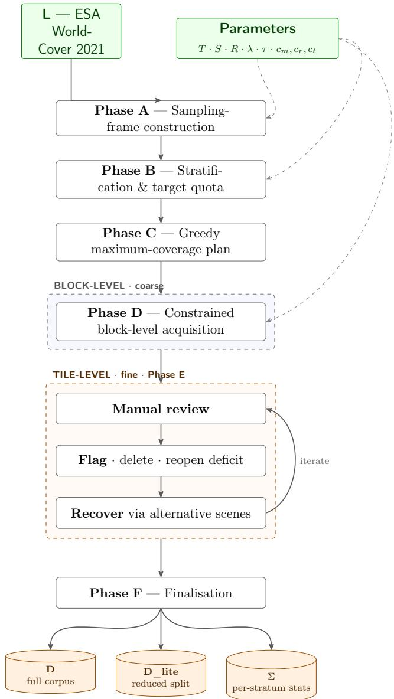  
Figure 1: DDSA algorithmic flow. The 10 m ESA WorldCover map L and a set of parameters (target T, strata S, R, sensor latitude limits λ, temporal tolerance $\tau ,$ cloud thresholds $c _ { m } , c _ { r } , c _ { t }$ , max inter-block tile overlap r) drive a six-phase pipeline. Phases A– C build, stratify and order an acquisition plan. The block-level bulk acquisition (Phase D) is followed by an iterated human-in-the-loop tile-level recovery (Phase E) that explicitly counteracts cloud-induced geographic dropout. Phase F derives the full corpus D, the reduced benchmark split $D _ { \mathrm { l i t e } }$ , and the per-stratum statistics report Σ.

For a set of selected blocks $B ^ { \prime } \subseteq B$ , the coverage attained against the deficit caps is:

$$
f ( B ^ { \prime } ) = \sum _ { s \in \Omega } \operatorname* { m i n } \Bigl ( d _ { 0 } [ s ] , \sum _ { b \in B ^ { \prime } } c o n t r i b [ b , s ] \Bigr ) .\tag{1}
$$

Each summand is a concave non-decreasing function of a modular set function and is therefore submodular; a non-negative sum of submodular functions is submodular, so $f$ is monotone and submodular. Under a budget of k blocks (one GEE download each), the planning objective is:

$$
\operatorname* { m a x } _ { B ^ { \prime } \subseteq B , \ | B ^ { \prime } | \leq k } f ( B ^ { \prime } ) .\tag{2}
$$

The maximum-coverage special case of (2) is NP-hard, and no polynomialtime algorithm can guarantee a coverage better than a $( 1 - 1 / e )$ fraction of the optimum unless $\mathrm { P = N P }$ (Feige, 1998). The greedy rule that adds, at each step, the block of largest marginal gain attains exactly this bound (Nemhauser et al., 1978). That marginal gain is:

$$
\Delta ( b \mid B ^ { \prime } ) ~ = ~ f ( B ^ { \prime } \cup \{ b \} ) - f ( B ^ { \prime } ) ~ = ~ \sum _ { s \in \Omega } \operatorname * { m i n } \big ( c o n t r i b [ b , s ] , ~ d [ s ] \big ) ,\tag{3}
$$

with residual deficit $\begin{array} { r } { d [ s ] = \operatorname* { m a x } \bigl ( 0 , d _ { 0 } [ s ] - \sum _ { b ^ { \prime } \in B ^ { \prime } } } \end{array}$ contrib[b′, s]. The righthand side of (3) is exactly the priority Π(b) of Phase C: the rule used here is greedy on the submodular objective (1), and Π(b) is its marginal gain rather than an ad-hoc score.

Proposition 1 (Greedy coverage guarantee). The coverage f of (1) is monotone and submodular. For any budget k, the greedy plan $B _ { k } ^ { \prime }$ obtained by iterating arg maxb $\Delta ( b \mid B ^ { \prime } )$ satisfies $f ( B _ { k } ^ { \prime } ) \geq ( 1 - 1 / e )$ max $B ^ { \prime } | { \leq } k ~ f ( B ^ { \prime } )$ , and no polynomial-time algorithm improves on the factor $( 1 - 1 / { \it e } )$ for the maximumcoverage special case unless $\mathrm { P } = \mathrm { N P }$

Because f has diminishing returns, the lazy re-evaluation of Algorithm 1 — re-scoring a block only when it surfaces at the top of the heap — returns the same plan as full greedy at every step. The max-heap with on-pop re-scoring is thus an exact acceleration, not an approximation of it.

Proposition 1 bounds the coverage of the plan, not of the delivered corpus. Acquisition-time gates (regional and per-tile cloud, nodata, edge padding, and the inter-block overlap constraint of Phase D) remove tiles the plan counted on, and non-uniform cloud removes them unevenly across Ω. The realised coverage is f evaluated over the tiles that survive Phase D, which falls below the planned value wherever the sky was not clear — the geographic dropout the corpus exists to counteract. Closing that gap is the role of the deficit-repair loop, the online component that sits above the classical greedy plan.

The loop carries the residual deficit $d [ \cdot ]$ as state. A manual removal in Phase E returns a unit to its stratum $( d [ s ]  d [ s ] + 1 )$ and excludes the ofending source scene; a successful recovery consumes one $( d [ s ]  d [ s ] - 1 )$ . Locations are visited in decreasing $d [ s ]$ and each is retried at most twice (Phase E), so the iteration is bounded and terminates when no pair is flagged and every deficit is either cleared or backed by an exhausted candidate pool. What the loop does not guarantee is $d [ \cdot ] = 0$ at termination: a stratum whose season is overcast on every available date reaches the retry bound with $d [ s ] > 0$ , and the run is in any case stopped by the acquisition budget rather than by exhaustion of the frame (Section 4). The share of retried attempts the loop refills is its recovery eficiency η, defined and measured per rejection reason in Section 4 (Equation (4)).

The classical component of DDSA is thus the greedy plan, whose guarantee is already $( 1 - 1 / e )$ -optimal and therefore not something a diferent heuristic could improve upon; what the algorithm contributes is the online layer above it — the per-stratum deficit that the human-in-the-loop stage reopens and refills — which is where the (class × season × region) balance of the delivered corpus is defended against cloud-induced dropout.

## 2.2. Phase A — Sampling-frame construction

A regular tiling of the ESA WorldCover 2021 map (product version v200; Zanaga et al., 2022), delimited to a set of target countries, produces the candidate cells t. Centring the frame on the target countries makes their territory the geographic domain, which keeps the frame on mapped land and inland water while excluding open ocean by construction. Each cell is assigned its dominant land-cover class $c _ { t }$ (the majority class over its pixels) and its continental region $g _ { t }$ from Natural Earth admin-0 country boundaries (Natural Earth, 2024), each country mapped to its continent. Cells outside the per-sensor latitude window $\left| \mathrm { l a t } _ { t } \right| \le \lambda$ are discarded. The remaining cells form the sampling frame F, which in the current release spans a configurable set of target countries across the six inhabited continents (Section 4). The hemisphere-symmetric latitude filter and the WorldCover-derived class labels make the frame self-consistent across the worked regions.

## 2.3. Phase B — Stratification and target quota

Strata are defined as the product of the land-cover classes present in F, the seasons S, and the continental regions R. The class axis is restricted to the eight WorldCover classes that occur across all sampled regions; classes absent from at least one region are dropped, since they would otherwise leave structurally empty strata. The hemisphere-aware season mapping ensures that, e.g., June–July–August is summer in the Northern hemisphere and winter in the Southern. Seasons follow the three-month meteorological windows (DJF, MAM, JJA, SON) rather than astronomical ones, and each window is named after the year in which it closes: the winter of year Y runs from December of $Y - 1$ to February of Y. Acquisitions dated December therefore belong to the following year’s season, so a corpus collected over a single season cycle legitimately carries scenes from two calendar years. Together with the hemisphere correction this means the same month can take either label: December is winter in the North and summer in the South, and both assignments appear in the corpus. Targets are set per land-cover class, so that acquisition stays balanced across classes rather than exhausting a tile-rich class before the others are filled; the per-class target T is spread evenly over that class’s strata, giving a per-stratum quota $q = \lfloor T / ( | R | \cdot | S | ) _ { - }$ ⌋. This target is a balancing and stopping criterion, not a hard cap: the realised per-stratum counts are reported in Σ (Section 4).

## 2.4. Phase C — Greedy maximum-coverage block plan

Cells are aggregated into rectangular acquisition blocks $b \in \textit { B }$ (one GEE download per block; acquire-once $/ \ \mathrm { e x t r a c t { - a l l } } )$ . For each block and each stratum s, the contribution con $t r i b [ b , s ]$ is the number of tiles of b that fall in s across all seasons. The greedy maximum-coverage heuristic (Nemhauser et al., 1978) orders blocks by the priority Π(b) of Section 2.1 — the marginal gain of the submodular coverage objective — $\begin{array} { r } { \Pi ( b ) \ = \ \sum _ { s } \operatorname* { m i n } ( c o n t r i b [ b , s ] , d e f i c i t [ s ] ) } \end{array}$ , maintained over a max-heap with on-pop re-scoring to handle stale keys. Phase C yields an ordered acquisition plan together with the residual deficit vector deficit[·].

## 2.5. Phase D — Constrained block-level acquisition

For each block of the plan, an optical scene is selected following the classic MODIS strategy (Justice et al., 2002): the most recent Sentinel-2 Level-2A scene within the target season under the metadata cloud threshold $c _ { m }$ , refined by a regional Sen2Cor SCL cloud threshold $c _ { r } .$ , and excluding scenes already known to have failed. A Sentinel-1 GRD scene is paired within a temporal window $| t ( a ) - t ( o ) | \leq \tau$ . Each tile $p$ extracted from the block is then accepted only if it passes the full reject cascade: regional cloud $\leq c _ { r }$ , per-tile cloud $\leq c _ { t }$ , and no nodata or edge-padding violations. Land-cover purity is not an acceptance threshold; instead, each accepted tile is characterised by its dominant class, the purity of that class, and its top-three label composition (class id, name and pixel ratio), all taken from the WorldCover overlay and written to the sidecar. Mixed pixels are therefore described rather than discarded, and users can later keep homogeneous tiles, work with mixed ones, or filter by any class present (Section 4). In addition, a spatial-samplingdiscipline constraint requires that the centre-to-centre distance from $p$ to any tile already accepted from a diferent block in the same season exceed $\left( 1 - r \right) \cdot { \mathrm { f o o t p r i n t } } _ { p } ,$ with $r = 0 . 3 0$ , capping inter-block tile overlap at 30% and preventing the redundant geographic representation that block expansion or sub-block splitting could otherwise introduce. This is a purely geographic overlap of two tile footprints in the same season, enforced automatically; it is distinct from the temporal within-tile overlap caught by the Phase E human review, where a single tile blends two acquisition dates. Accepted tiles increment the per-stratum counter $c o u n t e r [ s _ { p } ]$ Within each season up to two atomic Sentinel-1/Sentinel-2 pairs are acquired per location (the balanced setting; one is fastest, three is densest), and the three candidate months are visited in a fixed interleaved order (first, third, second), so that the pairs land in the first and third months rather than clustering in one; this temporal spread is one of the invariants re-checked by the post-acquisition audit (Section 3).

## 2.6. Phase E — Human-in-the-loop $Q C$ and tile-level recovery

Phase D rejects tiles automatically, but residual cloud and subtle artefacts can still survive the gates. Phase E iterates a bounded review/recovery loop, operating at tile rather than block granularity. A manual review pass flags pairs accepted since the last round. The reviewer applies a fixed, closed set of criteria, each one targeting a failure mode that the automatic gates cannot detect by construction: (i) small residual clouds or haze that slip below the brightness threshold; (ii) cloud shadows, which the cloud gate misses because it keys on bright pixels whereas a shadow is dark; (iii) seamless intra-tile temporal overlap, a tile in which two regions are each individually clean and have no nodata line, so the automatic nodata and edge gates pass both halves, yet they come from acquisitions at diferent times, so illumination, sun angle and cast shadows disagree across the tile; no per-pixel or per-region threshold can flag this, since each part is valid on its own and only their juxtaposition is wrong; (iv) dense fire smoke that occludes the surface like a cloud (the cloud gate does not flag it, being keyed on the Sen2Cor scene-classification cloud classes rather than on smoke), while thin or partial smoke is kept, since it is a legitimate part of the scene; and (v) sensor-instrument artefacts that are not ground signal — the bright cross-shaped SAR returns over large metallic structures, and the Sentinel-2 inter-band ofset that splits a fast-moving object into displaced R/G/B copies — removed only when pronounced enough to corrupt the tile. The visible nodata seam between two passes is the de tectable counterpart of (iii) and is already removed by the nodata and edge gates of Phase D; the manual step exists precisely for the seamless overlap, the shadows, the residual haze, the dense smoke and the sensor-instrument artefacts, which leave no per-pixel threshold signature. Each manual removal is recorded in Σ under a single manual\_review category; the criterion that triggered it is not separately logged, but the recorded source identifiers let the decision be re-checked by re-fetching the tile. Flagged pairs are deleted, the corresponding stratum deficit is re-opened, and the ofending source scene is marked as excluded so it will not be reused. Recovery then fills the re-opened deficits by searching, for each rejected/flagged location of an under-filled stratum, an alternative low-cloud optical scene in the same season (excluding scenes already marked as failed), pairing it with a SAR scene within ±τ, and re-applying the Phase D quality gates. Every rejected attempt is eligible, whatever stopped it. We deliberately do not pre-classify failures into recoverable and non-recoverable: the measured outcome (Table 2) shows that the reason a tile was rejected is a poor predictor of whether a later attempt on the same ground will succeed, so the loop re-opens all of them and lets the retry decide. The loop is bounded per location rather than by passes over the corpus: each reopened location is retried at most twice, and stops earlier when its candidate pool is exhausted — no scene remains in that season that clears the quality gate and pairs within $\pm \tau$ . The bound of two retries is set by the pairing window, not chosen arbitrarily: with $\mathrm { ~ a ~ } \pm \tau$ window of three days, each attempt probes roughly a week of candidate dates, so two retries already sweep most of a three-month season; a third would begin to reach into the neighbouring season, where a match would carry the wrong stratum label, for little expected gain. Locations are visited in stratum-deficit order, so the efort concentrates where the shortfall is largest rather than being spread uniformly over the corpus. The loop terminates when no pair is flagged and all strata have met their target, bounded by a maximum number of review rounds. The combination of (i) review-driven exclusion of bad sources and (ii) location-targeted recovery via alternative scenes makes this phase the operational mechanism through which DDSA actively counteracts the geographic dropout that cloud cover would otherwise imprint on an opportunistic acquisition.

Figure 2 shows one representative removal per failure mode.

## 2.7. Phase F — Finalisation

The accepted pairs are archived as the full corpus D. The reduced benchmark split $D _ { \mathrm { l i t e } }$ is derived by down-sampling every non-empty stratum to a common per-stratum cap, with strata below the cap entering whole; the exact cap and the sampling rule are recorded in the per-stratum statistics report Σ, which also exposes the per-stratum fill, rejection and recovery counts needed to characterise the corpus in Section 4.

The complete procedure is given as pseudocode below: Algorithm 1 covers the planning stage (Phases A–C) and Algorithm 2 the constrained acquisition with deficit recovery (Phases D–F).

Table 1 lists the settings used to build STRATA-S12, so the symbols carry their realised values through the pseudocode.

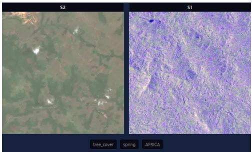  
(a) Small residual clouds / haze — optical

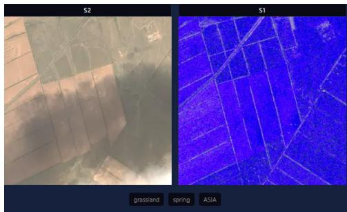

(b) Cloud shadow — missed by the brightness gate  
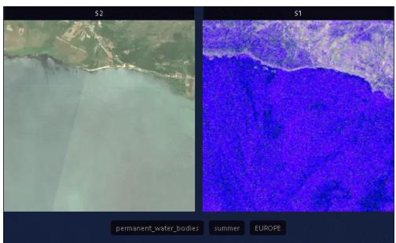

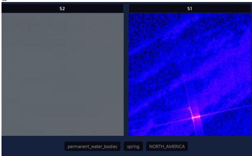

(c) Temporal seam — two dates, in both sensors (d) Bright cross-shaped SAR return over metal (a ship)  
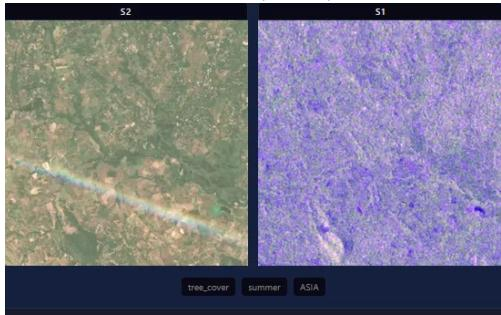  
(e) Sentinel-2 inter-band ofset — a fast-moving aircraft split into colour fringes  
Figure 2: Representative Phase-E manual removals, one per failure mode. In each panel the left half is the Sentinel-2 optical tile and the right half the Sentinel-1 SAR composite of the same pair. These are defects the automatic Phase-D gates cannot detect by construction; for the temporal seam (c) the discontinuity appears co-registered in both the optical and the SAR channel, which a single-sensor artefact cannot produce. Dense fire-smoke removals also occur but are not shown. The complete list, with source-scene identifiers, is the Phase-E ledger released with the corpus.

Table 1: Parameter settings used to build STRATA-S12. Symbols match the phase descriptions above and Algorithms 1–2.
<table><tr><td>Setting</td><td>Value</td><td>Role</td></tr><tr><td>Land-cover classes</td><td>8 of 11 (WorldCover v200)</td><td>stratification axis</td></tr><tr><td>Continental</td><td>6</td><td>stratification axis</td></tr><tr><td>regions Seasons</td><td>4 (hemisphere-corrected)</td><td>stratification axis</td></tr><tr><td>Season window</td><td>3-month meteorological</td><td>winter Y = Dec Y−1-Feb Y</td></tr><tr><td>Pairs per season</td><td>2 (balanced)</td><td>atomic S1–S2 pairs per location</td></tr><tr><td>Tile size</td><td>512 × 512 px @ 10 m</td><td>released tile</td></tr><tr><td>Block size</td><td> $\leq 2 0 4 8 \ \mathrm { p x } \ ( \leq 5 0 \mathrm { M B } / \mathrm { r e q } . )$ </td><td>acquire-once unit</td></tr><tr><td>Target countries</td><td>config-defined set</td><td>geographic frame, batched</td></tr><tr><td> $\tau$ </td><td>3 days</td><td>S1-S2 temporal pairing window</td></tr><tr><td> $c _ { m }$ </td><td>10%</td><td>scene-metadata cloud</td></tr><tr><td> $c _ { r }$ </td><td>0.05</td><td>pre-filter regional Sen2Cor SCL cloud</td></tr><tr><td> $c _ { t }$ </td><td>0.03</td><td>per-tile bright-pixel ratio</td></tr><tr><td>Edge-padding</td><td>0.15</td><td>max edge-artefact fraction</td></tr><tr><td>Coverage/</td><td>≥0.20 / ≤0.80 cand.; 0%</td><td>footprint gate / released</td></tr><tr><td>nodata</td><td>released</td><td>purity</td></tr><tr><td> $r$ </td><td>0.30</td><td>max inter-block tile overlap</td></tr><tr><td> $\lambda$ </td><td>65°(optical)</td><td>optical limit binds the pair</td></tr><tr><td>Seed</td><td>42</td><td>deterministic ordering</td></tr></table>

Algorithm 1: DDSA — Part 1: sampling frame, stratification and   
greedy maximum-coverage block plan   
Input : land-cover map L (ESA WorldCover 2021, product v200; 10 m); target   
per class T; seasons S, regions R;   
per-sensor latitude limits λ (optical $\leq 6 5 ^ { \circ } , \mathrm { S A R } \leq 9 0 ^ { \circ } )$   
Output : frame F; quota q; ordered plan; deficit[·]   
/\* Phase A — Sampling-frame construction \*/   
1 F ← ∅   
2 foreach cell t in the tiling of L over the target countries do   
3 ct ← arg maxk |{pixels of class k in t}| // dominant class   
4 gt ← PhysicalRegion(latt, lont) // point-in-polygon   
5 if gt ̸= OCEAN and |latt| ≤ λ then $F \gets F \cup \{ ( t , c _ { t } , g _ { t } , \mathrm { l a t } _ { t } , \mathrm { l o n } _ { t } ) \}$   
/\* Phase B — Stratification and target quota \*/   
6 Strata $ C \times S \times R$ // C: classes present in F   
7 $q \gets \lfloor T / ( | R | \cdot | S | ) \rfloor$   
8 foreach stratum s ∈ Strata do deficit[s] ← q   
/\* Phase C — Greedy maximum-coverage block plan \*/   
9 B ← AggregateIntoBlocks(F) // acquire once, extract all tiles   
10 foreach block b ∈ B do   
11 foreach stratum s do   
12 contrib[b, s] ← |{tiles of b in s over all seasons}|   
13 H ← max-heap of B keyed by $\Pi ( b ) = \textstyle \sum _ { s }$ min(contrib[b, s], deficit[s])   
14 plan ← ⟨ ⟩   
15 while H ̸= ∅ and $\begin{array} { r } { \sum _ { s } d e f i c i t { [ s ] } > 0 } \end{array}$ do   
16 b ← ExtractMax(H)   
17 Π(b) ← P min(contrib[b, s], deficit[s]) // rescore: stale key   
18 if Π(b) ≤ 0 then continue   
// no contribution   
19 append b to plan   
20 foreach stratum s do deficit[s] ← max(0, deficit[s] − contrib[b, s])   
21 return F, q, plan, deficit

Algorithm 2: DDSA — Part 2: constrained acquisition and human  
in-the-loop deficit recovery   
Input : plan, quota q (from Algorithm 1);   
temporal tolerance τ; cloud thresholds $c _ { m } , c _ { r } , c _ { t } ;$   
max inter-block tile overlap r   
Output : full co-registered SAR–optical corpus D;   
optional reduced benchmark split $D _ { \mathrm { l i t e } } ;$   
per-stratum statistics report Σ   
/\* Phase D — Constrained block-level acquisition \*/   
1 foreach block b ∈ plan, in dynamic stratum-priority order do   
2 Q ← {optical scenes over b in season : cloud% $\leq c _ { m } \}$   
3 o ← most-recent scene in Q, regional-cloud refined, excluding failed dates   
4 a ← SAR scene with $| t ( a ) - t ( o ) | \leq \tau$ // temporal pairing   
5 if a = ∅ then continue   
6 download pair (o, a)   
7 foreach tile p extracted from b do   
8 if regionalCloud(p) > cr or tileCloud $( p ) > c _ { t }$ then   
9 reject p   
10 else if p violates nodata/edge constraints then   
11 reject p   
12 else if ∃ accepted q from another block in same season:   
centroidDist $( p , q ) < ( 1 - r )$ · footprint then   
13 reject p   
14 else   
15 accept p; counter [sp] ← counter [sp] + 1   
16 return accepted pairs and counters; continued below

Algorithm 2: DDSA — Part 2 (continued): human-in-the-loop   
deficit recovery and finalisation (Phases E–F)   
Output : full co-registered SAR–optical corpus D; reduced split $D _ { \mathrm { l i t e } } ;$   
per-stratum report Σ   
/\* Phase E — Human-in-the-loop QC with deficit repair (iterated) \*/   
/\* acquisition is coarse-to-fine: block-level bulk (D) maximises   
tiles+metadata per GEE call; \*/   
/\* tile-level recovery (E) maximises salvageable yield and \*/   
/\* counteracts the geographic bias from non-uniform cloud cover \*/   
1 repeat   
2 R ← manual review of pairs accepted since the last round   
3 foreach pair $p \in R$ flagged as residual-cloud, shadow, smoke,   
temporal-overlap or sensor artefact do   
4 delete p; counter [sp] ← counter [sp] − 1   
5 $d e f i c i t [ s _ { p } ] \gets d e f i c i t [ s _ { p } ] + 1$   
6 mark the source scene of p as excluded   
7 foreach stratum s with counter $[ s ] < q$ do   
// recovery operates at tile/location granularity   
8 foreach rejected/flagged location of s, in stratum-priority order do   
9 o′ ← alternative low-cloud optical scene, same season, excluding   
scenes already marked as failed   
10 $a ^ { \prime } \gets \mathrm { S A R }$ scene with $| t ( a ^ { \prime } ) - t ( o ^ { \prime } ) | \leq \tau$   
11 if $( o ^ { \prime } , a ^ { \prime } )$ pass the Phase D quality gates then   
12 accept the pair; counter [s] ← counter [s] + 1   
13 $\begin{array} { r } { d e \ f i c i t { [ s ] }  \ d e f i c i t { [ s ] } - 1 } \end{array}$   
14 until review flags no pair and ∀s : counter $[ s ] \geq q$   
// bounded by a maximum number of review rounds   
/\* Phase F — Finalisation \*/   
15 D ← archive of accepted (optical, SAR) pairs   
16 Dlite ← down-sample D to a common per-stratum cap // strata below the   
cap enter whole   
17 Σ ← per-stratum fill, rejection and recovery statistics   
18 return D, $D _ { \mathrm { l i t e } } , \Sigma$

## 3. System Implementation

DDSA is realised as a Docker-containerised pipeline (Figure 3) designed for unattended execution on long, resource-bounded runs. Three properties drive the engineering decisions: idempotency, resumability, and provenance.

Containerisation and reproducibility.. The pipeline runs inside a versioned Docker image; the image tag is recorded in every per-pair sidecar, making it possible to retrieve the exact processing environment for any released pair. Dependencies are pinned.

State stores.. Two SQLite databases (operated in WAL mode for concurrent reader/writer safety) drive scheduling. pipeline.db holds the blocks, tiles, decisions and per-stage checkpoints; tile\_lookup.db holds the precomputed per-tile label purity and composition, so each pair’s sidecar can be populated without re-touching the WorldCover raster during acquisition. Stale processing flags are reset on resume so that interrupted runs do not leave orphans. Because acquisition is partitioned (see below), each batch keeps its own pair of databases; once a batch is closed they are consolidated, unchanged, into a single read-only master database from which every statistic reported in this paper is computed. The master keeps the delivered pairs, the pairs that were acquired and later withdrawn, and the attempts an automatic gate stopped, in three separate tables, so the product and the cost of producing it are never conflated in a count.

Parallel GEE access.. Acquisition runs as a pool of parallel workers against Google Earth Engine. A rate-limit coordinator throttles requests below GEE’s per-account quotas; failed requests are retried with exponential backof, and persistently failing scenes are added to a no-coverage cache so they are not re-attempted in later rounds or in Phase E recovery.

Per-country partitioning.. Because the sampling frame is delimited by target country, acquisition can be run one country at a time rather than over the whole frame at once. In practice the corpus was built in per-country batches, which keeps each run small, makes progress easy to checkpoint and resume, and confines any re-run to the country being repaired. The same partitioning also lends itself to distributing the acquisition across independent workers; in this work parallelism stayed within a single provider’s per-account rate limits (see above), and any wider distribution would remain subject to the same quota constraints.

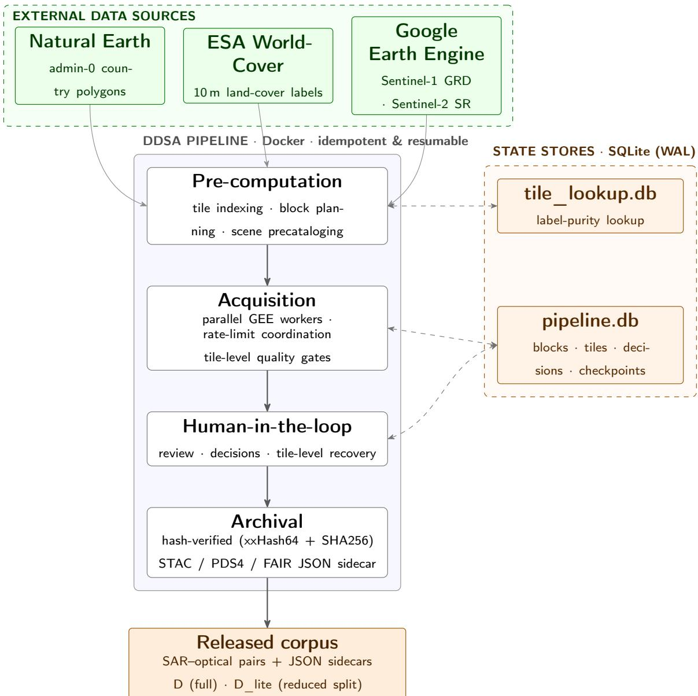  
Figure 3: DDSA system architecture. Three external data sources feed a Docker containerised pipeline of four stages (pre-computation, acquisition, human-in-the-loop, archival), backed by two SQLite (WAL) state stores that drive scheduling and label-purity lookup. The released corpus is the bottom output.

Archival.. Integrity is recorded at two levels: each pair carries a fast, noncryptographic xxHash64 checksum in its sidecar (Section 4.2) for quick postrelease corruption checks by the user, and the release ships a SHA256 manifest over the distributed archives for cryptographic-grade verification. Each released pair carries its standards-aligned JSON sidecar.

During dataset assembly, this same integrity layer flagged 101 pairs whose files had been corrupted in storage or transfer — a small fraction at this data volume — which were removed from the release; the checksums shipped with the corpus let any user re-run the same verification.

Geographic and geodetic corrections.. Block bounding boxes are computed with a cos(lat) correction (Snyder, 1987); the antimeridian is handled by splitting afected blocks. Hemisphere correction is applied at the stratification stage so that the season axis is meaningful in both hemispheres. Coregistration is by construction rather than by post-hoc alignment: for each tile we request both modalities over the same footprint and write them to the same grid — identical bounding box, CRS (the tile’s local UTM zone) and 10 m pixel size — so the optical and SAR rasters of a pair share pixels one to one. The two scenes are matched within a temporal window of at most τ days (here three); the realised gap is stored per pair (temporal\_gap\_days, alongside the two acquisition timestamps), so the pairing can be audited directly from the sidecar.

Post-acquisition integrity audit.. After Phase E terminates, a fixed-set integrity audit re-verifies the released corpus against six spatial-and-temporal invariants: spatial uniqueness (no pixel-identical duplicates at the same position), cross-class boundary consistency, temporal-source uniqueness within a season (within a season, no location is sampled twice from the same source scene — a cross-tile check, not a guarantee that a single tile draws from one acquisition only), monthly sampling diversity, the inter-block tile overlap constraint of Phase D, and intra-block extraction-window non-collision. Any violation is logged and the ofending pair is removed atomically (disk first, database last); a machine-readable audit report is shipped with the released corpus. The audit checks quantities that are measurable per pixel or across tiles; a defect such as a seamless within-tile temporal overlap, whose two halves are each individually valid and leave no per-pixel signature, falls outside its reach and is handled instead by the Phase E human review (Section 2). The audit is the defence-in-depth counterpart to the acquisition-time guards.

## 4. The STRATA-S12 Corpus

The release, STRATA-S12, consists of the full corpus D, the derived reduced benchmark split $D _ { \mathrm { l i t e } } .$ , the per-stratum statistics report Σ, the postacquisition integrity audit report, the pre-trained SSL backbone weights of Section 5, and the full method specification given by this paper and the pseudocode of Algorithms 1 and 2.

## 4.1. Folder hierarchy

Pairs are stored as a parsing-free access layer: the directory path encodes the stratum, so most filtering is a file-system operation and needs no metadata parsing. The tree is split first by sensor and then by stratum,

## <sensor>/class\_<class>/season\_<season>/region\_<region>/

for example s2/class\_built\_up/season\_summer/region\_AFRICA/. Picking a class, season or region is then a directory walk (cp -r s2/class\_built\_up/ . . . ), and restricting to a single modality is just choosing the s1 or s2 root. The two members of a pair sit at the matching s1/ and s2/ paths and share the same tile\_id and pair\_id, so optical–SAR matching is a lookup on those identifiers — which are also carried in the filename and the sidecar. The layout trades a little redundancy on disk for a large drop in friction: common selections need no loader, no index and no metadata I/O.

## 4.2. Per-pair sidecar

Every released tile is accompanied by a per-tile JSON sidecar that records the full geographic, dimensional, classification, source-data, acquisition, integrity, license and provenance context of the tile. The schema is fixed: it is aligned with STAC 1.0.0 (STAC Contributors, 2021), informed by the NASA PDS4 information model (NASA Planetary Data System, 2024), and designed to satisfy the FAIR principles (Wilkinson et al., 2016); the top-level fields stac\_compliant and stac\_version record the targeted STAC version and the alignment state. Top-level identifiers tile\_id, pair\_id, filename, and sensor link the tile to its geographic location, to its modality counterpart in the pair, and to its on-disk filename. The schema is organised in nine blocks:

• integrity: checksum (xxHash64 of the .tif), algorithm, and a descriptive note. Designed for fast, non-cryptographic corruption detection on the released file.

• coordinates: centroid lat,lon (WGS84 datum), geographic bbox, and crs – the native projected CRS (e.g. EPSG:32754 for UTM zone 54S over Australia). Both WGS84 and the local projection are recorded so downstream tooling can choose either reference frame.

• dimensions: width and height in pixels, pixel\_resolution\_m (10), the list of source bands (e.g. B4/B3/B2 for a Sentinel-2 true-colour tile; VV, VH and a precomputed VV−VH diference for Sentinel-1), dtype (uint16 for Sentinel-2, float32 for Sentinel-1), and the nodata sentinel value.

• classification: the hemisphere-corrected season triple (season, hemisphere, season\_raw), the dominant land-cover class (land\_cover\_class, integer class\_id), the geographic\_region assigned via Natural Earth, the label\_purity (ratio of the dominant class), the full label\_composition as a list of (class\_id, class\_name, ratio) entries, and label\_source (ESA\_WorldCover\_2021\_v200). Since a season may span two calendar years, the season field is the authoritative stratum key; the satellite\_acquisition\_time recorded in the acquisition block gives the date and should not be used on its own to infer the season.

• data\_source: ingestion provider (Google Earth Engine), source mission (ESA Copernicus Programme), GEE collection identifier (COPERNICUS/S2\_SR or COPERNICUS/S1\_GRD), and processing\_level (L2A for Sentinel-2, GRD for Sentinel-1).

• acquisition: download\_timestamp (when DDSA downloaded the tile, UTC ISO 8601), satellite\_acquisition\_time (when the satellite captured the scene), specific spacecraft (e.g. Sentinel-2B), max\_cloud\_percentage (the scene-level cm applied), and temporal\_pairing\_tolerance\_days = τ .

• license: terms (CC BY 4.0), source (Copernicus Sentinel data), attribution url and citation.

• provenance: the exact GEE asset identifiers sentinel2\_image\_id and sentinel1\_image\_id of the source scenes, the producing script and script\_version, the dataset\_version, the processing\_timestamp, the docker\_image, and the processing\_node identifier. Together these allow any tile to be traced back to its source scenes and to a re-instantiable processing environment.

• quality\_metrics: temporal\_gap\_days (the realised |t(a) − t(o)| for

the SAR–optical pair).

A complete example sidecar is shipped in the released examples/ folder so downstream tooling can be validated against a concrete reference.

## 4.3. Filename encoding

The filename of each released tile encodes the same stratum information present in the folder hierarchy and the sidecar, so that downstream tooling can identify a tile’s class, region, season, sensor, pairing and download timestamp from a directory listing alone – no metadata I/O required. The format is:

<sensor>\_<class>\_<season>\_<region>\_<tile\_id>\_<timestamp>\_<pair\_id>.tif

For example, the filename

S2\_CROP\_SUM\_AUS\_00cb7d7d92d3\_20260411T174932\_2ac26529158baed0.tif

decomposes as:

• sensor S2; class CROP (cropland); season SUM (summer); region AUS (Australia/Oceania);

• tile\_id 00cb7d7d92d3, a 12-character identifier;

• download timestamp 20260411T174932;

• pair\_id 2ac26529158baed0, a 16-character identifier.

The pair\_id is shared between the Sentinel-2 file and the matched Sentinel-1 file of the same pair, so optical–SAR matching reduces to a string match on the filename. Its width is set at 64 bits so that accidental repetition stays negligible at corpus scale: a shorter identifier would be easier to read but would make coincidental repeats likely once the corpus passes a few hundred thousand pairs, at which point tooling keying on pair\_id alone could silently mismatch two unrelated files. The released corpus bears this out: its 740,746 identifiers are pairwise distinct, with no collision to resolve. The tile\_id is carried in the filename beside it, so a pair is in any case addressable by the composite (tile\_id, pair\_id). Should two pairs ever derive the same identifier, the consolidation step keeps both under a sufixed pair\_id (...\_1) propagated to the four files and to the two sidecars, rather than letting one displace the other. No such collision occurs in this release — all identifiers are distinct — but a reader parsing filenames should treat the final field as an identifier that may carry a sufix.

The timestamp is the download-batch time; the exact satellite-acquisition time and the per-file write time are recorded in the sidecar (Section 4).

## 4.4. Band selection and extensibility

Each released tile carries the three Sentinel-2 true-colour bands (B4/B3/B2) and three Sentinel-1 channels — the polarisations VV and VH and a precomputed VV − VH diference. Because the diference is stored rather than computed on the fly, the six-channel input used in Section 5 is read straight from the released files. This is a deliberate choice, not a loss of information. Shipping the full Sentinel-2 spectral stack and the complete Sentinel-1 product would multiply both the on-disk size and, more importantly, the pre-processing and pre-training cost of the corpus to the point where only a few very well-resourced groups could actually use it. Since the contribution of this work is the acquisition algorithm, and a corpus is only useful if people can train on it, we release the bands that are the most widely used and the most directly interpretable: human-readable true colour for the optical modality and the standard VV/VH polarisations for SAR.

The choice does not lock users out of the remaining bands. Every sidecar records the exact source-scene identifiers (sentinel2\_image\_id, sentinel1\_image\_id) together with the footprint and the acquisition time, so any additional Sentinel-1 or Sentinel-2 band can be recovered per tile from the same Google Earth Engine assets with a small, well-defined amount of work. The released corpus is therefore a practical default that runs on commodity hardware while remaining fully extensible to the complete spectral and polarimetric stack; producing that full-band version over the worked regions is left as future work.

The same metadata that makes the missing bands recoverable also makes the corpus easy to reshape for a given study. Because every tile records its native CRS, footprint, pixel resolution and stratum, a user can filter the release down to the classes, regions or seasons they care about, re-tile the imagery into smaller patches, or pool it to a coarser resolution (for example 20 m or 50 m) without going back to the source archives. This is the point of the release: STRATA-S12 is a worked product that shows what the algorithm produces and gives others something concrete to build on, but the contribution of the paper is the acquisition algorithm itself, not any single fixed form of its output.

## 4.5. Label-source caveat

The following must be stated explicitly in any use of the dataset and is recorded in the released README and Dataset Card:

• Labels are derived from ESA WorldCover 2021, product version v200 (ESA\_WorldCover\_2021\_v200; Zanaga et al., 2022).

• A temporal gap of about four years between the WorldCover product and the Sentinel acquisitions may introduce label noise.

• Acquisitions belong to the 2025 season cycle; because the winter window opens in December of the preceding year, part of the corpus carries December 2024 dates. The season field, not the calendar year, is the stratum key.

• Labels are intended for self-supervised learning where they serve as stratification only, not as ground truth for downstream supervised tasks.

The stratification labels are derived from ESA WorldCover 2021 (v200), the most recent validated global land-cover product at 10 m resolution and built from the same Sentinel-1 / Sentinel-2 sources as this corpus. All Sentinel acquisitions used here belong to the 2025 season cycle. Because the winter window opens in December of the preceding year (Section 2), part of the corpus carries December 2024 acquisition dates; this afects 41,403 of 740,746 released pairs (5.6%) — December is winter in the Northern hemisphere and summer in the Southern, so both season labels appear among them. The gap between the label product and the imagery is therefore about four years throughout, and users who group the corpus by calendar year rather than by the season field will split that winter in two. This gap does not afect the validity of the pairs or their intended use. In this corpus the land-cover class is not a supervised target: it is used only as a stratification key, to stratify acquisition across the (class × season × region) strata. Users who need ground-truth labels for a supervised task are expected to bring their own from external benchmarks, as the released Dataset Card notes. Its residual efect is limited to the small fraction of tiles whose dominant class has changed since 2021 — almost entirely in areas of real land-cover change

— and it touches only the exact stratum assignment of those tiles, not the quality of the pair or its usefulness for self-supervised pre-training. We use WorldCover rather than a more recent annual land-cover product because it is independently validated, widely adopted as a reference, and produced from the same sensors; for a stratification key we consider this more important than exact temporal alignment.

## 4.6. Quality-gate rejection taxonomy

Rejections are reported in Σ under a fixed taxonomy in two layers. The acquisition cascade (Table 2) logs one row per pair attempt, under the reason that stopped it: tile-level quality rejections — clouds (bright-pixel fraction above c ), nodata (missing pixels), edge\_padding (scene-edge artefacts); image-wide rejections, where the source scene itself is unusable — has\_inf (non-finite pixels), striped\_corruption (truncated download), flat (singlevalue image), orphan\_missing\_file (recorded tile whose file is missing); and pool\_exhausted, recorded when no candidate scene remained for a location under the required constraints.

Because the repair stage updates the rejection row it retried rather than writing a new one, each row also carries the outcome of that retry, and Table 2 reports it beside the count. The result contradicts the intuitive reading of the taxonomy and is worth stating plainly: the reason an attempt was rejected does not predict whether it can be recovered. The geometric failures, which look terminal, are among the most recoverable — nodata at $\eta = 4 1 . 4 \%$ — because a Sentinel-1 pass on a diferent orbit covers a diferent footprint, so a missing corner need not be missing on the next attempt. The atmospheric and archive failures, which look transient, are the least recoverable clouds at $\eta = 1 8 . 8 \%$ and has\_inf at 13.9% — because a location that is cloudy is usually cloudy on most dates of its season, a persistence that global cloud climatologies make explicit (Wilson and Jetz, 2016). What separates the two is not the kind of defect but whether its cause persists in time: an orbital geometry changes between passes, a climate does not. This is the mechanism behind the geographic dropout the algorithm exists to counteract. We read this as observational evidence consistent with temporal persistence rather than as a proven causal mechanism: the categories difer in η and also, unavoidably, in where their locations fall, so part of the spread could reflect that geometric failures happen to sit in clearer places. What we can say from scene metadata alone is that the reason a gate stopped an attempt is a poor predictor of whether a retry succeeds; the persistence reading is the most parsimonious explanation, not a controlled result (Figure 4). The edge\_padding eficiency rests on 318 rejections of which only 65 were ever retried, and is reported for completeness rather than as a stable estimate. After acceptance, two further reasons apply at tile level: removals raised by the post-acquisition audit, reported under the invariant they breach — overlap\_geometric (two tiles of the same season sharing more than $r = 0 . 3 0$ of their footprint), season\_quota (a location carrying more pairs in one sea-

son than the configured limit) and month\_repeat (two pairs of the same location and season drawn from the same calendar month, which the interleaved month order is meant to prevent) — and a single manual\_review category for the Phase E human removals. The reviewer applies the criteria listed in Phase E, but the specific criterion per tile is not separately logged, as hand-labelling a small fraction by sub-type is disproportionate; the recorded source identifiers let any removed tile be re-fetched and the decision re-checked. Reporting at this granularity lets the user recompose subsets along quality dimensions without re-running the acquisition.

Table 2: Acquisition rejection counts by reason, from the rejected\_tiles log. Counts are per acquisition attempt, not per unique tile: a location may fail several times before a valid pair is found, so the total exceeds the number of released tiles. The left block is the rejection; the right block is what the repair loop then did with it — how many of those attempts it refilled, how many it retried without success, and the resulting eficiency η (Equation (4)). Reading the two together is the point of the table: η varies by a factor of five across reasons, and not in the direction the reason suggests. Pairs removed after acceptance by the manual review do not appear here; they are logged as withdrawn pairs rather than as gate rejections and are counted in the scale-and-efort summary. Attempts not yet retried are excluded from η and reported there as well. Percentages are over the total number of rejected attempts, so the table is closed over its own rows and sums to 100 up to rounding; the wider count of every attempt the acquisition made (delivered, withdrawn and rejected) is reported separately in the scale-and-efort summary.
<table><tr><td></td><td colspan="2">Rejected</td><td colspan="3">Repair loop</td></tr><tr><td>Reason</td><td>n</td><td></td><td></td><td>% recovered exhausted η (%)</td><td></td></tr><tr><td>Tile-level quality gates</td><td></td><td></td><td></td><td></td><td></td></tr><tr><td>clouds</td><td>444,136</td><td>21.4</td><td>41,131</td><td>177,878</td><td>18.8</td></tr><tr><td>nodata</td><td>256,183</td><td>12.3</td><td>55,722</td><td>78,774</td><td>41.4</td></tr><tr><td>edge_padding</td><td>318</td><td>0.0</td><td>58</td><td>7</td><td>89.2</td></tr><tr><td colspan="6">Image-wide corruption (source scene unusable)</td></tr><tr><td>has_inf</td><td>236,457</td><td>11.4</td><td>20,833</td><td>128,871</td><td>13.9</td></tr><tr><td>striped_corruption</td><td>313,707</td><td>15.1</td><td>70,724</td><td>88,127</td><td>44.5</td></tr><tr><td>flat</td><td>16,574</td><td>0.8</td><td>6,338</td><td>4,025</td><td>61.2</td></tr><tr><td>orphan_missing_file</td><td>1,776</td><td>0.1</td><td>329</td><td>500</td><td>39.7</td></tr><tr><td colspan="6">Availability (no candidate scene remained)</td></tr><tr><td>pool_exhausted</td><td>809,884</td><td>39.0</td><td>367,612</td><td>434,108</td><td>45.9</td></tr><tr><td>Total rejected attempts</td><td>2,079,035</td><td>100.0</td><td>562,747</td><td>912,290</td><td>38.2</td></tr></table>

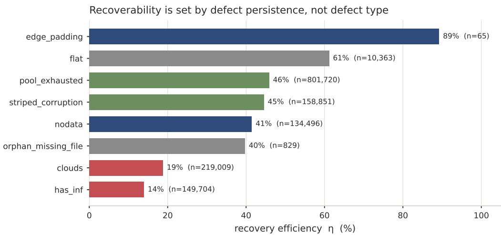  
Figure 4: Recovery eficiency $\eta$ by rejection reason, ordered by $\eta .$ Bars are coloured by defect family (atmospheric/archive in one hue, geometric in another) and annotated with the number of retried attempts behind each ratio. The ordering inverts the intuitive reading of the taxonomy: the geometric failures, which look terminal, sit high, while cloud sits at the bottom — what separates them is whether the cause persists in time, not the kind of defect. Thin categories, whose η rests on few retries, are read against their annotated count rather than taken as stable estimates.

Recovery yield.. The unit is the pair attempt, which is the atomic unit of the acquisition: one row of the rejection log is one attempt at one pair, and the repair loop records its outcome on that same row. Writing $N _ { \mathrm { r e c } }$ for the attempts it refilled and $N _ { \mathrm { e x h } }$ for those it retried without success, the recovery eficiency is

$$
\eta = \frac { N _ { \mathrm { r e c } } } { N _ { \mathrm { r e c } } + N _ { \mathrm { e x h } } } ,\tag{4}
$$

over all 2,079,035 rejected attempts. Attempts not yet retried are excluded from both terms and reported apart, so that an operational limit — quota, time — does not present itself as a failure of the method. Realised values: $N _ { \mathrm { r e c } } = 5 6 2 , 7 4 7$ and $N _ { \mathrm { e x h } } = 9 1 2 , 2 9 0$ , giving $\eta = 3 8 . 2 \%$ , with 603,998 attempts not yet retried. The per-reason η of Table 2 is read against its own retry count, reported in the same row: where only a few attempts of a category were ever retried — edge\_padding is the extreme case, at 65 retries over 318 rejections — the ratio is indicative rather than a stable estimate, and we say so in the table rather than averaging the thin categories into the headline figure.

Counted in pairs rather than attempts, the share of D that exists only because of the loop is 292,432/740,746 = 39.5% — the pair-level counterpart of the “no repair” column of Table 5 — and 89.8% of those pairs survived the subsequent manual review, so the repair does not buy coverage at the cost of quality. Attempts and pairs are diferent units and are not netted against one another: a single delivered location can absorb several refilled attempts, so the 562,747 refilled attempts do not equal the 292,432 recovered pairs they leave in D. The released corpus excludes both the pairs the manual review later withdrew and those the cross-batch consolidation removed as redundant coverage.

Table 3 breaks η down by region and by latitude band, and the two cuts tell diferent stories that must not be conflated. Across the tropical boundary the eficiency is essentially flat — it is marginally higher inside the tropics while the exhausted attempts concentrate in the same band: the loop does not perform worse where cloud persists, it runs out of usable scenes. Across regions, by contrast, the eficiency varies widely, from 26.4% in North America to 47.6% in Europe. That spread is wider than the latitudinal one, so what moves η is regional scene availability rather than latitude as such. Cloud burden modulates it but does not determine it: Figure 5 plots each region’s eficiency against the share of its rejections that were cloud-driven, and while the cloudier regions do tend lower, the relation is not monotone — North America has only a moderate cloud share yet the lowest eficiency of all — which points to availability and orbital geometry, not cloud alone, as the binding factor. Two readings are ruled out by the same table. The retry efort was not spread uniformly: deficit-ordered visiting sent proportionally more retries to the tropical band and left a larger share of extratropical attempts untried, so the flat latitudinal eficiency holds despite an uneven allocation of efort rather than because the allocation was balanced. And the attempts whose footprint could not be resolved to a latitude are fewer than one in a thousand, so the band split is complete in practice.

## 4.7. Scale and efort summary

The figures below are computed from the consolidated master database; the rejection counts of Table 2 come from the same source.

• Released pairs: 740,746, over 473,786 distinct locations;

• Stratification: 8 land-cover classes × 4 hemisphere-corrected seasons × 6 continental regions, sampled over a configurable set of target countries (bounded into small download batches); all 192 strata are populated, with a mean of 3,858 pairs per stratum and 184 of them above one hundred. The full range is 7 to 21,327: the low tail is the signature of the stopping point rather than a gap in coverage. Because the fill order is driven by the per-stratum deficit, every stratum receives samples before any one saturates, so a longer acquisition grows the sparse strata first and the range narrows monotonically with compute time. Perstratum counts are in Σ;

Table 3: Phase-E repair by scope. The left block counts pair attempts and yields η (Equation (4)); the right block counts delivered pairs and the share of each scope’s corpus that the loop supplied. The two blocks are in diferent units and are not additive.
<table><tr><td rowspan="2">Scope</td><td colspan="3">Pair attempts</td><td colspan="2">Delivered pairs</td></tr><tr><td>recovered</td><td>exhausted</td><td>η (%)</td><td>from repair share</td><td>(%)</td></tr><tr><td>Global</td><td>562,747</td><td>912,290</td><td>38.2</td><td>292,432</td><td>39.5</td></tr><tr><td>Africa</td><td>147,611</td><td>174,121</td><td>45.9</td><td>78,309</td><td>39.6</td></tr><tr><td>Asia</td><td>158,733</td><td>302,889</td><td>34.4</td><td>88,156</td><td>46.2</td></tr><tr><td>Australia/Oceania</td><td>29,001</td><td>48,679</td><td>37.3</td><td>16,863</td><td>33.3</td></tr><tr><td>Europe</td><td>122,321</td><td>134,892</td><td>47.6</td><td>55,541</td><td>39.7</td></tr><tr><td>North America</td><td>62,933</td><td>175,307</td><td>26.4</td><td>30,719</td><td>34.3</td></tr><tr><td>South America</td><td>42,148</td><td>76,402</td><td>35.6</td><td>22,844</td><td>31.8</td></tr><tr><td>tropical band</td><td>169,862</td><td>262,704</td><td>39.3</td><td>91,671</td><td>37.8</td></tr></table>

• Total acquisition attempts: 2,928,370 in all (delivered pairs, pairs withdrawn after acceptance, and attempts stopped by an automatic gate); the rejected share is broken down by category in Table 2;

• Pairs supplied by the Phase E repair loop: 292,432 (39.5% of D); attempts retried: 562,747 refilled and 912,290 exhausted, with 603,998 not yet retried. The loop is bounded per location (at most two retries, or fewer if the candidate pool runs out) rather than by a number of passes over the corpus;

• Removed after acceptance: 108,576 pairs over 96,355 distinct locations, which re-enter the deficit like any other failure; of these, 80,734 were removed by human review and the remainder by an automated postdownload integrity check that discards orphaned, truncated or otherwise corrupted downloads. The post-acquisition audit removals and the cross-batch consolidation are reported in Σ rather than counted here;

• On-disk size of the full corpus: 2.64 TB, held as 1,481,492 raster files (one optical and one radar per pair), each with a JSON sidecar beside it. The reduced split $D _ { \mathrm { l i t e } }$ holds 20,916 pairs over all 192 strata, capped at 112 per stratum; strata holding fewer pairs than the cap contribute all they have, so the split is capped rather than strictly equalised. On disk it occupies 76.5 GB.

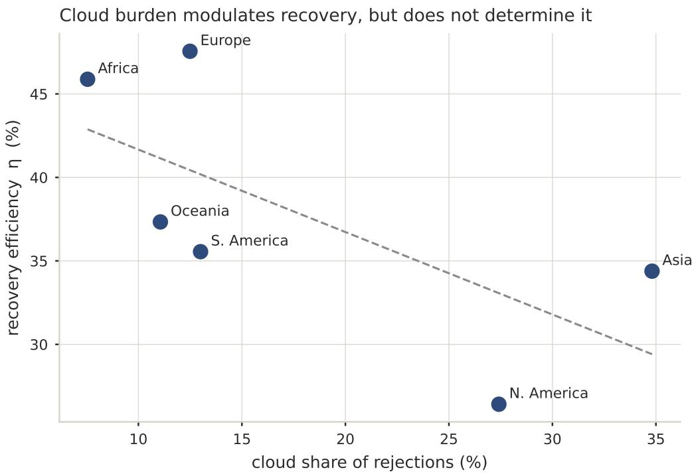  
Figure 5: Per-region recovery eficiency η against cloud burden, the share of a region’s rejections that were cloud-driven. Cloud burden modulates recovery but does not determine it: the cloudier regions tend lower, yet the relation is not monotone — North America breaks it, with a moderate cloud share but the lowest eficiency — so what bounds recovery is regional scene availability and orbital geometry rather than cloud alone. The dashed line is a descriptive trend, not a fit.

The target countries are a configurable set rather than a fixed list: instead of treating the whole planet as one frame, the acquisition is bounded to small batches of countries, which keeps each download manageable and lets the worked area grow batch by batch across the six inhabited continents. The exact set is recorded in the released configuration and Dataset Card.

## 4.8. Coverage comparison against opportunistic corpora

DDSA is meant to cover every (class × season × region) stratum by construction, rather than the imbalance that opportunistic collection tends to leave in multi-modal SAR–optical corpora. The question is therefore not whether the corpus spans more of the planet than a global archive, but whether deficit-driven acquisition fills the strata more evenly than an opportunistic download would over the same frame. To check that this actually happens, we compare the coverage of the released corpus against two corpora that were assembled opportunistically, SSL4EO-S12 (Wang et al., 2023) and SEN12MS (Schmitt et al., 2019). Each of these corpora was built for a purpose other than balanced coverage: SSL4EO-S12 is an unlabelled pre-training corpus sampled around the most populated cities, so its frame follows population rather than land cover (Wang et al., 2023), whereas SEN12MS samples the globe almost uniformly yet, as its own authors report, still under-represents some land-cover classes such as water (Schmitt et al., 2019). Everything here is computed from public scene metadata — centroid coordinates and acquisition season — and from the per-stratum report Σ of Section 2; nothing is trained and no extra imagery is downloaded.

The thing that matters most is that we re-stratify the two reference corpora under our own scheme, not theirs. For each scene we assign a land-cover class by point lookup on the same ESA WorldCover 2021 product (Zanaga et al., 2022), a continental region by point-in-polygon intersection with Natural Earth admin-0 boundaries (Natural Earth, 2024), and a hemispherecorrected season from the acquisition month. The strata are therefore identical across all three corpora, and the contrast is not an artefact of diferent labelling conventions.

We report four descriptors over the strata: (i) the Northern-to-Southern hemisphere sample ratio; (ii) the number of land-cover classes that reach at least 1% of a corpus’s samples, counted over the eight WorldCover classes that the shared stratification retains (snow and ice, mangroves, and moss and lichen do not occur across all sampled regions and are dropped in Phase B); (iii) the normalised Shannon entropy of the stratum-occupancy distribution, which is higher when samples are spread across many strata instead of piling up in a few; and (iv) the fraction of samples at tropical latitudes (|lat| ≤ 23.5◦), the band that cloud cover hits hardest. Table 5 collects the result, and Figure 6 shows the region×season share of each corpus as a heatmap, with the repair ablation drawn as a diference panel. Figures 7 and 8 then open the four descriptors up: the first shows where each corpus actually sampled, the second how each distributes its samples over region, land cover and season. The table summarises; these two are where the summary comes from.

One caveat applies to all of them. Every sample counted here for

STRATA-S12 has passed the Phase-D gate and the Phase-E review, at a cost of 2,079,035 rejected attempts for 740,746 released pairs; the reference corpora are filtered on scene-level metadata alone. The comparison is therefore of how each regime distributes what it kept, not of equally conditioned samples.

The two figures separate what the four descriptors compress. Geographically (Figure 7) the diference is not a matter of degree: SSL4EO-S12 places its densest cells along the northern mid-latitudes and thins sharply south of the equator, while STRATA-S12 carries substantial mass across equatorial Africa, the Amazon basin and southern Asia. The regional marginals (Table 4; Figure 8) put numbers on it — Africa holds 26.7% of STRATA-S12 against 14.1% of SSL4EO-S12, and Oceania 6.8% against 0.9% — with the complementary deficit in North America, which the population-following frame favours and the deficit-driven one does not.

Table 4: Regional share of each corpus (% of that corpus’s own samples) over the six continental regions of the shared frame. Columns sum to 100 up to rounding.
<table><tr><td>Region</td><td>STRATA-S12 SSL4EO-S12</td><td>SEN12MS</td></tr><tr><td>N. America</td><td>12.1</td><td>25.8 22.1</td></tr><tr><td>S. America</td><td>9.7</td><td>12.0 7.3</td></tr><tr><td>Europe</td><td>18.9</td><td>17.5 24.7</td></tr><tr><td>Africa</td><td>26.7</td><td>14.1 17.5</td></tr><tr><td>Asia</td><td>25.8</td><td>29.7 23.2</td></tr><tr><td>Oceania</td><td>6.8</td><td>0.9 5.2</td></tr></table>

Across land-cover classes the contrast is one of spread rather than of any single class. STRATA-S12 ranges from 2% to 23% of its samples across the eight classes, against 1% to 33.5% for SEN12MS, which is the entropy difference of Table 5 read directly. Two classes are worth naming. Permanent water bodies take 8.5% of STRATA-S12 against 1.7% and 3.5%, which quantifies the water under-representation the SEN12MS authors report of their own corpus (Schmitt et al., 2019). Built-up is the one class STRATA-S12 is sparsest on (2%), since the per-class target favours classes that dominate a tile and built-up dominates comparatively few tiles of the frame. The seasonal axis is the one on which this corpus does not lead. SSL4EO-S12 acquires four seasonal snapshots per location and is therefore uniform across seasons by construction, whereas STRATA-S12 carries a mild spring excess and SEN12MS a pronounced autumn one. Season is a stratification axis here, not a per-location requirement, so the quota is met per stratum rather than per site; matching a per-location seasonal sampling would be a change of acquisition policy rather than of balance control, and is not claimed.

One descriptor is deliberately not among the four. Stratum occupancy — the fraction of the K = 192 cells holding at least one sample — saturates at this scale and no longer separates the corpora: all three exceed 98% and two reach 100%. With hundreds of thousands of samples spread over 192 cells, even a strongly skewed sampler touches every cell at least once, so occupancy measures corpus size more than acquisition strategy. We report it as supplementary and base the comparison on how the mass is distributed within the frame, which is what the entropy and the geographic fractions capture. The comparison is also read with the acquisitions’ diferent stopping points in mind: the geographic fractions are shares and are insensitive to where a run was stopped, whereas entropy and occupancy are not.

Table 5: Coverage distribution of the DDSA corpus against opportunistic corpora, computed from public scene metadata over the shared (class × season × region) stratification. Higher normalised entropy and more classes covered indicate a broader spread across strata. The hemisphere ratio is read with care: land area is itself Northern-skewed, so part of any imbalance is geographic, but DDSA’s ratio is driven by its per-stratum quotas rather than by scene availability, so a strong skew in an opportunistic corpus points to cloud-induced dropout beyond that baseline.
<table><tr><td colspan="5">Descriptor DDSA D DDSA D (no repair) SSL4EO-S12 SEN12MS</td></tr><tr><td>Hemisphere ratio (N:S)</td><td>2.92</td><td>2.74</td><td>4.99</td><td>4.09</td></tr><tr><td>Land-cover classes covered</td><td>8</td><td>8</td><td>7</td><td>8</td></tr><tr><td>Normalised coverage entropy</td><td>0.904</td><td>0.912</td><td>0.871</td><td>0.864</td></tr><tr><td>Tropical-band fraction (%)</td><td>32.7</td><td>33.6</td><td>18.9</td><td>22.7</td></tr></table>

This is a descriptive comparison, and we are careful not to oversell it: the corpora were built over diferent sampling frames and target regions, so the contrast reflects how each was acquired rather than one cleanly controlled variable. To isolate the algorithm on its own we add an internal ablation over our own sampling frame. The column “DDSA D (no repair)” recomputes the same descriptors over only the Phase-D bulk acquisition, leaving out the tiles that the Phase-E deficit-repair loop brought back. With the frame held fixed, the gap between the two columns isolates what the repair contributed to the distribution. The ablation is a filter over the released corpus rather than a second acquisition: every delivered pair records whether the Phase-E repair loop brought it back, so the “no repair” column is the same corpus with those pairs withheld, scored by the same code on the same frame. Nothing is re-downloaded and no parameter changes between the two columns.

SAR Optical pair coverage by region × season, share of each corpus  
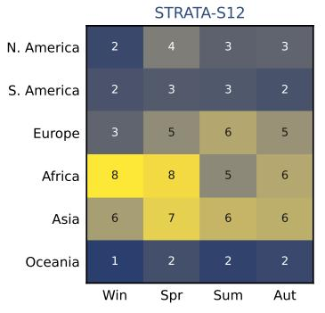

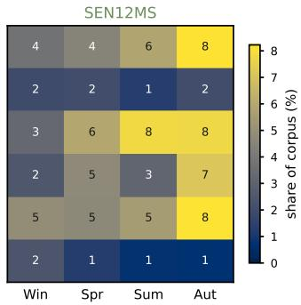

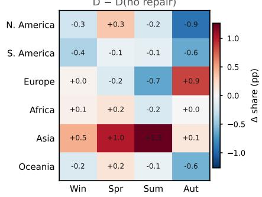  
The repair ablation as a difference panel. Every cell of D D(no repair) is small: the Phase-E loop adds volume roughly in proportion to the existing distribution, so it changes the corpus shape negligibly. The balance comes from the deficit-driven ordering of Phase C, not from the repair (cf. Table 4, §4.8).  
Figure 6: Coverage of STRATA-S12 against SSL4EO-S12 and SEN12MS over the shared (class × season × region) strata. Each top panel is one corpus; cell colour is the share of that corpus’s samples falling in a (region, season) stratum, so the panels are comparable across corpora that difer in size by orders of magnitude, and the seasonal axis is read left-to-right within a panel. The lower-left panel is the D − D(no repair) diference: its near-zero cells show that the Phase-E repair loop adds volume roughly in proportion to the existing distribution rather than redistributing it, so the stratum balance comes from the deficit-driven ordering of Phase C upstream (cf. Table 5 and Section 4.8).

The result is not the one the framing would predict, and we report it as measured: withholding the repaired pairs leaves the four descriptors essentially unchanged, and marginally more favourable. The reading is consistent with Table 2. The loop succeeds where an alternative clean scene exists, and an alternative clean scene exists where the sky is clear — which is where the bulk acquisition had already succeeded. It therefore adds volume roughly in proportion to the existing distribution rather than redistributing it. Read together with Equation (4), the two quantities answer diferent questions and should not be conflated: η measures how much of what was retried was refilled, while the ablation measures how much that refilling changed the shape of the corpus. A loop can score well on the first and leave the second flat, and here it does. What the repair buys, on this evidence, is 39.5% more pairs at unchanged distribution and unchanged quality — yield rather than balance — while the balance itself comes from the deficit-driven ordering of Phase C, upstream of the repair.

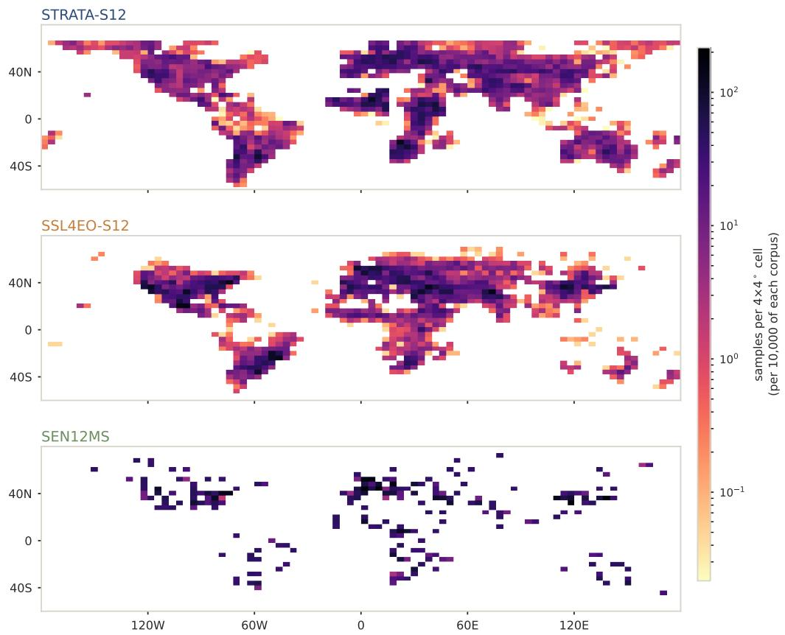  
Figure 7: Global sample density of the three corpora, binned on a $4 ^ { \circ }$ grid and normalised to each corpus so the panels compare distribution rather than size. The colour scale is logarithmic and shared: densities span several orders of magnitude between an empty cell and a dense continental one, and on a linear scale everything but the hottest cells collapses into the background. The three regimes are visibly diferent: SSL4EO-S12 concentrates its densest cells along the northern mid-latitudes and thins below the equator, the signature of a frame that follows population; SEN12MS is sparse everywhere, being two orders of magnitude smaller; STRATA-S12 spreads across the worked continents with its densest cells in equatorial Africa, the Amazon and southern Asia. The empty regions of the bottom-left panel are countries this acquisition has not reached yet, not strata it failed to fill (Section 4.9).

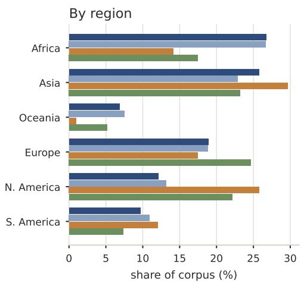

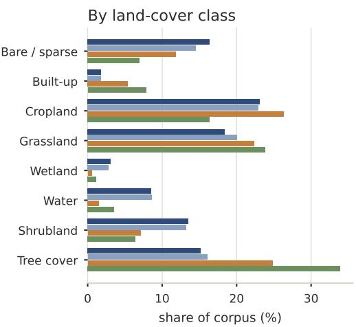

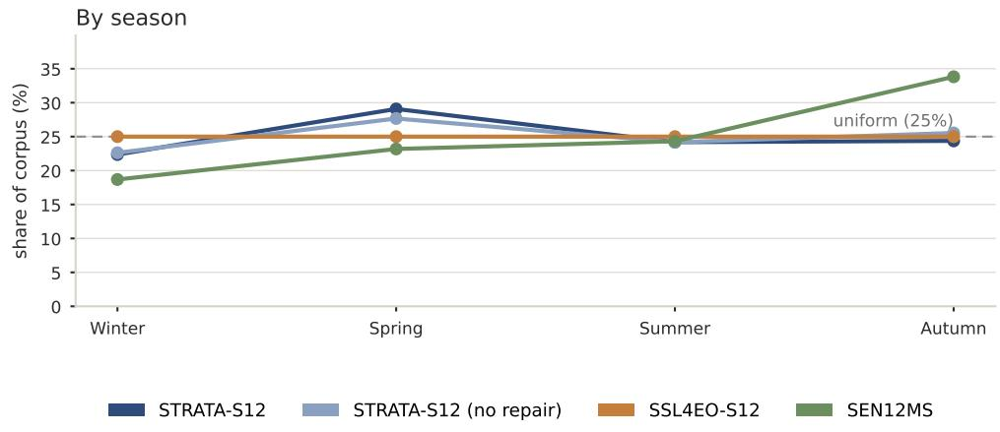  
Figure 8: Marginal share of each corpus over the three stratification axes. Bars are percentages of each corpus’s own samples, so corpora difering in size by more than an order of magnitude remain comparable. The three marginals are shown in place of the full $K = 1 9 2 { \mathrm { ~ g r i d } }$ , which is unreadable at this width and answers the same question less directly: which continent, which land cover and which season each acquisition regime overor under-represents. The season panel is drawn as a profile because the axis is an ordered cycle, with the uniform share marked so departures are read against a reference rather than against a truncated axis.

## 4.9. Isolating the acquisition ordering

The coverage comparison of Section 4.8 contrasts STRATA-S12 with corpora built over diferent frames, so it cannot, on its own, separate what the deficit-driven ordering of Phase C contributes from what the choice of frame contributes. We isolate the ordering with a controlled experiment over a single frame: our own delivered pool. Holding the set of delivered pairs fixed, we replay their acquisition under three orderings and measure how coverage grows with the acquisition budget. Deficit-greedy is the Phase C rule, adding at each step to the stratum with the largest current deficit; abundance-first fills the tile-richest strata first, emulating an availability-driven download; and random shufles the pool. At each budget we report three coverage descriptors over the K = 192 strata: the number of strata that hold at least one pair, the min-fill (the count in the poorest stratum, the most direct measure of whether every stratum is served), and the normalised occupancy entropy. Nothing is re-acquired: the experiment re-orders rows already in the master, so the only variable is the ordering.

Table 6 reports the result. The separation is decisive at a partial budget and closes only at the end. At 5% of the budget the deficit-greedy ordering already holds all 192 strata populated with a floor of seven pairs each, while abundance-first has reached only a handful of strata and leaves the poorest at zero; random touches every stratum but keeps the poorest near-empty. All three converge at 100%, as they must, since they order the same pool. The reading is that the stratum balance of STRATA-S12 is a property of the acquisition ordering, not of how far the run was taken: a partial deficit-driven run is already a covering one, whereas an availability-driven run stopped at the same budget would have left the dificult strata empty and the easy ones large. Since the re-ordering runs over the delivered pool, this is a conservative lower bound on the efect: an availability-driven acquisition would have delivered a more skewed pool to begin with, never visiting the rare strata that Phase C reaches, so the true gap would be wider than the one measured here. This finite-budget behaviour is consistent with the structure of the planning objective (Section 2.1): because the coverage function is monotone and submodular and each block’s marginal gain is clipped to the residual deficit, greedy selection spreads early mass across the poorest strata rather than deepening the richest — which is what a partial run reaching full min-fill shows empirically.

Table 6: Coverage of the delivered pool under three acquisition orderings, at three budgets, over the shared K = 192 strata. Min-fill is the count in the poorest stratum. Deficit-greedy is the Phase C rule; abundance-first emulates an availability-driven download. The orderings re-order the same delivered pairs, so they coincide at the full budget; the separation at a partial budget is what the ordering contributes.
<table><tr><td>Budget Ordering</td><td></td><td></td><td>Strata covered Min-fill Norm. entropy</td></tr><tr><td rowspan="4">5%</td><td>deficit-greedy (Phase C)</td><td>192</td><td>7 0.996</td></tr><tr><td>abundance-first random</td><td>2</td><td>0 0.130</td></tr><tr><td></td><td>192 0</td><td>0.904</td></tr><tr><td>deficit-greedy (Phase C)</td><td>192 7</td><td>0.982</td></tr><tr><td rowspan="3">25%</td><td>abundance-first</td><td>12</td><td>0 0.463</td></tr><tr><td>random</td><td>192</td><td>2 0.904</td></tr><tr><td>deficit-greedy (Phase C)</td><td>192</td><td>7 0.904</td></tr><tr><td rowspan="2">100%</td><td>abundance-first</td><td>192</td><td>7 0.904</td></tr><tr><td>random</td><td>192</td><td>7 0.904</td></tr></table>

## 4.10. What the corpus demonstrates about the algorithm

The released corpus is the algorithm’s product, and the measurements of the preceding subsections are evidence about the algorithm rather than about this particular corpus. None of them depends on how far the acquisition was run. Two of the results have already been established above and are only recalled here: that a partial deficit-driven run is already a covering one, shown by the ordering experiment of Section 4.9 (Table 6, Figure 9); and that recoverability is governed by the temporal persistence of a defect rather than by its type, read from the per-reason eficiencies of Section 4 (Table 2). What remains to state here is the third result, which the other subsections leave implicit: that the repair loop buys its 39.5% of the corpus at no measurable cost in quality.

Phase-C ordering over the same delivered pool  
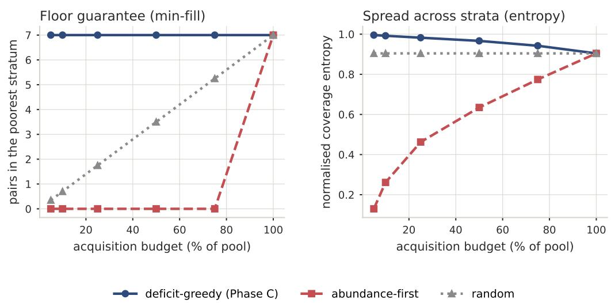  
Figure 9: Coverage versus acquisition budget for the three orderings over the delivered pool. Left: min-fill, the number of pairs in the poorest stratum — deficit-greedy holds a floor from the first few per cent of the budget, while abundance-first leaves the poorest stratum empty until the run is almost complete. Right: normalised coverage entropy. The orderings coincide at the full budget because they re-order the same pool; the gap at a partial budget is the contribution of the ordering (Section 4.9).

Three quantities, all computed over the delivered pairs, support that claim. First, the pairs the loop recovered survive the subsequent manual review at 89.8%, so recovery does not simply defer removal to a later stage. Second, their temporal pairing is no looser than that of the first-pass pairs: the mean SAR–optical gap is 1.3 days for recovered pairs against 1.3 days for first-pass ones, well within the τ = 3 window either way. Third, their landcover purity is not lower — 0.7 against 0.7 — so the alternative scene the loop finds is, if anything, marginally better centred on its dominant class rather than worse. The repair therefore adds volume in the dificult strata without relaxing the guarantees that define a delivered pair; taken with the ordering result, this is why the loop is worth running even though, as Section 4.8 showed, it does not by itself redistribute the corpus. That redistribution is the job of the deficit-driven ordering upstream; the loop’s job is yield at constant quality.

The corpus itself is a worked instance of these statements, not the claim. It is ofered as a usable product — and we expect it to be used — but its role in this paper is to make the results above measurable rather than asserted.

## 5. Technical Validation

The aim of this section is deliberately narrow: to show that the released corpus is usable for what we built it for, self-supervised pre-training, and nothing beyond that. We do not claim that STRATA-S12 outperforms other corpora, nor that the method we use is the best available; those questions belong to the follow-up work mentioned earlier. We also stop short of one neighbouring claim: we do not test here whether the broader stratum coverage reported in Section 4.8 improves downstream performance, since that benefit-of-coverage question requires a controlled cross-corpus comparison with geographically held-out evaluation, which we leave to the follow-up work. What we report is a single, pre-registered check that the corpus carries enough signal to learn from. The probe is an in-domain transfer test — reBEN is optical/SAR land-cover imagery, like the corpus — which is the standard evaluation regime for SAR–optical SSL (Fuller et al., 2023; Wang et al., 2024) and the same one SSL4EO-S12 uses (Wang et al., 2023). We take that as the appropriate setting rather than a limitation: the two arms difer only in whether the encoder saw D, so a random-init backbone put through the identical in-domain probe is the control that isolates what pre-training on the corpus contributed. That the pre-trained arm clears the criterion while the random one does not is therefore attributable to the corpus, not to the ease of the task.

## 5.1. Pre-registered protocol

We fix the protocol before running anything and record it as a dated, readonly artefact: the metric, the version of the downstream dataset, the splits, the random seeds, the pre-training schedule, and the numerical criterion for success. Only one quantity is set by experiment rather than in advance — the number of pre-training epochs, which we calibrate once on the target hardware from a short timing run and then freeze. Fixing the protocol up front is what keeps us from moving the goalposts after seeing the numbers. The criterion is a conservative non-overlap rule, which we prefer to a significance test because it makes no distributional assumptions: averaged over seeds, the pre-trained backbone must beat the random-initialisation baseline by more than the two error bars combined, so that the two seed distributions do not overlap at one standard deviation, that is mean $\mathrm { \Delta l _ { p r e } - s t d _ { p r e } > m e a n _ { r n d } + s t d _ { r n d } }$ on micro-mAP.

## 5.2. Method

We pre-train on a stratified representative subset of the corpus D (90,403 pairs, the first 330 seed-shufled WebDataset shards), sized to the pretraining I/O budget of the target hardware; because the shards are seedshufled at packing time, any prefix is a representative draw across all class×season×region strata. The backbone is a small vision transformer (ViT-S/16) trained as a masked autoencoder (He et al., 2022). Optical and radar are fused early, before the encoder: each pair becomes a single sixchannel image — the three Sentinel-2 RGB bands together with Sentinel-1 VV, VH and their diference — so the model sees one co-registered stack rather than two separate streams. We mask 70% of the patches and train the decoder to reconstruct the missing ones. The choice of early fusion and a single encoder is deliberate: the question here is not which fusion strategy works best, which belongs to the follow-up work, but whether the corpus supports useful pre-training at all, so we keep the setup plain and easy to reproduce while still using both modalities. Pre-training on the full corpus D across the full model suite is deferred to the follow-up work, where compute is not the limiting factor. The full pre-training configuration is summarised in Table 7, and pre-training converged as expected (Figure 10): the maskedreconstruction loss fell from 0.87 to 0.39 over 100 epochs, with the learning rate following the warmup–cosine schedule (warmup over the first 10 epochs).

To read of how good the learned features are, we freeze the encoder and train only a linear classifier on top of it; linear probing of a frozen backbone is the standard way to read of representation quality in self-supervised learning (He et al., 2020; Chen et al., 2020), and it avoids letting fine-tuning cover for a weak backbone. The downstream task is the refined BigEarthNet (reBEN / BigEarthNet v2.0) (Clasen et al., 2024) in its 19-class multi-label form (Sumbul et al., 2021), with micro-mAP as the headline number and macro-mAP reported beside it as a descriptor. The linear layer is trained on 40,000 training patches — a seed-shufled draw from the reBEN training split, fixed by seed 42 so the subset is reproducible — and evaluated on the complete reBEN test split, so the score is read over the whole benchmark rather than a subsample of it. The baseline is the same architecture left at random initialisation and probed in exactly the same way, so the only diference between the two arms is whether the encoder was pre-trained on

Table 7: MAE pre-training configuration (frozen for all seeds).
<table><tr><td>Setting</td><td>Value</td></tr><tr><td>Backbone</td><td>vit_small_patch16</td></tr><tr><td>Input channels</td><td>6</td></tr><tr><td>Mask ratio</td><td>0.7</td></tr><tr><td>Effective batch size</td><td>256</td></tr><tr><td>Base learning rate</td><td>1.5e-04</td></tr><tr><td>Weight decay</td><td>0.05</td></tr><tr><td>Warmup epochs</td><td>10</td></tr><tr><td>Total epochs</td><td>100</td></tr><tr><td>Precision</td><td>bfloat16</td></tr><tr><td>Seed</td><td>0</td></tr></table>

D. Each arm is run with at least three random seeds, and we report the mean and standard deviation. We keep to a single downstream task on purpose: the aim is to confirm that the corpus carries transferable signal, not to benchmark it, and a sweep across tasks, corpora and methods is left to the follow-up work.

Inputs are 224 × 224: native-resolution crops of the released $5 1 2 \times 5 1 2$ tiles at pre-training (centre crops at evaluation, with BigEarthNet patches resized up), standardised with fixed per-band statistics.

## 5.3. Reproducibility layer

The evaluation harness we release takes the corpus and the pre-trained weights as its only inputs and carries none of the acquisition-side code. The Phase-E removal ledger is released with the corpus: one row per removed pair, recording its stratum, whether it was removed by human review or by the automated post-download integrity check, and the Sentinel-1/Sentinel-2 source-scene identifiers, so any removal can be re-checked by re-fetching the scene. The evaluated encoder is the epoch-100 checkpoint of the pretraining run of Section 5, i.e. the fully trained backbone rather than an early snapshot; it is the weight file shipped with the release. Dependencies are pinned in a lockfile, seeds and splits are deterministic, and every run writes out its metrics, configuration and logs, so a reader can reproduce a number or trace where it came from. Pre-training was run on a single consumer RTX 4070 Laptop GPU (8 GB), which sets the pre-training I/O budget behind the representative subset of Section 5.2; the recorded per-run hardware and configuration make the schedule reproducible on comparable devices.

MAE pre-training on STRATA-S12 (representative subset)  
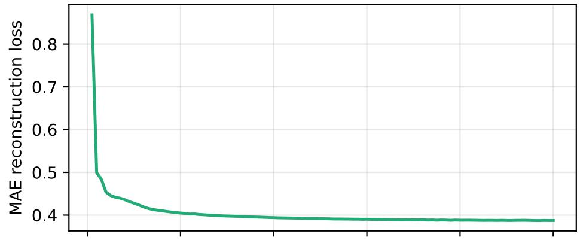

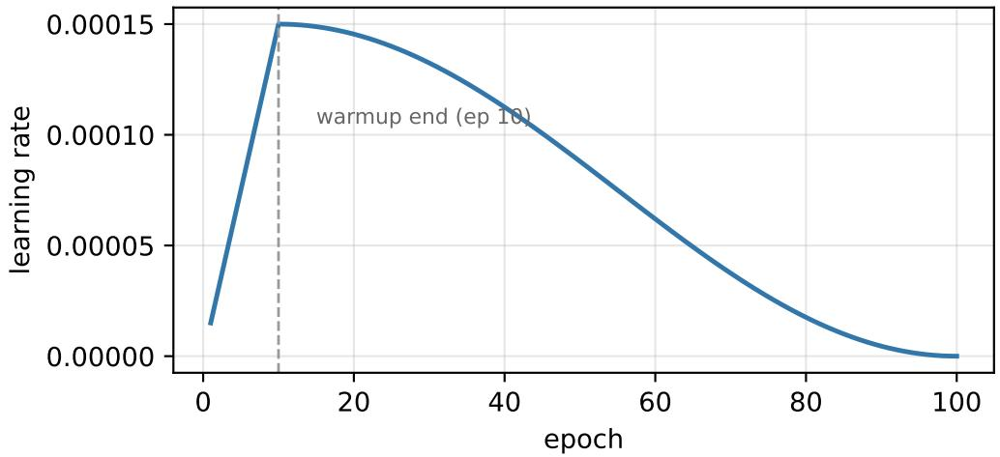  
Figure 10: MAE pre-training on the representative subset of STRATA-S12: maskedreconstruction loss (top) and learning rate (bottom) over 100 epochs. The dashed line marks the end of the learning-rate warmup.

## 5.4. Results

The probe clears the pre-registered criterion, and by a comfortable margin. Table 8 and Figure 11 report the numbers behind that statement.

The criterion is met. On micro-mAP the pre-trained backbone reaches $0 . 5 5 5 2 \pm 0 . 0 0 2 2$ against $0 . 5 1 5 8 \pm 0 . 0 0 6 8$ for the random-init baseline; subtracting one standard deviation from the first and adding one to the second still leaves the pre-trained arm ahead, by a margin of 0.0304 in micro-mAP, so the two seed distributions do not overlap at one sigma. The gap is modest in absolute terms, and we would rather state that than dress it up: the point of this check is a clean, pre-registered separation from random initialisation, not a headline score, and the separation is there with room to spare. The macro-mAP, which we report only as a descriptor, moves in the same direction and by a little more $( 0 . 3 3 6 6 \pm 0 . 0 0 0 4$ versus $0 . 2 9 2 0 \pm 0 . 0 0 4 6$ , a gap of 0.0446), which is the expected pattern on a benchmark as class-imbalanced as BigEarthNet: macro weights the rare classes equally, so an encoder that has learnt something beyond the majority land covers gains more there than on the frequency-dominated micro average. Both arms are scored over all 19/19 classes of the test split, with no class dropped for want of positives, so the two numbers are directly comparable.

Table 8: Frozen linear-probe performance on reBEN (BigEarthNet v2.0, 19-class multilabel), mean ± standard deviation over 3 seeds. The pre-registered criterion is met when $\mathrm { m e a n } _ { \mathrm { p r e } } - \mathrm { s t d } _ { \mathrm { p r e } }$ exceeds $\mathrm { m e a n } _ { \mathrm { r n d } } + \mathrm { s t d } _ { \mathrm { r n d } }$ on micro-mAP.
<table><tr><td>Metric</td><td>Pre-trained on D Random init</td><td></td></tr><tr><td>micro-mAP (primary)</td><td> $0 . 5 5 5 2 \pm 0 . 0 0 2 2$ </td><td> $0 . 5 1 5 8 \pm 0 . 0 0 6 8$ </td></tr><tr><td>macro-mAP (descriptor)</td><td> $0 . 3 3 6 6 \pm 0 . 0 0 0 4$ </td><td> $0 . 2 9 2 0 \pm 0 . 0 0 4 6$ </td></tr></table>

Frozen linear probe on reBEN (3 seeds)  
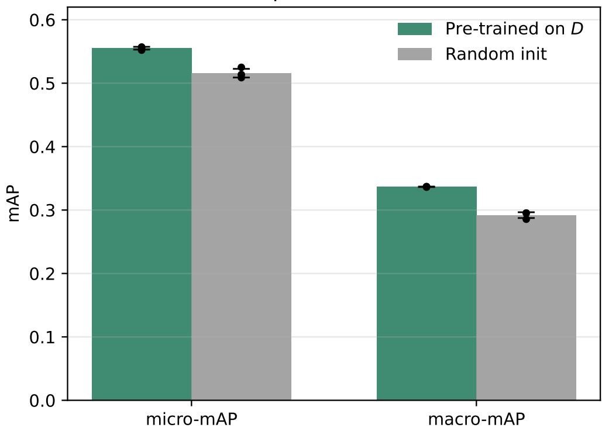  
Figure 11: Frozen linear-probe scores on reBEN (BigEarthNet v2.0), pre-trained on D versus random initialisation. Bars are the mean over 3 seeds and the black dots the individual seed values; error bars are one standard deviation. Both micro-mAP (the primary metric of the pre-registered criterion) and macro-mAP are shown so that neither is read in isolation.

Figure 12 opens the macro number up by class. The pre-trained encoder is ahead of, or level with, the baseline on every one of the 19 classes — there is no class where random initialisation wins — and the size of the gain tracks how much structure a class carries. The largest gains fall on the compositionally rich land covers, agro-forestry, pastures, urban fabric and complex cultivation, where separating the class needs texture and context rather than colour alone; these are exactly the ones a useful pre-training should help with. Where the two arms nearly coincide, the reason is visible in the other direction: marine water and coniferous forest sit high for both, because they are spectrally distinctive enough that even an untrained encoder ranks them well, so there is little headroom left to gain. The three rarest classes — coastal wetlands, beaches and dunes, natural grassland — stay low for both arms; with on the order of a thousand positives across the whole of reBEN, a linear probe on frozen features does not recover them, pre-training or not. We flag this as a limit of the probe rather than of the corpus: it is a known consequence of BigEarthNet’s class imbalance (Clasen et al., 2024), and a fuller evaluation with fine-tuning or class-balanced sampling is the place to revisit it, not this fitness-for-purpose check.

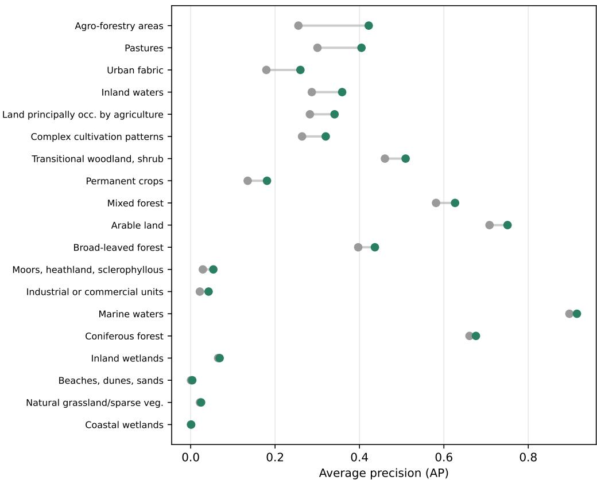  
Figure 12: Per-class average precision on reBEN, pre-trained on D versus random initialisation, averaged over 3 seeds. Each row is one of the 19 classes; the grey and green dots are the two arms and the connecting bar is the per-class gain from pre-training. Classes are ordered by that gain. The pre-trained encoder is ahead on every class, with the widest gains on the compositionally rich land covers and the narrowest on the classes either arm already separates well or that are too rare for a linear probe to recover.

## 6. Discussion

## 6.1. Usage Notes

The expected primary use of the released corpus is SSL pre-training on the full corpus D, with downstream evaluation performed against external labelled benchmarks of the user’s choosing. For users with restricted compute budgets, the reduced benchmark split $D _ { \mathrm { l i t e } }$ is the recommended drop-in: a small subset released purely for ease of use, preserving coverage of all 192 strata at a bounded per-stratum size. It is capped, not equalised: a user who needs exactly equal strata should down-sample it further to its smallest stratum. The released pre-trained weights of Section 5 were obtained on a representative subset of D (see Section 5.2), calibrated to the pre-training budget of the target hardware.

Loaders should rely on the folder hierarchy for fast filtering and on the perpair sidecar for any decision that depends on metadata (temporal gap, cloud fractions, label purity, provenance). The released README and Dataset Card mirror the conventions used here.

Users requiring supervised-task ground truth should rely on external labelled benchmarks; the WorldCover-derived class field of the corpus is intended for SSL stratification only, and the temporal gap between the World-Cover product (2021, v200) and the Sentinel acquisitions may introduce label noise. See the Label-source caveat in Section 4.5.

## 6.2. Limitations

Several limitations should be stated plainly. (i) The released corpus covers a broad set of regions but is not an exhaustive global acquisition. Running DDSA to full global completion is a matter of compute time rather than method; the contribution here is the acquisition algorithm and the evidence that its deficit-driven download improves stratum balance, not a claim of planetary coverage. Extending the worked sample toward a complete global corpus is left as future work. The released corpus is a snapshot of an acqui sition stopped by resource budget rather than by exhaustion of the frame: 8 of the 192 strata hold fewer than one hundred pairs, and those are the ones a continued run fills first.

(ii) Stratification labels come from ESA WorldCover 2021, four years before the imagery, so a small fraction of tiles in areas of real land-cover change may carry a stale stratum label (Section 4.5); the labels are used only as a stratification key, not as supervised targets.

(iii) The Phase E quality control includes a human-in-the-loop step. It is not fully automated and carries the usual reproducibility caveats of manual review; we mitigate this by fixing a closed criteria list (Section 2), recording every manual removal under a single manual\_review category in Σ, and keeping full per-tile provenance so any removal can be re-fetched and re-checked. We do not log which criterion triggered each removal, as hand-labelling a small fraction by sub-type is disproportionate. The step is retained because some failure modes have no per-pixel threshold signature — cloud shadows, which are dark where the gate keys on bright pixels, and seamless temporal overlaps, whose two halves are each valid and only jointly inconsistent — and therefore cannot be delegated to an automatic gate.

(iv) The recovery eficiency of Equation (4) is measured under DDSA’s own quality gate and its bounded-retry policy, not against an absolute ceiling. A location counted as exhausted is one for which no scene passed these thresholds within this retry budget — at most two retries per location, or fewer if the pool ran out; a laxer cloud threshold or a longer search would move some of those into the recovered column. The figure characterises the loop as configured here and is not a claim about the observability of the ground. Retries were also allocated in stratum-deficit order rather than uniformly, so η is an eficiency over the attempts the loop chose to make, not over a random sample of the failures.

(v) The technical validation is deliberately fit-for-purpose: a single method on a single downstream task, with pre-trained weights obtained on a representative subset of D sized to the target hardware rather than on the full corpus. It confirms that the corpus carries transferable signal but does not benchmark it, nor test whether the full corpus or the broader stratum coverage improves representations; systematic cross-task, cross-corpus and cross-method comparison is left to follow-up work.

(vi) The coverage comparison against other corpora is descriptive rather than controlled, on two counts: the corpora were built over diferent sampling frames, and each is compared after its own quality filtering, which difers. STRATA-S12 applies a stricter cascade, so part of any distributional diference could in principle follow from the filter rather than from the acquisition policy — a persistently cloudy region loses more candidates under a strict gate than under a loose one. The repair loop works against that mechanism rather than with it (Table 3), and the strongest regional diferences appear in Africa and Oceania rather than in the cloudiest strata alone, but the two efects are not separated here. A controlled comparison would need a common sampling frame and a common gate across all three corpora, which is left to follow-up work.

(vii) The no-repair ablation shows the repair loop adding volume without measurably changing the distribution over the frame. We report this rather than the expected redistribution, and attribute the stratum balance to the deficit-driven planning of Phase C instead. Whether a repair loop can be made to redistribute — by prioritising under-filled strata over overall yield when choosing which failures to retry — is a question this design does not answer.

(viii) The released tiles carry Sentinel-2 true colour and Sentinel-1 VV/VH rather than the full spectral and polarimetric stack — a deliberate usability choice; the remaining bands are recoverable per tile from the recorded source identifiers (Section 4.2).

(ix) The formal guarantee of Section 2.1 covers the planning stage only: the greedy plan is (1−1/e)-optimal for the coverage objective, but the deficitrepair loop that acts on the realised (post-gate) coverage is characterised operationally — as a bounded iteration measured by its recovery eficiency η — rather than with a coverage guarantee of its own. Establishing under what availability conditions the loop provably closes the residual deficit is left as future work.

## 7. Conclusions

We presented DDSA, a deficit-driven stratified acquisition algorithm. Its planning stage solves a constrained maximum-coverage problem with the provably-optimal greedy rule (Section 2.1); its contribution is the online layer built on top — a per-stratum deficit that, unlike opportunistic collection, is tracked and repaired during acquisition by a human-in-the-loop stage that recovers pairs a single-pass automatic gate would otherwise discard. The algorithm is released together with STRATA-S12, an open, fully documented SAR–optical corpus whose pairs carry STAC/PDS4-aligned, FAIR sidecars with checksum-verified integrity and full provenance.

Three results, set out in Section 4.10 and only recalled here, follow from measuring the algorithm on its own product. The stratum balance of the corpus is a property of the acquisition ordering — the greedy submodular plan of Section 2.1 — not of how far the run was taken: on the same delivered pool, deficit-driven ordering holds every one of the 192 strata populated from the first few per cent of the budget, where an availability-driven order leaves the dificult strata empty until the end (Section 4.9). Whether a failed acquisition attempt can be recovered is governed by the temporal persistence of its cause and not by the type of defect: geometric failures such as nodata are among the most repairable $( \eta = 4 1 . 4 \% )$ and cloud among the least (η = 18.8%), because a cloudy location is cloudy on most dates of its season. And the repair loop supplies 39.5% of the released pairs at no measurable cost in quality — comparable temporal pairing and land-cover purity to first-pass pairs, and 89.8% surviving the subsequent manual review — with the balance itself coming from the deficit-driven ordering upstream rather than from the loop. We deliberately restrict the claims of this paper to fitness-for-purpose. A pre-registered frozen-linear-probe check confirms that a backbone pre-trained on the corpus carries transferable signal, clearing a random-initialisation baseline under a conservative non-overlap criterion; it is a single-method, single-task check, not a benchmark, and it does not test whether the broader stratum coverage improves downstream performance. The released corpus is also a snapshot of an acquisition stopped by resource budget rather than by exhaustion of the frame, with 8 of the 192 strata still below one hundred pairs. What DDSA contributes is not a claim of planetary coverage but a reusable route to a coverage-balanced, quality-gated multimodal corpus whose balance is controlled by the acquisition policy itself.

That property is what makes STRATA-S12 a substrate for the questions this paper does not answer. Because the corpus removes geographic confounding by construction, it is the controlled ground on which SAR–optical modality asymmetry can be measured without it being conflated with where the samples happen to come from: how much a multi-modal model relies on each sensor and where that reliance fails, how representations degrade under each modality’s characteristic failure, and whether a reliability-conditioned pre-training objective can act on the measured asymmetry. A controlled cross-corpus comparison with geographically held-out evaluation — the direct test of the benefit of coverage — is the immediate next step, for which both the algorithm and the corpus are intended as the foundation.

## Code Availability

The evaluation harness used in Section 5, together with its reproducibility layer, is available at https://github.com/csanchez-research/ strata-s12-eval-harness, archived at release on Zenodo (https://doi. org/10.5281/zenodo.22892250). It takes the corpus and the pre-trained weights as its only inputs and carries none of the acquisition-side code. The acquisition-side implementation is not redistributed: it is tied to operational credentials and infrastructure rather than to the method itself, and the pseudocode of Algorithms 1 and 2, with the specification in this paper, is detailed enough to reimplement DDSA independently.

## Data Availability

The reduced split $D _ { \mathrm { l i t e } }$ of the STRATA-S12 corpus is openly available on Zenodo (https://doi.org/10.5281/zenodo.22646276) under a CC BY 4.0 licence. It is distributed as eight per-class archives, each tile accompanied by a per-pair JSON sidecar, together with a manifest, per-archive checksums, a helper script and worked examples for immediate use. The full corpus D is deposited on Zenodo (https://doi.org/10.5281/zenodo.22699046), which holds the metadata, the pre-trained SSL backbone weights of Section 5, the per-stratum statistics report Σ and the post-acquisition integrity audit report, and links to the image shards, which are hosted on Hugging Face (https:// huggingface.co/datasets/chsanleo/strata-s12) owing to their size. All released artefacts are licensed CC BY 4.0. The corpus is derived from Copernicus Sentinel-1 and Sentinel-2 data (https://dataspace.copernicus.eu) accessed through Google Earth Engine (Gorelick et al., 2017), and from ESA WorldCover 2021 v200 (Zanaga et al., 2022) and Natural Earth admin-0 boundaries (Natural Earth, 2024); each is redistributed under its own licence.

## Acknowledgements

The author thanks his family for their support throughout this work. This work contains modified Copernicus Sentinel data (2024–2025) processed by ESA, and uses ESA WorldCover 2021 v200 and Natural Earth data; the author acknowledges the European Space Agency, the Copernicus Programme, and the WorldCover and Natural Earth teams for making these products openly available.

## Funding

This work was supported by the Key Technologies Research and Development Program of Liaoning Province under Grant No. 2024JH2/102400072, and by the Fundamental Research Funds for the Central Universities under Grant No. N25BSS062.

## Declaration of competing interest

The authors declare that they have no known competing financial interests or personal relationships that could have appeared to influence the work reported in this paper.

Declaration of generative AI and AI-assisted technologies in the manuscript preparation process

During the preparation of this work the author used a large language model for language editing and LaTeX formatting only. After using this tool, the author reviewed and edited the content as needed and takes full responsibility for the content of the article.

## References

Chen, T., Kornblith, S., Norouzi, M., Hinton, G., 2020. A simple framework for contrastive learning of visual representations, in: Proc. 37th International Conference on Machine Learning (ICML), pp. 1597–1607.

Clasen, K.N., Hackel, L., Burgert, T., Sumbul, G., Demir, B., Markl, V., 2024. reBEN: Refined BigEarthNet dataset for remote sensing image analysis. ArXiv:2407.03653.

Drusch, M., Del Bello, U., Carlier, S., Colin, O., Fernandez, V., Gascon, F., et al., 2012. Sentinel-2: ESA’s optical high-resolution mission for GMES operational services. Remote Sensing of Environment 120, 25–36. doi:10. 1016/j.rse.2011.11.026.

Feige, U., 1998. A threshold of ln n for approximating set cover. Journal of the ACM 45, 634–652. doi:10.1145/285055.285059.

Forgaard, T., Reksten, J.H., Waldeland, A.U., Marsocci, V., Longépé, N., Kampfmeyer, M., Salberg, A.B., 2026. THOR: A versatile foundation model for earth observation climate and society applications. ArXiv:2601.16011.

Francis, A., Czerkawski, M., 2024. Major TOM: Expandable datasets for earth observation, in: IGARSS 2024 – IEEE International Geoscience and Remote Sensing Symposium, pp. 2935–2940.

Fuller, A., Millard, K., Green, J.R., 2023. CROMA: Remote sensing representations with contrastive radar–optical masked autoencoders, in: Advances in Neural Information Processing Systems (NeurIPS).

Gorelick, N., Hancher, M., Dixon, M., Ilyushchenko, S., Thau, D., Moore, R., 2017. Google Earth Engine: Planetary-scale geospatial analysis for everyone. Remote Sensing of Environment 202, 18–27. doi:10.1016/j. rse.2017.06.031.

Hasan, M., Hossain, M.A., Roy, S., Bhowmik, S., Patel, A.V., Singha, M., Chaudhuri, S., Khan, M.H., Banerjee, B., 2026. GeoMeld: Toward semantically grounded foundation models for remote sensing. ArXiv:2604.10591.

He, K., Chen, X., Xie, S., Li, Y., Dollár, P., Girshick, R., 2022. Masked autoencoders are scalable vision learners, in: Proc. IEEE/CVF Conf. on Computer Vision and Pattern Recognition (CVPR).

He, K., Fan, H., Wu, Y., Xie, S., Girshick, R., 2020. Momentum contrast for unsupervised visual representation learning, in: Proc. IEEE/CVF Conf. on Computer Vision and Pattern Recognition (CVPR), pp. 9729–9738. doi:10.1109/CVPR42600.2020.00975.

Justice, C.O., Townshend, J.R.G., Vermote, E.F., Masuoka, E., Wolfe, R.E., Saleous, N., Roy, D.P., Morisette, J.T., 2002. An overview of MODIS land data processing and product status. Remote Sensing of Environment 83, 3–15. doi:10.1016/S0034-4257(02)00084-6.

Main-Knorn, M., Pflug, B., Louis, J., Debaecker, V., Müller-Wilm, U., Gascon, F., 2017. Sen2Cor for Sentinel-2, in: Image and Signal Processing for Remote Sensing XXIII, p. 1042704. doi:10.1117/12.2278218.

NASA Planetary Data System, 2024. PDS4 Information Model. https: //pds.nasa.gov/datastandards/.

Natural Earth, 2024. Natural earth – free vector and raster map data. https: //www.naturalearthdata.com.

Nemhauser, G.L., Wolsey, L.A., Fisher, M.L., 1978. An analysis of approximations for maximizing submodular set functions—I. Mathematical Programming 14, 265–294. doi:10.1007/BF01588971.

Purohit, M., Muhawenayo, G., Rolf, E., Kerner, H., 2025. How does the spatial distribution of pre-training data afect geospatial foundation models? ArXiv:2501.12535; Good Data for Generative AI Workshop, AAAI 2025.

Schmitt, M., Hughes, L.H., Qiu, C., Zhu, X.X., 2019. SEN12MS – a curated dataset of georeferenced multi-spectral Sentinel-1/2 imagery for deep learning and data fusion, in: ISPRS Annals of the Photogrammetry, Remote Sensing and Spatial Information Sciences, pp. 153–160. doi:10.5194/isprs-annals-IV-2-W7-153-2019.

Snyder, J.P., 1987. Map Projections: A Working Manual. U.S. Geological Survey Professional Paper 1395, U.S. Government Printing Ofice.

STAC Contributors, 2021. SpatioTemporal Asset Catalog (STAC) Specification v1.0.0. https://stacspec.org.

Sumbul, G., Charfuelan, M., Demir, B., Markl, V., 2019. BigEarthNet: A large-scale benchmark archive for remote sensing image understanding, in: IGARSS 2019 – IEEE International Geoscience and Remote Sensing Symposium, pp. 5901–5904. doi:10.1109/IGARSS.2019.8900532.

Sumbul, G., de Wall, A., Kreuziger, T., Marcelino, F., Costa, H., Benevides, P., Caetano, M., Demir, B., Markl, V., 2021. BigEarthNet-MM: A large-scale, multimodal, multilabel benchmark archive for remote sensing image classification and retrieval. IEEE Geoscience and Remote Sensing Magazine 9, 174–180. doi:10.1109/MGRS.2021.3089174.

Torralba, A., Efros, A.A., 2011. Unbiased look at dataset bias, in: CVPR 2011 – IEEE Conference on Computer Vision and Pattern Recognition, pp. 1521–1528. doi:10.1109/CVPR.2011.5995347.

Torres, R., Snoeij, P., Geudtner, D., Bibby, D., Davidson, M., Attema, E., et al., 2012. GMES Sentinel-1 mission. Remote Sensing of Environment 120, 9–24. doi:10.1016/j.rse.2011.05.028.

Tseng, G., Cartuyvels, R., Zvonkov, I., Purohit, M., Rolnick, D., Kerner, H., 2023. Lightweight, pre-trained transformers for remote sensing timeseries. ArXiv:2304.14065.

Tuia, D., Persello, C., Bruzzone, L., 2016. Domain adaptation for the classification of remote sensing data: An overview of recent advances. IEEE Geoscience and Remote Sensing Magazine 4, 41–57. doi:10.1109/MGRS. 2016.2548504.

Wang, Y., Albrecht, C.M., Braham, N.A.A., Liu, C., Xiong, Z., Zhu, X.X., 2024. Decoupling common and unique representations for multimodal selfsupervised learning, in: Computer Vision – ECCV 2024, pp. 286–303. doi:10.1007/978-3-031-73397-0\_17.

Wang, Y., Albrecht, C.M., Braham, N.A.A., Mou, L., Zhu, X.X., 2022. Selfsupervised learning in remote sensing: A review. IEEE Geoscience and Remote Sensing Magazine 10, 213–247. doi:10.1109/MGRS.2022.3198244.

Wang, Y., Braham, N.A.A., Xiong, Z., Liu, C., Albrecht, C.M., Zhu, X.X., 2023. SSL4EO-S12: A large-scale multimodal, multitemporal dataset for self-supervised learning in Earth observation. IEEE Geoscience and Remote Sensing Magazine 11, 98–106. doi:10.1109/MGRS.2023.3281651.

Wickrema, C., Mace, E., Brown, H., Cabrera, H., Krall, N., O’Neill, M., Sarkar, S., Weissman, L., Hughes, E., Zarrella, G., 2025. Scaling remote sensing foundation models: Data domain tradeofs at the peta-scale. ArXiv:2512.23903.

Wilkinson, M.D., et al., 2016. The FAIR guiding principles for scientific data management and stewardship. Scientific Data 3, 160018. doi:10.1038/ sdata.2016.18.

Wilson, A.M., Jetz, W., 2016. Remotely sensed high-resolution global cloud dynamics for predicting ecosystem and biodiversity distributions. PLOS Biology 14, e1002415. doi:10.1371/journal.pbio.1002415.

Zanaga, D., Van De Kerchove, R., Daems, D., De Keersmaecker, W., Brockmann, C., Kirches, G., Wevers, J., Cartus, O., Santoro, M., Fritz, S., Lesiv, M., Herold, M., Tsendbazar, N.E., Xu, P., Ramoino, F., Arino, O., 2022. ESA WorldCover 10 m 2021 v200. Zenodo. doi:10.5281/zenodo.7254221.