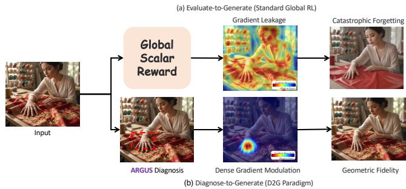
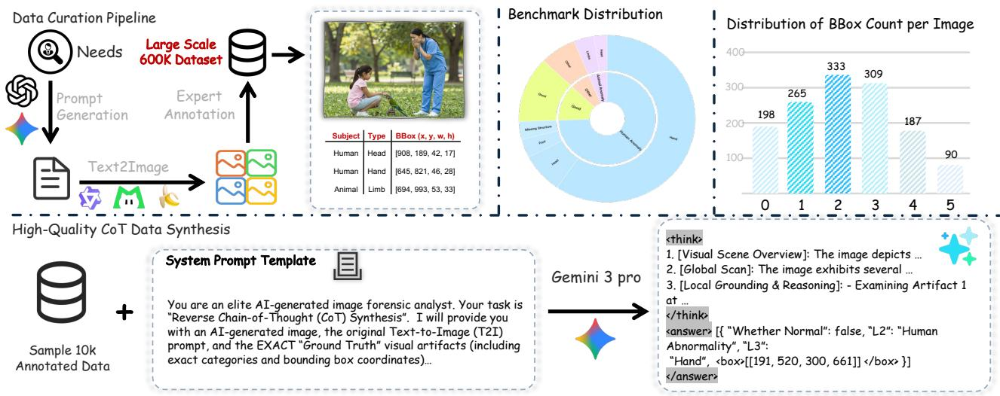
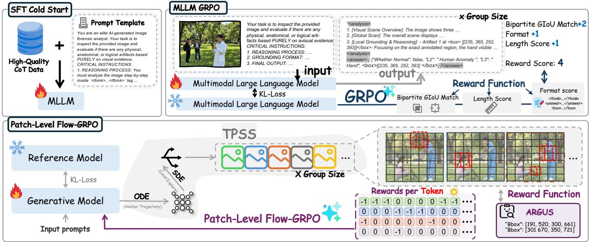
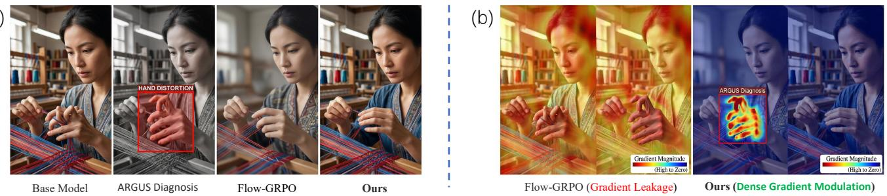
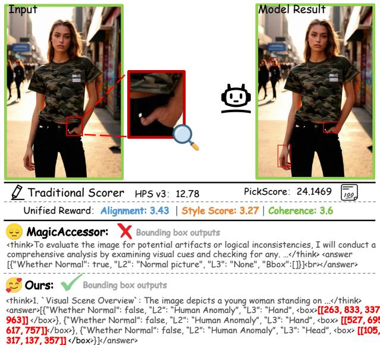
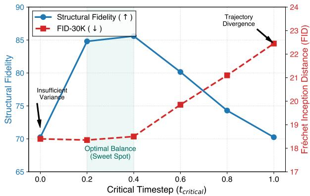

# Diagnose-to-Generate: Eliminating Structural Distortions in Flow Models via Patch-Level Grounded Alignment

Yifan Li∗ University of Science and Technology of China Hefei, AnHui Province, China liyifancqu@163.com

Qilong Huang   
Meituan Inc.   
Beijing, China   
huangqilonghql@gmail.com   
Jie Hu   
Meituan Inc.   
Beijing, China   
hujiemr@163.com

S Kevin Zhou University of Science and Technology of China Hefei, AnHui Province, China s.kevin.zhou@gmail.com

Lishuai Gao✉   
Meituan Inc.   
Beijing, China   
gaolishuai0425@163.com   
Chen Zhao   
Meituan Inc.   
Beijing, China   
2518628273@qq.com   
Yujie Zhong   
Meituan Inc.   
Beijing, China   
jaszhong@hotmail.com   
Tong Zhang   
Meituan Inc.   
Beijing, China   
zhangtong65@meituan.com

Zhuoliang Kang Meituan Inc. Beijing, China kangzhuoliang@meituan.com

Xiaoming Wei   
Meituan Inc.   
Beijing, China   
weixiaoming@meituan.com

Fenghe Tang University of Science and Technology of China Hefei, AnHui Province, China fhtan9@mail.ustc.edu.cn

## Abstract

Flow-based image generators achieve strong semantic synthesis but still produce localized structural distortions, such as malformed hands and limbs. Existing post-training methods typically optimize global scalar rewards, which provide weak spatial credit assignment and may alter well-formed regions while correcting local defects. We present Diagnose-to-Generate (D2G), a grounded alignment framework that separates visual diagnosis from generative optimization. We construct Achilles-600K, a region-annotated dataset for structural anomalies, and train ARGUS through supervised cold-start and Region-Aware Group Relative Policy Optimization to predict anomaly categories and bounding boxes. These diagnoses are converted into confidence-weighted spatial rewards for our Patch-level Flow-GRPO. We further identify that global stochastic exploration can shift semantic regions across group rollouts, making patch-wise relative advantages spatially inconsistent. Our Trajectory-Preserving Stochastic Sampling (TPSS) anchors early denoising with deterministic ODE trajectories and introduces stochasticity only at later steps, thereby limiting intra-group spatial drift while retaining local exploration. Experiments on FLUX.1-dev

and SD3.5 show improved structural fidelity with preserved FID and CLIP scores. Consistent gains under HumanRefiner, zero-shot GPT-4.1, and blinded human evaluation further demonstrate that the improvements extend beyond the training reward model.

## CCS Concepts

• Computing methodologies → Computer vision problems;   
Reinforcement learning; Neural networks.

## Keywords

Flow-based Generative Models, Reinforcement Learning, Grounded Reward Models, Spatial Credit Assignment, Structural Fidelity, Visual Grounding

## ACM Reference Format:

Yifan Li, Lishuai Gao, Tong Zhang, Qilong Huang, Chen Zhao, Zhuoliang Kang, Jie Hu, Yujie Zhong, Fenghe Tang, S Kevin Zhou, and Xiaoming Wei. 2026. Diagnose-to-Generate: Eliminating Structural Distortions in Flow Models via Patch-Level Grounded Alignment. In Proceedings ofthe 34th ACM International Conference on Multimedia (MM ’26), November 10–14, 2026, Rio de Janeiro, Brazil. ACM, New York, NY, USA, 15 pages. https: //doi.org/10.1145/3767308.3835750

## 1 Introduction

Difusion and flow-based models [17, 27, 29, 43] generate images and videos with increasingly convincing composition, appearance, and prompt adherence [1, 4, 7, 10, 22, 52]. Yet a plausible scene can still contain an extra finger, a malformed limb, or an object interaction that violates physical structure. These errors may occupy only a small fraction of an image but substantially afect its credibility and usability. Their persistence exposes a gap between global visual quality and local structural correctness: improving composition or aesthetics does not necessarily correct the geometry of individual entities.

  
Figure 1: Illustration of global and grounded structural alignment. (a) An image-level reward does not identify the region responsible for a structural defect. (b) D2G uses ARGUS diagnoses to construct spatial rewards, concentrating structural (Standard Global RL) relies on holistic scalar rewards, which induce severe gradient leakage. While attempting to rectifyfeedback around anomalous regions while retaining a global triggers catastrophic forgettingquality objective.

Reward-based optimization and preference learning provide practical routes to post-training alignment [13, 34, 37]. In visual generation, however, the feedback often takes the form of a scalar reward for an entire image. Such a reward can distinguish preferred outputs without identifying the regions responsible for that preference. A small anatomical defect may be outweighed by favorable aesthetics, while an unfavorable score does not distinguish the defective region from valid surrounding content. Applying this feedback throughout the spatial domain can therefore change well-formed content while attempting to correct a local error. Figure 1(a) illustrates this spatial credit assignment problem: efective structural alignment requires not only an assessment of image quality, but also evidence of where correction is needed.

Spatially resolved rewards introduce a further challenge when used for patch-wise group-relative optimization. Flow-GRPO and related methods introduce stochastic diferential equation (SDE) sampling into deterministic flow trajectories to obtain online roll outs [28, 57]. Early stochastic perturbations can change object positions and shapes across samples in the same group. A fixed latent coordinate may then correspond to a hand in one rollout and back ground in another. We refer to this loss of spatial correspondence as trajectory divergence. Computing coordinate-wise relative advan tages across these samples compares diferent semantic regions, making localized reward assignment less reliable even when each individual diagnosis is accurate.

We propose Diagnose-to-Generate (D2G), which couples grounded structural diagnosis with a sampling procedure designed for patchwise reward comparison (Figure 1(b)). Its diagnostic foundation is Achilles-600k, a dataset of generated images with structural labels and localized anomaly annotations, accompanied by the separately curated Achilles-Benchmark for diagnostic and generative evaluation. We use human-verified labels and boxes to synthesize Reverse Chain-of-Thought (Reverse-CoT) explanations for a 10K-example

cold-start subset. Conditioning explanations on verified defects reduces reliance on open-ended artifact discovery during data synthesis. We then train ARGUS (Anomaly Recognition and Grounded Understanding Specialist), first through supervised initialization and then through Region-Aware GRPO. Hungarian bipartite GIoU matching and a localization consistency gate connect categorylevel diagnostic rewards to spatial evidence, encouraging ARGUS to identify both the structural error and its location.

To transfer these diagnoses to the generator, we introduce Patchlevel Flow-GRPO with Trajectory-Preserving Stochastic Sampling (TPSS). TPSS retains deterministic ordinary diferential equation (ODE) sampling during early denoising and restricts stochastic exploration to later steps, after the scene layout has been established. This reduces intra-group spatial drift and makes patch-wise comparisons more consistent without requiring identical final images. The frozen ARGUS model diagnoses each generated rollout, and its bounding boxes are mapped to latent tokens to construct spatial penalties. These penalties are combined with an image-level quality reward and normalized across the group at each spatial location. The resulting advantages concentrate structural optimization near diagnosed defects while retaining supervision for global image quality. D2G thus uses localized diagnosis to improve the generator itself, rather than treating diagnosis only as a post-generation assessment.

We evaluate ARGUS across diagnostic backbones and examine D2G on both in-distribution and unseen prompts. On FLUX.1-dev, D2G improves the Achilles structural fidelity score from 62.16 to 85.60, while FID-30K remains close to the base model (18.35 versus 18.42). Because ARGUS also supplies the training reward, we complement its assessment with independent HumanRefiner [9], zero-shot GPT-4.1, and double-blind human evaluation. HumanRefiner reports an anomaly-free rate of 74.8%, compared with 42.2% for the base model, and the human study reports an 82.5% preference win rate. These evaluations support structural improvements beyond the training evaluator, while ablations examine the separate contributions of grounded supervision, spatial reward assignment, and trajectory-preserving exploration.

## 2 Related Work

## 2.1 Reward Models for Image Generation

Image-generation evaluation has progressed from distribution-level metrics such as Inception Score and FID [16, 39] to learned preference models that better reflect human judgments of visual quality and text–image alignment [21, 31, 55, 56]. More recently, Multimodal Large Language Models (MLLMs) have been adapted as evaluators and reward models [25, 31, 51, 53, 54], providing richer semantic assessments and sometimes interpretable Chain-of-Thought feedback. Most methods, however, ultimately reduce an image to a global score or a small set of holistic attributes. Such feedback is efective for preference alignment but ofers limited spatial attribution when the failure is confined to a small region, such as a malformed hand or an implausible object interaction.

Several approaches provide localized assessments. HADM [48] evaluates human anomalies through pixel-level comparison, while ViT-HD [30] and HumanRefiner [9] specialize in human-centric structural defects. RichHF [26] and HEIE [58] produce spatial qual ity maps, ofering finer feedback than scalar rewards. Reasoningbased evaluators including MagicAssessor [47] and REACT [50] improve interpretability through structured textual analysis. Nevertheless, these methods either focus on restricted domains or do not optimize bounding-box localization for downstream generator updates. ARGUS instead formulates structural assessment as grounded diagnosis: it jointly predicts anomaly categories, spatial coordinates, and diagnostic rationales across human, animal, interaction, and object-level distortions. Its outputs are convertible into localized rewards for generative alignment.

## 2.2 RL for Generative Alignment

Reinforcement learning has become an important mechanism for aligning foundation models with task objectives and human preferences [2, 13, 18, 34]. PPO [40] optimizes policies under an explicit reward model, while DPO [37] replaces online policy optimization with preference-based supervision. GRPO [13, 41] further removes the need for a learned critic by estimating advantages relative to samples within the same rollout group. This formulation has been adopted to improve reasoning in MLLMs [42, 49] and unified mul timodal models [14, 20].

For visual generation, recent work has explored both local preference alignment and online reinforcement learning. LocalDPO [19], RePlan [36], TextPecker [60], and GIE-Bench [35] study regionaware preferences, localized editing, or structural-error evaluation, highlighting the value of spatially resolved supervision. In parallel, Flow-GRPO [28], DanceGRPO [57], and MixGRPO [24] extend GRPO to flow-based generators [27]. These methods introduce stochastic diferential equation sampling [43] into otherwise deterministic flow trajectories, enabling online exploration for image and video generation models [4, 44, 45, 52, 59].

Existing flow-based RL methods compute a scalar reward for each rollout and apply stochastic exploration throughout the latent trajectory. This design is suitable for global objectives, but it becomes problematic for patch-level rewards: early stochastic per turbations can change object locations and shapes across samples in the same group, so a fixed spatial coordinate no longer refers to a consistent semantic region. Patch-level Flow-GRPO addresses this mismatch by preserving the early deterministic trajectory and restricting stochastic exploration to later denoising stages. The rollout group maintains stronger spatial correspondence, allowing ARGUS diagnoses to supervise localized regions without replacing the global semantic and aesthetic objectives.

## 3 Achilles-600k and Achilles-Benchmark

Existing image-alignment datasets primarily provide image-level preferences or holistic quality labels [21, 31], which are insuficient for learning where a localized structural failure occurs. We therefore construct Achilles-600k, a region-grounded dataset of generated images with anomaly categories and bounding-box annotations, together with the independently curated Achilles-Benchmark for diagnostic and generative evaluation. Figure 2 summarizes the construction pipeline and benchmark statistics.

## 3.1 Dataset Construction

Image collection and taxonomy. To reduce dependence on a single generator, source images are synthesized using Z-image [4], Qwen-Image [52], LongCat-Image [46], and Nano Banana Pro [33]. Their prompts are generated with GPT-4.1 and Gemini 3.1 Pro [12, 32] and vary in subject, composition, environment, camera view, and visual style. The resulting collection covers four top-level structural categories: abnormal interactions, human anatomy, animal anatomy, and object morphology, with additional fine-grained subcategories. Annotators assign category labels and tight rectangular boxes to each localized defect; images without identifiable structural anomalies are retained as normal examples.

Achilles-600k contains 585K training images and 15K validation images. The evaluation sets described below were generated in a separate batch after the training pool had been frozen. To reduce exact and near-duplicate leakage, we compare evaluation samples against the training pool using exact-image hashes, perceptualimage similarity, and normalized text/prompt matching.

Annotation protocol. Twenty annotators completed a three-round qualification procedure before labeling data. Each image was independently annotated twice using a customized CVAT interface, and disagreements were resolved through expert arbitration. This protocol yields a Fleiss’ � of 0.82 for categorical annotations and a mean pairwise spatial IoU of 0.79 for bounding boxes.

Grounded Reverse-CoTsynthesis. Bounding boxes identify anomalous regions but do not directly provide the reasoning format required by a diagnostic MLLM. We therefore construct a Reverse Chain-of-Thought (Reverse-CoT) subset by supplying Gemini 3.1 Pro with human-verified anomaly labels and bounding boxes and asking it to explain the corresponding structural inconsistency. Unlike open-ended artifact discovery, this procedure conditions the rationale on verified spatial targets, reducing unsupported localization during data synthesis.

The original text-to-image prompt is hidden from the teacher model so that the explanation must be derived from visual evidence rather than prompt-specific shortcuts. Absolute pixel boxes are converted to normalized permille coordinates using the format <box>[[ymin, xmin, ymax, xmax]]</box>, matching the coordinate representation used during ARGUS training. We further remove examples whose structural validity cannot be meaningfully assessed, including purely fictional anatomy and severely obscured or underexposed subjects. After automatic filtering and manual verification, 10K grounded Reverse-CoT examples are selected from the training split for supervised cold-start training.

## 3.2 The Achilles-Benchmark

The diagnostic component of Achilles-Benchmark contains 1,383 human-verified images, comprising 1,185 hard-positive examples and 198 normal controls, with 3,064 annotated anomaly boxes in total. The benchmark emphasizes localized failures rather than global semantic quality: its median bounding-box area is approximately 1,224 px2, and its long-tailed distribution includes small human features, animal anatomy, object morphology, and crossentity interactions. All benchmark images are excluded from both the supervised and reinforcement-learning stages.

  
Figure 2: Achilles-600k construction and benchmark statistics. Diverse generators provide images for human-verified structural annotation, from which 10K grounded Reverse-CoT instances are selected for diagnostic cold-start training. The Achilles Benchmark is independently curated and covers diverse anomaly categories, object scales, and numbers of localized defects.

For end-to-end generator evaluation, we construct 800 prompts balanced across humans, animals, interactions, and complex objects. The prompts vary environments, viewpoints, and photographic styles while explicitly requiring the structurally challenging subject or body part to remain visible. A subject-verification step checks whether the requested entity is present; outputs that evade the structural requirement by omitting or hiding the target are counted as prompt-alignment failures. For the remaining outputs, structural fidelity is measured by the defect-free rate,

$$
S _ { \mathrm { f i d e l i t y } } = 1 0 0 \left( 1 - \frac { N _ { \mathrm { d e f e c t } } } { N _ { \mathrm { t o t a l } } } \right) ,\tag{1}
$$

where $N _ { \mathrm { d e f e c t } }$ is the number of verified images with any structural anomaly and $N _ { \mathrm { t o t a l } }$ is the number of evaluated generations.

## 4 The Diagnose-to-Generate Framework

D2G separates localized structural alignment into two stages, as illustrated in Figure 3. In Stage I, we train ARGUS, a diagnostic specialist that predicts the category, location, and explanation of structural anomalies. In Stage II, ARGUS is frozen and used as a spatial reward emitter for Patch-level Flow-GRPO. The latter preserves spatial correspondence across rollout groups and converts predicted anomaly regions into localized policy updates.

## 4.1 Stage I: Grounded Diagnosis with ARGUS

Grounded SFT initialization. Direct reinforcement learning is inefective when the initial VLM rarely produces valid fine-grained coordinates. We therefore initialize ARGUS through supervised fine-tuning on the 10K Reverse-CoT examples in Section 3.1, following the cold-start strategy of reasoning-oriented alignment [13]. Each training target contains a visual diagnosis, hierarchical anomaly labels, and normalized bounding boxes. This stage teaches the diagnostic taxonomy, output format, and correspondence between structural evidence and spatial coordinates.

Region-Aware GRPO.. Starting from the SFT model, we apply GRPO to improve diagnostic correctness and localization. For each image–instruction pair, the policy samples a group of responses, whose rewards are normalized within the group and optimized using the standard clipped GRPO objective with a KL penalty to the reference policy [13]. Our contribution lies in the region-aware reward used to evaluate each response.

An image may contain multiple anomalies, and their textual output order is not semantically meaningful. Let $\hat { \mathcal { B } } = \{ \hat { b } _ { j } \} _ { j = 1 } ^ { N _ { p } }$ and $\boldsymbol { \mathcal { B } } = \left\{ b _ { k } \right\} _ { k = 1 } ^ { N _ { g } }$ denote the predicted and ground-truth box sets. Inspired by set-based prediction [5], we use the Hungarian algorithm to obtain the assignment

$$
\boldsymbol { \hat { \sigma } } = \arg \operatorname* { m a x } _ { \boldsymbol { \sigma } } \sum _ { k = 1 } ^ { K } \mathrm { G I o U } \big ( \hat { b } _ { \boldsymbol { \sigma } ( k ) } , b _ { k } \big ) , \qquad K = \operatorname* { m i n } ( N _ { p } , N _ { g } ) ,\tag{2}
$$

where GIoU provides informative feedback even when two boxes do not overlap [38].

The resulting sequence reward combines an output-format reward $r _ { 0 } ,$ the matched localization reward $r _ { \mathrm { l o c } } ,$ and hierarchical classification rewards $( r _ { 1 } , r _ { 2 } , r _ { 3 } )$ . To prevent a response from receiving classification credit without correctly grounding its evidence, we introduce a localization consistency gate:

$$
R = r _ { 0 } + r _ { \mathrm { l o c } } + r _ { c } ( r _ { 1 } + r _ { 2 } + r _ { 3 } ) , \qquad r _ { c } = \mathbb { I } \left[ \overline { { \mathrm { I o U } } } _ { \hat { \sigma } } \geq \tau _ { \mathrm { I o U } } \right] .\tag{3}
$$

Thus, category rewards are enabled only when the matched boxes satisfy the localization threshold. This design discourages reward strategies that predict plausible anomaly labels without identifying the corresponding visual evidence.

Distribution rebalancing. Structural anomalies follow a longtailed distribution, while normal images and frequent human-hand errors can dominate random batches. We therefore use multi-bucket sampling to balance normal examples and the four primary anomaly categories. We additionally upsample hard normal examples containing visible yet anatomically valid structures. This prevents ARGUS from learning shortcuts such as treating every visible hand or limb as anomalous.

  
Figure 3: Overview of Diagnose-to-Generate (D2G). Stage I trains ARGUS via grounded SFT and Region-Aware GRPO to localize structural anomalies. Stage II uses ARGUS diagnoses to spatially supervise Patch-level Flow-GRPO. TPSS preserves rollout correspondence, enabling localized advantages to update diagnosed regions while limiting changes elsewhere.

## 4.2 Stage II: Patch-level Flow-GRPO

We use the frozen ARGUS model to align a Flow Matching generator [27, 29]. Existing Flow-GRPO methods introduce SDE sampling into deterministic flow trajectories to obtain online rollouts [28, 43, 57]. Although efective for image-level rewards, applying stochasticity over the entire trajectory can change object positions and shapes across samples in the same group. A coordinate predicted in one rollout may refer to a diferent semantic region in another, making patch-wise relative advantages unreliable.

Trajectory-Preserving Stochastic Sampling. We address this problem with Trajectory-Preserving Stochastic Sampling (TPSS). For each prompt, the rollout group shares an early deterministic ODE trajectory that establishes the scene layout. The trajectory branches into � stochastic rollouts only after a critical timestep �critical ∈ (0, 1). For rollout �, the reverse-time update is

$$
\begin{array} { r } { x _ { t - \Delta t } ^ { ( i ) } = x _ { t } ^ { ( i ) } - v _ { \theta } \left( x _ { t } ^ { ( i ) } , t \right) \Delta t + \mathbb { I } \left[ t < t _ { \mathrm { c r i t i c a l } } \right] \sigma _ { t } \sqrt { \Delta t } \epsilon _ { t } ^ { ( i ) } , } \end{array}\tag{4}
$$

where $\epsilon _ { t } ^ { ( i ) } \sim { \cal N } ( 0 , I )$ . The early interval $t \in [ t _ { \mathrm { c r i t i c a l } } , 1 ]$ is therefore deterministic, while stochastic exploration is restricted to the late interval $t < t _ { \mathrm { c r i t i c a l } }$

TPSS does not preserve exactly the same sampling marginal as a full SDE trajectory. Instead, it deliberately shortens the stochastic interval to trade unrestricted exploration for stronger spatial correspondence. Because the macro-layout is established before the trajectories branch, late perturbations primarily afect local appearance and morphology. We quantify the resulting residual drift and the sensitivity to $t _ { \mathrm { c r i t i c a l } }$ in Section 5.

From grounded boxes to dense spatial rewards. After decoding rollout �, ARGUS predicts a set of anomaly boxes $\mathcal { B } _ { i }$ and a diagnostic confidence $c _ { i }$ . The boxes are mapped to the latent-token grid and rasterized into a spatial mask. To avoid sharp optimization boundaries, we Gaussian-smooth the box support to obtain $M _ { i } ^ { ( h , w ) } \in [ 0 , 1 ]$ , where larger values indicate tokens closer to the diagnosed region.

ARGUS may produce unreliable boxes in heavily occluded or ambiguous images. We therefore apply a confidence safeguard:

$$
\begin{array} { r } { \lambda _ { i } = \lambda _ { p } \mathbb { I } [ c _ { i } \geq \tau _ { c } ] , \tau _ { c } = 0 . 3 , } \end{array}\tag{5}
$$

so low-confidence diagnoses contribute no structural penalty and the optimization falls back to the base reward and reference-policy regularization. The dense reward at latent position $( h , w )$ is

$$
R _ { i } ^ { ( h , w ) } = \mathcal { R } _ { \mathrm { b a s e } } ^ { ( i ) } - \lambda _ { i } M _ { i } ^ { ( h , w ) } ,\tag{6}
$$

where $\mathcal { R } _ { \mathrm { b a s e } } ^ { ( i ) }$ is an image-level quality reward provided by an of-theshelf scorer such as ImageReward [56]. For every latent position, we normalize rewards across the � rollouts:

$$
\hat { A } _ { i } ^ { ( h , w ) } = \frac { R _ { i } ^ { ( h , w ) } - \mu _ { R } ^ { ( h , w ) } } { \sigma _ { R } ^ { ( h , w ) } + \epsilon } ,\tag{7}
$$

where $\mu _ { R } ^ { ( h , w ) }$ and $\sigma _ { R } ^ { ( h , w ) }$ are the group-wise mean and standard deviation.

Localized gradient modulation. Following the flow-policy gradient formulation of Flow-GRPO [28], we use the dense advantage to modulate the generator update:

$$
\nabla _ { \theta } \mathcal { L } _ { \mathrm { p a t c h } } = - w _ { t } \sum _ { h , w } M _ { i } ^ { ( h , w ) } \hat { A } _ { i } ^ { ( h , w ) } \epsilon _ { i } ^ { ( h , w ) } \nabla _ { \theta } v _ { \theta } ^ { ( h , w ) } .\tag{8}
$$

The explicit factor $M _ { i } ^ { ( h , w ) }$ makes the patch branch contribute zero gradient outside the diagnosed support, while Gaussian smoothing provides a gradual transition near box boundaries. We retain the reference-model KL regularization of Flow-GRPO to constrain deviation from the pretrained generator. Following the score-gradient scaling of the adopted SDE kernel [28], we use the stable coeficient $w _ { t } = 3 / 2$ throughout training.

## 5 Experiments

We evaluate D2G from three perspectives: (1) whether ARGUS accurately detects and localizes structural anomalies; (2) whether Patch-level Flow-GRPO improves structural fidelity without degrading global image quality; and (3) whether the proposed data, reward, and sampling designs account for the observed improvements.

## 5.1 Experimental Setup

Models and optimization. For Stage I, ARGUS is initialized from Qwen3-VL-8B [2]. We train variants based on Qwen2.5-VL-7B [3] and InternVL3.5-8B [49] to assess backbone generalization. The SFT cold-start uses a batch size of 128 for two epochs, with a cosine schedule peaking at $2 \times 1 0 ^ { - 5 }$ . Region-Aware GRPO uses a group size of $G = 8 ,$ a learning rate of $1 \times 1 0 ^ { - 6 } ,$ a KL coeficient of $\beta = 0 . 0 1$ and an IoU consistency threshold of 0.5.

For Stage II, we optimize the transformer backbone of FLUX.1- dev [23] for 1,000 iterations. We use $G = 4$ rollouts per prompt, a learning rate of $5 \times 1 0 ^ { - 6 } , t _ { \mathrm { c r i t i c a l } } = 0 . 3 ,$ and a Gaussian mask radius of $\sigma = 1 . 5$ latent pixels. Experiments are implemented with PyTorch and DeepSpeed ZeRO-2 on 32 NVIDIA H800 GPUs. Stage I requires approximately 68 hours, including 4 hours for SFT and 64 hours for GRPO, while one Stage-II run requires approximately 18 hours. We repeat Stage II with three random seeds.

Evaluation protocols. ARGUS is evaluated on the 1,383-image diagnostic split of Achilles-Benchmark. We report binary anom aly detection, L2 Macro F1, spatial mIoU, and human-alignment accuracy. L2 Macro F1 is the mean over four top-level anomaly categories. For comparable spatial evaluation, GPT-4.1 [32] and Gemini 3.1 Pro [11] are prompted with structured examples and required to output [ymin,xmin,ymax,xmax] coordinates.

Generative structural fidelity is measured on the 800-prompt Achilles-Benchmark. Global preservation is evaluated using FID-30K [16] and CLIP Score [15] on 30,000 MS-COCO prompts. To reduce dependence on ARGUS, we also use HumanRefiner [9], zero-shot GPT-4.1, and a double-blind human study. The study contains 300 randomly sampled pairs evaluated by 15 experts, with three raters per pair and majority voting; inter-rater agreement is Fleiss’ $\kappa = 0 . 7 8$ . Unless otherwise specified, bold and underlined values denote the best and second-best results.

## 5.2 Grounded Diagnostic Performance

Table 1 compares ARGUS with proprietary APIs, zero-shot VLMs, and dedicated image evaluators. ARGUS based on Qwen3-VL-8B achieves a binary F1 of 0.8321, an L2 Macro F1 of 0.6735, an mIoU of 0.7540, and an 86.7% human-alignment accuracy. The improvements are consistent across backbones: the Qwen2.5-VL and InternVL3.5 variants obtain binary F1 scores of 0.7907 and 0.7988, respectively, with mIoU above 0.68.

Requiring proprietary models to emit boxes does not close the grounding gap. GPT-4.1 obtains precision/recall of 0.6315/0.4055 but only 0.2361 mIoU, while Gemini 3.1 Pro obtains 0.5577/0.8214 and 0.2814 mIoU. In contrast, ARGUS reaches 0.8655/0.8012 precision/recall and 0.7540 mIoU. Thus, the benefit is not explained by coordinate prompting alone; dedicated region-aware training is important for fine-grained localization. MagicAssessor [47] and RE-ACT [50] provide stronger global judgments than zero-shot VLMs, but do not provide comparably precise box-level supervision.

Table 2 further reports all fine-grained categories. ARGUS with Qwen3-VL obtains F1 scores of 0.5788, 0.8867, 0.7664, and 0.5372 for abnormal interaction, human anatomy, animal anatomy, and object morphology, respectively. The corresponding REACT results are 0.4578, 0.7615, 0.6542, and 0.3982. The consistent gains across both frequent human anomalies and less represented interaction, animal, and object categories indicate that the improvement is not confined to hand-specific detection.

## 5.3 End-to-End Generative Alignment

Structural correction and global preservation. Table 3 reports endto-end results. The zero-shot models in Panel A obtain structural fidelity between 59.54 and 63.08, showing that localized geometric failures remain common despite strong global synthesis quality.

On FLUX.1-dev, SFT improves overall fidelity from 62.16 to 66.85, but slightly degrades FID and CLIP Score. Global Flow-GRPO [28] and DanceGRPO [57] increase fidelity to 69.45 and 71.60, respectively, while degrading FID from 18.42 to 24.50 and 22.10. Their human preference rates are also below the base-model reference (42.1% and 47.8%).

Patch-level Flow-GRPO reaches 85.60 overall fidelity, including 94.10, 81.25, 78.60, and 96.55 on interaction, human, animal, and object categories. Meanwhile, FID remains 18.35 versus 18.42 for the base model, and CLIP Score increases from 32.15 to 32.22. These results indicate that the structural gain does not require a measurable loss of global distribution quality or prompt correspondence.

Independent evaluation and local baselines. Panel C evaluates the same FLUX.1-dev variants without using ARGUS as the judge. Under HumanRefiner, the anomaly-free rates of the base model and Global Flow-GRPO are 42.2% and 44.5%. Masked inpainting improves this metric to 68.2%, but degrades FID to 21.64. We also adapt the masked preference mechanism of LocalDPO [19] by replacing its random masks with ARGUS semantic masks, providing it with the same detector-derived spatial prior used by D2G. This strengthened baseline obtains a 60.5% anomaly-free rate, a 56.8% GPT-4.1 win rate, a 58.3% human win rate, and an FID of 20.27.

D2G obtains the strongest independent results: 74.8% HumanRefiner anomaly-free rate, 80.2% GPT-4.1 win rate, and 82.5% human preference, while retaining an FID of 18.35. HumanRefiner uses a stricter human-centric taxonomy than ARGUS, so its absolute score is lower than the 85.60 Achilles fidelity; nevertheless, both evaluators show a similar relative improvement over the base model.

OOD andcross-architecture generalization. On 1,000 unseen humancentric MS-COCO prompts, HumanRefiner reports a 71.5% anomalyfree rate for D2G, compared with 41.8% for the base model. This set is distinct from the Achilles evaluation prompts and therefore tests transfer beyond the training and benchmark distributions.

(a)  
Figure 4: Qualitative comparison of generative alignment. (a) Global Flow-GRPO alters surrounding appearance, whereas D2G preserves it during local correction. (b) Update magnitudes are globally distributed for Flow-GRPO but concentrated around ARGUS-diagnosed regions for D2G.  
Table 1: Diagnostic performance on Achilles-Benchmark. L2 Macro averages precision, recall, and F1 over four anomaly categories; Binary evaluates anomaly detection, and mIoU evaluates localization. † denotes structured CoT prompting for box outputs. Human Align. follows [50].
<table><tr><td rowspan="2">Category</td><td rowspan="2">Model</td><td colspan="3">L2 Labels Macro</td><td colspan="3">Artifact Detection</td><td rowspan="2">Spatial mIoU (↑)</td><td rowspan="2">Human Align. Acc. (%) (↑)</td></tr><tr><td>Prec.</td><td>Rec.</td><td>F1</td><td>Prec.</td><td>Rec.</td><td>F1</td></tr><tr><td rowspan="2">Proprietary APIs</td><td>GPT-4.1† [32]</td><td>0.4452</td><td>0.2105</td><td>0.2855</td><td>0.6315</td><td>0.4055</td><td>0.4950</td><td>0.2361</td><td>68.5</td></tr><tr><td>Gemini 3.1 Pro† [11]</td><td>0.4294</td><td>0.3572</td><td>0.3905</td><td>0.5577</td><td>0.8214</td><td>0.6631</td><td>0.2814</td><td>72.4</td></tr><tr><td rowspan="3">Zero-Shot Foundation</td><td>Qwen2.5-VL-7B [3]</td><td>0.3395</td><td>0.0995</td><td>0.1538</td><td>0.5674</td><td>0.3597</td><td>0.4403</td><td>一</td><td>55.2</td></tr><tr><td>InternVL3.5-8B [49]</td><td>0.3802</td><td>0.1205</td><td>0.1830</td><td>0.5810</td><td>0.3822</td><td>0.4611</td><td>一</td><td>58.1</td></tr><tr><td>Qwen3-VL-8B [2]</td><td>0.4105</td><td>0.1620</td><td>0.2325</td><td>0.6015</td><td>0.4105</td><td>0.4880</td><td>一</td><td>61.3</td></tr><tr><td rowspan="2">SOTA Evaluators</td><td>MagicAssessor [47] (Qwen2.5-7B)</td><td>0.5446</td><td>0.5244</td><td>0.5261</td><td>0.7756</td><td>0.6381</td><td>0.7001</td><td>-</td><td>75.8</td></tr><tr><td>REACT [50] (Qwen2.5-7B)</td><td>0.5812</td><td>0.5530</td><td>0.5667</td><td>0.7920</td><td>0.6815</td><td>0.7325</td><td>1</td><td>79.2</td></tr><tr><td rowspan="3">Ours</td><td>ARGUS (Qwen2.5-VL-7B)</td><td>0.6420</td><td>0.6215</td><td>0.6315</td><td>0.8350</td><td>0.7510</td><td>0.7907</td><td>0.6845</td><td>82.4</td></tr><tr><td>ARGUS (InternVL3.5-8B)</td><td>0.6515</td><td>0.6308</td><td>0.6409</td><td>0.8412</td><td>0.7605</td><td>0.7988</td><td>0.6912</td><td>83.1</td></tr><tr><td>ARGUS (Qwen3-VL-8B)</td><td>0.6845</td><td>0.6630</td><td>0.6735</td><td>0.8655</td><td>0.8012</td><td>0.8321</td><td>0.7540</td><td>86.7</td></tr></table>

Table 2: Diagnostic performance across fine-grained distortion categories. We report precision, recall, and F1 for abnormal interaction, human anatomy, animal anatomy, and object morphology. ARGUS consistently improves category-level F1 across three underlying VLM backbones
<table><tr><td rowspan="2">Category</td><td rowspan="2">Model</td><td colspan="3">Abnormal Interaction</td><td colspan="3">Human Anatomy</td><td colspan="3">Animal Anatomy</td><td colspan="3">Object Morphology</td></tr><tr><td>Prec.</td><td>Rec.</td><td>F1</td><td>Prec.</td><td>Rec.</td><td>F1</td><td>Prec.</td><td>Rec.</td><td>F1</td><td>Prec.</td><td>Rec.</td><td>F1</td></tr><tr><td rowspan="2">Proprietary APIs</td><td>GPT-4.1 [32]</td><td>0.3112</td><td>0.2054</td><td>0.2478</td><td>0.7305</td><td>0.3415</td><td>0.4655</td><td>0.5840</td><td>0.2512</td><td>0.3512</td><td>0.2645</td><td>0.1130</td><td>0.1583</td></tr><tr><td>Gemini 3.1 Pro [11]</td><td>0.3204</td><td>0.3015</td><td>0.3106</td><td>0.7645</td><td>0.5012</td><td>0.6054</td><td>0.5620</td><td>0.3840</td><td>0.4562</td><td>0.2215</td><td>0.4420</td><td>0.2885</td></tr><tr><td rowspan="3">Zero-Shot Found.</td><td>Qwen2.5-VL-7B [3]</td><td>0.2008</td><td>0.1180</td><td>0.1486</td><td>0.6182</td><td>0.1358</td><td>0.2227</td><td>0.4361</td><td>0.1005</td><td>0.1634</td><td>0.1028</td><td>0.0436</td><td>0.0612</td></tr><tr><td>InternVL3.5-8B [49]</td><td>0.2315</td><td>0.1350</td><td>0.1705</td><td>0.6410</td><td>0.1620</td><td>0.2586</td><td>0.4720</td><td>0.1245</td><td>0.1965</td><td>0.1345</td><td>0.0620</td><td>0.0848</td></tr><tr><td>Qwen3-VL-8B [2]</td><td>0.2550</td><td>0.1640</td><td>0.1988</td><td>0.6855</td><td>0.2105</td><td>0.3222</td><td>0.5105</td><td>0.1660</td><td>0.2505</td><td>0.1802</td><td>0.0915</td><td>0.1215</td></tr><tr><td rowspan="2">SOTA Evaluators</td><td>MagicAssessor [47]</td><td>0.3665</td><td>0.4621</td><td>0.4088</td><td>0.8957</td><td>0.6177</td><td>0.7312</td><td>0.5805</td><td>0.6563</td><td>0.6161</td><td>0.3359</td><td>0.3616</td><td>0.3482</td></tr><tr><td>REACT [50]</td><td>0.4215</td><td>0.5012</td><td>0.4578</td><td>0.9105</td><td>0.6540</td><td>0.7615</td><td>0.6210</td><td>0.6955</td><td>0.6542</td><td>0.3850</td><td>0.4125</td><td>0.3982</td></tr><tr><td rowspan="3">Ours</td><td>ARGUS (Qwen2.5-VL)</td><td>0.4855</td><td>0.5620</td><td>0.5209</td><td>0.9025</td><td>0.7850</td><td>0.8397</td><td>0.6845</td><td>0.7510</td><td>0.7162</td><td>0.4625</td><td>0.4855</td><td>0.4737</td></tr><tr><td>ARGUS (InternVL3.5)</td><td>0.5012</td><td>0.5745</td><td>0.5353</td><td>0.9088</td><td>0.8015</td><td>0.8518</td><td>0.6950</td><td>0.7625</td><td>0.7271</td><td>0.4710</td><td>0.5020</td><td>0.4860</td></tr><tr><td>ARGUS (Qwen3-VL)</td><td>0.5420</td><td>0.6210</td><td>0.5788</td><td>0.9245</td><td>0.8520</td><td>0.8867</td><td>0.7315</td><td>0.8050</td><td>0.7664</td><td>0.5215</td><td>0.5540</td><td>0.5372</td></tr></table>

We also apply the complete Stage-II procedure to Stable Difusion 3.5-Medium [8]. Its base model obtains 39.33 human fidelity, 54.82 overall fidelity, and an FID of 20.15. Global Flow-GRPO improves overall fidelity only to 58.20 while degrading FID to 26.40. Patch-level Flow-GRPO instead reaches 76.45 human fidelity and 81.50 overall fidelity, with an FID of 20.10. The similar behavior on

FLUX.1-dev and SD3.5-M suggests that the localized optimization is not tied to one generator architecture.

## 5.4 Mechanistic Analysis

Stage-I components. Table 4 separates the efects of data synthesis, matching, gating, and sampling. Replacing Reverse-CoT with open-ended VQA reduces diagnostic F1 from 0.832 to 0.751 and mIoU from 0.754 to 0.615, indicating that verified spatial priors reduce localization errors during cold-start training. Removing Hungarian Bipartite GIoU matching further lowers F1 and mIoU to 0.6845 and 0.5210. Without the consistency gate, the model retains a deceptively high diagnostic F1 of 0.7890, while mIoU falls to 0.4250, showing that category correctness alone does not guaran tee grounded evidence. Removing multi-bucket sampling reduces F1 to 0.7415, confirming the importance of balancing normal and long-tailed anomaly categories.

Table 3: End-to-end structural alignment and independent evaluation. Panels A–B report Achilles-Benchmark structural fidelity and global preservation. Panel C evaluates FLUX.1-dev outputs using HumanRefiner, zero-shot GPT-4.1, and double-blind human preference, and includes local alignment baselines. Panel D evaluates cross-architecture transfer on SD3.5-M. Best and second-best results are marked within each panel.
<table><tr><td rowspan="2">Model / Alignment Strategy</td><td colspan="5">Structural Fidelity on Achilles-Benchmark (↑)</td><td colspan="3">Global Preservation and Human Alignment</td></tr><tr><td>Interact.</td><td>Human</td><td>Animal</td><td>Object</td><td>Overall</td><td>FID-30K (↓)</td><td>CLIP (↑)</td><td>Human Win (↑)</td></tr><tr><td>Panel A: Contemporary Foundation Models (Zero-Shot)</td><td></td><td></td><td></td><td></td><td></td><td></td><td></td><td></td></tr><tr><td>GPT-image-1 [6]</td><td>81.54</td><td>45.00</td><td>49.00</td><td>91.41</td><td>63.08</td><td>一</td><td></td><td>52.4%</td></tr><tr><td>HunyuanVideo [22]</td><td>86.15</td><td>43.20</td><td>48.50</td><td>88.50</td><td>62.15</td><td></td><td></td><td>51.0%</td></tr><tr><td>Bagel [7]</td><td>85.96</td><td>41.00</td><td>48.00</td><td>87.92</td><td>60.53</td><td>1</td><td>一</td><td>53.1%</td></tr><tr><td>Seedance 1.0 Pro [10]</td><td>78.37</td><td>41.00</td><td>43.00</td><td>90.56</td><td>59.54</td><td>一</td><td>一</td><td>48.5%</td></tr><tr><td>Panel B: Stage-II Alignment on FLUX.1-dev</td><td></td><td></td><td></td><td></td><td></td><td></td><td></td><td></td></tr><tr><td>Base Model (FLUX.1-dev)</td><td>84.71</td><td>46.00</td><td>44.50</td><td>89.60</td><td>62.16</td><td>18.42</td><td>32.15</td><td>50.0%</td></tr><tr><td>+ SFT (High-Quality Subset)</td><td>86.20</td><td>51.40</td><td>49.30</td><td>90.15</td><td>66.85</td><td>19.35</td><td>31.80</td><td>55.4%</td></tr><tr><td>+ Flow-GRPO [28]</td><td>87.15</td><td>55.30</td><td>54.10</td><td>90.45</td><td>69.45</td><td>24.50</td><td>29.80</td><td>42.1%</td></tr><tr><td>+ DanceGRPO [57]</td><td>88.05</td><td>58.65</td><td>57.20</td><td>91.30</td><td>71.60</td><td>22.10</td><td>30.55</td><td>47.8%</td></tr><tr><td>+ Patch-level Flow-GRPO (Ours)</td><td>94.10</td><td>81.25</td><td>78.60</td><td>96.55</td><td>85.60</td><td>18.35</td><td>32.22</td><td>82.5%</td></tr></table>

<table><tr><td colspan="4">Panel C: Independent Evaluation and Local Baselines on FLUX.1-dev</td><td rowspan="2">FID-30K (↓)</td></tr><tr><td>Alignment Strategy</td><td>HumanRefiner AFR (↑)</td><td>GPT-4.1 Win (↑)</td><td>Human Win (↑)</td></tr><tr><td>Base Model</td><td>42.2%</td><td>50.0%</td><td>50.0%</td><td>18.42</td></tr><tr><td>+ Global Flow-GRPO [28]</td><td>44.5%</td><td>43.6%</td><td>42.1%</td><td>24.50</td></tr><tr><td>+ Masked Inpainting</td><td>68.2%</td><td>64.3%</td><td>62.5%</td><td>21.64</td></tr><tr><td>+ adapted-LocalDPO [19]</td><td>60.5%</td><td>56.8%</td><td>58.3%</td><td>20.27</td></tr><tr><td>+ Patch-level Flow-GRPO (Ours)</td><td>74.8%</td><td>80.2%</td><td>82.5%</td><td>18.35</td></tr></table>

Table 4: Component ablations. Stage I reports diagnostic F1 and localization mIoU; Stage II reports Achilles structural fidelity and FID-30K. Reverse-CoT evaluates the grounded data engine, while Confidence-Decay evaluates robustness to uncertain ARGUS diagnoses.
<table><tr><td>Ablation Variant</td><td>Diag. F1</td><td>mIoU</td><td>Fidelity</td><td>FID-30K</td></tr><tr><td>Stage I: Diagnostic Specialist</td><td></td><td></td><td></td><td></td></tr><tr><td>Full ARGUS</td><td>0.8321</td><td>0.7540</td><td></td><td></td></tr><tr><td>w/o Reverse-CoT</td><td>0.7510</td><td>0.6150</td><td></td><td></td></tr><tr><td>w/o Bipartite GIoU Match</td><td>0.6845</td><td>0.5210</td><td></td><td></td></tr><tr><td>w/o Consistency Gate (rc)</td><td>0.7890</td><td>0.4250</td><td></td><td>一</td></tr><tr><td>w/o Multi-Bucket Sampling</td><td>0.7415</td><td>0.7105</td><td></td><td></td></tr><tr><td>Stage II: Generative Alignment</td><td></td><td></td><td></td><td></td></tr><tr><td>Full D2G</td><td></td><td></td><td>85.60</td><td>18.35</td></tr><tr><td>w/o TPSS  $( t _ { \mathrm { c r i t i c a l } } = 1 )$ </td><td></td><td></td><td>70.25</td><td>22.45</td></tr><tr><td>w/o Gaussian Soft Mask</td><td></td><td></td><td>83.90</td><td>19.75</td></tr><tr><td>w/o Confidence-Decay</td><td></td><td></td><td>84.15</td><td>21.40</td></tr></table>

<table><tr><td colspan="4">Panel D: Cross-Architecture Results on SD3.5-M</td></tr><tr><td>Alignment Strategy</td><td>Human Fidelity</td><td>Overall Fidelity</td><td>FID-30K (↓)</td></tr><tr><td>Base Model [8]</td><td>39.33</td><td>54.82</td><td>20.15</td></tr><tr><td>+ Global Flow-GRPO [28]</td><td>42.10</td><td>58.20</td><td>26.40</td></tr><tr><td>+ Patch-level Flow-GRPO</td><td>76.45</td><td>81.50</td><td>20.10</td></tr></table>

TPSS and localized optimization. Without TPSS, early stochasticity disrupts correspondence among group rollouts, reducing structural fidelity from 85.60 to 70.25 and degrading FID from 18.35 to 22.45. At $t _ { \mathrm { c r i t i c a l } } = 0 . 3$ , the mean displacement of matched patches is $1 . 8 \pm 0 . 6$ pixels on a 10242 canvas, compared with more than 15 pixels under global SDE sampling. Performance remains stable for $t _ { \mathrm { c r i t i c a l } } \in \left[ 0 . 2 , 0 . 4 \right]$ ; smaller thresholds provide insuficient rollout diversity, whereas thresholds above 0.6 increase spatial drift and FID.

Replacing the Gaussian soft mask with a hard mask decreases fidelity to 83.90 and increases FID to 19.75, consistent with boundary artifacts introduced by abrupt latent transitions. Finally, removing Confidence-Decay retains 84.15 fidelity but degrades FID to 21.40, showing that suppressing low-confidence structural penalties is important for preventing inaccurate ARGUS boxes from altering otherwise valid regions.

Qualitative analysis. Figure 4 is consistent with the quantitative results. Global Flow-GRPO can improve the malformed region but also changes facial appearance, lighting, or background texture. The ARGUS mask and patch-wise advantage concentrate the dominant updates around the diagnosed region, producing a more localized correction while preserving surrounding content.

## 6 Conclusion

We presented Diagnose-to-Generate (D2G), a grounded alignment framework for correcting localized structural distortions in flow-based generators. D2G combines Achilles-600k and ARGUS for category-aware anomaly localization with Patch-level Flow-GRPO for spatially targeted optimization. Its Trajectory-Preserving Stochastic Sampling (TPSS) maintains correspondence across rollout groups by retaining deterministic early trajectories and restricting stochastic exploration to later denoising stages. Experiments across diagnostic backbones, generators, independent evaluators, and hu man studies show consistent improvements in structural fidelity while preserving global image quality. Future work will extend grounded alignment to video generation and further characterize the distributional efects of truncated stochastic sampling.

## References

[1] Team Wan and. 2025. Wan: Open and Advanced Large-Scale Video Generative Models. arXiv preprint arXiv:2503.20314 (2025).

[2] Shuai Bai, Yuxuan Cai, Ruizhe Chen, Keqin Chen, Xionghui Chen, Zesen Cheng, Lianghao Deng, Wei Ding, Chang Gao, Chunjiang Ge, et al. 2025. Qwen3-vl technical report. arXiv preprint arXiv:2511.21631 (2025).

[3] Shuai Bai, Keqin Chen, Xuejing Liu, Jialin Wang, Wenbin Ge, Sibo Song, Kai Dang, Peng Wang, Shijie Wang, Jun Tang, Humen Zhong, Yuanzhi Zhu, Mingkun Yang, Zhaohai Li, Jianqiang Wan, Pengfei Wang, Wei Ding, Zheren Fu, Yiheng Xu, Jiabo Ye, Xi Zhang, Tianbao Xie, Zesen Cheng, Hang Zhang, Zhibo Yang, Haiyang Xu, and Junyang Lin. 2025. Qwen2.5-VL Technical Report. arXiv:2502.13923 [cs.CV] https://arxiv.org/abs/2502.13923

[4] Huanqia Cai, Sihan Cao, Ruoyi Du, Peng Gao, Steven Hoi, Zhaohui Hou, Shijie Huang, Dengyang Jiang, Xin Jin, Liangchen Li, et al. 2025. Z-image: An eficient image generation foundation model with single-stream difusion transformer. arXiv preprint arXiv:2511.22699 (2025)

[5] Nicolas Carion, Francisco Massa, Gabriel Synnaeve, Nicolas Usunier, Alexander Kirillov, and Sergey Zagoruyko. 2020. End-to-end object detection with transformers. In European conference on computer vision. Springer, 213–229.

[6] Zhihong Chen, Xuehai Bai, Yang Shi, Chaoyou Fu, Huanyu Zhang, Haotian Wang, Xiaoyan Sun, Zhang Zhang, Liang Wang, Yuanxing Zhang, Pengfei Wan, and Yi-Fan Zhang. 2025. OpenGPT-4o-Image: A Comprehensive Dataset for Advanced Image Generation and Editing. arXiv:2509.24900 [cs.CV] https://arxiv. org/abs/2509.24900

[7] Chaorui Deng, Deyao Zhu, Kunchang Li, Chenhui Gou, Feng Li, Zeyu Wang, Shu Zhong, Weihao Yu, Xiaonan Nie, Ziang Song, et al. [n. d.]. Emerging properties in unified multimodal pretraining, 2025. URL https://arxiv. org/abs/2505.14683 2, 6 ([n. d.]).

[8] Patrick Esser, Sumith Kulal, Andreas Blattmann, Rahim Entezari, Jonas Müller, Harry Saini, Yam Levi, Dominik Lorenz, Axel Sauer, Frederic Boesel, Dustin Podell, Tim Dockhorn, Zion English, Kyle Lacey, Alex Goodwin, Yannik Marek, and Robin Rombach. 2024. Scaling Rectified Flow Transformers for High-Resolution Image Synthesis. arXiv:2403.03206 [cs.CV] https://arxiv.org/abs/2403.03206

[9] Guian Fang, Wenbiao Yan, Yuanfan Guo, Jianhua Han, Zutao Jiang, Hang Xu, Shengcai Liao, and Xiaodan Liang. 2024. Humanrefiner: Benchmarking abnormal human generation and refining with coarse-to-fine pose-reversible guidance. In European Conference on Computer Vision. Springer, 201–217.

[10] Yu Gao, Haoyuan Guo, Tuyen Hoang, Weilin Huang, Lu Jiang, Fangyuan Kong, Huixia Li, Jiashi Li, Liang Li, Xiaojie Li, et al. 2025. Seedance 1.0: Exploring the boundaries of video generation models. arXiv preprint arXiv:2506.09113 (2025).

[11] Google. 2025. Gemini-3-Pro. https://deepmind.google/models/gemini/pro/.

[12] Google. 2026. Gemini-3.1-Pro. https://deepmind.google/models/gemini/pro/.

[13] Daya Guo, Dejian Yang, Haowei Zhang, Junxiao Song, Peiyi Wang, Qihao Zhu, Runxin Xu, Ruoyu Zhang, Shirong Ma, Xiao Bi, et al. 2025. Deepseek-r1: Incen tivizing reasoning capability in llms via reinforcement learning. arXiv preprint arXiv:2501.12948 (2025).

[14] Runze He, Yiji Cheng, Tiankai Hang, Zhimin Li, Yu Xu, Zijin Yin, Shiyi Zhang, Wenxun Dai, Penghui Du, Ao Ma, et al. 2026. Re-Align: Structured Reasoning guided Alignment for In-Context Image Generation and Editing. arXiv preprint arXiv:2601.05124 (2026).

[15] Jack Hessel, Ari Holtzman, Maxwell Forbes, Ronan Le Bras, and Yejin Choi. 2021. Clipscore: A reference-free evaluation metric for image captioning. In Proceedings of the 2021 conference on empirical methods in natural language processing. 7514– 7528.

[16] Martin Heusel, Hubert Ramsauer, Thomas Unterthiner, Bernhard Nessler, and Sepp Hochreiter. 2017. Gans trained by a two time-scale update rule converge to a local nash equilibrium. Advances in neural information processing systems 30 (2017).

[17] Jonathan Ho, Ajay Jain, and Pieter Abbeel. 2020. Denoising difusion probabilistic models. Advances in neural information processing systems 33 (2020), 6840–6851.

[18] Wenyi Hong, Wenmeng Yu, Xiaotao Gu, Guo Wang, Guobing Gan, Haomiao Tang, Jiale Cheng, Ji Qi, Junhui Ji, Lihang Pan, et al. 2025. Glm-4.5 v and glm-4.1 v-thinking: Towards versatile multimodal reasoning with scalable reinforcement learning. arXiv preprint arXiv:2507.01006 (2025).

[19] Zitong Huang, Kaidong Zhang, Yukang Ding, Chao Gao, Rui Ding, Ying Chen, and Wangmeng Zuo. 2026. Mind the Generative Details: Direct Localized Detail Preference Optimization for Video Difusion Models. arXiv preprint arXiv:2601.04068

(2026).

[20] Dongzhi Jiang, Ziyu Guo, Renrui Zhang, Zhuofan Zong, Hao Li, Le Zhuo, Shilin Yan, Pheng-Ann Heng, and Hongsheng Li. 2025. T2i-r1: Reinforcing image generation with collaborative semantic-level and token-level cot. arXiv preprint arXiv:2505.00703 (2025).

[21] Yuval Kirstain, Adam Polyak, Uriel Singer, Shahbuland Matiana, Joe Penna, and Omer Levy. 2023. Pick-a-pic: An open dataset of user preferences for text-toimage generation. Advances in neural information processing systems 36 (2023), 36652–36663.

[22] Weijie Kong, Qi Tian, Zijian Zhang, Rox Min, Zuozhuo Dai, Jin Zhou, Jiangfeng Xiong, Xin Li, Bo Wu, Jianwei Zhang, et al. 2024. Hunyuanvideo: A systematic framework for large video generative models. arXiv preprint arXiv:2412.03603 (2024).

[23] Black Forest Labs. 2024. FLUX. https://github.com/black-forest-labs/flux.

[24] Junzhe Li, Yutao Cui, Tao Huang, Yinping Ma, Chun Fan, Miles Yang, and Zhao Zhong. 2025. Mixgrpo: Unlocking flow-based grpo eficiency with mixed ode-sde. arXiv preprint arXiv:2507.21802 (2025).

[25] Weiqi Li, Xuanyu Zhang, Shijie Zhao, Yabin Zhang, Junlin Li, Li Zhang, and Jian Zhang. 2025. Q-insight: Understanding image quality via visual reinforcement learning. arXiv preprint arXiv:2503.22679 (2025).

[26] Youwei Liang, Junfeng He, Gang Li, Peizhao Li, Arseniy Klimovskiy, Nicholas Carolan, Jiao Sun, Jordi Pont-Tuset, Sarah Young, Feng Yang, et al. 2024. Rich human feedback for text-to-image generation. In Proceedings ofthe IEEE/CVF Conference on Computer Vision and Pattern Recognition. 19401–19411.

[27] Yaron Lipman, Ricky TQ Chen, Heli Ben-Hamu, Maximilian Nickel, and Matt Le. 2022. Flow matching for generative modeling. arXiv preprint arXiv:2210.02747 (2022).

[28] Jie Liu, Gongye Liu, Jiajun Liang, Yangguang Li, Jiaheng Liu, Xintao Wang, Pengfei Wan, Di Zhang, and Wanli Ouyang. 2025. Flow-grpo: Training flow matching models via online rl. arXiv preprint arXiv:2505.05470 (2025).

[29] Xingchao Liu, Chengyue Gong, and Qiang Liu. 2022. Flow straight and fast: Learning to generate and transfer data with rectified flow. arXiv preprint arXiv:2209.03003 (2022).

[30] Lu Ma, Kaibo Cao, Hao Liang, Jiaxin Lin, Zhuang Li, Yuhong Liu, Jihong Zhang, Wentao Zhang, and Bin Cui. 2025. Evaluating and Predicting Distorted Human Body Parts for Generated Images. arXiv preprint arXiv:2503.00811 (2025).

[31] Yuhang Ma, Xiaoshi Wu, Keqiang Sun, and Hongsheng Li. 2025. Hpsv3: Towards wide-spectrum human preference score. In Proceedings ofthe IEEE/CVF International Conference on Computer Vision. 15086–15095.

[32] OpenAI. 2025. GPT-4.1. https://platform.openai.com/docs/models/gpt-4.1.

[33] OpenAI. 2025. nano-banana-pro. https://blog.google/innovation-and-ai/ products/nano-banana-pro/.

[34] Long Ouyang, Jefrey Wu, Xu Jiang, Diogo Almeida, Carroll Wainwright, Pamela Mishkin, Chong Zhang, Sandhini Agarwal, Katarina Slama, Alex Ray, et al. 2022. Training language models to follow instructions with human feedback. Advances in neural information processing systems 35 (2022), 27730–27744.

[35] Yusu Qian, Jiasen Lu, Tsu-Jui Fu, Xinze Wang, Chen Chen, Yinfei Yang, Wenze Hu, and Zhe Gan. 2025. Gie-bench: Towards grounded evaluation for text-guided image editing. arXiv preprint arXiv:2505.11493 (2025).

[36] Tianyuan Qu, Lei Ke, Xiaohang Zhan, Longxiang Tang, Yuqi Liu, Bohao Peng, Bei Yu, Dong Yu, and Jiaya Jia. 2025. RePlan: Reasoning-guided Region Planning for Complex Instruction-based Image Editing. arXiv preprint arXiv:2512.16864 (2025).

[37] Rafael Rafailov, Archit Sharma, Eric Mitchell, Christopher D Manning, Stefano Ermon, and Chelsea Finn. 2023. Direct preference optimization: Your language model is secretly a reward model. Advances in neural information processing systems 36 (2023), 53728–53741.

[38] Hamid Rezatofighi, Nathan Tsoi, JunYoung Gwak, Amir Sadeghian, Ian Reid, and Silvio Savarese. 2019. Generalized intersection over union: A metric and a loss for bounding box regression. In Proceedings ofthe IEEE/CVF conference on computer vision and pattern recognition. 658–666.

[39] Tim Salimans, Ian Goodfellow, Wojciech Zaremba, Vicki Cheung, Alec Radford, and Xi Chen. 2016. Improved techniques for training gans. Advances in neural information processing systems 29 (2016).

[40] John Schulman, Filip Wolski, Prafulla Dhariwal, Alec Radford, and Oleg Klimov. 2017. Proximal policy optimization algorithms. arXiv preprint arXiv:1707.06347 (2017).

[41] Zhihong Shao, Peiyi Wang, Qihao Zhu, Runxin Xu, Junxiao Song, Xiao Bi, Haowei Zhang, Mingchuan Zhang, YK Li, Yang Wu, et al. 2024. Deepseekmath: Pushing the limits of mathematical reasoning in open language models. arXiv preprint arXiv:2402.03300 (2024).

[42] Haozhan Shen, Peng Liu, Jingcheng Li, Chunxin Fang, Yibo Ma, Jiajia Liao, Qiaoli Shen, Zilun Zhang, Kangjia Zhao, Qianqian Zhang, et al. 2025. Vlm-r1: A stable and generalizable r1-style large vision-language model. arXiv preprint arXiv:2504.07615 (2025).

[43] Yang Song, Jascha Sohl-Dickstein, Diederik P Kingma, Abhishek Kumar, Stefano Ermon, and Ben Poole. 2020. Score-based generative modeling through stochastic diferential equations. arXiv preprint arXiv:2011.13456 (2020).

[44] Zhenyu Tang, Chaoran Feng, Yufan Deng, Jie Wu, Xiaojie Li, Rui Wang, Yunpeng Chen, and Daquan Zhou. 2026. Enhancing Spatial Understanding in Image Generation via Reward Modeling. arXiv preprint arXiv:2602.24233 (2026).

[45] Meituan LongCat Team, Xunliang Cai, Qilong Huang, Zhuoliang Kang, Hongyu Li, Shijun Liang, Liya Ma, Siyu Ren, Xiaoming Wei, Rixu Xie, et al. 2025. Longcat video technical report. arXiv preprint arXiv:2510.22200 (2025).

[46] Meituan LongCat Team, Hanghang Ma, Haoxian Tan, Jiale Huang, Junqiang Wu, Jun-Yan He, Lishuai Gao, Songlin Xiao, Xiaoming Wei, Xiaoqi Ma, Xunliang Cai, Yayong Guan, and Jie Hu. 2025. LongCat-Image Technical Report. arXiv preprint arXiv:2512.07584 (2025).

[47] Jia Wang, Jie Hu, Xiaoqi Ma, Hanghang Ma, Yanbing Zeng, and Xiaoming Wei. 2025. MagicMirror: A Large-Scale Dataset and Benchmark for Fine-Grained Artifacts Assessment in Text-to-Image Generation. arXiv preprint arXiv:2509.10260 (2025).

[48] Kaihong Wang, Lingzhi Zhang, and Jianming Zhang. 2024. Detecting human artifacts from text-to-image models. arXiv preprint arXiv:2411.13842 (2024).

[49] Weiyun Wang, Zhangwei Gao, Lixin Gu, Hengjun Pu, Long Cui, Xingguang Wei, Zhaoyang Liu, Linglin Jing, Shenglong Ye, Jie Shao, et al. 2025. Internvl3. 5: Advancing open-source multimodal models in versatility, reasoning, and eficiency. arXiv preprint arXiv:2508.18265 (2025).

[50] Yuan Wang, Borui Liao, Huijuan Huang, Jinda Lu, Ouxiang Li, Kuien Liu, Meng Wang, and Xiang Wang. 2026. Thinking with Frames: Generative Video Distortion Evaluation via Frame Reward Model. arXiv preprint arXiv:2601.04033 (2026).

[51] Yibin Wang, Yuhang Zang, Hao Li, Cheng Jin, and Jiaqi Wang. 2025. Unified reward model for multimodal understanding and generation. arXiv preprint arXiv:2503.05236 (2025).

[52] Chenfei Wu, Jiahao Li, Jingren Zhou, Junyang Lin, Kaiyuan Gao, Kun Yan, Shengming Yin, Shuai Bai, Xiao Xu, Yilei Chen, et al. 2025. Qwen-image technical report. arXiv preprint arXiv:2508.02324 (2025).

[53] Haoning Wu, Zicheng Zhang, Weixia Zhang, Chaofeng Chen, Liang Liao, Chunyi Li, Yixuan Gao, Annan Wang, Erli Zhang, Wenxiu Sun, et al. 2023. Q-align: Teaching lmms for visual scoring via discrete text-defined levels. arXiv preprint arXiv:2312.17090 (2023).

[54] Tianhe Wu, Jian Zou, Jie Liang, Lei Zhang, and Kede Ma. 2025. Visualquality-r1: Reasoning-induced image quality assessment via reinforcement learning to rank. arXiv preprint arXiv:2505.14460 (2025).

[55] Xiaoshi Wu, Yiming Hao, Keqiang Sun, Yixiong Chen, Feng Zhu, Rui Zhao, and Hongsheng Li. 2023. Human preference score v2: A solid benchmark for evaluating human preferences oftext-to-image synthesis. arXiv preprint arXiv:2306.09341 (2023).

[56] Jiazheng Xu, Xiao Liu, Yuchen Wu, Yuxuan Tong, Qinkai Li, Ming Ding, Jie Tang, and Yuxiao Dong. 2023. Imagereward: Learning and evaluating human preferences for text-to-image generation. Advances in Neural Information Processing Systems 36 (2023), 15903–15935.

[57] Zeyue Xue, Jie Wu, Yu Gao, Fangyuan Kong, Lingting Zhu, Mengzhao Chen, Zhiheng Liu, Wei Liu, Qiushan Guo, Weilin Huang, et al. 2025. Dancegrpo: Unleashing grpo on visual generation. arXiv preprint arXiv:2505.07818 (2025).

[58] Fan Yang, Ru Zhen, Jianing Wang, Yanhao Zhang, Haoxiang Chen, Haonan Lu, Sicheng Zhao, and Guiguang Ding. 2025. Heie: Mllm-based hierarchical explainable aigc image implausibility evaluator. In Proceedings ofthe Computer Vision and Pattern Recognition Conference. 3856–3866.

[59] Junyan Ye, Leqi Zhu, Yuncheng Guo, Dongzhi Jiang, Zilong Huang, Yifan Zhang, Zhiyuan Yan, Haohuan Fu, Conghui He, and Weijia Li. 2025. RealGen: Photorealistic Text-to-Image Generation via Detector-Guided Rewards. arXiv preprint arXiv:2512.00473 (2025).

[60] Hanshen Zhu, Yuliang Liu, Xuecheng Wu, An-Lan Wang, Hao Feng, Dingkang Yang, Chao Feng, Can Huang, Jingqun Tang, and Xiang Bai. 2026. TextPecker: Rewarding Structural Anomaly Quantification for Enhancing Visual Text Rendering. arXiv preprint arXiv:2602.20903 (2026).

Figure S1: Examples of diagnostic feedback. Image-level scores summarize overall quality, while textual assessments can describe defects without locating them. ARGUS additionally predicts anomaly boxes, making its feedback usable for spatial reward assignment. The examples illustrate output formats rather than a general impossibility of grounding with other MLLMs.

## A Dataset Construction and Annotation

## A.1 Image Sources and Annotation Taxonomy

Achilles-600k contains images generated by Z-image [4], Qwen-Image [52], LongCat-Image [46], and Nano Banana Pro [33]. Generation prompts are synthesized using GPT-4.1 [32] and Gemini 3.1 Pro [11], with an emphasis on articulated subjects, object interactions, and compositions that expose structural errors. Using multiple generators broadens the observed artifact patterns, but does not by itself establish generalization to unseen generators.

The initial curation process uses six categories: normal images, unreasonable element attributes, unreasonable element interactions, unreasonable physical structures, otheranomalies, and discarded cases. These collection-level labels should be distinguished from the four categories used to report diagnostic performance in the main paper: abnormal interaction, human anatomy, animal anatomy, and object morphology. The former organize image screening; the latter organize the evaluated structural defects. Localized anomalies receive individual bounding boxes rather than a single box enclosing all questionable content.

## A.2 Data Splits and Annotation Quality

The retained dataset contains 585K training images and 15K validation images. The 10K Reverse-CoT examples used for SFT are a subset of the training split, not an additional collection. The 1,383 diagnostic benchmark images and 800 generative evaluation prompts were curated in a separate generation batch after the training pool had been frozen. Evaluation samples were excluded from both training stages and checked against the training pool using exact-image hashes, perceptual-image deduplication, and normalized text/prompt matching. These checks reduce exact and nearduplicate leakage; they do not imply that the evaluation distribution is unrelated to the training distribution.

Twenty annotators completed a three-round qualification procedure. Every retained image was annotated twice using a customized CVAT interface, with disagreements resolved by expert arbitration. Agreement before arbitration was reported as Fleiss’ � = 0.82 for categorical annotations and spatial mIoU of 0.79 for bounding boxes. These annotation-agreement measurements are distinct from the diagnostic accuracy and localization mIoU reported for ARGUS.

## A.3 Grounded Reverse-CoT Construction

Reverse-CoT synthesis starts from human-verified anomaly labels and bounding boxes. Gemini 3.1 Pro is asked to explain the structural inconsistency at those locations rather than discover defects without spatial guidance. The original text-to-image prompt is withheld during synthesis, so the explanation must be supported by the image and its annotations. Pixel coordinates are converted to normalized permille coordinates in the order [ymin,xmin,ymax,xmax], matching the representation used by ARGUS.

The filtering process removes examples whose structural validity cannot be assessed reliably. These include fictional anatomy without an applicable physical reference and images in which darkness, blur, or occlusion prevents inspection of the annotated structure. The purpose is to exclude ambiguous supervision, not to treat unusual appearance as an error. After filtering, 10K grounded examples are selected for the SFT cold-start. The remaining training images do not require synthesized explanations: their category and box annotations provide supervision for the subsequent reward-based training stage.

## A.4 Benchmark Composition

The diagnostic benchmark contains 1,185 images with structural anomalies and 198 normal controls, totaling 1,383 images and 3,064 annotated boxes. It includes human, animal, interaction, and objectlevel defects, with a long-tailed distribution over finer subcategories. Human-hand errors are common, but the benchmark also includes less frequent failures involving animal anatomy and object structure.

The reported median box area is approximately 1,224 px2. This is an absolute image-coordinate statistic, not a resolution-invariant measure of dificulty. Small defects and rare categories motivate reporting localization and category-level results alongside binary detection: strong aggregate detection alone does not establish reliable grounding across all structural categories.

## B Implementation and Optimization Details

## B.1 Training Configuration and Computational Cost

D2G is implemented in PyTorch with DeepSpeed ZeRO-2 and trained on 32 NVIDIA H800 GPUs with 80GB memory each. Stage I initializes ARGUS from Qwen3-VL-8B [2]; Stage II updates the transformer backbone of FLUX.1-dev [23]. Table S1 lists the reported optimization settings.

Table S1: Training configuration. Gaussian smoothing is specified in latent-grid units. The Stage-I localization threshold and Stage-II confidence threshold serve diferent purposes.
<table><tr><td>Setting</td><td>Value</td></tr><tr><td>Stage I: SFT</td><td></td></tr><tr><td>Training examples</td><td>10K</td></tr><tr><td>Global batch size</td><td>128</td></tr><tr><td>Training epochs</td><td>2</td></tr><tr><td>Peak learning rate</td><td> $2 \times 1 0 ^ { - 5 }$ </td></tr><tr><td>Learning-rate schedule</td><td> $\mathrm { C o s i n e }$ </td></tr><tr><td>Stage I: Region-Aware GRPO</td><td></td></tr><tr><td>Rollout group size</td><td>8</td></tr><tr><td>Learning rate</td><td> $1 \times { 1 0 } ^ { - 6 }$ </td></tr><tr><td>KL coefficient</td><td>0.01</td></tr><tr><td>IoU consistency threshold</td><td>0.5</td></tr><tr><td>Stage II: Patch-level Flow-GRPO</td><td></td></tr><tr><td>Rollout group size</td><td>4</td></tr><tr><td>Learning rate</td><td> $5 \times 1 0 ^ { - 6 }$ </td></tr><tr><td>Training iterations</td><td>1,000</td></tr><tr><td>Critical timestep</td><td>0.3</td></tr><tr><td>Gaussian smoothing scale</td><td>1.5 latent pixels</td></tr><tr><td>Confidence threshold</td><td>0.3</td></tr><tr><td>Patch-surrogate scale</td><td>3/2</td></tr></table>

The reported Stage-I training time is approximately 68 hours: 4 hours for the SFT cold-start and 64 hours for Region-Aware GRPO. A 1,000-iteration Stage-II run takes approximately 18 hours, and Stage II was evaluated with three random seeds. These are wallclock measurements for the reported implementation, not evidence that TPSS alone accounts for the training cost.

An ARGUS diagnostic query was reported to take approximately 450 ms per image. This measures an additional diagnostic operation, not an unavoidable overhead of the aligned generator. ARGUS scores rollouts during Stage-II training; generating an image with the resulting model does not inherently require another ARGUS query. The timing should therefore be interpreted separately from generator inference latency.

## B.2 Matching, Spatial Rewards, and Confidence

ARGUS uses Hungarian assignment to associate predicted and annotated boxes. GIoU supplies the matching and localization reward, whereas the reported consistency gate uses an IoU threshold of 0.5. These operations should not be conflated. In particular, GIoU provides reward variation for non-overlapping boxes; ARGUS is optimized through sampled-response policy gradients, not by dif ferentiating a coordinate-regression loss through its discrete box tokens.

In Stage II, predicted boxes are mapped to the latent grid and smoothed with a Gaussian kernel of scale 1.5. This softens abrupt spatial changes in the structural penalty. Unless the kernel is explicitly truncated, Gaussian smoothing extends beyond the original rectangle. Moreover, the image-level reward and shared generator parameters can afect regions outside the diagnostic mask. Spatially localized supervision therefore does not imply that all other pixels or parameter gradients remain unchanged.

The confidence safeguard reduces the structural penalty when the diagnosis is uncertain. Confidence is derived from the logprobabilities of generated bounding-box tokens. Denoting the resulting confidence score by $c ,$ the efective penalty can be written as

$$
\lambda ( c ) = \lambda _ { p } g ( c ) , \qquad 0 \leq g ( c ) \leq 1 ,\tag{S1}
$$

where the reported implementation applies exponential attenuation below a confidence threshold of 0.3. This is a soft confidencedependent weighting, not the hard indicator gate used for supervised localization.

The Stage-I IoU gate relies on annotated reference boxes. Generated Stage-II images do not provide such references, so a groundtruth GIoU test cannot be reused there without additional supervision. Token confidence is also only a heuristic indicator ofreliability; the experiments do not establish that it is a calibrated probability of diagnostic correctness.

## B.3 TPSS and the Scope of Distributional Claims

TPSS is defined at the rollout-group level. A group shares a prompt, an initial latent, and an early deterministic trajectory; its members branch through independent stochastic increments only after $t _ { \mathrm { c r i t i c a l } } .$ . Independent initial latents would not provide the same spatial correspondence merely because their early integration steps were deterministic. The reported displacement analysis concerns correspondence within these shared-prefix groups.

For a stochastic sampling step, write the transition kernel as

$$
K _ { \theta , t } ( x ^ { \prime } \mid x ) = N \big ( x ^ { \prime } ; \mu _ { \theta , t } ( x ) , \Sigma _ { t } \big ) ,\tag{S2}
$$

where $\Sigma _ { t }$ is positive definite and independent of �. The likelihood gradient is

$$
\nabla _ { \boldsymbol { \theta } } \log K _ { \boldsymbol { \theta } , t } ( \boldsymbol { x } ^ { \prime } \mid \boldsymbol { x } ) = \left( \nabla _ { \boldsymbol { \theta } } \mu _ { \boldsymbol { \theta } , t } ( \boldsymbol { x } ) \right) ^ { \top } \Sigma _ { t } ^ { - 1 } \big ( \boldsymbol { x } ^ { \prime } - \mu _ { \boldsymbol { \theta } , t } ( \boldsymbol { x } ) \big ) .\tag{S3}
$$

The scaling of a velocity-based update therefore depends on the transition mean, covariance, timestep convention, and objective. We treat the 3/2 coeficient in the patch surrogate as an empirical scal ing choice, not a universal consequence of the SDE likelihood. The transition mean must also match the implemented sampler: adding noise to an ODE update is not, by itself, a marginal-preserving ODE-to-SDE conversion [28, 43].

A conditional comparison is possible when two late-stage processes begin at the same branch state and use the same nondegenerate transition covariances. Let $P _ { z }$ and $Q _ { z }$ be their path distributions over � steps, starting at $Y _ { 0 } = z ,$ and let $\Delta \mu _ { k } ( y ) = \mu _ { k } ^ { P } ( y ) - \mu _ { k } ^ { Q } ( y )$ The chain rule for relative entropy and the Gaussian transition formula give

$$
\begin{array} { r l } & { { \cal D } _ { \mathrm { K L } } \Big ( P _ { z } ^ { \mathrm { e n d } } \Big \| { \cal Q } _ { z } ^ { \mathrm { e n d } } \Big ) \leq { \cal D } _ { \mathrm { K L } } ( P _ { z } \| { \cal Q } _ { z } ) } \\ & { \quad \quad \quad = \displaystyle \frac { 1 } { 2 } \sum _ { k = 1 } ^ { K } \mathbb { E } _ { P _ { z } } \left[ \| \Delta \mu _ { k } ( Y _ { k - 1 } ) \| _ { { \Sigma } _ { k } ^ { - 1 } } ^ { 2 } \right] , } \end{array}\tag{S4}
$$

provided the expectations are finite, where $\| a \| _ { \Sigma ^ { - 1 } } ^ { 2 } = a ^ { \mathsf { T } } \Sigma ^ { - 1 } a .$ . The inequality follows by marginalizing the path to its endpoint.

Equation S4 is a conditional comparison between processes with matched initial states and covariances. It is not a bound between complete TPSS and full-SDE trajectories. Their early difusion coeficients difer, and a deterministic prefix and a nondegenerate stochastic prefix can induce mutually singular path measures. Nor does shortening the stochastic interval alone provide a numerical bound: the mean discrepancies and inverse covariances must also be controlled. We therefore characterize TPSS through measured spatial drift, structural fidelity, and image-quality metrics rather than claiming a negligible global KL divergence or exact marginal preservation.

Table S2: Forced-box diagnostic evaluation. Structured CoT prompting requires proprietary models to emit bounding boxes. Precision and recall refer to binary anomaly detection.
<table><tr><td>Model</td><td>Prec.</td><td>Rec.</td><td>mIoU</td></tr><tr><td>GPT-4.1 [32]</td><td>0.6315</td><td>0.4055</td><td>0.2361</td></tr><tr><td>Gemini 3.1 Pro [11]</td><td>0.5577</td><td>0.8214</td><td>0.2814</td></tr><tr><td>ARGUS</td><td>0.8655</td><td>0.8012</td><td>0.7540</td></tr></table>

## C Evaluation Protocols

## C.1 Diagnostic Metrics and Forced-Box Baselines

Binary detection treats images containing structural defects as positive and normal images as negative. Category-level precision, recall, and F1 are reported separately from box localization. Under the four-category reporting scheme, macro F1 is defined as the unweighted average of the four category F1 scores; it is not the harmonic mean of macro precision and macro recall.

To separate output-format limitations from localization accuracy, GPT-4.1 and Gemini 3.1 Pro are additionally evaluated with structured CoT examples requiring normalized [ymin,xmin,ymax,xmax] boxes. Table S2 reports the available results under this protocol. Both models produce spatial outputs, but their localization remains less accurate than ARGUS on the evaluated defects. Missing localization measurements for other evaluators should be marked as unreported, not interpreted as zero accuracy or an inability to emit coordinates.

The forced-box experiment reports binary precision, recall, and mIoU. It does not separately establish that the original L2 or humanalignment scores remain unchanged under the new prompt. Humanalignment accuracy for the diagnostic model, following [50], should also be distinguished from the generated-image preference study described below.

## C.2 Structural Fidelity and Subject Verification

Generative evaluation uses the separate 800-prompt Achilles set. Prompts require the target subject or challenging body part to be visible, reducing the opportunity to avoid evaluation by hiding or omitting it. Let $V _ { i }$ indicate that output � satisfies subject verification, and let $D _ { i }$ indicate that a verified output contains a structural defect. Counting visibility failures as unsuccessful outputs gives

$$
S _ { \mathrm { s t r u c t } } = \frac { 1 0 0 } { N } \sum _ { i = 1 } ^ { N } V _ { i } \big ( 1 - D _ { i } \big ) .\tag{S5}
$$

Equivalently, unsuccessful outputs comprise both subject-verification failures and defective verified images. Removing visibility failures from the denominator would instead measure quality conditional on successful subject rendering and would not penalize generative evasion.

Overall fidelity aggregates evaluated outputs; it should not be assumed to equal the unweighted mean of the four category columns unless the category sizes and aggregation procedure justify that equality. Global image quality is assessed separately with FID-30K [16] and CLIP Score [15] on 30,000 MS-COCO prompts.

## C.3 Independent Assessment and Local Baselines

ARGUS supplies the training reward, so its evaluation alone cannot establish that the generator improves beyond that evaluator. We additionally assess outputs using HumanRefiner [9], zero-shot GPT-4.1, and human preference. These complementary measurements reduce dependence on ARGUS but do not eliminate all evaluator bias.

HumanRefiner provides a human-centric structural assessment. Its anomaly-free rate is therefore not numerically interchangeable with the cross-category Achilles fidelity score. Under this external protocol, D2G obtains 74.8%, compared with 42.2% for the base model and 44.5% for Global Flow-GRPO. The complete comparison is reported in Table 3.

The local baselines include masked inpainting and an adaptation of LocalDPO [19]. The latter replaces random masks in its maskedpreference mechanism with ARGUS semantic masks, giving the baseline access to detector-derived spatial information. Masked inpainting and adapted-LocalDPO obtain HumanRefiner anomalyfree rates of 68.2% and 60.5%, respectively. The adaptation is reported as adapted-LocalDPO, rather than as a reproduction of its original task setting.

For evaluation beyond Achilles prompts, we use 1,000 unseen human-centric MS-COCO prompts. HumanRefiner reports 71.5% anomaly-free outputs for D2G and 41.8% for the base model. These scores come from a diferent prompt set and should remain separate from the 74.8%/42.2% comparison above.

## C.4 Human Preference Study

The double-blind study uses 300 randomly sampled image pairs from Achilles-Benchmark and 15 evaluators with backgrounds in digital arts, computer vision, and photography. Each comparison presents the prompt and two outputs, one from the base FLUX.1- dev model and one from an aligned model. Model identities are hidden and left/right positions are randomized.

Evaluators choose a win, tie, or loss using structural rationality as the primary criterion. They inspect anatomical and physical inconsistencies, including malformed limbs, incorrect finger counts, fused objects, and implausible interactions. When structural quality is comparable, global appearance provides the secondary criterion, including background texture, lighting, color, and overall coherence. Each pair receives three judgments, which are aggregated by majority consensus. The reported inter-rater agreement is Fleiss’ $\kappa = 0 . 7 8 .$

D2G receives a reported human preference score of 82.5%. This is a pairwise quality assessment, not the percentage of images with no structural defects. It also difers from the 86.7% human-alignment accuracy reported for ARGUS as a diagnostic evaluator.

  
Figure S2: Sensitivity to the TPSS branching timestep. The original sweep reports structural fidelity and FID at diferent values of $t _ { \mathrm { c r i t i c a l } } .$ . Intermediate thresholds provide a better trade-of than nearly deterministic sampling or early stochastic exploration.

Table S3: Stage-II alignment on SD3.5-Medium. Fidelity is evaluated on Achilles-Benchmark. Higher fidelity and lower FID are preferable.
<table><tr><td>Alignment</td><td>Human Fidelity</td><td>Overall Fidelity</td><td>FID-30K</td></tr><tr><td>Base SD3.5-M</td><td>39.33</td><td>54.82</td><td>20.15</td></tr><tr><td>Global Flow-GRPO</td><td>42.10</td><td>58.20</td><td>26.40</td></tr><tr><td>Patch-level Flow-GRPO</td><td>76.45</td><td>81.50</td><td>20.10</td></tr></table>

## C.5 Zero-Shot GPT-4.1 Assessment

GPT-4.1 [32] is used as an additional judge without task-specific fine-tuning. It receives the prompt and a pair of generated images and returns a brief explanation and a discrete preference. The evaluation uses 300 test comparisons and the following prompt.

## GPT-4.1 Zero-Shot Judge Prompt

System Prompt: You are an impartial and expert judge for generative AI visual quality. Your task is to evaluate two AI-generated images (Image A and Image B) based on a given text prompt. Evaluation Criteria:

1. Geometric and Structural Fidelity: Inspect the semantic subjects carefully. Which image possesses better physical and anatomical logic? Look for severe artifacts such as malformed limbs, incorrect number of fingers, or fused objects.

2. Holistic Aesthetic Quality: Look at the background, lighting, and textures. Which image preserves a higher level of photorealism and global coherence without looking artificially blurred, over-smoothed, or degraded?

User Input:

Text Prompt: {t2i\_prompt}

[Image A] [Image B]

Output Format: You must output a JSON object with two keys: “Reasoning” (a brief explanation of your comparative analysis based on the criteria) and “Choice” (strictly output ${ } ^ { \mathrm { * } } \boldsymbol { \mathrm { A } } ^ { \mathrm { * } } , \ { } ^ { \mathrm { * } } \boldsymbol { \mathrm { B } } ^ { \mathrm { * } } ,$ , or $^ \mathrm { * } \mathrm { T i e } ^ { \mathrm { * } } )$

The reported GPT-4.1 preference score for D2G is 80.2%. Agreement with the human study provides evidence that the improvement is not confined to ARGUS scoring. However, an independent model can still share perceptual or stylistic biases with the training evaluator; this assessment is not an unbiased ground truth.

## D Additional Results and Analysis

## D.1 Transfer to SD3.5-Medium

We apply Stage II to Stable Difusion 3.5-Medium [8] to examine whether the improvement extends beyond FLUX.1-dev. Table S3 preserves the complete reported comparison. Global Flow-GRPO increases overall structural fidelity from 54.82 to 58.20, while FID rises from 20.15 to 26.40. Patch-level Flow-GRPO reaches 81.50 overall fidelity and 76.45 human fidelity, with FID close to the base-model value. This supports transfer across the two evaluated generators, rather than a claim of architecture-independent performance.

## D.2 Critical Timestep and Spatial Correspondence

The original sensitivity sweep evaluates $t _ { \mathrm { c r i t i c a l } } \in \{ 0 . 0 , 0 . 2 , 0 . 4 , 0 . 6 , 0 . 8 , 1 . 0 \}$ as shown in Figure S2. An additional analysis evaluates $\{ 0 . 1 , 0 . 2 , 0 . 3 , 0 . 4 , 0 . 6 \}$ Both identify a favorable trade-of within [0.2, 0.4]. These evaluations should not be merged into an interpolated curve without the underlying per-setting measurements.

Small thresholds leave little stochastic variation for group-relative optimization. With a shared initial latent, fully deterministic sampling also removes rollout diversity unless another source of randomness is introduced. Larger thresholds permit earlier stochastic perturbations and increase the opportunity for semantic regions to move across the group. The observed trade-of supports the selected default of 0.3; it does not establish that structural geometry is determined exclusively at late timesteps.

At $t _ { \mathrm { c r i t i c a l } } = 0 . 3$ the reported mean displacement of matched patches is $1 . 8 \pm 0 . 6$ pixels on a 1024 × 1024 canvas, compared with more than 15 pixels under global SDE sampling. This describes the evaluated rollout groups, not a uniform bound on spatial movement. Consistent with this observation, the no-TPSS ablation reduces structural fidelity from 85.60 to 70.25 and increases FID from 18.35 to 22.45.

## D.3 Grounded Supervision and Diagnostic Robustness

Table S4 reports the additional controls for Reverse-CoT and Confidence-Decay. Replacing grounded Reverse-CoT synthesis with open-ended VQA reduces diagnostic F1 to 0.751 and mIoU to 0.615. Removing Confidence-Decay retains much of the structural fidelity but increases FID to 21.40. These results complement the matching, consistency-gate, sampling, TPSS, and soft-mask ablations in Table 4.

An additional stress test injects 10% false-positive anomaly boxes during Stage-II training, targeting otherwise valid hands and objects. The available assessment of this experiment is qualitative; no separate aggregate scores or uncertainty estimates were reported. It therefore does not establish a quantified tolerance to a 10% diagnostic error rate. The Confidence-Decay ablation supplies the quantitative evidence for the safeguard, while systematic robustness to diferent error rates remains unmeasured.

Table S4: Additional pipeline ablations. Reverse-CoT is evaluated through Stage-I diagnostics; Confidence-Decay is evaluated through Stage-II generation. Precision is retained as reported in the corresponding experiments.
<table><tr><td>Variant</td><td>Diag. F1</td><td>mIoU</td><td>Fidelity</td><td>FID</td></tr><tr><td>Full D2G</td><td>0.8321</td><td>0.7540</td><td>85.60</td><td>18.35</td></tr><tr><td>w/o Reverse-CoT</td><td>0.751</td><td>0.615</td><td></td><td></td></tr><tr><td>w/o Confidence-Decay</td><td>一</td><td>一</td><td>84.15</td><td>21.40</td></tr></table>

The soft-mask ablation provides a separate control. Replacing Gaussian smoothing with a hard mask reduces fidelity to 83.90 and increases FID to 19.75. This is consistent with a benefit from smoother spatial weighting, but does not establish that every quality diference is caused by boundary artifacts alone.

## D.4 Limitations and Interpretation

D2G depends on the diagnostic model’s coverage and reliability. Severe occlusion, ambiguous structure, and categories excluded during data filtering remain dificult cases; confidence weighting reduces their influence without guaranteeing correct rejection. The external evaluation also has limits: HumanRefiner is human-centric, and human and MLLM preferences combine structural and appearance judgments.

Finally, spatial concentration of the training signal is not a guarantee of unchanged surrounding content. TPSS reduces measured rollout drift but does not provide exact correspondence or a verified global distributional bound. The reported FID values support preservation under the evaluated settings; small diferences such as 18.42 versus 18.35 should not be interpreted as statistically significant improvements without uncertainty estimates.