# DriveWLA: Unifying Future Dynamics and Scene Semantics through World-Language-Action Modeling for Autonomous Driving

Shuzheng Wang1,2, Haoxuan Li1,2, Shengzhen Li1,2, Chenxi Wu1,2 Yajing Sun2, Lu Hou2, Wenyu Liu1, Xinggang Wang1,B

1Huazhong University of Science and Technology 2Yinwang Intelligent Technology Co. Ltd.

## ABSTRACT

Vision-Language Models (VLMs) and world models have demonstrated strong capabilities in semantic understanding and future scene evolution for autonomous driving. However, effectively integrating both capabilities for trajectory generation remains challenging. In this work, we propose DriveWLA, a unified World-Language-Action model based on Mixture-of-Transformers (MoT) that jointly models semantic understanding, future scene dynamics, and trajectory generation. DriveWLA consists of three experts: a World Expert for future prediction, a Language Expert for semantic understanding, and an Action Expert for trajectory generation. We further introduce Cross-Expert Attention, which enables controlled information flow across experts while aligning semantic and dynamic representations. To improve trajectory generation beyond imitation learning, we apply Flow-GRPO reinforcement learning post-training to refine the Action Expert. Extensive experiments show that DriveWLA achieves superior performance in both open-loop and closed-loop evaluation. DriveWLA achieves 92.3 PDMS on NAVSIM v1 and 90.1 EPDMS on NAVSIM v2, demonstrating strong performance among VLM-based and world-model-based planners. Without specific fine-tuning, DriveWLA further demonstrates strong zero-shot generalization to HUGSIM, nuScenes, and Bench2Drive. These results validate the effectiveness of our unified World-Language-Action modeling, establishing DriveWLA as a generalizable framework for autonomous driving.

## 1 INTRODUCTION

Reliable autonomous driving requires three core capabilities: scene understanding, future prediction, and trajectory planning (Hu et al., 2023a;b; Wang et al., 2024a). Human drivers naturally combine current scene understanding with future prediction to make appropriate driving decisions (Engstrom¨ et al., 2018; Wolfe et al., 2019). This motivates a key challenge for autonomous driving: how to jointly leverage semantic understanding and future dynamics for trajectory planning.

Vision-Language Models (VLMs) have recently demonstrated strong capabilities in semantic understanding and reasoning for autonomous driving (Shao et al., 2024; Zhu et al., 2025). By leveraging large-scale vision-language pretraining and driving-specific adaptation, VLM-based driving systems can understand complex traffic scenarios and predict driving behaviors (Li et al., 2026a; Xiong et al., 2026; Zhou et al., 2026c). However, VLMs inherently lack explicit mechanisms for future scene evolution, limiting their ability to predict future dynamics required for trajectory planning.

In contrast, world models can learn future evolution of driving scenes from large-scale driving videos and provide future-aware priors beyond current observations (Hu et al., 2023a; Zhao et al., 2025; Wang et al., 2024b). However, future prediction alone is insufficient for planning, as the model must also understand the current scene to determine which future changes are relevant to driving. Therefore, semantic understanding and future modeling are complementary for trajectory planning.

Recent studies have explored integrating VLMs with world models for autonomous driving (Li et al., 2026b; Shi et al., 2026; Zhan et al., 2026). However, most methods introduce one capability as an enhancement to another framework. For example, DriveVLA-W0 (Li et al., 2026b) adds future-image prediction as an auxiliary objective for VLA training, while DriveWAM (Shi et al.,

2026) uses VLM features to condition video and action generation. Although these designs bring semantic understanding and future prediction into the same system, they do not explicitly model their interaction toward trajectory planning. As a result, the system cannot unlock the full potential of their complementary information for driving decisions due to insufficient refinement and alignment between the semantic and dynamic representations.

To address this challenge, we propose DriveWLA, a unified World-Language-Action framework for autonomous driving. DriveWLA introduces three specialized experts: a World Expert for future prediction, a Language Expert for semantic understanding, and an Action Expert for trajectory generation. To integrate these complementary capabilities, we introduce Cross-Expert Attention, which explicitly controls information exchange across experts. With this interaction mechanism, all experts are jointly trained under trajectory supervision during imitation learning, aligning the pretrained language and world representations with trajectory generation. We then refine the driving policy with an improved Flow-GRPO (Liu et al., 2026a), which uses factorized advantages and variance shrinkage for stable reward optimization. This reinforcement learning stage enables the model to explore better trajectories beyond expert demonstrations.

DriveWLA achieves 92.3 PDMS on NAVSIM v1 (Dauner et al., 2024), establishing state-of-theart (SOTA) performance among recent VLM-based and world-model-based planners. We further evaluate its zero-shot capability on representative open-loop and closed-loop benchmarks without fine-tuning. DriveWLA achieves 41.47 HD-Score on HUGSIM (Zhou et al., 2025) and maintains low collision rates on nuScenes (Caesar et al., 2020) and Bench2Drive (Jia et al., 2024), demonstrat ing strong generalization of the proposed unified architecture.

Our contributions can be summarized as follows:

• We introduce DriveWLA, a unified World-Language-Action framework that jointly models semantic understanding, future dynamics prediction, and trajectory generation through three specialized experts.

• We propose Cross-Expert Attention, a controllable mechanism that explicitly directs information flow across experts, enabling both efficient interaction and representation alignment.

• DriveWLA establishes a new state-of-the-art on NAVSIM v1 among VLM-based and world-model-based planners. Furthermore, it generalizes zero-shot to diverse open-loop and closed-loop benchmarks, achieving competitive driving performance and safety.

## 2 RELATED WORK

Vision-Language Models and world models for autonomous driving. VLMs provide strong scene understanding and reasoning capabilities for driving and the VLM-based driving systems mainly leverage these capabilities through explicit textual reasoning or latent representations (Hwang et al., 2024; Tian et al., 2024; Zhou et al., 2026c;b). ReCogDrive (Xiong et al., 2026) incorporates cognitive representations into a diffusion planner, while SGDrive (Li et al., 2026a) learns structured spatiotemporal representations for trajectory prediction. World models, in contrast, learn predictive representations of future scene evolution from driving videos and provide dynamic priors for planning (Hu et al., 2023a; Wang et al., 2024b; Xia et al., 2026a;b; Zhao et al., 2026b). World-model-based approaches generally follow cascaded or joint formulations. Cascaded methods, such as DriveLaW (Xia et al., 2026a), first predict future representations and then use them for trajectory planning. Joint methods instead model future dynamics and action generation within a unified process: SimWAM (Zhao et al., 2026b) jointly trains video and action experts without explicitly feeding predicted future representations into action generation, while DriveVA (Liu et al., 2026d) models future video latents and actions within a shared diffusion framework.

Methods to integrate VLMs and world models. Recent works explore integrating semantic understanding from VLMs with future dynamics from world models for autonomous driving (Li et al., 2026b; Shi et al., 2026; Liu et al., 2026b). These methods mainly follow two strategies: introducing complementary capabilities through auxiliary objectives or using representations from one paradigm to condition another. DriveVLA-W0 (Li et al., 2026b) introduces future-image prediction as an auxiliary objective for VLA training, while DriveWAM (Shi et al., 2026) and DriveWorld-VLA (Liu et al., 2026b) use semantic and dynamic representations, respectively, as conditioning information to augment their existing architectures. In contrast, DriveWLA jointly models World, Language, and Action Experts through Cross-Expert Attention, enabling continuous information exchange and representation alignment.

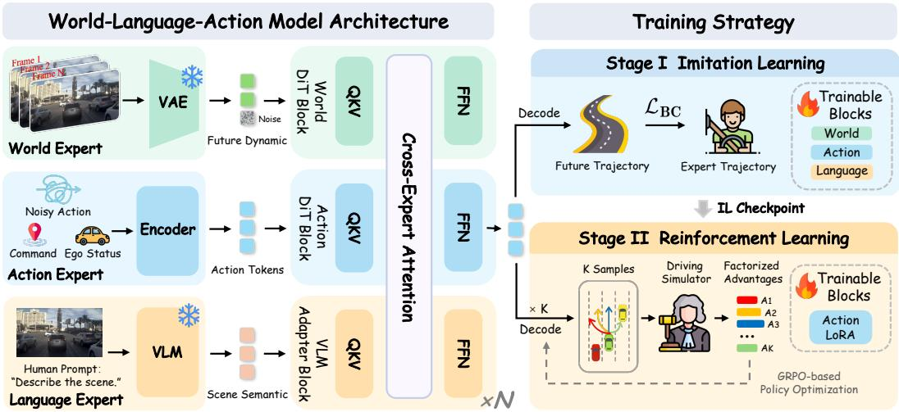  
Figure 1: Model architecture and training strategy. DriveWLA unifies World, Language, and Action Experts through Cross-Expert Attention. The training strategy consists of trajectory imitation learning, which jointly optimizes all experts, followed by reinforcement learning refinement of the Action Expert.

Reinforcement learning for autonomous driving. Behavior cloning learns driving policies from expert trajectories, whereas reinforcement learning further improves them using task-level driving rewards (Gao et al., 2026; Zhang et al., 2025; Yang et al., 2026; Huang et al., 2025). RAD (Gao et al., 2026) applies reinforcement learning to end-to-end driving models in realistic simulation environments. Recent works extend reinforcement learning to generative trajectory planners (Huang et al., 2025; Xiong et al., 2026; Xu et al., 2026). ReCogDrive (Xiong et al., 2026) introduces DiffGRPO for diffusion-based trajectory planning, while EponaV2 (Xu et al., 2026) adapts GRPO to flow-matching-based planners (Liu et al., 2026a). DriveWLA further incorporates factorized ad vantages and variance-based shrinkage to preserve multi-dimensional driving reward signals during policy optimization.

## 3 PRELIMINARIES

Problem Definition. Autonomous driving aims to generate a safe and smooth future trajectory based on the sensor input $\mathcal { T } _ { \mathrm { c a m } }$ , historical trajectories $H _ { \mathrm { t r a j } }$ , navigation commands $\mathcal { C } _ { \mathrm { n a v } } .$ , and ego status $ { S _ { \mathrm { e g o } } }$ (Codevilla et al., 2018; Hu et al., 2023b). For an end-to-end driving system $\Phi .$ , the trajectory generation process can be formulated as

$$
\mathrm { T } _ { \mathrm { t r a j } } = \Phi ( \mathrm { \mathcal { T } } _ { \mathrm { c a m } } , H _ { \mathrm { t r a j } } , \mathcal { C } _ { \mathrm { n a v } } , S _ { \mathrm { e g o } } ) ,\tag{1}
$$

where $\mathrm { T } _ { \mathrm { t r a j } } = \left( x _ { t } , y _ { t } , \theta _ { t } \right) _ { t = 1 } ^ { T } \in \mathbb { R } ^ { T \times 3 }$ denotes the predicted ego trajectory over the next $T$ time steps, with $( x _ { t } , y _ { t } )$ representing the ego position and $\theta _ { t }$ the heading angle in the current ego-centric coordinate frame.

## 4 METHOD

In this section, we present the overall architecture and training paradigm of DriveWLA, as shown in Fig. 1. First, we introduce three specialized experts: the World Expert for future dynamics, the Language Expert for semantic understanding, and the Action Expert for trajectory generation with flow matching. Second, we detail Cross-Expert Attention, which enables controlled information exchange and representation alignment among the three experts. Finally, we describe Flow-GRPObased (Liu et al., 2026a) reinforcement learning with factorized advantage estimation for Action Expert refinement.

## 4.1 MODEL ARCHITECTURE

World Expert. The World Expert is initialized from a video generation model pretrained on largescale driving videos and consists of a spatiotemporal VAE, a text encoder, and an N-block Diffusion Transformer (DiT) (Xia et al., 2026a; HaCohen et al., 2024; Peebles & Xie, 2023). Given the current and historical camera observations $\mathcal { T } _ { \mathrm { c a m } } .$ the VAE encodes the observed frames into spatiotemporal latent $Z _ { \mathrm { o b s } }$ , while the future-frame latent $Z _ { \mathrm { f u t } }$ is initialized from Gaussian noise:

$$
Z _ { \mathrm { o b s } } = E _ { \mathrm { V A E } } ( \mathcal { T } _ { \mathrm { c a m } } ) , \qquad Z _ { \mathrm { f u t } } \sim \mathcal { N } ( \mathbf { 0 } , \mathbf { I } ) , \qquad Z _ { W } = [ Z _ { \mathrm { o b s } } ; Z _ { \mathrm { f u t } } ] .\tag{2}
$$

Here, $\mathcal { N } ( \mathbf { 0 } , \mathbf { I } )$ denotes a zero-mean Gaussian distribution with identity covariance, and $[ Z _ { \mathrm { o b s } } ; Z _ { \mathrm { f u t } } ]$ denotes concatenation of the observed and future latents along the temporal dimension. Conditioned on the encoded generation instruction, the World blocks produce layer-wise predictive representations of future scene evolution in a single forward pass, which are directly used for planning without iterative video sampling or future-frame decoding.

Language Expert and VLM Adapter. The Language Expert consists of a frozen driving-pretrained VLM and an N-block VLM Adapter Transformer. We provide the VLM with camera observations $\mathcal { T } _ { \mathrm { c a m } }$ and a driving prompt $P$ constructed from ego-motion information, navigation commands, and human instructions. After processing the visual-textual inputs, we directly extract the final-layer hidden states of valid input tokens:

$$
H _ { L } = \mathcal { F } _ { \mathrm { V L M } } ^ { \mathrm { l a s t } } ( \mathbb { Z } _ { \mathrm { c a m } } , P ) ,\tag{3}
$$

where $\mathcal { F } _ { \mathrm { V L M } } ^ { \mathrm { l a s t } } ( \cdot )$ denotes the mapping from visual-textual inputs to the final-layer hidden representations of the VLM. We do not perform autoregressive decoding for textual outputs; instead, these hidden states are directly used as the semantic representations and further processed by the VLM Adapter to obtain planning-oriented features.

Action Expert. The Action Expert is a lightweight N-block DiT (Peebles & Xie, 2023) that generates future trajectories with a flow-matching policy (Lipman et al., 2022). Given a noisy trajectory state $a _ { \tau }$ , flow time $\tau ,$ and the driving condition $\mathcal { C } _ { d }$ composed of ego information and navigation commands, the Action Expert predicts the velocity field $v _ { \theta } ( a _ { \tau } , \tau , \mathcal { C } _ { d } )$ for trajectory generation.

Training Objective. During imitation learning, the World Expert, VLM Adapter, and Action Expert are jointly optimized with the flow-matching behavior cloning objective. Specifically, let $a _ { 0 }$ denote the expert trajectory and $a _ { 1 } \sim \mathcal { N } ( \mathbf { 0 } , \mathbf { I } )$ denote Gaussian noise. The interpolated trajectory state is defined as: $a _ { \tau } = ( 1 - \tau ) a _ { 0 } + \tau a _ { 1 }$ . The flow-matching behavior cloning objective is:

$$
\begin{array} { r } { \mathcal { L } _ { \mathrm { B C } } = \mathbb { E } \left[ \| v _ { \theta } ( a _ { \tau } , \tau , \mathcal { C } _ { d } ) - ( a _ { 1 } - a _ { 0 } ) \| _ { 2 } ^ { 2 } \right] . } \end{array}\tag{4}
$$

## 4.2 CROSS-EXPERT ATTENTION

Although the World and Language Experts provide complementary features, effectively integrating them remains challenging. Since their representations are shaped by different learning objectives, naive fusion may lead to representation conflicts. To address this issue, we introduce Cross-Expert Attention within each transformer block, which enables controlled information exchange and progressive alignment among the three experts.

Inspired by the mixture-of-transformers (MoT) architecture (Liang et al., 2024), Cross-Expert Attention allows the three experts to exchange information while maintaining their own transformer blocks. The inputs of the three experts are first projected into a shared dimension d, forming the initial inputs ${ \check { W } } ^ { 0 } , A ^ { 0 }$ , and $L ^ { 0 }$ . At block ℓ, the hidden states of each expert $E ^ { \ell }$ , where $E \in \{ W , L , A \}$ , are mapped to queries, keys, and values using their corresponding projections:

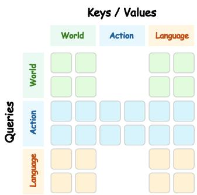  
Figure 2: Query-Key/Value Visibility in Cross-Expert Attention.

$$
Q _ { E } ^ { \ell } = E ^ { \ell } W _ { Q , E } ^ { \ell } , \qquad K _ { E } ^ { \ell } = E ^ { \ell } W _ { K , E } ^ { \ell } , \qquad V _ { E } ^ { \ell } = E ^ { \ell } W _ { V , E } ^ { \ell } .\tag{5}
$$

The query, key, and value matrices from the three experts are then concatenated as $Q ^ { \ell } , K ^ { \ell } , V ^ { \ell }$ , and processed by a masked self-attention operation to enable cross-expert information exchange:

$$
O ^ { \ell } = \mathrm { s o f t m a x } \left( \frac { Q ^ { \ell } ( K ^ { \ell } ) ^ { \top } } { \sqrt { d } } + { \cal M } \right) V ^ { \ell } .\tag{6}
$$

Here, M defines the visibility among the three experts, as illustrated in Fig. 2. The World and Language Experts have bidirectional visibility, allowing their representations to mutually exchange information. The Action Expert attends to both representations for trajectory generation, while its representations are prevented from flowing back to the World and Language Experts.

The attention outputs are then split back into the corresponding expert branches:

$$
O ^ { \ell } = [ O _ { W } ^ { \ell } ; O _ { A } ^ { \ell } ; O _ { L } ^ { \ell } ] .\tag{7}
$$

And each output is further processed by its expert-specific output projection, residual connection, normalization, and feed-forward transformation.

## 4.3 FLOW MATCHING GROUP RELATIVE POLICY OPTIMIZATION

After imitation learning, we further optimize the Action Expert with Flow-GRPO (Liu et al., 2026a) to improve trajectory generation under driving rewards. During reinforcement learning, stochastic exploration is introduced by adding SDE noise to the flow ODE, enabling diverse trajectory candidates to be sampled from the same scene condition. These candidates are evaluated by driving rewards, and group-relative optimization is performed based on their relative rewards. After training, the exploration noise is removed and the final policy generates trajectories by following the deterministic flow ODE.

However, the NAVSIM driving reward is multi-dimensional and consists of multiple metrics reflecting different aspects of driving performance. Directly aggregating these metrics into a single scalar reward may obscure individual driving factors and limit effective policy optimization.

To better utilize the optimization signals in driving rewards, we introduce a factorized advantage estimation strategy. Instead of computing the advantage directly from the aggregated PDMS score, we use the individual metric scores to construct a reward vector:

$$
\mathbf { r } _ { i } = ( r _ { i , 1 } , . . . , r _ { i , M } ) , \qquad z _ { i , m } = { \frac { r _ { i , m } - \mu _ { m } } { \sigma _ { m } + \epsilon } } ,\tag{8}
$$

where i indexes the sampled trajectory within a group, m indexes the driving metric, and $\mu _ { m } , \sigma _ { m }$ denote the group-wise mean and standard deviation of the corresponding metric. ϵ is a small constant for numerical stability.

The factorized advantage is computed by weighted aggregation of normalized metric scores, followed by multiplication with a variance-based shrinkage factor:

$$
A _ { i } = \frac { \sum _ { m } w _ { m } z _ { i , m } } { \sqrt { \mathrm { V a r } ( \sum _ { m } w _ { m } z _ { i , m } ) + \epsilon } } \cdot \frac { s ^ { 2 } } { s ^ { 2 } + \tau ^ { 2 } } ,\tag{9}
$$

where $w _ { m }$ denotes the weight of each driving metric, $s ^ { 2 }$ denotes the variance of PDMS rewards within the sampled group, and τ controls the shrinkage strength. This formulation preserves the information from individual driving metrics during advantage estimation while improving optimization stability by reducing unreliable updates from low-variance trajectory groups.

Using the proposed advantage, we optimize the LoRA (Hu et al., 2021) parameters of the Action Expert with the Flow-GRPO objective augmented by a behavior cloning regularization:

$$
\mathcal { L } = - \frac { 1 } { K } \sum _ { i = 1 } ^ { K } \frac { 1 } { T } \sum _ { t = 1 } ^ { T } \gamma ^ { t - 1 } \log \pi _ { \theta } ( a _ { t - 1 } ^ { i } | a _ { t } ^ { i } , \mathcal { C } _ { d } ) A _ { i } + \lambda _ { \mathrm { B C } } \mathcal { L } _ { \mathrm { B C } } ,\tag{10}
$$

Table 1: Comparison of planners based on different paradigms on NAVSIM v1 navtest. Bold values denote the best result for each metric.
<table><tr><td>Method</td><td>|VLM Backbone | Video Backbone |NC↑ DAC↑ TTC↑ Comf.↑ EP↑ PDMS↑</td><td></td><td></td><td></td><td></td><td></td><td></td><td></td></tr><tr><td>VLM-based planners ReCogDrive (Xiong et al., 2026)</td><td colspan="6"></td><td>87.3</td><td>90.8</td><td></td></tr><tr><td>SGDrive (Li et al., 2026a) Qwen-Drive-1.0 (Zhou et al., 2026a)</td><td>InternVL3-2B InternVL3-2B Qwen3.5-4B</td><td></td><td>97.9 98.6 98.6</td><td>97.3 97.8 98.2</td><td>94.9 96.2 95.9</td><td>100.0 100.0 100.0</td><td>85.8 84.8</td><td></td><td>91.1</td></tr><tr><td>World-Model-based planners</td><td></td><td></td><td></td><td></td><td></td><td></td><td></td><td></td><td>90.7</td></tr><tr><td>DriveLaW (Xia et al., 2026a) ReWorld (Xia et al., 2026b)</td><td></td><td>LTX-2B LTX-2B</td><td>99.0</td><td>97.1</td><td>96.7</td><td>100.0</td><td></td><td>81.3</td><td>89.1</td></tr><tr><td>SimWAM (Zhao et al., 2026b)</td><td></td><td>Wan2.2-5B</td><td>99.1 98.4</td><td>98.2 98.7</td><td>97.7</td><td>99.8</td><td></td><td>82.0</td><td>90.4</td></tr><tr><td>VLM–WM–based planners</td><td></td><td></td><td></td><td></td><td>95.5</td><td></td><td>100.0</td><td>86.4</td><td>91.5</td></tr><tr><td>DriveVLA-W0 (Li et al., 2026b)</td><td>Emu3-8B (unified)</td><td></td><td></td><td></td><td></td><td></td><td></td><td></td><td></td></tr><tr><td>DriveWAM (Shi et al., 2026)</td><td></td><td></td><td>98.7</td><td>99.1</td><td>95.3</td><td>99.3</td><td></td><td>83.3</td><td>90.2</td></tr><tr><td></td><td>Qwen3-VL-8B</td><td>Wan2.2-5B</td><td>98.3</td><td>98.1</td><td>95.2</td><td>100.0</td><td></td><td>84.3</td><td>90.1</td></tr><tr><td>BrainWAM (Zhan et al., 2026)</td><td>Qwen3-VL-4B</td><td>Wan2.2-5B</td><td>98.1</td><td>97.5</td><td>94.9</td><td>100.0</td><td></td><td>83.8</td><td>89.5</td></tr><tr><td>DriveWorld-VLA (Liu et al., 2026b)</td><td>InternVL3-2B</td><td>ResNet-34</td><td>99.1</td><td>98.2</td><td>96.1</td><td>100.0</td><td></td><td>85.9</td><td>91.3</td></tr><tr><td>DriveWLA (Ours)</td><td>InternVL3-2B</td><td>LTX-2B</td><td>99.1</td><td>98.8</td><td>97.0</td><td></td><td>100.0</td><td>86.4</td><td>92.3</td></tr></table>

Table 2: Comparison on the NAVSIM v2 navtest split. All results use the corrected official evaluator with human-reference filtering. Bold values denote the best result for each metric.
<table><tr><td>Method</td><td>|NC↑ DAC↑</td><td>DDC↑</td><td>TLC↑</td><td></td><td>EP↑ TTC↑</td><td></td><td>LK↑ HC↑</td><td>EC↑|</td><td></td><td>EPDMS↑</td></tr><tr><td>DiffusionDrive (Liao et al., 2025) DiffusionDriveV2 (Zou et al., 2025)</td><td>98.2 97.7</td><td>95.9 96.6</td><td>99.4 99.2</td><td>99.8 99.8</td><td>87.5 88.9</td><td>97.3 97.2</td><td>96.8 96.0</td><td>98.3 97.8</td><td>87.7 91.0</td><td>84.5 87.5</td></tr><tr><td>DriveWorld-VLA (Liu et al., 2026b)</td><td>98.6</td><td>99.1</td><td>99.6</td><td>99.8</td><td>87.4</td><td>97.9</td><td>97.0</td><td>97.8</td><td>78.6</td><td>86.8</td></tr><tr><td>Latent-WAM (Wang et al., 2026a)</td><td>98.1 99.1</td><td>97.3</td><td>99.6</td><td>99.8</td><td>87.7</td><td>97.3</td><td>97.6</td><td>98.1</td><td>87.3</td><td>89.3</td></tr><tr><td>CoWorld-VLA (Huang et al., 2026)</td><td></td><td>97.0 99.6</td><td></td><td>99.9</td><td>87.9 98.5</td><td></td><td>97.7</td><td>98.2</td><td>86.2</td><td>90.0</td></tr><tr><td>DriveFuture (Hong et al., 2026)</td><td>98.8</td><td>99.1 99.6</td><td></td><td>99.9</td><td>86.6</td><td>98.4</td><td>96.4</td><td>98.3</td><td>74.8</td><td>89.9</td></tr><tr><td>DriveWLA (Ours)</td><td>98.8</td><td>97.8</td><td>99.7</td><td>99.9</td><td>87.4</td><td>98.8</td><td>97.8</td><td>98.4</td><td>82.5</td><td>90.1</td></tr></table>

where K and T denote the group size and the number of denoising steps, γ is the discount factor, and $a _ { t } ^ { i }$ represents the intermediate trajectory state at denoising step t. Additional details are provided in Appendix C.

## 5 EXPERIMENTS

## 5.1 EXPERIMENTAL SETUP

Datasets and metrics. We train DriveWLA on 103,288 NAVSIM (Dauner et al., 2024) navtrain scenes and evaluate on 12,146 navtest scenes. NAVSIM v1 uses the Predictive Driver Model Score (PDMS), which aggregates no-at-fault collision (NC), drivable-area compliance (DAC), ego progress (EP), time to collision (TTC), and comfort (Dauner et al., 2024). NAVSIM v2 (Cao et al., 2025) extends PDMS to EPDMS with additional driving-direction compliance (DDC), traffic-light compliance (TLC), lane keeping (LK), history comfort (HC), and extended comfort (EC) (Cao et al., 2025). Detailed metric definitions are provided in Appendix B.

We further evaluate zero-shot transfer on closed-loop and open-loop benchmarks. For closed-loop evaluation, we test on HUGSIM (Zhou et al., 2025) and report HD-Score. For open-loop evaluation, we evaluate on nuScenes (Caesar et al., 2020) and Bench2Drive (Jia et al., 2024), reporting trajectory L2 error and collision rate.

Implementation details. DriveWLA uses a driving-pretrained InternVL3-2B (Zhu et al., 2025; Xiong et al., 2026) as the Language Expert and an LTX-Video-2B (HaCohen et al., 2024) initialized World Expert from DriveLaW-Video (Xia et al., 2026a). The Action Expert is a 28-block DiT (Peebles & Xie, 2023) that predicts eight $( x , y , \theta )$ waypoints over four seconds conditioned on historical ego poses, ego state, and navigation commands.

During imitation learning, the World DiT, Language Adapter, and Action DiT are jointly optimized for 30 epochs on 16 A100 GPUs with batch size 16 and learning rate $3 \times 1 0 ^ { - 5 }$ . The VLM, video VAE, and text encoder are frozen. During reinforcement learning, Flow-GRPO (Liu et al., 2026a)

Table 3: Zero-shot closed-loop evaluation on HUGSIM. We report driving metrics over all 436 scenarios and HD-Score across different difficulty levels, together with the overall average.
<table><tr><td rowspan="2">Method</td><td colspan="6">All 436 Scenarios</td><td colspan="5">HD-Score</td></tr><tr><td>|NC↑</td><td>DAC↑ TTC↑</td><td>Comf.↑</td><td></td><td>PDMS↑</td><td>RC↑ |Easy↑</td><td></td><td>Medium↑</td><td>Hard↑ Extreme↑</td><td></td><td>Avg.↑</td></tr><tr><td>VAD (Jiang et al., 2023)</td><td>41.20 90.30</td><td>28.00</td><td>95.30</td><td></td><td>28.30</td><td>30.10</td><td>42.00</td><td>8.50</td><td>7.70</td><td>6.30</td><td>13.90</td></tr><tr><td>UniAD (Hu et al., 2023b)</td><td>65.60</td><td>93.20 51.60</td><td></td><td>66.30</td><td>49.40</td><td>43.80</td><td>64.00</td><td>37.20</td><td>21.00</td><td>6.30</td><td>31.20</td></tr><tr><td>LTF (Chitta et al., 2022; Zhou et al., 2025)</td><td>44.30</td><td>92.80 37.50</td><td>94.80</td><td></td><td>36.50</td><td>38.00</td><td>66.10</td><td>15.50</td><td>12.00</td><td>11.70</td><td>23.10</td></tr><tr><td>DrivoR (Kirby et al., 2026)</td><td>52.20</td><td>95.60 46.20</td><td></td><td>93.90</td><td>44.80</td><td>47.20</td><td>78.00</td><td>29.10</td><td>20.00</td><td>14.10</td><td>32.50</td></tr><tr><td>DriveWLA (Ours)</td><td>65.80</td><td>95.06</td><td>59.27</td><td>75.78</td><td>54.92</td><td>54.99</td><td>73.87</td><td>47.91</td><td>31.41</td><td>15.87</td><td>41.47</td></tr></table>

Table 4: Zero-shot open-loop evaluation on nuScenes and Bench2Drive. We report L2 trajectory error (m) and collision rate (%) over 1–3 seconds and their averages. “Fine-tune” indicates targetdataset adaptation. Bold denotes the best result for each metric within each dataset.
<table><tr><td rowspan="2">Dataset</td><td rowspan="2">Method</td><td rowspan="2">Fine-tune</td><td colspan="4">L2 (m)↓</td><td colspan="4">Collision (%) ↓</td></tr><tr><td>1s</td><td>2s</td><td>3s</td><td>Avg.</td><td>1s</td><td>2s</td><td>3s</td><td>Avg.</td></tr><tr><td rowspan="7">nuScenes</td><td>UniAD (Hu et al., 2023b)</td><td>√</td><td>0.48</td><td>0.96</td><td>1.65</td><td>1.03</td><td>0.05</td><td>0.17</td><td>0.71</td><td>0.31</td></tr><tr><td>OpenDriveVLA (Zhou et al., 2026b)</td><td>√</td><td>0.19</td><td>0.58</td><td>1.24</td><td>0.67</td><td>0.02</td><td>0.18</td><td>0.70</td><td>0.30</td></tr><tr><td>UniDriveVLA-L (Li et al., 2026c)</td><td>√</td><td>0.30</td><td>0.66</td><td>1.25</td><td>0.74</td><td>0.02</td><td>0.18</td><td>0.40</td><td>0.20</td></tr><tr><td>DriveVLA-W0 (Li et al., 2026b)</td><td>x</td><td>0.43</td><td>1.26</td><td>2.60</td><td>1.43</td><td>0.22</td><td>0.66</td><td>1.42</td><td>0.77</td></tr><tr><td>PWM (Zhao et al., 2026a)</td><td>x</td><td>2.06</td><td>3.91</td><td>6.00</td><td>3.99</td><td>0.12</td><td>0.15</td><td>0.86</td><td>0.36</td></tr><tr><td>DriveWLA (Ours)</td><td>x</td><td>0.38</td><td>0.83</td><td>1.60</td><td>0.94</td><td>0.03</td><td>0.03</td><td>0.20</td><td>0.09</td></tr><tr><td>DriveVLA-W0 (Li et al., 2026b)</td><td></td><td>1.01</td><td>2.77</td><td>5.22</td><td>3.00</td><td>1.49</td><td>2.53</td><td>3.53</td><td>2.52</td></tr><tr><td rowspan="5">Bench2Drive</td><td>PWM (Zhao et al., 2026a)</td><td>X X</td><td>1.70</td><td>2.74</td><td>3.97</td><td>2.80</td><td>4.01</td><td>3.73</td><td>3.53</td><td>3.76</td></tr><tr><td>DriveVA (Liu et al., 2026d)</td><td>x</td><td>0.69</td><td>1.29</td><td>2.03</td><td>1.33</td><td>1.38</td><td>1.97</td><td>2.65</td><td>1.79</td></tr><tr><td>UNIVERSE (Liu et al., 2026c)</td><td>x</td><td>0.67</td><td>1.29</td><td>2.03</td><td>1.33</td><td>0.75</td><td>1.12</td><td>1.70</td><td>1.19</td></tr><tr><td>DriveWLA (Ours)</td><td>x</td><td>0.77</td><td>1.53</td><td>2.53</td><td>1.61</td><td>0.34</td><td>0.97</td><td>1.88</td><td>1.06</td></tr></table>

optimizes Action-branch LoRA (Hu et al., 2021) parameters using driving rewards. Unless stated otherwise, inference uses ten Euler steps. Further details are provided in Appendix A.

## 5.2 MAIN RESULTS

NAVSIM v1. Tab. 1 shows that DriveWLA achieves the best PDMS of 92.3 across approaches from different paradigms. Specifically, it outperforms the best-performing VLM-based and world-modelbased planners, SGDrive (Li et al., 2026a) and SimWAM (Zhao et al., 2026b), by 1.2 and 0.8 points, respectively, indicating that semantic understanding and future prediction provide complementary benefits for driving planning. Furthermore, DriveWLA surpasses existing VLM–world-model integrated planners, including DriveWAM (Shi et al., 2026) and BrainWAM (Zhan et al., 2026), by 2.2 and 2.8 points, respectively. These improvements are achieved with a more compact expert configuration: DriveWLA uses InternVL3-2B (Zhu et al., 2025) as the Language Expert and LTX-Video 2B (HaCohen et al., 2024) as the World Expert, while DriveWAM and BrainWAM adopt 8B/5B and 4B/5B language/video backbones. These results suggest that the advantage of DriveWLA comes from more effective unified World-Language-Action modeling rather than simply scaling up model capacity.

NAVSIM v2. Under the corrected official evaluator, DriveWLA achieves the highest EPDMS of 90.1 in Tab. 2. Importantly, it achieves the best DDC, TTC, LK, and HC scores, while tying for the best TLC. These results show that DriveWLA maintains strong performance across multiple evaluation dimensions, leading to the best overall EPDMS under the more comprehensive NAVSIM v2 evaluation.

Zero-shot on HUGSIM. Tab. 3 shows zero-shot closed-loop evaluation results on the HUGSIM (Zhou et al., 2025) benchmark. DriveWLA achieves the best results on 8 of the 11 reported metrics, including NC, TTC, PDMS, RC, and the average HD-Score. Notably, although the scoring-based DrivoR (Kirby et al., 2026) performs best on Easy scenarios, its advantage disappears as scenario difficulty increases, whereas DriveWLA achieves higher HD-Scores on Medium, Hard, and Extreme scenarios. These results demonstrate the strong zero-shot generalization and closed-loop driving capability of DriveWLA.

Zero-shot on nuScenes and Bench2Drive. As shown in Tab. 4, DriveWLA achieves strong zeroshot performance in open-loop evaluation. On nuScenes, DriveWLA outperforms all zero-shot methods listed in Tab. 4, achieving the lowest average L2 error of 0.94 m and collision rate of 0.09% among them. Compared with fine-tuned planners, DriveWLA achieves a substantially lower collision rate while maintaining a comparable L2 error. On Bench2Drive, DriveWLA continues to demonstrate strong performance, achieving the lowest collision rate of 1.06% while maintaining competitive L2 performance. These results demonstrate the strong zero-shot generalization and reliable driving performance of DriveWLA.

## 5.3 ABLATION STUDIES

We conduct controlled ablations on NAVSIM v1 to assess expert composition, training strategies, attention mask, and inference-time sampling steps. Unless otherwise noted, each comparison follows the same training and evaluation protocol.

Table 5: Expert composition.
<table><tr><td>Experts</td><td>Language World Action PDMS↑</td><td></td><td></td><td></td></tr><tr><td>w/o World Expert</td><td>√</td><td>x</td><td>√</td><td>86.2</td></tr><tr><td>w/o Language Expert</td><td>x</td><td>√</td><td>√</td><td>89.1</td></tr><tr><td>Full DriveWLA</td><td>√</td><td>√</td><td>√</td><td>90.8</td></tr></table>

Table 6: Training strategy.
<table><tr><td>Configuration</td><td>NC↑</td><td>DAC↑</td><td>TTC↑</td><td>Comf.↑</td><td>EP↑</td><td>PDMS↑</td></tr><tr><td>Frozen World Expert</td><td>98.5</td><td>96.1</td><td>96.4</td><td>100.0</td><td>80.4</td><td>88.0</td></tr><tr><td>Trainable World Expert</td><td>99.2</td><td>97.7</td><td>97.2</td><td>100.0</td><td>84.0</td><td>90.8</td></tr><tr><td>+ Flow-GRPO</td><td>99.1</td><td>98.7</td><td>97.1</td><td>100.0</td><td>86.1</td><td>92.1</td></tr><tr><td>+ Flow-GRPO†</td><td>99.1</td><td>98.8</td><td>97.0</td><td>100.0</td><td>86.4</td><td>92.3</td></tr></table>

Table 7: Cross-Expert information flow.
<table><tr><td>W → L</td><td>L → W</td><td> $\mathbf { W } / \mathbf { L }  \mathbf { A }$  A → W/L</td><td>PDMS↑</td></tr><tr><td>√</td><td>√</td><td>√ x</td><td>90.8</td></tr><tr><td>√</td><td>x</td><td>√ x</td><td>90.1</td></tr><tr><td>x</td><td>√</td><td>√ x</td><td>89.8</td></tr><tr><td>√</td><td>√</td><td>√ √</td><td>90.4</td></tr><tr><td>x</td><td>x</td><td>√ x</td><td>88.4</td></tr></table>

Table 8: Sampling steps.
<table><tr><td>Steps</td><td>NC↑</td><td>DAC↑</td><td>TTC↑</td><td>Comf.↑</td><td>EP↑</td><td>PDMS↑</td><td>Latency↓</td></tr><tr><td>1</td><td>91.2</td><td>81.4</td><td>63.6</td><td>1.7</td><td>68.3</td><td>49.2</td><td>540 ms</td></tr><tr><td>5</td><td>99.2</td><td>97.6</td><td>96.8</td><td>100.0</td><td>84.1</td><td>90.6</td><td>810 ms</td></tr><tr><td>10</td><td>99.2</td><td>97.7</td><td>97.2</td><td>100.0</td><td>84.0</td><td>90.8</td><td>970 ms</td></tr><tr><td>15</td><td>99.3</td><td>97.8</td><td>97.5</td><td>100.0</td><td>83.4</td><td>90.8</td><td>1160 ms</td></tr><tr><td>20</td><td>99.3</td><td>97.8</td><td>97.6</td><td>100.0</td><td>83.3</td><td>90.7</td><td>1390 ms</td></tr></table>

Expert Composition. To evaluate the individual contributions of semantic features from the VLM and future dynamic features from the World Model, we ablate the Language and World Experts separately. As shown in Tab. 5, removing the World Expert reduces PDMS from 90.8 to 86.2, while removing the Language Expert results in a smaller decrease to 89.1. The larger degradation caused by removing the World Expert indicates that predictive dynamics contribute more to planning performance in this setting. Furthermore, the performance degradation after removing each expert demonstrates that semantic and dynamic representations provide complementary benefits, and their joint utilization enables DriveWLA to achieve better performance than using either representation alone.

Training Strategy. As shown in Tab. 6, freezing the pretrained World Expert during imitation learning yields 88.0 PDMS. Jointly optimizing the World Expert raises PDMS to 90.8, suggesting that future dynamic representations learned from video prediction are not fully aligned with the requirements of driving. Furthermore, applying the original Flow-GRPO after imitation learning improves PDMS to 92.1, with particularly notable improvements in DAC and EP. Flow-GRPO† denotes our improved variant with factorized advantage estimation and variance-based shrinkage in Eq. (9), which further improves PDMS to 92.3.

Cross-Expert Information Flow. To explore proper information flow among the three experts in our Cross-Expert Attention module, we design different attention masks to control the visibility between the World, Language, and Action Experts. Here, X → Y indicates that information can flow from Expert X to Expert Y . As shown in Tab. 7, the bidirectional World–Language interaction with the Action Expert only receiving representations from both experts achieves the highest PDMS of 90.8. Removing either direction of World–Language information flow degrades performance, while removing both directions causes a further drop. These results demonstrate that bidirectional information exchange between semantic and dynamic representations is beneficial for leveraging their complementary capabilities. Moreover, allowing information to flow from the Action Expert to the World and Language Experts leads to performance degradation, indicating that introducing action representations into the World and Language Experts is not beneficial for planning.

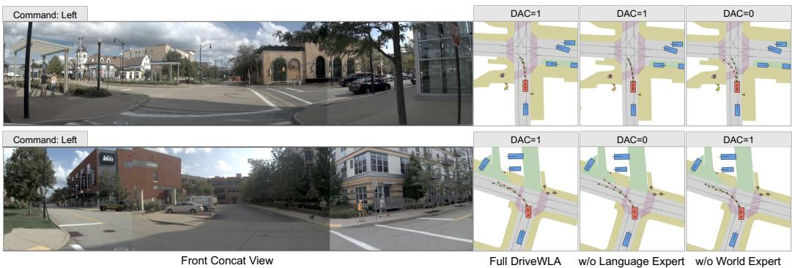

(a) Complementary effects of the Language and World Experts on NAVSIM navtest.  
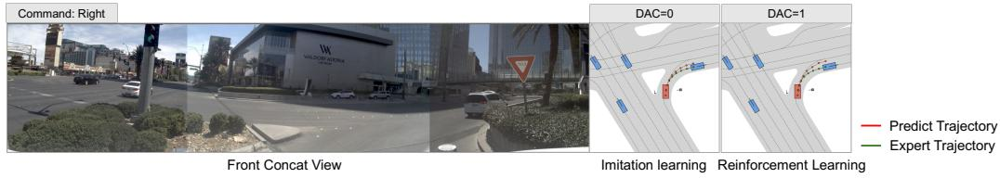  
(b) Improvement from RL refinement on NAVSIM navtest.  
Figure 3: Qualitative visualization of expert complementarity and RL improvement. (a) Removing either the Language or World Expert leads to planning failures in different scenes, highlighting their complementary contributions. (b) RL refinement corrects the imitation policy and discovers a valid alternative trajectory distinct from the expert demonstration.

Sampling Steps. With a single Euler step, DriveWLA achieves only 49.2 PDMS (Tab. 8). Increasing the sampling steps to five recovers most of the performance, achieving 90.6 PDMS, while ten steps further improve PDMS to the best result of 90.8 at 970 ms latency. Increasing the steps beyond ten provides no additional improvement at 15 steps and causes a slight performance drop at 20 steps, while introducing higher inference latency. We therefore adopt ten steps, where planning performance reaches its highest measured level before additional sampling increases latency without improving PDMS.

## 5.4 QUALITATIVE ANALYSIS

Fig. 3 shows qualitative comparisons on NAVSIM navtest, with predicted and expert trajectories visualized in bird’s-eye view (BEV). Fig. 3(a) compares DriveWLA with the expert ablations in two left-turn scenes. The full model produces valid trajectories within the drivable area in both scenes, whereas removing the World or Language Expert results in DAC failure in different cases. These contrasting failures further demonstrate the complementary roles of the World and Language Experts in trajectory planning. In Fig. 3(b), RL refinement corrects the off-road deviation of the imitation policy, improving DAC from 0 to 1. Notably, the refined policy produces a valid trajectory distinct from the expert demonstration, showing that reinforcement learning can move beyond direct trajectory imitation and optimize toward driving objectives.

## 6 CONCLUSION

In this work, we proposed DriveWLA, a unified World-Language-Action framework for autonomous driving. Our results show that semantic understanding and future dynamics provide complementary information for trajectory planning, and the controlled cross-expert interaction can effectively integrate these capabilities. DriveWLA achieves state-of-the-art performance on NAVSIM and strong zero-shot generalization across open-loop and closed-loop benchmarks. We hope DriveWLA can serve as a strong baseline and that World-Language-Action modeling can become a promising paradigm for future autonomous driving research.

## AI USE STATEMENT

We used large language models to assist with drafting and editing the manuscript for clarity and readability, and to help identify relevant prior work.

## REFERENCES

Holger Caesar, Varun Bankiti, Alex H Lang, Sourabh Vora, Venice Erin Liong, Qiang Xu, Anush Krishnan, Yu Pan, Giancarlo Baldan, and Oscar Beijbom. nuscenes: A multimodal dataset for autonomous driving. In 2020 IEEE/CVF conference on computer vision and pattern recognition (CVPR), pp. 11618–11628. IEEE, 2020.

Wei Cao, Marcel Hallgarten, Tianyu Li, Daniel Dauner, Xunjiang Gu, Caojun Wang, Yakov Miron, Marco Aiello, Hongyang Li, Igor Gilitschenski, et al. Pseudo-simulation for autonomous driving. arXiv preprint arXiv:2506.04218, 2025.

Kashyap Chitta, Aditya Prakash, Bernhard Jaeger, Zehao Yu, Katrin Renz, and Andreas Geiger. Transfuser: Imitation with transformer-based sensor fusion for autonomous driving. IEEE transactions on pattern analysis and machine intelligence, 45(11):12878–12895, 2022.

Felipe Codevilla, Matthias Muller, Antonio L¨ opez, Vladlen Koltun, and Alexey Dosovitskiy. End-´ to-end driving via conditional imitation learning. In 2018 IEEE international conference on robotics and automation (ICRA), pp. 4693–4700. IEEE, 2018.

Daniel Dauner, Marcel Hallgarten, Tianyu Li, Xinshuo Weng, Zhiyu Huang, Zetong Yang, Hongyang Li, Igor Gilitschenski, Boris Ivanovic, Marco Pavone, et al. Navsim: Data-driven non-reactive autonomous vehicle simulation and benchmarking. Advances in Neural Information Processing Systems, 37:28706–28719, 2024.

Johan Engstrom, Jonas B ¨ argman, Daniel Nilsson, Bobbie Seppelt, Gustav Markkula, Giulio Bianchi¨ Piccinini, and Trent Victor. Great expectations: a predictive processing account of automobile driving. Theoretical issues in ergonomics science, 19(2):156–194, 2018.

Hao Gao, Shaoyu Chen, Bo Jiang, Bencheng Liao, Yiang Shi, Xiaoyang Guo, Yuechuan Pu, Xiangyu Li, Wenyu Liu, Qian Zhang, et al. Rad: Training an end-to-end driving policy via largescale 3dgs-based reinforcement learning. Advances in Neural Information Processing Systems, 38:32551–32576, 2026.

Yoav HaCohen, Nisan Chiprut, Benny Brazowski, Daniel Shalem, Dudu Moshe, Eitan Richardson, Eran Levin, Guy Shiran, Nir Zabari, Ori Gordon, et al. Ltx-video: Realtime video latent diffusion. arXiv preprint arXiv:2501.00103, 2024.

Yufeng Hong, Xiaotian Zhou, Yingyan Li, Xiangpo Zhou, Lin Liu, Yadan Luo, Shaoqing Xu, Lei Yang, and Ziying Song. Drivefuture: Future-aware latent world models for autonomous driving. arXiv preprint arXiv:2605.09701, 2026.

Anthony Hu, Lloyd Russell, Hudson Yeo, Zak Murez, George Fedoseev, Alex Kendall, Jamie Shotton, and Gianluca Corrado. Gaia-1: A generative world model for autonomous driving. arXiv preprint arXiv:2309.17080, 2023a.

Edward J Hu, Yelong Shen, Phillip Wallis, Zeyuan Allen-Zhu, Yuanzhi Li, Shean Wang, Lu Wang, and Weizhu Chen. Lora: Low-rank adaptation of large language models. arXiv preprint arXiv:2106.09685, 2021.

Yihan Hu, Jiazhi Yang, Li Chen, Keyu Li, Chonghao Sima, Xizhou Zhu, Siqi Chai, Senyao Du, Tianwei Lin, Wenhai Wang, et al. Planning-oriented autonomous driving. In 2023 IEEE/CVF Conference on Computer Vision and Pattern Recognition (CVPR), pp. 17853–17862. IEEE, 2023b.

Minqing Huang, Yujiao Xiang, Zihan Liang, Jiajie Huang, Jingqi Wang, Zhi Xu, Feiyang Tan, Hangning Zhou, Mu Yang, and Gong Che. Coworld-vla: Thinking in a multi-expert world model for autonomous driving. arXiv preprint arXiv:2605.10426, 2026.

Zhiyu Huang, Xinshuo Weng, Maximilian Igl, Yuxiao Chen, Yulong Cao, Boris Ivanovic, Marco Pavone, and Chen Lv. Gen-drive: Enhancing diffusion generative driving policies with reward modeling and reinforcement learning fine-tuning. In 2025 IEEE International Conference on Robotics and Automation (ICRA), pp. 3445–3451. IEEE, 2025.

Jyh-Jing Hwang, Runsheng Xu, Hubert Lin, Wei-Chih Hung, Jingwei Ji, Kristy Choi, Di Huang, Tong He, Paul Covington, Benjamin Sapp, et al. Emma: End-to-end multimodal model for autonomous driving. arXiv preprint arXiv:2410.23262, 2024.

Xiaosong Jia, Zhenjie Yang, Qifeng Li, Zhiyuan Zhang, and Junchi Yan. Bench2drive: Towards multi-ability benchmarking of closed-loop end-to-end autonomous driving. Advances in Neural Information Processing Systems, 37:819–844, 2024.

Bo Jiang, Shaoyu Chen, Qing Xu, Bencheng Liao, Jiajie Chen, Helong Zhou, Qian Zhang, Wenyu Liu, Chang Huang, and Xinggang Wang. Vad: Vectorized scene representation for efficient autonomous driving. In 2023 IEEE/CVF International Conference on Computer Vision (ICCV), pp. 8306–8316. IEEE, 2023.

Ellington Kirby, Alexandre Boulch, Yihong Xu, Yuan Yin, Gilles Puy, Eloi Zablocki, Andrei Bursuc, ´ Spyros Gidaris, Renaud Marlet, Florent Bartoccioni, et al. Driving on registers. In Proceedings of the IEEE/CVF Conference on Computer Vision and Pattern Recognition, pp. 32058–32069, 2026.

Jingyu Li, Junjie Wu, Dongnan Hu, Xiangkai Huang, Bin Sun, Zhihui Hao, Xianpeng Lang, Xiatian Zhu, and Li Zhang. Sgdrive: Scene-to-goal hierarchical world cognition for autonomous driving. arXiv preprint arXiv:2601.05640, 2026a.

Yingyan Li, Shuyao Shang, Weisong Liu, Bing Zhan, Haochen Wang, Yuqi Wang, Yuntao Chen, Xiaoman Wang, Yasong An, Chufeng Tang, et al. Drivevla-w0: World models amplify data scaling law in autonomous driving. In International Conference on Learning Representations, volume 2026, pp. 7890–7911, 2026b.

Yongkang Li, Lijun Zhou, Sixu Yan, Bencheng Liao, Tianyi Yan, Kaixin Xiong, Long Chen, Hongwei Xie, Bing Wang, Guang Chen, et al. Unidrivevla: Unifying understanding, perception, and action planning for autonomous driving. arXiv preprint arXiv:2604.02190, 2026c.

Weixin Liang, Lili Yu, Liang Luo, Srinivasan Iyer, Ning Dong, Chunting Zhou, Gargi Ghosh, Mike Lewis, Wen-tau Yih, Luke Zettlemoyer, et al. Mixture-of-transformers: A sparse and scalable architecture for multi-modal foundation models. arXiv preprint arXiv:2411.04996, 2024.

Bencheng Liao, Shaoyu Chen, Haoran Yin, Bo Jiang, Cheng Wang, Sixu Yan, Xinbang Zhang, Xiangyu Li, Ying Zhang, Qian Zhang, et al. Diffusiondrive: Truncated diffusion model for endto-end autonomous driving. In 2025 IEEE/CVF Conference on Computer Vision and Pattern Recognition (CVPR), pp. 12037–12047. IEEE, 2025.

Yiyi Liao, Jun Xie, and Andreas Geiger. Kitti-360: A novel dataset and benchmarks for urban scene understanding in 2d and 3d. IEEE Transactions on Pattern Analysis and Machine Intelligence, 45 (3):3292–3310, 2022.

Yaron Lipman, Ricky TQ Chen, Heli Ben-Hamu, Maximilian Nickel, and Matt Le. Flow matching for generative modeling. arXiv preprint arXiv:2210.02747, 2022.

Jie Liu, Gongye Liu, Jiajun Liang, Yangguang Li, Jiaheng Liu, Xintao Wang, Pengfei Wan, Di Zhang, and Wanli Ouyang. Flow-grpo: Training flow matching models via online rl. Advances in neural information processing systems, 38:40783–40818, 2026a.

Lin Liu, Ziying Song, Caiyan Jia, Hangjun Ye, Xiaoshuai Hao, Long Chen, et al. Driveworld-vla: Unified latent-space world modeling with vision-language-action for autonomous driving. arXiv preprint arXiv:2602.06521, 2026b.

Mengmeng Liu, Diankun Zhang, Jiuming Liu, Jianfeng Cui, Hongwei Xie, Guang Chen, Hangjun Ye, Francesco Nex, Hao Cheng, and Michael Ying Yang. Universe: Unified video action models for autonomous driving with flexible mask-modulated modality generation. arXiv preprint arXiv:2607.05133, 2026c.

Mengmeng Liu, Diankun Zhang, Jiuming Liu, Jianfeng Cui, Hongwei Xie, Guang Chen, Hangjun Ye, Michael Ying Yang, Francesco Nex, and Hao Cheng. Driveva: Video action models are zero-shot drivers. In European Conference on Computer Vision, pp. 315–335. Springer, 2026d.

William Peebles and Saining Xie. Scalable diffusion models with transformers. In 2023 IEEE/CVF International Conference on Computer Vision (ICCV), pp. 4172–4182. IEEE, 2023.

Hao Shao, Yuxuan Hu, Letian Wang, Guanglu Song, Steven L Waslander, Yu Liu, and Hongsheng Li. Lmdrive: Closed-loop end-to-end driving with large language models. In 2024 IEEE/CVF Conference on Computer Vision and Pattern Recognition (CVPR), pp. 15120–15130. IEEE, 2024.

Chen Shi, Jinrui Xu, Shaoshuai Shi, Kehua Sheng, Bo Zhang, and Li Jiang. Drivewam: Video generative priors enable scalable world-action modeling for autonomous driving. arXiv preprint arXiv:2605.28544, 2026.

Pei Sun, Henrik Kretzschmar, Xerxes Dotiwalla, Aurelien Chouard, Vijaysai Patnaik, Paul Tsui, James Guo, Yin Zhou, Yuning Chai, Benjamin Caine, et al. Scalability in perception for autonomous driving: Waymo open dataset. In 2020 IEEE/CVF Conference on Computer Vision and Pattern Recognition (CVPR), pp. 2443–2451. IEEE, 2020.

Xiaoyu Tian, Junru Gu, Bailin Li, Yicheng Liu, Yang Wang, Zhiyong Zhao, Kun Zhan, Peng Jia, Xianpeng Lang, and Hang Zhao. Drivevlm: The convergence of autonomous driving and large vision-language models. arXiv preprint arXiv:2402.12289, 2024.

Linbo Wang, Yupeng Zheng, Qiang Chen, Shiwei Li, Yichen Zhang, Zebin Xing, Qichao Zhang, Xiang Li, Deheng Qian, Pengxuan Yang, et al. Latent-wam: Latent world action modeling for end-to-end autonomous driving. arXiv preprint arXiv:2603.24581, 2026a.

Xiaofeng Wang, Zheng Zhu, Guan Huang, Xinze Chen, Jiagang Zhu, and Jiwen Lu. Drivedreamer: Towards real-world-drive world models for autonomous driving. In European conference on computer vision, pp. 55–72. Springer, 2024a.

Xinlin Wang, Yujiao Xiang, Yuheng Zhou, Jingqi Wang, Minqing Huang, Jiajie Huang, Dongxu Wei, Tingguang Zhou, Xiyang Wang, Gong Chen, et al. Wa-jepa: Rethinking the video jepa paradigm for world-action modeling in autonomous driving. arXiv preprint arXiv:2608.20974, 2026b.

Yuqi Wang, Jiawei He, Lue Fan, Hongxin Li, Yuntao Chen, and Zhaoxiang Zhang. Driving into the future: Multiview visual forecasting and planning with world model for autonomous driving. In 2024 IEEE/CVF Conference on Computer Vision and Pattern Recognition (CVPR), pp. 14749– 14759. IEEE, 2024b.

Benjamin Wolfe, Lex Fridman, Anna Kosovicheva, Bobbie Seppelt, Bruce Mehler, Bryan Reimer, and Ruth Rosenholtz. Predicting road scenes from brief views of driving video. Journal of vision, 19(5):8–8, 2019.

Tianze Xia, Yongkang Li, Lijun Zhou, Jingfeng Yao, Kaixin Xiong, Haiyang Sun, Bing Wang, Kun Ma, Guang Chen, Hangjun Ye, et al. Drivelaw: Unifying planning and video generation in a latent driving world. In Proceedings of the IEEE/CVF Conference on Computer Vision and Pattern Recognition, pp. 39701–39712, 2026a.

Tianze Xia, Lijun Zhou, Kaixin Xiong, Jingfeng Yao, Yu Zhu, Zhenxin Zhu, Bing Wang, Guang Chen, Hangjun Ye, Wenyu Liu, et al. Reworld: Learning better representations for world action models. arXiv preprint arXiv:2606.27504, 2026b.

Pengchuan Xiao, Zhenlei Shao, Steven Hao, Zishuo Zhang, Xiaolin Chai, Judy Jiao, Zesong Li, Jian Wu, Kai Sun, Kun Jiang, et al. Pandaset: Advanced sensor suite dataset for autonomous driving. In 2021 IEEE international intelligent transportation systems conference (ITSC), pp. 3095–3101. IEEE, 2021.

Kaixin Xiong, Xiangyu Guo, Fang Li, Sixu Yan, Gangwei Xu, Lijun Zhou, Long Chen, Haiyang Sun, Bing Wang, Kun Ma, et al. Recogdrive: A reinforced cognitive framework for end-to-end autonomous driving. In International Conference on Learning Representations, volume 2026, pp. 157518–157556, 2026.

Jiawei Xu, Zhizhou Zhong, Zhijian Shu, Mingkai Jia, Mingxiao Li, Jia-Wang Bian, Qian Zhang, Kaicheng Zhang, Jin Xie, Jian Yang, et al. Eponav2: Driving world model with comprehensive future reasoning. arXiv preprint arXiv:2605.14696, 2026.

Zhenjie Yang, Xiaosong Jia, Qifeng Li, Xue Yang, Maoqing Yao, and Junchi Yan. Raw2drive: Reinforcement learning with aligned world models for end-to-end autonomous driving (in carla v2). Advances in Neural Information Processing Systems, 38:134122–134147, 2026.

Bing Zhan, Shuyao Shang, Jiahao Gu, Shuo Lu, Yuan Xu, Zhao Wang, Yida Wang, Xueyang Zhang, Kun Zhan, Lue Fan, et al. Brainwam: Action-space coordination of semantic priors and predictive dynamics for autonomous driving. arXiv preprint arXiv:2608.12854, 2026.

Dongkun Zhang, Jiaming Liang, Ke Guo, Sha Lu, Qi Wang, Rong Xiong, Zhenwei Miao, and Yue Wang. Carplanner: Consistent auto-regressive trajectory planning for large-scale reinforcement learning in autonomous driving. In 2025 IEEE/CVF Conference on Computer Vision and Pattern Recognition (CVPR), pp. 17239–17248. IEEE, 2025.

Guosheng Zhao, Xiaofeng Wang, Zheng Zhu, Xinze Chen, Guan Huang, Xiaoyi Bao, and Xingang Wang. Drivedreamer-2: Llm-enhanced world models for diverse driving video generation. In Proceedings of the AAAI Conference on Artificial Intelligence, volume 39, pp. 10412–10420, 2025.

Zhida Zhao, Talas Fu, Yifan Wang, Lijun Wang, and Huchuan Lu. From forecasting to planning: Policy world model for collaborative state-action prediction. Advances in Neural Information Processing Systems, 38:134585–134611, 2026a.

Zongchuang Zhao, Xin Zhou, Tianyang Xu, Zhengyang Sun, Kaixuan Zhou, Honglin Li, Dingkang Liang, and Xiang Bai. Simwam: A simple world action model for end-to-end autonomous driving. arXiv preprint arXiv:2608.07468, 2026b.

Hongyu Zhou, Longzhong Lin, Jiabao Wang, Yichong Lu, Dongfeng Bai, Bingbing Liu, Yue Wang, Andreas Geiger, and Yiyi Liao. Hugsim: A real-time, photo-realistic and closed-loop simulator for autonomous driving. IEEE Transactions on Pattern Analysis and Machine Intelligence, 2025.

Xin Zhou, Zongchuang Zhao, Zhibo Yang, Mingsheng Li, Humen Zhong, Shuai Bai, Du Chu, Ruizhe Chen, Zhaohai Li, Jun Tang, et al. Qwen-drive-1.0: An initial step towards a visionlanguage foundation model for autonomous driving. arXiv preprint arXiv:2609.00111, 2026a.

Xingcheng Zhou, Xuyuan Han, Feng Yang, Yunpu Ma, Volker Tresp, and Alois Knoll. Opendrivevla: Towards end-to-end autonomous driving with large vision language action model. In Proceedings of the AAAI Conference on Artificial Intelligence, volume 40, pp. 13782–13790, 2026b.

Zewei Zhou, Tianhui Cai, Seth Zhao, Yun Zhang, Zhiyu Huang, Bolei Zhou, and Jiaqi Ma. Autovla: A vision-language-action model for end-to-end autonomous driving with adaptive rea soning and reinforcement fine-tuning. Advances in Neural Information Processing Systems, 38: 27920–27956, 2026c.

Jinguo Zhu, Weiyun Wang, Zhe Chen, Zhaoyang Liu, Shenglong Ye, Lixin Gu, Hao Tian, Yuchen Duan, Weijie Su, Jie Shao, et al. Internvl3: Exploring advanced training and test-time recipes for open-source multimodal models. arXiv preprint arXiv:2504.10479, 2025.

Jialv Zou, Shaoyu Chen, Bencheng Liao, Zhiyu Zheng, Yuehao Song, Lefei Zhang, Qian Zhang, Wenyu Liu, and Xinggang Wang. Diffusiondrivev2: Reinforcement learning-constrained truncated diffusion modeling in end-to-end autonomous driving. arXiv preprint arXiv:2512.07745, 2025.

## A IMPLEMENTATION DETAILS

## A.1 EXPERT CONFIGURATION

World Expert. The World Expert is initialized from DriveLaW-Video (Xia et al., 2026a), which is built on LTX-Video-2B (HaCohen et al., 2024). Its video VAE encodes four front-view frames at $7 6 8 \times 1 3 4 4$ resolution, and a 28-block DiT with hidden width 2048 processes the resulting latents. The video VAE and text encoder remain frozen throughout training. The World DiT is optimized during imitation learning and frozen during Flow-GRPO (Liu et al., 2026a) refinement.

Language Expert. The Language Expert uses the driving-pretrained InternVL3-2B (Zhu et al., 2025) checkpoint from ReCogDrive (Xiong et al., 2026). The frozen VLM processes the current front-view image using dynamic 448 × 448 tiling. Its final-layer hidden states are passed to a 28- block VLM Adapter with hidden width 512. The adapter is optimized during imitation learning and frozen during Flow-GRPO refinement.

Action Expert. The Action Expert is a 28-block DiT with hidden width 512. Conditioned on four historical ego poses sampled at 2 Hz, the current ego state, and the navigation command, it generates eight $( x , y , \theta )$ waypoints at 0.5 s intervals over four seconds. The full DiT is optimized during imitation learning, while Flow-GRPO updates only Action-branch LoRA parameters with rank 16 and scaling factor 32. Inference uses ten deterministic Euler steps.

The World DiT, VLM Adapter, and Action DiT are jointly trained for 30 epochs with the flowmatching objective in Eq. (4). Training uses 16 A100 GPUs, a global batch size of 16, an initial learning rate of $3 \times 1 0 ^ { - 5 }$ , and cosine learning-rate decay. This trajectory objective also updates the World DiT and VLM Adapter through Cross-Expert Attention; no auxiliary video-prediction or text-generation loss is used during imitation learning.

## A.2 CROSS-EXPERT ATTENTION MASK

In Eq. (6), rows of M index query tokens and columns index key tokens. Writing the concatenated queries and keys in the branch order (W, A, L), the block-wise mask is

$$
M = \left( \begin{array} { c c c } { { 0 } } & { { - \infty } } & { { 0 } } \\ { { 0 } } & { { 0 } } & { { 0 } } \\ { { 0 } } & { { - \infty } } & { { 0 } } \end{array} \right) ,\tag{11}
$$

where zero permits attention and −∞ blocks it. Each entry applies to all token pairs in the corresponding branches at every Cross-Expert Attention block. The arrows in Tab. 7 denote information flow from the key/value branch to the query branch; for example, $W / L \to A$ means Action queries can attend to World and Language keys.

## A.3 TRAJECTORY SAMPLING

At inference, the World Expert processes $Z _ { \mathrm { o b s } }$ and the Gaussian-initialized $Z _ { \mathrm { f u t } }$ from Eq. (2) in one forward pass. Its hidden states condition the Action Expert through Cross-Expert Attention without decoding future RGB frames. Starting from $a _ { \tau _ { 0 } } = a _ { 1 } \sim \mathcal { N } ( \mathbf { 0 } , \mathbf { I } )$ , the Action Expert integrates the learned velocity field from $\tau _ { 0 } = 1$ to $\tau _ { K } = 0$ using $K = 1 0$ deterministic Euler steps:

$$
a _ { \tau _ { k + 1 } } = a _ { \tau _ { k } } + ( \tau _ { k + 1 } - \tau _ { k } ) v _ { \theta } ( a _ { \tau _ { k } } , \tau _ { k } , \mathcal { C } _ { d } ) , \qquad k = 0 , \dots , K - 1 .\tag{12}
$$

For fixed World future latents, driving inputs, and initial Action noise, this Euler trajectory is deterministic.

## B EVALUATION PROTOCOLS

## B.1 NAVSIM V1

On NAVSIM v1 (Dauner et al., 2024), DriveWLA is trained on 103,288 navtrain scenes and evaluated on 12,146 navtest scenes. The Predictive Driver Model Score (PDMS) applies multiplicative penalties for no-at-fault collisions (NC) and drivable-area compliance (DAC) to a weighted

combination of ego progress (EP), time-to-collision compliance (TTC), and comfort (C):

$$
\mathrm { P D M S } = \mathrm { N C } \times \mathrm { D A C } \times \left( \frac { 5 \mathrm { E P } + 5 \mathrm { T T C } + 2 \mathrm { C } } { 1 2 } \right) .\tag{13}
$$

NC takes values in {0, 0.5, 1}, assigning a smaller penalty to collisions with static objects than to collisions with road users. DAC records whether the ego footprint remains in the drivable area. EP measures route progress relative to the reference planner, while TTC and C assess collision risk and kinematic comfort along the rollout.

In Tab. 1, the ResNet-34 entry for DriveWorld-VLA (Liu et al., 2026b) denotes its BEV encoder for latent world modeling, rather than a video-generation backbone.

## B.2 NAVSIM V2

NAVSIM v2 (Cao et al., 2025) extends the score with driving-direction compliance (DDC) and traffic-light compliance (TLC) as multiplicative terms. Its weighted terms retain EP and TTC, replace C with history comfort (HC), and add lane keeping (LK) and extended comfort (EC). The per-scene Extended PDMS (EPDMS) is

$$
\mathrm { \ E P D M S = N C \times D A C \times D D C \times T L C \times \left( \frac { 5 \mathrm { E P + 5 T T C + 2 L K + 2 H C + 2 E C } } { 1 6 } \right) } .\tag{14}
$$

DDC penalizes travel against the lane direction, and TLC detects red-light violations. LK measures lane adherence, HC evaluates the continuity of planned motion with ego-motion history, and EC assesses consistency across successive predictions. Under the corrected evaluator, NC, DAC, DDC, TLC, EP, TTC, LK, and HC are subject to human-reference filtering. A component is assigned a value of one when the human reference scores zero on that component; otherwise, the planner’s value is retained. EC is computed from paired predictions and is not filtered separately.

## B.3 HUGSIM

HUGSIM (Zhou et al., 2025) measures closed-loop performance as the policy receives updated rendered observations throughout each rollout. We evaluate DriveWLA without HUGSIM-specific training or fine-tuning on all 436 scenarios from nuScenes (Caesar et al., 2020), KITTI-360 (Liao et al., 2022), Waymo (Sun et al., 2020), and PandaSet (Xiao et al., 2021), comprising 88, 113, 108, and 127 scenarios, respectively. We use the corrected HUGSIM evaluator (Wang et al., 2026b). The reported NC, DAC, TTC, comfort, PDMS, and route-completion (RC) scores are averaged over all scenarios. HUGSIM PDMS summarizes rollout safety and comfort, while HD-Score additionally accounts for route completion.

For HD-Score, scenarios are grouped into Easy, Medium, Hard, and Extreme levels with 80, 157, 96, and 103 scenarios. Within each level, scores are averaged within each source dataset and then across the four datasets. The overall HD-Score weights the four difficulty-level scores by their scenario counts (Wang et al., 2026b).

The VAD, UniAD, LTF, and DrivoR entries in Tab. 3 are taken from the 436-scenario reevaluation in WA-JEPA (Wang et al., 2026b) and rescaled from [0, 1] to [0, 100]. DriveWLA uses the same scenarios, driving commands, corrected controller, metric implementation, and aggregation. Camera inputs remain method-specific: DriveWLA uses one front-view camera, LTF uses three, and VAD, UniAD, and DrivoR use four.

## B.4 NUSCENES

DriveWLA is evaluated on recorded nuScenes (Caesar et al., 2020) observations without further planner training on this dataset. L2 error is the Euclidean distance between predicted and logged ego positions. Collision rate is the percentage of predicted trajectories that collide with other road users under the UniAD protocol (Hu et al., 2023b). We report both metrics at horizons of 1, 2, and 3 seconds and average the three values before rounding.

The UniAD (Hu et al., 2023b) row in Tab. 4 follows its original report. The OpenDriveVLA (Zhou et al., 2026b) and UniDriveVLA-L (Li et al., 2026c) rows are the UniAD-metric results of their

3B and Large variants, respectively. The DriveVLA-W0 (Li et al., 2026b) and PWM (Zhao et al., 2026a) zero-shot rows are taken from the cross-dataset comparison in DriveVA (Liu et al., 2026d). DriveWLA uses the full 150-scene validation split and the UniAD L2 and collision definitions. UniAD, OpenDriveVLA, and UniDriveVLA-L use nuScenes training data, whereas DriveVLA-W0, PWM, and DriveWLA do not; the reported UniAD row also lacks ego-state input used by OpenDriveVLA, UniDriveVLA-L, and DriveWLA.

## B.5 BENCH2DRIVE

On Bench2Drive (Jia et al., 2024), we evaluate DriveWLA using recorded observations rather than interactive rollouts, without further planner training. L2 error and collision rate are reported at horizons of 1, 2, and 3 seconds, with averages calculated from the three values before rounding.

The DriveVLA-W0, PWM, and DriveVA baseline results in Tab. 4 are taken from the zero-shot comparison in DriveVA (Liu et al., 2026d); the UNIVERSE results are taken from UNIVERSE (Liu et al., 2026c). DriveWLA uses the same Bench2Drive validation samples and L2/collision calculation code. All listed methods are trained on NAVSIM and evaluated without Bench2Drive finetuning. These are open-loop trajectory metrics from recorded observations, not the benchmark’s interactive closed-loop Driving Score.

## C FLOW-GRPO TRAINING DETAILS

Flow-GRPO refinement uses scenes for which the imitation policy achieves a PDMS below 90. For each scene, eight trajectories are sampled through stochastic flow transitions (Liu et al., 2026a). The NC, DAC, EP, TTC, and C rewards are standardized within each group and combined in the factorized advantage defined in Eq. (9), with weights $w _ { \mathrm { N C } } = w _ { \mathrm { D A C } } = 2$ $w _ { \mathrm { E P } } = w _ { \mathrm { T T C } } = 5$ , and $w _ { \mathrm { C } } = 2$ . The variance-shrinkage parameter is $\tau = 0 . 1$ . Both variances in the factorized advantage are computed across the eight trajectories sampled for the same scene. Here, τ is a fixed shrinkage parameter, distinct from the flow-time variable used in trajectory sampling.

Training runs for eight epochs with ten stochastic flow steps, step discount $\gamma = 0 . 8$ , and behaviorcloning coefficient $\lambda _ { \mathrm { B C } } = 0 . 1$ (Eq. (10)). Only Action-branch LoRA parameters (rank 16, scaling factor 32) are updated; the World and Language Experts and the base Action weights remain frozen. Inference removes the exploration noise and uses the deterministic Euler sampler in Eq. (12).

The expert-composition, attention-mask, and sampling-step ablations in Tabs. 5, 7, and 8 use the imitation-trained checkpoint before Flow-GRPO refinement. The “Trainable World Expert” row in Tab. 6 reports the same 90.8-PDMS checkpoint; the Flow-GRPO rows report subsequent reinforcement-learning refinement.

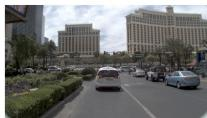

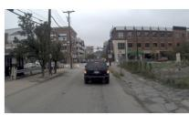

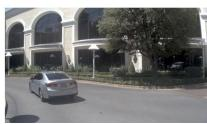

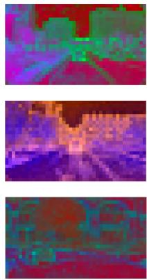  
Front View  
History Latent 1

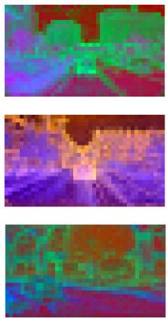  
History Latent 4

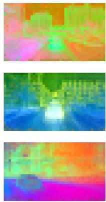  
Future Latent 1

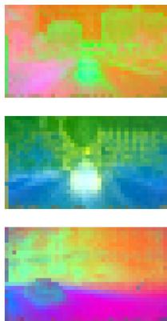  
Future Latent 2  
Figure 4: World Expert latent features. Each row shows one driving scene. The columns show the front-view image, history latents 1 and 4, and future latents 1 and 2. All PCA-projected latent maps use the same color scale.

## D WORLD-EXPERT FEATURE VISUALIZATION

Fig. 4 shows PCA projections of the World Expert’s history and future features in three driving scenes. The four observed history frames are encoded separately, yielding four history latents; history latents 1 and 4 therefore correspond to the first and fourth observed frames. The eight future frames are grouped into two consecutive sets of four and encoded groupwise, yielding two future latents. Future latents 1 and 2 correspond to these two groups, respectively, and each summarizes four frames spanning 2 seconds. Thus, the two future latents together represent the full 4-second prediction horizon. Across scenes, the latents exhibit structured, scene-specific patterns that evolve across time. This temporal organization provides qualitative evidence that the unified architecture learns effective representations of both observed context and future dynamics, which supply structured predictive context to the Action Expert.