# DuplexBridge: Coordinating Understanding and Generation for Unified Image Editing

Yidi Liu1, Jie Xiao2, Chaojie Mao2, Jingfeng Zhang2, Xueyang Fu1,∗

1University of Science and Technology of China

2Wan Team, Alibaba Group

∗Corresponding author

Complex image editing requires faithful task interpretation and accurate execution, but a failed edit does not reveal which responsibility failed. We present DuplexBridge, which uses a unified model’s own understanding capability to enhance prompts for its own generation capability, without an external understanding module. A sourcegrounded bridge specifies targets, final-state changes, and preservation constraints. Understanding is supervised on fidelity to the original request without observing the generated image; generation is supervised on execution of the condition it actually receives. Reciprocal trust checks selectively admit global task feedback to each role while retaining independently valid local supervision. We introduce CE-Bench, a 1,200- task benchmark measuring joint satisfaction of task-derived change and preservation requirements. Across three model configurations, the full system improves complete compliance over direct editors by 21.75–25.75 percentage points, with gains also observed on KRIS-Bench, RISEBench, ImgEdit, and GEdit-Bench. From a common supervised Wan-Image initialization, gated joint training reaches 77.08% complete compliance, compared with 70.92% without gates and 75.00% when generation-local supervision instead checks the original task with both gates retained. These results support distinct local responsibilities and selective shared feedback for joint understanding–generation adaptation.

Date: October 12, 2026

## 1 Introduction

Complex image editing must bind changes to the correct source content, infer final states, and preserve protected content. Setting only an analog clock to the digital clock’s time plus 90 minutes requires all three.

Image-grounded interpretation and joint optimization already support complex editing (Fu et al., 2024; Huang et al., 2024). We study native prompt enhancement (PE) in unified models (Deng et al., 2025; Mao et al., 2026): their own understanding capability, U, constructs conditions for their own generation capability, G, without an external understanding module. When adapting both roles, what should supervise their local responsibilities, and when should they also learn from final task outcomes?

A task-level score alone does not distinguish faithful task expression from faithful execution. In figure 1(a), the digital reading 14:35 gives an analog target of 4:05. U may instead use the wrong reference and specify 11:50, which G faithfully renders. Alternatively, U specifies 4:05 correctly, but G changes the protected digital display. These failures motivate distinct checks of prompt fidelity, received-condition execution, and task outcome.

Executable planning and two-role adaptation have precedents (Zhou et al., 2026; Jiao et al., 2026). DARS routes planner–renderer updates using task-derived checklists and post-render planner diagnostics (Cao et al., 2026); DDA-Thinker separately evaluates plans and visual outcomes while keeping the editor frozen (Yang et al., 2026). DuplexBridge combines distinct local supervision references for both adapting roles with reciprocal checks that select only their additional global-feedback losses.

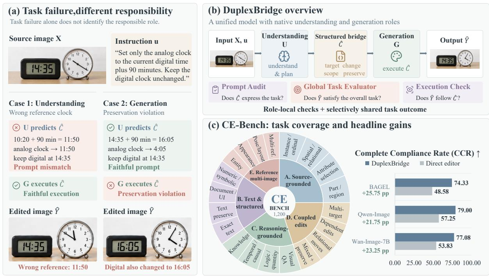  
Figure 1 DuplexBridge overview. (a) Task failures with diferent local responsibilities. (b) Native U–G communication and three distinct checks. (c) CE-Bench coverage and full-system CCR gains, including PE, SFT, and RL. Primary sectors encode 300/240/240/240/180 tasks; outer subdivisions illustrate capabilities rather than subtype frequencies.

The bridge specifies source-bound targets, changes, and preservation (figure 1). G receives only the source and this condition, which also defines G-local execution checks.

U-local checks compare the condition with the task without seeing the generated image. A separate global reward assesses the final edit against the task. Prompt trust gates this reward to G; execution trust gates it to U. Valid local supervision remains when either gate closes. Training alternates role updates; inference follows the native U-to-G path.

CE-Bench requires all task-derived change and preservation checks to pass; these requirements are independent of the predicted bridge. Full-system complete compliance rate (CCR) gains over direct editors span 21.75–25.75 points across three configurations, alongside public-benchmark improvements. From a common supervised Wan-Image initialization, full reaches 77.08% CCR versus 70.92% without gates and 75.00% with original-task G-local and both gates retained. Group-structure-matched random selection reaches 72.25%, supporting semantic selection in this setting.

## Our contributions are:

1. A checkable bridge within a unified model that defines distinct local supervision targets for task expression and received-condition execution.

2. A joint learning rule that retains valid local supervision while selectively sharing global task feedback through reciprocal partner-trust gates.

3. CE-Bench, a 1,200-task evaluation of complete editing fulfillment, supported by public benchmarks and controlled comparisons of the feedback design.

## 2 Related Work

Understanding–generation coordination. MGIE learns expressive instructions and jointly trains the multimodal language model and image editor (Fu et al., 2024). SmartEdit strengthens complex instruction editing with bidirectional interaction between image features and MLLM outputs (Huang et al., 2024). These works establish understanding-guided editing and coupled adaptation; SmartEdit’s bidirectionality concerns feature interaction, whereas ours concerns training feedback between the understanding and generation roles. BAGEL unifies image understanding and generation; Uni-Edit studies editing-driven adaptation (Deng et al., 2025; Zheng et al., 2026). Unified Thinker uses successive understanding and generation phases, ThinkGen applies SepGRPO, and ThinkRL-Edit decouples the two roles’ updates (Zhou et al., 2026; Jiao et al., 2026; Li et al., 2026). UniGRPO and BRAID further study joint reasoning and synthesis (Liu et al., 2026; Hu et al., 2026). DuplexBridge focuses on the supervision references and feedback eligibility within this co-adaptation: task fidelity, received-condition execution, and task outcome train distinct loss components. Here, native understanding means that the unified model uses its own understanding capability for prompt enhancement and passes the result to its own generation capability, without an external understanding module in that inference path. This definition permits external judges and teachers for training supervision.

Structured prompt enhancement and feedback. PromptEnhancer optimizes a rewriter with a frozen generator; its published alignment reward evaluates generated images against the rewritten prompt (Wang et al., 2026). Thus, received-condition image assessment is already an established component. Wan-Image and SenseNova-U1.5 use structured editing conditions (Mao et al., 2026; Diao et al., 2026). DDA-Thinker already assesses executable plans without observing generated images and maintains separate cognitive and visual reward streams, while keeping the editor frozen (Yang et al., 2026). DARS addresses the same ambiguity between planning and execution failures. It jointly trains a planner and renderer with an original-task checklist, post-render planner diagnostics, prefix gating across plan fields, and variance-based module weights (Cao et al., 2026). DuplexBridge combines diferent local references within co-adaptation: U-local judges task fidelity without the rendered image, and G-local judges execution against the condition actually received. Reciprocal partner trust selects only the additional global losses, preserving valid local supervision when global feedback is withheld. This combination makes local responsibility and global-feedback eligibility explicit within the same training procedure. The gates implement selective feedback, not counterfactual credit estimation (Foerster et al., 2018).

Reward modeling and editing evaluation. SLD detects and corrects generation errors through an inference-time loop (Wu et al., 2024); DuplexBridge uses execution checking to determine which feedback can train each role. RewardDance uses comparative token probabilities; UnifiedReward Think and Z-Reward study reasoning-enhanced and distilled judgment (Wu et al., 2025a; Wang et al., 2025; Jin et al., 2026). Our distilled RM supports the shared outcome signal through direct pairwise scoring against fixed reference edits. TIFA and Davidsonian Scene Graph motivate decomposed visual checking (Hu et al., 2023; Cho et al., 2024). ImgEdit, GEdit, RISEBench, and KRIS-Bench assess complementary dimensions of editing and reasoning (Ye et al., 2025; Liu et al., 2025b; Zhao et al., 2025; Wu et al., 2025b). CE-Bench emphasizes complete compliance with source-grounded changes and preservation constraints. Its requirements come from the original task, independently of a model’s predicted bridge, and evaluation accepts final images.

## 3 A Structured Bridge for Understanding and Generation

## 3.1 Native roles and the forward path

Let X contain the source image and any task-provided reference images, with their roles identified, and let u be the editing instruction. DuplexBridge uses a unified model’s own understanding role

$U _ { \theta }$ for prompt enhancement (PE) and its own generation role $G _ { \phi }$ for editing:

$$
( z _ { \theta } , \widehat { C } ) \sim \pi _ { \theta } ( \cdot \mid X , u ; \psi ) , \qquad \widehat { Y } \sim G _ { \phi } ( \cdot \mid X , \widehat { C } ; \psi ) .\tag{1}
$$

Here $z _ { \theta }$ is internal interpretation in a <think> block and $\widehat { C }$ is the public structured bridge. Trainable role parameters θ, ϕ are disjoint; fixed pretrained parameters $\psi$ may include a shared backbone. No external understanding module constructs ${ \widehat { C } } .$ . Generation receives X and $\widehat { C }$ in a fresh context, without the original instruction or U’s internal reasoning.

## 3.2 Making the editing requirements explicit

U resolves target identities, reasoning-dependent answers, and terminal states before constructing ${ \widehat { C } } .$ The bridge binds changes to source entities, separates editable from protected content, and specifies preservation requirements and forbidden efects. Entailed requirements are made explicit without additional edits; requested text retains its exact characters. CE-v1 organizes these requirements as grouped JSON fields goal, scope, ops, preserve, and avoid (figure 2). The goal summarizes the operative fields without adding obligations.

The public condition also defines the execution checks:

$$
D ( \widehat { C } ) = ( D _ { \Delta } , D _ { \mathrm { i n v } } ) , \qquad Q _ { \mathrm { e x e c } } = A ( \widehat { C } ) ,\tag{2}
$$

where $D _ { \Delta }$ and $D _ { \mathrm { i n v } }$ are disjoint change and invariant groups. A source resolver binds targets in $X ;$ fixed templates check applicable initial states before output requirements. Repeated obligations are deduplicated; overlapping preservation scopes are partitioned or deduplicated after semantic validation. Template enumeration is deterministic; source binding and visual judgment remain semantic operations.

The compiler uses the same condition as G and cannot recover omitted requirements from u or $z _ { \theta } .$ A clearly specified edit can therefore be executable yet wrong for the user’s request, motivating separate prompt and execution feedback. U is initialized on accepted teacher responses containing internal interpretation and public JSON before RL. Sections 3.3 and 6.2 describe the bridge semantics and the initialization controls.

## 3.3 Source binding, coverage, and validity

The bridge supports recoloring, replacement, insertion, removal, movement, text transformation, and observable state changes. It expresses the requested terminal state, including exact final text or a reasoning-derived value, rather than an unresolved instruction to reason. Editable and protected source content have disjoint roles. Targets must resolve to a source instance or a determinate set; matching the edited output retains that source identity. Sharing a description does not guarantee that U, G, and a visual judge interpret it identically.

Each execution group conjoins source grounding, applicable initial-state checks, and the corresponding output requirement. A failed or unresolved prerequisite marks its group as non-passing once; training eligibility is assessed separately. Preservation requirements reuse source evidence and are deduplicated or partitioned when scopes overlap, so repeated wording does not increase reward weight. These reduction rules also apply to public evaluation, whose requirements come from the original task rather than the predicted bridge.

In the clock example, the source analog display reads 10:20 and the protected digital display reads 14:35. The requested digital time plus 90 minutes yields 16:05, or 4:05 on the analog dial. The bridge specifies 4:05 as the analog terminal state; reading the digital display supplies evidence without making it an edit target. Its unchanged time and appearance, the analog dial and case, and the surrounding scene remain preservation obligations.

The goal summary must be entailed by the operative requirements. Unsupported operations, unresolved targets, contradictory clauses, or a goal containing an otherwise omitted obligation cannot silently produce a valid execution specification. Invalid or unresolvable specifications and uncertain execution judgments are excluded from execution training, even when diagnostics record a failed group. Confident failures on valid, resolvable checks remain learning signals. A confident prompt-fidelity judgment may still supervise U locally. Private interpretation, expected judge answers, benchmark identifiers, and rewards are excluded from the public condition passed to G.

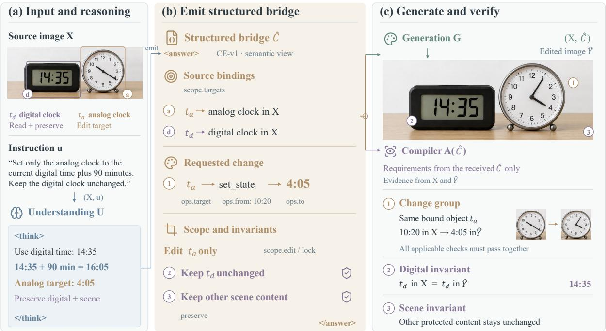  
Figure 2 From understanding to a checkable bridge. U resolves the clock task and separates the editable analog clock from protected digital and scene content. Only the public condition enters G and the execution compiler; change and invariant checks use that same condition.

## 4 Coordinating Learning with Local and Global Feedback

DuplexBridge separates three evaluations by the information they receive: prompt fidelity uses $( X , u , \hat { C } )$ , execution uses $( X , { \widehat { C } } , { \widehat { Y } } )$ , and the global outcome uses $( X , u , { \widehat { Y } } )$ (figure 3). Local rewards train each role’s responsibility; partner trust determines when the joint outcome also supervises that role.

## 4.1 Role-local rewards

$$
R _ { U } ^ { \mathrm { l o c } } = F _ { U } ( X , u , \widehat { C } ) , \qquad R _ { G } ^ { \mathrm { l o c } } = F _ { G } ( X , \widehat { C } , \widehat { Y } ) .\tag{3}
$$

Understanding: prompt fidelity. A separately validated reference C⋆ supports format, requirementlevel semantic precision/recall, and consistency/grounding judgments:

$$
R _ { U } ^ { \mathrm { l o c } } = s _ { C } = ( R _ { \mathrm { f o r m a t } } + R _ { \mathrm { p l a n } } + R _ { \mathrm { c l e a r } } ) / 3 .\tag{4}
$$

The plan score uses maximum one-to-one semantic matching between predicted and verified requirements: target identity, operation, terminal value, and invariant scope must agree. With T matches among P predicted and R reference groups, $R _ { \mathrm { p l a n } } = 2 T / ( P + R )$ . Format is a binary schema-conformance check; clarity averages a no-contradiction judgment and the resolved-sourcebinding fraction, with malformed or empty predictions scored zero. This check never reads Yb . Unresolved judgments abstain. The verified reference is distinct from teacher SFT targets (section 3.2).

Generation: execution and local quality. For $Q _ { \mathrm { e x e c } } = \{ Q _ { 1 } , \dots , Q _ { K } \}$ , each change group combines target grounding with its visual postconditions, while each distinct invariant forms another group. With visual judge V and check thresholds $\tau _ { q } ,$

$$
R _ { \mathrm { e x e c } } = \frac { 1 } { K } \sum _ { k = 1 } ^ { K } \prod _ { q \in Q _ { k } } \mathbf { 1 } [ V ( X , \widehat { Y } , q ) \geq \tau _ { q } ] ,\tag{5}
$$

$$
R _ { G } ^ { \mathrm { l o c } } = w _ { \Delta } R _ { \mathrm { e x e c , } \Delta } + w _ { \mathrm { i n v } } R _ { \mathrm { e x e c , i n v } } + w _ { q } R _ { \mathrm { q u a l i t y } } .\tag{6}
$$

The nonnegative weights sum to one; change and invariant scores average their respective groups, both of which must be nonempty for execution training. Quality excludes instruction compliance, and preservation is counted once. Invalid or unresolvable specifications and uncertain execution judgments are excluded by the eligibility mask; low scores on valid, confidently judged checks remain learning signals (section 3.3).

## 4.2 Global task feedback

A frozen pairwise reward model (RM) compares $\widehat { Y }$ with baseline edits from a fixed, nonempty set $\mathcal { R } _ { X , u }$ under the original instruction and rubric i. It receives neither $\widehat { C }$ nor U’s reasoning. Following the token-probability interface of RewardDance (Wu et al., 2025a),

$$
R _ { \mathrm { g l o b a l } } = F _ { \mathrm { g l o b a l } } ( X , u , \widehat { Y } ; \mathcal { R } _ { X , u } ) = \frac { 1 } { \left| \mathcal { R } _ { X , u } \right| } \sum _ { Y _ { r } \in \mathcal { R } _ { X , u } } P _ { \omega } ( \mathsf { Y e s } \mid X , u , \widehat { Y } , Y _ { r } , i ) .\tag{7}
$$

Here Yes favors ${ \widehat { Y } } ;$ its raw vocabulary probability gives a relative preference score in [0, 1], not an absolute completion probability. References are independent of candidate bridges and shared across each rollout group. The direct-scoring RM distills a thinking teacher’s judgment distribution and remains frozen during U/G training; its formulation and evaluation are in sections 4.5 and 6.8.

## 4.3 Bidirectional gates

Prompt trust controls G-global feedback; execution trust controls U-global feedback. Let $c _ { \mathrm { a u d i t } }$ indicate an available verified $C ^ { \star }$ and a suficiently reliable prompt-fidelity judgment, and let $b _ { E } , b _ { Q } , b _ { F }$ indicate usable execution, quality, and global judgments. For a valid specification, prompt trust requires

$$
\begin{array} { r } { v _ { C } = \mathbf { 1 } [ R _ { \mathrm { f o r m a t } } = 1 ] \mathbf { 1 } [ R _ { \mathrm { p l a n } } \geq \tau _ { p } ] \mathbf { 1 } [ R _ { \mathrm { c l e a r } } \geq \tau _ { c } ] } \\ { \times \mathbf { 1 } [ \mathrm { r e q u i r e d ~ t a r g e t s ~ r e s o l v e d } ] . \qquad } \end{array}\tag{8}
$$

Here $\tau _ { p } , \tau _ { c }$ are the minimum plan and clarity scores; invalid specifications have $b _ { E } = v _ { C } = 0$ Unresolved source bindings or uncertain execution judgments set $b _ { E } = 0 ;$ unresolved required targets also give $v _ { C } = 0$ . Judgment usability is separate from success: $c _ { \mathrm { a u d i t } } , b _ { E } , b _ { Q }$ require reliable judgments, with reliability estimators and thresholds fixed using independent development labels. The reciprocal gates and global-loss eligibility are

$$
\begin{array} { r l r } & { m _ { U \to G } = c _ { \mathrm { a u d i t } } v _ { C } , } & { e _ { G } ^ { \mathrm { g l o b } } = b _ { F } m _ { U \to G } , } \\ & { m _ { G \to U } = b _ { E } \mathbf { 1 } [ R _ { \mathrm { e x e c } } \geq \tau _ { e } ] , } & { e _ { U } ^ { \mathrm { g l o b } } = b _ { F } m _ { G \to U } . } \end{array}\tag{9}
$$

Local eligibility is independent of these gates: $e _ { U } ^ { \mathrm { l o c } } = c _ { \mathrm { a u d i t } }$ and $e _ { G } ^ { \mathrm { l o c } } = b _ { E } b _ { Q }$ . Thus $b _ { E } = 0$ excludes G-local and $\mathrm { U - g l o b a l }$ , while a reliable prompt judgment can still train U locally; diagnostic zeros for unusable checks do not enter the loss. Judgment usability difers from task success: a confidently identified failure can supply a low local reward. Gate-only ablations bypass semantic trust while retaining judgment-confidence and availability tests, so an unavailable check is never treated as a successful execution.

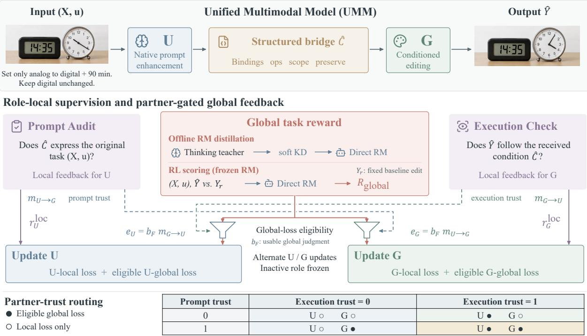  
Figure 3 Bidirectional partner-gated feedback. Execution trust gates U-global; prompt trust gates G-global. Local feedback retains independent validity masks. The diagram abbreviates $e _ { U } ^ { \mathrm { g l o b } } , e _ { G } ^ { \mathrm { g l o b } }$ as e , e and local rewards as $r _ { U } ^ { \mathrm { l o c } } , r _ { G } ^ { \mathrm { l o c } }$ . The routing matrix assumes usable judgments. $Y _ { r }$ is a baseline edit, distinct from task-provided reference images.

In figure 1(a), if G faithfully sets the analog clock to U’s incorrect 11:50, G retains local supervision. Passed execution trust admits global feedback to U; failed prompt trust excludes G-global. When U correctly specifies 4:05 but G changes the protected digital clock, passed prompt trust admits G-global; U-global is excluded if execution trust fails. The mean threshold can still accept a missed change or preservation failure (section 4.4).

## 4.4 Alternating updates with four loss components

Each role combines two separately normalized group-relative clipped losses:

$$
\begin{array} { r l } & { \mathcal { L } _ { U } = \mathcal { L } _ { \mathrm { G R } } ^ { U , \mathrm { l o c } } ( R _ { U } ^ { \mathrm { l o c } } ; e _ { U } ^ { \mathrm { l o c } } ) + \lambda _ { U } \mathcal { L } _ { \mathrm { G R } } ^ { U , \mathrm { g l o b } } ( R _ { \mathrm { g l o b a l } } ; e _ { U } ^ { \mathrm { g l o b } } ) , } \\ & { \mathcal { L } _ { G } = \mathcal { L } _ { \mathrm { G R } } ^ { G , \mathrm { l o c } } ( R _ { G } ^ { \mathrm { l o c } } ; e _ { G } ^ { \mathrm { l o c } } ) + \lambda _ { G } \mathcal { L } _ { \mathrm { G R } } ^ { G , \mathrm { g l o b } } ( R _ { \mathrm { g l o b a l } } ; e _ { G } ^ { \mathrm { g l o b } } ) . } \end{array}\tag{10}
$$

For U updates, freeze G, sample complete U responses, and generate several images per response. Average global scores over eligible images within each response, then weight eligible responses equally; a response with none can still contribute to U-local. For G updates, freeze U and compare stochastic image trajectories conditioned on one bridge.

For component t ∈ {Uloc, Uglob, Gloc, Gglob}, let $I _ { t } = \{ i : e _ { t i } = 1 \}$ and compute its reward mean $\mu _ { t }$ and standard deviation $\sigma _ { t }$ only on $I _ { t }$ . For an eligible, nondegenerate group,

$$
\begin{array} { l l } { { } } & { { A _ { t i } = \displaystyle \frac { R _ { t i } - \mu _ { t } } { \sigma _ { t } + \epsilon } , } } \\ { { } } & { { \mathcal { L } _ { t } = \displaystyle \frac { 1 } { | I _ { t } | } \sum _ { i \in I _ { t } } \left[ - \operatorname* { m i n } \{ \rho _ { t i } A _ { t i } , \mathrm { c l i p } ( \rho _ { t i } , 1 - \varepsilon , 1 + \varepsilon ) A _ { t i } \} + \beta _ { t } { \mathcal { D } } _ { t i } \right] . } } \end{array}\tag{11}
$$

Here $\rho _ { t i }$ is the current-to-behavior policy likelihood ratio and $\mathcal { D } _ { t i }$ the frozen-reference policy penalty. Each component normalizes rewards and applies its KL penalty only on its eligible set; replacing excluded rewards by zero inside shared normalization is not equivalent. Groups with fewer than two eligible samples or zero reward variance are skipped for that component, including

KL. U uses text-policy likelihoods and G uses stochastic flow trajectory likelihoods (Shao et al., 2024; Liu et al., 2025a). A sample excluded from global feedback can retain local supervision; positive raw reward need not imply positive centered advantage.

Execution trust and critical requirements. The execution gate tests the average group score. With one failure among K groups, $R _ { \mathrm { e x e c } } = ( K - 1 ) / K$ can exceed $\tau _ { e }$ even when a requested change or preservation obligation fails. Deduplication prevents repeated obligations from increasing their weight, but distinct invariants can still dilute one failure. Execution trust therefore does not require every critical obligation to pass.

Conditional return and selection. U-global averages accepted images within each candidate and weights eligible candidates equally. It therefore estimates return conditional on acceptance. With L conditionally i.i.d. image–judgment samples and per-image acceptance probability $p ( C )$ , a candidate is included with probability $1 - ( 1 - p ( C ) ) ^ { L }$ , before group-size and variance filtering. Equal weighting does not undo this selection, and accepted-return rankings can difer from rankings that also account for rejected images. The gates define selective objectives, not unbiased unconditional-return gradients or counterfactual causal attribution.

## 4.5 Reasoning-distilled global judgment

For pairwise input $x = ( X , u , Y _ { A } , Y _ { B } , i )$ , a frozen thinking teacher produces reasoning z and a judgment distribution $\mathbf { q } _ { T } ( x , z )$ . The direct student predicts $\mathbf { p } _ { \omega } ( x )$ from the same visual inputs, candidate order, and rubric, without receiving or decoding the teacher’s reasoning. Both compare original-task fulfillment, preservation, and visual quality. Predicted bridges, private U reasoning, human preference labels, and test annotations are excluded from their inputs.

The RL score uses raw vocabulary probability $P _ { \mathtt { Y e s } }$ , whereas the binary evaluation probability conditions on the two judgment tokens:

$$
r _ { \mathrm { r a w } } = P _ { \mathrm { Y e s } } , \qquad r _ { \mathrm { b i n } } = \frac { P _ { \mathrm { Y e s } } } { P _ { \mathrm { Y e s } } + P _ { \mathrm { N o } } } .\tag{12}
$$

For raw-score distillation, the common outcome space retains the masses for Yes, No, and all other vocabulary tokens. Matching only binary-normalized judgments would define a diferent target. Soft judgment distillation optimizes

$$
\mathcal { L } _ { \mathrm { K D } } = \mathbb { E } _ { x , z } D _ { \mathrm { K L } } ( \mathrm { s g } [ \mathbf { q } _ { T } ( x , z ) ] \| \mathbf { p } _ { \omega } ( x ) ) ,\tag{13}
$$

with only the student updated. There is no loss on teacher reasoning tokens. In expectation, minimizing this loss targets the frozen teacher’s marginal judgment distribution ${ \mathbb E } _ { z } [ { \bf q } _ { T } ( x , z ) ]$ . It transfers judgments rather than the teacher’s internal reasoning algorithm and does not guarantee calibration. After distillation, the RM stays frozen during $\mathrm { U } / \mathrm { G }$ training and supplies only global feedback. Independent preference labels, candidate-order swaps, and dificult-pair evaluation assess its reliability (section 6.8).

## 5 Experimental Setup

## 5.1 Models and comparison scope

Image editing uses BAGEL, Qwen-Image-Edit-2511 (Qwen-2511), and Wan-Image-7B, with mechanism ablations on Wan-Image. Each model supplies its own U and G for native PE. Qwen-Image labels in the figures denote Qwen-2511. Direct baselines edit the original instruction; full systems add native PE, structured supervised initialization, and joint RL. $B _ { 0 }$ denotes the common supervised initialization before RL. U-only, G-only, local-only, and joint variants are independently trained from $B _ { 0 }$ , with common supervision and reference access. Unless varied explicitly, global feedback uses the reasoning-distilled RM. RM replacement experiments use equal update steps and rollout budgets. The controls distinguish complete-system gains from supervised initialization, communication, and RL efects (sections 6.2 to 6.4).

## 5.2 CE-Bench and complete task fulfillment

Our 1,200-task benchmark tests whether target binding, terminal-state changes, and preservation constraints are jointly satisfied. Section 5.3 gives its five-category taxonomy. Evaluation uses the original task, source, required reference images, and final output; requirements are independent of the model’s predicted bridge. For item $n ,$ let $a _ { n k }$ denote a binary pass for requirement group $k ,$ and let $P _ { n }$ be the mean pass rate over its preservation groups. We report

$$
\mathrm { A C } = \frac { 1 } { N } \sum _ { n } \frac { 1 } { K _ { n } } \sum _ { k } a _ { n k } , \qquad \mathrm { C C R } = \frac { 1 } { N } \sum _ { n } \prod _ { k } a _ { n k } , \qquad \mathrm { P r e s } = \frac { 1 } { N } \sum _ { n } P _ { n } .\tag{14}
$$

All metrics are percentages and weight items equally; failed outputs remain in the denominator. CCR requires complete compliance with every change and preservation group. A change group includes target grounding and the required terminal state; each distinct preservation obligation counts once. Correctly changing the analog clock but altering the protected digital display fails CCR despite passing the change check. These task-derived groups difer from the predictedcondition groups used for G-local training.

Public obligations are derived from the source, task-provided references, and original instruction before predictions are assessed. Independently verified $C ^ { \star }$ supports prompt checks; accepted teacher responses instead supply SFT targets and are not automatically evaluation oracles.

## 5.3 Taxonomy and task allocation

CE-Bench assigns each of its 1,200 tasks one primary category and a secondary capability category (table 1). CE-v1 in section 3.3 names the prompt schema, not a benchmark version.

Table 1 CE-Bench taxonomy. The five primary categories are mutually exclusive; the secondary categories describe capability coverage.
<table><tr><td>Primary category</td><td></td><td>N Secondary categories</td></tr><tr><td>A. Source-Grounded</td><td></td><td>300 A1 Instance / Ordinal Grounding; A2 Spatial / Relational Grounding; A3 Attribute-Conditioned Selection; A4 Part / Region Grounding.</td></tr><tr><td>B. Text &amp; Structured Content</td><td></td><td>240 B1 Exact Text Editing; B2 Multi-Text &amp; Text Preservation; B3 Document / UI Layout Editing; B4 Numeric / Symbolic / Structured Visual Editing.</td></tr><tr><td>C. Reasoning-Grounded</td><td></td><td>240 C1 Visual Question-to-Edit; C2 Logical / Spatial / Quantitative Reasoning; C3 Temporal / Causal / Physical Inference; C4 Knowledge / Conceptual / Procedural Reasoning</td></tr><tr><td>D. Coupled &amp; Compositional</td><td></td><td>240 D1 Multi-Target Composition; D2 Dependent / Coupled Edits; D3 Relational Rearrangement; D4 Mixed Operations + Preservation.</td></tr><tr><td>E. Reference-Conditioned Multi-Image</td><td></td><td>180 E1 Entity / Subject Transfer; E2 Attribute / Appearance Transfer; E3 Pose / Layout / Structural Transfer; E4 Multi-Reference Composition &amp; Reasoning.</td></tr></table>

Primary-label rules. Precedence is $\mathrm { E { > } D { > } C { > } B { > } A }$ . E requires an additional task-provided reference image; otherwise D requires multiple principal changes or coupled editing obligations, C requires inference to derive the target or terminal state, B centers on exact text or structured content, and A on directly visible source grounding. Thus, a supplied replacement number is B, while a number that must be calculated is C; directly stated spatial relations are A, while relations requiring inference are C. Ordinary preservation alone does not make a single-change task D. Nonexclusive tags record grounding, reasoning, operations, reference use, and preservation without counting tasks again in aggregate scores.

Source and reference roles. Each input $( X _ { \mathrm { s r c } } , { \mathcal { T } } _ { \mathrm { r e f } } , u )$ requires one edited source image. A–D have no additional reference images; E uses references for entity, appearance, or structural information, with E4 requiring at least two. The source defines the editable scene and protected content, while stable image identifiers bind referenced attributes to their input images. Editors and evaluators receive the same task images in the same order with these roles preserved. These conditioning images are distinct from the baseline reference edits used as comparison outputs by the pairwise RM.

AC, CCR, and Pres. follow equation (14). Overall scores weight category means by their item counts (25%, 20%, 20%, 20%, 15% for A–E), with failed outputs retained in their assigned category and denominator.

## 5.4 Public benchmark protocols

We report the KRIS-Bench composite, RISEBench-360 completion accuracy, ImgEdit’s 1–5 score, and GEdit-Bench English Full-set GO (0–10) (Wu et al., 2025b; Zhao et al., 2025; Ye et al., 2025; Liu et al., 2025b; Cao et al., 2026). Cross-system comparisons evaluate complete configurations; Wan-Image ablations test components within one configuration.

RISEBench-360 has 85 temporal, 90 causal, 100 spatial, and 85 logical tasks. Overall accuracy weights these task counts; it is not the unweighted mean of the four category percentages or the continuous visual-dimension scores.

KRIS measures knowledge-dependent editing through a composite, not complete success accuracy. GEdit EN follows the English Full-set $G _ { O }$ column in DARS Table S5, rather than the intersection of valid outputs across methods. GEditBench v2 uses a diferent pairwise/Elo protocol (Jiang et al., 2026); its scores and subsets are not interchangeable with v1. Metrics are reported on their native scales without a cross-benchmark average.

## 6 Experiments

## 6.1 End-to-end editing performance

DuplexBridge improves CE-Bench CCR by 25.75, 21.75, and 23.25 points on BAGEL, Qwen-2511, and Wan-Image, respectively, alongside preservation (table 2). These full-system gains include PE, supervised initialization, and RL.

On public benchmarks (table 3), Wan-Image reaches 80.13/29.17 KRIS/RISE, gaining 19.29/16.11 points over its direct baseline. Qwen-2511 reaches 82.16/31.11, versus DARS’s 80.72/27.50. These are complete-system comparisons; component controls follow. Task-specific text-to-image retraining is evaluated on GenEval2, R2I, WISE-V, and DPG in section 6.10.

Qualitative behavior. The CE-Bench examples in figure 4 illustrate image-grounded answers, spatial placement, and preservation. DuplexBridge inserts “Jackrabbit” and “45” while retaining the worksheet diagrams, places a sliced piece on the upper-left plate, and combines a man, puppy, and red-patterned toy rabbit with the woman’s base scene. These examples accompany the quantitative results in table 2. Section 7 adds reasoning and physical transformations on RISEBench and KRIS-Bench, as well as additional CE-Bench edits.

## 6.2 Supervised initialization controls

The main tables compare unadapted baselines with full DuplexBridge; the supervised $B _ { 0 }$ checkpoint uses native PE and structured $\mathrm { S F T }$ , before RL. Table 5 reports all three supervised checkpoints on CE-Bench and public benchmarks. From $B _ { 0 }$ to full DuplexBridge, CE CCR increases by 17.91, 16.92, and 17.66 percentage points for BAGEL, Qwen-2511, and Wan-Image-7B. All three configurations improve the four public metrics and each RISE category over their respective $B _ { 0 }$ (table 4). Warm-start improvements are not uniform: Qwen preservation falls from 90.86 before adaptation to 90.14 at $B _ { 0 }$ , then reaches 94.21 with DuplexBridge. Its ImgEdit score likewise falls from 4.36 before adaptation to 4.28 at $B _ { 0 }$ , then reaches 4.43 with DuplexBridge.

Table 2 CE-Bench comparison. A–E are category CCR (table 1); scores are percentages. Full systems include native PE, structured SFT, and gated RL. Dark/light pink marks the best/second-best values within each model group, including ties.
<table><tr><td>Model</td><td>A</td><td>B</td><td>C</td><td>D</td><td>E</td><td>AC↑</td><td>Pres. ↑</td><td>CCR ↑</td></tr><tr><td colspan="7">Commercial Models</td><td></td><td></td></tr><tr><td>GPT-Image-1.5</td><td>83.00</td><td>78.33</td><td>72.92</td><td>82.50</td><td>68.89</td><td>93.47</td><td>94.12</td><td>77.83</td></tr><tr><td>Gemini-3-pro-image-preview</td><td>82.33</td><td>77.08</td><td>81.67</td><td>84.17</td><td>72.78</td><td>94.08</td><td>93.87</td><td>80.08</td></tr><tr><td>Seedream 4.5</td><td>80.33</td><td>77.50</td><td>62.92</td><td>72.50</td><td>58.89</td><td>91.36</td><td>94.43</td><td>71.50</td></tr><tr><td>Gemini-2.5-Flash-Image</td><td>73.00</td><td>69.58</td><td>64.17</td><td>70.83</td><td>59.44</td><td>89.67</td><td>90.72</td><td>68.08</td></tr><tr><td colspan="9">Generation-only Editors</td></tr><tr><td>FLUX.1-Kontext-dev (direct)</td><td>58.33</td><td>43.33</td><td>30.42</td><td>43.7533.33</td><td></td><td>75.62</td><td>86.31</td><td>43.08</td></tr><tr><td>FLUX.2-klein-9B (direct)</td><td>75.67</td><td>64.58</td><td>47.08</td><td>60.00</td><td>50.56</td><td>85.92</td><td>92.87</td><td>60.83</td></tr><tr><td>LongCat-Image-Edit (direct)</td><td>74.33</td><td>65.42</td><td>48.33</td><td>60.42</td><td>47.22</td><td>85.74</td><td>93.16</td><td>60.50</td></tr><tr><td colspan="9">Planner + Generator</td></tr><tr><td>RePlan + Qwen-2511</td><td>70.33</td><td>58.75</td><td>52.92</td><td>59.58</td><td>49.44</td><td>84.62</td><td>90.41</td><td>59.25</td></tr><tr><td>PromptEnhancerV2 + Qwen-2511</td><td>76.33</td><td>68.75</td><td>60.83</td><td>66.67</td><td>56.11</td><td>88.62</td><td>91.26</td><td>66.75</td></tr><tr><td>ThinkRL-Edit (DARS config.)</td><td>76.00</td><td>64.58</td><td>65.42</td><td>70.42</td><td>57.78</td><td>89.06</td><td>91.84</td><td>67.75</td></tr><tr><td>EditThinker + Qwen-2511</td><td>77.33</td><td>67.08</td><td>63.33</td><td>70.00</td><td>60.56</td><td>89.48</td><td>92.18</td><td>68.50</td></tr><tr><td>DDA-Thinker-32B + Qwen-2511</td><td>79.00</td><td>71.25</td><td>70.83</td><td>75.42</td><td>64.44</td><td>91.17</td><td>93.10</td><td>72.92</td></tr><tr><td>DARS</td><td>79.00</td><td>72.50</td><td>71.67</td><td>76.25</td><td>66.11</td><td>91.36</td><td>93.18</td><td>73.75</td></tr><tr><td colspan="9">Unified MLLMs</td></tr><tr><td>UniREdit-BAGEL</td><td>72.00</td><td>57.08</td><td>55.00</td><td>62.92</td><td>47.78</td><td>85.68</td><td>89.34</td><td>60.17</td></tr><tr><td>UniReason 1.0</td><td>74.00</td><td>62.50</td><td>60.42</td><td>67.92</td><td>53.33</td><td>87.81</td><td>90.26</td><td>64.67</td></tr><tr><td>BAGEL</td><td>64.00</td><td>43.75</td><td>40.00</td><td>51.67</td><td>36.67</td><td>80.80</td><td>86.72</td><td>48.58</td></tr><tr><td>BAGEL + DuplexBridge</td><td>79.00</td><td>70.83</td><td>74.17</td><td>77.08</td><td>67.78</td><td>91.27</td><td>92.74</td><td>74.33</td></tr><tr><td>Qwen-2511</td><td>71.67</td><td>56.25</td><td>51.25</td><td>59.17</td><td>40.00</td><td>84.30</td><td>90.86</td><td>57.25</td></tr><tr><td>Qwen-2511 + DuplexBridge</td><td>82.00</td><td>78.33</td><td>78.33</td><td>80.83</td><td>73.33</td><td>93.16</td><td>94.21</td><td>79.00</td></tr><tr><td>Wan-Image-7B</td><td>68.33</td><td>52.08</td><td>46.67</td><td>56.67</td><td>37.78</td><td>82.70</td><td>88.47</td><td>53.83</td></tr><tr><td>Wan-Image-7B + DuplexBridge</td><td>85.67</td><td>79.17</td><td>77.08</td><td>67.08</td><td>73.33</td><td>92.31</td><td>93.86</td><td>77.08</td></tr></table>

Table 3 Public editing benchmarks. Higher is better; metric scales follow section 5. Dark/light pink marks the best/second-best value per column among displayed systems.
<table><tr><td>Method</td><td></td><td></td><td>KRIS↑ RISE↑ ImgEdit↑ GEdit EN ↑</td></tr><tr><td>PromptEnhancerV2</td><td>71.54</td><td>18.90</td><td>4.18 7.59</td></tr><tr><td>DARS</td><td>80.72</td><td>27.50</td><td>4.39 7.86</td></tr><tr><td>BAGEL</td><td>56.21</td><td>5.80</td><td>3.45 6.40</td></tr><tr><td>+ DuplexBridge</td><td>76.48</td><td>26.11</td><td>4.04 7.41</td></tr><tr><td>Qwen-2511</td><td>64.42</td><td>17.50</td><td>4.36 6.97</td></tr><tr><td>+ DuplexBridge</td><td>82.16</td><td>31.11</td><td>4.43 7.89</td></tr><tr><td>Wan-Image-7B</td><td>60.84</td><td>13.06</td><td>4.09 6.88</td></tr><tr><td>+ DuplexBridge</td><td>80.13</td><td>29.17</td><td>4.36 7.74</td></tr></table>

Table 4 Native UMM configurations on RISEBench-360. Qwen-2511 denotes Qwen-Image-Edit-2511. Overall is task-weighted across 85 temporal, 90 causal, 100 spatial, and 85 logical items. Dark/light pink mark the best/second-best value in each column, including ties.
<table><tr><td>Method</td><td>Temporal</td><td>Causal</td><td>Spatial</td><td>Logical</td><td>Overall</td></tr><tr><td>BAGEL (B0)</td><td>14.12</td><td>23.33</td><td>23.00</td><td>5.88</td><td>16.94</td></tr><tr><td>BAGEL + DuplexBridge</td><td>24.71</td><td>33.33</td><td>31.00</td><td>14.12</td><td>26.11</td></tr><tr><td>Qwen-2511 (B0)</td><td>21.18</td><td>26.67</td><td>29.00</td><td>9.41</td><td>21.94</td></tr><tr><td>Qwen-2511 + DuplexBridge</td><td>31.76</td><td>38.89</td><td>34.00</td><td>18.82</td><td>31.11</td></tr><tr><td>Wan-Image-7B (B0)</td><td>16.47</td><td>23.33</td><td>24.00</td><td>7.06</td><td>18.06</td></tr><tr><td>Wan-Image-7B + DuplexBridge</td><td>29.41</td><td>35.56</td><td>34.00</td><td>16.47</td><td>29.17</td></tr></table>

Public benchmarks  
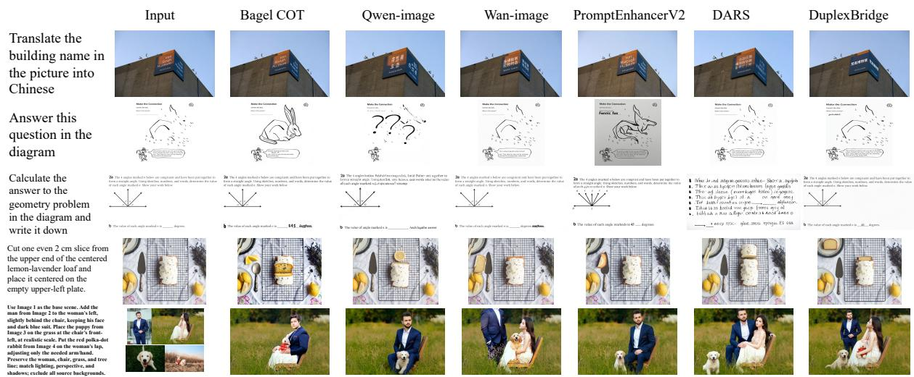  
Figure 4 Qualitative comparison on CE-Bench. Rows cover sign translation, image-grounded question answering, geometric reasoning, spatially specified slicing, and composition from multiple references. The geometry example requires an answer within the existing diagram; the final row combines entity placement with preservation of the base scene.

Table 5 Supervised initialization controls. $B _ { 0 }$ uses native PE and structured SFT, before RL. A–E follow table 1; public metrics follow section 5.4. Dark/light pink mark the best/second-best values, including ties.

CE-Bench
<table><tr><td>Model</td><td>A</td><td>B</td><td>C</td><td>D</td><td>E</td><td>AC</td><td>Pres.</td><td>CCR</td></tr><tr><td>BAGEL (B0)</td><td>68.67</td><td>49.58</td><td>47.92</td><td>62.92</td><td>47.78</td><td>83.91</td><td>88.63</td><td>56.42</td></tr><tr><td>Qwen-2511 (B0)</td><td>73.00</td><td>61.25</td><td>55.00</td><td>64.58</td><td>51.11</td><td>86.62</td><td>90.14</td><td>62.08</td></tr><tr><td>Wan-Image-7B (B0)</td><td>70.00</td><td>57.92</td><td>52.50</td><td>62.08</td><td>49.44</td><td>85.28</td><td>89.21</td><td>59.42</td></tr></table>

<table><tr><td>Model</td><td>KRIS</td><td>RISE</td><td>ImgEdit</td><td>GEdit EN</td></tr><tr><td>BAGEL (B0)</td><td>64.23</td><td>16.94</td><td>3.74</td><td>6.93</td></tr><tr><td>Qwen-2511 (B0)</td><td>70.36</td><td>21.94</td><td>4.28</td><td>7.28</td></tr><tr><td>Wan-Image-7B (B0)</td><td>66.82</td><td>18.06</td><td>4.16</td><td>7.09</td></tr></table>

## 6.3 Information-matched communication and verification

Table 6 Wan-Image interface ablations at SFT. Rows compare prose, flat and grouped structures, and CE-v1 variants without the redundant goal or with shufled fields. AC and CCR are percentages.

<table><tr><td>Interface</td><td>CE AC</td><td>CE CCR</td></tr><tr><td>Fact-matched prose</td><td>84.38</td><td>57.00</td></tr><tr><td>Flat key-value</td><td>84.16</td><td>56.67</td></tr><tr><td>Flat JSON</td><td>84.55</td><td>57.42</td></tr><tr><td>Grouped key-value</td><td>85.09</td><td>59.00</td></tr><tr><td>CE-v1 grouped JSON</td><td>85.28</td><td>59.42</td></tr><tr><td>CE-v1 without redundant goal</td><td>85.17</td><td>59.17</td></tr><tr><td>CE-v1 shuffled fields</td><td>85.02</td><td>58.92</td></tr></table>

With task facts, training data, budget, and prediction source matched, grouping raises CCR from 56.67 to 59.00 for key–value serialization and from 57.42 to 59.42 for JSON (table 6). The smaller diference between grouped syntaxes suggests that organization matters more than JSON syntax. Removing an information-redundant goal or shufling fields changes CCR little. These SFT-stage endpoints do not isolate token-length or truncation efects; table 11 separately tests structure during gated RL.

Table 7 Wan-Image execution-check construction. Fidelity, task recall, and duplicates use all rubric attempts. Human agreement is conditional on an adjudicated content-matched subset. The final column is CCR after separate retraining, not fixed-output rescoring.
<table><tr><td>Construction</td><td>Fidelity</td><td>Recall</td><td>Dup.</td><td>Human agr.</td><td>Retrained CCR</td></tr><tr><td>Same-contract prose rubric</td><td>95.11</td><td>88.73</td><td>4.28</td><td>87.14</td><td>74.92</td></tr><tr><td>Same-contract atomic reconstruction</td><td>95.46</td><td>89.12</td><td>3.17</td><td>87.36</td><td>75.58</td></tr><tr><td>Compiled execution checks</td><td>98.21</td><td>91.68</td><td>0.73</td><td>87.92</td><td>77.08</td></tr></table>

The construction comparison retains the same received contract, global evaluator, and prompt checks (table 7). Source fidelity measures correct target, scope, state, and polarity relative to that contract; original-task recall uses the task inventory, and duplication measures repeated checks. These diagnostics cover all construction attempts, while human agreement uses an adjudicated content-matched subset. Compiling checks improves source fidelity and reduces duplication, but does not guarantee correct visual judgments. The CCR column comes from separate retraining with each construction method; it difers from both rescoring fixed outputs and changing G-local’s reference from the received condition to the original task (table 9).

## 6.4 Joint adaptation and supervision references

Table 8 Wan-Image-7B training-direction ablation. All RL variants start at $B _ { 0 }$ with common supervision and reference access. Native PE omits CE-v1 SFT; U-only and G-only are trained independently. UT/DARSstyle rows transplant mechanisms into Wan-Image. Dashes in the local-only row denote unreported metrics. GEdit EN uses Full-set $G _ { O }$
<table><tr><td>Variant</td><td>U/G RL</td><td>CE AC</td><td>CE CCR</td><td> $\mathrm { P r e s . }$ </td><td>KRIS</td><td>RISE</td><td> $\mathrm { I m g E d i t }$ </td><td>GEdit EN</td></tr><tr><td>Direct, no PE</td><td> $- / -$ </td><td>82.70</td><td>53.83</td><td>88.47</td><td>60.84</td><td>13.06</td><td>4.09</td><td>6.88</td></tr><tr><td>Native PE</td><td> $- / -$ </td><td>83.86</td><td>56.67</td><td>88.92</td><td>63.41</td><td>15.83</td><td>4.11</td><td>6.97</td></tr><tr><td> $B _ { 0 } \colon$  matched SFT</td><td> $- / -$ </td><td>85.28</td><td>59.42</td><td>89.21</td><td>66.82</td><td>18.06</td><td>4.16</td><td>7.09</td></tr><tr><td>U-only RL</td><td> $\checkmark / -$ </td><td>87.96</td><td>66.67</td><td>88.74</td><td>73.28</td><td>24.44</td><td>4.17</td><td>7.21</td></tr><tr><td>G-only RL</td><td> $- / \checkmark$ </td><td>88.61</td><td>67.50</td><td>92.28</td><td>71.94</td><td>21.94</td><td>4.31</td><td>7.52</td></tr><tr><td>Dual-role local-only</td><td> $\checkmark / \checkmark$ </td><td></td><td>68.25</td><td></td><td></td><td></td><td></td><td></td></tr><tr><td>Joint RL, ungated</td><td> $\checkmark / \checkmark$ </td><td>89.72</td><td>70.92</td><td>91.82</td><td>76.27</td><td>26.11</td><td>4.34</td><td>7.58</td></tr><tr><td>UT-style staged</td><td> $\checkmark / \checkmark$ </td><td>90.38</td><td>72.67</td><td>92.14</td><td>77.39</td><td>26.94</td><td>4.32</td><td>7.60</td></tr><tr><td>DARS-style routing</td><td> $\checkmark / \checkmark$ </td><td>90.94</td><td>74.08</td><td>92.57</td><td>78.68</td><td>27.78</td><td>4.37</td><td>7.71</td></tr><tr><td>DuplexBridge, full</td><td> $\checkmark / \checkmark$ </td><td>92.31</td><td>77.08</td><td>93.86</td><td>80.13</td><td>29.17</td><td>4.36</td><td>7.74</td></tr></table>

Joint ungated training reaches 70.92 CCR, above independently trained U-only (66.67) and G-only (67.50) variants (table 8). Dual-role local-only training retains both valid local losses and omits global losses and their KL terms; adding selected global feedback raises CCR from 68.25 to 77.08. All RL variants are separate runs from $B _ { 0 }$ , rather than sequential phases.

UT-style staged and DARS-style routing transplant mechanisms into Wan-Image, reaching 72.67 and 74.08 CCR. They complement the complete-system comparisons in table 3. Full is slightly below the DARS-style transplant on ImgEdit (4.36 versus 4.37) and above it on GEdit EN (7.74 versus 7.71), so complete-compliance gains do not imply gains on every native metric.

With both gates retained, G-local supervision referenced to the condition actually received reaches 77.08 CCR, versus 75.00 when it instead checks the original task (table 9). U-local and global feedback retain the original task reference. This comparison isolates the specified local reference within the matched setting.

Table 9 Additional mechanism endpoints on Wan-Image. CCR is a percentage; the final column gives full minus control (percentage points). Count-matched and group-structure-matched random gates are separate controls. The G-local comparison changes the reference for local supervision from the original task to the received condition. These endpoints compare training variants.
<table><tr><td>Condition</td><td></td><td>CCR ↑ Full minus control</td></tr><tr><td>Count-matched random gate</td><td>71.33</td><td>5.75</td></tr><tr><td>Group-structure-matched random gate</td><td>72.25</td><td>4.83</td></tr><tr><td>Original-task G-local source</td><td>75.00</td><td>2.08</td></tr><tr><td>Full: semantic gates + received-condition G-local</td><td>77.08</td><td></td></tr></table>

## 6.5 Selecting reliable global feedback

Table 10 Wan-Image global-reward gate ablations. The first four rows vary the two semantic trust decisions, with local supervision and reward-validity conditions retained. Oracle gates use extra annotations.

<table><tr><td>Gate</td><td>CE CCR</td><td>KRIS</td><td>RISE</td></tr><tr><td>Neither global gate</td><td>70.92</td><td>76.27</td><td>26.11</td></tr><tr><td>Prompt trust only</td><td>74.17</td><td>78.62</td><td>28.06</td></tr><tr><td>Execution trust only</td><td>73.33</td><td>78.14</td><td>27.50</td></tr><tr><td>Both global gates</td><td>77.08</td><td>80.13</td><td>29.17</td></tr><tr><td>Count-matched random</td><td>71.33</td><td>76.48</td><td>26.11</td></tr><tr><td>Soft semantic weighting</td><td>76.33</td><td>79.76</td><td>28.89</td></tr><tr><td>Annotation-assisted oracle gates</td><td>78.67</td><td>81.07</td><td>30.00</td></tr></table>

Both prompt and execution trust contribute: either gate alone reaches 74.17 or 73.33 CCR, compared with 77.08 for both and 70.92 with neither (table 10). Gate ablations bypass semantic trust while preserving judgment-confidence and availability tests and both local losses. Soft semantic weighting reaches 76.33. Annotation-assisted oracle gates reach 78.67 CCR, 81.07 KRIS, and 30.00 RISE; they use extra adjudicated annotations and are diagnostics rather than a guaranteed upper bound.

Semantic gating exceeds group-structure-matched random selection by 4.83 points (77.08 versus 72.25). Count-matched random selection reaches 71.33. A count-matched image mask can fragment prompt groups, change eligible group sizes, and skip more components; for U, image selection also determines whether a candidate has any accepted image. Group matching constrains these diferences more closely, but neither control uniquely separates selection quality from efective optimizer exposure.

Table 11 Structure × global gating on Wan-Image. CE CCR (%) with matched task facts, local checks, initialization, data, and training budget.
<table><tr><td>Interface</td><td>Ungated</td><td>Gated</td></tr><tr><td>Flat</td><td>67.42</td><td>70.75</td></tr><tr><td>Structured</td><td>70.92</td><td>77.08</td></tr><tr><td>Interaction: +2.83 points</td><td colspan="2"></td></tr></table>

Flat and structured conditions retain the same task facts, local checks, initialization, data, and training budget; grouping is the varied factor. With $( r _ { 0 0 } , r _ { 0 1 } , r _ { 1 0 } , r _ { 1 1 } ) = ( 6 7 . 4 2 , 7 0 . 7 5 , 7 0 . 9 2 , 7 7 . 0 8 )$ for structure $s \in \{ 0 , 1 \}$ and gating $g \in \{ 0 , 1 \}$ , the endpoint interaction is

$$
\Delta _ { \mathrm { S G } } = ( r _ { 1 1 } - r _ { 1 0 } ) - ( r _ { 0 1 } - r _ { 0 0 } ) = 6 . 1 6 - 3 . 3 3 = 2 . 8 3 \quad \mathrm { p e r c e n t a g e ~ p o i n t s } .\tag{15}
$$

This summarizes complementary endpoint efects without identifying a causal pathway through verifier quality.

Table 12 Global-feedback selection on one frozen pool of 6,000 rollouts. Coverage uses all rollouts; errors use the corresponding global-eligible subset, not all module training. Wrong-prompt and unexecuted-prompt labels are assigned using an external VLM together with human annotation. These fixed-pool diagnostics difer from retrained endpoint scores.
<table><tr><td>Gate</td><td>G-global cov.</td><td>Wrong / G-global</td><td>U-global cov.</td><td>Unexec. / U-global</td></tr><tr><td>Neither semantic gate</td><td>93.60</td><td>18.59</td><td>91.40</td><td>27.41</td></tr><tr><td>Prompt trust only</td><td>71.20</td><td>2.90</td><td>91.40</td><td>27.41</td></tr><tr><td>Execution trust only</td><td>93.60</td><td>18.59</td><td>64.80</td><td>4.60</td></tr><tr><td>Both trust gates</td><td>71.20</td><td>2.90</td><td>64.80</td><td>4.60</td></tr><tr><td>Count-matched random</td><td>71.20</td><td>18.12</td><td>64.80</td><td>27.11</td></tr></table>

On the same 6,000 fixed rollouts, the wrong-prompt rate among eligible G-global samples falls from 18.59% to 2.90%, and the unexecuted-prompt rate among eligible U-global samples falls from 27.41% to 4.60%. Labels combine external-VLM judgments and human annotation. Coverage divides accepted counts by all 6,000 rollouts; error rates divide by the respective accepted counts. These conditional rates describe selection on fixed outputs, whereas the retrained endpoints measure editing performance. They are not module-wide training fractions.

## 6.6 Checkpoint cross-pairing

Table 13 Wan-Image checkpoint cross-pairing. U0/G0 are B0; Ut/Gt come from the same full training run, not the separately trained U-only/G-only conditions.

<table><tr><td>Pair</td><td>CE CCR</td><td>KRIS</td><td>RISE</td></tr><tr><td>U0 G0</td><td>59.42</td><td>66.82</td><td>18.06</td></tr><tr><td>Ut G0</td><td>65.92</td><td>72.48</td><td>22.22</td></tr><tr><td>U0 Gt</td><td>68.83</td><td>73.94</td><td>24.17</td></tr><tr><td>Ut Gt</td><td>77.08</td><td>80.13</td><td>29.17</td></tr></table>

U0/G0 are the shared B0 states; Ut/Gt are checkpoints from the same full run. They difer from the independently trained U-only/G-only conditions. The CCR diference-in-diferences is

$$
7 7 . 0 8 - 6 5 . 9 2 - 6 8 . 8 3 + 5 9 . 4 2 = 1 . 7 5 \mathrm { p e r c e n t a g e ~ p o i n t s } .\tag{16}
$$

It describes checkpoint-specific partner dependence. KRIS and RISE also improve under the learned pair, as reported in table 13. The cross-pair statistic does not isolate architecture sharing or provide a causal decomposition.

## 6.7 Requirement load and joint fulfillment

We compare ungated and full Wan-Image outputs on all 1,200 CE-Bench tasks, paired by task. Public load K counts change and preservation groups from the original task, independently of the predicted bridge; it difers from the number of requested edits. Let C and P indicate that all change or all preservation groups pass, respectively. Complete success is CP, while Pres. in equation (14) averages preservation-group pass rates within each task.

Full has higher CCR point estimates at every observed load, with an overall paired gain of 6.17 points [4.50, 7.83] (table 14). Gains are not monotonic: the K = 9 contrast is 3.33 points [−0.56, 7.22], leaving its direction uncertain. At this load, change all-pass falls from 73.33% to 60.56% (−12.78 points $[ - 1 7 . 7 8 , - 7 . 7 8 ] )$ , while preservation all-pass rises from 49.44% to 52.78%. Higher joint success therefore coexists with worse change execution.

Across all tasks, change all-pass rises from 80.42% to 83.50%, preservation all-pass from 76.75% to 81.25%, and mean failed groups fall from 0.659 to 0.508. The joint states appear in figure 5. Task-paired transitions include 92 joint failures becoming successes and 18 successes becoming failures; 73 tasks gain preservation all-pass and 19 lose it. At K = 7, preservation-only failures increase from 16.11% to $1 7 . 5 0 \% \mathrm { ; }$ at $K = 9$ , both-component failures increase from 26.67% to 39.44%. Aggregate improvements therefore do not extend to every component or load.

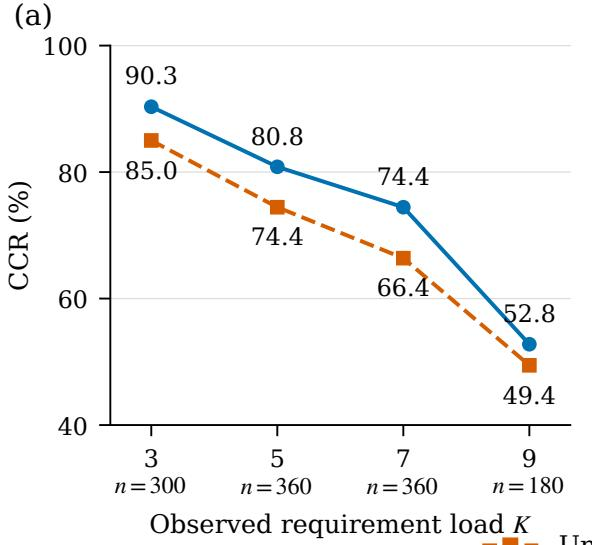  
(b)

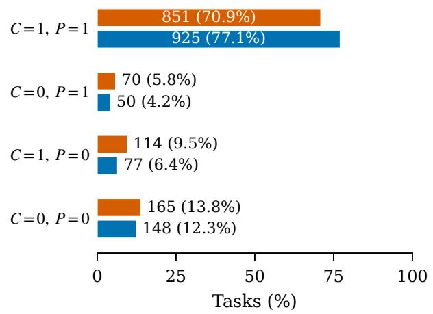  
Figure 5 Requirement load and joint change–preservation outcomes. (a) CCR for full and ungated on the same 1,200 public tasks, grouped by their observed total number K of change and preservation requirements; each stratum’s task count is shown below its tick. Task-category composition varies across strata, so these observations do not isolate a causal efect of increasing K. (b) Counts and percentages of the same tasks in the four joint states (ungated above, full below), derived from task-level change and invariant failure counts. $C = 1$ means every requested change passes, and $P = 1$ means every preservation requirement passes; P is an all-pass indicator, distinct from the mean preservation fraction reported as Pres. The fraction of tasks in the $C = P = 1$ state equals CCR.

Table 14 Complete and average compliance by public requirement load. $\mathrm { U } / \mathrm { F }$ denote ungated/full Wan-Image; CCR and AC are percentages. $\Delta$ is full minus ungated CCR in points, calculated before rounding. Pointwise paired bootstrap intervals follow the protocol in section 6.7.
<table><tr><td>K</td><td> $N$ </td><td>U CCR</td><td>F CCR</td><td> $\Delta$ </td><td>95% interval</td><td>U AC</td><td>FAC</td></tr><tr><td>3</td><td>300</td><td>85.00</td><td>90.33</td><td>+5.33</td><td> $\left[ + 2 . 3 3 , + 8 . 3 3 \right]$ </td><td>95.00</td><td>96.78</td></tr><tr><td>5</td><td>360</td><td>74.44</td><td>80.83</td><td>+6.39</td><td> $\left[ + 3 . 3 3 , + 9 . 4 4 \right]$ </td><td>89.78</td><td>92.33</td></tr><tr><td>7</td><td>360</td><td>66.39</td><td>74.44</td><td>+8.06</td><td> $[ + 4 . 7 2 , + 1 1 . 3 9 ]$ </td><td>88.53</td><td>92.58</td></tr><tr><td>9</td><td>180</td><td>49.44</td><td>52.78</td><td>+3.33</td><td> $[ - 0 . 5 6 , + 7 . 2 2 ]$ </td><td>83.15</td><td>84.26</td></tr><tr><td>All</td><td>1200</td><td>70.92</td><td>77.08</td><td>+6.17</td><td>[+4.50, +7.83]</td><td>89.72</td><td>92.31</td></tr></table>

Load strata also difer in category composition: $K = 3$ has no D tasks, while $K = 9$ has no A tasks and includes 95/180 D tasks. Category C at $K = 9$ has a −6.67-point CCR contrast on 30 tasks. These observed strata do not identify a causal complexity efect; requiring every group to pass can itself lower CCR as the group count grows.

Intervals use 50,000 paired task bootstrap resamples, preserving category counts overall and within each reported load. The 2.5th and 97.5th percentiles give pointwise intervals conditional on the observed strata, outputs, and labels; contrasts are computed before rounding. The human evaluation below uses a separate matched population.

## 6.8 Reward quality, cost, and downstream effects

We compare base direct scoring (M0), explicit thinking (M1), preference SFT (M2), decision– reason training with direct deployment (M3), hard judgment KD (M4), and soft judgment KD (M5). The main experiments use M5.

Judgment quality and reliability. Table 15 reports HPA, dificult-pair accuracy, NLL, Brier score, SwapErr, and A/B gap. The binary metric specification uses $s = P _ { \tt Y e s } / ( P _ { \tt Y e s } + P _ { \tt N o } )$ :

$$
\begin{array} { l } { \displaystyle \mathrm { N L L } = - \displaystyle \frac { 1 } { N } \sum _ { n } [ y _ { n } \log s _ { n } + ( 1 - y _ { n } ) \log ( 1 - s _ { n } ) ] , } \\ { \displaystyle \mathrm { B r i e r } = \displaystyle \frac { 1 } { N } \sum _ { n } ( s _ { n } - y _ { n } ) ^ { 2 } , \qquad \mathrm { S w a p E r r } = \displaystyle \frac { 1 } { N } \sum _ { n } \vert s ( x _ { n } ) + s ( x _ { n } ^ { \mathrm { s w a p } } ) - 1 \vert . } \end{array}\tag{17}
$$

HPA measures agreement with human preference. The $\mathrm { A / B }$ gap is $1 0 0 | \mathrm { A c c } _ { A } - \mathrm { A c c } _ { B } |$ percentage points, comparing accuracy with the preferred candidate in the two input positions. NLL, Brier, and SwapErr characterize probability quality and sensitivity to candidate order.

Table 15 Reward-model judgment quality and cost. HPA/Hard are accuracies $( \% ) ; \mathrm { A } / \mathrm { B }$ gap is in percentage points. NLL/Brier/SwapErr follow equation (17). Latency is one end-to-end pairwise call relative to M0; only M1 reasons online.
<table><tr><td>RM</td><td>HPA ↑ Hard ↑ NLL ↓ Brier ↓ SwapErr ↓</td><td></td><td></td><td></td><td></td><td> $\mathrm { A } / \mathrm { B }$  gap ↓</td><td>Latency ↓</td></tr><tr><td>M0: Base direct</td><td>77.6</td><td>66.5</td><td>0.489</td><td>0.158</td><td>0.058</td><td>2.2</td><td>1.0×</td></tr><tr><td>M1: Explicit think</td><td>82.3</td><td>75.8</td><td>0.377</td><td>0.120</td><td>0.045</td><td>1.3</td><td>6.0×</td></tr><tr><td>M2: Preference SFT</td><td>78.9</td><td>69.2</td><td>0.439</td><td>0.142</td><td>0.051</td><td>1.0</td><td>1.0×</td></tr><tr><td>M3: Decision-reason</td><td>79.9</td><td>71.2</td><td>0.409</td><td>0.133</td><td>0.046</td><td>0.8</td><td>1.0×</td></tr><tr><td>M4: Hard KD</td><td>80.4</td><td>72.3</td><td>0.501</td><td>0.154</td><td>0.062</td><td>1.6</td><td>1.0×</td></tr><tr><td>M5: Soft KD</td><td>81.7</td><td>74.8</td><td>0.385</td><td>0.122</td><td>0.041</td><td>0.6</td><td>1.0×</td></tr></table>

Table 16 Difficult-pair accuracy (%). Scores are shown for five error categories and the reported overall.
<table><tr><td>Category</td><td>M0 M1</td><td>M4</td><td>M5</td></tr><tr><td>Wrong target or ordinal</td><td>70.0 78.3</td><td>75.8</td><td>78.3</td></tr><tr><td>Near-miss text</td><td>60.0 72.5</td><td>68.3</td><td>70.8</td></tr><tr><td>Preservation damage</td><td>69.2 76.7</td><td>73.3</td><td>78.3</td></tr><tr><td>Coupled-edit omission</td><td>61.7 73.3</td><td>68.3</td><td>70.8</td></tr><tr><td>Visually good, task wrong</td><td>71.7 78.3</td><td>75.8</td><td>75.8</td></tr><tr><td>Reported overall</td><td>66.5 75.8</td><td>72.3</td><td>74.8</td></tr></table>

Soft KD improves dificult-pair accuracy from 66.5% to 74.8%, approaching explicit thinking’s 75.8% at 1.0× rather than 6.0× online latency (table 15). Gains over base direct span all five dificult-pair categories (table 16); M5 matches M1 on target/ordinal pairs and exceeds it on preservation damage, while M1 leads on the other three categories.

External reward benchmarks. Table 17 keeps MMRB2 image-editing pair accuracy (Hu et al., 2025) separate from EditReward-Bench candidate-count-dependent ranking scores (Wu et al., 2026). M5 improves MMRB2 from 66.2 to 70.6, and EditReward K = 2, 3, 4 from 57.2/35.9/10.8 to 61.0/43.5/15.8. M1 remains higher on all four reported external metrics.

Downstream reward–gate interaction. Table 18 reports all five configurations. D0–D3 cross base/distilled direct reward with ungated/gated learning; D4 uses explicit thinking with gates. Relative to base direct, M5 raises CCR by 1.84 points without gates and 2.83 with gates. Gating adds 5.17 points under M0 and 6.16 under M5; the descriptive interaction is $6 . 1 6 - 5 . 1 7 = 0 . 9 9$ points. This reward–gate interaction difers from the structure–gate interaction of 2.83 points in section 6.5. M1 with gates reaches 77.50 CCR, 0.42 above M5, while M5 has slightly higher preservation (93.86 versus 93.73). D0–D4 use equal update steps and rollout budgets.

Table 17 External RM evaluation. MMRB2 editing pair accuracy and EditReward-Bench $K = 2 , 3 ,$ 4 ranking scores are reported separately (%).
<table><tr><td>RM</td><td>MMRB2 edit EditReward EditReward EditReward pair acc. ↑</td><td> $K = 2 \uparrow$ </td><td> $K = 3 \uparrow$ </td><td> $K = 4 \uparrow$ </td></tr><tr><td>M0</td><td>66.2</td><td>57.2</td><td>35.9</td><td>10.8</td></tr><tr><td>M1</td><td>71.8</td><td>61.8</td><td>44.9</td><td>16.6</td></tr><tr><td>M2</td><td>67.1</td><td>58.3</td><td>37.8</td><td>11.9</td></tr><tr><td>M3</td><td>68.6</td><td>59.6</td><td>40.4</td><td>13.3</td></tr><tr><td>M4</td><td>69.3</td><td>60.1</td><td>41.5</td><td>13.8</td></tr><tr><td>M5</td><td>70.6</td><td>61.0</td><td>43.5</td><td>15.8</td></tr></table>

Table 18 Reward × gate comparisons on Wan-Image. D0–D3 form the 2 × 2 comparison; D4 uses explicit thinking. D0–D4 use equal update steps and rollout budgets. All metrics are percentages.
<table><tr><td>ID RM Gates</td><td>CCR↑</td><td>AC↑</td><td>Pres. ↑</td></tr><tr><td>D0 M0 Off</td><td>69.08</td><td>88.91</td><td>91.35</td></tr><tr><td>D1 /M0 On</td><td>74.25</td><td>91.28</td><td>93.12</td></tr><tr><td>D2 /M5 Off</td><td>70.92</td><td>89.72</td><td>91.82</td></tr><tr><td>D3 /M5 On</td><td>77.08</td><td>92.31</td><td>93.86</td></tr><tr><td>D4/M1 On</td><td>77.50</td><td>92.42</td><td>93.73</td></tr></table>

## 6.9 Human evaluation of final edits

The evaluation contains 200 CE-Bench tasks, with 50/40/40/40/30 tasks in categories A–E. Direct, ungated, and full have 5, 4, and 3 unresolved human success labels, respectively; automatic labels are available for all outputs. Per-method CCR, bias (automatic minus human CCR), and agreement use each method’s human-decidable subset. Table 19 also reports false acceptance/rejection and bounds over all 200 tasks that vary the unresolved labels. These final-output judgments are distinct from execution-check construction agreement in table 7.

Table 19 Final-output human evaluation on 200 CE-Bench tasks. N is the number of human-decidable outputs per method. CCR, agreement, false acceptance (FA), and false rejection (FR) are percentages; bias is automatic minus human CCR in points. FA conditions on human failures and FR on human successes. Bounds assign unresolved labels to failure or success over all 200 tasks; they are identification bounds, not confidence intervals.
<table><tr><td>Method</td><td>N</td><td>Human Auto. CCR</td><td>CCR</td><td></td><td>Bias Agree.</td><td>FA</td><td>FR</td><td>Human CCR bounds</td></tr><tr><td>Direct</td><td>195</td><td>53.33</td><td>54.36</td><td>+1.03</td><td>88.72</td><td>13.19</td><td>9.62</td><td>[52.0, 54.5]</td></tr><tr><td>Ungated</td><td>196</td><td>69.39</td><td></td><td> $7 0 . 9 2 \ \mathrm { \ t } 1 . 5 3 $ </td><td>91.33</td><td>16.67</td><td>5.15</td><td>[68.0, 70.0]</td></tr><tr><td>Full</td><td>197</td><td>76.14</td><td> $7 6 . 6 5 \ \mathrm { \ t } 0 . 5 1$ </td><td></td><td>93.40</td><td>14.89</td><td>4.00</td><td>[75.0, 76.5]</td></tr></table>

Matched gains and scoring bias. Full and ungated share 194 tasks with both human labels resolved. On this common population, human CCR rises from 69.07% to 75.77%, a 6.70-point gain [1.03, 12.37] (table 20). The automatic gain is 6.19 points; automatic minus human gain is −0.52 points [−3.61, 2.58], leaving the direction of gain bias inconclusive. Full’s per-method CCR of 76.14% uses 197 decidable outputs and therefore difers from the common-population rate.

Dimension-specific preference. The same 200 tasks compare full against ungated and direct on instruction fulfillment, preservation, and visual quality (table 21). Net preference is $1 0 0 ( N _ { \mathrm { w i n } } -$ $N _ { \mathrm { l o s s } } ) / N _ { \mathrm { d e c i d a b l e } } .$ with ties included and unresolved judgments counted separately. Instruction preference favors full in both comparisons. Against ungated, preservation and quality intervals span zero; against direct, preservation also favors full, while the quality interval includes zero. Figure 6 visualizes the ungated comparison. These evaluations share a task pool; failure to detect a quality diference does not establish non-inferiority.

Table 20 Full versus ungated on 194 common tasks. Point estimates and 95% percentile intervals are in percentage points. Intervals use 50,000 paired task bootstrap resamples within categories, preserving the observed category counts of this common decidable set.
<table><tr><td>Quantity</td><td>Estimate</td><td>95% interval</td></tr><tr><td>Human gain  $\Delta _ { H }$ </td><td>+6.70</td><td> $[ + 1 . 0 3 , + 1 2 . 3 7 ]$ </td></tr><tr><td>Automatic gain  $\Delta _ { A }$ </td><td>+6.19</td><td> $\left[ + 1 . 5 5 , + 1 0 . 8 2 \right]$ </td></tr><tr><td>Gain bias  $\Delta _ { A } - \Delta _ { H }$ </td><td>-0.52</td><td> $[ - 3 . 6 1 , + 2 . 5 8 ]$ </td></tr></table>

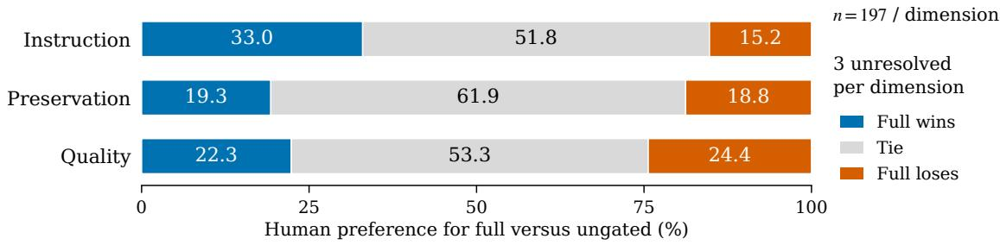  
Figure 6 Human preferences for full versus ungated. Each dimension has 197 decidable task pairs and three unresolved pairs out of 200. Wins, ties, and losses retain their separate categories; interval estimates for net preference appear in table 21.

Table 21 Human preference for full. $\mathrm { W / T / L }$ are wins/ties/losses; Unres. counts unresolved judgments out of 200 task pairs per comparison. Net preference is $1 0 0 \mathrm { ( W { - } L ) / ( W { + } T { + } L ) }$ , in points. The 95% intervals use category-stratified task bootstrap; ties remain in the denominator.
<table><tr><td>Full comparison</td><td>Dimension</td><td>W/T/L</td><td>Unres.</td><td>Net</td><td>95% interval</td></tr><tr><td>vs. ungated</td><td>Instruction</td><td>65/102/30</td><td>3</td><td>+17.77</td><td> $[ + 8 . 6 3 , + 2 6 . 9 0 ]$ </td></tr><tr><td>vs. ungated</td><td>Preservation</td><td>38/122/37</td><td>3</td><td>+0.51</td><td> $\left[ - 8 . 1 2 , + 9 . 1 4 \right]$ </td></tr><tr><td>vs. ungated</td><td>Quality</td><td>44/105/48</td><td>3</td><td>-2.03</td><td> $[ - 1 1 . 6 8 , + 7 . 1 1 ]$ </td></tr><tr><td>vs. direct</td><td>Instruction</td><td>89/83/25</td><td></td><td>3 +32.49</td><td> $\left[ + 2 2 . 8 4 , + 4 2 . 1 3 \right]$ </td></tr><tr><td>vs. direct</td><td>Preservation</td><td>70/94/33</td><td></td><td> $\begin{array} { r l } { 3 } & { { } + 1 8 . 7 8 } \end{array}$ </td><td> $\left[ + 9 . 1 4 , + 2 8 . 4 3 \right]$ </td></tr><tr><td>vs. direct</td><td>Quality</td><td>61/87/48</td><td>4</td><td>+6.63</td><td> $\left[ - 3 . 5 7 , + 1 6 . 8 4 \right]$ </td></tr></table>

Uncertainty. We use 50,000 category-stratified task bootstrap resamples and percentile 95% intervals. Paired method and evaluator labels stay together; each analysis retains its categoryspecific decidable counts (49/39/39/39/28 for the common full–ungated population). Preference intervals use the relevant dimension’s decidable pairs. Intervals quantify task-sampling uncertainty conditional on the evaluated outputs and observed labels.

## 6.10 Text-to-image adaptation

DuplexBridge-T2I retrains both roles: U specifies requirements from text and G synthesizes from that condition. The Qwen T2I backbone is Qwen-Image; BAGEL’s baseline uses native CoT. All three configurations improve on all five metrics (table 22). These results measure complete T2I adaptation, not zero-shot transfer from editing checkpoints.

GenEval2 Soft-TIFA computes per-prompt arithmetic (AM) or geometric (GM) means of soft VQA scores, then averages the resulting prompt scores (Kamath et al., 2025); GM measures continuous compositional fulfillment. R2I tests reasoning (Chen et al., 2025), WISE-V world knowledge consistency (Niu et al., 2026), and DPG dense prompt following (Hu et al., 2024). R2I and WISE-V use the displayed ×100 scales.

Table 22 Text-to-image adaptation after retraining. Metrics follow section 6.10; dark/light pink mark the best/second-best values across all six systems, including ties.
<table><tr><td>Model</td><td>GenEval2 GenEval2 AM↑</td><td>GM↑</td><td>R2I ×100↑</td><td>WISE-V ×100 ↑</td><td>DPG ↑</td></tr><tr><td>BAGEL + native CoT</td><td>70.9</td><td>23.1</td><td>48.0</td><td>62.8</td><td>85.1</td></tr><tr><td>BAGEL + DuplexBridge-T2I</td><td>77.8</td><td>31.5</td><td>56.0</td><td>70.5</td><td>86.8</td></tr><tr><td>Qwen-Image</td><td>80.8</td><td>33.8</td><td>52.0</td><td>51.0</td><td>88.3</td></tr><tr><td>Qwen-Image + DuplexBridge-T2I</td><td>85.0</td><td>42.0</td><td>61.0</td><td>66.0</td><td>89.7</td></tr><tr><td>Wan-Image-7B</td><td>79.4</td><td>32.2</td><td>51.0</td><td>54.0</td><td>87.7</td></tr><tr><td>Wan-Image-7B + DuplexBridge-T2I</td><td>84.2</td><td>40.6</td><td>59.5</td><td>64.5</td><td>89.3</td></tr></table>

## 7 Qualitative Comparisons

Draw what it will look like after the knot is untied.

Input  
  
Bagel COT  
then?

  
then -3  
Qwen-image  
Draw what it will look like after replacing the question mark with the correct number ……

  
then  iiiii  
Wan-image

  
PromptEnhancerV2  
"000i-1 then

  
DARS  
then?

  
DuplexBridge  
"0000-11 then0

  
then

This is an image of a maze, where black represents obstacles and white represents walkable paths. Draw the path from the red dot to the green dot in blue.

Draw what it will look like after being bitten by people.

Draw what they   
will look like after frying for 5   
minutes.

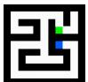

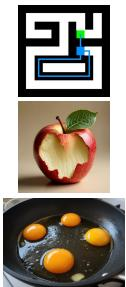

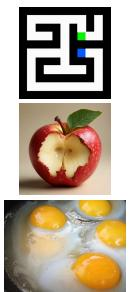

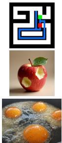

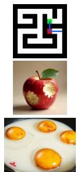

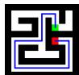

  
Figure 7 Qualitative comparison on RISEBench. Rows cover untying a knot, a visual equivalence relation, maze navigation, a bitten apple, and cooking progression. The maze requires a connected path through the white corridor; the physical transformations also require recognizable source content.

Add one Mentos into the cola

Add a weight to the left side of the balance scale

Replace the clothing of the person in the image with the ones I provided.

Pour some yellow oil into a measuring cup filled with water.

Adjust all cups to the size of the largest cup.

Input  

Bagel COT  

Qwen-image  

Wan-image  
  
PromptEnhancerV2

DARS  

DuplexBridge  
  
Figure 8 Qualitative comparison on KRIS-Bench. The tasks combine requested changes with physical consequences, reference fidelity, and preservation. Rows show Mentos–cola interaction, added load, garment replacement, oil–water separation, and cup-size equalization.

  
Figure 9 Additional CE-Bench showcase. Arrows indicate the transition from source images to edited outputs; auxiliary images provide visual references for flower replacement and dog insertion. Examples include sign-text replacement and translation, localized color changes, a trafic-light state change, and object appearance edits. The paired images show the edited regions alongside the surrounding scene.

RISEBench. In figure 7, DuplexBridge draws a connected blue maze route through the white corridor between the red and green endpoints. The untied rope and opaque egg whites show physical state changes. In the equivalence example, DuplexBridge replaces the question mark with two green cylinders, consistent with the displayed relation and the original task’s request for the correct number of cylinders.

KRIS-Bench. The examples in figure 8 illustrate coupled requirements: a balance responds to added load, oil separates above water, and three cups reach a common size. Reference-guided garment replacement preserves the white trousers. These examples accompany the quantitative public-benchmark results in table 3.

## 8 Discussion and Limitations

DuplexBridge improves joint task fulfillment by separating local supervision references and selecting additional global feedback. Its checks remain semantic judgments: a shared condition does not guarantee correct source binding or visual assessment. Unresolved judgments abstain, and high reward confidence alone does not establish correctness.

Mean execution thresholds can also admit a failed critical requirement when other groups pass (section 4.4). The gates define selective objectives rather than counterfactual attribution or unbiased unconditional-return optimization (section 4.4). The random-selection controls narrow some group-structure diferences but do not uniquely separate sample quality from optimizer exposure. Structure–gate and reward–gate interactions describe aggregate endpoints; checkpoint cross-pairing describes partner dependence within the evaluated run.

The observed requirement-load strata difer in task-category composition. Their contrasts do not identify a causal efect of complexity, and higher aggregate CCR coexists with some component regressions. Human evaluation supports an instruction-fulfillment gain on the matched population, while preservation and quality intervals against ungated include zero. These comparisons do not establish visual-quality non-inferiority. Reported bootstrap intervals quantify task-sampling uncertainty conditional on the evaluated outputs and labels, rather than variation across new training runs.

The text-to-image extension uses task-specific retraining and a redesigned interface; it is not zero-shot transfer from editing checkpoints. Our experiments have not evaluated more complex video generation or editing. Extending the method to the video domain remains a direction for future work.

## 9 Conclusion

DuplexBridge connects a unified model’s own understanding and generation through a checkable editing condition. Local supervision distinguishes task fidelity from received-condition execution, while reciprocal trust gates select additional global feedback and retain valid local learning. Across three configurations, complete compliance improves over direct editors; controlled Wan-Image comparisons support the supervision references and semantic selection, with gains also supported by human evaluation. These findings support separating local responsibilities when jointly adapting understanding and generation.

## References

Haoxiang Cao, Jiajiong Cao, Xuanpu Zhang, Changqian Yu, and Chaoqun Wang. DARS: Dual-level credit assignment RL with structured reasoning for instruction-based image editing, 2026. https: //arxiv.org/abs/2608.20161.

Kaijie Chen, Zihao Lin, Zhiyang Xu, Ying Shen, Yuguang Yao, Joy Rimchala, Jiaxin Zhang, and Lifu

Huang. R2I-Bench: Benchmarking reasoning-driven text-to-image generation. In Proceedings of the 2025 Conference on Empirical Methods in Natural Language Processing, pages 12595–12630, 2025. doi: 10.18653/v1/2025.emnlp-main.636. https://aclanthology.org/2025.emnlp-main.636/.

Jaemin Cho, Yushi Hu, Jason Baldridge, Roopal Garg, Peter Anderson, Ranjay Krishna, Mohit Bansal, Jordi Pont-Tuset, and Su Wang. Davidsonian scene graph: Improving reliability in fine-grained evaluation for text-to-image generation. In International Conference on Learning Representations, 2024. https://proceedings.iclr.cc/paper\_files/paper/2024/hash/ 446905abfec9db8856f7f7465bbd5552-Abstract-Conference.html.

Chaorui Deng, Deyao Zhu, Kunchang Li, Chenhui Gou, Feng Li, Zeyu Wang, Shu Zhong, Weihao Yu, Xiaonan Nie, Ziang Song, Guang Shi, and Haoqi Fan. Emerging properties in unified multimodal pretraining. arXiv preprint arXiv:2505.14683, 2025. https://arxiv.org/abs/2505.14683.

Haiwen Diao, Jiahao Wang, Chenjing Ding, Hanming Deng, Jiangnan Chen, Ruixi Zhang, Ruohui Wang, Wenwen Tong, Xiangyu Fan, Yubo Wang, Yue Zhu, Yuwei Niu, Zhengqi Bai, Zhiqian Lin, Zhitao Yang, Zhongang Cai, Bo Yang, Chen Feng, Chengguang Lv, Guangjia Liu, Guanlin Wang, Hanyu Zhang, Haojia Yu, Hongcan Xiao, Hongli Wang, Huan Wu, Huaping Zhong, Jian Fang, Jianan Fan, Jiaqi Li, Jiefan Lu, Jing Zuo, Jingcheng Ni, Junxiang Xu, Linjun Dai, Mutian Xu, Peishen Yan, Penghao Wu, Ruijie Mao, Ruisi Wang, Shihao Bai, Shuang Yang, Shuya Yang, Shuyan Zheng, Silei Wu, Siying Li, Tao Chu, Tianbo Zhong, Tongxi Zhou, Weichao Luo, Weichen Fan, Wenhao Jia, Wenjie Gao, Xiangli Kong, Yan Li, Yang Yong, Zimo Wen, Zixuan Qian, Wenxiu Sun, Ruihao Gong, Quan Wang, Lewei Lu, Lei Yang, Ziwei Liu, and Dahua Lin. SenseNova-U1.5: Towards native unified visual intelligence, 2026. https://arxiv.org/abs/2609.11929.

Jakob Foerster, Gregory Farquhar, Triantafyllos Afouras, Nantas Nardelli, and Shimon Whiteson. Counterfactual multi-agent policy gradients. In Proceedings of the AAAI Conference on Artificial Intelligence, volume 32, 2018. doi: 10.1609/aaai.v32i1.11794. https://ojs.aaai.org/index.php/AAAI/article/ view/11794.

Tsu-Jui Fu, Wenze Hu, Xianzhi Du, William Yang Wang, Yinfei Yang, and Zhe Gan. Guiding instruction-based image editing via multimodal large language models. In International Conference on Learning Representations, 2024. https://proceedings.iclr.cc/paper\_files/paper/2024/ hash/f0e91b1314fa5eabf1d7ef6d1561ecec-Abstract-Conference.html.

Xiwei Hu, Rui Wang, Yixiao Fang, Bin Fu, Pei Cheng, and Gang Yu. ELLA: Equip difusion models with LLM for enhanced semantic alignment, 2024. https://arxiv.org/abs/2403.05135.

Yushi Hu, Benlin Liu, Jungo Kasai, Yizhong Wang, Mari Ostendorf, Ranjay Krishna, and Noah A. Smith. TIFA: Accurate and interpretable text-to-image faithfulness evaluation with question answering. In Proceedings of the IEEE/CVF International Conference on Computer Vision, 2023. https: //openaccess.thecvf.com/content/ICCV2023/papers/Hu\_TIFA\_Accurate\_and\_Interpretable\_ Text-to-Image\_Faithfulness\_Evaluation\_with\_Question\_Answering\_ICCV\_2023\_paper.pdf.

Yushi Hu, Reyhane Askari-Hemmat, Melissa Hall, Emily Dinan, Luke Zettlemoyer, and Marjan Ghazvininejad. Multimodal RewardBench 2: Evaluating Omni Reward Models for Interleaved Text and Image. arXiv preprint arXiv:2512.16899, 2025. doi: 10.48550/ARXIV.2512.16899. https: //arxiv.org/abs/2512.16899.

Zican Hu, Xuyang Hu, Yiming Liu, Zuwei Long, Wei Liu, Yunzhuo Hao, Jiawei Gu, Linjie Li, Yu Cheng, Zhenhong Sun, Weibo Gu, Xing Sun, and Zhi Wang. Bridging interleaved multi-modal reasoning as a unified decision process, 2026. https://arxiv.org/abs/2607.03748.

Yuzhou Huang, Liangbin Xie, Xintao Wang, Ziyang Yuan, Xiaodong Cun, Yixiao Ge, Jiantao Zhou, Chao Dong, Rui Huang, Ruimao Zhang, and Ying Shan. SmartEdit: Exploring complex instruction-based image editing with multimodal large language models. In Proceedings of the IEEE/CVF Conference on Computer Vision and Pattern Recognition, pages 8362–8371, 2024. https: //openaccess.thecvf.com/content/CVPR2024/html/Huang\_SmartEdit\_Exploring\_Complex\_ Instruction-based\_Image\_Editing\_with\_Multimodal\_Large\_Language\_CVPR\_2024\_paper.html.

Zhangqi Jiang, Zheng Sun, Xianfang Zeng, Yufeng Yang, Xuanyang Zhang, Yongliang Wu, Wei Cheng, Gang Yu, Xu Yang, and Bihan Wen. Geditbench v2: A human-aligned benchmark for general image editing, 2026. https://arxiv.org/abs/2603.28547.

Siyu Jiao, Yiheng Lin, Yujie Zhong, Qi She, Wei Zhou, Xiaohan Lan, Zilong Huang, Fei Yu, Yingchen Yu, Yunqing Zhao, Yao Zhao, and Yunchao Wei. ThinkGen: Generalized thinking for visual generation. In Proceedings of the IEEE/CVF Conference on Computer Vision and Pattern Recogni-

tion, pages 14713–14723, 2026. https://openaccess.thecvf.com/content/CVPR2026/html/Jiao\_ ThinkGen\_Generalized\_Thinking\_for\_Visual\_Generation\_CVPR\_2026\_paper.html.

Xin Jin, Huanqia Cai, Zhen Li, Zechao Zhan, Dengyang Jiang, Aiming Hao, Yuming Jiang, Xiangpeng Yang, Chunle Guo, Peng Gao, Ming-Ming Cheng, and Steven C. H. Hoi. Z-Reward: Beyond Scalar Rewards by Internalizing Reasoning into Score Distributions. arXiv preprint arXiv:2606.09076, 2026. doi: 10.48550/ARXIV.2606.09076. https://arxiv.org/abs/2606.09076.

Amita Kamath, Kai-Wei Chang, Ranjay Krishna, Luke Zettlemoyer, Yushi Hu, and Marjan Ghazvininejad. Geneval 2: Addressing benchmark drift in text-to-image evaluation. arXiv preprint arXiv:2512.16853, 2025. https://arxiv.org/abs/2512.16853.

Hengjia Li, Liming Jiang, Qing Yan, Yizhi Song, Hao Kang, Zichuan Liu, Xin Lu, Boxi Wu, and Deng Cai. Thinkrl-edit: Thinking in reinforcement learning for reasoning-centric image editing, 2026. https://arxiv.org/abs/2601.03467.

Jie Liu, Gongye Liu, Jiajun Liang, Yangguang Li, Jiaheng Liu, Xintao Wang, Pengfei Wan, Di Zhang, and Wanli Ouyang. Flow-GRPO: Training flow matching models via online RL. In Advances in Neural Information Processing Systems, volume 38, pages 45650–45685, 2025a. doi: 10.52202/085713-1362. https://proceedings.neurips.cc/paper\_files/paper/2025/hash/ 3a10c46572628d58cb44fb705f25cbbf-Abstract-Conference.html.

Jie Liu, Zilyu Ye, Linxiao Yuan, Shenhan Zhu, Yu Gao, Jie Wu, Kunchang Li, Xionghui Wang, Xiaonan Nie, Weilin Huang, and Wanli Ouyang. UniGRPO: Unified policy optimization for reasoning-driven visual generation, 2026. https://arxiv.org/abs/2603.23500.

Shiyu Liu, Yucheng Han, Peng Xing, Fukun Yin, Rui Wang, Wei Cheng, Jiaqi Liao, Yingming Wang, Honghao Fu, Chunrui Han, Guopeng Li, Yuang Peng, Quan Sun, Jingwei Wu, Yan Cai, Zheng Ge, Ranchen Ming, Lei Xia, Xianfang Zeng, Yibo Zhu, Binxing Jiao, Xiangyu Zhang, Gang Yu, and Daxin Jiang. Step1x-edit: A practical framework for general image editing, 2025b. https: //arxiv.org/abs/2504.17761.

Chaojie Mao, Chen-Wei Xie, Chongyang Zhong, Haoyou Deng, Jiaxing Zhao, Jie Xiao, Jinbo Xing, Jingfeng Zhang, Jingren Zhou, Jingyi Zhang, Jun Dan, Kai Zhu, Kang Zhao, Keyu Yan, Minghui Chen, Pandeng Li, Shuangle Chen, Tong Shen, Yu Liu, Yue Jiang, Yulin Pan, Yuxiang Tuo, Zeyinzi Jiang, Zhen Han, Ang Wang, Bang Zhang, Baole Ai, Bin Wen, Boang Feng, Feiwu Yu, Gang Wang, Haiming Zhao, He Kang, Jianjing Xiang, Jianyuan Zeng, Jinkai Wang, Junjie Zhou, Ke Sun, Linqian Wu, Pei Gong, Pingyu Wu, Ruiwen Wu, Tongtong Su, Wenmeng Zhou, Wenting Shen, Wenyuan Yu, Xianjun Xu, Xiaoming Huang, Xiejie Shen, Xin Xu, Yan Kou, Yangyu Lv, Yifan Zhai, Yitong Huang, Yun Zheng, Yuntao Hong, Zhe Zhang, and Zhicheng Zhang. Wan-image: Pushing the boundaries of generative visual intelligence, 2026. https://arxiv.org/abs/2604.19858.

Yuwei Niu, Munan Ning, Mengren Zheng, Weiyang Jin, Bin Lin, Peng Jin, Jiaqi Liao, Chaoran Feng, Fanqing Meng, Kun-Peng Ning, Bin Zhu, and Li Yuan. WISE: World knowledge-informed semantic evaluation for text-to-image generation. In Forty-third International Conference on Machine Learning, 2026. https://github.com/PKU-YuanGroup/WISE.

Zhihong Shao, Peiyi Wang, Qihao Zhu, Runxin Xu, Junxiao Song, Xiao Bi, Haowei Zhang, Mingchuan Zhang, Y. K. Li, Y. Wu, and Daya Guo. Deepseekmath: Pushing the limits of mathematical reasoning in open language models, 2024. https://arxiv.org/abs/2402.03300.

Linqing Wang, Zhiyong Xu, Ximing Xing, Yiji Cheng, Zhiyuan Zhao, Donghao Li, Tiankai Hang, Zhenxi Li, Jiale Tao, Qixun Wang, Ruihuang Li, Comi Chen, Xin Li, Mingrui Wu, Xinchi Deng, Shuyang Gu, Chunyu Wang, and Qinglin Lu. Promptenhancer: Taming your rewriter for text-to-image generation via fine-grained reward. In Proceedings of the IEEE/CVF Conference on Computer Vision and Pattern Recognition, pages 14895–14904, 2026. https://openaccess.thecvf.com/content/CVPR2026/html/Wang\_PromptEnhancer\_Taming\_Your\_ Rewriter\_for\_Text-to-Image\_Generation\_via\_Fine-Grained\_Reward\_CVPR\_2026\_paper.html.

Yibin Wang, Zhimin Li, Yuhang Zang, Chunyu Wang, Qinglin Lu, Cheng Jin, and Jiaqi Wang. Unified Multimodal Chain-of-Thought Reward Model through Reinforcement Fine-Tuning. In Advances in Neural Information Processing Systems, volume 38, 2025. doi: 10.52202/085713-5315. https://proceedings.neurips.cc/paper\_files/paper/2025/hash/ e95e9f0c127aa1cfa2628adb2f3cb107-Abstract-Conference.html.

Jie Wu, Yu Gao, Zilyu Ye, Ming Li, Liang Li, Hanzhong Guo, Jie Liu, Zeyue Xue, Xiaoxia Hou, Wei Liu, Yan Zeng, and Weilin Huang. RewardDance: Reward Scaling in Visual Generation. arXiv preprint arXiv:2509.08826, 2025a. doi: 10.48550/ARXIV.2509.08826. https://arxiv.org/abs/2509.08826.

Keming Wu, Sicong Jiang, Max Ku, Ping Nie, Minghao Liu, and Wenhu Chen. Editreward: A human-aligned reward model for instruction-guided image editing. In International Conference on Learning Representations, 2026. https://proceedings.iclr.cc/paper\_files/paper/2026/hash/ 4d68af3056842229f8b356d686aec914-Abstract-Conference.html.

Tsung-Han Wu, Long Lian, Joseph E. Gonzalez, Boyi Li, and Trevor Darrell. Self-correcting LLMcontrolled difusion models. In Proceedings of the IEEE/CVF Conference on Computer Vision and Pattern Recognition, pages 6327–6336, 2024. https://openaccess.thecvf.com/content/CVPR2024/ html/Wu\_Self-correcting\_LLM-controlled\_Diffusion\_Models\_CVPR\_2024\_paper.html.

Yongliang Wu, Zonghui Li, Xinting Hu, Xinyu Ye, Xianfang Zeng, Gang Yu, Wenbo Zhu, Bernt Schiele, Ming-Hsuan Yang, and Xu Yang. KRIS-Bench: Benchmarking next-level intelligent image editing models. In Advances in Neural Information Processing Systems, volume 38. Curran Associates, Inc., 2025b. doi: 10.52202/085713-5242. https://proceedings.neurips.cc/paper\_files/paper/2025/hash/ e619b285582fb12f4c3de3a507b8b99c-Abstract-Datasets\_and\_Benchmarks\_Track.html. Datasets and Benchmarks Track.

Hanqing Yang, Qiang Zhou, Yongchao Du, Sashuai Zhou, Zhibin Wang, Jun Song, Tiezheng Ge, Cheng Yu, and Bo Zheng. Dda-thinker: Decoupled dual-atomic reinforcement learning for reasoning-driven image editing, 2026. https://arxiv.org/abs/2604.25477.

Yang Ye, Xianyi He, Zongjian Li, Bin Lin, Shenghai Yuan, Zhiyuan Yan, Bohan Hou, and Li Yuan. Imgedit: A unified image editing dataset and benchmark. In Advances in Neural Information Processing Systems, volume 38, 2025. doi: 10.52202/085713-4387. https://proceedings.neurips.cc/ paper\_files/paper/2025/hash/bec783f119b969772c35243b1c801090-Abstract-Datasets\_and\_ . Datasets and Benchmarks Track.

Xiangyu Zhao, Peiyuan Zhang, Kexian Tang, Xiaorong Zhu, Hao Li, Wenhao Chai, Zicheng Zhang, Renqiu Xia, Guangtao Zhai, Junchi Yan, Hua Yang, Xue Yang, and Haodong Duan. Envisioning beyond the pixels: Benchmarking reasoning-informed visual editing. In Advances in Neural Information Processing Systems, volume 38. Curran Associates, Inc., 2025. doi: 10.52202/085713-5791. https://proceedings.neurips.cc/paper\_files/paper/2025/hash/ fe79898dcf078ec54b6feeea10ebb751-Abstract-Datasets\_and\_Benchmarks\_Track.html. Datasets and Benchmarks Track.

Dian Zheng, Manyuan Zhang, Hongyu Li, Hongbo Liu, Kai Zou, Kaituo Feng, and Hongsheng Li. Uni-Edit: Intelligent editing is a general task for unified model tuning. arXiv preprint arXiv:2605.21487, 2026. https://arxiv.org/abs/2605.21487.

Sashuai Zhou, Qiang Zhou, Jijin Hu, Hanqing Yang, Yue Cao, Junpeng Ma, Yinchao Ma, Jun Song, Tiezheng Ge, Cheng Yu, Bo Zheng, and Zhou Zhao. Unified thinker: A general reasoning core for image generation. In Proceedings of the 64th Annual Meeting of the Association for Computational Linguistics (Volume 1: Long Papers), pages 10597–10613. Association for Computational Linguistics, 2026. doi: 10.18653/v1/2026.acl-long.484. https://aclanthology.org/2026.acl-long.484/.