# EFFICIENT SCENE-TEXT REFINEMENT VIA PIXEL-SPACE GROUPED IMAGE GENERATION

Yaoli Liu1,2,†, Guo-Hua Wang2∗, Yiyang Chen3,2,†, Qing-Guo Chen2, Zhao Xu2, Weihua Luo2, Yao-Xiang Ding1,\*

1 State Key Lab of CAD&CG, Zhejiang University (zju.edu.cn)

2 Alibaba Group (alibaba-inc.com)

3 State Key Laboratory of General Artificial Intelligence, Peking University (pku.edu.cn) yaoliliu8@gmail.com wangguohua@alibaba-inc.com

## ABSTRACT

Generated images often have coherent layouts and visual content, yet local errors in small text and complex characters still limit their readability and practical use. Scene-text refinement requires accuracy, preservation, and efficiency. Existing methods based on variational autoencoders (VAEs) can lose fine strokes during reconstruction, while full-image editing can shift background colors. In this work, we introduce PixText, a model that formulates local text refinement as grouped image generation in pixel space. Conditioned on the original image, PixText generates only the target regions, preserves unedited content, and uses MeanFlow for four-step generation. We further introduce Text Refinement Bench to evaluate text correction and image preservation in generated images. On this benchmark, PixText achieves 83.06% glyph pass and 94.66% exact targetcharacter OCR accuracy, versus 36.77% and 52.31% for the strongest baseline. Its four-step MeanFlow variant retains an 81.84% pass rate with less than one GPU-second of amortized generation cost per image.

## 1 INTRODUCTION

Large text-to-image models have made rapid progress in text rendering and layout. Images often exhibit reasonable layouts and mostly correct text, yet errors persist in small text and complex characters. These errors occupy only a small part of an image but directly affect its readability and practical usability.

Further improving text accuracy within a general-purpose generative model requires balancing text fidelity against overall visual quality. For example, the pretraining experience of LongCat-Image shows that synthetic text data improves text accuracy but can impair overall visual coherence, motivating dynamic adjustment of its sampling proportion and its removal toward the end of pretraining (Team et al., 2025). Post-training for text accuracy faces a similar challenge: excessive optimization of text rewards can make text disproportionately large or prominent, compromising aesthetics and visual coherence (Diao et al., 2026; Team et al., 2026; Mao et al., 2026b; Jin et al., 2025; Chen et al., 2026a; Kang et al., 2026). These observations motivate separating text refinementfrom overall image generation: preserving the layout, style, and visual content produced by the base model while precisely correcting only the erroneous text regions.

Scene-text refinement calls for accuracy, preservation, and efficiency: correcting text faithfully, leaving unedited content unchanged, and keeping computational cost low. Existing text generation and editing methods, however, typically redraw entire text regions and can alter their original layout, style, and typeface. Most build on large latent-space generative models (Tuo et al., 2024b;a; Lan et al., 2025; Xie et al., 2026), whose ability to generate and refine small text is constrained by variational autoencoder (VAE) reconstruction (Yu et al., 2026), while also incurring the cost of a large generative network and VAE encoding and decoding. Applying these methods directly to localized corrections of a few characters therefore makes it difficult to satisfy all three requirements.

To tackle these challenges, we introduce PixText, a text generation and refinement model based on grouped image generation in pixel space. First, we model images directly in pixel space, removing the VAE reconstruction bottleneck for small-character strokes as well as the texture degradation and color shifts introduced by local encoding and decoding. Second, we use the original image as the source that provides context and organize the regions to be refined as a group of image elements. The model predicts only the item pixels, which are then pasted back into the original image. By avoiding full-image regeneration, this design preserves unedited regions and reduces the background color drift and paste seams introduced by full-image generation. Finally, four-step MeanFlow (Geng et al., 2026a) reduces amortized generation cost to less than one GPU-second per image.

Meanwhile, we propose simple, effective training and inference improvements. We identify the influence of the training timestep distribution on patch-boundary artifacts and mitigate them with uniform sampling, observing consistent improvements in our model and MiniT2I (Wang et al., 2026d). We also revise the x-prediction sampling update to reduce speckle from incomplete denoising.

As a final contribution, we propose a new benchmark for text refinement. The existing AnyText Bench (Tuo et al., 2024b) primarily evaluates conventional text generation and lacks a dedicated evaluation of localized text errors in generated images. We therefore construct Text Refinement Bench from model-generated images, providing character-level error annotations, correction targets, and a unified evaluation protocol. The benchmark evaluates correction accuracy, background preservation, and inference efficiency. Experiments show that PixText outperforms existing baselines on text refinement and achieves performance close to or above the best existing methods on AnyText Bench at lower computational cost.

## 2 RELATED WORK

## 2.1 SCENE-TEXT GENERATION AND EDITING

Early scene-text editing methods modeled content and style to replace text while preserving its appearance (Wu et al., 2019; Roy et al., 2020; Yang et al., 2020; Krishnan et al., 2023; Lee et al., 2021; Qu et al., 2023). Diffusion models improved text generation and editing through layout, glyph, and character conditioning (Chen et al., 2023b; 2024; Ma et al., 2023; 2025; Yang et al., 2023; Liu et al., 2024a;b; Tuo et al., 2024b;a; Ji et al., 2023; Chen et al., 2023a; Zhao & Lian, 2024; Wang et al., 2025b). Subsequent work advanced glyph accuracy, style control, and multilingual editing (Zeng et al., 2024; Wang et al., 2025a; Yan et al., 2025; Fang et al., 2025; Lan et al., 2025; Xie et al., 2026; Chen et al., 2026c), extending to open-vocabulary, training-free, and instruction-driven unified text editing (Li et al., 2026a; Gunawan et al., 2026; Li et al., 2026c; Wang et al., 2026c; Ma et al., 2026a; Zhang et al., 2026; Lin et al., 2026b; Wang et al., 2026a), as well as text correction in generated images (Shimoda et al., 2025). We focus on refining a few erroneous characters in generated images: jointly generating multiple target regions directly in pixel space avoids the effects of VAE compression and reconstruction on fine strokes while preserving unedited content. Four-step MeanFlow improves efficiency while keeping the amortized generation cost below one GPU-second per image.

## 2.2 PIXEL-SPACE GENERATION

Pixel-space generation models images directly, avoiding information loss from latent compression. Early work explored high-resolution modeling and computational efficiency (Hoogeboom et al., 2023; 2025; Jabri et al., 2022; Crowson et al., 2024; Atzmon et al., 2024), while subsequent methods improved quality and efficiency through global–local modeling and frequency decomposition (Chen et al., 2025b; Wang et al., 2026b; Yu et al., 2026; Chen et al., 2026e; Ma et al., 2026b; Lin et al., 2026a). JiT demonstrated the effectiveness of predicting clean images directly (Li & He, 2026); related studies explored perceptual supervision, generative trajectories, and text-to-image generation and editing (Ma et al., 2026c; Baade et al., 2026; Wang et al., 2026d; Cai et al., 2026), while transferring pretrained latent-space models reduced training costs (Chen et al., 2026d;b; Jiang et al., 2026). Meanwhile, MeanFlow and its successors model average velocity for few-step generation, extending this approach to pixel space (Geng et al., 2026a;b; Lu et al., 2026). Building on these advances, we focus on local text refinement conditioned on the original image, jointly generating the target regions to combine glyph accuracy, content preservation, and efficiency.

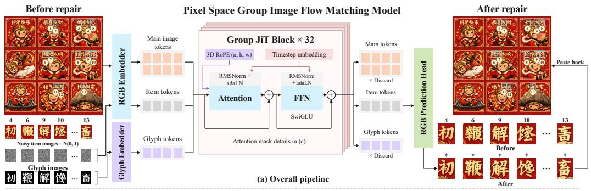

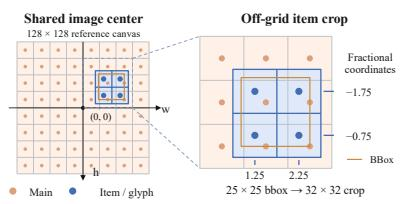  
(b) Centered continuous position encoding

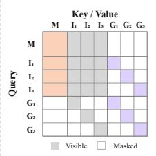  
(c) Group attention mask

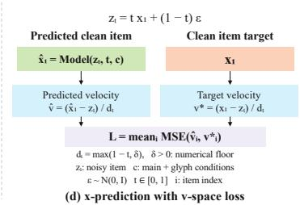

Figure 1: Overview of PixText. A main image provides context, noisy item images represent the regions to be generated, and glyph images specify the target text. Position encoding aligns each item and its glyph with the main image. Group JiT blocks predict the item pixels, which are composed into the original image.  
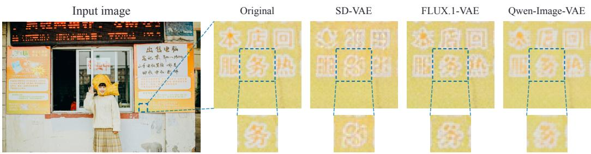  
Figure 2: Small-character degradation during VAE reconstruction. Each VAE uses full-image encoding and posterior-mode decoding in FP32.

## 3 METHOD

## 3.1 PIXEL-SPACE GENERATION FOR QUALITY AND EFFICIENCY

Latent-space text generation and editing methods rely on VAE compression and reconstruction (Li et al., 2026a; Chen et al., 2023b; Zeng et al., 2024; Tuo et al., 2024b;a; Lan et al., 2025; Xie et al., 2026), which can lose fine strokes and incur additional decoding cost. Related work on autoregressive models also identifies visual-tokenizer reconstruction as a bottleneck for text detail and improves glyph quality by enhancing the decoder (Mao et al., 2026a). In Figure 2, a character approximately 20 pixels high becomes difficult to recognize after reconstruction with Stable Diffusion, FLUX.1, and Qwen-Image VAEs (Rombach et al., 2022; Labs et al., 2025; Wu et al., 2025). For edits involving only a few characters, decoding only the target region may lower VAE decoding cost, but the smaller region gives the decoder less image context. Figure 3 compares full-image and local FLUX.1-VAE decoding from the same latent representation obtained by encoding the full image: the independently decoded region exhibits a visible color mismatch when pasted back, even with 32 pixels of additional context.

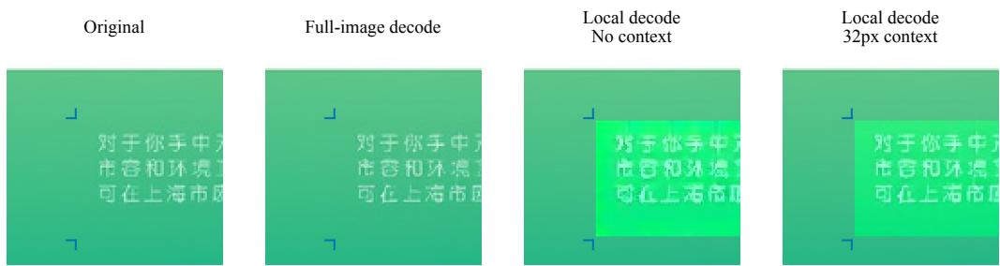  
Figure 3: Local FLUX.1-VAE decoding causes visible color shifts when pasted back into the original image, even with 32 pixels of context.

Table 1: Decoder and pixel output head costs at 1024×1024 resolution (single NVIDIA H800, FP16, batch size 1). The best and second-best results in each row are bolded and underlined, respectively.
<table><tr><td>Module</td><td>SD VAE</td><td>FLUX.1 VAE</td><td>Qwen-Image VAE</td><td>FLUX.2 VAE</td><td>DC-AE f32c32</td><td>DiP XL/16</td><td>PixelDiT 1300M</td><td>DeCo XXL/16</td><td>JiT L/16</td></tr><tr><td>Params (M) ↓</td><td>49.49</td><td>49.55</td><td>73.30</td><td>49.62</td><td>159.22</td><td>6.97</td><td>105.06</td><td>12.61</td><td>2.89</td></tr><tr><td>Latency (ms) ↓</td><td>90.89</td><td>90.54</td><td>69.94</td><td>90.76</td><td>55.38</td><td>5.65</td><td>15.01</td><td>8.18</td><td>0.12</td></tr><tr><td>GFLOPs↓</td><td>10470.4</td><td>10472.2</td><td>11682.6</td><td>10474.7</td><td>8368.6</td><td>513.5</td><td>868.9</td><td>142.1</td><td>6.4</td></tr></table>

We therefore build a flow matching model directly in pixel space, eliminating VAE encoding and decoding, and adopt the simple JiT architecture (Li & He, 2026). Table 1 shows that, under matched hardware and resolution, a single call to the JiT-L/16 output head takes less than 1% of the decoding time of the evaluated autoencoders, which also include FLUX.2 and DC-AE (Labs, 2025; Chen et al., 2025a). Among pixel-space models, its output head is also lighter than those of PixelDiT, DiP, and DeCo (Yu et al., 2026; Chen et al., 2026e; Ma et al., 2026b). These heads run at every denoising step, so their costs accumulate across sampling steps, motivating us to retain JiT’s lightweight design.

For the prediction target, we follow the low-dimensional manifold perspective of JiT, HiDream-O1, and miniT2I (Li & He, 2026; Cai et al., 2026; Wang et al., 2026d) and use x-prediction to predict the clean image directly. We then convert the prediction to velocity for computing the training loss and performing sampling updates. Let $x _ { 1 }$ denote a clean image and $\epsilon \sim \bar { \mathcal { N } } ( 0 , \bar { I } )$ Gaussian noise. We construct a noisy input along a linear path from noise to data:

$$
z _ { t } = t x _ { 1 } + ( 1 - t ) \epsilon , \qquad t \in [ 0 , 1 ] .\tag{1}
$$

The model directly predicts the clean image as $\hat { x } _ { 1 } = f _ { \theta } ( z _ { t } , t , c )$ , where c denotes the conditioning input. As illustrated in Figure 1(d), we convert the prediction and target to velocity space to compute the training loss:

$$
\hat { v } _ { t } = \frac { \hat { x } _ { 1 } - z _ { t } } { d _ { t } } , \qquad v _ { t } ^ { * } = \frac { x _ { 1 } - z _ { t } } { d _ { t } } , \qquad d _ { t } = \operatorname* { m a x } ( 1 - t , \delta ) ,\tag{2}
$$

where $\delta > 0$ is a numerical floor. We minimize the mean squared error between predicted and target velocities.

## 3.2 TEXT EDITING AND REFINEMENT AS GROUPED IMAGE GENERATION

Recent scene-text editing methods (Lan et al., 2025; Xie et al., 2026; Li et al., 2026a) use fullimage inpainting: even for local text edits, they update and decode full-image latents, reconstructing background that requires no modification. This full-image generation can shift background colors, leaving visible seams after crop-and-paste editing (Figure 4(a)). The shift exceeds the VAE-only reconstruction error, showing that pasting alone does not ensure color consistency between the edited region and the original image.

We formulate text editing and refinement as grouped image generation in pixel space, separating context from generation targets. During both training and inference, we erase the existing text in each target region through local blurring before using the source image as the main-image condition.

Original  
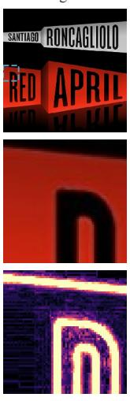

FLUX-Text  
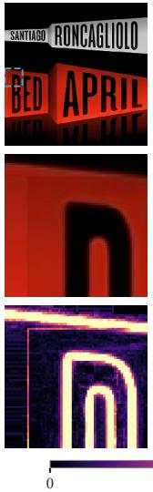

Ours  
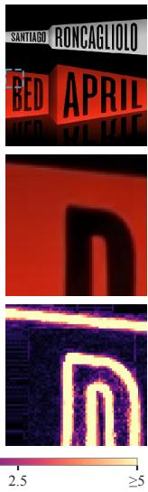

Before uniform  
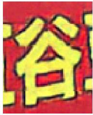  
After uniform

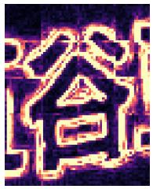

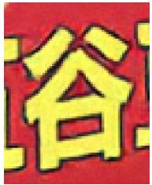

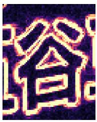  
Color gradient (ΔE00)

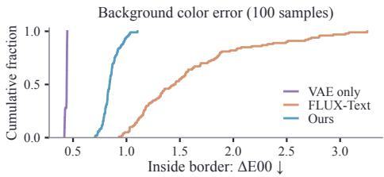  
(a) Color preservation

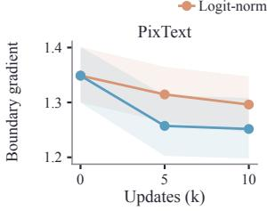

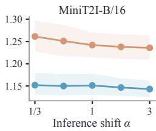  
(b) Grid-artifact mitigation  
Figure 4: Color preservation and grid-artifact mitigation. (a) Full images, local close-ups, and color-gradient maps, with background color-error distributions. (b) Generated images and colorgradient maps before and after uniform sampling, with PixText and MiniT2I boundary-gradient curves. Heatmaps share a scale within each panel; shading denotes 95% bootstrap intervals.

The resulting image serves as a main image providing context, while each region to be edited forms an item image. The model predicts only the item pixels and pastes them into the original. The extent of generation therefore follows the size of the edit regions, while pixels outside them are retained directly. We denote the N clean items by $x _ { 1 } = \{ x _ { 1 } ^ { i } \} _ { i = 1 } ^ { N }$ and their noisy counterparts by $z _ { t } = \{ z _ { t } ^ { i } \} _ { i = 1 } ^ { N }$ . Conditioned on the main image and target glyph images, denoted by $c ,$ the model jointly predicts $\hat { x } _ { 1 } = f _ { \theta } ( z _ { t } , t , c )$

The input comprises main-image, noisy item-image, and glyph-image tokens, which provide scene context, represent generation targets, and specify text content, respectively. At sampling time, item images are initialized from $\sqrt { ( 0 , I ) }$ . Main and item images share an RGB embedder. Glyph images are rendered with PIL in single-channel grayscale and mapped to the same feature dimension through a separate glyph embedder. Target text is specified entirely through these glyph images, removing the need to deploy an additional text encoder.

As illustrated in Figure 1(b), we use Centered Continuous Position Encoding (CCPE) to align the main image and independently cropped items across scales in the coordinate system of the original image. Let the original image have size $H \times W$ , the patch size be $p ,$ and $( y , x )$ denote a patch center in original-image pixel coordinates. Its 3D RoPE coordinates (Su et al., 2024) are

$$
\pi = ( n , { \frac { y - H / 2 } { p } } , { \frac { x - W / 2 } { p } } ) , \qquad n = \{ 1 , { \mathrm { ~ i t e m ~ i m a g e } } , \qquad\tag{3}
$$

Each glyph shares the spatial coordinates of its paired item and is distinguished by the role coordinate n. Continuous spatial coordinates allow item crops to start at arbitrary pixel locations without aligning to the main-image patch grid. Only crop dimensions need to be expanded to multiples of p, avoiding extra padding from grid alignment. Across 116,038 text regions, this reduces the number of item tokens by 13.7% relative to grid-aligned crops; Appendix E provides the comparison.

We adapt JiT blocks for grouped image generation and call the resulting blocks Group JiT Blocks. These tokens are jointly processed by 32 such blocks. As illustrated in Figure 1(c), the main image and items interact bidirectionally, and different items attend to one another to share scene information and editing context. Cross-image attention involving each glyph is restricted to bidirectional interaction with its paired item, preserving the correspondence between text conditions and editing targets. We inject timestep conditions through adaLN-Zero (Peebles & Xie, 2023): noisy items receive the current timestep t, while the main image and glyphs use the fixed clean endpoint t = 1, distinguishing generation targets from known conditions. We use FlexAttention (Dong et al., 2024) to batch variable-length image groups; implementation details are provided in Appendix A.

## 3.3 TRAINING AND SAMPLING

We train PixText directly for local text editing, conditioning on the main image and glyphs while adding noise to and predicting only the item images. We choose the editing granularity according to the writing system, using character-level regions for Chinese and word-level regions for alphabetic writing systems such as English to support fine-grained refinement. Glyph conditions are rendered from the recognized text. Training uses the noise path and velocity-space objective in Section 3.1. We average the loss over pixels and channels within each item, then equally over items:

$$
\mathcal { L } = \mathbb { E } _ { \boldsymbol { x } _ { 1 } , \boldsymbol { c } , \boldsymbol { t } , \epsilon } \left[ \frac { 1 } { N } \sum _ { i = 1 } ^ { N } \frac { \lVert \hat { \boldsymbol { v } } _ { t } ^ { i } - \boldsymbol { v } _ { t } ^ { * , i } \rVert _ { 2 } ^ { 2 } } { D _ { i } } \right] ,\tag{4}
$$

where $D _ { i }$ is the number of scalar pixel values in item i.

Grid artifacts aligned with patch boundaries have been observed across JiT-based pixel-space models (Wang et al., 2026d; Jiang et al., 2026; He et al., 2026). We find that these artifacts can be mitigated by a simple change to the training timestep distribution. After initial training with logitnormal sampling, we switch to uniform sampling and continue training. Generated images and color-gradient maps in Figure 4(b) show weaker patch-boundary discontinuities after uniform sampling; the bottom-left plot compares both training strategies from the same initialization. Uniform sampling yields lower patch-boundary gradients at both continuation checkpoints, indicating weaker grid artifacts. We further evaluate this strategy on MiniT2I-B/16. Starting from the same pretrained checkpoint used for the official logit-normal fine-tuning, we adopt uniform timestep sampling during post-training without modifying the architecture. The bottom-right plot in Figure 4(b) shows lower boundary gradients than the official logit-normal fine-tuned model across all five inference schedules, indicating that this simple post-training adjustment also mitigates grid artifacts in an other pixel-space model. Appendix F provides the experimental details.

The sampling implementations of JiT and MiniT2I impose a lower bound on 1 − t when converting clean-image predictions into velocities, preventing the denominator from approaching zero near the denoising endpoint (Li & He, 2026; Wang et al., 2026d). We observe that this floor can weaken the final updates and leave residual speckle. We instead formulate the update directly in terms of the clean prediction, so the final step returns it in full. We hold the main-image and glyph conditions c fixed and initialize the items from Gaussian noise, $z _ { 0 } ^ { i } \sim \mathcal { N } ( 0 , I )$ . For a time sequence $0 = t _ { 0 } <$ $\cdots < t _ { K } = 1$ , the Euler update is

$$
z _ { t _ { k + 1 } } ^ { i } = z _ { t _ { k } } ^ { i } + { \frac { t _ { k + 1 } - t _ { k } } { 1 - t _ { k } } } \left( { \hat { x } } _ { 1 , k } ^ { i } - z _ { t _ { k } } ^ { i } \right) , \qquad { \hat { x } } _ { 1 , k } = f _ { \theta } ( z _ { t _ { k } } , t _ { k } , c ) .\tag{5}
$$

When the final step reaches $t _ { k + 1 } = 1$ , this update directly returns the clean-image prediction $\hat { x } _ { 1 , k } ^ { i } .$ Figure 5 shows reduced background speckle when only the final update is replaced. Additional matched examples and sampling settings are provided in Appendix F.

## 3.4 EFFICIENT GENERATION WITH MEANFLOW

To reduce the number of sampling steps, we distill a trained PixText teacher using MeanFlow to learn the average velocity over a time interval (Geng et al., 2026a). The student is initialized from

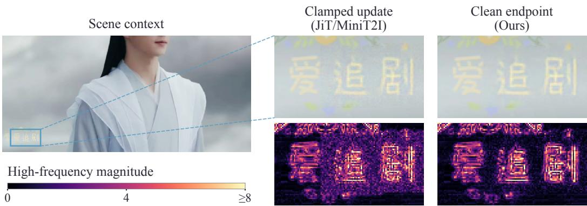  
Figure 5: Effect of the final sampling update on residual speckle. Left: scene context. Right: matched close-ups and high-frequency maps show reduced background fluctuations when returning the clean prediction. Both outputs differ only in the final update along a shared trajectory.

the teacher and additionally conditioned on the interval endpoint. Let $z _ { t }$ collect all items to be generated at time t, and let $v _ { \phi } ( z _ { t } , t , c )$ denote the frozen teacher’s instantaneous velocity. Along a teacher trajectory, the average velocity over $[ t , s ]$ , with $t < s ,$ , satisfies the MeanFlow identity:

$$
u ( z _ { t } , t , s , c ) = \frac { z _ { s } - z _ { t } } { s - t } = v _ { \phi } ( z _ { t } , t , c ) + ( s - t ) \mathcal { D } _ { t } u ( z _ { t } , t , s , c ) ,\tag{6}
$$

where $\mathcal { D } _ { t } u = \partial _ { t } u + ( \partial u / \partial z _ { t } ) v _ { \phi }$ is the total derivative along the teacher velocity, holding s and c fixed. This identity connects interval displacement to the teacher velocity at the current state, providing supervision without explicitly integrating the teacher trajectory.

We independently sample two uniform timesteps and sort them to obtain $t < s .$ , constructing training states with the noise path defined above. Following AnyFlow, we use the Differential Derivation Equation (DDE) approach to estimate this total derivative by finite differences (Gu et al., 2026). Let $v _ { t } = v _ { \phi } ( z _ { t } , t , c )$ be the instantaneous velocity predicted by the frozen teacher at the current state. We perturb the state along this fixed teacher velocity together with the starting time, holding the endpoint s and condition c fixed:

$$
U _ { \theta } ( \delta ) = u _ { \theta } ( z _ { t } + \delta v _ { t } , t + \delta , s , c ) , \qquad { \widehat { \mathcal { D } } } _ { t } u _ { \theta } ( z _ { t } , t , s , c ) = { \frac { U _ { \theta } ( \delta _ { + } ) - U _ { \theta } ( \delta _ { - } ) } { \delta _ { + } - \delta _ { - } } } .\tag{7}
$$

Here $\delta _ { - } \leq 0 \leq \delta _ { + }$ and $\delta _ { - } < \delta _ { + }$ . We normally use $( \delta _ { + } , \delta _ { - } ) = ( h , - h )$ , giving a central difference with step size $h > 0$ . Near boundaries, we use the one-sided pair (h, 0) or $( 0 , - h )$ and reduce h as needed to keep the perturbed starting times within [0, s] and on the same branch of the denominator clamp used in velocity conversion. The finite-difference predictions are evaluated without gradient tracking. The distillation objective is

$$
\mathcal { L } _ { \mathrm { M F } } = \mathbb { E } \bigg [ \frac { 1 } { D } \left| \Big | u _ { \theta } ( z _ { t } , t , s , c ) - \mathrm { s g } \Big [ v _ { \phi } ( z _ { t } , t , c ) + ( s - t ) \widehat { \mathcal { D } } _ { t } u _ { \theta } ( z _ { t } , t , s , c ) \Big ] \right| \bigg ] _ { 2 } ^ { 2 } \bigg ] ,\tag{8}
$$

where sg denotes stop-gradient and $D$ counts scalar pixel values across all generated items in a group. We optimize only this average-velocity objective, without an auxiliary instantaneous-velocity loss. DDE takes differences between nearby predictions, making its accuracy sensitive to both arithmetic precision and perturbation size. We observe low-precision derivative errors in reference implementations and our own model, and therefore use higher precision for derivative estimation while retaining low-precision computation elsewhere in training to control the additional cost. Appendix C examines the basis for this precision allocation.

At inference, the student predicts the average velocity for each interval and updates the items as

$$
z _ { t _ { k + 1 } } = z _ { t _ { k } } + ( t _ { k + 1 } - t _ { k } ) u _ { \theta } ( z _ { t _ { k } } , t _ { k } , t _ { k + 1 } , c ) ,\tag{9}
$$

starting from Gaussian noise at $t _ { 0 } = 0$ and reaching $t _ { 4 } = 1$ in four steps. Table 2 shows that, on Text Refinement Bench, the four-step model reduces the average GPU generation cost per image to about one fifth of the 25-step teacher’s cost, with a decrease of only 1.21 percentage points in Pass.

## 4 EXPERIMENTS

## 4.1 EXPERIMENTAL SETUP

AnyText Bench focuses on reconstructing annotated text at specified locations (Tuo et al., 2024b), leaving a gap in open, reproducible evaluation of localized text refinement on generated images. We therefore construct Text Refinement Bench from actual model-generated images, including those released in the public Qwen-Image Bench (Li et al., 2026b). Human review verifies erroneous character regions and correction targets and excludes invalid cases before freezing the evaluation list, directly reflecting the practical need to correct local errors while preserving the original image. The benchmark evaluates correction accuracy and image preservation on 1,034 images with 2,638 repair targets. We also evaluate text reconstruction on the Chinese and English subsets of AnyText Bench to assess performance on conventional visual text generation. During evaluation, we identify inaccurate text polygons and failures of the original OCR evaluation pipeline on vertically arranged text. We correct the affected text regions and adapt OCR preprocessing for vertical layouts, reducing scoring errors caused by cropping and text orientation so that evaluation better reflects the quality of the generated text.

Standard OCR may transcribe a generated glyph with missing or extra strokes as the intended character, so correct recognition does not necessarily imply a successful repair. We therefore use CJK-CLIP, a dedicated CLIP-style glyph recognizer for characters,1 to distinguish correct glyphs from visually similar but structurally incorrect outputs for character-level evaluation on Text Refinement Bench. Appendix D further describes the benchmark, its differences from related benchmarks, and the evaluation protocol.

Implementation details. We train the model on eight H800 GPUs using an internal Chinese– English dataset containing approximately 2.53 million image records. Base-model training uses AdamW with a learning rate of $1 0 ^ { - 4 } , \ : \dot { \beta } \ : = \ : ( 0 . 9 , 0 . 9 5 )$ , zero weight decay, and an EMA decay of 0.9999. Each optimizer reinitialization starts with 2,000 linear warmup steps, followed by a constant learning rate. We follow a progressive-resolution schedule: we first train for approximately 13 epochs with at most $5 1 2 ^ { 2 }$ pixels per main image, then increase this limit to $1 0 2 4 ^ { 2 }$ and continue training for approximately 15 epochs. We subsequently perform approximately 3,000 MeanFlow updates with an effective batch size of 24.

PixText uses patch size $p = 1 6 ,$ 32 Group JiT Blocks, hidden dimension 1280, and 16 attention heads. The denominator floor for velocity conversion is $\delta = 0 . 0 5$ . Initial logit-normal timestep sampling uses $\mu = - 0 . 8$ and $\sigma = 0 . 8$ , followed by uniform sampling.

MeanFlow uses the same optimizer settings. Both the student and frozen teacher are initialized from the base model’s EMA weights, and training intervals are formed by sorting two independently sampled uniform timesteps. The default DDE step size is $h \ : = \ : 0 . 0 \dot { 0 } 5$ , reduced near boundaries as described above. Finite-difference predictions and subtraction use FP32 tensor arithmetic, with TF32 enabled for matrix multiplications; the trainable student forward and backward passes use BF16 mixed precision. For the main-table evaluation, PixText uses 25 Euler steps and MeanFlow uses four Euler steps, both with a glyph-conditioned classifier-free guidance (CFG) (Ho & Salimans, 2022) scale of 3.3 (see Appendix B for details).

## 4.2 QUANTITATIVE COMPARISONS

Table 2 compares eight text-specialized methods with PixText and its four-step MeanFlow variant. On Text Refinement Bench, PixText achieves a Pass of 83.06%, compared with 36.77% for the strongest baseline, FLUX-Text, while also attaining the lowest FID (Heusel et al., 2017) and LPIPS (Zhang et al., 2018). PP-OCRv6 gives PixText 94.66% exact target-character accuracy, compared with 52.31% for FLUX-Text.

On AnyText Bench, PixText achieves the highest Chinese text accuracy and ranks second to FLUX-Text on English, showing that its refinement advantage is accompanied by competitive text reconstruction. For each Chinese-capable baseline, we report the complete line- or character-input run with higher text accuracy; Table 4 reports both settings and all four metrics. The four-step Mean-Flow variant retains the refinement advantage over the baselines while reducing generation cost relative to the base PixText model, making localized correction practical in generation workflows. Appendix I reports a comparison with Qwen-Image-3.0-Pro through its editing API on Text Refinement Bench.

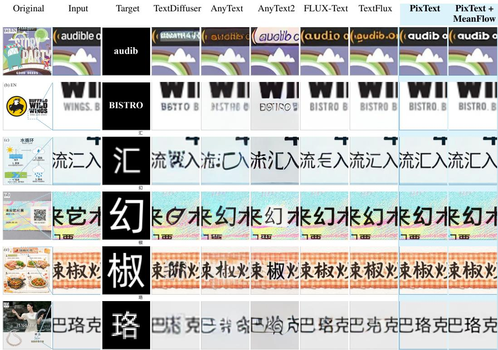  
Figure 6: Qualitative comparisons of different methods.

Table 2: Text Refinement Bench and AnyText results. AnyText ZH uses each baseline’s higher-Acc run for all metrics; Appendix D compares inputs. Dashes mean unsupported. Params (B) include the generator, VAE, and text encoders. Bold and underline mark best and second best.
<table><tr><td rowspan="2">Method</td><td colspan="5">Text Refinement Bench Pass↑ R@1↑ OCR Acc↑ FID↓</td><td colspan="3">AnyText EN</td><td colspan="3">AnyText ZH</td><td colspan="2">Efficiency</td></tr><tr><td></td><td></td><td></td><td></td><td>LPIPS↓</td><td>Acc↑ NED↑</td><td>FID↓</td><td>LPIPS↓</td><td>Acc↑</td><td></td><td>NED↑ FID↓ LPIPS↓</td><td>GPU-s/img↓</td><td>Params (B)↓</td></tr><tr><td>TextDiffuser</td><td></td><td></td><td></td><td></td><td></td><td>54.15 0.7863</td><td>24.04</td><td>0.1443</td><td></td><td></td><td></td><td>3.126</td><td>1.066</td></tr><tr><td>TextCtrl</td><td>I</td><td>一</td><td>一</td><td>一</td><td></td><td>59.53 0.8378</td><td>8.16</td><td>0.0365</td><td></td><td>一</td><td></td><td>13.802</td><td>1.128</td></tr><tr><td>UDiffText</td><td>1</td><td>1</td><td>一</td><td></td><td></td><td>67.16 0.8599</td><td>16.94</td><td>0.1072</td><td></td><td>一</td><td></td><td>8.252</td><td>1.361</td></tr><tr><td>DiffSTE</td><td></td><td>一</td><td>1</td><td></td><td></td><td>61.01 0.8019</td><td>19.16</td><td>0.1258</td><td></td><td></td><td></td><td>16.132</td><td>1.315</td></tr><tr><td>AnyText</td><td>12.40</td><td>23.46</td><td>25.59</td><td>11.47</td><td>0.0187</td><td>64.60 0.844022.40</td><td></td><td>0.1111</td><td>66.54 0.8607 22.29</td><td></td><td>0.0949</td><td>4.310</td><td>1.428</td></tr><tr><td>AnyText2</td><td>27.29</td><td>43.56</td><td>48.41</td><td>10.50</td><td>0.0256</td><td>79.65 0.9132</td><td>32.15</td><td>0.1752</td><td>78.06 0.9112</td><td>28.89</td><td>0.1407</td><td>8.871</td><td>1.485</td></tr><tr><td>FLUX-Text</td><td>36.77</td><td>48.26</td><td>52.31</td><td>2.59</td><td>0.0028</td><td>84.05 0.9365</td><td>11.50</td><td>0.0684</td><td>80.93 0.9233</td><td>12.22</td><td>0.0498</td><td>16.420</td><td>17.799</td></tr><tr><td>TextFlux</td><td>14.18</td><td>23.77</td><td>28.32</td><td>2.27</td><td>0.0023</td><td>74.500.8752</td><td>14.06</td><td>0.0856</td><td>65.060.8551</td><td>12.82</td><td>0.0576</td><td>14.144</td><td>16.872</td></tr><tr><td>PixText</td><td>83.06</td><td>92.95</td><td>94.66</td><td>0.34</td><td>0.0010</td><td>80.91 0.9190</td><td>7.62</td><td>0.0295</td><td>84.13 0.9477</td><td>5.93</td><td>0.0199</td><td>4.514</td><td>0.952</td></tr><tr><td>PixText + MeanFlow</td><td>81.84</td><td>92.57</td><td>94.58</td><td>0.38</td><td>0.0011</td><td>80.75 0.9142</td><td>7.80</td><td>0.0293</td><td>82.74 0.9429</td><td>5.92</td><td>0.0193</td><td>0.942</td><td>0.954</td></tr></table>

## 4.3 QUALITATIVE COMPARISONS

Figure 6 compares six localized text refinement or generation cases across lettering styles and backgrounds. At matched scales, PixText and its four-step MeanFlow variant produce legible text while preserving local appearance; some baselines distort strokes, style, or nearby content. Appendix G gives fourteen more cases, and Appendix H shows glyph-conditioned generation beyond the main Chinese–English training scripts.

## 5 CONCLUSION

PixText refines text through localized pixel-space grouped generation, preserving fine strokes and surrounding content. It substantially improves correction on Text Refinement Bench, while its fourstep MeanFlow variant costs less than one amortized GPU-second per image. Targeted pixel-space generation thus improves text readability while preserving image appearance.

## AI USE STATEMENT

We used generative AI tools to assist with manuscript polishing and translation, coding assistance, and experimental data organization. The authors take responsibility for the final paper and reported results.

## REFERENCES

Yuval Atzmon, Maciej Bala, Yogesh Balaji, Tiffany Cai, Yin Cui, Jiaojiao Fan, Yunhao Ge, Siddharth Gururani, Jacob Huffman, Ronald Isaac, et al. Edify image: High-quality image generation with pixel space laplacian diffusion models. arXiv preprint arXiv:2411.07126, 2024.

Alan Baade, Eric Ryan Chan, Kyle Sargent, Changan Chen, Justin Johnson, Ehsan Adeli, and Li Fei-Fei. Latent forcing: Reordering the diffusion trajectory for pixel-space image generation. arXiv preprint arXiv:2602.11401, 2026.

Youngmin Baek, Bado Lee, Dongyoon Han, Sangdoo Yun, and Hwalsuk Lee. Character region awareness for text detection. In 2019 IEEE/CVF Conference on Computer Vision and Pattern Recognition (CVPR), pp. 9357–9366. IEEE, 2019.

Qi Cai, Jingwen Chen, Chengmin Gao, Zijian Gong, Yehao Li, Yingwei Pan, Yi Peng, Zhaofan Qiu, Kai Yu, Yiheng Zhang, et al. Hidream-o1-image: A natively unified image generative foundation model with pixel-level unified transformer. arXiv preprint arXiv:2605.11061, 2026.

Chieh-Yun Chen, Zhonghao Wang, Qi Chen, Zhifan Ye, Min Shi, Yue Zhao, Yinan Zhao, Hui Qu, Wei-An Lin, Yiru Shen, et al. Mapreduce lora: Advancing the pareto front in multi-preference optimization for generative models. In Proceedings of the IEEE/CVF Conference on Computer Vision and Pattern Recognition, pp. 34375–34384, 2026a.

Hansheng Chen, Jan Ackermann, Minseo Kim, Gordon Wetzstein, and Leonidas Guibas. Asymmetric flow models. arXiv preprint arXiv:2605.12964, 2026b.

Haoxing Chen, Zhuoer Xu, Zhangxuan Gu, Yaohui Li, Changhua Meng, Huijia Zhu, Weiqiang Wang, et al. Diffute: Universal text editing diffusion model. Advances in Neural Information Processing Systems, 36:63062–63074, 2023a.

Jingye Chen, Yupan Huang, Tengchao Lv, Lei Cui, Qifeng Chen, and Furu Wei. Textdiffuser: Diffusion models as text painters. Advances in Neural Information Processing Systems, 36:9353– 9387, 2023b.

Jingye Chen, Yupan Huang, Tengchao Lv, Lei Cui, Qifeng Chen, and Furu Wei. Textdiffuser-2: Unleashing the power of language models for text rendering. In European Conference on Computer Vision, pp. 386–402. Springer, 2024.

Junyu Chen, Han Cai, Junsong Chen, Enze Xie, Shang Yang, Haotian Tang, Muyang Li, and Song Han. Deep compression autoencoder for efficient high-resolution diffusion models. In International Conference on Learning Representations, volume 2025, pp. 96539–96560, 2025a.

Shoufa Chen, Chongjian Ge, Shilong Zhang, Peize Sun, and Ping Luo. Pixelflow: Pixel-space generative models with flow. arXiv preprint arXiv:2504.07963, 2025b.

Zeyu Chen, Fangmin Zhao, Yan Shu, Yichao Liu, Liu Yu, and Yu Zhou. Styletextgen: Styleconditioned multilingual scene text generation. arXiv preprint arXiv:2605.14708, 2026c.

Zhennan Chen, Junwei Zhu, Xu Chen, Jiangning Zhang, Jiawei Chen, Zhuoqi Zeng, Wei Zhang, Chengjie Wang, Jian Yang, and Ying Tai. L2p: Unlocking latent potential for pixel generation. arXiv preprint arXiv:2605.12013, 2026d.

Zhennan Chen, Junwei Zhu, Xu Chen, Jiangning Zhang, Xiaobin Hu, Hanzhen Zhao, Chengjie Wang, Jian Yang, and Ying Tai. Dip: Taming diffusion models in pixel space. In Proceedings of the IEEE/CVF Conference on Computer Vision and Pattern Recognition, pp. 36136–36146, 2026e.

Liwei Cheng, Shibo Feng, Lunjie Zhou, Yixuan Guan, and Dayan Guan. Multitextedit: Benchmarking cross-lingual degradation in text-in-image editing. arXiv preprint arXiv:2605.08163, 2026.

Katherine Crowson, Stefan Andreas Baumann, Alex Birch, Tanishq Mathew Abraham, Daniel Z Kaplan, and Enrico Shippole. Scalable high-resolution pixel-space image synthesis with hourglass diffusion transformers. arXiv preprint arXiv:2401.11605, 2024.

Cheng Cui, Ting Sun, Manhui Lin, Tingquan Gao, Yubo Zhang, Jiaxuan Liu, Xueqing Wang, Zelun Zhang, Changda Zhou, Hongen Liu, et al. Paddleocr 3.0 technical report. arXiv preprint arXiv:2507.05595, 2025.

Haiwen Diao, Jiahao Wang, Chenjing Ding, Hanming Deng, Jiangnan Chen, Ruixi Zhang, Ruohui Wang, Wenwen Tong, Xiangyu Fan, Yubo Wang, et al. Sensenova-u1. 5: Towards native unified visual intelligence. arXiv preprint arXiv:2609.11929, 2026.

Juechu Dong, Boyuan Feng, Driss Guessous, Yanbo Liang, and Horace He. Flex attention: A programming model for generating optimized attention kernels. arXiv preprint arXiv:2412.05496, 2(3):4, 2024.

Zhengyao Fang, Pengyuan Lyu, Jingjing Wu, Chengquan Zhang, Jun Yu, Guangming Lu, and Wenjie Pei. Recognition-synergistic scene text editing. In 2025 IEEE/CVF Conference on Computer Vision and Pattern Recognition (CVPR), pp. 13104–13113. IEEE, 2025.

Zhengyang Geng, Mingyang Deng, Xingjian Bai, Zico Kolter, and Kaiming He. Mean flows for one-step generative modeling. Advances in Neural Information Processing Systems, 38:75460– 75482, 2026a.

Zhengyang Geng, Yiyang Lu, Zongze Wu, Eli Shechtman, J Zico Kolter, and Kaiming He. Improved mean flows: On the challenges of fastforward generative models. In Proceedings ofthe IEEE/CVF Conference on Computer Vision and Pattern Recognition, pp. 30467–30476, 2026b.

Yuchao Gu, Guian Fang, Yuxin Jiang, Weijia Mao, Song Han, Han Cai, and Mike Zheng Shou. Anyflow: Any-step video diffusion model with on-policy flow map distillation. In European Conference on Computer Vision, pp. 163–181. Springer, 2026.

Rui Gui, Yang Wan, Haochen Han, Dongxing Mao, Fangming Liu, Min Li, and Alex Jinpeng Wang. Texteditbench: Evaluating reasoning-aware text editing beyond rendering. arXiv preprint arXiv:2512.16270, 2025.

Agus Gunawan, Samuel Teodoro, Yun Chen, Soo Ye Kim, Jihyong Oh, and Munchurl Kim. Omnitext: A training-free generalist for controllable text-image manipulation. In International Conference on Learning Representations, volume 2026, pp. 97841–97888, 2026.

Zihao He, Yunfeng Wu, Xinchao Wang, and Songhua Liu. Bend the basics: degradation-aware deformable tokenization for all-in-one image restoration. arXiv preprint arXiv:2608.06832, 2026.

Martin Heusel, Hubert Ramsauer, Thomas Unterthiner, Bernhard Nessler, and Sepp Hochreiter. Gans trained by a two time-scale update rule converge to a local nash equilibrium. Advances in neural information processing systems, 30, 2017.

Jonathan Ho and Tim Salimans. Classifier-free diffusion guidance. arXiv preprint arXiv:2207.12598, 2022.

Emiel Hoogeboom, Jonathan Heek, and Tim Salimans. simple diffusion: End-to-end diffusion for high resolution images. In International Conference on Machine Learning, pp. 13213–13232. PMLR, 2023.

Emiel Hoogeboom, Thomas Mensink, Jonathan Heek, Kay Lamerigts, Ruiqi Gao, and Tim Salimans. Simpler diffusion: 1.5 fid on imagenet512 with pixel-space diffusion. In 2025 IEEE/CVF Conference on Computer Vision and Pattern Recognition (CVPR), pp. 18062–18071. IEEE, 2025.

Allan Jabri, David Fleet, and Ting Chen. Scalable adaptive computation for iterative generation. arXiv preprint arXiv:2212.11972, 2022.

Jiabao Ji, Guanhua Zhang, Zhaowen Wang, Bairu Hou, Zhifei Zhang, Brian Price, and Shiyu Chang. Improving diffusion models for scene text editing with dual encoders. arXiv preprint arXiv:2304.05568, 2023.

Dengyang Jiang, Ruoyi Du, Zhennan Chen, Dongyang Liu, Zanyi Wang, Mingzhe Zheng, Xiangpeng Yang, Huanqia Cai, Aiming Hao, Yuming Jiang, et al. An empirical study of training pixel-space text-to-image diffusion models. arXiv preprint arXiv:2608.16887, 2026.

Luozhijie Jin, Zijie Qiu, Jie Liu, Zijie Diao, Lifeng Qiao, Ning Ding, Alex Lamb, and Xipeng Qiu. Inference-time alignment control for diffusion models with reinforcement learning guidance. arXiv preprint arXiv:2508.21016, 2025.

Jiwon Kang, Heeji Yoon, Jaewoo Jung, Jaewon Min, Minkyeong Jeon, Biyeon Hwang, Sangwon Jung, and Seungryong Kim. Transferability between understanding and generation in unified multimodal models. arXiv preprint arXiv:2607.04423, 2026.

Praveen Krishnan, Rama Kovvuri, Guan Pang, Boris Vassilev, and Tal Hassner. Textstylebrush: transfer of text aesthetics from a single example. IEEE Transactions on Pattern Analysis and Machine Intelligence, 45(7):9122–9134, 2023.

Black Forest Labs. FLUX.2: Frontier Visual Intelligence. https://bfl.ai/blog/flux-2, 2025.

Black Forest Labs, Stephen Batifol, Andreas Blattmann, Frederic Boesel, Saksham Consul, Cyril Diagne, Tim Dockhorn, Jack English, Zion English, Patrick Esser, et al. Flux. 1 kontext: Flow matching for in-context image generation and editing in latent space. arXiv preprint arXiv:2506.15742, 2025.

Rui Lan, Yancheng Bai, Xu Duan, Mingxing Li, Dongyang Jin, Ryan Xu, Dong Nie, Lei Sun, and Xiangxiang Chu. Flux-text: A simple and advanced diffusion transformer baseline for scene text editing. arXiv preprint arXiv:2505.03329, 2025.

Junyeop Lee, Yoonsik Kim, Seonghyeon Kim, Moonbin Yim, Seung Shin, Gayoung Lee, and Sungrae Park. Rewritenet: Reliable scene text editing with implicit decomposition of text content and styles. arXiv preprint arXiv:2107.11041, 2021.

Hongxi Li, Tong Wang, Chengjing Wu, Tianbao Liu, Jiangtao Yao, Xiaochao Qu, Xinxiao Wu, Luoqi Liu, and Ting Liu. Self-prompting diffusion transformer for open-vocabulary scene text editing via in-context learning. arXiv preprint arXiv:2605.15523, 2026a.

Niantong Li, Guangzheng Hu, Weixu Qiao, Ying Ba, Qichen Hong, Shijun Shen, Jinlin Wang, Fan Zhou, Jianye Kang, Xin Shang, et al. Qwen-image-bench: From generation to creation in text-toimage evaluation. arXiv preprint arXiv:2605.28091, 2026b.

Tianhong Li and Kaiming He. Back to basics: Let denoising generative models denoise. In Proceedings of the IEEE/CVF Conference on Computer Vision and Pattern Recognition, pp. 36115– 36125, 2026.

Yubo Li, Xugong Qin, Peng Zhang, Hailun Lin, Gangyan Zeng, and Kexin Zhang. Towards trainingfree scene text editing. In Proceedings of the IEEE/CVF Conference on Computer Vision and Pattern Recognition, pp. 15291–15301, 2026c.

Mingfeng Lin, Jiakun Chen, Liang Han, and Liqiang Nie. Frepix: Frequency-heterogeneous flow matching for pixel-space image generation. arXiv preprint arXiv:2605.06421, 2026a.

Yiheng Lin, Siyu Jiao, Xiaohan Lan, Wei Zhou, Qi She, Fei Yu, Heyun Chen, Zhengwei Wang, Jinghuan Chen, Moran Li, et al. Textsculptor: Training and benchmarking scene text editing. arXiv preprint arXiv:2605.21090, 2026b.

Zeyu Liu, Weicong Liang, Zhanhao Liang, Chong Luo, Ji Li, Gao Huang, and Yuhui Yuan. Glyphbyt5: A customized text encoder for accurate visual text rendering. In European Conference on Computer Vision, pp. 361–377. Springer, 2024a.

Zeyu Liu, Weicong Liang, Yiming Zhao, Bohan Chen, Lin Liang, Lijuan Wang, Ji Li, and Yuhui Yuan. Glyph-byt5-v2: A strong aesthetic baseline for accurate multilingual visual text rendering. arXiv preprint arXiv:2406.10208, 2024b.

Yiyang Lu, Susie Lu, Qiao Sun, Hanhong Zhao, Zhicheng Jiang, Xianbang Wang, Tianhong Li, Zhengyang Geng, and Kaiming He. One-step latent-free image generation with pixel mean flows. arXiv preprint arXiv:2601.22158, 2026.

Jian Ma, Mingjun Zhao, Chen Chen, Ruichen Wang, Di Niu, Haonan Lu, and Xiaodong Lin. Glyphdraw: Seamlessly rendering text with intricate spatial structures in text-to-image generation. arXiv preprint arXiv:2303.17870, 2023.

Jian Ma, Yonglin Deng, Chen Chen, Nanyang Du, Haonan Lu, and Zhenyu Yang. Glyphdraw2: Automatic generation of complex glyph posters with diffusion models and large language models. In Proceedings of the AAAI Conference on Artificial Intelligence, volume 39, pp. 5955–5963, 2025.

Lichen Ma, Xiaolong Fu, Zipeng Guo, Ting Zhu, Yichun Liu, Yu Shi, Jason Li, Junshi Huang, et al. Um-text: A unified multimodal model for image understanding and visual text editing. In Proceedings ofthe AAAI Conference on Artificial Intelligence, volume 40, pp. 7791–7799, 2026a.

Zehong Ma, Longhui Wei, Shuai Wang, Shiliang Zhang, and Qi Tian. Deco: Frequency-decoupled pixel diffusion for end-to-end image generation. In Proceedings of the IEEE/CVF Conference on Computer Vision and Pattern Recognition, pp. 43600–43610, 2026b.

Zehong Ma, Ruihan Xu, and Shiliang Zhang. Pixelgen: Improving pixel diffusion with perceptual supervision. arXiv preprint arXiv:2602.02493, 2026c.

Dongxing Mao, Alex Jinpeng Wang, Jiahao Tang, Kevin Qinghong Lin, Linjie Li, Zhengyuan Yang, Lijuan Wang, Min Li, and Jingru Tan. Residual decoder adapter: Id-preserving tokenizer adaption for autoregressive text rendering. In Proceedings of the IEEE/CVF Conference on Computer Vision and Pattern Recognition, pp. 22017–22027, 2026a.

Weijia Mao, Hao Chen, Zhenheng Yang, and Mike Zheng Shou. The image as its own reward: Reinforcement learning with adversarial reward for image generation. In Proceedings of the IEEE/CVF Conference on Computer Vision and Pattern Recognition, pp. 5999–6009, 2026b.

William Peebles and Saining Xie. Scalable diffusion models with transformers. In 2023 IEEE/CVF International Conference on Computer Vision (ICCV), pp. 4172–4182. IEEE, 2023.

Yadong Qu, Qingfeng Tan, Hongtao Xie, Jianjun Xu, Yuxin Wang, and Yongdong Zhang. Exploring stroke-level modifications for scene text editing. In Proceedings of the AAAI Conference on Artificial Intelligence, volume 37, pp. 2119–2127, 2023.

Robin Rombach, Andreas Blattmann, Dominik Lorenz, Patrick Esser, and Björn Ommer. Highresolution image synthesis with latent diffusion models. In 2022 IEEE/CVF conference on computer vision and pattern recognition (CVPR), pp. 10674–10685. ieee, 2022.

Prasun Roy, Saumik Bhattacharya, Subhankar Ghosh, and Umapada Pal. Stefann: scene text editor using font adaptive neural network. In 2020 IEEE/CVF Conference on Computer Vision and Pattern Recognition (CVPR), pp. 13225–13234. IEEE, 2020.

Wataru Shimoda, Naoto Inoue, Daichi Haraguchi, Hayato Mitani, Seiichi Uchida, and Kota Yamaguchi. Type-r: Automatically retouching typos for text-to-image generation. In 2025 IEEE/CVF Conference on Computer Vision and Pattern Recognition (CVPR), pp. 2745–2754. IEEE, 2025.

Jianlin Su, Murtadha Ahmed, Yu Lu, Shengfeng Pan, Wen Bo, and Yunfeng Liu. Roformer: Enhanced transformer with rotary position embedding. Neurocomputing, 568:127063, 2024.

Meituan LongCat Team, Hanghang Ma, Haoxian Tan, Jiale Huang, Junqiang Wu, Jun-Yan He, Lishuai Gao, Songlin Xiao, Xiaoming Wei, Xiaoqi Ma, et al. Longcat-image technical report. arXiv preprint arXiv:2512.07584, 2025.

Super Intelligence Team, Changhao Qiao, Chao Hui, Chen Li, Cunzheng Wang, Dejia Song, Jiale Zhang, Jing Li, Qiang Xiang, Runqi Wang, et al. Firered-image-edit-1.0 technical report. arXiv preprint arXiv:2602.13344, 2026.

Changyao Tian, Danni Yang, Guanzhou Chen, Erfei Cui, Zhaokai Wang, Yuchen Duan, Penghao Yin, Sitao Chen, Ganlin Yang, Mingxin Liu, et al. Internvl-u: Democratizing unified multimodal models for understanding, reasoning, generation and editing. arXiv preprint arXiv:2603.09877, 2026.

Yuxiang Tuo, Yifeng Geng, and Liefeng Bo. Anytext2: Visual text generation and editing with customizable attributes. arXiv preprint arXiv:2411.15245, 2024a.

Yuxiang Tuo, Wangmeng Xiang, Jun-Yan He, Yifeng Geng, and Xuansong Xie. Anytext: Multilingual visual text generation and editing. In International Conference on Learning Representations, volume 2024, pp. 56783–56799, 2024b.

Honglie Wang, Jia Sun, Zijun Li, Junlong Wu, Pengcheng Wei, Jiyuan Wang, Yongrui Heng, Boheng Zhang, Huaiqing Wang, Dewen Fan, et al. Textrefine: Improving textual fidelity, spatial placement, and glyph rendering for text editing in product posters. arXiv preprint arXiv:2608.19637, 2026a.

Shuai Wang, Ziteng Gao, Chenhui Zhu, Weilin Huang, and Limin Wang. Pixnerd: Pixel neural field diffusion. In International Conference on Learning Representations, volume 2026, pp. 43559– 43580, 2026b.

Shuyu Wang, Zhile Guan, Hongxiu Chen, Yule Duan, Weiqi Li, Xin Shan, Ronggang Wang, and Jian Zhang. Textwand: A unified framework for scene text editing. arXiv preprint arXiv:2606.05730, 2026c.

Tong Wang, Ting Liu, Xiaochao Qu, Chengjing Wu, Luoqi Liu, and Xiaolin Hu. Glyphmastero: A glyph encoder for high-fidelity scene text editing. In 2025 IEEE/CVF Conference on Computer Vision and Pattern Recognition (CVPR), pp. 28523–28532. IEEE, 2025a.

Xianbang Wang, Hanhong Zhao, Yiyang Lu, Kangyang Zhou, Linrui Ma, and Kaiming He. Minit2i: A minimalist baseline for text-to-image generation, 2026d. URL https://peppaking8. github.io/#/post/minit2i.

Yibin Wang, Weizhong Zhang, Honghui Xu, and Cheng Jin. Dreamtext: High fidelity scene text synthesis. In 2025 IEEE/CVF Conference on Computer Vision and Pattern Recognition (CVPR), pp. 28555–28563. IEEE, 2025b.

Chenfei Wu, Jiahao Li, Jingren Zhou, Junyang Lin, Kaiyuan Gao, Kun Yan, Sheng-ming Yin, Shuai Bai, Xiao Xu, Yilei Chen, et al. Qwen-image technical report. arXiv preprint arXiv:2508.02324, 2025.

Liang Wu, Chengquan Zhang, Jiaming Liu, Junyu Han, Jingtuo Liu, Errui Ding, and Xiang Bai. Editing text in the wild. In Proceedings of the 27th ACM international conference on multimedia, pp. 1500–1508, 2019.

Yu Xie, Jielei Zhang, Pengyu Chen, Weihang Wang, Longwen Gao, Peiyi Li, Qian Qiao, and Zhouhui Lian. Textflux: An ocr-free dit model for high-fidelity multilingual scene text synthesis. In Computer Graphics Forum, pp. e70342. Wiley Online Library, 2026.

Zhenyu Yan, Jian Wang, Aoqiang Wang, Yuhan Li, Wenxiang Shang, and Zhu Hangcheng. Textmaster: A unified framework for realistic text editing via glyph-style dual-control. In 2025 IEEE/CVF International Conference on Computer Vision (ICCV), pp. 16112–16121. IEEE, 2025.

Qiangpeng Yang, Jun Huang, and Wei Lin. Swaptext: Image based texts transfer in scenes. In 2020 IEEE/CVF Conference on Computer Vision and Pattern Recognition (CVPR), pp. 14688–14697. IEEE, 2020.

Yukang Yang, Dongnan Gui, Yuhui Yuan, Weicong Liang, Haisong Ding, Han Hu, and Kai Chen. Glyphcontrol: Glyph conditional control for visual text generation. Advances in Neural Information Processing Systems, 36:44050–44066, 2023.

Yongsheng Yu, Wei Xiong, Weili Nie, Yichen Sheng, Shiqiu Liu, and Jiebo Luo. Pixeldit: Pixel diffusion transformers for image generation. In Proceedings of the IEEE/CVF Conference on Computer Vision and Pattern Recognition, pp. 14273–14282, 2026.

Weichao Zeng, Yan Shu, Zhenhang Li, Dongbao Yang, and Yu Zhou. Textctrl: Diffusion-based scene text editing with prior guidance control. Advances in Neural Information Processing Systems, 37:138569–138594, 2024.

Hui Zhang, Juntao Liu, Zongkai Liu, Liqiang Niu, Fandong Meng, Zuxuan Wu, and Yu-Gang Jiang. Weedit: A dataset, benchmark and glyph-guided framework for text-centric image editing. In European Conference on Computer Vision, pp. 488–507. Springer, 2026.

Richard Zhang, Phillip Isola, Alexei A Efros, Eli Shechtman, and Oliver Wang. The unreasonable effectiveness of deep features as a perceptual metric. In 2018 IEEE/CVF conference on computer vision and pattern recognition, pp. 586–595. IEEE, 2018.

Yiming Zhao and Zhouhui Lian. Udifftext: A unified framework for high-quality text synthesis in arbitrary images via character-aware diffusion models. In European conference on computer vision, pp. 217–233. Springer, 2024.

## A VARIABLE-LENGTH BATCH TRAINING WITH FLEXATTENTION

The main-image resolution, number of edit regions, and region sizes vary across samples, giving each image group a different number of tokens. We concatenate the main-image, item-image, and glyph tokens from all groups along the sequence dimension to form a batch, without padding each group to a common length. Each token retains its group membership and spatial position within the group, allowing samples with different image sizes and numbers of regions to be trained together.

The attention mask controls both isolation between groups and interaction within each group. Attention between different groups is fully masked. Within a group, the main image and items interact bidirectionally, items attend to one another, and each glyph interacts across images only with its paired item; self-attention within each image is retained. Sequence concatenation therefore changes how the batch is organized while preserving the information flow within each sample.

We encode these rules as a FlexAttention block-sparse mask and reuse it across Transformer layers. FlexAttention skips fully masked attention blocks and applies the specified masking within the remaining blocks, without explicitly storing a dense attention matrix for the entire concatenated sequence. Combining variable-length sequence packing with masked attention avoids the computation introduced by padding to the longest sample, while preserving joint modeling within groups and independence between groups.

## B GLYPH-CONDITIONED CLASSIFIER-FREE GUIDANCE

Condition dropout. We train the two classifier-free guidance (CFG) branches by randomly dropping glyph conditions. For each training image group, we remove all glyph tokens associated with its items with probability 0.1; otherwise, all glyph conditions are retained. Dropping a condition removes the glyph branch from the input sequence. The main image, noisy items, and region geometry remain available, so “unconditional” here refers only to the absence of target glyphs; scene context is still provided. Random condition dropout is disabled during validation and inference, when predictions with and without glyph conditions are constructed explicitly.

Inference guidance. We separate the retained scene and geometry conditions $c _ { \mathrm { c t x } }$ from the glyph conditions g. Let $\hat { x } _ { 1 } ^ { \mathrm { c o n d } } = f _ { \theta } \overset { \cdot } { ( } z _ { t } , t , c _ { \mathrm { c t x } } , g )$ and $\hat { x } _ { 1 } ^ { \mathrm { u n c o n d } } = \mathbf { \bar { \Gamma } } _ { \theta } ( z _ { t } , t , c _ { \mathrm { c t x } } , \emptyset )$ . The guided clean-item prediction is

$$
\begin{array} { r } { \hat { x } _ { 1 } ^ { \mathrm { C F G } } = \hat { x } _ { 1 } ^ { \mathrm { u n c o n d } } + \gamma ( t ) \left( \hat { x } _ { 1 } ^ { \mathrm { c o n d } } - \hat { x } _ { 1 } ^ { \mathrm { u n c o n d } } \right) . } \end{array}\tag{10}
$$

Both predictions share the noisy state, timestep, main image, and region positions. By default, the sampler uses the specified guidance scale for $0 . 1 < t < 1$ and sets $\gamma ( t ) = 1$ otherwise, returning the conditional prediction directly. The main-table guidance scale is 3.3.

Use in MeanFlow. MeanFlow training retains the same group-level glyph dropout, and the teacher and student receive the same glyph-condition state. The teacher predicts the target instantaneous velocity under the sampled glyph-condition state. At inference, both branches share the interval start t and endpoint s. Their interval-conditioned clean predictions are combined as above and then converted to average velocity. Because both branches share the noisy state and velocity-conversion denominator, this is equivalent to

$$
u _ { \theta } ^ { \mathrm { C F G } } = u _ { \theta } ^ { \mathrm { u n c o n d } } + \gamma ( t ) \big ( u _ { \theta } ^ { \mathrm { c o n d } } - u _ { \theta } ^ { \mathrm { u n c o n d } } \big ) ,\tag{11}
$$

followed by an Euler update. Thus, four steps denotes four interval updates; steps with CFG enabled require separate predictions with and without glyph conditions.

## C PRECISION AND EFFICIENCY OF MEANFLOW DDE

DDE estimates derivatives by subtracting nearby predictions, making the estimate sensitive to the numerical precision of endpoint evaluation. We use FP32 tensors for endpoint predictions and subtraction, enable TF32 matrix multiplications, and retain BF16 computation for the trainable center forward and backward passes.

Table 3: DDE precision and efficiency. All configurations use BF16 center forward and backward passes and differ only in endpoint computation. We report medians over three samples, taking the median of seven timing measurements for each sample.
<table><tr><td>Endpoint computation</td><td>Relative error (%) ↓</td><td>Time (s) ↓</td></tr><tr><td>BF16</td><td>192.64</td><td>0.551</td></tr><tr><td>Strict FP32 (reference)</td><td>0.00</td><td>23.895</td></tr><tr><td>Ours (mixed precision)</td><td>18.92</td><td>0.706</td></tr></table>

We compare BF16, strict FP32, and our mixed-precision endpoint computation on the MeanFlow model used in the main results, using three training samples with a fixed interval $( t , s ) = ( 0 . 4 , 0 . 8 )$ and finite-difference step size $h \ : = \ : 0 . 0 0 5$ . The reference $D _ { \mathrm { F P 3 2 } }$ is the finite-difference estimate computed in strict FP32 with TF32 disabled; relative error is $\lVert D - D _ { \mathrm { F P 3 2 } } \rVert _ { 2 } / \lVert D _ { \mathrm { F P 3 2 } } \rVert _ { 2 }$ . Timing on dedicated NVIDIA H800 GPUs covers derivative estimation, the center forward pass, loss computation, and backward propagation, with two warm-up runs followed by seven measurements per configuration.

Table 3 shows that our mixed-precision scheme reduces the median relative derivative error from 192.64% to 18.92%, with only 28% more computation time than BF16, while running approximately 34× faster than strict FP32. This supports concentrating higher precision on derivative estimation to reduce finite-difference error while keeping computation efficient.

## D TEXT REFINEMENT BENCH AND EVALUATION SETTINGS

Comparison with existing benchmarks. Text Refinement Bench targets local character errors in generated images, complementing text-generation benchmarks such as AnyText (Tuo et al., 2024b) and instruction-driven editing benchmarks such as TextEdit, TextEditBench, and MultiTextEdit (Tian et al., 2026; Gui et al., 2025; Cheng et al., 2026). Explicit repair regions and target characters focus evaluation on correction quality and image preservation, reducing dependence on instruction interpretation and target localization. ScenePair (Zeng et al., 2024) also provides region-level pairs, but its source text and target reference come from the same image. Although its original crop-based protocol does not expose the reference, directly supplying the full image as context would reveal it; evaluating context-aware refinement therefore requires adapting this setup. Our benchmark is built around repairing actual generation errors with the surrounding image as context, and jointly measures target-glyph agreement, character identification, and image preservation.

Evaluation set. The reviewed benchmark contains 1,034 images and 2,638 repair targets. All methods use all 2,638 repair targets for character-level metrics, and FID and LPIPS cover the same 1,034 images.

Evaluating glyph correctness. We use CJK-CLIP to measure similarity between a character image and its intended character, evaluating glyph correctness beyond whether the image can be recognized as the target.

Pass and R@1. All methods are evaluated with the same CJK-CLIP model and character-specific pass thresholds. Let $S ( I , y )$ denote the similarity between character image I and target $y ,$ and let $\mu _ { y }$ be its mean over reference images of that character. A repaired glyph passes when

$$
\mathrm { p a s s } ( I , y ) = \mathcal { k } [ S ( I , y ) \geq \mu _ { y } - 0 . 0 3 ] .\tag{12}
$$

Pass is the fraction of target characters satisfying this criterion; R@1 is the fraction for which the target ranks first by similarity over the character vocabulary. They measure target-glyph agreement and character identification, respectively. A malformed glyph can still be closest to the intended character, explaining why R@1 can exceed Pass. AnyText Bench retains its OCR-based evaluation.

OCR check. We additionally evaluate the same 2,638 target characters with the PP-OCRv6 medium recognizer.2 OCR Acc is the percentage whose transcription exactly matches the repair tar-

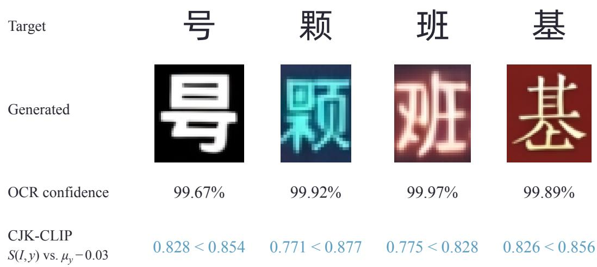

Figure 7: Correct recognition does not imply correct glyphs. OCR confidently transcribes these malformed glyphs as the targets above, CJK-CLIP similarity scores fall below their respective acceptance thresholds $\mu _ { y } - 0 . 0 3$ , yielding Error decisions consistent with human annotations.

get; blank or multi-character outputs count as errors. OCR Acc measures recognizability, whereas Pass additionally tests glyph fidelity.

Figure 7 illustrates stroke errors missed by high-confidence OCR recognition. All four glyphs are transcribed as their targets with confidence between 99.67% and 99.97%, yet fail the CJK-CLIP criterion, consistent with the human error annotations.

Metrics. Pass, R@1, and OCR Acc on Text Refinement Bench, and sentence accuracy (Acc) on AnyText, are reported as percentages. LPIPS uses AlexNet on full images resized to 256 × 256. Chinese AnyText OCR scores use a common set of vertical text boxes and symbol-width equivalence rules.

AnyText evaluation corrections. Some original polygons do not accurately cover the text, so direct cropping can truncate glyphs or include neighboring content. We review the character boxes and use the corrected regions for vertically arranged Chinese text. Characters are cropped in top-tobottom reading order, kept upright, and concatenated horizontally before OCR, avoiding recognition errors caused by rotating the entire vertical line. All compared Chinese methods use the same reviewed annotations and recognition preprocessing; horizontal text retains the original line-level crops.

Input settings. For AnyText ZH, we evaluate the four Chinese-capable baselines with both the official line polygons and the character regions supplied to PixText. For each method, the main table reports the complete run with higher sentence accuracy: character input for AnyText and line input for AnyText2, FLUX-Text, and TextFlux. NED, FID, and LPIPS come from that same run. TextDiffuser, TextCtrl, UDiffText and DiffSTE do not support Chinese target conditioning in the evaluated official checkpoints. We therefore report their AnyText English results on all 1,000 images and 4,181 lines, and mark AnyText ZH and the Chinese-containing Text Refinement Bench as unsupported. UDiffText uses crop-based editing with polygon-restricted compositing; DiffSTE uses a 256-pixel working canvas and sequential target editing. Dashes indicate unsupported settings.

Table 4 shows that all four Chinese-capable baselines can use character-level targets. AnyText improves from 65.87% to 66.54% Acc with character input; the other three baselines achieve higher Acc with their line inputs. Reporting the stronger setting for each method preserves its complete text and image metrics while making the input choice explicit.

Computational cost. GPU-s/img is the summed GPU generation time divided by the number of images. Batch sizes are chosen to keep GPU compute units fully occupied throughout generation.

Grid-aligned crop

Table 4: AnyText ZH with official line inputs and PixText’s character-level inputs. All rows use the same 1,000-image benchmark and 2,092-line scoring protocol. The input with higher sentence accuracy (Acc) is marked ⋆ and supplies all four metrics in the main table; metrics are never selected independently.
<table><tr><td>Method</td><td>Input</td><td>Acc (%)↑</td><td>NED↑</td><td>FID↓</td><td>LPIPS↓</td></tr><tr><td>AnyText</td><td>Line</td><td>65.87</td><td>0.8629</td><td>21.71</td><td>0.0891</td></tr><tr><td rowspan="2">AnyText2</td><td>Character*</td><td>66.54</td><td>0.8607</td><td>22.29</td><td>0.0949</td></tr><tr><td>Line*</td><td>78.06</td><td>0.9112</td><td>28.89</td><td>0.1407</td></tr><tr><td rowspan="2">FLUX-Text</td><td>Character</td><td>71.94</td><td>0.8948</td><td>28.52</td><td>0.1353</td></tr><tr><td>Line*</td><td>80.93</td><td>0.9233</td><td>12.22</td><td>0.0498</td></tr><tr><td rowspan="2">TextFlux</td><td>Character</td><td>78.49</td><td>0.9191</td><td>12.34</td><td>0.0562</td></tr><tr><td>Line*</td><td>65.06</td><td>0.8551</td><td>12.82</td><td>0.0576</td></tr><tr><td></td><td>Character</td><td>63.81</td><td>0.8493</td><td>13.11</td><td>0.0614</td></tr></table>

Parameter counts include the generation network, VAE, and text encoders. Generation networks include control branches and unmerged adapters.

On one NVIDIA H800, we time batch-one requests for 32 evenly spaced images from Text Refinement Bench, with two warm-up runs per implementation and three measurements per image. PixText + MeanFlow averages 1.152 s per request; batching the conditional and unconditional CFG branches reduces this to 1.062 s (7.8% faster). Even with one image per request, PixText + Mean-Flow remains faster than all compared baselines, whose lowest amortized cost is 3.126 GPU-s/img.

## E COMPACT CROPS AND TOKEN SAVINGS ENABLED BY CCPE

CCPE allows item crops to start independently of the main-image patch grid; only their width and height must be multiples of the patch size. Compared with expanding each text box outward to grid boundaries, this reduces the extra border area included for alignment. Figure 8 illustrates both crops for the same text region.

We compare the two crop choices on 116,038 text regions from 5,000 images randomly sampled from our training dataset, using a patch size of 16 pixels. Grid alignment requires 2,923,250 item tokens, whereas CCPE requires 2,523,979, a reduction of 13.7%. Both cover the same target text; the savings come from tighter crops.

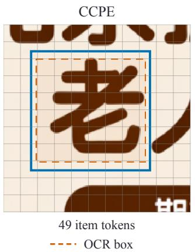

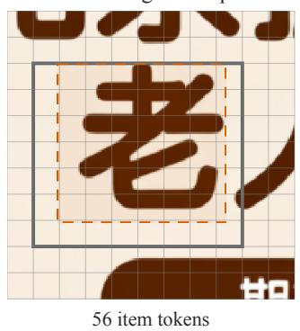

13.7% fewer tokens  
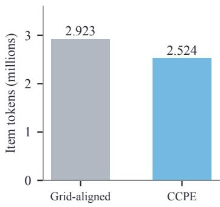  
5,000 images; 116,038 crops

Figure 8: CCPE reduces crop padding. Left and middle: the same text region with two crop boundaries; orange dashed boxes mark the original OCR regions, and the background grid has 16-pixel spacing. Right: total item tokens across 116,038 text regions.

## F DATA PREPARATION AND SAMPLING DETAILS

Data preparation. We use CRAFT to obtain text regions and PaddleOCR to recognize their contents for constructing the glyph conditions used in training (Baek et al., 2019; Cui et al., 2025).

Timestep scheduling. This ablation uses an earlier model. It is trained for 340k steps at 512 resolution and then 120k steps at 1024. Both branches start from the same initial checkpoint using its EMA weights and sample either $t = \mathrm { s i g m o i d } ( - 0 . 8 + 0 . 8 \epsilon ) , \epsilon \sim \mathcal { N } ( 0 , 1 )$ , or $t \sim \mathcal { U } ( 0 , 1 )$ , with timestep shifting disabled. Both use an effective global batch of 32 and are evaluated after 5k and 10k continuation updates. The learning rate is $1 0 ^ { - 4 }$ and EMA decay is 0.9999; the optimizer, 2kstep warmup, and data-sampling progress restart. The plotted horizontal axis counts continuation updates only.

MiniT2I comparison. We compare the official MiniT2I-B/16 logit-normal-fine-tuned checkpoint with the EMA from 40k uniform fine-tuning updates starting from released pretrained weights. The official fine-tuning configuration also specifies 40k updates. Evaluation uses 50 paired prompts and noise seeds at $5 1 \bar { 2 } \times 5 1 \bar { 2 } .$ , 100 Euler steps, and CFG 2.5, with five inference schedules matched between models. Inference timesteps are constructed as $t = u / [ \alpha + ( 1 - \alpha ) u ]$ , where u is a uniform grid on [0, 1]. Setting $\alpha = 1$ leaves the grid unchanged; α > 1 shifts interior timesteps toward the noise endpoint $\left( t \right) = \left. 0 \right)$ , and $\alpha \ : < \ : 1$ toward the data endpoint $( t \ = \ 1 )$ . We use the same normalized boundary-gradient metric and 20,000 paired prompt-bootstrap resamples. Without inference shifting, the score decreases from 1.2419 to 1.1511; the paired difference is −0.0908 with a 95% interval of [−0.1194, −0.0619]. All five schedules have paired intervals below zero.

Paired statistics. For PixText, the uniform-minus-logit-normal difference is −0.0573 at 5k updates, with a 95% interval of $\left[ - 0 . 0 7 3 3 , - 0 . 0 3 9 4 \right]$ , and −0.0445 at 10k, with an interval of [−0.0703, −0.0184]. Confidence intervals are computed by paired bootstrap over evaluation images.

Grid-artifact measurement. Following the adjacent RGB-gradient probe described in the miniT2I blog,3 we use the following explicit normalization. Let $\mathcal { E }$ contain all horizontal and vertical adjacent pixel pairs in a crop, let $\mathcal { E } _ { 1 6 }$ contain those crossing a 16-pixel patch boundary, and let $g _ { e }$ be the mean absolute RGB difference of pair e. We define

$$
S ( I ) = \frac { \mathrm { m e a n } _ { e \in { \mathscr { E } _ { 1 6 } } } g _ { e } } { \mathrm { m e a n } _ { e \in { \mathscr { E } _ { \delta } } } g _ { e } } .\tag{13}
$$

We evaluate 128 images from the fixed Text Refinement Bench list, with fixed target text and noise seeds. All checkpoints use EMA weights, BF16, 25 unshifted Euler steps, and CFG 2.2 active on [0.1, 1.0]. We measure 8-bit RGB crops at their original resolution before resizing or compositing. Applying the minimum height and width of 32 pixels leaves 297 crops from 126 images. Scores are averaged over crops within each image, then equally over images; confidence intervals use 4,000 paired image-bootstrap resamples. Source crops are scored identically as a content reference.

Sampling endpoint. We fix the model weights, validation samples, and noise seeds, and compare two final updates on identical 50-step Heun trajectories. Sampling uses BF16, CFG 2.2 active on [0.1, 1.0], and no timestep shifting. The baseline converts predictions to velocity using the denominator max $( 1 - t , 0 . 0 5 )$ ; the alternative returns the guided clean prediction only at the final step. For the final transition from t = 0.98 to 1, the step size is 0.02, while the velocity denominator remains clamped to 0.05. The baseline therefore moves only $0 . 0 2 / 0 . 0 5 = 4 0 \%$ of the way from $x _ { t }$ toward the clean prediction, yielding $x _ { \mathrm { n e x t } } = 0 . 6 x _ { t } + 0 . 4 \hat { x } _ { 1 }$ . The final output thus retains a 60% contribution from the current noisy state instead of fully reaching the clean prediction, explaining the residual speckle. Returning ${ \hat { x } } _ { 1 }$ directly completes this final denoising update. Figures 9 and 10 supply four additional cases.

Speckle visualization. We compute the mean absolute RGB difference between each full output and its Gaussian-smoothed version, then extract the same region for visualization. The Gaussian

High-frequency magnitude 0 4 8+

Scene context

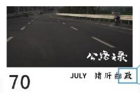

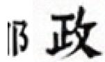  
Clamped update (JiT/MiniT2I)  
Close-up

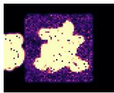  
High-frequency

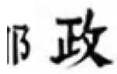  
Clean endpoint (Ours)  
Close-up

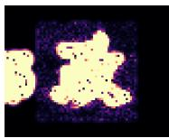  
High-frequency

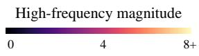  
Scene context

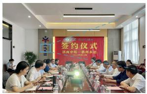  
Clamped update (JiT/MiniT2I)  
High-frequency magnitude 0 4 8+

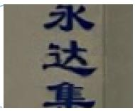  
Close-up

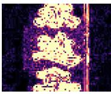  
High-frequency  
Clean endpoint (Ours)

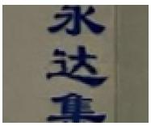  
Close-up

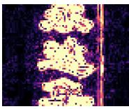  
High-frequency  
Scene context

Figure 9: Additional endpoint-update comparisons. Each row shows scene context on the left and a close-up with its high-frequency map for each update on the right. Both maps share the color scale below the scene.

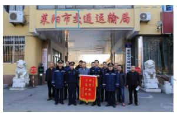  
Clamped update (JiT/MiniT2I)

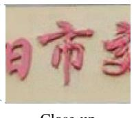  
Close-up

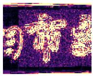  
High-frequency

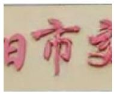  
Clean endpoint (Ours)  
Close-up

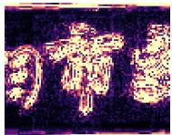  
High-frequency  
Scene context

  
Clamped update (JiT/MiniT2I)

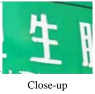  
Figure 10: Additional endpoint-update comparisons (continued), with the same layout as Figure 9.

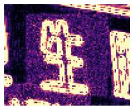  
High-frequency

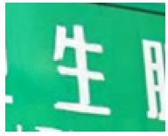  
Clean endpoint (Ours)  
Close-up

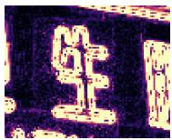  
High-frequency

standard deviation is one native pixel; both maps share a linear range of 0–8 in 8-bit RGB units, with larger values saturated. The maps visualize local high-frequency content, including text edges and fine background fluctuations. The displayed output images are unfiltered.

## G ADDITIONAL QUALITATIVE COMPARISONS

Figures 11–15 present fourteen additional qualitative comparisons involving small text, varied stroke styles, perspective, and textured backgrounds. The figures compare the same seven methods as Figure 6. Each two-row group shows an annotated target region, the requested text, and the corresponding input and method outputs, with identical crop coordinates and display scales across methods.

  
Figure 11: Additional qualitative comparisons of different methods (1/5).

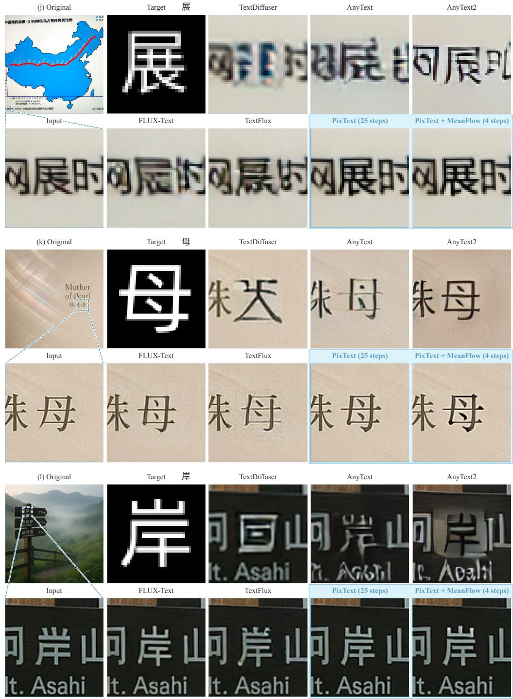  
Figure 12: Additional qualitative comparisons of different methods (2/5), using the same panel order, crop coordinates, and display scales as Figure 11.

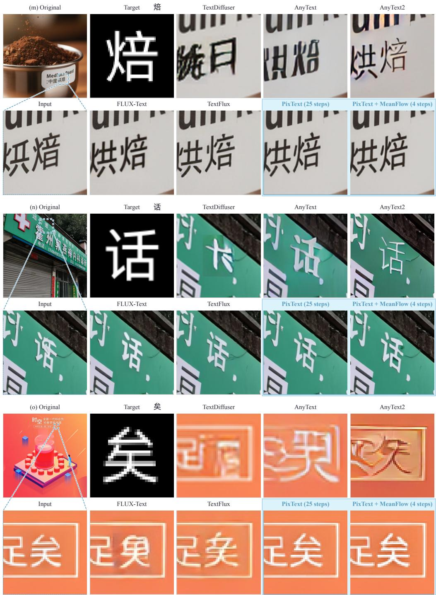  
Figure 13: Additional qualitative comparisons of different methods (3/5), using the same panel order, crop coordinates, and display scales as Figure 11.

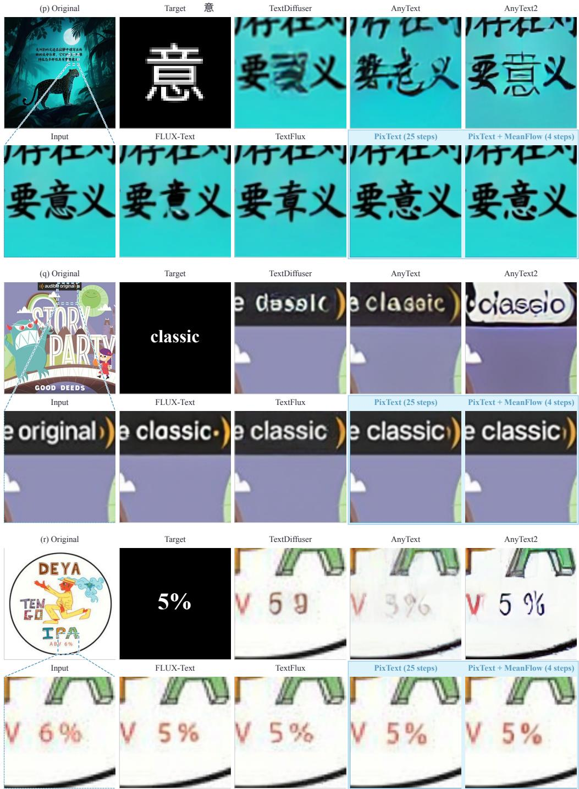  
Figure 14: Additional qualitative comparisons of different methods (4/5), using the same panel order, crop coordinates, and display scales as Figure 11.

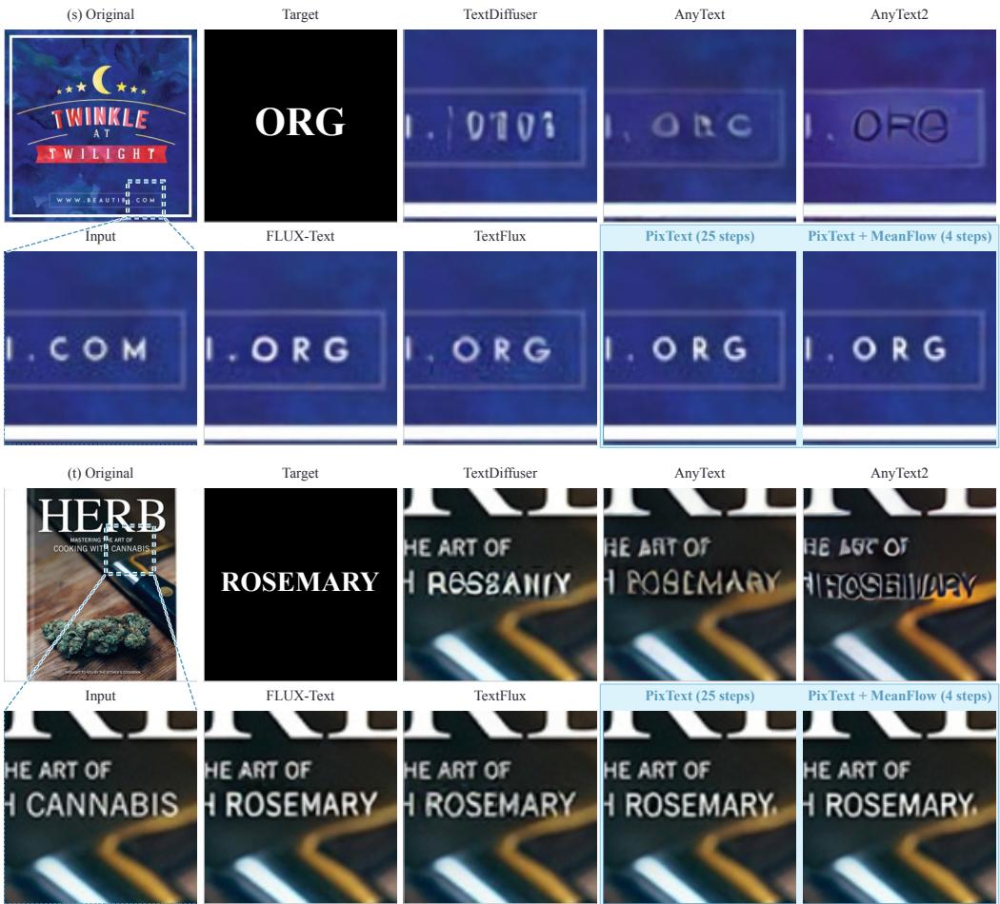  
Figure 15: Additional qualitative comparisons of different methods (5/5), using the same panel order, crop coordinates, and display scales as Figure 11.

Original text region

## H GENERATION BEYOND THE MAIN TRAINING SCRIPTS

Although PixText is trained primarily on Chinese and English data, glyph conditions directly describe the visual shapes of target characters, providing a natural representation for specifying other characters. In the examples shown in Figure 16, the model follows the supplied glyphs to generate the target content while retaining adjacent text and background. These qualitative results suggest the potential of glyph conditioning for generation beyond the main training scripts.

Source image

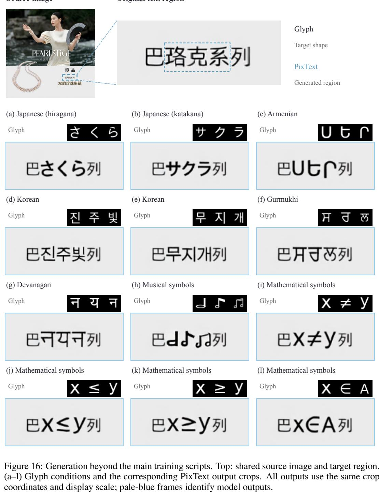

## I COMPARISON WITH QWEN-IMAGE-3.0-PRO

We compare PixText and PixText + MeanFlow with Qwen-Image-3.0-Pro on the same 1,034-image Text Refinement Bench used in the main results. The API receives each full image and all its repair targets in one bounding-box text prompt. It returns 1,027 edited images and refuses to generate edited outputs for the remaining seven inputs; their 11 repair targets count as failures in the textaccuracy metrics.

Both PixText variants achieve substantially higher text accuracy and better image preservation than the API. This shows that even an advanced image-editing model can remain unreliable for precise, localized text repair.

Table 5: Comparison on the same 1,034 images and 2,638 repair targets. Targets in the seven cases where the API refused generation count as failures for Pass, R@1, and OCR Acc; image metrics use returned images.
<table><tr><td>Method</td><td>Images</td><td>Pass↑</td><td>R@1↑</td><td>OCR Acc↑</td><td>FID↓</td><td>LPIPS↓</td></tr><tr><td>PixText</td><td>1034/1034</td><td>83.06%</td><td>92.95%</td><td>94.66%</td><td>0.34</td><td>0.0010</td></tr><tr><td>PixText + MeanFlow</td><td>1034/1034</td><td>81.84%</td><td>92.57%</td><td>94.58%</td><td>0.38</td><td>0.0011</td></tr><tr><td>Qwen-Image-3.0-Pro</td><td>1027/1034</td><td>28.17%</td><td>60.92%</td><td>70.13%</td><td>7.39</td><td>0.0188</td></tr></table>