# A DIAGNOSTIC STUDY OF WORLD-SPACE HUMAN RECOVERY UNDER HIGH CAMERA DYNAMICS

Hao-Jen Chien National Yang Ming Chiao Tung University hjchien90190@nycu.edu.tw

Wei-Lun Chao Boston University chao209@bu.edu

Yu-Lun Liu National Yang Ming Chiao Tung University yulunliu@cs.nycu.edu.tw

Project page: https://chien90190.github.io/worldhmr-fastcam-website/

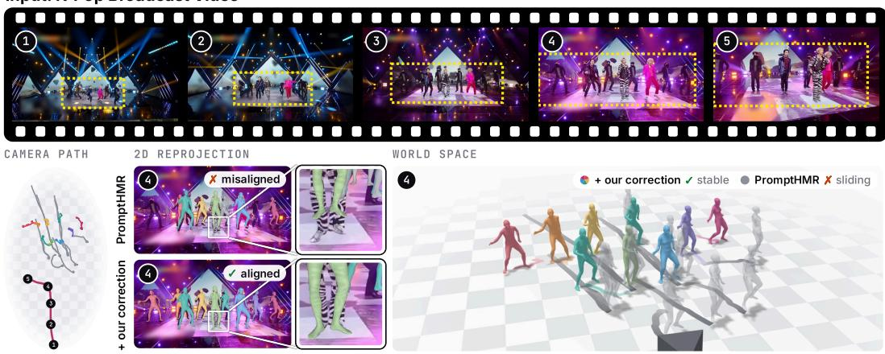  
Figure 1: World-space drift under high camera dynamics takes the form of a scale mismatch between camera and human translation. As the camera pushes toward the K-Pop performers (top, bottom left), PromptHMR (Wang et al., 2025) produces misaligned image-space reprojection (bottom middle) and worldspace trajectories that drift severely toward the camera (gray, bottom right). We trace this drift to how camera and human translations are combined. Each is recovered at its own scale, so a mismatch between the two lets camera motion contaminate human trajectories. Applied to existing backends, our closed-form correction estimates this mismatch and recovers stable trajectories and accurate reprojection (colored), with performers staying close to their stage positions.

## ABSTRACT

Monocular world-space human recovery methods excel on current benchmarks, but these rarely include fast camera motion. We introduce the K-Pop stress test, broadcast dance videos that combine fast, large camera motion with dense multiperson choreography. Leading methods produce plausible per-frame meshes on these videos, yet their world-space trajectories drift far from the performers’ stage positions. Through a systematic diagnosis, we show that the camera and human estimates each remain self-consistent, and that the drift appears when they are combined at mismatched scales. Each is recovered at its own scale, so a mismatch between the two can turn camera motion into human drift that grows with camera displacement and becomes severe in broadcast dance videos. We derive a closedform correction that estimates this mismatch and applies one scale to all performers, removing the drift while keeping their relative positions in one shared world frame. It requires no retraining and works with existing backends. Combined with physical constraints, the correction yields stable world-space reconstruction for choreography modeling, scene editing, data generation, and virtual reshooting.

EMDB slow camera (0.5 body heights/s), 1 person  
K-Pop broadcast fast camera (2.1 body heights/s), 8 people  
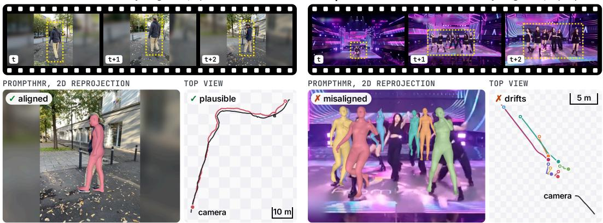  
Figure 2: World-space recovery that succeeds on existing benchmarks fails under high camera dynamics. On EMDB (Kaufmann et al., 2023) (left), PromptHMR (Wang et al., 2025) recovers an accurate trajectory with aligned reprojection. On K-Pop broadcast video (right), its trajectories drift in the top view, and its meshes misalign in the reprojection. As the yellow boxes show, apparent size stays nearly constant on EMDB but changes rapidly under broadcast camera motion. Existing benchmarks seldom cover this regime, let alone combined with dense multi-person choreography.

## 1 INTRODUCTION

Recovering humans in world space (Yuan et al., 2022; Shin et al., 2024; Sun et al., 2023; Shen et al., 2024; Wang et al., 2025) from video is a central problem in computer vision, with applications in motion analysis, animation, and data generation. It requires estimating both human motion and camera motion. Recent approaches follow two main paradigms. The first directly predicts worldspace motion from features such as pose and motion dynamics (Yuan et al., 2022; Sun et al., 2023; Shin et al., 2024; Li et al., 2022a; Shen et al., 2024). The second is compositional, combining estimated camera poses with camera-space human positions through a rigid transform (Wang et al., 2024a; 2025). Supported by strong visual odometry and human mesh recovery models, compositional methods perform well on existing benchmarks, including 3DPW (Von Marcard et al., 2018), RICH (Huang et al., 2022), and EMDB (Kaufmann et al., 2023), which span diverse human motions but mostly moderate camera motion (Figure 4).

Given this success, we ask whether compositional methods generalize to in-the-wild video beyond existing benchmarks. Commercial broadcast video, such as K-Pop performances, is one such setting, characterized by high camera dynamics, wide framing, and dense multi-person choreography. Recovering accurate world-space humans from such video would enable choreography modeling, scene editing, virtual reshooting, and data collection for training end-to-end methods. Surprisingly, when we test compositional methods on various K-Pop broadcast videos, performer trajectories drift severely in world space and become misaligned in image space (Figure 2).

To localize this failure, we first ask whether the visual odometry or the human mesh recovery model fails. We find that camera estimation remains self-consistent under a time-reversal test (Huang et al., 2025), and that camera-space pose estimates remain visually plausible across frames. With both passing, we turn to the step that joins them. In monocular video, camera translation and cameraspace human position are each recovered up to their own scale, yet composition treats the two scales as equal. We hypothesize that a mismatch between them makes camera motion appear as world space human motion, causing the drift. Such a mismatch would also explain why both checks pass, since each estimate stays self-consistent under any scale shared across the clip.

To test this hypothesis without world-space ground truth, which broadcast video lacks, we examine intervals where performers remain visibly stationary. Their true world-space displacement is ideally zero, so any recovered displacement reflects the composition rather than performer motion. In these intervals across K-Pop broadcast videos, we observe drift that follows the camera path (Figure 3), supporting our hypothesis. We further find that this drift grows with camera displacement, which is why it stays small under the moderate camera motion of existing benchmarks.

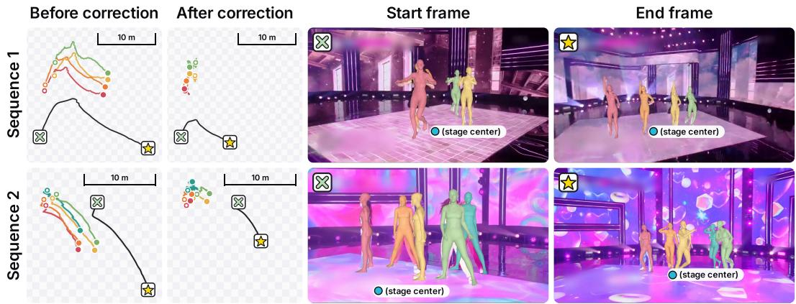  
Figure 3: Performer trajectories before and after drift correction. Left: World-space performer trajectories (colored) and the camera path (black) in the x-z plane, with the camera’s start (crossed box) and end (star). Before correction, the trajectories follow the camera’s sweep; after, they do not. Tiles are 1 m. Right: Start and end frames, with the stage center marked. Camera-space mesh overlays stay plausible despite the world-space drift.

Because the drift and the camera displacement are both observable in these stationary intervals, we solve for the scale mismatch in closed form. The resulting correction applies one scale to the camera and all performers, removing camera-induced drift while preserving the performers’ relative positions in one shared world frame. It requires no retraining and transfers across backbones. Combined with physically grounded optimization, our method yields stable world-space reconstruction and accurate image-space reprojection for all performers (Figure 1). Against fixed venue cameras that recorded the same performances, our method recovers the closest world scale.

Our contributions are threefold. (1) We introduce the K-Pop stress test, a set of broadcast dance videos with high camera dynamics and dense choreography that existing benchmarks do not cover. (2) We show that compositional methods fail in this regime through a scale mismatch between independently estimated camera and human translations. (3) We derive a closed-form correction that removes this mismatch across backbones without retraining.

## 2 RELATED WORK

From camera-space to world-space human motion. World-space recovery emerged as the central open problem following video-based HMR. One line infers world-space motion from local cues such as gait and pose dynamics (Yuan et al., 2022; Sun et al., 2023; Shin et al., 2024; Li et al., 2022a), but this local-to-global mapping is inherently ambiguous when motion priors do not match the scene, for example a subject dancing in place. A second line jointly optimizes camera trajectory, human motion, and scale via SLAM (Ye et al., 2023; Kocabas et al., 2024; Henning et al., 2022; 2023). Recent work couples gravity-aware coordinates or absolute depth with camera estimation (Shen et al., 2024; Yin et al., 2024; Yao et al., 2023), and TRAM (Wang et al., 2024a) composes camera-space humans into a metric world frame using masked DROID-SLAM (Teed & Deng, 2021) with metric scene depth, a pattern followed at larger scale by PromptHMR (Wang et al., 2025). We follow this staged-composition family but identify the camera–human scale mismatch as the dominant failure mode under high camera dynamics, a regime where these methods systematically degrade despite producing plausible camera-space meshes on existing benchmarks (Von Marcard et al., 2018; Kaufmann et al., 2023; Huang et al., 2022). For more related work, see Appendix A.

## 3 BACKGROUND AND EXISTING GAP

Human mesh recovery (HMR). An HMR model estimates a parametric 3D human body from image observations, typically using SMPL (Loper et al., 2023) or its expressive extension SMPL-X (Pavlakos et al., 2019), which map shape and pose parameters to a dense mesh. Given a video, the model predicts these parameters per frame along with a root translation that places the pelvis in camera space, a coordinate frame that moves with the camera. Recent methods compose these camera-space estimates with visual odometry to recover world-space motion (Wang et al., 2024a; 2025). We adopt and study this compositional paradigm.

(a) Camera profile statistics
<table><tr><td>Metric</td><td>K-Pop</td><td>EMDB</td><td>WorldPose</td><td>Implication</td></tr><tr><td>Speed (body/s)</td><td>1.15</td><td>0.20</td><td>0.14</td><td>Higher average camera motion.</td></tr><tr><td>Max speed (body/s)</td><td>2.84</td><td>0.48</td><td>0.34</td><td>More extreme motion bursts.</td></tr><tr><td>Alignment (deg)</td><td>3.64</td><td>9.48</td><td>6.02</td><td>Tighter subject centering.</td></tr><tr><td>Distance (body)</td><td>4.88</td><td>1.58</td><td>27.48</td><td>Wider framing than single-person capture.</td></tr><tr><td>Acceleration/speed (1/s)</td><td>1.94</td><td>1.10</td><td>0.96</td><td>More abrupt motion changes relative to speed.</td></tr></table>

(b) Dataset statistics  
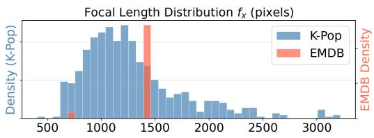

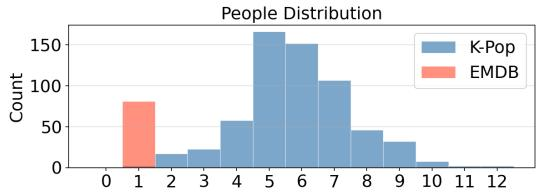  
Figure 4: The K-Pop stress test has faster, more abrupt camera motion than EMDB (Kaufmann et al., 2023) and WorldPose (Jiang et al., 2024), and denser scenes than EMDB. (a) K-Pop cameras move about 6 to 8 times faster on average. The unit body is one body length, making the three sets comparable despite different framing. (b) The stress test spans a broader focal-length range and up to 12 performers per frame, against EMDB’s near-single-person clips.

Visual odometry (VO). Given a monocular video, visual odometry estimates camera motion from image observations, producing a sequence of camera poses $( R _ { i } , T _ { i } ) \in S O ( 3 ) \times \mathbb { R } ^ { 3 }$ , where $R _ { i }$ and $T _ { i }$ denote the camera-to-world rotation and translation at frame i relative to a fixed world frame. Because the video is monocular, the recovered translation is defined only up to an unknown scale.

World-space composition. Recovering humans in world space from monocular video combines the above two independent estimates through a rigid transform,

$$
W _ { i } = R _ { i } { \bf X } _ { i } + T _ { i } ,\tag{1}
$$

where $\mathbf { X } _ { i } \in \mathbb { R } ^ { 3 }$ is the camera-space position of a tracked body point. We track the feet in our analysis because they remain in contact with the ground while the pelvis can move.

Existing benchmarks lack high camera dynamics. Benchmarks for world-space human recovery, including 3DPW (Von Marcard et al., 2018), RICH (Huang et al., 2022), and EMDB (Kaufmann et al., 2023), provide ground-truth trajectories from IMUs, electromagnetic sensors, or multi-view rigs, but primarily contain everyday, moderate camera motion. Synthetic benchmarks (Patel et al., 2021; Black et al., 2023; Tesch et al., 2025) expand body and appearance variation but rely on simulated camera trajectories that do not capture the large displacements and rapid motion changes of broadcast video. Therefore, existing benchmarks leave the robustness of Eq. 1 under sustained high camera dynamics largely untested. We address this gap with the K-Pop stress test in Section 4.

## 4 THE K-POP STRESS TEST

To evaluate world-space human recovery under high camera dynamics and dense multi-person choreography, we construct the K-Pop stress test from broadcast dance videos. We select publicly available clips with sufficient performer visibility and keep those whose camera trajectories pass the time-reversal test of Section 5, so that every clip starts from a self-consistent camera estimate (Appendix F). The resulting 616 clips contain 59.19k frames and 336.87k pose instances with up to 12 performers per frame (Figure 4, Appendix Table 5), and we use them only for evaluation.

Paired-camera reference set. Broadcast video provides no world-space ground truth. For direct evidence, we build a reference from performances also filmed by a fixed venue camera. The venue camera barely moves and keeps the whole group in view, so its reconstruction, which we obtain with PromptHMR (Wang et al., 2025), is largely free of camera-induced drift and covers every performer. We hand-match 11 time-synchronized pairs covering 989 frames and 78 performers, over which the broadcast camera translates, zooms, and crops performers out of frame (Figure 13). We report Ratio, the single scale that best fits a method’s world-space positions to the reference over the clip (1 is perfect, and below 1 means too large), alongside WA-MPJPE, W-MPJPE, and PA-MPJPE. Pair Distance (the mean error in inter-performer distance) and Formation Error (the RMSE of the floor-plane arrangement) measure relative geometry alone, testing the shared world frame.

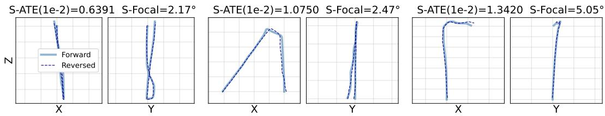  
Figure 5: ViPE (Huang et al., 2025) camera trajectories on K-Pop clips remain self-consistent under the time-reversal shuttle test. Each clip is shown as a top-down view on the ground plane (x against z) and a side view against vertical height (y against z). The solid line is the forward pass and the dashed line the reversed pass, after a single similarity alignment. The rightmost panel is near at the K-Pop mean S-ATE of 1.35.

Proxy metrics. On all 616 clips without reference, we measure reprojection against 2D keypoints from YOLO11n-Pose (Jocher & Qiu, 2024) and masks from Mask2Former (Cheng et al., 2021), independent of the ViTPose (Xu et al., 2022) detections our optimization fits. We report PCK (keypoints within 15% of body height) and Mask IoU. For world-space stability, we report Jitter (temporal instability of joint positions from third-order finite differences) and Foot Skating (per-frame displacement of foot joints while feet are within 50 mm of the ground plane).

## 5 DIAGNOSTIC ANALYSIS OF COMPOSITIONAL METHODS

We run state-of-the-art compositional methods (Wang et al., 2024a; Shen et al., 2024; Wang et al., 2025) on the stress test. They exhibit severe world-space drift that follows camera ego-motion rather than random noise or occasional estimation error (Figure 8, Figure 3, left; Table 2), suggesting a structural cause. World space is recovered by composing two estimates (Eq. 1), so we examine each estimate alone and then their composition.

(1) Camera-space HMR examination. One explanation is that the HMR model becomes unreliable under broadcast conditions, where performers are small in frame, densely arranged, and rapidly changing in apparent size. On K-Pop broadcast video, however, camera-space meshes remain plausible across frames, even during rapid reframing and large apparent-size changes (Figure 3), consistent with the strong benchmark performance of recent video-based HMR methods (Table 4). We observe no frame-to-frame failure of camera-space HMR in these overlays.

(2) Visual odometry examination. A second explanation is that visual odometry degrades under fast motion, changing backgrounds, and frequent reframing of broadcast video. Without groundtruth trajectories, we measure pose quality with a time-reversal shuttle test (Huang et al., 2025), processing each clip forward and backward and aligning the two trajectories with a single similarity transform. Shuttle Absolute Trajectory Error $( \mathrm { S } { \cdot } \mathrm { \bar { A } T E } , \ \times 1 0 ^ { - 2 }$ , normalized by trajectory length) measures the root-mean-square positional deviation between them, and Shuttle Focal Error (S-Focal) measures the field-of-view discrepancy in degrees between the two estimated focal lengths. We use OpenDV, a ViPE test set of smooth, forward-dominant dashcam video, as the reference for accepted pose quality, and keep only K-Pop clips whose shuttle errors are comparable to it (Appendix F). The final clips reach an S-ATE of 1.35 and an S-Focal of 3.39 degrees, against 1.05 and 4.26 on OpenDV (Figure 5), so their camera estimates are self-consistent.

(3) Composition examination. Neither test can see an error shared across a whole clip. A depth bias common to all frames leaves mesh overlays unchanged, and a scale error shared by the forward and backward passes leaves them consistent. Such an error would surface only when the two estimates are composed, since the camera translation $T _ { i }$ and camera-space position $\mathbf { X } _ { i }$ are estimated independently and their scales can disagree. For a body point p between frames i and j, Eq. 1 gives

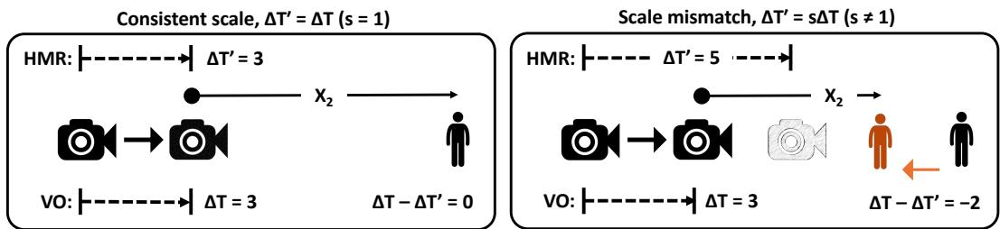  
Figure 6: Scale mismatch turns camera motion into world-space drift. VO and HMR give two estimates of the same camera translation, $\Delta T$ and $\Delta T ^ { \prime } \left( \mathrm { E q . } \ 3 \right)$ . If they agree, the static performer stays in place (left). If $\Delta T ^ { \prime } = s \Delta T$ with $s \neq 1$ , the performer drifts by $( 1 - s ) \Delta T$ (right). HMR sees the performer’s distance shrink by 5, but VO moves the camera by only 3. To keep the 5-unit shrink, composition moves the static performer to the orange position, 2 units closer to the camera. $\mathbf { X } _ { 2 }$ is the performer’s camera-space position after the camera moves.

$$
\Delta \hat { W } _ { p , i j } = R _ { i } \mathbf { X } _ { p , i } - R _ { j } \mathbf { X } _ { p , j } + \Delta T _ { i j } , \qquad \Delta T _ { i j } = T _ { i } - T _ { j } .\tag{2}
$$

The term $R _ { i } { \bf X } _ { p , i }$ is the performer’s position relative to the camera in world space, so its change combines the performer’s own world-space motion $\Delta W _ { \mathrm { o b j } , p , i j }$ with the camera displacement implied by the camera-space estimates, $\Delta T _ { i j } ^ { \prime }$ . Writing $R _ { i } \mathbf { X } _ { p , i } - R _ { j } \mathbf { \bar { X } } _ { p , j } = \Delta W _ { \mathrm { o b j } , p , i j } - \Delta T _ { i j } ^ { \prime }$ gives

$$
\Delta \hat { W } _ { p , i j } = \Delta W _ { \mathrm { o b j } , p , i j } + \Delta T _ { i j } - \Delta T _ { i j } ^ { \prime } ,\tag{3}
$$

which holds for any camera rotation, with errors in the estimated rotation handled by the interval gates of Section 6. Here, visual odometry and HMR give two estimates of the same camera motion. When their scales agree, $\Delta T _ { i j }$ and $\Delta T _ { i j } ^ { \prime }$ cancel, and a mismatch leaves camera-induced drift (Figure 6). Eq. 3 alone cannot separate this mismatch from performer motion, and broadcast video has no world-space ground truth. We therefore turn to stationary intervals, where $\Delta W _ { \mathrm { o b j } , p , i j }$ ≈ 0. Modeling the mismatch as $\Delta T _ { i j } ^ { \prime } = s \Delta T _ { i j }$ , where $s = 1$ denotes consistent scale, we get

$$
\Delta \hat { W } _ { p , i j } \approx \left( 1 - s \right) \Delta T _ { i j } .\tag{4}
$$

This drift grows with camera displacement, so it stays small on existing benchmarks and becomes severe under broadcast camera work. Focal-length error and monocular depth ambiguity can produce the mismatch by affecting the two estimates differently (Figure 14, Appendix D.3). Prior work estimates this scale from background scene depth (Wang et al., 2024a) or absolute HMR joint depth (Yang et al., 2025; 2024). Both sides of $\operatorname { E q . }$ 4 are measurable, so we estimate s from relative displacements instead of absolute depth (Section 6).

Reprojection misalignment from drift. The scale mismatch explains the world-space drift, but not the observed image-space misalignment. Eq. 1 itself introduces no reprojection error because it can be exactly inverted using the same estimated camera pose. Misalignment instead arises during downstream optimization used by some pipelines to enforce physical plausibility. Large initial drift requires larger corrections, and the resulting non-convex optimization can converge to a physically plausible trajectory that is poorly aligned with the image. PromptHMR (Wang et al., 2025) performs such optimization and can therefore convert world-space drift into reprojection misalignment. TRAM (Wang et al., 2024a) does not and remains the unstable trajectory (Table 2, Figure 8).

## 6 CLOSED-FORM SOLUTION DERIVATION

Eq. 4 turns the diagnosis into an estimator, relating the observed world-space drift directly to the relative scale s. We estimate s from stationary intervals by weighted least squares,

$$
\operatorname* { m i n } _ { s } \sum _ { p , i , j } w _ { p , i j } \left\| ( 1 - s ) \Delta T _ { i j } - \Delta \hat { W } _ { p , i j } \right\| ^ { 2 } ,\tag{5}
$$

Table 1: Ours is closest to the reference. Methods run on the broadcast view and are compared against the fixed-camera reference. Tracked counts recovered performers, and Ratio is defined in Section 4. HAC (Yang et al., 2025) shares our backbones. Red and orange mark the best and second-best results.
<table><tr><td>Method</td><td>Tracked (of 78) ↑</td><td>WA-MPJPE (cm) ↓</td><td>W-MPJPE (cm)↓</td><td>PA-MPJPE (cm) ↓</td><td>Pair dist. (cm) ↓</td><td>Formation (cm) ↓</td><td>Ratio → 1</td></tr><tr><td>TRAM (Wang et al., 2024a)</td><td>72</td><td>57.80</td><td>99.08</td><td>6.48</td><td>43.97</td><td>30.28</td><td>0.77</td></tr><tr><td>PromptHMR (Wang et al., 2025)</td><td>66</td><td>49.25</td><td>70.60</td><td>7.74</td><td>42.07</td><td>34.67</td><td>0.80</td></tr><tr><td>GVHMR (Shen et al., 2024)</td><td>65</td><td>62.64</td><td>68.16</td><td>8.76</td><td>50.67</td><td>53.72</td><td>0.64</td></tr><tr><td>HAC (Yang et al., 2025)</td><td>72</td><td>64.77</td><td>116.30</td><td>6.33</td><td>57.52</td><td>35.74</td><td>0.66</td></tr><tr><td>Ours</td><td>72</td><td>39.89</td><td>47.02</td><td>6.20</td><td>29.01</td><td>32.97</td><td>0.90</td></tr></table>

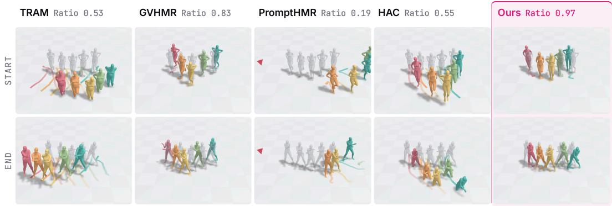  
Figure 7: A clip-level fit exposes sliding that single frames hide. Sliding or a misplaced performer spreads a method’s positions wider than the reference (gray), lowering its ratio even when one moment looks close. Rows show the first and last frames. TRAM (Wang et al., 2024a) and HAC (Yang et al., 2025) look the right size but slide, and one PromptHMR (Wang et al., 2025) performer lands meters away (arrow). Tiles are 1 m.

where $w _ { p , i j }$ reflects the confidence that the interval is stationary. The closed-form solution is

$$
s ^ { * } = 1 - \frac { \sum _ { p , i , j } w _ { p , i j } \Delta \hat { W } _ { p , i j } ^ { \top } \Delta T _ { i j } } { \sum _ { p , i , j } w _ { p , i j } \| \Delta T _ { i j } \| ^ { 2 } } .\tag{6}
$$

We apply the recovered scale to the visual odometry and world-space human translation,

$$
W _ { i } ^ { \mathrm { c o r r } } = R _ { i } \mathbf { X } _ { i } + s ^ { * } T _ { i } = W _ { i } - ( 1 - s ^ { * } ) T _ { i } .\tag{7}
$$

This removes camera-induced drift for all performers at once, preserving their relative positions in one shared world frame. We refine $s ^ { * }$ with a residual scale $\Delta s$ in the physically grounded optimization (PGO), which also enforces reprojection consistency, temporal smoothness, and inter-person separation (Appendix C).

Stationary interval detection. Eq. 6 requires negligible performer displacement. We identify candidate stationary intervals using foot-contact confidence and then reject intervals that show evidence of body motion or excessive rotational error. Recent HMR models (Shen et al., 2024; Wang et al., 2025) predict a per-joint contact confidence $c _ { p , t , k } \in [ 0 , 1 ]$ for person $p ,$ joint $k ,$ and frame t. We define the strongest foot contact in each frame over the foot joints C as

$$
\bar { c } _ { p , t } = \operatorname* { m a x } _ { k \in \mathcal { C } } c _ { p , t , k } .\tag{8}
$$

We retain an interval $\mathcal { T } _ { p , i j }$ when $\bar { c } _ { p , t }$ exceeds $\tau _ { c } = 0 . 5$ in at least a fraction $\alpha = 0 . 8$ of its frames. Foot contact alone does not guarantee that the performer is stationary, so we reject an interval if either (i) the person’s displacement is not aligned with camera motion $( | \cos ( \Delta \hat { W } _ { p , i j } , \Delta T _ { i j } ) | \leq 0 . 8 )$ since a stationary performer drifts only along the camera’s path $( \mathrm { E q . ~ 4 } )$ , or (ii) the expected rotational error dominates the translational signal, with a signal-to-noise ratio below 1.5 (Appendix D.1).

Table 2: On the K-Pop stress test, ours is in the top two on both world-space metrics. Red orange , and yellow mark the top three. TRAM (Wang et al., 2024a) and HAC (Yang et al., 2025) only rigidly transform, so their reprojection cannot reveal wrong scales. HAC is furthest from the reference (Table 1). TRAM is unstable; HAC skates 2.8× more on the same backbones; GVHMR (Shen et al., 2024) reprojects poorly; PromptHMR (Wang et al., 2025) drifts severely.
<table><tr><td rowspan="2">Method</td><td colspan="2">2D Reprojection</td><td colspan="2">3D World Space (mm)</td></tr><tr><td>PCK↑</td><td>Mask IoU ↑</td><td>Jitter ↓</td><td>Foot Skating ↓</td></tr><tr><td>TRAM (Wang et al., 2024a)</td><td>0.921</td><td>0.848</td><td>312.39</td><td>131.29</td></tr><tr><td>GVHMR (Shen et al., 2024)</td><td>0.210</td><td>0.524</td><td>30.46</td><td>31.57</td></tr><tr><td>PromptHMR (Wang et al., 2025)</td><td>0.802</td><td>0.581</td><td> $4 . 4 9 \times 1 0 ^ { 6 }$ </td><td> $8 . 9 1 \times 1 0 ^ { 5 }$ </td></tr><tr><td>HAC (Yang et al., 2025)</td><td>0.899</td><td>0.747</td><td>17.56</td><td>50.48</td></tr><tr><td>Ours</td><td>0.868</td><td>0.720</td><td>26.87</td><td>17.94</td></tr></table>

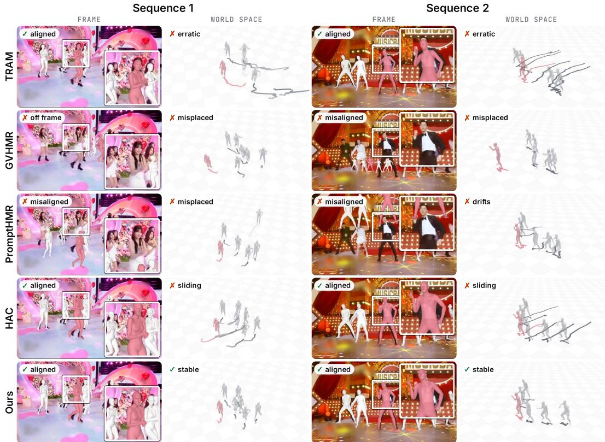  
Figure 8: Existing methods fail at 2D alignment, world-space stability, or both, while ours achieves both. Each method shows mesh reprojection, with a close-up, and world space with each performer’s path. One performer is in red. Tiles are 1 m. TRAM (Wang et al., 2024a) has erratic trajectories. GVHMR (Shen et al., 2024) misplaces performers in world space, and its reprojection leaves the frame or misaligns. PromptHMR (Wang et al., 2025) misaligns, misplaces, and drifts. HAC (Yang et al., 2025) aligns but slides. Ours keeps both. Video comparisons: https:// chien90190.github.io/worldhmr-fastcam-website/.

Surviving intervals are weighted by their mean contact confidence,

$$
w _ { p , i j } = \frac { 1 } { | \mathcal { T } _ { p , i j } | } \sum _ { t \in \mathcal { T } _ { p , i j } } \bar { c } _ { p , t } .\tag{9}
$$

Because contact is predicted in camera space before composition, selecting stationary intervals does not depend on the drift from which Eq. 6 recovers $s ^ { * }$ . A backbone without contact prediction can instead obtain contact confidence from a separate model, as for TRAM in Table 3 (Appendix B).

Table 3: Drift correction transfers across visual odometry and HMR backbones. Bold marks the better of each pair. †GVHMR in Table 2 keeps its own trajectory, aligned to DPVO (Teed et al., 2023) once per track, so per-frame camera noise does not enter and its jitter there is lower. ‡Contact confidence comes from PromptHMR-Vid, as TRAM predicts none. §TRAM (Wang et al., 2024a) only rigidly transforms camera-frame predictions, so reprojection returns the per-frame prediction, while its world-space motion inherits camera jitter and drift. On TRAM, our correction trades a small loss in 2D fit for a large gain in world-space stability.
<table><tr><td rowspan="2">HMR</td><td rowspan="2">Odometry</td><td colspan="2">2D Reprojection</td><td colspan="2">3D World Space (mm)</td></tr><tr><td>PCK (↑)</td><td>Mask IoU (↑)</td><td>Jitter (↓)</td><td>Foot Skating (↓)</td></tr><tr><td colspan="3">Original methods with their native odometry</td><td></td><td></td><td></td></tr><tr><td rowspan="3">PromptHMR (Wang et al., 2025) + drift correction</td><td rowspan="3">masked DROID-SLAM (Teed &amp; Deng, 2021)</td><td>0.802</td><td>0.581</td><td>4.49 × 106</td><td>8.91 × 105</td></tr><tr><td>0.859</td><td>0.720</td><td>27.53</td><td>18.65</td></tr><tr><td>0.921</td><td>0.848</td><td>312.39</td><td>131.29</td></tr><tr><td>+ drift correction‡</td><td></td><td>0.849</td><td>0.730</td><td>47.38</td><td>22.03</td></tr><tr><td colspan="2">Other backbones with drift correction</td><td></td><td></td><td></td><td></td></tr><tr><td colspan="2">PromptHMR-Vid ViPE (Huang et al., 2025)</td><td>0.868</td><td>0.720</td><td>26.87</td><td>17.94</td></tr><tr><td colspan="2">GVHMR</td><td>0.883</td><td>0.751</td><td>34.64†</td><td>22.89</td></tr><tr><td colspan="2">TRAM</td><td>0.858</td><td>0.738</td><td>46.92</td><td>20.75</td></tr><tr><td colspan="2">PromptHMR-Vid</td><td>0.868</td><td>0.706</td><td>26.88</td><td>18.22</td></tr></table>

Multi-person collision. Performers stand close together, so recovered meshes often interpenetrate. We penalize interpenetration and its rate of change with a temporal repulsion loss, which spreads corrections over nearby frames rather than a single frame (Appendix C).

Implementation. Unless otherwise specified, we use PromptHMR-Vid (Wang et al., 2025) as the HMR backbone and ViPE (Huang et al., 2025) as the visual odometry. See Appendix B for hyperparameter details. All experiments are conducted on a single NVIDIA RTX A6000 GPU.

## 7 EXPERIMENTS

We compare against TRAM (Wang et al., 2024a), GVHMR (Shen et al., 2024), PromptHMR (Wang et al., 2025), and HAC (Yang et al., 2025). PromptHMR and GVHMR predict metric-scale translation (Appendix B). GVHMR is single-person and does not compose with visual odometry, so we extend it with multi-person detection and rigid alignment at each track’s first frame. We run HAC, a scale estimator, on our backbones and average its per-person scales into one (Appendix B). The reference set tests scale directly (Table 1, Figure 7). Ours recovers a scale ratio closest to 1 and leads every baseline on WA-MPJPE, W-MPJPE, and Pair Distance, outperforming PromptHMR, which built the reference. On the full stress test, ours is the only method in the top two on both worldspace metrics (Table 2, Figure 8). Reprojection cannot reveal a wrong scale (Section 5). HAC, like TRAM, skips optimization and reprojects well while placing performers furthest from the reference. Table 3 shows gains across visual-odometry and HMR backbones.

## 7.1 ABLATION STUDY

Drift correction improves both reprojection and world space across all metrics (Figure 9(a), 100 most dynamic clips). PGO suppresses much of the drift on its own but leaves the scale mismatch in place, so stationary performers still creep across the scene until drift correction removes it (Figure 9(b)). Temporal repulsion reduces inter-performer penetration and keeps bodies separated in multi-person sequences (Figure 11, Appendix). Across 8 sequences and 3 baselines, 34 participants preferred our method on overall quality and camera motion in over 96% of comparisons (Appendix G).

Moderate camera motion. We evaluate on EMDB-2 to check that the correction does not severely degrade results under moderate camera motion. Against our reproduction of PromptHMR (Wang et al., 2025), we obtain W-MPJPE 415.03 versus 388.66 mm, WA-MPJPE 158.50 versus 139.65 mm, Jitter 21.18 versus 46.12 mm, and Foot Skating 8.79 versus 11.19 mm. We attribute the weaker trajectory metrics to small camera displacement, which leaves Eq. 6 little signal to estimate s from, while both physical plausibility metrics improve.

(a) PGO with vs. without drift correction on the 100 most dynamic K-Pop clips
<table><tr><td rowspan="2">Drift Correction</td><td colspan="2">2D Reprojection</td><td colspan="2">3D World Space (mm)</td></tr><tr><td>PCK↑</td><td>Mask IoU ↑</td><td>Jitter ↓</td><td>Foot Skating ↓</td></tr><tr><td>No</td><td>0.727</td><td>0.641</td><td>32.17</td><td>31.08</td></tr><tr><td>Yes</td><td>0.839</td><td>0.691</td><td>15.88</td><td>18.57</td></tr></table>

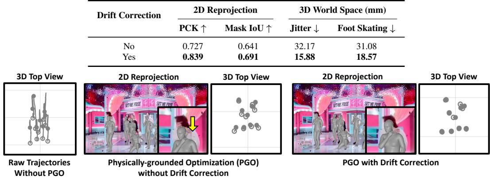  
(b) Stationary performers under raw trajectories, PGO alone, and PGO with drift correction

Figure 9: Drift correction is needed even with PGO. (a) Adding drift correction improves every metric. (b) For stationary performers, each top-view trajectory should collapse to a point. Raw trajectories drift far (left). PGO partially shortens the drift but leaves meshes misaligned (middle). With drift correction, positions stay fixed, and meshes align (right) (Appendix E.2).

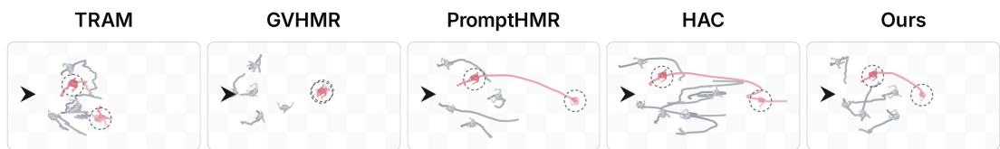  
Figure 10: Under long occlusion, our method places a performer meters behind the group, and the placement recovers once the occlusion ends. Each panel is a top view with the camera at the arrow. The circled performer (red) is shown during and after the occlusion. All panels share one scale. Tiles are 1 m. PromptHMR (Wang et al., 2025) and HAC (Yang et al., 2025) fail the same way. GVHMR (Shen et al., 2024) keeps the performer far. TRAM (Wang et al., 2024a) still jitters.

Failure case and limitations. A single scale per sequence moves the group rigidly, so it cannot repair a performer whose camera-space depth is already wrong, such as the occluded performer in Figure 10. Clips are already split at shot cuts (Appendix F), but a scale that varies within a shot is not represented (Table 7). Scale recovery inherits noise from upstream camera and HMR estimates.

## 8 CONCLUSION

World-space human recovery appears robust on existing benchmarks, whose cameras mostly move mildly. Under the broadcast camera work of our K-Pop stress test, we show that a scale mismatch between camera and human translation turns camera motion into world-space drift. Our closed-form correction removes this drift without retraining, giving stable trajectories across backends, and we hope this motivates broader evaluation and application under high camera dynamics.

## REFERENCES

Fabien Baradel, Matthieu Armando, Salma Galaaoui, Romain Bregier, Philippe Weinzaepfel,´ Gregory Rogez, and Thomas Lucas. Multi-hmr: Multi-person whole-body human mesh recovery´ in a single shot. In European Conference on Computer Vision, pp. 202–218. Springer, 2024.

Berta Bescos, Jose M F ´ acil, Javier Civera, and Jos ´ e Neira. Dynaslam: Tracking, mapping, and ´ inpainting in dynamic scenes. IEEE robotics and automation letters, 3(4):4076–4083, 2018.

Michael J Black, Priyanka Patel, Joachim Tesch, and Jinlong Yang. Bedlam: A synthetic dataset of bodies exhibiting detailed lifelike animated motion. In Proceedings of the IEEE/CVF Conference on Computer Vision and Pattern Recognition, pp. 8726–8737, 2023.

Federica Bogo, Angjoo Kanazawa, Christoph Lassner, Peter Gehler, Javier Romero, and Michael J Black. Keep it smpl: Automatic estimation of 3d human pose and shape from a single image. In European conference on computer vision, pp. 561–578. Springer, 2016.

Carlos Campos, Richard Elvira, Juan J Gomez Rodr´ ´ıguez, Jose MM Montiel, and Juan D Tard´ os.´ Orb-slam3: An accurate open-source library for visual, visual–inertial, and multimap slam. IEEE transactions on robotics, 37(6):1874–1890, 2021.

Weirong Chen, Le Chen, Rui Wang, and Marc Pollefeys. Leap-vo: Long-term effective any point tracking for visual odometry. In Proceedings of the IEEE/CVF Conference on Computer Vision and Pattern Recognition, pp. 19844–19853, 2024.

Bowen Cheng, Anwesa Choudhuri, Ishan Misra, Alexander Kirillov, Rohit Girdhar, and Alexander G Schwing. Mask2former for video instance segmentation. arXiv preprint arXiv:2112.10764, 2021.

Hongsuk Choi, Gyeongsik Moon, Ju Yong Chang, and Kyoung Mu Lee. Beyond static features for temporally consistent 3d human pose and shape from a video. In Proceedings of the IEEE/CVF conference on computer vision and pattern recognition, pp. 1964–1973, 2021.

Hongsuk Choi, Gyeongsik Moon, JoonKyu Park, and Kyoung Mu Lee. Learning to estimate robust 3d human mesh from in-the-wild crowded scenes. In Proceedings of the IEEE/CVF Conference on Computer Vision and Pattern Recognition, pp. 1475–1484, 2022.

Andrew J Davison, Ian D Reid, Nicholas D Molton, and Olivier Stasse. Monoslam: Real-time single camera slam. IEEE transactions on pattern analysis and machine intelligence, 29(6):1052–1067, 2007.

Sai Kumar Dwivedi, Yu Sun, Priyanka Patel, Yao Feng, and Michael J Black. Tokenhmr: Advancing human mesh recovery with a tokenized pose representation. In Proceedings of the IEEE/CVF conference on computer vision and pattern recognition, pp. 1323–1333, 2024.

Jakob Engel, Thomas Schops, and Daniel Cremers. Lsd-slam: Large-scale direct monocular slam.¨ In European conference on computer vision, pp. 834–849. Springer, 2014.

Jakob Engel, Vladlen Koltun, and Daniel Cremers. Direct sparse odometry. IEEE transactions on pattern analysis and machine intelligence, 40(3):611–625, 2017.

Qiao Feng, Yiming Huang, Yufu Wang, Jiatao Gu, and Lingjie Liu. Physhmr: Learning humanoid control policies from vision for physically plausible human motion reconstruction. In Proceedings of the SIGGRAPH Asia 2025 Conference Papers, pp. 1–10, 2025.

Christian Forster, Matia Pizzoli, and Davide Scaramuzza. Svo: Fast semi-direct monocular visual odometry. In 2014 IEEE international conference on robotics and automation (ICRA), pp. 15–22. IEEE, 2014.

Shubham Goel, Georgios Pavlakos, Jathushan Rajasegaran, Angjoo Kanazawa, and Jitendra Malik. Humans in 4d: Reconstructing and tracking humans with transformers. In Proceedings of the IEEE/CVF International Conference on Computer Vision, pp. 14783–14794, 2023.

Chuan Guo, Shihao Zou, Xinxin Zuo, Sen Wang, Wei Ji, Xingyu Li, and Li Cheng. Generating diverse and natural 3d human motions from text. In Proceedings of the IEEE/CVF conference on computer vision and pattern recognition, pp. 5152–5161, 2022.

Mohamed Hassan, Vasileios Choutas, Dimitrios Tzionas, and Michael J Black. Resolving 3d human pose ambiguities with 3d scene constraints. In Proceedings of the IEEE/CVF international conference on computer vision, pp. 2282–2292, 2019.

Dorian F Henning, Tristan Laidlow, and Stefan Leutenegger. Bodyslam: joint camera localisation, mapping, and human motion tracking. In European Conference on Computer Vision, pp. 656–673. Springer, 2022.

Dorian F Henning, Christopher Choi, Simon Schaefer, and Stefan Leutenegger. Bodyslam++: Fast and tightly-coupled visual-inertial camera and human motion tracking. In 2023 IEEE/RSJ International Conference on Intelligent Robots and Systems (IROS), pp. 3781–3788. IEEE, 2023.

Chun-Hao P Huang, Hongwei Yi, Markus Hoschle, Matvey Safroshkin, Tsvetelina Alexiadis, Senya¨ Polikovsky, Daniel Scharstein, and Michael J Black. Capturing and inferring dense full-body human-scene contact. In Proceedings of the IEEE/CVF Conference on Computer Vision and Pattern Recognition, pp. 13274–13285, 2022.

Jiahui Huang, Qunjie Zhou, Hesam Rabeti, Aleksandr Korovko, Huan Ling, Xuanchi Ren, Tianchang Shen, Jun Gao, Dmitry Slepichev, Chen-Hsuan Lin, et al. Vipe: Video pose engine for 3d geometric perception. arXiv preprint arXiv:2508.10934, 2025.

Catalin Ionescu, Dragos Papava, Vlad Olaru, and Cristian Sminchisescu. Human3. 6m: Large scale datasets and predictive methods for 3d human sensing in natural environments. IEEE transactions on pattern analysis and machine intelligence, 36(7):1325–1339, 2013.

Tianjian Jiang, Johsan Billingham, Sebastian Muksch, Juan Zarate, Nicolas Evans, Martin R Os-¨ wald, Marc Polleyfeys, Otmar Hilliges, Manuel Kaufmann, and Jie Song. Worldpose: A world cup dataset for global 3d human pose estimation. In European Conference on Computer Vision, pp. 343–362. Springer, 2024.

Glenn Jocher and Jing Qiu. Ultralytics yolo11, 2024. URL https://github.com/ ultralytics/ultralytics.

Angjoo Kanazawa, Michael J Black, David W Jacobs, and Jitendra Malik. End-to-end recovery of human shape and pose. In Proceedings of the IEEE conference on computer vision and pattern recognition, pp. 7122–7131, 2018.

Manuel Kaufmann, Jie Song, Chen Guo, Kaiyue Shen, Tianjian Jiang, Chengcheng Tang, Juan Jose´ Zarate, and Otmar Hilliges. Emdb: The electromagnetic database of global 3d human pose and´ shape in the wild. In Proceedings of the IEEE/CVF International Conference on Computer Vision, pp. 14632–14643, 2023.

Rawal Khirodkar, Shashank Tripathi, and Kris Kitani. Occluded human mesh recovery. In Proceedings of the IEEE/CVF conference on computer vision and pattern recognition, pp. 1715–1725, 2022.

Georg Klein and David Murray. Parallel tracking and mapping for small ar workspaces. In 2007 6th IEEE and ACM international symposium on mixed and augmented reality, pp. 225–234. IEEE, 2007.

Muhammed Kocabas, Nikos Athanasiou, and Michael J Black. Vibe: Video inference for human body pose and shape estimation. In Proceedings of the IEEE/CVF conference on computer vision and pattern recognition, pp. 5253–5263, 2020.

Muhammed Kocabas, Chun-Hao P Huang, Otmar Hilliges, and Michael J Black. Pare: Part attention regressor for 3d human body estimation. In Proceedings of the IEEE/CVF international conference on computer vision, pp. 11127–11137, 2021a.

Muhammed Kocabas, Chun-Hao P. Huang, Joachim Tesch, Lea Muller, Otmar Hilliges, and¨ Michael J. Black. SPEC: Seeing people in the wild with an estimated camera. In Proc. International Conference on Computer Vision (ICCV), pp. 11035–11045, October 2021b.

Muhammed Kocabas, Ye Yuan, Pavlo Molchanov, Yunrong Guo, Michael J Black, Otmar Hilliges, Jan Kautz, and Umar Iqbal. Pace: Human and camera motion estimation from in-the-wild videos. In 2024 International Conference on 3D Vision (3DV), pp. 397–408. IEEE, 2024.

Nikos Kolotouros, Georgios Pavlakos, Michael J Black, and Kostas Daniilidis. Learning to reconstruct 3d human pose and shape via model-fitting in the loop. In Proceedings of the IEEE/CVF international conference on computer vision, pp. 2252–2261, 2019.

Nhat Le, Thang Pham, Tuong Do, Erman Tjiputra, Quang D Tran, and Anh Nguyen. Music-driven group choreography. In Proceedings of the IEEE/CVF Conference on Computer Vision and Pattern Recognition, pp. 8673–8682, 2023.

Jiefeng Li, Chao Xu, Zhicun Chen, Siyuan Bian, Lixin Yang, and Cewu Lu. Hybrik: A hybrid analytical-neural inverse kinematics solution for 3d human pose and shape estimation. In Proceedings of the IEEE/CVF conference on computer vision and pattern recognition, pp. 3383– 3393, 2021a.

Jiefeng Li, Siyuan Bian, Chao Xu, Gang Liu, Gang Yu, and Cewu Lu. D &d: Learning human dynamics from dynamic camera. In European Conference on Computer Vision, pp. 479–496. Springer, 2022a.

Moyang Li, Zihan Zhu, Marc Pollefeys, and Daniel Barath. Droid-slam in the wild. arXiv preprint arXiv:2603.19076, 2026.

Ruilong Li, Shan Yang, David A Ross, and Angjoo Kanazawa. Ai choreographer: Music conditioned 3d dance generation with aist++. In Proceedings ofthe IEEE/CVF international conference on computer vision, pp. 13401–13412, 2021b.

Zhengqi Li, Richard Tucker, Forrester Cole, Qianqian Wang, Linyi Jin, Vickie Ye, Angjoo Kanazawa, Aleksander Holynski, and Noah Snavely. Megasam: Accurate, fast and robust structure and motion from casual dynamic videos. In Proceedings of the IEEE/CVF Conference on Computer Vision and Pattern Recognition, pp. 10486–10496, 2025.

Zhihao Li, Jianzhuang Liu, Zhensong Zhang, Songcen Xu, and Youliang Yan. Cliff: Carrying location information in full frames into human pose and shape estimation. In European Conference on Computer Vision, pp. 590–606. Springer, 2022b.

Haotong Lin, Sili Chen, Junhao Liew, Donny Y Chen, Zhenyu Li, Guang Shi, Jiashi Feng, and Bingyi Kang. Depth anything 3: Recovering the visual space from any views. arXiv preprint arXiv:2511.10647, 2025.

Kevin Lin, Lijuan Wang, and Zicheng Liu. End-to-end human pose and mesh reconstruction with transformers. In Proceedings of the IEEE/CVF conference on computer vision and pattern recognition, pp. 1954–1963, 2021a.

Kevin Lin, Lijuan Wang, and Zicheng Liu. Mesh graphormer. In Proceedings of the IEEE/CVF international conference on computer vision, pp. 12939–12948, 2021b.

Lahav Lipson, Zachary Teed, and Jia Deng. Deep patch visual slam. In European Conference on Computer Vision, pp. 424–440. Springer, 2024.

Matthew Loper, Naureen Mahmood, Javier Romero, Gerard Pons-Moll, and Michael J Black. Smpl: A skinned multi-person linear model. In Seminal Graphics Papers: Pushing the Boundaries, Volume 2, pp. 851–866. 2023.

Naureen Mahmood, Nima Ghorbani, Nikolaus F Troje, Gerard Pons-Moll, and Michael J Black. Amass: Archive of motion capture as surface shapes. In Proceedings of the IEEE/CVF international conference on computer vision, pp. 5442–5451, 2019.

Dushyant Mehta, Helge Rhodin, Dan Casas, Pascal Fua, Oleksandr Sotnychenko, Weipeng Xu, and Christian Theobalt. Monocular 3d human pose estimation in the wild using improved cnn supervision. In 2017 international conference on 3D vision (3DV), pp. 506–516. IEEE, 2017.

Lea Muller, Ahmed AA Osman, Siyu Tang, Chun-Hao P Huang, and Michael J Black. On selfcontact and human pose. In Proceedings of the IEEE/CVF Conference on Computer Vision and Pattern Recognition, pp. 9990–9999, 2021.

Raul Mur-Artal and Juan D Tardos. Orb-slam2: An open-source slam system for monocular, stereo,´ and rgb-d cameras. IEEE transactions on robotics, 33(5):1255–1262, 2017.

Raul Mur-Artal, Jose Maria Martinez Montiel, and Juan D Tardos. Orb-slam: A versatile and accurate monocular slam system. IEEE transactions on robotics, 31(5):1147–1163, 2015.

Priyanka Patel and Michael J Black. Camerahmr: Aligning people with perspective. In 2025 International Conference on 3D Vision (3DV), pp. 1562–1571. IEEE, 2025.

Priyanka Patel, Chun-Hao P Huang, Joachim Tesch, David T Hoffmann, Shashank Tripathi, and Michael J Black. Agora: Avatars in geography optimized for regression analysis. In Proceedings ofthe IEEE/CVF conference on computer vision andpattern recognition, pp. 13468–13478, 2021.

Georgios Pavlakos, Vasileios Choutas, Nima Ghorbani, Timo Bolkart, Ahmed AA Osman, Dimitrios Tzionas, and Michael J Black. Expressive body capture: 3d hands, face, and body from a single image. In Proceedings of the IEEE/CVF conference on computer vision and pattern recognition, pp. 10975–10985, 2019.

Zhongwei Qiu, Qiansheng Yang, Jian Wang, Haocheng Feng, Junyu Han, Errui Ding, Chang Xu, Dongmei Fu, and Jingdong Wang. Psvt: End-to-end multi-person 3d pose and shape estimation with progressive video transformers. In Proceedings of the IEEE/CVF conference on computer vision and pattern recognition, pp. 21254–21263, 2023.

Nikhila Ravi, Valentin Gabeur, Yuan-Ting Hu, Ronghang Hu, Chaitanya Ryali, Tengyu Ma, Haitham Khedr, Roman Radle, Chloe Rolland, Laura Gustafson, Eric Mintun, Junting Pan, Kalyan Va-¨ sudev Alwala, Nicolas Carion, Chao-Yuan Wu, Ross Girshick, Piotr Dollar, and Christoph Fe-´ ichtenhofer. Sam 2: Segment anything in images and videos. arXiv preprint arXiv:2408.00714, 2024. URL https://arxiv.org/abs/2408.00714.

Davis Rempe, Leonidas J Guibas, Aaron Hertzmann, Bryan Russell, Ruben Villegas, and Jimei Yang. Contact and human dynamics from monocular video. In European conference on computer vision, pp. 71–87. Springer, 2020.

Davis Rempe, Tolga Birdal, Aaron Hertzmann, Jimei Yang, Srinath Sridhar, and Leonidas J Guibas. Humor: 3d human motion model for robust pose estimation. In Proceedings of the IEEE/CVF international conference on computer vision, pp. 11488–11499, 2021.

Chris Rockwell, Joseph Tung, Tsung-Yi Lin, Ming-Yu Liu, David F Fouhey, and Chen-Hsuan Lin. Dynamic camera poses and where to find them. In Proceedings of the IEEE/CVF Conference on Computer Vision and Pattern Recognition, pp. 12444–12455, 2025.

Xiaolong Shen, Zongxin Yang, Xiaohan Wang, Jianxin Ma, Chang Zhou, and Yi Yang. Globalto-local modeling for video-based 3d human pose and shape estimation. In Proceedings of the IEEE/CVF Conference on Computer Vision and Pattern Recognition, pp. 8887–8896, 2023.

Zehong Shen, Huaijin Pi, Yan Xia, Zhi Cen, Sida Peng, Zechen Hu, Hujun Bao, Ruizhen Hu, and Xiaowei Zhou. World-grounded human motion recovery via gravity-view coordinates. In SIGGRAPH Asia 2024 Conference Papers, pp. 1–11, 2024.

Soshi Shimada, Vladislav Golyanik, Weipeng Xu, and Christian Theobalt. Physcap: Physically plausible monocular 3d motion capture in real time. ACM Transactions on Graphics (ToG), 39 (6):1–16, 2020.

Soshi Shimada, Vladislav Golyanik, Weipeng Xu, Patrick Perez, and Christian Theobalt. Neural ´ monocular 3d human motion capture with physical awareness. ACM Transactions on Graphics (ToG), 40(4):1–15, 2021.

Soyong Shin, Juyong Kim, Eni Halilaj, and Michael J Black. Wham: Reconstructing worldgrounded humans with accurate 3d motion. In Proceedings of the IEEE/CVF Conference on Computer Vision and Pattern Recognition, pp. 2070–2080, 2024.

Chentao Song, He Zhang, Haolei Yuan, Haozhe Lin, Jianhua Tao, Hongwen Zhang, and Tao Yu. Metrichmsr: Metric human mesh and scene recovery from monocular images. arXiv preprint arXiv:2506.09919, 2025.

Tomas Soucek and Jakub Lokoc. Transnet v2: An effective deep network architecture for fast shot´ transition detection. In Proceedings of the 32nd ACM International Conference on Multimedia, pp. 11218–11221, 2024.

Peize Sun, Jinkun Cao, Yi Jiang, Zehuan Yuan, Song Bai, Kris Kitani, and Ping Luo. Dancetrack: Multi-object tracking in uniform appearance and diverse motion. In Proceedings ofthe IEEE/CVF conference on computer vision and pattern recognition, pp. 20993–21002, 2022a.

Yu Sun, Qian Bao, Wu Liu, Yili Fu, Michael J Black, and Tao Mei. Monocular, one-stage, regression of multiple 3d people. In Proceedings of the IEEE/CVF international conference on computer vision, pp. 11179–11188, 2021.

Yu Sun, Wu Liu, Qian Bao, Yili Fu, Tao Mei, and Michael J Black. Putting people in their place: Monocular regression of 3d people in depth. In Proceedings of the IEEE/CVF Conference on Computer Vision and Pattern Recognition, pp. 13243–13252, 2022b.

Yu Sun, Qian Bao, Wu Liu, Tao Mei, and Michael J Black. Trace: 5d temporal regression of avatars with dynamic cameras in 3d environments. In Proceedings of the IEEE/CVF Conference on Computer Vision and Pattern Recognition, pp. 8856–8866, 2023.

Zachary Teed and Jia Deng. Droid-slam: Deep visual slam for monocular, stereo, and rgb-d cameras. Advances in neural information processing systems, 34:16558–16569, 2021.

Zachary Teed, Lahav Lipson, and Jia Deng. Deep patch visual odometry. Advances in Neural Information Processing Systems, 36:39033–39051, 2023.

Joachim Tesch, Giorgio Becherini, Prerana Achar, Anastasios Yiannakidis, Muhammed Kocabas, Priyanka Patel, and Michael J Black. Bedlam2. 0: Synthetic humans and cameras in motion. arXiv preprint arXiv:2511.14394, 2025.

Shashank Tripathi, Lea Muller, Chun-Hao P Huang, Omid Taheri, Michael J Black, and Dimitrios¨ Tzionas. 3d human pose estimation via intuitive physics. In Proceedings of the IEEE/CVF conference on computer vision and pattern recognition, pp. 4713–4725, 2023.

Timo Von Marcard, Roberto Henschel, Michael J Black, Bodo Rosenhahn, and Gerard Pons-Moll. Recovering accurate 3d human pose in the wild using imus and a moving camera. In Proceedings of the European conference on computer vision (ECCV), pp. 601–617, 2018.

Sen Wang, Ronald Clark, Hongkai Wen, and Niki Trigoni. Deepvo: Towards end-to-end visual odometry with deep recurrent convolutional neural networks. In 2017 IEEE international conference on robotics and automation (ICRA), pp. 2043–2050. IEEE, 2017.

Wenshan Wang, Yaoyu Hu, and Sebastian Scherer. Tartanvo: A generalizable learning-based vo. In Conference on Robot Learning, pp. 1761–1772. PMLR, 2021.

Yufu Wang, Ziyun Wang, Lingjie Liu, and Kostas Daniilidis. Tram: Global trajectory and motion of 3d humans from in-the-wild videos. In European Conference on Computer Vision, pp. 467–487. Springer, 2024a.

Yufu Wang, Yu Sun, Priyanka Patel, Kostas Daniilidis, Michael J Black, and Muhammed Kocabas. Prompthmr: Promptable human mesh recovery. In Proceedings ofthe computer vision andpattern recognition conference, pp. 1148–1159, 2025.

Zeyu Wang, Zhenzhen Weng, and Serena Yeung-Levy. Multi-human mesh recovery with transformers. arXiv preprint arXiv:2402.16806, 2024b.

Zixuan Wang, Jia Jia, Shikun Sun, Haozhe Wu, Rong Han, Zhenyu Li, Di Tang, Jiaqing Zhou, and Jiebo Luo. Dancecamera3d: 3d camera movement synthesis with music and dance. In Proceedings of the IEEE/CVF Conference on Computer Vision and Pattern Recognition, pp. 7892–7901, 2024c.

Wen-Li Wei, Jen-Chun Lin, Tyng-Luh Liu, and Hong-Yuan Mark Liao. Capturing humans in motion: Temporal-attentive 3d human pose and shape estimation from monocular video. In Proceedings of the IEEE/CVF Conference on Computer Vision and Pattern Recognition, pp. 13211– 13220, 2022.

Kevin Xie, Tingwu Wang, Umar Iqbal, Yunrong Guo, Sanja Fidler, and Florian Shkurti. Physicsbased human motion estimation and synthesis from videos. In Proceedings of the IEEE/CVF International Conference on Computer Vision, pp. 11532–11541, 2021.

Yufei Xu, Jing Zhang, Qiming Zhang, and Dacheng Tao. Vitpose: Simple vision transformer baselines for human pose estimation. Advances in neural information processing systems, 35:38571– 38584, 2022.

Fengyuan Yang, Kerui Gu, Ha Linh Nguyen, and Angela Yao. Ofcam: Global human mesh recovery via optimization-free camera motion scale calibration. arXiv preprint arXiv:2407.00574, 2(1), 2024.

Fengyuan Yang, Kerui Gu, Ha Linh Nguyen, Tze Ho Elden Tse, and Angela Yao. Humans as checkerboards: Calibrating camera motion scale for world-coordinate human mesh recovery. In Proceedings of the IEEE/CVF International Conference on Computer Vision, pp. 6069–6079, 2025.

Xitong Yang, Devansh Kukreja, Don Pinkus, Anushka Sagar, Taosha Fan, Jinhyung Park, Soyong Shin, Jinkun Cao, Jiawei Liu, Nicolas Ugrinovic, et al. Sam 3d body: Robust full-body human mesh recovery. arXiv preprint arXiv:2602.15989, 2026.

Wei Yao, Hongwen Zhang, Yunlian Sun, Yebin Liu, and Jinhui Tang. W-hmr: Monocular human mesh recovery in world space with weak-supervised calibration. arXiv preprint arXiv:2311.17460, 2023.

Vickie Ye, Georgios Pavlakos, Jitendra Malik, and Angjoo Kanazawa. Decoupling human and camera motion from videos in the wild. In Proceedings of the IEEE/CVF conference on computer vision and pattern recognition, pp. 21222–21232, 2023.

Wanqi Yin, Zhongang Cai, Ruisi Wang, Fanzhou Wang, Chen Wei, Haiyi Mei, Weiye Xiao, Zhitao Yang, Qingping Sun, Atsushi Yamashita, et al. Whac: World-grounded humans and cameras. In European Conference on Computer Vision, pp. 20–37. Springer, 2024.

Wei Yin, Chi Zhang, Hao Chen, Zhipeng Cai, Gang Yu, Kaixuan Wang, Xiaozhi Chen, and Chunhua Shen. Metric3d: Towards zero-shot metric 3d prediction from a single image. In 2023 IEEE/CVF International Conference on Computer Vision (ICCV), pp. 9009–9019. IEEE, 2023.

Ye Yuan, Shih-En Wei, Tomas Simon, Kris Kitani, and Jason Saragih. Simpoe: Simulated character control for 3d human pose estimation. In Proceedings of the IEEE/CVF conference on computer vision and pattern recognition, pp. 7159–7169, 2021.

Ye Yuan, Umar Iqbal, Pavlo Molchanov, Kris Kitani, and Jan Kautz. Glamr: Global occlusionaware human mesh recovery with dynamic cameras. In Proceedings of the IEEE/CVF conference on computer vision and pattern recognition, pp. 11038–11049, 2022.

Junyi Zhang, Charles Herrmann, Junhwa Hur, Varun Jampani, Trevor Darrell, Forrester Cole, Deqing Sun, and Ming-Hsuan Yang. Monst3r: A simple approach for estimating geometry in the presence of motion. arXiv preprint arXiv:2410.03825, 2024.

Wang Zhao, Shaohui Liu, Hengkai Guo, Wenping Wang, and Yong-Jin Liu. Particlesfm: Exploiting dense point trajectories for localizing moving cameras in the wild. In European Conference on Computer Vision, pp. 523–542. Springer, 2022.

Yuliang Zou, Jimei Yang, Duygu Ceylan, Jianming Zhang, Federico Perazzi, and Jia-Bin Huang. Reducing footskate in human motion reconstruction with ground contact constraints. In Proceedings of the IEEE/CVF Winter Conference on Applications of Computer Vision, pp. 459–468, 2020.

## APPENDIX

Appendix overview. Appendix A expands the related work on human mesh recovery, world-space benchmarks, and physical priors. Appendices B and C give the implementation. The first shows each pipeline step from camera pose estimation to PGO, with an odometry ablation in Figure 12. The second sets out the full loss formulation. Appendix D states the assumptions behind the drift decomposition and the gates that enforce them. Appendix E tests the estimator’s two choices, sweeping the contact threshold (Table 8), replacing the single scale with a time-varying one (Table 7) and starving it of intervals (Table 6), then checking the correction on clips where performers hold their positions (Table 9). Appendix F describes how we built the K-Pop stress test and compares it against related benchmarks (Table 5). Appendix G reports the perceptual user study (Figure 15). Figure 11 shows the effect of the temporal repulsion term. Figure 13 illustrates the paired-camera reference set. Table 4 shows HMR performance on existing benchmarks.

## A RELATED WORK

Human mesh recovery. Recovering parametric human bodies (Loper et al., 2023; Pavlakos et al., 2019) has progressed from optimization-based fitting (Bogo et al., 2016) to end-to-end regression (Kanazawa et al., 2018; Kolotouros et al., 2019), with subsequent work targeting occlusion robustness (Kocabas et al., 2021a; Choi et al., 2022; Khirodkar et al., 2022), transformer-based mesh decoding (Lin et al., 2021a;b; Goel et al., 2023), hybrid analytical inverse kinematics (Li et al., 2021a), full-frame perspective reasoning (Li et al., 2022b; Kocabas et al., 2021b; Patel & Black, 2025; Dwivedi et al., 2024), and foundation-scale promptable inference (Yang et al., 2026). Multi-person extensions detect and regress all subjects in a single pass (Sun et al., 2021; 2022b; Baradel et al., 2024; Qiu et al., 2023; Wang et al., 2024b). Video-based extensions improved temporal smoothness in camera coordinates (Kocabas et al., 2020; Choi et al., 2021; Wei et al., 2022; Shen et al., 2023), after which world-space recovery emerged as the central open problem, covered in the main paper.

Scale ambiguity in compositional recovery. The relative scale between independently estimated camera and human translation has become the explicit subject of recent work (Wang et al., 2024a; Yang et al., 2025; 2024; Song et al., 2025). HAC (Yang et al., 2025) treats the body as a metric calibration object using absolute joint depth from an HMR network, and OfCaM (Yang et al., 2024) similarly leverages HMR depth to bypass iterative optimization. Both produce a per-person scale, which does not by itself give a shared world frame, so we average HAC’s scales for comparison (Appendix B). MetricHMR (Song et al., 2025) regresses metric translation from camera-ray maps but does not couple human and camera trajectories under dynamic ego-motion.

Benchmarks for world-space human recovery. Existing world-space benchmarks feature moderate, everyday camera motion. 3DPW (Von Marcard et al., 2018) captures outdoor handheld scenes with IMU ground truth, EMDB (Kaufmann et al., 2023) uses electromagnetic sensors to capture dynamic-camera trajectories, and RICH (Huang et al., 2022) adds scene contact in indoor multiview settings. Synthetic benchmarks (Patel et al., 2021; Black et al., 2023; Tesch et al., 2025) expand body and appearance variation but under-represent the rapid translation, abrupt direction changes, and dolly-zooms of professional broadcast production. Dance and group-motion datasets cover controlled multi-view choreography (Li et al., 2021b), in-the-wild groups without world-space pose (Le et al., 2023; Sun et al., 2022a), or animator-authored single-dancer sequences (Wang et al., 2024c).

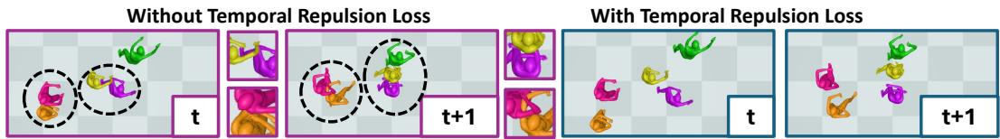  
Figure 11: Temporal repulsion improves multi-person consistency by preventing interperformer collapse. Without it, nearby performers penetrate and form physically implausible configurations that persist over time. The term maintains separation between bodies and produces a more coherent world-space motion across frames.

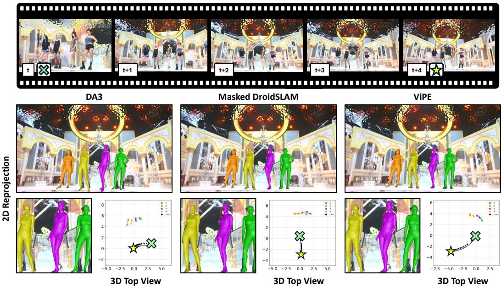  
Figure 12: Ablation of visual odometry. All three methods produce plausible 2D reprojections with reasonable subject alignment, but differ in their estimated camera trajectories. Based on the input video without ground truth, the camera starts from the right, pulls back, and pans toward the center of the group. DA3 captures lateral movement but misses the pull-back, while masked DROID-SLAM shows minimal lateral movement. ViPE most accurately recovers this trajectory, estimating both the backward pull and the pan toward the group center.

WorldPose (Jiang et al., 2024) uses LiDAR and multi-view rigs for multi-person world-space motion and is closest to ours, but covers a sport-specific motion distribution. Human3.6M (Ionescu et al., 2013), MPI-INF-3DHP (Mehta et al., 2017), and HumanML3D (Guo et al., 2022) address camera or motion-space evaluation and do not target world-space recovery. Our K-Pop stress test fills this gap by providing in-the-wild broadcast video with sustained high-magnitude camera dynamics and dense multi-person choreography, exposing failure modes that current evaluation regimes leave un derstudied.

Camera estimation under dynamic conditions. Monocular SLAM (Davison et al., 2007; Klein & Murray, 2007; Engel et al., 2014; 2017; Mur-Artal et al., 2015; Mur-Artal & Tardos, 2017; Cam-´ pos et al., 2021; Forster et al., 2014) assumes a static scene and degrades under rapid lighting changes, motion blur, and non-rigid motion, while learning-based systems (Teed & Deng, 2021; Teed et al., 2023; Lipson et al., 2024; Wang et al., 2021; 2017) struggle when foreground subjects dominate. Recent work addresses this via learned masking (Bescos et al., 2018; Zhao et al., 2022; Chen et al., 2024; Rockwell et al., 2025), dynamic-aware 3D models (Zhang et al., 2024; Li et al., 2025), or uncertainty-aware DROID-SLAM (Li et al., 2026).

Physical priors and foot–ground contact. Physical realism has been pursued via humanoid simulation and contact reasoning (Shimada et al., 2020; Yuan et al., 2021; Shimada et al., 2021; Xie et al., 2021; Feng et al., 2025), generative motion priors (Rempe et al., 2021; Mahmood et al., 2019), scene-contact constraints (Hassan et al., 2019; Tripathi et al., 2023; Muller et al., 2021), and explicit foot-skating mitigation (Zou et al., 2020; Rempe et al., 2020). Foot–ground contact has been used as a kinematic constraint in trajectory optimization (Rempe et al., 2020; Shin et al., 2024; Shen et al., 2024) and, in concurrent work (Yang et al., 2025), as a calibration cue based on the absolute spatial position of contact joints. Our use of contact differs in two respects. First, we leverage contact temporally, since a stationary planted-foot interval is one over which the true human world displacement is approximately zero, isolating the camera-induced drift component. Second, the resulting constraint depends only on relative odometry translation, not on absolute monocular depth, making it robust to the dolly-zoom dynamics and performative lighting that dominate broadcast video.

Table 4: Camera-space HMR methods perform strongly on existing benchmarks, consistent with the frame-to-frame plausibility we observe on K-Pop broadcast video. Quantitative comparison of representative methods on 3DPW Von Marcard et al. (2018), RICH (Huang et al., 2022), and EMDB-2 (Kaufmann et al., 2023), with the number ofjoints shown in parentheses. EMDB-2 results are in world space and are reported after alignment. All metrics are in millimeters. ∗The 3DPW and RICH entries for PromptHMR-Vid (Wang et al., 2025) are those reported for the single-image PromptHMR, which is the variant its authors evaluate in camera space.
<table><tr><td rowspan="2">Method</td><td colspan="3">3DPW (14)</td><td colspan="3">RICH (24)</td><td colspan="4">EMDB-2 (24)</td></tr><tr><td>PA-MPJPE</td><td>MPJPE</td><td>PVE</td><td>PA-MPJPE</td><td>MPJPE</td><td>PVE</td><td>WA-MPJPE100</td><td>W-MPJPE100</td><td>Jitter</td><td>Foot Skating</td></tr><tr><td>WHAM (Shin et al., 2024)</td><td>37.5</td><td>59.8</td><td>71.5</td><td>44.3</td><td>80.0</td><td>91.2</td><td>135.6</td><td>354.8</td><td>22.5</td><td>4.4</td></tr><tr><td>TRAM (Wang et al., 2024a)</td><td>35.6</td><td>59.3</td><td>69.6</td><td></td><td></td><td></td><td>76.4</td><td>222.4</td><td>18.5</td><td>23.4</td></tr><tr><td>GVHMR (Shen et al., 2024)</td><td>37.0</td><td>56.6</td><td>68.7</td><td>39.5</td><td>66.0</td><td>74.4</td><td>111.0</td><td>276.5</td><td>16.7</td><td>3.5</td></tr><tr><td>PromptHMR-Vid (Wang et al., 2025)</td><td>35.5*</td><td>56.9*</td><td>67.3*</td><td>37.0*</td><td>57.4*</td><td>65.8*</td><td>71.0</td><td>216.5</td><td>16.3</td><td>3.5</td></tr></table>

## B PIPELINE DETAILS

Our pipeline follows TRAM (Wang et al., 2024a) in separating camera estimation, camera-space human reconstruction, and world-space composition, but is adapted to the high-camera-dynamics regime studied in this work. Beyond recovering coherent world-space motion, a central goal is to expose and resolve the scale mismatch that becomes dominant under aggressive camera motion.

Step 1. Camera pose estimation. Standard dense SLAM methods such as DROID-SLAM (Teed & Deng, 2021) are brittle on broadcast video with dynamic backgrounds, where large non-rigid image motion can corrupt feature matching and bundle adjustment, as shown in Figure 12. We therefore use ViPE (Huang et al., 2025) with a constrained phrase list covering dynamic foreground elements (persons, dancers, singers, handheld props), broadcast overlays (lyrics, subtitles, captions), and background regions (sky) to reduce the influence of background motion on camera estimation, sampled at a keyframe gap of 0.1 s. SLAM is run with DA3 keyframe depth, a frontend NMS of 2, a frontend threshold of $\bar { 2 } 4 , \beta = 0 . 6 5$ , and 48 backend iterations. We verify the resulting trajectories using the time-reversal shuttle test described in Section 5. Per-frame focal estimates are unstable on zoom-heavy sequences, so we fit a single focal length per clip, discarding extreme estimates outside [0.3×, 3×] the image width. We further smooth the trajectories with a One Euro filter (min cutoff = 0.001, beta = 0.5, d cutoff = 1.0) to suppress high-frequency jitter.

Step 2. Human reconstruction in camera space. We use PromptHMR-Vid (Wang et al., 2025) as the default backbone, which models the camera with full perspective at an estimated per-clip focal length and supervises its camera-space translation against ground-truth translation. Its native world-space reconstruction follows TRAM, composing with DROID-SLAM (Teed & Deng, 2021) and Metric3D (Yin et al., 2023), while GVHMR (Shen et al., 2024) builds its world trajectory by integrating a predicted root velocity, so for GVHMR in Table 3 we supply the composition of Eq. 1 ourselves. We reconstruct humans in camera coordinates using a two-pass tracking-and-refinement procedure. We first select an initialization frame capturing the largest number of visible performers with minimal occlusion, then run SAM2.1 (Ravi et al., 2024) to obtain initial tracks. In a second pass, we refine the tracks by prompting in both forward and backward directions using YOLO11xpose (Jocher & Qiu, 2024) bounding box detections. We then linearly interpolate bounding boxes across gaps of up to 5 frames, and the HMR model predicts meshes on the interpolated boxes.

Step 3. Camera-to-world composition. Given camera-space human predictions X and camera pose estimates $\{ R _ { i } , T _ { i } \}$ , the initial world-space reconstruction follows the standard transformation (Equation 1). We apply that transformation to every predicted joint, though only the contact joints feed the scale recovery of Step 5. We then apply gravity correction, rotating the recovered world frame so its vertical axis follows the gravity direction given by the first-frame camera pitch and roll estimated by SPEC (Kocabas et al., 2021b). We fit the floor height by RANSAC over the mesh vertices of all performers and place the floor at height zero, which fixes the floor plane that the grounding terms of Appendix C measure against.

Step 4. Stationary-interval detection. The relative scale s cannot be estimated while a performer is moving, since the performer’s world-space motion $\Delta W _ { \mathrm { o b j } }$ in Eq. 3 is then unknown and cannot be separated from the drift. The backbone reports translation at the pelvis, which keeps moving even while a performer holds position. A planted foot does not, so the contact joints C carry the only stillness we can read. We therefore look for intervals in which at least one foot stays planted, scoring each frame by the strongest contact confidence over $\mathcal { C }$ and admitting an interval once $\bar { c } _ { p , t }$ clears $\tau _ { c }$ on at least a fraction $\alpha = 0 . 8$ of its frames. Intervals are 10-frame windows slid one frame at a time. Two further gates remove intervals that pass the contact test yet still break the decomposition, one for displacement running across the camera direction rather than along it (Section 6), and one for rotation error large enough to compete with the translation (Appendix D.1). Inside an admitted interval we take $\Delta W _ { \mathrm { o b j } , p , i j } \approx 0$ , so the observed displacement is the drift $( 1 - s ) \Delta T _ { i j }$ of Eq. 4. Broadcast cameras translate in all three dimensions rather than along one dominant axis, so we fit a single scale jointly over x, y and z instead of solving per axis and pooling afterwards.

A backbone without a contact head would have to detect stillness from the composed trajectory, using foot speed or foot height above an estimated ground plane. This is circular. The composed trajectory already contains the drift we want to detect, and the drift grows with camera displacement, so a moving foot in that trajectory may reflect drift rather than performer motion. Contact confidence avoids this. It is predicted in camera space before composition adds the drift. Relying on contact also does not limit the choice of backbone. A backbone without a contact head can take contact confidence from another model. For TRAM, we take it from PromptHMR (Table 3).

Step 5. Closed-form scale recovery. Within the stationary intervals identified above, we estimate a single sequence-level scale $s ^ { * }$ by weighted least squares using Eq. 6. If no interval is admitted, we skip the correction and keep the uncorrected composition of Eq. 1. Otherwise, before any optimization, we apply Eq. 7, measuring camera translation from the first frame, so the camera displacement $T _ { i } \mathrm { ~ - ~ } T _ { 0 }$ is rescaled by $s ^ { * }$ and $( 1 - s ^ { * } ) ( T _ { i } - T _ { 0 } )$ is subtracted from every performer’s world-space translation. The correction also shifts performers vertically, so we refit the floor by RANSAC over the mesh vertices of frames in which both feet are planted, and shift the performers and camera together to return the floor to height zero. We fill remaining translation gaps by linear interpolation in 3D world space and pose gaps by spherical linear interpolation. At both temporal boundaries where detections are absent, we extrapolate translation with the mean velocity of the last 10 observed frames, damped by a factor of 0.8 per frame, and hold the pose fixed. Contact logits more than 15 frames from any detection are blended toward a logit of 1, reaching it at 25 frames, so PGO treats these stretches as planted. For the HAC (Yang et al., 2025) baseline, we replace $s ^ { * }$ with the mean of HAC’s per-person scales, each estimated from PromptHMR-Vid joints against the ViPE point cloud, apply it through Eq. 7 without PGO, and keep HAC’s Gaussian smoothing of translation $( \sigma = 3$ frames). On the paired reference, this lowers WA-MPJPE from 75.98 to 67.92 cm, W-MPJPE from 160.43 to 121.38 cm, and Pair Distance from 76.85 to 61.28 cm relative to the uncorrected composition, and moves the ratio from 0.54 to 0.64.

Step 6. Physically grounded optimization. We refine the recovered world-space motion to enforce physical plausibility. As detailed in the following section, the objective combines reprojection consistency with translation smoothness, contact-aware grounding terms, and temporal interperson repulsion, reducing foot skating, improving temporal coherence, and discouraging implausible multi-person collisions while preserving agreement with the input video.

## C PHYSICALLY GROUNDED LOSSES

We expand the objective minimized in the physically grounded optimization (PGO) of Step 6.

Indices. p indexes performers, $t = 0 , \ldots , T - 1$ frames, $j$ body joints, a and b the body joints approximated by collision spheres, and $d \in \{ x , y \}$ the two image axes. $\mathcal { I }$ is the set of body joints scored for reprojection, the 25 joints of the OpenPose layout without the mid-hip and the two hips. C is the set of contact joints, the left and right ankles and feet. B is the set of all 29 body joints, the 25 OpenPose joints together with $\mathcal { C } .$

Quantities. $Y _ { p , t , j } \in \mathbb { R } ^ { 3 }$ are the optimized world-space joints and $\boldsymbol { x } _ { p , t } \in \mathbb { R } ^ { 3 }$ the optimized worldspace translation offset. $\hat { u } _ { p , t , j } \in \mathbb { R } ^ { 2 }$ are the 2D keypoints detected by ViTPose (Xu et al., 2022) and $q _ { p , t , j }$ their detection confidence. $m _ { p , t } \in \{ 0 , 1 \}$ marks the frames on which performer p has a track. Step 5 fills every gap and extrapolates to both clip boundaries, so $m _ { p , t } = 1$ throughout, and frames without a detection drop out of $\mathcal { L } _ { \mathrm { k p } }$ through their zero detection confidence. $h _ { p , t }$ is the bounding-box height and $f = 3 0$ a fixed time-scaling constant. The map $\pi ( \cdot )$ projects a world-space point into the image, and $\pi _ { d } ( \cdot )$ returns its d component. Contact confidences are $c _ { p , t , k } = \sigma ( \ell _ { p , t , k } )$ for backbone logits $\ell _ { p , t , k }$ and sigmoid $\sigma ( \cdot )$ , as in Section 6.

Table 5: The K-Pop stress test is the only in-the-wild benchmark of broadcast camera work. Camera motion is categorized as static (S), moving (M), and zooming (Z). AIST++ (Li et al., 2021b) reports 10.1M images from 9 views, so this count is not directly comparable to monocular video frame totals. DCM (Wang et al., 2024c) reports 193 minutes at 30 FPS, and DanceTrack (Sun et al., 2022a) provides bounding boxes but not pose annotations.
<table><tr><td rowspan="2">Dataset</td><td rowspan="2">Setting</td><td rowspan="2">Domain</td><td rowspan="2">Camera motion</td><td colspan="2">Annotation</td><td colspan="3">Statistics</td></tr><tr><td>GT Pose</td><td>Source</td><td>People/Frame</td><td>Frames</td><td>Pose Instances</td></tr><tr><td>H3.6M (Ionescu et al., 2013)</td><td>Controlled</td><td>Everyday</td><td>S</td><td>Yes</td><td>Calibrated</td><td>1</td><td>630k</td><td>630k</td></tr><tr><td>3DPW (Von Marcard et al., 2018)</td><td>In-the-wild</td><td>Everyday</td><td>M</td><td>Yes</td><td>IMU video</td><td>1-2</td><td>53k</td><td>75k</td></tr><tr><td>EMDB (Kaufmann et al., 2023)</td><td>In-the-wild</td><td>Everyday</td><td>M</td><td>Yes</td><td>EM sensors</td><td>1</td><td>105k</td><td>105k</td></tr><tr><td>BEDLAM-2 (Tesch et al., 2025)</td><td>Synthetic</td><td>Everyday</td><td>M</td><td>Yes</td><td>Synthetic</td><td>&gt;1</td><td>380k</td><td>1M</td></tr><tr><td>AIST++ (Li et al., 2021b)</td><td>Controlled</td><td>Dance</td><td>S</td><td>Yes</td><td>Calibrated</td><td>~1</td><td>10.1M*</td><td></td></tr><tr><td>AIOZ-GDANCE (Le et al., 2023)</td><td>In-the-wild</td><td>Group dance</td><td></td><td>No</td><td></td><td>&gt;1</td><td>1.8M</td><td></td></tr><tr><td>WorldPose (Jiang et al., 2024)</td><td>In-the-wild</td><td>Sports</td><td>M+Z</td><td>Yes</td><td>LiDAR multicam</td><td>&gt;1</td><td>150k</td><td>2.5M</td></tr><tr><td>DanceTrack (Sun et al., 2022a)</td><td>In-the-wild</td><td>Casual</td><td>M+Z</td><td>No</td><td>Reconstructed</td><td>&gt;1</td><td>105k</td><td></td></tr><tr><td>DCM (Wang et al., 2024c)</td><td>Edited</td><td>Single dance</td><td>M+Z</td><td>Yes</td><td>Animator</td><td>1</td><td>~347k</td><td>~347k</td></tr><tr><td>K-Pop stress test (ours)</td><td>In-the-wild</td><td>Broadcast</td><td>M+Z</td><td>No</td><td>Reconstructed</td><td>1-12</td><td>59.19k</td><td>336.87k</td></tr></table>

The PGO objective is

$$
\begin{array} { r } { \mathcal { L } = \lambda _ { \mathrm { k p } } \mathcal { L } _ { \mathrm { k p } } + \lambda _ { \mathrm { s m } } \mathcal { L } _ { \mathrm { s m } } + \lambda _ { \mathrm { r e p } } \mathcal { L } _ { \mathrm { r e p } } + \lambda _ { \mathrm { f l o o r } } \mathcal { L } _ { \mathrm { f l o o r } } + \lambda _ { \mathrm { c v } } \mathcal { L } _ { \mathrm { c v } } + \lambda _ { \mathrm { c h } } \mathcal { L } _ { \mathrm { c h } } + \lambda _ { \mathrm { s f } } \mathcal { L } _ { \mathrm { s f } } , } \end{array}
$$

where each λ is a scalar weight on its term, with $\lambda _ { \mathrm { k p } } = 1 . 5 , \lambda _ { \mathrm { s m } } = 1 , \lambda _ { \mathrm { r e p } } = 1 0 , \lambda _ { \mathrm { f o o r } } = 1 0 0 ,$ $\lambda _ { \mathrm { c v } } = 5 0 0 , \lambda _ { \mathrm { c h } } = 1 0$ , and $\lambda _ { \mathrm { s f } } = 1 0 0 . \ : \mathcal { L } _ { \mathrm { c v } } , \mathcal { L } _ { \mathrm { c h } } .$ , and $\mathcal { L } _ { \mathrm { s f } }$ are contact-aware terms, enabled only when contact predictions are available. We minimize $\mathcal { L }$ with Adam for 3000 iterations, with learning rate $1 0 ^ { - 2 } \operatorname { f o r } x _ { p , t }$ and for a camera rotation and vertical camera offset shared across frames, and $5 \times \mathrm { { 1 0 ^ { - 2 } } }$ for the residual scale $\Delta s$ and floor offset b introduced below.

Reprojection term. To preserve image consistency during world-space refinement, we penalize the discrepancy between projected 3D joints and detected 2D keypoints. Let $\Delta u _ { p , t , j , d } = \dot { \pi } _ { d } ( Y _ { p , t , j } ) \ –$ $\hat { u } _ { p , t , j , d }$ denote the per-axis reprojection residual. We combine a Geman–McClure robust penalty $\rho ( \cdot )$ with an L1 term and normalize by bounding-box height so that scale is comparable across performers and frames:

$$
\mathcal { L } _ { \mathrm { k p } } = \frac { 1 } { \sum _ { p , t } m _ { p , t } } \sum _ { p , t } m _ { p , t } \cdot \frac { 1 } { \left| \mathcal { I } \right| } \sum _ { j \in \mathcal { I } } \mathbf { 1 } [ q _ { p , t , j } > 0 . 9 ] \cdot \frac { 1 } { 2 h _ { p , t } } \sum _ { d \in \{ x , y \} } \left[ \rho ( \Delta u _ { p , t , j , d } ) + \left| \Delta u _ { p , t , j , d } \right| \right] ,
$$

where $\rho ( u ) = \kappa ^ { 2 } u ^ { 2 } / ( \kappa ^ { 2 } + u ^ { 2 } )$ with $\kappa = 1 5 0$ pixels, applied before the division by $h _ { p , t }$ . Only keypoints detected with confidence above 0.9 contribute.

Translation smoothness. We regularize the optimized world-space translation to discourage temporally inconsistent motion. The closed-form estimate $s ^ { * }$ of Eq. 6 is approximate, so PGO learns a single residual scale $\Delta s$ on top of it, giving an effective relative scale $s ^ { * } + \Delta s$ . The final perperformer translation is

$$
\tilde { x } _ { p , t } = x _ { p , t } ^ { ( 0 ) } + x _ { p , t } + \Delta s \left( T _ { t } - T _ { 0 } \right) - b e _ { y } ,
$$

where $x _ { p , t } ^ { ( 0 ) }$ is the initial translation after the closed-form correction of Step $5 , x _ { p , t }$ the learned perframe offset, $T _ { t }$ the camera translation at frame $t , b$ a learned floor offset, and $e _ { y }$ the vertical unit vector. The camera receives the same shift $\Delta s \left( T _ { t } - T _ { 0 } \right) - b e _ { y }$ , so $\Delta s$ and b move the camera and all performers together and leave every reprojection unchanged. They are set by the smoothness, contact, and floor terms. We penalize both scaled velocity (squared) and scaled acceleration (unsquared norm):

$$
\mathcal { L } _ { \mathrm { s m } } = \frac { \sum _ { p , t = 1 } ^ { T - 1 } m _ { p , t } \frac { f ^ { 2 } } { 3 } \| \Delta \tilde { x } _ { p , t } \| _ { 2 } ^ { 2 } } { \sum _ { p , t = 1 } ^ { T - 1 } m _ { p , t } } + \frac { \sum _ { p , t = 1 } ^ { T - 2 } m _ { p , t } f \| \Delta ^ { 2 } \tilde { x } _ { p , t } \| _ { 2 } } { \sum _ { p , t = 1 } ^ { T - 2 } m _ { p , t } } ,
$$

where $\Delta \tilde { x } _ { p , t } = \tilde { x } _ { p , t } - \tilde { x } _ { p , t - 1 } , \Delta ^ { 2 } \tilde { x } _ { p , t } = \tilde { x } _ { p , t + 1 } - 2 \tilde { x } _ { p , t } + \tilde { x } _ { p , t - 1 }$ , and the factor of $f ^ { 2 } / 3$ arises from time-scaling followed by mean-reduction over the three spatial coordinates.

Inter-person repulsion. To reduce implausible interpenetration in crowded scenes, we approximate 12 body joints by spheres with centers $v _ { p , t , a }$ and radii $r _ { a } ,$ , namely the neck, shoulders, hips, and

knees $( r _ { a } = 0 . 0 5 \mathrm { m } )$ , the mid-hip (0.06 m), the elbows (0.035 m), and the wrists (0.03 m). For each pair of performers $p < q$ , the framewise penetration energy is

$$
e _ { p q , t } = \sum _ { a , b } \left[ r _ { a } + r _ { b } + \delta - \left. \boldsymbol { v } _ { p , t , a } - \boldsymbol { v } _ { q , t , b } \right. _ { 2 } \right] _ { + } ^ { 2 } ,
$$

where $\delta = 0 . 2$ m is a safety margin. We define a soft gate $g _ { p q , t } = e _ { p q , t } / ( e _ { p q , t } + \varepsilon )$ , with $\varepsilon = 1 0 ^ { - 4 }$ that focuses the temporal penalty on frames with active overlap, and a triangular window $\begin{array} { r l } { \omega _ { \tau } } & { { } = } \end{array}$ $\Omega + 1 - \tau$ over offsets $\tau = 1 , \dots , \Omega$ , with $\Omega = 5$ . The combined loss is

$$
\mathcal { L } _ { \mathrm { r e p } } = \mu \frac { \sum _ { p < q , t } \mathbf { 1 } [ e _ { p q , t } > 0 ] e _ { p q , t } } { \sum _ { p < q , t } \mathbf { 1 } [ e _ { p q , t } > 0 ] } + ( 1 - \mu ) \frac { \sum _ { \tau = 1 } ^ { \Omega } \omega _ { \tau } \frac { \sum _ { p < q , t } g _ { p q , t - \tau } ( e _ { p q , t } - e _ { p q , t - \tau } ) ^ { 2 } } { \sum _ { p < q , t } g _ { p q , t - \tau } } } { \sum _ { \tau = 1 } ^ { \Omega } \omega _ { \tau } } ,
$$

which combines a direct overlap penalty, averaged only over penetrating frames, with a temporallygated term that discourages abrupt frame-to-frame changes in collision energy. The scalar $\mu = 0 . 5$ balances the two.

Contact-aware motion losses. When a joint is predicted to be in contact, its world-space motion should remain small over time. We therefore use a soft contact-velocity penalty

$$
\mathcal { L } _ { \mathrm { c v } } = \frac { 1 } { | \mathcal { C } | } \cdot \frac { \sum _ { p , t } m _ { p , t + 1 } \sum _ { k \in \mathcal { C } } c _ { p , t + 1 , k } \| Y _ { p , t + 1 , k } - Y _ { p , t , k } \| _ { 2 } ^ { 2 } } { \sum _ { p , t } m _ { p , t + 1 } } ,
$$

which suppresses motion proportionally to the predicted contact confidence and normalizes jointly by the number of contact joints and the count of tracked performer-frames. To further reduce foot skating, we also impose a stronger high-confidence stickiness term

$$
\mathcal { L } _ { \mathrm { s f } } = \frac { \sum _ { p , t , k \in \mathcal { C } } m _ { p , t + 1 } \mathbf { 1 } \left[ c _ { p , t + 1 , k } > \tau _ { c } \right] \| Y _ { p , t + 1 , k } - Y _ { p , t , k } \| _ { 1 } } { \sum _ { p , t , k \in \mathcal { C } } m _ { p , t + 1 } \mathbf { 1 } \left[ c _ { p , t + 1 , k } > \tau _ { c } \right] } ,
$$

where $\tau _ { c } ~ = ~ 0 . 5$ is the contact threshold of Section 6. The denominator counts only the active high-confidence contact detections, providing a self-normalizing objective robust to variation in the number of contact events.

Grounding terms. We encourage predicted contact joints to remain close to the ground plane:

$$
\mathcal { L } _ { \mathrm { c h } } = \frac { 1 } { \vert \mathcal { C } \vert } \cdot \frac { \sum _ { p , t } m _ { p , t } \sum _ { k \in \mathcal { C } } c _ { p , t , k } \left. Y _ { p , t , k } ^ { ( y ) } - y _ { \mathrm { c } } \right. } { \sum _ { p , t } m _ { p , t } } ,
$$

where $Y _ { p , t , k } ^ { ( y ) }$ denotes the vertical coordinate. The floor lies at height zero, and $y _ { \mathrm { c } } = 0 . 0 8$ m is the target height of a contact joint above it. To prevent anatomically implausible solutions, we penalize any joint that moves below the floor:

$$
\mathcal { L } _ { \mathrm { { f l o o r } } } = \frac { 1 } { | \mathcal { B } | } \cdot \frac { \sum _ { p , t } m _ { p , t } \sum _ { j \in \mathcal { B } } \left[ - Y _ { p , t , j } ^ { ( y ) } \right] _ { + } } { \sum _ { p , t } m _ { p , t } } .
$$

Together, these terms balance image consistency, temporal smoothness, collision avoidance, contactconsistent motion, and floor feasibility.

## D DRIFT ASSUMPTIONS AND ERROR SOURCES

The closed-form scale estimator in Eq. 6 assumes that the world-space displacement of a performer within a stationary interval comes entirely from the scale mismatch, $( 1 - s ) \Delta T _ { i j }$ in Eq. 4. Two conditions have to hold for that. (1) The performer must be genuinely stationary, which the contact gate of Step 4 in Appendix B enforces, and (2) error in the estimated camera rotation must be small relative to the camera translation, which Appendix D.1 enforces. Appendix D.2 lists the remaining interval gates. Appendix D.3 examines which upstream errors feed the bias the estimator absorbs and which do not explain the observed drift.

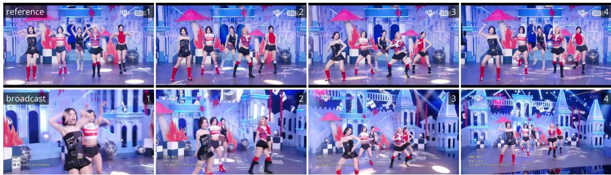  
Figure 13: Paired-camera reference set. Four time-synchronized frames from one pair, numbered in the upper right. The fixed venue camera (top) holds its framing on the whole group, while the broadcast camera (bottom) translates, zooms, and crops performers out of frame over the same span.

## D.1 ROTATION ERROR

Eq. 3 compares the two camera-to-performer vectors after rotating each into world axes (Section 5), so camera rotation affects the scale estimate through the error in its estimate. If the estimated rotation at one end of an interval is off by a small angle, the camera-to-performer vector of a performer at camera-space depth d shifts by roughly that angle times $d ,$ and Eq. 4 reads the shift as drift. When this shift is comparable to the translational signal $\| \Delta T \|$ , the scale estimate becomes biased. We therefore compute a per-interval error budget and exclude intervals in which the expected rotational error exceeds the translational signal by a defined margin.

Relative rotation and angular error. For each candidate interval $[ t _ { 0 } , t _ { 1 } ]$ , we compute the relative camera rotation

$$
R _ { \mathrm { r e l } } = R _ { t _ { 1 } } R _ { t _ { 0 } } ^ { \top } ,
$$

where $R _ { t }$ is the camera-to-world rotation at frame t of Section 3, and extract the geodesic angle in radians via

$$
\theta = \operatorname { a r c c o s } \left( \frac { \operatorname { t r } ( R _ { \mathrm { r e l } } ) - 1 } { 2 } \right) .
$$

We model the rotation error of visual odometry as a fixed noise floor plus a fraction of the rotation it must recover,

$$
\theta _ { \mathrm { e r r } } = \theta _ { 0 } + 0 . 1 \theta ,
$$

where $\theta _ { 0 } = 0 . 5 ^ { \circ }$ is the noise floor of the rotation estimator. All angles are in radians, so $\theta _ { \mathrm { e r r } }$ d in the criterion below is a displacement.

Interval exclusion criterion. We exclude an interval when the displacement expected from rotation error at the performer’s camera-space depth $d ,$ scaled by a margin η, exceeds the camera translation magnitude $\| \Delta T \|$

$$
\theta _ { \mathrm { e r r } } \cdot d \cdot \eta > \| \Delta T \| .
$$

Equivalently, we require the signal-to-noise ratio $\lVert \Delta T \rVert / ( \theta _ { \mathrm { e r r } } d )$ to reach at least η. We set $\eta = 1 . 5$ so the translational signal must exceed the expected rotational error by that factor before an interval contributes to the scale estimate.

## D.2 ADDITIONAL INTERVAL GATES

We admit an interval when at least a fraction $\alpha = 0 . 8$ of its frames pass the contact threshold $\tau _ { c } .$ We discard intervals in which the camera translates less than 1 mm, since they may be noise, and samples from performers closer than 0.1 m to the camera, where depth is unreliable. Within the fit, we downweight axes along which the camera barely moved, for the same reason.

## D.3 ANALYSIS OF DRIFT SOURCES

With body scale fixed by the body model, a focal length too large by a factor recovers a depth too large by the same factor. Scaling all depths together with the camera translation leaves image projections unchanged. Focal error and depth ambiguity are therefore scale degrees of freedom that hold across a clip, and Eq. 6 estimates the resulting bias, whichever of them produced it. Figure 14 shows that focal length error acts as this scale degree of freedom, since an incorrect focal length shifts the estimated bias in proportion to the error, and the correction removes that shift.

Drift scale vs focal length  
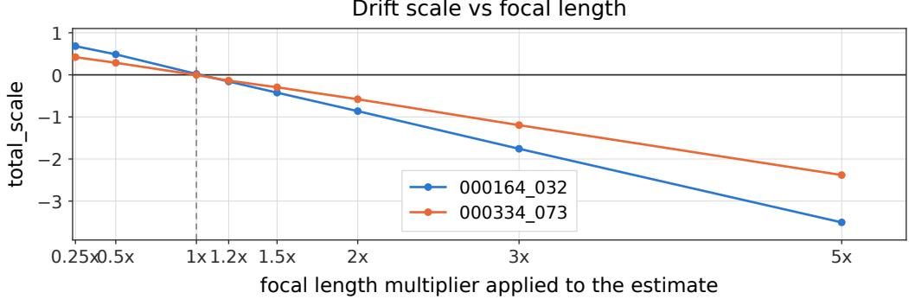  
Figure 14: Drift scale under a rescaled focal length. We multiply the backend-estimated focal length by a fixed multiplier and rerun the correction. Each curve is one clip and shows the change in estimated drift fraction relative to the unperturbed focal length. The change is linear in the multiplier, as expected when focal error acts as a scale degree of freedom, and its slope differs between clips because each carries a different scale.

Crop-induced translation instability and detector-induced scale variation act on the camera-space estimate with a magnitude and direction that change between frames. PromptHMR-Vid (Wang et al., 2025) operates without crops while GVHMR (Shen et al., 2024) uses them, yet both drift and both respond to the same correction (Table 3), so we treat these effects as residual error and not as an account of the drift. Where such an error carries a component that holds across a sequence, it acts as a scale bias, and the correction absorbs it with the rest.

## E SCALE ESTIMATION ABLATIONS

The closed-form estimator in Eq. 6 rests on two choices, which intervals are pooled and how many scales are fit from them. Table 8 sweeps the contact threshold that admits an interval. Table 7 replaces the single sequence-level scale with a time-varying one.

## E.1 SENSITIVITY TO THE NUMBER OF STATIONARY INTERVALS

Stationary moments can be scarce in choreography, so the sequence-level estimate may have few intervals to pool. On one sequence, we run the pipeline twice, once with all 125 admitted intervals and once with 3 of them, and record both the closed-form estimate and the final result (Table 6).

Table 6: Cutting the pooled intervals from 125 to 3 changes the closed-form estimate but not the final result. Both rows are the same sequence, and values are drift fractions a = 1 − s. a∗ is the closed-form estimate of Eq. 6, ∆a is the shift PGO applies through its learned residual scale, and a is the value after both stages.
<table><tr><td>Admitted intervals</td><td> $a ^ { * }$  (closed form)</td><td>∆a (PGO)</td><td>a (final)</td></tr><tr><td>125</td><td>0.310</td><td>+0.008</td><td>0.318</td></tr><tr><td>3</td><td>0.443</td><td>-0.123</td><td>0.320</td></tr></table>

The closed-form estimate moves by 0.133 between the two runs. PGO absorbs almost all of it, and the final values sit 0.002 apart. On this sequence, the number of pooled intervals does not determine the final result as the second stage recovers what the first misses.

The time-varying scale in Table 7 therefore does not fail for lack of intervals. Each segment overfits the intervals it does have, the segment scales stop agreeing, and the reassembled camera path disturbs motion the visual odometry never observed. Since we place performers relative to that path, the spurious motion reaches their trajectories, which is why we fit one scale per sequence.

Table 7: Constant against time-varying scale. A time-varying scale is the more expressive choice, yet it destabilizes the recovered world-space motion, and the damage falls on the temporal metrics while the 2D metrics hold. Bold marks the best value in each column. Both rows use ViPE (Huang et al., 2025) and PromptHMR-Vid (Wang et al., 2025).
<table><tr><td rowspan="2">Scale model</td><td colspan="2">2D Reprojection</td><td colspan="2">3D World Space (mm)</td></tr><tr><td>PCK↑</td><td>Mask IoU ↑</td><td>Jitter ↓</td><td>Foot Skating ↓</td></tr><tr><td>Constant scale</td><td>0.868</td><td>0.720</td><td>26.87</td><td>17.94</td></tr><tr><td>Time-varying scale</td><td>0.862</td><td>0.737</td><td>131.57</td><td>32.58</td></tr></table>

The same two-stage behavior explains Table 8. The contact threshold decides which intervals are pooled, so changing it changes the closed-form estimate, yet the reported metrics barely move. In both experiments, the first stage takes a large perturbation, and the learned residual absorbs what survives it. The stability in Table 8 is a property of the two stages together.

Table 8: The reconstruction is robust to the contact threshold $\tau _ { c } .$ The threshold sets which intervals enter the estimate. Across the tested range, with ViPE (Huang et al., 2025) and PromptHMR-Vid (Wang et al., 2025), the 2D metrics and jitter barely move, and foot skating rises modestly. Every setting stays best on foot skating and second on jitter among the methods of Table 2, behind only HAC (Yang et al., 2025). We use $\tau _ { c } = 0 . 5$
<table><tr><td rowspan="2">Contact threshold  $\tau _ { c }$ </td><td colspan="2">2D Reprojection</td><td colspan="2">3D World Space (mm)</td></tr><tr><td>PCK↑</td><td>Mask IoU ↑</td><td>Jitter ↓</td><td>Foot Skating ↓</td></tr><tr><td>0.3</td><td>0.866</td><td>0.718</td><td>26.34</td><td>16.83</td></tr><tr><td>0.5 (default)</td><td>0.868</td><td>0.720</td><td>26.87</td><td>17.94</td></tr><tr><td>0.8</td><td>0.872</td><td>0.726</td><td>26.38</td><td>19.09</td></tr></table>

## E.2 STATIONARY-PERFORMER CLIPS

This ablation isolates the correction on clips where the expected answer is known, using 10 clips in which 60 performers hold their stage positions, so the true world-space displacement is near zero and whatever motion is recovered is error. Table 9 separates what each stage contributes. PGO removes most of the raw drift on its own, cutting net displacement from 2.334 m to 0.581 m, and adding the drift correction reduces it to 0.153 m. Jitter barely moves between those two rows, so the further reduction comes from placing the performers correctly rather than from just smoothing their trajectories.

Table 9: Drift correction reduces displacement. On 10 clips covering 60 performers who hold their stage positions, the expected world-space displacement is near zero, so smaller is closer to the truth. Jitter is unchanged between the last two rows, which is why it carries no bold entry. Bold marks the best value in each column. All rows use ViPE (Huang et al., 2025) and PromptHMR Vid (Wang et al., 2025).
<table><tr><td rowspan="2">Configuration</td><td colspan="2">World-Space Displacement (m)</td><td colspan="2">Stability (mm)</td></tr><tr><td>Path length↓</td><td>Net displacement↓</td><td>Jitter ↓</td><td>Foot Skating ↓</td></tr><tr><td>Raw trajectory</td><td>5.206</td><td>2.334</td><td>105.128</td><td>47.269</td></tr><tr><td>PGO</td><td>0.849</td><td>0.581</td><td>12.465</td><td>7.568</td></tr><tr><td>PGO + drift correction</td><td>0.461</td><td>0.153</td><td>12.379</td><td>4.312</td></tr></table>

## F K-POP STRESS TEST CONSTRUCTION DETAILS

We collect approximately 1,000 K-Pop broadcast dance videos from YouTube and standardize all video to 24 FPS at 1280 × 720 resolution. We detect hard cuts with TransNetV2 (Soucek & Lokoc, 2024) and remove four frames on each side of every transition to improve temporal consistency. Broadcast videos frequently alternate between close-up shots and wide stage views, so we filter for clips with stable multi-person coverage suitable for world-space evaluation. Using YOLO11n-Pose detections, we discard frames dominated by upper-body close-ups (detections covering more than 25% of the image height), clips with at least 0.5 seconds of consecutive missed detections, clips containing only a single visible performer, and clips shorter than 3 seconds. We then pass surviving clips through the time-reversal shuttle test described in Section 5 to validate camera trajectory quality.

Data availability and ethical considerations. We do not redistribute raw video. Upon release, we will provide the YouTube URLs and timestamps required to reproduce the dataset, with downloading left to the end user in accordance with the platform’s terms of service.

## G USER STUDY DESIGN

We conducted a perceptual study across 8 sequences with 34 participants. Each comparison video showed five synchronized panels, the original input, a 2D reprojection of colored meshes overlaid on the input, a front-facing 3D view, a top-down 3D view, and a trajectory plot showing each performer’s path and the estimated camera position. Participants answered two questions per comparison, which result provides more consistent overall quality across 2D alignment and 3D realism, and which better matches the camera motion in the input video. The question order was randomized. Since our method was compared against three baselines independently, each sequence appeared three times throughout the survey, yielding 24 comparisons per participant and 816 votes per question. As shown in Figure 15, our method received 97.3% and 96.6% of all votes on overall quality and camera motion, respectively. Against each baseline individually, it was preferred in at least 96.3% of comparisons on overall quality and 95.6% on camera motion.

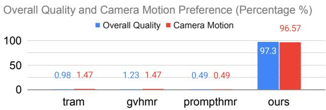  
Figure 15: User study. Share (%) of all votes each method received on overall quality and camera motion, pooled over 24 pairwise comparisons from 34 participants. Each baseline (TRAM (Wang et al., 2024a), GVHMR (Shen et al., 2024), and PromptHMR (Wang et al., 2025)) appears in one third of the comparisons.