# A3PreCore: Robust Rigid Registration for Native FLAIR-Space Brain-Mask Transfer

Elmira Mirzabeigi∗1, Zahra Khalilzad1, Taylor Snowden-Richardson1, Jesus Eduardo Lugo Arce1, Jodie R. Gawryluk3, Brian R. Christie2, and Jocelyn Faubert†1

1Faubert Laboratory, School of Optometry, Université de Montréal, 3744 Jean-Brillant, Montréal, Québec H3T 1P1, Canada

2Division of Medical Sciences, University of Victoria, 3800 Finnerty Road, Victoria, British Columbia V8P 5C2, Canada

3Department of Psychology, University of Victoria, 3800 Finnerty Road, Victoria, British Columbia V8P 5C2, Canada

## Abstract

Reliable brain-mask transfer into native fluid-attenuated inversion recovery (FLAIR) space can fail when T -to-FLAIR rigid registration is unstable. We developed A3PreCore, an optimization-based rigidregistration strategy that estimates a subject-specific six-degree-of-freedom rigid transformation between the full bias-corrected T -weighted image and native FLAIR using normalized mutual information, jointly optimizing rotational and translational parameters while preserving the established T -space anatomical mask. We also introduced extended quantitative quality control (E-QC), a multidimensional framework that retains method-specific descriptors of mask extent, field-of-view-relative position, FLAIR intensity support, boundary support, and inferior morphology together with pairwise descriptors of volumetric, centroid, and principal-axis disagreement, without collapsing them into a composite score. In 78 participants with paired T -weighted and FLAIR imaging, A3PreCore was compared with fsl\_anat and the Brain Extraction Tool (BET), which generated masks directly in native FLAIR space. Gross rigid-body misregistration occurred in 21/78 fsl\_anat outputs (26.9%) and 0/78 A3PreCore outputs (exact two-sided McNemar � = 9.54 × 10−7). Among 57 participants without gross fsl\_anat misregistration, A3PreCore preserved close agreement (median Dice = 0.993; median paired ΔNMI = −0.00007, � = 0.429), indicating that robustness was not achieved through indiscriminate mask alteration. A3PreCore remained broadly concordant with BET (median Dice = 0.955), with representative comparisons showing less inferior and extracranial extension. Method-blinded neuroscientists ranked A3PreCore first in 35/40 participants (87.5%). E-QC additionally exposed severe orientation-related disagreement not evident from global descriptors or centroid displacement alone. These findings support A3PreCore as a robust native-FLAIR brain-mask transfer strategy and E-QC as a complementary framework for multidimensional mask characterization and participant-specific geometric quality control.

Keywords: FLAIR; Brain extraction; Mask propagation; Quality control ; Neuroimaging; MRI.

## 1 Introduction

## 1.1 Clinical and Methodological Importance of Native FLAIR-Space Brain Masking

Fluid-attenuated inversion recovery (FLAIR) magnetic resonance imaging is central to lesion-oriented neuroimaging because suppression of cerebrospinal-fluid signal increases the conspicuity of abnormalities in periventricular, juxtacortical, and deep white matter [1, 2]. FLAIR is therefore widely used to characterize white matter hyperintensities (WMHs), lacunar and periventricular abnormalities, edema, gliosis, and demyelinating lesions across aging, cerebral small-vessel disease, multiple sclerosis (MS), neurodegeneration, and other neurological disorders [3–8]. WMHs, in particular, are associated with stroke, cognitive impairment, dementia, and disruption of white-matter integrity, making reliable FLAIR-based quantification important in both clinical research and population neuroimaging [9–14].

Because lesion segmentation and regional lesion-burden estimation are commonly performed directly in native FLAIR space, many analysis workflows require or benefit from restricting the image to a reliable intracranial region. Numerous automated lesion-segmentation approaches have been developed, including probabilistic, conventional machine-learning, and deep-learning methods [15–22]. Irrespective of the downstream algorithm, however, errors in the native FLAIR-space brain mask may propagate into lesion volume, regional distribution, boundary measurements, and subsequent statistical analyses. These efects are particularly relevant near cortical, juxtacortical, periventricular, cerebellar, and inferior brain boundaries, where lesion signal and mask errors may occur in close spatial proximity. Reliable native-space brain masking is therefore an important methodological requirement for reproducible lesion-focused FLAIR analysis.

## 1.2 Challenges of Brain-Mask Generation in Native FLAIR Space

Generating a reliable brain mask directly from FLAIR remains challenging because the sequence combines substantial cross-modal tissue-contrast diferences with heterogeneous acquisition geometry and pathologydependent signal variation. Raw FLAIR images may contain skull, scalp, neck, spinal-cord signal, background artifacts, intensity inhomogeneity, incomplete head coverage, or motion-related distortion. These characteristics vary across scanners, acquisition protocols, head positions, and fields of view and can alter the apparent separation between intracranial and extracranial tissue.

Previous work has shown that brain extraction is sensitive to image modality, acquisition quality, anatomical coverage, and pathology [23–30]. In native FLAIR space, direct extraction may therefore produce inferior extracranial extension, inclusion of low-signal non-brain tissue, or exclusion of cortical, temporal, cerebellar, or inferior brain regions. Importantly, these defects can remain spatially localized: a mask may retain a plausible total volume and centroid while containing boundary abnormalities that are consequential for regional lesion analysis. Evaluation based only on global mask characteristics may therefore fail to detect clinically or methodologically relevant local errors. Robust assessment should consequently consider both global mask characteristics and localized boundary behaviour.

## 1.3 Limitations of T -to-FLAIR Brain-Mask Transfer

An alternative strategy is to define a brain mask from the $\mathrm { T _ { 1 } - w e i g h t e d }$ image and propagate it into native FLAIR space. $\mathrm { T _ { 1 } \mathrm { - w e i g h t e d } }$ images provide strong anatomical contrast and are well suited to brain-mask definition using established anatomical-processing tools. Among these, FSL’s Brain Extraction Tool (BET) is one of the most widely used approaches for brain extraction from $\mathrm { T } _ { 1 }$ -weighted MRI and also provides a relevant reference method for the comparisons performed in the present study [23, 31, 32]. This strategy separates anatomical mask definition from the modality in which lesions are ultimately quantified and can preserve a previously established anatomical mask across modalities.

Its reliability nevertheless depends on two distinct operations: the anatomical validity of the $\mathrm { T } _ { 1 }$ -space source mask and the geometric accuracy of its placement in native FLAIR space. A plausible source mask can yield an unusable FLAIR-space output when transformation estimation fails. Multimodal $_ { \mathrm { T _ { 1 } - t o - F L A I R } }$ alignment may be influenced by the transformation model, similarity objective, image intensity non-uniformity, interpolation, head position, field-of-view diferences, and optimization behaviour [33–40]

In the fsl\_anat-based comparison evaluated in this study (fsl\_anat), the anatomical-processing workflow of the FMRIB Software Library (FSL), provided the skull-stripped $\mathrm { T } _ { 1 }$ image and anatomical brain mask used for subsequent $_ { \mathrm { T _ { 1 } - t o - F L A I R } }$ transfer. Transformation estimation was then performed between the $\mathrm { s k u l l - s t r i p p e d T 1 }$ image and the raw full-head FLAIR image. The two images therefore difer not only in modality-specific intensity contrast but also in the anatomical support presented to the registration objective: the moving image contains primarily brain tissue, whereas the fixed image may additionally contain skull, scalp, neck, and other surrounding structures. Although this configuration can produce satisfactory alignment, it may be vulnerable in scans with unusual head position, strong inferior extracranial signal, variable coverage, residual bias-field efects, or other challenging image characteristics.

A resulting mask may retain a plausible overall size or centroid while being substantially translated, rotated, or otherwise displaced in native FLAIR space. Conversely, a registration method designed to increase robustness should not achieve that robustness merely by introducing broad changes into masks that were already successfully aligned. These considerations motivate separate assessment of source-mask plausibility, transformation quality, and the degree to which a modified registration strategy preserves successful mask placement while avoiding severe participant-specific failures.

## 1.4 Rationale for Robust T -to-FLAIR Rigid Registration

A3PreCore was developed to improve the robustness of the transformation-estimation stage while preserving the anatomical brain mask established in $\mathrm { T } _ { 1 }$ space. Rather than relying on a skull-stripped $\mathrm { T } _ { 1 }$ image during transformation estimation, $\mathbf { A } ^ { 3 } \mathbf { P r e C o r e }$ uses the full bias-corrected $\mathrm { T _ { 1 } \mathrm { - w e i g h t e d } }$ image as the moving image and the raw native FLAIR image as the fixed image. The full $\mathrm { T } _ { 1 }$ image retains skull, scalp, head shape, and surrounding anatomical structures that are also represented in the raw FLAIR image, thereby providing more comparable spatial support across the two modalities.

$\mathsf { A } ^ { 3 } \mathsf { P r e C }$ ore further performs six-degree-of-freedom rigid registration using normalized mutual information. Translation and rotation are estimated jointly as components of the subject-specific ${ \mathrm { T } } _ { 1 } { \mathrm { - t o - F L A I R } }$ transformation, allowing the optimization procedure to determine the relative pose that best aligns the full $\mathrm { T _ { 1 } \mathrm { - w e i g h t e d } }$ image with native FLAIR. This optimization-based strategy is intended to reduce convergence to grossly displaced translational or rotational solutions under challenging imaging conditions. The resulting participant-specific transformation is then applied to the same $\mathrm { T _ { 1 } \mathrm { - d e r i v e d } }$ anatomical brain mask used in the fsl\_anat comparison. $\mathbf { A } ^ { 3 } \mathbf { P r e C o r e }$ therefore modifies transformation estimation rather than redefining the underlying anatomical source mask.

This design leads to two complementary methodological questions. First, can the proposed registration strategy reduce gross rigid-body misregistration when conventional ${ \mathrm { T } } _ { 1 } { \mathrm { - t o - F L A I R } }$ transfer fails? Second, does it preserve close mask geometry when fsl\_anat already produces a successful registration? The second question is essential for distinguishing targeted registration robustness from indiscriminate modification of the transferred mask. A robust method should preferentially avoid severe participant-specific failures while leaving already satisfactory registrations largely unchanged.

A further comparison with a mask generated directly from native FLAIR can provide complementary information because such a comparator does not depend on $_ { \mathrm { T _ { 1 } - t o - F L A I R } }$ transformation estimation. In the present study, BET was therefore used as a secondary registration-independent comparator. This comparison was designed to determine whether $\mathbf { A } ^ { 3 } \mathbf { P r e C o r e }$ remains broadly concordant with an independently generated native-FLAIR mask and to characterize the location and direction of residual disagreement, including peripheral, inferior, and extracranial mask behaviour. BET was not treated as anatomical ground truth.

## 1.5 Need for Multidimensional Quantitative Quality Control

Visual inspection remains important for neuroimaging quality control, but it is time-consuming, potentially subjective, and dificult to standardize in large or multisite datasets. Automated QC methods can provide reproducible indicators and reduce manual-review burden [41, 42]. Their interpretation, however, depends on the type of processing output being evaluated. Acquisition-level tools such as MRIQC were not designed to validate derived brain-mask geometry, and global morphological outlier strategies may miss localized processing defects or exclude biologically plausible observations [42, 43]. Measures such as mask volume, centroid position, compactness, or mean within-mask intensity can identify extreme deviations, but they may remain insensitive to localized cortical exclusion, inferior extracranial extension, or spatially coherent boundary displacement.

Pairwise overlap measures provide complementary but incomplete information. Dice and Jaccard coeficients summarize spatial agreement but do not explicitly encode the anatomical location, spatial arrangement, or physical distance of disagreement [44, 45]. Boundary- and distance-based measures are therefore important when local surface displacement is relevant. Moreover, in the absence of an independently delineated manual reference, overlap between two automatically generated masks cannot determine which mask is anatomically more accurate. Low overlap establishes disagreement, whereas high overlap does not exclude systematic errors shared by both methods. Pairwise overlap should therefore be interpreted as inter-method agreement rather than as ground-truth accuracy.

Transfer-based workflows require an additional distinction between intrinsic mask plausibility and registration geometry. Dedicated registration-QC studies have used standardized visual protocols, anatomically specific overlap measures, and learned classifiers to identify failed alignments [46–48]. Mutual information and normalized mutual information are established multimodal registration criteria [49, 50], but they do not directly encode anatomical landmarks or localized boundary correspondence. When the same or a related similarity criterion is used during optimization, it should not be interpreted as independent evidence of anatomical correctness.

Accordingly, this study developed and applied a multidimensional extended quantitative quality-control frame work (E-QC) for native FLAIR-space brain masks. E-QC separates method-specific mask characterization from pairwise geometric characterization. The method-specific component retains complementary descriptors of physical mask extent, field-of-view-relative position, FLAIR intensity support, boundary-gradient support, and inferior morphology. The pairwise component characterizes participant-specific disagreement using relative volume diference, physical centroid displacement, PCA-derived principal-axis orientation diference, and PCA-orientation-induced boundary displacement.

The purpose of this multidimensional design is not to replace mask quality with a single aggregate score, but to preserve complementary characteristics that may reveal diferent forms of disagreement. In particular, a mask can maintain apparently plausible global characteristics while exhibiting substantial orientation-related or localized boundary disagreement. E-QC therefore retains method-specific mask descriptors and pairwise geometric descriptors as complementary dimensions and does not assume that either fsl\_anat or BET constitutes anatomical ground truth.

The conceptual relationship between native FLAIR masking, geometric mask transfer, and multidimensional quality assessment is summarized in Figure 1.

## 1.6 Study Contributions

This study makes four principal contributions. First, it introduces $\mathsf { A } ^ { 3 }$ PreCore, an optimization-based rigidregistration strategy for native FLAIR-space brain-mask transfer that combines a full bias-corrected $\mathrm { T } _ { 1 }$ moving image with normalized-mutual-information-based six-degree-of-freedom transformation optimization while preserving the established $\mathrm { T _ { 1 } - s p a c e }$ anatomical source mask.

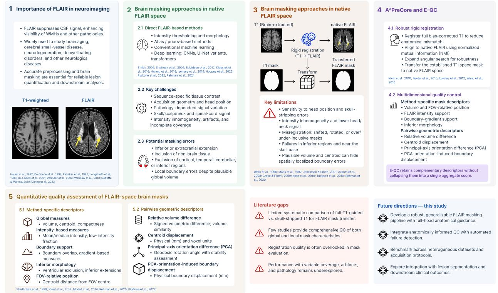  
Figure 1: Conceptual synthesis of native FLAIR-space brain masking, T -to-FLAIR mask transfer, and multidimensional quality assessment. The schematic summarizes the clinical relevance of native FLAIR-space brain masking, major classes of brain-masking approaches, potential failure modes of $\mathrm { T _ { 1 } \mathrm { - t o - F L A I R } }$ mask transfer, and design principles for improving rigid-registration robustness. The $\mathbf { A } ^ { 3 } \mathbf { P r e C o r e }$ strategy is illustrated as a $\mathrm { f u l l - T _ { 1 } \mathrm { - g u i d e d } } .$ optimization-based rigid registration approach in which a subject-specific six-degree-of-freedom transformation is estimated between the full bias-corrected $\mathrm { T } _ { 1 }$ image and native FLAIR using normalized mutual information, with translational and rotational parameters optimized jointly before transfer of the established $\mathrm { T _ { 1 } } \mathrm { - s p a c e }$ anatomical mask. The schematic further illustrates the proposed extended quantitative quality-control framework (E-QC), which retains method-specific mask descriptors and pairwise geometric disagreement as complementary dimensions rather than combining them into a single aggregate score. Global, FLAIR-support, boundary-sensitive, inferior-morphology, and geometric descriptors are used to characterize mask behaviour and participant-specific inter-method disagreement. The final panel summarizes the principal literature gaps and the evaluation strategy used in the present study, including comparison with fsl\_anat, registration-independent comparison with BET, preservation analysis in successful registrations, gross-failure characterization, E-QC analysis, and blinded neuroscientist ranking.

Second, the evaluation is explicitly designed to distinguish selective registration robustness from broad or indiscriminate alteration of mask geometry. In addition to determining whether $\mathbf { A } ^ { 3 }$ PreCore reduces gross rigid-body misregistration relative to fsl\_anat, the analysis examines whether close registration and spatial agreement are preserved in participants for whom $\pm { \mathsf { s l } } .$ \_anat already produces a successful transfer. This distinction tests whether improved robustness is concentrated in severe participant-specific failure cases rather than reflecting a systematic departure from otherwise successful registrations.

Third, A3PreCore is compared with BET as a registration-independent method that generates a brain mask directly in native FLAIR space. This comparison evaluates overall spatial concordance together with regional, boundary, directional, inferior, and extracranial patterns of inter-method disagreement, including behaviour near the skull base and upper cervical/neck extent. Because no independently delineated native-FLAIR brain-mask reference was available, these comparisons are interpreted as complementary evidence of inter-method agreement and mask-boundary behaviour rather than as direct measurements of anatomical accuracy.

Fourth, the study introduces E-QC as a multidimensional framework combining scalar native-FLAIR mask plausibility with participant-level geometric characterization. E-QC is evaluated together with controlled registration analysis, volumetric and boundary-based agreement measures, regional and slice-wise analyses, tri-planar qualitative assessment, and method-blinded neuroscientist ranking. These complementary evaluation layers are intended to determine whether scalar plausibility, spatial agreement, geometric behaviour, and expert assessment converge on the same pattern of registration robustness while identifying failure modes that may remain hidden when any single quality measure is considered in isolation.

## 2 Materials and Data

## 2.1 Study Cohort and Ethics

This cross-sectional methodological study used baseline MRI data from the CQDM concussion–aging cohort, a multimodal investigation of long-term outcomes associated with concussion history in community-dwelling older adults. Participants were recruited from the community through posters, word of mouth, and the REACH BC participant-recruitment platform.

The baseline imaging cohort comprised 80 participants with a mean age of $6 5 . 6 \pm 7 . 8$ years (median, 64.5 years; IQR, 60.0–71.0 years; range, 50–84 years). Forty-nine participants were female (61.3%) and 31 were male (38.8%). Fifty-five participants (68.8%) had a history of concussion and 25 (31.3%) comprised the control group. One baseline MRI examination per participant was included in the present study.

A readable native fluid-attenuated inversion recovery (FLAIR) image was available for all 80 participants. Seventy-eight participants additionally had the paired $\mathrm { T } _ { 1 } \cdot$ -weighted and FLAIR images required for registrationbased analyses. The two participants without complete paired inputs were classified as input-ineligible rather than as processing failures.

Participants were not excluded because of subsequently observed registration failure, spatial disagreement, or abnormal mask-boundary behaviour. Such cases were retained because participant-specific failure modes constituted an explicit component of the methodological evaluation. The dataset therefore captured participant- and scan-level variability in anatomy, concussion history, age-related and vascular imaging findings, head position, image coverage, and image quality within a single-site acquisition setting.

The study was approved by the University of Victoria Human Research Ethics Board (protocol 21-0591) and the University of Montreal Comité d’éthique de la recherche clinique (protocol 2024-5858). All participants provided written informed consent before participation.

## 2.2 MRI Acquisition and Image Inputs

MRI examinations were acquired at West Coast Medical Imaging using a 3 T GE SIGNA Pioneer system by a trained MRI technologist, with a research team member present during each scanning session. The present analysis used the $\mathrm { T } _ { 1 }$ -weighted anatomical and FLAIR sequences required for anatomical brain-mask definition, $\mathrm { T _ { 1 } \mathrm { - t o - F L A I R } }$ registration, and evaluation in native FLAIR space. Difusion MRI data collected as part of the parent study were not used in the present analysis.

The T -weighted anatomical acquisition used a three-dimensional sagittal BRAVO sequence, whereas the FLAIR acquisition used a three-dimensional sagittal $\mathrm { T } _ { 2 } \mathrm { - w e i g h t e d }$ CUBE FLAIR sequence. Both sequences were acquired using the GE “Head 32” receive coil. The scanner software reported in the DICOM metadata was MR software release $\mathrm { P X } 2 6 . 1 \_ \mathrm { R 0 3 } \_ 2 1 2 8 . \mathrm { b }$ . Sequence-specific acquisition and reconstruction parameters are summarized in Table 1 and were extracted directly from the original DICOM metadata.

For each participant, the native FLAIR image, denoted �, served as the fixed image and defined the target coordinate system for registration, brain-mask evaluation, and all inter-method comparisons. The corresponding $\mathrm { T } _ { 1 }$ -weighted image provided the anatomical information used to define the source brain mask and estimate its placement in native FLAIR space.

$\mathrm { T } _ { 1 }$ preprocessing provided a full bias-corrected image, �, a skull-stripped representation, $T _ { B } ,$ , and an anatomical brain mask, $M _ { T } ^ { \mathrm { a n a t } }$ . The same anatomical source mask was used by both registration-based approaches, allowing diferences in the resulting native-FLAIR masks to reflect diferences in T1-to-FLAIR transformation estimation rather than diferences in source-mask definition.

All resulting masks were represented and evaluated directly on the native FLAIR grid. Native-space evaluation was used to avoid additional spatial normalization or resampling that could obscure errors specifically related to T1-to-FLAIR mask placement.

Table 1: MRI acquisition and reconstruction parameters for the $\mathrm { T } _ { 1 } \cdot$ -weighted and FLAIR sequences.
<table><tr><td>Parameter</td><td> $\mathbf { T } _ { 1 } .$  -weighted</td><td>FLAIR</td></tr><tr><td>Scanner</td><td>GE SIGNA Pioneer</td><td>GE SIGNA Pioneer</td></tr><tr><td>Field strength</td><td>3T</td><td>3T</td></tr><tr><td>Receiver coil</td><td>Head 32</td><td>Head 32</td></tr><tr><td>Sequence</td><td>3D sagittal BRAVO</td><td>3D sagittal  $\mathrm { T } _ { 2 }$  CUBE FLAIR</td></tr><tr><td>Acquisition type</td><td>3D</td><td>3D</td></tr><tr><td>Orientation</td><td>Sagittal</td><td>Sagittal</td></tr><tr><td>Repetition time, TR (ms)</td><td>8.564</td><td>6802</td></tr><tr><td>Echo time, TE (ms)</td><td>3.296</td><td>95.19</td></tr><tr><td>Inversion time, TI (ms)</td><td>450</td><td>1899</td></tr><tr><td>Flip angle (°)</td><td>10</td><td>90</td></tr><tr><td>Reconstructed voxel spacing (mm³)</td><td> $1 . 0 \times 1 . 0 \times 0 . 5$ </td><td> $0 . 4 8 8 3 \times 0 . 4 8 8 3 \times 0 . 7$ </td></tr><tr><td>Slice thickness (mm)</td><td>1.0</td><td>1.4</td></tr><tr><td>Reconstructed slice spacing (mm)</td><td>0.5</td><td>0.7</td></tr><tr><td>Acquisition matrix</td><td> $2 5 6 \times 2 5 6$ </td><td> $2 4 0 \times 2 2 0$ </td></tr><tr><td>Reconstruction matrix</td><td> $2 5 6 \times 2 5 6$ </td><td> $5 1 2 \times 5 1 2$ </td></tr><tr><td>In-plane field of view  $( \mathrm { m m } ^ { 2 } )$ </td><td> $2 5 6 \times 2 5 6$ </td><td> $2 5 0 \times 2 5 0$ </td></tr><tr><td>Number of reconstructed slices</td><td>380</td><td>252</td></tr><tr><td>Echo-train length</td><td>1</td><td>185</td></tr><tr><td>Parallel imaging</td><td> $\mathsf { A R C } , 2 . 0 \times 1 . 0$ </td><td> $\mathsf { A R C } , 2 . 5 \times 1 . 5$ </td></tr><tr><td>Acquisition duration</td><td> $2 9 6 . 7 \mathrm { ~ s ~ } ( 4 { : } 5 6 . 7 )$ </td><td> $3 0 9 . 4 \mathrm { ~ s ~ } ( 5 { : } 0 9 . 4 )$ </td></tr></table>

Voxel spacing and slice counts refer to the reconstructed DICOM image series. Parallel-imaging factors are reported as in-plane × slice-encoding acceleration. The T -weighted and FLAIR acquisitions contained 380 and 252 reconstructed sagittal images, respectively.

## 2.3 Analysis Population and Mask Data

Direct FLAIR brain extraction using BET required only a readable native FLAIR image and was therefore available for all 80 participants. Registration-based processing required paired $\mathrm { T _ { 1 } \mathrm { - w e i g h t e d } }$ and FLAIR images and was available for 78 participants. To ensure participant-level comparability, all primary intermethod analyses were performed in this common 78-participant cohort. Participants were retained regardless of subsequent registration or mask-quality classification, including cases of gross rigid-body misregistration, because exclusion of such cases would remove a principal failure mode under investigation.

We evaluated three candidate brain masks in native FLAIR space. BET generated a mask directly from native FLAIR, $M _ { F } ^ { \mathrm { B E T } }$ , and therefore served as a registration-independent comparator. The fsl\_anat procedure propagated $M _ { T } ^ { \mathrm { a n a t } }$ to native FLAIR space after estimating alignment from the skull-stripped $\mathrm { T } _ { 1 }$ image

$T _ { B } .$ , producing $M _ { F } ^ { \mathrm { F S I } }$ . ${ \mathbf A } ^ { 3 }$ PreCore estimated rigid alignment using the full bias-corrected $\mathrm { T } _ { 1 }$ image � and propagated the same anatomical source mask, producing $M _ { F } ^ { \mathrm { A 3 P } }$

No independently delineated manual brain masks were available in native FLAIR space. Consequently, none of the automatically generated masks, including BET, was treated as anatomical ground truth. Pairwise analyses were therefore interpreted as assessments of inter-method agreement rather than direct measures of anatomical accuracy. Detailed registration procedures, quantitative agreement measures, quality-control analyses, and visual and expert evaluations are described in the Methods section.

## 3 ${ \mathbf A } ^ { 3 }$ PreCore: Full-T1-Guided Registration for Native-FLAIR Brain-Mask Transfer

## 3.1 Methodological Rationale

A3PreCore was developed to address a geometric failure mode in registration-based native-FLAIR preprocessing. A plausible anatomical brain mask may be obtained in $\mathrm { T } _ { 1 }$ space, yet its final placement in native FLAIR space depends on the transformation used for ${ \mathrm { T } } _ { 1 } { \mathrm { - t o - F L A I R } }$ registration. Anatomical mask definition and geometric mask placement were therefore treated as distinct operations: the former determines which T1-space voxels belong to the brain, whereas the latter determines where that fixed anatomical mask is positioned after transformation to native FLAIR space.

Let � denote the raw native FLAIR image, � the full bias-corrected $\mathrm { T } _ { 1 }$ -weighted image, $T _ { B }$ the skull-stripped bias-corrected $\mathrm { T } _ { 1 }$ image, and $M _ { T } ^ { \mathrm { a n a t } }$ the anatomical brain mask generated during fsl\_anat preprocessing. The two registration-based workflows used the same source anatomical mask and the same native FLAIR reference, but estimated the ${ \mathrm { T } } _ { 1 } { \mathrm { - t o - F L A I R } }$ transformation from diferent moving-image representations:

$$
\mathrm { f s l } _ { - } \mathrm { a n a t } \mathrm { : } \qquad T _ { B }  F ,\tag{1}
$$

$$
\mathrm { A } ^ { 3 } \mathrm { P r e C o r e } ; \qquad T  F .\tag{2}
$$

A3PreCore therefore does not redefine $M _ { T } ^ { \mathrm { a n a t } }$ and is not a direct FLAIR skull-stripping method. Instead, it modifies the transformation-estimation strategy used to place the same $\mathrm { T _ { 1 } - d e r i v e d }$ anatomical mask in native FLAIR space. The full bias-corrected $\mathrm { T } _ { 1 }$ image retains head contour, skull, scalp, and inferior extracranial structures that are removed from $T _ { B }$ but remain represented in the raw FLAIR acquisition. We hypothesized that retaining this broader spatial context, together with normalized mutual information and an extended rotational search, would reduce severe translational and rotational placement errors in challenging registrations.

## 3.2 fsl\_anat T -to-FLAIR Transfer Comparator

The fsl\_anat served as the registration-based methodological comparator. It used the skull-stripped $\mathrm { T } _ { 1 }$ image and anatomical brain mask produced during fsl\_anat preprocessing; the subsequent $_ { \mathrm { T _ { 1 } - t o - F L A I R } }$ registration and mask-transfer operations were performed as study-specific processing steps.

The transformation was estimated by registering the skull-stripped bias-corrected $\mathrm { T } _ { 1 }$ image, $T _ { B }$ , to the raw native FLAIR image, $F \colon$

$$
T _ { B }  F .\tag{3}
$$

The resulting transformation was then applied to $M _ { T } ^ { \mathrm { a n a t } }$ to obtain the corresponding native-FLAIR-space mask.

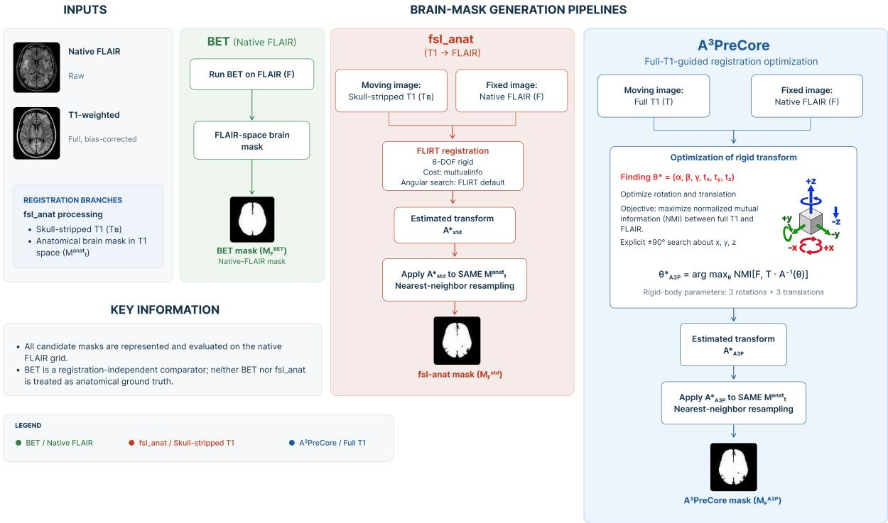  
Figure 2: Native-FLAIR brain-mask transfer and comparison workflows. BET generated a brain mask directly from the native FLAIR image, �. The fsl\_anat and A3PreCore workflows propagated the same $\mathrm { T } _ { 1 }$ -space anatomical mask, $M _ { T } ^ { \mathrm { a n a t } }$ , but difered in transformation estimation. The fsl\_anat registered the skull-stripped $\mathrm { T } _ { 1 }$ image, $T _ { B }$ to $F$ using FLIRT with mutualinfo, whereas $\mathbf { A } ^ { 3 } \mathbf { P r e C o r e }$ registered the full bias-corrected $\mathrm { T } _ { 1 }$ image, $T ,$ to $F$ using normmi. Both workflows estimated subject-specific six-degree-of-freedom rigid transformations comprising rotational and translational parameters and applied the resulting transformation to the same anatomical source mask using nearest-neighbour resampling. All candidate masks were evaluated on the native FLAIR grid.

This workflow provides a controlled registration-based comparator because the anatomical source mask is identical to that used by $\mathbf { A } ^ { 3 } \mathbf { P r e C o r e }$ . Consequently, diferences between the resulting native-FLAIR masks can be attributed to diferences in transformation estimation rather than source-mask anatomy.

A potential limitation of the $\tt f s l$ \_anat is the diference in anatomical support between the moving and fixed images. The moving image $T _ { B }$ contains predominantly intracranial tissue, whereas the raw FLAIR reference may retain skull, scalp, inferior neck structures, spinal-canal signal, and additional non-brain foreground. This mismatch may reduce the spatial constraints available to multimodal registration in participants with atypical head position, variable inferior coverage, intensity inhomogeneity, motion-related artifact, or prominent extracranial FLAIR signal.

## 3.3 A3PreCore Full-T1 Registration Strategy

A3PreCore replaced the skull-stripped moving image with the full bias-corrected $\mathrm { T } _ { 1 }$ image, T1\_biascorr.nii.gz. FLIRT estimated a subject-specific six-degree-of-freedom rigid transformation from $T$ to $F$ using the normmi cost function, with three rotational parameters $( \alpha , \beta , \gamma )$ and three translational parameters $( t _ { x } , t _ { y } , t _ { z } )$ optimized jointly as part of the rigid transformation. Separately, the implemented FLIRT command explicitly specified angular search bounds of $- 9 0 ^ { \circ } ~ \mathrm { t o } ~ { + } 9 0 ^ { \circ }$ for each image axis. These bounds define the angular domain explored during the initial search stage and are distinct from the subject-specific rotational parameters $( \alpha , \beta , \gamma )$ estimated by the registration optimization; they do not represent fixed rotations applied to the FLAIR image. The workflow otherwise retained FLIRT’s default initialization and optimization schedule.

No input masks, voxel-weighting images, cropping operations, or additional reorientation options were supplied during transformation estimation.

The workflow retained $\mathrm { F L I R T } \mathrm { s }$ default initialization and optimization schedule. No input masks, voxelweighting images, cropping operations, or additional reorientation options were supplied during transformation estimation. Because no explicit intensity-image interpolation option was specified, FLIRT used its default trilinear interpolation when generating the registered full $- \mathrm { T } _ { 1 }$ image.

Let the transformation estimated by $\mathbf { A } ^ { 3 }$ PreCore be $A _ { \mathrm { A 3 P } } ^ { * }$ . After registration, this transformation was applied to the same $M _ { T } ^ { \mathrm { a n a t } }$ used by the fsl\_anat comparator. Accordingly, the resulting mask, $M _ { F } ^ { \mathrm { A } 3 \mathrm { P } }$ , represents the placement of a fixed anatomical source mask under the $\mathsf { A } ^ { 3 } \mathsf { P r e C }$ ore registration strategy rather than a newly estimated anatomical segmentation.

## 3.4 Rigid Registration Model and Multimodal Similarity Objectives

Both registration-based workflows modelled the $_ { \mathrm { T _ { 1 } - t o - F L A I R } }$ mapping as a six-degree-of-freedom rigid-body transformation. Because the $\mathrm { T } _ { 1 }$ and FLAIR acquisitions were obtained from the same participant, the transformation was restricted to translations and rotations and deliberately excluded scaling, shearing, and nonlinear deformation. Let

$$
\theta = ( \alpha , \beta , \gamma , t _ { x } , t _ { y } , t _ { z } ) ^ { \top } \in \Theta \subset \mathbb { R } ^ { 6 }\tag{4}
$$

denote the rigid-transformation parameters, where $\alpha , \beta ,$ and $\gamma$ are rotations and $t _ { x } , t _ { y }$ , and $t _ { z }$ are translations. For a physical coordinate $x \in \Omega _ { T }$ , the mapping from $\mathrm { T } _ { 1 }$ space to native FLAIR space was represented as

$$
\widetilde { y } = A _ { T  F } ( \theta ) \widetilde { x } , \qquad A _ { T  F } ( \theta ) \in \mathrm { S E } ( 3 ) ,\tag{5}
$$

with

$$
A _ { T  F } ( \theta ) = [ \begin{array} { c c c c } { { R ( \alpha , \beta , \gamma ) } } & { { t } } \\ { { 0 ^ { \top } } } & { { 1 } } \end{array} ] , \qquad t = [ t _ { y } ] ,\tag{6}
$$

and

$$
R ( \alpha , \beta , \gamma ) = R _ { z } ( \gamma ) R _ { y } ( \beta ) R _ { x } ( \alpha ) .\tag{7}
$$

Because $\mathrm { T _ { 1 } \mathrm { - w e i g h t e d } }$ and FLAIR images exhibit diferent tissue-contrast relationships, entropy-based multimodal similarity criteria were used rather than direct voxel-intensity diferences [33, 50]. For a candidate transformation $\theta ,$ let

$$
\boldsymbol { I } _ { \theta } ( y ) = \boldsymbol { I } ( \boldsymbol { A } _ { T  F } ^ { - 1 } ( \theta ) \boldsymbol { y } ) , \qquad \boldsymbol { y } \in \Omega _ { F } ,\tag{8}
$$

denote the moving image sampled on the native FLAIR grid.

The fsl\_anat used FLIRT’s mutual-information objective, represented conceptually as

$$
\boldsymbol { \theta } _ { \mathrm { f s l \_ a n a t } } ^ { * } = \arg \operatorname* { m a x } _ { \boldsymbol { \theta } \in \Theta } \mathrm { M I } [ \boldsymbol { F } , T _ { B } \circ A _ { T  F } ^ { - 1 } ( \boldsymbol { \theta } ) ] ,\tag{9}
$$

where

$$
\mathbf { M I } ( F , I _ { \theta } ) = H ( F ) + H ( I _ { \theta } ) - H ( F , I _ { \theta } ) .\tag{10}
$$

A3PreCore used normalized mutual information, conceptually expressed as

$$
\mathrm { N M I } ( F , I _ { \theta } ) = \frac { H ( F ) + H ( I _ { \theta } ) } { H ( F , I _ { \theta } ) } ,\tag{11}
$$

with

$$
\boldsymbol { \theta } _ { \mathrm { A 3 P } } ^ { * } = \arg \operatorname* { m a x } _ { \boldsymbol { \theta } \in \Theta } \mathrm { N M I } [ \boldsymbol { F } , \boldsymbol { T } \circ A _ { T  \boldsymbol { F } } ^ { - 1 } ( \boldsymbol { \theta } ) ] .\tag{12}
$$

Here, $\alpha , \beta ,$ and $\gamma$ are subject-specific rotational parameters estimated jointly with translation during rigid optimization. These optimized rotational parameters are distinct from the angular-search bounds used by FLIRT during its initial search procedure. The corresponding rigid transformation matrices were

$$
A _ { \mathrm { f s l \_ a n a t } } ^ { * } = A _ { T  F } ( \theta _ { \mathrm { f s l \_ a n a t } } ^ { * } ) , \qquad A _ { \mathrm { A 3 P } } ^ { * } = A _ { T  F } ( \theta _ { \mathrm { A 3 P } } ^ { * } ) .\tag{13}
$$

These expressions describe the conceptual optimization objectives; numerical estimation used FLIRT with its internal optimization schedule. Because normalized mutual information formed part of the $\mathsf { A } ^ { 3 }$ PreCore optimization objective, subsequent controlled NMI analyses were interpreted as registration-similarity characterization rather than as independent evidence of anatomical accuracy.

## 3.5 Anatomical Mask Propagation and Native-FLAIR Outputs

Each estimated transformation was applied to the same binary anatomical source mask, ${ M _ { T } ^ { \mathrm { a n a t } } : \Omega _ { T }  \{ 0 , 1 \} }$ The raw native FLAIR image defined the reference geometry, and binary masks were resampled using nearest-neighbour interpolation.

For $y \in \Omega _ { F }$ , the transferred masks were written as

$$
M _ { F } ^ { \mathrm { f s l \_ a n a t } } ( y ) = \mathrm { N N } \left[ M _ { T } ^ { \mathrm { a n a t } } \left( ( A _ { \mathrm { f s l \_ a n a t } } ^ { \ast } ) ^ { - 1 } y \right) \right] ,\tag{14}
$$

$$
M _ { F } ^ { \mathrm { A 3 P } } ( y ) = \mathrm { N N } \left[ M _ { T } ^ { \mathrm { a n a t } } \left( ( A _ { \mathrm { A 3 P } } ^ { * } ) ^ { - 1 } y \right) \right] .\tag{15}
$$

Nearest-neighbour interpolation preserved the discrete values of the binary source mask. No additional thresholding, connected-component filtering, hole filling, or other mask-cleanup operation was applied immediately after resampling.

The corresponding non-dilated brain-extracted native FLAIR images were generated as

$$
F _ { \mathrm { b r a i n } } ^ { ( m ) } ( y ) = F ( y ) M _ { F } ^ { ( m ) } ( y ) , \qquad m \in \{ \mathrm { f s l \_ a n a t , A 3 P } \} .\tag{16}
$$

For the configured permissive output, one fslmaths -dilM operation was subsequently applied to each registration-derived mask:

$$
M _ { F , \mathrm { d i l } } ^ { ( m ) } = \mathrm { D i l a t e } _ { \mathrm { d i l M } } \left( M _ { F } ^ { ( m ) } \right) ,\tag{17}
$$

followed by

$$
F _ { \mathrm { b r a i n , d i l } } ^ { ( m ) } ( y ) = F ( y ) M _ { F , \mathrm { d i l } } ^ { ( m ) } ( y ) .\tag{18}
$$

The primary mask analyses described in Section 5 used the configured dilated mask variants. Dilation was therefore part of the reported analysis pipeline rather than an unreported downstream visualization step.

## 3.6 Methodological Contrast and Technical Output Validation

The $\mathtt { f s l \_ a n a t }$ and $\mathbf { A } ^ { 3 } \mathbf { P r e C o r e }$ workflows shared the same native FLAIR reference, $\mathrm { T } _ { 1 }$ -derived anatomical source mask, six-degree- of-freedom transformation model, nearest-neighbour mask resampling, configured dilation step, and native-FLAIR output geometry. The implemented workflows difered in three registration components: the moving $\mathrm { T } _ { 1 }$ representation, multimodal similarity objective, and rotational-search specification.

The fsl\_anat used the skull-stripped image $T _ { B } ,$ , mutualinfo, and FLIRT’s default angular-search configuration, whereas ${ \mathbf A } ^ { 3 }$ PreCore used the full bias-corrected image $T _ { \ast }$ , normmi, and an explicit $\pm 9 0 ^ { \circ }$ search around all three axes. The principal methodological comparison therefore evaluates the two registration strategies as implemented and should not be interpreted as isolating the efect of the moving-image representation alone.

The contrast can be summarized as

$$
{ \cal M } _ { T } ^ { \mathrm { a n a t } } \ : \frac { T _ { B } {  } F } { \underset { \mathrm { d e f a u l t a n g u l a r s e a r c h } } { \mathrm { m u t u a l i n f o } } } \ : { \cal M } _ { F } ^ { \mathrm { f s l \_ a n a t } } ,\tag{19}
$$

$$
M _ { T } ^ { \mathrm { a n a t } } \xrightarrow [ \pm 9 0 ^ { \mathrm { o u g u l a r s e a r c h } } ] { T  F } M _ { F } ^ { \mathrm { A 3 P } } .\tag{20}
$$

For every participant, generated registered images and masks were checked for three-dimensional readability and compatibility with the corresponding native FLAIR image. Output dimensions were required to match exactly, and afine matrices were required to agree within an absolute element-wise tolerance of $1 0 ^ { - 4 }$

Missing or unreadable outputs and native-grid incompatibility were recorded separately from anatomical implausibility or registration failure. Importantly, outputs exhibiting adverse spatial behaviour or gross misregistration were retained rather than removed after technical validation, because such failures constituted outcomes of methodological interest. Detailed quality-control, pairwise comparison, registration- assessment, and statistical procedures are described in Sections 4 and 5.

## 4 E-QC: Multidimensional Quality Control for Native-FLAIR Brain Masks

## 4.1 Rationale and Design Principles

Conventional global quality-control measures may fail to identify participant-specific abnormalities in automatically generated brain masks [42, 51, 52]. A candidate mask may retain a plausible total volume, remain near the centre of the acquisition field of view, and exhibit apparently reasonable FLAIR signal characteristics while still being displaced, diferently oriented, or locally extended into non-brain tissue. Conversely, localized boundary abnormalities may occur without producing marked changes in global mask characteristics.

These limitations are particularly relevant when comparing direct FLAIR-space brain extraction with registration-based mask-transfer workflows. A transferred mask may preserve a plausible global size and morphology despite an incorrect $\mathrm { T } _ { 1 }$ -to-FLAIR transformation, whereas a directly generated native-FLAIR mask avoids transformation-estimation failure but may remain susceptible to modality-specific extraction errors.

We therefore developed extended quantitative quality control (E-QC) as a multidimensional framework that preserves complementary information rather than collapsing heterogeneous descriptors into a single quality score. E-QC comprises two analytically distinct levels:

1. Method-specific mask characterization. Each candidate mask is described independently using measures of physical extent, field-of-view-relative position, FLAIR intensity support, boundary-gradient support, peripheral foreground occupation, and inferior morphology.

2. Pairwise geometric characterization. For each predefined pair of candidate masks, disagreement is described using relative volume diference, physical centroid displacement, principal-axis orientation diference, and the physical-scale boundary consequence of that orientation diference.

The method-specific descriptors characterize how an individual candidate mask relates to its own native FLAIR image and acquisition geometry. The pairwise descriptors instead characterize disagreement between two candidate masks. We did not interpret either level as anatomical ground truth.

Importantly, no arithmetic mean, geometric mean, minimum operator, learned weighting scheme, or other scalarization was used to combine E-QC descriptors. This design preserves potentially discordant dimensions of mask behaviour that would otherwise be obscured by compensation within an aggregate score. For a candidate mask $M _ { a } .$ , native FLAIR image �, and predefined comparator $M _ { b }$ , E-QC therefore retains

$$
\boldsymbol { \mathcal { P } } ( M _ { a } , F ) = \left[ V _ { a } , C _ { a } , R _ { I , a } , B _ { G , a } , P _ { \mathrm { p e r i p h e r a l } , a } , P _ { \mathrm { t a i l } , a } \right] ^ { \intercal } ,\tag{21}
$$

together with the pairwise vector

$$
\mathbf { Q } _ { \mathrm { E - Q C } } ^ { ( a , b ) } = \left[ \delta _ { V } ^ { ( a , b ) } , D _ { C } ^ { ( a , b ) } , \theta _ { \mathrm { P C A } } ^ { ( a , b ) } , D _ { \mathrm { P C A } } ^ { ( a , b ) } \right] ^ { \top } .\tag{22}
$$

The fsl\_anat served as the primary methodological comparator, whereas BET served as the registrationindependent native-FLAIR comparator. Comparator assignment was specified a priori at the analysis level and was not influenced by E-QC results. Neither comparator was treated as anatomical ground truth. Figure 3 summarizes the complete E-QC workflow, including input validation, method-specific mask characterization, pairwise geometric characterization, and retention of the resulting multidimensional descriptor profiles without reduction to a composite quality score.

## 4.2 Common Image Domain and Input Validation

Let $F ( x )$ denote native FLAIR intensity at voxel $x \in \Omega .$ , where Ω represents the complete three-dimensional image domain. Each input mask was converted to a binary representation,

$$
M ( x ) = \kappa \left[ M _ { \mathrm { i n p u t } } ( x ) > 0 . 5 \right] , \qquad M ( x ) \in \{ 0 , 1 \} ,\tag{23}
$$

where $\vert \ast \lbrack \cdot \rbrack$ denotes the indicator function. The number of foreground voxels was

$$
| M | = \sum _ { x \in \Omega } M ( x ) .\tag{24}
$$

E-QC proceeded only when the candidate mask and corresponding FLAIR image were readable threedimensional NIfTI images with identical matrix dimensions. Afine matrices were considered compatible when

$$
\operatorname* { m a x } _ { i , j } \left| A _ { M , i j } - A _ { F , i j } \right| \leq 1 0 ^ { - 4 } ,\tag{25}
$$

using an absolute element-wise tolerance and zero relative tolerance. Voxel indices were mapped to physical coordinates using the native FLAIR voxel-to-world afine [53],

$$
\tilde { p } ( x ) = A _ { F } \left[ x _ { 1 } \quad x _ { 2 } \quad x _ { 3 } \quad 1 \right] ^ { \mathsf { T } } , \qquad p ( x ) = \tilde { p } _ { 1 : 3 } ( x ) ,\tag{26}
$$

where $p ( x ) \in \mathbb { R } ^ { 3 }$ is expressed in millimetres. Let $\boldsymbol { L } \in \mathbb { R } ^ { 3 \times 3 }$ denote the linear spatial component of $A _ { F }$ . The physical volume represented by one voxel was

$$
\nu _ { \mathrm { v o x } } = | \operatorname* { d e t } ( L ) | .\tag{27}
$$

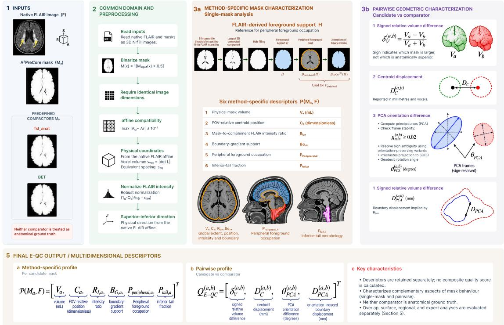  
Figure 3: Overview of the extended quantitative quality-control (E-QC) framework for native-FLAIR brain-mask assessment. E-QC receives the native FLAIR image, �, a candidate mask, $M _ { a }$ , and a prespecified comparator, $M _ { b }$ , after common input validation and native-space preprocessing. The framework separates into two complementary analytical branches. Method-specific mask characterization independently retains physical volume, field-of-view-relative position, FLAIR intensity support, boundary-gradient support, peripheral foreground occupation, and inferior-tail morphology. Pairwise geometric characterization quantifies signed relative volume diference, physical centroid displacement, principal-axis orientation diference, and the corresponding PCA-orientation-induced boundary displacement, with PCA-based descriptors reported only when the predefined eigengap stability criterion is satisfied. The resulting method-specific and pairwise profiles are retained as separate multidimensional descriptors and are not reduced to a composite quality score. The fsl\_anat serves as the primary methodological comparator and BET as the registration-independent native-FLAIR comparator; neither is treated as anatomical ground truth.

The corresponding physical voxel dimensions were denoted $s _ { 1 } , s _ { 2 } , s _ { 3 }$ . Their geometric mean,

$$
s _ { \mathrm { e q } } = \left( s _ { 1 } s _ { 2 } s _ { 3 } \right) ^ { 1 / 3 } ,\tag{28}
$$

was used when a single physical length scale was required.

## 4.3 FLAIR Intensity and Spatial Preprocessing

For descriptors requiring image-intensity or gradient information, positive finite FLAIR intensities were robustly normalized [42]. Let $q _ { 1 }$ and $q 9 9$ denote the 1st and 99th percentiles of positive finite FLAIR intensities. For $q _ { 9 9 } > q _ { 1 }$ ，

$$
F _ { \mathrm { n o r m } } ( x ) = \mathrm { c l i p } \left( \frac { F ( x ) - q _ { 1 } } { q _ { 9 9 } - q _ { 1 } } , 0 , 1 \right) .\tag{29}
$$

Degenerate intensity distributions for which this normalization could not be evaluated were treated as invalid for the afected descriptor rather than assigned an artificial score.

The anatomical inferior–superior direction was determined from the native FLAIR afine. Let uSI denote the unit vector pointing in the physical superior direction. The corresponding physical inferior–superior coordinate was

$$
z _ { \mathrm { S I } } ( x ) = { \bf u } _ { \mathrm { S I } } ^ { \top } p ( x ) .\tag{30}
$$

The anatomical orientation encoded by the afine, rather than raw voxel-index ordering alone, was used to establish the inferior direction for morphological characterization.

## 4.4 Method-Specific Mask Characterization

The six components of Equation 21 characterize complementary aspects of individual candidate-mask behaviour. They were retained and analyzed separately because they difer in units, physical interpretation, and sensitivity to acquisition geometry.

## 4.4.1 Physical Mask Volume

The physical volume of candidate mask � was

$$
V _ { M } = \nu _ { \mathrm { v o x } } \sum _ { x \in \Omega } M ( x ) ,\tag{31}
$$

and was reported in millilitres after division by 1000. Mask volume provides a global measure of spatial extent but does not identify the anatomical location of disagreement [44]. Accordingly, $V _ { M }$ was interpreted descriptively rather than as evidence that a larger or smaller candidate mask was anatomically superior.

## 4.4.2 Geometric Centroid and FOV-Relative Position

For a non-empty candidate mask, its physical geometric centroid was

$$
c _ { M } = \frac { 1 } { \vert M \vert } \sum _ { x : M ( x ) = 1 } p ( x ) .\tag{32}
$$

The physical centre of the complete native FLAIR field of view was

$$
c _ { \Omega } = { \frac { 1 } { | \Omega | } } \sum _ { x \in \Omega } p ( x ) ,\tag{33}
$$

and the physical field-of-view radius was

$$
r _ { \Omega } = \operatorname* { m a x } _ { x \in \Omega } \| p ( x ) - c _ { \Omega } \| _ { 2 } .\tag{34}
$$

The normalized FOV-relative centroid ofset was

$$
C _ { M } = \frac { \| c _ { M } - c _ { \Omega } \| _ { 2 } } { r _ { \Omega } } .\tag{35}
$$

$C _ { M }$ is dimensionless and describes mask position relative to the physical extent of the acquisition field of view. Because this reference is determined by acquisition geometry rather than by an anatomical landmark, valid diferences in head position, cropping, or inferior image coverage can alter $C _ { M }$ . It was therefore interpreted as a positional descriptor rather than as an anatomical-centring score [52].

## 4.4.3 Mask-to-Complement FLAIR Intensity Ratio

To characterize relative FLAIR intensity support, the positive-intensity complement of a candidate mask was defined as

$$
{ \overline { { M } } } _ { + } = \left\{ x \in \Omega : M ( x ) = 0 , \ F ( x ) > 0 , \ F ( x ) \ { \mathrm { f n i t e } } \right\} .\tag{36}
$$

The robust mask-to-complement squared-intensity ratio was

$$
R _ { I } ( M , F ) = \frac { \mathrm { m e d i a n } \left\{ | F ( x ) | ^ { 2 } : M ( x ) = 1 , \ F ( x ) \ \mathrm { f i n i t e } \right\} } { \mathrm { m e d i a n } \left\{ | F ( x ) | ^ { 2 } : x \in \overline { { M } } _ { + } \right\} } .\tag{37}
$$

The quantity was treated as undefined if either sampling region was empty or if the denominator was zero. Because the complement changes with the candidate mask, $R _ { I }$ is a method-specific mask-to-image descriptor rather than an invariant tissue-contrast measure. Its magnitude was not interpreted as a direct measure of anatomical inclusion or exclusion [42, 54].

## 4.4.4 Spacing-Aware Boundary-Gradient Support

A spacing-aware three-dimensional gradient magnitude was calculated from $F _ { \mathrm { n o r m } }$ ,

$$
G ( x ) = \| \nabla F _ { \mathrm { n o r m } } ( x ) \| _ { 2 } ,\tag{38}
$$

with finite diferences evaluated using the corresponding physical voxel spacing [55]. To reduce dependence on voxel anisotropy, the internal mask boundary was represented as a physical boundary band. Let $d _ { M } ( x )$ denote the spacing-aware Euclidean distance from an interior mask voxel $x \in M$ to the complement of �. The boundary band was

$$
\partial _ { \rho } M = \left\{ x \in M : d _ { M } ( x ) \leq \rho \right\} , \qquad \rho = s _ { \mathrm { { e q } } } .\tag{39}
$$

The boundary-gradient support descriptor was

$$
B _ { G } ( M , F ) = \frac { \mathrm { m e d i a n } _ { x \in \partial _ { \rho } M } G ( x ) } { P _ { 7 5 } \left( \{ G ( x ) : G ( x ) > 0 \} \right) } ,\tag{40}
$$

provided that the denominator was non-zero. $B _ { G }$ describes the amount of local FLAIR-gradient support associated with the candidate-mask boundary relative to the whole-image gradient distribution. Strong gradients may occur at valid intracranial boundaries but may also occur at skull, scalp, sinus, or neck interfaces. Consequently, $B _ { G }$ was interpreted as image-edge support rather than as a direct measure of anatomical boundary accuracy.

## 4.4.5 FLAIR-Derived Foreground Support

Peripheral occupation was evaluated relative to a coarse foreground support obtained independently of the candidate mask from the native FLAIR image. Let � denote the fifth percentile of positive, finite native FLAIR intensities. An initial foreground was obtained by thresholding the native image at $t _ { \mathrm { F G } } ;$ its largest three-dimensional connected component was retained, and internal holes were filled to obtain � [56]:

$$
H = { \mathrm { F i l l H o l e s } } \left[ { \mathrm { L C C } } \left( \{ x \in \Omega : F ( x ) > t _ { \mathrm { F G } } , ~ F ( x ) { \mathrm { ~ f i n i t e } } \} \right) \right] .\tag{41}
$$

The resulting support provides an image-derived reference for peripheral mask occupation and was not treated as a brain segmentation or anatomical ground truth. A peripheral band was constructed by subtracting a three-iteration binary erosion of � from the original support:

$$
B _ { \mathrm { p e r } } ( H ) = H \setminus \mathrm { E r o d e } ^ { ( 3 ) } ( H ) .\tag{42}
$$

Here, Erode(3) denotes three successive binary-erosion iterations with a face-connected three-dimensional structuring element on the native image grid; voxels outside the image were treated as background. The band therefore follows the operational voxel-space construction used for the reported peripheral descriptor;

its thickness should not be interpreted as a fixed physical distance in millimetres. The same foreground construction and erosion settings were applied to all candidate methods for a given participant.

## 4.4.6 Peripheral Foreground Occupation

Peripheral foreground occupation characterizes the fraction of a candidate mask that overlaps the outer band of the independently derived FLAIR foreground support. For a non-empty candidate mask �, it was defined as

$$
P _ { \mathrm { p e r i p h e r a l } } ( M , F ) = \frac { \left| M \cap B _ { \mathrm { p e r } } ( H ) \right| } { | M | } .\tag{43}
$$

Thus, $0 \leq P _ { \mathrm { p e r i p h e r a l } } \leq 1$ ; larger values indicate that a greater fraction of the candidate mask occupies the peripheral band of the image-derived foreground. This descriptor may reveal peripheral mask extensions that are not apparent from global volume or FOV-relative centroid position. However, voxels lying entirely outside � do not contribute to its numerator. Consequently, $P _ { \mathrm { p e r i p h e r a l } }$ characterizes foreground-band occupation, not total extracranial inclusion or all possible mask overextensions. As � is an intensity-derived approximation rather than an anatomical reference, the descriptor was interpreted descriptively rather than as direct evidence of anatomical accuracy.

## 4.4.7 Inferior-Tail Fraction

A complementary descriptor characterized narrow inferior mask extensions that global volume or centroid measures may not capture. The candidate mask was evaluated along the physical inferior–superior direction. Let $S _ { k }$ denote contiguous physical slabs of thickness

$$
\Delta z = s _ { \mathrm { e q } } .\tag{44}
$$

The mask volume within slab � was

$$
V _ { M } ( k ) = \nu _ { \mathrm { v o x } } \sum _ { x \in S _ { k } } M ( x ) ,\tag{45}
$$

and its cross-sectional-equivalent area was

$$
A _ { M } ( k ) = \frac { V _ { M } ( k ) } { \Delta z } .\tag{46}
$$

Let

$$
A _ { \operatorname* { m a x } } = \operatorname* { m a x } _ { k } A _ { M } ( k ) , \qquad a ( k ) = \frac { A _ { M } ( k ) } { A _ { \operatorname* { m a x } } } .\tag{47}
$$

Beginning at the inferior end of the occupied mask extent, $T _ { \mathrm { i n f } }$ was defined as the maximal contiguous sequence of slabs satisfying

$$
a ( k ) \leq \tau , \qquad \tau = 0 . 2 5 ,\tag{48}
$$

with accumulation terminating at the first slab for which $a ( k ) > \tau$ . The inferior-tail fraction was

$$
P _ { \mathrm { t a i l } } ( M ) = \frac { \sum _ { k \in T _ { \mathrm { i n f } } } V _ { M } ( k ) } { V _ { M } } .\tag{49}
$$

Thus,

$$
0 \leq P _ { \mathrm { t a i l } } \leq 1 .\tag{50}
$$

$P _ { \mathrm { t a i l } }$ specifically characterizes a narrow low-cross-sectional-area extension originating from the inferior end of the mask. It is not intended to detect every form of inferior abnormality; broad inferior extensions may produce little change in this descriptor. �peripheral provides complementary information when a mask extension intersects the outer band of the FLAIR-derived foreground, but neither measure captures every possible form of mask overextension.

Valid brainstem, cerebellar, or other inferior anatomy may also contribute to the measured tail fraction. $P _ { \mathrm { t a i l } }$   
was therefore interpreted as a morphological descriptor rather than as a definitive contamination label.

## 4.5 Pairwise Geometric Characterization

Method-specific descriptors do not directly describe how two candidate masks difer from one another. For each predefined pair $M _ { a }$ and $M _ { b }$ , E-QC therefore retained complementary measures of global extent, position, and principal-axis orientation.

## 4.5.1 Signed Relative Volume Diference

For physical mask volumes $V _ { a } > 0$ and $V _ { b } > 0$

$$
\delta _ { V } ^ { ( a , b ) } = \frac { V _ { a } - V _ { b } } { V _ { a } + V _ { b } } .\tag{51}
$$

The quantity lies in $( - 1 , 1 )$ and changes sign when the order of the methods is reversed,

$$
\delta _ { V } ^ { ( b , a ) } = - \delta _ { V } ^ { ( a , b ) } .\tag{52}
$$

Its magnitude is symmetric and is directly related to volumetric similarity [44],

$$
\operatorname { V S } ( a , b ) = 1 - \frac { | V _ { a } - V _ { b } | } { V _ { a } + V _ { b } } , \qquad \left| \delta _ { V } ^ { ( a , b ) } \right| = 1 - \operatorname { V S } ( a , b ) .\tag{53}
$$

The sign identifies only which candidate has the larger physical volume and does not indicate anatomical superiority.

## 4.5.2 Physical Centroid Displacement

For candidate masks $M _ { a }$ and $M _ { b }$ , the signed centroid-diference vector was

$$
\Delta c _ { a - b } = c _ { a } - c _ { b } .\tag{54}
$$

Its Euclidean magnitude defines the physical centroid displacement,

$$
D _ { C } ^ { ( a , b ) } = \| c _ { a } - c _ { b } \| _ { 2 } ,\tag{55}
$$

reported in millimetres [52]. For compatibility with the native voxel grid, the corresponding voxel-coordinate displacement was additionally retained as

$$
D _ { C } ^ { \mathrm { ( v o x ) } } = \left. L ^ { - 1 } \left( c _ { a } - c _ { b } \right) \right. _ { 2 } .\tag{56}
$$

Centroid displacement may result from rigid translation, inferior extension, unilateral inclusion, localized exclusion, or other diferences in mask shape. It was therefore not interpreted as a direct estimate of registration translation.

## 4.5.3 Principal-Axis Frames and Stability

For mask $M _ { A }$ , the physical-coordinate covariance matrix was

$$
\Sigma _ { A } = \frac { 1 } { | M _ { A } | } \sum _ { x : M _ { A } ( x ) = 1 } \left[ p ( x ) - c _ { A } \right] \left[ p ( x ) - c _ { A } \right] ^ { \mathsf { T } } .\tag{57}
$$

When a mask contained more than 250,000 voxels, deterministic subsampling was used for computational eficiency. Let

$$
\lambda _ { A , 1 } \geq \lambda _ { A , 2 } \geq \lambda _ { A , 3 } \geq 0\tag{58}
$$

denote the ordered eigenvalues of $\Sigma _ { A }$ , with corresponding ordered unit eigenvectors $q _ { A , 1 } , q _ { A , 2 }$ , and $q _ { A , 3 }$ [57]. The principal-axis frame was

$$
\begin{array} { r } { Q _ { A } = \bigg [ q _ { A , 1 } \quad q _ { A , 2 } \quad q _ { A , 3 } \bigg ] . } \end{array}\tag{59}
$$

If

$$
\operatorname* { d e t } ( Q _ { A } ) < 0 ,\tag{60}
$$

the sign of the final eigenvector was reversed so that $Q _ { A }$ formed a right-handed orthonormal frame. Because individual PCA axes become unstable when adjacent eigenvalues are nearly equal, relative eigengaps were calculated as [58]

$$
g _ { A , 1 2 } = \frac { \lambda _ { A , 1 } - \lambda _ { A , 2 } } { \lambda _ { A , 1 } } , \qquad g _ { A , 2 3 } = \frac { \lambda _ { A , 2 } - \lambda _ { A , 3 } } { \lambda _ { A , 2 } } .\tag{61}
$$

For a pair $M _ { a } , M _ { b }$ , joint frame stability was summarized by

$$
g _ { \operatorname * { m i n } } ^ { ( a , b ) } = \operatorname * { m i n } \left( g _ { a , 1 2 } , g _ { a , 2 3 } , g _ { b , 1 2 } , g _ { b , 2 3 } \right) .\tag{62}
$$

PCA-based orientation descriptors were considered interpretable only when

$$
g _ { \operatorname* { m i n } } ^ { ( a , b ) } \geq 0 . 0 2 .\tag{63}
$$

When either mask failed this criterion, $\theta _ { \mathrm { P C A } }$ and $D _ { \mathrm { P C A } }$ were recorded as unavailable rather than forcing an orientation comparison between unstable principal-axis frames.

The eigengap threshold was used as an operational numerical-stability criterion and was not interpreted as an anatomical or diagnostic cutof.

## 4.5.4 Principal-Axis Orientation Diference

Each PCA eigenvector is defined only up to sign. The four orientation-preserving sign configurations were therefore

$$
S = \left\{ s \in \{ - 1 , + 1 \} ^ { 3 } : s _ { 1 } s _ { 2 } s _ { 3 } = 1 \right\} .\tag{64}
$$

For each $s \in S$ , the sign-adjusted candidate frame was

$$
Q _ { a } ( s ) = Q _ { a } \mathrm { d i a g } ( s ) .\tag{65}
$$

The corresponding relative frame matrix was

$$
H _ { s } = Q _ { b } Q _ { a } ( s ) ^ { \mathsf { T } } .\tag{66}
$$

To remove small numerical deviations from exact orthogonality, $H _ { s }$ was projected onto the nearest proper rotation matrix using the orthogonal Procrustes solution [59]. If

$$
\boldsymbol { H _ { s } } = U _ { s } \boldsymbol { \Sigma _ { s } } \boldsymbol { V } _ { s } ^ { \intercal } ,\tag{67}
$$

then

$$
\boldsymbol { R _ { s } } = \boldsymbol { U _ { s } } \operatorname { d i a g } \left( 1 , 1 , \operatorname* { d e t } ( \boldsymbol { U _ { s } } \boldsymbol { V } _ { s } ^ { \intercal } ) \right) \boldsymbol { V } _ { s } ^ { \intercal } .\tag{68}
$$

The geodesic rotation angle on SO(3) was [60]

$$
\theta _ { s } = \cos ^ { - 1 } \left[ \mathrm { c l i p } \left( \frac { \mathrm { t r } ( R _ { s } ) - 1 } { 2 } , - 1 , 1 \right) \right] .\tag{69}
$$

The sign-resolved principal-axis orientation diference was

$$
\theta _ { \mathrm { P C A } } ^ { ( a , b ) } = \operatorname* { m i n } _ { s \in S } \theta _ { s } .\tag{70}
$$

We calculated angles in radians and reported them in degrees. $\theta _ { \mathrm { P C A } }$ describes disagreement in the dominant geometric axes of the candidate masks. It does not estimate the actual rotational parameters of the $\mathrm { T } _ { 1 } \mathrm { - }$ to-FLAIR registration. Localized inclusion, asymmetric extraction, inferior extension, dilation, or other mask-shape diferences may alter the PCA frame.

## 4.5.5 PCA-Orientation-Induced Boundary Displacement

To express the PCA-frame orientation diference in physical distance units, the selected sign-resolved rotation was applied to centred boundary coordinates.

Let $R _ { a  b }$ denote the proper rotation corresponding to $\theta _ { \mathrm { P C A } } ^ { ( a , b ) }$ . For a boundary point $p \in \partial _ { \rho } M _ { a }$

$$
d _ { a  b } ( p ) =  R _ { a  b } [ p - c _ { a } ] - [ p - c _ { a } ]  _ { 2 } .\tag{71}
$$

The directional summary was

$$
D _ { a \to b } = \mathrm { m e d i a n } \left\{ d _ { a \to b } ( p ) : p \in \partial _ { \rho } M _ { a } \right\} .\tag{72}
$$

When a boundary contained more than 250,000 points, deterministic subsampling was used. The reversedirection rotation was

$$
R _ { b  a } = R _ { a  b } ^ { \top } ,\tag{73}
$$

and the symmetric orientation-induced boundary displacement was

$$
D _ { \mathrm { P C A } } ^ { ( a , b ) } = \frac { D _ { a  b } + D _ { b  a } } { 2 } .\tag{74}
$$

$D _ { \mathrm { P C A } }$ was reported in millimetres. This quantity represents the physical boundary-scale consequence of the same principal-axis orientation diference measured by $\theta _ { \mathrm { P C A } }$ . The two descriptors are therefore related rather than statistically independent.

$D _ { \mathrm { P C A } }$ is not equivalent to Hausdorf distance, average symmetric surface distance, surface Dice, pointcorrespondence displacement, or actual registration displacement. It quantifies only the boundary displacement induced by the relative PCA-frame orientation.

## 5 Experimental Evaluation

## 5.1 Evaluation Design and Prespecified Comparisons

The experimental evaluation addressed three complementary dimensions of native-FLAIR brain-mask assessment: method-specific mask characterization, fixed pairwise inter-method disagreement, and registrationrelated multimodal similarity. Independently delineated manual brain masks in native FLAIR space were not available. Accordingly, method-specific $\mathrm { E - Q C }$ descriptors and pairwise overlap, surface, regional, slice-wise, volumetric, and geometric measures were interpreted as complementary characterizations of mask behaviour and inter-method agreement rather than as estimates of anatomical accuracy.

We evaluated three native-FLAIR-space masks: the direct BET mask $M _ { F } ^ { \mathrm { B E T } }$ , the fsl\_anat output $M _ { F } ^ { \mathrm { f s l \_ a n a t } }$ and the proposed $\mathsf { A } ^ { 3 }$ PreCore output $M _ { F } ^ { \mathrm { A } 3 \mathrm { P } }$ . For fsl\_anat, the skull-stripped $\mathrm { T } _ { 1 }$ image and anatomical mask were generated during fsl\_anat preprocessing; the subsequent $\mathrm { T } _ { 1 }$ -to-FLAIR registration and mask-transfer operations were study-specific processing steps.

Two pairwise comparisons were prespecified:

$$
M _ { F } ^ { \mathrm { A 3 P \mathrm { \Phi } } } \mathrm { v e r s u s } M _ { F } ^ { \mathrm { f s l \_ a n a t } } ,\tag{75}
$$

$$
M _ { F } ^ { \mathrm { A 3 P \mathrm { \Phi } } } \mathrm { \quad v e r s u s \quad } M _ { F } ^ { \mathrm { B E T } } .\tag{76}
$$

The first comparison characterized disagreement between two workflows that propagated the same $\mathrm { T } _ { 1 }$ -space anatomical source mask. The second compared ${ \mathbf A } ^ { 3 }$ PreCore with a mask generated directly from native FLAIR. Comparator assignment was fixed a priori and was not altered according to E-QC, NMI, overlap, or visual findings.

BET required only a readable native FLAIR image and was attempted in all 80 participants. The fsl\_anat and $\mathsf { A } ^ { 3 }$ PreCore registration-based workflows required paired $\mathrm { T } _ { 1 }$ -weighted and FLAIR inputs and were attempted in 78 participants. To preserve participant-level comparability, all primary inter-method comparisons used the common 78-participant cohort. Participants remained in the analysis irrespective of subsequent gross-misregistration, mask-disagreement, or other QC classifications.

All primary mask analyses used the configured dilated mask variants on the raw, unmasked native FLAIR grid. Before comparison, each mask was binarized $\mathrm { a t } > 0 . 5$ , required to contain a non-empty three-dimensional foreground, and verified for identical image dimensions and afine compatibility with native FLAIR using an absolute element-wise tolerance of $1 0 ^ { - 4 }$

## 5.2 Method-Specific E-QC and Visual Registration Assessment

The six method-specific E-QC descriptors defined in Section 4 were calculated independently for BET, fsl\_anat, and ${ \mathbf A } ^ { 3 }$ PreCore. These descriptors comprised physical mask volume �, FOV-relative centroid position �, mask-to-complement FLAIR intensity ratio $R _ { I }$ , boundary-gradient support $B _ { G }$ , inferior peripheralor-external occupation $P _ { \mathrm { I E } } .$ , and inferior-tail fraction $P _ { \mathrm { t a i l } }$ . They were retained separately rather than combined into a composite score and were interpreted as complementary characteristics of mask behaviour rather than as validated measures of anatomical accuracy.

For the fsl\_anat and ${ \mathbf A } ^ { 3 }$ PreCore registration-based workflows, tri-planar visual assessment examined the placement of the registered $\mathrm { T } _ { 1 }$ image and propagated mask relative to native FLAIR anatomy. Evident whole-mask rigid-body displacement was classified as translation-dominant, rotation-dominant, or combined translation and rotation.

To establish the fsl\_anat gross-misregistration set, three neuroscientists independently reviewed all 78 fsl\_anat outputs. Each reviewer independently identified the same 21 outputs as showing gross rigid-body misregistration. Output existence, native-grid compatibility, and NMI-threshold attainment did not override a visually confirmed gross registration failure.

The primary categorical registration endpoint was the presence or absence of gross rigid-body misregistration. E-QC descriptor values were retained separately from this visually assessed endpoint and were not treated as equivalent to neuroscientist-confirmed gross misregistration.

## 5.3 Pairwise Inter-Method Mask Agreement

For each prespecified comparison, let $M _ { A } \ = \ M _ { F } ^ { \mathrm { A 3 P } }$ and let $M _ { b }$ denote the comparator, where $b \in$ {fsl\_anat, BET}. Because neither mask constituted anatomical ground truth, all pairwise quantities were expressed using neutral measures of agreement or disagreement.

The four pairwise E-QC geometric descriptors defined in Section 4 were also retained: signed relative volume diference $\delta _ { V } ^ { ( a , b ) }$ , physical centroid displacement $D _ { C } ^ { ( a , b ) }$ , principal-axis orientation diference $\theta _ { \mathrm { P C A } } ^ { ( a , b ) }$ , and PCA-orientation-induced boundary displacement $D _ { \mathrm { P C A } } ^ { ( a , b ) }$ . PCA-based descriptors were reported only when the predefined eigengap stability criterion was satisfied.

## 5.3.1 Global Overlap and Exclusive Extent

Shared voxels were defined by $M _ { A } \cap M _ { b } , \mathbf { A } ^ { 3 }$ PreCore-exclusive voxels by $M _ { A } \setminus M _ { b }$ , comparator-exclusive voxels by $M _ { b } \setminus M _ { A }$ , and total occupied support by $M _ { A } \cup M _ { b }$

The Dice similarity coeficient and Jaccard index were defined as

$$
\mathrm { D i c e } ( M _ { A } , M _ { b } ) = \frac { 2 | M _ { A } \cap M _ { b } | } { | M _ { A } | + | M _ { b } | } ,\tag{77}
$$

and

$$
\mathrm { J a c c a r d } ( M _ { A } , M _ { b } ) = \frac { | M _ { A } \cap M _ { b } | } { | M _ { A } \cup M _ { b } | } .\tag{78}
$$

Directional exclusive extent was quantified as

$$
f _ { A \backslash b } = \frac { | M _ { A } \setminus M _ { b } | } { | M _ { A } | } , f _ { b \backslash A } = \frac { | M _ { b } \setminus M _ { A } | } { | M _ { b } | } .\tag{79}
$$

These fractions describe the proportion of each candidate mask that is not shared with the other method. They were not interpreted as false-positive or false-negative fractions. Exclusive voxel counts were additionally converted to millilitres using the physical native-FLAIR voxel volume.

## 5.3.2 Mask-Volume Diference

Physical mask volume was calculated using the definition introduced in Section 4. For each fixed comparison, signed and absolute volume diferences were calculated as

$$
\Delta V ^ { \mathrm { A 3 P - } b } = V ( M _ { A } ) - V ( M _ { b } ) ,\tag{80}
$$

$$
| \Delta V | ^ { \mathrm { A 3 P - } b } = | V ( M _ { A } ) - V ( M _ { b } ) | .\tag{81}
$$

We additionally expressed these diferences relative to the prespecified comparator:

$$
\Delta V _ { \% , b } ^ { \mathrm { A 3 P - } b } = 1 0 0 \frac { V ( M _ { A } ) - V ( M _ { b } ) } { V ( M _ { b } ) } ,\tag{82}
$$

$$
| \Delta V | _ { \mathfrak { q } _ { 0 } , b } ^ { \mathrm { A 3 P - } b } = 1 0 0 \frac { | V ( M _ { A } ) - V ( M _ { b } ) | } { V ( M _ { b } ) } .\tag{83}
$$

These percentage measures are directional because the fixed comparator volume appears in the denominator. They are therefore distinct from the symmetric-denominator E-QC descriptor $\delta _ { V } ^ { ( a , b ) }$ and were retained as complementary descriptive measures.

## 5.3.3 Surface and Boundary Disagreement

Surface-distance analyses used the Euclidean distance transform implemented in scipy.ndimage (SciPy $\geq 1 . 1 1 )$ . A one-voxel internal surface was extracted from each binary mask by subtracting a one-step binary erosion from the original mask. The default three-dimensional erosion structure provided six-neighbour connectivity; surface points therefore represented boundary-voxel centres rather than a triangulated mesh.

All mask components were retained, and small disconnected regions were not removed before surface calculation. Pairwise evaluation required two non-empty masks; empty outputs were classified as nonevaluable before surface analysis. A single-voxel component remained a valid surface component. Native voxel dimensions were supplied to the Euclidean distance transform through its sampling argument so that distances were calculated in physical millimetres and anisotropic voxel spacing was handled directly.

This voxel-centre surface definition was specific to the experimental surface-distance analysis and was distinct from the spacing-aware physical boundary construction used by the E-QC boundary-gradient and PCA-displacement descriptors.

Let $S ( M _ { A } )$ and $S ( { \cal M } _ { b } )$ denote the two voxel-centre surfaces. Directional nearest-surface distances were calculated from every point on $S ( M _ { A } )$ to $S ( { \cal M } _ { b } )$ and in the reverse direction. Let $D _ { A  b }$ and $D _ { b  A }$ denote the resulting distance sets and $D = D _ { A  b } \cup D _ { b  A }$

The principal surface-disagreement measures were the 95th-percentile Hausdorf distance

$$
\mathrm { H D } _ { 9 5 } = { \cal P } _ { 9 5 } ( D ) ,\tag{84}
$$

and the average symmetric surface distance

$$
\mathrm { A S S D } = \frac { \mathrm { m e a n } ( D _ { A  b } ) + \mathrm { m e a n } ( D _ { b  A } ) } { 2 } .\tag{85}
$$

Both directional mean distances, the median combined bidirectional distance, and the maximum Hausdorf distance were also retained. Maximum Hausdorf distance was treated as exploratory because it can be dominated by an isolated voxel.

For a physical tolerance �, surface Dice was defined as

$$
\mathrm { S u r f a c e D i c e } _ { \tau } = \frac { \left| \left\{ x \in S ( M _ { A } ) : d ( x , S ( M _ { b } ) ) \leq \tau \right\} \right| + \left| \left\{ y \in S ( M _ { b } ) : d ( y , S ( M _ { A } ) ) \leq \tau \right\} \right| } { \left| S ( M _ { A } ) \right| + \left| S ( M _ { b } ) \right| } .\tag{86}
$$

Surface Dice was calculated at 1, 2, and 3 mm. The 2-mm tolerance was prespecified as the central value, whereas the 1- and 3-mm tolerances provided stricter and more permissive sensitivity descriptors. These measures quantify boundary agreement and do not establish which boundary is anatomically correct.

## 5.3.4 Regional and Slice-Wise Disagreement

Regional and slice-wise analyses were used to identify localized disagreement that could be obscured by whole-mask summaries. The voxel axis most closely aligned with the physical inferior–superior direction was identified from the native FLAIR NIfTI afine. Native FLAIR slices were then ordered from inferior to superior and divided across the complete image extent into inferior, middle, and superior thirds with approximately equal slice counts.

For each region �, the masks were restricted to

$$
M _ { A , G } = M _ { A } \cap G , \qquad M _ { b , G } = M _ { b } \cap G .\tag{87}
$$

Regional Dice was calculated using the same definition as Equation 77, applied to $M _ { A , G }$ and $M _ { b , G }$ . Regional comparator-relative volume diference was

$$
\Delta V _ { G , \mathrm { { e } } , b } ^ { \mathrm { { A 3 P - } } b } = 1 0 0 \frac { V ( M _ { A , G } ) - V ( M _ { b , G } ) } { V ( M _ { b , G } ) } .\tag{88}
$$

When the comparator contained no voxels within a region, the relative volume diference was recorded as unavailable rather than assigning an arbitrary value. Because the regional partition was based on the complete field of view rather than a manually defined anatomical extent, these analyses were considered exploratory. Diferences in image cropping, empty inferior or superior slices, and neck coverage could influence the regional partition.

Slice-wise Dice was calculated using the same Dice definition, Equation 77, after restricting the two masks to each inferior–superior slice. Slices on which both masks were empty were excluded. A slice on which only one mask was non-empty received a Dice value of zero.

The primary slice-wise summaries were the median and 10th percentile among slices with a non-empty mask union. The mean, minimum, number of evaluable slices, voxel index of the minimum-Dice slice, and its inferior-to-superior rank were retained as exploratory descriptors. Because each union-positive slice contributed equally, results from very small inferior or superior slices were interpreted cautiously.

## 5.4 Controlled Registration-Related Multimodal Similarity

The fsl\_anat and ${ \mathbf A } ^ { 3 }$ PreCore transformations were evaluated under a controlled common-image design. Both subject-specific transformations were reapplied to the same full bias-corrected $\mathrm { T } _ { 1 }$ image, �, using native FLAIR as the reference grid and trilinear interpolation:

$$
T _ { \mathrm { f s l \_ a n a t } } ^ { F } = T \circ ( A _ { \mathrm { f s l \_ a n a t } } ^ { * } ) ^ { - 1 } ,\tag{89}
$$

$$
\begin{array} { r } { T _ { \mathrm { A 3 P } } ^ { F } = T \circ ( A _ { \mathrm { A 3 P } } ^ { \ast } ) ^ { - 1 } . } \end{array}\tag{90}
$$

This design held the evaluation image, interpolation method, reference geometry, and voxel support constant, thereby avoiding confounding of the similarity comparison by diferences in the image used to evaluate the two transformations.

The primary evaluation region contained voxels that were finite and non-zero in both registered $\mathrm { f u l l { - } T _ { 1 } }$ images and exceeded the fifth percentile of positive native FLAIR intensities. At least 10,000 common voxels were

required. Each intensity distribution was clipped to its 0.5th–99.5th percentile range, and normalized mutual information was estimated using 64 histogram bins:

$$
\mathrm { N M I } ( A , B ) = \frac { H ( A ) + H ( B ) } { H ( A , B ) } .\tag{91}
$$

The paired transformation-specific diference was

$$
\Delta \mathrm { N M I } = \mathrm { N M I } \left( T _ { \mathrm { A 3 P } } ^ { F } , F \right) - \mathrm { N M I } \left( T _ { \mathrm { f s l \_ a n a t } } ^ { F } , F \right) .\tag{92}
$$

Raw NMI values and participant-level paired diferences were reported. The configured threshold $\mathrm { N M I } \geq 1 . 0 5$ was retained only as a predefined operational threshold for paired threshold-attainment analysis and was not interpreted as a validated anatomical pass criterion. Because NMI was closely related to the registration objectives, higher controlled NMI was interpreted as optimization-consistent multimodal-similarity evidence rather than as independent evidence of anatomical correctness.

Sensitivity analyses repeated the controlled calculation using 32, 64, and 128 histogram bins and four evaluation regions: common FLAIR foreground, common non-zero support, the full common finite field of view, and the BET-mask region when available. These analyses assessed whether the direction of Δ NMI depended materially on histogram resolution or voxel support.

## 5.5 Method-Blinded Expert Ranking of Brain-Mask Quality

A method-blinded expert assessment was performed in a random subset of 40 participants selected from the common 78-participant cohort. For each participant, the native FLAIR image together with the three corresponding native-FLAIR-space masks generated by A3PreCore, fsl\_anat, and BET were provided separately to three neuroscientists using neutral identifiers that concealed method identity. The evaluation therefore comprised 120 candidate masks.

Each neuroscientist independently reviewed the masks in FSLeyes. Reviewers were not informed which mask had been generated by which method and were free to choose the order in which the three candidate masks were inspected. For each participant, the three masks were ranked from 1 to 3 according to overall mask quality and anatomical plausibility, with rank 1 indicating the preferred mask and rank 3 the least preferred mask.

All three neuroscientists completed their assessments independently. The rankings from the first two reviewers were used as the primary assessments. When these reviewers disagreed on the participant-level ordering, the independently obtained ranking from the third neuroscientist was used for adjudication. The final participant-level ordering was determined by majority agreement, such that the ordering supported by at least two of the three reviewers was retained for analysis.

## 5.6 Statistical Analysis

Continuous outcomes were summarized using the number of evaluable participants, mean, standard deviation, median, interquartile range, minimum, and maximum. All method-level contrasts used participant-matched observations.

Gross visual registration failure and controlled Δ NMI were designated as the principal registration-strategy outcomes. Method-specific E-QC descriptors were treated as key secondary outcomes. Pairwise overlap, volumetric, surface, geometric, regional, and slice-wise measures were used primarily to characterize inter-method disagreement. Regional, slice-wise, maximum-Hausdorf, threshold-sensitivity, subgroup, and association analyses were considered exploratory. Expert-ranking outcomes were summarized descriptively using rank counts and percentages.

For continuous paired outcomes, we used the two-sided Wilcoxon signed-rank test with Pratt handling of zero diferences. We reported method-specific values, median and mean paired diferences, a 95% participant-level bootstrap confidence interval for the median diference, and rank-biserial correlation. Bootstrap confidence intervals used 10,000 resamples and random seed 20260717. Positive, negative, and tied paired diferences were additionally reported, with ties defined using a tolerance of $1 0 ^ { - 6 }$ . Where a direction of benefit was prespecified and scientifically meaningful, these counts were also summarized directionally and evaluated using an exact two-sided sign test.

Paired binary outcomes, including gross visual registration failure and configured NMI-threshold attainment, were compared using the exact two-sided McNemar test. Subgroup summaries stratified by neuroscientistconfirmed fsl\_anat gross-misregistration status were descriptive and did not redefine the primary cohort.

The Benjamini–Hochberg false-discovery-rate procedure was applied separately within prespecified inferential families, including registration-strategy, method-specific E-QC, and runtime comparisons. Raw �-values and adjusted �-values were reported using a two-sided significance level of $\alpha = 0 . 0 5$ . Pairwise overlap, exclusive extent, volume diferences, and surface-distance measures were interpreted primarily as descriptive measures of disagreement between automatic masks rather than as hypothesis tests of anatomical superiority.

Exploratory association analyses used Spearman rank correlation because the E-QC and distance-based measures were potentially skewed and difered in scale. These analyses examined relationships among method-specific E-QC descriptors, pairwise geometric descriptors, controlled Δ NMI, overlap, and surfacedisagreement measures. No scalar E-QC score was defined or analyzed. Unavailable PCA-based measures were excluded pairwise, and all association analyses were interpreted as descriptive and exploratory.

## 6 Results

The final analysis cohort comprised 78 participants with the imaging inputs required for all workflows evaluated in the present study. The primary methodological comparison was between A3PreCore and the fsl\_anat, whereas BET served as a secondary direct native-FLAIR-space brain-masking comparator. To maintain a common participation basis in the comparative analyses, all three workflows were evaluated within the same cohort of 78 participants.

All three workflows were completed successfully in all 78 participants and produced readable output masks. The generated masks matched the dimensions and afine geometry of their corresponding native FLAIR images, and no attempted workflow failed due to missing, unreadable, or native-grid-incompatible output. Native-grid compatibility was treated as a technical processing criterion and did not, by itself, establish correct anatomical placement.

All 78 participants were retained in subsequent analyses irrespective of later quality-control or registrationstatus classifications. In particular, participants subsequently classified as showing gross misregistration with fsl\_anat were not excluded from the primary between-workflow comparisons. The overall processing and analysis structure is summarized in Figure 4a.

## 6.1 Primary Outcome: Gross Rigid-Body Misregistration

The primary registration outcome was the occurrence of gross rigid-body misregistration of the transferred brain mask in native FLAIR space. Using the participant-level assessment procedure described in the Methods, gross misregistration was identified in 21 of the 78 fsl\_anat outputs (26.9%). Independent review by three neuroscientists was fully concordant: each reviewer independently identified the same 21 fsl\_anat outputs as showing gross rigid-body misregistration. In contrast, none of the corresponding ${ \mathbf A } ^ { 3 }$ PreCore outputs were classified as showing gross rigid-body misregistration (0/78, 0.0%) (Figure 4b).

The 21 fsl\_anat failures comprised distinct rigid-body failure patterns. Fourteen cases were classified as translation-dominant (14/78, 17.9% of the complete cohort; 66.7% of fsl\_anat failures), one as rotation-dominant (1/78, 1.3% of the complete cohort; 4.8% of fsl\_anat failures), and six as showing combined translational and rotational displacement (6/78, 7.7% of the complete cohort; 28.6% of fsl\_anat failures). The failure subtypes were mutually exclusive and together accounted for all 21 fsl\_anat gross-misregistration cases. The remaining 57 fsl\_anat outputs (57/78, 73.1%) showed no evident gross rigid-body misregistration.

The paired comparison consequently showed an increase in the proportion of gross-misregistration-free outputs from 57/78 (73.1%) with the fsl\_anat workflow to 78/78 (100.0%) with $\mathbf { A } ^ { 3 } \mathbf { P r e C o r e }$ . This corresponded to an absolute paired increase of 26.9 percentage points. The binary outcomes were discordant in 21 participants, and all 21 discordances occurred in the same direction: the $\pm { \mathsf { s l } } .$ \_anat output was classified as grossly misregistered whereas the corresponding $\mathbf { A } ^ { 3 } \mathbf { P r e C o r e }$ output was not. The paired diference was significant by the exact two-sided McNemar test $( p = 9 . 5 4 \times 1 0 ^ { - 7 } )$ .

Consistent with the paired classification, each of the 21 participants in the $\tt f s l$ \_anat gross-misregistration subgroup had a corresponding $\mathbf { A } ^ { 3 } \mathbf { P r e C o r e }$ output that did not exhibit the same gross rigid-body displacement. This observation is interpreted as a diference in gross-registration robustness between the two workflows rather than as an estimate of absolute anatomical accuracy, because no independently delineated native-FLAIR-space brain-mask reference was available.

The 21 fsl\_anat failure cases were not removed from the primary quantitative comparisons. Excluding these participants would condition the analysis on successful fsl\_anat registration and would therefore remove the principal failure mode under evaluation. All 78 participants were instead retained in the main between-workflow analyses, while the 21 fsl\_anat gross-misregistration cases were additionally examined as a targeted subgroup in subsequent quantitative and qualitative analyses. Because this subgroup was defined using quantitative mask-disagreement information together with tri-planar visual assessment, analyses stratified by fsl\_anat registration status were treated as descriptive characterization rather than as an independent validation of anatomical accuracy.

## 6.2 Ablation and Registration-Strategy Characterization

To characterize the contribution of each component of the $\mathbf { A } ^ { 3 } \mathbf { P r e C o r e }$ registration strategy to the prevention of gross rigid-body misregistration, a controlled leave-one-component-out ablation analysis was performed within the common 78-participant cohort. The complete strategy combined three modifications relative to the $\pm { \mathsf { s l } } .$ \_anat reference configuration: registration of the full bias-corrected $\mathrm { T } _ { 1 }$ image rather than the skull-stripped $\mathrm { T } _ { 1 }$ , use of normalized mutual information (NMI) rather than mutual information (MI), and extension of the angular search range to $\pm 9 0 ^ { \circ }$ . Each component was removed individually while the remaining two were retained. Across all configurations, the native FLAIR reference, rigid-body degrees of freedom, source brain mask, and mask-resampling procedure were held constant, thereby restricting the comparison to the registration strategy itself.

Gross rigid-body misregistration occurred in 21/78 participants (26.9%) under the fsl\_anat reference configuration. The gross-failure rate decreased to $4 / 7 8 \ : ( 5 . 1 \% )$ in the $N o f u l l ~ T _ { 1 }$ configuration, 3/78 (3.8%) in the No NMI configuration, and $2 / 7 8 \ : ( 2 . 6 \% )$ in the No extended search configuration. No gross misregistration was observed with the complete $\mathbf { A } ^ { 3 } \mathbf { P r e C o r e }$ configuration (0/78, 0.0%) (Table 2; Figure 5). Thus, although each two-component configuration substantially reduced the gross-failure rate relative to fsl\_anat, none reproduced the failure-free performance of the complete registration strategy.

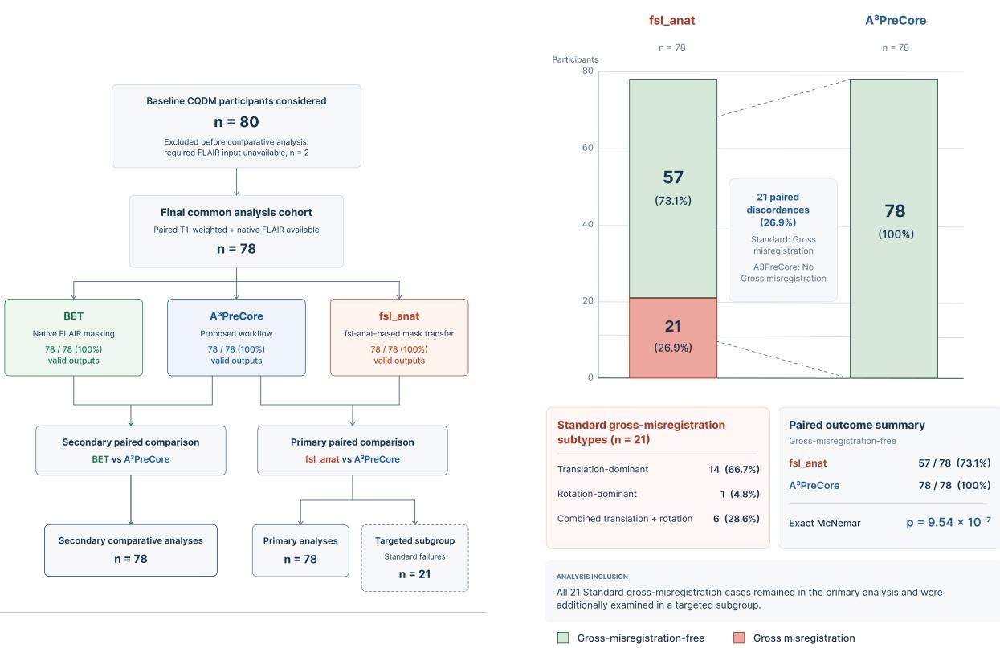  
(a) Study cohort and analysis flow.  
(b) Primary paired gross-misregistration outcome.

Figure 4: Study flow and primary paired registration outcome. a, Study cohort, processing completeness, and construction of the analysis populations. Of the 80 baseline CQDM participants considered, two were excluded from the comparative analysis because the required FLAIR input was unavailable, resulting in a final common analysis cohort of 78 participants. BET, the fsl\_anat, and A3PreCore were evaluated in this common cohort, and all three workflows produced readable, native-FLAIR-grid-compatible outputs in all 78 participants. b, Paired gross rigid-body misregistration outcome for the primary comparison between the fsl\_anat and A3PreCore. Gross misregistration was identified in 21/78 fsl\_anat outputs (26.9%) and in none of the corresponding A3PreCore outputs (0/78, 0.0%). The 21 paired discordances all consisted of fsl\_anat gross misregistration with no corresponding gross misregistration in A3PreCore. fsl\_anat failures comprised 14 translation-dominant, one rotation-dominant, and six combined translational and rotational cases. The proportion of gross-misregistration-free outputs increased from 57/78 (73.1%) to 78/78 (100.0%), corresponding to an absolute paired increase of 26.9 percentage points (exact two-sided McNemar test, $p = 9 . 5 4 \times 1 0 ^ { - 7 } )$ ).

The paired transition analysis showed that these residual failures arose from incomplete recovery of the original fsl\_anat failures rather than from degradation of previously successful registrations. Among the 21 participants with gross fsl\_anat misregistration, 17/21 were rescued in the No full $T _ { 1 }$ configuration, 18/21 in the No NMI configuration, and 19/21 in the No extended search configuration. The complete A3PreCore configuration rescued all 21/21 baseline failures. Importantly, none of the ablated configurations introduced a new gross misregistration among the 57 participants without gross fsl\_anat misregistration, and the complete configuration likewise introduced none (0/57 in all cases) (Table 2).

Paired binary diferences relative to fsl\_anat were evaluated using exact two-sided McNemar tests. The reductions remained significant in the $N o f u l l ~ T _ { 1 }$ configuration $( p = 1 . 5 3 \times 1 0 ^ { - 5 } )$ , the No NMI configuration $( p = 7 . 6 3 \times 1 0 ^ { - 6 } )$ , and the No extended search configuration $( p = 3 . 8 1 \times 1 0 ^ { - 6 } )$ , with the largest paired diference observed for the complete $\mathbf { A } ^ { 3 }$ PreCore configuration $( p = 9 . 5 4 \times 1 0 ^ { - 7 } )$ . These ablation results indicate that the three registration components have complementary roles: retaining any two was suficient to eliminate most baseline failures, whereas the combination of all three was required to eliminate gross misregistration throughout the evaluated cohort.

Table 2: Leave-one-component-out ablation of the $\mathbf { A } ^ { 3 } \mathbf { P r e C o r e }$ registration strategy, using gross rigid-body misregistration as the primary endpoint. Each ablated configuration retained two of the three registration components, whereas the complete $\bar { \mathbf { A } } ^ { 3 } \mathbf { P r e C o r e }$ configuration combined full-T registration, NMI, and extended angular search.
<table><tr><td rowspan="2">Configuration</td><td rowspan="2">Moving  $\mathbf { T } _ { 1 }$ </td><td colspan="3">Gross</td><td rowspan="2">Rescuedª</td><td rowspan="2">New failuresb</td><td rowspan="2">McNemar p</td></tr><tr><td>Cost</td><td>Search</td><td>failure</td></tr><tr><td>fsl_anat</td><td>Skull- stripped</td><td>MI</td><td></td><td>Default 21/78 (26.9%)</td><td>一</td><td></td><td>一</td></tr><tr><td>No full  $\mathrm { T } _ { 1 }$ </td><td>Skull- stripped</td><td>NMI</td><td> $\pm 9 0 ^ { \circ }$ </td><td>4/78 (5.1%)</td><td>17/21</td><td>0/57</td><td> $1 . 5 3 \times 1 0 ^ { - 5 }$ </td></tr><tr><td>No NMI</td><td>Full</td><td>MI</td><td> $\pm 9 0 ^ { \circ }$ </td><td>3/78 (3.8%)</td><td>18/21</td><td>0/57</td><td> $7 . 6 3 \times 1 0 ^ { - 6 }$ </td></tr><tr><td>No extended search</td><td>Full</td><td>NMI</td><td>Default</td><td>2/78 (2.6%)</td><td>19/21</td><td>0/57</td><td> $3 . 8 1 \times 1 0 ^ { - 6 }$ </td></tr><tr><td> $\mathbf { A } ^ { 3 } \mathbf { P r e C o r e }$ </td><td>Full</td><td>NMI</td><td>±90°</td><td>0/78 (0.0%)</td><td>21/21</td><td>0/57</td><td> $\mathbf { 9 . 5 4 \times 1 0 ^ { - 7 } }$ </td></tr></table>

MI, mutual information; NMI, normalized mutual information. � Number of the 21 participants with gross fsl\_anat misregistration who were no longer classified as grossly misregistered under the indicated configuration. $b ^ { ' }$ Number of new gross misregistrations among the 57 participants without gross fsl\_anat misregistration. McNemar $p$ values correspond to exact two-sided paired comparisons against fsl\_anat. All comparisons were performed within the same 78-participant cohort.

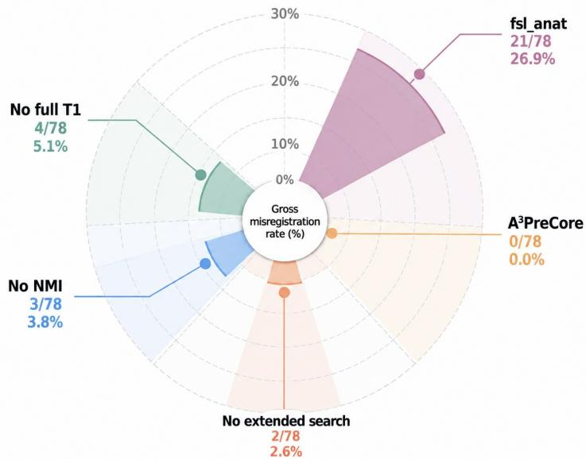  
Figure 5: Gross rigid-body misregistration across A3PreCore ablation configurations. Rates were 26.9% for fsl\_anat, 5.1% for Nofull $T _ { 1 }$ , 3.8% for No NMI, 2.6% for No extended search, and 0.0% for the complete A3PreCore configuration, all evaluated in the common 78-participant cohort.

Beyond the binary gross-misregistration endpoint, the resulting registration transforms were characterized quantitatively using a controlled NMI analysis. For this analysis, the fsl\_anat and $\mathbf { A } ^ { 3 } \mathbf { P r e C o r e }$ transforms were reapplied to the same full bias-corrected $\mathrm { T } _ { 1 }$ image and evaluated against the same native FLAIR reference using identical preprocessing, histogram binning, and voxel support. This controlled design removed diferences in moving-image content from the similarity evaluation itself. NMI was therefore interpreted as a registration-similarity descriptor and not as an independent measure of anatomical accuracy.

Across all 78 participants, the median NMI was 1.111 (IQR, 1.102–1.118) for $\mathbf { A } ^ { 3 } \mathbf { P r e C o r e }$ and 1.102 (IQR, 1.075–1.116) for fsl\_anat (Table 3; Figure 6a). The median participant-level paired diference, calculated as $\mathbf { A } ^ { 3 }$ PreCore minus fsl\_anat, was 0.00006 (IQR, −0.00017 to 0.03255), with a bootstrap 95% confidence interval of −0.00004 to 0.00059. The paired distributions difered by the Wilcoxon signed-rank test $( p = 0 . 0 0 2 2 ;$ ; rank-biserial efect size = 0.399).

The direction of the participant-level diference, however, was not uniform across the complete cohort. $\mathbf { A } ^ { 3 } \mathbf { P r e C o r e }$ had the higher NMI in 44 participants and fsl\_anat in 34, with no ties (exact sign test, $p = 0 . 3 0 8 )$ . Thus, the statistically detectable shift in the paired distribution reflected the magnitude of positive diferences in a subset of participants rather than a consistent increase in NMI across all participants. In particular, the diference between the marginal median NMI values of the two workflows should not be interpreted as the median paired diference.

The positive NMI diferences were concentrated in participants with gross fsl\_anat misregistration (Figure 6b). Within this 21-participant subgroup, median NMI was 1.108 (IQR, 1.098–1.114) for $\mathbf { A } ^ { 3 } \mathbf { P r e C o r e }$ and 1.052 (IQR, 1.031–1.072) for fsl\_anat. The median paired diference was 0.04567 (IQR, 0.03763– 0.07408), with a bootstrap 95% confidence interval of 0.03769–0.07003. All 21 paired diferences were positive, with a rank-biserial efect size of 1.0 and a Wilcoxon signed-rank $p < 0 . 0 0 1$

In contrast, among the 57 participants without gross fsl\_anat misregistration, the two transforms showed closely matched NMI values. Median NMI was 1.111 (IQR, 1.104–1.118) for $\mathbf { A } ^ { 3 } \mathbf { P r e C o r e }$ and 1.109 (IQR, 1.099–1.118) for $\mathtt { f s l \_ a n a t }$ . The median paired diference was −0.00007 (IQR, −0.00025 to 0.00017), with a bootstrap 95% confidence interval of −0.00016 to 0.00003. The paired diference was not significant $( p = 0 . 4 2 9 ;$ rank-biserial efect $\mathrm { s i z e } = - 0 . 1 2 0 )$ . These results indicate that the NMI distributions were essentially preserved when fsl\_anat registration did not exhibit gross failure.

Using the prespecified NMI threshold of 1.05, all 78 $\mathbf { A } ^ { 3 } \mathbf { P r e C o r e }$ transforms exceeded the threshold, compared with 69/78 fsl\_anat transforms. Nine participants were discordantly classified, and all nine discordances occurred in the same direction: A3PreCore exceeded the threshold whereas fsl\_anat did not (exact twosided McNemar test, $p = 0 . 0 0 3 9 )$ . All nine discordant cases belonged to the fsl\_anat gross-misregistration subgroup. By contrast, both transforms exceeded the threshold in all 57 participants without gross fsl\_anat misregistration.

Sensitivity analyses across alternative voxel-support definitions and histogram-bin configurations yielded the same principal pattern: all 21 fsl\_anat gross-misregistration cases retained positive paired NMI diferences across the evaluated configurations, whereas median diferences among fsl\_anat non-failure cases remained close to zero (Supplementary Figure S1).

Taken together, the registration-strategy analyses indicate that the between-workflow diferences were concentrated primarily in the subset of participants in whom fsl\_anat exhibited gross rigid-body misregistration. In the remaining participants, the fsl\_anat and $\mathbf { A } ^ { 3 } \mathbf { P r e C o r e }$ transforms showed closely matched controlled NMI values. The NMI analysis therefore supports the primary gross-misregistration findings as a mechanistic characterization of the registration behaviour, while the spatial consequences of these diferences on the transferred brain masks are examined in the following section using volumetric overlap, boundary-distance, and geometric measures.

## 6.3 Spatial Agreement and Boundary Concordance

Pairwise spatial agreement was examined to determine whether the increased registration robustness of A3PreCore was accompanied by substantial changes in the transferred brain mask when the fsl\_anat did not exhibit gross rigid-body misregistration. Dice and Jaccard coeficients were used to characterize volumetric overlap, whereas the 95th-percentile Hausdorf distance (HD95) and average symmetric surface distance (ASSD) were used to characterize boundary disagreement. Directional coverage and non-overlap measures were additionally used to describe the spatial distribution of between-method diferences. Because no independently delineated native-FLAIR brain-mask reference was available, all such measures were interpreted as measures of inter-method agreement rather than anatomical accuracy.

lled NMI characterization offsl\_anatand A3PreCore registra
<table><tr><td colspan="3">A. Continuous NMI analysis</td><td colspan="4">Paired ∆NMI</td></tr><tr><td>Group (n)</td><td>NMI A³PreCore</td><td>fsl_anat</td><td>Median (IQR)</td><td>95% CI</td><td>rrb</td><td>p</td></tr><tr><td></td><td>1.111 (1.102–1.118)</td><td>1.102 (1.075–1.116)</td><td>0.00006 (-0.00017–0.03255)</td><td>-0.00004, 0.00059</td><td>0.399</td><td>0.0022</td></tr><tr><td>All participants (78)</td><td></td><td>1.052 (1.031–1.072)</td><td>0.04567 (0.03763–0.07408)</td><td>0.03769, 0.07003</td><td>1.000</td><td>&lt; 0.001</td></tr><tr><td>fs1_anat gross misregistration (21) fs1_anat no gross misregistration (57)</td><td>1.108 (1.098–1.114) 1.111 (1.104–1.118)</td><td>1.109 (1.099–1.118)</td><td>-0.00007 (-0.00025–0.00017)</td><td>-0.00016, 0.00003</td><td>-0.120</td><td>0.429</td></tr><tr><td></td><td></td><td></td><td></td><td></td><td></td><td></td></tr><tr><td colspan="7">B. NMI threshold analysis (&gt; 1.05)</td></tr><tr><td>Group (n)</td><td colspan="2">A³PreCore</td><td>fsl_anat</td><td>Discordant pairs</td><td></td><td>McNemar p</td></tr><tr><td>All participants (78)</td><td colspan="2">78/78 (100%)</td><td>69/78 (88.5%)</td><td colspan="2">9</td><td>0.0039</td></tr><tr><td>fsl_anat gross misregistration (21)</td><td colspan="2">21/21 (100%)</td><td>12/21 (57.1%)</td><td colspan="2">9</td><td>0.0039</td></tr><tr><td>fsl_anat no gross misregistration (57)</td><td colspan="2">57/57 (100%)</td><td>57/57 (100%)</td><td>0</td><td></td><td>1.000</td></tr></table>

R).ΔNMI was calculated participant-wise as A3PreCore minusfsl\_anat.�rb, rank-biserial efect size. Confidence intervals for t ng. Continuous paired comparisons used two-sided Wilcoxon signed-rank tests; threshold classifications were compared using exact t egistration-similarity measure rather than as independent anatom

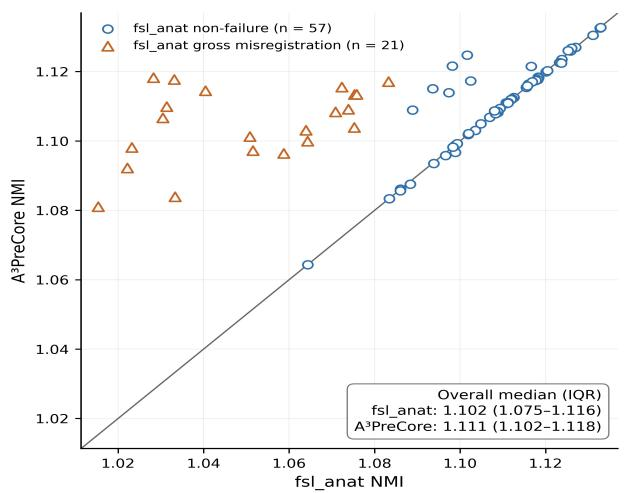  
(a) Participant-level controlled NMI.

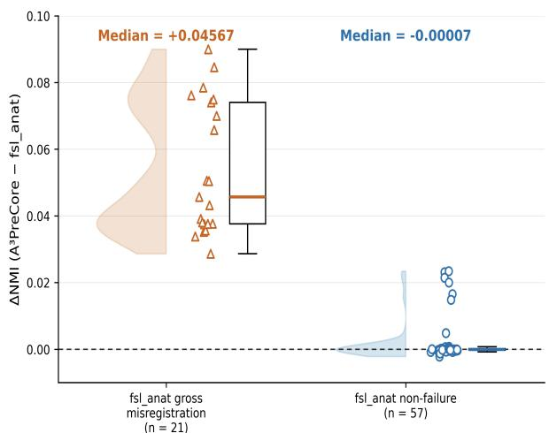  
(b) Paired NMI diference by fsl\_anat gross-misregistration status.  
Figure 6: Controlled NMI characterization of fsl\_anat and A3PreCore registration transforms. a, Participantlevel NMI after the fsl\_anat and $\mathbf { A } ^ { 3 }$ PreCore transforms were reapplied to the same full bias-corrected $\mathrm { T } _ { 1 }$ image and evaluated against the same native FLAIR reference. The identity line denotes equal NMI between the two transforms. b, Participant-level paired NMI diference, $\Delta \mathbf { N M I } = \mathbf { N M I } _ { \mathrm { A 3 P } } - \mathbf { N M I } _ { \mathrm { f s l \_ a n a t } }$ , stratified by fsl\_anat gross-misregistration status. Positive diferences were concentrated in participants with gross fsl\_anat misregistration, whereas paired diferences remained centred near zero among participants without gross fsl\_anat misregistration. NMI is interpreted as a registration-similarity descriptor rather than as independent anatomical validation

Across the complete 78-participant cohort, the median Dice coeficient between $\mathbf { A } ^ { 3 } \mathbf { P r e C o r e }$ and fsl\_anat was 0.990 (IQR, 0.932–0.994), and the corresponding median Jaccard index was 0.981 (IQR, 0.872–0.987). The median normalized symmetric diference was 0.019 (IQR, 0.013–0.128), while the median HD95 and ASSD were 0.777 mm (IQR, 0.693–5.423 mm) and 0.274 mm (IQR, 0.186–2.272 mm), respectively (Tables 4 and 5).

The overall agreement distribution was strongly dependent on fsl\_anat registration status. Among the 57 participants in whom the fsl\_anat showed no gross rigid-body misregistration, the median Dice coeficient was 0.993 (IQR, 0.989–0.995), and the median Jaccard index was 0.985 (IQR, 0.978–0.989). The median fraction of the fsl\_anat mask covered by $\mathbf { A } ^ { 3 }$ PreCore was 0.992 (IQR, 0.989–0.995), while the median fraction of the $\mathbf { A } ^ { 3 } \mathbf { P r e C o r e }$ mask contained within fsl\_anat was 0.993 (IQR, 0.989–0.995). Directional non-overlap was small and nearly symmetric, with median $\mathbf { A } ^ { 3 }$ PreCore-only and fsl\_anat-only volumes of 11.5 mL (IQR, 8.0–15.8 mL) and 11.6 mL (IQR, 8.2–16.5 mL), respectively.

In contrast, substantially greater spatial disagreement was observed among the 21 participants classified as having gross fsl\_anat misregistration. In this subgroup, the median Dice coeficient decreased to 0.889 (IQR, 0.863–0.921), and the median Jaccard index decreased to 0.800 (IQR, 0.759–0.853). The median fraction of the fsl\_anat mask covered by $\mathbf { A } ^ { 3 }$ PreCore was 0.884 (IQR, 0.861–0.921), while the median ${ \mathbf A } ^ { 3 }$ PreCore-contained fraction was 0.894 (IQR, 0.867–0.921). Median directional non-overlap volumes increased to 158.4 mL (IQR, 113.8–180.6 mL) for ${ \mathbf A } ^ { 3 }$ PreCore-only voxels and 170.8 mL (IQR, 117.0–188.8 mL) for fsl\_anat-only voxels (Table 4). Participant-level Dice distributions for the complete cohort and the fsl\_anat-status subgroups are shown in Figure 7.

The reduction in overlap within the fsl\_anat gross-misregistration subgroup does not, by itself, establish which of the two transferred masks was anatomically more accurate. The direction of the observed disagreement was therefore interpreted in conjunction with the prespecified participant-level gross-misregistration assessment described in Section 6.1. All 21 participants in this subgroup were classified as showing gross rigid-body misregistration in the fsl\_anat output, whereas none of the corresponding ${ \mathbf A } ^ { 3 }$ PreCore outputs showed the same gross displacement. Accordingly, the subgroup-specific overlap and non-overlap results were treated as descriptive characterization of the spatial consequences of the identified fsl\_anat registration failures rather than as independent validation of anatomical accuracy.

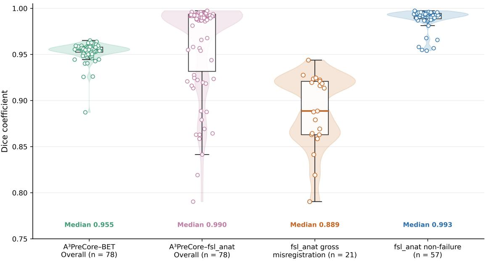  
Figure 7: Pairwise Dice agreement according to comparator and fsl\_anat registration status. Participantlevel Dice coeficients are shown for A3PreCore–BET across the complete cohort and for A3PreCore–fsl\_anat across the complete cohort and separately among participants with and without gross fsl\_anat misregistration. Agreement remained high when the fsl\_anat showed no gross misregistration, whereas substantially lower overlap was concentrated in the fsl\_anat gross-misregistration subgroup.

Table 4: Pairwise spatial agreement of A3PreCore with BET and the fsl\_anat.
<table><tr><td rowspan="2">Metric</td><td rowspan="2">A³PreCore-BET Overall (n = 78)</td><td colspan="3">A³PreCore-fs1_anat</td></tr><tr><td>Overall (n = 78)</td><td>Gross misregistration</td><td>No gross misregistration (n = 57)</td></tr><tr><td>Dice</td><td>0.955 [0.95–0.96]</td><td>0.990 [0.93–0.99]</td><td>(n = 21) 0.889 [0.86–0.92]</td><td>0.993 [0.98–0.99]</td></tr><tr><td>Jaccard</td><td>0.914 [0.90–0.91]</td><td>0.981 [0.87–0.99]]</td><td>0.800 [0.76–0.85]</td><td>0.985 [0.98–0.99]</td></tr><tr><td>Comparator coverage</td><td>0.948 [0.94–0.96]</td><td>0.990 [0.93–0.99]</td><td>0.884 [0.86–0.92]</td><td>0.992 [0.98–0.99]</td></tr><tr><td>A³PreCore-contained fraction</td><td>0.965 [0.95–0.97]</td><td>0.990 [0.93–0.99]</td><td>0.894 [0.87–0.92]</td><td>0.993 [0.98–0.99]</td></tr><tr><td> $\mathbf { A } ^ { 3 } \mathbf { P r e C o r e . }$  -only volume (mL)</td><td>52.8 [36.9–71.1]</td><td>13.8 [9.7–99.4]</td><td>158.4 [113.8–180.6]</td><td>11.5 [8.0–15.8]</td></tr><tr><td>Comparator-only volume (mL)</td><td>80.7 [64.0–91.7]</td><td>14.3 [9.9–100.5]</td><td>170.8 [117.0–188.8]</td><td>11.6 [8.2–16.5]</td></tr></table>

Values are median [interquartile range]. A3PreCore–BET was evaluated in the complete paired cohort only. The gross-misregistration and no-gross-misregistration subgroups apply exclusively to the A3PreCore–fsl\_anat comparison. For each comparison, the comparator was BET or fsl\_anat, respectively. Comparator coverage was defined as $| A \cap B | / | B | ,$ and the A3PreCore-contained fraction as $| A \cap B | / | A |$ , where � denotes A3PreCore and � denotes the corresponding comparator. These directional measures quantify inter-method agreement and do not use an anatomical ground-truth reference.

As a secondary registration-independent comparison, $\mathbf { A } ^ { 3 }$ PreCore was also compared with BET, which generated its brain mask directly in native FLAIR space. Across the complete 78-participant cohort, the median Dice coeficient between $\mathbf { A } ^ { 3 } \mathbf { P r e C o r e }$ and BET was 0.955 (IQR, 0.952–0.958), and the median Jaccard index was 0.914 (IQR, 0.909–0.919). The median fraction of the BET mask covered by A3PreCore was 0.948 (IQR, 0.938–0.957), while the median A3PreCore-contained fraction was 0.965 (IQR, 0.953–0.973). Median directional non-overlap volumes were 52.8 mL (IQR, 36.9–71.1 mL) for A3PreCore-only voxels and 80.7 mL (IQR, 64.0–91.7 mL) for BET-only voxels (Table 4; Figure 7). These results were used to characterize agreement with an independently generated native-FLAIR mask and not to establish anatomical accuracy.

Boundary- and surface-based measures provided complementary information on the spatial scale of disagreement with each comparator. For the A3PreCore–fsl\_anat comparison, the median normalized symmetric diference was 0.019 (IQR, 0.013–0.128), the median HD95 was 0.777 mm (IQR, 0.693– 5.423 mm), and the median ASSD was 0.274 mm (IQR, 0.186–2.272 mm). For the $\mathbf { A } ^ { 3 } \mathbf { P r e C o r e - B E T }$ comparison, the corresponding values were 0.086 (IQR, 0.081–0.091), 4.005 mm (IQR, 3.638–4.513 mm), and 1.477 mm (IQR, 1.384–1.583 mm), respectively. Surface Dice at tolerances of 1, 2, and 3 mm were 0.996, 1.000, and 1.000, respectively, for $\mathbf { A } ^ { 3 } \mathbf { P r e C o r e - f s 1 }$ \_anat and 0.476, 0.732, and 0.891 for $\mathbf { A } ^ { 3 } \mathbf { P r e C o r e - B E T }$ (Table 5; Figure 8). These pairwise values describe agreement with diferent comparators and were not interpreted as direct evidence that either comparator constituted a more accurate anatomical reference.

Table 5: Boundary and surface disagreement between $\mathbf { A } ^ { 3 }$ PreCore and the fsl\_anat and BET comparators.
<table><tr><td>Metric</td><td> $\mathrm { A ^ { 3 } P r e C o r e - f s l \_ a n a t }$ </td><td> $\overline { { { \bf A } ^ { 3 } { \bf P r e C o r e - B E T } } }$ </td></tr><tr><td>Normalized symmetric difference</td><td>0.019 (0.013–0.128)</td><td>0.086 (0.081–0.091)</td></tr><tr><td>HD95 (mm)</td><td>0.777 (0.693–5.423)</td><td>4.005 (3.638–4.513)</td></tr><tr><td>ASSD (mm)</td><td>0.274 (0.186–2.272)</td><td>1.477 (1.384–1.583)</td></tr><tr><td>Surface Dice, 1 mm</td><td>0.996 (0.318–0.999)</td><td>0.476 (0.455–0.500)</td></tr><tr><td>Surface Dice, 2 mm</td><td>1.000 (0.537–1.000)</td><td>0.732 (0.707–0.760)</td></tr><tr><td>Surface Dice, 3 mm</td><td>1.000 (0.729–1.000)</td><td>0.891 (0.862–0.907)</td></tr></table>

Values are median (interquartile range). HD95, 95th-percentile Hausdorf distance; ASSD, average symmetric surface distance. Lower values indicate closer agreement for normalized symmetric diference, HD95, and ASSD, whereas higher values indicate closer agreement for surface Dice. These measures quantify inter-method disagreement rather than error against an independently delineated anatomical reference.

Regional and slice-wise analyses further characterized the spatial distribution ofbetween-method disagreement. For the $\mathbf { A } ^ { 3 } \mathrm { P r e C o r e - f s l } .$ \_anat comparison, median regional Dice was 0.961 in the inferior third, 0.991 in the middle third, and 0.989 in the superior third. The corresponding values for $\mathbf { A } ^ { 3 } \mathbf { P r e C o r e - B E T }$ were 0.870, 0.962, and 0.942, respectively.

At the slice level, the participant-level mean slice Dice had a median of 0.975 (IQR, 0.869–0.983) for A3PreCore–fsl\_anat and 0.883 (IQR, 0.872–0.897) for $\mathbf { A } ^ { 3 } \mathbf { P r e C o r e - B E T . }$ The corresponding participantlevel median slice Dice values were 0.990 (IQR, 0.940–0.994) and 0.956 (IQR, 0.952–0.959), respectively. To characterize lower-tail slice-wise agreement without relying on a single small terminal slice, the 10thpercentile slice Dice was retained as the adverse slice-wise summary. Its median was 0.962 (IQR, 0.795–0.977) for $\mathbf { A } ^ { 3 } \mathbf { P r e C o r e - f s 1 }$ \_anat and 0.776 (IQR, 0.704–0.828) for $\mathbf { A } ^ { 3 } \mathbf { P r e C o r e - B E T }$ (Supplementary Table S2).

Whole-mask volume analysis showed that similar total mask volumes did not necessarily imply close spatial alignment. For the $\mathbf { A } ^ { 3 } \mathbf { P r e C o r e - f s 1 }$ \_anat comparison, the median signed volume diference, calculated as $\mathbf { A } ^ { 3 } \mathbf { P r e C o r e }$ minus comparator volume, was −0.370 mL (IQR, −0.647 to 0.136 mL). The median absolute diference was 0.464 mL (IQR, 0.217–0.839 mL), corresponding to only 0.030% (IQR, 0.015–0.061%) of mask volume. $\mathbf { A } ^ { 3 } \mathbf { P r e C o r e }$ had the smaller mask volume in 53 participants and the larger volume in 25. Nevertheless, 21/78 comparisons had a normalized symmetric diference greater than 0.10, 21/78 had an HD95 greater than 5 mm, and 11/78 had an HD95 greater than 10 mm; none had an absolute volume diference greater than 2%.

For the A3PreCore–BET comparison, the median signed volume diference was −24.013 mL (IQR, −50.048 to 4.521 mL), while the median absolute diference was 30.277 mL (IQR, 17.690–56.709 mL), corresponding to 2.136% (IQR, 1.114–3.910%). A3PreCore had the smaller mask volume in 56 participants and the larger volume in 22. Nine of 78 comparisons had a normalized symmetric diference greater than 0.10, 12/78 had an HD95 greater than 5 mm, 2/78 exceeded 10 mm, and 41/78 had an absolute volume diference greater than 2% (Supplementary Table S3).

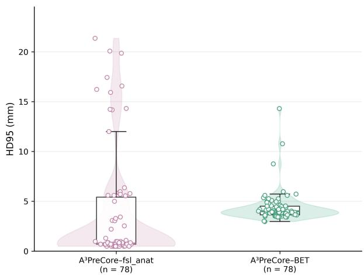  
(a) HD95.

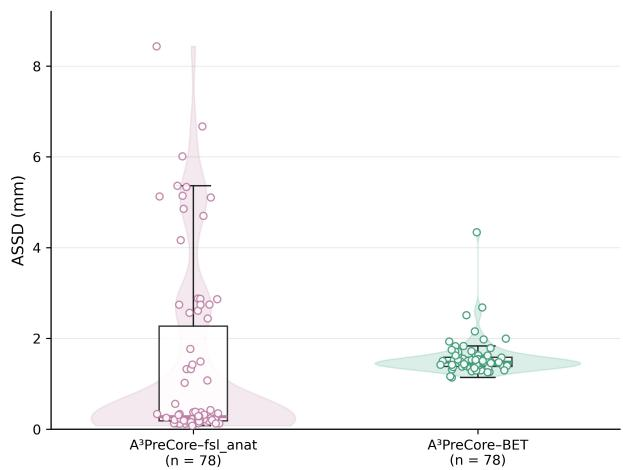  
(b) Average symmetric surface distance.

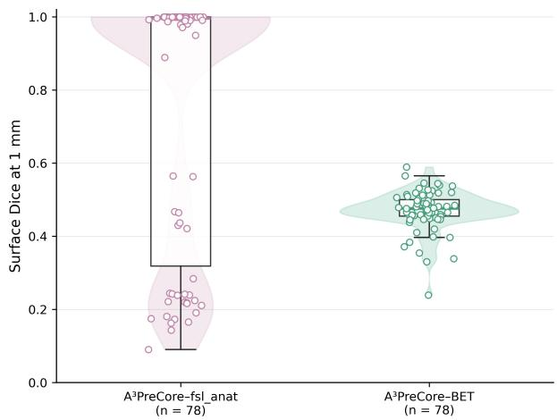  
(c) Surface Dice at 1-mm tolerance.

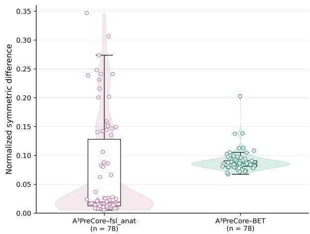  
(d) Normalized symmetric diference.  
Figure 8: Boundary and surface agreement of $\mathbf { A } ^ { 3 } \mathbf { P r e C o r e }$ with the fsl\_anat and BET comparators. a, HD95. b, Average symmetric surface distance (ASSD). c, Surface Dice at a 1-mm tolerance. d, Normalized symmetric diference. These measures characterize pairwise inter-method agreement and do not represent error against an independently delineated anatomical ground-truth reference.

Taken together, the spatial-agreement analyses indicate that $\mathrm { A ^ { 3 } P r e C o r e a n d f s l }$ \_anat were closely concordant when fsl\_anat did not exhibit gross misregistration, whereas the largest reductions in overlap and increases in directional non-overlap were concentrated in the fsl\_anat gross-misregistration subgroup. The comparison with BET provided a complementary registration-independent reference for characterizing agreement with a mask generated directly in native FLAIR space, without implying anatomical ground truth. Notably, substantial spatial and boundary disagreement could occur despite only minimal diferences in total mask volume, demonstrating that global volume similarity alone was insuficient to characterize the observed registration discrepancies. The geometric characteristics of these participant-specific diferences are examined in the following section.

Relative to BET, $\mathbf { A } ^ { 3 } \mathbf { P r e C o r e }$ showed a slightly lower old-QC score, with a median paired diference of −0.000857 (bootstrap 95% CI, −0.001277 to −0.000553; $p < 0 . 0 0 1$ ; rank-biserial efect size = −0.518). In contrast, the paired diference in $S _ { \mathrm { m a s k } }$ was small and not statistically significant (median diference, −0.000275; bootstrap 95% CI, −0.000655 to 0.000177; $p = 0 . 3 6 9$ ; rank-biserial efect size = −0.117). All paired analyses were performed within the same 78-participant cohort (Table 7).

Taken together, the scalar QC results show that the substantial reduction in gross registration failure achieved by A3PreCore was not accompanied by a broad deterioration in native-FLAIR mask plausibility. At the same time, the close clustering and ceiling behaviour of several scalar QC components demonstrate why a single global score is insuficient to characterize the failure modes observed in this study. The principal advantage of E-QC therefore lies in extending quality assessment beyond global plausibility to explicitly characterize participant-specific spatial and geometric disagreement. The geometric component of this profile is examined in the following section, where centroid displacement, PCA-derived orientation diference, and orientation-induced boundary displacement reveal discrepancies that remained largely inconspicuous in the scalar QC summaries.

## 6.4 Method-Specific Extended Quantitative Quality-Control Characterization

The method-specific E-QC analysis examined whether the improved registration robustness of ${ \mathbf A } ^ { 3 }$ PreCore was accompanied by systematic changes in native-FLAIR mask characteristics. Consistent with the multidimensional formulation introduced in Section 4, six descriptors were evaluated independently: physical mask volume (�), FOV-relative centroid position (�), mask-to-complement FLAIR intensity ratio $( R _ { I } )$ boundary-gradient support $( B _ { G } )$ , peripheral foreground occupation $( P _ { \mathrm { p e r i p h e r a l } } )$ , and inferior-tail fraction $( P _ { \mathrm { t a i l } } )$ ). No composite E-QC score was used for method comparison.

The common analysis cohort comprised 78 participants with valid BET, fsl\_anat, and $\mathbf { A } ^ { 3 }$ PreCore masks. $\mathbf { A } ^ { 3 } \mathbf { P r e C o r e }$ and fsl\_anat showed closely matched distributions for global mask extent and FOV-relative position. Median � was 1465.5 mL for $\mathbf { A } ^ { 3 } \mathbf { P r e C o r e }$ , 1465.8 mL for fsl\_anat, and 1503.7 mL for BET, whereas median � was 0.08075, 0.08076, and 0.07972, respectively. The corresponding descriptor distributions are summarized in Table 6.

Greater method-dependent diferences were observed for the image- and boundary-related descriptors. Median $R _ { I }$ was 5.4330 for $\mathbf { A } ^ { 3 } \mathbf { P r e C o r e }$ , 5.2794 for $\mathtt { f s l \_ a n a t } .$ , and 5.2696 for BET, while median $B _ { G }$ was 2.7034, 2.4010, and 2.2592, respectively. Peripheral foreground occupation remained low across all three methods, with median $P _ { \mathrm { p e r i p h e r a l } }$ values of 0.00618, 0.00622, and 0.00705 for A3PreCore, fsl\_anat, and BET, respectively. Median $P _ { \mathrm { t a i l } }$ was similarly small in absolute magnitude (0.02720, 0.02602, and 0.02449, respectively).

Paired comparison with the primary fsl\_anat comparator showed that the diference in physical mask volume was numerically small despite a consistent signed shift (median paired diference, −0.370 mL; 95% $\mathrm { C I } , - 0 . 4 7 5 \mathrm { t o } - 0 . 0 8 0 ; r _ { \mathrm { r b } } = - 0 . 5 0 5 ; p < 0 . 0 0 1 )$ . No clear paired diference was detected for � (−0.000326; 95% CI, −0.000640 to 0.000064; �rb = −0.248; � = 0.057).

For $R _ { I }$ , the median paired diference was +0.001397 (95% CI, −0.000601 to 0.006260; $r _ { \mathrm { r b } } ~ = ~ 0 . 4 2 0 $ $p = 0 . 0 0 1 3 )$ , whereas $B _ { G }$ showed a positive paired shift of +0.025187 (95% CI, 0.004760 to 0.058166; $r _ { \mathrm { r b } } = 0 . 5 5 2 ; p < 0 . 0 0 1 )$ . Peripheral foreground occupation was essentially unchanged relative to fsl\_anat (median diference, $- 5 . 8 3 \times 1 0 ^ { - 6 } ; r _ { \mathrm { r b } } = - 0 . 0 5 5 ; p = 0 . 6 7 4 )$ , and $P _ { \mathrm { t a i l } }$ likewise showed no clear paired shift (+0.000071; �rb = 0.175; $p = 0 . 1 7 9 )$ (Table 7).

Relative to BET, the paired diferences were more pronounced and descriptor dependent. ${ \mathbf A } ^ { 3 }$ PreCore showed a median � diference of −24.013 mL, a � diference of +0.001028, an $R _ { I }$ diference of +0.132618, and a $B _ { G }$ diference of +0.442448. Peripheral foreground occupation was lower (median diference, −0.000638; $r _ { \mathrm { r b } } = - 0 . 8 6 4 ; p < 0 . 0 0 1 )$ , whereas $P _ { \mathrm { t a i l } }$ was higher (+0.002093; � = 0.548; � < 0.001). The corresponding confidence intervals and paired statistics are reported in Table 7.

The participant-level heat map further demonstrated that the between-method relationships were descriptor specific rather than uniform across the E-QC profile (Figure 9). For visualization only, each descriptor was robustly standardized within its measurement dimension across the three methods; these standardized values were not used for inferential analysis. The paired efect profile (Figure 10) similarly showed close A3PreCore–fsl\_anat correspondence for $C , P _ { \mathrm { p e r i p h e r a l } } .$ , and $P _ { \mathrm { t a i l } }$ , with larger directional efects for $R _ { I }$ and

$B _ { G }$ . Comparisons with BET showed larger efects across several descriptors, particularly $R _ { I } , \ B _ { G }$ , and $P _ { \mathrm { p e r i p h e r a l } }$ . Because the individual coordinates quantify distinct mask and mask-to-image properties, the direction or magnitude of any single descriptor was not interpreted as evidence of anatomical superiority.

Table 6: Method-specific E-QC descriptor distributions for BET, fsl\_anat, and A3PreCore in the common 78-participant cohort.
<table><tr><td>Metric</td><td>BET (n = 78)</td><td>fs1_anat (n = 78)</td><td>A3PreCore (n = 78)</td></tr><tr><td>V (mL)</td><td>1503.7 (1391.3–1593.3)</td><td>1465.8 (1372.9–1569.2)</td><td>1465.5 (1372.8–1566.8)</td></tr><tr><td> $C$ </td><td>0.07972 (0.07215–0.08637)</td><td>0.08076 (0.07386–0.08897)</td><td>0.08075 (0.07289–0.08745)</td></tr><tr><td> $R _ { I }$ </td><td>5.2696 (4.7234–5.8034)</td><td>5.2794 (4.7560–5.8867)</td><td>5.4330 (4.8589–5.9479)</td></tr><tr><td> $B _ { G }$ </td><td>2.2592 (1.9709–2.5025)</td><td>2.4010 (2.2319–3.0117)</td><td>2.7034 (2.3276–3.0739)</td></tr><tr><td> $P _ { \mathrm { p e r i p h e r a l } }$ </td><td>0.00705 (0.00525–0.00875)</td><td>0.00622 (0.00472–0.00800)</td><td>0.00618 (0.00459–0.00796)</td></tr><tr><td> $P _ { \mathrm { t a i l } }$ </td><td>0.02449 (0.02107–0.02945)</td><td>0.02602 (0.02114–0.03201)</td><td>0.02720 (0.02277–0.03260)</td></tr></table>

Values are median (interquartile range). � denotes physical mask volume; �, FOV-relative centroid ofset; $R _ { I } ,$ mask-to-complement FLAIR intensity ratio; $B _ { G }$ , boundary-gradient support; �peripheral, peripheral foreground occupation; and $P _ { \mathrm { t a i l } } .$ inferior-tail fraction. Descriptors were analyzed independently and do not directly measure anatomical accuracy.

Table 7: Participant-level paired comparisons of six method-specific E-QC descriptors for A3PreCore relative to fsl\_anat and BET (� = 78).
<table><tr><td>Comparator</td><td>Descriptor</td><td>A³PreCore median</td><td>Comparator median</td><td>Paired difference</td><td>Bootstrap 95% CI</td><td> $r _ { \mathrm { r b } }$ </td><td> $\underline { { \boldsymbol { p } } }$ </td></tr><tr><td rowspan="5"> $\overline { { \pm s 1 \_ { \mathrm { - } } \mathsf { a n a t } } }$ </td><td> $\overline { { V \left( \mathrm { m L } \right) } }$ </td><td>1465.502</td><td>1465.765</td><td>-0.370</td><td> $\overline { { - 0 . 4 7 5 \mathrm { t o } - 0 . 0 8 0 } }$ </td><td>-0.505</td><td>&lt; 0.001</td></tr><tr><td> $C$ </td><td>0.080750</td><td>0.080761</td><td>-0.000326</td><td>-0.000640 to 0.000064</td><td>-0.248</td><td>0.057</td></tr><tr><td> $R _ { I }$ </td><td>5.432968</td><td>5.279435</td><td>+0.001397</td><td>-0.000601 to 0.006260</td><td>0.420</td><td>0.0013</td></tr><tr><td> $B _ { G }$ </td><td>2.703394</td><td>2.401043</td><td>+0.025187</td><td> $0 . 0 0 4 7 6 0 \mathrm { t o } 0 . 0 5 8 1 6 6$ </td><td>0.552</td><td>&lt; 0.001</td></tr><tr><td> $P _ { \mathrm { p e r i p h e r a l } }$ </td><td>0.006176</td><td>0.006222</td><td> $- 5 . 8 3 \times 1 0 ^ { - 6 }$ </td><td> $- 1 . 5 9 \times 1 0 ^ { - 5 } \mathrm { t o } 7 . 3 1 \times 1 0 ^ { - 6 }$ </td><td>-0.055</td><td>0.674</td></tr><tr><td rowspan="6">BET</td><td> $P _ { \mathrm { t a i l } }$ </td><td>0.027196</td><td>0.026017</td><td>+0.000071</td><td> $- 0 . 0 0 0 1 2 7 \mathrm { t o } 0 . 0 0 0 3 3 7$ </td><td>0.175</td><td>0.179</td></tr><tr><td> $V \ ( \mathrm { m L } )$ </td><td>1465.502</td><td>1503.693</td><td>-24.013</td><td> $\overline { { - 3 0 . 6 3 0 \mathrm { t o } - 1 0 . 8 4 1 } }$ </td><td>-0.548</td><td>&lt; 0.001</td></tr><tr><td> $C$ </td><td>0.080750</td><td>0.079721</td><td>+0.001028</td><td> $0 . 0 0 0 6 6 3 \mathrm { t o } 0 . 0 0 1 6 0 4$ </td><td>0.518</td><td>&lt; 0.001</td></tr><tr><td> $R _ { I }$ </td><td>5.432968</td><td>5.269639</td><td>+0.132618</td><td>0.119944 to 0.148070</td><td>0.994</td><td>&lt; 0.001</td></tr><tr><td> $B _ { G }$ </td><td>2.703394</td><td>2.259194</td><td>+0.442448</td><td>0.379789 to 0.553584</td><td>0.962</td><td>&lt; 0.001</td></tr><tr><td>Pperipheral</td><td>0.006176</td><td>0.007047</td><td>-0.000638</td><td>-0.000791 to -0.000501</td><td>-0.864</td><td>&lt; 0.001</td></tr><tr><td></td><td> $P _ { \mathrm { t a i l } }$ </td><td>0.027196</td><td>0.024493</td><td>+0.002093</td><td>0.001310 to 0.003020</td><td>0.548</td><td>&lt; 0.001</td></tr></table>

Paired diferences are reported as median $( \mathrm { A } ^ { \mathrm { i } }$ 3PreCore minus comparator). Bootstrap 95% confidence intervals were estimated using 10,000 paired resamples. Two-sided Wilcoxon signed-rank tests and paired rank-biserial efect sizes $( r _ { \mathrm { r b } } )$ are reported.

## 6.5 Geometric Characterization of Inter-Method Mask Disagreement

The method-specific E-QC descriptors in the preceding section characterized each candidate mask inde pendently, but did not directly quantify geometric disagreement between methods. We therefore examined three complementary pairwise descriptors: physical centroid displacement, PCA-derived principal-axis orientation diference, and PCA-orientation-induced boundary displacement. Together, these measures separate diferences in mask position from diferences in dominant spatial orientation and from the physical boundary-scale consequence of that orientation disagreement. Because the PCA-based quantities were derived from the geometry of the candidate masks, they were interpreted as descriptors of inter-method disagreement rather than as direct estimates of the underlying registration-transform parameters.

Across the common 78-participant cohort, A3PreCore and fsl\_anat showed close geometric agreement for the majority of participants. Median centroid displacement was 0.386 mm (IQR, 0.247–2.578 mm), median PCA-derived orientation diference was $0 . 5 3 9 ^ { \circ } \ ( \mathrm { I Q R } , 0 . 3 8 3 ^ { \circ } - 1 . 4 1 4 ^ { \circ } )$ , and median PCA-orientation-induced boundary displacement was 0.551 mm (IQR, 0.383–1.412 mm) (Table 8; Figure 11a–c). The participant-level distributions nevertheless contained a pronounced upper tail, particularly for orientation diference and its associated boundary displacement, indicating that small cohort-level medians coexist with a limited subset of substantially larger geometric disagreements.

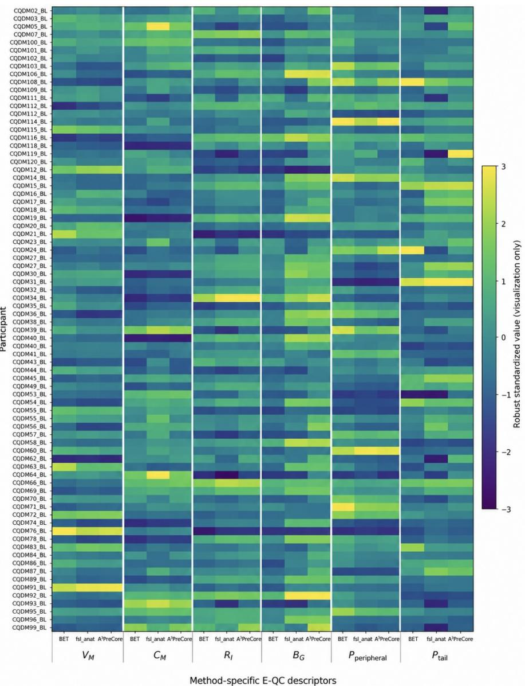  
Figure 9: Participant-level multidimensional E-QC profiles. Rows represent the 78 participants and columns represent the six method-specific descriptors $( V , C , R _ { I } , B _ { G } , P _ { \mathrm { p e r i p h e r a l } }$ , and $P _ { \mathrm { t a i l } } )$ for BET, fsl\_anat, and $\mathbf { A } ^ { 3 } \mathbf { P r e C o r e } .$ Values were robustly standardized within each descriptor for visualization only; all statistical analyses used the original descriptor values.

The ${ \mathbf A } ^ { 3 }$ PreCore–BET comparison exhibited a diferent distributional pattern. Median centroid displacement was 1.170 mm (IQR, 0.698–1.586 mm), median PCA-derived orientation diference was $3 . 4 4 2 ^ { \circ }$ (IQR, $2 . 2 7 3 ^ { \circ } 4 . 8 1 0 ^ { \circ } )$ , and median PCA-orientation-induced boundary displacement was 3.496 mm (IQR, 2.292– 4.951 mm). Thus, relative to BET, A3PreCore showed larger typical pairwise geometric diferences than relative to fsl\_anat. However, the distributions for both comparisons were right-skewed and contained participant-level outliers, emphasizing that median values alone do not fully characterize inter-method geometric behaviour.

The centroid-displacement distributions further illustrate the diference between typical and extreme behaviour (Figure 11a). Most $\mathbf { A } ^ { 3 } \mathbf { P r e C o r e - f s l . }$ \_anat comparisons were concentrated at small physical displacements, although several participants formed a distinct upper tail. The BET comparison showed a higher central displacement and a broader participant-level distribution, with individual cases extending well beyond the main concentration of observations.

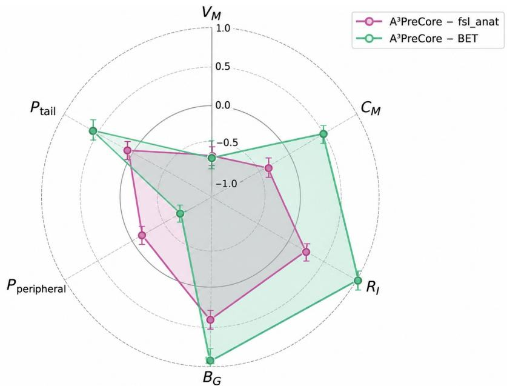  
Figure 10: Paired E-QC descriptor efect profile. Points represent paired rank-biserial efect sizes for A3PreCore relative to fsl\_anat and BET across the six method-specific E-QC descriptors. Positive and negative values indicate the numerical direction of the paired diference and do not denote anatomical superiority.

An even stronger separation between central tendency and participant-level extremes was observed for PCA-derived orientation diference (Figure 11b). The majority of $\mathbf { A } ^ { 3 } \mathbf { P r e C o r e - f s l }$ \_anat comparisons clustered near zero, but several observations exhibited large orientation diferences extending to the upper range of the distribution. $\mathbf { A } ^ { 3 } \mathbf { P r e C o r e - B E T }$ comparisons showed a higher typical orientation diference, while also containing isolated high-orientation cases. These findings indicate that the two comparisons difer not only in their central tendency but also in the structure of their distributional tails.

PCA-orientation-induced boundary displacement showed a corresponding pattern (Figure 11c). Most participant-level values remained relatively small, whereas a limited number of comparisons produced substantially larger physical boundary displacements. This behaviour is consistent with the fact that a large diference in principal-axis orientation can have a substantial physical efect at the mask boundary even when the mask centroid remains relatively stable.

This relationship is demonstrated directly in the joint centroid–orientation plot (Figure 11d). Centroid displacement and PCA-derived orientation diference were not coupled in a one-to-one manner. Several comparisons exhibited pronounced orientation disagreement despite only modest centroid displacement, including an orientation-dominant case highlighted in the figure. Conversely, some comparisons with larger centroid displacement showed only moderate orientation diferences. Centroid-based assessment alone would therefore fail to capture important classes of geometric disagreement.

Taken together, the pairwise geometric analysis revealed a multidimensional failure structure that could not be represented adequately by any single geometric measure. $\mathbf { A } ^ { 3 } \mathbf { P r e C o r e }$ and fsl\_anat were closely aligned for most participants, but the $\mathbf { A } ^ { 3 } \mathbf { P r e C o r e - f s l . }$ \_anat distribution contained a distinct subset of large orientation-related discrepancies. The BET comparison showed larger typical diferences in centroid position, orientation, and orientation-induced boundary displacement, while also exhibiting participantspecific extremes. Because BET is generated directly in native FLAIR space, this comparison provides a complementary registration-independent description of inter-method geometry rather than an anatomical reference standard.

Overall, these results demonstrate that centroid displacement, principal-axis orientation diference, and orientation-induced boundary displacement capture complementary aspects of mask disagreement. Their joint evaluation therefore provides substantially more information about participant-specific geometric behaviour than centroid position or a global mask descriptor alone.

Table 8: Pairwise geometric characterization of A3PreCore relative to fsl\_anat and BET in the common 78-participant cohort.
<table><tr><td>Comparison</td><td>Centroid displacement (mm)</td><td>PCA orientation (°)</td><td>PCA-orientation-induced displacement (mm)</td><td>Orientation &gt; 10° n</td></tr><tr><td>A³PreCore-fs1_anat</td><td>0.386 (0.247–2.578)</td><td>0.539 (0.383–1.414)</td><td>0.551 (0.383–1.412)</td><td>13/78</td></tr><tr><td>A³PreCore-BET</td><td>1.170 (0.698–1.586)</td><td>3.442 (2.273–4.810)</td><td>3.496 (2.292–4.951)</td><td>2/78</td></tr></table>

Continuous values are median (interquartile range). Centroid displacement quantifies pairwise separation of mask centroids in physical space. PCA orientation denotes the sign-resolved principal-axis orientation diference, and PCA-orientation-induced displacement summarizes its physical boundary-scale consequence. These quantities characterize inter-method geometry and are not measures of anatomical error relative to an independent reference.

## 6.6 Blinded Expert Ranking of Brain-Mask Quality

The method-blinded expert assessment comprised 120 masks from 40 randomly selected participants, with one mask generated by each of the three methods for every participant. The resulting participant-level rankings showed a clear descriptive preference for A3PreCore (Table 9).

A3PreCore received rank 1 in 35 of 40 participants (87.5%), compared with 3 of 40 (7.5%) for BET and 2 of 40 (5.0%) for fsl\_anat. A3PreCore was ranked second in 3 participants (7.5%) and third in only 2 participants (5.0%). In contrast, BET received rank 2 in 11 participants (27.5%) and rank 3 in 26 participants (65.0%), whereas fsl\_anat received rank 2 in 26 participants (65.0%) and rank 3 in 12 participants (30.0%).

Accordingly, A3PreCore was the preferred mask in the large majority of the blinded participant-level comparisons, while being ranked least preferred in only a small minority of cases. This pattern provides an independent qualitative complement to the quantitative findings reported in the preceding sections: the method that avoided the gross registration failures observed with fsl\_anat was also most frequently preferred by blinded neuroscientist reviewers.

Qualitative reviewer feedback most commonly emphasized the perceived precision and spatial plausibility of the A3PreCore brain-mask boundaries. In particular, reviewer preference was consistent with the cleaner boundary behaviour observed in the spatial and qualitative analyses, including reduced inferior or extracranial extension in comparison with BET in the displayed cases. Because no independently delineated native-FLAIR brain-mask reference was available, these rankings were interpreted as method-blinded expert judgments of relative mask quality and anatomical plausibility rather than as direct measurements of segmentation accuracy.

Table 9: Method-blinded expert ranking of brain-mask quality in the random 40-participant evaluation subset.
<table><tr><td>Method</td><td>Rank 1, n (%)</td><td>Rank 2, n (%) Rank 3, n (%)</td></tr><tr><td>A³PreCore</td><td>35 (87.5%) 3 (7.5%)</td><td>2 (5.0%)</td></tr><tr><td>BET</td><td>3 (7.5%)</td><td>11 (27.5%) 26 (65.0%)</td></tr><tr><td>fsl_anat</td><td>2 (5.0%) 26 (65.0%)</td><td>12 (30.0%)</td></tr></table>

Rank 1 denotes the preferred mask and rank 3 the least preferred mask. The three masks for each participant were presented using neutral, method-blinded identifiers. Values summarize the final participant-level ordering derived from the two neuroscientist assessments. Values summarize the final participant-level ordering obtained from method-blinded neuroscientist assessments. Two primary reviewers evaluated each participant independently; when their rankings disagreed, the independent assessment of a third reviewer was used for adjudication, with the final ordering determined by majority agreement.

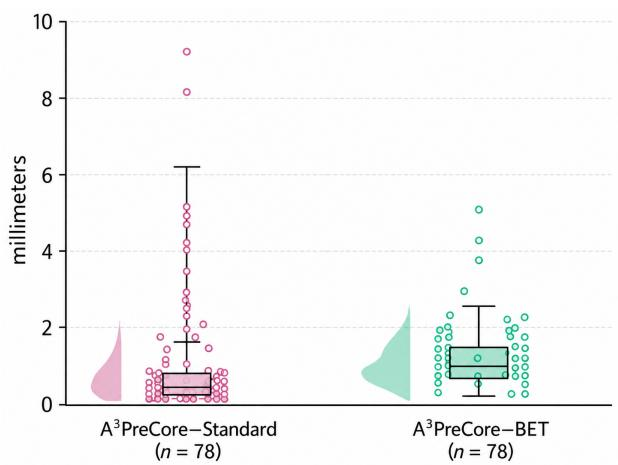  
(a) Centroid displacement.

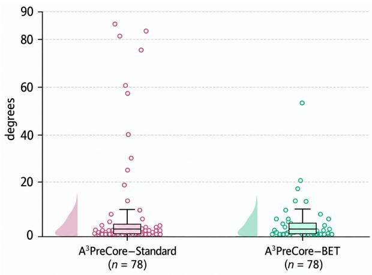  
(b) PCA-derived orientation diference.

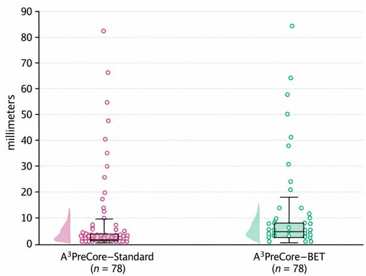  
(c) PCA-orientation-induced boundary displacement.

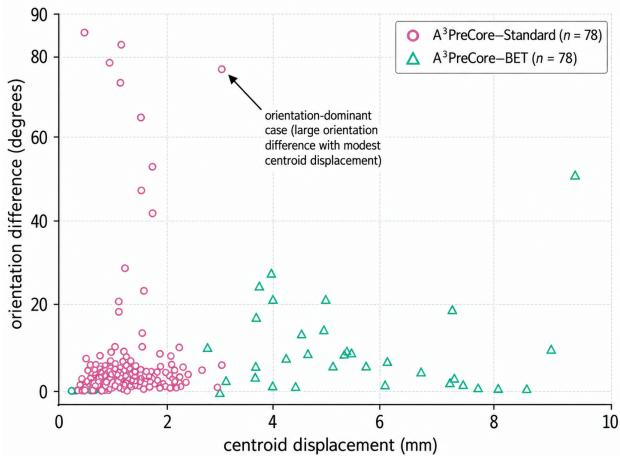  
(d) Centroid displacement versus orientation diference.

Figure 11: Pairwise geometric characterization of inter-method mask disagreement. a, Participant-level physical centroid displacement. b, PCA-derived principal-axis orientation diference. c, PCA-orientation-induced boundary displacement. d, Relationship between centroid displacement and orientation diference, illustrating that pronounced orientation disagreement may occur despite only modest centroid displacement. Magenta denotes A3PreCore– fsl\_anat comparisons and green denotes A3PreCore–BET comparisons. Distributions are shown for the common 78-participant cohort. These descriptors quantify inter-method geometric disagreement and are not interpreted as anatomical error relative to an independent ground-truth reference.

## 6.7 Representative Inter-Method Qualitative Comparisons

Representative tri-planar native-FLAIR comparisons were examined to provide anatomical context for the quantitative overlap and geometric analyses. The selected examples illustrate distinct patterns of inter-method agreement and disagreement, including near-complete overlap, gross geometric misregistration, orientation-dominant disagreement, and asymmetric method-exclusive mask extent.

All examples were selected to illustrate specific spatial patterns rather than to estimate their prevalence within the cohort. Diference maps distinguish A3PreCore- exclusive voxels, comparator-exclusive voxels, and shared mask regions. Because an independently delineated anatomical reference was not available for these comparisons, the direction or extent of disagreement was not interpreted as evidence of anatomical correctness.

A3PreCore versus fsl\_anat. Three representative comparisons demonstrated substantial variation in the spatial relationship between A3PreCore and fsl\_anat (Figure 12).

CQDM02\_BL illustrated pronounced orientation-dominant disagreement. Despite a centroid displacement of only 1.63 mm, the PCA-derived orientation diference reached 81.28◦. The Dice coeficient was 0.8877, with 161.98 mL of A3PreCore-exclusive volume and 175.09 mL of fsl\_anat-exclusive volume. The corresponding diference maps revealed extensive, spatially coherent disagreement, demonstrating that a relatively small centroid displacement can coexist with substantial diferences in mask orientation and extent.

A diferent pattern was observed in CQDM66\_BL, which represented a severe gross-misregistration example. The Dice coeficient decreased to 0.7903, with 320.73 mL of A3PreCore-exclusive volume and 338.33 mL of fsl\_anat-exclusive volume. Unlike CQDM02\_BL, this case exhibited both substantial centroid displacement (9.60 mm) and pronounced PCA-derived orientation disagreement (56.25 ). Large, complementary exclusive regions were apparent across the sagittal, coronal, and axial views, indicating extensive geometric disagreement rather than localized boundary variation.

Conversely, CQDM70\_BL demonstrated near-complete spatial agreement. Its Dice coeficient reached 0.9937, with only 8.05 mL and 8.90 mL of A3PreCore- and fsl\_anat-exclusive volume, respectively. Centroid displacement was 0.29 mm, and the PCA-derived orientation diference was 0.25◦. The remaining diferences were small and predominantly confined to localized mask boundaries.

Collectively, these examples illustrate three distinct geometric patterns: pronounced orientation disagreement with limited centroid displacement, combined positional and orientational disagreement, and near-complete inter-method correspondence. Their contrasting characteristics complement the participant-level geometric distributions presented in Section 6.5.

A3PreCore versus BET. The representative A3PreCore–BET comparisons demonstrated that similarly high global overlap can conceal markedly diferent directional patterns of mask disagreement (Figure 13).

CQDM95\_BL exhibited extensive overlap and nearly balanced method-exclusive volumes. Its Dice coeficient was 0.9625, with 58.13 mL of A3PreCore-exclusive volume and 59.62 mL of BET-exclusive volume. Centroid displacement and PCA-derived orientation diference were 0.72 mm and 2.73◦, respectively. The diference maps showed relatively limited residual disagreement, predominantly distributed along the mask boundaries.

CQDM25\_BL and CQDM78\_BL provided contrasting examples of directional disagreement despite having almost identical Dice coeficients.

For CQDM25\_BL, the Dice coeficient was 0.9400, with 111.70 mL of A3PreCore-exclusive volume and 52.80 mL of BET-exclusive volume. The corresponding centroid displacement was 2.58 mm, and the PCAderived orientation diference was 2.60◦. The diference maps showed a greater overall A3PreCore-exclusive extent.

In contrast, CQDM78\_BL had a Dice coeficient of 0.9403 but demonstrated the opposite directional pattern. BET-exclusive volume reached 195.87 mL, whereas A3PreCore-exclusive volume was limited to 32.98 mL. Centroid displacement was 0.92 mm, and the PCA-derived orientation diference was 6.12◦. The displayed overlays revealed a substantially greater BET-exclusive extent, including visible diferences along peripheral and inferior mask boundaries.

These examples demonstrate that global overlap alone cannot characterize the direction or spatial distribution of mask disagreement. In particular, CQDM25\_BL and CQDM78\_BL exhibited comparable Dice coeficients despite pronounced diferences in their respective method-exclusive volumes. Directional volumetric measurements and spatial diference maps therefore provide complementary information that is not captured by a single whole-mask overlap measure.

Taken together, the qualitative comparisons illustrate the complementary information provided by overlap, directional exclusive-volume measurements, and pairwise geometric descriptors. The A3PreCore–fsl\_anat examples demonstrate how near-complete agreement and severe geometric disagreement can occur within the same methodological comparison, including cases in which substantial orientation disagreement is not accompanied by proportionately large centroid displacement.

The BET examples further demonstrate that comparable Dice coeficients may correspond to substantially diferent directional and spatial patterns of mask disagreement. These observations reinforce the importance of evaluating spatially resolved inter-method diferences alongside global overlap and geometric measurements, without treating either automatic method as an independent anatomical reference.

Collectively, the results demonstrate that the improved registration robustness of $\mathbf { A } ^ { 3 } \mathbf { P r e C o r e }$ was achieved without systematic alteration of mask geometry in successfully registered cases. The paired gross-misregistration analysis, spatial and boundary measurements, multidimensional E-QC characterization, qualitative comparisons, and blinded expert assessments provide complementary evidence of this behaviour. $\mathbf { A } ^ { 3 } \mathbf { P r e C o r e }$ maintained close spatial agreement with successfully registered fsl\_anat masks while avoiding the severe geometric discrepancies observed in confirmed registration-failure cases. Comparisons with BET further revealed diferences in peripheral and inferior mask extent, highlighting the complementary information provided by spatially resolved evaluation. Together, these findings support the robustness of $\mathbf { A } ^ { 3 } \mathbf { P r e C o r e }$ for $\mathrm { T } _ { 1 }$ -to-FLAIR brain-mask transfer, while distinguishing inter-method agreement from independently established anatomical accuracy.

## 7 Discussion

## 7.1 Principal Findings

This study evaluated $\mathbf { A } ^ { 3 } \mathbf { P r e C o r e }$ as a full-T1-guided strategy for transferring an established $\mathrm { T _ { 1 } } \mathrm { - s p a c e }$ anatomical brain mask into native FLAIR space. The principal finding was that successful workflow execution did not necessarily ensure plausible geometric placement. All attempted BET, fsl\_anat, and $\mathbf { A } ^ { 3 } \mathbf { P r e C o r e }$ workflows produced output masks. However, gross rigid-body misregistration was identified in $2 1 / 7 8 ~ \mathrm { f s 1 \_ a n a t }$ outputs and in none of the corresponding $\mathbf { A } ^ { 3 } \mathbf { P r e C o r e  o u t p u t s }$ . Within the present cohort, $\mathbf { A } ^ { 3 } \mathbf { P r e C o r e }$ was therefore associated with substantially fewer gross placement failures than the implemented fsl\_anat.

The controlled registration analysis supported this finding while showing that the diference was concentrated in a specific subset of participants. When the transformations from both registration strategies were reapplied to the same full bias-corrected $\mathrm { T _ { 1 } - w e i g h t e d }$ image, the cohort-level NMI distributions were closely matched. Nevertheless, every participant with neuroscientist-confirmed gross fsl\_anat misregistration had higher NMI after application of the $\mathbf { A } ^ { 3 } \mathbf { P r e C o r e }$ transformation. In participants without evident gross $\mathtt { f s l \_ a n a t }$ displacement, the two strategies produced similar NMI values. ${ \mathbf A } ^ { 3 }$ PreCore therefore appeared to prevent a methodologically important failure mode rather than produce a uniform improvement in registrations that were already successful.

The spatial-agreement analyses provided complementary evidence. $\mathbf { A } ^ { 3 } \mathbf { P r e C o r e }$ remained highly concordant with successful fsl\_anat and with masks generated directly from FLAIR using BET. The lower-agreement tail in the fsl\_anat comparison was concentrated among the grossly displaced outputs. Surface, regional, and slice-wise analyses also showed that similar whole-mask volumes could coexist with substantial diferences in boundary position and orientation. The method-specific E-QC descriptors further demonstrated that agreement in global mask extent or FOV-relative position did not necessarily imply agreement in intensity, boundary-gradient, peripheral, or inferior-tail characteristics, whereas the pairwise geometric coordinates identified a smaller subset of pronounced participant-specific discrepancies. These observations indicate that file generation, native-grid compatibility, total mask volume, any individual E-QC descriptor, and global overlap are insuficient on their own.

The findings should not be interpreted as estimates of absolute anatomical accuracy. Independently delineated native-FLAIR brain masks were unavailable, and the fsl\_anat failure classification incorporated quantitative disagreement measures and tri-planar visual assessment. The evidence therefore supports a more specific conclusion: in the present dataset, A3PreCore produced fewer gross geometric-placement failures than the fsl\_anat while remaining broadly concordant with both direct BET masks and successful fsl\_anat transfers.

## 7.2 A3PreCore as a Full-T1-Guided Geometric-Transfer Strategy

${ \mathbf A } ^ { 3 }$ PreCore is an optimization-based geometric mask-transfer method rather than a new brain-extraction or tissue-segmentation algorithm. It does not redefine which $\mathrm { T _ { 1 } - w e i g h t e d }$ voxels constitute brain tissue. Instead, it searches over a six-degree-of-freedom rigid-transformation space comprising three translational and three rotational parameters to identify the location and orientation that provide the best normalized-mutual information score under the configured search and optimization procedure. The resulting subject-specific transformation is then applied to the existing $\mathrm { T } _ { 1 }$ -space anatomical mask. This distinction is important because transferred-mask quality depends on two related but separable operations: definition of the source mask and optimization of its placement in the target image. A plausible source mask may produce an unusable native-FLAIR output when the estimated transformation is incorrect, whereas an accurately estimated transformation cannot repair a systematically inaccurate source-mask boundary.

Both registration branches propagated the same $\mathrm { T _ { 1 } - d e r i v e d }$ anatomical mask, allowing placement diferences to be assessed without introducing diferences in source-mask definition. The close agreement between $\mathbf { A } ^ { 3 } \mathbf { P r e C o r e }$ and $\pm \mathsf { s l } _ { - }$ anat in non-failure cases suggests that the proposed workflow generally produced a closely concordant native-FLAIR mask when $\tt f s l$ \_anat registration was successful. Its main advantage was observed in the subset in which the fsl\_anat branch produced gross displacement. Any systematic inclusion or exclusion already present in the $\mathrm { T _ { 1 } } \mathrm { - s p a c e }$ source mask will, however, also be inherited by the $\mathsf { A } ^ { 3 }$ PreCore output. The method should therefore be viewed as a complement to established anatomical-processing pipelines rather than as a replacement for them.

One possible explanation for the diference between the registration strategies is the spatial support presented to the multimodal similarity objective. In the fsl\_anat, the moving image contains predominantly skullstripped brain tissue, whereas the fixed native FLAIR image may retain skull, scalp, neck, head contour, inferior extracranial signal, and other structures. The moving and fixed images therefore difer not only in tissue contrast but also in the anatomical regions represented during transformation estimation. This support mismatch may reduce the information available for estimating global head position, particularly when the initial pose is unusual, inferior coverage is extensive, or extracranial signal competes with intracranial image structure.

The full bias-corrected $\mathrm { T } _ { 1 }$ image preserves global structures that are spatially related to features visible in the raw FLAIR acquisition. Head contour, skull and scalp boundaries, and inferior anatomy may provide additional constraints on translation and rotation despite diferences in cross-modal contrast. Together with an entropy-based multimodal objective and a broad angular search, this additional support may reduce convergence to geometrically implausible local solutions [33–36]. The predominance of translation-dominant and combined failures in the $\pm { \mathsf { s l } } .$ \_anat branch is consistent with this interpretation.

The present comparison did not isolate the contribution of the full $- \mathrm { T } _ { 1 }$ representation alone. The workflows difered in three registration components: the moving-image representation, similarity criterion, and angularsearch specification. fsl\_anat used a skull-stripped $\mathrm { T _ { 1 } \mathrm { - w e i g h t e d } }$ image, mutual information, and default angular-search settings, whereas $\mathbf { A } ^ { 3 } \mathbf { P r e C o r e }$ used the full bias-corrected $\mathrm { T } _ { 1 }$ image, normalized mutual information, and an explicit $\pm 9 0 ^ { \circ }$ search around each axis. The observed diference should therefore be attributed to the complete $\mathbf { A } ^ { 3 }$ PreCore strategy as implemented rather than exclusively to the presence of extracranial information.

The controlled NMI findings provide optimization-consistent support for this interpretation but do not constitute independent anatomical validation. NMI favoured $\mathbf { A } ^ { 3 } \mathbf { P r e C o r e }$ in all confirmed fsl\_anat grossmisregistration cases and remained closely matched when fsl\_anat registration was successful. However, a global intensity-based similarity measure may be insensitive to small but relevant boundary diferences, and the participant-level NMI direction depended partly on the voxel support used for evaluation. NMI should therefore be interpreted alongside geometric measures and visual review rather than as a stand-alone measure of anatomical validity.

A3PreCore is also restricted to rigid-body placement. This choice is appropriate for correcting dominant diferences in head pose between same-participant $\mathrm { T _ { 1 } \mathrm { - w e i g h t e d } }$ and FLAIR acquisitions while avoiding scaling, shearing, or nonlinear deformation of the anatomical mask. It does not imply that acquisition-related distortion or sequence-dependent geometric diferences are absent. Applications requiring correction beyond rigid pose may benefit from afine, nonlinear, distortion-aware, or acquisition-specific registration approaches.

## 7.3 Multidimensional E-QC and Interpretation Without Manual Ground Truth

The E-QC findings demonstrate why brain-mask assessment should not be reduced to a single global measure. The six method-specific descriptors $( V , C , R _ { I } , B _ { G } , P _ { \mathrm { p e r i p h e r a l } } .$ , and $P _ { \mathrm { t a i l } } )$ characterize complementary aspects of mask geometry, image-derived support, and peripheral or inferior extent. A rigidly displaced mask may retain a plausible total volume or FOV-relative centroid position despite exhibiting geometrically implausible placement. Conversely, two masks with high global overlap may difer in comparatively small but spatially relevant boundary regions. Descriptor-level characterization and global overlap therefore remain insuficient when interpreted individually and should be considered alongside explicit pairwise geometric measures.

The pairwise geometric coordinates provided information that was absent from the method-specific descriptors alone. Centroid displacement characterized diferences in global mask position, whereas PCA-derived orientation diference identified cases in which mask orientation changed without a comparably large centroid shift. The corresponding orientation-induced boundary-displacement measure expressed orientation disagreement in physical-distance units. The presence of an orientation-dominant case with modest centroid displacement showed that centroid-based assessment alone would not identify every gross geometric abnormality.

Boundary, regional, and slice-wise analyses further separated global agreement from local conformity. Large surface displacement could occur with little change in total mask volume, whereas comparatively small peripheral diferences could be obscured by high global Dice values. The inferior region was the least stable in both prespecified comparisons and was particularly informative in the $\mathbf { A } ^ { 3 } \mathbf { P r e C o r e - B E T }$ analysis. Diferences in mask extent near cervical, spinal, or other extracranial structures may contribute relatively few voxels to the complete mask while potentially afecting measurements near the cerebellum, brainstem, and inferior temporal regions.

The main value of E-QC in the present study was therefore not the production of a single pass–fail score. Instead, the method-specific descriptors and pairwise geometric coordinates distinguished diferent forms of disagreement, identified participant-specific geometric abnormalities, revealed diferences concealed by volume and global overlap, and prioritized masks for targeted tri-planar inspection. This multidimensional interpretation is particularly useful when a method preserves broadly similar intracranial coverage while difering in a comparatively small boundary region.

Automatic agreement must nevertheless be interpreted cautiously when no independent anatomical reference is available. Expert-derived masks generated according to a prespecified protocol provide the most direct available basis for estimating anatomical segmentation accuracy, although such references remain subject to annotation decisions and inter-rater variability. Because independently delineated native-FLAIR masks were unavailable, Dice, Jaccard, surface distance, directional exclusive volume, regional agreement, and pairwise geometric descriptors quantified relationships between automatic outputs rather than absolute correctness.

High agreement between two automatic methods is reassuring, particularly when the methods use diferent sources of information, but it does not prove that either output is anatomically correct. Both methods may share a systematic boundary error. Conversely, low agreement confirms that the methods difer but does not determine which boundary is preferable. This distinction is particularly relevant to the $\mathbf { A } ^ { 3 } \mathbf { P r e C o r e }$ –BET comparison because one method transfers a $\mathrm { T } _ { 1 } { \mathrm { - d e f i n e d } }$ anatomical mask, whereas the other estimates the brain boundary directly from FLAIR. Their disagreements may reflect diferences in modality, mask definition, dilation, local boundary behaviour, or geometric placement.

E-QC consequently occupies an intermediate position between automatic agreement and independent anatomical annotation. Its method-specific descriptors quantify complementary mask and mask-to-image characteristics, whereas its pairwise geometric coordinates describe relative position, orientation, and boundary-level disagreement. These measures can flag suspicious outputs, reveal participant-specific geometric abnormalities, and support interpretation ofsystematic boundary diferences, but they cannot replace voxel-level reference masks. Similarly, the three-neuroscientist review provided important confirmation of gross displacement but did not constitute independent manual delineation. Claims of absolute anatomical superiority will therefore require reference-based validation.

## 7.4 Relationship to Existing Methods and Pipeline Implications

Established brain-extraction approaches include intensity- and morphology-based methods, atlas and label-fusion techniques, hybrid anatomical models, and learning-based systems [23, 25–30, 61]. Direct FLAIR-space extraction has the practical advantage of requiring only the target image and avoiding crossmodal registration failure. In the present cohort, BET generated technically complete masks for all available FLAIR images and showed high overall agreement with $\mathbf { A } ^ { 3 } \mathbf { P r e C o r e }$

The boundary-sensitive and regional analyses nevertheless identified systematic diferences between BET and $\mathbf { A } ^ { 3 } \mathbf { P r e C o r e }$ , particularly near peripheral and inferior mask regions. In representative cases, greater BET-exclusive extent was concentrated near inferior boundaries adjacent to the skull base, cervical region, and other extracranial structures. High global overlap therefore reflected broadly similar intracranial coverage but did not capture every local boundary diference between the two methods. Because no manual native-FLAIR reference was available, these findings describe relative boundary behaviour rather than definitive anatomical superiority.

$\mathrm { T _ { 1 } - g u i d e d }$ transfer provides a complementary advantage by reusing masks derived from a structural modality with strong anatomical contrast and mature processing tools. Its principal vulnerability lies in the transformation between modalities. ${ \mathbf A } ^ { 3 }$ PreCore addresses this stage without replacing the source-mask algorithm or requiring a training dataset. It is therefore compatible in principle with masks generated by FSL, FreeSurfer-related workflows, atlas-based methods, or other validated $\mathrm { T _ { 1 } \mathrm { - p r o c e s s i n g } }$ pipelines, provided that the source mask and full bias-corrected $\mathrm { T } _ { 1 }$ image share a consistent coordinate system.

Learning-based extraction methods may capture complex local boundary features that are unavailable to a rigid-transfer procedure. Their performance may, however, depend on the training distribution, acquisition characteristics, pathology representation, and deployment domain. $\mathbf { A } ^ { 3 } \mathbf { P r e C o r e }$ is comparatively simple, training-free, and geometrically interpretable. These properties may facilitate integration into existing pipelines and make failure modes easier to inspect, although they do not establish superiority over modern learning-based systems. The present BET comparison should also not be interpreted as a comprehensive benchmark against all contemporary direct FLAIR or modality-agnostic extraction approaches.

More flexible registration methods, including boundary-based, symmetric, afine, and nonlinear strategies, may further improve cross-modal alignment [33–38]. The present method deliberately used rigid transformation to preserve source anatomy while correcting global diferences in pose. Whether greater transformation flexibility provides additional benefit without introducing unnecessary deformation, instability, or sensitivity to FLAIR pathology remains to be established.

A broader implication is that preprocessing validation should be divided into explicit stages. Input availability, workflow completion, output readability, native-grid compatibility, registration similarity, descriptor-level mask plausibility, geometric placement, and local boundary conformity should not be collapsed into a single success indicator. A workflow may generate an apparently valid output while retaining a gross transformation error, and a mask may have high Dice agreement or a similar volume while containing systematic regional boundary diferences.

The findings support further evaluation of $\mathsf { A } ^ { 3 }$ PreCore as a registration-based branch when paired $\mathrm { T } _ { 1 }$ -weighted and FLAIR images are available. Direct FLAIR extraction remains useful when a suitable $\mathrm { T } _ { 1 }$ image or anatomical source mask is unavailable. Automated E-QC descriptors and pairwise geometric coordinates could prioritize uncertain cases for tri-planar review, whereas retaining the transformation matrix and registered $\mathrm { f u l l { - } T _ { 1 } }$ image would provide auditable intermediate outputs. These safeguards would allow global placement and local boundary behaviour to be assessed independently of file completion.

Reliable mask placement is potentially relevant to FLAIR pipelines in which brain masks are used before lesion segmentation, regional burden estimation, radiomic analysis, or image normalization. Gross displacement may exclude valid brain tissue or include background structures, whereas subtler inferior and peripheral diferences may afect regional measurements despite having limited influence on global volume. The current findings establish an important preprocessing distinction between technical completion and geometric plausibility. Whether these diferences improve downstream lesion or clinical measurements remains to be determined.

## 7.5 Limitations and Future Directions

Several limitations define the interpretation and generalizability of the findings. First, independently delineated native-FLAIR brain masks were unavailable. The study could therefore assess technical completion, gross placement, automatic agreement, image-derived plausibility, relative geometry, and visually assessed boundary behaviour, but not absolute voxel-level anatomical accuracy. The three-neuroscientist review strengthened the assessment of gross displacement but did not constitute independent manual delineation. Future validation should include native-FLAIR reference masks generated under a prespecified protocol by multiple blinded reviewers, including both routine cases and an enriched sample of suspected failures.

Second, the comparison did not isolate the individual contributions of the $\mathbf { A } ^ { 3 } \mathbf { P r e C o r e }$ strategy. Moving-image representation, similarity criterion, and angular-search range difered simultaneously between fsl\_anat and $\mathbf { A } ^ { 3 } \mathbf { P r e C o r e }$ . It is therefore not possible to determine whether the reduction in gross misregistration arose primarily from the $\mathrm { f u l l { - } T _ { 1 } }$ image, normalized mutual information, expanded angular search, or interactions among these factors. Prespecified ablation experiments should vary these components independently while holding the remaining registration settings constant.

Third, the study was conducted in a single-site cohort of older community-dwelling adults. Scanner characteristics, acquisition protocols, participant age, pathology burden, head pose, and field-of-view coverage may afect both registration and direct FLAIR extraction. The observed fsl\_anat failure rate and BET disagreement pattern should therefore not be generalized directly to other datasets. External validation should include multiple sites, scanners, protocols, age groups, and clinically relevant populations.

Fourth, $\mathbf { A } ^ { 3 } \mathbf { P r e C o r e }$ is limited to rigid-body transformation. Rigid registration preserves the geometry of the source mask. It is suitable for correcting global pose, but it cannot address scale diferences, shear, nonlinear anatomical variation, or sequence-dependent distortion. Future studies should compare the rigid strategy with afine, boundary-based, distortion-aware, and nonlinear alternatives while assessing the risk of introducing unnecessary or biologically inappropriate deformation.

Fifth, E-QC remains exploratory. Its descriptor definitions and parameter choices are heuristic, several measures may be correlated, and the PCA-derived coordinates describe relative mask geometry rather than the underlying transformation parameters. Although the present findings show that multidimensional characterization can identify discrepancies missed by global measures, no validated decision thresholds for automated acceptance or rejection were established. Calibration and validation should therefore be performed using independent datasets and blinded reference assessments.

Sixth, interpretation of local boundary diferences relied on the convergence of boundary-sensitive measures and visual review rather than manual voxel-level ground truth. The findings support systematic diferences between the methods, particularly in peripheral and inferior regions, but do not establish that every $\mathbf { A } ^ { 3 } \mathbf { P r e C o r e }$ boundary represents the anatomically optimal contour. Reference-based analyses are required to determine whether these diferences correspond to lower surface error and improved regional accuracy.

Finally, the study evaluated brain-mask generation and placement rather than white-matter-hyperintensity or lesion-segmentation performance. Improved mask geometry does not necessarily lead to improved lesion sensitivity, regional burden estimation, or clinical association. A downstream study should apply the same lesion-segmentation algorithm after BET, fsl\_anat, and ${ \mathbf A } ^ { 3 }$ PreCore masking while holding all other settings constant. Evaluation should include voxelwise and lesion-wise agreement with manual lesion annotations, regional lesion burden, performance near peripheral and inferior boundaries, and sensitivity to mask dilation.

A longer-term goal is to combine $\mathrm { f u l l { - } T _ { 1 } }$ anatomical guidance, direct FLAIR information, automated failure detection, and lesion segmentation within a unified but modular pipeline. Maintaining separately auditable processing stages would help determine whether downstream errors originate from source-mask definition, cross-modal placement, local FLAIR boundary estimation, QC classification, or lesion segmentation.

The potential relevance of this framework extends to studies in populations for whom FLAIR-based lesion assessment is particularly important, including older adults and individuals with neurological disorders such as cerebral small-vessel disease, multiple sclerosis, and neurodegenerative conditions. In these settings, variability in anatomy, lesion burden, acquisition coverage, and image quality may increase the importance of reliable participant-specific brain-mask placement. A robust and explicitly quality-controlled $_ { \mathrm { T _ { 1 } - t o - F L A I R } }$ transfer strategy may therefore provide a more stable preprocessing foundation for subsequent lesion quantification and regional analyses. Future studies should determine whether these geometric advantages generalize across clinical populations, scanners, acquisition protocols, and downstream lesion-segmentation tasks.

## 8 Conclusion

$\mathbf { A } ^ { 3 } \mathbf { P r e C o r e }$ provides a practical, training-free, optimization-based strategy for propagating an established $\mathrm { T _ { 1 } - d e r i v e d }$ anatomical brain mask into native FLAIR space. The method estimates a subject-specific six-degree-of-freedom rigid transformation between the fully bias-corrected $\mathrm { T _ { 1 } \mathrm { - w e i g h t e d } }$ image and native FLAIR using normalized mutual information, jointly optimizing translation and rotation, and then applies the resulting transformation to the $\mathrm { T _ { 1 } } \mathrm { - s p a c e }$ anatomical mask.

In the present cohort, gross rigid-body placement failures observed with the implemented fsl\_anat were not reproduced by $\mathbf { A } ^ { 3 } \mathbf { P r e C o r e }$ . At the same time, the proposed method remained closely concordant with successful fsl\_anat registrations and showed high overall agreement with masks generated directly from FLAIR using BET. These findings demonstrate that technical workflow completion, native-grid compatibility, and plausible global mask characteristics alone do not ensure reliable cross-modal mask placement. Assessment of both translational and rotational geometry is therefore important for identifying participant-specific registration failures.

The results also support a multidimensional approach to mask quality-control assessment. Method-specific E-QC descriptors, together with overlap, boundary, regional, and pairwise geometric measures, revealed patterns of disagreement that were not apparent from global mask volume or overlap alone. In particular, centroid displacement, PCA-derived orientation diference, and orientation-induced boundary displacement provided complementary information about inter-method geometry and may help prioritize suspicious outputs for targeted tri-planar review.

A3PreCore should therefore be interpreted as an optimized geometric mask-transfer strategy rather than as a replacement for anatomical brain extraction. Its observed performance reflects the use of $\mathrm { f u l l { - } T _ { 1 } }$ spatial support together with normalized-mutual-information-based six-degree-of-freedom rigid optimization of subject-specific translation and rotation. Independent native-FLAIR reference masks and multi-site validation will be required to establish absolute anatomical accuracy and generalizability. Within these limitations, the present findings support ${ \mathbf A } ^ { 3 }$ PreCore as a robust, auditable approach to reducing severe cross-modal brain-mask placement failures in native FLAIR preprocessing.

## Data and Code Availability

The individual-level MRI data analyzed in this study are not publicly available because they contain human-participant imaging data and are subject to institutional ethics approval, informed consent, and privacy restrictions. Requests for access to de-identified data may be considered through the corresponding study investigators and are subject to the applicable institutional data-governance requirements.

The source code implementing $\mathsf { A } ^ { 3 }$ PreCore and the analysis pipelines used in this study are publicly available at:

https://github.com/ElmiraMirzabeigi/A3PreCore.git

The repository includes the implementation, analysis scripts, and documentation required to reproduce the reported computational workflow. The version corresponding to this manuscript will be archived with a permanent release identifier upon publication.

## Acknowledgments

We want to thank the Brain-Canada Foundation and NeuroTracker, which partly funded this research. This work was funded by CQDM SynergiQc Grant #FAubert-SYN-347\_NRFA\_2024-03-01.

## CRediT authorship contribution statement

Elmira Mirzabeigi: Conceptualization, Data curation, Formal analysis, Investigation, Methodology, Validation, Visualization, Writing – original draft, Writing – review & editing.

Zahra Khalilzad: Formal analysis, Investigation, Methodology, Validation, Writing – review & editing. Taylor Snowden-Richardson: Formal analysis, Investigation, Methodology, Validation, Writing – review & editing.

Jesus Eduardo Lugo Arce: Conceptualization, Formal analysis, Project administration, Resources, Software, Supervision, Writing – original draft, Writing – review & editing.

Jodie R. Gawryluk: Funding acquisition, Validation, Resources, Software, Writing – review & editing.

Brian R. Christie: Funding acquisition, Resources, Software, Writing – review & editing.

Jocelyn Faubert: Conceptualization, Formal analysis, Funding acquisition, Project administration, Resources, Software, Supervision, Writing – original draft, Writing – review & editing.

## References

[1] Joseph V Hajnal, David J Bryant, Larry Kasuboski, Pradip M Pattany, Beatrice De Coene, Paul D Lewis, Jacqueline M Pennock, Angela Oatridge, Ian R Young, and Graeme M Bydder. Use of fluid attenuated inversion recovery (flair) pulse sequences in mri of the brain. Journal of computer assisted tomography, 16(6):841–844, 1992.

[2] Beatrice De Coene, Joseph V Hajnal, Peter Gatehouse, Donald B Longmore, Susan J White, Angela Oatridge, JM Pennock, IR Young, and GM Bydder. Mr of the brain using fluid-attenuated inversion recovery (flair) pulse sequences. American journal of neuroradiology, 13(6):1555–1564, 1992.

[3] Franz Fazekas, Reinhold Kleinert, Hans Ofenbacher, Rea Schmidt, Gertrude Kleinert, Franz Payer, Herbert Radner, and Helmut Lechner. Pathologic correlates of incidental mri white matter signal hyperintensities. Neurology, 43(9):1683–1683, 1993.

[4] WT Longstreth, Teri A Manolio, Alice Arnold, Gregory L Burke, Nick Bryan, Charles A Jungreis, Paul L Enright, Daniel O’Leary, and Linda Fried. Clinical correlates of white matter findings on cranial magnetic resonance imaging of 3301 elderly people: the cardiovascular health study. Stroke, 27(8): 1274–1282, 1996.

[5] FE De Leeuw, Jan Cees de Groot, E Achten, Matthijs Oudkerk, LMP Ramos, R Heijboer, A Hofman, J Jolles, J Van Gijn, and MMB Breteler. Prevalence of cerebral white matter lesions in elderly people: a population based magnetic resonance imaging study. the rotterdam scan study. Journal of Neurology, Neurosurgery & Psychiatry, 70(1):9–14, 2001.

[6] Sarah E. Vermeer, Monique Hollander, Ewoud J. van Dijk, Albert Hofman, Peter J. Koudstaal, and Monique M. B. Breteler. Silent brain infarcts and white matter lesions increase stroke risk in the general population: The rotterdam scan study. Stroke, 34(5):1126–1129, 2003.

[7] Joanna M. Wardlaw, Eric E. Smith, Geert Jan Biessels, Charlotte Cordonnier, Franz Fazekas, Richard Frayne, Richard I. Lindley, John T. O’Brien, Frederik Barkhof, Oscar R. Benavente, Sandra E. Black, Carol Brayne, Monique Breteler, Hugues Chabriat, Charles DeCarli, Frank-Erik de Leeuw, Fergus Doubal, Marco Duering, Nick C. Fox, Steven Greenberg, Vladimir Hachinski, Ingo Kilimann, Vincent Mok, Robert van Oostenbrugge, Leonardo Pantoni, Oliver Speck, Blossom Stephan, Stefan Teipel, Anand Viswanathan, David Werring, Christopher Chen, Colin Smith, Mark van Buchem, Bo Norrving, Philip B. Gorelick, and Martin Dichgans. Neuroimaging standards for research into small vessel disease and its contribution to ageing and neurodegeneration. The Lancet Neurology, 12(8):822–838, 2013. doi: 10.1016/S1474-4422(13)70124-8.

[8] Marco Duering, Geert Jan Biessels, Amy Brodtmann, Christopher Chen, Charlotte Cordonnier, Frank-Erik de Leeuw, Stéphanie Debette, Richard Frayne, Eric Jouvent, Natalia S Rost, et al. Neuroimaging standards for research into small vessel disease-advances since 2013. The Lancet Neurology, 22(7): 602–618, 2023.

[9] Stéphanie Debette and Hugh S. Markus. The clinical importance of white matter hyperintensities on brain magnetic resonance imaging: Systematic review and meta-analysis. BMJ, 341:c3666, 2010. doi:

10.1136/bmj.c3666.

[10] Niels D. Prins and Philip Scheltens. White matter hyperintensities, cognitive impairment and dementia: An update. Nature Reviews Neurology, 11:157–165, 2015. doi: 10.1038/nrneurol.2015.10.

[11] Susana Muñoz Maniega, Maria del C. Valdés Hernández, Jonathan D. Clayden, Natalie A. Royle, Catherine Murray, Zoe Morris, Benjamin S. Aribisala, Alan J. Gow, John M. Starr, Mark E. Bastin, Ian J. Deary, and Joanna M. Wardlaw. White matter hyperintensities and normal-appearing white matter integrity in the aging brain. Neurobiology ofAging, 36(2):909–918, 2015.

[12] Stéphanie Debette, Sabrina Schilling, Marie-Gabrielle Duperron, Susanna C. Larsson, and Hugh S. Markus. Clinical significance of magnetic resonance imaging markers of vascular brain injury: A systematic review and meta-analysis. JAMA Neurology, 76(1):81–94, 2019. doi: 10.1001/jamaneurol. 2018.3122.

[13] Tess d’Arbelof, Maxwell L. Elliott, Annchen R. Knodt, Tracy R. Melzer, Ross Keenan, David Ireland, Sandhya Ramrakha, Richie Poulton, Avshalom Caspi, Terrie E. Mofitt, and Ahmad R. Hariri. White matter hyperintensities are common in midlife and already associated with cognitive decline. Brain Communications, 1(1):fcz041, 2019. doi: 10.1093/braincomms/fcz041.

[14] Jonas Botz, Valerie Lohner, and Markus D Schirmer. Spatial patterns of white matter hyperintensities: a systematic review. Frontiers in aging neuroscience, 15:1165324, 2023.

[15] Paul Schmidt, Christian Gaser, Milan Arsic, Dorothea Buck, Annette Förschler, Achim Berthele, Muna Hoshi, Rüdiger Ilg, Volker J. Schmid, Claus Zimmer, Bernhard Hemmer, and Mark Mühlau. An automated tool for detection of FLAIR-hyperintense white-matter lesions in multiple sclerosis. NeuroImage, 59(4):3774–3783, 2012.

[16] Ludovica Grifanti, Giovanna Zamboni, Afzal Khan, Li Li, Gisela Bonifacio, Vidya Sundaresan, Ursula G. Schulz, Wilhelm Kuker, Marco Battaglini, Peter M. Rothwell, and Mark Jenkinson. BIANCA (Brain Intensity AbNormality Classification Algorithm): A new tool for automated segmentation of white matter hyperintensities. NeuroImage, 141:191–205, 2016. doi: 10.1016/j.neuroimage.2016.07.018.

[17] Carole H. Sudre, M. Jorge Cardoso, Willem H. Bouvy, Geert Jan Biessels, Josephine Barnes, and Sebastien Ourselin. Bayesian model selection for pathological neuroimaging data applied to white matter lesion segmentation. IEEE Transactions on Medical Imaging, 34(10):2079–2102, 2015.

[18] Mahsa Dadar, Joseph Maranzano, Kevin Misquitta, Carlos J. Anor, Vladimir S. Fonov, Maria Carmela Tartaglia, Owen T. Carmichael, Charles Decarli, and D. Louis Collins. Performance comparison of 10 diferent classification techniques in segmenting white matter hyperintensities in aging. NeuroImage, 157:233–249, 2017.

[19] Sergi Valverde, Mariano Cabezas, Eloy Roura, Sandra González-Villà, Deborah Pareto, Joan-Carles Vilanova, Lluís Ramio-Torrenta, Àlex Rovira, Arnau Oliver, and Xavier Lladó. Improving automated multiple sclerosis lesion segmentation with a cascaded 3d convolutional neural network approach. NeuroImage, 155:159–168, 2017. doi: 10.1016/j.neuroimage.2017.04.034.

[20] Hugo J. Kuijf, J. Matthijs Biesbroek, Jeroen de Bresser, Rutger Heinen, Simon Andermatt, Mariana Bento, Matt Berseth, Mikhail Belyaev, M. Jorge Cardoso, Adrià Casamitjana, D. Louis Collins, Mahsa Dadar, et al. Standardized assessment of automatic segmentation of white matter hyperintensities and results of the WMH segmentation challenge. IEEE Transactions on Medical Imaging, 38(11): 2556–2568, 2019. doi: 10.1109/TMI.2019.2905770.

[21] Philippe Tran, Urielle Thoprakarn, Emmanuelle Gourieux, Clarisse Longo Dos Santos, Enrica Cavedo, Nicolas Guizard, François Cotton, Pierre Krolak-Salmon, Christine Delmaire, Damien Heidelberg, et al. Automatic segmentation of white matter hyperintensities: validation and comparison with state-of-the-art methods on both multiple sclerosis and elderly subjects. NeuroImage: Clinical, 33:

102940, 2022.

[22] Maryam Rahmani, Donna Dierker, Lauren Yaeger, Andrew Saykin, Patrick H Luckett, Andrei G Vlassenko, Christopher Owens, Hussain Jafri, Kyle Womack, Jurgen Fripp, et al. Evolution of white matter hyperintensity segmentation methods and implementation over the past two decades; an incomplete shift towards deep learning. Brain Imaging and Behavior, 18(5):1310–1322, 2024.

[23] Stephen M Smith. Fast robust automated brain extraction. Human brain mapping, 17(3):143–155, 2002.

[24] David W Shattuck and Richard M Leahy. Brainsuite: an automated cortical surface identification tool. Medical image analysis, 6(2):129–142, 2002.

[25] Florent Ségonne, Anders M Dale, Evelina Busa, Maureen Glessner, David Salat, Horst Karl Hahn, and Bruce Fischl. A hybrid approach to the skull stripping problem in mri. Neuroimage, 22(3):1060–1075, 2004.

[26] Juan Eugenio Iglesias, Cheng-Yi Liu, Paul M Thompson, and Zhuowen Tu. Robust brain extraction across datasets and comparison with publicly available methods. IEEE transactions on medical imaging, 30(9):1617–1634, 2011.

[27] Simon F Eskildsen, Pierrick Coupé, Vladimir Fonov, José V Manjón, Kelvin K Leung, Nicolas Guizard, Shafik N Wassef, Lasse Riis Østergaard, and D Louis Collins. Beast: brain extraction based on nonlocal segmentation technique. NeuroImage, 59(3):2362, 2012.

[28] Jens Kleesiek, Gregor Urban, Alexander Hubert, Daniel Schwarz, Klaus Maier-Hein, Martin Bendszus, and Armin Biller. Deep mri brain extraction: A 3d convolutional neural network for skull stripping. NeuroImage, 129:460–469, 2016.

[29] Fabian Isensee, Marianne Schell, Irada Pflueger, Gianluca Brugnara, David Bonekamp, Ulf Neuberger, Antje Wick, Heinz-Peter Schlemmer, Sabine Heiland, Wolfgang Wick, et al. Automated brain extraction of multisequence mri using artificial neural networks. Human brain mapping, 40(17):4952–4964, 2019.

[30] Andrew Hoopes, Jocelyn S Mora, Adrian V Dalca, Bruce Fischl, and Malte Hofmann. Synthstrip: skull-stripping for any brain image. NeuroImage, 260:119474, 2022.

[31] Stephen M. Smith, Mark Jenkinson, Mark W. Woolrich, Christian F. Beckmann, Timothy E. J. Behrens, Heidi Johansen-Berg, Peter R. Bannister, Marilena De Luca, Ivana Drobnjak, David E. Flitney, Rami K. Niazy, James Saunders, John Vickers, Yongyue Zhang, Nicola De Stefano, J. Michael Brady, and Paul M. Matthews. Advances in functional and structural MR image analysis and implementation as FSL. NeuroImage, 23(Supplement 1):S208–S219, 2004. doi: 10.1016/j.neuroimage.2004.07.051.

[32] Mark Jenkinson, Christian F Beckmann, Timothy EJ Behrens, Mark W Woolrich, and Stephen M Smith. Fsl. Neuroimage, 62(2):782–790, 2012.

[33] William M Wells III, Paul Viola, Hideki Atsumi, Shin Nakajima, and Ron Kikinis. Multi-modal volume registration by maximization of mutual information. Medical image analysis, 1(1):35–51, 1996.

[34] Frederik Maes, Andre Collignon, Dirk Vandermeulen, Guy Marchal, and Paul Suetens. Multi-modality image registration by maximization of mutual information. In Proceedings of the Workshop on Mathematical Methods in Biomedical Image Analysis, pages 14–22. IEEE, 1996.

[35] Mark Jenkinson and Stephen Smith. A global optimisation method for robust afine registration of brain images. Medical image analysis, 5(2):143–156, 2001.

[36] Mark Jenkinson, Peter Bannister, Michael Brady, and Stephen Smith. Improved optimization for the robust and accurate linear registration and motion correction of brain images. Neuroimage, 17(2): 825–841, 2002.

[37] Brian B Avants, Charles L Epstein, Murray Grossman, and James C Gee. Symmetric difeomorphic image registration with cross-correlation: evaluating automated labeling of elderly and neurodegenerative brain. Medical image analysis, 12(1):26–41, 2008.

[38] Douglas N Greve and Bruce Fischl. Accurate and robust brain image alignment using boundary-based registration. Neuroimage, 48(1):63–72, 2009.

[39] Arno Klein, Satrajit S Ghosh, Brian Avants, BT Thomas Yeo, Bruce Fischl, Babak Ardekani, James C Gee, J John Mann, and Ramin V Parsey. Evaluation of volume-based and surface-based brain image registration methods. Neuroimage, 51(1):214–220, 2010.

[40] Nicholas J. Tustison, Brian B. Avants, Philip A. Cook, Yuanjie Zheng, Alexander Egan, Paul A. Yushkevich, and James C. Gee. N4ITK: Improved N3 bias correction. IEEE Transactions on Medical Imaging, 29(6):1310–1320, 2010. doi: 10.1109/TMI.2010.2046908.

[41] Elias L. Gedamu, D. Louis Collins, and Douglas L. Arnold. Automated quality control of brain MR images. Journal of Magnetic Resonance Imaging, 28(2):308–319, 2008. doi: 10.1002/jmri.21434.

[42] Oscar Esteban, Daniel Birman, Marie Schaer, Oluwasanmi O. Koyejo, Russell A. Poldrack, and Krzysztof J. Gorgolewski. MRIQC: Advancing the automatic prediction of image quality in MRI from unseen sites. PLOS ONE, 12(9):e0184661, 2017. doi: 10.1371/journal.pone.0184661.

[43] Jennifer Monereo-Sánchez, Joost J. A. de Jong, Gerhard S. Drenthen, Magdalena Beran, Walter H. Backes, Coen D. A. Stehouwer, Miranda T. Schram, David E. J. Linden, and Jacobus F. A. Jansen. Quality control strategies for brain MRI segmentation and parcellation: Practical approaches and recommendations—insights from the maastricht study. NeuroImage, 237:118174, 2021. doi: 10.1016/j. neuroimage.2021.118174.

[44] Abdel Aziz Taha and Allan Hanbury. Metrics for evaluating 3d medical image segmentation: Analysis, selection, and tool. BMC Medical Imaging, 15:29, 2015. doi: 10.1186/s12880-015-0068-x.

[45] Varduhi Yeghiazaryan and Irina Voiculescu. Family of boundary overlap metrics for the evaluation of medical image segmentation. Journal of Medical Imaging, 5(1):015006, 2018. doi: 10.1117/1.JMI.5.1. 015006.

[46] Yassine Benhajali, AmanPreet Badhwar, Helen Spiers, Sebastian Urchs, Jonathan Armoza, Thomas Ong, Daniel Pérusse, and Pierre Bellec. A standardized protocol for eficient and reliable quality control of brain registration in functional MRI studies. Frontiers in Neuroinformatics, 14:7, 2020. doi: 10.3389/fninf.2020.00007.

[47] Florian Dubost, Marleen de Bruijne, Marco Nardin, Adrian V. Dalca, Kathleen L. Donahue, Anne-Katrin Giese, Mark R. Etherton, Ona Wu, Marius de Groot, Wiro Niessen, Meike Vernooij, Natalia S. Rost, and Markus D. Schirmer. Multi-atlas image registration of clinical data with automated quality assessment using ventricle segmentation. Medical Image Analysis, 63:101698, 2020. doi: 10.1016/j.media.2020.101698.

[48] Vladimir S. Fonov, Mahsa Dadar, PREVENT-AD Research Group, Alzheimer’s Disease Neuroimaging Initiative, and D. Louis Collins. DARQ: Deep learning of quality control for stereotaxic registration of human brain MRI to the T1w MNI-ICBM 152 template. NeuroImage, 257:119266, 2022. doi: 10.1016/j.neuroimage.2022.119266.

[49] Josien P. W. Pluim, J. B. Antoine Maintz, and Max A. Viergever. Mutual-information-based registration of medical images: A survey. IEEE Transactions on Medical Imaging, 22(8):986–1004, 2003. doi: 10.1109/TMI.2003.815867.

[50] Colin Studholme, Derek LG Hill, and David J Hawkes. An overlap invariant entropy measure of 3d medical image alignment. Pattern recognition, 32(1):71–86, 1999.

[51] Bénédicte Mortamet, Matt A. Bernstein, Cliford R. Jack, Jefrey L. Gunter, Chadwick Ward, Paula J. Britson, Reto Meuli, Jean-Philippe Thiran, Gunnar Krueger, and Alzheimer’s Disease Neuroimaging Initiative. Automatic quality assessment in structural brain magnetic resonance imaging. Magnetic Resonance in Medicine, 62(2):365–372, 2009. doi: 10.1002/mrm.21992.

[52] Hosung Kim, Andrei Irimia, Samuel M. Hobel, Mher Pogosyan, Haoteng Tang, Petros Petrosyan, Rita Esquivel Castelo Blanco, Ben A. Dufy, Lu Zhao, Karen L. Crawford, Sook-Lei Liew, Kristi Clark, Meng Law, Pratik Mukherjee, Geofrey T. Manley, John D. Van Horn, and Arthur W. Toga. The LONI QC system: A semi-automated, web-based and freely-available environment for the comprehensive quality control of neuroimaging data. Frontiers in Neuroinformatics, 13:60, 2019. doi: 10.3389/fninf.2019.00060.

[53] Robert W. Cox, John Ashburner, Hester Breman, Kate Fissell, Christian Haselgrove, Colin J. Holmes, Jack L. Lancaster, David E. Rex, Stephen M. Smith, Jefrey B. Woodward, and Stephen C. Strother. A (sort of) new image data format standard: NIfTI-1. In 10th Annual Meeting ofthe Organizationfor Human Brain Mapping, 2004. NIfTI Data Format Working Group.

[54] Zarrar Shehzad, Steven Giavasis, Qingyang Li, Yassine Benhajali, Chaogan Yan, Zhen Yang, Michael Milham, Pierre Bellec, and Cameron Craddock. The preprocessed connectomes project quality assessment protocol – a resource for measuring the quality of MRI data. Frontiers in Neuroscience, 2015. doi: 10.3389/conf.fnins.2015.91.00047. Conference Abstract: Neuroinformatics 2015.

[55] Michael Kass, Andrew Witkin, and Demetri Terzopoulos. Snakes: Active contour models. International Journal ofComputer Vision, 1(4):321–331, 1988. doi: 10.1007/BF00133570.

[56] Robert M. Haralick, Stanley R. Sternberg, and Xinhua Zhuang. Image analysis using mathematical morphology. IEEE Transactions on Pattern Analysis and Machine Intelligence, PAMI-9(4):532–550, 1987. doi: 10.1109/TPAMI.1987.4767941.

[57] Karl Pearson. Liii. on lines and planes of closest fit to systems of points in space. The London, Edinburgh, and Dublin Philosophical Magazine and Journal ofScience, 2(11):559–572, 1901. doi: 10.1080/14786440109462720.

[58] Chandler Davis and W. M. Kahan. The rotation of eigenvectors by a perturbation. iii. SIAM Journal on Numerical Analysis, 7(1):1–46, 1970. doi: 10.1137/0707001.

[59] Peter H. Schönemann. A generalized solution of the orthogonal procrustes problem. Psychometrika, 31 (1):1–10, 1966. doi: 10.1007/BF02289451.

[60] Du Q. Huynh. Metrics for 3d rotations: Comparison and analysis. Journal of Mathematical Imaging and Vision, 35(2):155–164, 2009. doi: 10.1007/s10851-009-0161-2.

[61] David W Shattuck, Stephanie R Sandor-Leahy, Kirt A Schaper, David A Rottenberg, and Richard M Leahy. Magnetic resonance image tissue classification using a partial volume model. NeuroImage, 13 (5):856–876, 2001.

## Supplementary Material

## S1 Supplementary Results

## S1.1 Sensitivity Analysis of Controlled NMI

To evaluate the dependence of the controlled NMI comparison on voxel support and histogram discretization, the paired analysis was repeated across alternative support definitions and histogram-bin settings. The configured main analysis used common FLAIR-foreground support with 64 histogram bins. Sensitivity analyses were performed using 32, 64, and 128 bins under four support definitions: common FLAIR foreground, common non-zero support, common full field of view, and BET-mask support (Table S1; Figure S1).

Across the three common-support definitions, the median paired $\mathsf { A } ^ { 3 }$ PreCore-minus-fsl\_anat NMI diference remained slightly positive at all histogram resolutions, although its absolute magnitude was close to zero. Under the configured main analysis, the median ΔNMI was 0.000063 (IQR, −0.000171 to 0.032549), with higher NMI for $\mathbf { A } ^ { 3 } \mathbf { P r e C o r e }$ in 44/78 participants and for fsl\_anat in 34/78. Within common FLAIRforeground support, the median paired diference was 0.000144 at 32 bins and 0.000047 at 128 bins. Across the remaining common-support definitions, median diferences ranged from 0.000065 to 0.000256 for common non-zero support and from 0.000098 to 0.000147 for the common full field of view.

Mean ΔNMI values were consistently positive and substantially larger than the corresponding medians across the common-support configurations. For example, the configured main analysis yielded a mean paired diference of 0.015939 but a median diference of only 0.000063. This separation between mean and median is consistent with a subset of participants exhibiting comparatively large positive NMI diferences rather than a uniform cohort-wide shift of similar magnitude.

The participant-level direction of the paired NMI diference was more sensitive to evaluation support than to histogram resolution. When evaluation was restricted to BET-mask support, the median paired diference became slightly negative at all three histogram resolutions: −0.001203, −0.000981, and −0.000827 for 32, 64, and 128 bins, respectively. Under each BET-mask-support configuration, fsl\_anat had the higher NMI in 50/78 participants and $\mathbf { A } ^ { 3 } \mathbf { P r e C o r e }$ in 28/78, although the mean paired diference remained positive. BET-mask support was therefore retained as an exploratory support-restriction analysis rather than interpreted as a replacement for the configured common-FLAIR-foreground analysis.

Importantly, all 21 participants classified as having gross fsl\_anat misregistration retained positive paired NMI diferences across the evaluated common-support configurations. By contrast, median diferences among participants without gross fsl\_anat misregistration remained close to zero. This pattern is consistent with the principal controlled-registration analysis, indicating that the largest NMI diferences were concentrated in the gross-misregistration subgroup rather than distributed uniformly across the cohort.

The influence of individual participants on the configured main-analysis median was additionally evaluated using leave-one-participant-out analyses. The full-sample median ΔNMI was 0.00006260. Across the 78 leave-one-participant-out analyses, the median ranged from 0.00005219 to 0.00007301, with a maximum absolute deviation of $1 . 0 4 \times 1 0 ^ { - 5 }$ from the full-sample estimate. No single participant therefore materially determined the cohort median. This analysis addresses sensitivity to individual participants only and should not be interpreted as evidence of invariance to voxel-support definition, histogram resolution, intensity preprocessing, or NMI implementation.

Table S1: Sensitivity of the controlled NMI comparison to evaluation support and histogram resolution. Positive ΔNMI values indicate higher NMI for A3PreCore than for fsl\_anat. The configured main analysis is shown in bold.
<table><tr><td>Evaluation support</td><td>Bins</td><td>Mean ∆NMI</td><td>Median ∆NMI (IQR)</td><td>A³PreCore/fs1_anat higher, n</td></tr><tr><td>Common FLAIR foreground</td><td>32</td><td>0.021211</td><td>0.000144 (-0.000105–0.043475)</td><td>46/32</td></tr><tr><td>Common FLAIR foreground</td><td>64</td><td>0.015939</td><td>0.000063 (-0.000171–0.032549)</td><td>44/34</td></tr><tr><td>Common FLAIR foreground</td><td>128</td><td>0.012836</td><td>0.000047 (-0.000127–0.025678)</td><td>46/32</td></tr><tr><td>Common full field of view</td><td>32</td><td>0.015441</td><td>0.000098 (−0.000121–0.028743)</td><td>47/31</td></tr><tr><td>Common full field of view</td><td>64</td><td>0.012883</td><td>0.000128 (−-0.000075–0.023143)</td><td>52/26</td></tr><tr><td>Common full field of view</td><td>128</td><td>0.011072</td><td>0.000147 (-0.000010–0.019317)</td><td>56/22</td></tr><tr><td>Common non-zero support</td><td>32</td><td>0.021289</td><td>0.000256 (-0.000060–0.043714)</td><td>52/26</td></tr><tr><td>Common non-zero support</td><td>64</td><td>0.015850</td><td>0.000070 (-0.000132–0.032316)</td><td>48/30</td></tr><tr><td>Common non-zero support</td><td>128</td><td>0.012831</td><td>0.000065 (-0.000109–0.025599)</td><td>48/30</td></tr><tr><td>BET-mask support</td><td>32</td><td>0.014050</td><td>-0.001203 (-0.002803–0.041012)</td><td>28/50</td></tr><tr><td>BET-mask support</td><td>64</td><td>0.011578</td><td>-0.000981 (-0.002302–0.033901)</td><td>28/50</td></tr><tr><td>BET-mask support</td><td>128</td><td>0.009823</td><td>-0.000827 (-0.001943–0.028810)</td><td>28/50</td></tr></table>

ΔNMI was calculated participant-wise as $\mathrm { N M I } _ { \mathrm { A 3 P } } - \mathrm { N M I } _ { \mathrm { f s l \_ a n a t } } .$ All configurations summarize the same 78 paired participants. The configured main analysis used common FLAIR-foreground support and 64 histogram bins. BET-mask support was evaluated as an exploratory support restriction. NMI is a registration-related multimodal-similarity measure and does not independently establish anatomical correctness.

## S1.2 Regional and Slice-Wise Spatial Agreement

Regional and slice-wise analyses were performed to characterize the spatial distribution of inter-method disagreement beyond whole-mask overlap. Regional Dice coeficients were calculated after dividing the mask extent into inferior, middle, and superior thirds along the inferior–superior anatomical axis. Slice-wise Dice coeficients were summarized across all evaluable slices along the same axis.

Agreement varied systematically by anatomical region (Table S2). For both comparisons, the inferior third showed lower Dice agreement than the middle and superior thirds. This pattern was most pronounced for the A3PreCore–BET comparison, for which the median inferior-third Dice was 0.870 compared with 0.962 in the middle third and 0.942 in the superior third. The corresponding values for the A3PreCore–fsl\_anat comparison were 0.961, 0.991, and 0.989, respectively.

The slice-wise summaries showed a similar pattern. Median slice Dice remained high for both comparisons, whereas the lower-tail 10th-percentile slice Dice was substantially lower, particularly for ${ \mathbf A } ^ { 3 }$ PreCore–BET. These findings indicate that high overall or median slice agreement can coexist with more pronounced disagreement in a restricted subset of slices, consistent with the regional concentration of diferences near inferior mask boundaries.

Table S2: Regional and slice-wise spatial agreement between A3PreCore and the two comparators.
<table><tr><td>Metric</td><td>A³PreCore-fs1_anat</td><td>A³PreCore-BET</td></tr><tr><td>Inferior-third Dice</td><td>0.961 (0.838–0.980)</td><td>0.870 (0.800–0.898)</td></tr><tr><td>Middle-third Dice</td><td>0.991 (0.939–0.994)</td><td>0.962 (0.957–0.965)</td></tr><tr><td>Superior-third Dice</td><td>0.989 (0.935–0.993)</td><td>0.942 (0.931–0.947)</td></tr><tr><td>Mean slice Dice</td><td>0.975 (0.869–0.983)</td><td>0.883 (0.872–0.897)</td></tr><tr><td>Median slice Dice</td><td>0.990 (0.940–0.994)</td><td>0.956 (0.952–0.959)</td></tr><tr><td>10th-percentile slice Dice</td><td>0.962 (0.795–0.977)</td><td>0.776 (0.704–0.828)</td></tr></table>

Values are median (interquartile range) across participants. The mask extent was divided into inferior, middle, and superior thirds along the inferior–superior anatomical axis. Slice-wise values summarize Dice coeficients across all evaluable slices along the same axis. The 10th-percentile slice Dice was retained as the lower-tail summary because the minimum slice Dice was frequently zero in small terminal slices and was therefore less stable as a cohort-level descriptor.

## S1.3 Whole-Mask Volume Disagreement

Whole-mask volume diferences were examined to determine the extent to which global mask size reflected spatial disagreement between methods. Because substantial registration-related displacement or boundary reconfiguration can occur with little change in total mask volume, volume-based measures were interpreted jointly with overlap and boundary-sensitive descriptors.

A3PreCore and fsl\_anat showed minimal whole-mask volume disagreement despite the presence of substantial participant-specific spatial discrepancies. The median signed volume diference was −0.370 mL, and the median absolute diference was 0.464 mL (0.030%). No participant exceeded an absolute volume diference of 2%, despite 21/78 participants exceeding a normalized symmetric diference of 0.10 and 21/78 exceeding an HD95 of 5 mm (Table S3).

The A3PreCore–BET comparison showed larger diferences in total mask volume. The median signed diference was −24.013 mL, the median absolute diference was 30.277 mL, and the median absolute percentage diference was 2.136%. Forty-one of 78 participants exceeded an absolute volume diference of 2%. Nevertheless, marked spatial disagreement was not reducible to volume diference alone: 9/78 participants exceeded a normalized symmetric diference of 0.10, 12/78 exceeded an HD95 of 5 mm, and 2/78 exceeded an HD95 of 10 mm.

These findings reinforce the distinction between global mask size and spatial agreement. In particular, the A3PreCore–fsl\_anat comparison demonstrates that large geometric or boundary discrepancies can occur despite near-identical total mask volumes when disagreement primarily reflects translation, orientation, or spatial redistribution rather than net mask size.

Table S3: Whole-mask volume disagreement and frequencies of marked spatial disagreement between A3PreCore and the two comparators.
<table><tr><td>Metric</td><td>A³PreCore-fs1_anat</td><td>A³PreCore-BET</td></tr><tr><td>Signed volume difference (mL)</td><td>-0.370 (-0.647–0.136)</td><td>-24.013 (-50.048–4.521)</td></tr><tr><td>Absolute volume difference (mL)</td><td>0.464 (0.217–0.839)</td><td>30.277 (17.690–56.709)</td></tr><tr><td>Absolute volume difference (%)</td><td>0.030 (0.015–0.061)</td><td>2.136 (1.114–3.910)</td></tr><tr><td>A³PreCore volume smaller/larger, n</td><td>53/25</td><td>56/22</td></tr><tr><td>Normalized symmetric difference &gt; 0.10, n</td><td>21</td><td>9</td></tr><tr><td>HD95 &gt; 5 mm, n</td><td>21</td><td>12</td></tr><tr><td>HD95 &gt; 10 mm, n</td><td>11</td><td>2</td></tr><tr><td>Absolute volume difference &gt; 2%, n</td><td>0</td><td>41</td></tr></table>

Continuous values are median (interquartile range); counts are numbers of participants out of 78. Signed volume diference was calculated as A3PreCore minus comparator volume. HD95 denotes the 95th-percentile Hausdorf distance. Marked spatial or boundary disagreement can coexist with minimal whole-mask volume diference when disagreement primarily reflects orientation, translation, or boundary placement rather than net mask size.

CQDM02\_BL | Gross orientation-dominant misregistration  
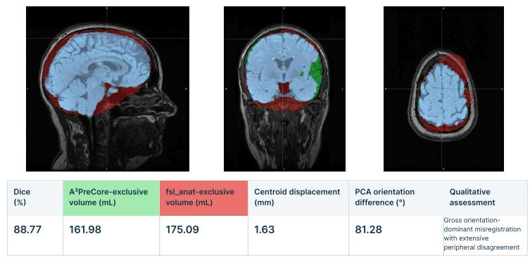

CQDM66\_BL | Severe orientation-dominant gross misregistration  
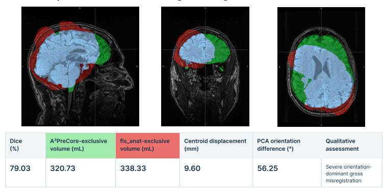

CQDM70\_BL | High overlap with minimal balanced disagreement  
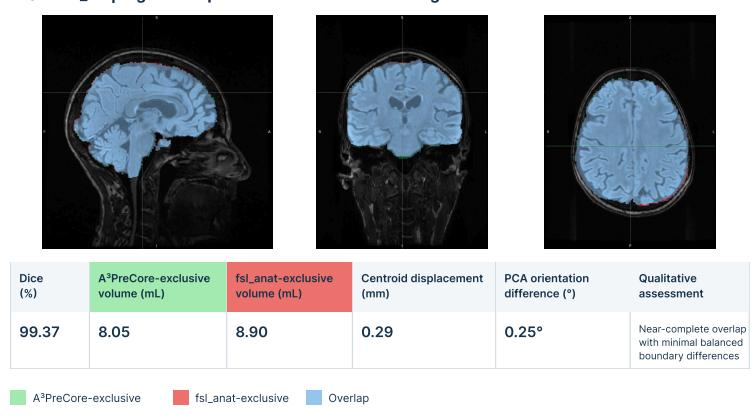  
Figure 12: Representative native-FLAIR comparisons between A3PreCore and fsl\_anat. Sagittal, coronal, and axial views illustrate three distinct patterns of inter-method disagreement. The top row (CQDM02\_BL) demonstrates pronounced orientation disagreement despite limited centroid displacement. The middle row (CQDM66\_BL) shows severe gross geometric disagreement involving substantial positional and orientational diferences. The bottom row (CQDM70\_BL) illustrates near-complete overlap with minimal residual boundary diferences. Green indicates $\mathbf { A } ^ { 3 }$ PreCore-exclusive regions, red indicates fsl\_anat-exclusive regions, and light blue indicates shared mask extent. Quantitative measurements are provided beneath each representative case. The diference maps characterize intermethod disagreement rather than anatomical ground-truth error.

CQDM95\_BL | Balanced method-exclusive extent  
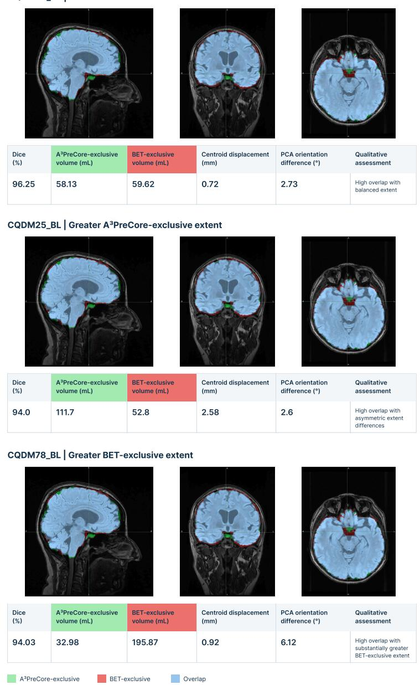  
Figure 13: Representative native-FLAIR comparisons between A3PreCore and BET. Sagittal, coronal, and axial views demonstrate distinct directional patterns of inter-method disagreement. The top row (CQDM95\_BL) shows extensive overlap with nearly balanced method-exclusive volumes. The middle row (CQDM25\_BL) illustrates greater A3PreCore-exclusive extent, whereas the bottom row (CQDM78\_BL) demonstrates substantially greater BET-exclusive extent despite a comparable Dice coeficient. Green indicates A3PreCore-exclusive regions, red indicates BET-exclusive regions, and light blue indicates shared mask extent. Quantitative measurements are reported beneath each case. The overlays describe relative mask extent and spatial disagreement without establishing anatomical superiority of either method.

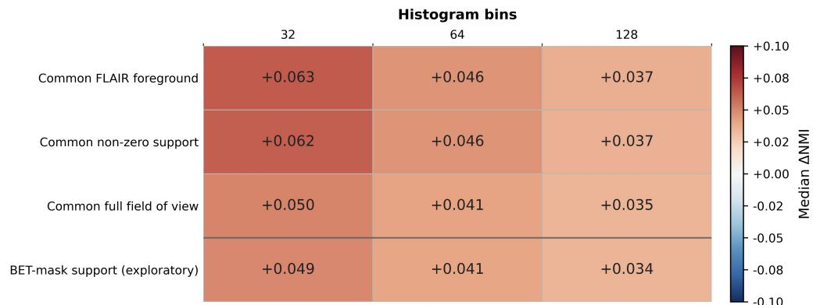  
Figure S1: Sensitivity of the paired controlled-NMI comparison to voxel support and histogram discretization. Median participant-level diferences, $\Delta \mathbf { N } \mathbf { M I } = \mathbf { N M I } _ { \mathrm { A 3 P } } - \mathbf { N M I } _ { \mathrm { f s l \_ a n a t } } .$ , are shown for common FLAIR foreground, common non-zero support, common full-field-of-view support, and BET-mask support using 32, 64, and 128 histogram bins. Positive values indicate higher NMI for $\mathbf { A } ^ { 3 } \mathbf { P r e C o r e }$ . BET-mask support was evaluated as an exploratory support-restriction analysis.