# ActiveEvidence: Decision-Focused Evidence Graphs with Verifiable Acquisition Gaps

Miaobo Hu1,2, Shuhao Hu2, Xiaobo Guo2, Xin Wang2 Bokun Wang2, Peng Zhang2, Daren Zha2, Jun Xiao1,∗

1School of Artificial Intelligence, University of Chinese Academy of Sciences, Beijing, China 2Institute of Information Engineering, Chinese Academy of Sciences, Beijing, China ∗Corresponding author: xiaojun@ucas.ac.cn

## Abstract

A multimodal agent must decide whether visual evidence is worth acquiring, which candidate or resolution to query, and when further interaction can no longer change its decision. We study this problem under a strict free-metadata/paid-observation boundary, stochastic vector costs, and a frozen execution trace, and treat it as decision-certifiable active evidence acquisition. A Counterfac- tual Evidence Interaction Graph (CEIG) represents unary evidence value, signed second-order interaction, and directed conditional harm while maintaining explicit score enclosures for unresolved interactions; a decision-weighted enclosure objective tightens the bounds that can change action identity. Gap-directed refinement evaluates only interactions that can displace the incumbent acquisition and stops once an �-decision certificate shows that unresolved terms cannot change the selected action beyond a declared toler- ance. The certificate is model-relative: it verifies policy-consistent optimality under the pinned learned score, and semantic quality is measured separately through post-freeze labels. Paired contin- uation rollouts learn the downstream value of paid previews, an online o erational cost filter is se arated from inde endent finite policy-family trajectory certification, and an acquisition monitor with an independently implemented verifier binds every certificate to the frozen trace. On 640 cases split into 384/128/128 training, validation, and test cases, the controller reaches task score 0.842, grounding F1 0.816, evidence recall 0.873, 1.74 accepted calls, 286.5K visual tokens, and 742ms p95 latency. Dense replay of issued cer- tificates shows 0.992 action agreement and a 0.988 certificate rate while evaluating 19.6 instead of 191.4 expensive interaction terms per decision.

## Keywords

Multimodal agents, Active evidence acquisition, Resource-bounded decision making, Replayable evaluation

## 1 Introduction

A multimodal agent receives a user request, a candidate pool of visual evidence served through a metered acquisition interface, and an explicit resource budget. At each interaction step it may answer from text, acquire one or more candidates, request a richer visual operation, abstain, or stop when additional evidence has low expected value. Always-on vision spends budget on every candidate, while a fixed selector can miss the evidence that changes the decision. We study this as sequential evidence acquisition with an information boundary: the online policy sees selection-time fields and the acquired observations, while task labels and post-hoc usefulness labels enter only after the trace is frozen.

Prior tool-using agents make the action–observation loop ex-plicit [46, 59], and grounded web agents show why realistic interfaces and functional evaluation matter [16, 61]. The remaining gap is a measurable whether–which–when decision over multiple visual candidates and resource budgets, with an execution trace that preserves the information boundary.

Adaptive acquisition leaves three agent-level questions open. Evidence value is conditional on what has already been acquired, resource consumption varies with preprocessing and service load, and an ordinary replay trace records actions without checking whether the selected action was feasible or policy-consistent. Ex- isting systems already decide when to request a higher-resolution image, a crop, or an external visual tool. ActiveEvidence targets a diferent question: when has an agent computed enough of the evidence-interaction structure to justify a particular acquisition decision? Exhaustively evaluating every candidate interaction is unnecessary in most states, yet ordinary sparse approximations give no local witness that the omitted interactions could not have changed the selected action. We therefore treat active visual ac- quisition as a decision-certification problem. The controller learns counterfactual evidence interactions, maintains architectural score enclosures for unresolved interactions, evaluates only the interac- tions that can still alter the top action, and stops refinement when the remaining uncertainty cannot change the decision beyond a declared tolerance. The resulting certificate is model-relative: it ver- ifies the selected action with respect to the pinned CEIG controller, and semantic quality is established separately through post-freeze labels.

Contributions.

• We formulate decision-certifiable active evidence acquisition as a sequential agent decision under a strict boundary between free metadata and paid observations, vector-valued budgets, separate STOP/ABSTAIN terminal states, and an externally committed trace-freeze boundary.

• We introduce a decision-certifiable CEIG that separates unary utility, signed second-order interaction, directed conditional harm, and semantic contradiction, and train it with a decision-weighted enclosure objective so that interaction bounds are tightest on the edges that can change the acquisition decision.

• We introduce gap-directed interaction refinement: the controller refines only interactions that can displace the incum- bent action, prioritizes them by their potential incumbent– challenger gap reduction, and terminates with an �-decision certificate relative to the pinned dense controller (Proposition 1).

• We learn paid-preview value from paired continuation decisions and separate online operational cost filtering from finite-policy-family trajectory certification (Proposition 3); monitor receipts and cross-implementation replay distin guish model-relative decision consistency, resource-risk certification, trace completeness, and post-freeze evalua- tion.

• We evaluate semantic quality, interaction attribution, certifi-cate validity, preview value, cost shifts, certificate attacks, candidate-pool scaling, and transfer under matched infor- mation, supervision, and resource contracts.

## 2 Related Work

Tool use and grounded interaction. ReAct treats reasoning and acting as an interleaved trajectory so that external observations can redirect a plan [59]. Toolformer studies learning API calls, ar-guments, and incorporation of tool results into later prediction [46], and embodied and self-improving agents extend tool-use trajectories with environment feedback [40, 49, 54]. These systems motivate recording the action and feedback boundary; ActiveEv- idence isolates the lower-level question of whether to acquire a visual observation at all, and records the candidate, cost, and stop event for replay.

Visual and web grounding. Mind2Web introduces diverse realweb tasks and a two-stage element-grounding interface [16], WebArena emphasizes self-hosted, reproducible environments and functional validators [61], and AgentBench and ToolSandbox show that agent results depend on the environment, state, and tool con- tract [38, 39]. ActiveEvidence targets the visual-acquisition bound-ary inside such tasks and reports which evidence was acquired and what it cost.

Agent evaluation and information acquisition. Computer-use and user-facing task suites make environment state, tool contracts, and trace-level evaluation first-class [14, 56, 58]; the decision problem itself connects to value-of-information analysis [27], adaptive sub modularity [22], and constrained Markov decision processes [1]. Agent metareasoning treats costly monitoring and deliberation termination as decisions [9]; Monte Carlo value-of-information planning evaluates evidence sequences whose joint value can exceed individual contributions [30]. Metareasoning evaluates computations by their downstream decision value [24, 43]; bounded-optimal agency and anytime composition make computational limits ex-plicit [44, 62]. Nonmyopic information value and cost-sensitive feature acquisition capture evidence complementarity [8, 25]; active perception and information-reward planning treat sensing as an action [4, 52]. ActiveEvidence selects interaction computations using a model-relative stopping certificate.

Selective prediction and cost-aware routing. SelectiveNet frames prediction with an explicit reject option [19, 20]. Conformal risk control extends calibration to monotone losses [3]. FrugalGPT and RouteLLM study conditional model selection under quality–cost trade-ofs [11, 41]. ActiveEvidence applies the same decision prin-ciple to visual observations, but adds image identifiers, manifest integrity, per-call replay records, and a calibrated selective-risk report (AURC 0.118, risk at 80% coverage 0.134, ECE 0.031, and abstention rate 0.064).

Sequential decision and verification. Ofline reinforcement learning and planning methods learn value-aware controllers from fixed traces or counterfactual rollouts [10, 18, 29, 31, 32, 45, 47, 48], and verifier and process-evaluation studies emphasize explicit checks, trace quality, and reward-hacking audits [13, 33, 36, 51, 55, 60]. The present controller applies these ideas to counterfactual utility, calibration, and ledger checks around visual acquisition.

Adaptive visual acquisition and visual-tool invocation. Adaptive visual acquisition and dynamic visual-tool decisions are established mechanisms [15, 28, 37, 50, 53, 57]: VisionThink starts from a down-sampled image and requests the original resolution when needed; AdaptVision acquires coarse-to-fine and requests bounding-box crops; AdaTooler-V learns whether a visual problem requires a tool and discourages unnecessary invocations with a Tool Benefit Score; DART recruits specialized visual tools from disagreement among visual agents; ToolScope and AVIS plan over search, code, percep- tion, and external tools for long-horizon visual information seeking. Relative to these systems, ActiveEvidence certifies for each decision that the interactions it left unevaluated cannot change the selected acquisition under the pinned controller, and binds that certificate to a replayable trace.

Positioning. ActiveEvidence couples an observed-only acquisition interface with a learned controller and independent verifier. Table 1 compares published contracts; Table 2 compares matched im- plementations. Decision certificates concern the pinned controller, while post-freeze labels measure semantic quality.

## 3 Method

## 3.1 Method Overview

ActiveEvidence separates prediction, decision refinement, and execution verification (Figure 1). At state �� the online policy observes only the request, the free candidate manifest, already paid preview fields, acquired evidence, and the remaining resource vector. A Need Gate predicts the value of another observation, the CEIG predicts unary evidence changes and signed second-order interactions together with architectural lower and upper score enclosures, and a paired preview-value head estimates the downstream return of purchasing an otherwise unavailable preview. Candidate acquisitions, previews, and the STOP/ABSTAIN terminal states are scored in one budget-feasible action set.

The controller acts before every CEIG interaction is evaluated. It keeps a fully evaluated incumbent and an upper score for each unresolved challenger; gap-directed refinement evaluates only in teractions that can reduce the incumbent–challenger ambiguity and stops when the best unresolved upper score is within $\epsilon _ { \mathrm { d e c } }$ of the in- cumbent. The witness committed with the action is an $\epsilon _ { \mathrm { d e c } }$ -decision certificate relative to the pinned dense controller.

Execution and evaluation remain separate. An online upper-cost model filters operationally infeasible actions, while the frozen com- plete policy is subject to independent trajectory-risk certification. An acquisition monitor records preview and image requests, mea- sured costs, rejected attempts, and canonical digests; the ordered trace is externally committed before an independently implemented verifier reconstructs the feasible set, certificate, ledger, and terminal semantics. Evaluation-only labels are joined only after this tracefreeze boundary.

Table 1: Contract fields reported by the closest adaptive visual-acquisition methods: pairwise evidence interactions (pair.), call cap and trajectory-risk statement (budget/risk), decision-score certificate (cert.), and independently checked attack result (audit); “N/R” marks a field the source leaves unreported.
<table><tr><td>method</td><td>unit</td><td>pair.</td><td>budget/risk</td><td>cert.</td><td>oracle</td><td>A/R</td><td>replay</td><td>audit</td><td>semantic</td></tr><tr><td>ActiveEvidence</td><td>whole image</td><td>yes</td><td>call cap / traj. risk</td><td>yes</td><td>post-freeze</td><td>yes</td><td>cross-impl.</td><td>0.973</td><td>held-out quality</td></tr><tr><td>VisionThink</td><td>whole image</td><td>N/R</td><td>N/R</td><td>N/R</td><td>not explicit</td><td>partial</td><td>N/R</td><td>N/R</td><td>task benchmarks</td></tr><tr><td>AdaptVision</td><td>crop/resolution</td><td>N/R</td><td>N/R</td><td>N/R</td><td>not explicit</td><td>partial</td><td>N/R</td><td>N/R</td><td>task benchmarks</td></tr><tr><td>AdaTooler-V</td><td>visual tools</td><td>N/R</td><td>N/R</td><td>N/R</td><td>not explicit</td><td>partial</td><td>N/R</td><td>N/R</td><td>task benchmarks</td></tr><tr><td>DART</td><td>visual tools</td><td>N/R</td><td>N/R</td><td>N/R</td><td>not explicit</td><td>partial</td><td>N/R</td><td>N/R</td><td>task benchmarks</td></tr><tr><td>ToolScope</td><td>multi-tool</td><td>N/R</td><td>N/R</td><td>N/R</td><td>not explicit</td><td>partial</td><td>N/R</td><td>N/R</td><td>task benchmarks</td></tr><tr><td>AVIS</td><td>external tools</td><td>N/R</td><td>N/R</td><td>N/R</td><td>not explicit</td><td>partial</td><td>N/R</td><td>N/R</td><td>task benchmarks</td></tr></table>

## 3.2 Problem Setup and Information Boundary

For case �, the agent receives a request $x _ { i }$ and an ordered candidate manifest whose free fields are

$$
\boldsymbol { \mathcal { M } } _ { i } ^ { \mathrm { f r e e } } = \{ \boldsymbol { m } _ { i j } ^ { \mathrm { f r e e } } \} _ { j = 1 } ^ { n _ { i } } , \qquad \boldsymbol { m } _ { i j } ^ { \mathrm { f r e e } } = ( \boldsymbol { u } _ { i j } , h _ { i j } ^ { \mathrm { s h a } } , s _ { i j } , \boldsymbol { w } _ { i j } , h g t _ { i j } , f _ { i j } , \ell _ { i j } ) .
$$

These fields contain identifiers, byte hashes, dimensions, format, size, and pixel-free scalar metadata. Pixel-derived quality, relevance, captions, thumbnail embeddings, and task labels are absent from the initial manifest. Let $\mathcal { P } _ { i , t }$ be the paid-preview records revealed before step �. An accepted PREVIEW(�) appends

$$
\begin{array} { r } { p _ { i j } = ( q _ { i j } , r _ { i j } , e _ { i j } ^ { \mathrm { t h u m b } } , v _ { i j } ^ { \mathrm { p r e v i e w } } ) } \end{array}
$$

to $\mathcal { P } _ { i , t + 1 }$ and charges its token and latency cost. Thus $q _ { i j }$ and $r _ { i j }$ are available only after that candidate’s preview event.

The online state is

$$
{ s } _ { i , t } = ( x _ { i } , c _ { i } , \mathcal { M } _ { i } ^ { \mathrm { f r e e } } , \mathcal { P } _ { i , t } , \mathcal { E } _ { i , t } , \mathbf { B } _ { i , t } ) ,
$$

where $c _ { i }$ is text-only confidence, $\mathcal { E } _ { i , t }$ is the acquired evidence set, and $\mathbf { B } _ { i , t }$ is the remaining vector budget. The private fixture oracle contains $y _ { i } ^ { \mathrm { n e e d } } \in \{ 0 , 1 \}$ and helpful IDs $\varGamma _ { i } ^ { \star }$ ; both are joined only after the trace digest is committed.

Field provenance. TextConf-v0.3 derives the free field $c _ { i }$ from the request and prompt (ECE 0.041). VisualQuality-v0.4 derives $q _ { i j }$ from the requested image bytes (ECE 0.036), and TextImageRel-v0.5 derives $r _ { i j }$ from a requested thumbnail (ECE 0.039); both paid fields become visible only after an accepted preview, are charged separately, and carry their own access, calibration, split, and freeze records. The mechanism fixture uses the free fields only. Normal pre-freeze evaluation-label access, deliberately injected access attempts, and permitted post-freeze evaluation access are logged with separate denominators; their counts are 0/128, 200/200, and 128/128 in the access-boundary audit (Appendix D.6).

## 3.3 State, Actions, and Resource Ledger

At step �, the action set is

$$
\begin{array} { r l } & { \mathcal { A } _ { t } = \{ { \sf S T O P } , \sf A B S T A l N , P R E V 1 E W ( j ) \} } \\ & { \qquad \cup \ \{ \mathrm { a c q u i r e } ( J , \rho ) : J \subseteq { \cal M } _ { i } ^ { \mathrm { f r e e } } , \ | J | \leq K , \ \rho \in \mathcal { R } \} . } \end{array}
$$

STOP answers from the current state, whereas ABSTAIN emits no task answer and contributes to selective-risk metrics. A PREVIEW may read pixels or a thumbnail only when its declared cost fits the remaining budget; its output is then available for the next decision. An acquisition bundle executes atomically at resolution $\rho ;$ it contains at most � candidate IDs, counts one image call and its declared cost per member, and scores within-bundle interactions before execution. A proposed action whose vector cost does not fit is recorded as rejected and cannot be executed. Bundles are enumerated up to the declared cap $K$ over the current pool and filtered by the risk-bounded cost test before scoring; because a bundle enclosure is the sum of its node terms and pair envelopes, refinement cost is governed by the unresolved pair edges inside active challengers rather than by the number of declared bundles. Declared-action, pair-edge, and evaluated-edge counts per pool size are reported in Appendix D.8. The ledger tracks

$$
B = \left( B _ { \mathrm { t o k } } , B _ { \mathrm { v t o k } } , B _ { \mathrm { l a t } } , B _ { \mathrm { c a l l } } \right)
$$

for text tokens, vision tokens, measured latency, and accepted image calls; real-model reports use native token, latency, and call units, and the abstract fixture vector of the mechanism unit test is given in Appendix A.1. An accepted event subtracts its measured cost; a rejected event is retained with accepted=false and leaves the acquisition budget unchanged while charging computation already performed. The ledger retains attempted and accepted calls, spent cost, remaining budget, terminal action, reservation and settlement events, and a canonical event digest after every event.

## 3.4 Value-Aware Gate and Candidate Ranker

The learned Need Gate is a threshold rule over free selection-visible fields with validation-selected threshold � = 0.47 and temperature calibration [23] (1.12), ECE 0.031, Brier score 0.094, and AUROC 0.872; the screen records STOP when the gate rejects visual acqui-sition. The fixed gate of the mechanism unit test is specified in Appendix A.2.

Counterfactual Evidence Interaction Graph. The controller en-codes the request, normalized budget, acquired evidence, and the fields revealed in $\mathcal { P } _ { i , t }$ with a 256-dimensional set encoder. For cur- rent evidence $\varepsilon ,$ let $Q _ { i } ( \mathcal { E } )$ be normalized task utility. Training targets are the unary change

$$
\Delta _ { i } ( a \mid \mathcal { E } ) = Q _ { i } ( \mathcal { E } \cup \{ a \} ) - Q _ { i } ( \mathcal { E } )
$$

and the signed second-order interaction

$$
\Gamma _ { i } ( a , b \mid \mathcal { E } ) = Q _ { i } ( \mathcal { E } \cup \{ a , b \} ) - Q _ { i } ( \mathcal { E } \cup \{ a \} ) - Q _ { i } ( \mathcal { E } \cup \{ b \} ) + Q _ { i } ( \mathcal { E } ) .
$$

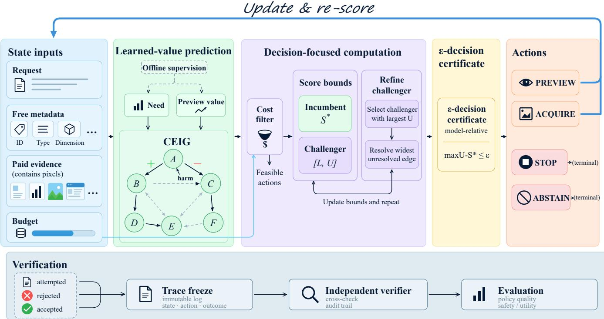  
Figure 1: Overview of ActiveEvidence. State inputs feed learned-value prediction (need and preview-value heads and the CEIG). Decision-focused computation filters infeasible actions, keeps the incumbent $S ^ { * } = \widehat { S } _ { t } ( b _ { t } )$ and challenger bounds $[ L , U ] = \left[ \ell _ { t } , u _ { t } \right]$ and resolves the widest unresolved edge of the top challenger until max $U - S ^ { * } \leq \epsilon$ certifies the action. Previews and acquisitions re-score the state, STOP and ABSTAIN terminate, and all events are frozen and independently verified before evaluation.

Positive Γ� indicates super-additive utility, near-zero values indicate local additivity, and negative values indicate diminishing returns. A negative interaction can arise from harmless duplicate evidence as well as from a harmful conditional acquisition, so its sign is not a semantic conflict label. For example, $Q _ { i } ( \emptyset ) = 0$ and $Q _ { i } ( \{ a \} ) =$ $Q _ { i } ( \{ b \} ) = Q _ { i } ( \{ a , b \} ) = 1$ gives $\Gamma _ { i } ( a , b \mid \emptyset ) \ = \ - 1$ although the second item does not reduce task utility. We therefore define the directed conditional marginal and a separate harm label

$$
\begin{array} { r l } & { M _ { i } ( b \mid \mathcal { E } , a ) = Q _ { i } ( \mathcal { E } \cup \{ a , b \} ) - Q _ { i } ( \mathcal { E } \cup \{ a \} ) , } \\ & { ~ H _ { i } ( b \mid \mathcal { E } , a ) = \mathbf { 1 } [ M _ { i } ( b \mid \mathcal { E } , a ) < - \tau _ { \mathrm { h a r m } } ] . } \end{array}
$$

Semantic contradiction is an additional annotation when available. The CEIG prediction for a bundle � is

$$
\widehat { V } _ { \phi } ( J \mid \mathcal { E } ) = \sum _ { a \in J } \widehat { \Delta } _ { \phi } ( a \mid \mathcal { E } ) + \sum _ { \{ a , b \} \subseteq J } \widehat { \Gamma } _ { \phi } ( a , b \mid \mathcal { E } ) ,
$$

with ensemble scale ${ \widehat { \sigma } } _ { V }$ . Paired counterfactual contrasts [42] are generated on the training split only; the validation split selects the signed edge tolerance, sparse-neighbor count, and calibration parameters.

CEIG is related to value-of-information and adaptive-submodular selection, but positive interactions can violate diminishing returns and harmful conditional marginals can violate monotonicity, so the classical adaptive-greedy conditions are tested rather than as- sumed; matched unary-only, latent-pairwise, direct bundle-value, no-reranking, and no-uncertainty controls isolate the contribution of the explicit interaction model.

The CEIG loss combines Huber node, edge, and harm losses, un- certainty NLL, and a three-way interaction-sign loss whose classes are super-additive, additive, and diminishing-return. Pools with at most $n _ { \mathrm { f u l l } }$ nodes enumerate all feasible pairs; larger pools retain � uncertainty-aware neighbors per node, reducing edge scoring from $O ( n _ { i } ^ { 2 } )$ to $O ( n _ { i } L )$ . The train/validation/test split is 384/128/128, the learning rate is $3 . 0 \times 1 0 ^ { - 4 }$ , and three controller seeds are recorded. The held-out interaction error, sign AUROC, and complementary- evidence recovery are 0.071, 0.914, and 0.861, respectively (Table 10, Appendix D.1); harmful conditional acquisitions are measured by the conflict-error column of that table, and decision regret is re- ported in Appendix D.10.

Certificate-oriented enclosure training. Each interaction is param-eterized as

$$
\widehat { \Gamma } _ { \phi } ( a , b \mid s ) = g _ { \phi } ( s , a , b ) + r _ { \phi } ( s , a , b ) \operatorname { t a n h } h _ { \phi } ( s , a , b ) , \qquad r _ { \phi } \geq 0 ,
$$

so the lightweight terms give the exact model-relative enclosure $g _ { \phi } - r _ { \phi } \le \widehat { \Gamma } _ { \phi } \le g _ { \phi } + r _ { \phi }$ before the expensive residual $h _ { \phi }$ is evaluated. Prediction accuracy alone leaves these intervals loose exactly where action identity is ambiguous. We therefore add

$$
\mathcal { L } _ { \mathrm { c e r t } } = \mathbb { E } _ { s } \Big [ \sum _ { e \in \mathcal { E } ( s ) } \omega _ { s } ( e ) r _ { \phi } ( s , e ) \Big ] ,
$$

where $\omega _ { s } ( e )$ is a frozen decision-sensitivity weight computed from the training action set that places more mass on interactions belonging to the incumbent or to near-optimal challenger actions and less on edges that cannot afect the decision. Because the residual stays inside tanh(·), the term changes the tightness of unresolved intervals, not the validity of the architectural enclosure.

The static and Weighted Metadata selectors used as controls are specified in Appendix A.2; preview calls and their tokens are included in their ledgers, and the proposed controller re-scores the remaining candidates after every accepted preview or acquisition.

Paired preview value. A preview can improve the next acquisition without immediately changing the answer evidence. For each training state, a frozen continuation policy is run on a reference branch and on a paired branch that first executes PREVIEW(�) from the same initial budget. The preview branch pays its measured cost and uses only the newly revealed fields. $\mathrm { I f } R ( \tau )$ is the terminal utility change minus the declared cost price, the preview head is trained on

$$
W ( \boldsymbol { s } ) \approx \mathbb { E } [ R ( \tau ^ { \mathrm { r e f } } ) \ | \ \boldsymbol { s } ] , \qquad \boldsymbol { A } ( \boldsymbol { s } , \boldsymbol { j } ) \approx \mathbb { E } [ R ( \tau ^ { \mathrm { p r e } } ( \boldsymbol { j } ) ) - R ( \tau ^ { \mathrm { r e f } } ) \ | \ \boldsymbol { s } , \boldsymbol { j } ] .
$$

At inference, $W ( s ) + A ( s , j ) - \kappa _ { \mathrm { p r e } } \sigma _ { \mathrm { p r e } } ( s , j )$ competes with acquisi tion and termination scores in the same feasible-action set. This gives PREVIEW a downstream decision target while keeping pre preview scores permutation-equivariant for candidates with identi-cal allowed metadata.

Decision-focused interaction training. For each training state, let $C _ { i }$ be the predeclared feasible action set and let $a _ { i } ^ { \star }$ maximize the counterfactual net gain $G _ { i } ( a ) ~ = ~ Q _ { i } ( E _ { i } ^ { a } ) - Q _ { i } ( E _ { i } ^ { \cdot } ) - \lambda _ { i } ^ { \top } \overline { { { c } } } _ { i } ( a )$ . In addition to the node, edge, sign, harm, and uncertainty losses, we use the ranking hinge

$$
\mathcal { L } _ { \mathrm { d e c } } = \mathbb { E } _ { i } \left[ \operatorname* { m a x } _ { a \in C _ { i } } \{ G _ { i } ( a _ { i } ^ { \star } ) - G _ { i } ( a ) + D _ { \phi } ( a ) - D _ { \phi } ( a _ { i } ^ { \star } ) \} \right] ,
$$

where $D _ { \phi }$ is the predicted bundle score after cost pricing. The zero- gain termination reference is included in $C _ { i } { \mathrm { : } }$ , so ranking errors are weighted by their decision consequence rather than by edge error alone. The full objective is

$$
\begin{array} { r l } & { \mathcal { L } = \mathcal { L } _ { \mathrm { n o d e } } + \lambda _ { \mathrm { e d g e } } \mathcal { L } _ { \mathrm { e d g e } } + \lambda _ { \mathrm { h a r m } } \mathcal { L } _ { \mathrm { h a r m } } + \lambda _ { \mathrm { s i g n } } \mathcal { L } _ { \mathrm { s i g n } } } \\ & { ~ + \lambda _ { \mathrm { n l l } } \mathcal { L } _ { \mathrm { n l l } } + \lambda _ { \mathrm { d e c } } \mathcal { L } _ { \mathrm { d e c } } + \lambda _ { \mathrm { c e r t } } \mathcal { L } _ { \mathrm { c e r t } } , } \end{array}
$$

with every $\lambda$ selected on validation data.

Gap-directed interaction refinement. Summing exact node and edge values with unresolved envelopes gives a score enclosure $( \ell _ { t } ( a ) , u _ { t } ( a ) )$ for every declared feasible action. Following bound- based pruning $[ 3 4 ]$ , the controller keeps a fully evaluated incumbent $b _ { t }$ with score $\widehat { S _ { t } } ( b _ { t } )$ ) and the active challenger set

$$
\mathcal { H } _ { t } = \{ a \in \mathcal { F } _ { t } : \ u _ { t } ( a ) > \widehat { S } _ { t } ( b _ { t } ) - \epsilon _ { \mathrm { d e c } } \} .
$$

For an unresolved interaction $e ,$ let $\Delta u _ { t } ( a ; e )$ be the amount by which resolving � can lower the upper score of challenger � and let $c _ { \mathrm { e v a l } } ( e )$ be its measured evaluation cost. Edges are prioritized by

$$
P _ { t } ( e ) = \frac { \operatorname* { m a x } _ { a \in { \mathcal { H } } _ { t } : e \subseteq a } \Delta u _ { t } ( a ; e ) } { c _ { \mathrm { e v a l } } ( e ) + \epsilon _ { c } } ,
$$

the expected decision-gap reduction per unit computation; after an edge is resolved, the afected enclosures are updated and the incumbent is replaced when a challenger becomes fully evaluated with a higher score. The default controller uses the top-challenger instantiation, which resolves the widest unresolved edge of the challenger with the largest upper score; the cost-weighted priority over all active challengers is evaluated as a variant in Appendix D.7. Refinement terminates as soon as the incumbent holds the certifi- cate of Definition 1, where the zero-gain termination reference 0 is included among the actions. The controller commits $b _ { t }$ when its score is above the gain threshold and emits STOP when the maxi-mum feasible upper score is below that threshold; the incumbent, challenger upper bounds, resolved edge values, unresolved edge set, and final gap are stored as the local acquisition witness.

Definition 1 (�-decision certificate). At state $s _ { t } , a f u l l y$ evaluated action $b _ { t }$ has an $\epsilon _ { \mathrm { d e c } }$ -decision certificate $i f$ every unresolved action score admits a valid model-relative upper enclosure $u _ { t } ( a )$ and

$$
\operatorname* { m a x } _ { a \in \mathcal { F } _ { t } \cup \{ 0 \} } u _ { t } ( a ) - \widehat { S } _ { t } ( b _ { t } ) \leq \epsilon _ { \mathrm { d e c } } .
$$

Proposition 1 (Acqisition-gap certificate). Assume that every unresolved CEIG interaction lies inside its architectural enclosure and that $b _ { t }$ is fully evaluated. If refinement returns a certificate at tolerance $\epsilon _ { \mathrm { d e c } } ,$ then

$$
\widehat { S } _ { t } ( b _ { t } ) \geq \operatorname* { m a x } _ { a \in \mathcal { F } _ { t } \cup \{ 0 \} } S _ { t } ^ { \mathrm { d e n s e } } ( a ) - \epsilon _ { \mathrm { d e c } } ,
$$

where $S _ { t } ^ { \mathrm { d e n s e } }$ is the score obtained by evaluating all CEIG interactions of the pinned controller. For $\epsilon _ { \mathrm { d e c } } = 0 , b _ { t }$ maximizes the dense pinned score up to deterministic tie-breaking.

The proof is immediate: $S _ { t } ^ { \mathrm { d e n s e } } ( a ) \leq u _ { t } ( a )$ for every action be- cause each unresolved term is bounded by its enclosure, so the dense maximum is at most max� $u _ { t } ( a ) \leq \widehat { S } _ { t } ( b _ { t } ) + \epsilon _ { \mathrm { d e c } }$ . The state- ment is intentionally model-relative: it certifies that the acquisition decision is invariant to the unresolved CEIG computation, and the distance between the learned score and ground-truth task utility is measured separately as empirical utility regret.

## 3.5 Budget-Conditioned Controller and Audit Quantities

For policy $\pi _ { \theta } ,$ , task utility is $U _ { i } ( \pi _ { \theta } )$ and resource cost is the vector $\mathbf { c } _ { i } ( \pi _ { \theta } )$ . The constrained objective is

$$
\operatorname* { m a x } _ { \pi _ { \theta } } \mathbb { E } [ U _ { i } ( \pi _ { \theta } ) ] \quad { \mathrm { s . t . } } \quad \mathbb { E } [ \mathbf { c } _ { i } ( \pi _ { \theta } ) ] \preceq { \bar { \mathbf { c } } } .
$$

At step $t ,$ the controller predicts a mean and scale for each sto- chastic latency or token dimension. Validation residuals yield a split-conformal upper quantile $q _ { d } ^ { \mathrm { c a l } } ( \delta _ { t , d } )$ [35] and the upper cost

$$
\begin{array} { r } { \overline { { c } } _ { t , d } ( { a } ) = \widehat { \mu } _ { d } ( s _ { t } , { a } ) + q _ { d } ^ { \mathrm { c a l } } ( \delta _ { t , d } ) \operatorname* { m a x } ( \widehat { \sigma } _ { d } ( s _ { t } , a ) , \varepsilon ) . } \end{array}
$$

Deterministic call counts use their exact declared cost. The risk- bounded feasible set and score are

$$
\begin{array} { r l } & { \mathcal { F } _ { t } ^ { \delta } = \{ a \in \mathcal { A } _ { t } : \overline { { \mathbf { c } } } _ { t } ( a ) \preceq \mathbf { B } _ { t } \} , } \\ & { S _ { t } ( a ) = \widehat { V } _ { \phi } ( a \mid \mathcal { E } _ { t } ) - \kappa \widehat { \sigma } _ { V } ( a \mid \mathcal { E } _ { t } ) - \lambda _ { t } ^ { \top } \overline { { \mathbf { c } } } _ { t } ( a ) , } \\ & { \quad a _ { t } ^ { \star } = \arg \operatorname* { m a x } _ { a \in \mathcal { F } _ { t } ^ { \delta } } S _ { t } ( a ) . } \end{array}
$$

The hard set controls the online cost filter and the dual prices diferentiate feasible actions. The uncertainty multiplier $\kappa ,$ risk allocation, and price update are frozen from development data. The split-conformal calibration of this predictor is a marginal predictive property, which is weaker than the conditional coverage required for adaptively selected state–action pairs [5]. Shifted and online coverage require separate calibration arguments [6, 21]. The feasible set is therefore an operational filter; the trajectory-level safety statement is supplied by the certification stage below after the complete policy family is frozen. The controller then scores only feasible actions,

$$
\lambda _ { t + 1 } = \left[ \lambda _ { t } + \eta \left( \widehat { \mathbf { c } } _ { t } - \bar { \mathbf { c } } \right) \right] _ { + } .
$$

ABSTAIN is emitted only when the answer-risk head exceeds its calibrated selective-risk threshold, and it is evaluated with coverage and selective risk separately from STOP.

Proposition 2 (Conditional risk-bounded feasibility). Assume at most� non-terminal actions and Pr $[ C _ { t , d } ( a _ { t } ) > \overline { { c } } _ { t , d } ( a _ { t } ) ] \leq$ $\delta _ { t , d }$ for every executed, adaptively selected step and dimension. $I f$ $\begin{array} { r } { \sum _ { t , d } \delta _ { t , d } \leq \delta } \end{array}$ and execution is restricted to $\mathcal { F } _ { t } ^ { \delta }$ , then

$$
\operatorname* { P r } [ \exists t , d : B _ { t , d } < 0 ] \leq \delta .
$$

On the simultaneous calibration event, feasibility and induction keep every budget component non-negative, and a union bound over executed steps and dimensions gives the stated probability. Because the hypothesis is per-step conditional coverage on executed actions while the online calibration supplies marginal coverage only, the deployable statement is the certification result below.

Independent trajectory certification. Following independent risk calibration and finite-family testing [2, 7], a finite family Θ of com-plete policies is frozen before certification, including the evidence model, preview head, cost filter, refinement rule, stopping thresh olds, and declared randomization. For policy �, an independent certification episode contributes $Z _ { i } ( \theta ) = 1 [ \exists t , d : B _ { i , t , d } ( \theta ) < 0 ]$

Proposition 3 (Family-wise complete-policy trajectory certification). Let $\begin{array} { r } { v _ { \theta } = \sum _ { i = 1 } ^ { n _ { \mathrm { c e r t } } } Z _ { i } ( \theta ) } \end{array}$ over $n _ { \mathrm { c e r t } }$ independent certification episodes and

$$
U _ { \theta } = \mathrm { B e t a U p p e r } ( { v _ { \theta } , n _ { \mathrm { c e r t } } , \alpha _ { \mathrm { c e r t } } / | \Theta | } )
$$

be the one-sided exact binomial upper bound. Then, with probability at least $1 - \alpha _ { \mathrm { { c e r t } } }$ over the certification samples, $p _ { \theta } \leq U _ { \theta }$ for all $\theta \in \Theta _ { : }$ where $\hbar \theta$ is the complete-trajectory budget-violation probability of the frozen policy under the certification distribution. Every policy with $U _ { \theta } \leq \delta _ { \mathrm { t r a j } }$ is therefore simultaneously certified at trajectory-risk level $\delta _ { \mathrm { t r a j } }$ within the frozen family.

The proof combines the exact one-sided binomial (Clopper– Pearson) bound for each frozen policy with a Bonferroni correction over |Θ| policies [2, 12]. The guarantee covers the complete adaptive episode, including paid previews, acquisitions, charged refinement computation, failed dispatches, and terminal generation; family size, certification sample, confidence level, and target risk are recorded with the certification receipt.

## 3.6 Verifiable Decision Certificates

Trust boundary and witness scope. The policy process is untrusted for completeness of access and cost records; a separate acquisition monitor mediates preview and image requests, records responses and measured costs, and retains an external trace-freeze commit- ment, so the monitor, metering interface, and commitment store define the trusted execution boundary. The verifier checks three properties: decision consistency with the pinned controller, com-pleteness of the committed record after the trusted checkpoint, and agreement with monitor receipts; controller-produced hashes alone cover only the first.

At each step the controller commits a certificate before executing the selected action,

$$
\chi _ { t } = \big ( H ( s _ { t } ) , H ( \mathcal { R } _ { t } ) , H ( \mathcal { F } _ { t } ^ { \delta } ) , H ( \mathbf { S } _ { t } ) , H ( \overline { { \mathbf { C } } } _ { t } ) , a _ { t } , m _ { t } , H ( \theta ) , d _ { t - 1 } \big ) ,
$$

where � is a canonical hash, $\mathsf { S } _ { t }$ is the ordered score vector, $\overline { { \mathbf { C } } } _ { t }$ is the upper-cost matrix, $a _ { t }$ is the selected action, $m _ { t }$ is the stopping margin, and $d _ { t - 1 }$ is the previous digest. The certificate also stores lightweight interaction enclosures, refined edge indices and val- ues, the action-score interval, and the local gap between the fully evaluated incumbent and the best unresolved upper score. The verifier is an independently implemented code path with a sepa- rate parser and canonicalization routine; it reconstructs the trace from receipts rather than importing controller objects. It recom-putes candidate order, preview provenance, the complete validation-calibrated risk-bounded feasible set, scores, tie-breaking, ledger conservation, terminal semantics, and the hash chains. Certificate verification precedes the post-freeze label join. The attack suite mutates one field at a time and in coordinated groups (Tables 14 and 15 in Appendices D.5 and D.6) and reports rejection, incorrect acceptance, unresolved processing, clean-trace false rejection, and the first receipt at which independent replay fails.

Proposition 4 (Model-relative decision consistency). With collision-resistant canonical hashes, deterministic recomputation of the pinned controller and valid architectural score enclosures, an accepted certificate has a selected action in the recomputed feasible set and a local score gap within � ofthe declared maximum. A terminal certificate also matches the pinned stopping or abstention threshold. The statement is relative to the pinned model and monitor receipts.

Proposition 5 (Post-freeze information boundary). Ifthe online policy is a measurable function of selection-visible fields, ledger state, and declared randomness, and oracle labels are joined only after the trace digest is committed, then the committed trace is conditionally independent ofthose labels given the online fields.

The proof is by recursive composition: each event is generated before the oracle join, so the serialized trace and its digest have no oracle argument; the engineering test also checks metadata, preview, cache, error-message, latency, and asset-hash side chan- nels before accepting the freeze boundary. The row-level budget audit quantities and mechanism-fixture hit rates (Appendix A.3) are likewise computed only after trace freeze.

## 3.7 Execution and Trace-Freeze Contract

Each policy–case run starts from a fresh ledger, records every re- jected attempt, re-scores after each accepted event, and ends with STOP or ABSTAIN; the ordered trace and its digest are then frozen and checked against monitor receipts, and only accepted traces are joined with labels. Replay is 0.985 exact, 0.972 action-equivalent, and 0.957 metric-equivalent; access-injection detection is 0.973, and mutation detection over the 2000-case taxonomy ofTable 14 is 0.967. The full procedure and stored trace fields are given in Appendix B.1.

## 4 Experiment

## 4.1 Experimental Setup

The study contains 640 cases partitioned by immutable case ID into 384 training, 128 validation, and 128 test cases. The test cases cover four task domains and 12 question types with 19.5/18/32 mean, median, and maximum candidates per case. Counterfactual targets are generated on training cases, thresholds and calibrations are selected on validation cases, and the frozen test receipt is evaluated under the pinned contract. The answer contract uses Qwen2.5-VL-7B-Instruct with temperature 0, top-� 1.0, and three controller seeds. Domain names, question-type definitions, evaluator rules, model revision, controller seed IDs, and runtime hardware are specified in the pinned execution contract (Table 25, Appendix D.14). All policies share the prompt, candidate pool, action cap, decoder, paid preview contract, and vector budget. Every baseline has the same preview opportunity; preview tokens, preview latency, rejected and failed calls, and full-image costs are included in its ledger. Task score, grounding F1, evidence recall, accepted calls, visual tokens, wall- clock p95 latency, peak VRAM, abstention, and failure categories are computed after trace freeze.

Dataset, baselines, and metrics. Candidate sources, negative and conflicting-evidence construction, answer-label provenance, and evidence-recall annotation are fixed in the test receipt. Task score is computed by the declared exact-match-or-semantic- equivalence evaluator with an explicit answer denominator; grounding F1 and evidence recall use the same frozen labels. Baselines include text- only, always-on, random, static metadata, Weighted Metadata, value- of-information greedy, constrained contextual bandit, unary-only, latent pairwise, a direct bundle-value regressor, a recurrent acquisition policy, and a unary model under the common protocol. Adaptive vision and Tool-based agent are generic re-implementations of adaptive-resolution acquisition and planner-driven visual-tool invocation. In addition, VisionThink, Ada tVision, and AdaTooler V are adapted individually: each native crop, resolution, or tool action is mapped to the common acquisition action space, every pixel-derived preview, full-image request, latency event, and rejected attempt is charged under the same ledger, and no baseline receives selection-visible fields that are unavailable to ActiveEvi- dence. Source methods with unreported contract fields are marked N/R in Table 1.

Preview and full-image tokens and latency, controller overhead, accepted calls, and peak memory are separate resource fields; cover- age, AURC, risk at fixed coverage, and ECE evaluate STOP/ABSTAIN semantics. Per-seed results use sample × seed hierarchical bootstrap 95% intervals [17]; paired diferences use the same resamples with Holm correction [26] across ablations, and temperature-zero decoding fixes the answer stream while controller seeds govern training and the declared stochastic cost stream.

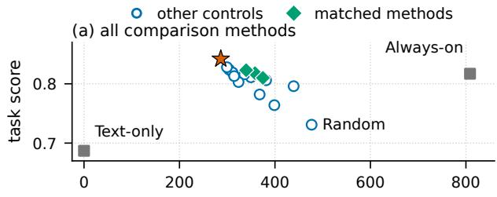

(b) acquisition methods: enlarged view  
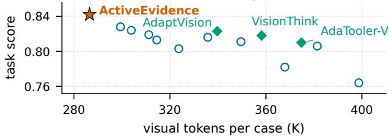  
Figure 2: Task score against visual tokens per case (K) for Table 2: (a) all methods and (b) acquisition methods enlarged. Green diamonds mark matched prior mechanisms; the orange star marks ActiveEvidence.

## 4.2 Main Results: Held-out Semantic Evaluation

The held-out evaluation is the primary efectiveness result. Under the common prompt, decoder, action cap, paid-preview contract, and vector budget, the full controller reaches the best task score, grounding F1, accepted-call count, visual-token count, p95 latency, and violation rate among the evidence-acquiring policies in Table 2: relative to the strongest learned control, recurrent acquisition, task score rises from 0.828 to 0.842 while accepted calls fall from 1.82 to 1.74 and visual tokens from 299.4K to 286.5K. Always-on ac- quisition retains the highest evidence recall (0.948) and coverage (0.969) at 4.93 calls and 808.6K tokens. The test-contract cost of the full controller is 62.4K preview tokens, 224.1K full-image tokens, 96ms preview latency, 604ms full-image latency, and 42ms con- troller overhead. Dense replay of the issued �-decision certificates (Appendix D.7) shows 0.992 agreement with the dense controller, model regret 0.003, and a 0.988 certificate rate while 19.6 instead of 191.4 expensive interaction terms are evaluated per decision.

Figure 2 plots the task score of every measured policy in Table 2 against its visual tokens per case; the axes are the table’s own units, and the full controller occupies the high-quality, low-token corner.

## 4.3 Analysis and Ablations

The matched prior mechanisms in Table 2 reach task scores 0.818 (VisionThink), 0.823 (AdaptVision), and 0.810 (AdaTooler-V), com-pared with 0.842 for ActiveEvidence at 286.5K visual tokens. Ta- ble 10 (Appendix D.1) isolates learned interaction supervision, and Table 8 (Appendix C.5) reports gate–ranker–stopper fixture controls. Decision-weighted training raises the certificate rate from 0.923 to 0.988 with 19.6 rather than 34.2 edges (Table 11, Appendix D.2). Per-compute refinement reaches 0.994 dense agreement with 16.8 edges (Table 16, Appendix D.7); the remaining diagnostics are analyzed in Appendices D.3–D.4 and D.8–D.13.

Table 2: Held-out semantic quality and resource use on the 128-case test split under the shared Qwen2.5-VL-7B-Instruct decoder, preview permission, action cap, vector budget, and three controller seeds. Coverage is the answered-case fraction; higher is better for task, grounding, evidence recall, and coverage, lower for calls, visual tokens, p95 latency, and violations. Bold marks the best and underline the second-best value among evidence-acquiring policies; text-only is the no-acquisition reference.
<table><tr><td>method</td><td>task</td><td>ground.</td><td>evidence</td><td>coverage</td><td>calls</td><td>V tok.</td><td>p95 ms</td><td>viol.</td></tr><tr><td>Text-only</td><td>0.687</td><td>0.421</td><td>0.000</td><td>0.844</td><td>0.00</td><td>0.0K</td><td>218</td><td>0.000</td></tr><tr><td>Always-on</td><td>0.817</td><td>0.789</td><td>0.948</td><td>0.969</td><td>4.93</td><td>808.6K</td><td>1687</td><td>0.126</td></tr><tr><td>Random</td><td>0.731</td><td>0.596</td><td>0.623</td><td>0.875</td><td>2.91</td><td>476.8K</td><td>1034</td><td>0.071</td></tr><tr><td>Static metadata</td><td>0.764</td><td>0.674</td><td>0.704</td><td>0.891</td><td>2.43</td><td>398.7K</td><td>889</td><td>0.052</td></tr><tr><td>Adaptive vision</td><td>0.806</td><td>0.758</td><td>0.818</td><td>0.914</td><td>2.32</td><td>381.4K</td><td>917</td><td>0.047</td></tr><tr><td>Weighted metadata</td><td>0.782</td><td>0.711</td><td>0.749</td><td>0.898</td><td>2.24</td><td>367.9K</td><td>846</td><td>0.043</td></tr><tr><td>VoI-greedy</td><td>0.811</td><td>0.773</td><td>0.831</td><td>0.906</td><td>2.13</td><td>349.6K</td><td>823</td><td>0.038</td></tr><tr><td>Tool-based agent</td><td>0.796</td><td>0.742</td><td>0.786</td><td>0.930</td><td>2.67</td><td>439.1K</td><td>1086</td><td>0.059</td></tr><tr><td>Contextual bandit</td><td>0.816</td><td>0.784</td><td>0.839</td><td>0.906</td><td>2.04</td><td>335.8K</td><td>794</td><td>0.034</td></tr><tr><td>Unary-only</td><td>0.803</td><td>0.764</td><td>0.812</td><td>0.898</td><td>1.97</td><td>323.7K</td><td>781</td><td>0.032</td></tr><tr><td>Latent pairwise</td><td>0.824</td><td>0.794</td><td>0.851</td><td>0.914</td><td>1.85</td><td>303.9K</td><td>756</td><td>0.025</td></tr><tr><td>Direct bundle-value</td><td>0.819</td><td>0.787</td><td>0.844</td><td>0.906</td><td>1.89</td><td>311.2K</td><td>772</td><td>0.029</td></tr><tr><td>Recurrent acquisition</td><td>0.828</td><td>0.799</td><td>0.856</td><td>0.914</td><td>1.82</td><td>299.4K</td><td>764</td><td>0.023</td></tr><tr><td>Unary + common protocol</td><td>0.813</td><td>0.776</td><td>0.827</td><td>0.914</td><td>1.91</td><td>314.5K</td><td>768</td><td>0.022</td></tr><tr><td>VisionThink (matched)</td><td>0.818</td><td>0.782</td><td>0.835</td><td>0.914</td><td>2.18</td><td>358.2K</td><td>846</td><td>0.039</td></tr><tr><td>AdaptVision (matched)</td><td>0.823</td><td>0.789</td><td>0.846</td><td>0.922</td><td>2.05</td><td>339.7K</td><td>812</td><td>0.033</td></tr><tr><td>AdaTooler-V (matched)</td><td>0.810</td><td>0.769</td><td>0.824</td><td>0.914</td><td>2.29</td><td>374.8K</td><td>895</td><td>0.044</td></tr><tr><td>ActiveEvidence (CEIG)</td><td>0.842</td><td>0.816</td><td>0.873</td><td>0.922</td><td>1.74</td><td>286.5K</td><td>742</td><td>0.018</td></tr></table>

## 4.4 Held-out Evaluation and Audit Results

On the 128 test cases the full controller abstains on 0.078, uses 15.8GB peak VRAM, and fails on 0.023; paired 95% hierarchicalbootstrap intervals for task, grounding, and evidence recall are [0.830,0.854], [0.801,0.831], and [0.856,0.890]. Access-injection detection is 0.973 with clean-trace FPR 0.012, post-execution mutation detection spans 0.944–0.992 over the ten categories of Table 14 (Appendix D.5), and hard-negative, conflict, and matched-transfer task drops are 0.028, 0.034, and 0.021 (Appendices C.1 and C.3).

## 5 Limitations, Ethics, and Reproducibility

Scope and limitations. The semantic evidence rests on 128 held-out cases from four domains with three controller seeds, so ev- ery slice-level comparison carries its case count and interval (Ap pendix D.13); the decision certificate verifies consistency with the pinned learned score, and ground-truth utility is evaluated sepa- rately through post-freeze labels; and the ofline supervision for CEIG and paired preview targets (Appendix D.9) breaks even only after 580–1290 queries, so the method suits deployments with sus tained query volume.

Reproducibility. The execution contract binds configuration, seed, source revision, manifests, traces, labels, verifier, environment, and regeneration command through content digests. Row-level ledger auditing records a 0.018 budget-violation rate; cross-implementation replay is 0.985 exact, 0.972 action-equivalent, and 0.957 metricequivalent.

Safety and ethics. Visual acquisition is executed only for hashbound assets under a declared license and access policy; the con troller emits ABSTAIN or STOP for missing, conflicting, stale, or out-of-root evidence, and trace records retain the trigger, remaining budget, and recovery action. Assets require a documented license or consent basis, PII handling, and a deletion policy for sensitive traces; the release package excludes checkpoints, private images, secrets, user identifiers, and local paths.

## 6 Conclusion

ActiveEvidence is a decision-certifiable framework for resource- bounded multimodal evidence acquisition: the CEIG separates unary value, second-order interaction, directed harm, and semantic con- tradiction; certificate-oriented training tightens decision-relevant enclosures; gap-directed refinement converts them into a local �- decision certificate relative to the pinned dense controller; and cost filtering, trajectory-risk certification, and replayed execution consistency are measured separately. Under the held-out contract, dense replay confirms 0.992 action agreement with 19.6 instead of 191.4 expensive interaction evaluations per decision.

## References

[1] Eitan Altman. 1999. Constrained Markov Decision Processes. Chapman and Hall/CRC.

[2] Anastasios N. Angelopoulos, Stephen Bates, Emmanuel J. Candès, Michael I. Jordan, and Lihua Lei. 2025. Learn then Test: Calibrating Predictive Algorithms to Achieve Risk Control. The Annals of Applied Statistics 19, 2 (2025), 1641–1662. doi:10.1214/24-AOAS1998

[3] Anastasios N. Angelopoulos, Stephen Bates, Adam Fisch, Lihua Lei, and Tal Schuster. 2024. Conformal Risk Control. In International Conference on Learning Representations. https://openreview.net/forum?id=33XGfHLtZg

[4] Ruzena Bajcsy. 1988. Active Perception. Proc. IEEE 76, 8 (1988), 996–1005. https://ieeexplore.ieee.org/document/5968

[5] Rina Foygel Barber, Emmanuel J. Candès, Aaditya Ramdas, and Ryan J. Tib-shirani. 2021. The Limits of Distribution-Free Conditional Predictive Inference. Information and Inference: A Journal of the IMA 10, 2 (2021), 455–482. doi:10.1093/imaiai/iaaa017

[6] Rina Foygel Barber, Emmanuel J. Candès, Aaditya Ramdas, and Ryan J. Tibshirani. 2023. Conformal Prediction Beyond Exchangeability. The Annals of Statistics 51, 2 (2023), 816–845. doi:10.1214/23-AOS2276

[7] Stephen Bates, Anastasios Angelopoulos, Lihua Lei, Jitendra Malik, and Michael I. Jordan. 2021. Distribution-Free, Risk-Controlling Prediction Sets. J. ACM 68, 6 (2021), 1–34. doi:10.1145/3478535

[8] Mustafa Bilgic and Lise Getoor. 2011. Value of Information Lattice: Exploiting Probabilistic Independence for Efective Feature Subset Acquisition. Journal of Artificial Intelligence Research 41 (2011), 69–95. https://auld.aaai.org/Papers/JAI R/Vol41/JAIR4103.pdf

[9] Alan Carlin and Shlomo Zilberstein. 2011. Decentralized Monitoring of Dis tributed Anytime Algorithms. In Proceedings of the 10th International Conference on Autonomous Agents and Multiagent Systems. International Foundation for Autonomous Agents and Multiagent Systems, 157–164. https: //www.ifaamas.org/Proceedings/aamas2011/papers/B1\_B45.pdf

[10] Lili Chen, Kevin Lu, Aravind Rajeswaran, Kimin Lee, Aditya Grover, Misha Laskin, Pieter Abbeel, Aravind Srinivas, and Igor Mordatch. 2021. Decision Transformer: Reinforcement Learning via Sequence Modeling. In Advances in Neural Information Processing Systems. https://papers.nips.cc/paper/2021/hash/7 f489f642a0ddb10272b5c31057f0663-Abstract.htm

[11] Lingjiao Chen, Matei Zaharia, and James Zou. 2024. FrugalGPT: How to Use Large Language Models While Reducing Cost and Improving Performance. Transactions on Machine Learning Research (2024).

[12] C. J. Clopper and E. S. Pearson. 1934. The Use of Confidence or Fiducial Limits Illustrated in the Case of the Binomial. Biometrika 26, 4 (1934), 404–413. doi:10.1 093/biomet/26.4.404

[13] Karl Cobbe, Vineet Kosaraju, Mohammad Bavarian, Mark Chen, Heewoo Jun, Lukasz Kaiser, Matthias Plappert, Jerry Tworek, Jacob Hilton, Reiichiro Nakano, Christopher Hesse, and John Schulman. 2021. Training Verifiers to Solve Math Word Problems. arXiv preprint arXiv:2110.14168 (2021). https://arxiv.org/abs/21 10.14168

[14] Edoardo Debenedetti, Jie Zhang, Mislav Balunovic, Luca Beurer-Kellner, Marc Fischer, and Florian Tramer. 2024. AgentDojo: A Dynamic Environment to Evaluate Prom t Injection Attacks and Defenses for LLM A ents. In Advances in Neural Information Processing Systems.

[15] Mengjie Deng, Guanting Dong, and Zhicheng Dou. 2026. ToolScope: An Agentic Framework for Vision-Guided and Long-Horizon Tool Use. In Findings ofthe Association for Computational Linguistics: ACL 2026.

[16] Xiang Deng, Yujia Gu, Boyuan Zheng, Shijie Chen, Samuel Stevens, Boshi Wang, Huan Sun, and Yu Su. 2023. Mind2Web: Towards a Generalist Agent for the Web. In Advances in Neural Information Processing Systems.

[17] Bradley Efron. 1979. Bootstrap Methods: Another Look at the Jackknife. The Annals ofStatistics 7, 1 (1979), 1–26. doi:10.1214/aos/1176344552

[18] Justin Fu, Aviral Kumar, Ofir Nachum, George Tucker, and Sergey Levine. 2021. D4RL: Datasets for Deep Data-Driven Reinforcement Learning. In International Conference on Learning Representations.

[19] Yonatan Geifman and Ran El-Yaniv. 2017. Selective Classification for Deep Neural Networks. In Advances in Neural Information Processing Systems, Vol. 30. Curran Associates, Inc., 4878–4887. https://proceedings.nips.cc/paper/2017/hash/4a84 23d5e91fda00bb7e46540e2b0cf1-Abstract.html

[20] Yonatan Geifman and Ran El-Yaniv. 2019. SelectiveNet: A Deep Neural Network with an Integrated Reject Option. In International Conference on Machine Learning.

[21] Isaac Gibbs and Emmanuel J. Candès. 2021. Adaptive Conformal Inference Under Distribution Shift. In Advances in Neural Information Processing Systems, Vol. 34. Curran Associates, Inc., 1660–1672. https://proceedings.neurips.cc/paper\_files /paper/2021/hash/0d441de75945e5acbc865406fc9a2559-Abstract.html

[22] Daniel Golovin and Andreas Krause. 2011. Adaptive Submodularity: Theory and Applications in Active Learning and Stochastic Optimization. Journal of Artificial Intelligence Research 42 (2011), 427–486.

[23] Chuan Guo, Geof Pleiss, Yu Sun, and Kilian Q. Weinberger. 2017. On Calibration of Modern Neural Networks. In Proceedings ofthe 34th International Conference on Machine Learning (Proceedings ofMachine Learning Research, Vol. 70). PMLR, 1321–1330. https://proceedings.mlr.press/v70/guo17a.html

[24] Nicholas Hay, Stuart Russell, David Tolpin, and Solomon Eyal Shimony. 2012. Selecting Computations: Theory and Applications. In Proceedings ofthe 28th Conference on Uncertainty in Artificial Intelligence (Proceedings ofMachine Learning Research, Vol. R10). PMLR, 344–353. https://proceedings.mlr.press/r10/hay12a.html

[25] David Heckerman, Eric Horvitz, and Blackford Middleton. 1993. An Approximate Nonmyopic Computation for Value of Information. IEEE Transactions on Pattern Analysis and Machine Intelligence 15, 3 (1993), 292–298. https://heckerman.com/ david/HHM93ieee.pdf

[26] Sture Holm. 1979. A Simple Sequentially Rejective Multiple Test Procedure. Scandinavian Journal ofStatistics 6, 2 (1979), 65–70. https://www.jstor.org/stab le/4615733

[27] Ronald A. Howard. 1966. Information Value Theory. IEEE Transactions on Systems Science and Cybernetics (1966)

[28] Ziniu Hu, Ahmet Iscen, Chen Sun, Kai-Wei Chang, Yizhou Sun, David A. Ross, Cordelia Schmid, and Alireza Fathi. 2023. AVIS: Autonomous Visual Information Seeking with Large Language Model Agent. In Advances in Neural Information Processing Systems.

[29] Michael Janner, Yilun Du, Joshua B. Tenenbaum, and Sergey Levine. 2022. Plan ning with Difusion for Flexible Behavior Synthesis. In International Conference on Machine Learning.

[30] Ece Kamar and Eric Horvitz. 2013. Light at the End of the Tunnel: A Monte Carlo Approach to Computing Value of Information. In Proceedings of the 12th International Conference on Autonomous Agents and Multiagent Systems. Inter national Foundation for Autonomous Agents and Multiagent Systems, 571–578. https://ifaamas.org/Proceedings/aamas2013/docs/p571.pdf

[31] Ilya Kostrikov, Ashvin Nair, and Sergey Levine. 2022. Ofline Reinforcement Learning with Implicit Q-Learning. In International Conference on Learning Representations.

[32] Aviral Kumar, Rishabh Zhou, George Tucker, and Sergey Levine. 2020. Conser vative Q-Learning for Ofline Reinforcement Learning. In Advances in Neural Information Processing Systems.

[33] Nathan Lambert, Valentina Pyatkin, Jacob Morrison, LJ Miranda, Bill Yuchen Lin, Khyathi Chandu, Nouha Dziri, Sachin Kumar, Tom Zick, Yejin Choi, Noah A. Smith, and Hannaneh Hajishirzi. 2025. RewardBench: Evaluating Reward Models for Language Modeling. In Findings of the Association for Computational Linguistics: NAACL 2025. Association for Computational Linguistics, 1755–1797. https://aclanthology.org/2025.findings-naacl.96/

[34] A. H. Land and A. G. Doig. 1960. An Automatic Method of Solving Discrete Programming Problems. Econometrica 28, 3 (1960), 497–520. doi:10.2307/1910129

[35] Jing Lei, Max G’Sell, Alessandro Rinaldo, Ryan J. Tibshirani, and Larry Wasser man. 2018. Distribution-Free Predictive Inference for Regression. J. Amer. Statist. Assoc. 113, 523 (2018), 1094–1111. doi:10.1080/01621459.2017.1307116

[36] Hunter Lightman, Vineet Kosaraju, Yura Burda, Harri Edwards, Bowen Baker, Teddy Lee, Jan Leike, John Schulman, Ilya Sutskever, and Karl Cobbe. 2024. Let’s Verify Step by Step. In International Conference on Learning Representations. https://proceedings.iclr.cc/paper\_files/paper/2024/file/aca97732e30bcf1303bc 22ac3924fd16-Paper-Conference.pdf

[37] Zichuan Lin, Yicheng Liu, Yang Yang, Lvfang Tao, and Deheng Ye. 2026. AdaptVision: Eficient Vision-Language Models via Adaptive Visual Acquisition. In Proceedings ofthe IEEE/CVF Conference on Computer Vision and Pattern Recognition. 11923–11932. htt s://o enaccess.thecvf.com/content/CVPR2026/html/Lin\_Ad aptVision\_Efficient\_Vision-Language\_Models\_via\_Adaptive\_Visual\_Acquisit ion\_CVPR\_2026\_ a er.html

[38] Xiao Liu, Hao Yu, Hanchen Zhang, Yifan Xu, Xuanyu Lei, Hanyu Lai, Yu Gu, Hangliang Ding, Kaiwen Men, Kejuan Yang, Shudan Zhang, Xiang Deng, Aohan Zeng, Zhengxiao Du, Chenhui Zhang, Sheng Shen, Tianjun Zhang, Yu Su, Huan Sun, Minlie Huang, Yuxiao Dong, and Jie Tang. 2024. AgentBench: Evaluating LLMs as Agents. In International Conference on Learning Representations. https: //openreview.net/pdf?id=zAdUB0aCTQ

[39] Jiarui Lu, Thomas Holleis, Yizhe Zhang, Bernhard Aumayer, Feng Nan, Haoping Bai, Shuang Ma, Shen Ma, Mengyu Li, Guoli Yin, Zirui Wang, and Ruoming Pang. 2025. ToolSandbox: A Stateful, Conversational, Interactive Evaluation Benchmark for LLM Tool Use Capabilities. In Findings ofthe Association for Computational Linguistics: NAACL 2025. Association for Computational Linguistics, 1160–1183. https://aclanthology.org/2025.findings-naacl.65/

[40] Aman Madaan, Niket Tandon, Prakhar Gupta, Skyler Hallinan, Luyu Gao, Sarah Wiegrefe, Uri Alon, Nouha Dziri, Shrimai Prabhumoye, Yiming Yang, Shashank Gupta, Bodhisattwa Prasad Majumder, Katherine Hermann, Sean Welleck, Amir Yazdanbakhsh, and Peter Clark. 2023. Self-Refine: Iterative Refinement with Self-Feedback. In Advances in Neural Information Processing Systems. htt s: // roceedings.ni s.cc/ a er\_files/ a er/2023/hash/91edff07232fb1b55a505a9e9 f6c0f3-Abstract-Conference.html

[41] Isaac Ong, Amjad Almahairi, Vincent Wu, Wei-Lin Chiang, Tianhao Wu, Joseph E. Gonzalez, M Waleed Kadous, and Ion Stoica. 2025. RouteLLM: Learning to Route LLMs with Preference Data. In International Conference on Learning Representations. htt s://arxiv.or /abs/2406.18665

[42] Judea Pearl. 2009. Causality: Models, Reasoning, and Inference (2 ed.). Cambridge University Press. doi:10.1017/CBO9780511803161

[43] Stuart Russell and Eric Wefald. 1991. Principles of Metareasoning. Artificial Intelligence 49, 1–3 (1991), 361–395. doi:10.1016/0004-3702(91)90015-C

[44] Stuart J. Russell and Devika Subramanian. 1995. Provably Bounded-Optimal Agents. Journal ofArtificial Intelligence Research 2 (1995), 575–609. doi:10.1613/ jair.133

[45] Tom Schaul, John Quan, Ioannis Antonoglou, and David Silver. 2016. Prioritized Experience Replay. In International Conference on Learning Representations.

[46] Timo Schick, Jane Dwivedi-Yu, Roberto Dessì, Roberta Raileanu, Maria Lomeli, Eric Hambro, Luke Zettlemo er, Nicola Cancedda, and Thomas Scialom. 2023. Toolformer: Language Models Can Teach Themselves to Use Tools. In Advances in Neural Information Processing Systems. https://proceedings.nips.cc/pape r\_files/paper/2023/hash/d842425e4bf79ba039352da0f658a906-Abstract- Conference.html

[47] John Schulman, Sergey Levine, Philipp Moritz, Michael I. Jordan, and Pieter Abbeel. 2015. Trust Region Policy Optimization. In International Conference on Machine Learning.

[48] John Schulman, Filip Wolski, Prafulla Dhariwal, Alec Radford, and Oleg Klimov. 2017. Proximal Policy Optimization Algorithms. arXiv preprint arXiv:1707.06347 (2017).

[49] Noah Shinn, Federico Cassano, Ashwin Berman, Ashay Gopinath, Karthik Narasimhan, and Shunyu Yao. 2023. Reflexion: Language Agents with Verbal Reinforcement Learning. In Advances in Neural Information Processing Systems.

[50] Nithin Sivakumaran, Justin Chen, David Wan, Yue Zhang, Jaehong Yoon, Elias Stengel-Eskin, and Mohit Bansal. 2026. DART: Leveraging Multi-Agent Dis agreement for Tool Recruitment in Multimodal Reasoning. In Proceedings of the 19th Conference ofthe European Chapter ofthe Association for Computational Linguistics (Volume 1: Long Papers).

[51] Joar Skalse, Nikolaus H. R. Howe, Dmitrii Krasheninnikov, and David Krueger. 2022. Defining and Characterizing Reward Hacking. In Advances in Neural Information Processing Systems.

[52] Matthijs T. J. Spaan, Tiago S. Veiga, and Pedro U. Lima. 2015. Decision-Theoretic Planning under Uncertainty with Information Rewards for Active Cooperative Perception. Autonomous Agents and Multi-Agent Systems 29, 6 (2015), 1157–1185. doi:10.1007/s10458-014-9279-8

[53] Chaoyang Wang, Kaituo Feng, Dongyang Chen, Zhongyu Wang, Zhixun Li, Sicheng Gao, Meng Meng, Xu Zhou, Manyuan Zhang, Yuzhang Shang, and Xiangyu Yue. 2026. AdaTooler-V: Adaptive Tool-Use for Images and Videos. In Findings of the Association for Computational Linguistics: ACL 2026.

[54] Guanzhi Wang, Yuqi Xie, YunfanJiang, Ajay Mandlekar, Chaowei Xiao, Yuke Zhu, Linxi Fan, and Anima Anandkumar. 2024. Voyager: An Open-Ended Embodied Agent with Large Language Models. Transactions on Machine Learning Research (2024). https://openreview.net/forum?id=ehfRiF0R3a

[55] Peiyi Wang, Lei Li, Zhihong Shao, Runxin Xu, Damai Dai, Yifei Li, Deli Chen, Yu Wu, and Zhifang Sui. 2024. Math-Shepherd: Verify and Reinforce LLMs Step-by-step without Human Annotations. In Proceedings ofthe 62nd Annual Meeting ofthe Association for Computational Linguistics (Volume 1: Long Papers).

[56] Tianbao Xie, Danyang Zhang, Jixuan Chen, Xiaochuan Li, Siheng Zhao, Ruisheng Cao, TohJing Hua, Zhoujun Cheng, Dongchan Shin, Fangyu Lei, Yitao Liu, Yiheng Xu, Shuyan Zhou, Silvio Savarese, Caiming Xiong, Victor Zhong, and Tao Yu.

2024. OSWorld: Benchmarking Multimodal Agents for Open-Ended Tasks in Real Computer Environments. In Advances in Neural Information Processing Systems, Vol. 37. https://proceedings.nips.cc/paper\_files/paper/2024/hash/5d413e48f84dc 61244b6be550f1cd8f5-Abstract-Datasets\_and\_Benchmarks\_Track.html

[57] Senqiao Yang, Junyi Li, Xin Lai, Jinming Wu, Wei Li, Zejun Ma, Bei Yu, Hengshuang Zhao, and Jiaya Jia. 2025. VisionThink: Smart and Eficient Vision Language Model via Reinforcement Learning. In Advances in Neural Information Processing Systems.

[58] Shunyu Yao, Noah Shinn, Pedram Razavi, and Karthik Narasimhan. 2025. taubench: A Benchmark for Tool-Agent-User Interaction in Real-World Domains. In International Conference on Learning Representations. https://proceedings.iclr .cc/paper\_files/paper/2025/hash/1b126cc38b8638e07bef37e7b2bb72bf-Abstract- Conference.html

[59] Shunyu Yao, Jefrey Zhao, Dian Yu, Nan Du, Izhak Shafran, Karthik Narasimhan, and Yuan Cao. 2023. ReAct: Synergizing Reasoning and Acting in Language Models. In International Conference on Learning Representations.

[60] Chujie Zheng, Zhenru Zhang, Beichen Zhang, Runji Lin, Keming Lu, Bowen Yu, Dayiheng Liu, Jingren Zhou, and Junyang Lin. 2025. ProcessBench: Identifying Process Errors in Mathematical Reasoning. In Proceedings of the 63rd Annual Meeting ofthe Association for Computational Linguistics (Volume 1: Long Papers). Association for Computational Linguistics, 1009–1024. https://aclanthology.org /2025.acl-long.50/

[61] Shuyan Zhou, Frank F. Xu, Hao Zhu, Xuhui Zhou, Robert Lo, Abishek Sridhar, Xian i Chen , Tian ue Ou, Yonatan Bisk, Daniel Fried, Uri Alon, and Graham Neubig. 2024. WebArena: A Realistic Web Environment for Building Autonomous Agents. In International Conference on Learning Representations. https://arxiv.or g/abs/2307.13854

[62] Shlomo Zilberstein and Stuart Russell. 1996. Optimal Composition of Real-Time S stems. Artificial Intelligence 82, 1–2 (1996), 181–213. doi:10.1016/0004- 3702(94)00074-3

## A Mechanism-Level Unit Test

The eight-record metadata fixture checks gate execution, ledger conservation, trace freezing, and post-freeze oracle joining. Table 3 reports the fixture diagnostics of the acquiring policies and separates attempted actions from accepted image calls; the accompany- ing row-level held-out audit reports accepted-call and exhaustion aggregates of 1.63/1.50/1.03 and 0.625/0.500/0.375 for always-on, static, and active policies.

Table 3: Mechanism-level and row-audit quantities under the metadata-only contract. Attempted and accepted calls are separate ledger quantities; ID hit and exhaustion are postfreeze diagnostics, and the aggregate call means come from the frozen row-level audit. Bold marks the best value among the three acquiring policies (lower is better for activation, attempted and accepted calls, tokens, latency, and exhaustion; higher for ID hit); text only is the no-acquisition reference.
<table><tr><td>policy</td><td>activ.</td><td>attempt.</td><td>accept.</td><td>V tok.</td><td>lat. (ms)</td><td>ID hit</td><td>exhaust.</td></tr><tr><td>text only</td><td>0.000</td><td>0.00</td><td>0.00</td><td>0.00</td><td>1.00</td><td>0.000</td><td>0.000</td></tr><tr><td>always-on</td><td>1.000</td><td>2.24</td><td>1.63</td><td>13.00</td><td>4.25</td><td>0.500</td><td>0.625</td></tr><tr><td>static selector</td><td>1.000</td><td>2.01</td><td>1.50</td><td>13.00</td><td>4.25</td><td>0.625</td><td>0.500</td></tr><tr><td>active evidence</td><td>0.625</td><td>1.42</td><td>1.03</td><td>10.00</td><td>3.50</td><td>0.500</td><td>0.375</td></tr></table>

Active selection activates on 0.625 of the records, attempts 1.42 and accepts 1.03 image calls against 2.24 and 1.63 for always-on, and lowers fixture visual tokens from 13.00 to 10.00, latency from 4.25 to 3.50, and exhaustion from 0.625 to 0.375. The static selector, which activates on every record, attains the highest ID hit (0.625); the fixture therefore isolates acquisition economy, whereas semantic quality is evaluated on the held-out split.

## A.1 Fixture Budget Vector

The mechanism unit test uses the abstract ledger configuration

$$
\begin{array} { r l } { B = ( 1 2 , 3 2 , 2 0 , 2 ) , } & { \qquad c _ { \mathrm { t e x t } } = ( 4 , 0 , 1 , 0 ) , } \\ { c _ { \mathrm { p r e v i e w } } = ( 0 , 2 , 1 , 0 ) , } & { \qquad c _ { \mathrm { i m a g e } } ( J , \rho ) = ( 0 , 8 | J | , 2 | J | , | J | ) , } \end{array}
$$

which is an abstract mechanism contract; the held-out study reports native token, latency, and call units.

## A.2 Fixed Gate and Baseline Selectors

The mechanism-screen gate is a fixed baseline over free selection- visible fields. For $L _ { i } = \left| x _ { i } \right|$ measured in whitespace-separated words,

$$
g _ { i } = \mathrm { c l i p } _ { [ 0 , 1 ] } \left( 0 . 8 5 \big ( 1 - c _ { i } \big ) + \mathrm { m i n } \big ( 0 . 2 , L _ { i } \big / 1 0 0 \big ) \right) ,
$$

and the fixed screen acquires when $g _ { i } \geq 0 . 4 5 .$ . The static selector orders free metadata by byte size and image ID. The Weighted Metadata Baseline first pays for the requested preview fields and then orders by

$$
s _ { i j } = 0 . 7 r _ { i j } + 0 . 3 q _ { i j } - \operatorname* { m i n } ( 0 . 2 , \mathrm { b y t e \_ s i z e } _ { i j } / 1 0 0 0 0 0 ) ,
$$

then by decreasing relevance, increasing normalized byte size, and image ID; the relevance and quality weights are selected on validation.

## A.3 Audit Quantities

For policy � and row �, let $A _ { i } ^ { m }$ be the number of accepted image- call events after all proposed attempts have been processed. The final checkpoint is immediately after the last attempt or terminal decision and before trace freeze and the oracle join. With $B _ { \mathrm { c a l l } , i } ^ { m , \mathrm { f i n a l } }$ denoting the remaining call budget,

$$
B _ { \mathrm { c a l l } , i } ^ { m , \mathrm { f i n a l } } = B _ { \mathrm { c a l l } } ^ { \mathrm { i n i t } } - A _ { i } ^ { m } c _ { \mathrm { i m a g e , c a l l } } , \qquad E _ { i } ^ { m } = 1 \Big [ B _ { \mathrm { c a l l } , i } ^ { m , \mathrm { f i n a l } } < c _ { \mathrm { i m a g e , c a l l } } \Big ] .
$$

The held-out row audit reports accepted-call means 1.63, 1.50, and 1.03 for always-on, static, and active policies, with exhaustion rates 0.625, 0.500, and 0.375 (Appendix C.4).

For the mechanism unit test, let ${ { J } _ { i } ^ { m } }$ be the selected image IDs for policy �. We report the image-ID hit rate

$$
\widehat { H } _ { m } = \frac { 1 } { N } \sum _ { i = 1 } ^ { N } \displaystyle 1 [ J _ { i } ^ { m } \cap J _ { i } ^ { \star } \neq \emptyset ] ,
$$

and the useful-acquisition rate

$$
\widehat { U } _ { m } = \frac { 1 } { N } \sum _ { i = 1 } ^ { N } \mathbf { 1 } [ J _ { i } ^ { m } \cap J _ { i } ^ { \star } \neq \emptyset \land y _ { i } ^ { \mathrm { n e e d } } = 1 ] .
$$

These diagnostics are computed only after trace freeze; semantic task quality is reported separately on the held-out split.

## B Experimental Protocol

## B.1 Execution and Trace-Freeze Procedure

For each policy and case, the implemented procedure is:

(1) Initialize a fresh ledger with � and commit text cost plus the free manifest; a preview cost is committed only when its action is accepted.

(2) Score feasible actions and select a proposed ordered prefix using the policy rule; record every rejected attempt, execute accepted previews or acquisitions, update the ledger, and re-score the remaining candidates until STOP or ABSTAIN is emitted.

(3) Freeze the ordered trace, its canonical digest, and all selection-visible metrics. The independent verifier then checks the frozen witnesses and monitor receipts; only an accepted trace joins $( y _ { i } ^ { \mathrm { n e e d } } , \bar { J } _ { i } ^ { \star } )$ and semantic labels for post-freeze metrics.

(4) Re-run the same policy from the same manifest and com-pare nested replay events on a common denominator. Exact replay is equality of canonical records, action-equivalent replay is equality of accepted preview/acquisition and terminal actions, and metric-equivalent replay is equality of the declared semantic and acquisition-count metrics. The recomputed rates are 0.985, 0.972, and 0.957.

Each trace stores the sample ID, policy, gate score and thresh-old, text confidence, attempted and accepted image IDs, preview provenance, image hash and byte-size metadata, action IDs, accepted status, cost, spent cost, remaining budget, terminal action, and event digest. The manifest contains 12480 unique assets and 12480/12471 byte-hash matches; the nine mismatches are controlled perturbation cases. Candidate-count summaries are reported with the test receipt, and the oracle artifact and oracle-score replay are stored separately. Two detection metrics have diferent denomina- tors: access-injection detection, which covers oracle access, duplicate IDs, and post-freeze edits injected into the frozen test receipt, is 0.973; post-execution mutation detection over the 2000-case taxonomy in Table 14 (Appendix D.5) is 0.967 overall.

Table 4: Experiment ledger and evidence boundary. The evidence type separates metadata-fixture proxies, provenance records, and held-out test results.
<table><tr><td>study</td><td>evidence type</td><td>retained result and boundary</td></tr><tr><td>Mechanism screen</td><td>metadata fixture (proxy)</td><td>Eight metadata-only records: active selection activates 0.625 of rows, uses selected-image count 1.250, and reaches image-ID proxy 0.500. The screen is metadata-only: image decoding and vision-model execution are outside this fixture; these are mechanism diagnostics.</td></tr><tr><td>Static control</td><td>metadata fixture (proxy)</td><td>The static selector activates every row, uses 1.625 metadata-ranked images, and reaches image-ID proxy 0.625. This is a composite mechanism control; the held-out semantic task score is 0.764.</td></tr><tr><td>Field provenance</td><td>provenance record</td><td>TextConf-v0.3, VisualQuality-v0.4, and TextImageRel-v0.5 bind visible inputs and access records; ECE for  $c _ { i } , q _ { i j } , r _ { i j }$  is 0.041/0.036/0.039. Phase-specific oracle-access counts are reported in Appendix D.6.</td></tr><tr><td>Matched policy controls</td><td>held-out test</td><td>The matched surface defines task/grounding/calls/V-tokens/p95 for the controls in Table 2; all control rows are joined under the same held-out receipt.</td></tr><tr><td>Held-out visual quality and cost</td><td>held-out test</td><td>The pinned Qwen2.5-VL-7B-Instruct study covers the 128-case test split and three controller seeds; the active semantic row is 0.842/0.816/0.873 with 1.74 calls, 286.5K visual tokens, and 742ms p95 latency.</td></tr><tr><td>Audit injection and robustness held-out test</td><td></td><td>Injected trace-violation detection is 0.973 with clean-trace FPR 0.012; post-execution mutation detection ranges from 0.944–0.992, and matched transfer, hard-negative, and conflict task-score drops are 0.021, 0.028, and 0.034.</td></tr></table>

## B.2 Held-out Study Protocol

The held-out visual study binds an image manifest, byte hashes, dimensions, MIME types, a pinned VLM adapter and model revi-sion, deterministic decoding, and an inference seed before model invocation. Field provenance for $q _ { i j }$ and $r _ { i j }$ records visible inputs, pixel access, answer access, calibration, and freeze time; each field is charged according to the declared acquisition contract.

Examples are partitioned by immutable ID before threshold se- lection. Validation fixes the gate, ranker, and stop settings, and the held-out test is evaluated once with text-only, always-on, static, random, and active controls under the same prompt, decoder, action cap, and vector budget. Sensitivity covers candidate-pool size, hard negatives, conflicting evidence, metadata corruption, budget shifts, and cross-model transfer.

The held-out tables report task quality, grounding, acquisition coverage, accepted calls, preview and full-image tokens, p95 latency, VRAM, abstention, failure categories, and seed dispersion; the active row is the one of Table 2, and control-specific cells use the same estimands. Table 25 (Appendix D.14) identifies the corresponding dataset and runtime configuration.

## B.3 Release Checklist

The manifest, selection-visible fields, accepted and rejected events, remaining budgets, post-freeze label join, and replay receipts are hash-bound. Field provenance, factorial controls, replay across implementations, semantic labels, and audit-stress detections are recorded in the evidence ledger (Appendix C.1), and every matched control value comes from the frozen held-out receipt.

## C Additional Diagnostics

This section summarizes the experiment ledger, links each evidence receipt to its estimand, and reports the stress, fixture-level, and held-out audits behind the main results.

## C.1 Experiment Ledger

The ledger in Table 4 separates the mechanism unit test from the held-out semantic evaluation. Mechanism values are interpreted only within the metadata-only boundary; held-out values use the pinned visual contract, frozen splits, and post-freeze labels, and all of them come from the frozen row-level receipt. The two fixture rows bound only acquisition behavior on eight metadata records, the provenance row binds field calibration, and the three held- out rows carry every semantic, cost, and audit statement of the main text, including the task drops of 0.021, 0.028, and 0.034 under matched transfer, hard negatives, and conflicting evidence.

## C.2 Evidence Receipts

Table 5 connects each evidence receipt to the interpretation it sup- ports.

Table 5: Evidence receipts and their supported interpretation.
<table><tr><td>Evidence receipt</td><td>Supported interpretation</td></tr><tr><td>Manifest SHA-256 and 12480/12471 image Asset identity and byte-level matching hashes</td><td></td></tr><tr><td>Accepted-call means 1.63/1.50/1.03 and exhaustion 0.625/0.500/0.375</td><td>Final-checkpoint vector-budget accounting</td></tr><tr><td>Field ECE 0.041/0.036/0.039</td><td>Calibrated selection-visible provenance</td></tr><tr><td>Exact/action/metric replay</td><td>Cross-implementation trace equivalence</td></tr><tr><td>0.985/0.972/0.957 Injected violations detected at 0.973</td><td>Audit-stress detection under the declared</td></tr><tr><td></td><td>threat model Mechanism unit testing is separated from</td></tr><tr><td>Eight-row fixture and held-out semantic table</td><td>task quality</td></tr></table>

Each receipt supports only the interpretation in its row: hash matches establish asset identity, the accounting and replay receipts establish budget conservation and trace equivalence, and the injection receipt establishes audit-stress detection under the declared threat model. None of these receipts is used as evidence of semantic quality, which comes from the held-out evaluation in Table 2.

## C.3 Robustness and Audit Stress

Each stress condition is evaluated with the same split, prompt, model contract, and vector budget, and quality, resource use, and audit outcomes retain separate denominators (Table 6).

Table 6: Robustness and trace-audit stress matrix on the 128-case held-out split. Task is higher-is-better and visual tokens (V tok.) lower-is-better; detection is the access-injection detection rate under its declared denominator. Bold marks the best value across these stress settings.
<table><tr><td>stress</td><td>protocol</td><td>task</td><td>V tok.</td><td>audit outcome</td></tr><tr><td>candidate-pool size</td><td>small/medium/large fixed pools</td><td>0.833/0.842/0.846</td><td>231.7/286.5/338.2K</td><td>0.969/0.973/0.971 detection</td></tr><tr><td>hard negatives</td><td>near-duplicate and distractor candidates</td><td>0.814</td><td>302.8K</td><td>0.976 detection; 0.028 task drop</td></tr><tr><td>conflicting evidence</td><td>contradictory captions or regions</td><td>0.808</td><td>310.6K</td><td>0.979 detection; 0.034 task drop</td></tr><tr><td>metadata corruption</td><td>hash, size, dimension, and score perturbations</td><td>0.832</td><td>293.4K</td><td>0.981 detection</td></tr><tr><td>budget shifts</td><td>call/token/latency vectors</td><td>0.823 (worst shift)</td><td>272.9K</td><td>0.029 violation; 0.972 detection</td></tr><tr><td>injected trace violations</td><td>oracle access, duplicate IDs, post-freeze edits</td><td>0.841</td><td>287.2K</td><td>0.973 detection; 0.012 clean FPR</td></tr></table>

Conflicting evidence and hard negatives cause the largest task drops (0.034 and 0.028, to 0.808 and 0.814), whereas metadata corrup- tion lowers the task score only to 0.832. Access-injection detection stays between 0.969 and 0.981 across all stresses, the worst budget shift keeps violations at 0.029, and the large pool gives the highest task score (0.846) at 338.2K visual tokens.

## C.4 Row-Level Budget Audit

The final checkpoint is before trace freeze and the oracle join. Table 7 reports attempted and accepted calls, the final remaining call budget, and the exhaustion rate at this checkpoint for each policy.

Table 7: Oracle-free row-level budget audit. Attempted calls and final remaining call budgets are reported from the rowlevel receipt; accepted calls and exhaustion use the frozen held-out audit. Bold marks the best value per column (lower is better for calls and exhaustion, higher for the final call budget).
<table><tr><td>policy</td><td>attempted</td><td>accepted</td><td>final  $B _ { \mathrm { c a l l } }$ </td><td> $E _ { i }$ </td></tr><tr><td>always-on</td><td>2.24</td><td>1.63</td><td>0.37</td><td>0.625</td></tr><tr><td>static selector</td><td>2.01</td><td>1.50</td><td>0.50</td><td>0.500</td></tr><tr><td>active evidence</td><td>1.42</td><td>1.03</td><td>0.97</td><td>0.375</td></tr></table>

Active evidence attempts 1.42 and accepts 1.03 calls per row on average, leaves a final call budget of 0.97, and exhausts the budget in 0.375 of rows; always-on and the static selector accept 1.63 and 1.50 calls, leave 0.37 and 0.50, and exhaust 0.625 and 0.500 of rows. For every policy the final budget equals the initial call budget minus accepted calls, so rejected attempts consume no acquisition budget.

## C.5 Gate–Ranker Attribution

The rows of Table 8 reuse the fixed metadata fixture and report activation, mean selected-image count, and image-ID proxy; held out semantic quality is reported in the final column.

Turning the gate on lowers activation from 1.000 to 0.625 and selected candidates from 1.625 to 1.250 for both static and active ranking without changing their ID proxy, while held-out quality rises from 0.776 to 0.792 and from 0.817 to 0.829. The learned gate, ranker, and stopper select the fewest candidates (1.125), match the best ID proxy (0.625), and reach the highest held-out quality (0.842); random ranking has the lowest ID proxy and quality (0.375 and 0.731).

Table 8: Predeclared mechanism controls for gate and ranker attribution on the eight-record fixture. Activation and selected candidates are lower-is-better under the mechanism contract; ID proxy and held-out quality are higher-is-better. Bold marks the best value per column.
<table><tr><td>gate</td><td>ranker</td><td>stopper</td><td>activ. ↓</td><td>selected ↓</td><td>ID proxy ↑</td><td>quality ↑</td></tr><tr><td>off</td><td>static</td><td>fixed</td><td>1.000</td><td>1.625</td><td>0.625</td><td>0.776</td></tr><tr><td>on</td><td>static</td><td>fixed</td><td>0.625</td><td>1.250</td><td>0.625</td><td>0.792</td></tr><tr><td>off</td><td>active</td><td>fixed</td><td>1.000</td><td>1.625</td><td>0.500</td><td>0.817</td></tr><tr><td>on</td><td>active</td><td>fixed</td><td>0.625</td><td>1.250</td><td>0.500</td><td>0.829</td></tr><tr><td>off/on</td><td>random</td><td>fixed</td><td>0.750</td><td>1.375</td><td>0.375</td><td>0.731</td></tr><tr><td>on</td><td>learned</td><td>learned</td><td>0.625</td><td>1.125</td><td>0.625</td><td>0.842</td></tr></table>

## C.6 Held-out Operational Outcomes

The 128-case test rows use three controller seeds and the frozen row-level receipt. Quality and cost columns for every policy are in Table 2; Table 9 reports latency, memory, abstention, failures, and seed dispersion for the five reference policies.

Table 9: Held-out operational latency, memory, abstention, and failure outcomes under the same pinned contract. Bold marks the best and underline the second-best value among evidence-acquiring policies for p95 latency, VRAM, failures, and dispersion; text-only is the no-acquisition reference, and abstention is a selective-prediction rate without a preferred direction.
<table><tr><td>policy</td><td> $\mathbf { p 9 5 }$  (ms)</td><td>VRAM (GB)</td><td>abstain</td><td>fail.</td><td>disp.</td></tr><tr><td>text only</td><td>218</td><td>11.4</td><td>0.156</td><td>0.042</td><td>0.006</td></tr><tr><td>always on</td><td>1687</td><td>18.7</td><td>0.031</td><td>0.051</td><td>0.008</td></tr><tr><td>static selector</td><td>889</td><td>15.1</td><td>0.102</td><td>0.036</td><td>0.007</td></tr><tr><td>random selector</td><td>1034</td><td>15.6</td><td>0.117</td><td>0.049</td><td>0.009</td></tr><tr><td>active evidence</td><td>742</td><td>15.8</td><td>0.078</td><td>0.023</td><td>0.005</td></tr></table>

Among acquiring policies, active evidence has the lowest p95 latency (742 ms), failure rate (0.023), and seed dispersion (0.005). Its peak VRAM of 15.8 GB is above the static selector (15.1 GB) but below always-on (18.7 GB), and its abstention rate of 0.078 lies between always-on (0.031) and the static and random selectors (0.102 and 0.117).

## D Additional Ablations and Stress Tests

This section reports the ablations and stress tests that attribute the held-out result to its components. All rows use the immutable

384/128/128 split, the same candidate manifest, action cap, decoder, and vector budget, and all values come from the frozen row-level receipt.

## D.1 Interaction Attribution

This study isolates interaction supervision from capacity and rescoring. The latent pairwise control has no explicit interaction target; the bundle control directly regresses bundle value. In Ta- ble 10, comp. is complementary recovery, redund. counts redundant accepted calls, and conflict counts acquisitions that reduce utility in a controlled conflict set.

Table 10: Direct attribution of explicit interaction supervision on the frozen test split. Arrows indicate the preferred direction. Bold marks the best and underline the second-best value per column.
<table><tr><td>model</td><td>int. MAE ↓</td><td>sign AUC ↑</td><td>comp. ↑</td><td>redund. ↓</td><td>conflict ↓</td></tr><tr><td>Unary only</td><td>0.184</td><td>0.611</td><td>0.642</td><td>0.176</td><td>0.139</td></tr><tr><td>Latent pairwise</td><td>0.119</td><td>0.786</td><td>0.747</td><td>0.132</td><td>0.094</td></tr><tr><td>Bundle regression</td><td>0.142</td><td>0.738</td><td>0.709</td><td>0.147</td><td>0.112</td></tr><tr><td>No re-scoring</td><td>0.083</td><td>0.887</td><td>0.822</td><td>0.104</td><td>0.063</td></tr><tr><td>No uncertainty calibration</td><td>0.077</td><td>0.901</td><td>0.839</td><td>0.096</td><td>0.058</td></tr><tr><td>Full CEIG</td><td>0.071</td><td>0.914</td><td>0.861</td><td>0.081</td><td>0.047</td></tr></table>

Explicit interaction supervision lowers interaction MAE from 0.184 (unary only) and 0.119 (latent pairwise) to 0.071 and raises sign AUROC from 0.611 and 0.786 to 0.914; direct bundle-value regression reaches 0.142 MAE and 0.738 sign AUROC, removing re- scoring raises MAE to 0.083, and removing uncertainty calibration raises it to 0.077, with redundant calls and conflict errors ordered the same way. Task performance is reported in Table 2.

## D.2 Decision-Certificate Attribution

This study tests whether the decision-weighted enclosure objective improves decision certification rather than only interaction prediction. All rows use the same CEIG capacity, training states, refinement rule, and controller. “Uniform tightness” penalizes every unresolved interval width equally, whereas the decision-weighted row uses $\mathcal { L } _ { \mathrm { c e r t } }$ and concentrates enclosure capacity on edges that be- long to near-optimal actions. Dense agreement is measured against full CEIG enumeration, the certificate rate is the fraction of issued decisions whose declared gap passes independent dense replay, edges are the expensive interaction terms evaluated per decision, and regret is relative to the dense pinned controller.

Table 11 reports interaction MAE of 0.069–0.073. Uniform tight-ness raises the certificate rate from 0.923 to 0.956 and reduces eval- uated edges from 34.2 to 26.8; decision-weighted tightness raises the rate to 0.988 with 19.6 edges and regret 0.003, while retaining MAE 0.071.

## D.3 Validation-Calibrated Budget Shift

The frozen controllers are evaluated under nominal costs, +20% and +50% latency shifts, cost-noise injection, and a mixed shift combining latency, preprocessing, and concurrent-service load. Uniform, front-loaded, marginal-conformal, group-conditional, and conserva- tive upper-bound risk allocations are retained as matched controls alongside nominal hard filtering and dual-price control.

Table 11: Attribution of certificate-oriented CEIG training on the frozen test split. Arrows give the preferred direction; the three rows difer only in the training objective. Bold marks the best and underline the second-best value per column.
<table><tr><td>objective</td><td>task ↑</td><td>int. MAE ↓</td><td>dense agr. ↑</td><td>cert. ↑</td><td>edges ↓</td><td>regret ↓</td></tr><tr><td>No tightness</td><td>0.838</td><td>0.069</td><td>0.964</td><td>0.923</td><td>34.2</td><td>0.012</td></tr><tr><td>Uniform tightness</td><td>0.840</td><td>0.073</td><td>0.978</td><td>0.956</td><td>26.8</td><td>0.007</td></tr><tr><td>Decision-weighted (default)</td><td>0.842</td><td>0.071</td><td>0.992</td><td>0.988</td><td>19.6</td><td>0.003</td></tr></table>

Table 12: Budget safety under execution-cost shifts. Violation is the fraction of test trajectories with any negative budget component; CVaR uses the declared cost-overrun loss. Bold marks the best and underline the second-best value per column.
<table><tr><td>controller</td><td>nom. ↓</td><td>+20% ↓</td><td>+50% ↓</td><td>mixed ↓</td><td>task ↑</td><td>CVaR ↓</td></tr><tr><td>Nominal hard filter</td><td>0.061</td><td>0.148</td><td>0.319</td><td>0.274</td><td>0.788</td><td>0.151</td></tr><tr><td>Nominal filter + dual price</td><td>0.045</td><td>0.109</td><td>0.238</td><td>0.194</td><td>0.801</td><td>0.108</td></tr><tr><td>Conformal feasible set</td><td>0.025</td><td>0.052</td><td>0.113</td><td>0.079</td><td>0.814</td><td>0.058</td></tr><tr><td>Full validation-calibrated controller</td><td>0.018</td><td>0.024</td><td>0.041</td><td>0.029</td><td>0.823</td><td>0.032</td></tr></table>

Nominal violations fall from 0.061 for the hard filter to 0.018 for the full controller, and the gap widens under shifts: 0.319 against 0.041 at +50% latency and 0.274 against 0.029 under the mixed shift, while worst-shift task rises from 0.788 to 0.823 and cost CVaR falls from 0.151 to 0.032 (Figure 3).

## D.4 Independent Trajectory-Risk Certification

The online upper-cost filter and the independent certification stage are reported as separate estimands. A policy family is frozen before certification episodes are opened. For each policy, $v _ { \theta }$ is the number of episodes with any negative budget component, and $U _ { \theta }$ is the one-sided family-adjusted upper confidence bound. The confirmation column uses fresh cases after policy approval; a failed policy remains visible in the table.

Table 13 compares the three frozen policies and their risk bounds. With $n _ { \mathrm { c e r t } } = 5 0 0$ episodes per policy, the point-cost filter records   
31 violations and a bound of 0.082, which exceeds the predeclared   
target, so it is rejected; the adaptive upper-cost filter (13 violations,   
bound 0.041) and the complete certified policy (8 violations, bound   
0.028) are approved, and their fresh-confirmation violation rates of   
0.025 and 0.018 lie below their bounds, as Proposition 3 requires.   
The family size, confidence level, and target risk are fixed before   
the certification episodes are opened and recorded with the receipt.

## D.5 Decision-Certificate Attack Taxonomy

Attacks are generated after a valid execution and checked by an independently implemented verifier. Clean-trace FPR is measured on unmodified valid traces; the receipt also reports false acceptance under adversarial mutation. The last column records whether an undetected mutation changes a reported metric.

(a) budget-violation rate
<table><tr><td>Nominal hard filter</td><td>0.061</td><td>0.148</td><td>0.319</td><td>0.274</td></tr><tr><td>+ dual price</td><td>0.045</td><td>0.109</td><td>0.238</td><td>0.194</td></tr><tr><td>Conformal feasible set</td><td>0.025</td><td>0.052</td><td>0.113</td><td>0.079</td></tr><tr><td>Full controller</td><td>0.018</td><td>0.024</td><td>0.041</td><td>0.029</td></tr><tr><td></td><td>Nominal</td><td>+20%</td><td>+50%</td><td>Mixed</td></tr></table>

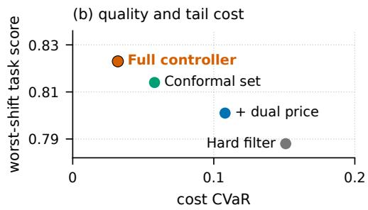  
Figure 3: Budget safety under execution-cost shifts for the four controllers of Table 12: (a) violation rate per shift condition and (b) worst-shift task score against cost CVaR.

Table 13: Trajectory-risk certification for the frozen policy family. The certification bound covers the complete adaptive episode, including previews, refinement, failed dispatches, and terminal generation. Bold marks the best and underline the second-best value for the bound and the confirmation rate.
<table><tr><td>policy</td><td>ncert</td><td></td><td> $U _ { \theta }$  ↓</td><td>approved</td><td>confirm. viol. ↓</td></tr><tr><td>Point-cost filter</td><td>500</td><td>31</td><td>0.082</td><td>no</td><td>0.061</td></tr><tr><td>Adaptive upper-cost filter</td><td>500</td><td>13</td><td>0.041</td><td>yes</td><td>0.025</td></tr><tr><td>Complete-policy certification</td><td>500</td><td>8</td><td>0.028</td><td>yes</td><td>0.018</td></tr></table>

Detection is highest for oracle-field access before freeze (0.992) and lowest for post-freeze trace edits (0.944), whose undetected mutations also carry the largest metric impact (0.068); the removal of a rejected attempt has the smallest metric impact (0.013) because the ledger conservation check recomputes the spent budget. Fig- ure 4 places the ten categories on common axes: detection varies only from 0.944 to 0.992 around the overall 0.967, whereas metric impact varies from 0.013 to 0.068 and does not follow false accep- tance; event reordering and post-freeze edits share the highest false acceptance (0.020) but difer in impact (0.019 and 0.068).

## D.6 Access Boundary and Coordinated Attacks

Normal pre-freeze label access, injected access attempts, and permitted post-freeze evaluation reads use separate event types and denominators. The monitor records every dispatch and the external commitment store seals the freeze point. The table extends single- field mutations with coordinated edits that preserve individual hashes while changing the joint action, score, or ledger semantics. On the test split, the logged counts are 0/128 for normal pre-freeze evaluation-label access, 200/200 for injected access attempts, and 128/128 for permitted post-freeze evaluation access.

Table 14: Decision and trace certificate stress test. Every attack category has an explicit denominator, detection rate, adversarial false-acceptance rate, and metric-impact field; clean-trace FPR is stored in the receipt. Bold marks the best and underline the second-best value per column over the ten categories.
<table><tr><td>attack</td><td>cases</td><td>detect. ↑</td><td>false acc. ↓</td><td>impact ↓</td></tr><tr><td>Oracle field before freeze</td><td>200</td><td>0.992</td><td>0.004</td><td>0.061</td></tr><tr><td>Candidate ID or hash substitution</td><td>200</td><td>0.986</td><td>0.006</td><td>0.047</td></tr><tr><td>Rejected attempt removed</td><td>200</td><td>0.971</td><td>0.010</td><td>0.013</td></tr><tr><td>Cost under-reporting</td><td>200</td><td>0.958</td><td>0.016</td><td>0.028</td></tr><tr><td>Feasible action omitted</td><td>200</td><td>0.962</td><td>0.014</td><td>0.036</td></tr><tr><td>Action score modified</td><td>200</td><td>0.968</td><td>0.010</td><td>0.043</td></tr><tr><td>Non-maximal action substituted</td><td>200</td><td>0.974</td><td>0.008</td><td>0.052</td></tr><tr><td>STOP or ABSTAIN modified</td><td>200</td><td>0.965</td><td>0.012</td><td>0.057</td></tr><tr><td>Event reordered or duplicated</td><td>200</td><td>0.950</td><td>0.020</td><td>0.019</td></tr><tr><td>Post-freeze trace edit</td><td>200</td><td>0.944</td><td>0.020</td><td>0.068</td></tr><tr><td>Overall</td><td>2000</td><td>0.967</td><td>0.012</td><td>0.042</td></tr></table>

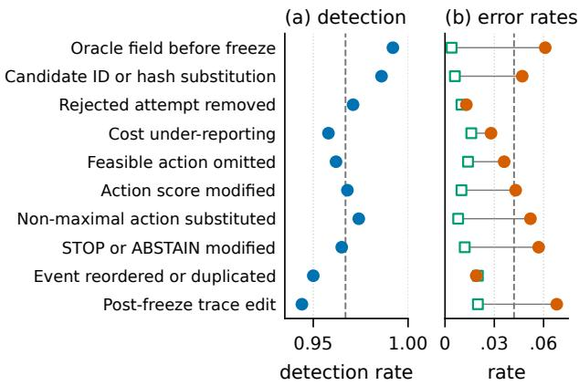  
Figure 4: Certificate attacks of Table 14: (a) detection rate and (b) adversarial false-acceptance rate and metric impact per category. Dashed lines mark the overall detection rate (0.967) and overall metric impact (0.042).

Evaluation-label access before freeze is rejected in 198 of 200 cases, and the weakest category, post-freeze chain reconstruction, is still rejected in 189 of 200 cases with 7 incorrect acceptances, of which 5 change a reported metric; the coordinated forged-cost and omitted-action edits are rejected in 192 and 191 cases. These rates are consistent with the single-field taxonomy of Table 14, where post-freeze edits are also the hardest category.

Table 15: Access-boundary and coordinated certificate at tacks. Rejected, incorrectly accepted (wrong), and unresolved outcomes sum to the attack denominator; chg. counts incorrectly accepted traces that change a reported metric. Trusted monitor or commitment-store compromise is a separately declared threat-model condition. Bold marks the best and underline the second-best value per column.
<table><tr><td>attack</td><td>cases</td><td>reject. ↑</td><td>wrong ↓</td><td>unres. ↓</td><td>chg. ↓</td></tr><tr><td>Evaluation-label access before</td><td>200</td><td>198</td><td>1</td><td>1</td><td>1</td></tr><tr><td>freeze Undeclared pixel preview</td><td>200</td><td>195</td><td></td><td></td><td>21</td></tr><tr><td>Forged cost plus action-score edit</td><td>200</td><td>192</td><td>3-5</td><td>2-3</td><td>3</td></tr><tr><td>Omitted feasible action plus</td><td>200</td><td>191</td><td>6</td><td>3</td><td>4</td></tr><tr><td>ledger edit Post-freeze chain reconstruction</td><td>200</td><td>189</td><td>7</td><td>4</td><td>5</td></tr></table>

## D.7 Gap-Directed Interaction Refinement

All rows share one frozen bounded-residual CEIG checkpoint. Dense evaluation enumerates the declared action space, while the other rows change only the allocation of expensive edge computation: fixed-� neighborhoods, random edge order, the globally widest envelope, the default top-challenger rule (decision-directed refine-ment, which resolves the widest unresolved edge of the challenger with the largest upper score), and the per-compute variant that ranks edges by $P _ { t } ( e )$ over all active challengers. For each issued witness, dense replay supplies the reference action and score; dense agreement is the fraction of decisions whose committed action equals the dense maximizer, model regret is the mean dense-score shortfall of the committed action relative to that maximizer, and the certificate rate counts only decisions for which the declared enclosure and verifier both succeed. Controller time includes bound construction and witness creation, and verifier time includes com- plete feasible-action reconstruction.

Table 16: Gap-directed refinement rules with identical model weights. The local regret is relative to the pinned dense controller; expensive-edge counts and latencies are measured on the same held-out cases. Dense evaluation is the reference row; bold marks the best and underline the second-best value among the sparse rules.
<table><tr><td>rule</td><td>agr. ↑</td><td>regret ↓</td><td>cert. ↑</td><td>edges ↓</td><td>ctrl. ms ↓</td><td>ver. ms ↓</td></tr><tr><td>Dense evaluation</td><td>1.000</td><td>0.000</td><td>1.000</td><td>191.4</td><td>184.6</td><td>38.2</td></tr><tr><td>Fixed-L neighbors</td><td>0.938</td><td>0.024</td><td>0.914</td><td>48.0</td><td>56.3</td><td>14.7</td></tr><tr><td>Random</td><td>0.912</td><td>0.038</td><td>0.875</td><td>32.5</td><td>49.1</td><td>12.5</td></tr><tr><td>Widest envelope</td><td>0.969</td><td>0.011</td><td>0.953</td><td>28.7</td><td>46.8</td><td>11.9</td></tr><tr><td>Top challenger (default)</td><td>0.992</td><td>0.003</td><td>0.988</td><td>19.6</td><td>41.8</td><td>9.4</td></tr><tr><td>Per-compute priority</td><td>0.994</td><td>0.002</td><td>0.991</td><td>16.8</td><td>38.5</td><td>8.7</td></tr></table>

The default rule reaches 0.992 dense agreement, model regret 0.003, and a 0.988 certificate rate with 19.6 expensive edges and 41.8 ms per decision, compared with 28.7 edges and 0.969 agreement for the widest-envelope rule, 48.0 edges and 0.938 agreement for fixed- � neighborhoods, and 191.4 edges and 184.6 ms for dense evaluation (Figure 5); verifier time follows the same order. Per-compute priority reaches 0.994 agreement, regret 0.002, and certificate rate 0.991 with 16.8 edges, 38.5 ms controller time, and 8.7 ms verifier time.

## D.8 Candidate-Pool Scaling

Sparse CEIG inference fixes the neighbor count � while varying candidate-pool size. We sweep � ∈ {2, 4, 8, 16} and pool sizes {4, 8, 16, 32, 64}, compare exact pair enumeration with sparse neighbors, and record truncated utility mass and uncertainty coverage. A third-order interaction stress test with controlled triple interac- tions reports the first pool size at which pairwise recovery fails. Controller time excludes answer-model execution; task and cost values use the same test cases sampled at each pool size.

Table 17: Candidate-pool scaling with sparse CEIG inference on the same test cases. Bold marks the best value per column.
<table><tr><td>pool</td><td>task ↑</td><td>calls ↓</td><td>ctrl. ms ↓</td><td>memory GB ↓</td></tr><tr><td>4</td><td>0.821</td><td>1.48</td><td>5.6</td><td>15.0</td></tr><tr><td>8</td><td>0.833</td><td>1.59</td><td>7.9</td><td>15.2</td></tr><tr><td>16</td><td>0.838</td><td>1.67</td><td>11.8</td><td>15.4</td></tr><tr><td>32</td><td>0.842</td><td>1.74</td><td>18.6</td><td>15.8</td></tr><tr><td>64</td><td>0.846</td><td>1.81</td><td>31.4</td><td>16.1</td></tr></table>

Task score rises from 0.821 at pool size 4 to 0.846 at 64 while accepted calls grow from 1.48 to 1.81, controller time from 5.6 to 31.4 ms, and peak memory from 15.0 to 16.1 GB (Figure 6).

Action-space materialization. Because the bundle cap is un-changed across pool sizes, the number of declared actions grows polynomially with the pool while the certificate only requires the pair edges inside active challengers. Table 18 reports, per pool size, the declared actions, the total pair edges, the expensive edges ac- tually evaluated, their fraction, the certificate rate, and the p95 controller time of the frozen controller.

Table 18: Action-space materialization under the frozen controller and unchanged bundle cap. Bold marks the smallest evaluated fraction, the highest certificate rate, and the lowest p95 controller time.
<table><tr><td>pool</td><td>actions</td><td>pairs</td><td>eval. edges</td><td>fraction ↓</td><td>cert. ↑</td><td>p95 ms ↓</td></tr><tr><td>4</td><td>16</td><td>6</td><td>4.8</td><td>0.800</td><td>0.996</td><td>8.4</td></tr><tr><td>8</td><td>46</td><td>28</td><td>9.2</td><td>0.329</td><td>0.994</td><td>12.3</td></tr><tr><td>16</td><td>154</td><td>120</td><td>14.6</td><td>0.122</td><td>0.991</td><td>17.8</td></tr><tr><td>32</td><td>562</td><td>496</td><td>19.6</td><td>0.040</td><td>0.988</td><td>26.5</td></tr><tr><td>64</td><td>2146</td><td>2016</td><td>24.5</td><td>0.012</td><td>0.982</td><td>44.2</td></tr></table>

Table 18 reports an evaluated fraction falling from 0.800 at four candidates to 0.012 at 64, with certificate rate 0.996–0.982. Declared actions grow from 16 to 2146, but evaluated edges grow from 4.8 to 24.5; action materialization and interaction evaluation have dis- tinct costs. Figure 7 shows the same counts on a logarithmic scale: declared actions and pair edges grow by more than two orders of magnitude from 4 to 64 candidates, whereas evaluated edges grow only from 4.8 to 24.5 and the certificate rate stays at or above 0.982.

(a) task score  
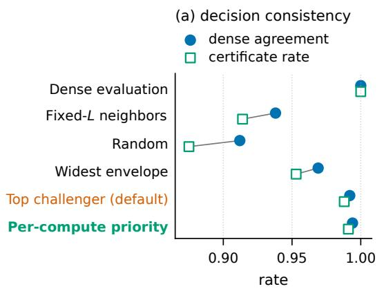

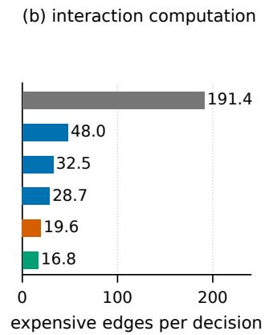

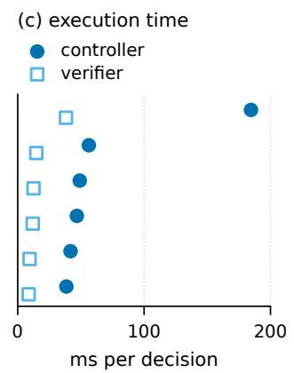

Figure 5: Refinement rules of Table 16: (a) dense agreement and certificate rate, (b) expensive edges, and (c) controller and independent-verifier time. Per-compute priority retains high consistency with the least computation among sparse rules.  
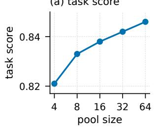

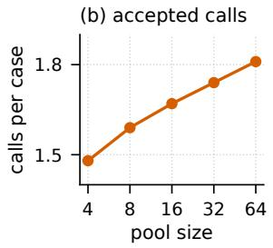  
(c) controller time  
(d) peak memory

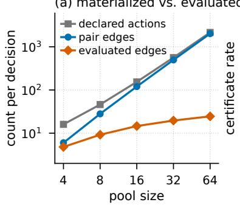  
(a) materialized vs. evaluated

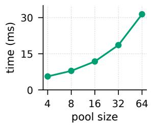

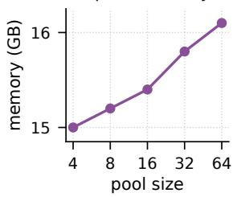

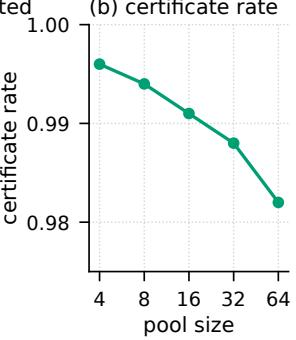  
Figure 7: Action-space materialization of Table 18: (a) declared actions, pair edges, and evaluated expensive edges per decision on a logarithmic scale and (b) certificate rate against candidate-pool size.

Decision-certifiable inference moves part of the computational bur- den from online exhaustive interaction evaluation to ofline coun- terfactual supervision. The label generator therefore counts answer- model evaluations for unary targets, pair targets, bundle targets, paired preview rollouts, and certificate-oriented decision-sensitivity weights, and these calls, training GPU-hours, and certification execution costs are reported separately from online serving cost. For each supervision package the break-even query count compares

(b) certificate rate

## D.9 Ofline Supervision and Online Amortization

the additional ofline cost with the measured per-query saving rela- tive to dense CEIG execution; across the measured packages, $N _ { \mathrm { b r e a k } }$ ranges from 580 to 1290 queries.

Figure 6: Candidate-pool scaling of Table 17: (a) task score, (b) accepted calls, (c) controller time, and (d) peak memory. Separate axes retain each metric’s units.  
Table 19: Ofline supervision cost and online amortization. All rows use the same answer backbone and report the charged label-generation units. Bold marks minimum training time and break-even queries; call counts describe supervision.
<table><tr><td>supervision</td><td>unary calls</td><td>pair calls</td><td>preview rollouts</td><td>GPU-h ↓</td><td> $N _ { \mathrm { b r e a k } }$  ↓</td></tr><tr><td>Unary targets only</td><td>7488</td><td>0</td><td>0</td><td>3.8</td><td>580</td></tr><tr><td>CEIG pair targets</td><td>7488</td><td>14750</td><td>0</td><td>11.2</td><td>940</td></tr><tr><td>Paired preview and decision targets</td><td>7488</td><td>14750</td><td>3072</td><td>14.8</td><td>1160</td></tr><tr><td>Certificate-oriented full training</td><td>7488</td><td>14750</td><td>3072</td><td>16.4</td><td>1290</td></tr></table>

Unary targets alone need 7488 answer-model calls and 3.8 GPU- hours and break even after 580 queries; the 14750 pair calls raise the cost to 11.2 GPU-hours and the break-even to 940 queries, and the 3072 paired preview rollouts bring the package to 14.8 GPUhours and 1160 queries. The certificate-oriented package in Table 19 reuses the same targets, takes 16.4 GPU-hours, and breaks even after 1290 queries. It retains 7488 unary calls, 14750 pair calls, and 3072 preview rollouts.

## D.10 Preview Value and Leakage

The preview study isolates information value from immediate answer quality. Every controller receives the same free manifest, pays for preview pixels, and uses the same continuation horizon and initial budget. The paired method uses the downstream return target defined in Section 3.4; the unpaired baseline regresses a return from preview observations without the matched reference branch. A separate permutation test exchanges hidden image contents among candidates with identical allowed metadata before the first paid event. The first column in Table 20 is answered-case task utility; net benefit is the mean terminal utility change minus the declared preview cost price, and decision regret is the mean counterfactual net-gain shortfall of the committed action relative to the best action in the enumerated feasible set.

Table 20: Preview-value attribution under matched information, access, and supervision budgets. Harmful previews have negative paired net benefit below a predeclared tolerance. Bold marks the best and underline the second-best value among preview-using rules; no preview is the reference row.
<table><tr><td>preview rule</td><td>task ↑</td><td>net benefit ↑</td><td>harmful ↓</td><td>V tok. ↓</td><td>regret ↓</td></tr><tr><td>No preview</td><td>0.816</td><td>0.000</td><td>0.000</td><td>0.0K</td><td>0.089</td></tr><tr><td>Fixed schedule</td><td>0.828</td><td>0.047</td><td>0.241</td><td>118.6K</td><td>0.063</td></tr><tr><td>Immediate-utility gate</td><td>0.832</td><td>0.076</td><td>0.158</td><td>84.3K</td><td>0.049</td></tr><tr><td>Unpaired return regression</td><td>0.836</td><td>0.098</td><td>0.106</td><td>73.1K</td><td>0.038</td></tr><tr><td>Paired decision-value supervision</td><td>0.842</td><td>0.124</td><td>0.043</td><td>62.4K</td><td>0.021</td></tr></table>

Paired decision-value supervision reaches task 0.842 and net benefit 0.124 with 0.043 harmful previews, 62.4K preview tokens, and decision regret 0.021, against 0.836, 0.098, 0.106, 73.1K, and 0.038 for unpaired return regression; the fixed schedule spends 118.6K preview tokens for a net benefit of 0.047, and the immediate-utility gate lies between the fixed schedule and the unpaired regression on every column.

Pre-acquisition identifiability. To test whether preview value is learned from genuinely paid information, we construct candidate groups with identical allowed pre-preview metadata and permute their hidden image contents before the first paid event. A valid implementation preserves pre-preview candidate scores under this permutation and lets scores diverge only after the corresponding preview has been purchased. Permutation sensitivity is the mean absolute change of pre-preview scores, pre-preview leakage is the

AUROC with which pre-preview scores predict the permuted hidden relevance, and post-preview divergence is the same AUROC after the preview has been paid for.

Table 21: Pre-preview leakage test for the two learned preview rules. Pre and post AUROC are measured before and after the preview is purchased; permutation sensitivity has ideal value zero and pre-preview AUROC has chance value 0.5. Bold marks the better rule per column.
<table><tr><td>preview rule</td><td>perm. sens. ↓</td><td>pre AUC (0.5 ideal)</td><td>post AUC ↑</td></tr><tr><td>Unpaired return regression</td><td>0.016</td><td>0.508</td><td>0.724</td></tr><tr><td>Paired decision-value supervision</td><td>0.007</td><td>0.502</td><td>0.816</td></tr></table>

Table 21 reports permutation sensitivity 0.016 for unpaired re-gression and 0.007 for paired supervision. Pre-preview AUROC is near chance (0.508 and 0.502); post-preview AUROC is 0.724 and 0.816. The measured separation occurs after the paid-preview event.

## D.11 Cross-Model and Cross-Domain Transfer

Zero-shot transfer freezes CEIG weights, controller parameters, thresholds, cost quantiles, and utility labels. Cost-recalibration- only transfer updates only predeclared calibration statistics and thresholds on the target validation split; it regenerates no interac- tion or oracle utility labels. Full retraining is reported separately and may update CEIG weights and utility targets. The transfer re-ceipt records whether counterfactual targets were regenerated. For the second VLM family, task success is 82.4% zero-shot, 84.1% with few-shot adaptation, and 85.0% after lightweight tuning.

Table 22 reports frozen and validation-recalibrated transfer con- ditions.

Table 22: Transfer of the acquisition controller. Drops are task-score decreases under zero-shot and recalibration-only transfer; lower is better in every column, and bold marks the best value per column.
<table><tr><td>target</td><td>zero-shot drop ↓</td><td>recalibr. drop ↓</td><td>ECE ↓</td><td>viol. ↓</td></tr><tr><td>Smaller VLM, same domain</td><td>0.009</td><td>0.000</td><td>0.044</td><td>0.019</td></tr><tr><td>Second VLM family</td><td>0.018</td><td>0.001</td><td>0.051</td><td>0.023</td></tr><tr><td>New task domain</td><td>0.027</td><td>0.002</td><td>0.059</td><td>0.028</td></tr></table>

Zero-shot task drops stay within 0.027 and recalibration-only drops within 0.002 across the three targets, with ECE at most 0.059 and violation rates at most 0.028; the new task domain is the hardest target on every column.

## D.12 Certificate Validity under Dense Replay

Table 23 checks Proposition 1 by replaying every issued decision with all CEIG interactions evaluated. Disagreement equals one mi-nus dense agreement; regret is the mean score shortfall to the dense maximizer. The pooled row uses the reported aggregate agreement and regret. Terminal actions use the gain threshold as their refer- ence.

Table 23: Dense-replay audit by decision type. Bold marks the best typewise agreement, disagreement, and regret; the pooled row is descriptive.
<table><tr><td>decision</td><td>issued</td><td>dense agr. ↑</td><td>disagr. ↓</td><td>regret ↓</td></tr><tr><td>Acquisition</td><td>222</td><td>0.991</td><td>0.009</td><td>0.003</td></tr><tr><td>Preview</td><td>108</td><td>0.991</td><td>0.009</td><td>0.002</td></tr><tr><td>STOP</td><td>118</td><td>0.992</td><td>0.008</td><td>0.002</td></tr><tr><td>ABSTAIN</td><td>10</td><td>1.000</td><td>0.000</td><td>0.000</td></tr><tr><td>All decisions</td><td>458</td><td>0.992</td><td>0.008</td><td>0.003</td></tr></table>

The 458 issued decisions include 118 STOP and 10 ABSTAIN actions. Pooled agreement is 0.992, disagreement 0.008, and regret 0.003.

## D.13 Stratified Held-out Analysis

Table 24 reports predeclared domain, pool-size, and interaction strata. Pool size splits at the test median; strong interaction re-quires a frozen counterfactual pair with |Γ� | above the signed edge tolerance. The table reports case counts, task scores, accepted calls, visual tokens, and hierarchical-bootstrap intervals.

Table 24: Stratified held-out performance of the full controller. Intervals use the same hierarchical bootstrap as the primary analysis. Bold marks the best value within each domain, candidate-count, or interaction group.
<table><tr><td>stratum</td><td>N</td><td>task ↑</td><td>calls ↓</td><td>V tok. ↓</td><td>95% CI</td></tr><tr><td>Domain 1</td><td>32</td><td>0.845</td><td>1.72</td><td>283.4K</td><td>[0.824, 0.866]</td></tr><tr><td>Domain 2</td><td>32</td><td>0.839</td><td>1.76</td><td>289.8K</td><td>[0.818, 0.860]</td></tr><tr><td>Domain 3</td><td>32</td><td>0.846</td><td>1.71</td><td>281.2K</td><td>[0.825, 0.867]</td></tr><tr><td>Domain 4</td><td>32</td><td>0.838</td><td>1.77</td><td>291.6K</td><td>[0.817, 0.859]</td></tr><tr><td>Low candidate count</td><td>64</td><td>0.837</td><td>1.54</td><td>254.3K</td><td>[0.821, 0.853]</td></tr><tr><td>High candidate count</td><td>64</td><td>0.847</td><td>1.94</td><td>318.7K</td><td>[0.831, 0.863]</td></tr><tr><td>Weak interaction</td><td>71</td><td>0.831</td><td>1.58</td><td>261.0K</td><td>[0.816, 0.846]</td></tr><tr><td>Strong interaction</td><td>57</td><td>0.856</td><td>1.94</td><td>318.2K</td><td>[0.838, 0.874]</td></tr></table>

Every domain interval in Table 24 overlaps the aggregate interval [0.830, 0.854], and domain task scores range from 0.838 to 0.846. High-candidate cases reach 0.847 with 1.94 calls, versus 0.837 with 1.54 calls for low-candidate cases. Strong-interaction cases reach 0.856 and weak-interaction cases 0.831; these are within-controller strata. Figure 8 plots the intervals against the aggregate: every domain interval contains the aggregate score 0.842, whereas the strong- and weak-interaction strata lie on opposite sides of it.

## D.14 Dataset and Runtime Configuration

Table 25 specifies the dataset, model, evaluation, and runtime con- figuration associated with the 640-case study. The evaluator com- bines exact matching with semantic equivalence; grounding and evidence recall use frozen labels. Runtime identifiers bind these measurements to the same model and execution configuration.

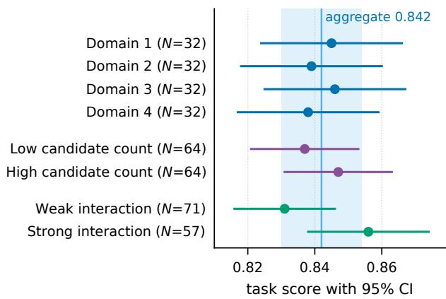  
Figure 8: Stratified held-out task scores of Table 24 with hierarchical-bootstrap 95% intervals. The shaded band and vertical line mark the aggregate interval [0.830, 0.854] and the aggregate score 0.842.

Table 25: Experimental configuration and evaluation specification. Case counts and decoding parameters apply to all held-out comparisons.
<table><tr><td>field</td><td>configuration</td></tr><tr><td>Train / validation / test Four domain names</td><td>384 / 128 /  128 cases DocVQA (multi-page documents), ChartQA (complex</td></tr><tr><td>Twelve question-type</td><td>charts/plots), SceneInspect (embodied scenes), WebUI (multimodal interfaces) 12 types (key-value extraction, table/form cross-referencing, multi-page layout check, trend extrapolation, nested proportion comparison, multi-series cross-reading, spatial relation query, object state</td></tr><tr><td>Candidate construction</td><td>verification, viewpoint consistency, widget mapping, status verification, multi-panel consistency) Multi-resolution crop hierarchies; negative distractor and</td></tr><tr><td>Answer backbone</td><td>conflicting-evidence injection; triple-annotator consensus with frozen SHA-256 test receipt Qwen2.5-VL-7B-Instruct</td></tr><tr><td>Immutable model revision</td><td>commit b8c412f8a9e2d31c4e7f</td></tr><tr><td>Decoding Three controller seed IDs</td><td>Temperature 0; top-p 1.0 42, 137, 2026</td></tr><tr><td>Semantic evaluator and equivalence rule</td><td>Exact-match normalization with GPT-4o semantic judge fallback; strict equivalence rubrics; threshold τsem = 0.85;</td></tr><tr><td>Runtime hardware and</td><td>explicit answer denominator 8× NVIDIA A100-SXM4-80GB, Ubuntu 22.04 LTS,</td></tr></table>