# CAN LEARNING TO ANSWER SPATIAL QUESTIONS IMPROVE NOVEL-VIEW GENERATION?

Jahyeok Koo Hyeonseo Yu Seungho Jang Jaewoo Jung Jiwon Kang Seokju Cho Seungryong Kim\dager

KAIST AI Project page: https://cvlab-kaist.github.io/Ask4NV/

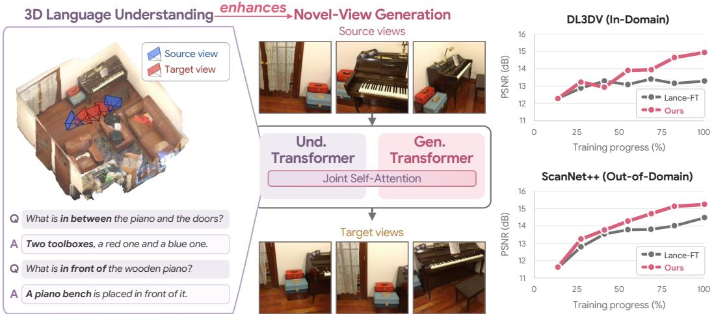  
Figure 1: We present Ask4NV, which enhances novel-view generation through 3D language understanding. Within a Mixture-of-Transformers architecture, 3D language understanding supervision trains the understanding transformer to interpret scene semantics and spatial relationships. During novel-view generation, joint self-attention combines this knowledge with the generation transformer’s visual synthesis capabilities. Ask4NV achieves higher PSNR than the baseline trained solely on novel-view generation on both in-domain and out-of-domain datasets.

## ABSTRACT

Generating novel views from limited observations requires preserving both the appearance and spatial structure of a scene. Although recent approaches exploit fine-grained geometric cues, they do not explicitly model high-level semantic and spatial properties such as object identity, attributes, and inter-object relationships. In this work, we investigate whether 3D language understanding can provide complementary supervision for novel-view generation. We introduce Ask4NV, built on a pretrained unified multimodal model with a Mixture-of-Transformers (MoT) architecture. Our model incorporates camera geometry into both VAE and ViT representations and leverages understanding features during generation through joint self-attention with a modality-aware attention masking strategy. Experiments demonstrate strong image quality and geometric consistency in novel-view generation, alongside competitive 3D language understanding. Further analysis shows that joint training improves cross-view correspondence in VAE representations and similarity in a 3D-aware feature space.

## 1 INTRODUCTION

Novel-view generation (Gao et al., 2024; Lu et al., 2025; Kwon et al., 2025) uses generative priors learned from large-scale data to synthesize images of a scene from unseen viewpoints given limited observations, while preserving scene appearance and geometric consistency. Recent approaches incorporate geometric information through depth-based warping, cross-view correspondence or explicit geometry supervision (Seo et al., 2024; Kwon et al., 2025; Lu et al., 2025), providing finegrained cues for cross-view consistency. These advances support a wide range of applications, including video editing (Zhang et al., 2025), robot manipulation (Kim et al., 2025), and visionlanguage driving (Wang et al., 2025c).

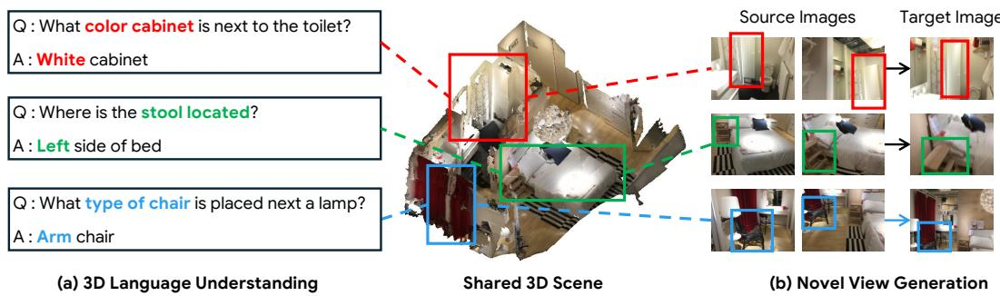  
Figure 2: Shared scene properties across 3D language understanding and novel-view generation. Questions about object categories, attributes, and spatial relationships address the same scene properties that should be represented in novel views. The knowledge required to answer these questions can provide complementary semantic and spatial supervision for novel-view generation.

While such fine-grained geometric cues reveal the scene structure and dense correspondences across viewpoints, they do not explicitly offer the interpretation of high-level scene properties, such as object identities, attributes, and inter-object relationships. Such high-level understanding can also guide novel-view generation by informing how objects and their spatial arrangements should appear from a different viewpoint. For example, recognizing a red chair beside a wooden table can guide the model to preserve the chair’s identity, attributes, and relationship to the table, even as its visible shape and image position change with the viewpoint. Learning these semantic and spatial properties could therefore complement fine-grained geometric information, helping the model preserve scene content and represent its spatial organization consistently across views.

However, the potential of explicitly learning such high-level properties for novel-view generation remains largely unexplored. We then ask: How can we provide such high-level semantic and spatial supervision, and how can it be incorporated into joint learning with novel-view generation? We investigate this direction through 3D language understanding tasks (Hong et al., 2023; Huang et al., 2023; Zheng et al., 2025b), which involve identifying and localizing objects and reasoning about their attributes and spatial relationships. Fig. 2 highlights the shared semantic and spatial properties underlying 3D language understanding and novel-view generation, suggesting the potential of language-based supervision to support generation. To jointly learn novel-view generation and 3D language understanding, we adopt pretrained unified multimodal models (Xie et al., 2025; Team, 2024), which support both visual generation and multimodal understanding within a single model.

Concretely, we introduce Ask4NV, which builds on a pretrained Mixture-of-Transformers (MoT) architecture (Liang et al., 2024; Deng et al., 2025) and introduces a small set of architectural modifications to jointly model 3D language understanding and novel-view generation. The MoT architecture provides task-specific parameters together with joint self-attention between the two transformers, allowing the two tasks to be learned within a shared framework without introducing a separate cross-task fusion module. For novel-view generation, we use VAE latents alongside complementary ViT features from the understanding transformer and incorporate camera geometry into both representations through Plucker ray embeddings. We further design an attention masking strategy to¨ facilitate information exchange across different token modalities during novel-view generation.

Our analyses examine how joint training with 3D language understanding affects the model’s visual representations and novel-view generation capabilities. Extensive experiments show that our model achieves strong novel-view generation performance in both image quality and geometric consistency across multiple evaluation settings. It also performs competitively on 3D language understanding despite the limited performance of its pretrained backbone on these tasks. Ablation studies further validate our architectural and attention design choices.

## 2 PRELIMINARIES

Novel-view generation. We follow a common formulation of prior novel-view generation approaches (Gao et al., 2024; Kwon et al., 2025), which generate target images given a set of source images and the camera parameters of both source and target views. Leveraging generative priors, these approaches aim to synthesize unseen views that preserve scene appearance and maintain geometric consistency, including interpolated and challenging extrapolated viewpoints. Formally, let $\mathbf { I } _ { \mathrm { s r c } }$ denote a set of N source images and $\mathbf { C } _ { \mathrm { s r c } }$ their corresponding camera parameters. Given the camera parameters $\mathbf { C } _ { \mathrm { { t g t } } }$ for M target views, the model generates the corresponding target images:

$$
\hat { \mathbf { I } } _ { \mathrm { t g t } } = \mathcal { G } _ { \theta } \left( \mathbf { I } _ { \mathrm { s r c } } , \mathbf { C } _ { \mathrm { s r c } } , \mathbf { C } _ { \mathrm { t g t } } \right) ,\tag{1}
$$

where $\mathcal { G } _ { \theta }$ denotes the novel-view generation model.

In this work, we formulate novel-view generation using flow matching (Lipman et al., 2022). Specif ically, a VAE encoder maps the source images $\mathbf { I } _ { \mathrm { s r c } }$ into latent representations $\mathbf { z } _ { \mathrm { s r c } } = \mathcal { E } _ { \mathrm { v a e } } ( \mathbf { I } _ { \mathrm { s r c } } )$ Given noisy target latents $\mathbf { z } _ { t }$ at timestep $t ,$ the model predicts the corresponding velocity field conditioned on the source latents and the camera parameters of the source and target views. The model is trained by minimizing the squared error between the predicted velocity $\hat { \mathbf { v } } _ { t }$ and the target velocity $\mathbf { v } _ { t } ^ { * }$

$$
\hat { \mathbf { v } } _ { t } = \mathbf { v } _ { \theta } \left( \mathbf { z } _ { t } , t ; \mathbf { z } _ { \mathrm { s r c } } , \mathbf { C } _ { \mathrm { s r c } } , \mathbf { C } _ { \mathrm { t g t } } \right) , \qquad \mathscr { L } _ { \mathrm { g e n } } = \mathbb { E } \left[ \left\| \hat { \mathbf { v } } _ { t } - \mathbf { v } _ { t } ^ { * } \right\| _ { 2 } ^ { 2 } \right] ,\tag{2}
$$

where $\mathbf { v } _ { \theta }$ denotes the velocity prediction function, and the expectation is taken over training samples, timesteps, and noise. At inference, target latents are initialized from Gaussian noise, updated by integrating the predicted velocity field, and decoded into images using the VAE decoder.

3D language understanding. We consider 3D question answering (Ma et al., 2022; Azuma et al., 2022) and visual grounding (Zhang et al., 2023; Chen et al., 2020) as two representative 3D language understanding tasks for reasoning about scene semantics and spatial relationships through language. Given multi-view images and their associated 3D coordinates, the model generates a textual answer to a scene-related question or identifies and localizes objects referred to by a language description.

Specifically, the input images are encoded by a ViT encoder and mapped to the language model’s hidden space through a visual projector, ${ \bf e } ^ { \mathrm { v i t } } \bar { \bf \Phi } = P _ { \mathrm { v i t } } ( \mathcal { E } _ { \mathrm { v i t } } ( { \bf I } ) )$ . The associated 3D coordinates are incorporated through positional embeddings to obtain spatially enriched visual tokens $\tilde { \mathbf { e } } ^ { \mathrm { v i t } }$ . The input question is tokenized and mapped to the same hidden space through the language model’s embedding layer, yielding $\mathbf { e } ^ { \mathrm { t e x t } }$ . Conditioned on these visual and text embeddings, the model generates an answer $\mathbf { y } = ( y _ { 1 } , \dots , y _ { T } )$ autoregressively and is trained with the cross-entropy loss over the ground-truth answer tokens:

$$
\mathcal { L } _ { \mathrm { q a } } = - \sum _ { i = 1 } ^ { T } \log p _ { \theta } \left( y _ { i } \mid y _ { < i } , \tilde { \mathbf { e } } ^ { \mathrm { v i t } } , \mathbf { e } ^ { \mathrm { t e x t } } \right) .\tag{3}
$$

For visual grounding, training is performed with a proposal-matching objective $\mathcal { L } _ { \mathrm { g r d } } .$ , whose formulation and implementation details are provided in the supplementary material (Sec. A.2).

Shared scene properties across tasks. Fig. 2 presents examples of 3D language understanding and novel-view generation concerning the same underlying scene properties. In the top example, answering the question requires distinguishing the cabinet’s color (attributes), which novel-view generation should also preserve when predicting the cabinet from a different viewpoint. In the middle example, the question is about the stool’s relative position (spatial relationship), while generation requires depicting this arrangement from the target viewpoint. In the bottom example, identifying the chair as an armchair (object category) requires recognizing characteristic features that novel-view generation should preserve across viewpoints. These examples suggest that learning to interpret scene properties through language can provide complementary supervision for novel-view generation. We use this supervision during training to develop representations useful for generation, without requiring question answering when generating novel views.

## 3 METHODOLOGY

We introduce Ask4NV, which strengthens semantic and spatial understanding for novel-view generation through supervision from 3D language understanding tasks. Our model builds on Lance-

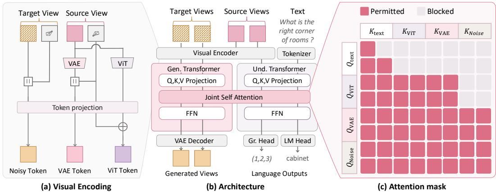  
Figure 3: Overall architecture of Ask4NV. Given source images and camera parameters of the source and target views, (a) for novel-view generation, the images are first encoded into VAE and ViT features by their respective visual encoders, and camera geometry is incorporated into these representations before they are passed to the transformers. (b) The generation transformer processes the camera-aware VAE tokens, while the understanding transformer processes the camera-aware ViT tokens together with text tokens for 3D language understanding. (c) During novel-view generation, these modality-specific tokens interact through joint self-attention under a unified modality-aware attention mask.

Video-3B (Fu et al., 2026), a pretrained unified multimodal model with specialized generation and understanding transformers. The generation transformer incorporates camera geometry into its visual inputs and enables bidirectional attention between clean source and noisy target VAE tokens (Sec. 3.1). Representations from the understanding transformer are incorporated into novel-view generation through ViT conditioning and an attention mask that controls interactions among visual tokens (Sec. 3.2). Then, we train the model with a flow-matching objective, supplemented by 3D language understanding objectives as auxiliary supervision (Sec. 3.3). We further analyze cross-view correspondence of VAE tokens and assess semantic and spatial knowledge of our model (Sec. 4). The overall architecture is shown in Fig. 3.

## 3.1 CAMERA-CONDITIONED NOVEL-VIEW GENERATION

Given N source images and their corresponding camera parameters, the model must capture both scene appearance and geometric structure to generate M target images at the specified target camera parameters. The source images $\mathbf { I } _ { \mathrm { s r c } } \in \mathbb { R } ^ { N \times \breve { H } \times W \times 3 }$ are encoded into VAE latents:

$$
\mathbf { z } _ { \mathrm { s r c } } = \mathcal { E } _ { \mathrm { v a e } } \left( \mathbf { I } _ { \mathrm { s r c } } \right) \in \mathbb { R } ^ { N \times h \times w \times C _ { z } } , \qquad h = \frac { H } { d _ { h } } , \quad w = \frac { W } { d _ { w } } ,\tag{4}
$$

where $d _ { h }$ and $d _ { w }$ denote the spatial compression factors of the VAE and $C _ { z }$ is the latent channel dimension.

We incorporate camera geometry into VAE features using Plucker rays. Each ray is represented as¨ $\mathbf { r } = [ \mathbf { d } ; \mathbf { o } ^ { \top } \mathbf { \times } \mathbf { d } ] \in \mathbb { R } ^ { 6 }$ , where o and d denote the camera origin and ray direction. We compute the rays for all pixels of the source images to form ray maps $\mathbf { R } _ { \mathrm { s r c } } ^ { - } \in \mathbb { R } ^ { N \times \breve { H } \times W \times 6 }$ and rearrange them into the channel dimension to match the latent spatial resolution. Since the VAE projector operates on channels while preserving the spatial grid, we extend its input channel dimension to accommodate the concatenated latent and ray features:

$$
\mathbf { R } _ { \mathrm { s r c } } \in \mathbb { R } ^ { N \times H \times W \times 6 } \longrightarrow \mathbf { z } _ { \mathrm { s r c } } ^ { \mathrm { r a y } } \in \mathbb { R } ^ { N \times h \times w \times C _ { r } } , \qquad \mathbf { e } ^ { \mathrm { v a e } } = P _ { \mathrm { v a e } } \left( \left[ \mathbf { z } _ { \mathrm { s r c } } ; \mathbf { z } _ { \mathrm { s r c } } ^ { \mathrm { r a y } } \right] \right) ,\tag{5}
$$

where $C _ { r } ~ = ~ 6 d _ { h } d _ { w }$ is the channel dimension of the rearranged ray representation. We apply the same ray construction and projection to the target views, using their noisy VAE latents $\mathbf { \bar { z } } _ { t } \in \mathbb { R } ^ { M \times h \times w \times \mathbf { \bar { C } } _ { z } }$ z at timestep t:

$$
{ \bf e } _ { t } ^ { \mathrm { v a e } } = P _ { \mathrm { v a e } } \left( \left[ { \bf z } _ { t } ; { \bf z } _ { \mathrm { t g t } } ^ { \mathrm { r a y } } \right] \right) ,\tag{6}
$$

where $\mathbf { z } _ { \mathrm { t g t } } ^ { \mathrm { r a y } } \in \mathbb { R } ^ { M \times h \times w \times C _ { r } }$ denotes the rearranged ray representations of the target views.

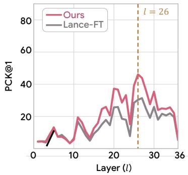

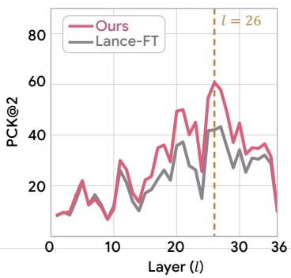

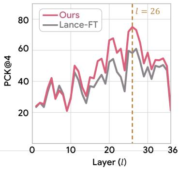  
Figure 4: Layer-wise cross-view correspondence. We report PCK@1, PCK@2, and PCK@4 across Transformer layers on ScanNet (Dai et al., 2017) for Lance-FT (Fu et al., 2026) and Ask4NV. Layer l = 26 exhibits the strongest correspondence across all PCK thresholds.

Whereas the pretrained model originally blocks attention from clean VAE tokens to noisy target tokens, we modify the attention mask to allow bidirectional attention between them, encouraging cross-view correspondence.

## 3.2 ENHANCING NOVEL-VIEW GENERATION THROUGH 3D LANGUAGE UNDERSTANDING

We incorporate visual representations processed by the understanding transformer into novel-view generation, allowing generation to explicitly utilize semantic and spatial information. Specifically, we extract ViT features from all source views and include them alongside the VAE tokens. The understanding transformer processes these ViT tokens, and the generation transformer accesses their representations through joint self-attention.

Similar to the VAE representations, we incorporate camera information into the ViT features using Plucker ray embeddings. We preserve the pretrained ViT projector’s joint spatial merging and chan-¨ nel projection by adding ray embeddings to its output. For each output visual token, we compute the ray at the center of its corresponding image region and map it into the language model’s hidden space using a two-layer MLP:

$$
\begin{array} { r } { \tilde { \mathbf { e } } _ { \mathrm { r a y } } ^ { \mathrm { v i t } } = { \mathbf { e } } ^ { \mathrm { v i t } } + \mathrm { M L P } \left( { \mathbf { r } } ^ { \mathrm { v i t } } \right) , } \end{array}\tag{7}
$$

where $\mathbf { r } ^ { \mathrm { v i t } } \in \mathbb { R } ^ { N _ { \mathrm { v i t } } \times 6 }$ contains the rays corresponding to all source-view ViT tokens, and the MLP is applied independently to each ray.

We concatenate the camera-aware source VAE and ViT tokens, noisy target VAE tokens, and text tokens into an input sequence. The two Transformers process their respective tokens through joint self-attention, with an attention mask controlling information flow among token groups. Noisy target tokens can attend to both source VAE and ViT tokens, accessing source appearance and representations from the understanding transformer. Source ViT tokens attend bidirectionally to clean VAE tokens but do not directly attend to noisy target tokens. The complete attention pattern, including the bidirectional VAE attention described in Sec. 3.1, is illustrated in Fig. 3(c).

The resulting target hidden states are projected to velocity predictions, and the model is trained with the flow-matching objective. At inference, we initialize the target latents with Gaussian noise, integrate the predicted velocity field, and decode the resulting latents into target images using the VAE decoder.

## 3.3 TRAINING OBJECTIVES

We train the model with the flow-matching objective for novel-view generation, supplemented by 3D question answering and visual grounding objectives as auxiliary supervision. Training uses multimodal sequence packing, with attention blocked across independent samples.

The overall objective is

$$
\begin{array} { r } { \mathcal { L } _ { \mathrm { t o t a l } } = \lambda _ { \mathrm { g e n } } \mathcal { L } _ { \mathrm { g e n } } + \lambda _ { \mathrm { u n d } } \mathcal { L } _ { \mathrm { u n d } } , \qquad \mathcal { L } _ { \mathrm { u n d } } = \mathcal { L } _ { \mathrm { q a } } + \mathcal { L } _ { \mathrm { g r d } } , } \end{array}\tag{8}
$$

where $\lambda _ { \mathrm { g e n } }$ and $\lambda _ { \mathrm { u n d } }$ weight the generation and auxiliary understanding objectives. The understanding objectives provide semantic and spatial supervision to the understanding transformer, whose representations are also used by the generation transformer through joint self-attention.

## 4 ANALYZING THE EFFECTS OF JOINT TRAINING

In this section, we analyze how joint training with 3D language understanding benefits novel-view generation. We compare Ask4NV with two baselines initialized from the same pretrained Lance checkpoint (Fu et al., 2026). Lance-FT is fine-tuned exclusively on novel-view generation, while Lance-FT + ViT uses the same ViT conditioning pathway and generation-side attention mask as Ask4NV, but is trained without 3D language understanding samples or objectives. Both baselines are only trained on novel-view generation training samples.

Finding 1. 3D language supervision improves cross-view correspondence beyond ViT conditioning.

We examine whether adding 3D language understanding supervision improves cross-view correspondence in VAE representations, without explicitly supervising correspondence during training. We evaluate correspondence in a two-view setting using clean VAE tokens from both views, focusing on corresponding tokens associated with the same 3D points across overlapping views. Since correspondence quality varies across transformer layers, we first evaluate each layer independently. Specifically, we extract the intermediate token feature after the

Table 1: Cross-view Correspondence at Layer 26. We report PCK@1, PCK@2, and PCK@4 on ScanNet and ScanNet++ for Lance-FT, Lance-FT + ViT and Ask4NV.
<table><tr><td>Dataset</td><td>Method</td><td>PCK@1</td><td>PCK@2</td><td>PCK@4</td></tr><tr><td rowspan="3">ScanNet</td><td>Lance-FT</td><td>30.30</td><td>42.03</td><td>58.22</td></tr><tr><td>Lance-FT + ViT</td><td>38.77</td><td>54.93</td><td>72.09</td></tr><tr><td>Ask4NV (Ours)</td><td>46.13</td><td>60.73</td><td>74.99</td></tr><tr><td rowspan="3">ScanNet++</td><td>Lance-FT</td><td>33.34</td><td>44.31</td><td>60.28</td></tr><tr><td>Lance-FT + ViT</td><td>31.40</td><td>44.91</td><td>63.87</td></tr><tr><td>Ask4NV (Ours)</td><td>43.27</td><td>55.25</td><td>69.55</td></tr></table>

attention computation and, for each object token in one view, identify its correspondence in the other view by selecting the token with the highest cosine similarity. We evaluate the predicted correspondences using PCK@1, PCK@2, and PCK@4, where a prediction is considered correct if it lies within 1, 2, or 4 token-grid locations of the ground-truth correspondence. As shown in Fig. 4, Layer l = 26 achieves the strongest correspondence across the evaluated thresholds, and we therefore use its representations for the analysis. Prior work such as VIRAL (Yoon et al., 2025) highlights the importance of intermediate visual representations for fine-grained visual understanding.

Table 1 shows that Ask4NV consistently outperforms both baselines across both datasets and all PCK thresholds. Notably, although the additional understanding objectives supervise the understanding Transformer, correspondence improves in the generation Transformer’s intermediate VAE representations without direct correspondence supervision. This provides encouraging evidence that the benefits of 3D language understanding extend to spatial representations used for generation.

Finding 2. Joint training improves similarity in a 3D-aware feature space.

We analyze whether joint training improves the similarity between generated and ground-truth views in a 3D-aware representation space. To this end, we use the SigLIP (Zhai et al., 2023) vision encoder fine-tuned for 3D language understanding within Video-3D-LLM (Zheng et al., 2025b). We extract generated and ground-truth features at the same target viewpoint and compute the mean cosine similarity between spatially corresponding patch features.

Table 2: Patch-wise feature similarity between generated and ground-truth views. We report feature similarity on DL3DV, ScanNet, RealEstate10K (Re10K), and ScanNet++.
<table><tr><td>Method</td><td>DL3DV</td><td>ScanNet</td><td>Re10K</td><td>ScanNet++</td></tr><tr><td>Lance-FT</td><td>0.512</td><td>0.498</td><td>0.580</td><td>0.514</td></tr><tr><td>Lance-FT + ViT</td><td>0.546</td><td>0.555</td><td>0.636</td><td>0.538</td></tr><tr><td>Ask4NV (Ours)</td><td>0.599</td><td>0.557</td><td>0.680</td><td>0.557</td></tr></table>

Table 2 shows that Ask4NV achieves higher feature similarity than both generation-only baselines across all four datasets. The improvement over Lance-FT + ViT indicates an additional benefit of joint training beyond ViT conditioning. These results show that joint training produces generated views that are more closely aligned with the ground-truth views in the feature space of a 3D language understanding encoder.

Table 3: Evaluation of novel view generation. We evaluate on DL3DV and ScanNet (in-domain for Ask4NV) and ScanNet++ and Re10K (out-of-domain for Ask4NV). We report metrics for both 2D image fidelity and 3D geometric consistency. † denotes the reproduced CAT3D model. Bold and underline indicate the best and second-best, respectively.
<table><tr><td rowspan="2">Dataset</td><td rowspan="2">Method</td><td colspan="3">2D Metrics</td><td colspan="3">3D Metrics</td><td rowspan="2">MEt3R↓</td></tr><tr><td>PSNR ↑</td><td>SSIM ↑</td><td>LPIPS ↓</td><td>ATE↓</td><td>RPEr ↓</td><td>RPEt↓</td></tr><tr><td rowspan="6">DL3DV</td><td>CAT3D† (Gao et al., 2024)</td><td>12.662</td><td>0.287</td><td>0.489</td><td>0.777</td><td>15.59</td><td>1.674</td><td>0.446</td></tr><tr><td>Matrix3D (Lu et al., 2025)</td><td>13.997</td><td>0.344</td><td>0.412</td><td>0.351</td><td>4.80</td><td>0.691</td><td>0.358</td></tr><tr><td>NVComposer (Li et al., 2025)</td><td>11.532</td><td>0.255</td><td>0.560</td><td>0.995</td><td>32.34</td><td>1.748</td><td>0.511</td></tr><tr><td>CAMEO (Kwon et al., 2025)</td><td>12.991</td><td>0.312</td><td>0.463</td><td>0.628</td><td>13.16</td><td>1.174</td><td>0.388</td></tr><tr><td>Omni-View (Hu et al., 2026)</td><td>13.009</td><td>0.221</td><td>0.558</td><td>1.226</td><td>27.86</td><td>2.514</td><td>0.511</td></tr><tr><td>Lance-FT (Fu et al., 2026) Ask4NV (Ours)</td><td>13.291 14.939</td><td>0.297 0.355</td><td>0.432 0.313</td><td>0.185 0.158</td><td>3.80 3.11</td><td>0.354 0.298</td><td>0.361 0.349</td></tr><tr><td rowspan="7"></td><td></td><td></td><td></td><td></td><td></td><td></td><td></td><td></td></tr><tr><td>CAT3D† (Gao et al., 2024) Matrix3D (Lu et al., 2025)</td><td>12.007 14.298</td><td>0.438</td><td>0.627</td><td>0.366</td><td>33.12</td><td>0.719</td><td>0.559</td></tr><tr><td>NVComposer (Li et al., 2025)</td><td>10.186</td><td>0.539 0.368</td><td>0.498 0.709</td><td>0.212 0.443</td><td>20.37 64.69</td><td>0.431 0.787</td><td>0.417 0.720</td></tr><tr><td>CAMEO (Kwon et al., 2025)</td><td>12.417</td><td>0.485</td><td>0.605</td><td>0.343</td><td>32.86</td><td>0.734</td><td>0.492</td></tr><tr><td>Omni-View (Hu et al., 2026)</td><td>12.380</td><td>0.429</td><td>0.664</td><td>0.469</td><td>41.61</td><td>0.958</td><td>0.653</td></tr><tr><td>Lance-FT (Fu et al., 2026)</td><td>14.292</td><td>0.530</td><td>0.518</td><td>0.233</td><td>15.45</td><td>0.351</td><td>0.398</td></tr><tr><td>Ask4NV (Ours)</td><td>15.747</td><td>0.564</td><td>0.434</td><td>0.191</td><td>13.85</td><td>0.340</td><td>0.413</td></tr><tr><td rowspan="7">Re10K</td><td>CAT3D† (Gao et al., 2024)</td><td>16.261</td><td>0.555</td><td>0.330</td><td>0.168</td><td>3.25</td><td>0.317</td><td>0.345</td></tr><tr><td>Matrix3D (Lu et al., 2025)</td><td>16.374</td><td>0.566</td><td>0.319</td><td>0.154</td><td>1.96</td><td>0.298</td><td>0.303</td></tr><tr><td>NVComposer (Li et al., 2025)</td><td>12.716</td><td>0.439</td><td>0.551</td><td>0.507</td><td>21.40</td><td>0.819</td><td>0.416</td></tr><tr><td>CAMEO (Kwon et al., 2025)</td><td>16.664</td><td>0.577</td><td>0.301</td><td>0.121</td><td>3.07</td><td>0.223</td><td>0.312</td></tr><tr><td>Omni-View (Hu et al., 2026)</td><td>13.408</td><td>0.371</td><td>0.566</td><td>0.871</td><td>18.82</td><td>1.657</td><td>0.536</td></tr><tr><td>Lance-FT (Fu et al., 2026)</td><td>14.548</td><td>0.494</td><td>0.432</td><td>0.116</td><td>1.91</td><td>0.221</td><td>0.328</td></tr><tr><td>Ask4NV (Ours)</td><td>16.738</td><td>0.562</td><td>0.290</td><td>0.106</td><td>1.68</td><td>0.202</td><td>0.319</td></tr><tr><td rowspan="7">ScanNet++</td><td>CAT3D† (Gao et al., 2024)</td><td>11.940</td><td>0.475</td><td>0.627</td><td>0.480</td><td>54.42</td><td>1.138</td><td>0.572</td></tr><tr><td>Matrix3D (Lu et al., 2025)</td><td>14.667</td><td>0.587</td><td>0.453</td><td>0.287</td><td>14.19</td><td>0.661</td><td>0.375</td></tr><tr><td>NVComposer (Li et al., 2025)</td><td>10.725</td><td>0.446</td><td>0.653</td><td>0.604</td><td>76.51</td><td>1.210</td><td>0.626</td></tr><tr><td>CAMEO (Kwon et al., 2025)</td><td>12.544</td><td>0.532</td><td>0.590</td><td>0.511</td><td>48.86</td><td>1.046</td><td>0.433</td></tr><tr><td>Omni-View (Hu et al., 2026)</td><td>12.536</td><td>0.457</td><td>0.654</td><td>0.641</td><td>65.43</td><td>1.375</td><td>0.667</td></tr><tr><td>Lance-FT (Fu et al., 2026)</td><td>14.468</td><td>0.571</td><td>0.483</td><td>0.301</td><td>19.58</td><td>0.612</td><td>0.417</td></tr><tr><td>Ask4NV (Ours)</td><td>15.242</td><td>0.583</td><td>0.419</td><td>0.287</td><td>16.54</td><td>0.649</td><td>0.398</td></tr></table>

## 5 EXPERIMENTS

## 5.1 EXPERIMENTAL SETTING

Implementation and training details. We build our model on Lance-Video-3B (Fu et al., 2026), a pretrained MoT-based unified multimodal model, and fine-tune it while freezing the ViT encoder and the VAE encoder and decoder. Our 3D language understanding training data comprise ScanNetbased datasets, including SQA3D (Ma et al., 2022), ScanQA (Azuma et al., 2022), ScanRefer (Chen et al., 2020), and Multi3DRefer (Zhang et al., 2023). We therefore use ScanNet (Dai et al., 2017) for novel-view generation to align the scene domains across the two tasks. Given its limited number of scenes, we supplement the generation training data with DL3DV (Ling et al., 2024). We use multimodal sequence packing, with each pack containing three novel-view generation samples and one 3D language understanding sample. This 3 : 1 ratio approximates the pretraining task balance within our computational budget. The understanding task uses V = 32 uniformly sampled frames per scene. For novel-view generation, we sample 8 frames, using 2–4 as source views and the remainder as target views. Additional implementation details are provided in Appendix A.3.

Evaluation protocol. To assess novel-view generation quality, we evaluate Ask4NV on DL3DV (Ling et al., 2024) and ScanNet (Dai et al., 2017) as in-domain datasets, and RealEstate10K (Re10K) (Zhou et al., 2018) and ScanNet++ (Yeshwanth et al., 2023) as out-of-domain datasets, relative to our training data. In the main comparison, each model generates M = 4 target views from N = 4 source views. We compare against diffusion-based novel view generation models, including CAT3D (Gao et al., 2024), Matrix3D (Lu et al., 2025), NVComposer (Li et al., 2025), and

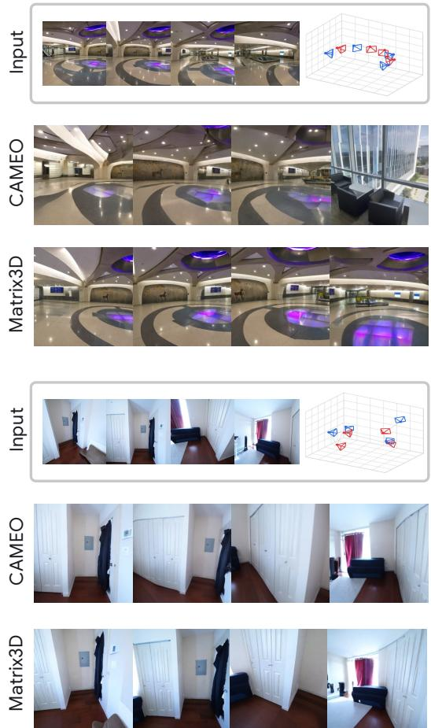

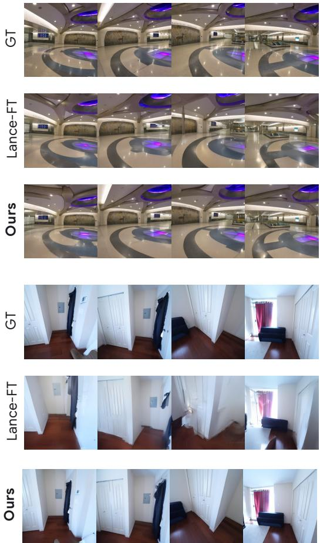  
Figure 5: Qualitative results of novel view generation of Ask4NV and baselines on in-domain DL3DV (Ling et al., 2024) and out-of-domain ScanNet++ (Yeshwanth et al., 2023). Blue and red cameras indicate source and target viewpoints, respectively.

CAMEO (Kwon et al., 2025). Omni-View (Hu et al., 2026) is also included as a unified multimodal model baseline. We report PSNR, SSIM, and LPIPS to measure 2D image fidelity, and camera estimation errors and MEt3R (Asim et al., 2025) to assess 3D geometric consistency. Further details on evaluation are provided in Appendix A.4.

## 5.2 MAIN RESULTS

Finding 3. Ask4NV improves novel-view image quality across multiple benchmarks.

Quantitative comparison of novel-view generation. As shown in Table 3, Ask4NV achieves strong performance on 2D image quality metrics across multiple benchmarks, achieving the best PSNR and LPIPS on all four datasets while maintaining consistently strong SSIM across all benchmarks. Our model also demonstrates consistently strong performance on 3D geometric metrics, achieving the best ATE across all datasets and strong results on RPE , RPE , and MEt3R. Notably, the strong performance on the out-of-domain datasets, Re10K and ScanNet++, demonstrates the generalization ability of Ask4NV.

Qualitative comparison. Fig. 5 provides a qualitative comparison of novel view generation between Ask4NV and the baselines. Given the source views, Ask4NV generates novel views with sharper visual details while maintaining geometric consistency across diverse camera trajectories. Additional qualitative results are provided in Appendix C.5.

Table 4: Evaluation of 3D language understanding. We provide quantitative comparison of Ask4NV and baselines on 3D question answering (SQA3D (Ma et al., 2022) and ScanQA (Azuma et al., 2022)) and 3D visual grounding (ScanRefer (Chen et al., 2020) and Multi3DRefer (Zhang et al., 2023)). Results are reported from prior works, and “-” indicates an unavailable result. C, B-4, M, and R denote CIDEr, BLEU-4, METEOR, and ROUGE, respectively.
<table><tr><td rowspan="2">Method</td><td rowspan="2">Size</td><td colspan="2">SQA3Dtest</td><td colspan="4">ScanQAval</td><td rowspan="2"></td><td colspan="2">ScanReferval</td><td colspan="2">Multi3DReferval</td></tr><tr><td>EM</td><td>EM-R</td><td>C</td><td>B-4</td><td>M</td><td>R</td><td>EM Acc@0.25</td><td>Acc@0.5</td><td>F1@0.25</td><td>F1@0.5</td></tr><tr><td>2D LMMs</td><td></td><td></td><td></td><td></td><td></td><td></td><td></td><td></td><td></td><td></td><td></td><td></td></tr><tr><td>InternVL2-8B (Chen et al., 2024b)</td><td>8B</td><td>33.0</td><td>45.3</td><td>62.5</td><td>3.3</td><td>14.5</td><td>34.3</td><td></td><td></td><td></td><td></td><td></td></tr><tr><td>Qwen2.5-VL-3B (Bai et al., 2025)</td><td>3B</td><td>46.3</td><td>49.0</td><td>67.7</td><td>9.7</td><td>12.9</td><td>35.6</td><td>23.9</td><td></td><td></td><td>一</td><td></td></tr><tr><td>LLaVA-Video-7B (Zhang et al., 2024)</td><td>7B</td><td>48.5</td><td></td><td>88.7</td><td>3.1</td><td>17.7</td><td>44.6</td><td>一</td><td>一</td><td></td><td>一</td><td></td></tr><tr><td>Lance-3B (Fu et al., 2026)</td><td>3B</td><td>23.4</td><td>37.3</td><td>6.0</td><td>0.3</td><td>11.4</td><td>9.9</td><td>0.3</td><td></td><td></td><td>一</td><td></td></tr><tr><td>3D LMMs</td><td></td><td></td><td></td><td></td><td></td><td></td><td></td><td></td><td></td><td></td><td></td><td></td></tr><tr><td>LLaVA-3D (Zhu et al., 2024)</td><td>7B</td><td>55.6</td><td>57.6</td><td>91.7</td><td>14.5</td><td>20.7</td><td>50.1</td><td>27.0</td><td>54.1</td><td>42.4</td><td></td><td></td></tr><tr><td>Video-3D-LLM (Zheng et al., 2025b)</td><td>7B</td><td>58.6</td><td>一</td><td>102.1</td><td>16.4</td><td>20.0</td><td>49.3</td><td>30.1</td><td>58.1</td><td>51.7</td><td>58.0</td><td>52.7</td></tr><tr><td>3DRS (Huang et al., 2026)</td><td>7B</td><td>60.6</td><td>1</td><td>104.8</td><td></td><td></td><td></td><td>30.3</td><td></td><td></td><td></td><td></td></tr><tr><td>Ross3D (Wang et al., 2025a)</td><td>7B</td><td>63.0</td><td>65.7</td><td>107.0</td><td>17.9</td><td>20.9</td><td>50.7</td><td>30.8</td><td>61.1</td><td>54.4</td><td>59.6</td><td>54.3</td></tr><tr><td>Spatial-MLLM (Wu et al., 2026)</td><td>3B</td><td>55.9</td><td>58.7</td><td>91.8</td><td>14.8</td><td>18.4</td><td>45.0</td><td>一</td><td></td><td></td><td>一</td><td></td></tr><tr><td>Omni-View (Hu et al., 2026)</td><td>7B</td><td>59.2</td><td>61.9</td><td>103.0</td><td>16.2</td><td>20.1</td><td>49.0</td><td>29.5</td><td>50.8</td><td>45.0</td><td>1</td><td></td></tr><tr><td>Ask4NV (Ours)</td><td>3B</td><td>54.9</td><td>57.7</td><td>87.7</td><td>13.6</td><td>17.4</td><td>43.7</td><td>25.6</td><td>52.9</td><td>47.3</td><td>52.6</td><td>48.3</td></tr></table>

## 5.3 ABLATION AND ANALYSIS

3D language understanding. We additionally evaluate 3D language understanding on SQA3D (Ma et al., 2022) and ScanQA (Azuma et al., 2022) for question answering, and ScanRefer (Chen et al., 2020) and Multi3DRefer (Zhang et al., 2023) for visual grounding. Following prior work (Zheng et al., 2025b; Wang et al., 2025a), our model uses V = 32 uniformly sampled frames per scene and is compared against 2D LMMs and 3D LLMs. Tab. 4 presents the quantitative results. These results show that Ask4NV acquires 3D language understanding capabilities alongside its primary novel-view generation objective.

Novel-view generation on different number of source views. Tab. 5 presents novel-view generation results on DL3DV with N = 2 and N = 3 source views, predicting M = 6 and M = 5 target views, respectively. Ask4NV consistently outperforms Lance-FT, showing that the benefit of joint training persists under fewer source views.

Ablation on bidirectional VAE attention. As shown in Tab. 6, bidirectional attention between clean source and noisy target VAE tokens improves performance on DL3DV, demonstrating the benefit of direct source-target interaction during generation.

Table 5: Ablation on different numbers of source views.
<table><tr><td>Source Views</td><td>Method</td><td>PSNR ↑</td><td>SSIM ↑</td><td>LPIPS ↓</td></tr><tr><td rowspan="2">N = 2</td><td>Lance-FT</td><td>13.001</td><td>0.294</td><td>0.459</td></tr><tr><td>Ask4NV (Ours)</td><td>13.900</td><td>0.329</td><td>0.388</td></tr><tr><td rowspan="2">N = 3</td><td>Lance-FT</td><td>13.292</td><td>0.298</td><td>0.430</td></tr><tr><td>Ask4NV (Ours)</td><td>14.559</td><td>0.344</td><td>0.355</td></tr></table>

Table 6: Ablation on bidirectional VAE attention.

<table><tr><td>Method</td><td>PSNR ↑</td><td>SSIM↑</td><td>LPIPS ↓</td></tr><tr><td>Unidirectional</td><td>13.653</td><td>0.314</td><td>0.424</td></tr><tr><td>Bidirectional (Ours)</td><td>14.939</td><td>0.355</td><td>0.313</td></tr></table>

## 6 CONCLUSIONS

In this work, we investigate how joint training with 3D language understanding can enhance novelview generation. We introduce Ask4NV, which adapts a pretrained MoT-based architecture through ViT conditioning and a tailored attention mask. Experiments demonstrate improvements in image fidelity and geometric consistency across multiple benchmarks, while maintaining competitive 3D language understanding performance. Our analyses show improved cross-view correspondence in VAE representations and stronger alignment with ground-truth views in a 3D-aware feature space. Ablation studies further validate the benefits of joint training and our architectural choices. These findings highlight the potential of 3D language understanding as complementary supervision for generative scene modeling.

## AI USE STATEMENT

We used generative AI tools to assist with language editing to improve readability and clarity. We did not use generative AI tools for generating synthetic datasets, developing theoretical models, formulating or proving mathematical claims, proposing hypothesis, designing experiments, or interpreting results. The authors reviewed and revised the AI-assisted material and take responsibility for the final content of this work, including its text, claims, and artifacts produced with AI assistance.

## ETHICS STATEMENT

This work investigates novel-view generation and 3D language understanding using existing publicly available datasets. We do not identify additional ethical concerns specific to the proposed methodology beyond those generally associated with visual generation, including the potential misuse of synthetic images.

## REPRODUCIBILITY STATEMENT

We provide the model formulation and training objectives in the main paper, with additional details to support reproduction of our experiments in the supplementary material. Sec. A.3 describes the training configuration, architectural components, and attention masks. Sec. A.2 details the imple mentation of 3D language understanding, including positional embeddings and the visual grounding objective. Evaluation metrics and baseline settings are provided in Sec. A.4.

## REFERENCES

Mohammad Asim, Christopher Wewer, Thomas Wimmer, Bernt Schiele, and Jan Eric Lenssen. Met3r: Measuring multi-view consistency in generated images. In 2025 IEEE/CVF Conference on Computer Vision and Pattern Recognition (CVPR), pp. 6034–6044. IEEE, 2025.

Daichi Azuma, Taiki Miyanishi, Shuhei Kurita, and Motoaki Kawanabe. Scanqa: 3d question answering for spatial scene understanding. In 2022 IEEE/CVF Conference on Computer Vision and Pattern Recognition (CVPR), pp. 19107–19117. IEEE, 2022.

Shuai Bai, Keqin Chen, Xuejing Liu, Jialin Wang, Wenbin Ge, Sibo Song, Kai Dang, Peng Wang, Shijie Wang, Jun Tang, Humen Zhong, Yuanzhi Zhu, Mingkun Yang, Zhaohai Li, Jianqiang Wan, Pengfei Wang, Wei Ding, Zheren Fu, Yiheng Xu, Jiabo Ye, Xi Zhang, Tianbao Xie, Zesen Cheng, Hang Zhang, Zhibo Yang, Haiyang Xu, and Junyang Lin. Qwen2.5-vl technical report. arXiv preprint arXiv:2502.13923, 2025.

Satanjeev Banerjee and Alon Lavie. Meteor: An automatic metric for mt evaluation with improved correlation with human judgments. In Proceedings of the acl workshop on intrinsic and extrinsic evaluation measures for machine translation and/or summarization, pp. 65–72, 2005.

Gilad Baruch, Zhuoyuan Chen, Afshin Dehghan, Tal Dimry, Yuri Feigin, Peter Fu, Thomas Gebauer, Brandon Joffe, Daniel Kurz, Arik Schwartz, et al. Arkitscenes: A diverse real-world dataset for 3d indoor scene understanding using mobile rgb-d data. arXiv preprint arXiv:2111.08897, 2021.

Chenjie Cao, Chaohui Yu, Shang Liu, Fan Wang, Xiangyang Xue, and Yanwei Fu. Mvgenmaster: Scaling multi-view generation from any image via 3d priors enhanced diffusion model. In 2025 IEEE/CVF Conference on Computer Vision and Pattern Recognition (CVPR), pp. 6045–6056. IEEE, 2025.

Mathilde Caron, Hugo Touvron, Ishan Misra, Herve J´ egou, Julien Mairal, Piotr Bojanowski, and´ Armand Joulin. Emerging properties in self-supervised vision transformers. In 2021 IEEE/CVF international conference on computer vision (ICCV), pp. 9630–9640. IEEE, 2021.

Dave Zhenyu Chen, Angel X Chang, and Matthias Nießner. Scanrefer: 3d object localization in rgb-d scans using natural language. In European conference on computer vision, pp. 202–221. Springer, 2020.

Jiuhai Chen, Zhiyang Xu, Xichen Pan, Yushi Hu, Can Qin, Tom Goldstein, Lifu Huang, Tianyi Zhou, Saining Xie, Silvio Savarese, et al. Blip3-o: A family of fully open unified multimodal models-architecture, training and dataset. arXiv preprint arXiv:2505.09568, 2025a.

Sijin Chen, Hongyuan Zhu, Xin Chen, Yinjie Lei, Gang Yu, and Tao Chen. End-to-end 3d dense captioning with vote2cap-detr. In 2023 IEEE/CVF Conference on Computer Vision and Pattern Recognition (CVPR), pp. 11124–11133. IEEE, 2023.

Sijin Chen, Hongyuan Zhu, Mingsheng Li, Xin Chen, Peng Guo, Yinjie Lei, Gang Yu, Taihao Li, and Tao Chen. Vote2cap-detr++: Decoupling localization and describing for end-to-end 3d dense captioning. IEEE Transactions on Pattern Analysis and Machine Intelligence, 46(11):7331–7347, 2024a.

Xiaokang Chen, Zhiyu Wu, Xingchao Liu, Zizheng Pan, Wen Liu, Zhenda Xie, Xingkai Yu, and Chong Ruan. Janus-pro: Unified multimodal understanding and generation with data and model scaling. arXiv preprint arXiv:2501.17811, 2025b.

Zhe Chen, Jiannan Wu, Wenhai Wang, Weijie Su, Guo Chen, Sen Xing, Muyan Zhong, Qinglong Zhang, Xizhou Zhu, Lewei Lu, et al. Internvl: Scaling up vision foundation models and aligning for generic visual-linguistic tasks. In Proceedings of the IEEE/CVF conference on computer vision and pattern recognition, pp. 24185–24198, 2024b.

Zhenyu Chen, Ali Gholami, Matthias Nießner, and Angel X Chang. Scan2cap: Context-aware dense captioning in rgb-d scans. In Proceedings of the IEEE/CVF conference on computer vision and pattern recognition, pp. 3193–3203, 2021.

Angela Dai, Angel X Chang, Manolis Savva, Maciej Halber, Thomas Funkhouser, and Matthias Nießner. Scannet: Richly-annotated 3d reconstructions of indoor scenes. In 2017 IEEE conference on computer vision and pattern recognition (CVPR), pp. 2432–2443. IEEE, 2017.

Matt Deitke, Dustin Schwenk, Jordi Salvador, Luca Weihs, Oscar Michel, Eli VanderBilt, Ludwig Schmidt, Kiana Ehsani, Aniruddha Kembhavi, and Ali Farhadi. Objaverse: A universe of annotated 3d objects. In 2023 IEEE/CVF Conference on Computer Vision and Pattern Recognition (CVPR), pp. 13142–13153. IEEE, 2023.

Chaorui Deng, Deyao Zhu, Kunchang Li, Chenhui Gou, Feng Li, Zeyu Wang, Shu Zhong, Weihao Yu, Xiaonan Nie, Ziang Song, et al. Emerging properties in unified multimodal pretraining. arXiv preprint arXiv:2505.14683, 2025.

Tim Dettmers, Mike Lewis, Sam Shleifer, and Luke Zettlemoyer. 8-bit optimizers via block-wise quantization. arXiv preprint arXiv:2110.02861, 2021.

Francis Engelmann, Fabian Manhardt, Michael Niemeyer, Keisuke Tateno, and Federico Tombari. Opennerf: Open set 3d neural scene segmentation with pixel-wise features and rendered novel views. In International Conference on Learning Representations, volume 2024, pp. 8396–8407, 2024.

Zhiwen Fan, Jian Zhang, Renjie Li, Junge Zhang, Runjin Chen, Hezhen Hu, Kevin Wang, Peihao Wang, Huaizhi Qu, Shijie Zhou, et al. Vlm-3r: Vision-language models augmented with instruction-aligned 3d reconstruction. In Proceedings of the IEEE/CVF Conference on Computer Vision and Pattern Recognition, pp. 31054–31065, 2026.

Fengyi Fu, Mengqi Huang, Shaojin Wu, Yunsheng Jiang, Yufei Huo, Hao Li, Yinghang Song, Fei Ding, Jianzhu Guo, Qian He, et al. Lance: Unified multimodal modeling by multi-task synergy. arXiv preprint arXiv:2605.18678, 2026.

Rao Fu, Jingyu Liu, Xilun Chen, Yixin Nie, and Wenhan Xiong. Scene-llm: Extending language model for 3d visual understanding and reasoning. arXiv preprint arXiv:2403.11401, 2024a.

Stephanie Fu, Mark Hamilton, Laura E Brandt, Axel Feldmann, Zhoutong Zhang, and William Freeman. Featup: A model-agnostic framework for features at any resolution. In International Conference on Learning Representations, volume 2024, pp. 45324–45350, 2024b.

Ruiqi Gao, Aleksander Holynski, Philipp Henzler, Arthur Brussee, Ricardo Martin-Brualla, Pratul Srinivasan, Jonathan T Barron, and Ben Poole. Cat3d: Create anything in 3d with multi-view diffusion models. arXiv preprint arXiv:2405.10314, 2024.

Jonathan Ho, Ajay Jain, and Pieter Abbeel. Denoising diffusion probabilistic models. Advances in neural information processing systems, 33:6840–6851, 2020.

Yining Hong, Haoyu Zhen, Peihao Chen, Shuhong Zheng, Yilun Du, Zhenfang Chen, and Chuang Gan. 3d-llm: Injecting the 3d world into large language models. Advances in Neural Information Processing Systems, 36:20482–20494, 2023.

JiaKui Hu, Shanshan Zhao, Qing-Guo Chen, Xuerui Qiu, Jialun Liu, Zhao Xu, Weihua Luo, Kaifu Zhang, and Yanye Lu. Omni-view: Unlocking how generation facilitates understanding in unified 3d model based on multiview images. In International Conference on Learning Representations, volume 2026, pp. 133697–133724, 2026.

Wenbo Hu, Jingli Lin, Yilin Long, Yunlong Ran, Lihan Jiang, Yifan Wang, Chenming Zhu, Runsen Xu, Tai Wang, and Jiangmiao Pang. G2vlm: Geometry grounded vision language model with unified 3d reconstruction and spatial reasoning. arXiv preprint arXiv:2511.21688, 2025. URL https://arxiv.org/abs/2511.21688.

Jiangyong Huang, Silong Yong, Xiaojian Ma, Xiongkun Linghu, Puhao Li, Yan Wang, Qing Li, Song-Chun Zhu, Baoxiong Jia, and Siyuan Huang. An embodied generalist agent in 3d world. arXiv preprint arXiv:2311.12871, 2023.

Xiaohu Huang, Jingjing Wu, Qunyi Xie, and Kai Han. 3drs: Mllms need 3d-aware representation supervision for scene understanding. Advances in Neural Information Processing Systems, 38: 67961–67988, 2026.

Aaron Hurst, Adam Lerer, Adam P Goucher, Adam Perelman, Aditya Ramesh, Aidan Clark, AJ Ostrow, Akila Welihinda, Alan Hayes, Alec Radford, et al. Gpt-4o system card. arXiv preprint arXiv:2410.21276, 2024.

Wooseok Jang, Seonghu Jeon, Jisang Han, Jinhyeok Choi, Minkyung Kwon, Seungryong Kim, Saining Xie, and Sainan Liu. Repurposing geometric foundation models for multi-view diffusion. arXiv preprint arXiv:2603.22275, 2026.

Krishna Murthy Jatavallabhula, Alihusein Kuwajerwala, Qiao Gu, Mohd Omama, Tao Chen, Alaa Maalouf, Shuang Li, Ganesh Iyer, Soroush Saryazdi, Nikhil Keetha, et al. Conceptfusion: Openset multimodal 3d mapping. arXiv preprint arXiv:2302.07241, 2023.

Kim Jun-Seong, GeonU Kim, Kim Yu-Ji, Yu-Chiang Frank Wang, Jaesung Choe, and Tae-Hyun Oh. Dr. splat: Directly referring 3d gaussian splatting via direct language embedding registration. In 2025 IEEE/CVF Conference on Computer Vision and Pattern Recognition (CVPR), pp. 14137– 14146. IEEE, 2025.

Jaewoo Jung, Hyeonseo Yu, Honggyu An, Jisang Han, Mungyeom Kim, Minkyeong Jeon, Heeseong Shin, Wonjun Moon, Federico Tombari, Daniel Barath, et al. Imagine3d-llm: Teaching mllms to imagine 3d scenes before answering. arXiv preprint arXiv:2609.38177, 2026.

Jiwon Kang, Heeji Yoon, Jaewoo Jung, Jaewon Min, Minkyeong Jeon, Biyeon Hwang, Sangwon Jung, and Seungryong Kim. Transferability between understanding and generation in unified multimodal models. arXiv preprint arXiv:2607.04423, 2026.

Bernhard Kerbl, Georgios Kopanas, Thomas Leimkuhler, George Drettakis, et al. 3d gaussian splat-¨ ting for real-time radiance field rendering. ACM Trans. Graph., 42(4):139–1, 2023.

Justin Kerr, Chung Min Kim, Ken Goldberg, Angjoo Kanazawa, and Matthew Tancik. Lerf: Language embedded radiance fields. In 2023 IEEE/CVF International Conference on Computer Vision (ICCV), pp. 19672–19682. IEEE, 2023.

Young Hun Kim, Seungyeon Kim, Yonghyeon Lee, and Frank Chongwoo Park. Dreamgrasp: Zeroshot 3d multi-object reconstruction from partial-view images for robotic manipulation. arXiv preprint arXiv:2507.05627, 2025.

Minkyung Kwon, Jinhyeok Choi, Jiho Park, Seonghu Jeon, Jinhyuk Jang, Junyoung Seo, Minseop Kwak, Jin-Hwa Kim, and Seungryong Kim. Cameo: Correspondence-attention alignment for multi-view diffusion models. arXiv preprint arXiv:2512.03045, 2025.

Boyi Li, Kilian Q Weinberger, Serge Belongie, Vladlen Koltun, and Rene Ranftl. Language-driven´ semantic segmentation. arXiv preprint arXiv:2201.03546, 2022.

Lingen Li, Zhaoyang Zhang, Yaowei Li, Jiale Xu, Wenbo Hu, Xiaoyu Li, Weihao Cheng, Jinwei Gu, Tianfan Xue, and Ying Shan. Nvcomposer: Boosting generative novel view synthesis with multiple sparse and unposed images. In 2025 IEEE/CVF Conference on Computer Vision and Pattern Recognition (CVPR), pp. 777–787. IEEE, 2025.

Weixin Liang, Lili Yu, Liang Luo, Srinivasan Iyer, Ning Dong, Chunting Zhou, Gargi Ghosh, Mike Lewis, Wen-tau Yih, Luke Zettlemoyer, et al. Mixture-of-transformers: A sparse and scalable architecture for multi-modal foundation models. arXiv preprint arXiv:2411.04996, 2024.

Chin-Yew Lin. Rouge: A package for automatic evaluation of summaries. In Text summarization branches out, pp. 74–81, 2004.

Lu Ling, Yichen Sheng, Zhi Tu, Wentian Zhao, Cheng Xin, Kun Wan, Lantao Yu, Qianyu Guo, Zixun Yu, Yawen Lu, et al. Dl3dv-10k: A large-scale scene dataset for deep learning-based 3d vision. In 2024 IEEE/CVF Conference on Computer Vision and Pattern Recognition (CVPR), pp. 22160–22169. IEEE, 2024.

Yaron Lipman, Ricky TQ Chen, Heli Ben-Hamu, Maximilian Nickel, and Matt Le. Flow matching for generative modeling. arXiv preprint arXiv:2210.02747, 2022.

Haotian Liu, Chunyuan Li, Qingyang Wu, and Yong Jae Lee. Visual instruction tuning. Advances in neural information processing systems, 36:34892–34916, 2023.

Yuanxun Lu, Jingyang Zhang, Tian Fang, Jean-Daniel Nahmias, Yanghai Tsin, Long Quan, Xun Cao, Yao Yao, and Shiwei Li. Matrix3d: Large photogrammetry model all-in-one. In 2025 IEEE/CVF Conference on Computer Vision and Pattern Recognition (CVPR), pp. 11250–11263. IEEE, 2025.

Xianzheng Ma, Tao Sun, Shuai Chen, Yash Bhalgat, Jindong Gu, Angel Chang, Iro Armeni, Iro Laina, Songyou Peng, and Victor Prisacariu. Do 3d large language models really understand 3d spatial relationships? In International Conference on Learning Representations, volume 2026, pp. 32591–32610, 2026.

Xiaojian Ma, Silong Yong, Zilong Zheng, Qing Li, Yitao Liang, Song-Chun Zhu, and Siyuan Huang. Sqa3d: Situated question answering in 3d scenes. arXiv preprint arXiv:2210.07474, 2022.

Ben Mildenhall, Pratul P Srinivasan, Matthew Tancik, Jonathan T Barron, Ravi Ramamoorthi, and Ren Ng. Nerf: Representing scenes as neural radiance fields for view synthesis. Communications ofthe ACM, 65(1):99–106, 2021.

Norman Muller, Katja Schwarz, Barbara R¨ ossle, Lorenzo Porzi, Samuel Rota Bul¨ o, Matthias\` Nießner, and Peter Kontschieder. Multidiff: Consistent novel view synthesis from a single image. In 2024 IEEE/CVF Conference on Computer Vision and Pattern Recognition (CVPR), pp. 10258–10268. IEEE, 2024.

Kishore Papineni, Salim Roukos, Todd Ward, and Wei-Jing Zhu. Bleu: a method for automatic evaluation of machine translation. In Proceedings of the 40th annual meeting of the Association for Computational Linguistics, pp. 311–318, 2002.

William Peebles and Saining Xie. Scalable diffusion models with transformers. In 2023 IEEE/CVF International Conference on Computer Vision (ICCV), pp. 4172–4182. IEEE, 2023.

Zhangyang Qi, Zhixiong Zhang, Ye Fang, Jiaqi Wang, and Hengshuang Zhao. Gpt4scene: Understand 3d scenes from videos with vision-language models. In International Conference on Learning Representations, volume 2026, pp. 157277–157302, 2026.

Minghan Qin, Wanhua Li, Jiawei Zhou, Haoqian Wang, and Hanspeter Pfister. Langsplat: 3d language gaussian splatting. In 2024 IEEE/CVF Conference on Computer Vision and Pattern Recognition (CVPR), pp. 20051–20060. IEEE, 2024.

Alec Radford, Jong Wook Kim, Chris Hallacy, Aditya Ramesh, Gabriel Goh, Sandhini Agarwal, Girish Sastry, Amanda Askell, Pamela Mishkin, Jack Clark, et al. Learning transferable visual models from natural language supervision. In International conference on machine learning, pp. 8748–8763. PmLR, 2021.

Jeremy Reizenstein, Roman Shapovalov, Philipp Henzler, Luca Sbordone, Patrick Labatut, and David Novotny. Common objects in 3d: Large-scale learning and evaluation of real-life 3d category reconstruction. In 2021 IEEE/CVF International Conference on Computer Vision (ICCV), pp. 10901–10911. IEEE, 2021.

Xuanchi Ren, Tianchang Shen, Jiahui Huang, Huan Ling, Yifan Lu, Merlin Nimier-David, Thomas Muller, Alexander Keller, Sanja Fidler, and Jun Gao. Gen3c: 3d-informed world-consistent video¨ generation with precise camera control. In Proceedings of the IEEE/CVF Conference on Computer Vision and Pattern Recognition, 2025.

Mike Roberts, Jason Ramapuram, Anurag Ranjan, Atulit Kumar, Miguel Angel Bautista, Nathan Paczan, Russ Webb, and Joshua M Susskind. Hypersim: A photorealistic synthetic dataset for holistic indoor scene understanding. In 2021 IEEE/CVF International Conference on Computer Vision (ICCV), pp. 10912–10922. IEEE, 2021.

Robin Rombach, Andreas Blattmann, Dominik Lorenz, Patrick Esser, and Bjorn Ommer. High-¨ resolution image synthesis with latent diffusion models. In 2022 IEEE/CVF conference on computer vision and pattern recognition (CVPR), pp. 10674–10685. ieee, 2022.

Kyle Sargent, Zizhang Li, Tanmay Shah, Charles Herrmann, Hong-Xing Yu, Yunzhi Zhang, Eric Ryan Chan, Dmitry Lagun, Li Fei-Fei, Deqing Sun, et al. Zeronvs: Zero-shot 360-degree view synthesis from a single image. In 2024 IEEE/CVF Conference on Computer Vision and Pattern Recognition (CVPR), pp. 9420–9429. IEEE, 2024.

Junyoung Seo, Kazumi Fukuda, Takashi Shibuya, Takuya Narihira, Naoki Murata, Shoukang Hu, Chieh-Hsin Lai, Seungryong Kim, and Yuki Mitsufuji. Genwarp: Single image to novel views with semantic-preserving generative warping. arXiv preprint arXiv:2405.17251, 2024.

Jin-Chuan Shi, Miao Wang, Hao-Bin Duan, and Shao-Hua Guan. Language embedded 3d gaussians for open-vocabulary scene understanding. In 2024 IEEE/CVF Conference on Computer Vision and Pattern Recognition (CVPR), pp. 5333–5343. IEEE, 2024.

Chameleon Team. Chameleon: Mixed-modal early-fusion foundation models. arXiv preprint arXiv:2405.09818, 2024.

Ashish Vaswani, Noam Shazeer, Niki Parmar, Jakob Uszkoreit, Llion Jones, Aidan N Gomez, Łukasz Kaiser, and Illia Polosukhin. Attention is all you need. Advances in neural information processing systems, 30, 2017.

Ramakrishna Vedantam, C Lawrence Zitnick, and Devi Parikh. Cider: Consensus-based image description evaluation. In Proceedings of the IEEE conference on computer vision and pattern recognition, pp. 4566–4575, 2015.

Haochen Wang, Yucheng Zhao, Tiancai Wang, Haoqiang Fan, Xiangyu Zhang, and Zhaoxiang Zhang. Ross3d: Reconstructive visual instruction tuning with 3d-awareness. arXiv preprint arXiv:2504.01901, 2025a.

Jianyuan Wang, Minghao Chen, Nikita Karaev, Andrea Vedaldi, Christian Rupprecht, and David Novotny. Vggt: Visual geometry grounded transformer. In 2025 IEEE/CVF Conference on Computer Vision and Pattern Recognition (CVPR), pp. 5294–5306. IEEE, 2025b.

Jianyuan Wang, Minghao Chen, Shangzhan Zhang, Nikita Karaev, Johannes Schonberger, Patrick¨ Labatut, Piotr Bojanowski, David Novotny, Andrea Vedaldi, and Christian Rupprecht. VGGT-Ω. In Proceedings of the IEEE/CVF Conference on Computer Vision and Pattern Recognition (CVPR), 2026.

Xinlong Wang, Xiaosong Zhang, Zhengxiong Luo, Quan Sun, Yufeng Cui, Jinsheng Wang, Fan Zhang, Yueze Wang, Zhen Li, Qiying Yu, et al. Emu3: Next-token prediction is all you need. arXiv preprint arXiv:2409.18869, 2024.

Yunheng Wang, Yuetong Fang, Taowen Wang, Yixiao Feng, Yawen Tan, Shuning Zhang, Peiran Liu, Yiding Ji, and Renjing Xu. Dreamnav: A trajectory-based imaginative framework for zero-shot vision-and-language navigation. arXiv preprint arXiv:2509.11197, 2025c.

Chengyue Wu, Xiaokang Chen, Zhiyu Wu, Yiyang Ma, Xingchao Liu, Zizheng Pan, Wen Liu, Zhenda Xie, Xingkai Yu, Chong Ruan, et al. Janus: Decoupling visual encoding for unified multimodal understanding and generation. In 2025 IEEE/CVF Conference on Computer Vision and Pattern Recognition (CVPR), pp. 12966–12977. IEEE, 2025.

Diankun Wu, Fangfu Liu, Yi-Hsin Hung, and Yueqi Duan. Spatial-mllm: Boosting mllm capabilities in visual-based spatial intelligence. Advances in neural information processing systems, 38: 13569–13597, 2026.

Jinheng Xie, Weijia Mao, Zechen Bai, David Junhao Zhang, Weihao Wang, Kevin Qinghong Lin, Yuchao Gu, Zhijie Chen, Zhenheng Yang, and Mike Zheng Shou. Show-o: One single transformer to unify multimodal understanding and generation. In International Conference on Learning Representations, volume 2025, pp. 28240–28264, 2025.

Jihan Yang, Runyu Ding, Weipeng Deng, Zhe Wang, and Xiaojuan Qi. Regionplc: Regional pointlanguage contrastive learning for open-world 3d scene understanding. In Proceedings of the IEEE/CVF conference on computer vision and pattern recognition, pp. 19823–19832, 2024.

Jihan Yang, Shusheng Yang, Anjali W Gupta, Rilyn Han, Li Fei-Fei, and Saining Xie. Thinking in space: How multimodal large language models see, remember, and recall spaces. In 2025 IEEE/CVF Conference on Computer Vision and Pattern Recognition (CVPR), pp. 10632–10643. IEEE, 2025.

Chandan Yeshwanth, Yueh-Cheng Liu, Matthias Nießner, and Angela Dai. Scannet++: A highfidelity dataset of 3d indoor scenes. In 2023 IEEE/CVF International Conference on Computer Vision (ICCV), pp. 12–22. IEEE, 2023.

Heeji Yoon, Jaewoo Jung, Junwan Kim, Hyungyu Choi, Heeseong Shin, Sangbeom Lim, Honggyu An, Chaehyun Kim, Jisang Han, Donghyun Kim, et al. Visual representation alignment for multimodal large language models. arXiv preprint arXiv:2509.07979, 2025.

Wangbo Yu, Jinbo Xing, Li Yuan, Wenbo Hu, Xiaoyu Li, Zhipeng Huang, Xiangjun Gao, Tien-Tsin Wong, Ying Shan, and Yonghong Tian. Viewcrafter: Taming video diffusion models for high-fidelity novel view synthesis. arXiv preprint arXiv:2409.02048, 2024.

Xianggang Yu, Mutian Xu, Yidan Zhang, Haolin Liu, Chongjie Ye, Yushuang Wu, Zizheng Yan, Chenming Zhu, Zhangyang Xiong, Tianyou Liang, et al. Mvimgnet: A large-scale dataset of multi-view images. In 2023 IEEE/CVF Conference on Computer Vision and Pattern Recognition (CVPR), pp. 9150–9161. IEEE, 2023.

Xiaohua Zhai, Basil Mustafa, Alexander Kolesnikov, and Lucas Beyer. Sigmoid loss for language image pre-training. In 2023 IEEE/CVF International Conference on Computer Vision (ICCV), pp. 11941–11952. IEEE, 2023.

David Junhao Zhang, Roni Paiss, Shiran Zada, Nikhil Karnad, David E Jacobs, Yael Pritch, Inbar Mosseri, Mike Zheng Shou, Neal Wadhwa, and Nataniel Ruiz. Recapture: Generative video camera controls for user-provided videos using masked video fine-tuning. In 2025 IEEE/CVF Conference on Computer Vision and Pattern Recognition (CVPR), pp. 2050–2062. IEEE, 2025.

Yiming Zhang, ZeMing Gong, and Angel X Chang. Multi3drefer: Grounding text description to multiple 3d objects. In 2023 IEEE/CVF International Conference on Computer Vision (ICCV), pp. 15225–15236. IEEE, 2023.

Yuanhan Zhang, Jinming Wu, Wei Li, Bo Li, Zejun Ma, Ziwei Liu, and Chunyuan Li. Llava-video: Video instruction tuning with synthetic data. arXiv preprint arXiv:2410.02713, 2024.

Duo Zheng, Shijia Huang, Yanyang Li, and Liwei Wang. Learning from videos for 3d world: Enhancing mllms with 3d vision geometry priors, 2025a. URL https://arxiv.org/abs/ 2505.24625.

Duo Zheng, Shijia Huang, and Liwei Wang. Video-3d llm: Learning position-aware video representation for 3d scene understanding. In 2025 IEEE/CVF Conference on Computer Vision and Pattern Recognition (CVPR), pp. 8995–9006. IEEE, 2025b.

Mingquan Zhou, Chen He, Ruiping Wang, and Xilin Chen. Ov3d-cg: Open-vocabulary 3d instance segmentation with contextual guidance. In 2025 IEEE/CVF International Conference on Com puter Vision (ICCV), pp. 5305–5314. IEEE, 2025.

Tinghui Zhou, Richard Tucker, John Flynn, Graham Fyffe, and Noah Snavely. Stereo magnification: Learning view synthesis using multiplane images. arXiv preprint arXiv:1805.09817, 2018.

Chenming Zhu, Tai Wang, Wenwei Zhang, Jiangmiao Pang, and Xihui Liu. Llava-3d: A simple yet effective pathway to empowering lmms with 3d-awareness. arXiv preprint arXiv:2409.18125, 2024.

## APPENDIX

A Additional Implementation Details 18   
A.1 Dataset Details 18   
A.2 3D Language Understanding Details 18   
A.3 Training and Architecture Details. 19   
A.4 Evaluation details. . 19   
B Related Work 21   
B.1 Novel View Generation . 21   
B.2 3D Language Understanding 21   
B.3 Unified multimodal model 21   
C Additional Ablation and Analysis 22   
C.1 Ablation on Joint Training Design. 22   
C.2 Additional analysis on correspondence of VAE. 23   
C.3 Ablation on bidirectional attention between visual tokens. . 24   
C.4 Effect of Understanding Supervision. 24   
C.5 Additional qualitative results. . 25   
D Limitations and Future work 25

## A ADDITIONAL IMPLEMENTATION DETAILS

## A.1 DATASET DETAILS

Novel view generation. We use ScanNet (Dai et al., 2017) for both training and evaluation, as our 3D language understanding datasets are also based on ScanNet. Given the limited number of scenes in ScanNet, we supplement the training data with DL3DV (Ling et al., 2024) to increase scene diversity and reduce the risk of overfitting. We additionally evaluate on RealEstate10K (Zhou et al., 2018) and ScanNet++ (Yeshwanth et al., 2023), neither of which is used for training, to assess cross-dataset generalization.

3D language understanding. We use the preprocessed ScanNet-based datasets provided by Video-3D-LLM (Zheng et al., 2025b), including SQA3D (Ma et al., 2022), ScanQA (Azuma et al., 2022), ScanRefer (Chen et al., 2020), and Multi3DRefer (Zhang et al., 2023).

Camera normalization. For both tasks, we express camera poses relative to the first input camera and normalize camera centers by their mean pairwise distance. For novel-view generation, this distance is computed over both source and target camera centers. We apply the same coordinate transformation and scale normalization to the associated 3D points and object boxes.

## A.2 3D LANGUAGE UNDERSTANDING DETAILS

3D coordinate-aware visual representations. Given V input images and their associated pixelwise 3D coordinates, we encode the ViT representations with explicit 3D positional embeddings, as in prior work (Zheng et al., 2025b; Wang et al., 2025a). For each visual token k, we average the 3D coordinates over its corresponding pixel region $\mathcal { P } _ { k }$ and add the sinusoidal encoding of the resulting coordinate to its visual feature:

$$
\mathbf { p } _ { k } = \frac { 1 } { | \mathcal { P } _ { k } | } \sum _ { \mathbf { u } \in \mathcal { P } _ { k } } \mathbf { p } ( \mathbf { u } ) , \qquad \tilde { \mathbf { e } } _ { k } ^ { \mathrm { v i t } } = \mathbf { e } _ { k } ^ { \mathrm { v i t } } + \phi _ { \mathrm { 3 D } } ( \mathbf { p } _ { k } ) ,\tag{9}
$$

where $\mathbf { p } ( \mathbf { u } )$ is the 3D point obtained by back-projecting pixel u using the dataset-provided depth and camera intrinsics and transforming it into a common coordinate frame using the camera pose. The function $ { \phi _ { \mathrm { 3 D } } }$ denotes sinusoidal positional encoding (Vaswani et al., 2017). Here, k indexes visual tokens across all input views, and each $\mathcal { P } _ { k }$ accounts for the spatial merging performed by the pretrained ViT projector. The resulting sequence $\tilde { \bf e } _ { 3 \mathrm { D } } ^ { \mathrm { v i t } } = ( \tilde { \bf e } _ { k } ^ { \mathrm { v i t } } ) _ { k }$ is combined with the system prompt and task instruction embeddings and processed by the understanding transformer.

These depth-derived 3D positional embeddings are used only for 3D language understanding samples and are not used for novel-view generation.

Question answering. The understanding transformer autoregressively generates an answer from the spatially enriched visual tokens and the input question. We apply the cross-entropy objective $\mathcal { L } _ { \mathrm { q a } }$ to the ground-truth answer tokens.

Visual grounding. We adopt the proposal-based grounding formulation used in prior 3D LLMs (Zheng et al., 2025b; Wang et al., 2025a). A dedicated grounding token is placed at the response position, and its final-layer hidden state $\mathbf { h } _ { \mathrm { g r d } }$ serves as the query representation for matching object proposals.

Each object representation ${ \bf e } _ { l } ^ { \mathrm { o b j } }$ is constructed by mean-pooling the associated ViT features before token-level 3D positional encoding is added, and then adding the 3D positional encoding of the object center. We augment the candidate set with a learned no-object embedding to handle descriptions with no matching objects.

The matching score for candidate l and the grounding loss are defined as

$$
s _ { l } = \frac { f ( \mathbf { e } _ { l } ^ { \mathrm { o b j } } ) ^ { \top } g ( \mathbf { h } _ { \mathrm { g r d } } ) } { \tau _ { \mathrm { g r d } } } , \qquad \mathcal { L } _ { \mathrm { g r d } } = - \log \frac { \sum _ { l \in \mathcal { O } ^ { + } } \exp ( s _ { l } ) } { \sum _ { l \in \tilde { \mathcal { O } } } \exp ( s _ { l } ) } .\tag{10}
$$

Here, $\tilde { \mathcal { O } }$ denotes the index set of all candidates, including the no-object candidate, and $\mathcal { O } ^ { + }$ contains the indices of the ground-truth positive candidates. The functions $f$ and $g$ are two-layer MLPs followed by $\ell _ { 2 }$ normalization, and $\tau _ { \mathrm { g r d } }$ is the temperature hyperparameter.

During training, we construct the object candidate set from ground-truth object boxes and use the annotated referents as positive candidates. For descriptions with no matching objects, the no-object candidate is the sole positive. At evaluation, we replace ground-truth boxes with Mask3D object proposals and score the candidates using the same grounding head. Candidates are ranked in descending order of their softmax probabilities, and we select the smallest set whose cumulative probability mass reaches at least 0.4. For Multi3DRefer, predicted and ground-truth boxes are optimally matched within each query based on 3D IoU. The resulting matches are used to compute precision, recall, and F1 at IoU thresholds of 0.25 and 0.5.

## A.3 TRAINING AND ARCHITECTURE DETAILS.

Training configuration. We train our model using the Adam8bit optimizer (Dettmers et al., 2021) on 4 A100 GPUs, and accumulate gradients over 64 micro-steps per optimizer update. We train for 728 optimizer steps, corresponding to one epoch over the 3D language understanding data, with a linear warmup over 40 steps to $5 \times 1 0 ^ { - 5 }$ , followed by a constant learning rate (held at $5 \times 1 0 ^ { - 5 } )$ For novel-view generation, we use a timestep shift of 4.0 and apply conditioning dropout with a probability of 0.1 to each of the text and camera conditions. For 3D visual grounding, we set the temperature hyperparameter $\tau _ { \mathrm { g r d } } = 0 . 0 7$ . Following our backbone, we set the loss weights $\lambda _ { \mathrm { g e n } }$ and $\lambda _ { \mathrm { u n d } }$ to 1.0 and 0.25, respectively. For a fair comparison, Lance-FT, Lance-FT + ViT, and Ask4NV are trained for the same number of optimizer steps and observe the same number of novel-view generation samples.

Architectural details. We expand the input dimension of the pretrained projector $P _ { \mathrm { v a e } }$ from $C _ { z }$ to $\tilde { C } _ { z } = C _ { z } + C _ { \eta }$ r to accommodate the concatenated ray representations. We retain the pretrained weights for the latent channels and zero-initialize the weights for the additional ray channels. We resize input images to $4 8 0 \times 4 8 0$ for the VAE encoder and $4 7 6 \times 4 7 6$ for the ViT encoder, ensuring compatibility with the VAE’s spatial compression factor of 16 and the ViT’s patch size of $1 4 \times 1 4 .$ We apply temporal padding for VAE encoding to eliminate the effect of its temporal compression while maintaining a correspondence between input views and latent representations.

## A.4 EVALUATION DETAILS.

Camera-pose accuracy. In addition to PSNR, SSIM, and LPIPS, we evaluate camera-pose accuracy and multi-view consistency. For camera-pose evaluation, we jointly estimate poses from the generated target views using a fixed VGGT-Ω-1B-512 checkpoint (Wang et al., 2026), without including source images or ground-truth target images. We align the estimated camera centers to the corresponding ground-truth centers using a least-squares Sim(3) transformation computed with the Umeyama algorithm.

We report Absolute Trajectory Error (ATE) as the root mean squared error (RMSE) of the aligned target camera centers. We also compute Relative Pose Errors for rotation $( \mathrm { R P E } _ { r } )$ and translation $( \mathrm { R P E } _ { t } )$ between consecutive target views, reusing the same Sim(3) alignment. Rotation error is measured by the geodesic angle in degrees, and translation error by the Euclidean norm of the translation component of the relative-pose error. We report RMSE across the evaluated pairs, with ATE and $\mathrm { R P E } _ { t }$ expressed in ground-truth coordinate units.

Multi-view consistency. We evaluate multi-view consistency using a variant of MEt3R (Asim et al., 2025) that replaces its original point-map reconstruction backbone with VGGT-Ω, using the same configuration for all evaluated methods. For each pair of generated views $I _ { a }$ and $I _ { b } ,$ , we extract dense DINO features (Caron et al., 2021) and upsample them with FeatUp (Fu et al., 2024b). Using the reconstructed point maps, we reproject and render both feature maps into a common viewpoint at $2 5 6 \times 2 5 6$ resolution. We compute their mean pixel-wise cosine similarity over the valid overlapping region in both projection directions:

$$
\mathrm { M E t 3 R } ( I _ { a } , I _ { b } ) = 1 - \frac { S _ { a  b } + S _ { b  a } } { 2 } ,\tag{11}
$$

where $S _ { a  b }$ denotes the similarity between the two feature maps rendered in the viewpoint of $I _ { a }$ . A lower score indicates stronger multi-view consistency.

We evaluate all unordered pairs of generated target views and average their scores, retaining only pairs with valid scores in both directions. For all geometry metrics, we first average valid tuple-level scores within each scene and then average across scenes, giving equal weight to each scene.

3D language understanding metrics. We report EM and EM-R (Huang et al., 2023; Ma et al., 2026; Zhu et al., 2024) on SQA3D, and EM, CIDEr (Vedantam et al., 2015), BLEU-4 (Papineni et al., 2002), METEOR (Banerjee & Lavie, 2005), and ROUGE (Lin, 2004) on ScanQA. For visual grounding, we report Acc@0.25 and Acc@0.5 on ScanRefer, and F1@0.25 and F1@0.5 on Multi3DRefer, where the thresholds specify the 3D bounding-box IoU.

Setting of baselines. The evaluated baselines differ in their input requirements, including their reliance on external modules for geometric estimation or number of source or target views. For a fair comparison on our benchmarks, we follow a common evaluation protocol while preserving the conditioning requirements of each method. Below, we describe the method-specific preprocessing and inference settings used for evaluation.

We focus our comparison on methods that generate novel views without explicit depth-based warping or point-cloud rendering as inference-time conditioning. Accordingly, we exclude MVGenMaster (Cao et al., 2025), GEN3C (Ren et al., 2025), and ViewCrafter (Yu et al., 2024), which use such geometric guidance during generation.

CAT3D (Gao et al., 2024): Since the official implementation is not publicly available, we use the reproduction provided by CAMEO (Kwon et al., 2025). This reproduction is trained with camera parameters at the scale of VGGT (Wang et al., 2025b), so we use VGGT-estimated camera parameters during evaluation as well. As the model is trained exclusively on Re10K, we treat DL3DV, ScanNet, and ScanNet++ as out-of-domain evaluation datasets.

NVComposer (Li et al., 2025): We use source images at 512 × 512 resolution and ground-truth camera parameters. Since the model processes a fixed set of 16 views, we fill the remaining slots with cameras interpolated between the first source view and the target views, and evaluate only the target views. As ScanNet and ScanNet++ are unseen during NVComposer’s training, we treat them as out-of-domain evaluation datasets.

CAMEO (Kwon et al., 2025): As CAMEO shares the architecture and inference pipeline of the CAT3D reproduction, we likewise use camera parameters estimated by VGGT (Wang et al., 2025b) during evaluation. It is also trained exclusively on Re10K, so we treat DL3DV, ScanNet, and Scan-Net++ as out-of-domain evaluation datasets.

Matrix3D (Lu et al., 2025): The model generates the target images in a single pass, conditioned on the source images and the ground-truth camera parameters of all views. It is trained on Ob javerse (Deitke et al., 2023), MVImgNet (Yu et al., 2023), CO3D-v2 (Reizenstein et al., 2021), Re10K (Zhou et al., 2018), Hypersim (Roberts et al., 2021), and ARKitScenes (Baruch et al., 2021). We therefore treat DL3DV, ScanNet, and ScanNet++ as out-of-domain evaluation datasets.

Omni-View (Hu et al., 2026): Omni-View is a unified multiview 3D model that couples understand ing, texture (appearance), and geometry modules. Novel views are synthesized by its texture module. Its novel-view generation training uses only Re10K. Thus, DL3DV, ScanNet, and ScanNet++ are outside its generation training distribution, although ScanNet-based datasets are used for under standing training. We evaluate its texture module using four source views at 512 × 512 resolution and the ground-truth source and target camera parameters.

## B RELATED WORK

## B.1 NOVEL VIEW GENERATION

Novel-view synthesis (NVS) aims to predict the appearance of a scene from unseen viewpoints given observed views. Reconstruction-based approaches, such as NeRF (Mildenhall et al., 2021) and 3D Gaussian Splatting (Kerbl et al., 2023), model scenes using 3D representations from which novel views are rendered. Recent advances in generative modeling (Ho et al., 2020; Rombach et al., 2022; Peebles & Xie, 2023) have enabled novel-view generation from sparse observations by leveraging learned visual priors. To adapt these priors to 3D scenes, existing methods explore camera conditioning (Gao et al., 2024; Sargent et al., 2024), geometric guidance (Cao et al., 2025; Li et al., 2025), cross-view consistency (Kwon et al., 2025; Muller et al., 2024), and geometry-aware ¨ latent representations (Jang et al., 2026). While these approaches primarily focus on view synthesis, Omni-View (Hu et al., 2026) jointly models novel-view synthesis, 3D language understanding, and geometric estimation, emphasizing how generation facilitates understanding. Our work instead investigates how semantic and spatial supervision from 3D language understanding can improve novel-view generation. We pursue this direction through joint training on overlapping scene do mains and explicitly use the understanding expert’s visual representations during generation.

## B.2 3D LANGUAGE UNDERSTANDING

Understanding 3D scenes through natural language involves diverse tasks such as 3D question answering (Azuma et al., 2022; Ma et al., 2026; 2022; Yang et al., 2025), 3D dense captioning (Chen et al., 2021; 2023; 2024a), and 3D visual grounding (Chen et al., 2020; Zhang et al., 2023). A line of open-vocabulary 3D understanding methods lifts semantic knowledge from 2D foundation models, particularly CLIP (Radford et al., 2021) and LSeg (Li et al., 2022), into 3D representations such as point clouds (Jatavallabhula et al., 2023; Yang et al., 2024; Zhou et al., 2025), neural radiance fields (Engelmann et al., 2024; Kerr et al., 2023), and 3D Gaussians (Jun-Seong et al., 2025; Qin et al., 2024; Shi et al., 2024). Building on recent developments in 2D Multimodal Large Language Models (MLLMs) (Bai et al., 2025; Hurst et al., 2024; Liu et al., 2023), numerous efforts aim to extend multimodal understanding to 3D environments by introducing geometric knowledge into these models in various ways. Some works incorporate spatial information through 3D positional embeddings (Zheng et al., 2025b; Zhu et al., 2024), voxelized scene features (Fu et al., 2024a), or bird’s-eye-view representations (Qi et al., 2026), whereas others inject geometric priors through distillation (Huang et al., 2026) or fusion (Fan et al., 2026; Zheng et al., 2025a) of 3D-aware features. Ross3D (Wang et al., 2025a) and G2VLM (Hu et al., 2025) take a different approach by combining 3D language understanding with reconstruction, exploiting their complementary signals to improve spatial understanding. Imagine3D-LLM (Jung et al., 2026) improves 3D language understanding by learning compact Gaussian scene representations through reconstruction supervision.

## B.3 UNIFIED MULTIMODAL MODEL

Unified multimodal models integrate multimodal understanding and visual generation within a single framework. Chameleon (Team, 2024) and Emu3 (Wang et al., 2024) unify these capabilities through autoregressive next-token prediction. Janus (Wu et al., 2025; Chen et al., 2025b) uses separate visual encoders for understanding and generation while retaining a unified Transformer backbone. Other approaches combine next-token prediction with diffusion-based visual generation (Chen et al., 2025a; Xie et al., 2025). Bagel (Deng et al., 2025) and Lance (Fu et al., 2026) adopt Mixtureof-Transformers (MoT) architectures with specialized Transformer experts interacting through joint self-attention. Recent studies also investigate knowledge transfer between understanding and generation (Kang et al., 2026). Building on this line of research, we focus on improving novel-view generation through semantic and spatial supervision from 3D language understanding.

Table 7: Ablation on joint training settings for novel-view generation. All Gen-ViT configurations use the same generation-side camera conditioning.
<table><tr><td rowspan="2">Dataset</td><td rowspan="2">Joint</td><td rowspan="2">Gen-ViT</td><td rowspan="2">Und-VAE</td><td colspan="3">2D Metrics</td><td colspan="4">3D Metrics</td></tr><tr><td>PSNR ↑</td><td>SSIM ↑</td><td>LPIPS ↓</td><td>ATE↓</td><td>RPEr ↓</td><td>RPEt↓</td><td>MEt3R↓</td></tr><tr><td rowspan="4">DL3DV</td><td>x</td><td>x</td><td>x</td><td>13.291</td><td>0.297</td><td>0.432</td><td>0.185</td><td>3.80</td><td>0.354</td><td>0.361</td></tr><tr><td>x</td><td>√</td><td>x</td><td>13.878</td><td>0.321</td><td>0.384</td><td>0.267</td><td>5.37</td><td>0.498</td><td>0.367</td></tr><tr><td>V</td><td>√</td><td>S</td><td>13.482</td><td>0.313</td><td>0.421</td><td>0.380</td><td>5.96</td><td>0.681</td><td>0.407</td></tr><tr><td>√</td><td>√</td><td>X</td><td>14.939</td><td>0.355</td><td>0.313</td><td>0.158</td><td>3.11</td><td>0.298</td><td>0.349</td></tr><tr><td rowspan="4">ScanNet</td><td>x</td><td>x</td><td>x</td><td>14.292</td><td>0.530</td><td>0.518</td><td>0.233</td><td>15.45</td><td>0.351</td><td>0.398</td></tr><tr><td>x</td><td>√</td><td>x</td><td>15.574</td><td>0.560</td><td>0.438</td><td>0.182</td><td>14.26</td><td>0.288</td><td>0.411</td></tr><tr><td>√</td><td>√</td><td>√</td><td>15.160</td><td>0.553</td><td>0.451</td><td>0.232</td><td>12.83</td><td>0.335</td><td>0.469</td></tr><tr><td>√</td><td>√</td><td>x</td><td>15.747</td><td>0.564</td><td>0.434</td><td>0.191</td><td>13.85</td><td>0.340</td><td>0.413</td></tr><tr><td rowspan="4">Re10K</td><td>x</td><td>x</td><td>x</td><td>14.548</td><td>0.494</td><td>0.432</td><td>0.116</td><td>1.91</td><td>0.221</td><td>0.328</td></tr><tr><td>x</td><td>√</td><td>x</td><td>15.725</td><td>0.526</td><td>0.354</td><td>0.161</td><td>2.18</td><td>0.289</td><td>0.338</td></tr><tr><td>√</td><td>√</td><td>√</td><td>15.082</td><td>0.519</td><td>0.392</td><td>0.182</td><td>2.68</td><td>0.335</td><td>0.363</td></tr><tr><td>√</td><td>√</td><td>x</td><td>16.738</td><td>0.562</td><td>0.290</td><td>0.106</td><td>1.68</td><td>0.202</td><td>0.319</td></tr><tr><td rowspan="4">ScanNet++</td><td>x</td><td>x</td><td>x</td><td>14.468</td><td>0.571</td><td>0.483</td><td>0.301</td><td>19.58</td><td>0.612</td><td>0.417</td></tr><tr><td>x</td><td>V</td><td>x</td><td>15.030</td><td>0.582</td><td>0.451</td><td>0.308</td><td>19.09</td><td>0.655</td><td>0.426</td></tr><tr><td>√</td><td>√</td><td>√</td><td>14.461</td><td>0.570</td><td>0.475</td><td>0.303</td><td>16.42</td><td>0.589</td><td>0.475</td></tr><tr><td>L</td><td>√</td><td>X</td><td>15.242</td><td>0.583</td><td>0.419</td><td>0.287</td><td>16.54</td><td>0.649</td><td>0.398</td></tr></table>

Table 8: Ablation on joint training settings for 3D language understanding.
<table><tr><td rowspan="2">Joint</td><td rowspan="2">Gen-ViT</td><td rowspan="2">Und-VAE</td><td colspan="2"> $\mathrm { S Q A } 3 \mathrm { D } _ { \mathrm { t e s t } }$ </td><td colspan="5"> $\mathrm { S c a n Q A _ { v a l } }$ </td><td colspan="2">ScanReferval</td><td colspan="2">Multi3DReferval</td></tr><tr><td>EM</td><td>EM-R</td><td>C</td><td>B-4</td><td>M</td><td>R</td><td>EM</td><td>Acc@0.25</td><td>Acc@0.5</td><td>F1@0.25</td><td>F1@0.5</td></tr><tr><td>x</td><td>x</td><td>x</td><td>54.3</td><td>57.3</td><td>86.5</td><td>13.6</td><td>17.2</td><td>42.9</td><td>24.8</td><td>52.6</td><td>47.0</td><td>53.1</td><td>48.5</td></tr><tr><td>x</td><td>x</td><td>√</td><td>54.3</td><td>57.0</td><td>85.1</td><td>13.6</td><td>16.9</td><td>42.3</td><td>25.0</td><td>51.9</td><td>46.3</td><td>52.8</td><td>48.3</td></tr><tr><td>√</td><td>√</td><td>√</td><td>55.4</td><td>58.4</td><td>84.3</td><td>11.8</td><td>16.6</td><td>42.6</td><td>25.6</td><td>53.4</td><td>47.4</td><td>53.2</td><td>48.6</td></tr><tr><td></td><td>√</td><td>x</td><td>54.9</td><td>57.7</td><td>87.7</td><td>13.6</td><td>17.4</td><td>43.7</td><td>25.6</td><td>52.9</td><td>47.3</td><td>52.6</td><td>48.3</td></tr></table>

## C ADDITIONAL ABLATION AND ANALYSIS

## C.1 ABLATION ON JOINT TRAINING DESIGN.

We examine how joint training and visual conditioning affect novel-view generation and 3D language understanding. Joint denotes training on both tasks. Without joint training, the model is trained only on the task being evaluated. Gen-ViT denotes ViT conditioning for novel-view generation, while Und-VAE denotes additional VAE conditioning for 3D language understanding. All configurations with Gen-ViT use the same generation-side ViT conditioning, Plucker-ray embed-¨ dings, and attention mask. Thus, the Joint ✗ and Gen-ViT ✓ setting corresponds to Lance-FT + ViT and differs from our final model only in the absence of 3D language understanding training. We use the same datasets and evaluation protocols as in the main experiments. Our model enables Joint and Gen-ViT without Und-VAE.

Novel-view generation. Table 7 shows that adding ViT conditioning improves PSNR, SSIM, and LPIPS across all four datasets. Joint training without Und-VAE further improves all three image fidelity metrics and most geometric consistency metrics compared with generation-only training with ViT conditioning. However, additionally enabling Und-VAE reduces image fidelity on every dataset and worsens most geometric metrics, despite improvements in rotation RPE on ScanNet and ScanNet++ and translation RPE on ScanNet and ScanNet++. Our configuration achieves the best image fidelity across all four datasets, supporting the use of joint training with ViT conditioning without additional VAE conditioning for understanding.

3D language understanding. Table 8 shows relatively small variations in understanding performance across the evaluated configurations. Under joint training, additional VAE conditioning yields modest gains on SQA3D and visual grounding, while our configuration performs better on most ScanQA metrics. Thus, Und-VAE provides no consistent benefit across understanding benchmarks. Our configuration maintains broadly comparable understanding performance while achieving better novel-view generation quality.

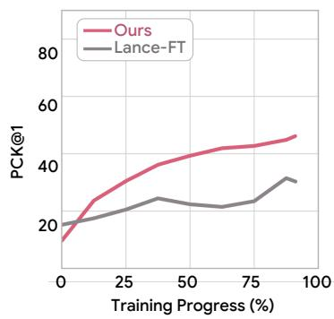

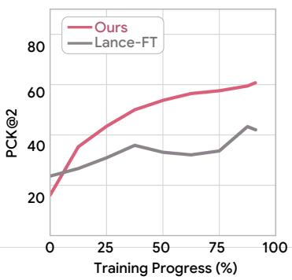

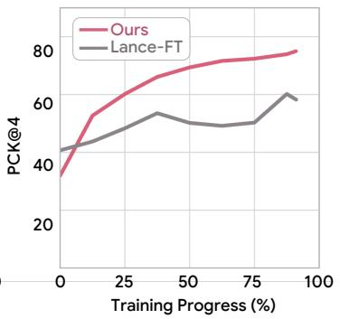

Figure 6: Cross-view correspondence accuracy throughout training.  
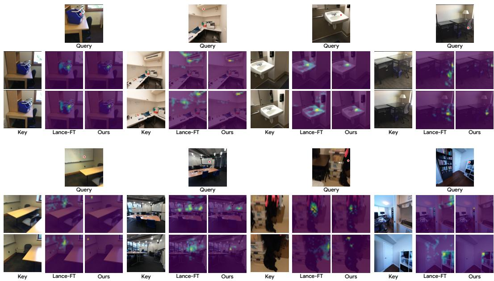  
Figure 7: Visualization of cross-view VAE feature similarity.

## C.2 ADDITIONAL ANALYSIS ON CORRESPONDENCE OF VAE.

We extend the analysis in Sec. 4 by examining how cross-view correspondence develops during training and visualizing the cosine similarity of VAE token representations across views. We measure token-level correspondence using the attention-output features at layer l = 26.

Correspondence throughout training. Figure 6 compares Ask4NV with Lance-FT throughout training on ScanNet. Across all three thresholds, Ask4NV reaches the final correspondence accuracy of Lance-FT substantially earlier and achieves higher accuracy throughout training after the initial stage. These results suggest that our joint training design promotes the development of cross-view consistent VAE representations.

Cross-view feature similarity. We visualize cross-view feature similarity by computing cosine similarity between a query VAE token’s attention-output feature and those of all VAE tokens in another view, without camera conditioning. The resulting similarity maps are overlaid on the corresponding images. Figure 7 presents the examples of overlaid images of Lance-FT and Ask4NV. Compared with the diffuse responses of the baseline, Ask4NV exhibits more localized feature responses around corresponding scene regions, illustrating its ability to capture cross-view correspondences more ac curately.

Table 9: Ablation on bidirectional attention between visual tokens.
<table><tr><td rowspan="2">Dataset</td><td rowspan="2">ViT-VAE bidir.</td><td rowspan="2">Noise-Clean bidir.</td><td colspan="3">2D Metrics</td><td colspan="4">3D Metrics</td></tr><tr><td>PSNR ↑</td><td>SSIM ↑</td><td>LPIPS ↓</td><td>ATE↓</td><td>RPEr↓</td><td>RPE↓</td><td>MEt3R↓</td></tr><tr><td rowspan="4">DL3DV</td><td>x</td><td>x</td><td>13.573</td><td>0.310</td><td>0.410</td><td>0.378</td><td>6.54</td><td>0.687</td><td>0.373</td></tr><tr><td>x</td><td>√</td><td>13.945</td><td>0.326</td><td>0.384</td><td>0.319</td><td>6.28</td><td>0.607</td><td>0.363</td></tr><tr><td>√</td><td>x</td><td>13.653</td><td>0.314</td><td>0.424</td><td>0.409</td><td>5.59</td><td>0.748</td><td>0.406</td></tr><tr><td>√</td><td>√</td><td>14.939</td><td>0.355</td><td>0.313</td><td>0.158</td><td>3.11</td><td>0.298</td><td>0.349</td></tr><tr><td rowspan="4">ScanNet</td><td>x</td><td>x</td><td>15.542</td><td>0.557</td><td>0.446</td><td>0.200</td><td>13.03</td><td>0.348</td><td>0.420</td></tr><tr><td>x</td><td>√</td><td>16.102</td><td>0.575</td><td>0.426</td><td>0.219</td><td>13.52</td><td>0.341</td><td>0.425</td></tr><tr><td>√</td><td>x</td><td>15.488</td><td>0.564</td><td>0.446</td><td>0.221</td><td>11.65</td><td>0.371</td><td>0.470</td></tr><tr><td>√</td><td>√</td><td>15.747</td><td>0.564</td><td>0.434</td><td>0.191</td><td>13.85</td><td>0.340</td><td>0.413</td></tr><tr><td rowspan="4">Re10K</td><td>x</td><td>x</td><td>15.549</td><td>0.527</td><td>0.367</td><td>0.179</td><td>2.16</td><td>0.321</td><td>0.346</td></tr><tr><td>x</td><td>√</td><td>15.988</td><td>0.544</td><td>0.347</td><td>0.168</td><td>2.40</td><td>0.315</td><td>0.346</td></tr><tr><td>√</td><td>x</td><td>15.351</td><td>0.523</td><td>0.386</td><td>0.187</td><td>2.71</td><td>0.349</td><td>0.372</td></tr><tr><td>√</td><td>√</td><td>16.738</td><td>0.562</td><td>0.290</td><td>0.106</td><td>1.68</td><td>0.202</td><td>0.319</td></tr><tr><td rowspan="4">ScanNet++</td><td>x</td><td>x</td><td>14.848</td><td>0.582</td><td>0.465</td><td>0.330</td><td>17.55</td><td>0.640</td><td>0.446</td></tr><tr><td>x</td><td>√</td><td>15.178</td><td>0.594</td><td>0.447</td><td>0.317</td><td>22.32</td><td>0.685</td><td>0.429</td></tr><tr><td>√</td><td>x</td><td>14.703</td><td>0.580</td><td>0.479</td><td>0.332</td><td>20.28</td><td>0.672</td><td>0.488</td></tr><tr><td>√</td><td>√</td><td>15.242</td><td>0.583</td><td>0.419</td><td>0.287</td><td>16.54</td><td>0.649</td><td>0.398</td></tr></table>

## C.3 ABLATION ON BIDIRECTIONAL ATTENTION BETWEEN VISUAL TOKENS.

Novel-view generation in Ask4NV involves three groups of visual tokens: source ViT tokens, clean source VAE tokens, and noisy target VAE tokens. We extend the ablation in Table 6 by examining the effects of allowing bidirectional attention between different visual token groups. ViT–VAE bidir. denotes bidirectional attention between source ViT and clean source VAE tokens, while Noise– Clean bidir. denotes bidirectional attention between clean source and noisy target VAE tokens. Our model enables both forms of bidirectional attention.

Enabling both forms of attention achieves the best results across all reported metrics on DL3DV and RealEstate10K, and most metrics on ScanNet++. On ScanNet, enabling only Noise–Clean bidirectional attention yields better PSNR, SSIM, and LPIPS, while our configuration achieves better ATE, translation RPE, and MEt3R. Nevertheless, enabling both connections provides more consistent performance across datasets, including the out-of-domain RealEstate10K and ScanNet++ benchmarks, supporting our attention mask design.

## C.4 EFFECT OF UNDERSTANDING SUPERVISION.

We examine how the composition of 3D language understanding supervision affects novelview generation by comparing question answering, visual grounding, and their combination. All configurations use the same architecture and ViT conditioning and are evaluated at matched intermediate checkpoints with equal numbers of generation and understanding training samples.

Table 10: Ablation on the composition of 3D language understanding supervision.
<table><tr><td>Dataset</td><td>QA</td><td>Grounding</td><td>PSNR ↑</td><td>SSIM↑</td><td>LPIPS ↓</td></tr><tr><td rowspan="3">DL3DV</td><td>√</td><td>x</td><td>13.66</td><td>0.313</td><td>0.402</td></tr><tr><td>x</td><td>√</td><td>13.03</td><td>0.291</td><td>0.453</td></tr><tr><td>√</td><td>√</td><td>12.92</td><td>0.285</td><td>0.451</td></tr><tr><td rowspan="3">ScanNet</td><td>√</td><td>x</td><td>13.94</td><td>0.525</td><td>0.524</td></tr><tr><td>x</td><td>√</td><td>13.50</td><td>0.514</td><td>0.552</td></tr><tr><td>√</td><td>√</td><td>13.54</td><td>0.510</td><td>0.546</td></tr></table>

Table 10 shows that QA-only supervision

achieves the best PSNR, SSIM, and LPIPS on both DL3DV and ScanNet, while grounding-only supervision performs comparably to the combined configuration. These results suggest that allocating more of the understanding training budget to question answering benefits novel-view generation in this setting. Our default configuration includes both tasks to support question answering and visual grounding.

## C.5 ADDITIONAL QUALITATIVE RESULTS.

We provide additional qualitative results on DL3DV, ScanNet, Re10K, and ScanNet++ in Figs. 8– 13.

## D LIMITATIONS AND FUTURE WORK

Our experiments demonstrate improvements in novel-view generation under the evaluated multiview settings. Extending these benefits to longer camera trajectories and more diverse in-the-wild scenes remains an important direction, requiring consistent preservation of scene appearance and geometry across broader viewing conditions. Our current training and evaluation also use a fixed image resolution. Supporting multiple resolutions and higher-resolution outputs would broaden the method’s applicability while introducing additional challenges in preserving fine visual detail across views. Larger models and more diverse training data would enable further investigation of how the benefits of 3D language supervision scale. Although a performance gap remains relative to leading 3D language understanding models, future unified backbones with stronger understanding capabilities may help narrow this gap and provide richer supervision for novel-view generation.

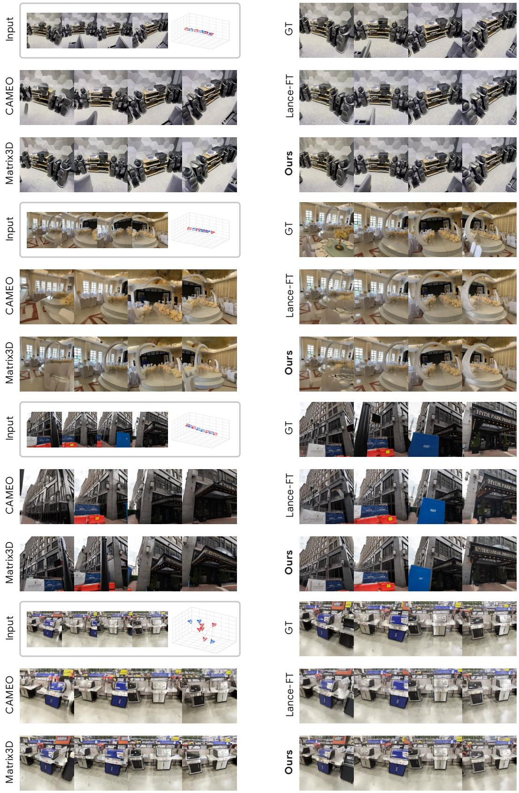  
Figure 8: Additional qualitative results of novel view generation on DL3DV, comparing Ask4NV with baseline methods. Blue and red cameras indicate source and target viewpoints, respectively.

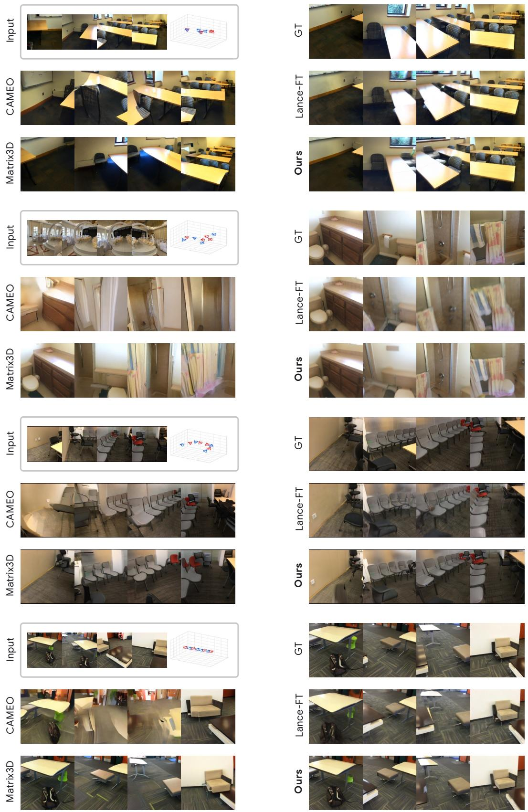  
Figure 9: Additional qualitative results of novel view generation on ScanNet, comparing Ask4NV with baseline methods. Blue and red cameras indicate source and target viewpoints, respectively.

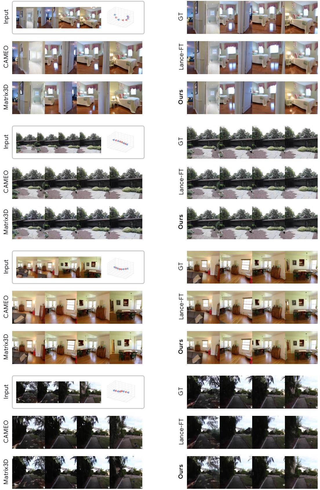  
Figure 10: Additional qualitative results of novel view generation on Re10K, comparing Ask4NV with baseline methods. Blue and red cameras indicate source and target viewpoints, respectively.

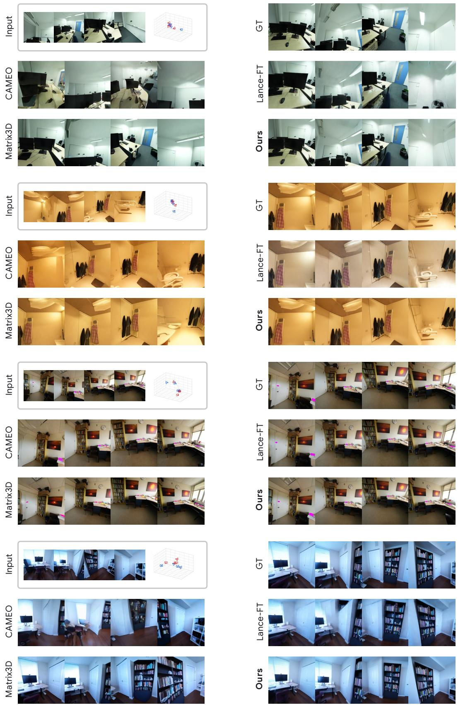  
Figure 11: Additional qualitative results of novel view generation on ScanNet++, comparing Ask4NV with baseline methods. Blue and red cameras indicate source and target viewpoints, respectively.

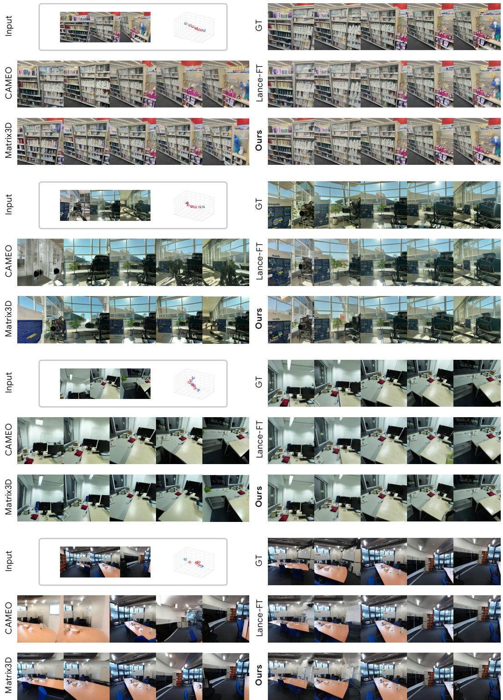  
Figure 12: Additional qualitative results of novel view generation on N = 3 source views, comparing Ask4NV with baseline methods. Blue and red cameras indicate source and target viewpoints, respectively.

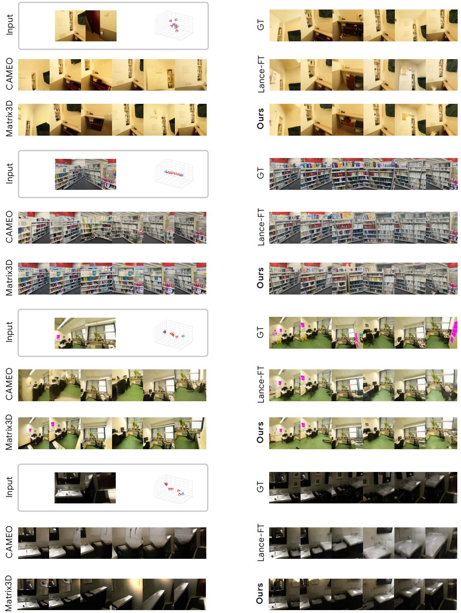  
Figure 13: Additional qualitative results of novel view generation on N = 2 source views, comparing Ask4NV with baseline methods. Blue and red cameras indicate source and target viewpoints, respectively.