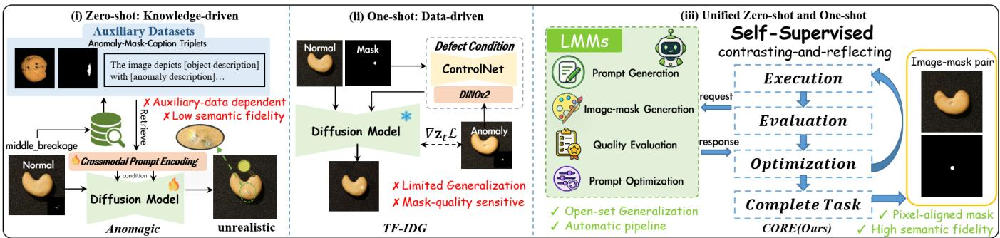
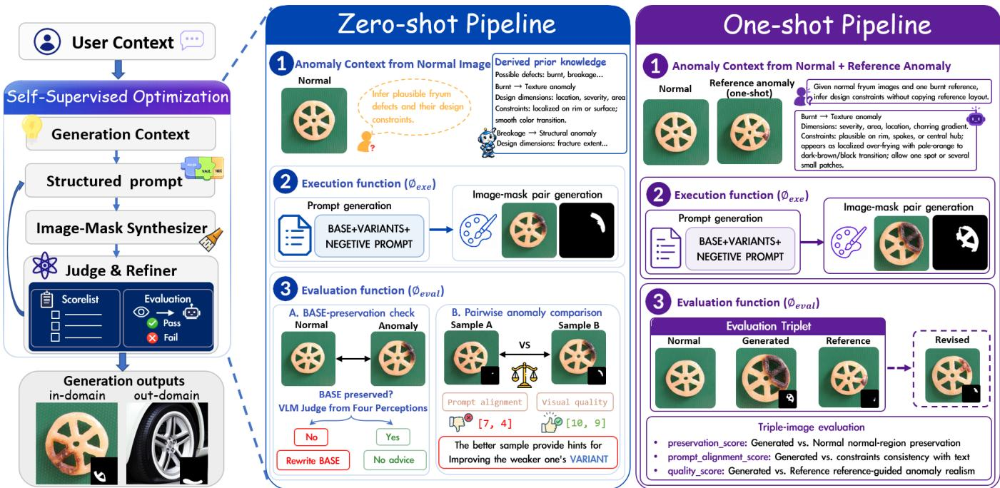
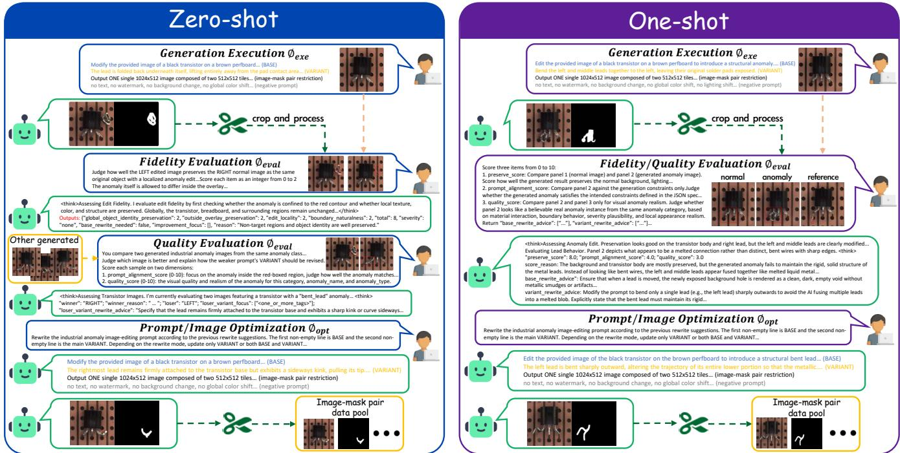
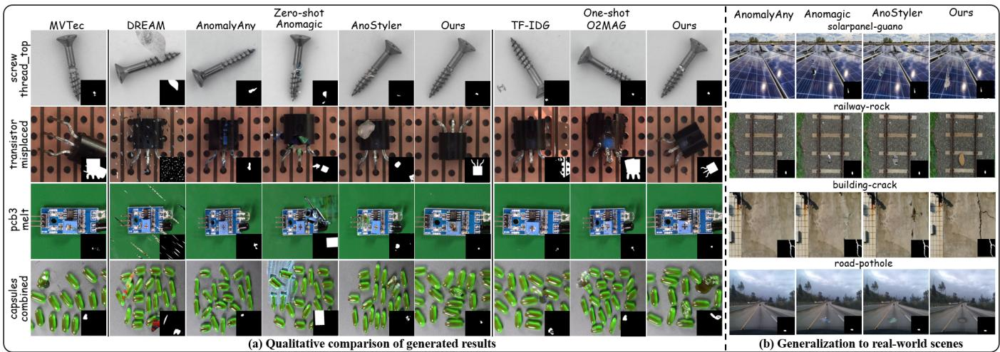

# CORE: Contrast-and-Reflect for Self-Supervised Prompt Optimization in Anomaly Synthesis

Haoxiang Rao1, Fang Zhao1†, Zhao Wang2, Weijia Li1, Chenyang Si1, Caifeng Shan1†

1School of Intelligence Science and Technology, Nanjing University 2China Mobile Zijin Innovation Institute

## Abstract

Industrial anomaly detection (AD) is bottlenecked by the scarcity of anomalous samples, making high-fidelity anomaly synthesis crucial for improving downstream performance. However, existing methods either rely on scarce real anomaly references or auxiliary data, while lacking complex reason- ing and iterative optimization capabilities for generating re- alistic defects in open-set scenarios. To address these chal- lenges, we propose CORE, a cost-eficient and trainingfree prompt optimization framework based on Large Mul- timodal Models (LMMs), which unifies zero-shot and one-shot anomaly synthesis. CORE first introduces an Anomaly Context Grounding module to transform sparse user context into defect-aware generation context, which is subsequently instantiated as structured anomaly prompts that disentangle normal-region preservation from anomaly-specific variation, enabling controllable and faithful defect generation. Further- more, CORE autonomously refines prompts through a self- supervised contrast-and-reflect mechanism. This design em- powers general-purpose LMMs to synthesize realistic anoma- lies under both zero-shot and one-shot settings without task- specific training. Extensive experiments on MVTec-AD and VisA demonstrate that CORE synthesizes realistic and diverse anomalies, yielding superior improvements in downstream AD performance. Furthermore, its model-agnostic and plug- and-play paradigm enables efortless integration with diverse LMMs, facilitating adaptation to unseen open-set scenarios.

## Introduction

Industrial anomaly detection (AD) plays a crucial role in in-spection and quality control by identifying, localizing, and categorizing visual defects (Liu et al. 2024; Huang et al. 2025). However, industrial data sufer from severe data imbalance, where normal samples are abundant while anoma- lous samples are scarce. Although models trained (Li et al. 2024; Guo et al. 2025) solely on normal data can detect distributional deviations, their ability to localize and classify anomalies in complex scenarios remains limited due to in- suficient modeling of real defect patterns. This motivates anomaly synthesis as an efective means to enrich defect distributions and improve supervised AD. Therefore, syn- thesizing realistic and diverse anomalies has emerged as a key strategy to enhance supervised AD.

Anomaly synthesis methods can be broadly categorized into zero-shot and few-shot settings according to the avail- ability of real anomalous samples. Zero-shot methods are attractive for defect-scarce industrial scenarios (Zhang, Xu, and Zhou 2024; Sun et al. 2025), but early cut-paste strate-gies (Li et al. 2021; Zavrtanik, Kristan, and Skočaj 2021) often lack structural consistency and contextual realism. Re- cent difusion-based approaches improve visual quality by leveraging pretrained generative priors, e.g., anomaly-related attention strengthen (Sun et al. 2025) or text-guided style transfer (So and Kang 2026). However, such internal guid-ance provides limited anomaly-specific knowledge, while Anomagic (Jiang et al. 2026) retrieves relevant anomalous pairs from purpose-built auxiliary data, as shown in Fig. 1(i), making its performance highly dependent on data quality and retrieval accuracy. These dependencies introduce substantial computational and data-preparation overhead, hindering ef- ficient adaptation to open-set scenarios.

Few-shot methods leverage real anomalies to improve syn- thesis fidelity, yet training-based approaches are prone to overfitting when anomalies are extremely scarce (Hu et al. 2024; Dai et al. 2025). More practical one-shot training-free methods (Xu et al. 2025; Rao et al. 2026), as illustrated in Fig. 1(ii), use a single anomaly reference to guide gener-ation, yet rely on anomaly masks for defect placement and remain sensitive to spatially implausible locations. Moreover, their limited ability to model logical and abstract anomalies restricts coverage of complex defects. These limitations mo- tivate a unified framework capable of synthesizing realistic and diverse anomalies across zero-shot and one-shot settings.

Recent advances in Large Multimodal Models (LMMs) have demonstrated strong open-world visual understanding, reasoning, and generation capabilities (Wu et al. 2025; Deng et al. 2025; Seedream et al. 2025). Although LMMs have been explored for anomaly detection (Li et al. 2023; Gu et al. 2024), their potential for industrial anomaly synthe-sis remains underexplored. Due to limited domain-specific knowledge and weak sensitivity to fine-grained local de- fects, directly using general-purpose LMMs often fails to stably generate realistic, localized, and semantically accurate anomalies. To address these limitations, we propose CORE, a cost-eficient and training-free LMM-based framework that achieves high-fidelity anomaly synthesis via self-supervised prompt optimization.

As illustrated in Fig. 1(iii), CORE provides a unified training-free framework for both zero-shot and one-shot anomaly synthesis. In industrial inspection, anomalies typ- ically manifest as local deviations from otherwise normal products. Accordingly, we formulate anomaly synthesis as an image editing task to introduce plausible defect patterns into a given normal image without modifying its non-anomalous content. To enable controllable anomaly editing, CORE first grounds available visual and semantic contexts into defect- aware generation context, which is then instantiated as struc- tured prompts. Following the normal-anomaly separability principle (Duan et al. 2025; Rao et al. 2026), CORE de-composes the generation prompt into three complementary parts: BASE to preserve normal content, VARIANT to spec- ify anomaly-related variations, and NEGATIVE to suppress undesired artifacts and irrelevant modifications. To further improve generation quality, CORE introduces a contrasting- and-reflecting mechanism inspired by LLM-as-a-judge studies (Zheng et al. 2023; Wang et al. 2024; Yuksekgonul et al. 2025), forming a closed-loop optimization process.

  
Figure 1: Comparison of representative anomaly synthesis paradigms, where existing (i) zero-shot and (ii) one-shot methods are limited by their reliance on auxiliary datasets and scarce anomaly references, respectively, while (iii) CORE unifies both settings through self-supervised closed-loop optimization for realistic and generalizable anomaly synthesis.

In the zero-shot setting, the key challenge is optimizing anomaly prompts without access to real anomalous refer- ences. CORE addresses this challenge by observing that prompt quality can be reflected through the generated re- sults: a well-designed anomaly prompt should simultane- ously achieve semantic consistency, local defect realism, and faithful preservation of non-anomalous regions. Instead of relying on human annotations or real anomaly references, CORE derives self-supervised optimization signals by con- trasting candidates generated from diferent prompts. The comparison results expose prompt-level weaknesses in se- mantic consistency, local realism, and preservation of normal regions, and the resulting reflective feedback is used to revise weaker prompts. In the one-shot setting, CORE incorporates a single real anomaly reference as a weak visual anchor for category-level realism rather than a template for direct repli- cation. This enables the model to capture defect appearance and material interaction while avoiding overfitting to the ref- erence’s specific shape, location, or extent. In this way, CORE treats both generated outputs and limited anomaly references as feedback sources for prompt refinement, enabling realistic and diverse anomaly synthesis without task-specific training.

Our main contributions are summarized as follows:

• We propose CORE, a cost-eficient and training-free unified framework for both zero-shot and one-shot industrial anomaly synthesis, reducing reliance on real anomalies, finetuning, and auxiliary datasets.

• We introduce a contrasting-and-reflecting mechanism that converts generated results and limited references into self-supervised feedback for prompt optimization.

• Experiments on MVTec-AD and VisA demonstrate that CORE achieves superior generation quality and down- stream AD performance, while enabling plug-and-play transfer across LMM backends and strong generalization to unseen objects in open-world scenarios.

## Related Work

## Anomaly Generation

Few-shot Anomaly Generation. Few-shot anomaly generation synthesizes diverse anomalies from limited real samples in the target category. Recent methods have evolved from GAN-based generation (Goodfellow et al. 2020; Duan et al. 2023) to difusion models with stronger generative capacity. Some approaches freeze the difusion backbone and learn anomaly-specific embeddings (Hu et al. 2024; Gui et al. 2024; Lu et al. 2025; Gal et al. 2023), while others (Jin et al. 2025; Song et al. 2025; Dai et al. 2025; Tong et al. 2026) finetune the backbone following DreamBooth personalization (Ruiz et al. 2023). However, when anomalous sam-ples are extremely scarce, training-based methods are prone to overfitting and unreliable distribution modeling, motivat- ing training-free anomaly generation. Among training-free methods, TF-IDG (Xu et al. 2025) guides anomaly appear-ance by minimizing the distribution discrepancy between generated and real defects, while O2MAG (Rao et al. 2026) transfers anomaly patterns by manipulating multiple difu- sion processes via self-attention grafting. Nevertheless, both methods are sensitive to spatial plausibility ofanomaly masks and provide limited support for logical anomalies.

Zero-shot Anomaly Generation. Zero-shot anomaly gen-eration aims to synthesize realistic defects for unseen cat- egories without requiring anomalous samples. Early cut- paste methods (Li et al. 2021; Zavrtanik, Kristan, and Skočaj 2021) overlay external textures onto normal im-ages, but lack structural consistency and contextual real- ism. AnomalyAny (Sun et al. 2025) enhances anomaly- related token responses by modifying the cross-attention mechanism (Vaswani et al. 2017) of Stable Difusion, yet token-level guidance remains limited in capturing complex anomaly semantics. Anomagic (Jiang et al. 2026) introduces cross-modal prompts and auxiliary retrieval, but its perfor- mance depends on auxiliary data quality and retrieval ac- curacy. AnoStyler (So and Kang 2026) formulates anomaly generation as text-guided style transfer and fine-tunes a styl- ization network at test time. Overall, these methods remain constrained by limited anomaly-specific guidance and strug- gle to generate realistic defects.

## Large Multimodal Models (LMMs)

Large Multimodal Models (LMMs) (Hurst et al. 2024; Team et al. 2023) have shown strong capabilities in open-world vi-sual understanding, reasoning and generation. Representative systems such as Gemini (Team et al. 2023) and GPT (Hurst et al. 2024) demonstrate the potential of general-purpose multimodal models as flexible generators conditioned on vi- sual and textual inputs. While recent studies have explored LMMs for industrial anomaly detection (Zhang et al. 2025; Li et al. 2026), their abilit to s nthesize realistic industrial anomalies remains underexplored. Since LMMs are trained on broad Internet-scale data and lack domain-specific defect priors, directly using them may cause inaccurate anomaly semantics or unintended changes to non-anomalous regions. CORE addresses this by treating LMMs as black-box back- ends and performing self-supervised prompt optimization through a contrast-and-reflect mechanism.

## Method

We formulate anomaly synthesis as a constrained image editing task, with the goal of autonomously optimizing the anomaly prompt $P$ to generate anomalous image-mask pairs. To bridge the domain knowledge gap between general- purpose Large Multimodal Models (LMMs) and industrial anomaly synthesis while minimizing human intervention, we propose CORE, a self-supervised framework that con-structs and optimizes anomaly prompts through a contrast- and-reflect mechanism. CORE derives setting-specific feed- back signals to guide prompt optimization under both zero- shot and one-shot synthesis scenarios. The following sub- sections introduce the overall framework, structured prompt formulation, and prompt optimization mechanism.

## Framework Overview

As shown in Fig. 2, CORE is a self-supervised prompt op- timization framework composed of three fundamental func- tions: (1) Execution function $\phi _ { \mathrm { e x e } }$ takes the current prompt P and invokes the LMM to generate an anomalous image-mask pair $( I ^ { a } , M ^ { a } )$ ; (2) Evaluation function $\phi _ { \mathrm { e v a l } }$ assesses the quality of the generated anomaly image and produces feedback F, which serves as guidance for subsequent prompt optimization; (3) Optimization function $\phi _ { \mathrm { o p t } }$ updates the cur- rent anomaly prompt according to the feedback F and feeds the revised prompt $\hat { \boldsymbol { P } } ^ { \star }$ back to $\phi _ { \mathrm { e x e } }$ for image-mask regener- ation, enabling iterative refinement throughout the optimiza- tion process.

These functions form a closed loop of execution, eval- uation, and optimization. Starting from an initial prompt,

CORE automatically generates anomaly image-mask pairs, diagnoses their failure modes, and refines the structured prompt for the next iteration. Through this feedback-driven refinement process, CORE converts generated results into optimization feedback, enabling iterative prompt refinement with black-box LMMs without manual intervention.

## Structured Prompt Formulation

To bridge the context gap between sparse user context and defect-aware generation context, CORE decomposes prompt formulation into two stages. It first derives anomaly design dimensions and generation constraints from the normal im- ages, optionally supplemented by one anomaly reference, and then instantiates them into a structured prompt for image– mask generation and refinement. This formulation reduces the ambiguity of direct prompting and avoids implausible anomalies and unintended changes to normal regions.

Anomaly Context Grounding. Given two normal images, optionally supplemented with one anomaly reference in the one-shot setting, CORE derives anomaly generation contexts from two complementary aspects: design dimensions D and generation constraints G. The design dimensions specify the admissible variation space of the target anomaly, whereas the constraints restrict their instantiation to semantically consis- tent, structurally plausible, and material-consistent manifes- tations while preserving normal regions and suppressing ir- relevant changes. This separation distinguishes the anomaly variation space from the validity conditions governing gener- ation and defines a constrained anomaly space that provides a unified basis for prompt construction, result evaluation, and prompt optimization. In the zero-shot setting, CORE relies solely on the normal images and leverages the LMM’s in- ternal knowledge to infer plausible anomaly variations and object-specific generation constraints. In the one-shot setting, one real anomaly reference further enriches the context with informative visual cues about defect appearance and material interaction, without encouraging instance-level copying.

Structured Anomaly Prompt. Based on the grounded anomaly context, CORE instantiates the executable anomaly prompt as $P = \{ B , V , N \}$ , where B, V, and N denote BASE, VARIANT, and NEGATIVE, respectively. BASE encodes the preservation constraints in G, specifying the source content that should remain invariant during edit- ing. VARIANT instantiates anomaly-specific attributes from the design dimensions D, including anomaly location, mor-phology, texture and material interaction, while remaining consistent with the constraints defined in G. NEGATIVE is a general-purpose clause to suppress irrelevant artifacts, global appearance shifts and implausible deformations, and remains fixed throughout optimization. During execution, a fixed mask instruction M is inserted, enabling joint generation of an aligned anomaly image–mask pair. Through this decomposition, CORE explicitly disentangles normal-region preservation from anomaly semantic variation, reducing edit- ing drift. Moreover, the component-wise prompt structure aligns evaluation feedback with the corresponding prompt component, enabling targeted and interpretable refinement.

  
Figure 2: Overview of the CORE framework. CORE unifies zero-shot and one-shot anomaly synthesis within a self-supervised Execute-Evaluate-Optimize loop. Starting from user-provided inputs, CORE derives anomaly generation context and iteratively evaluates and refines the generation process, enabling realistic and diverse anomaly generation.

## Self-Supervised Prompt Optimization

CORE optimizes the structured anomaly prompt by con- verting generated results into self-supervised feedback sig- nals. The key observation is that prompt quality is implicitly reflected in the generated outputs: a high-quality anomaly prompt should produce defects that are semantically aligned with the intended anomaly, locally realistic for the target ma- terial, and faithful to the normal regions of the input image. Instead of manual prompt tuning, CORE identifies genera- tion deficiencies and revises the corresponding prompt com- ponents through a contrast-and-reflect mechanism.

Given a normal image $I ^ { n }$ and a structured anomaly prompt $P = \{ B , V , N \}$ , the execution function $\phi _ { \mathrm { e x e } }$ invokes the black-box LMM to generate an anomaly image-mask pair:

$$
( I ^ { a } , M ^ { a } ) = \phi _ { \mathrm { e x e } } ( I ^ { n } , P ) ,\tag{1}
$$

where Ia and Ma denote the synthesized anomalous image and its corresponding anomaly mask. The generated result is then evaluated under a setting-specific feedback function:

$$
F = \phi _ { \mathrm { e v a l } } \left( I ^ { n } , G , P , ( I ^ { a } , M ^ { a } ) , \mathcal { R } ^ { ( s ) } \right) , \quad P _ { \mathrm { o p t } } = \phi _ { \mathrm { o p t } } ( P , F ) ,\tag{2}
$$

where $s \in \{ \mathrm { z e r o } , \mathrm { o n e } \}$ denotes the synthesis setting. Based on the failure modes identified in F, the optimization function selectively rewrites BASE or VARIANT, while the shared NEGATIVE component N remains unchanged.

Zero-shot. In the zero-shot setting, no real anomaly reference is available for assessing anomaly realism. CORE addresses this challenge by deriving self-supervised optimization sig- nals from the relative evaluation of its generated outputs.

Given a user-specified number of candidates K, CORE con-structs a candidate pool from multiple prompt variants:

$$
\mathcal { C } = \{ ( P _ { k } , I _ { k } ^ { a } , M _ { k } ^ { a } ) \} _ { k = 1 } ^ { K } ,\tag{3}
$$

where each candidate is generated from a diferent structured prompt. Since no ground-truth anomaly is available, CORE decouples the evaluation into normal-region preservation and anomaly-region quality.

For normal-region preservation, CORE compares each generated result with the input normal image:

$$
F _ { \mathrm { B A S E } , k } = \phi _ { \mathrm { e v a l } } ^ { \mathrm { B A S E } } \left( I _ { k } ^ { n } , ( I _ { k } ^ { a } , M _ { k } ^ { a } ) \right) .\tag{4}
$$

This evaluation focuses on whether regions outside the anomaly mask are faithfully preserved, thereby identifying BASE-related failures such as background changes, lighting shifts, material inconsistency, or object-identity distortion.

For anomaly-region quality, CORE performs pairwise out- put comparison between generated candidates:

$$
F _ { \mathrm { V A R I A N T } } ^ { i , j } = \phi _ { \mathrm { e v a l } } ^ { \mathrm { O v O } } \left( ( P _ { i } , I _ { i } ^ { a } , M _ { i } ^ { a } ) , ( P _ { j } , I _ { j } ^ { a } , M _ { j } ^ { a } ) \right) , \quad i \neq j .\tag{5}
$$

Here, OvO denotes Output vs. Output evaluation, which contrasts outputs from diferent prompts to derive relative quality feedback while accommodating multiple valid de- fect appearances. The LMM evaluates each pair by prompt alignment with G and anomaly quality in terms of local re-alism, structural plausibility, and material consistency. The preferred candidate provides evidence for identifying defi- ciencies in the weaker candidate, enabling targeted correc- tion without encouraging appearance-level imitation. Pair- wise feedback assigned to each candidate is then aggregated as $F _ { \mathrm { V A R I A N T } , k }$ , and the corresponding prompt is refined by

  
Figure 3: A running example of feedback-driven prompt optimization in CORE. Starting from an initial structured prompt, CORE performs generation, evaluation, and prompt optimization to progressively improve the synthesized image–mask pairs.

$$
P _ { \mathrm { o p t } , k } = \phi _ { \mathrm { o p t } } \left( P _ { k } , F _ { \mathrm { B A S E } , k } , F _ { \mathrm { V A R I A N T } , k } \right) .\tag{6}
$$

CORE thus derives reference-free optimization feedback from its generated candidates, enabling zero-shot prompt refinement without real anomaly samples.

One-shot. In the one-shot setting, CORE incorporates a sin-gle real anomaly reference $( I _ { \mathrm { r e f } } , \bar { M } _ { \mathrm { r e f } } )$ as weak visual guid- ance. Rather than serving as a template for direct replication, the reference provides evidence about defect appearance, structural plausibility, and material interaction. Given a gen- erated result $( I ^ { a } , M ^ { a } )$ , CORE performs Output vs. Ground Truth (OvG) evaluation by jointly assessing the source nor-mal image, generated anomaly and real anomaly reference:

$$
F _ { \mathrm { O v G } } = \phi _ { \mathrm { e v a l } } ^ { \mathrm { O v G } } \left( I ^ { n } , G , P , ( I ^ { a } , M ^ { a } ) , ( I _ { \mathrm { r e f } } , M _ { \mathrm { r e f } } ) \right) .\tag{7}
$$

The LMM evaluates the generated result along three di- mensions: preservation score, measuring the fidelity of normal regions;prompt-alignment score, measuring consistency with the textual constraints $G ;$ and quality score, assessing anomaly realism under the guidance of the real reference. Together, these scores and their diagnostic feedback consti- tute $F _ { \mathrm { O v G } } .$ , which determines whether the current prompt is retained or whether Base, Variant, or both are refined. The optimized prompt is obtained as

$$
P _ { \mathrm { o p t } } = \phi _ { \mathrm { o p t } } ( P , F _ { \mathrm { O v G } } ) .\tag{8}
$$

Consequently, CORE derives feedback directly from gener- ated outputs in the zero-shot setting and incorporates weak reference guidance in the one-shot setting, providing a uni- fied formulation for anomaly synthesis. Detailed scoring and refinement rules are provided in the appendix.

## Experiments

## Experiment Settings

Datasets. We conduct experiments on two representative industrial anomaly detection benchmarks: MVTec- AD (Bergmann et al. 2019) and VisA (Zou et al. 2022). MVTec-AD contains 10 object categories and 5 texture cate-gories, while VisA includes 12 categories of complex indus- trial objects. To simulate realistic industrial inspection sce-narios with scarce anomalies, we evaluate CORE under two settings: (1) zero-shot setting, where no anomalous samples are used for synthesis; and (2) one-shot setting, where one anomalous sample is provided as the reference for each defect type and excluded from downstream evaluation, ensuring no overlap between the reference and evaluation sets.

Baselines. We evaluate the training-free CORE frame-work under both zero-shot and one-shot settings. In the zero-shot setting, we compare CORE with DRAEM (Zavrtanik, Kristan, and Skočaj 2021) (handcrafted synthesis), AnomalyAny (Sun et al. 2025) (training-free method), Anomagic (Jiang et al. 2026) (fine-tuning with inpainting Stable Difusion model), and AnoStyler (So and Kang 2026) (fine-tuning with stylization network). In the one-shot setting, we compare CORE with recent training-free methods TF-IDG (Xu et al. 2025) and O2MAG (Rao et al. 2026). Training-based few-shot methods are excluded because they are designed for few-shot protocols, typically using one-third of the anomalous images in each defect category as reference data for generation. Under the stricter one-shot setting, their training process becomes unstable and prone to overfitting. Implementation Details. We use Gemini-3.1-Pro as the text-side agent for prompt generation, evaluation, and optimiza- tion, and Nano Banana 2 as the image generator. To further validate the generality of CORE, we also adopt OpenAI’s GPT-5 Mini and GPT-Image-2 for prompt optimization and image synthesis in the ablation study. For cost eficiency, we perform one iteration of the Execute-Evaluate-Optimize loop, which already yields substantial gains in downstream anomaly detection. Fig. 3 illustrates an example of CORE’s optimization process. The text-side stages average 9 seconds and \$0.01 per sample, while image generation requires 18 seconds/\$0.06 with Nano Banana 2 and 15 seconds/\$0.03 with GPT-Image-2. More details are supplied in Appendix B.

<table><tr><td></td><td colspan="6">MVTec-AD</td><td colspan="7">VisA</td></tr><tr><td>Method</td><td>I-AUC</td><td>I-AP</td><td>I-F1</td><td>P-AUC</td><td>P-AP P-F1</td><td>PRO</td><td>I-AUC</td><td>I-AP</td><td>I-F1</td><td>P-AUC</td><td>P-AP</td><td>P-F1</td><td>PRO</td></tr><tr><td colspan="10">One-Shot Anomaly Generation</td><td></td><td></td><td></td><td></td></tr><tr><td>TF-IDG (Xu et al. 2025)</td><td>89.9</td><td>95.6</td><td>93.0</td><td>88.5</td><td>48.6 50.2</td><td>76.2</td><td>90.9</td><td>93.1</td><td>86.9</td><td>93.7</td><td>44.3</td><td>47.4</td><td>80.6</td></tr><tr><td>O2MAG (Rao et al. 2026)</td><td>95.9</td><td>98.3</td><td>94.9</td><td>89.4 51.2</td><td>51.7</td><td>83.2</td><td>91.7</td><td>94.1</td><td>88.1</td><td>94.8</td><td>47.5</td><td>50.7</td><td>83.8</td></tr><tr><td>CORE (Ours)</td><td>96.5</td><td>98.7</td><td>96.3</td><td>96.5</td><td>66.7 64.6</td><td>87.2</td><td></td><td>92.5 94.5</td><td>88.7</td><td>97.9</td><td>53.0</td><td>55.1</td><td>84.9</td></tr><tr><td colspan="10">Zero-Shot Anomaly Generation</td><td colspan="3"></td></tr><tr><td>DRAEM (Zavrtanik et al. 2021)</td><td>92.2</td><td>96.2</td><td>92.5</td><td>85.5</td><td>43.4 45.1</td><td>74.2</td><td></td><td>85.7 87.8</td><td>82.9</td><td>89.7</td><td>20.0</td><td>26.4</td><td>75.9</td></tr><tr><td>AnomalyAny (Sun et al. 2025)</td><td>86.8</td><td>94.1</td><td>89.8</td><td>89.7</td><td>37.1 40.8</td><td>74.7</td><td>83.5</td><td>85.6</td><td>82.5</td><td>90.3</td><td>17.7</td><td>22.8</td><td>72.8</td></tr><tr><td>Anomagic (Jiang et al. 2026)</td><td>92.0</td><td>96.4</td><td>92.4</td><td>88.1</td><td>44.5 46.9</td><td>79.5</td><td>87.5</td><td>90.0</td><td>83.8</td><td>89.2</td><td>20.7</td><td>27.5</td><td>75.9</td></tr><tr><td>AnoStyler (So and Kang 2026)</td><td>89.1</td><td>95.1</td><td>91.5</td><td>82.7</td><td>37.5 39.2</td><td>71.1</td><td>88.4</td><td>92.0</td><td>85.3</td><td>89.9</td><td>23.8</td><td>30.4</td><td>82.5</td></tr><tr><td>CORE (Ours)</td><td>96.4</td><td>98.9</td><td>95.7</td><td>96.4</td><td>62.8</td><td>61.6</td><td>87.4</td><td>90.9 92.3</td><td>86.7</td><td>96.2</td><td>38.5</td><td>44.3</td><td>82.6</td></tr></table>

Table 1: Comparison of one-shot and zero-shot anomaly synthesis methods on MVTec-AD and VisA. All results are reported as percentages, with the best and second-best results within each setting highlighted in bold and underlined, respectively.

<table><tr><td>Method</td><td colspan="3">|MVTec-AD VisA |IC-L ↑ IS ↑| |IC-L↑ IS ↑</td></tr><tr><td colspan="4">Zero-Shot Anomaly Generation</td></tr><tr><td>AnomalyAny (Sun et al. 2025)</td><td>0.29 2.04</td><td>0.10 0.34</td><td>1.66 1.83</td></tr><tr><td>Anomagic (Žiang et al. 2026) AnoStyǐer (So and Kang 2026) CORE (Ours)</td><td>0.28 0.27 0.28</td><td>2.09 1.59 2.13</td><td>0.31 1.37 0.34 1.54</td></tr><tr><td colspan="4">One-Shot Anomaly Generation</td></tr><tr><td>TF-IDG (Xu et al. 2025)</td><td>0.23 1.73</td><td>0.25</td><td>1.32</td></tr><tr><td>O2MAG (Rao et al. 2026)</td><td>0.27</td><td>1.56 0.31</td><td>1.41</td></tr><tr><td>CORE (Ours)</td><td>0.28</td><td>2.08 0.33</td><td>1.51</td></tr></table>

Table 2: Comparison of anomaly generation on MVTec- AD and VisA under zero-shot and one-shot anomaly syn- thesis settings. Bold and underline represent optimal and sub-optimal results. On VisA, some zero-shot methods in- troduce larger changes at implausible locations, which may artificially inflate their IS.

## Anomaly Generation Results

Following the full-shot experimental setting of AnomalyAny, we generate 100 anomalous images for each defect type. DRAEM (Zavrtanik, Kristan, and Skočaj 2021) is excluded because it synthesizes anomalies using random textures cropped from external datasets. We adopt Inception Score (IS) (Salimans et al. 2016) and Intra-Cluster pairwise LPIPS distance (IC-L) (Ojha et al. 2021) to evaluate generation quality and diversity, respectively.

As shown in Table 2, CORE achieves the best performance across all metrics in the one-shot setting, demonstrating that it efectively leverages a single anomaly reference as a weak vi- sual prior while preserving generation diversity and avoiding appearance-level overfitting. CORE also achieves competi- tive performance in the zero-shot setting. Anomagic obtains the highest class-wise IS on VisA, whereas the examples in Fig. 4(a) reveal that AnomalyAny introduces unintended changes to the board texture and component appearance, and Anomagic generates a prominent metallic structure ex- tending beyond the local component region. Since IS evalu- ates full-image statistics, such salient changes may improve the score without necessarily enhancing localized defect fi- delity. Additionally, existing zero-shot methods often strug- gle to synthesize complex logical anomalies, whereas one- shot baselines remain sensitive to the spatial plausibility of anomaly masks. By contrast, CORE better preserves nor- mal content while generating content-aware logical anoma- lies and structurally consistent image-mask pairs. Fig. 4(b) further demonstrates its generalization to unseen objects in open-world scenarios, with additional qualitative examples provided in Appendix E.

## Anomaly Detection Results

We further evaluate the downstream efectiveness of diferent anomaly synthesis methods for anomaly detection and local- ization, following the evaluation protocols of O2MAG (Rao et al. 2026) and TF-IDG (Xu et al. 2025). For each defect type, we synthesize 100 anomalous images and use them to train a U-Net segmentation model that predicts pixel-level anomaly masks from input images. We report Area Under ROC Curve (AUROC), Average Precision (AP), and F1-score at both the image level and pixel level. We additionally report Per- Region Overlap (PRO) to assess region-level anomaly localization. Table 1 reports the results averaged over categories within each benchmark dataset. The full category-wise re- sults of CORE are provided in Appendix D. Under both zero-shot and one-shot settings, CORE achieves state-of- the-art anomaly detection performance on MVTec-AD and VisA, highlighting its strong generalization ability.

Fi ure 4: Qualitative comparison of anomaly synthesis results. (a) com ares CORE with re resentative zero-shot and one-shot anomaly synthesis methods on MVTec-AD and VisA, showing that CORE produces more realistic and localized anomalies while better preserving non-anomalous regions; (b) further illustrates its generalization to real-world scenes.
<table><tr><td rowspan="2">Setting</td><td rowspan="2">Variant</td><td colspan="6">MVTec-AD</td><td rowspan="2"></td><td colspan="7">VisA</td></tr><tr><td>I-AUC</td><td>I-AP I-F1</td><td>P-AUC</td><td></td><td>P-AP P-F1</td><td>PRO</td><td>I-AUC</td><td>I-AP</td><td>I-F1</td><td>P-AUC</td><td>P-AP</td><td>P-F1</td><td>PRO</td></tr><tr><td rowspan="4">One-shot</td><td>w/o ACG Initial (ACG)</td><td>93.2</td><td>97.2</td><td>93.8</td><td>94.7</td><td>59.7</td><td>58.6</td><td>85.1</td><td>88.6</td><td>91.0</td><td>85.3</td><td>96.2</td><td>43.1</td><td>45.7</td><td>78.4</td></tr><tr><td></td><td>94.2</td><td>97.9</td><td>94.6</td><td>95.3</td><td>63.5</td><td>61.6</td><td>85.2</td><td>91.3</td><td>93.2</td><td>87.3</td><td>96.0</td><td>45.1</td><td>49.3</td><td>83.0</td></tr><tr><td>Google</td><td>96.5</td><td>98.7</td><td>96.3</td><td>96.5</td><td>66.7</td><td>64.6</td><td>87.2</td><td>92.5</td><td>94.5</td><td>88.7</td><td>97.9</td><td>53.0</td><td>55.1</td><td>84.9</td></tr><tr><td>OpenAI</td><td>95.3</td><td>98.3</td><td>95.3</td><td>97.2</td><td>67.4</td><td>64.4</td><td>88.3</td><td>91.8</td><td>94.1</td><td>88.3</td><td>97.5</td><td>50.0</td><td>53.6</td><td>86.5</td></tr><tr><td rowspan="4">Zero-shot</td><td>w/o ACG</td><td>93.1</td><td>97.3</td><td>94.2</td><td>95.2</td><td>57.6</td><td>57.3</td><td>83.7</td><td>88.6</td><td>90.6</td><td>84.9</td><td>95.3</td><td>35.0</td><td>40.2</td><td>80.5</td></tr><tr><td>Initial (ACG)</td><td>93.0</td><td>97.7</td><td>93.9</td><td>95.4</td><td>60.1</td><td>59.0</td><td>84.5</td><td>88.8</td><td>91.3</td><td>85.0</td><td>95.5</td><td>36.8</td><td>42.4</td><td>81.4</td></tr><tr><td>Google</td><td>96.4</td><td>98.9</td><td>95.7</td><td>96.4</td><td>62.8</td><td>61.6</td><td>87.4</td><td>90.9</td><td>92.3</td><td>86.7</td><td>96.2</td><td>38.5</td><td>44.3</td><td>82.6</td></tr><tr><td>OpenAI</td><td>95.2</td><td>98.5</td><td>95.7</td><td>96.1</td><td>66.0</td><td>63.2</td><td>87.4</td><td>89.3</td><td>92.0</td><td>86.0</td><td>96.0</td><td>41.6</td><td>44.5</td><td>83.8</td></tr></table>

Table 3: Ablation study of ACG and prompt optimization with diferent image generators. Initial (ACG) is shared by the Google and OpenAI optimization backends, while w/o ACG removes anomaly context grounding.

## Ablation Study

Table 3 evaluates the efectiveness of ACG and prompt opti- mization, along with CORE’s cross-backend generalization. Efect of Anomaly Context Grounding. We compare ACG with direct prompting under the Google configuration with Gemini-3.1-Pro and Nano Banana 2, while keeping the vi- sual inputs and all other experimental settings unchanged. As shown in Table 3, ACG consistently improves performance by transforming sparse user input into the defect-aware gen- eration context required by general-purpose LMMs.

Efect of Prompt Optimization. Starting from this shared ACG initialization, the Google configuration consistently improves downstream anomaly detection and localization through prompt optimization. These gains validate the ef- fectiveness of the proposed contrast-and-reflect mechanism in refining anomaly prompts and enhancing the downstream utility of synthesized samples.

Generalization across Model Backends. We further re-place the optimization-stage LMM and regeneration back- end with GPT-5 Mini and GPT-Image-2 while keeping the shared initialization fixed. The resulting improvements un- der both zero-shot and one-shot settings demonstrate its model-agnostic generalization across model backends. De- tailed category-wise results are provided in Appendix D.

## Conclusion

In this paper, we introduced CORE, a cost-eficient and training-free prompt optimization framework that uni- fies zero-shot and one-shot industrial anomaly synthesis. Through Anomaly Context Grounding, CORE transforms sparse user-provided context into the defect-aware generation context required by general-purpose LMMs and produces structured prompts that disentangle normal-content preserva- tion from anomaly-specific variation. CORE further enables automatic prompt optimization through a self-supervised contrast-and-reflect mechanism, without task-specific train- ing or manual prompt tuning. Extensive experiments on MVTec-AD and VisA demonstrate that CORE improves both generation quality and downstream anomaly detection per- formance. Its model-agnostic design further enables plug- and-play transfer across diferent LMM backends and gener- alization to unseen objects in open-world scenarios.

Salimans, T.; Goodfellow, I.; Zaremba, W.; Cheung, V.; Rad- ford, A.; and Chen, X. 2016. Improved techniques for training gans. Advances in neural information processing systems, 29.

Bergmann, P.; Fauser, M.; Sattlegger, D.; and Steger, C. 2019. MVTec AD–A comprehensive real-world dataset for unsupervised anomaly detection. In Proceedings of the IEEE/CVF conference on computer vision and pattern recognition, 9592–9600.

Dai, Z.; Zeng, S.; Liu, H.; Li, X.; Xue, F.; and Zhou, Y. 2025. Seas: Few-shot industrial anomaly image generation with separation and sharing fine-tuning. In Proceedings of the IEEE/CVF International Conference on Computer Vision, 23135–23144.

Deng, C.; Zhu, D.; Li, K.; Gou, C.; Li, F.; Wang, Z.; Zhong, S.; Yu, W.; Nie, X.; Song, Z.; et al. 2025. Emerging Properties in Unified Multimodal Pretraining. arXiv:2505.14683.

Duan, Y.; Hong, Y.; Niu, L.; and Zhang, L. 2023. Few-shot defect image generation via defect-aware feature manipula- tion. In Proceedings of the AAAI conference on artificial intelligence, volume 37, 571–578.

Duan, Y.; Xu, W.; Wu, Q.; Xie, G.-S.; Zhao, F.; and Shan, C. 2025. AnomalyControl: Highly-Aligned Anomalous Image Generation with Controlled Difusion Model. In Proceedings of the 33rd ACM International Conference on Multimedia, 8048–8057.

Gal, R.; Alaluf, Y.; Atzmon, Y.; Patashnik, O.; Bermano, A. H.; Chechik, G.; and Cohen-Or, D. 2023. An Image is Worth One Word: Personalizing Text-to-Image Generation using Textual Inversion. In The Eleventh International Conference on Learning Representations.

Goodfellow, I.; Pouget-Abadie, J.; Mirza, M.; Xu, B.; Warde- Farley, D.; Ozair, S.; Courville, A.; and Bengio, Y. 2020. Generative adversarial networks. Communications of the ACM, 63(11): 139–144.

Gu, Z.; Zhu, B.; Zhu, G.; Chen, Y.; Tang, M.; and Wang, J. 2024. Anomalygpt: Detecting industrial anomalies using large vision-language models. In Proceedings of the AAA conference on artificial intelligence, volume 38, 1932–1940.

Gui, G.; Gao, B.-B.; Liu, J.; Wang, C.; and Wu, Y. 2024. Few- shot anomaly-driven generation for anomaly classification and segmentation. In European conference on computer vision, 210–226. Springer.

Guo, J.; Lu, S.; Zhang, W.; Chen, F.; Li, H.; and Liao, H. 2025. Dinomaly: The less is more philosophy in multi- class unsupervised anomaly detection. In Proceedings of the Computer Vision and Pattern Recognition Conference, 20405–20415.

Hu, T.; Zhang, J.; Yi, R.; Du, Y.; Chen, X.; Liu, L.; Wang, Y.; and Wang, C. 2024. Anomalydifusion: Few-shot anomaly image generation with difusion model. In Proceedings of the AAAI conference on artificial intelligence, volume 38, 8526–8534.

Huang, H.; Wang, P.; Pei, J.; Wang, J.; Alexanian, S.; and Niyato, D. 2025. Deep learning advancements in anomaly detection: A comprehensive survey. IEEE Internet ofThings Journal.

Hurst, A.; Lerer, A.; Goucher, A. P.; Perelman, A.; Ramesh, A.; Clark, A.; Ostrow, A. J.; Welihinda, A.; Hayes,

A.; Radford, A.; et al. 2024. GPT-4o System Card. arXiv:2410.21276.

Jiang, Y.; Luo, W.; Zhang, H.; Chen, Q.; Yao, H.; Shen, W.; and Cao, Y. 2026. Anomagic: Crossmodal prompt-driven zero-shot anomaly generation. In Proceedings of the AAAI Conference onArtificial Intelligence, volume 40, 5485–5493.

Jin, Y.; Peng, J.; He, Q.; Hu, T.; Wu, J.; Chen, H.; Wang, H.; Zhu, W.; Chi, M.; Liu, J.; et al. 2025. Dual-interrelated difusion model for few-shot anomaly image generation. In Proceedings ofthe IEEE/CVF conference on computer vision and pattern recognition, 30420–30429.

Li, C.-L.; Sohn, K.; Yoon, J.; and Pfister, T. 2021. Cut- paste: Self-supervised learning for anomaly detection and localization. In Proceedings ofthe IEEE/CVF conference on computer vision and pattern recognition, 9664–9674.

Li, X.; Zhang, Z.; Tan, X.; Chen, C.; Qu, Y.; Xie, Y.; and Ma, L. 2024. Promptad: Learning prompts with only normal samples for few-shot anomaly detection. In Proceedings of the IEEE/CVF Conference on Computer Vision and Pattern Recognition, 16838–16848.

Li, Y.; Cao, Y.; Liu, C.; Xiong, Y.; Dong, X.; and Huang, C. 2026. Iad-r1: Reinforcing consistent reasoning in industrial anomaly detection. In Proceedings of the AAAI Conference on Artificial Intelligence, volume 40, 6583–6591.

Li, Y.; Wang, H.; Yuan, S.; Liu, M.; Zhao, D.; Guo, Y.; Xu, C.; Shi, G.; and Zuo, W. 2023. Myriad: Large Multimodal Model by Applying Vision Experts for Industrial Anomaly Detection. arXiv:2310.19070.

Liu, J.; Xie, G.; Wang, J.; Li, S.; Wang, C.; Zheng, F.; and Jin, Y. 2024. Deep industrial image anomaly detection: A survey. Machine Intelligence Research, 21(1): 104–135.

Lu, Y.; Lin, J.; Xie, L.; Zhao, K.; Qu, Y.; Zhang, S.; Cao, L.; and Ji, R. 2025. Generate Aligned Anomaly: Region-Guided Few-Shot Anomaly Image-Mask Pair Synthesis for Industrial Inspection. In Proceedings of the 33rd ACM International Conference on Multimedia, 11259–11268.

Ojha, U.; Li, Y.; Lu, J.; Efros, A. A.; Lee, Y. J.; Shecht-man, E.; and Zhang, R. 2021. Few-shot image generation via cross-domain correspondence. In Proceedings of the IEEE/CVF conference on computer vision and pattern recognition, 10743–10752.

Rao, H.; Wang, Z.; Si, C.; Lyu, Y.; Duan, Y.; Zhao, F.; and Shan, C. 2026. One-to-More: High-Fidelity Training-Free Anomaly Generation with Attention Control. In Proceedings of the IEEE/CVF Conference on Computer Vision and Pattern Recognition, 28492–28501.

Ruiz, N.; Li, Y.; Jampani, V.; Pritch, Y.; Rubinstein, M.; and Aberman, K. 2023. Dreambooth: Fine tuning text-to- image difusion models for subject-driven generation. In Proceedings ofthe IEEE/CVF conference on computer vision and pattern recognition, 22500–22510.

Seedream, T.; Chen, Y.; Gao, Y.; Gong, L.; Guo, M.; Guo, Q.; Guo, Z.; Hou, X.; Huang, W.; Huang, Y.; et al. 2025.

Seedream 4.0: Toward Next-Generation Multimodal Image Generation. arXiv:2509.20427.

So, Y.; and Kang, S. 2026. Anostyler: Text-driven localized anomaly generation via lightweight style transfer. In Proceedings of the AAAI Conference on Artificial Intelligence, volume 40, 15734–15742.

Song, J.; Park, D.; Baek, K.; Lee, S.; Choi, J.; Kim, E.; and Yoon, S. 2025. Defectfill: Realistic defect generation with inpainting difusion model for visual inspection. In Proceedings of the Computer Vision and Pattern Recognition Conference, 18718–18727.

Sun, H.; Cao, Y.; Dong, H.; and Fink, O. 2025. Unseen visual anomaly generation. In Proceedings ofthe Computer Vision and Pattern Recognition Conference, 25508–25517.

Team, G.; Anil, R.; Borgeaud, S.; Alayrac, J.-B.; Yu, J.; Sori- cut, R.; Schalkwyk, J.; Dai, A. M.; Hauth, A.; Millican, K.; et al. 2023. Gemini: A Family of Highly Capable Multimodal Models. arXiv:2312.11805.

Tong, X.; Lin, Y.; Lin, J.; Mai, X.; Wang, H.; Tao, Z.; Yao, Y.; Wang, R.; and Zhang, W. 2026. CADif: Context-Aware Difusion for Controllable Anomaly Generation in Anomaly Detection. In Proceedings of the AAAI Conference on Artificial Intelligence, volume 40, 9557–9565.

Vaswani, A.; Shazeer, N.; Parmar, N.; Uszkoreit, J.; Jones, L.; Gomez, A. N.; Kaiser, Ł.; and Polosukhin, I. 2017. Attention is all you need. Advances in neural information processing systems, 30.

Wang, X.; Li, C.; Wang, Z.; Bai, F.; Luo, H.; Zhang, J.; Jojic, N.; Xing, E.; and Hu, Z. 2024. PromptAgent: Strategic Plan- ning with Language Models Enables Expert-level Prompt Optimization. In The Twelfth International Conference on Learning Representations.

Wu, C.; Zheng, P.; Yan, R.; Xiao, S.; Luo, X.; Wang, Y.; Li, W.; Jiang, X.; Liu, Y.; Zhou, J.; et al. 2025. Omni- Gen2: Towards Instruction-Aligned Multimodal Generation. arXiv:2506.18871.

Xu, R.; Chiu, Y.-T.; Chen, T.-I.; Chew, O.; Chuang, Y.-Y.; and Cheng, W.-H. 2025. Training-Free Industrial Defect Generation with Difusion Models. In Proceedings of the IEEE/CVF International Conference on Computer Vision, 24214–24223.

Yuksekgonul, M.; Bianchi, F.; Boen, J.; Liu, S.; Lu, P.; Huang, Z.; Guestrin, C.; and Zou, J. 2025. Optimizing generative AI by backpropagating language model feedback. Nature, 639: 609–616.

Zavrtanik, V.; Kristan, M.; and Skočaj, D. 2021. Draem-a discriminatively trained reconstruction embedding for sur- face anomaly detection. In Proceedings of the IEEE/CVF international conference on computer vision, 8330–8339.

Zhang, J.; Wang, G.; Jin, Y.; and Huang, D. 2025. To- wards training-free anomaly detection with vision and lan- guage foundation models. In Proceedings of the IEEE/CVF Conference on Computer Vision and Pattern Recognition, 15204–15213.

Zhang, X.; Xu, M.; and Zhou, X. 2024. Realnet: A feature se- lection network with realistic synthetic anomaly for anomaly

detection. In Proceedings of the IEEE/CVF conference on computer vision and pattern recognition, 16699–16708.

Zheng, L.; Chiang, W.-L.; Sheng, Y.; Zhuang, S.; Wu, Z.; Zhuang, Y.; Lin, Z.; Li, Z.; Li, D.; Xing, E.; et al. 2023. Judging llm-as-a-judge with mt-bench and chatbot arena. Advances in neural information processing systems, 36: 46595– 46623.

Zou, Y.; Jeong, J.; Pemula, L.; Zhang, D.; and Dabeer, O. 2022. Spot-the-diference self-supervised pre-training for anomaly detection and segmentation. In European conference on computer vision, 392–408. Springer.