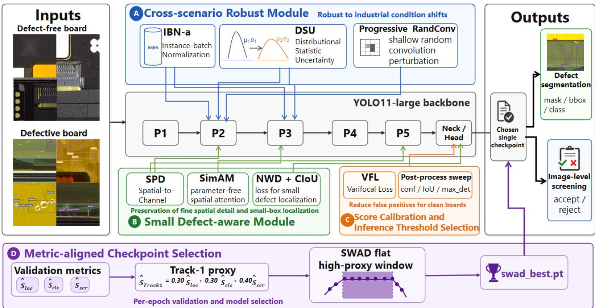
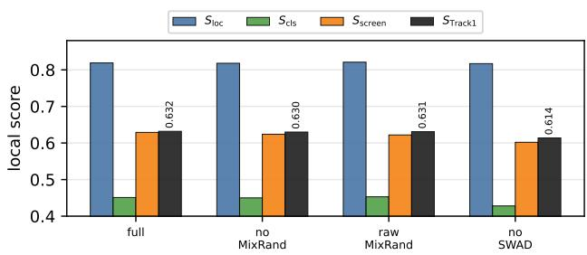
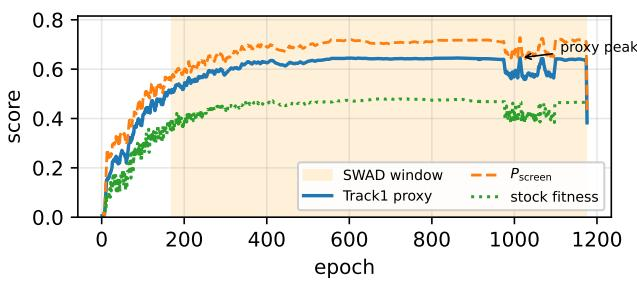
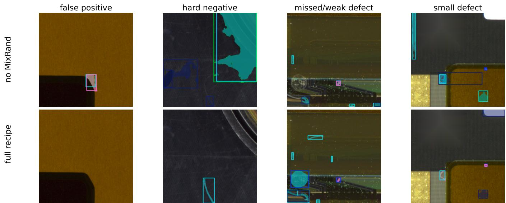

# Cross-Scenario Industrial Defect Detection via Domain-Robust Training and Metric-Aligned Selection

Dikai Li, Weijia Wang\*, and Yuan-Gen Wang\*

School of Artificial Intelligence, Guangzhou University, Guangzhou 510006, China dikaili@e.gzhu.edu.cn, wwj@gzhu.edu.cn, wangyg@gzhu.edu.cn

Abstract—Automated defect detection of industrial boards must remain highly reliable under cross-scenario variations in lighting, surface contaminants, and production line conditions. This makes cross-scenario defect detection a domain generalization problem, wherein models are required to detect, localize, and classify defects across unseen scenarios while minimizing false alarms on clean boards. For the IDA 2026 Track 1 challenge, we propose a cross-scenario defect detection method that includes four complementary modules: cross-scenario robust training, small-defect-aware learning, score calibration and inference threshold selection, and metric-aligned checkpoint selection. These four modules respectively introduce cross-scenario robust normalization and DSU-style statistic perturbation with progressive random convolution, NWD and parameter-free spatial attention, the VFL learning objective, and a custom SWAD variant driven by the Track 1-oriented proxy. Experimental results demonstrate that our model achieves a Track 1 score of 0.564 with a screening score of 0.696 on the test dataset on a single RTX 4090 GPU. The code is available at https://github.com/GZHU-DVL/Dikai.

Index Terms—industrial board, cross-scenario defect detection, domain generalization, screening reliability, metric-aligned checkpoint selection, YOLO

## I. INTRODUCTION

Automated visual inspection algorithms of printed-circuit board assemblies and related industrial board products must remain reliable under various conditions, such as lighting, surface contamination, and production line configurations. In such settings, training images are typically collected from limited source scenarios, whereas deployment may involve samples with unseen conditions. This makes industrial defect analysis (IDA) a domain-generalization problem, rather than a simple defect detection task within a single domain. A practical inspection system must not only locate defects accurately on defective boards, but also screen clean boards correctly to reduce false alarms. The IDA 2026 Track 1 benchmark [1] turns this requirement into a composite metric $S _ { \mathrm { T r a c k 1 } }$ that aggregates scores of localization $S _ { \mathrm { l o c } } .$ , classification $S _ { \mathrm { c l s } } .$ , and screening $S _ { \mathrm { s c r e e n } }$ (i.e., the ability to correctly accept clean images and reject defective ones). Among these, $S _ { \mathrm { s c r e e n } }$ has the largest weight and is the most sensitive metric to domain shift between the training data distribution and the test set.

A widespread workflow in such challenges is to train multiple model variants, select checkpoints according to the local validation metric, and submit the best-performing one. However, for cross-scenario industrial inspection, this procedure can be unreliable when the selection criterion is dominated by defect localization accuracy. During deployment, a checkpoint with strong defect detection performance may produce excessive false alarms on defect-free boards after the appearance distribution changes. Therefore, checkpoint selection and score calibration should be treated as critical components of crossscenario generalization, rather than as regular post-training choices.

Motivated by this observation, we design our framework with four components. First, the Cross-Scenario Robust Module improves domain robustness through IBN-a and MixRand. IBN-a splits shallow feature channels into instance-normalized and batch-normalized parts, while MixRand combines DSU and PRC to perturb feature statistics and local textures during training. Second, the Small-Defect-Aware Module preserves fine-grained spatial cues and strengthens localization signals for defects that occupy only a small image region. Third, the Score Calibration and Inference Threshold Selection calibrates confidence scores and selects deployment thresholds to reduce false alarms on clean boards. Finally, the Metric-Aligned Checkpoint Selection replaces localization-dominated checkpoint ranking with a Track-1-oriented proxy and SWADbased averaging, so that the selected checkpoint better matches the official screening-aware objective.

This paper formulates IDA Track 1 as a cross-scenario domain-generalization problem for industrial defect detection. The screening-focused evaluation highlights the limitations of standard mAP-driven selection, and motivates a framework that improves appearance robustness, enhances smalldefect detection, calibrates scores and inference thresholds, and aligns checkpoint selection with the objective metric. In summary, our contributions are summarized as follows:

• We identify cross-scenario industrial defect detection on IDA Track 1 as a deployment-oriented domaingeneralization problem, and show that mAP-driven checkpoint selection can be misaligned with crossscenario screening reliability.

• We present a practical single-model framework that combines appearance-robust training, small-defect preservation, screening-aware calibration, and metric-aligned checkpoint averaging for robust industrial-board inspection under domain shift.

  
Fig. 1. Overview of the proposed method for cross-scenario industrial defect detection.

• We provide targeted ablations showing that metricaligned SWAD selection is the clearest measured contributor under a unified local protocol, while composite feature perturbation mainly acts as a stability regularizer.

• With no ensemble, external data, pseudo-labels, or testtime augmentation, our best queried official challenge test feedback reaches $S _ { \mathrm { T r a c k 1 } } { = } 0 . 5 6 4$ with $S _ { \mathrm { s c r e e n } } { = } 0 . 6 9 6$ on a single RTX 4090 GPU.

## II. RELATED WORK

Industrial anomaly and defect benchmarks. Industrial inspection benchmarks have provided important testbeds for visual anomaly detection, defect localization, and defect detection. MVTec AD [2] introduced a widely used real-world benchmark for unsupervised anomaly detection across diverse object and texture categories, while VisA [3] further expanded industrial anomaly detection toward more complex visual categories and detection-oriented evaluation. Compared with these benchmarks, IDA 2026 Track 1 emphasizes cross-scenario industrial board inspection, where models are evaluated under unseen production conditions and image-level screening reliability is explicitly included in the final metric. This setting makes the task closer to deployment-oriented defect detection than to single-domain anomaly detection.

Domain generalization for cross-scenario detection. Domain generalization aims to improve model transfer to unseen domains without using target-domain training data [4]. For visual recognition and detection, a common strategy is to reduce the model’s dependence on domain-specific appearance statistics. MixStyle [5] mixed feature statistics across samples to regularize style-dependent representations, while DSU [6] modelled uncertainty in feature statistics to improve outof-distribution generalization. RandConv [7] perturbed local texture patterns through random convolutions, encouraging models to rely less on superficial texture cues. IBN [8] combined Instance Normalization and Batch Normalization to balance appearance invariance and discriminative feature learning. In addition to architectural and training-time regularization, SWAD [9] averaged weights within flat regions of the training trajectory and has been shown to improve domaingeneralized solutions. These studies motivate domain-robust training and checkpoint averaging for cross-scenario industrial inspection, where appearance statistics may change between training and the challenge test scenarios, whose labels are not publicly available.

Tiny defect detection, attention, and score calibration. Industrial defects often occupy only a small fraction of an image, making their localization sensitive to downsampling, feature aggregation, and sparse IoU gradients. NWD [10] modelled bounding boxes as Gaussian distributions and used a normalized Wasserstein distance, providing a smoother localization signal for tiny objects than IoU-only regression. SPD [11] preserved fine spatial details by rearranging local spatial neighborhoods into channel representations before projection, which is useful when small visual cues may be lost during strided downsampling. Attention mechanisms can further strengthen discriminative local responses when defect cues are subtle and visually close to background textures. SimAM [12] estimated neuron importance from activation statistics and generates parameter-free spatial attention, making it lightweight for insertion into detection backbones. Beyond localization and feature refinement, screening-oriented inspection also requires reliable confidence estimates. Varifocal Loss [13] improved classification-score calibration by emphasizing high-quality positive samples and reducing unreliable highconfidence predictions. These lines of work provide useful tools for cross-scenario industrial inspection, but the IDA Track 1 setting further requires aligning training, inference thresholds, and checkpoint selection with a screening-aware evaluation objective.

## III. PROPOSED METHOD

Fig. 1 shows an overview of our proposed method. We start from a YOLOv11-large segmentation backbone [14] (initialized from public pretrained weights) and introduce four complementary modules to improve cross-scenario defect detection robustness: 1) Cross-Scenario Robust Module aiming to improve appearance robustness against lighting, fixture, and surface-style shifts through persistent normalization and stochastic feature perturbation; 2) Small-Defect-Aware Module aiming to effectively recognize small defects that are easily lost during downsampling; 3) Score Calibration and Inference Threshold Selection aiming to improve confidence calibration and image-level screening reliability; and 4) Metric-Aligned Checkpoint Selection aiming to align checkpoint selection with the final deployment objective through the IDA Track 1- oriented proxy and SWAD-based averaging. As a result, these four modules cooperate with each other, improving both defect localization accuracy and robust inspection behavior under cross-scenario shift. Note that our detection and segmentation heads are consistent with YOLOv11. The stochastic perturbation behavior is active only during training. At inference, we use a single exported checkpoint and the same rectangularbox export path for all variants, with no ensemble or test-time augmentation according to the competition requirements.

## A. Cross-Scenario Robust Module

To obtain the generalization of defect detection on various domains, we construct a Cross-Scenario Robust Module, which includes our designed MixRand and the IBN-a [8] components. Our MixRand introduces a Progressively Random Convolution (PRC) strategy and DSU [6], aiming to capture the defect’s intrinsic structure. The IBN-a is applied with a ratio of 0.6 in the stem and stage 1 and remains active at both training and inference stages, providing a standing domaininvariance prior independent of the training schedule.

Specifically, our MixRand constructs a combo-strength attenuation rule to combine global DSU and local PRC. DSU perturbs per-channel feature statistics by sampling new mean and variance from a learned uncertainty distribution and renormalizing the activations (2 backbone stages, $p \ = \ 0 . 2 0 ,$ $\alpha = 0 . 2 0 )$ . PRC convolves the input (or a shallow feature map) with a random depthwise kernel of size {3, 5} at probability and strength that increase linearly with the training schedule $( p _ { \mathrm { s t a r t } } \mathrm { = } 0 . 1 2 , ~ p _ { \mathrm { e n d } } \mathrm { = } 0 . 3 0 , ~ \sigma _ { \mathrm { s t a r t } } \mathrm { = } 0 , ~ \sigma _ { \mathrm { e n d } } \mathrm { = } 0 . 1 0$ , with tail decay during the final close\_mosaic window). Our combo-strength attenuation strategy introduce an automatic attenuation rule to reduce the DSU and PRC’s strengths $( \mathrm { D S U } ~ p , \alpha \colon 0 . 3 0 \to 0 . 2 0 ; \mathrm { P R C } ~ p \colon 0 . 2 0 \to 0 . 1 2 ; \ p _ { \mathrm { e n d } } \colon 0 . 4 5 \to 0 . 3 0 ;$ $\sigma _ { \mathrm { e n d } } \colon 0 . 1 5 {  } 0 . 1 0 )$ , enabling the DSU and PRC strengths to stay within a stable regularization range. We evaluate this design in Sec. IV-D.

## B. Small-Defect-Aware Module

Industrial board defects often occupy only a very small fraction of an image. Existing detection heads tend to lose them because of downsampling and IoU gradients that are sparse at small scale. Our designed Small-Defect-Aware Module can preserve them effectively without modifying the detection head.

Specifically, our module employs SPD adapters [11] (3 stride stages, scale = 2, learnable $\alpha _ { \mathrm { i n i t } } { = } 0 . 1 0$ ranged at [0, 0.5]) to reshape spatial neighborhoods into channel depth and project them back into the embedding domain via a 1×1 convolution and the strided layers, preserving fine-grained spatial detail. To capture the salient difference between small defects and their background, we exploit SimAM [12] in the two deep stages with $\lambda { = } 1 0 ^ { - 4 }$ to implement parameterfree spatial attention. Besides, we further combine NWD [10] with CIoU [15] to provide a dense, Gaussian-Wasserstein localization signal when IoU saturates for small boxes. We set the NWD’s weight and normalization parameter to $w { = } 0 . 3 5$ and $C { = } 1 2 . 8 .$ , respectively.

## C. Score Calibration and Inference Threshold Selection

We observe that the BCE loss produces a confidence distribution that is well-calibrated for mAP50-95 but spills probability mass onto benign textures, which directly penalizes the screening metric $S _ { \mathrm { s c r e e n } }$ . Therefore, we employ VFL [13] (with $\alpha { = } 0 . 7 5$ and $\gamma { = } 2 . 0$ in our experiments) to replace the BCE loss for score calibration and defect classification, reducing the weights of easy negatives and suppressing highconfidence false alarms on clean boards.

Building upon the above-calibrated classifier, we perform an efficient inference threshold screening postprocess at the deployment stage, aiming to achieve an optimal threshold combination. To be specific, for each candidate checkpoint we first scan the grid of the inference-time settings (confidence threshold $c o n f$ , IoU iou, and maximum detection boxes max det) with the official Track 1 evaluator. Then, we select the setting that maximizes the composite $S _ { \mathrm { T r a c k 1 } }$ on the local split, and use it for challenge test queries. This setting used by the queried long-schedule checkpoint is that $c o n f = 0 . 0 8 .$ $i o u = 0 . 3 0$ , and max $\mathit { d e t } = 5 0$

## D. Metric-Aligned Checkpoint Selection

Ultralytics fitness [14] used to drive checkpoint selection is dominated by mAP50-95 and correlates more strongly with defect localization than with screening efficiency $S _ { S c r e e n } .$ To efficiently select the model with good generalizability, we define an approximate detection score $\hat { S } _ { \mathrm { { T r a c k 1 } } }$ as an alternative of the official detection score:

$$
\hat { S } _ { \mathrm { T r a c k 1 } } = 0 . 3 0 \hat { S } _ { \mathrm { l o c } } + 0 . 3 0 \hat { S } _ { \mathrm { c l s } } + 0 . 4 0 \hat { S } _ { \mathrm { s c r e e n } } ,\tag{1}
$$

where $\hat { S } _ { \mathrm { l o c } } , ~ \hat { S } _ { \mathrm { c l s } } ,$ and $\hat { S } _ { \mathrm { s c r e e n } }$ are the approximation of the official $S _ { \mathrm { l o c } } , S _ { \mathrm { c l s } }$ , and $S _ { \mathrm { s c r e e n } } ,$ respectively. Let pB, rB, m $\mathrm { A P } _ { 5 0 } ^ { B }$ and $\mathrm { m A P } _ { 5 0 : 9 5 } ^ { B }$ denote the box precision, recall, mAP50, and mAP50-95, and let $p _ { M } , r _ { M } .$ , m $\mathrm { A P } _ { 5 0 } ^ { M }$ , and $\mathrm { m A P } _ { 5 0 : 9 5 } ^ { M }$ denote the corresponding mask metrics. We first compute the average precision and recall across the box and mask branches as follows.

$$
\begin{array} { r } { \bar { p } = \frac 1 2 ( p _ { B } + p _ { M } ) , \qquad \bar { r } = \frac 1 2 ( r _ { B } + r _ { M } ) , } \end{array}\tag{2}
$$

where $\bar { p }$ and r¯ denote the branch-averaged precision and recall, respectively. This averaging is a metric-level heuristic method to balance the two prediction branches, which is distinguished from existing instance-level logical OR fusion between box and mask outputs. We then define

$$
\hat { S } _ { \mathrm { l o c } } = 0 . 6 5 \mathrm { m A P } _ { 5 0 : 9 5 } ^ { M } + 0 . 3 5 \mathrm { m A P } _ { 5 0 : 9 5 } ^ { B } ,\tag{3}
$$

$$
\hat { S } _ { \mathrm { c l s } } = 0 . 5 0 \mathrm { m A P } _ { 5 0 } ^ { M } + 0 . 5 0 \mathrm { m A P } _ { 5 0 } ^ { B } ,\tag{4}
$$

$$
\hat { S } _ { \mathrm { s c r e e n } } = 0 . 5 5 \bar { r } + 0 . 4 5 \bar { p } .\tag{5}
$$

From Eqs. (3)-(5), we can observe that $\hat { S } _ { \mathrm { l o c } }$ emphasizes strict localization quality through mask-dominant mAP50- 95, while $\hat { S } _ { \mathrm { c l s } }$ uses the looser mAP50 criterion to capture coarse category-correct detection without over-penalizing small boundary misalignment. From Eq. (5), the slightly larger weight on recall reflects the higher practical cost of false negatives than false alarms in industrial defect detection.

In the implementation, this approximation replaces the default trainer fitness for epoch ranking and best-checkpoint selection, and is further used to locate a stable SWAD [9] window during training. A custom SWAD driver then identifies a flat region around the smoothed peak of $\hat { S } _ { \mathrm { T r a c k 1 } }$ (window $w { = } 5$ tolerance ratio 0.20, ≥ 2 converged epochs) and averages the checkpoints inside this flat region into swad\_best.pt. The weight of 0.40 on $\hat { S } _ { \mathrm { s c r e e n } }$ reflects the screening-heavy structure of the Track 1 objective. The targeted ablation in Sec. IV-C shows that removing SWAD checkpoint averaging gives the largest measured drop in our current local protocol.

## IV. EXPERIMENTS

## A. Settings

We train only on the officially released IDA Track 1 data, without external data samples, pseudo-labels, model ensembles, or test-time augmentation. All images are processed at their native resolution of 512×512 pixels, consistent with the released dataset format. We optimize the model using AdamW with an initial learning rate of $3 \times 1 0 ^ { - 4 }$ , and the classification loss gain is set to 2.6. We adopt conservative industrialinspection augmentation strategies, including HSV color jitter (where hsv\_h=0.01, hsv\_s=0.18, hsv\_v=0.12), horizontal flipping (where translate=0.03, scale=0.10), and copy-paste with probability $\scriptstyle { p = 0 . 1 0 }$

The queried long-schedule checkpoint is trained for 2000 epochs with an early-stopping patience of 300 and close\_mosaic=120. All targeted ablation runs use a unified 600-epoch training budget, with an early-stopping patience of 120 and close\_mosaic=30. All local results are computed under the same official-style export and scoring pipeline to ensure reproducibility. Specifically, instance predictions are exported as axis-aligned rectangular bounding boxes and scored using the official Track 1 evaluation script. Unless otherwise stated, all inference is performed using swad\_best.pt with conf=0.08, IoU=0.30, and max\_det=50 across all experiments.

TABLE I  
LOCAL RE-EVALUATION AND OFFICIAL CHALLENGE TEST FEEDBACK FOR THE QUERIED LONG-SCHEDULE CHECKPOINT.
<table><tr><td>Evaluation</td><td> $S _ { \mathrm { l o c } }$ </td><td> $S _ { \mathrm { c l s } }$ </td><td> $S _ { \mathrm { s c r e e n } }$ </td><td> $S _ { \mathrm { T r a c k 1 } }$ </td></tr><tr><td>Local official</td><td>0.826</td><td>0.436</td><td>0.543</td><td>0.596</td></tr><tr><td>Challenge test feedback</td><td>0.489</td><td>0.465</td><td>0.696</td><td>0.564</td></tr><tr><td>∆ (local→official test)</td><td>-0.337</td><td>+0.029</td><td>+0.153</td><td>-0.032</td></tr></table>

Following the official protocol, we report $S _ { \mathrm { l o c } }$ (localization), $S _ { \mathrm { c l s } }$ (classification), $S _ { \mathrm { s c r e e n } }$ (screening), and the composite score $S _ { \mathrm { T r a c k 1 } }$ . Local scores are computed on a held-out validation split of the released training data using the official evaluator, whereas official challenge test scores represent feedback received exclusively for submitted checkpoints.

## B. Main Result and Local-Hidden Score Analysis

Table I summarizes the four Track 1 metric components of the queried long-schedule checkpoint, including the challenge test feedback and the local re-evaluation results. While the two composite scores are close (0.596 v.s. 0.564), the componentlevel balance shifts substantially: the local re-evaluation is dominated by localization performance, whereas the official test feedback reveals a stronger image-level screening signal.

This local-to-official-test discrepancy motivates the adoption of a conservative experimental protocol. The official test feedback is treated solely as test-time evidence for the submitted checkpoint and is not used to draw componentlevel conclusions. Instead, the component-level conclusions are derived from independently trained short-schedule variants and are evaluated under a unified local protocol.

## C. Ablation Study

Table II presents the targeted local ablation results. While the queried 2000-epoch checkpoint is also included as a local re-evaluation reference, it does not constitute a valid singlemodule comparison as it employs a different training budget. Note that its lower local composite score (0.596 vs. 0.632 for the 600-epoch full recipe) reflects a different screeninglocalization balance on the held-out split and should not be interpreted as inferior performance.

Within the comparable 600-epoch ablation set, disabling MixRand only yields a marginal change in the composite score (0.632 v.s. 0.630), and the unattenuated MixRand variant achieves a similar result (0.631). These results suggest that attenuation does not degrade performance relative to the raw variant, but they do not demonstrate a large independent performance gain on the current local split. In contrast, removing SWAD checkpoint averaging produces the most pronounced performance drop from 0.632 to 0.614, driven primarily by degradation in $S _ { \mathrm { s c r e e n } }$ and $S _ { \mathrm { c l s } }$ . We therefore identify metricaligned SWAD selection as the strongest measured contributor to overall performance under the current ablation protocol.

TABLE II  
TARGETED LOCAL ABLATION UNDER A UNIFIED 600-EPOCH PROTOCOL. THE QUERIED 2000-EPOCH CHECKPOINT IS INCLUDED AS A LOCAL RE-EVALUATION REFERENCE ONLY.
<table><tr><td>Variant</td><td> $S _ { \mathrm { l o c } }$ </td><td> $S _ { \mathrm { c l s } }$ </td><td> $S _ { \mathrm { s c r e e n } }$ </td><td> $S _ { \mathrm { T r a c k 1 } }$ </td></tr><tr><td>Short schedule (600 ep.)</td><td></td><td></td><td></td><td></td></tr><tr><td>Full recipe</td><td>0.819 0.451</td><td></td><td>0.629</td><td>0.632</td></tr><tr><td>no MixRand</td><td></td><td>0.8180.450</td><td>0.624</td><td>0.630</td></tr><tr><td>MixRand, no attenuation 0.821 0.453</td><td></td><td></td><td>0.622</td><td>0.631</td></tr><tr><td>no SWAD avg.</td><td>0.817 0.428</td><td></td><td>0.602</td><td>0.614</td></tr><tr><td colspan="5">2000-ep queried reference (local re-eval.) Full recipe 0.8260.4360.543 0.596</td></tr></table>

  
Fig. 2. Local Track 1 component scores for the comparable 600-epoch ablations. The no-SWAD variant shows the largest drop on $S _ { \mathrm { s c r e e n } }$ and ${ \bar { S } } _ { \mathrm { c l s } } ,$ whereas the MixRand variants remain close to the full recipe.

Fig. 2 illustrates these results by decomposing the composite score into the four official metric components. The no-SWAD variant exhibits the most severe component-level degradation, further corroborating the importance of selecting and averaging checkpoints using the Track 1-oriented proxy rather than relying solely on detector-oriented fitness.

Although the ablation framework supports additional singlevariable variants (e.g., no-IBN, no-SPD, no-SimAM, no-NWD, and no-VFL), the training budget allocated for this paper does not permit including all of them in the main table. We therefore treat IBN-a, SPD, SimAM, NWD, and VFL as fixed recipe components motivated by prior work and by the small-defect detection and screening-oriented nature of the task, rather than as independently validated sources of performance gain.

## D. MixRand Decomposition

The $^ { * } n o$ MixRand” and “MixRand, no attenuation” rows in Table II further examine whether composite feature perturbation and unattenuated perturbation strength affect the final performance. Since the observed differences are small on the current local split, we interpret MixRand primarily as a stability-oriented regularizer in this setting, consistent with its role of reducing sensitivity to source-domain appearance statistics rather than producing a large independent score gain.

  
Fig. 3. Training dynamics of the full recipe. Solid: smoothed Track 1 proxy $F _ { \mathrm { T 1 } }$ (Eq. 1). Dashed: $P _ { \mathrm { s c r e e n } }$ component alone. Dotted: default mAP-based detector fitness (0.1·mAP50 +0.9·mAP50-95). The shaded interval is the SWAD averaging window selected from the screening-weighted proxy rather than from the default detector fitness.

The DSU-only and RandConv-only variants are implemented within the ablation framework but are excluded from the main ablation table due to training budget constraints. We accordingly rely on prior MixStyle, DSU, and RandConv studies as motivation for the composite design, rather than claiming separately verified subcomponent gains on this split.

## E. Training-Schedule Effect

Fig. 3 compares the evolution of the Track 1 proxy $\hat { S } _ { \mathrm { { T r a c k 1 } } }$ its screening-related component $P _ { \mathrm { s c r e e n } }$ , and the default mAPbased detector fitness along the training trajectory. Their peaks occur at different epochs, showing that the mAP-oriented fitness is not consistently aligned with the screening-aware Track 1 objective. Following the flat-minima intuition of SWAD [9], our custom driver identifies a flat, high-proxy plateau using the Track 1-oriented score and averages the checkpoints within it, rather than anchoring selection to the raw detector-fitness peak. This divergence motivates the Track 1 proxy as a more suitable stopping and averaging criterion for this screening-oriented setting than the default detector fitness.

The no-SWAD control in Table II provides the corresponding quantitative evidence: removing SWAD checkpoint averaging reduces $S _ { \mathrm { T r a c k 1 } }$ from 0.632 to 0.614 and $S _ { \mathrm { s c r e e n } }$ from 0.629 to 0.602 under the same 600-epoch local protocol.

## F. Qualitative Comparison

Fig. 4 provides a qualitative illustration of the MixRand ablation by comparing the full recipe with the no-MixRand variant on selected local-validation images. Cases are chosen to highlight salient differences, including false positives on clean boards and missed or weakly detected small defects; they are not random samples. The figure suggests that the full recipe tends to suppress spurious detections on defectfree regions while maintaining responses on small defect instances. Because qualitative examples are inherently selective, all quantitative performance claims are grounded in the official component scores reported in Table II.

  
Fig. 4. Qualitative predictions on the local validation split. Top row: full recipe with MixRand disabled (the “no mixrand” ablation). Bottom row: full recipe. Columns show selected clean and defect-present cases from the local validation split. The figure is illustrative; quantitative claims are reported in Table II.

## V. CONCLUSION

We studied cross-scenario industrial defect detection under domain shift on the IDA 2026 Track 1 benchmark. Our analysis shows that conventional mAP-driven checkpoint selection can disagree with the deployment objective, especially when robust image-level screening matters as much as defect localization. To address this issue, we presented a domainrobust framework that includes appearance-robust training, small-defect preservation, screening-aware calibration, and metric-aligned checkpoint averaging. Under a single-model setting with no external data, ensemble, or test-time augmentation, our best queried official challenge test feedback reaches $S _ { \mathrm { T r a c k 1 } } { = } 0 . 5 6 4$ with $S _ { \mathrm { s c r e e n } } { = } 0 . 6 9 6$ on one RTX 4090 GPU. Our results demonstrate that screening is important for this benchmark and the cross-scenario industrial inspection can benefit from aligning model selection with deploymentoriented objectives rather than localization alone. We hope this perspective is useful for future industrial inspection benchmarks where local validation is an imperfect proxy for official challenge test performance.

It is worth noting that the targeted local ablation supports the strongest claim for metric-aligned checkpoint selection. The gains from feature perturbation are modest on the current split, and the fixed minor components are motivated by prior work rather than independently ablated here. Broader official challenge test feedback would be needed to fully separate their effects.

## REFERENCES

[1] IDA 2026 Grand Challenge Organizers, “IDA 2026 Grand Challenge: Cross-scenario defect detection and fine-grained severity grading for high-precision manufacturing,” https://idagrandchallenge.github.io/ idachallenge.github.io/, 2026, accessed: 2026-04-24.

[2] P. Bergmann, M. Fauser, D. Sattlegger, and C. Steger, “MVTec AD – a comprehensive real-world dataset for unsupervised anomaly detection,” in IEEE/CVF Conference on Computer Vision and Pattern Recognition, 2019, pp. 9592–9600.

[3] Y. Zou, J. Jeong, L. Pemula, D. Zhang, and O. Dabeer, “SPot-the-Difference self-supervised pre-training for anomaly detection and segmentation,” in European Conference on Computer Vision, 2022, pp. 392– 408.

[4] K. Zhou, Z. Liu, Y. Qiao, T. Xiang, and C. C. Loy, “Domain generalization: A survey,” IEEE Transactions on Pattern Analysis and Machine Intelligence, vol. 45, no. 4, pp. 4396–4415, 2023.

[5] K. Zhou, Y. Yang, Y. Qiao, and T. Xiang, “Domain generalization with MixStyle,” in International Conference on Learning Representations, 2021.

[6] X. Li, Y. Dai, Y. Ge, J. Liu, Y. Shan, and L.-Y. Duan, “Uncertainty modeling for out-of-distribution generalization,” in International Conference on Learning Representations, 2022.

[7] Z. Xu, D. Liu, J. Yang, C. Raffel, and M. Niethammer, “Robust and generalizable visual representation learning via random convolutions,” in International Conference on Learning Representations, 2021.

[8] X. Pan, P. Luo, J. Shi, and X. Tang, “Two at once: Enhancing learning and generalization capacities via IBN-Net,” in European Conference on Computer Vision, 2018, pp. 464–479.

[9] J. Cha, S. Chun, K. Lee, H.-C. Cho, S. Park, Y. Lee, and T. Park, “SWAD: Domain generalization by seeking flat minima,” in Advances in Neural Information Processing Systems, 2021.

[10] J. Wang, C. Xu, W. Yang, and L. Yu, “A normalized Gaussian Wasserstein distance for tiny object detection,” arXiv preprint arXiv:2110.13389, 2021.

[11] R. Sunkara and T. Luo, “No more strided convolutions or pooling: A new CNN building block for low-resolution images and small objects,” in Machine Learning and Knowledge Discovery in Databases, 2023, pp. 443–459.

[12] L. Yang, R.-Y. Zhang, L. Li, and X. Xie, “SimAM: A simple, parameterfree attention module for convolutional neural networks,” in International Conference on Machine Learning, 2021, pp. 11 863–11 874.

[13] H. Zhang, Y. Wang, F. Dayoub, and N. Sunderhauf, “VarifocalNet: An IoU-aware dense object detector,” in IEEE/CVF Conference on Computer Vision and Pattern Recognition, 2021, pp. 8514–8523.

[14] G. Jocher and J. Qiu, “Ultralytics YOLO11,” https://docs.ultralytics.com/ models/yolo11/, 2024, accessed: 2026-04-24.

[15] Z. Zheng, P. Wang, W. Liu, J. Li, R. Ye, and D. Ren, “Distance-IoU loss: Faster and better learning for bounding box regression,” in AAAI Conference on Artificial Intelligence, vol. 34, no. 7, 2020, pp. 12 993– 13 000.