# Dataset-Level Regularization for Joint-Embedding Self-Supervised Learning

Konstantinos Almpanakis\* Anna Kreshuk

European Molecular Biology Laboratory (EMBL) Heidelberg, Germany

konstantinos.almpanakis@embl.deanna.kreshuk@embl.de

## Abstract

Self-supervised joint embedding learning aligns representations of augmented views while regularizing their distribution to prevent collapse. Regularization aims to shape the overall representation distribution, but most joint embedding methods restrict its computation to the active minibatch. We propose out-of-batch regularization, which maintains a datasetlevel state in CPU memory and uses globally constructed per-instance targets during minibatch training. Evaluated on natural images and biomedical datasets, these anchors approximate the full-dataset regularization gradient more faithfully than conventional minibatch estimation at small batch sizes. Applications to contrastive (SimCLR) and non-contrastive (SIGReg) approaches show consistent improvement over the corresponding in-batch objectives for image classification, minority-class performance under controlled imbalance, instance retrieval, and continued self-supervised pretraining, with the largest gains at small batch sizes. These results suggest that dataset-level regularization can be decoupled from minibatch optimization, making batch size an optimization choice that does not affect the geometry of the regularizer.

## 1 Introduction

Joint-embedding architectures (JEAs) (Chen et al., 2020a; Grill et al., 2020; Caron et al., 2021; Bardes et al., 2021) have been the dominant paradigm for visual self-supervised representation learning. Applications range from 3D medical image analysis (Tang et al., 2022) to 3D scene reconstruction (Wang et al., 2025) and vision-language alignment (Radford et al., 2021). They use augmentations to create a pretraining objective based on view invariance. Anti-collapse regularization complements this objective to prevent trivial solutions (Chen & He, 2021). While different regularization mechanisms have been proposed over the years, most of them act on the embeddings of the current minibatch (or a few recent batches with EMA) that might be too small to represent the dataset under memory or optimization constraints.

The bottleneck is particularly relevant for high-dimensional inputs, including high-resolution images and 3D volumes, where each sample requires more activation memory. Such applications are thus often limited to small-batch training. The problem worsens for imbalanced data, where rare classes may contribute only a few examples to each batch (Jing et al., 2021). The simple solution of using a larger batch is constrained by hardware (Gao et al., 2021), and even when a large batch is possible, it may not be ideal for optimization. On small datasets, using a large fraction of the training samples per batch leaves few parameter updates per epoch. Masters & Luschi (2018) also report that larger batches can require more careful choice of the learning rate and training duration. The batch size needed to estimate a population regularizer can therefore differ from the best batch size for optimization.

We propose a framework that moves the statistical context of SSL regularizers from the active batch to the dataset-level state. We maintain a detached, dataset-indexed state in CPU memory. A periodic refresh encodes the training set and constructs globally optimized targets, while online steps retrieve only the current samples' targets (Fig. 1). Thus, the support of the anti-collapse component is no longer limited by the batch size or GPU capacity.

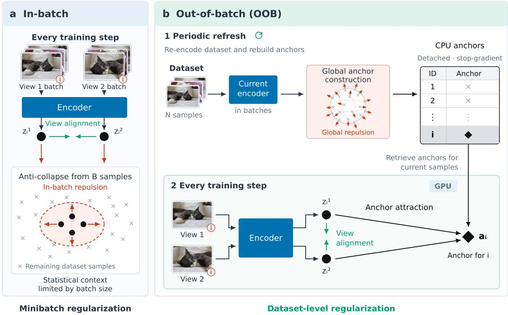  
Figure 1: Minibatch and OOB regularization. (a) In-batch methods estimate the anti-collapse term from active samples at each step. (b) OOB regularization periodically encodes the dataset, constructs detached per-instance anchors, and retrieves the anchors indexed by the online minibatch.

Our main contributions are:

• We introduce OOB regularization, where offline, dataset-level targets act as per-instance anchors during online training, and derive contrastive (CONTRASTIVE-OOB) and non-contrastive (SIGREG-OOB) instances of this construction.

• We formulate anti-collapse as estimation of a finite population gradient and measure minibatch error and cache staleness on 19 real datasets. The analysis also separates gradient-estimation error from population reweighting under class imbalance.

• Across natural images and 2D/3D biomedical data, the OOB variants yield positive mean gains over their matched in-batch objectives in image classification evaluated by kNN and linear probes. The gains are largest at small batch sizes and extend to minority-class recall, instance retrieval, and continued pretraining.

## 2 Related Work

Collapse prevention in joint embedding training. Joint-embedding methods must preserve informative variation while aligning views. Contrastive objectives achieve this through negative-sample repulsion (Oord et al., 2018; Chen et al., 2020a), linking alignment to hyperspherical uniformity for normalized representations (Wang & Isola, 2020). To avoid explicit negatives, Barlow Twins and VICReg constrain correlations and moments (Zbontar et al., 2021; Bardes et al., 2021), while SIGReg matches projected distributions to a Gaussian (Balestriero & LeCun, 2025). Other approaches prevent collapse through balanced assignments in SwAV (Caron et al., 2020) or asymmetry, teachers, and stop-gradient in BYOL, DINO, and SimSiam (Grill et al., 2020; Caron et al., 2021; Chen & He, 2021). These approaches establish how to prevent collapse, but they have to assume that the active batch is representative of the dataset.

Cross-batch state and global objectives. Reusing representations across updates expands batch context. MoCo's momentum-encoder queue (He et al., 2020; Chen et al., 2020b), instance discrimination's memory bank (Wu et al., 2018), and cross-batch memory (Wang et al., 2020) expand the pool of negative samples. NNCLR uses stored embeddings to find positive neighbors (Dwibedi et al., 2021). Chen et al. (2022) argues that minibatch contrastive gradients can be biased, motivating global-objective optimization through perimage moving averages in SogCLR (Yuan et al., 2022) and MCMC negative sampling in $\mathrm { E M C ^ { 2 } }$ (Yau et al., 2024). Decoupled Contrastive Learning reduces batch sensitivity by removing positives from the denominator (Yeh et al., 2022). OOB instead performs population regularization periodically and retrieves per-instance targets for online attraction, avoiding cross-instance comparisons in the online regularizer.

Assigned targets and dataset-indexed representations. Constructing targets separately from encoder updates also provides broader context. Noise-vector assignment (Bojanowski & Joulin, 2017), dataset-feature clustering (Caron et al., 2018), and balanced self-labeling through optimal transport (Asano et al., 2019) organize representation learning around assigned targets. Our anchors instead retain per-instance correspondence and are reconstructed from current representations under a specified continuous geometry. DIET also uses sample identity, predicting datum indices as classes (Balestriero, 2023). IConE, the conceptually closest recent approach (Almpanakis & Kreshuk, 2026), separates collapse prevention from encoder alignment through a jointly optimized $N \times d$ table of auxiliary instance embeddings. Its regularization maintains a persistent global parameter space during training and evaluates an $N \times { \bar { N } }$ similarity matrix each step. OOB instead periodically constructs detached per-instance targets from a chosen population-level regularizer, stores these targets in CPU memory, and retrieves only those required by the active minibatch. This decouples online training from the global computation while supporting different regularizers.

## 3 Method

To give small-batch training access to dataset-wide regularization, we construct anti-collapse anchors from the full dataset and use them to update the encoder. We first formulate this separation, instantiate it with spherical (contrastive) and Gaussian (non-contrastive) anchors, and then define a full-dataset gradient reference for comparing minibatch estimation with cached regularization.

## 3.1 Alignment and population regularization

We use mutual information as an organizing view of alignment and anti-collapse, without assuming that joint-embedding methods directly optimize it. For representations $Z _ { 1 }$ and $Z _ { 2 }$ of related views, the mutual information (MI) identity (Shannon, 1948) gives

$$
I ( Z _ { 1 } ; Z _ { 2 } ) = H ( Z _ { 1 } ) - H ( Z _ { 1 } \mid Z _ { 2 } ) .\tag{1}
$$

This identity motivates two complementary roles in JEA losses: alignment reduces uncertainty between views, while anti-collapse keeps the marginal representation informative. Representation quality nevertheless depends on more than MI (Tschannen et al., 2019).

Let $\mathcal { D } = \{ x _ { i } \} _ { i = { . } } ^ { N }$ be a dataset of unlabeled inputs, and let $f _ { \theta }$ map an input to its representation. For a sample x drawn uniformly from D, let $t _ { 1 } , t _ { 2 }$ be independently sampled transformations from an augmentation family $\tau$ , producing views $t _ { 1 } ( x )$ and $t _ { 2 } ( x )$ . A broad JE-SSL objective is

$$
\begin{array} { r } { \mathcal { L } _ { \mathrm { S S L . } \mathrm { J E } } ( \theta ) = \underbrace { \mathbb { E } _ { x , t _ { 1 } , t _ { 2 } } [ \mathcal { L } _ { \mathrm { a l i g n } } ( f _ { \theta } ( t _ { 1 } ( x ) ) , f _ { \theta } ( t _ { 2 } ( x ) ) ) ] } _ { \mathrm { A l i g n m e n t } } + \underbrace { \lambda \mathcal { R } ( P _ { \theta } ) } _ { \mathrm { A n t i - c o l l a p s e } } , } \end{array}\tag{2}
$$

where $P _ { \theta }$ is the distribution of $f _ { \boldsymbol { \theta } } ( t ( \boldsymbol { x } ) )$ induced by sampling inputs and augmentations.

In practice, a regularizer sees a finite set of representations. Writing $z _ { i } = f _ { \theta } ( t ( x _ { i } ) ) ,$ , the empirical distributions of an active minibatch B of size B and the full training set are

$$
\widehat { P } _ { B } = \frac { 1 } { B } \sum _ { i \in B } \delta _ { z { i } } , \qquad \widehat { P } _ { N } = \frac { 1 } { N } \sum _ { i = 1 } ^ { N } \delta _ { z { i } } .\tag{3}
$$

Here $\delta _ { z _ { i } }$ is a unit point mass at zi, giving each included representation equal probability. Standard in-batch training evaluates $\mathcal { R } ( \widehat { P } _ { B } )$ in place of the population term in eq. (2). Our aim is to supply online updates with the broader context of $\mathcal { R } ( \widehat { P } _ { N } )$ without recomputing it through the encoder at every step. We therefore construct dataset-level anchors periodically and use a separable sample-to-anchor loss between refreshes.

## 3.2 A refresh-and-train interface

Let $z _ { i } ^ { ( v ) }$ denote the representation of augmented view v of sample i. Our OOB methods optimize

$$
\mathcal { L } _ { \mathrm { O O B } } = \lambda _ { \mathrm { a l i g n } } \mathcal { L } _ { \mathrm { a l i g n } } + \lambda _ { \mathrm { a c } } \mathcal { L } _ { \mathrm { a c } } ^ { \mathrm { O O B } } ,\tag{4}
$$

where $\mathcal { L } _ { \mathrm { a l i g n } }$ maximizes view invariance and $\mathcal { L } _ { \mathrm { a c } } ^ { \mathrm { O O B } }$ attracts each representation to its dataset-indexed anchor. To implement $\mathcal { L } _ { \mathrm { a l i g n } }$ , we maximize cosine similarity between embeddings produced by different views of the same instance. To compute $\mathcal { L } _ { \mathrm { a c } } ^ { \mathrm { O O B } }$ , at refresh r, the current encoder processes one view of every training sample. A population operation (sections 3.3 and 3.4) converts outputs into detached anchors $A ^ { ( r ) } = \{ a _ { i } ^ { ( r ) } \} _ { i = 1 } ^ { N }$ which are stored in CPU memory. For an online minibatch B, only its indexed rows are moved to the GPU (Table 1):

$$
\mathcal { L } _ { \mathrm { a c } } ^ { \mathrm { O O B } } = \frac { 1 } { B V } \sum _ { i \in \mathcal { B } } \sum _ { v = 1 } ^ { V } d _ { \mathcal { G } } \Big ( h _ { r } \big ( z _ { i } ^ { ( v ) } \big ) , a _ { i } ^ { ( r ) } \Big ) .\tag{5}
$$

Here $d _ { \mathcal { G } }$ measures discrepancy from the anchor using MSE across projections for Gaussian anchors, or cosine distance for $L _ { 2 }$ -normalized spherical anchors; $h _ { r }$ applies refresh-fixed projections (Gaussian anchors) or $L _ { 2 }$ normalization (spherical anchors). Gradients pass through $z _ { i } ,$ but not through the anchors, and the online anti-collapse term requires no relationship among samples in $B .$

## Table 1: OOB training separates global target construction from online parameter updates.

Refresh phase   
1 Run inference in minibatches over the entire dataset, collecting one view representation per sample.   
2 After the full inference pass, construct $a _ { i } ^ { ( r ) }$ jointly from all N representations.   
3 Detach $A ^ { ( r ) }$ and store it by sample index in CPU memory.   
Online phase, repeated until the next refresh   
4 Sample B and generate V augmented views per sample.   
5 Retrieve $\{ a _ { i } ^ { ( r ) } : i \in B \}$ and evaluate eq. (4).   
6 Update encoder and projector parameters; keep anchors fixed.

## 3.3 SIGREG-OOB: projected Gaussian anchors

SIGREG-OOB constructs a Gaussian target through one-dimensional rank transport assignment to a fixed Gaussian quantile grid (Gabriel & Marco, 2019). At refresh, choose unit directions $v _ { 1 } , \ldots , v _ { M }$ . For $s _ { i m } =$ $v _ { m } ^ { \top } z _ { i } .$ , sort all N samples and assign the rank-k sample to

$$
\gamma _ { k } = \Phi ^ { - 1 } \left( \frac { k + 1 / 2 } { N } \right) , \qquad k = 0 , \dots , N - 1 .\tag{6}
$$

$\operatorname { I f } r _ { i m }$ is the rank of sample i along $m ,$ its cached coordinate is $q _ { i m } = \gamma _ { r _ { i m } }$ . The online term is

$$
\mathcal { L } _ { \mathrm { a c } } ^ { \mathrm { S I G R e g - O O B } } = \frac { 1 } { B V M } \sum _ { i \in \mathcal { B } } \sum _ { v = 1 } ^ { V } \sum _ { m = 1 } ^ { M } \left( v _ { m } ^ { \top } z _ { i } ^ { ( v ) } - q _ { i m } \right) ^ { 2 } .\tag{7}
$$

Refresh inference uses GPU, while the M sorts and the $N \times M$ target table are computed on CPU. We resample the projection directions at each refresh. Our SIGREG baseline uses the same sorted-quantile targets computed in the batch, rather than the Epps-Pulley statistic (Balestriero & LeCun, 2025), so we keep the same regularizer. We ablate SIGREG-OOB hyperparameters in section A.4.

## 3.4 CONTRASTIVE-OOB: spherical anchors

For contrastive learning, anchors lie on the unit sphere. Starting from the normalized refresh representations $\bar { z } _ { i } ^ { ( r ) }$ , we define the population target by

$$
\mathcal { U } ( A ) = \log \left[ \frac { 1 } { N ( N - 1 ) } \sum _ { i \neq j } e ^ { - \tau _ { u } \| a _ { i } - a _ { j } \| _ { 2 } ^ { 2 } } \right] ,\tag{8}
$$

$$
A ^ { ( r ) } \approx \arg \operatorname* { m i n } _ { A \in ( \mathbb { S } ^ { d - 1 } ) ^ { N } } \mathcal { U } ( A ) + \frac { \lambda _ { f } } { N } \sum _ { i } \left( 1 - a _ { i } ^ { \top } \bar { z } _ { i } ^ { ( r ) } \right) .\tag{9}
$$

The first term favors a globally spread spherical population (Wang & Isola, 2020); the second preserves anchor-sample correspondence. With $u _ { i } ^ { ( v ) } = z _ { i } ^ { ( v ) } / \| z _ { i } ^ { ( v ) } \| _ { 2 }$ , online training uses

$$
\mathcal { L } _ { \mathrm { a c } } ^ { \mathrm { C o n t r a s t i v e - O O B } } = \frac { 1 } { B V } \sum _ { i \in \mathcal { B } } \sum _ { v = 1 } ^ { V } \left( 1 - { u _ { i } ^ { ( v ) } } ^ { \top } a _ { i } ^ { ( r ) } \right) .\tag{10}
$$

We optimize Eq. 9 stochastically, avoiding all $N ( N - 1 )$ pairs. Each of 20 steps evaluates all pairs among up to 256 sampled anchors. The first refresh initializes from the source plus small Gaussian noise. SimCLR obtains spherical spreading from minibatch negatives, while MoCoV2 extends its negative support with a momentum queue. CONTRASTIVE-OOB instead performs repulsion during anchor construction and uses only sample-to-anchor attraction online, without in-batch negatives or a momentum encoder. This preserves the intended spherical spreading geometry that contrastive learning imposes. For specific training settings, see section $\mathrm { A } . \bar { 3 }$

## 3.5 Comparing minibatch and cached gradients

Having defined the training methods, we compare a minibatch estimate and a cached estimate against the same full-dataset gradient at the current encoder state. Differential entropy is a property of the underlying distribution, but training provides only a finite set of encoder outputs. Practical methods optimize finitesample surrogates that spread or decorrelate these outputs. Using the full empirical distribution in eq. (3), the reference for a chosen surrogate is its full empirical gradient

$$
g _ { i } ^ { \star } = \nabla _ { z _ { i } } \mathcal { R } ( \widehat { P } _ { N } ) .\tag{11}
$$

We call $g _ { i } ^ { \star }$ the oracle gradient. It is the representation-space direction supplied by the chosen regularization when that surrogate sees the complete empirical population. Minibatch gradient bias for contrastive objectives has been established in prior work (Chen et al., 2022; Yuan et al., 2022), but here we compare representationspace gradients for a fixed finite-population regularizer. The standard minibatch estimator substitutes the active empirical distribution ${ \widehat { P } } _ { B }$

$$
\begin{array} { r } { \widehat { g } _ { i , B } = \nabla _ { z _ { i } } \mathcal { R } \big ( \widehat { P } _ { B } \big ) . } \end{array}\tag{12}
$$

An OOB estimator instead constructs dataset state $\mathcal { C } _ { t _ { 0 } } = \{ c _ { i } \} _ { i = 1 } ^ { N }$ at refresh step $t _ { 0 }$ and later uses

$$
\widetilde { g } _ { i , t } = \nabla _ { z _ { i } } \mathcal { L } _ { \mathrm { a c } } ( z _ { i } , c _ { i } ) , \qquad t \geq t _ { 0 } .\tag{13}
$$

We measure directional agreement of cached and minibatch approximations with the oracle using cosine similarity and scale-sensitive error using rRMSE.

Computing the reference and its estimators. All three estimators differentiate the same error between projected representations and Gaussian quantile targets (SIGReg, SIGREG-OOB). The oracle ranks the full current dataset, the minibatch estimator ranks each probe within sampled batches of size B, and the cached estimator reuses full-dataset assignments from refresh step $t _ { 0 } .$ At cache age s, we recompute the oracle using the current encoder at $t _ { 0 } + s ,$ so the comparison measures staleness against the current population. Experimental results are in section 4.2.

Separating estimation from population weighting. Class imbalance also leads to the desired representation prior not matching the data's class proportions (Assran et al., 2022). If class c has $N _ { c }$ samples, the empirical population weights it by $N _ { c } / N$ . To separate estimator error from the weighting, we sample another population in a label-aware manner for evaluation:

$$
\widehat { P } _ { \mathrm { b a l } } = \frac { 1 } { C } \sum _ { c = 1 } ^ { C } \frac { 1 } { N _ { c } } \sum _ { i : y _ { i } = c } \delta _ { z _ { i } } .\tag{14}
$$

Comparing its gradient with the empirical-population gradient separates a change in the objective's weighting from an error in estimating a fixed objective. Gradient comparisons and downstream imbalance results appear in section 4.4.

## 4 Results

We examine gradient-estimation accuracy (section 4.2), frozen classification performance across batch sizes (section 4.3), population weighting and minority-class recall under imbalance (section 4.4), instance retrieval (section 4.5), adaptation of pretrained encoders (section 4.6), and performance under GPU-memory constraints (section 4.7).

## 4.1 Datasets

We experiment on natural and scientific/biomedical images: CIFAR-10/100 (Krizhevsky et al., 2009), DTD (Cimpoi et al., 2014), STL-10 (Coates et al., 2011), ImageNet-100, Imagenette, and Imagewoof (Deng et al., 2009); BBBC010 (Ljosa et al., 2012), twelve 2D and six 3D MedMNIST datasets (Yang et al., 2023), and a private plankton dataset imaged with widefield microscopy. Here we present aggregate results, see section C for complete dataset-level results and size sweeps.

## 4.2 Oracle gradient analysis

Using the fixed objective from section 3.5, we compare minibatch sampling error with cache staleness at training checkpoints. Figure 2A-B shows that limited batch context can change the direction of regularization and can produce gradients that oppose the full-dataset objective. As batch size gets bigger, its regularization gradient agrees more with the oracle. A fresh cache recovers the oracle exactly, but its agreement deteriorates as the encoder changes (Figure 2C-D). This deterioration is slower at later checkpoints, where cached gradients remain informative across more online updates. The results confirm that minibatch and cached estimators face different limitations: incomplete population context versus temporal staleness. When training with small batches, periodic dataset-level regularization is clearly beneficial, while the update schedule should depend on the training stage.

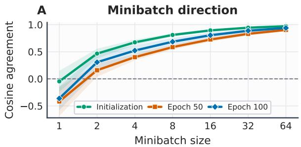

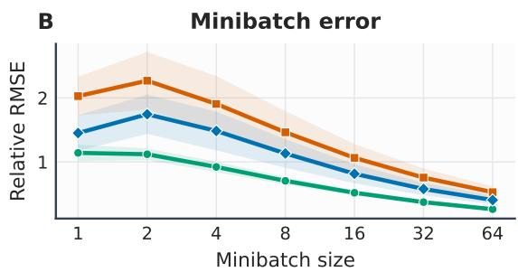

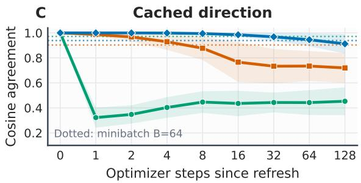

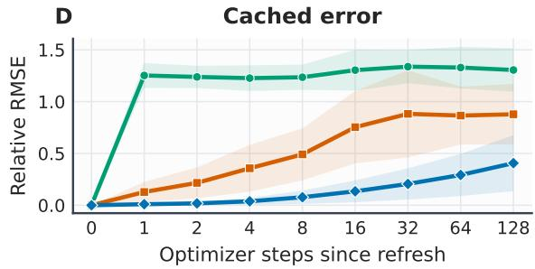  
Figure 2: Minibatch and cached gradient agreement with the full-dataset reference.

## 4.3 Image classification across batch sizes

Evaluation protocol. We compare each OOB method with its corresponding baseline: SIGREG-OOB with SIGREG, and CONTRASTIVE-OOB with SimCLR and MoCoV2. Within a comparison, we keep the data split, augmentations, number of views, backbone, projector, optimizer, learning rate schedule, and evaluation fixed. The 2D experiments use a ViT backbone (Dosovitskiy et al., 2020); 3D experiments use a 3D ResNet (He et al., 2016) and training lasts 100 epochs. Frozen representations are evaluated by k-NN and linear probe (Wu et al., 2018; Chen et al., 2020a). We use three independent seeds. In-batch baselines are omitted at B = 1, because anti-collapse regularization based on a single-sample batch is either undefined or statistically uninformative. OOB methods encode dataset-level state and remain well defined. Training details are in section A.2.

Results. The low-batch regime shows the clearest separation (Figure 3). Averaged over small batch sizes, SIGREG-OOB improves 5-NN/linear probe performance over SIGREG by 14.17/12.89pp on natural images, while CoNTRASTIVE-OOB improves over SimCLR by 10.83/6.58pp on biomedical data. On 3D volumes, both OOB methods retain positive mean gains, showing that the effect is not tied to a 2D encoder.

Complete paired aggregates are in Table 2. Section C adds comparisons with other baselines like IConE, BYOL, DINO, SwaV and VICReg. Section C.1 contains representation metrics like RankMe and effectiverank (Garrido et al., 2023; Roy & Vetterli, 2007).

A. Direction relative to class-balanced objective  
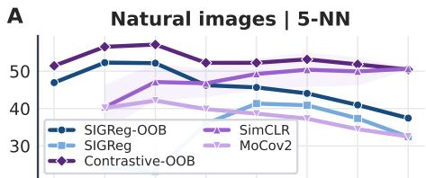

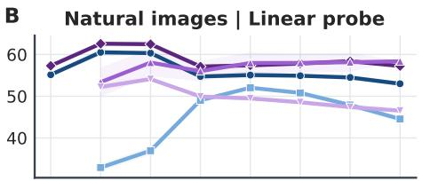

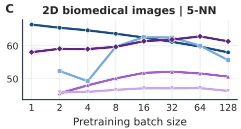

D 2D biomedical images | Linear probe  
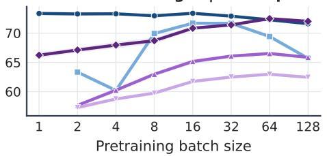  
Figure 3: Image classification results using linear probes and 5-NN.

Table 2: Classification balanced accuracy (%). Parentheses show OOB gains in percentage points.
<table><tr><td>Benchmark</td><td colspan="2">SIGREG</td><td colspan="2">SIGREG-OOB (Ours)</td><td colspan="2">SimCLR</td><td colspan="2">CONTRASTIVE-OOB (Ours)</td></tr><tr><td></td><td>5-NN</td><td>Linear</td><td>5-NN</td><td>Linear</td><td>5-NN</td><td>Linear</td><td>5-NN</td><td>Linear</td></tr><tr><td>Natural images</td><td>34.63</td><td>45.55</td><td>48.80 (+14.17)</td><td>58.44 (+12.89)</td><td>50.21</td><td>59.35</td><td>52.50 (+2.29)</td><td>59.49 (+0.14)</td></tr><tr><td>2D biomedical</td><td>57.45</td><td>67.44</td><td>62.21 (+4.76)</td><td>72.84 (+5.40)</td><td>50.00</td><td>63.55</td><td>60.83 (+10.83)</td><td>70.13 (+6.58)</td></tr><tr><td>3D biomedical</td><td>51.39</td><td>55.89</td><td>55.61 (+4.22)</td><td>63.95 (+8.06)</td><td>51.76</td><td>57.52</td><td>55.47 (+3.71)</td><td>61.78 (+4.26)</td></tr></table>

## 4.4 Population weighting and minority classes under imbalance

Oracle diagnostic. Class-balanced reference eq. (14) is used to distinguish estimator error from the choice of population weighting. The exact empirical gradient for minority probes diverges from the class-balanced gradient as minority classes are downsampled (fig. 4). A cached empirical estimator tracks the empirical objective closely and a cache built with class-balanced targets tracks the class-balanced oracle. OOB state solves the estimation problem, but not class imbalance. When class information is available, population weighting can be used as a hyperparameter.

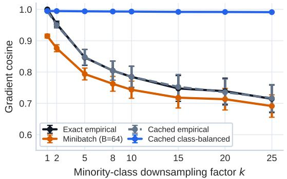

B. Error relative to class-balanced objective  
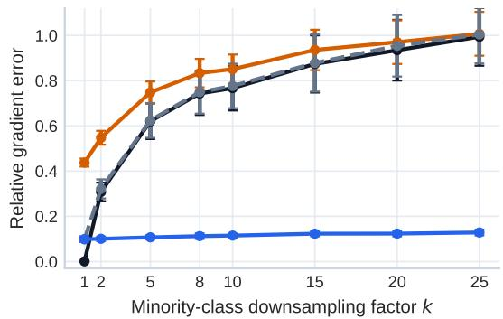  
Figure 4: Empirical and class-balanced gradient agreement under class imbalance.

Downstream evaluation. Having separated these effects, we test whether OOB anchors improve minorityclass representations without using labels during training. We create imbalanced MedMNIST variants by downsampling some classes by k. We report macro-average recall over downsampled classes using the same held-out split for matched methods. Across different batch sizes, SIGREG-OOB gains 6.24 points in 5-NN minority recall and 8.6 points in linear minority recall over SIGREG. CONTRASTIVE-OOB gains 10.69 and 10.28 points over SimCLR. The gains remain positive across the downsampling sweep (Figure 5). These downstream results complement Figure 4: an empirical OOB cache does not rebalance the population, but it gives each rare sample a global context that is often absent from its minibatch. Full 2D/3D per-dataset results, worst-class recall, and minority-majority gaps are in section D.

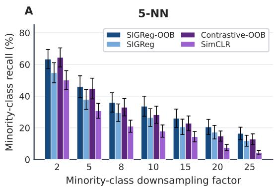

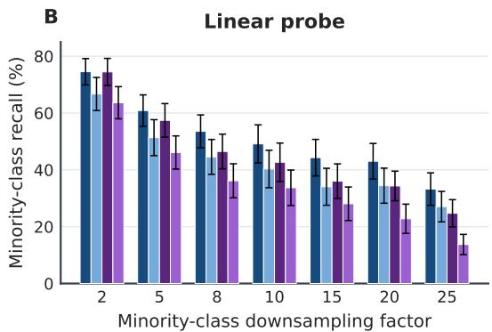  
Figure 5: Minority-class recall under controlled class imbalance.

## 4.5 Instance retrieval

We next test whether the learned space preserves instance neighborhoods in addition to the class boundaries. After pretraining, we retrieve with cosine similarity between frozen features. We report mean average precision (mAP) over three seeds and show the four nearest neighbors of the same query by each method (fig. 6). Across our experiments, SIGREG-OOB improves mAP over SIGREG by 13.1 points. CONTRASTIVE-OOB improves over SimCLR/MoCoV2 by 13.7/7.6 points, at a given batch size. Recall@1/5/10 and more retrieval evaluations are in section E

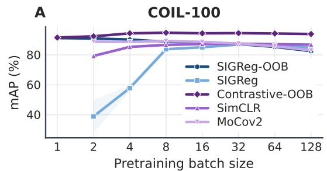

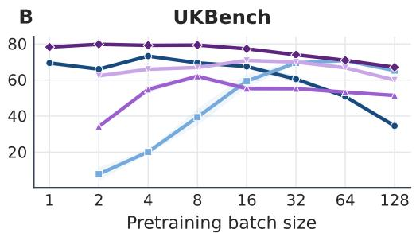

C  
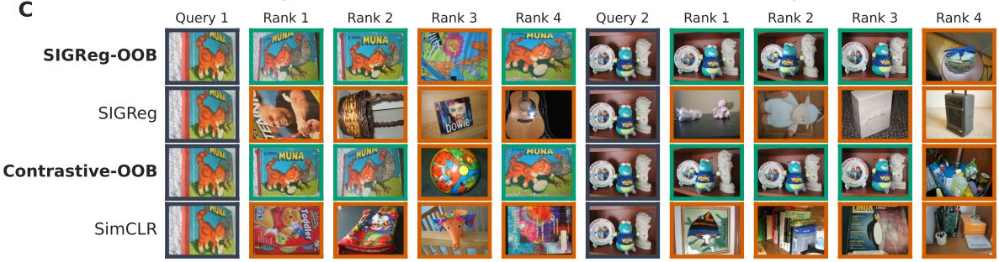  
Figure 6: Instance-retrieval mAP and example nearest neighbors.

## 4.6 Continued self-supervised pretraining

Continued SSL pretraining adapts an existing model to a target domain (Reed et al., 2022; Rodas et al., 2025). Small batches can make a larger pretrained encoder feasible during domain adaptation. We train DINOv2 (Oquab et al., 2023) of several sizes on our datasets, without labels.

Table 3: Continued pretraining of DINOv2 and 5-NN of adapted models relative to original.
<table><tr><td></td><td></td><td></td><td colspan="3">SIGREG-OOB (Ours)</td><td colspan="3">SIGREG</td><td colspan="3">CONTRASTIVE-OOB (Ours)</td><td colspan="3">SimCLR</td></tr><tr><td>Dataset</td><td>Encoder</td><td>Original</td><td>B = 2 B</td><td>= 8</td><td>B = 64</td><td>B = 2</td><td>B = 8</td><td>B = 64</td><td>B = 2</td><td>B = 8</td><td>B = 64</td><td>B = 2</td><td>B = 8</td><td>B = 64</td></tr><tr><td>BloodMNIST</td><td>S (22M)</td><td>92.0</td><td>+6.6</td><td>+6.7</td><td>+6.8</td><td>-6.5</td><td>+6.7</td><td>+6.0</td><td>+6.1</td><td>+6.2</td><td>+5.8</td><td>+1.6</td><td>+6.7</td><td>+6.5</td></tr><tr><td></td><td>B (86M)</td><td>90.1</td><td>+8.8</td><td>+8.6</td><td>+8.6</td><td>-5.7</td><td>+8.7</td><td>+8.4</td><td>+8.0</td><td>+8.4</td><td>+8.1</td><td>+4.1</td><td>+8.7</td><td>+8.7</td></tr><tr><td></td><td>L (304M)</td><td>89.4</td><td>+9.3</td><td>+9.4</td><td>+9.3</td><td>-4.6</td><td>+9.4</td><td>+9.0</td><td>+9.1</td><td>+8.9</td><td>+9.5</td><td>+2.5</td><td>+9.4</td><td>+9.2</td></tr><tr><td></td><td>G (1.1B)</td><td>93.0</td><td>+5.3</td><td>+5.1</td><td>+5.8</td><td>-6.8</td><td>+5.8</td><td>+5.3</td><td>+2.8</td><td>-5.6</td><td>+3.7</td><td>+3.6</td><td>+5.5</td><td>+5.7</td></tr><tr><td>OrganAMNIST</td><td>S (22M)</td><td>85.7</td><td>+7.1</td><td>+6.1</td><td>+5.9</td><td>+0.9</td><td>+8.0</td><td>+4.1</td><td>+8.7</td><td>+8.2</td><td>+8.1</td><td>-15.9</td><td>+4.6</td><td>+4.7</td></tr><tr><td></td><td>B (86M)</td><td>84.0</td><td>+10.4</td><td>+8.6</td><td>+7.1</td><td>-0.4</td><td>+8.7</td><td>+4.6</td><td>+10.6</td><td>+10.5</td><td>+10.3</td><td>-18.0</td><td>+7.1</td><td>+6.3</td></tr><tr><td></td><td>L (304M)</td><td>79.3</td><td>+15.1</td><td>+14.3</td><td>+12.0</td><td>+0.8</td><td>+13.0</td><td>+9.5</td><td>+14.0</td><td>+15.2</td><td>+15.6</td><td>-15.0</td><td>+10.9</td><td>+10.5</td></tr><tr><td></td><td>G (1.1B)</td><td>80.0</td><td>+14.0</td><td>+13.1</td><td>+11.6</td><td>+10.1</td><td>+12.3</td><td>+9.6</td><td>+13.5</td><td>+11.2</td><td>+11.9</td><td>-8.9</td><td>+11.3</td><td>+12.1</td></tr><tr><td>OrganCMNIST S (22M)</td><td></td><td>81.2</td><td>+1.7</td><td>+4.5</td><td>+4.0</td><td>-5.9</td><td>+4.1</td><td>+2.7</td><td>+6.8</td><td>+6.8</td><td>+4.7</td><td>-12.2</td><td>+3.2</td><td>+0.9</td></tr><tr><td></td><td>B (86M)</td><td>77.3</td><td>+6.5</td><td>+7.7</td><td>+6.6</td><td>-0.1</td><td>+7.5</td><td>+6.0</td><td>+9.3</td><td>+11.9</td><td>+9.1</td><td>-16.5</td><td>+7.3</td><td>+5.1</td></tr><tr><td></td><td>L (304M)</td><td>76.3</td><td>+8.3</td><td>+7.9</td><td>+8.3</td><td>-0.2</td><td>+7.7</td><td>+5.6</td><td>+10.1</td><td>+13.9</td><td>+12.3</td><td>-7.0</td><td>+7.2</td><td>+4.9</td></tr><tr><td></td><td>G (1.1B)</td><td>74.1</td><td>+11.1</td><td>+10.6</td><td>+8.8</td><td>+10.7</td><td>+10.6</td><td>+7.7</td><td>+13.4</td><td>+12.0</td><td>+12.3</td><td>-3.2</td><td>+11.3</td><td>+6.6</td></tr><tr><td>PathMNIST</td><td>S (22M)</td><td>94.8</td><td>+2.5</td><td>+2.6</td><td>+2.9</td><td>-7.6</td><td>+1.0</td><td>+1.9</td><td>+1.3</td><td>+2.2</td><td>+2.1</td><td>-9.4</td><td>+1.8</td><td>+1.9</td></tr><tr><td></td><td>B (86M)</td><td>94.0</td><td>+3.5</td><td>+3.6</td><td>+3.6</td><td>-9.6</td><td>+2.5</td><td>+2.6</td><td>+2.2</td><td>+2.9</td><td>+2.7</td><td>-6.0</td><td>+3.2</td><td>+3.6</td></tr><tr><td></td><td>L (304M)</td><td>93.7</td><td>+4.0</td><td>+3.2</td><td>+4.6</td><td>-14.1</td><td>+3.0</td><td>+3.3</td><td>+2.3</td><td>+2.3</td><td>+3.1</td><td>-3.7</td><td>+3.8</td><td>+3.8</td></tr><tr><td></td><td>G (1.1B)</td><td>95.5</td><td>+1.5</td><td>+2.2</td><td>+2.2</td><td>-13.9</td><td>+0.9</td><td>+1.2</td><td>-1.5</td><td>-6.7</td><td>-1.8</td><td>-2.3</td><td>+1.6</td><td>+2.3</td></tr></table>

Table 3 shows that the OOB methods outperform their corresponding in-batch variants across most configurations. The advantage is clearest at small batches, where OOB regularization improves on the pretrained initialization while in-batch training can degrade representation quality. These results support using OOB regularization to adapt large pretrained encoders when memory limits the training batch size. Complete scores, linear-probe results, and all batch sizes are in section F.

## 4.7 Performance under a memory budget

At the same batch size, OOB methods use the same GPU memory as their in-batch counterparts. Their advantage is that they perform well with much smaller batches, reducing the memory needed to obtain useful representations. We compare the best classification performance achievable within each GPU-memory budget on the datasets in section 4.1. Figure 7 shows that OOB methods can match or exceed the performance of their in-batch counterparts while using substantially less GPU memory within the evaluated range, making strong representations accessible under tighter memory budgets. Training times and detailed resource measurements are provided in section G.

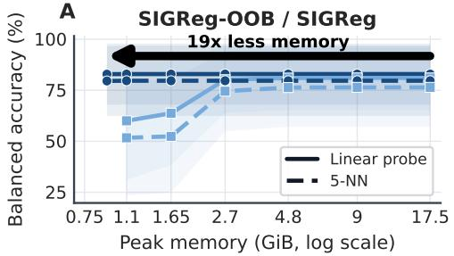

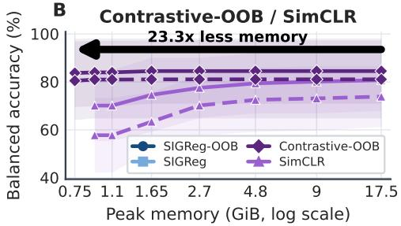  
Figure 7: Best classification performance under GPU-memory budgets.

## 5 Conclusion and Future Work

We introduced out-of-batch (OOB) regularization, which decouples population-level representation regularization from minibatch optimization through periodically constructed dataset-level targets. Across contrastive and non-contrastive objectives, OOB more faithfully recovers the full-dataset regularization signal and improves representation quality, particularly in cases where small minibatches poorly approximate the full population. Our results show that the active minibatch does not need to define the population over which representation geometry is regularized.

OOB replaces minibatch sampling error with a different trade-off: dataset-level state must be stored and periodically refreshed as the encoder evolves. Understanding this trade-off at larger scales remains an important direction. More broadly, our results motivate separating globally coupled representation objectives from the minibatch updates used to train the encoder, with regularizer-specific constructions providing a possible route to population-aware learning beyond the objectives studied here.

## AI use statement

We used generative AI tools to polish the manuscript, assist in searching for relevant literature, and help write code. We did not use generative AI to generate research ideas or propose experiments. We reviewed the AI-assisted text and references, and independently inspected and executed the AI-assisted code to verify its correctness. We take responsibility for the final content of this work, including all text, claims, and artifacts produced with the assistance of generative AI.

## Reproducibility statement

We describe the proposed algorithms in the main text and provide detailed architectures, training configurations, augmentations, hyperparameters, and evaluation protocols in the appendix to support independent reproduction of our results. We also document the hyperparameter-selection procedure and computational costs. We plan to release the code to further facilitate reproduction and comparison with our methods.

## References

Konstantinos Almpanakis and Anna Kreshuk. Icone: Batch independent collapse prevention for selfsupervised representation learning. In European Conference on Computer Vision, pp. 445–463. Springer, 2026.

Yuki Markus Asano, Christian Rupprecht, and Andrea Vedaldi. Self-labelling via simultaneous clustering and representation learning. arXiv preprint arXiv:1911.05371, 2019.

Mahmoud Assran, Randall Balestriero, Quentin Duval, Florian Bordes, Ishan Misra, Piotr Bojanowski, Pascal Vincent, Michael Rabbat, and Nicolas Ballas. The hidden uniform cluster prior in self-supervised learning. arXiv preprint arXiv:2210.07277, 2022.

Randall Balestriero. Unsupervised learning on a diet: Datum index as target free of self-supervision, reconstruction, projector head. arXiv preprint arXiv:2302.10260, 2023.

Randall Balestriero and Yann LeCun. Lejepa: Provable and scalable self-supervised learning without the heuristics. arXiv preprint arXiv:2511.08544, 2025.

Adrien Bardes, Jean Ponce, and Yann LeCun. Vicreg: Variance-invariance-covariance regularization for self-supervised learning. arXiv preprint arXiv:2105.04906, 2021.

Piotr Bojanowski and Armand Joulin. Unsupervised learning by predicting noise. In International conference on machine learning, pp. 517–526. PMLR, 2017.

Mathilde Caron, Piotr Bojanowski, Armand Joulin, and Matthijs Douze. Deep clustering for unsupervised learning of visual features. In European conference on computer vision, pp. 139–156. Springer, 2018.

Mathilde Caron, Ishan Misra, Julien Mairal, Priya Goyal, Piotr Bojanowski, and Armand Joulin. Unsupervised learning of visual features by contrasting cluster assignments. Advances in neural information processing systems, 33:9912–9924, 2020.

Mathilde Caron, Hugo Touvron, Ishan Misra, Hervé Jégou, Julien Mairal, Piotr Bojanowski, and Armand Joulin. Emerging properties in self-supervised vision transformers. In 2021 IEEE/CVF international conference on computer vision (ICCV), pp. 9630–9640. IEEE, 2021.

Changyou Chen, Jianyi Zhang, Yi Xu, Liqun Chen, Jiali Duan, Yiran Chen, Son Tran, Belinda Zeng, and Trishul Chilimbi. Why do we need large batchsizes in contrastive learning? a gradient-bias perspective. Advances in Neural Information Processing Systems, 35:33860–33875, 2022.

Ting Chen, Simon Kornblith, Mohammad Norouzi, and Geoffrey Hinton. A simple framework for contrastive learning of visual representations. In International conference on machine learning, pp. 1597– 1607. PmLR, 2020a.

Xinlei Chen and Kaiming He. Exploring simple siamese representation learning. In 2021 IEEE/CVF conference on computer vision and pattern recognition (CVPR), pp. 15745–15753. IEEE, 2021.

Xinlei Chen, Haoqi Fan, Ross Girshick, and Kaiming He. Improved baselines with momentum contrastive learning. arXiv preprint arXiv:2003.04297, 2020b.

Mircea Cimpoi, Subhransu Maji, Iasonas Kokkinos, Sammy Mohamed, and Andrea Vedaldi. Describing textures in the wild. In Proceedings of the IEEE conference on computer vision and pattern recognition, pp. 3606–3613, 2014.

Adam Coates, Andrew Ng, and Honglak Lee. An analysis of single-layer networks in unsupervised feature learning. In Proceedings of the fourteenth international conference on artificial intelligence and statistics, pp. 215–223. JMLR Workshop and Conference Proceedings, 2011.

Jia Deng, Wei Dong, Richard Socher, Li-Jia Li, Kai Li, and Li Fei-Fei. Imagenet: A large-scale hierarchical image database. In 2009 IEEE conference on computer vision and pattern recognition, pp. 248–255. Ieee, 2009.

Alexey Dosovitskiy, Lucas Beyer, Alexander Kolesnikov, Dirk Weissenborn, Xiaohua Zhai, Thomas Unterthiner, Mostafa Dehghani, Matthias Minderer, Georg Heigold, Sylvain Gelly, et al. An image is worth 16x16 words: Transformers for image recognition at scale. arXiv preprint arXiv:2010.11929, 2020.

Debidatta Dwibedi, Yusuf Aytar, Jonathan Tompson, Pierre Sermanet, and Andrew Zisserman. With a little help from my friends: Nearest-neighbor contrastive learning of visual representations. In 2021 IEEE/CVF international conference on computer vision (ICCV), pp. 9568–9577. IEEE, 2021.

Peyré Gabriel and Cuturi Marco. Computational optimal transport with applications to data sciences. Foundations and trends® in machine learning, 11(5-6):355–607, 2019.

Luyu Gao, Yunyi Zhang, Jiawei Han, and Jamie Callan. Scaling deep contrastive learning batch size under memory limited setup. In Proceedings of the 6th Workshop on Representation Learning for NLP (RepL4NLP-2021), pp. 316–321, 2021.

Quentin Garrido, Randall Balestriero, Laurent Najman, and Yann Lecun. Rankme: Assessing the downstream performance of pretrained self-supervised representations by their rank. In International conference on machine learning, pp. 10929–10974. PMLR, 2023.

Jean-Bastien Grill, Florian Strub, Florent Altché, Corentin Tallec, Pierre Richemond, Elena Buchatskaya, Carl Doersch, Bernardo Avila Pires, Zhaohan Guo, Mohammad Gheshlaghi Azar, et al. Bootstrap your own latent-a new approach to self-supervised learning. Advances in neural information processing systems, 33:21271–21284, 2020.

Kaiming He, Xiangyu Zhang, Shaoqing Ren, and Jian Sun. Deep residual learning for image recognition. In Proceedings of the IEEE conference on computer vision and pattern recognition, pp. 770–778, 2016.

Kaiming He, Haoqi Fan, Yuxin Wu, Saining Xie, and Ross Girshick. Momentum contrast for unsupervised visual representation learning. In 2020 IEEE/CVF conference on computer vision and pattern recognition (CVPR), pp. 9726–9735. IEEE, 2020.

Li Jing, Pascal Vincent, Yann LeCun, and Yuandong Tian. Understanding dimensional collapse in contrastive self-supervised learning. arXiv preprint arXiv:2110.09348, 2021.

Alex Krizhevsky, Geoffrey Hinton, et al. Learning multiple layers of features from tiny images. 2009.

Vebjorn Ljosa, Katherine L Sokolnicki, and Anne E Carpenter. Annotated high-throughput microscopy image sets for validation. Nature methods, 9(7):637, 2012.

Dominic Masters and Carlo Luschi. Revisiting small batch training for deep neural networks. arXiv preprint arXiv:1804.07612, 2018.

Aaron van den Oord, Yazhe Li, and Oriol Vinyals. Representation learning with contrastive predictive coding. arXiv preprint arXiv:1807.03748, 2018.

Maxime Oquab, Timothée Darcet, Théo Moutakanni, Huy Vo, Marc Szafraniec, Vasil Khalidov, Pierre Fernandez, Daniel Haziza, Francisco Massa, Alaaeldin El-Nouby, et al. Dinov2: Learning robust visual features without supervision. arXiv preprint arXiv:2304.07193, 2023.

Alec Radford, Jong Wook Kim, Chris Hallacy, Aditya Ramesh, Gabriel Goh, Sandhini Agarwal, Girish Sastry, Amanda Askell, Pamela Mishkin, Jack Clark, et al. Learning transferable visual models from natural language supervision. In International conference on machine learning, pp. 8748–8763. PmLR, 2021.

Colorado J Reed, Xiangyu Yue, Ani Nrusimha, Sayna Ebrahimi, Vivek Vijaykumar, Richard Mao, Bo Li, Shanghang Zhang, Devin Guillory, Sean Metzger, et al. Self-supervised pretraining improves selfsupervised pretraining. In 2022 IEEE/CVF Winter Conference on Applications of Computer Vision (WACV), pp. 1050–1060. IEEE, 2022.

Bryan Rodas, Natalie Montesino, Jakob Ambsdorf, David Klindt, and Randall Balestriero. Diet-cp: Lightweight and data efficient self supervised continued pretraining. arXiv preprint arXiv:2509.06990, 2025.

Olivier Roy and Martin Vetterli. The effective rank: A measure of effective dimensionality. In 2007 15th European signal processing conference, pp. 606–610. IEEE, 2007.

Claude Elwood Shannon. A mathematical theory of communication. The Bell system technical journal, 27 (3):379–423, 1948.

Yucheng Tang, Dong Yang, Wenqi Li, Holger R Roth, Bennett Landman, Daguang Xu, Vishwesh Nath, and Ali Hatamizadeh. Self-supervised pre-training of swin transformers for 3d medical image analysis. In 2022 IEEE/CVF Conference on Computer Vision and Pattern Recognition (CVPR), pp. 20698–20708. IEEE, 2022.

Michael Tschannen, Josip Djolonga, Paul K Rubenstein, Sylvain Gelly, and Mario Lucic. On mutual information maximization for representation learning. arXiv preprint arXiv:1907.13625, 2019.

Jianyuan Wang, Minghao Chen, Nikita Karaev, Andrea Vedaldi, Christian Rupprecht, and David Novotny. Vggt: Visual geometry grounded transformer. In 2025 IEEE/CVF Conference on Computer Vision and Pattern Recognition (CVPR), pp. 5294–5306. IEEE, 2025.

Tongzhou Wang and Phillip Isola. Understanding contrastive representation learning through alignment and uniformity on the hypersphere. In International conference on machine learning, pp. 9929–9939. PMLR, 2020.

Xun Wang, Haozhi Zhang, Weilin Huang, and Matthew R Scott. Cross-batch memory for embedding learning. In 2020 IEEE/CVF Conference on Computer Vision and Pattern Recognition (CVPR), pp. 6387–6396. IEEE, 2020.

Zhirong Wu, Yuanjun Xiong, Stella X Yu, and Dahua Lin. Unsupervised feature learning via non-parametric instance discrimination. In Proceedings of the IEEE conference on computer vision and pattern recognition, pp. 3733–3742, 2018.

Jiancheng Yang, Rui Shi, Donglai Wei, Zequan Liu, Lin Zhao, Bilian Ke, Hanspeter Pfister, and Bingbing Ni. Medmnist v2-a large-scale lightweight benchmark for 2d and 3d biomedical image classification. Scientific data, 10(1):41, 2023.

Chung-Yiu Yau, Hoi-To Wai, Parameswaran Raman, Soumajyoti Sarkar, and Mingyi Hong. Emc2: Efficient mcmc negative sampling for contrastive learning with global convergence. arXiv preprint arXiv:2404.10575, 2024.

Chun-Hsiao Yeh, Cheng-Yao Hong, Yen-Chi Hsu, Tyng-Luh Liu, Yubei Chen, and Yann LeCun. Decoupled contrastive learning. In European conference on computer vision, pp. 668–684. Springer, 2022.

Zhuoning Yuan, Yuexin Wu, Zi-Hao Qiu, Xianzhi Du, Lijun Zhang, Denny Zhou, and Tianbao Yang. Provable stochastic optimization for global contrastive learning: Small batch does not harm performance. In International Conference on Machine Learning, pp. 25760–25782. PMLR, 2022.

Jure Zbontar, Li Jing, Ishan Misra, Yann LeCun, and Stéphane Deny. Barlow twins: Self-supervised learning via redundancy reduction. In International conference on machine learning, pp. 12310–12320. PMLR, 2021.

## A Reproducibility details

This section reports the data, optimization, augmentation, and evaluation settings used in the main experiments. Classification and retrieval results are aggregated over independent training seeds. Within each matched OOB/in-batch classification pair, we preserve the data split, augmentations, number of views, encoder, projector, optimizer, schedule, and downstream evaluator.

## A.1 Datasets and evaluation protocols

Classification. The datasets used in each collection are summarized in table 4.

Table 4: Datasets used in the classification and oracle experiments.
<table><tr><td>Collection</td><td>Domains</td></tr><tr><td>Natural images</td><td>CIFAR-10, CIFAR-100, DTD, ImageNet-100, Imagenette, Imagewoof, STL-10 BloodMNIST, BreastMNIST, DermaMNIST, OCTMNIST, OrganAMNIST, OrganCM-</td></tr><tr><td>2D Biomedical</td><td>NIST, OrganSMNIST, PathMNIST, PneumoniaMNIST, TissueMNIST, BBBC010, plank- ton(private)</td></tr><tr><td>3D Biomedical</td><td>AdrenalMNIST, FractureMNIST, NoduleMNIST, OrganMNIST, SynapseMNIST, VesselM- NIST</td></tr></table>

For frozen evaluation, we extract deterministic, l2-normalized backbone features and use a fixed, shuffled 70/30 train/evaluation split using one seed. We report balanced accuracy from cosine k-NN $( k \in \{ 1 , 5 , 2 0 \} )$ and from a multinomial logistic-regression probe (linear probe). The latter is fit after standardizing each feature coordinate, with a maximum of 1000 iterations. Labels are never used during self-supervised pretraining.

Instance retrieval. The retrieval study uses COIL-100 (7200 images of 100 objects), UKBench (10,200 images of 2550 objects), and INRIA Holidays (1491 images grouped into 500 instances). Retrieval uses cosine similarity between normalized frozen features, with the query itself removed from the gallery. For a query q with relevant gallery set $G _ { q } .$ , average precision is

$$
\mathrm { A P } ( q ) = \frac { 1 } { | G _ { q } | } \sum _ { k = 1 } ^ { | \mathcal { G } | } P _ { q } ( k ) \ : \mathbf { 1 } [ \pi _ { q } ( k ) \in G _ { q } ] \ : ,\tag{15}
$$

where $P _ { q } ( k )$ is precision at rank k and $\pi _ { q } ( k )$ is the item at that rank. mAP averages AP over queries; Recall@ K is the fraction of queries with at least one relevant item among the first K results. We run two different protocols for our experiments. The transductive protocol pretrains and retrieves on the same unlabeled collection. The held-out protocol separates instance identities with a fixed 80/20 split using one seed. All retrieval methods use the same 2D encoder, image transformations, optimizer, and evaluator as the classification experiments, with four augmented views per instance for every method.

## A.2 Architectures, optimization, and augmentation

The 2D experiments use a ViT-Small/16 encoder with width 384, 12 transformer blocks, and six attention heads. Inputs are $2 2 4 \times 2 2 4$ . The 3D experiments use a 3D ResNet-18 and $6 4 ^ { 3 }$ inputs. All methods train for 100 epochs with AdamW, learning rate $\bar { 1 } 0 ^ { - 4 }$ , weight decay 0.05, gradient clipping at norm 1, and a per-step cosine schedule ending at $1 0 ^ { - 6 }$ . We use the PyTorch AdamW defaults $( \beta _ { 1 } , \beta _ { 2 } ) ^ { - } = \bar { ( } 0 . 9 , 0 . 9 9 9 )$ and $\epsilon \bar { = } 1 0 ^ { - 8 }$ From-scratch training uses fp32, with each experiment run on a single NVIDIA L40S GPU.

## A.3 Method-specific hyperparameters and cost

Both OOB methods use a fixed refresh period of 0.5 epoch. Refresh inference is batched independently of online training, with batch size 64 in 2D and 16 in 3D. SIGReg-OOB requires one deterministic dataset pass followed by $O ( M N$ log N) CPU sorting. Its persistent fp32 cache contains NM scalars. CONTRASTIVE-OOB performs 20 stochastic anchor updates, each using all pairs within a sampled subset of at most 256 anchors, while its persistent cache contains 128N scalars. The caches live in CPU memory, and only the rows indexed by the active minibatch are transferred to the GPU. At $N = 1 3 { , } 0 0 0$ , these caches occupy 12.7 MiB and 6.3 MiB, respectively. Cache construction adds wall time but does not increase the online training batch's activation memory. Details about training setup of baselines and our methods are reported in Table 6, while the augmentations we use are described in Table 5.

Table 5: Augmentation pipelines used for self-supervised training.
<table><tr><td>Modality Spatial transforms</td><td></td><td>Appearance and normalization</td></tr><tr><td>2D</td><td>Random resized crop to 224 (scale 0.2–1.0); horizontal flip</td><td>Color jitter  $( 0 . 4 , 0 . 4 , 0 . 4 , 0 . 1 ) , p = 0 . 8 ;$  grayscale,  $p = 0 . 2 ;$  Gaussian blur (kernel  $2 3 , \sigma \in [ 0 . 1 , 2 . 0 ] ) ;$  ImageNet normalization</td></tr><tr><td>3D</td><td>Random resized crop to  $6 4 ^ { 3 }$  (scale  $0 . 5 \mathrm { - } 1 . 0 ) ;$  independent axis flips,  $p = 0 . 5 ;$  random  $9 0 ^ { \circ }$  rotation in one plane,  $p = 0 . 5$ </td><td>Intensity shift in  $[ - 0 . 1 , 0 . 1 ] ;$  contrast in  $[ 0 . 8 , 1 . 2 ] ;$  Gaussian noise  $( \dot { \sigma } = 0 . 1 ) , \dot { p } = 0 . 3 ; 3 ^ { 3 }$  average-pool blur,  $p = 0 . 3$ </td></tr></table>

Table 6: Method-specific settings used in the principal experiments.  
Method Configuration   
SIGReg-OOB Three-layer MLP projector with 2048-dimensional hidden and output layers, LayerNorm and   
ReLU after each non-final layer; M = 256 projections; $( \lambda _ { \mathrm { a l i g n } } , \lambda _ { \mathrm { a c } } ) = ( 5 , 1 )$ ; projection direc  
tions resampled at every refresh.   
SIGREG The same 2048-dimensional projector   
CONTRASTIVE-OOB Two-layer ReLU projector with one backbone-width hidden layer and 128-dimensional output   
anchors; $( \lambda _ { \mathrm { a l i g n } } , \bar { \lambda } _ { \mathrm { a c } } ) = ( 1 , 1 )$ ; 20 anchor updates with Adam at learning rate 0.05; sampled   
anchor subset 256; $\tau _ { u } = 2 , \lambda _ { f } = 0 . 1$ , and previous-cache mixture weight 0.5.   
SimCLR The same two-layer 128-dimensional projector, normalized output, four augmented views in the   
classification experiments, and temperature 0.5.   
MoCoV2 Two-layer 128-dimensional query/key projectors, four augmented views, queue size 4096, en  
coder momentum 0.999, and temperature 0.2.

## A.4 Ablations of the SIGReg-OOB configuration

We ablate the components of SIGReg-OOB on seven 2D natural/scientific domains and batches 1–64. The study comprises 1,792 evaluations from 39 configurations over 48 dataset–batch matched experiments, covering projection resampling, refresh period, the alignment and anti-collapse weights, and the number of projections. Since the sweep is not a full Cartesian product, we form controlled slices in which one factor changes while the remaining settings are held fixed. Within each slice, we retain only dataset-batch experiments shared by every variant.

The resampling, refresh-period, and alignment-weight ablations use the common configuration $p \ : = \ : 0 . 5$ $\lambda _ { \mathrm { a l i g n } } = 5 , \lambda _ { \mathrm { a c } } = 1 .$ and $M = 2 5 6$ , omitting the factor being varied. The anti-collapse-weight slice fixes $( p , \bar { \lambda } _ { \mathrm { a l i g n } } , M ) = ( 2 , 2 5 , 5 1 2 )$ , and the projection-count slice fixes $( p , \lambda _ { \mathrm { a l i g n } } , \lambda _ { \mathrm { a c } } ) = { \bar { ( 2 , 2 5 , 5 ) } }$ ; projection resampling is enabled in both.

Figure 8 shows mean downstream linear-probe balanced accuracy. Projection resampling produces the largest improvement. A refresh period of 0.5 epoch performs best, while one epoch remains close and overly frequent refreshes are not beneficial. The intermediate alignment weight is preferable to either extreme, and increasing the anti-collapse weight or the number of projections does not improve the matched slices. These results indicate that maintaining diverse, periodically updated targets and balancing the two loss terms matter more than increasing the raw number of projections.

## B Oracle-gradient protocol

The oracle study differentiates the projected-Gaussian anti-collapse loss with respect to each probe representation. Consequently, every “gradient" is a vector in representation space, not the scalar loss and not the full network parameter gradient. The full-dataset reference recomputes ranks and Gaussian quantile assignments from the current representations of every training sample. The minibatch estimator computes the same construction from a sampled batch, whereas the cached estimator reuses full-dataset assignments made at an earlier encoder state. At every cache age, the reference itself is recomputed at the current encoder state; cached agreement is therefore measured against the current population objective rather than against the reference at refresh

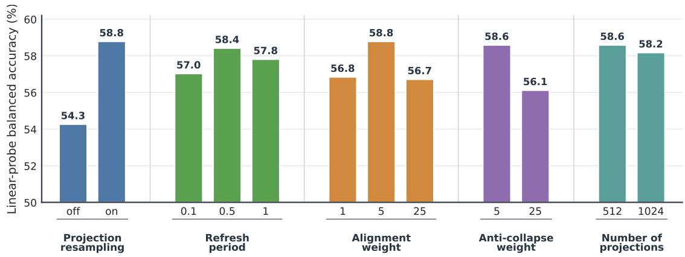  
Figure 8: Controlled ablations of SIGReg-OOB. Each factor varies within a matched slice, and bars report mean linear-probe balanced accuracy over the dataset-batch cells shared by all values in that group.

The canonical experiment uses all 2D and 3D datasets considered in this study. We evaluate checkpoints at epochs 0, 50, and 100 over three seeds. Each condition uses 16 probe samples, 16 sampled contexts, and 256 projection directions. Minibatch sizes are 1–64 and cache ages are $s \in \{ 0 , 1 , 2 , 4 , 8 , 1 6 , 3 2 , 6 4 , 1 2 8 \}$ optimizer updates. Direction is measured by gradient cosine similarity, and scale-sensitive disagreement by relative root-mean-square error.

At $B = 1$ , mean cosine agreement at epochs 0, 50, and 100 is respectively —0.047, —0.417, and —0.362; at $B = 6 4$ it rises to 0.972, 0.903, and 0.939. A fresh cache agrees exactly by construction. At age 128, mean cached agreement at the default learning rate is 0.453, 0.720, and 0.912 across the three checkpoints. At the matched low-rate control $( 1 0 ^ { - 6 } )$ , the values are 0.692, 0.909, and 0.906, with the largest improvements at epochs 0 and 50. Cache lifetime is therefore controlled by how rapidly the encoder is updated, not by update count alone.

Figure 9 verifies that the ordering between limited batch context and fresh dataset-level context is not an artifact of a single dataset size. The oracle remains a reference for estimating this chosen finite-population regularizer.

## C Detailed frozen-classification results

Figure 10 summarizes the controlled 2D MedMNIST size sweep. The advantage of OOB regularization is largest at small batches and persists as the number of training examples grows. Tables 7 and 8 report the perdataset results after averaging over a common set of batch sizes. The 2D biomedical and 3D tables average $B \in \{ 2 , 4 , 8 , 1 6 , 3 2 , 6 4 \}$ , while the natural-image table averages $B \in \{ 2 , 4 , 8 , 1 6 , 3 2 \}$ . The full ImageNet-100 row instead averages its available batches 64 and 128. Each entry gives 5-NN and linear-probe balanced accuracy, in that order.

Across the controlled size sweep, the OOB variants retain their strongest advantages in the low-batch regime rather than relying on a particular number of training examples. The per-dataset results below also show that these gains are distributed across domains rather than being driven by a single task.

The natural-image and 3D results in table 8 broaden the comparison beyond the controlled 2D size sweep while retaining the same frozen-evaluation protocol.

## C.1 Representation-rank diagnostics

Figure 11 provides a useful qualification. CONTRASTIVE-OOB has much higher rank than SimCLR and MoCoV2 in the smallest-batch regime, consistent with stronger prevention of dimensional collapse. The Gaussian pair is more mixed: SIGReg-OOB can have lower rank than SIGREG on 2D biomedical data

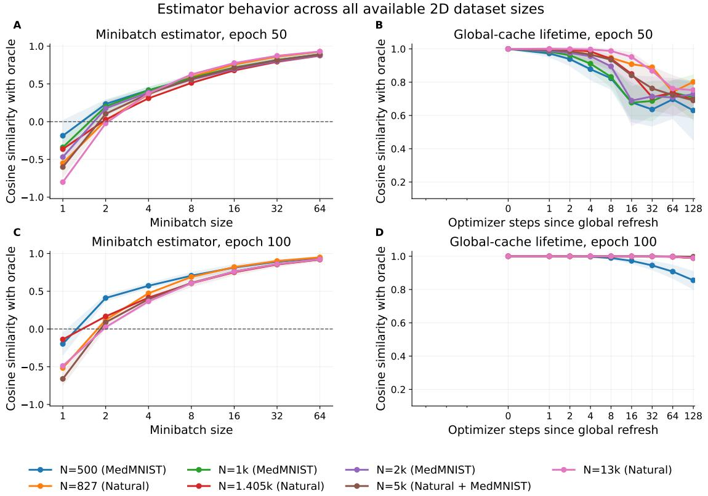  
Figure 9: Robustness of the oracle comparison to dataset size. The MedMNIST sweep uses 500, 1k, 2k, and 5k training examples. Panels A and C evaluate the minibatch estimator, while B and D follow global-cache lifetime at epochs 50 and 100, respectively.

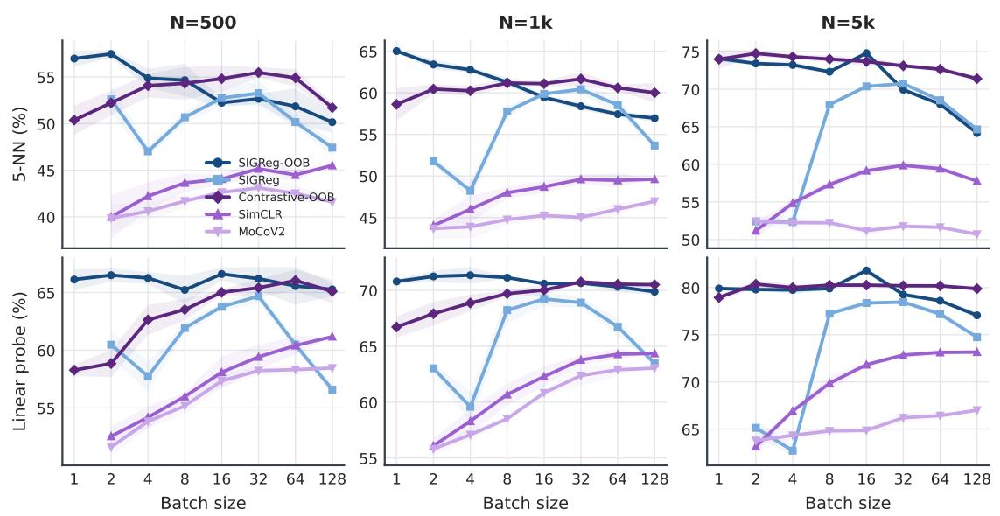  
Figure 10: Frozen classification across MedMNIST training-set sizes. Shading denotes one standard deviation across training seeds.

Table 7: Per-dataset 2D MedMNIST balanced accuracy (%) across training-set sizes, averaged over batch sizes. Entries are linear probe results. Within each method family, the best result is bold; the best result overall is underlined.
<table><tr><td></td><td></td><td>SIGReg-</td><td></td><td></td><td>Contrastive</td><td></td><td></td><td>IConE-</td><td></td><td></td><td></td></tr><tr><td>Dataset</td><td>SIGReg</td><td>OOB</td><td>SimCLR</td><td>MoCoV2</td><td>-OOB</td><td>VICReg</td><td>IConE</td><td>SIGReg</td><td>BYOL</td><td>SwAV</td><td>DINO</td></tr><tr><td>BloodMNIST</td><td>82.4</td><td>84.4</td><td>68.9</td><td>68.1</td><td>78.2</td><td>76.3</td><td>81.1</td><td>80.8</td><td>72.9</td><td>75.7</td><td>72.6</td></tr><tr><td>BreastMNIST</td><td>71.3</td><td>72.5</td><td>66.6</td><td>65.2</td><td>72.0</td><td>70.9</td><td>68.8</td><td>68.5</td><td>67.8</td><td>68.1</td><td>65.5</td></tr><tr><td>DermaMNIST</td><td>54.7</td><td>60.0</td><td>50.9</td><td>48.6</td><td>59.5</td><td>52.4</td><td>45.2</td><td>45.2</td><td>49.1</td><td>49.3</td><td>46.3</td></tr><tr><td>OCTMNIST</td><td>48.2</td><td>52.6</td><td>41.2</td><td>39.3</td><td>41.8</td><td>48.9</td><td>42.9</td><td>44.2</td><td>41.5</td><td>43.8</td><td>38.2</td></tr><tr><td>OrganAMNIST</td><td>61.0</td><td>70.7</td><td>54.3</td><td>52.8</td><td>66.9</td><td>61.0</td><td>73.1</td><td>72.6</td><td>55.2</td><td>56.8</td><td>52.5</td></tr><tr><td>OrganCMNIST</td><td>58.9</td><td>65.6</td><td>51.2</td><td>47.8</td><td>63.5</td><td>64.3</td><td>70.9</td><td>71.5</td><td>50.2</td><td>51.6</td><td>53.0</td></tr><tr><td>OrganSMNIST</td><td>55.3</td><td>56.4</td><td>46.8</td><td>44.4</td><td>56.0</td><td>52.9</td><td>55.2</td><td>55.8</td><td>47.2</td><td>48.0</td><td>46.6</td></tr><tr><td>PathMNIST</td><td>70.4</td><td>76.5</td><td>68.0</td><td>70.9</td><td>74.4</td><td>74.0</td><td>66.0</td><td>65.5</td><td>68.2</td><td>72.1</td><td>64.2</td></tr><tr><td>PneumoniaMNIST</td><td>86.7</td><td>88.7</td><td>85.4</td><td>84.2</td><td>88.3</td><td>88.0</td><td>85.1</td><td>85.4</td><td>87.1</td><td>86.2</td><td>82.6</td></tr><tr><td>TissueMNIST</td><td>28.4</td><td>34.1</td><td>27.1</td><td>31.1</td><td>30.3</td><td>30.0</td><td>27.9</td><td>28.7</td><td>29.9</td><td>30.9</td><td>28.5</td></tr><tr><td colspan="10">(b) N = 1k</td><td></td></tr><tr><td>Dataset</td><td>SIGReg</td><td>SIGReg- OOB</td><td>SimCLR</td><td>MoCoV2</td><td>Contrastive -OOB</td><td>VICReg</td><td>IConE</td><td>IConE- SIGReg</td><td>BYOL</td><td>SwAV</td><td>DINO</td></tr><tr><td>BloodMNIST</td><td>86.5</td><td>91.7</td><td>79.6</td><td>79.9</td><td>90.6</td><td>84.1</td><td>84.2</td><td>84.9</td><td>81.7</td><td>82.0</td><td>77.6</td></tr><tr><td>BreastMNIST</td><td>72.4</td><td>74.6</td><td>69.9</td><td>67.5</td><td>71.5</td><td>71.2</td><td>72.7</td><td>71.3</td><td>71.0</td><td>70.6</td><td>66.5</td></tr><tr><td>DermaMNIST</td><td>52.2</td><td>58.0</td><td>50.2</td><td>48.4</td><td>57.7</td><td>51.9</td><td>48.3</td><td>48.4</td><td>48.8</td><td>48.1</td><td>46.3</td></tr><tr><td>OCTMNIST</td><td>53.6</td><td>59.5</td><td>45.4</td><td>45.4</td><td>51.7</td><td>53.4</td><td>45.5</td><td>44.8</td><td>44.6</td><td>48.9</td><td>41.5</td></tr><tr><td>OrganAMNIST</td><td>72.1</td><td>77.2</td><td>61.4</td><td>61.1</td><td>76.4</td><td>67.4</td><td>77.4</td><td>76.9</td><td>59.6</td><td>61.7</td><td>53.0</td></tr><tr><td>OrganCMNIST</td><td>70.4</td><td>76.5</td><td>60.4</td><td>57.3</td><td>76.8</td><td>71.3</td><td>80.1</td><td>79.2</td><td>59.4</td><td>61.1</td><td>57.0</td></tr><tr><td>OrganSMNIST</td><td>59.5</td><td>60.8</td><td>49.2</td><td>48.9</td><td>61.8</td><td>54.5</td><td>59.4</td><td>59.5</td><td>48.8</td><td>49.2</td><td>47.4</td></tr><tr><td>PathMNIST</td><td>67.7</td><td>79.0</td><td>67.6</td><td>67.1</td><td>76.9</td><td>69.1</td><td>56.2</td><td>55.2</td><td>66.2</td><td>64.5</td><td>60.1</td></tr><tr><td>PneumoniaMNIST</td><td>88.0</td><td>91.4</td><td>84.1</td><td>81.3</td><td>89.5</td><td>85.4</td><td>86.8</td><td>85.7</td><td>84.9</td><td>84.4</td><td>80.8</td></tr><tr><td>TissueMNIST</td><td>35.6</td><td>41.3</td><td>34.4</td><td>32.4</td><td>41.7</td><td>34.9</td><td>31.2</td><td>33.3</td><td>33.4</td><td>32.8</td><td>30.8</td></tr><tr><td colspan="10">(c) N = 2k</td><td></td></tr><tr><td>Dataset</td><td>SIGReg</td><td>SIGReg- OOB</td><td>SimCLR</td><td>MoCoV2</td><td>Contrastive -OOB</td><td>VICReg</td><td>IConE</td><td>IConE- SIGReg</td><td>BYOL</td><td>SwAV</td><td></td></tr><tr><td>BloodMNIST</td><td>90.1</td><td>95.4</td><td>82.1</td><td></td><td></td><td>85.9</td><td></td><td></td><td></td><td></td><td>DINO</td></tr><tr><td>BreastMNIST</td><td>73.6</td><td>75.6</td><td>70.8</td><td>80.2 68.2</td><td>81.9 73.6</td><td>73.4</td><td>88.3 73.2</td><td>88.0 72.1</td><td>83.7 71.0</td><td>83.4 72.2</td><td>77.2</td></tr><tr><td>DermaMNIST</td><td>53.5</td><td>59.9</td><td>52.5</td><td>48.4</td><td>52.8</td><td>53.8</td><td>49.0</td><td>48.3</td><td>47.8</td><td>45.2</td><td>65.1</td></tr><tr><td>OCTMNIST</td><td>58.1</td><td>66.0</td><td>46.4</td><td>44.6</td><td>46.1</td><td>56.1</td><td>48.0</td><td>48.4</td><td>46.5</td><td></td><td>43.3</td></tr><tr><td></td><td>75.0</td><td>81.4</td><td>66.8</td><td>61.8</td><td>66.3</td><td>69.9</td><td>80.3</td><td>79.6</td><td>61.1</td><td>48.1 63.2</td><td>41.4</td></tr><tr><td>OrganAMNIST</td><td>76.2</td><td>82.6</td><td>69.2</td><td>61.5</td><td>65.8</td><td>73.9</td><td>80.3</td><td>80.3</td><td>64.7</td><td></td><td>57.2</td></tr><tr><td>OrganCMNIST</td><td>62.6</td><td></td><td></td><td></td><td></td><td></td><td></td><td></td><td></td><td>62.6</td><td>58.9</td></tr><tr><td>OrganSMNIST</td><td></td><td>69.3</td><td>58.2</td><td>53.5</td><td>60.6</td><td>60.6</td><td>62.9</td><td>62.2</td><td>55.2</td><td>53.7</td><td>49.7</td></tr><tr><td>PathMNIST</td><td>75.5</td><td>85.3</td><td>73.2</td><td>69.1</td><td>72.2</td><td>73.1</td><td>67.4</td><td>67.8</td><td>68.3</td><td>68.1</td><td>60.1</td></tr><tr><td>PneumoniaMNIST TissueMNIST</td><td>91.7 37.1</td><td>94.2 46.5</td><td>89.3 34.2</td><td>87.3 32.5</td><td>86.8 33.1</td><td>90.1 38.0</td><td>90.6 30.1</td><td>89.5 30.4</td><td>89.1 32.2</td><td>88.0 31.8</td><td>84.1 27.4</td></tr><tr><td colspan="10"></td></tr><tr><td></td></table>

<table><tr><td>Dataset</td><td>SIGReg</td><td>SIGReg-OOB</td><td>SimCLR</td><td>MoCoV2</td><td>Contrastive -OOB</td></tr><tr><td>BBBC010</td><td>90.9/93.8</td><td>90.4/91.5</td><td>89.9/90.9</td><td>90.8/90.9</td><td>90.0/91.2</td></tr><tr><td>CIFAR-10</td><td>49.2/60.0</td><td>79.7/82.2</td><td>76.2/81.1</td><td>68.2/73.8</td><td>74.9/79.4</td></tr><tr><td>CIFAR-100</td><td>20.7/33.5</td><td>42.2/53.9</td><td>39.1/53.1</td><td>34.6/46.9</td><td>33.4/49.4</td></tr><tr><td>DTD</td><td>17.5/25.2</td><td>26.0/32.7</td><td>26.5/35.8</td><td>22.3/29.1</td><td>32.4/37.0</td></tr><tr><td>ImageNet-100 (full)</td><td>44.3/53.9</td><td>52.4/60.6</td><td>-1-</td><td>-1-</td><td>-1-</td></tr><tr><td>ImageNet-100-5k</td><td>39.3/54.4</td><td>55.9/67.8</td><td>53.8/65.3</td><td>49.2/63.2</td><td>63.9/69.5</td></tr><tr><td>Imagenette</td><td>39.5/51.9</td><td>58.2/66.6</td><td>56.5/65.9</td><td>45.8/58.4</td><td>66.0/68.4</td></tr><tr><td>Imagewoof</td><td>20.1/30.3</td><td>28.2/39.6</td><td>28.2/40.3</td><td>22.9/34.5</td><td>34.5/42.1</td></tr><tr><td>Plankton</td><td>41.3/42.8</td><td>42.6/45.8</td><td>43.1/45.6</td><td>40.5/42.6</td><td>42.9/45.5</td></tr><tr><td>STL-10</td><td>43.4/52.4</td><td>61.5/67.5</td><td>59.9/66.4</td><td>50.3/59.6</td><td>64.6/69.9</td></tr><tr><td colspan="6">(b) 3D MedMNIST</td></tr><tr><td>Dataset</td><td>SIGReg</td><td>SIGReg-OOB</td><td>SimCLR</td><td>MoCoV2</td><td>Contrastive -OOB</td></tr><tr><td>AdrenalMNIST3D</td><td>54.4/57.6</td><td>57.1/64.7</td><td>55.6/60.0</td><td>56.5/62.9</td><td>58.8/64.8</td></tr><tr><td>FractureMNIST3D</td><td>37.7/40.5</td><td>36.5/41.3</td><td>37.8/42.1</td><td>37.6/41.4</td><td>36.6/39.2</td></tr><tr><td>NoduleMNIST3D</td><td>64.7/66.5</td><td>72.6/76.7</td><td>65.1/71.6</td><td>68.2/75.7</td><td>72.2/76.4</td></tr><tr><td>OrganMNIST3D</td><td>44.8/63.4</td><td>56.5/83.1</td><td>42.2/60.4</td><td>55.8/80.3</td><td>57.5/75.8</td></tr><tr><td>SynapseMNIST3D</td><td>55.5/56.8</td><td>57.6/59.0</td><td>57.6/58.8</td><td>54.0/60.4</td><td>54.1/58.9</td></tr><tr><td>VesselMNIST3D</td><td>51.2/50.7</td><td>53.4/58.9</td><td>52.3/52.2</td><td>54.7/56.0</td><td>53.6/55.5</td></tr></table>

Table 8: Per-dataset balanced accuracy (%) on natural/scientific 2D and 3D MedMNIST datasets, averaged over batch sizes. Entries are 5-NN / linear probe. Within each method family, the best result is bold; the best result overall is underlined.  
(a) Natural/scientific 2D

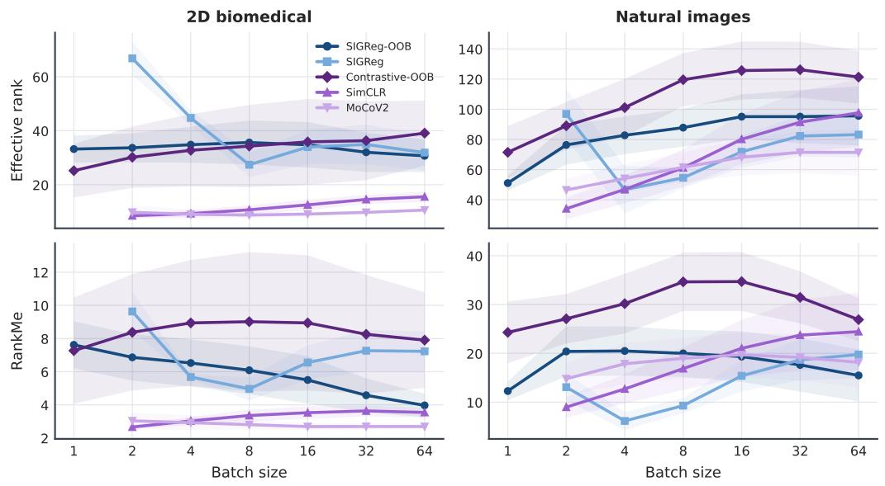  
Figure 11: Effective rank and RankMe of frozen representations. Lines average over the common datasets and bands show standard errors across datasets.

while matching or exceeding its downstream accuracy, and is comparable or higher on natural images. Rank therefore diagnoses one aspect of collapse but does not by itself explain semantic performance.

## D Detailed class-imbalance results

We generate controlled imbalance by retaining a 1/k fraction of the samples from designated classes, for k ∈ {2, 5, 8, 10, 15, 20, 25}. The SSL algorithms remain label-free. Class labels are used only after pretraining to report macro recall over the downsampled classes, worst-class recall, and the minority-majority recall gap. Figure 12 reports the 2D results at batch size 64, while fig. 13 condenses the more stringent tail metrics for the contrastive methods.

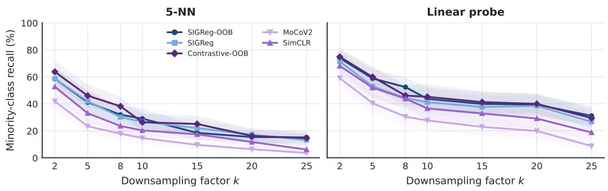  
Figure 12: Minority-class recall for the controlled-imbalance 2D experiments at batch size 64: 5-NN (left) and linear probe (right).

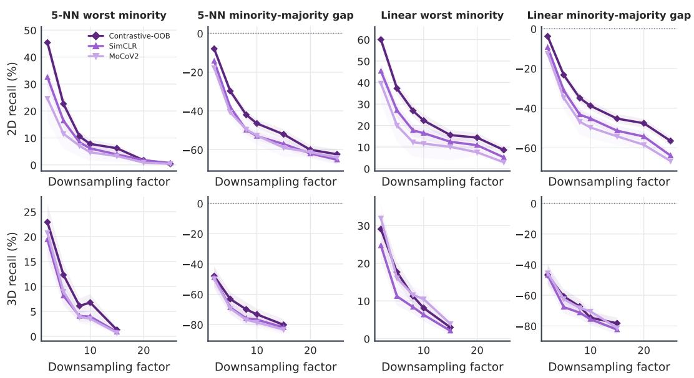  
Figure 13: Worst-class recall and minority-majority recall gap for Contrastive-OOB, SimCLR, and MoCoV2. Lines average dataset-batch experiments and bands show standard errors across those results.

The OOB gains are not restricted to average classification accuracy: they are visible for the underrepresented classes and, in many settings, for the worst class. Nevertheless, an empirical cache preserves the empirical population's frequency weighting. The label-aware oracle diagnostic in the main paper therefore separates two claims: OOB state can estimate a chosen population objective more faithfully, but changing that objective to be class-balanced requires an explicit weighting decision.

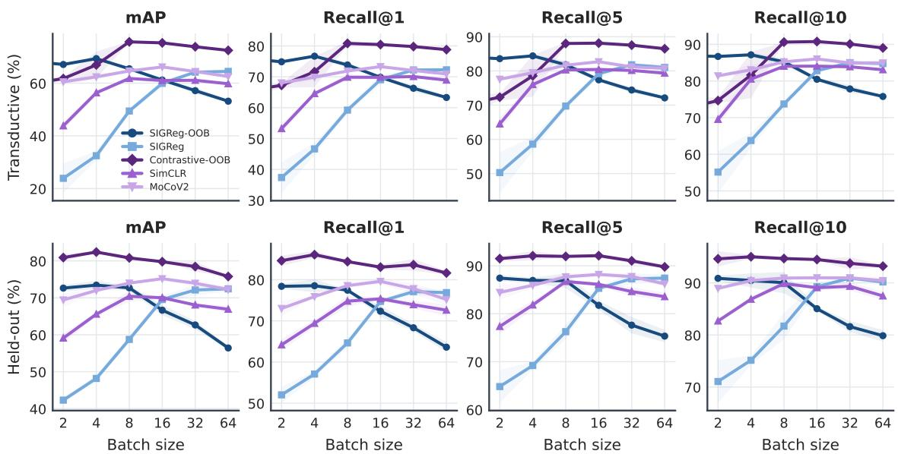  
Figure 14: Transductive and held-out retrieval for mAP and Recall@1/5/10. For each seed, scores are first averaged over the three datasets; lines then show the three-seed mean and bands show one standard deviation.

Table 9: Retrieval performance (%), averaged over the three datasets, batches 2–64, and three training seeds within each protocol. Bold denotes an OOB result that exceeds its corresponding in-batch comparator: SIGReg-OOB versus SIGReg, or Contrastive-OOB versus both SimCLR and MoCoV2.
<table><tr><td>Protocol</td><td>Metric</td><td>SIGReg</td><td>SIGReg-OOB</td><td>SimCLR</td><td>Contrastive-OOB</td><td>MoCoV2</td></tr><tr><td>Transductive</td><td>mAP</td><td>49.1</td><td>62.2</td><td>57.3</td><td>71.0</td><td>63.4</td></tr><tr><td></td><td>R@1</td><td>59.5</td><td>70.8</td><td>66.1</td><td>76.5</td><td>71.0</td></tr><tr><td></td><td>R@5</td><td>70.1</td><td>79.0</td><td>76.8</td><td>83.5</td><td>80.6</td></tr><tr><td></td><td>R@10</td><td>74.2</td><td>82.2</td><td>80.8</td><td>86.1</td><td>84.3</td></tr><tr><td>Held-out</td><td>mAP</td><td>60.6</td><td>67.4</td><td>66.7</td><td>79.7</td><td>72.8</td></tr><tr><td></td><td>R@1</td><td>67.1</td><td>73.1</td><td>71.7</td><td>83.9</td><td>76.7</td></tr><tr><td></td><td>R@5</td><td>78.4</td><td>82.7</td><td>83.4</td><td>91.4</td><td>86.7</td></tr><tr><td></td><td>R@10</td><td>83.0</td><td>86.3</td><td>87.6</td><td>94.3</td><td>90.4</td></tr></table>

## E Instance-retrieval results

The held-out evaluation confirms that the transductive improvements are not solely memorization of the training instances (Table 9 and fig. 14). CONTRASTIVE-OOB gives the highest average mAP and recall in both protocols, while SIGReg-OOB improves over SIGREG on every aggregate retrieval metric.

## F Continued pretraining with DINOv2

Continued-pretraining runs start from public DINOv2 ViT-S/B/L/G checkpoints and use two augmented views for 100 epochs. The backbone and projector learning rates are $1 0 ^ { - 5 }$ and $1 0 ^ { - 4 }$ , respectively; weight decay is 0.05 and the gradient norm is clipped at 1. OOB refreshes occur every 0.5 epoch. Refresh batch sizes for ViT-S/B/L/G are 128, 64, 16, and 4 to accommodate their different activation footprints. Experiments use an NVIDIA A100 GPU.

The per-dataset results (Figure 15) support the main conclusion: at small batches, OOB regularization is more likely to retain or improve the pretrained representation than its in-batch counterpart. The benefit nevertheless depends on the method, encoder, and target dataset, consistent with the central claim being about access to population context rather than guaranteed improvement for every pretrained representation.

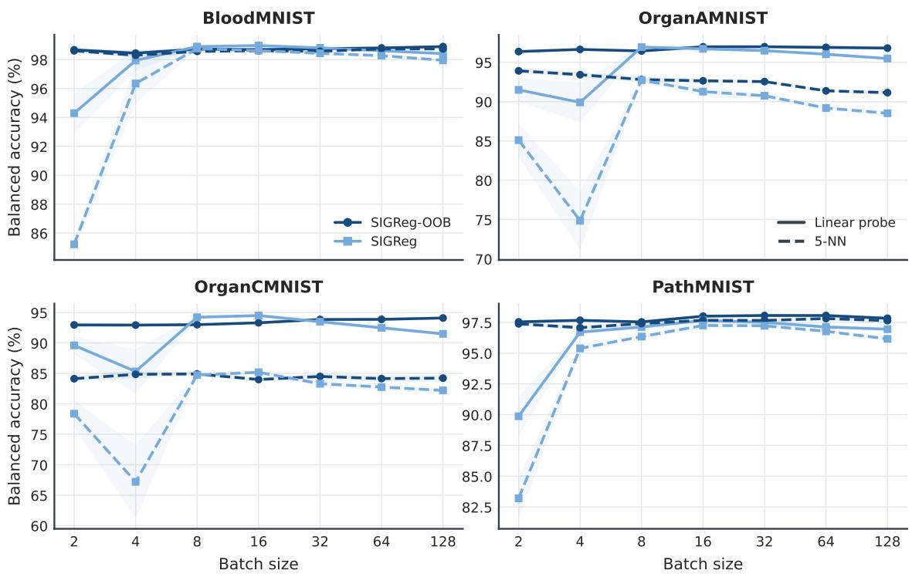  
Figure 15: Per-dataset DINOv2 continued-pretraining performance on biomedical datasets for SIGReg and SIGReg-OOB. Solid lines show linear-probe accuracy and dashed lines show 5-NN accuracy. Each point averages DINOv2-S/B/L/G encoders; bands show standard errors across encoder sizes.

## G Computational measurements

We benchmark each method on one NVIDIA L40S GPU for 100 epochs (Figure 16). The five-method benchmark spans BloodMNIST at 500, 1k, 2k, and 5k training examples and STL-10. We evaluate batches 1–64 where each method is defined. Peak allocated GPU memory is measured during training; wall time includes refresh passes and anchor construction.

At a matched batch size, SIGReg-OOB and CONTRASTIVE-OOB have essentially the same peak allocated GPU memory as their direct SIGReg and SimCLR counterparts. They add approximately 10% and 4% wall time, respectively, due to periodic cache construction.

## H Additional analyses

## H.1 Convergence over pretraining time

We record frozen 5-NN and linear-probe performance after every epoch for BloodMNIST-5k, STL-10, and ImageNet-100-5k. Figure 17 and table 10 shows the difference in improvement between OOB and in-batch variants as optimization proceeds. The Gaussian OOB advantage grows throughout training and the contrastive advantage emerges early and remains positive on average through epoch 200.

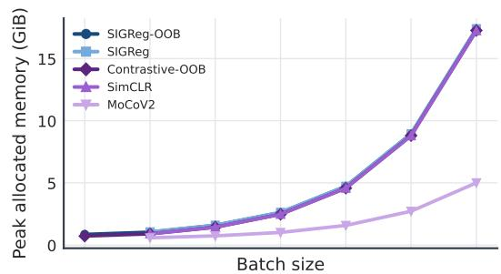

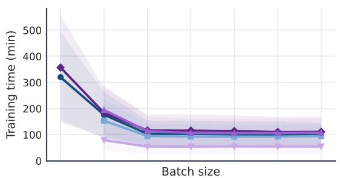

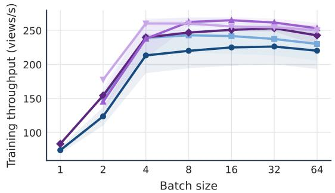

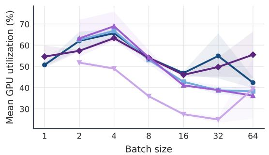  
Figure 16: Detailed resource measurements across dataset sizes and batches. Lines average the datasets evaluated for each method, and bands show standard errors across datasets.

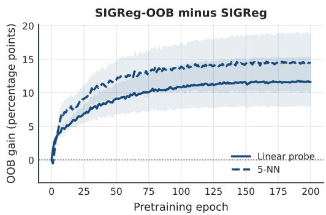

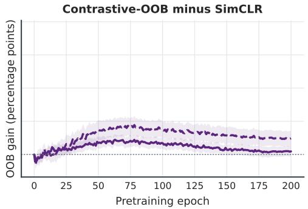  
Figure 17: OOB improvement over the corresponding in-batch method during pretraining. Solid lines show linear-probe accuracy and dashed lines show 5-NN accuracy. Lines average matched dataset-batch cells and bands show standard errors across those cells.

Table 10: Mean OOB gain in percentage points at selected epochs.
<table><tr><td>Comparison</td><td>Probe</td><td>Epoch 25</td><td>Epoch 50</td><td>Epoch 100</td><td>Epoch 200</td></tr><tr><td>SIGReg-OOB - SIGReg</td><td>5-NN</td><td>+9.09</td><td>+11.94</td><td>+13.88</td><td>+14.43</td></tr><tr><td>SIGReg-OOB — SIGReg</td><td>Linear</td><td>+6.91</td><td>+9.14</td><td>+10.80</td><td>+11.62</td></tr><tr><td>Contrastive-OOB – SimCLR</td><td>5-NN</td><td>+1.58</td><td>+3.68</td><td>+3.71</td><td>+2.43</td></tr><tr><td>Contrastive-OOB — SimCLR</td><td>Linear</td><td>+0.89</td><td>+1.73</td><td>+1.71</td><td>+0.47</td></tr></table>