# DeBoneDiT: Depth-Driven Conditional Bridge Diffusion Transformers for Bone Suppression in Chest X-Ray Images

Yifei Sun1,2,∗, Fenglei Fan3,∗, Junhao Jia2, Wenming Deng4, Hongxia Xu1, Changmiao Wang5,†, Ruiquan Ge2,†

1Zhejiang University, 2Hangzhou Dianzi University, 3City University of Hong Kong, 4National Cancer Center/National Clinical Research Center for Cancer/Cancer Hospital & Shenzhen Hospital, Chinese Academy of Medical Sciences and Peking Union Medical College, 5Shenzhen Research Institute of Big Data

∗Equal contribution, †Corresponding authors

## Abstract

Chest X-Ray (CXR) is a primary modality for diagnosing pulmonary diseases, yet the overlap of bony structures often obscures critical radiographic findings, increasing the risk of diagnostic uncertainty. While Dual-Energy Subtraction (DES) is the clinical benchmark for bone suppression, its widespread adoption is primarily hindered by specialized hardware requirements and increased radiation exposure. Recently, difusion-based generative models have shown promise for this task, yet they are still constrained by reconstruction-biased latent compression, prior-induced domain gap, and a scarcity of high-quality paired datasets. To address these challenges, we propose DeBoneDiT, a depth-driven conditional bridge difusion Transformer architecture for eficient high-resolution bone suppression. We first introduce Depth Auto-Encoder (DAE), a structure-aware vision tokenizer for latent compression. By incorporating a multi-level depth feature loss derived from the pretrained Depth Anything V2 encoder, DAE preserves both visual fidelity and structural consistency. Second, we formulate bone suppression as a source-conditioned Brownian bridge difusion process, leveraging CXRs as both the difusion prior and structural guidance to narrow the source-to-target domain gap and maintain anatomical plausibility. Furthermore, we have constructed and released SZCH-X-Rays, the largest publicly available high-quality paired dataset for bone suppression to date, comprising 741 pairs of CXR and DES soft tissue images. Extensive experiments and downstream evaluation demonstrate that DeBoneDiT achieves superior bone suppression performance with reduced computational overhead.

Email: diaoquesang@gmail.com

## Contents

1 Introduction 3   
2 Methodology   
2.1 Depth Auto-Encoder   
2.2 Brownian Bridge Difusion Process   
2.3 Source Condition Injection . 8   
3 Experiments and Discussion 9   
3.1 Datasets and Evaluation metrics 9   
3.1.1 Data Preparation . 9   
3.1.2 Evaluation Metrics 9   
3.2 Implementation Details 10   
3.3 Main Results 10   
3.4 Ablation Study 11   
3.4.1 Impact of the Depth Feature Loss 12   
3.4.2 Impact of the Difusion Paradigm 13   
3.4.3 Impact of the Denoising Backbone 13   
3.5 Downstream Evaluation 15   
3.6 Limitations 16   
Conclusion . 16

## 1 Introduction

Lung diseases remain a leading cause of morbidity and mortality worldwide, posing substantial challenges to public health systems and healthcare resource allocation [20]. In the clinical diagnosis and screening of lung diseases, Chest X-Ray (CXR) serves as a primary imaging modality due to its accessibility, low cost, and minimal radiation exposure. It enables rapid detection of key radiographic findings such as pulmonary inflammation, nodules, and masses, providing crucial imaging evidence for early diagnosis. However, overlapping bony structures often obscure pathological details in critical regions, significantly increasing the risk of overlooking subtle early-stage lesions [8]. In response to this challenge, bone suppression has attracted increasing attention as an efective strategy for enhancing the diagnostic utility of CXR. Clinical studies have demonstrated that bone-suppressed CXR images can significantly improve radiologists’ sensitivity in detecting pulmonary lesions [17]. Moreover, bone-suppressed images provide cleaner and more informative inputs for Computer-Aided Detection (CAD) systems, thereby facilitating more accurate automated analysis and clinical decision-making [30].

Dual-Energy Subtraction (DES) imaging [34] is the clinical benchmark for CXR bone suppression. By leveraging the diferential X-ray attenuation of bone and soft tissue across two energy levels, it separates bone and soft tissue components to generate bone-suppressed images. Nevertheless, the widespread adoption of DES remains limited due to its reliance on specialized instrumentation, increased radiation exposure, and susceptibility to motion-induced artifacts. These limitations have spurred extensive research into alternative bone suppression approaches, with the goal of achieving efective bone removal while preserving diagnostically relevant soft tissue details.

Early bone suppression methods primarily relied on shallow pixel-level learning and statistical anatomical modeling to isolate and remove bony structures. Specifically, Suzuki et al. [32] employed a Massive Training Artificial Neural Network (MTANN) to generate bone residuals for subsequent subtraction, while Juhász et al. [16] used an Active Shape Model (ASM) to segment anatomical structures. However, the clinical applicability of these methods remains limited, as they either lack high-level semantic understanding of bony anatomy or rely on labor-intensive boundary annotations.

Conventional deep learning approaches, including Auto-Encoder (AE)-based models [9], U-Net variants [26], and Generative Adversarial Network (GAN)-driven frameworks [23, 28, 37, 42], have since emerged to overcome the limitations of early methods through automated feature representation learning. Gusarev et al. [9] treated bones as noise and used AEs to generate soft tissue images. For U-Net-based architectures, Schiller et al. [26 developed xU-NetFullSharp, incorporating multi-level and multi-directional feature connections. Among GAN-driven frameworks, Zhou et al. [42] proposed a Multi-Scale Conditional Adversarial Network (MCA-Net) to generate virtual DES soft tissue images; Rani et al. [23] developed a Pix2Pix-based pipeline for bone suppression, aiming to support multi-modal downstream tasks; Singh et al. [28] further enhanced GAN performance with a Multi-Scale and Dual Attention GAN (MDA-GAN); and Yang et al. [37] advanced GAN-based methods by exploiting both domain-level and instance-level information. Despite these advances, many methods still face challenges in balancing efective bone suppression with the preservation of fine pulmonary structures, often resulting in over-smoothing, texture loss, or incomplete bone removal.

In recent years, difusion-based generative models [4, 12, 29] have emerged as a powerful paradigm for medical image generation, efectively mitigating the mode collapse and convergence issues commonly associated with GANs. These models produce high-fidelity images through an iterative denoising process, rendering them particularly suitable for complex imaging tasks such as CXR bone suppression. Existing studies [30, 31] have shown that difusion-generated soft tissue images often exhibit superior perceptual quality compared with alternative generative approaches, thereby indicating improved visual plausibility and enhanced suitability for clinical interpretation. An early difusion-based framework, BS-Dif [5], pioneered the application of Denoising Difusion Probabilistic Models (DDPMs) [12] to bone suppression, leveraging a conditional difusion architecture with a U-Net backbone and an AE-based enhancement module. Subsequently, BS-LDM [30] extended this paradigm to Latent Difusion Models (LDMs) [24], which operate in a compressed latent space to reduce computational overhead while enabling high-resolution image synthesis. Further advancing this line of research, GL-LCM [31] introduced dual-path sampling and global-local fusion strategies, explicitly addressing the critical trade-of between bone suppression and detail retention. Despite these advancements, research in this field remains constrained by three core challenges:

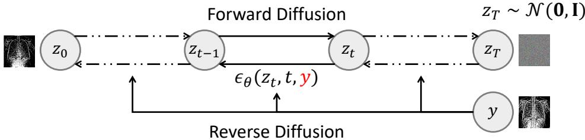  
(a) The Directed Graphical Model of CDM

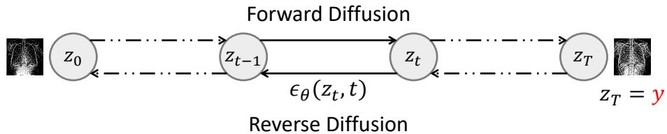  
(b) The Directed Graphical Model of BBDM

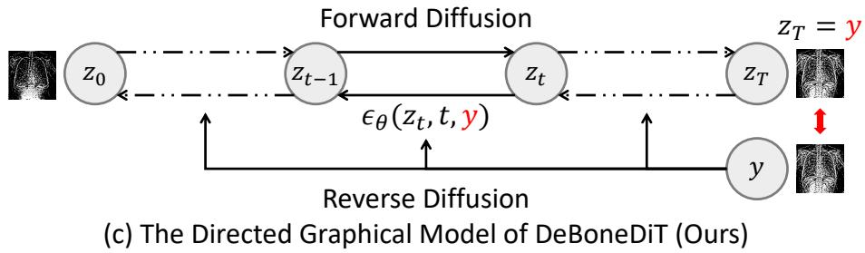  
Figure 1 Comparison of directed graphical models of Conditional Difusion Model (CDM) [12], Brownian Bridge Difusion Model (BBDM) [18] and DeBoneDiT (Ours). (z0: latent tissue; y: latent CXR)

• While LDMs are widely adopted to handle high-resolution CXRs eficiently, their vision tokenizers are narrowly optimized for image reconstruction fidelity and therefore fail to explicitly preserve structural consistency, which is important for distinguishing overlapping bony and soft tissue structures.

• Existing difusion-based methods formulate bone suppression as a conditional generation task initialized from Gaussian noise, as illustrated in Fig. 1 (a). The resulting distribution gap increases the dificulty of learning anatomically plausible mappings and often requires extensive iterative denoising.

• The scarcity of large-scale, high-quality paired datasets remains a primary constraint in bone suppression research. The largest existing publicly available dataset JSRT [27] contains only 241 paired images with blurring and pronounced artifacts, as depicted in Figs. 2 and 6, limiting training reliability and clinical translation [23, 26].

To address these challenges, we propose DeBoneDiT, a depth-driven conditional bridge difusion Transformer architecture designed for eficient high-resolution bone suppression, as illustrated in Fig. 3. Drawing upon prior experience [30, 31], we adopt the two-stage design of LDMs to ensure computational eficiency. In addition, we have constructed and released SZCH-X-Rays, a high-quality dataset containing 741 pairs of CXR and DES soft tissue images for bone suppression research. Our contributions can be summarized as follows:

• We introduce Depth Auto-Encoder (DAE), a structure-aware vision tokenizer for latent compression. By incorporating a multi-level depth feature loss derived from the pretrained Depth Anything V2 [36] encoder, DAE preserves both visual fidelity and structural consistency.

• To the best of our knowledge, we are the first to formulate bone suppression as a Brownian bridge difusion process [18] aiming to narrow the source-to-target domain gap. Furthermore, we introduce a source conditioning mechanism that leverages CXRs as both the difusion prior and structural guidance to maintain anatomical plausibility.

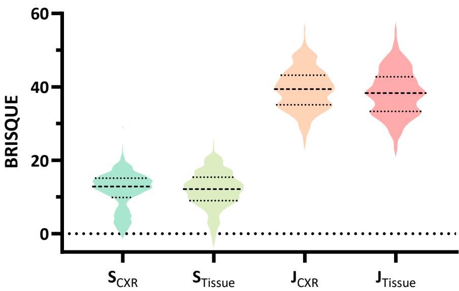  
Figure 2 Violin plots of data quality using Blind/Referenceless Image Spatial Quality Evaluator (BRISQUE) [19] (↓) across two datasets (S: SZCH-X-Rays, J: JSRT [27]). Our SZCH-X-Rays demonstrates higher quality with lower BRISQUE scores for both CXR and soft tissue data.

• We have constructed and released SZCH-X-Rays, the largest publicly available high-quality paired dataset for bone suppression to date, comprising 741 pairs of posterior-anterior CXR and DES soft tissue images.

• Extensive experiments and downstream evaluation demonstrate that DeBoneDiT achieves superior bone suppression performance with reduced computational overhead.

## 2 Methodology

As illustrated in Fig. 3, DeBoneDiT is a two-stage framework for high-resolution bone suppression. In the first stage, we introduce Depth Auto-Encoder (DAE) to compress high-dimensional images into latent representations, incorporating a multi-level depth feature loss to preserve structural consistency. In the second stage, we formulate the bone suppression task as a Brownian bridge difusion process by establishing a direct bridge between the source CXR distribution and the target soft tissue distribution, efectively narrowing the inter-domain gap. This process is further enhanced by Source Condition Injection (SCI), which leverages the source CXR as explicit structural guidance to mitigate anatomical drift and error accumulation.

## 2.1 Depth Auto-Encoder

To explicitly preserve structural information during latent compression, we propose Depth Auto-Encoder (DAE) as a structure-aware vision tokenizer. Unlike conventional tokenizers that focus solely on surface-level reconstruction fidelity, DAE incorporates a multi-level depth feature loss derived from the pretrained Depth Anything V2 encoder, enabling it to preserve both visual fidelity and structural consistency.

Specifically, the DAE comprises an encoder $E ,$ a decoder $D ,$ a codebook $\mathcal { Z } ,$ , a discriminator $\mathcal { D } _ { \mathrm { a d v } }$ , and a pretrained depth feature extractor $\phi .$ Given an input CXR or soft tissue image $\boldsymbol { x } \in \mathbb { R } ^ { 1 \times H \times W }$ , the encoder maps it into a continuous latent representation $\begin{array} { r } { z _ { e } = E ( x ) \in \mathbb { R } ^ { C \times \frac { H } { r } \times \frac { W } { r } } } \end{array}$ , where r denotes the downsampling factor. Subsequently, $z _ { e }$ is quantized against the codebook $\mathcal { Z }$ to obtain the discrete latent representation $\begin{array} { r } { z = \mathcal { Q } ( z _ { e } ) \in \mathbb { R } ^ { C \times \frac { H } { r } \times \frac { W } { r } } } \end{array}$ , where $\mathcal { Q } ( \cdot )$ denotes the vector quantization operator. The decoder then reconstructs the image $\hat { x } = D ( z )$ . Furthermore, the discriminator $\mathcal { D } _ { \mathrm { a d v } }$ distinguishes real from reconstructed images to drive the recovery of sharp, high-fidelity details.

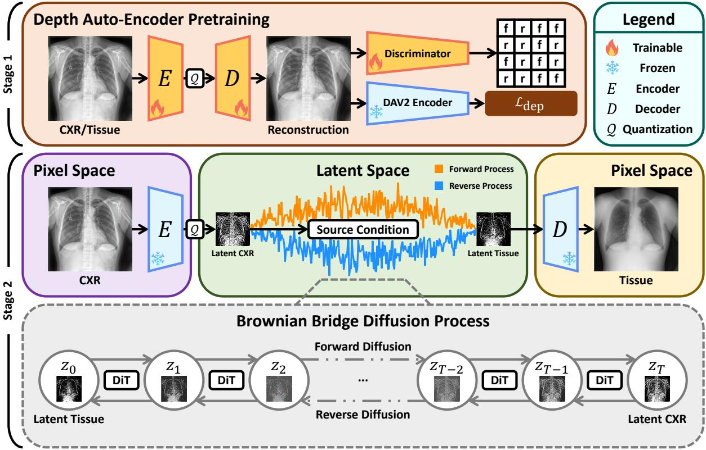  
Figure 3 Overview of the DeBoneDiT architecture. Stage 1 (top): A Depth Auto-Encoder (DAE) is first pretrained to reconstruct images while preserving structural consistency, where a multi-level depth feature loss $\mathcal { L } _ { \mathrm { d e p } }$ is computed between the input and reconstruction using a pretrained Depth Anything V2 (DAV2) encoder. Stage 2 (bottom): The bone suppression task is formulated as a source-conditioned Brownian bridge difusion process in the latent space, where a DiT-based network iteratively transforms the latent representation of the source $\mathrm { C X R \ } z _ { T }$ into the target soft tissue $z _ { \mathrm { 0 } }$

Following the established latent space construction [30, 31], the objective function of DAE combines a composite reconstruction loss ${ \mathcal { L } } _ { \mathrm { r e c } }$ and supplementary constraints:

$$
\mathcal { L } _ { \mathrm { D A E } } = \mathcal { L } _ { \mathrm { r e c } } + \mathcal { L } _ { \mathrm { q u a } } + \lambda _ { \mathrm { a d v } } \mathcal { L } _ { \mathrm { a d v } } ,\tag{1}
$$

where $\mathcal { L } _ { \mathrm { { q u a } } }$ and $\mathcal { L } _ { \mathrm { a d v } }$ represent the standard vector quantization loss [7] and multi-scale adversarial loss [35], respectively. Specifically, we define the reconstruction loss by integrating the depth feature loss with traditional pixel-wise and perceptual constraints:

$$
\mathcal { L } _ { \mathrm { r e c } } = \mathcal { L } _ { \mathrm { M S E } } + \lambda _ { \mathrm { p e r } } \mathcal { L } _ { \mathrm { p e r } } + \lambda _ { \mathrm { d e p } } \mathcal { L } _ { \mathrm { d e p } } ,\tag{2}
$$

where $\mathcal { L } _ { \mathrm { M S E } }$ and $\mathcal { L } _ { \mathrm { p e r } }$ denote the Mean Squared Error (MSE) loss and VGG-16-based perceptual loss [15], respectively.

The introduced depth feature loss ${ \mathcal { L } } _ { \mathrm { d e p } }$ measures the feature discrepancy between the input and reconstructed images across multiple layers of the depth feature extractor ϕ:

$$
\mathcal { L } _ { \mathrm { d e p } } = \frac { 1 } { L } \sum _ { l = 1 } ^ { L } \frac { 1 } { N \times D _ { l } } \| \phi ^ { l } ( x ) - \phi ^ { l } ( \hat { x } ) \| _ { F } ^ { 2 } ,\tag{3}
$$

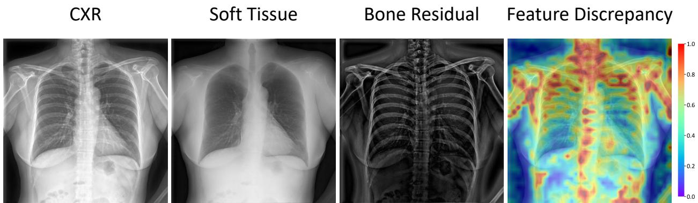  
Figure 4 Visualization of bone residuals and depth feature discrepancies between a CXR and its corresponding soft tissue image. The depth feature diference map exhibits prominent responses around bony structures, indicating the sensitivity of depth features to skeletal anatomy.

where $\phi ^ { l } ( \cdot )$ extracts depth features from the l-th layer. Specifically, for each selected layer $l , \phi ^ { l } ( x )$ has a shape of $N _ { \mathrm { p } } \times D _ { l }$ , where $N _ { \mathrm { p } }$ denotes the sequence length of spatial patch tokens, and $D _ { l }$ denotes the channel dimension of the l-th layer. In this work, we utilize the pretrained Depth Anything V2 [36] encoder as the depth feature extractor $\phi .$ . Rather than predicting explicit depth maps, we leverage its structure-aware features to constrain latent reconstruction, as visualized in Fig. 4.

Following the conventions established in previous studies [30, 31], the trade-of weights for $\mathcal { L } _ { \mathrm { a d v } }$ and $\mathcal { L } _ { \mathrm { p e r } }$ are detailed in Section 3.2. Regarding the newly introduced depth loss ${ \mathcal { L } } _ { \mathrm { d e p } }$ , a comprehensive sensitivity analysis for $\lambda _ { \mathrm { d e p } }$ is provided in Section 3.4.1.

## 2.2 Brownian Bridge Diffusion Process

Rather than initiating the generation process from pure Gaussian noise, we formulate bone suppression as a Brownian bridge difusion process [18], leveraging CXRs as the difusion prior. By modeling the transition directly between the source CXR and target soft tissue domains, this approach efectively preserves the structural correspondence between the CXR and synthesized soft tissue.

Let $z _ { T } = y$ and $z _ { 0 }$ denote the latent representations of the source CXR and target soft tissue, respectively. We define a forward difusion process that transitions $z _ { 0 }$ to $z _ { T }$ over $T$ timesteps. The intermediate state $z _ { t }$ at timestep $t \in \{ 0 , 1 , \ldots , T \}$ is derived from the following conditional distribution:

$$
q ( z _ { t } | z _ { 0 } , y ) = \mathcal { N } ( z _ { t } ; ( 1 - m _ { t } ) z _ { 0 } + m _ { t } y , \delta _ { t } \mathbf { I } ) ,\tag{4}
$$

where $\begin{array} { r } { m _ { t } = \frac { t } { T } } \end{array}$ and $\delta _ { t } = 2 ( m _ { t } - m _ { t } ^ { 2 } )$ define the interpolation and variance schedules of the Brownian bridge, respectively. This formulation ensures that the mean of $z _ { t }$ linearly interpolates between the two endpoints, while the stochastic variance vanishes at $t = 0$ and $t = T$

During the training phase, the model learns to reconstruct the target $z _ { \mathrm { 0 } }$ from the intermediate state $z _ { t }$ Specifically, $z _ { t }$ is sampled by perturbing the target $z _ { 0 }$ with a mixture of the source y and Gaussian noise $\epsilon \sim \mathcal { N } ( \mathbf { 0 } , \mathbf { I } )$

$$
z _ { t } = ( 1 - m _ { t } ) z _ { 0 } + m _ { t } y + \sqrt { \delta _ { t } } \epsilon .\tag{5}
$$

In this work, we employ a denoising network $\epsilon _ { \theta }$ based on the Difusion Transformer (DiT) [21] to predict the added noise ϵ. The training objective of the Brownian bridge difusion process $\mathcal { L } _ { \mathrm { B B D P } }$ is defined as:

$$
\mathcal { L } _ { \mathrm { B B D P } } = \mathbb { E } _ { t , z _ { 0 } , y , \epsilon } \lVert \epsilon - \epsilon _ { \theta } ( z _ { t } , t ) \rVert _ { 2 } ^ { 2 } ,\tag{6}
$$

where $t \sim \mathcal { U } \{ 0 , 1 , . . . , T - 1 \} , \mathrm { a n d } ( z _ { 0 } , y ) \sim q ( z _ { 0 } , y )$

In the reverse difusion process, the model iteratively reconstructs the target soft tissue $z _ { 0 }$ initialized from the source CXR $z _ { T } = y$ . The target representation $\hat { z } _ { 0 }$ at any timestep t can be dynamically estimated from the current state $z _ { t }$ as:

$$
\hat { z } _ { 0 } = \frac { 1 } { 1 - m _ { t } } ( z _ { t } - m _ { t } y - \sqrt { \delta _ { t } } \epsilon _ { \theta } ( z _ { t } , t ) ) .\tag{7}
$$

Based on the estimated target representation $\hat { z } 0 .$ we define the reverse transition distribution for sampling the previous state zt − 1 as:

$$
p _ { \theta } ( z _ { t - 1 } | z _ { t } , \hat { z } _ { 0 } , y ) = \mathcal { N } ( z _ { t - 1 } ; ( 1 - m _ { t - 1 } ) \hat { z } _ { 0 } + m _ { t - 1 } y , \tilde { \delta } _ { t } \mathbf { I } ) .\tag{8}
$$

The state at the previous timestep t − 1 is sampled as:

$$
z _ { t - 1 } = ( 1 - m _ { t - 1 } ) \hat { z } _ { 0 } + m _ { t - 1 } y + \sqrt { \tilde { \delta } _ { t } } \xi ,\tag{9}
$$

where $\xi \sim \mathcal { N } ( \mathbf { 0 } , \mathbf { I } ) \ \mathrm { i f } \ t > 1$ (else $\boldsymbol { \xi } = \mathbf { 0 } )$ , and the reverse step variance $\tilde { \delta } _ { t }$ is derived from the forward schedules via Bayes’ rule [18]. This iterative refinement guides the progressive translation from the CXR domain to the soft tissue domain, enabling the gradual removal of overlapping bony structures.

## 2.3 Source Condition Injection

While the vanilla Brownian bridge difusion process incorporates the source CXR y as a boundary constraint, relying solely on this implicit formulation leads to anatomical drift and error accumulation during sampling. To provide explicit, step-wise structural reinforcement, we introduce an explicit source conditioning mechanism, SCI. Specifically, at each denoising step, we concatenate the noisy latent $z _ { t }$ with the latent representation of the source CXR $y$ along the channel dimension before feeding them into the denoising network $\epsilon _ { \theta }$ . Accordingly, the training objective in Eq. 6 is reformulated as:

$$
\mathcal { L } _ { \mathrm { B B D P } } = \mathbb { E } _ { t , z _ { 0 } , y , \epsilon } \lVert \epsilon - \epsilon _ { \theta } ( z _ { t } , t , y ) \rVert _ { 2 } ^ { 2 } .\tag{10}
$$

This explicit conditioning enables the denoising network $\epsilon _ { \theta }$ to leverage anatomical cues from the source CXR at each step, ensuring more faithful soft tissue synthesis.

Accordingly, this modification extends to the reverse difusion process, where the one-step estimation of the target representation $\hat { z } _ { 0 }$ in Eq. 7 is updated to incorporate the explicit source guidance:

$$
\hat { z } _ { 0 } = \frac { 1 } { 1 - m _ { t } } ( z _ { t } - m _ { t } y - \sqrt { \delta _ { t } } \epsilon _ { \theta } ( z _ { t } , t , y ) ) .\tag{11}
$$

By leveraging the source CXR y as both a boundary constraint in the sampling equation and a conditional input to the network $\epsilon _ { \theta }$ during the iterative sampling process, the model further mitigates anatomical drift and error accumulation. The overall training and sampling processes are summarized in Algorithm 1 and Algorithm 2, respectively.

Algorithm 1 Training   
1: repeat   
2: Paired latent data $( z _ { 0 } , y ) \sim q ( z _ { 0 } , y )$   
3: Timestep $t \sim \mathcal { U } \{ 0 , 1 , \ldots , T - 1 \}$   
4: Gaussian noise $\epsilon \sim \mathcal { N } ( \mathbf { 0 } , \mathbf { I } )$   
5: Forward difusion $z _ { t } = ( 1 - m _ { t } ) z _ { 0 } + m _ { t } y + \sqrt { \delta _ { t } } \epsilon$   
6: Take gradient descent step on   
7: $\nabla _ { \theta } \| \epsilon - \epsilon _ { \theta } ( z _ { t } , t , y ) \| _ { 2 } ^ { 2 }$   
8: until converged

Algorithm 2 Sampling   
1: Sample conditional input $z _ { T } = y \sim q ( y )$   
2: Set $z _ { T - 1 } = z _ { T }$   
3: for $t = T - 1 , \dots , 1$ do   
4: $\xi \sim \mathcal { N } ( \mathbf { 0 } , \mathbf { I } )$ if t > 1, else $\xi = \mathbf { 0 }$   
5: $\begin{array} { r } { \hat { z } _ { 0 } = \frac { 1 } { 1 - m _ { t } } ( z _ { t } - m _ { t } y - \sqrt { \delta _ { t } } \epsilon _ { \theta } ( z _ { t } , t , y ) ) } \end{array}$   
6: $z _ { t - 1 } = ( 1 - m _ { t - 1 } ) \hat { z } _ { 0 } + m _ { t - 1 } y + \sqrt { \tilde { \delta } _ { t } } \xi$   
7: end for   
8: return z0

## 3 Experiments and Discussion

## 3.1 Datasets and Evaluation metrics

## 3.1.1 Data Preparation

We conducted comprehensive experiments across three distinct datasets, with each dataset assigned a specific role in evaluation: our self-constructed SZCH-X-Rays dataset and the publicly available JSRT dataset [27] were utilized for performance evaluation, while the Asraf dataset [1] was employed for downstream evaluation to benchmark clinical applicability. All the images were resized to 1024 × 1024 pixels for experimental consistency.

SZCH-X-Rays comprises 741 pairs of posterior-anterior CXR and DES soft tissue images, acquired using a GE Discovery XR656 system in collaboration with our partner hospital. Initially stored in 14-bit DICOM format, the images were converted to PNG format to streamline the processing workflow, which feature an original resolution of 2021 × 2021 with a pixel size of 0.194 mm. Consistent with prior studies [2, 38], examinations afected by operational errors, pronounced motion artifacts, severe pleural efusion, or pneumothorax were excluded because these conditions may substantially degrade the quality of DES soft tissue references. Finally, the dataset was partitioned into 592 training, 74 validation and 75 test pairs. The dataset is publicly available under the CC BY-NC 4.0 license.

JSRT contains 241 pairs of CXR and synthetic soft tissue images, split into 192 training, 24 validation and 25 test pairs. The CXR images were sourced from the Japanese Society of Radiological Technology while the corresponding soft tissue images were algorithmically synthesized by researchers at the Budapest University of Technology and Economics. The original images feature a resolution of 2048 × 2048 pixels.

Asraf encompasses 6939 posterior-anterior CXR images sourced from publicly available resources, evenly distributed across three diagnostic classes with 2313 images each: pneumonia, COVID-19, and normal. Origina resolutions vary from 205 × 138 to 5623 × 4757 pixels, with 1024 × 1024 being the most prevalent size at 45.2%. To prevent distortion in the non-square images, we cropped each to its maximum square. To evaluate clinical applicability, we performed downstream classification on this dataset using a 5-fold cross-validation strategy to ensure robustness.

## 3.1.2 Evaluation Metrics

We employ five main quantitative metrics to evaluate the bone suppression performance, including Learned Perceptual Image Patch Similarity (LPIPS) [40] (↓), Mean Squared Error (MSE) (↓), Peak Signal-to-Noise Ratio (PSNR) (↑), Structural Similarity Index Measure (SSIM) (↑), and Bone Suppression Ratio (BSR) [13] (↑), a metric that specifically measures the proportion of bone signal efectively suppressed relative to the original bone energy. For downstream task evaluation, we report four classification metrics, namely accuracy (↑), precision (↑), recall (↑), and F1-score (↑). Additionally, we utilize the Blind/Referenceless Image Spatial Quality Evaluator (BRISQUE) [19] (↓) to evaluate the quality of both generated images and ground truth.

Table 1 Quantitative comparison of diferent methods on the SZCH-X-Rays and JSRT datasets. Statistical significance compared to the second-best counterpart is evaluated using the Wilcoxon signed-rank test with Holm-Bonferroni correction applied independently for each dataset $( ^ { * } : p < 0 . 0 5 , ^ { * * } : p < 0 . 0 1 , ^ { * * * } : p < 0 . 0 0 1 )$
<table><tr><td>Dataset</td><td>Method</td><td>Source</td><td> $\mathrm { L P I P S \left( \downarrow \right) }$ </td><td> $\mathrm { M S E } \left( 1 0 ^ { - 3 } , \downarrow \right)$ </td><td>PSNR (dB, ↑)</td><td> $\mathrm { S S I M } ~ ( \% , \uparrow )$ </td><td> $\mathrm { B S R \ ( \% , \uparrow ) }$ </td></tr><tr><td rowspan="7"> $\mathrm { S Z C H - X - R a y s }$ </td><td>xU-NetFullSharp</td><td> $\mathrm { B S P C _ { 2 5 } }$ </td><td> $0 . 1 4 1 \pm 0 . 0 3 2$ </td><td> $2 . 1 5 4 \pm 1 . 5 4 4$ </td><td> $2 7 . 8 8 5 \pm 3 . 4 1 8$ </td><td> $8 7 . 2 6 9 \pm 3 . 6 8 5$ </td><td> $9 1 . 9 3 4 \pm 5 . 4 8 2$ </td></tr><tr><td>Pix2Pix</td><td> $\mathrm { I S W A _ { 2 2 } }$ </td><td> $0 . 1 9 6 \pm 0 . 0 3 9$ </td><td> $1 . 5 0 3 \pm 0 . 8 1 2$ </td><td> $2 8 . 8 8 6 \pm 2 . 4 6 0$ </td><td> $8 3 . 8 8 4 \pm 3 . 0 2 2$ </td><td> $9 2 . 8 4 2 \pm 3 . 8 1 6$ </td></tr><tr><td>MDA-GAN</td><td> $\mathrm { T A I _ { 2 4 } }$ </td><td> $0 . 1 4 1 \pm 0 . 0 3 3$ </td><td> $1 . 8 6 6 \pm 1 . 3 8 9$ </td><td> $2 8 . 5 4 9 \pm 3 . 4 6 4$ </td><td> $8 7 . 8 5 4 \pm 4 . 0 8 0$ </td><td> $9 2 . 6 3 4 \pm 4 . 9 0 8$ </td></tr><tr><td>Yang et al.</td><td> $\mathrm { T M I _ { 2 5 } }$ </td><td> $0 . 2 0 3 \pm 0 . 0 3 9$ </td><td> $1 . 3 9 2 \pm 0 . 5 9 2$ </td><td> $2 8 . 9 5 3 \pm 1 . 8 5 5$ </td><td> $7 8 . 1 0 5 \pm 2 . 7 9 7$ </td><td> $9 2 . 3 4 9 \pm 3 . 1 5 3$ </td></tr><tr><td>BS-Diff</td><td> $\mathrm { I S B I _ { 2 4 } }$ </td><td> $0 . 1 8 9 \pm 0 . 0 3 8$ </td><td> $1 . 9 7 5 \pm 1 . 1 3 7$ </td><td> $2 7 . 8 9 7 \pm 2 . 9 2 1$ </td><td> $8 7 . 6 7 3 \pm 4 . 0 0 5$ </td><td> $9 2 . 8 2 1 \pm 4 . 9 8 0$ </td></tr><tr><td>BS-LDM</td><td> $\mathrm { J B H I _ { 2 5 } }$ </td><td> $0 . 1 0 3 \pm 0 . 0 1 6$ </td><td> $1 . 6 1 5 \pm 0 . 9 3 3$ </td><td> $2 8 . 5 8 7 \pm 2 . 4 3 5$ </td><td> $7 8 . 4 1 2 \pm 2 . 8 6 1$ </td><td> $9 2 . 1 7 3 \pm 4 . 3 1 4$ </td></tr><tr><td> $\mathrm { G L - L C M }$  DeBoneDiT</td><td> $\mathrm { M I C C A I _ { 2 5 } }$ </td><td> $0 . 0 9 3 \pm 0 . 0 1 9$ </td><td> $1 . 9 7 7 \pm 1 . 4 0 3$ </td><td> $2 8 . 1 2 6 \pm 3 . 2 1 0$ </td><td> $8 0 . 7 1 6 \pm 2 . 9 2 3$ </td><td> $9 2 . 8 1 4 \pm 4 . 1 9 8$ </td></tr><tr><td rowspan="7">JSRT</td><td></td><td>Ours</td><td> $\pm 0 . 0 7 8 \pm 0 . 0 2 3 ^ { \ast \ast \ast }$ </td><td> $1 . 2 3 3 \pm 0 . 6 2 6 ^ { \ast \ast }$ </td><td> $2 9 . 6 2 0 \pm 2 . 1 6 8 ^ { \ast \ast \ast }$ </td><td> $\pm 2 8 . 2 0 4 \pm 2 . 3 2 9 ^ { \ast }$ </td><td> $9 3 . 1 4 3 \pm 4 . 1 6 0 ^ { \ast }$ </td></tr><tr><td>xU-NetFullSharp Pix2Pix</td><td> $\mathrm { B S P C _ { 2 5 } }$ </td><td> $0 . 0 9 6 \pm 0 . 0 3 1$ </td><td> $1 . 2 5 7 \pm 0 . 7 5 8$ </td><td> $2 9 . 8 8 3 \pm 2 . 8 7 4$ </td><td> $9 3 . 7 6 4 \pm 2 . 0 5 3$ </td><td> $9 1 . 5 2 5 \pm 8 . 2 2 3$ </td></tr><tr><td>MDA-GAN</td><td> $\mathrm { I S W A _ { 2 2 } }$ </td><td> $0 . 1 1 2 \pm 0 . 0 3 4$ </td><td> $1 . 1 1 9 \pm 0 . 7 3 9$ </td><td> $3 0 . 5 2 4 \pm 3 . 1 2 3$ </td><td> $9 3 . 1 6 2 \pm 2 . 0 6 6$ </td><td> $9 0 . 6 5 5 \pm 9 . 1 3 5$ </td></tr><tr><td></td><td> $\mathrm { T A I _ { 2 4 } }$ </td><td> $0 . 0 9 8 \pm 0 . 0 3 1$ </td><td> $1 . 3 6 8 \pm 0 . 8 7 6$ </td><td> $2 9 . 6 5 5 \pm 3 . 0 6 9$ </td><td> $9 3 . 8 3 9 \pm 1 . 9 6 0$ </td><td> $9 0 . 8 5 1 \pm 8 . 0 6 5$ </td></tr><tr><td>Yang et al. BS-Diff</td><td> $\mathrm { T M I _ { 2 5 } }$ </td><td> $0 . 0 8 3 \pm 0 . 0 3 0$ </td><td> $1 . 1 1 5 \pm 0 . 7 8 7$ </td><td> $3 0 . 7 0 6 \pm 3 . 3 9 0$ </td><td> $9 3 . 6 8 0 \pm 1 . 8 9 5$ </td><td> $9 0 . 8 1 5 \pm 9 . 3 5 5$ </td></tr><tr><td> $\mathrm { B S - L D M }$ </td><td> $\mathrm { I S B I _ { 2 4 } }$   $\mathrm { J B H I _ { 2 5 } }$ </td><td> $0 . 1 2 8 \pm 0 . 0 4 0$   $0 . 0 6 3 \pm 0 . 0 2 6$ </td><td> $1 . 6 4 0 \pm 1 . 0 5 0$   $1 . 2 6 2 \pm 0 . 8 6 7$ </td><td> $2 8 . 8 4 1 \pm 3 . 0 6 3$ </td><td> $9 3 . 0 1 2 \pm 2 . 4 7 0$ </td><td> $9 1 . 0 2 3 \pm 8 . 5 6 1$ </td></tr><tr><td> $\mathrm { G L - L C M }$ </td><td> $\mathrm { M I C C A I _ { 2 5 } }$ </td><td> $0 . 0 5 8 \pm 0 . 0 2 4$ </td><td> $1 . 2 2 2 \pm 0 . 8 9 2$ </td><td> $2 9 . 8 8 1 \pm 2 . 7 8 6$ </td><td> $9 3 . 4 4 7 \pm 1 . 7 5 9$ </td><td> $8 8 . 7 3 3 \pm 1 1 . 6 4 8$ </td></tr><tr><td rowspan="4"></td><td></td><td></td><td></td><td></td><td> $3 0 . 2 1 7 \pm 3 . 1 1 9$ </td><td> $9 3 . 6 8 5 \pm 1 . 8 1 8$ </td><td> $9 1 . 9 6 3 \pm 9 . 2 3 1$ </td></tr><tr><td>DeBoneDiT</td><td>Ours</td><td> $0 . 0 3 2 \pm 0 . 0 1 3 ^ { \ast \ast \ast }$ </td><td> $1 . 0 1 7 \pm 0 . 9 8 3 ^ { \ast }$ </td><td> $\mathbf { 3 1 . 3 3 9 \pm 3 . 2 8 0 ^ { \ast } }$ </td><td> $9 4 . 2 6 2 \pm 1 . 2 3 3 ^ { \ast }$ </td><td> $9 3 . 5 3 0 \pm 9 . 2 9 6$ </td></tr><tr><td></td><td></td><td></td><td></td><td></td><td></td><td></td></tr><tr><td></td><td></td><td></td><td></td><td></td><td></td><td></td></tr></table>

## 3.2 Implementation Details

All experiments were performed using $\mathrm { P y }$ Torch 2.5.1 on an NVIDIA A800 GPU within Ubuntu 22.04. The DAE was trained from scratch for 200 epochs with a batch size of 4 using the Adam optimizer. Specifically, the learning rate was set to $1 0 ^ { - 4 }$ for both the encoder E and decoder $D ,$ and $5 \times 1 0 ^ { - 4 }$ for the discriminator $\mathcal { D } _ { \mathrm { a d v } }$ Regarding the latent space, the downsampling factor r and the channel dimension C were set to $^ { 4 , }$ resulting in a latent representation of $z \in \mathbb { R } ^ { 4 \times 2 5 6 \times 2 5 6 }$ for input $\boldsymbol { x } \in \mathbb { R } ^ { 1 \times { 1 0 2 4 \times 1 0 2 4 } }$ . The codebook $\mathcal { Z }$ was configured with a size of $K = 1 0 2 4$ . For the depth feature extractor $\phi ,$ we adopted the ViT-B/14 configuration, with input data resized to 518 × 518 pixels prior to depth feature extraction. Consequently, the sequence length of spatial patch tokens was $N _ { \mathrm { p } } = 1 3 6 9$ , and the feature dimensions $D _ { l }$ for the $L = 4$ selected intermediate layers were 96, 192, 384, and 768, respectively. To balance diferent training objectives, the trade-of weights for DAE training were set to $\lambda _ { \mathrm { a d v } } = 1 0 ^ { - 2 } , \lambda _ { \mathrm { p e r } } = 1 0 ^ { - 3 }$ , and $\lambda _ { \mathrm { d e p } } = 1$

In addition, the DiT-based denoising network $\epsilon _ { \theta }$ with $N = 1 2 \ \mathrm { D i T }$ blocks was trained from scratch for 2000 epochs with a batch size of 8 using the AdamW optimizer. Specifically, a multi-step learning rate decay strategy was employed, initialized at $1 0 ^ { - 4 }$ . Following established practices [30], Exponential Moving Average (EMA) and Classifier-Free Guidance (CFG) [11] were adopted to ensure model robustness during training and inference, respectively. Furthermore, the number of difusion timesteps $T$ was set to 1000 for training, whereas only 50 sampling steps were utilized for inference to facilitate rapid generation.

For the downstream evaluation, all five classification models were fine-tuned from ImageNet-1K [25] pretrained weights using the Adam optimizer with a weight decay of $1 0 ^ { - 4 }$ . The initial learning rate was set to $1 0 ^ { - 3 }$ with a plateau-based learning rate scheduler. All these models were trained for 20 epochs with a batch size of 16 using the standard cross-entropy loss with a label smoothing coeficient of 0.15.

## 3.3 Main Results

We conduct a rigorous quantitative evaluation against seven state-of-the-art methods, encompassing conventional GAN-based Yang et al. [37], MDA-GAN [28] and Pix2Pix [23], the U-Net-based xU-NetFullSharp [26], and recent difusion-based GL-LCM [31], BS-LDM [30] and BS-Dif [5]. Table 1 presents the performance on both our SZCH-X-Rays and the public JSRT datasets. DeBoneDiT consistently outperforms all competing methods across all five metrics, demonstrating its superior capability in bone suppression and detail preservation.

On the SZCH-X-Rays dataset, DeBoneDiT establishes a new state-of-the-art, surpassing the second-best baseline by 0.667 dB in PSNR and achieving a superior SSIM of 88.204%. Notably, our method yields the lowest LPIPS of 0.078, demonstrating enhanced perceptual fidelity compared to other methods. This advantage is even more pronounced on the JSRT dataset, where DeBoneDiT achieves a remarkably low LPIPS of 0.032, which represents a significant improvement over the 0.058 of the second-best GL-LCM, alongside a robust BSR of 93.530%. These results validate the efectiveness and consistency of our approach across diverse data distributions.

xU-NetFullSharpPix2Pix MDA-GAN Yang et al. BS-Diff BS-LDM GL-LCM DeBoneDiT GT  
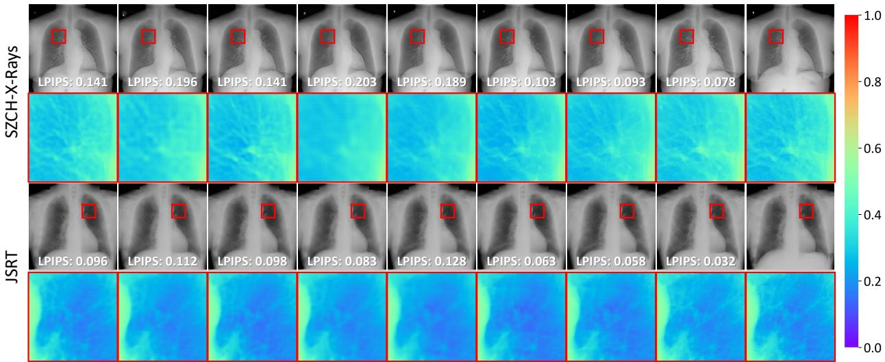  
Figure 5 Visual comparison of diferent methods on the SZCH-X-Rays and JSRT datasets. The even rows display pseudo-color magnified views of the pixel intensities within the regions indicated by red boxes to highlight subtle textural details. (GT: Ground Truth)

Table 2 Quantitative comparison of model complexity and inference latency among diferent difusion-based methods.
<table><tr><td>Method</td><td>Scheduler</td><td>Timesteps</td><td>Params (M)</td><td>Time (s)</td></tr><tr><td>BS-Diff</td><td>DDPM</td><td>1000</td><td>254.7</td><td>110.5</td></tr><tr><td>BS-LDM</td><td>DDPM</td><td>1000</td><td>421.3</td><td>85.9</td></tr><tr><td>GL-LCM</td><td>LCM</td><td>50</td><td>436.9</td><td>8.7</td></tr><tr><td>DeBoneDiT</td><td>BBDM</td><td>50</td><td>72.8</td><td>3.4</td></tr></table>

Beyond pixel-level metrics, we evaluate the visual fidelity of the synthesized soft tissue images, as illustrated in Fig. 5. Qualitative comparisons reveal that GAN-based frameworks, exemplified by Pix2Pix [23], and early difusion-based approaches, such as BS-Dif [5], tend to over-smooth fine pulmonary structures. While more recent methods like BS-LDM [30] improve detail preservation, they exhibit performance instability across diferent data distributions. Specifically, while demonstrating adequate suppression on SZCH-X-Rays, they frequently encounter residual bone shadows on JSRT. In contrast, DeBoneDiT consistently and efectively suppresses overlapping bony structures while preserving fine pulmonary details across both datasets. Furthermore, Fig. 6 suggests that DeBoneDiT does not simply memorize artifact patterns from the training data, indicating a degree of robustness to imperfections in the reference images.

Regarding eficiency, Table 2 compares the model complexity and inference latency of various difusion-based frameworks. By leveraging the Brownian bridge difusion process, DeBoneDiT achieves a rapid inference time of 3.4 seconds per image. Moreover, with a compact parameter count of only 72.8 M, our DiT-based architecture is more lightweight than traditional U-Net-based counterparts. This superior eficiency underscores the potential of DeBoneDiT as a scalable and viable solution for high-throughput clinical workflows.

## 3.4 Ablation Study

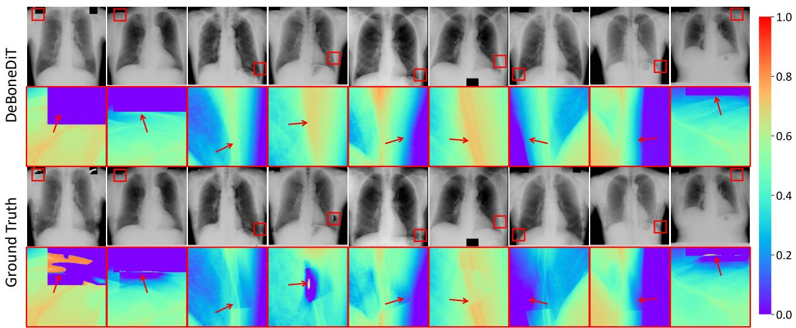  
Figure 6 Qualitative comparison of the outputs of DeBoneDiT (top) against the ground truth (bottom) from JSRT. As indicated by the red arrows, the ground truth contains visible acquisition artifacts. In contrast, DeBoneDiT produces anatomically coherent soft tissue structures without reproducing these artifacts. This observation indicates a degree of robustness to imperfections in the reference images and suggests that the model does not simply memorize artifact patterns from the training data.

Table 3 Quantitative ablation study on the impact of the depth feature loss ${ \mathcal { L } } _ { \mathrm { d e p } } .$
<table><tr><td>Dataset</td><td> ${ \mathcal { L } } _ { \mathrm { d e p } }$ </td><td>LPIPS (↓)</td><td>BRISQUE (↓)</td></tr><tr><td rowspan="2">SZCH-X-Rays</td><td>X</td><td> $0 . 1 6 9 \pm 0 . 0 6 7$ </td><td> $2 6 . 6 4 4 \pm 2 . 5 9 1$ </td></tr><tr><td>V</td><td> $\pm 0 . 0 7 8 \pm 0 . 0 2 3$ </td><td> $2 2 . 0 4 3 \pm 5 . 0 0 1$ </td></tr><tr><td rowspan="2">JSRT</td><td>X</td><td> $0 . 0 6 1 \pm 0 . 0 2 3$ </td><td> $4 7 . 0 0 3 \pm 0 . 8 7 3$ </td></tr><tr><td>√</td><td> $\pm 0 . 0 3 2 \pm 0 . 0 1 3$ </td><td> $\pm 7 . 1 4 4 \pm 3 . 7 8 7$ </td></tr></table>

(a) CXR Reconstruction  
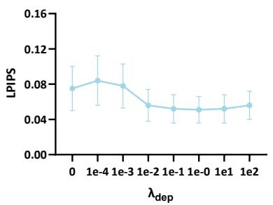

(b) Soft Tissue Reconstruction  
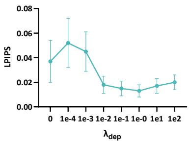

(c) Bone Suppression  
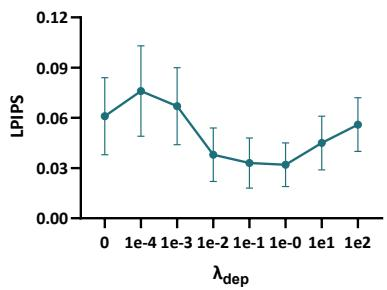  
Figure 7 Sensitivity analysis of the depth feature loss weight $\lambda _ { \mathrm { d e p } }$ on JSRT. The results indicate that setting $\lambda _ { \mathrm { d e p } } = 1$ attains the minimal perceptual error across (a) CXR reconstruction, (b) soft tissue reconstruction, and (c) bone suppression, demonstrating its optimal balance for the task.

## 3.4.1 Impact of the Depth Feature Loss

We first evaluate the impact of the depth feature loss ${ \mathcal { L } } _ { \mathrm { d e p } }$ on capturing structural hierarchies. As quantified in Table 3, incorporating ${ \mathcal { L } } _ { \mathrm { d e p } }$ significantly reduces LPIPS from 0.169 / 0.061 to 0.078 / 0.032, underscoring that depth-driven supervision can enhance the perceptual quality of bone-suppressed images. Specifically, the sensitivity analysis in Fig. 7 demonstrates that $\lambda _ { d e p } = 1$ provides the optimal regularization strength, minimizing perceptual distortion across both image reconstruction and bone suppression tasks. This improvement is further supported by the latent channel correlation analysis in Fig. 8, where the inclusion of ${ \mathcal { L } } _ { \mathrm { d e p } }$ leads to a lower Average Absolute Of-Diagonal Correlation (AAODC) [39], indicating superior feature disentanglement within the latent space.

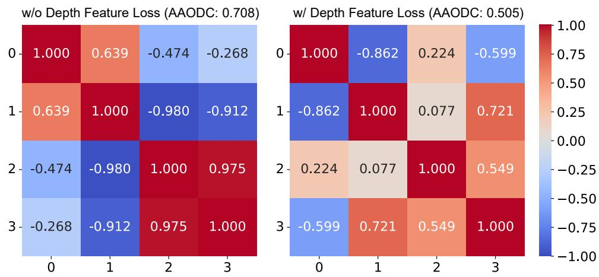  
Figure 8 Latent channel correlation analysis of DAE on SZCH-X-Rays. A lower Average Absolute Of-Diagonal Correlation (AAODC) [39] indicates a higher degree of feature disentanglement.

Table 4 Quantitative ablation study on the impact of diferent difusion paradigms, including CDM, BBDM and DeBoneDiT (Ours).
<table><tr><td>Dataset</td><td>Paradigm</td><td>Prior</td><td>Condition</td><td>LPIPS (↓)</td><td> $\mathrm { M S E } \left( 1 0 ^ { - 3 } , \downarrow \right)$ </td><td> $\mathrm { P S N R } \left( \mathrm { d B } , \uparrow \right)$ </td><td>BSR (%, ↑)</td></tr><tr><td rowspan="3">SZCH-X-Rays</td><td>CDM</td><td>N(0,I)</td><td>y</td><td> $0 . 0 9 3 \pm 0 . 0 1 8$ </td><td> $2 . 0 0 4 \pm 1 . 2 0 7$ </td><td> $2 7 . 8 3 5 \pm 2 . 8 6 1$ </td><td> $9 2 . 1 4 1 \pm 4 . 0 3 1$ </td></tr><tr><td>BBDM</td><td>y</td><td>X</td><td> $0 . 1 3 7 \pm 0 . 0 4 0$ </td><td> $1 . 5 5 8 \pm 0 . 8 2 9$ </td><td> $2 8 . 6 0 2 \pm 2 . 1 0 3$ </td><td> $8 6 . 9 7 3 \pm 1 0 . 1 5 4$ </td></tr><tr><td>DeBoneDiT</td><td>y</td><td>y</td><td> $\pm 0 . 0 7 8 \pm 0 . 0 2 3$ </td><td> $1 . 2 3 3 \pm 0 . 6 2 6$ </td><td> $2 9 . 6 2 0 \pm 2 . 1 6 8$ </td><td> $9 3 . 1 4 3 \pm 4 . 1 6 0$ </td></tr><tr><td rowspan="3">JSRT</td><td>CDM</td><td> $\mathcal { N } ( \mathbf { 0 } , \mathbf { I } )$ </td><td>y</td><td> $0 . 0 5 8 \pm 0 . 0 2 4$ </td><td> $1 . 2 1 2 \pm 0 . 8 8 1$ </td><td> $3 0 . 2 5 7 \pm 3 . 1 3 8$ </td><td> $9 1 . 7 9 2 \pm 9 . 4 0 6$ </td></tr><tr><td>BBDM</td><td>y</td><td>X</td><td> $0 . 0 4 6 \pm 0 . 0 1 5$ </td><td> $2 . 0 2 1 \pm 0 . 9 7 2$ </td><td> $2 7 . 3 1 1 \pm 1 . 6 6 5$ </td><td> $9 0 . 4 0 9 \pm 9 . 5 3 2$ </td></tr><tr><td>DeBoneDiT</td><td>y</td><td>y</td><td> $\pm 0 . 0 3 2 \pm 0 . 0 1 3$ </td><td> $1 . 0 1 7 \pm 0 . 9 8 3$ </td><td> ${ \bf 3 1 . 3 3 9 \pm 3 . 2 8 0 }$ </td><td> $9 3 . 5 3 0 \pm 9 . 2 9 6$ </td></tr></table>

## 3.4.2 Impact of the Diffusion Paradigm

Table 4 evaluates the synergistic impact of the Brownian bridge difusion process and SCI. The standard CDM, which initiates generation from a Gaussian prior, struggles to bridge the substantial domain gap between stochastic noise and structured anatomy, resulting in suboptimal structural coherence (PSNR: 27.835 / 30.257 dB). Conversely, while the vanilla BBDM paradigm establishes a direct difusion trajectory from the source CXR to ensure global alignment (LPIPS: 0.137 / 0.046), the absence of explicit structural guidance frequently leads to blurred pulmonary textures and degraded perceptual quality. Our DeBoneDiT model, further empowered by SCI, achieves peak performance (PSNR: 29.620 / 31.339 dB, LPIPS: 0.078 / 0.032), confirming that explicit source guidance efectively mitigates the detail loss in the bridge process while stabilizing the iterative refinement. This is corroborated by Fig. 9, where DeBoneDiT exhibits superior retention of fine-grained anatomical details compared to both CDM and vanilla BBDM, and Fig. 10, where SCI facilitates more robust and accelerated convergence.

## 3.4.3 Impact of the Denoising Backbone

We further investigate the influence of the denoising backbone on high-resolution bone suppression. As shown in Figs. 11 and 12, DiT achieves a favorable balance between generation quality and computational eficiency. Furthermore, as illustrated in Fig. 13, increasing the number of DiT blocks N consistently improves the

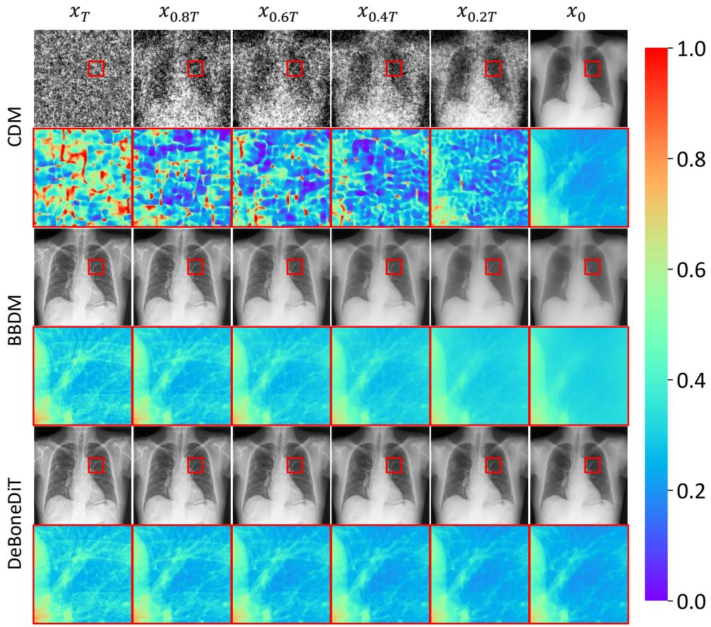  
Figure 9 Sampling process comparison of three difusion paradigms on SZCH-X-Rays. CDM is initialized from Gaussian noise, while BBDM and DeBoneDiT leverage the source CXR as the prior. Notably, DeBoneDiT demonstrates superior detail preservation compared to BBDM.

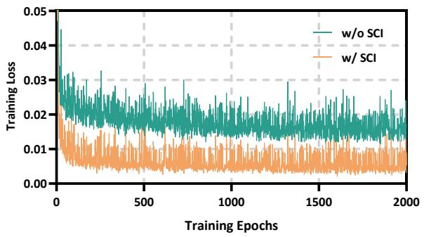

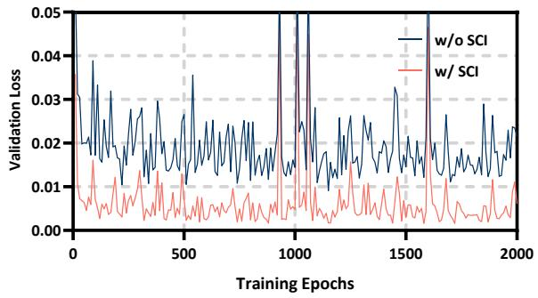  
Figure 10 Loss curves over 2000 epochs. The left and right plots illustrate the training and validation losses, respectively. Incorporating SCI yields superior optimization, converging to a lower loss than the BBDM baseline $( \mathrm { w } / \mathrm { o }$ SCI).  
bone suppression performance, suggesting that DiT-based denoising networks exhibit strong scalability for high-resolution bone suppression.

CXR  
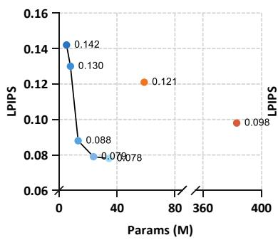

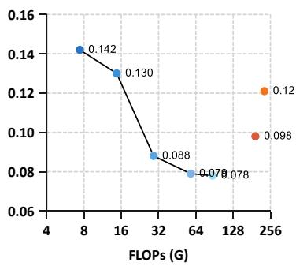

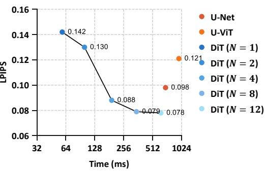  
Figure 11 Quantitative ablation study on the impact of the denoising backbone. Compared to U-Net [6] and U-ViT [3], the DiT-based variants [21] exhibit superior eficiency and scalability while achieving state-of-the-art bone suppression performance. (N: number of DiT blocks)

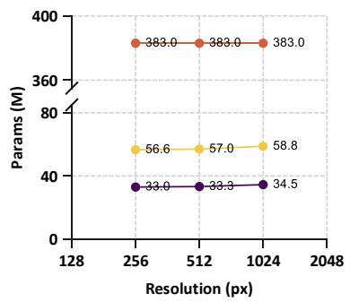

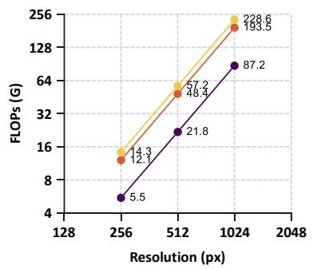

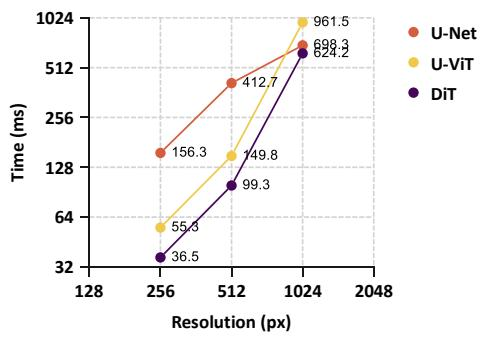  
Figure 12 Quantitative eficiency comparison of various denoising backbones across diferent resolutions. DiT consistently outperforms U-Net and U-ViT, demonstrating robust scalability and eficiency essential for processing high-resolution medical images.

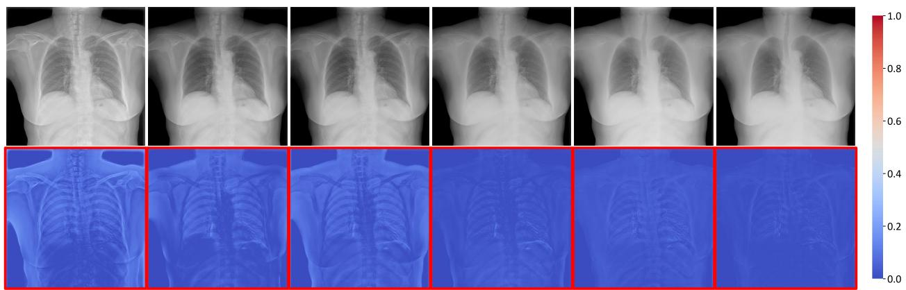  
Figure 13 Visual analysis of the scaling law in bone suppression performance. The red-outlined error maps illustrate the pixel-wise residuals relative to the ground truth, which progressively diminish as the number of DiT blocks N increases, indicating enhanced denoising capability.

## 3.5 Downstream Evaluation

To assess the clinical utility of DeBoneDiT, we evaluate five representative classification models [10, 14, 22, 33, 41] on the Asraf dataset. The DeBoneDiT model pretrained on the SZCH-X-Rays dataset was frozen and directly applied to generate bone-suppressed images for the Asraf dataset without further fine-tuning. Subsequently, a standard 5-fold cross-validation protocol was conducted for classification. As summarized in Table 5, models trained and tested on bone-suppressed images via DeBoneDiT consistently outperform those using original CXR images across all evaluation metrics. Notably, for RegNetY-400MF [22], the classification accuracy increases from 88.5% to 95.5%. Improvements are particularly evident in Recall and F1-score across diferent backbones, suggesting that removing overlapping bony structures facilitates the detection of subtle disease-related patterns. The consistent gains across diverse network architectures indicate that the benefits of DeBoneDiT are not tied to a specific classifier, highlighting its applicability in downstream computer-aided diagnosis.

Table 5 Quantitative downstream classification performance on the Asraf dataset using CXRs versus bone-suppressed images, with statistical significance between paired metric values of each backbone under identical 5-fold splits evaluated using the Wilcoxon signed-rank test $( ^ { * } : p < 0 . 0 5 )$
<table><tr><td rowspan="2">Model</td><td rowspan="2">Accuracy (%, ↑)</td><td colspan="3">Precision (%, ↑)</td><td colspan="3">Recall (%, ↑)</td><td colspan="3">F1-Score (%, ↑)</td></tr><tr><td></td><td>Pneumonia COVID-19</td><td>Normal</td><td></td><td>Pneumonia COVID-19</td><td>Normal</td><td>Pneumonia COVID-19</td><td></td><td>Normal</td></tr><tr><td colspan="10">Original CXR Images</td></tr><tr><td> $\mathrm { D e n s e N e t - 1 2 1 }$ </td><td> $9 0 . 8 \pm 1 . 3$ </td><td> $9 7 . 3 \pm 1 . 2$ </td><td> $9 6 . 8 \pm 1 . 8$ </td><td> $8 1 . 4 \pm 2 . 7$ </td><td> $8 6 . 5 \pm 1 . 3$ </td><td> $8 9 . 0 \pm 2 . 5$ </td><td> $9 6 . 9 \pm 1 . 3$ </td><td> $9 1 . 6 \pm 0 . 7$ </td><td> $9 2 . 7 \pm 1 . 7$ </td><td> $8 8 . 5 \pm 1 . 8$ </td></tr><tr><td> $\mathrm { G o o g L e N e t }$ </td><td> $9 2 . 3 \pm 0 . 8$ </td><td> $9 7 . 0 \pm 0 . 8$ </td><td> $9 6 . 3 \pm 2 . 0$ </td><td> $8 5 . 1 \pm 1 . 0$ </td><td> $8 8 . 7 \pm 1 . 1$ </td><td> $9 2 . 4 \pm 1 . 9$ </td><td> $9 5 . 9 \pm 1 . 1$ </td><td> $9 2 . 7 \pm 0 . 3$ </td><td> $9 4 . 3 \pm 1 . 5$ </td><td> $9 0 . 2 \pm 1 . 0$ </td></tr><tr><td> $\mathrm { R e g N e t \bar { Y } - 4 0 0 M F }$ </td><td> $8 8 . 5 \pm 1 . 6$ </td><td> $9 0 . 6 \pm 4 . 2$ </td><td> $9 7 . 7 \pm 1 . 8$ </td><td> $8 0 . 4 \pm 4 . 3$ </td><td> $9 0 . 3 \pm 1 . 4$ </td><td> $8 3 . 1 \pm 5 . 3$ </td><td> $9 2 . 0 \pm 4 . 4$ </td><td> $9 0 . 4 \pm 2 . 3$ </td><td> $8 9 . 6 \pm 2 . 8$ </td><td> $8 5 . 7 \pm 2 . 0$ </td></tr><tr><td> $\mathrm { R e s N e t - 5 0 }$ </td><td> $9 1 . 2 \pm 0 . 6$ </td><td> $9 6 . 8 \pm 3 . 0$ </td><td> $9 6 . 2 \pm 1 . 8$ </td><td> $8 3 . 1 \pm 1 . 6$ </td><td> $8 6 . 7 \pm 2 . 7$ </td><td> $9 1 . 0 \pm 2 . 6$ </td><td> $9 6 . 0 \pm 2 . 7$ </td><td> $9 1 . 4 \pm 1 . 1$ </td><td> $9 3 . 5 \pm 1 . 6$ </td><td> $8 9 . 1 \pm 0 . 9$ </td></tr><tr><td>ShuffleNet V2</td><td> $8 7 . 6 \pm 1 . 5$ </td><td> $9 0 . 7 \pm 3 . 0$ </td><td> $8 9 . 9 \pm 5 . 2$ </td><td> $8 3 . 1 \pm 2 . 9$ </td><td> $9 0 . 2 \pm 1 . 4$ </td><td> $8 9 . 3 \pm 3 . 9$ </td><td> $8 3 . 2 \pm 8 . 0$ </td><td> $9 0 . 4 \pm 1 . 2$ </td><td> $8 9 . 4 \pm 1 . 5$ </td><td> $8 2 . 8 \pm 2 . 7$ </td></tr><tr><td colspan="9">Bone-Suppressed Images via DeBoneDiT</td></tr><tr><td>DenseNet-121</td><td> $9 3 . 9 \pm 0 . 8 ^ { \ast }$ </td><td></td><td></td><td></td><td></td><td></td><td>98.1 ± 0.9* 98.0 ± 0.6* 87.1 ± 1.7* 88.4 ± 1.5* 94.9 ± 1.5* 98.3 ± 0.7* 93.0 ± 0.8* 96.4 ± 1.0* 92.3 ± 0.9*</td><td></td><td></td><td></td></tr><tr><td>GoogLeNet</td><td> $9 5 . 0 \pm 0 . 4 ^ { * }$ </td><td></td><td></td><td></td><td></td><td></td><td> $9 7 . 8 \pm 1 . 1 \quad 9 9 . 3 \pm 0 . 1 ^ { * } \quad 8 9 . 0 \pm 0 . 9 ^ { * } \quad 9 0 . 0 \pm 0 . 6 \quad 9 6 . 8 \pm 0 . 5 ^ { * } \enspace 9 8 . 4 \pm 0 . 6 ^ { * } \enspace 9 3 . 7 \pm 0 . 7 ^ { * } \enspace 9 8 . 0 \pm 0 . 3 ^ { * } \enspace 9 3 . 4 \pm 0 . 6 ^ { * }$ </td><td></td><td></td><td></td></tr><tr><td>RegNetY-400MF</td><td> $9 5 . 5 \pm 0 . 3 ^ { * }$ </td><td></td><td></td><td></td><td></td><td></td><td>97.8 ± 0.3* 98.1 ± 1.4 91.0 ± 0.9* 90.5 ± 0.3 98.8 ± 0.7* 97.1 ± 1.3 94.0 ± 0.2* 98.4 ± 0.6* 93.9 ± 0.4*</td><td></td><td></td><td></td></tr><tr><td>ResNet-50</td><td> $9 4 . 8 \pm 0 . 5 ^ { * }$ </td><td></td><td> $9 8 . 0 \pm 0 . 3 ^ { \circ } \ 9 7 . 4 \pm 0 . 8 8 \ 8 9 . 8 \pm 1 . 3 ^ { \circ } \ 8 9 . 1 \pm 1 . 3 \ 9 7 . 8 \pm 0 . 7 ^ { \circ } \ 9 7 . 5 \pm 0 . 6 \ 9 3 . 3 \pm 0 . 8 ^ { \circ } \ 9 7 . 6 \pm 0 . 6 ^ { \circ } \ 9 3 . 5 \pm 0 . 6 ^ { \circ }$ </td><td></td><td></td><td></td><td></td><td></td><td></td><td></td></tr><tr><td> $\mathrm { S h u f f e N e t \ V 2 }$ </td><td> $9 2 . 5 \pm 1 . 0 ^ { * }$ </td><td> $9 5 . 6 \pm 3 . 8 ^ { * }$ </td><td></td><td></td><td></td><td></td><td></td><td>97.7 ± 1.2* 85.7 ± 0.9* 89.2 ± 0.9 92.8 ± 1.2 95.5 ± 3.8* 92.2 ± 1.4* 95.2 ± 1.1* 90.3 ± 1.8*</td><td></td><td></td></tr></table>

## 3.6 Limitations

Despite its promising performance, DeBoneDiT remains subject to several limitations. First, owing to the inherent physical constraints of 2D projections, when pathological features are completely occluded by hyperdense bony structures, the model’s reconstruction relies on learned generative priors, which may introduce hallucinations or omit extremely subtle lesions. Second, while the Depth Anything V2 encoder provides efective structural regularization, it was trained on natural images. Future work could explore CT-derived supervision to learn anatomy-aware, projection-consistent structural representations. Third, although the SZCH-X-Rays dataset establishes a high-quality benchmark, our evaluation is currently retrospective and limited to single-center data. Multi-site external validation and prospective clinical studies would further strengthen the assessment of the model’s generalizability and clinical utility.

## 4 Conclusion

In this paper, we present DeBoneDiT, a depth-driven bridge difusion Transformer achieving high-fidelity bone suppression with remarkable computational eficiency on standard CXR images. To mitigate data scarcity, we introduce SZCH-X-Rays, the largest high-quality paired dataset for bone suppression to date. By integrating structure-aware latent compression, a source-conditioned Brownian bridge difusion process, and a DiT-based denoising network, our framework efectively preserves critical pulmonary textures while maintaining rapid inference. Extensive experiments and downstream evaluation demonstrate that DeBoneDiT achieves superior performance with reduced computational overhead, underscoring its potential as a practical tool for clinical CXR bone suppression.

## Compliance with Ethical Standards

This research was conducted retrospectively and following the principles of the Declaration of Helsinki, utilizing previously obtained images that had been anonymized before conducting analysis, thus posing no harm to

patients. We applied for an informed consent waiver. Approval was granted by the Ethics Committee of Cancer Hospital & Shenzhen Hospital, Chinese Academy of Medical Sciences and Peking Union Medical College (No. JS2023-19-2).

## References

[1] Hanan Aljuaid, Hanan Adlan, Budoor Alkebsi, Badria Sulaiman Alfurhood, Antonio Liotta, and Lucia Cavallaro. An experimental comparison of deep learning models for pneumonia classification from chest x-ray images. Biomedical Signal Processing and Control, 112:108742, 2026.

[2] Kyungsoo Bae, Dong Yul Oh, Il Dong Yun, and Kyung Nyeo Jeon. Bone suppression on chest radiographs for pulmonary nodule detection: comparison between a generative adversarial network and dual-energy subtraction. Korean Journal of Radiology, 23(1):139, 2022.

[3] Fan Bao, Shen Nie, Kaiwen Xue, Yue Cao, Chongxuan Li, Hang Su, and Jun Zhu. All are worth words: A vit backbone for difusion models. In Proceedings of the IEEE/CVF Conference on Computer Vision and Pattern Recognition, pages 22669–22679, 2023.

[4] Yunkang Cao, Haiming Yao, Yu Cai, Yuxin Zhang, Hao Chen, Hui Zhang, and Weiming Shen. Cross-source medical anomaly detection via prompt-guided difusion representations. Pattern Recognition, page 113985, 2026.

[5] Zhanghao Chen, Yifei Sun, Ruiquan Ge, Wenjian Qin, Cheng Pan, Wenming Deng, Zhou Liu, Wenwen Min, Ahmed Elazab, Xiang Wan, et al. Bs-dif: Efective bone suppression using conditional difusion models from chest x-ray images. In 2024 IEEE International Symposium on Biomedical Imaging (ISBI), pages 1–5, 2024.

[6] Prafulla Dhariwal and Alexander Nichol. Difusion models beat gans on image synthesis. Advances in Neural Information Processing Systems, 34:8780–8794, 2021.

[7] Patrick Esser, Robin Rombach, and Bjorn Ommer. Taming transformers for high-resolution image synthesis. In Proceedings of the IEEE/CVF Conference on Computer Vision and Pattern Recognition, pages 12873–12883, 2021.

[8] Warren B Gefter and Hiroto Hatabu. Reducing errors resulting from commonly missed chest radiography findings. Chest, 163(3):634–649, 2023.

[9] Maxim Gusarev, Ramil Kuleev, Adil Khan, Adin Ramirez Rivera, and Asad Masood Khattak. Deep learning models for bone suppression in chest radiographs. In 2017 IEEE Conference on Computational Intelligence in Bioinformatics and Computational Biology (CIBCB), pages 1–7, 2017.

[10] Kaiming He, Xiangyu Zhang, Shaoqing Ren, and Jian Sun. Deep residual learning for image recognition. In Proceedings of the IEEE Conference on Computer Vision and Pattern Recognition, pages 770–778, 2016.

[11] Jonathan Ho and Tim Salimans. Classifier-free difusion guidance. arXiv preprint arXiv:2207.12598, 2022.

[12] Jonathan Ho, Ajay Jain, and Pieter Abbeel. Denoising difusion probabilistic models. Advances in Neural Information Processing Systems, 33:6840–6851, 2020.

[13] Laurens Hogeweg, Clara I Sánchez, and Bram van Ginneken. Suppression of translucent elongated structures: applications in chest radiography. IEEE Transactions on Medical Imaging, 32(11):2099–2113, 2013.

[14] Gao Huang, Zhuang Liu, Laurens Van Der Maaten, and Kilian Q Weinberger. Densely connected convolutional networks. In Proceedings of the IEEE Conference on Computer Vision and Pattern Recognition, pages 4700–4708, 2017.

[15] Justin Johnson, Alexandre Alahi, and Li Fei-Fei. Perceptual losses for real-time style transfer and super-resolution. In European Conference on Computer Vision, pages 694–711. Springer, 2016.

[16] S Juhász, Á Horváth, L Nikházy, G Horváth, and Á Horváth. Segmentation of anatomical structures on chest radiographs. In XII Mediterranean Conference on Medical and Biological Engineering and Computing 2010: May 27–30, 2010 Chalkidiki, Greece, pages 359–362. Springer, 2010.

[17] Hwiyoung Kim, Kye Ho Lee, Kyunghwa Han, Ji Won Lee, Jin Young Kim, Dong Jin Im, Yoo Jin Hong, Byoung Wook Choi, and Jin Hur. Development and validation of a deep learning–based synthetic bone-suppressed model for pulmonary nodule detection in chest radiographs. JAMA Network Open, 6(1):e2253820–e2253820, 2023.

[18] Bo Li, Kaitao Xue, Bin Liu, and Yu-Kun Lai. Bbdm: Image-to-image translation with brownian bridge difusion models. In Proceedings of the IEEE/CVF Conference on Computer Vision and Pattern Recognition, pages 1952–1961, 2023

[19] Anish Mittal, Anush Krishna Moorthy, and Alan Conrad Bovik. No-reference image quality assessment in the spatial domain. IEEE Transactions on Image Processing, 21(12):4695–4708, 2012.

[20] Jiyeon Oh, Soeun Kim, Yesol Yim, Min Seo Kim, Simon I Hay, Jae Il Shin, and Dong Keon Yon. Global, regional, and national burden of chronic respiratory diseases and impact of the covid-19 pandemic, 1990–2023: a global burden of disease study. Nature Medicine, pages 1–27, 2026.

[21] William Peebles and Saining Xie. Scalable difusion models with transformers. In Proceedings of the IEEE/CVF International Conference on Computer Vision, pages 4195–4205, 2023.

[22] Ilija Radosavovic, Raj Prateek Kosaraju, Ross Girshick, Kaiming He, and Piotr Dollár. Designing network design spaces. In Proceedings of the IEEE Conference on Computer Vision and Pattern Recognition, pages 10428–10436, 2020.

[23] Geeta Rani, Ankit Misra, Vijaypal Singh Dhaka, Deepak Buddhi, Ravindra Kumar Sharma, Ester Zumpano, and Eugenio Vocaturo. A multi-modal bone suppression, lung segmentation, and classification approach for accurate covid-19 detection using chest radiographs. Intelligent Systems with Applications, 16:200148, 2022.

[24] Robin Rombach, Andreas Blattmann, Dominik Lorenz, Patrick Esser, and Björn Ommer. High-resolution image synthesis with latent difusion models. In Proceedings of the IEEE/CVF Conference on Computer Vision and Pattern Recognition, pages 10684–10695, 2022.

[25] Olga Russakovsky, Jia Deng, Hao Su, Jonathan Krause, Sanjeev Satheesh, Sean Ma, Zhiheng Huang, Andrej Karpathy, Aditya Khosla, Michael Bernstein, et al. Imagenet large scale visual recognition challenge. International Journal of Computer Vision, 115(3):211–252, 2015.

[26] Vojtech Schiller, Radim Burget, Samuel Genzor, Jan Mizera, and Anzhelika Mezina. xu-netfullsharp: The novel deep learning architecture for chest x-ray bone shadow suppression. Biomedical Signal Processing and Control, 100:106983, 2025.

[27] Junji Shiraishi, Shigehiko Katsuragawa, Junpei Ikezoe, Tsuneo Matsumoto, Takeshi Kobayashi, Ken-ichi Komatsu, Mitate Matsui, Hiroshi Fujita, Yoshie Kodera, and Kunio Doi. Development of a digital image database for chest radiographs with and without a lung nodule: receiver operating characteristic analysis of radiologists’ detection of pulmonary nodules. American Journal of Roentgenology, 174(1):71–74, 2000.

[28] Anushikha Singh, Rukhshanda Hussain, Rajarshi Bhattacharya, Brejesh Lall, Bijaya K Panigrahi, Anjali Agrawal, Anurag Agrawal, Balamugesh Thangakunam, and DJ Christopher. Mda-gan: Multiscale and dual attention generative adversarial network for bone suppression in chest x-rays. IEEE Transactions on Artificial Intelligence, 6(3):604–613, 2024.

[29] Wenfeng Song, Zhongyong Ye, Meng Sun, Xia Hou, Shuai Li, and Aimin Hao. Attridifuser: Adversarially enhanced difusion model for text-to-facial attribute image synthesis. Pattern Recognition, 163:111447, 2025.

[30] Yifei Sun, Zhanghao Chen, Hao Zheng, Wenming Deng, Jin Liu, Wenwen Min, Ahmed Elazab, Xiang Wan, Changmiao Wang, and Ruiquan Ge. Bs-ldm: Efective bone suppression in high-resolution chest x-ray images with conditional latent difusion models. IEEE Journal of Biomedical and Health Informatics, 30(1):376–387, 2025.

[31] Yifei Sun, Zhanghao Chen, Hao Zheng, Yuqing Lu, Lixin Duan, Fenglei Fan, Ahmed Elazab, Xiang Wan, Changmiao Wang, and Ruiquan Ge. Gl-lcm: Global-local latent consistency models for fast high-resolution bone suppression in chest x-ray images. In International Conference on Medical Image Computing and Computer-Assisted Intervention, pages 222–232. Springer, 2025.

[32] Kenji Suzuki, Hiroyuki Abe, Heber MacMahon, and Kunio Doi. Image-processing technique for suppressing ribs in chest radiographs by means of massive training artificial neural network (mtann). IEEE Transactions on Medical Imaging, 25(4):406–416, 2006.

[33] Christian Szegedy, Wei Liu, Yangqing Jia, Pierre Sermanet, Scott Reed, Dragomir Anguelov, Dumitru Erhan, Vincent Vanhoucke, and Andrew Rabinovich. Going deeper with convolutions. In Proceedings of the IEEE Conference on Computer Vision and Pattern Recognition, pages 1–9, 2015.

[34] Peter Vock and Zsolt Szucs-Farkas. Dual energy subtraction: Principles and clinical applications. European Journal of Radiology, 72(2):231–237, 2009.

[35] Ting-Chun Wang, Ming-Yu Liu, Jun-Yan Zhu, Andrew Tao, Jan Kautz, and Bryan Catanzaro. High-resolution image synthesis and semantic manipulation with conditional gans. In Proceedings of the IEEE Conference on Computer Vision and Pattern Recognition, pages 8798–8807, 2018.

[36] Lihe Yang, Bingyi Kang, Zilong Huang, Zhen Zhao, Xiaogang Xu, Jiashi Feng, and Hengshuang Zhao. Depth anything v2. Advances in Neural Information Processing Systems, 37:21875–21911, 2024.

[37] Ling Yang, Zhenghao Chen, Kaisiyuan Wang, and Luping Zhou. Improving cxr bone suppression by exploiting domain-level and instance-level information. IEEE Transactions on Medical Imaging, 44(11):4143–4155, 2025.

[38] Wei Yang, Yingyin Chen, Yunbi Liu, Liming Zhong, Genggeng Qin, Zhentai Lu, Qianjin Feng, and Wufan Chen. Cascade of multi-scale convolutional neural networks for bone suppression of chest radiographs in gradient domain. Medical Image Analysis, 35:421–433, 2017.

[39] Jure Zbontar, Li Jing, Ishan Misra, Yann LeCun, and Stéphane Deny. Barlow twins: Self-supervised learning via redundancy reduction. In International Conference on Machine Learning, pages 12310–12320. PMLR, 2021.

[40] Richard Zhang, Phillip Isola, Alexei A Efros, Eli Shechtman, and Oliver Wang. The unreasonable efectiveness of deep features as a perceptual metric. In Proceedings of the IEEE Conference on Computer Vision and Pattern Recognition, pages 586–595, 2018.

[41] Xiangyu Zhang, Xinyu Zhou, Mengxiao Lin, and Jian Sun. Shuflenet: An extremely eficient convolutional neural network for mobile devices. In Proceedings of the IEEE Conference on Computer Vision and Pattern Recognition, pages 6848–6856, 2018.

[42] Bo Zhou, Xunyu Lin, Brendan Eck, Jun Hou, and David Wilson. Generation of virtual dual energy images from standard single-shot radiographs using multi-scale and conditional adversarial network. In Asian Conference on Computer Vision, pages 298–313. Springer, 2018.