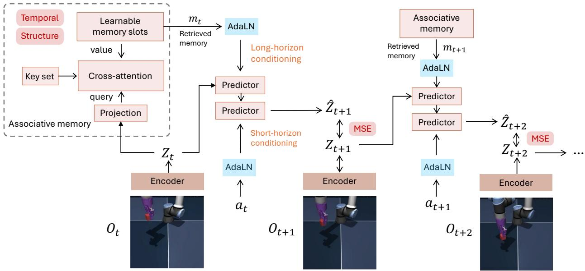
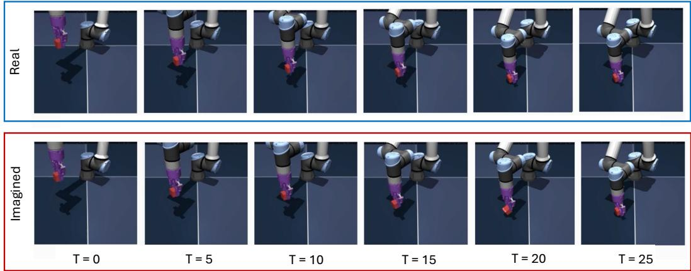
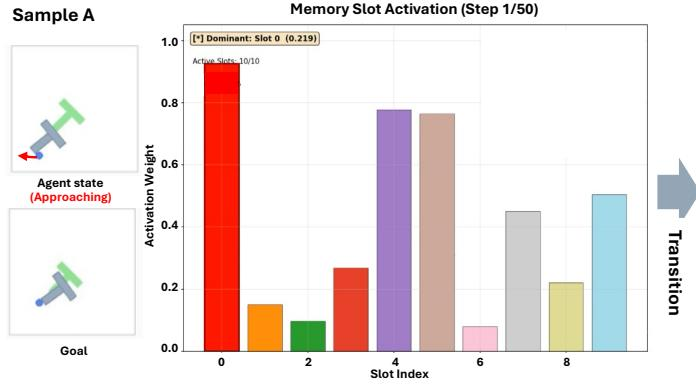
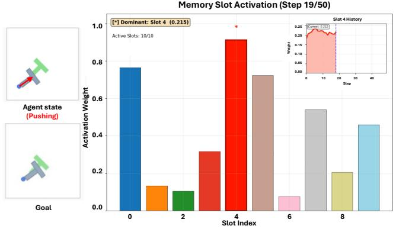
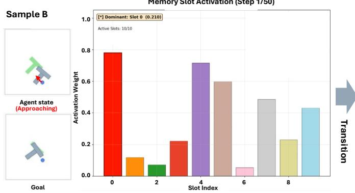
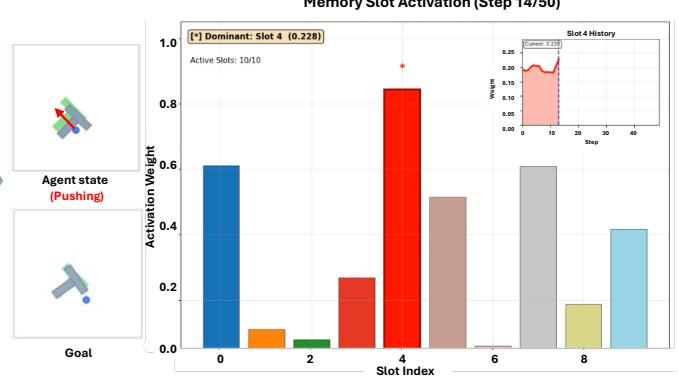

# Enhancing Latent World Models with Associative Memory

Yuwei Sun1, Siyu Zhu1,2

1Shanghai Academy of AI for Science, 2Fudan University

## Abstract

World models trained via latent dynamics offer a scalable path for embodied planning, yet existing methods suffer from representational collapse, computational overhead, and limited long-horizon capability. We introduce a memory-enhanced latent world model that augments JEPAstyle prediction with a content-addressable memory bank. Our approach learns high-level representations directly from observations, operating at multiple temporal scales within a shared latent space, and conditions predictions via adaptive layer normalization. To prevent collapse and ensure effective memory usage, we design two complementary losses that encourage slot diversity and balanced temporal utilization. Experiments on PushT, Tworoom, Reacher, and OGBCube demonstrate that our method achieves state-ofthe-artperformance with a lightweight architecture, outperforming conventional latent world models on long-horizon planning tasks.

## 1. Introduction

World Models (WMs) are a powerful family of approaches that learn to predict the consequences of actions, enabling agents to plan and improve entirely within an internal model of the world. Recent advances in representation learning and latent-space modeling have further improved scalability, allowing world models to be trained directly from highdimensional inputs. As a result, planning with learned world models has become a powerful framework for embodied decision-making. Given the initial observation, the agent imagines the entire future trajectory without feedback, demanding a tight coupling of perception, prediction, and decision-making. However, conventional approaches solely rely on visual targets and thus fail to exploit the richer guidance that the environment provides.

Joint-Embedding Predictive Architecture (JEPA)-style world models [1–4], on the other hand, learn to compress observations into a compact, low-dimensional latent space and model temporal dynamics by predicting the latent representations of future observations. However, using JEPA for world models while preventing collapse where the model maps all inputs to nearly identical representations—remains a central challenge. LeWorldModel [5] tackles this problem with a lightweight latent prediction framework using the SigREG loss to prevent representational collapse. DINO-WM [6] employs a pretrained DI-NOv2 model to extract observation embeddings, addressing collapse at the cost of high computational overhead and reliance on external pretraining. While LeWM is efficient, it cannot match the performance of pretrained encoder-based models. In practice, such strategies, which rely on heuristic regularizations, often introduce additional instability or substantially increase training complexity.

Another misconception in visual planning is that extending the rollout horizon is sufficient to elicit long-horizon behavior. In practice, simply increasing the maximum step count only causes the agent to jitter uselessly around the same goal. It cannot test true long-horizon planning, because the bottleneck lies in the representation of temporal structure rather than in the number of steps. The effective approach is to layer high-level temporal abstraction and semantic structure on top of the environment’s lowlevel contact dynamics. A classic strategy for long-horizon control is to introduce content-addressable memory into the decision-making structure. By reasoning at multiple temporal scales, agents can plan coarsely over extended horizons while maintaining fine-grained control at shorter ones. Existing studies, such as hierarchical world models [7], introduce a temporal hierarchy that captures dynamics at multiple timescales while doubling the parameter count.

To overcome these limitations, our associative memoryenhanced latent world model is built on a contentaddressable memory bank that supplies reusable high-level subgoals, a multi-scale shared latent space couples these subgoals to low-level contact dynamics, and two complementary losses that keep this structure from collapsing. Crucially, our approach operates within a shared latent space enabling direct coupling between levels without sacrificing model efficiency. We introduce a specifically designed memory bank that learns high-level representations directly from observations and uses them to condition predictions via Adaptive Layer Normalization (AdaLN), complementing the low-level action-based prediction. Finally, we devise two memory loss functions to encourage both structural diversity across memory slots and balanced slot usage across time steps in agent planning.

We conduct extensive experiments on a wide range of benchmarks, including PushT, Tworoom, Reacher, and OG-BCube, along with comprehensive ablation studies on the proposed associative memory mechanism and its adaptability to a more complex long-horizon task. Our method outperforms conventional latent world models, achieving the best performance while maintaining computational efficiency. It substantially surpasses the latest LeWorldModel method while remaining simpler and more interpretable than the Hierarchical World Model.

Overall, our main contributions are three-fold:

(1) We propose associative memory-enhanced latent world models for improving long-horizon action sequence prediction, marking the first work to incorporate long-term memory into the JEPA architecture (Section 3.2).

(2) To prevent memory slots from collapsing into identical representations, we introduce two complementary loss functions that encourage diversification and balanced utilization of memory slots (Section 3.3.2).

(3) Comprehensive experiments including ablation studies across a wide range of tasks in 2D and 3D environments demonstrate that our method consistently outperforms existing approaches while remaining computationally efficient (Section 4).

## 2. Related work

This section provides a summary of the most relevant work on world models including the reconstruction-based methods and the latent world model methods. We investigate the relatedness and limitations of these studies comparing with our memory-enhanced method.

Reconstruction-based world models Reconstructionbased world models learn latent environment dynamics by optimizing objectives that reconstruct observations from compressed latent states, encouraging representations to retain sufficient information for predicting future outcomes. Early approaches such as World Models [8] combined variational latent representations with recurrent dynamics and pixel reconstruction to enable imagined rollouts for control. Subsequent methods, including PlaNet [9], Dreamer [10], DreamerV2 [11], and DreamerV3 [12], leveraged recurrent state-space models trained with observation reconstruction and latent transition objectives to learn compact world models. While these methods have demonstrated competitive empirical performance, reconstruction losses may bias representations toward low-level perceptual details limiting abstraction and greatly increase computational cost.

Latent world models Joint-Embedding Predictive Architecture (JEPA) [1–4] is a self-supervised learning method for world modeling that learns predictive representations in latent space rather than reconstructing low-level pixels. For instance, DINO-WM [6] leverages spatial patch features pre-trained with DINOv2 in latent space, enabling more precise planning and control. PLDM [13, 14] learns representations end-to-end using VICReg [15] at the cost of training instabilities and scalability limitations. LeWorld-Model (LeWM) [5] is a compact JEPA-style world model that predicts next-frame embeddings stably, but its performance degrades over long horizons. Hierarchical World Models (HWM) [7] address this with separate short- and long-horizon modules, doubling parameters. In contrast, our method uses a flexible memory bank of high-level priors, jointly learning long-horizon contexts, which improves performance without extra prediction modules.

## 3. Method

In this section, we present memory-enhanced latent world models. We begin by detailing the joint embedding predictive architecture (JEPA), then introduce a new contentaddressable memory component that learns diverse memory slot representations for long-horizon conditioning. The predictor leverages both the current state and action, along with semantically meaningful representations retrieved from the memory bank, to forecast the next latent state. Finally, we employ model predictive control during inference to enable effective action sequence rollouts.

## 3.1. JEPA-style latent world models

A world model is a learned dynamical model that approximates how an environment $o _ { t }$ evolves in response to an agent’s actions $a _ { t }$ , estimating transition dynamics of the form $p ( o _ { t + 1 } | o _ { t } , a _ { t } )$ . This work builds upon the joint embedding predictive architecture (JEPA) [2, 3, 5], where an encoder such as a Vision Transformer (ViT) maps a given frame $o _ { t }$ into a low-dimensional latent embedding $z _ { t } \in \mathbb { R } ^ { D }$ A predictor aims to model the environment dynamics in latent space $p ( z _ { t + 1 } | z _ { t } , a _ { t } )$ by predicting the latent $\hat { z } _ { t + 1 }$ of the next frame given the latent $z _ { t }$ and an action $a _ { t }$ . The action is incorporated into the predictor as a condition through Adaptive Layer Normalization (AdaLN) as follows:

$$
\gamma _ { s } , \beta _ { s } , \alpha _ { s } , \gamma _ { f } , \beta _ { f } , \alpha _ { f } = \Phi ( a _ { t } ) ,\tag{1}
$$

where Φ is a linear projection and $\gamma _ { s } , \beta _ { s } , \alpha _ { s } , \gamma _ { f } , \beta _ { f } , \alpha _ { f }$ are adaptive parameters. The conditioned latent output $z _ { t + 1 }$ is defined as:

$$
\mathrm { A d a L N } ( z _ { t } , \gamma , \beta ) = \gamma \odot \mathrm { L N } ( z _ { t } ) + \beta ,\tag{2}
$$

$$
z _ { t } ^ { \prime } = z _ { t } + \alpha _ { s } \odot \mathrm { A t t n } ( \mathrm { A d a L N } ( z _ { t } , \gamma _ { s } , \beta _ { s } ) ) ,\tag{3}
$$

$$
\hat { z } _ { t + 1 } = z _ { t } ^ { \prime } + \alpha _ { f } \odot \mathrm { M L P } \big ( \mathrm { A d a L N } ( z _ { t } ^ { \prime } , \gamma _ { f } , \beta _ { f } ) \big ) ,\tag{4}
$$

  
Figure 1. The scheme of the memory-enhanced latent world models.

where LN is LayerNorm, Attn is the attention layer, MLP is the multilayer perceptron, and ⊙ is the element-wise multiplication.

## 3.2. Associative memory for long-horizon world modeling

Conventional latent world models including LeWorldModel struggle with long-horizon prediction tasks. One reason is that they learn latent dynamics solely through actionconditioned transitions. Training only on short-horizon information sabotages the model’s planning performance. To overcome this limitation, an intuitive idea is to induce a long-term memory. We propose learnable associative memory in latent world models to accumulate historical latents and further disentangle them into diversified conditioning information. This high-level conditioning information is then fed into a predictor along with the action to enhance long-horizon prediction of the latent world model.

## 3.2.1. Associative Memory Structure

Humans leverage associative memory to predict surrounding worlds constantly. The contents-addressable ability of associative memory has been employed for enhanced longrange input association in modern transformer architecture [16]. Leveraging such learnable memory disentangles information across various timesteps and inputs, enabling latent predictions that combine both short-horizon actions with long-horizon memory contexts for enhanced agent planning ability. In particular, an associative memory bank is comprised of M learnable low-rank slots $\Gamma \in \mathbb { R } ^ { M \times D }$ . Each memory slot diversifies into different general assumptions about observations and environment dynamics, such as various planning stages including moving towards the object, pushing the object, and moving to a specific location. We elaborate on the contents retrieval and long-horizon conditioning processes in the remainder of this section.

## 3.2.2. Learnable memory bank and contents retrieval

The learnable memory slots Γ are paired with a set of learnable keys $\Xi \in \mathbb { R } ^ { M \times \mathbf { \bar { D } } }$ that serve as indexes for writing to the memory bank, with each key and memory slot forming a pair. We decouple the training of keys from that of memory slots, ensuring that learning the keys does not substantially interfere with the memory update. These learnable keys are utilized to compute cross-attention with the observation latents, which assigns different weights to each memory slot accordingly. The attention weights for input latent states $z _ { t }$ can be computed as follows:

$$
A ( z _ { t } , \Xi ) = \mathrm { s o f t m a x } \left( \frac { ( z _ { t } W ^ { Q } ) { \Xi } ^ { \top } } { \sqrt { D } \cdot \epsilon } \right) ,\tag{5}
$$

where $W ^ { Q } \in \mathbb { R } ^ { D \times D }$ is a query projection matrix and ϵ is the retrieval temperature.

The attention weights represent the similarity between a specific observation latent state and all keys. Depending on these weights, the memory slots corresponding to the keys are leveraged to compute the final weighted memory retrieval result $\begin{array} { r } { \dot { m } _ { t } = \sum _ { i = 1 } ^ { M } A _ { i } \Gamma _ { i } } \end{array}$ The retrieved memory $m _ { t }$ is used as a high-level condition through another Adaptive Layer Normalization (AdaLN) to guide the predictor’s training. Through end-to-end training, we aim to learn a set of diverse memory slots that represent different scenarios, such as approaching the object, pushing the object, and moving to the target area. The keys are also learned during training, as the indices to identify memory slots.

## 3.2.3. High-level prediction conditioning

To introduce the additional condition of memory information into the world model, we leverage another AdaLN module. There are several choices for the conditioning design. For instance, we can adopt either a parallel or a sequential design. The AdaLN modules can either correspond to two separate predictors for the short-horizon and longhorizon conditions, respectively, or correspond to the same predictor using parameter sharing. Comparing various combinations, we found that employing a sequential design with the memory condition coming first, while using parameter sharing, contributes to the best prediction accuracy and the reduced parameter size (Table 4). Consequently, the predictor Pred first observes the long-horizon condition of the retrieved memory $m _ { t }$ , then leverages the short-horizon condition of actions $a _ { t } .$ , enabling the predictor to learn an intermediate latent $z _ { t } ^ { \mathrm { l o n g } }$

$$
z _ { t } ^ { \mathrm { l o n g } } = \mathrm { P r e d } ( z _ { t } , m _ { t } ) ,\tag{6}
$$

$$
\hat { z } _ { t + 1 } = \mathrm { P r e d } ( z _ { t } ^ { \mathrm { l o n g } } , a _ { t } ) .\tag{7}
$$

## 3.3. Training objectives

Training objectives include a prediction loss for latent error minimization and two types of associative memory losses that enforce structural and temporal diversity on the memory slots, respectively.

## 3.3.1. Prediction loss

The prediction loss aims to minimize the reconstruction error at each future step. In particular, given a latent representation $z _ { t }$ and action $a _ { t }$ , the model predicts the next latent state $\hat { z } _ { t + 1 } = \mathrm { P r e d } ( z _ { t } | a _ { t } )$ . The prediction loss over a horizon of T future steps is defined as:

$$
\mathcal { L } _ { \mathrm { m s e } } = \frac { 1 } { T } \sum _ { k = 1 } ^ { T } \left. \hat { z } _ { t + k } - z _ { t + k } \right. _ { 2 } ^ { 2 } .\tag{8}
$$

Where ${ \mathcal { L } } _ { \mathrm { m s e } }$ is the mean squared error loss. Furthermore, to prevent representation collapse and maintain a wellconditioned latent space, we leverage the SIGReg loss [5] at each step over the predicted latents $\hat { Z } , \mathrm { i . e . , } \ S \mathrm { I G R e g } ( \hat { Z } )$ The prediction loss can be defined as $\mathcal { L } _ { \mathrm { p r e d } } ~ = ~ \mathcal { L } _ { \mathrm { m s e } } ~ +$ $\lambda _ { \mathrm { s i g r e g } } \mathrm { S I G R e g } ( \hat { Z } )$ , where $\lambda _ { \mathrm { s i g r e g } }$ is a weighting coefficient controlling the strength of the SIGReg regularization.

## 3.3.2. Associative memory loss

We propose two complementary memory losses to encourage memory slot diversity from both structural and temporal perspectives: (1) a slot diversity loss that measures structural differences among memory slots, and (2) a temporal diversity loss that measures temporal differences in memory retrieval results across time steps.

Slot diversity loss The slot diversity loss aims to diversify associative memory slots preventing structural collapse. It enforces smoothness over slot distributions by penalizing pairwise similarity, preventing memory slots from degenerating into identical information and ensuring each slot captures unique facets of the data distribution. In particular, the slot diversity loss is defined as follows:

$$
\mathcal { L } _ { \mathrm { d i v } } = \mathrm { S I G R e g } ( \Gamma ) = \sum _ { i \neq j } \left( \frac { \Gamma _ { i } ^ { \top } \Gamma _ { j } } { \| \Gamma _ { i } \| \| \Gamma _ { j } \| } \right) ^ { 2 } ,\tag{9}
$$

where $\Gamma _ { i }$ denotes the i-th memory slot.

Temporal diversity loss The temporal diversity loss ${ \mathcal { L } } _ { \mathrm { t e m } }$ measures temporal differences in memory retrieval results across time steps by computing the entropy of slots’ attention distribution over a horizon of T future steps. In particular, the average attention weights assigned to a specific slot i across a horizon of T is $\begin{array} { r } { \bar { A _ { i } } = \frac { 1 } { T } \bar { \sum _ { k = 1 } ^ { T } } A _ { i } ^ { ( k ) } } \end{array}$ . Then, the entropy of associative memory is defined as:

$$
H _ { \mathrm { s l o t } } = - \sum _ { i = 1 } ^ { M } \bar { A } _ { i } \log ( \bar { A } _ { i } + \epsilon ) ,\tag{10}
$$

where $\epsilon = 1 0 ^ { - 8 }$ is a small constant for numerical stability. The entropy is maximized when the memory slots are used uniformly across the T future steps, i.e., $H _ { \operatorname* { m a x } } = \log M$ Thus, the temporal diversity loss can be formulated as:

$$
\mathcal { L } _ { \mathrm { t e m } } = 1 - \frac { H _ { \mathrm { s l o t } } } { H _ { \mathrm { m a x } } } = 1 + \frac { 1 } { \log M } \sum _ { i = 1 } ^ { M } \bar { A } _ { i } \log ( \bar { A } _ { i } + \epsilon ) ,\tag{11}
$$

which approaches zero when the entropy reaches its theoretical maximum log M. All the memory slots are leveraged more uniformly across time encouraging temporal diversity.

Finally, the complete associative memory loss combines both objectives: ${ \mathcal { L } } _ { \mathrm { m e m o r y } } = { \mathcal { L } } _ { \mathrm { d i v } } + \lambda _ { \mathrm { t e m } } { \mathcal { L } } _ { \mathrm { t e m } } ,$ where $\lambda _ { \mathrm { t e m } }$ is a balancing coefficient that controls the relative importance of the temporal diversity constraint. The overall training objective consists of the prediction loss and the associative memory loss: $\mathcal { L } _ { \mathrm { t o t a l } } = \mathcal { L } _ { \mathrm { p r e d } } { + } \mathcal { L } _ { \mathrm { m e m o r y } }$ . Expanding this gives the complete formulation:

$$
\begin{array} { r } { \mathcal { L } _ { \mathrm { t o t a l } } = \underbrace { \mathcal { L } _ { \mathrm { m s e } } + \lambda _ { \mathrm { s i g r e g } } \operatorname { S I G R e g } ( \hat { Z } ) } _ { \mathrm { P r e d i c t i o n ~ O b j e c t i v e } } } \\ { + \underbrace { \operatorname { S I G R e g } ( \Gamma ) + \lambda _ { \mathrm { t e m } } \left( 1 - \frac { H _ { \mathrm { s l o t } } } { H _ { \mathrm { m a x } } } \right) } _ { \mathrm { A s s o c i a t i v e ~ M e m o r y ~ O b j e c t i v e } } . } \end{array}\tag{12}
$$

## 3.4. Inference-time planning

During inference, we leverage the Model Predictive Control (MPC) [5, 6, 14] to predict and optimize the control action sequence over a finite horizon $T .$ . In particular, planning starts from the current latent state $z _ { t } ,$ samples a set of candidate actions from a Gaussian distribution δ $: \mathcal { N } \big ( \mu ^ { ( t ) } , \sigma ^ { ( t ) } \big )$ , and rolls them through the memory world model for sequences of future latent states $\{ \hat { z } _ { k } \} _ { k = t + 1 } ^ { T }$ . We evaluate each sequence with a cost function relative to the target state based on the cross-entropy loss, select the top-performing trajectories and update the action selection distribution by recomputing its mean $\mu$ and covariance σ. For the stable update, we select only the first actions $\{ a _ { n } ^ { * ( t ) } \} _ { n = 1 } ^ { N }$ in the sequences at each step:

$$
\boldsymbol { \mu } ^ { ( t + 1 ) } = \frac { 1 } { N } \sum _ { n = 1 } ^ { N } \boldsymbol { a } _ { n } ^ { * ( t ) } ,\tag{13}
$$

$$
\sigma ^ { ( t + 1 ) } = \frac { 1 } { N } \sum _ { n = 1 } ^ { N } \left( a _ { n } ^ { * ( t ) } - \mu ^ { ( t + 1 ) } \right) ^ { 2 } ,\tag{14}
$$

where N is the number of total samples drawn from the Gaussian distribution. This process thereby concentrates future samples around better action candidates until an optimal action sequence is obtained.

## 4. Experiments

In this section, we present the settings and extensive experimental results on various 2D and 3D planning tasks. We compare MemWM with a broad range of conventional latent world models, including comprehensive ablation studies on the effectiveness of the associative memory mechanism, the memory diversity losses, and the conditioning mechanism. We further provide detailed visualizations of planning trajectories and memory slot usage distributions, demonstrating the interpretability of memory slot roles in various stages of the planning tasks.

Datasets We evaluate on a diverse set of tasks including navigation, motion planning and manipulation. All datasets are from the stable-worldmodel [17] framework. In particular, PushT is a robotic manipulation task where the goal is to push a T-shaped block to target positions using top-down visual observations. TwoRoom is a 2D navigation task where an agent moves through two connected rooms to reach a specified location. Reacher is a continuous control task involving a robotic arm that moves its end-effector to randomly appearing target points. OGBCube is a 3D manipulation task requiring an agent to perform tasks like pushing or picking a cube.

Settings For the reimplementation of all baseline methods, we employed the author-recommended settings and hyperparameters. For the proposed MemWM model, we employed a batch size of 128, a memory slot number of 10, and a dimension of 192 for each memory slot. We initialized the learnable memory slots and keys with random values scaled by 0.02 and employed a query projector with two dense layers and an intermediate dimension of 192. The encoder is a vision transformer and the observation embedding $z _ { t }$ is constructed from the [CLS] token from the last layer of the vision transformer. The predictor is a 6-layer transformer with 16 attention heads. Please refer to Appendix A for the complete model settings and hyperparameters.

Baselines We compare our method to the following conventional latent world models:

• PLDM [13, 14]: learns representations end-to-end with additional regularization terms, at the cost of training instability and scalability limitations.

• DINO-WM [6]: employs pretrained DINOv2 as the feature encoder and additional proprioceptive inputs to mitigate representation collapse in latent space training.

• LeWM [5]: is a compact JEPA-style world model that predicts next-frame embeddings. It is the most competitive baseline we consider. Ablating the associative memory from MemWM recovers the LeWM architecture.

Latent planning performance Given an initial observation and a goal, the agent model aims to output a sequence of actions to reach the goal. The predictor rolls out future latents with a selected action sequence updated with mode predictive control (MPC), where a cost between the final predicted latent and the goal embedding guides a solver to optimize actions. Moreover, we assume the goal is reachable within 25 steps and employ a maximum planning budget of 50 steps for all tasks. We report the mean success rate across three random seeds, evaluated on the same set of 50 trajectories (Table 1). MemWM achieves the highest average success rate (89.9%), surpassing DINO-WM (89.3%), LeWM (85.8%), and PLDM (79.5%). DINO-WM performs best in Two-Room (100%) and OGBCube (86%). While no single baseline dominates all tasks, MemWM exhibits the most consistent and well-rounded performance.

Our method not only achieves superior performance over the various baselines but also uses fewer parameters than PLDM and DINO-WM (Table 1), owing to its efficient memory-based conditioning mechanism. Note that DINO-WM employs a pretrained DINOv2 encoder besides the 75M parameters, whereas our method learns an encoder with much less parameters through the end-to-end training. Both DINO-WM (75M) and the Hierarchical World Model (100M) employ the pretrained DINOv2 as the encoder, which has 1.1 billion parameters. Furthermore, LeWM utilized a large evaluation budget in the TwoRoom task [5]. Using the same 50-step budget as the other methods generally degrades its performance. In contrast, our method yields better performance in the TwoRoom task even with the limited planning budget. In addition, compared to LeWM with 18M parameters, MemWM has 19M parameters while improving performance by 4.1%, outperforming DINO-WM built on the pretrained DINOv2 encoder.

<table><tr><td>Model</td><td>Push-T (%)</td><td>Two-Room (%)</td><td>Reacher (%)</td><td>OGBCube (%)</td><td>Average (%)</td><td>Params (M)</td></tr><tr><td>PLDM [13, 14]</td><td> $7 8 . 0 \pm 5 . 0$ </td><td> $9 7 . 0 \pm 0 . 9 4$ </td><td> $7 8 . 0 \pm 5 . 8 5$ </td><td> $6 5 . 0 \pm 2 . 4 9$ </td><td>79.5</td><td>20</td></tr><tr><td>LeWM [5]</td><td> $9 6 . 0 \pm 2 . 8 3$ </td><td> $8 7 . 0 \pm 1 . 7 9$ </td><td> $8 6 . 0 \pm 5 . 2 5$ </td><td> $7 4 . 0 \pm 2 . 4 9$ </td><td>85.8</td><td>18</td></tr><tr><td>DINO-WM [6]</td><td> $9 2 . 0 \pm 1 . 6 3$ </td><td>100</td><td> $7 9 . 0 \pm 5 . 8 5$ </td><td> ${ \bf 8 6 . 0 \pm 2 . 4 9 }$ </td><td>89.3</td><td>75</td></tr><tr><td>MemWM (Ours)</td><td> ${ \bf 9 6 . 7 \pm 0 . 9 4 }$ </td><td> $9 0 . 7 \pm 1 . 8 9$ </td><td> ${ \bf 9 0 . 7 \pm 0 . 9 4 }$ </td><td> $8 1 . 3 \pm 1 . 8 9$ </td><td>89.9</td><td>19</td></tr></table>

Table 1. Performance comparison of the conventional latent world model methods on the various planning tasks (Success Rate ↑).

  
Figure 2. Trajectory visualization of MemWM latent planning in the OGBCube dataset.

Trajectory visualization To interpret the predicted latents at each step, we train a decoder to project the compressed latent representations back into the original observation space. The compact latent space preserves sufficient information about the physical dynamics of the environments. As shown in Figure 2, MemWM produces stable imagined future rollouts closely aligned with the real environment predictions.

Interpretability of different memory slot roles The diversity of memory slots examines how memory information is leveraged throughout the planning tasks. By analyzing slot activation distributions, we aim to characterize the distinct functionalities that various slots might serve. In particular, the slot usage rates $\begin{array} { r } { u _ { k } = \frac { 1 } { N } \sum _ { i = 1 } ^ { N } \sum _ { t = 1 } ^ { T } A _ { k } ^ { ( i , t ) } } \end{array}$ are monitored across all N queries, and the slot diversity is measured as $\frac { 1 } { \sum _ { k = 1 } ^ { K } u _ { k } ^ { 2 } }$ , with higher values indicating more uniform usage, while active slots are defined as those with usage rate exceeding 0.01, i.e., $\begin{array} { r } { N _ { \mathrm { a c t i v e } } ~ = ~ \sum _ { k = 1 } ^ { K } \mathbb { 1 } [ u _ { k } ~ > ~ } \end{array}$ 0.01]. We present the analysis in Figure 3, where memory slots form different roles and show different strengths of activations according to the different stages of the agent.

Some slots appear to be more active at an early stage when the agent is moving towards the object, while others are activated heavily when the object is being pushed. The transition of agent states constitutes subgoals, and the memory usage pattern changes when a subgoal is reached, showing the memory bank learns distinct long-horizon knowledge of the environment dynamics.

Ablation studies A comprehensive ablation study provides insights into the functionality of each key component in MemWM. We conduct the following ablations:

• W/O shared parameters: The predictors for the memory and action conditions are separate. The observation embeddings first pass through a predictor conditioned on the retrieved memory latents, and then through another predictor conditioned on the actions. This differs from the default setting, where a single predictor processes the observation embeddings with both the memory and actions.

• W/O temporal diversity loss: The temporal diversity loss term is omitted during training.

• W/O memory loss: The two types of associative memory losses are removed, i.e., the regularization on both memory structural and temporal diversity is discarded.

As shown in Table 2, removing the temporal diversity loss leads to a non-trivial drop from 89.9% to 86.7%, indicating its important role in capturing temporal dynamics. Disabling both memory losses (W/O memory loss) causes a more substantial decline to 83.5%, particularly on Reacher (90.7% vs. 84.0%) and OGBCube (81.3% vs. 66.0%), highlighting the importance of memory regularization in complex tasks. The most significant degradation occurs when the parameter sharing strategy is removed (W/O shared params), yielding an average of 82.9%. This suggests that sharing information between short-horizon and long-horizon predictions is beneficial. Overall, these results demonstrate that each designed component contributes meaningfully to the model’s prediction performance.

Figure 3. Visualization of memory slot usage. We observe distinct activation patterns across planning stages. In the PushT environment, the first slot exhibits peak activation when the agent starts to approach the T-shaped block, whereas the fifth slot dominates when the agent initiates pushing the block toward the target area. This phenomenon generalizes across various samples, exhibiting similar transitions during planning.
<table><tr><td>Model</td><td>Push-T (%)</td><td>Two-Room (%)</td><td>Reacher (%)</td><td>OGBCube (%)</td><td>Average (%)</td></tr><tr><td>MemWM</td><td> ${ \bf 9 6 . 7 \pm 0 . 9 4 }$ </td><td> $\mathbf { 9 0 . 7 \pm 1 . 8 9 }$ </td><td> $\mathbf { 9 0 . 7 \pm 0 . 9 4 }$ </td><td> $\overline { { { \bf 8 1 . 3 \pm 1 . 8 9 } } }$ </td><td>89.9</td></tr><tr><td>W/O temporal diversity loss</td><td> $9 4 . 7 \pm 2 . 4 9$ </td><td> $9 0 . 0 \pm 1 . 6 3$ </td><td> $8 8 . 7 \pm 1 . 8 9$ </td><td> $7 3 . 3 \pm 2 . 4 9$ </td><td>86.7</td></tr><tr><td>W/O memory loss</td><td> $9 4 . 7 \pm 0 . 9 4$ </td><td> $8 9 . 3 \pm 1 . 8 9$ </td><td> $8 4 . 0 \pm 3 . 2 7$ </td><td> $6 6 . 0 \pm 3 . 2 7$ </td><td>83.5</td></tr><tr><td>W/O shared params</td><td> $9 0 . 7 \pm 2 . 3 1 $ </td><td> $8 7 . 3 \pm 3 . 0 6$ </td><td> $8 4 . 7 \pm 1 . 1 5$ </td><td> $6 8 . 7 \pm 2 . 3 1 $ </td><td>82.9</td></tr></table>

Table 2. Performance comparison on the various ablations (Success Rate ↑), demonstrating the effectiveness of the proposed memory mechanism and memory loss objectives.

Discussion on memory hyperparameters We vary the memory slot number within a range of 5 to 20 in Table 3. Increasing the number of slots with more memory capacity does not necessarily yield better performance. We carefully select the memory slot number to accommodate the different task complexity through the ablation study. We found that using a slot number of 10 could provide the optimal overall performance. Furthermore, we discuss the effect of different retrieval temperatures ϵ. The retrieval temperature ϵ governs the sharpness of the computed attention weights over the key set, where smaller values sharpen the distribution toward the most relevant key, while larger values flatten it toward a more uniform weighting across all keys. Table 3 demonstrates that using a temperature of 0.5 results in the optimal performance, preventing dead memory slots while facilitating memory learning.

<table><tr><td colspan="2">Hyperparameter</td><td>Push-T (%)</td><td> $\mathrm { T w o - R o o m } \left( \% \right)$ </td><td>Reacher (%)</td><td>OGBCube (%)</td><td>Average (%)</td></tr><tr><td rowspan="4">Number of Memory Slots</td><td>5</td><td> $9 3 . 3 \pm 0 . 9 4$ </td><td> $8 9 . 3 \pm 0 . 9 4$ </td><td> $8 6 . 7 \pm 1 . 8 9$ </td><td> $7 6 . 7 \pm 3 . 4 0$ </td><td>86.5</td></tr><tr><td>10</td><td> ${ \bf 9 6 . 7 \pm 0 . 9 4 }$ </td><td> ${ \bf 9 0 . 7 \pm 1 . 8 9 }$ </td><td> ${ \bf 9 0 . 7 \pm 0 . 9 4 }$ </td><td> ${ \bf 8 1 . 3 \pm 1 . 8 9 }$ </td><td>89.9</td></tr><tr><td>15</td><td> $9 1 . 3 \pm 0 . 9 4$ </td><td> $8 9 . 3 \pm 0 . 9 4$ </td><td> $8 6 . 0 \pm 1 . 6 3$ </td><td> $7 7 . 3 \pm 0 . 9 4$ </td><td>86.0</td></tr><tr><td>20</td><td> $9 4 . 0 \pm 1 . 6 3$ </td><td> $8 8 . 7 \pm 0 . 9 4$ </td><td> $8 5 . 3 \pm 2 . 4 9$ </td><td> $7 4 . 7 \pm 0 . 9 4$ </td><td>85.7</td></tr><tr><td rowspan="3">Memory Retrieval Temperature</td><td>0.2</td><td> $9 3 . 3 \pm 0 . 9 4$ </td><td> $9 0 . 0 \pm 1 . 6 3$ </td><td> $8 8 . 1 \pm 5 . 8 5$ </td><td> $7 4 . 7 \pm 2 . 4 9$ </td><td>86.5</td></tr><tr><td>0.5</td><td> ${ \bf 9 6 . 7 \pm 0 . 9 4 }$ </td><td> ${ \bf 9 0 . 7 \pm 1 . 8 9 }$ </td><td> ${ \bf 9 0 . 7 \pm 0 . 9 4 }$ </td><td> ${ \bf 8 1 . 3 \pm 1 . 8 9 }$ </td><td>89.9</td></tr><tr><td>1.0</td><td> $9 3 . 3 \pm 2 . 4 9$ </td><td> $9 0 . 7 \pm 0 . 9 4$ </td><td> $8 9 . 3 \pm 2 . 4 9$ </td><td> $8 0 . 0 \pm 1 . 1 5$ </td><td>88.3</td></tr></table>

Table 3. Model performance with varying memory hyperparameters (Success Rate ↑). We employ a memory slot number of 10 and a memory retrieval temperature of 0.5 by default, which result in the optimal prediction performance.
<table><tr><td>Method</td><td> $\mathrm { P u s h - T } \left( \% \right)$ </td><td> $\mathrm { T w o - R o o m } \left( \% \right)$ </td><td> $\mathrm { R e a c h e r } \left( \% \right)$ </td><td> ${ \mathrm { O G B C u b e } } \left( { \% } \right)$ </td><td>Average (%)</td></tr><tr><td>Sequential (default)</td><td> ${ \bf 9 6 . 7 \pm 0 . 9 4 }$ </td><td> ${ \bf 9 0 . 7 \pm 1 . 8 9 }$ </td><td> ${ \bf 9 0 . 7 \pm 0 . 9 4 }$ </td><td> ${ \bf 8 1 . 3 \pm 1 . 8 9 }$ </td><td>89.9</td></tr><tr><td>Reverse</td><td> $9 0 . 0 \pm 1 . 6 3$ </td><td> $8 7 . 3 \pm 0 . 9 4$ </td><td> $8 6 . 7 \pm 5 . 2 5$ </td><td> $6 9 . 3 \pm 1 . 8 9$ </td><td>83.3</td></tr><tr><td>Separate</td><td> $9 0 . 7 \pm 2 . 3 1 $ </td><td> $8 7 . 3 \pm 3 . 0 6$ </td><td> $8 4 . 7 \pm 1 . 1 5$ </td><td> $6 8 . 7 \pm 2 . 3 1 $ </td><td>82.9</td></tr></table>

Table 4. Ablation on conditioning methods. We compare our default sequential design against the reverse and the separate conditioning alternatives.

Discussion on conditioning methods To better understand the design choice of the conditioning method in our architecture, we conduct ablation studies on how shorthorizon action conditioning and long-horizon memory conditioning are combined within the predictor. We compare our default sequential design against two alternative strategies:

• Reverse: We reverse the order of long-horizon memory conditioning and short-horizon action conditioning in AdaLN while maintaining the parameter sharing method.

• Separate: We employ two sequential AdaLN modules with corresponding predictors. We then process short-horizon and long-horizon conditioning information through the two separate predictors, where the first predictor’s output serves as input to the second. This is equivalent to the case of not using shared parameters.

## 5. Conclusion

We presented an associative memory-based latent world model that enhances JEPA-style models’ performance while alleviating computational overhead. Our method augments latent dynamics with a content-addressable memory bank operating at multiple temporal scales within a shared latent space, conditioned via adaptive layer normalization. Two complementary memory losses were proposed to encourage memory slot diversity and balanced temporal utilization, effectively preventing collapse while maintaining a lightweight architecture. The extensive experiments on PushT, Two-Room, Reacher, and OGBCube demonstrate that our approach achieves the best overall performance across the diverse benchmarks, exhibiting diversified memory slot usage patterns at various planning stages.

Limitations Training becomes unstable and performance degrades in latent world models as the planning horizon increases. Our method alleviates this to a large extent, however it requires action-labeled observations for end-to-end training, which incurs a cost in collecting labels. A better solution might be training a policy network that learns different actions within the latent space of the world model, eliminating the need to collect each action during planning. Learning such actions through model training could be challenging due to both the prediction of next state of environment and the action could be unstable, leading to collapse of model learning.

## References

[1] Mahmoud Assran, Quentin Duval, Ishan Misra, Piotr Bojanowski, Pascal Vincent, Michael Rabbat, Yann LeCun, and Nicolas Ballas. Self-supervised learning from images with a joint-embedding predictive architecture. In Proceedings of the IEEE/CVF conference on computer vision and pattern recognition, pages 15619–15629, 2023. 1, 2

[2] Chen Dengsheng, Jie Hu, Xiaoming Wei, and Enhua Wu. Denoising with a joint-embedding predictive architecture. In International Conference on Learning Representations, volume 2025, pages 22479–22517, 2025. 2

[3] Haichao Zhang, Yijiang Li, Shwai He, Tushar Na-

garajan, Mingfei Chen, Jianglin Lu, Ang Li, and Yun Fu. Thinkjepa: Empowering latent world models with large vision-language reasoning model. arXiv preprint arXiv:2603.22281, 2026. 2

[4] Delong Chen, Mustafa Shukor, Theo Moutakanni, Willy Chung, Jade Yu, Tejaswi Kasarla, Yejin Bang, Allen Bolourchi, Yann LeCun, and Pascale Fung. Vl-jepa: Joint embedding predictive architecture for vision-language. arXiv preprint arXiv:2512.10942, 2025. 1, 2

[5] Lucas Maes, Quentin Le Lidec, Damien Scieur, Yann LeCun, and Randall Balestriero. Leworldmodel: Stable end-to-end joint-embedding predictive architecture from pixels. arXiv preprint arXiv:2603.19312, 2026. 1, 2, 4, 5, 6

[6] Gaoyue Zhou, Hengkai Pan, Yann LeCun, and Lerrel Pinto. Dino-wm: World models on pre-trained visual features enable zero-shot planning. arXiv preprint arXiv:2411.04983, 2024. 1, 2, 4, 5, 6

[7] Wancong Zhang, Basile Terver, Artem Zholus, Soham Chitnis, Harsh Sutaria, Mido Assran, Randall Balestriero, Amir Bar, Adrien Bardes, Yann LeCun, et al. Hierarchical planning with latent world models. arXiv preprint arXiv:2604.03208, 2026. 1, 2

[8] David Ha and Jurgen Schmidhuber. Recurrent world¨ models facilitate policy evolution. In Advances in Neural Information Processing Systems, volume 31, pages 2451–2463, 2018. 2

[9] Danijar Hafner, Timothy Lillicrap, Jimmy Ba, and Mohammad Norouzi. Learning latent dynamics for planning from pixels. In International Conference on Machine Learning (ICML), pages 2555–2565, 2019. 2

[10] Danijar Hafner, Timothy Lillicrap, Mohammad Norouzi, and Jimmy Ba. Dream to control: Learning behaviors by latent imagination. In International Conference on Learning Representations (ICLR), 2020. 2

[11] Danijar Hafner, Timothy Lillicrap, Mohammad Norouzi, and Jimmy Ba. Mastering atari with discrete world models. International Conference on Learning Representations (ICLR), 2021. 2

[12] Danijar Hafner, Jurgis Pasukonis, Jimmy Ba, and Timothy Lillicrap. Mastering diverse domains through world models. arXiv preprint arXiv:2301.04104, 2023. 2

[13] Vlad Sobal, Jyothir S V, Siddhartha Jalagam, Nicolas Carion, Kyunghyun Cho, and Yann LeCun. Joint embedding predictive architectures focus on slow features, 2022. 2, 5, 6

[14] Vlad Sobal, Wancong Zhang, Kyunghyun Cho, Randall Balestriero, Tim G. J. Rudner, and Yann LeCun. Learning from reward-free offline data: A case for planning with latent dynamics models, 2025. 2, 4, 5, 6

[15] Adrien Bardes, Jean Ponce, and Yann LeCun. Vicreg: Variance-invariance-covariance regularization for self-supervised learning, 2022. 2

[16] Yuwei Sun, Hideya Ochiai, Zhirong Wu, Stephen Lin, and Ryota Kanai. Associative transformer, 2025. 3

[17] Lucas Maes, Quentin Le Lidec, Dan Haramati, Nassim Massaudi, Damien Scieur, Yann LeCun, and Randall Balestriero. stable-worldmodel-v1: Reproducible world modeling research and evaluation. arXiv preprint arXiv:2602.08968, 2026. 5

## A. Hyperparameters

Table 5. The detailed settings for the proposed method including the associative memory component, the latent world model component, and the training objectives.

<table><tr><td>Hyperparameter</td><td>Value</td></tr><tr><td colspan="2">Training Configuration</td></tr><tr><td>Batch Size</td><td>128</td></tr><tr><td>Max Epochs</td><td>100</td></tr><tr><td>Train Split</td><td>0.9</td></tr><tr><td>Gradient Clipping</td><td>1.0</td></tr><tr><td>Image Size</td><td>224</td></tr><tr><td>Embedding Dimension</td><td>192</td></tr><tr><td>History Size</td><td>3</td></tr><tr><td>SIGReg Knots</td><td>17</td></tr><tr><td>SIGReg Projections</td><td>1024</td></tr><tr><td>SIGReg Loss Weight</td><td>0.09</td></tr><tr><td colspan="2">Optimizer</td></tr><tr><td>Optimizer Type</td><td>AdamW</td></tr><tr><td>Learning Rate</td><td> $5 \times 1 0 ^ { - 5 }$ </td></tr><tr><td>Weight Decay</td><td> $1 \times 1 0 ^ { - 3 }$ </td></tr><tr><td colspan="2">Memory Mechanism</td></tr><tr><td>Number of Slots</td><td>10</td></tr><tr><td>Memory Slot Dimension</td><td>192</td></tr><tr><td>Key Dimension</td><td>192</td></tr><tr><td>Temperature</td><td>0.5</td></tr><tr><td>Slot Initialization Scale</td><td>0.02</td></tr><tr><td>Key Initialization Scale</td><td>0.02</td></tr><tr><td colspan="2">Evaluation</td></tr><tr><td>Horizon</td><td>5</td></tr><tr><td>Receding Horizon</td><td>5</td></tr><tr><td>Frame Skip</td><td>5</td></tr><tr><td>Goal Offset Steps</td><td>25</td></tr><tr><td>Evaluation Budget</td><td>50</td></tr></table>