# Event Cameras versus Frame Cameras for Synthetic-Aperture Imaging: A Simulation Study

Jakob Hinterholzer   
Johannes Kepler University Linz   
Institute of Computer Graphics Linz, Austria   
jakob\_hinterholzer@outlook.de   
Mohamed Youssef   
Johannes Kepler University Linz   
Institute of Computer Graphics   
Linz, Austria   
mohamed.youssef@jku.at   
Oliver Bimber   
Johannes Kepler University Linz   
Institute of Computer Graphics   
Linz, Austria   
oliver.bimber@jku.at

## Abstract

Synthetic-aperture imaging (SAI) removes occluders such as foliage by integrating many views of a scene along a camera path. It has so far been used mainly with frame cameras. We ask whether an event camera has advantages for SAI, and answer the question in simulation, where both sensors see exactly the same scene and the same camera movement. A densely rendered Blender sequence is turned into frames with an EMVA 1288 noise model of an industrial globalshutter camera, and into an event stream with the v2e simulator parameterized like a Sony IMX636. The frames are integrated with the existing airborne optical sectioning renderer. For the events we add a new integration path that projects every single event onto the focal plane at its own interpolated pose, so no events have to be binned into frames. We compare the two sensors in three main runs and an additional dark high-speed test. In a bright scene at 25 m/s the frame camera records only three images on the path and cannot remove the occluder, while the event camera reconstructs the target, even after an event-rate controller drops most of its events to fit the camera link. At the same speed in a 5 lux scene the event camera no longer resolves the target either. In a 5 lux scene at 5 m/s both sensors reconstruct the target at similar quality. We also compare the data one traversal of the aperture costs. At high speed the capped event stream still shows the target at the same data volume as the three frames. At 1 m/s we compare both cameras at two matched data budgets, and there the event camera has no advantage over the frame camera in reconstruction quality. The data rate of the event camera depends on the scene and is highest exactly in the fast bright scenes where it is needed most.

## 1 Introduction

Synthetic-aperture imaging (SAI) is a technique used to see through occlusions, such as leaves on a tree. It fuses images captured by a moving camera and requires the 3D position or pose of the camera for each image to be known. With the 3D positions of each frame and a given distance from the camera, it is possible to focus on objects behind the occlusion, while the occluder, which is positioned at a diferent distance from the camera, is averaged out. Airborne optical sectioning (AOS) has shown this on a drone system that can be used to see objects of interest on the floor of a forest [12]. In addition, this has also been used on ground-moving systems that are able to look through bushes or other vertical occluders [2]. The technique has been mainly shown on frame-based sensors, including thermal cameras. However, frame cameras are limited by their frame rate. If not enough frames are captured, the occlusion removal does not work. Exposure must also be managed carefully to avoid motion blur.

Event cameras are often proposed as an alternative sensor that has advantages over classic frame-based sensors [6, 16]. In contrast to frame-based cameras, event cameras record lighting changes over a certain threshold and therefore have no frame rate. Each pixel reports changes independent of the pixels around it. Especially in dificult lighting conditions and in scenarios where motion blur is an issue, it has been demonstrated that event cameras perform better [26, 28]. Also, in many scenarios, they have a bandwidth advantage since event cameras only record pixels if something changes, and frame cameras have a static bandwidth [6].

We study the question of whether event cameras have advantages over frame cameras in the context of synthetic-aperture imaging. We use simulation with a shared trajectory and scene to compare both modalities. Both simulation pipelines start with a dense Blender render and are then fed into sensor models. For the event camera simulation, we use an event camera simulator (v2e [11]). For the frame sensor simulation, we use an EMVA 1288 [4]-parameterized simulation. The EMVA parameters come from an industrial globalshutter camera. The frame simulation is then forwarded to the existing SAI technique. The existing SAI takes images, so events could only be used by binning them back into frames. Instead we add an SAI path that projects every single event at its own interpolated pose, so it also works with arbitrary 6-DoF poses. Event-based SAI has so far been shown on a linear rail [31, 32]. The simulation lets us sweep diferent speed and lighting scenarios and compare the performance of both modalities.

We evaluate three runs. The first two cover the two conditions in which event cameras are expected to help: fast motion and low light. The high-speed scenario is simulated in bright light and at a camera speed of 25 m/s. In this scenario, the event camera provides a usable result, while the frame camera, running at its maximum full-resolution frame rate (Section 4), records only three images across the aperture, which is not enough to suppress the occluders. However, we had to simulate an event rate controller for this result to be valid, since the event simulator produced too many events, exceeding the bandwidth of the link of a real camera. Even with the limited bandwidth, the event camera still provides a usable result. This advantage is limited to good light. In the dark at the same speed the event camera does not resolve the target either (Section 6). For a drone with a 30 fps camera the gain in flight speed is about a factor of 17 on our aperture. In the low-light scenario, the camera speed is set much lower, at 5 m/s. For this scenario, no decisive winner could be found. This is partly because we simulate a higher-resolution event camera, and such cameras generally do not perform as well in low light as lower-resolution event sensors [8]. The frame camera images are quite noisy, but the SAI reconstruction is able to remove most of that noise through averaging. The third run is in the bright scene at 1 m/s, where the frame camera has enough views. There we compare both cameras at matched data budgets, and the event camera shows no advantage.

Our comparison deliberately uses uniform illumination, so the event camera’s high-dynamic-range advantage is excluded by construction, since the event simulator cannot generate HDR scenarios. Our contributions are:

• an event-native synthetic-aperture integration: each event, back-projected to a ray at its individually interpolated continu time pose, is splatted onto the focal plane with an areanormalized footprint, extending the existing pose-driven AOS renderer to event streams with arbitrary 6-DoF poses, where prior event-based SAI assumed a linear trajectory;

• a simulation pipeline that compares event-based and framebased SAI from a single shared trajectory, with both sensor models anchored to manufacturer data, including a model of the event-rate controller;

• an evaluation in three runs and one additional dark highspeed run: at high speed only the event camera reconstructs the target, but only in good light; in low light both sensors reach similar results; at 1 m/s with matched data budgets the event camera has no advantage over the frame camera, so the bandwidth advantage we see is limited to very high speed.

## 2 Related Work

Synthetic-aperture imaging through occlusion. Seeing through occluders by combining many viewpoints goes back to the Stanford camera array. Vaish et al. [29] showed that a dense grid of conventional video cameras can be combined and refocused as if they were one wide-aperture sensor. Wilburn et al. [30] built the full 100- camera system and used it for synthetic-aperture video, blurring foliage away to focus on a subject behind it. Airborne optical sectioning (AOS) [12] brought the principle to a single low-cost drone, which made it more practical and easier to use. The drone flies over a point of interest for about 30 to 100 m and collects hundreds of video frames. After that, the camera poses are calculated in postprocessing. Later this principle was also showcased with thermal cameras. Combining many thermal images revealed heat signatures through trees that no single image would have shown [14]. Another project using this principle was a fully autonomous drone that was able to locate 38 of 42 hidden persons in field trials [27]. Most recently, synthetic-aperture imaging has been transferred to ground robots [2]. In all of this work, the sensor is a frame camera.

Event-based synthetic-aperture imaging. Event cameras have also been used for synthetic-aperture imaging. Zhang et al. [32] mounted a DAVIS346 on a motorized linear rail and moved it past a wooden fence at a constant speed of about 0.2 m/s. The events are refocused with a single shift that follows from the camera speed and the target depth, and a hybrid spiking and convolutional network, trained on their own recordings, then reconstructs the hidden target from the refocused events. The frame comparison in this work uses the APS frames of the same DAVIS346. Liao et al. [15] combined both modalities, using the frames for the texture that events miss and the events for the see-through signal under dense occlusion. Yu et al. [31] extended the method with a network that estimates the camera speed and target depth itselfand enlarged the dataset. These all work on a single axis and at table-top scale. Our implementation, like AOS, works with six degrees offreedom. It is an event extension of the AOS software and therefore also works without a trained model.

Frame versus event comparisons. Event cameras are an alternative sensor category. Their advantages over frame cameras have been demonstrated directly in side-by-side comparisons, though for tasks other than synthetic-aperture imaging. Delbruck and Lang [3] established the low-latency advantage of events for situations where a fast reaction is crucial. Sun et al. [28] mounted an event and a frame sensor on one quadrotor and compared them across diferent scenarios, finding the event camera’s advantage concentrated in fast motion and low light. Gehrig and Scaramuzza [8] showed, however, that these advantages depend on the specific sensor and also on the resolution of the sensor: high-resolution event cameras produce more noise events in dim scenes and can saturate their readout bandwidth in busy scenarios. Newer sensors therefore include an event-rate controller that drops events [24], a mechanism we reproduce in our ERC model.

Event cameras in low light. This low-light weakness has a physical origin. Since the original DVS [16], it is known that the performance of event cameras is strongly influenced by the illumination level they are used in: an event pixel is driven by the light it receives, so in scenes with a lot of light it reacts quickly and in lower-light scenes it gets slow and cannot follow fast brightness changes and its output gets noisier [9, 10]. Smaller pixels in higher resolution systems collect less light and therefore slow down earlier as the light decreases [8]. How fast a pixel can still follow brightness changes is expressed by a single number, its cutof frequency. The event generation model we use needs this number to simulate a certain light condition, but for the current-generation sensor we model [5], no exact measurement of it at low light exists [19]. But the manufacturer does specify the pixel latency at specific lux levels [24]. We therefore derive the cutof frequency from the latency specification and choose a value below both estimates we have.

Event-camera simulation. There are several simulators that turn a video into events. They all use the same base idea: the video is processed frame by frame, and then for each pixel the simulator checks if the brightness has changed by more than a contrast threshold since the last event. If it has, an event is written out. The main diference between the simulators is how much of the real pixel they model on top of this. ESIM [25] and vid2e [7] use an ideal pixel that does nothing more than this comparison, so the events they produce have no noise. v2e [11] goes further and also models the weaknesses of a real DVS pixel. The photoreceptor bandwidth, the threshold mismatch, shot and leak noise and the refractory period are all parameters that can be set. What cannot be set is the light level of the scene. In v2e a lighting condition is simulated by giving these parameters the values a real pixel would have under that light. For low light this mainly means a low photoreceptor bandwidth and more noise. Our night study is exactly the case where these weaknesses matter most [10], and therefore we use v2e.

Event Cameras versus Frame Cameras for Synthetic-Aperture Imaging: A Simulation Study

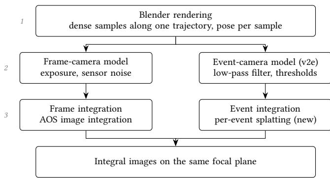  
Figure 1: Overview of the pipeline with its three stages.

High dynamic range. Another event-camera advantage that is reported often is dynamic range. In comparison to a normal frame camera there is no uniform exposure for all pixels. Instead each pixel responds logarithmically, and therefore a much higher dynamic range can be recorded. A DVS covers 120 dB within one scene [16] without exposure control [6], against 72 dB for the frame camera we use as reference [1, 4]. This has been shown many times for scenes that saturate or starve a frame camera, such as tunnel exits and headlight glare [17, 26, 28]. This could definitely be an advantage in some scenarios for SAI, but a multi-image system can also expose each image diferently and combine them [30]. The event simulator we use, however, does not support HDR, since its input consists of 8- bit frames, and therefore our simulation does not test this question. But this advantage should definitely be taken into consideration when deciding which sensor to use.

## 3 Method

The pipeline has three stages (Figure 1). First, one camera trajectory past the occluded scene is rendered densely in Blender, together with the camera pose of every sample. Second, this rendering is fed into two sensor models: a frame-camera model that turns groups of samples into exposed, noisy images, and an event-camera model that turns the sample sequence into an event stream. Third, each output is integrated on the same focal plane. The frames use the existing SAI of the AOS renderer, and for the events we add a new SAI path that projects every single event onto the focal plane. The rendering in Blender, the movement of the camera and the focal plane are shared, so the diference between the two results comes from the sensor model and its reconstruction. The following subsections describe each stage.

## 3.1 Rendering and Pose Extraction

The input to both sensor models is a single densely sampled Blender rendering of one camera trajectory past the occluded scene. The path of the camera forms the synthetic aperture. The trajectory is built from a chain of movement commands. Each command translates the camera over a specified distance, with optional parameters for rotation and elevation changes. Consequently, a combination of these commands can generate many diferent sequences of camera poses. The animation is sampled at � positions and each sample is rendered as an 8-bit grayscale image, matching the monochrome sensors we model, together with its camera pose. For every rendered frame the camera pose from Blender, which places the camera in the world, is inverted into the world-to-camera view matrix expected by the reconstruction. This requires remapping Blender’s �-up coordinate convention to the renderer’s �-up, �-forward one. All poses are collected in a single JSON file, which is then used by the SAI reconstruction.

One render, many speeds. The rendered positions are pure geometry: no timestamps are attached at render time. Camera speed is configured by setting a specific duration � of the movement, giving an efective input rate

$$
f _ { \mathrm { e f f } } = N / T .
$$

The same render can therefore be used as a fast and a slow traversal of the same camera movement, and both sensor branches consume the same reinterpreted sequence, so the two camera simulations always have the same input. The movement duration parameter propagates through the whole pipeline. It sets the inter-frame interval of the event simulator’s input, which must remain small against the photoreceptor time constant (Section 3.2). It sets the number of render frames averaged into one frame-camera exposure. And it sets the number of frames the frame camera gets from a specific frame rate across the motion, $n = f _ { \mathrm { s e n s o r } } \cdot T$ . The number of frames therefore depends only on �, while the number of events depends on the motion in the image and on the cutoff\_hz we set in v2e. The render density � is chosen for the fastest movement we want to simulate, since v2e requires shorter inter-frame intervals for higher cutoff\_hz settings.

## 3.2 Event-Camera Model

The event camera simulation uses v2e [11] to convert the densely rendered frames into the event stream a dynamic vision sensor (DVS) [16] would produce. Frames are read one at a time, and for each pixel the simulator calculates the following. First, the log of the brightness value of each pixel is calculated, since event cameras process brightness relatively. Then this log signal is sent into a lowpass filter that models the pixel’s bandwidth restrictions. Finally, events are generated from the filtered signal wherever the signal goes over the threshold.

Photoreceptor low-pass and cutoff\_hz. When an event camera pixel receives light, a photocurrent is induced, and the photoreceptor converts this current into a logarithmic voltage. The time constant of this conversion is inversely proportional to the photocurrent [11, 16]. With less light there is less photocurrent, the time constant becomes longer, and the bandwidth of the pixel drops, so pixels react quickly in bright light and sluggishly in dim light [10, 11]. Therefore the photoreceptor can be modeled using a low-pass filter, which is what v2e does. The event sampling itself is set after the low-pass filter, and therefore the events are generated on a smoothed signal of the rendered frames [11]. The parameter cutoff\_hz sets the corner frequency of this filter, and v2e scales the filter per pixel with its brightness, so cutoff\_hz specifies the bandwidth of a bright pixel and darker pixels respond proportionally slower for the same cutof setting. If cutoff\_hz is low enough, finer structures, like the spokes of a bike, produce fewer or no events. This is the reason why in lower light the event stream loses detail. cutoff\_hz is not a parameter of the sensor alone, but a combination of the event camera, its bias settings and the brightness of the scene [10, 11]. How we choose its value per lighting condition is described in Section 4.

Threshold events and non-idealities. Each pixel saves the log brightness at which it last fired an event. When the filtered signal for this pixel difers from this stored value by more than the threshold, the pixel emits an ON or OFF event and updates the stored value, one event per threshold crossed. Events within one frame interval get timestamps between the two frame times. v2e spaces them on an even grid whose resolution is set by the pixel with the most events in that frame [11]. On top of this, v2e adds the non-idealities of a real sensor: every pixel gets a slightly diferent threshold, pixels fire random noise events at a rate that depends on the light, some pixels fire leak events without any input, and a pixel cannot fire again within a short refractory time.

## 3.3 Frame-Camera Model

The frame camera simulation reuses the same rendered frames as the event simulation. The simulation has two steps. The first step takes the shutter speed and applies motion blur based on it. The second step applies noise based on the shutter speed and the EMVA 1288 camera model [4]. This is a standardized model and many manufacturers publish parameters for it [1, 4].

Exposure. The rendered frames are sRGB encoded, so we first convert them back to linear brightness. Only in linear space can light from several frames be added up correctly. Each camera frame is then the average of all render frames that lie inside its exposure time. This is the common way to get motion blur from densely rendered sharp frames [20]. The camera frame gets the pose of the render frame in the middle of its exposure. The exposure cannot be longer than the time between two frames, since the sensor has to read out before the next frame starts. So for darker scenes the capped exposure results in more noise. In SAI noise is generally preferred to motion blur, since the motion blur cannot be averaged out.

Sensor noise. For the sensor stage we use the EMVA 1288 camera model [4]. It describes how much light a pixel collects during the ex posure and how noisy the recorded value is. The main noise source is shot noise, which comes from the random arrival of photons and gets worse the less light a pixel collects. On top of that, the readout adds a constant read noise. Very bright pixels saturate, and the result is written as an 8-bit image. The model needs only four numbers from the camera: quantum eficiency, pixel pitch, read noise and full-well capacity. We take all four from the EMVA 1288 measurement the manufacturer publishes for the camera we simulate (Section 4). The exposure is set so that a white surface fills the output range, like an auto exposure would do.

## 3.4 Synthetic-Aperture Reconstruction

Both sensor simulations end on the same focal plane at depth $z _ { f } ,$ using the AOS light-field renderer [12]. Everything the camera saw from all viewpoints is projected onto this plane and added up. Objects at the selected depth are seen from every viewpoint at the same place, so they add up. The occluder in front of the plane lands somewhere else in every viewpoint, so it gets averaged out.

Frame integration. For the frames we use the image-based rendering of AOS [12]. Every pixel of every recorded image is one ray through the synthetic aperture. A virtual camera is defined with its own pose, field of view and focal plane. For each pixel of this virtual camera, a ray is cast through its projection center and intersected with the focal plane. All recorded rays that pass through this point on the focal plane are integrated and normalized, and the result is the color of that pixel. Points on the focal plane are hit by rays from every viewpoint at the same place, so they add up. An occluder in front of the plane blocks only some of the rays and lands somewhere else in every viewpoint, so it is averaged out if it is sparse enough and the aperture is wide and densely sampled [12]. No 3D reconstruction of the scene is needed for this.

Event integration. Events are sparse, asynchronous and have a sign, so there is no image to project. We therefore integrate every event on its own, in two steps (Figure 2).

From events to rays. Each event is stored with its pixel coordinates, its timestamp and polarity. The poses of the rendered frames are shared. An event fires while the camera moves, so its viewpoint is not one of the rendered poses. We estimate the pose of each event by interpolating between the two nearest poses. The position is interpolated linearly with the timestamp of the event, and the rotation along the shortest arc between the two rotations. This viewpoint is only as fine as the timestamps v2e assigns within a frame interval (Section 3.2), but it is still much finer than the rendered poses. Using the nearest rendered pose instead would collapse all events of one interval onto one viewpoint, and at high speed the aperture would then be sampled in coarse steps. The direction of the ray is given by the position of the pixel on the sensor. The ofset of the pixel from the image center, divided by the focal length of the camera, gives the angle of the ray. A shorter focal length therefore spreads the same pixels over a wider angle, and each pixel looks in a slightly diferent direction. The focal length and the image center are the same for all events and are taken from the rendered camera. For an event at pixel (�, �) the direction in the camera frame is

$$
\mathbf { d } = \left( { \frac { c _ { x } - x } { f _ { x } } } , \ { \frac { c _ { y } - y } { f _ { y } } } , \ - 1 \right) ,
$$

with the principal point $( c _ { x } , c _ { y } )$ and the focal length $( f _ { x } , f _ { y } )$ in pixels. The ray is then rotated into the world with the interpolated pose. This gives a ray in world space, together with the directions that span the footprint of one sensor pixel.

Splatting on the focal plane. Each ray is intersected with the focal plane and the footprint of its pixel is projected there. Seen from the side, this footprint is a distorted quadrilateral. The event deposits its polarity over this footprint with a tent weighting that is widened to twice the footprint. Neighboring events overlap on the plane and their weights sum to one, so the sparse events form a smooth surface. The weight of each event is divided by the projected area of the footprint. An event far from the optical axis, whose footprint projects larger, therefore has the same total weight as a central one. All splats are added up on the GPU, with ON and OFF polarity in separate channels. One quad is drawn per event, so the cost grows with the number of events. The rays do not depend on the focal depth, so refocusing to another � reuses all rays and only needs a redraw. After that, the final reconstruction counts the positive and negative events in each pixel, and we have two ways of visualizing the result. The first one takes the positive minus the negative count and maps it to gray, so that pixels where both polarities cancel are mid-gray. The second one takes the absolute value of this diference and inverts it, so cancelled pixels become white and pixels where one polarity dominates become dark.

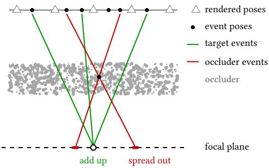  
Figure 2: Event integration on the focal plane. Every event gets its own pose between the rendered poses and is projected as one ray. Events from the target on the focal plane land at the same point from every pose and add up. Events from the occluder pass through the same point in front of the plane, so they land at diferent places and spread out.

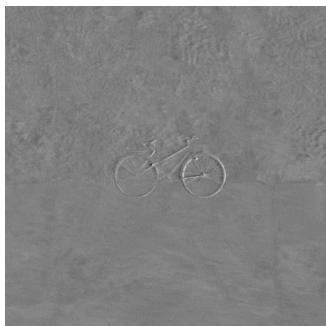  
(a) Signed net polarity

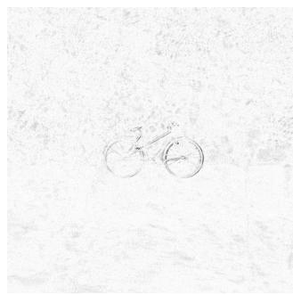  
(b) Absolute net polarity  
Figure 3: Event-based synthetic-aperture integral produced by the proposed integration path (bright scene, 25 m/s). (a) Signed net polarity, balanced pixels render mid-gray. (b) Absolute value of the net polarity, inverted, so cancelled pixels render white and events black. The occluding foliage of Figure 4 washes out, while the bicycle on the focal plane, including spokes and frame, is reinforced.

Figure 3 shows a reconstruction produced by this path: integrated over the full trajectory, the signed splats from the near-field foliage cancel toward mid-gray while the bicycle on the focal plane accumulates coherently.

## 3.5 Event-Rate Controller

A frame camera with a given frame rate always puts out the same amount of data. For event cameras it depends on the light and also very much on the scene itself [6]. For scenes where the camera is static, only very few events are produced. However, for scenes where the camera is moving and a lot of texture is captured, a lot of events are recorded. In such scenarios it can happen that the event camera produces more events than the link from the event camera can handle, especially for sensors with higher resolution like the one we are simulating in our experiments [5, 8]. In older systems, when the link is saturated, events are dropped in an uncontrolled manner, which leads to signal loss, and the timestamps of the events get corrupted [6, 8]. Modern systems ship with an event-rate controller (ERC) that drops events in a controlled manner and can be configured by setting an event rate per second [5]. In our highspeed scene the simulated event stream exceeds the link budget we estimate in Section 4.4, so a real recording of this scenario would likely have the ERC active, and simulating the camera without ERC would be too optimistic.

However, how exactly the ERC decides which events to drop is not published, so we follow the description of Gehrig and Scaramuzza [8] and use a uniform dropping algorithm. The event stream is split into short counting periods, and whenever a period contains more events than the configured rate allows, the surplus is dropped at random. The event rate and the counting period we use are given in Section 4.

## 4 Experimental Setup

The comparison uses a scene with two bushes as occluders and a bicycle behind them (Figure 4). The bicycle is about 9 m away from the camera. The camera moves 0.5 m along the occluders and rises slightly while doing so, which makes the path a diagonal shift without any rotation. Although our event integration works with arbitrary 6-DoF poses, we keep to this simple movement, because Bimber et al. [2] found that a lateral shift suppresses occluders better than a rotation, as it maximizes the parallax, and that a vertical component on top of it also helps against horizontally aligned occluders. This movement is what is rendered. We chose this rather short aperture on purpose. With a long aperture of several meters both sensors get more than enough views, the two results converge, and the diferences we want to show disappear. The short aperture is where a shortage of views actually hurts. Our simulation is also optimistic, because the poses are known exactly. A real system has pose errors and needs even more views to average them out, so the situation we create here with a short aperture would show up on a real system at larger apertures too. We render 3000 frames for this movement to make high cutoff\_hz settings possible. This render is only done once. The scene has one global light in Blender. The resolution of the Blender render is 720 × 720 pixels. We compare the sensors at the same resolution to make bandwidth comparisons fair.

## 4.1 Two Operating Points

The comparison is done at two operating points and one additional run, listed in Table 1. The first operating point is a bright high-speed scenario, where the speed of the camera is 25 m/s. Here we want to see if the event camera can still produce a good reconstruction when the frame camera is starved of frames, because at 160 fps the frame camera only records three frames during the movement. The second operating point is a low-light scenario. The movement here is much slower at 5 m/s, and therefore the frame camera has enough frames to create a good result in principle, so this is all about sensor noise in a low-lit environment. We use 5 lux, because this is the lowest illuminance for which Prophesee, the manufacturer of the event sensor, still specifies a latency value [24]. The scene, the path and the render are the same at both comparisons. A third run in the bright scene at 1 m/s is used to compare reconstruction quality at two approximately matched data budgets (Section 5.3). We pair an ERC cap of 20 MEv/s with 80 frames at 160 fps, and 10 MEv/s with 40 frames at 80 fps. The 40-frame sequence takes every second frame of the original 80-frame sequence, preserving the exposure and noise realizations. Both pairs cover the same 0.5 s traversal; only the frame sampling rate and the ERC cap change.

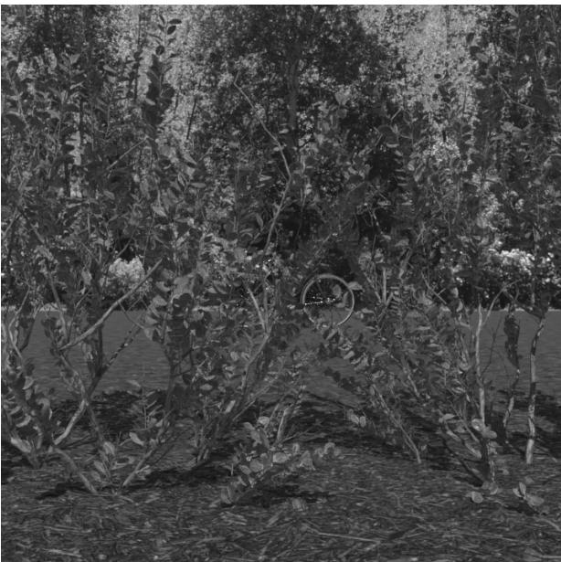  
Figure 4: One viewpoint from the shared trajectory. Near field foliage occludes a bicycle on the focal plane; the 0.5 m path supplies the remaining viewpoints of the synthetic aperture.

Table 1: The two evaluation points and the additional run at 1 m/s. Frame-view counts are � = 160 fps · � over the 0.5 m aperture, rounded down.
<table><tr><td></td><td>High speed</td><td>Low light</td><td>Matched data</td></tr><tr><td>Scene illuminance</td><td>1000 lux</td><td>5 lux</td><td>1000 lux</td></tr><tr><td>Camera speed</td><td>25 m/s</td><td>5m/s</td><td>1 m/s</td></tr><tr><td>Duration T</td><td>0.02 s</td><td>0.1 s</td><td>0.5 s</td></tr><tr><td>Frame views n</td><td>3</td><td>16</td><td>80 / 40</td></tr><tr><td>Event cutoff_hz</td><td>1000 Hz</td><td>100 Hz</td><td>1000 Hz</td></tr><tr><td>ERC (MEv/s)</td><td>50 / 20</td><td>off</td><td>20 / 10</td></tr></table>

Table 2: Frame-camera model. EMVA rows are Basler’s measurement of the ace 2 a2A1920-160umBAS (Sony IMX392) [1]. Exposures are chosen as the frame camera’s best case at each operating point.
<table><tr><td>Parameter</td><td>Value</td><td>Source</td></tr><tr><td>Simulated resolution</td><td>720× 720</td><td>matched</td></tr><tr><td>Frame rate</td><td>160 fps</td><td>EMVA</td></tr><tr><td>Peak QE</td><td>62%</td><td>EMVA</td></tr><tr><td>Pixel pitch</td><td>3.45μm</td><td>EMVA</td></tr><tr><td>Read noise</td><td> $3 . 0 \mathrm { e } ^ { - }$ </td><td>EMVA</td></tr><tr><td>Full-well capacity</td><td>10.5 ke−</td><td>EMVA</td></tr><tr><td>Exposure (bright / night)</td><td>0.1 / 6.25 ms</td><td>chosen</td></tr></table>

Table 3: Event-camera model. IMX636-class target specifications [5, 24] and v2e non-ideality settings. The photoreceptor cutof is a modelling assumption (Section 4.3), not a datasheet number.
<table><tr><td>Parameter</td><td>Value</td><td>Source</td></tr><tr><td>Simulated resolution</td><td>720 × 720</td><td>matched</td></tr><tr><td>ERC budget (bright)</td><td>50 MEv/s</td><td>Section 4.4</td></tr><tr><td>Contrast threshold</td><td>0.25</td><td>brief</td></tr><tr><td>Threshold mismatch</td><td>0.03</td><td>v2e</td></tr><tr><td>Refractory period</td><td>0.1 ms</td><td>v2e</td></tr><tr><td>Shot-noise rate (bright / night)</td><td>0.1 / 10 Hz/px</td><td>brief</td></tr><tr><td>Leak rate</td><td>0.1 Hz/px</td><td>brief</td></tr><tr><td>cutoff_hz (bright / night)</td><td>1000 /  100 Hz</td><td>Section 4.3</td></tr></table>

## 4.2 Sensor Parameters

We model two commercially available industrial sensors. The frame camera is a Basler ace 2 with the Sony IMX392, a global-shutter CMOS sensor. The event camera is the Sony IMX636, a current Prophesee sensor. Their parameters are collected in Tables 2 and 3. Most ofthem are manufacturer data. The rest ofthis section explains the values we had to choose ourselves.

Frame camera. Quantum eficiency, pixel pitch, read noise, fullwell capacity and frame rate come from Basler’s published EMVA 1288 measurement [1]. The exposure can never be longer than the 6.25 ms frame interval. At night we use this full interval, so the frame camera collects as much light as a 160 fps global-shutter sensor can. In the bright scenario we use a 0.1 ms exposure. The image moves about 1.5 px/ms at 25 m/s, so the motion blur stays around 0.15 px, and the result is limited by the three frames on the path and not by blur or noise. These choices are the best case for the frame camera at each operating point.

Event camera. The contrast threshold of 0.25 is the nominal 25% logarithmic contrast from the product brief [24]. Threshold mismatch and refractory period are the settings v2e recommends [11]. For the shot noise the brief gives 0.1 Hz per pixel at 1 klux and allows up to 10 Hz per pixel at 5 lux, and we use these two values for the bright and the night scenario. The photoreceptor cutof has no datasheet value and is treated in Section 4.3.

## 4.3 Photoreceptor Cutof

To our knowledge there is no published measurement of the pho toreceptor bandwidth of the IMX636 at a known illuminance [19], so we cannot look up cutoff\_hz and have to choose it. We base the choice on two sources.

The first one is the original DVS. Its bandwidth was measured directly: about 3 kHz at 1 klux and about 300 Hz at a thousand times less light [6, 16]. That sensor had much larger pixels than the IMX636. Smaller pixels collect less light and get slower in the dark [8], so the IMX636 should have lower cutof values at the same light levels.

The second one is the product brief of the IMX636. It gives the latency of the sensor: 100 µs at 1 klux and 1000 µs at 5 lux [24]. We use the latency as the time constant of the cutof filter, so the cutof is $f _ { c } = 1 / ( 2 \pi t _ { \mathrm { l a t } } )$ . This is an assumption, since the latency also depends on the contrast of the step. With a higher contrast the pixel fires a little earlier, but the datasheet does not say which contrast was used. With it, the two latencies give 1.6 kHz and 160 Hz.

We stay below both sources and use 1000 Hz for the bright scenario and 100 Hz for the night scenario. The lux values of the brief are the manufacturer’s test conditions, and we take them as our scene illuminances.

## 4.4 Event-Rate Budget

The ERC model is described in Section 3.5. Here we give the two values it needs, the event rate and the counting period.

The event rate follows from how fast the camera can get its events to the computer. The IMX636 is sold in Prophesee’s EVK4 camera, which is connected over USB 3.0 and has a maximum bandwidth of 1.6 Gbit/s [22]. How many events fit through this link depends on the size of one event. The sensor packs its events into the EVT3 format, which only transmits what changes between neighboring events, so the size of an event depends on the scene [21]. We estimate the data rate using 4 bytes per event. This is a work ing approximation rather than a strict upper bound for EVT3. For context, Prophesee’s published RAW EVT3 recordings yield approximately 2.8 bytes per event for high-speed laser motion, 3.2 for a moving-camera driving sequence and 4.7 for pedestrians, calculated from their listed file sizes, durations and event rates [23]. Using our four-byte estimate, the link supports

$$
1 . 6 \times 1 0 ^ { 9 } / ( 8 \times 4 ) = 5 0 \mathrm { M E v / s } .
$$

To be safe we also run the ERC at 20 MEv/s, well below any plausible link rate. Events are counted in periods of 200 µs, the reference period of the IMX636 ERC [5]. The bright stream at 25 m/s is about 177 MEv/s and therefore exceeds the estimated link budget by about 3.5×, which motivates the ERC experiments. That reconstruction is repeated after the ERC at both rates. The night 5 m/s stream at the 100 Hz cutof is about 21 MEv/s, under budget, and is left as it is.

## 5 Results

Reconstruction quality is assessed qualitatively. We look at whether the bicycle can be recognized, which structures are visible, such as the spokes, the frame and the foliage that should be washed out, and how noisy the image is. The conclusions apply to the two operating points in Table 1 and to the additional run at 1 m/s, and not to the speeds and illuminances between them. Section 5.3 then compares the data the two cameras produce in all three runs.

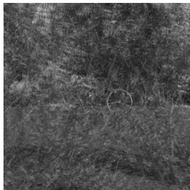

  
(b) Event SAI, full stream

(a) Frame SAI, 3 views  
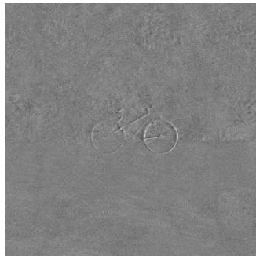

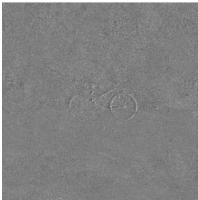  
(c) Event SAI, ERC 50 MEv/s  
(d) Event SAI, ERC 20 MEv/s  
Figure 5: High speed (25 m/s, 1000 lux). (a) Frame SAI from the three frames the camera records on the path. (b) Event SAI from the full event stream. (c) and (d) Event SAI after the ERC drops the stream to 50 and 20 MEv/s. The bicycle survives both; fine structure and smoothness do not.

## 5.1 High Speed

At 25 m/s and 1000 lux the frame camera records three frames on the path. Figure 5 shows both reconstructions. The three images the frame camera produces are not enough to create a good reconstruction. Some parts of the bike are still visible, but that is only because the occlusion is not very dense, as shown in Figure 4. The input frames are well exposed and do not have any noise problems. The event camera at the same time captures 3.5 M events along the same path, and when looking at its result it is clear that the event reconstruction gives us the whole bike. However, the raw event data we get at this combination of speed and cutoff\_hz is above the link budget we estimated in Section 4.4. Therefore we also added two reconstructions after an event-rate controller simulation. When the ERC limit is set to 50 MEv/s, about two thirds of the events are dropped, but the reconstruction still shows the bike, at the cost of detail and noise. We also did the same with an event budget of 20 MEv/s. The bike is still recognizable, but the quality degrades further and there is less detail. The data behind these images is compared in Section 5.3.

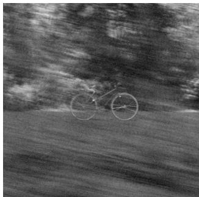

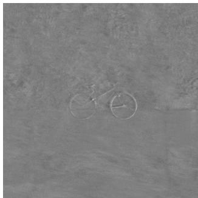  
(a) Frame SAI, 16 views  
(b) Event SAI, 100 Hz cutof  
Figure 6: Low light (5 m/s, 5 lux). (a) Frame SAI from 16 views. (b) Event SAI at the 100 Hz photoreceptor cutof. Both recover the bicycle at a similar quality.

## 5.2 Low Light

At 5 lux and 5 m/s the frame camera records 16 views and exposes for the full 6.25 ms between two frames. The event camera runs with the 100 Hz cutof of Section 4.3. Both reconstructions (Figure 6) recover the bicycle at a comparable quality. The frame side looks a little bit more noisy, but the level of detail of the bike is very similar. In our simulation we cannot claim an advantage for either.

## 5.3 Bandwidth

We distinguish the data rate in MB/s, which determines whether a stream fits through the camera link, and the data volume that is used as input for one reconstruction. Table 4 reports both, using the estimate of 4 bytes per event from Section 4.4 and 8 bits per pixel for the frames. These are payload estimates.

The raw high-speed event stream produces about 709 MB/s, exceeding the estimated 200 MB/s link budget. At an ERC cap of 20 MEv/s, one traversal produces approximately 1.6 MB, comparable to the three frames, while the bicycle remains more recognizable in the event reconstruction (Figure 5). At night the two streams produce similar volumes, 8.6 MB for events and 8.3 MB for frames. The raw bright stream at 1 m/s fits within the estimated link budget, but its 86.7 MB per traversal exceeds the 41.5 MB of the 80 frames.

For the bright 1 m/s run, we therefore reduce the data on both sides and compare two approximately matched budgets (Figure 7). The first pair uses the ERC at 20 MEv/s and 80 frames at 160 fps, producing 39.6 and 41.5 MB per traversal. The second pair halves both settings: the ERC at 10 MEv/s produces 19.8 MB, and 40 frames at 80 fps produce 20.7 MB.

Event cameras are often seen as very eficient and less bandwidth hungry [6], although some research already shows that this is not the case for all scenarios [8]. With a stationary camera, events come only from the moving targets, while with a moving camera the whole static scene triggers events [6]. SAI is exactly the second case, a moving camera and a stationary scene. In addition, SAI is all about occluders, and occluders have a lot of texture that produces a lot of events, because the event rate grows with the image gradient and the speed on the sensor [6]. In the 1 m/s comparison with matched budgets the event camera has no advantage over the frame camera in terms of reconstruction quality. Especially in the 10 MEv/s case the frame camera retains almost all of the detail with 40 frames, while the event camera loses some detail compared to the higher budget.

Table 4: Data of the two cameras in all runs at 720 × 720. Event rates are measured from the simulated streams and converted with 4 bytes per event (Section 4.4). Frames are 8 bit per pixel at 160 fps, except for the 40-view subset at 80 fps. The last column is the data of one traversal of the 0.5 m aperture.
<table><tr><td>Run</td><td>Stream</td><td>MEv/s</td><td>MB/s</td><td>MB/trav.</td></tr><tr><td>25 m/s, 0.02 s</td><td>Frames (3)</td><td>一</td><td>83</td><td>1.6</td></tr><tr><td></td><td>Events, raw</td><td>177</td><td>709</td><td>14.1</td></tr><tr><td></td><td>Events, ERC 50</td><td>50</td><td>200</td><td>4.0</td></tr><tr><td></td><td>Events, ERC 20</td><td>20</td><td>80</td><td>1.6</td></tr><tr><td>5 m/s, 0.1 s, night</td><td>Frames (16)</td><td>一</td><td>83</td><td>8.3</td></tr><tr><td></td><td>Events, raw</td><td>21</td><td>85</td><td>8.6</td></tr><tr><td>1 m/s, 0.5 s</td><td>Frames (80)</td><td>一</td><td>83</td><td>41.5</td></tr><tr><td></td><td>Events, raw</td><td>43</td><td>174</td><td>86.7</td></tr><tr><td></td><td>Events, ERC 20</td><td>19.8</td><td>79.3</td><td>39.6</td></tr><tr><td></td><td>Frames (40)</td><td>一</td><td>41.5</td><td>20.7</td></tr><tr><td></td><td>Events, ERC 10</td><td>9.9</td><td>39.7</td><td>19.8</td></tr></table>

The only bandwidth advantage we could see was at very high speed. At slower speeds this advantage seems to vanish in our simulation.

## 6 Discussion

What the three runs imply. The high-speed run shows the clearest diference. The deficit of the frame camera there cannot be resolved by adjusting the exposure. At the tested speed and aperture length, more viewpoints are needed, which the event camera provides through its finer temporal sampling.

In low light the two cameras reach similar quality, but we used a cutoff\_hz at the low end of the range discussed in Section 4.3. The original DVS reached about 300 Hz at 1 lux [6, 16], suggesting a better low-light temporal response than the high-resolution sensor model used here. However, its lower spatial resolution comes at a cost: it can limit the fine detail available to the SAI reconstruction. As shown by Gehrig and Scaramuzza [8], lower-resolution event cameras can perform better in low light and at high speed for several tasks. For SAI, this benefit must therefore be weighed against the loss of spatial detail. Our comparison evaluates one choice within this tradeof.

At approximately matched bandwidth budgets in the bright 1 m/s run, the event camera has no advantage in target-detail preservation. Especially at the lower budget, the 40 frames retain slightly more detail than the 10 MEv/s event stream. At this speed, even the reduced frame rate supplies enough viewpoints to retain the bicycle, so the finer temporal sampling of the event camera provides less benefit. Its data rate also depends on the scene and, among our runs, is highest in the fast, bright condition where its clearest advantage appears. A system that adopts an event camera for high-speed SAI must therefore account for this high event rate and the event removal required by its link budget.

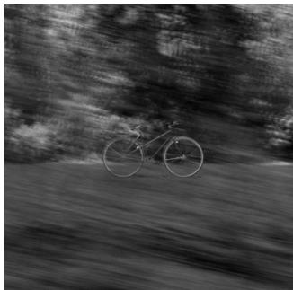  
(a) Frames, 160 fps 80 views, 41.5 MB

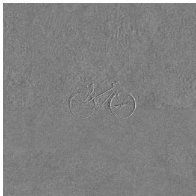  
(b) Events, ERC 20 MEv/s 39.6 MB

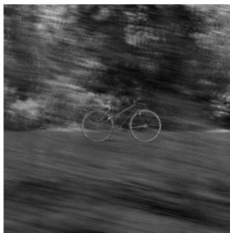  
(c) Frames, 80 fps 40 views, 20.7 MB

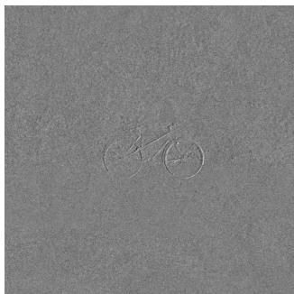  
(d) Events, ERC 10 MEv/s 19.8 MB  
Figure 7: Two approximately matched data budgets in the bright scene at 1 m/s. Top: 80 frames versus an ERC cap of 20 MEv/s. Bottom: 40 frames versus 10 MEv/s. Volumes refer to one 0.5 s traversal. The 40 views are every second frame of the original sequence, with unchanged exposure. Both modalities retain the bicycle at both budgets.

Another factor could be that at higher speeds the event camera records fewer events from the occluders, since motion parallax makes them move much faster across the sensor than the target. The limited photoreceptor bandwidth may attenuate these fast bright ness changes more strongly. At lower speeds, more occluder events may survive and consume part of the ERC budget. This possible filtering occurs before the ERC, which drops events randomly in our model. But this is still an open question.

Dark at high speed. We tested high speed only in bright light. To see whether the event advantage survives in the dark, we repeated the 25 m/s run with the 5 lux settings of the night scenario, the 100 Hz cutof and the 10 Hz per pixel shot noise, for the event camera only (Figure 8). The bicycle is barely recognizable: only a faint outline of one wheel remains, and the foliage is not averaged out. At 5 lux the time constant of the photoreceptor is about 1.6 ms, while a pixel crossing at 25 m/s takes about 0.7 ms, so most edges are filtered away before they trigger an event. The stream drops to about 23 MEv/s, so the link is not the limit here, the pixel is. The frame camera would record three noisy frames with 9 px of motion blur in this condition, so neither camera works, and the event advantage at high speed is limited to good light with this sensor model.

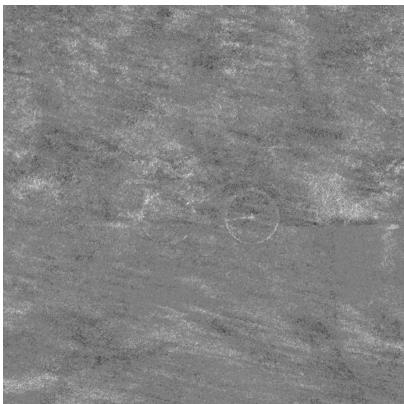  
Figure 8: Event SAI in the dark at high speed (25 m/s, 5 lux, 100 Hz cutof). Only a faint outline of one wheel remains, and the foliage is not averaged out.

Practical impact. A speed of 25 m/s is relevant to fast-flying drones, and event cameras have already been flown on drones [28], though not for SAI. If at least ten frames are needed over the aperture to suppress the occluders, a 30 fps camera on our 0.5 m aperture is limited to 1.5 m/s, and the 160 fps camera we simulate to 8 m/s. The event camera gave a usable result at 25 m/s, a factor of about 17 over the 30 fps camera. The faster traversal also matters when the target moves.

Pose estimation. Accurate pose estimation remains a practical limitation for high-speed event-based SAI. Recent event-inertial methods explicitly address aggressive motion, including continuoustime estimation of linear velocity [18], while newer benchmarks evaluate pose estimators on drone trajectories reaching 8.64 m/s [33]. These studies support the feasibility of estimating motion from events and inertial measurements, but also show that reliable estimation under general high-speed motion remains challenging. Whether the resulting trajectories provide suficient accuracy for SAI at the 25 m/s operating point tested here remains unverified.

Denser occlusion. Denser occlusion was not tested in our experiments. For frames, Kurmi et al. [13] show that denser occlusion lowers the visibility, and adding more frames does not improve the result after a certain threshold and never reaches the same result as with less occlusion. For events, the only study we know of is Yu et al. [31], whose reconstruction improved with denser occlusion. That test used a fence and cut cardboard with a trained network, so it does not tell us how plain integration behaves behind foliage.

Limitations. The comparisons are qualitative, and we only test one scene with mild occlusion. The estimation of the cutof frequency is grounded but not verified with a real sensor. The ERC modeling is also an estimation. Therefore a diference would have to be substantial to infer an advantage, which we only had in the high-speed case. Also, the comparison excluded any HDR comparison, and HDR is definitely a big factor when considering event cameras.

## 7 Conclusion

We built a simulation pipeline in which a frame camera and an event camera see the same rendered scene and the same camera movement, and compared them for synthetic-aperture imaging. An event-native version of the AOS SAI was added. The comparison shows an advantage for the event camera at high-speed movements on a short path. This holds in good light. In the dark at the same speed, the event reconstruction also failed to recover the target clearly; the frame camera would remain undersampled. For the tested 0.5 m aperture and an assumed minimum of ten frames, this corresponds to approximately 17 times the traversal speed of a 30 fps camera. The expected bandwidth eficiency of event cameras was not confirmed, because of the many events produced by the occlusion and the non-static camera setting. For low light no advantage could be found with the two selected sensors, although this does not mean that other event cameras with smaller resolution do not have an advantage at low light. In general the HDR advantage is still a very compelling argument to choose event cameras for synthetic aperture. If there is a usage scenario that needs the higher dynamic range, there is no reason to believe that this advantage should not transfer directly to SAI. In general event cameras are a viable option for SAI, but the advantages are not as big as expected. Future work should validate the simulation with real recordings, in particular the photoreceptor bandwidth of the event sensor in low light.

## References

[1] Basler AG. 2024. EMVA Data Overview: Monochrome Area Scan Cameras. Document BAS2412. https://www.baslerweb.com/en/downloads/documentdownloads/emva-data-overview

[2] Oliver Bimber, Karl Dietrich von Ellenrieder, Michael Haller, Rakesh John Amala Arokia Nathan, Gianni Lunardi, Marco Camurri, Mohamed Youssef, San tos Miguel Orozco Soto, and Jeremy E. Niven. 2025. How Robot Dogs See the Unseeable. (2025). arXiv:2511.16262 [cs.RO]

[3] Tobi Delbruck and Manuel Lang. 2013. Robotic Goalie with 3 ms Reaction Time at 4% CPU Load Using Event-Based Dynamic Vision Sensor. Frontiers in Neuroscience 7 (2013), 223. doi:10.3389/fnins.2013.00223

[4] European Machine Vision Association. 2021. EMVA Standard 1288: Standard for Characterization of Image Sensors and Cameras, Release 4.0. https://www. emva.org/standards-technology/emva-1288/

[5] Thomas Finateu, Atsumi Niwa, Daniel Matolin, Koya Tsuchimoto, Andrea Mascheroni, Etienne Reynaud, Pooria Mostafalu, Frederick Brady, Ludovic Chotard, Florian LeGof, Hirotsugu Takahashi, Hayato Wakabayashi, Yusuke Oike, and Christoph Posch. 2020. A 1280×720 Back-Illuminated Stacked Temporal Contrast Event-Based Vision Sensor with 4.86 �m Pixels, 1.066GEPS Readout, Programmable Event-Rate Controller and Compressive Data-Formatting Pipeline. In 2020 IEEE International Solid-State Circuits Conference (ISSCC). 112– 114. doi:10.1109/ISSCC19947.2020.9063149

[6] Guillermo Gallego, Tobi Delbrück, Garrick Orchard, Chiara Bartolozzi, Brian Taba, Andrea Censi, Stefan Leutenegger, Andrew J. Davison, Jörg Conradt, Kostas Daniilidis, and Davide Scaramuzza. 2022. Event-Based Vision: A Survey. IEEE Transactions on Pattern Analysis and Machine Intelligence 44, 1 (2022), 154–180. doi:10.1109/TPAMI.2020.3008413

[7] Daniel Gehrig, Mathias Gehrig, Javier Hidalgo-Carrió, and Davide Scaramuzza. 2020. Video to Events: Recycling Video Datasets for Event Cameras. In 2020 IEEE/CVF Conference on Computer Vision and Pattern Recognition (CVPR). 3583– 3592. doi:10.1109/CVPR42600.2020.00364

[8] Daniel Gehrig and Davide Scaramuzza. 2022. Are High-Resolution Event Cameras Really Needed? arXiv:2203.14672 [cs.CV]

[9] Rui Graça and Tobi Delbruck. 2021. Unraveling the Paradox of Intensity-Dependent DVS Pixel Noise. arXiv:2109.08640 [eess.SY]

[10] Rui Graça, Brian McReynolds, and Tobi Delbruck. 2023. Shining Light on the DVS Pixel: A Tutorial and Discussion about Biasing and Optimization. In 2023 IEEE/CVF Conference on Computer Vision and Pattern Recognition Workshops (CVPRW).

[11] Yuhuang Hu, Shih-Chii Liu, and Tobi Delbruck. 2021. v2e: From Video Frames to Realistic DVS Events. In 2021 IEEE/CVF Conference on Computer Vision and

Pattern Recognition Workshops (CVPRW). 1312–1321. doi:10.1109/CVPRW53098. 2021.00144

[12] Indrajit Kurmi, David C. Schedl, and Oliver Bimber. 2018. Airborne Optical Sectioning. Journal of Imaging 4, 8 (2018), 102. doi:10.3390/jimaging4080102

[13] Indrajit Kurmi, David C. Schedl, and Oliver Bimber. 2019. A Statistical View on Synthetic Aperture Imaging for Occlusion Removal. IEEE Sensors Journal 19, 20 (2019), 9374–9383. doi:10.1109/JSEN.2019.2922731

[14] Indrajit Kurmi, David C. Schedl, and Oliver Bimber. 2019. Thermal Airborne Optical Sectioning. Remote Sensing 11, 14 (2019), 1668. doi:10.3390/rs11141668

[15] Wei Liao, Xiang Zhang, Lei Yu, Shijie Lin, Wen Yang, and Ning Qiao. 2022. Synthetic Aperture Imaging with Events and Frames. In Proc. IEEE/CVF Conf. Computer Vision and Pattern Recognition (CVPR). doi:10.1109/CVPR52688.2022. 01721

[16] Patrick Lichtsteiner, Christoph Posch, and Tobi Delbruck. 2008. A 128×128 120 dB 15 �s Latency Asynchronous Temporal Contrast Vision Sensor. IEEE Journal ofSolid-State Circuits 43, 2 (2008), 566–576. doi:10.1109/JSSC.2007.914337

[17] Haoyue Liu, Shihan Peng, Lin Zhu, Yi Chang, Hanyu Zhou, and Luxin Yan. 2024. Seeing Motion at Nighttime with an Event Camera. In 2024 IEEE/CVF Conference on Computer Vision and Pattern Recognition (CVPR).

[18] X. Lu, Y. Zhou, J. Mai, K. Dai, Y. Xu, and S. Shen. 2025. Event-Based Visual-Inertial State Estimation for High-Speed Maneuvers. IEEE Transactions on Robotics 41 (2025), 4439–4458. doi:10.1109/TRO.2025.3584544

[19] Brian J. McReynolds, Rui Graça, Lucas Kulesza, and Peter McMahon-Crabtree. 2024. Re-interpreting the Step-Response Probability Curve to Extract Fundamental Physical Parameters of Event-Based Vision Sensors. arXiv:2404.07656 [eess.IV]

[20] Seungjun Nah, Tae Hyun Kim, and Kyoung Mu Lee. 2017. Deep Multi-Scale Convolutional Neural Network for Dynamic Scene Deblurring. In 2017 IEEE Conference on Computer Vision and Pattern Recognition (CVPR). doi:10.1109/ CVPR.2017.35

[21] Prophesee. 2024. EVT 3.0 Format — Metavision SDK Documentation. https: //docs.prophesee.ai/stable/data/encoding\_formats/evt3.html

[22] Prophesee. 2026. Evaluation Kit 4 – HD: Product Brief. https: //www.prophesee.ai/wp-content/uploads/2026/03/EVK4-HD-Prophesee-Evaluation-Kit-Brief-2026.pdf

[23] Prophesee. 2026. Sample Recordings. Metavision SDK documentation. https: //docs.prophesee.ai/stable/datasets.html

[24] Prophesee and Sony Semiconductor Solutions. 2021. Event-based Vision Sensor Gen4.1 Product Brief. Target specifications.

[25] Henri Rebecq, Daniel Gehrig, and Davide Scaramuzza. 2018. ESIM: An Open Event Camera Simulator. In Conference on Robot Learning (CoRL).

[26] Henri Rebecq, René Ranftl, Vladlen Koltun, and Davide Scaramuzza. 2021. High Speed and High Dynamic Range Video with an Event Camera. IEEE Transactions on Pattern Analysis and Machine Intelligence 43, 6 (2021), 1964–1980. doi:10.1109/ TPAMI.2019.2963386

[27] David C. Schedl, Indrajit Kurmi, and Oliver Bimber. 2021. An Autonomous Drone for Search and Rescue in Forests Using Airborne Optical Sectioning. Science Robotics 6, 55 (2021), eabg1188. doi:10.1126/scirobotics.abg1188

[28] Sihao Sun, Giovanni Ciofi, Coen de Visser, and Davide Scaramuzza. 2021. Autonomous Quadrotor Flight Despite Rotor Failure with Onboard Vision Sensors: Frames vs. Events. IEEE Robotics and Automation Letters 6, 2 (2021), 580–587. doi:10.1109/LRA.2020.3048875

[29] Vaibhav Vaish, Bennett Wilburn, Neel Joshi, and Marc Levoy. 2004. Using Plane + Parallax for Calibrating Dense Camera Arrays. In Proceedings of the IEEE Conference on Computer Vision and Pattern Recognition (CVPR). 2–9.

[30] Bennett Wilburn, Neel Joshi, Vaibhav Vaish, Eino-Ville Talvala, Emilio Antunez, Adam Barth, Andrew Adams, Mark Horowitz, and Marc Levoy. 2005. High Performance Imaging Using Large Camera Arrays. ACM Transactions on Graphics 24, 3 (2005), 765–776. doi:10.1145/1073204.1073259

[31] Lei Yu, Xiang Zhang, Wei Liao, Wen Yang, and Gui-Song Xia. 2022. Learning to See Through with Events. IEEE Transactions on Pattern Analysis and Machine Intelligence (2022). doi:10.1109/TPAMI.2022.3227448

[32] Xiang Zhang, Wei Liao, Lei Yu, Wen Yang, and Gui-Song Xia. 2021. Event-based Synthetic Aperture Imaging with a Hybrid Network. In Proc. IEEE/CVF Conf. Computer Vision and Pattern Recognition (CVPR).

[33] Sheng Zhong, Junkai Niu, Guillermo Gallego, Kaizhen Sun, Yang Yi, Zhiqiang Miao, Dewen Hu, Yaonan Wang, Davide Scaramuzza, and Yi Zhou. 2026. Eventbased SLAM Benchmark for High-Speed Maneuvers. arXiv:2604.24033 [cs.RO]