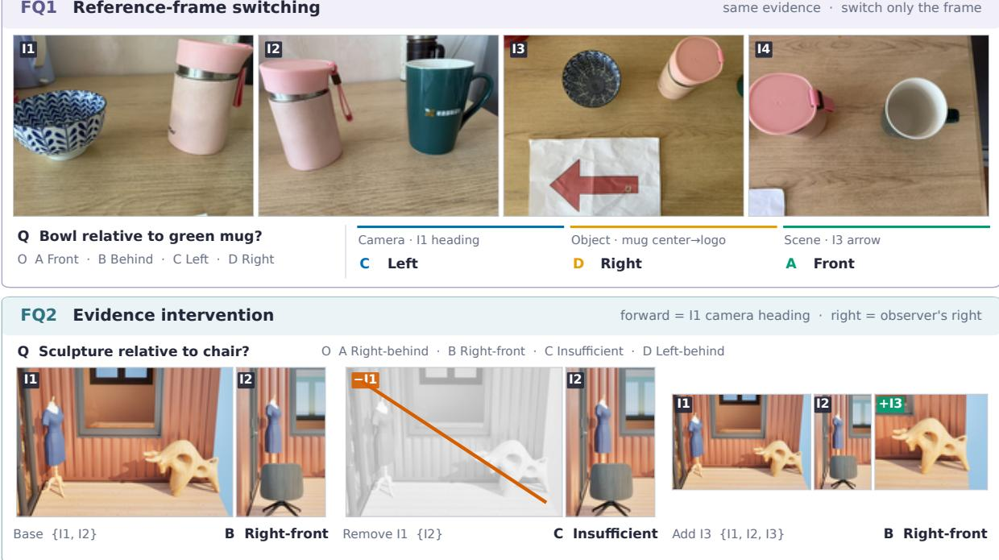
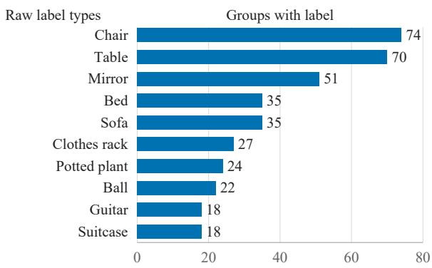
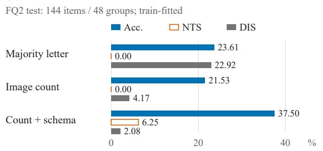
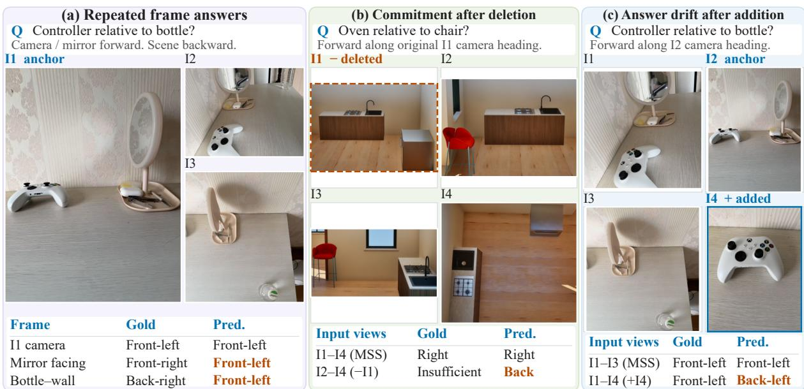
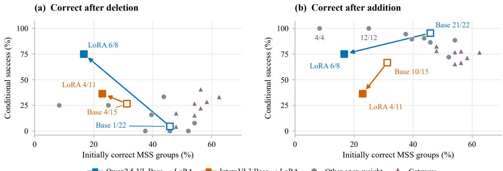
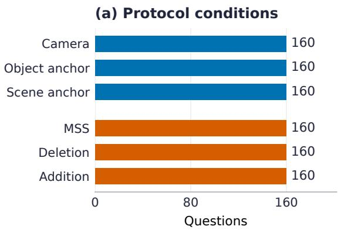
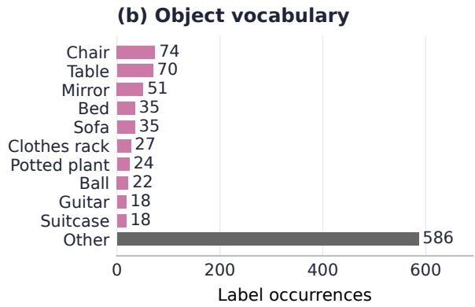
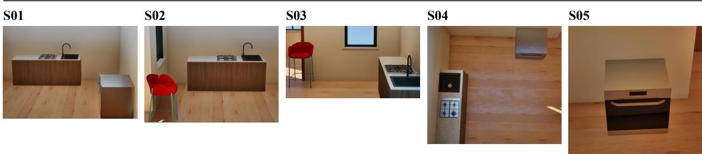
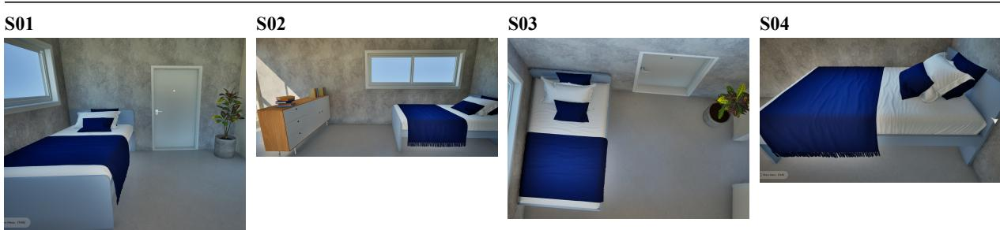

# FRAMEEVIDENCE: A Benchmark for Reference Frames and Visual Evidence in Multi-Image Spatial Reasoning

Chunxi Luo1,\* Qishuai Ding1,∗ Xingchen Peng2,∗ Hengwei Ye3 ke zhang4 Wenxin Lian1 Tianyi Lu5 Chunlong Yu2 Zhenya Lin6,†

1Shanghai University 2East China University of Science and Technology

3ShanghaiTech University 4Southwest University of Science and Technology

5Shanghai Ocean University 6Nanjing University of Science and Technology

Chunxi Luo lcxshu@163.com

## Abstract

A spatial answer depends on the reference frame specified in language and its supporting visual evidence. Item accuracy alone obscures whether correctness persists when either changes. We introduce FRAMEEVIDENCE, a benchmark of 320 matched triplets and 960 Chinese multiple-choice questions from captured and rendered scenes. One family compares three grounded reference frames over fixed images. The other pairs image deletion annotated as insufficient with answer-preserving addition. Joint metrics require correct answers across all three frames and paired evidence variants. Across 20 configurations on 288 held-out questions, GPT three-shot reaches 50.00% item accuracy, but the best three-frame group accuracy is 5/48 (10.42%), reached by GPT twoshot. Few-shot prompting and task-specific adaptation improve item accuracy without consistently improving joint correctness. Input controls show where images support matched success, while repeated executions reveal answer instability beneath similar scores.

## 1 Introduction

Spatial language describes an arrangement relative to a reference frame. An object on the left from a camera may be in front in another object’s frame. Models must identify the intended frame and assess whether partial views jointly support that description. Spatial supervision has improved spatial question answering and regional reasoning in vision-language models (Chen et al., 2024; Cheng et al., 2024). Evaluation must therefore test both frame grounding and visual evidence use.

Existing benchmarks test perceptual and threedimensional spatial relations (Liu et al., 2023; Fu et al., 2024; Ma et al., 2025), as well as referenceframe ambiguity and subject-centered judgments (Zhang et al., 2025; Premsri and Kordjamshidi, 2025; Liu et al., 2026). Multi-view and video evaluations extend this coverage to evidence distributed across observations (Yang et al., 2026; Yeh et al., 2026; Yang et al., 2025). Yet item accuracy alone cannot establish correctness across matched inputs.

A preferred answer can match a direction without reflecting the specified frame. Matched evaluations distinguish these behaviors by changing selected input attributes (Thrush et al., 2022; Wang et al., 2025; Kim et al., 2026). The key is whether the correct answer should change or remainfixed.

Figure 1 presents FrameEvidence’s two question families. The first (FQ1) fixes ordered images and the target–relatum pair while querying camera, object-anchor and scene-axis frames. The second (FQ2) pairs an annotated minimal sufficient set (MSS) with deletion and addition variants, labeled as insufficient and answer-preserving, respectively. We also analyze changes to image-order references after deletion. These comparisons extend rationale, unanswerability and view-selection diagnostics of evidence dependence (DeYoung et al., 2020; Moratelli et al., 2026; Guo et al., 2026; Wang et al., 2026b). FQ1 joint scoring requires three correct frame answers. FQ2 separately requires a correct MSS answer together with a correct deletion or addition answer. Response transitions then distinguish initial errors from failures after the change.

The release contains 320 triplets and 960 questions, with 96 triplets and 288 questions reserved for testing. We evaluate ten open-weight checkpoints, two adapted counterparts and two gateway aliases under zero- to three-shot prompting. The strongest item-level setting answers half the test correctly but solves only three of 48 frame groups. Images improve MSS–addition success for eleven of twelve open-weight configurations, but item accuracy for only six. We compare low-rank adaptation (LoRA) across three seeds and pair option rotations with same-order repeats to separate order sensitivity from execution variability.

FQ1 Reference-frame switching  
  
Figure 1: Matched protocols. FQ1 changes the queried frame while fixing the images. FQ2 deletes an annotated required view or adds a hard non-MSS view. The crossed-out image is withheld, and I1–I4 mark original positions for display. After I1 is deleted, “the first image” refers to I2.

## 2 Related Work

Reference frames and frame-conditioned reasoning. Spatial and matched-contrast benchmarks probe relational judgments (Liu et al., 2023; Fu et al., 2024; Thrush et al., 2022). COM-FORT, FoREST, and ViewSpatial-Bench examine reference-frame ambiguity (Zhang et al., 2025; Premsri and Kordjamshidi, 2025; Li et al., 2026). SCOPE, All-Angles, and CityCube address crossview and scale variation (Kim et al., 2026; Yeh et al., 2026; Xu et al., 2026), while MirrorQA targets subject-centered left–right judgments (Liu et al., 2026). COMFORT compares explicit frames on matched synthetic scenes and measures probabilistic consistency. Our frame protocol evaluates joint correctness across three multi-view frame prompts, distinguishing a correct switch from an answer change alone.

Multi-image reasoning and evidence interventions. MIRB, ReMI, MMIU, and MuirBench assess multi-image reasoning, while MIMIC probes controlled failure cases (Zhao et al., 2024; Kazemi et al., 2024; Meng et al., 2025; Wang et al., 2025; Das et al., 2026). MMSI-Bench, CrossView Suite, MultiView-Bench, and cross-view relation learning focus on spatial integration (Yang et al., 2026; Wang et al., 2026a; Zhang et al., 2026; Jeong et al., 2026). Evidence-centered diagnostics examine input dependence through rationale sufficiency, paired unanswerability, view selection, evidence sensitivity, and multi-view necessity (DeYoung et al., 2020; Moratelli et al., 2026; Wang et al., 2025; Guo et al., 2026; Wang et al., 2026b; Bhat and Yamasaki, 2026; Yu et al., 2026). SSMNBench adds and removes views of minimal necessary sets to measure view-wise accuracy and distraction decay. These measures characterize supporting views and average sensitivity to evidence changes. Table 1 summarizes our requirement for paired correctness before and after an intervention on the same instance. Comparing models on shared, correctly answered MSSs then separates initial coverage from subsequent intervention errors.

## 3 Problem Formulation

Each item is $x = ( \mathbf { I } , q , \mathcal { O } )$ , where $\mathbf { I } = \left( I _ { 1 } , \ldots , I _ { m } \right)$ contains one to five images, q is a Chinese question, and $\mathcal { O } = \left( o _ { A } , o _ { B } , o _ { C } , o _ { D } \right)$ is a four-option answer set. A model returns $\hat { y } = h _ { \boldsymbol \theta } ( \mathbf { I } , q , \mathcal { O } ) \ \in$ 11 $\{ A , B , C , D \}$ Spatial answers use axial (front, back, left, right) or quadrant directions (front-left, front-right, back-left, back-right). FQ2 includes insufficient information. Metric reconstruction, vertical relations and motion are excluded.

Table 1: Comparison of evaluation protocols most relevant to FrameEvidence.
<table><tr><td>Benchmark</td><td>Src.</td><td>MI</td><td>Match</td><td>FoR S</td><td>Min Ev</td><td>Del. → ⊥</td><td>Hard+</td><td>Joint</td><td>Scale</td></tr><tr><td>COMFORT (Zhang et al., 2025)</td><td>Syn.</td><td></td><td>Y</td><td>Y</td><td></td><td></td><td></td><td>P</td><td>58.3K English cases</td></tr><tr><td>MuirBench (Wang et al., 2025)</td><td>Mix.</td><td>Y</td><td>Y</td><td>一</td><td></td><td></td><td></td><td>P</td><td>2,600 instances</td></tr><tr><td>MMSI-Bench (Yang et al., 2026)</td><td>Real</td><td>Y</td><td>一</td><td></td><td>P</td><td></td><td></td><td></td><td>1,000 QA</td></tr><tr><td>All-Angles (Yeh et al., 2026)</td><td>Real</td><td>Y</td><td>Y</td><td>P</td><td></td><td></td><td></td><td>Y</td><td>2,132 QA</td></tr><tr><td>SCOPE (Kim et al., 2026)</td><td>Mix.</td><td>Y</td><td>Y</td><td>P</td><td></td><td></td><td></td><td>P</td><td>20,144 QA</td></tr><tr><td>MultiView-Bench (Zhang et al., 2026)</td><td>Syn.</td><td>Y</td><td>P</td><td>一</td><td></td><td></td><td></td><td></td><td>500 main (+2K var.)</td></tr><tr><td>SSMNBench (Guo et al., 2026)</td><td>Real</td><td>Y</td><td>Y</td><td></td><td>Y</td><td></td><td>P</td><td></td><td>3,300 QA</td></tr><tr><td>View-Level Evidence (Wang et al., 2026b)</td><td>Real</td><td>Y</td><td>P</td><td>一</td><td>P</td><td></td><td></td><td>P</td><td>122 QA</td></tr><tr><td>FrameEvidence</td><td>Mix.</td><td>Y</td><td>Y</td><td>Y</td><td>Y</td><td>Y</td><td>Y</td><td>Y</td><td>960 QA (320 triplets)</td></tr></table>

Legend. Y/P/– denote explicit, partial, and unspecified coverage in the reported protocols. MI, Match, FoR-S, and Min-Ev abbreviate multi-image, item matching, frame switching, and minimal evidence. Del.→ ⊥ denotes deletion to insufficiency, Hard+ denotes truth-preserving hard non-MSS addition, and Joint denotes correctness across matched variants. Partial Joint coverage includes response consistency or joint view–answer prediction. Scales use source units.

Reference-frame intervention (FQ1). Each group queries the same target–relatum relation in three frames $\mathcal { F } = \{ \mathrm { c a m } , \mathrm { o b j } , \mathrm { s c e n e } \}$ . The camera frame uses a specified camera heading, the object frame a named object’s orientation, and the scene frame an environmental axis. The question specifies the anchor, which need not be the relatum, and its forward or backward convention. Ordered images, entity identities, relation ontology and option meanings remain fixed. Only the frame instruction and its implied answer change. At least two gold answers differ, so repeating one answer cannot solve the group.

Evidence intervention (FQ2). The base set $M _ { g }$ is an annotated MSS supporting spatial answer $y _ { g }$ when no proper subset does. Deletion removes an annotated required image $\boldsymbol { r } _ { g } .$ Addition restores the MSS and adds a hard, truth-preserving image $d _ { g } \notin M _ { g }$ . The annotated responses to $M _ { g } ,$ $M _ { g } \setminus \{ r _ { g } \}$ and $M _ { g } \cup \{ d _ { g } \}$ are respectively $y _ { g } , \perp$ and $y _ { g }$ , where ⊥ means insufficient information. This definition requires subset-minimality, not minimum cardinality. The target–relatum text stays fixed, but deletion can change image-ordinal bindings, as analyzed in Section 5.

Group-level evaluation. Let $c _ { g } ^ { v } = \mathcal { H } [ \hat { y } _ { g } ^ { v } = y _ { g } ^ { v } ]$ denote correctness for variant v, and $n _ { k } = | \mathcal G _ { k } |$ the number of groups in family k. FQ1 Group Exact

Match scores the three frame answers jointly,

$$
\mathrm { F Q 1 - G E M } = n _ { 1 } ^ { - 1 } \sum _ { g \in \mathcal { G } _ { 1 } } \prod _ { f \in \mathcal { F } } c _ { g } ^ { f } .\tag{1}
$$

For FQ2, Necessity Transition Success is ${ \mathrm { N T S } } =$ $n _ { 2 } ^ { - 1 } \sum _ { g } c _ { g } ^ { M } c _ { g } ^ { - }$ , and Distractor Invariance Success is $\begin{array} { r } { \mathrm { D I S } = n _ { 2 } ^ { - 1 } \sum _ { g } c _ { g } ^ { M } c _ { g } ^ { + } } \end{array}$ , with both sums over $\mathcal { G } _ { 2 }$ NTS scores agreement with both the MSS and deletion labels, while DIS requires the spatial answer to remain correct after addition.

## 4 FrameEvidence Construction

## 4.1 Scene Acquisition and Group Assembly

FrameEvidence combines 126 captured-image and 194 rendered-image groups of static layouts spanning indoor tabletop, indoor large-space and outdoor public-space scenes. An object inventory identifies the target, relatum and any bridge objects connecting views. Construction criteria require unambiguous identity matches, unchanged layouts, grounded frame anchors and evidence that must be combined across views.

FQ1 reuses two to four ordered images across its three questions. FQ2 starts from two to four MSS images, then changes the set size by one. Each family contains 53 two-image, 54 three-image and 53 four-image base sets. Hard additions supply competing context but preserve the annotated answer.

## 4.2 Annotation and Quality Control

Controlled Chinese questions specify the queried entities and reference frame. Answer placement maps semantic answers to A–D while fixing option order within groups. Each letter occurs 240 times overall and 40 per condition.

Table 2: Dataset composition by split. All entries count questions except the Groups row.
<table><tr><td>Category</td><td>Train</td><td>Dev</td><td>Test</td><td>Total</td></tr><tr><td rowspan="2">Groups Questions</td><td>192</td><td>32</td><td>96</td><td>320</td></tr><tr><td>576</td><td>96</td><td>288</td><td>960</td></tr><tr><td>FQ1</td><td>288</td><td>48</td><td>144</td><td>480</td></tr><tr><td>FQ2</td><td>288</td><td>48</td><td>144</td><td>480</td></tr><tr><td>Tabletop</td><td>195</td><td>27</td><td>102</td><td>324</td></tr><tr><td>Indoor large</td><td>192</td><td>33</td><td>93</td><td>318</td></tr><tr><td>Outdoor public</td><td>189</td><td>36</td><td>93</td><td>318</td></tr><tr><td>Axial</td><td>291</td><td>45</td><td>144</td><td>480</td></tr><tr><td>Quadrant</td><td>285</td><td>51</td><td>144</td><td>480</td></tr></table>

Each group has approval from a separate reviewer account with answers visible. The checklist covers scenes, bindings, directions, each MSS image’s necessity and answer preservation. Appendix A documents this review and the automated schema and consistency checks.

## 4.3 Split and Validation Scope

Table 2 allocates 192/32/96 complete groups to training/development/test. Matched variants and identical images stay together, keeping triplets intact across splits. Different views can share a scene across splits. Evaluation therefore concerns heldout groups, not necessarily unseen scenes.

Table 4 reports one participant’s sampled blindanswer summary. Appendix A describes this reference and the exact random baseline.

## 5 FrameEvidence Analysis

Composition and balance. Table 2 shows balanced relation ontologies and nearly equal scene strata, with 160 questions per condition. The ten labels in Figure 2 account for 374 of 960 grouplevel occurrences, with 116 further types retaining source names. Test A–D counts are 75, 70, 69 and 74. Macro-averaging gives each class equal weight.

Evidence structure and non-visual controls. Figure 3a shows that extreme image counts identify some FQ2 conditions. On 144 held-out FQ2 items, a train-fitted count-plus-schema rule achieves 37.50% accuracy, compared with 33.33% from always selecting insufficient information. NTS and DIS reach only 6.25% and 2.08%, so this advantage rarely extends to paired variants. A classifier using character-level term frequency–inverse document frequency (TF-IDF) features from questions and options reaches 23.96% accuracy on all

  
Figure 2: Object-label counts per group. The other 116 labels contribute 586 of the 960 label occurrences.

288 test items. Identical FQ2 text forces this deterministic model to repeat its answer, making NTS zero. Condition cues and item accuracy alone therefore cannot establish sensitivity to changed evidence. Appendix F.3 specifies the text model.

Scene overlap and sensitivity. The release has 443 distinct images across 1,120 paths. Exact images stay within one split, although views and renderings can share scenes across splits. An inferred scene/template ledger assigns 81 test groups to clusters shared with training and 15 to four clusters absent from both train and dev. On these 15 groups, Qwen LoRA lowers DIS from 4/8 to 2/8, matching the full-test direction. InternVL’s unchanged overall NTS instead combines opposing changes across strata. The subset’s 13 rendered and two captured groups also differ in composition from the full test. Across the full test, rendered inputs yield higher DIS in 16/20 configurations and higher accuracy in 14. Appendices F.1 and G report both comparisons.

Ordinal references after deletion. Deletion removes the original referent in 36/48 FQ2 groups and shifts it in six. Under current-order presentation, 38 ordinals resolve to another image and four fall out of range. Table 3 separates joint successes by reference change. Both InternVL checkpoints succeed only when the referent is removed. Their NTS scores therefore combine responses to evidence removal and reference changes.

Camera headings also occur in 30/48 MSS prompts with non-camera tags. These tags define annotation strata, not distinct frame conditions.

(a) Input-image counts FQ2 release: 160 groups / 480 items
<table><tr><td rowspan=1 colspan=4>MSS (groups)          MSS   Deletion Addition</td></tr><tr><td rowspan=1 colspan=1>2 images (53)</td><td rowspan=1 colspan=1>2</td><td rowspan=1 colspan=1>1</td><td rowspan=1 colspan=1>3</td></tr><tr><td rowspan=1 colspan=1>3 images (54)</td><td rowspan=1 colspan=1>3</td><td rowspan=1 colspan=1>2</td><td rowspan=1 colspan=1>4</td></tr><tr><td rowspan=1 colspan=1>4 images (53)</td><td rowspan=1 colspan=1>4</td><td rowspan=1 colspan=1>3</td><td rowspan=1 colspan=1>5</td></tr></table>

One matched MSS / deletion / addition triplet per group.

(b) Held-out metadata controls  
  
Figure 3: FQ2 image counts across the release (a) and train-fitted metadata controls (b). Test accuracy uses 144 items and NTS/DIS 48 groups. Schema is the visible insufficient-information option’s letter.

Table 3: Joint deletion successes by reference change.
<table><tr><td>Model Groups</td><td>Removed 36</td><td>Shifted 6</td><td>Stable 2</td><td>None 4</td></tr><tr><td>Qwen Base</td><td>1</td><td>0</td><td>0</td><td>0</td></tr><tr><td>Qwen LoRA</td><td>5</td><td>0</td><td>1</td><td>0</td></tr><tr><td>InternVL Base</td><td>4</td><td>0</td><td>0</td><td>0</td></tr><tr><td>InternVL LoRA</td><td>4</td><td>0</td><td>0</td><td>0</td></tr><tr><td>GPT 2-shot</td><td>8</td><td>3</td><td>0</td><td>0</td></tr><tr><td>GPT 3-shot</td><td>7</td><td>2</td><td>1</td><td>0</td></tr><tr><td>Claude 0-shot</td><td>4</td><td>0</td><td>0</td><td>0</td></tr><tr><td>Claude 3-shot</td><td>3</td><td>1</td><td>0</td><td>0</td></tr></table>

Joint MSS–deletion counts. Groups gives NTS denominators. Qwen/InternVL are primary 7B/8B checkpoints. None denotes no ordinal. Full results appear in Appendix E.

## 6 Experiments

## 6.1 Evaluation Setup

Table 4 compares 20 configurations on 288 questions. GPT-5.6 and Claude Fable 5.1 denote the requested gateway aliases. The main evaluation and input controls share checkpoints. Table 6 compares six adapters with separate Base runs, which agree with primary runs on 281/288 Qwen and 277/288 InternVL answers. Appendix G reports both paired comparisons.

Queries preserve image order and request a single letter. Open-weight and Claude runs use temperature zero and 32 output tokens. GPT instead leaves temperature unset and allows 2,048 output tokens with reasoning effort set to low.

Following MirrorQA (Liu et al., 2026), we evaluate zero- to three-shot prompting. Demonstrations use nested prefixes of one training group per family, selected with seed 20260722, excluding test groups and exact test images.

We report accuracy and macro-averaged precision, recall and F1 over A–D on all 288 questions, with joint metrics over each family’s 48 groups. Ten LLaVA-OneVision responses are invalid and count as errors. All other main responses are valid.

## 6.2 Item Accuracy and Matched Success

Item accuracy and joint scores identify different leaders in Table 4. GPT three-shot reaches 50.00% accuracy, while two-shot leads FQ1-GEM and NTS at 10.42% and 22.92%. MiniCPM-V-4.5 matches three-shot’s 47.92% DIS at 32.99% accuracy. GPT’s 1.74-point two-to-three-shot gain combines 48 newly correct and 43 newly incorrect answers, masking substantial turnover. Its paired 95% interval [−4.90, 5.35] includes zero. Appendix G.3 compares all adjacent shot settings.

This divergence depends on how errors align across variants. The product of variant accuracies gives the expected joint rate under independent cross-group rearrangement. NTS falls below this reference in 19/20 configurations, while DIS exceeds it in all 20. An imagefree majority control yields the same asymmetry because repeating an answer can succeed on answer-preserving addition but miss deletion’s insufficiency label. Appendix D.4 details this shared-answer contribution.

## 6.3 Input Controls and Adaptation

For twelve open-weight configurations and GPT zero-shot, text-only removes all images and singleimage keeps the first. Questions, options and labels stay fixed in Table 14.

Visual input improves addition-pair success more often than item accuracy. In Table 5, images raise DIS for 11/12 open-weight configurations but accuracy for only six. Qwen2.5-VL-7B gains 43.8 DIS points, with a 95% interval of [29.2, 59.5], despite lower accuracy. GPT gains 8.7 accuracy points over text-only. Without images, it always selects insufficiency for FQ2. Using all images instead of the first raises its DIS from 8.33% to 35.42%. Figure 5 separates initial MSS correctness from post-addition answer retention, both of

Table 4: All-images model results (%) on 288 questions, with 48 groups per family for joint metrics.
<table><tr><td></td><td></td><td colspan="4">Classification</td><td colspan="3">Matched success</td></tr><tr><td>Model</td><td>Setting</td><td>P</td><td>R</td><td>F1</td><td>Acc.</td><td>GEM</td><td>NTS</td><td>DIS</td></tr><tr><td colspan="9">Open-weight baselines</td></tr><tr><td>Qwen2.5-VL-7B</td><td>Base</td><td>31.06</td><td>29.43</td><td>25.99</td><td>28.82</td><td>0.00</td><td>2.08</td><td>43.75</td></tr><tr><td>InternVL3-8B</td><td>Base</td><td>29.72</td><td>29.84</td><td>28.65</td><td>29.51</td><td>2.08</td><td>8.33</td><td>20.83</td></tr><tr><td>Qwen3-VL-8B</td><td>Base</td><td>34.60</td><td>34.30</td><td>33.83</td><td>34.03</td><td>0.00</td><td>14.58</td><td>39.58</td></tr><tr><td>LLaVA-OneVision-7B</td><td>Base</td><td>30.56</td><td>29.33</td><td>29.04</td><td>29.17</td><td>0.00</td><td>0.00</td><td>37.50</td></tr><tr><td>MiniCPM-V 4.5</td><td>Base</td><td>33.48</td><td>33.33</td><td>32.27</td><td>32.99</td><td>0.00</td><td>4.17</td><td>47.92</td></tr><tr><td>Mistral Small 3.2 24B</td><td>Base</td><td>26.99</td><td>25.96</td><td>24.82</td><td>25.69</td><td>0.00</td><td>2.08</td><td>8.33</td></tr><tr><td>Qwen2.5-VL-32B</td><td>Base</td><td>33.29</td><td>33.56</td><td>32.15</td><td>33.33</td><td>0.00</td><td>6.25</td><td>35.42</td></tr><tr><td>InternVL3.5-14B</td><td>Base</td><td>28.14</td><td>28.35</td><td>27.86</td><td>28.12</td><td>0.00</td><td>6.25</td><td>25.00</td></tr><tr><td>Phi-4-Multimodal</td><td>Base</td><td>26.07</td><td>26.61</td><td>25.54</td><td>26.39</td><td>0.00</td><td>0.00</td><td>35.42</td></tr><tr><td>Kimi-VL-A3B</td><td>Base</td><td>36.74</td><td>29.48</td><td>26.73</td><td>29.17</td><td>0.00</td><td>0.00</td><td>39.58</td></tr><tr><td colspan="9">Task-adapted counterparts</td></tr><tr><td>Qwen2.5-VL-7B InternVL3-8B</td><td>LoRA</td><td>35.45</td><td>35.53</td><td>34.81</td><td>35.42</td><td>0.00</td><td>12.50</td><td>12.50</td></tr><tr><td></td><td>LoRA</td><td>34.35</td><td>32.91</td><td>30.99</td><td>32.64</td><td>0.00</td><td>8.33</td><td>8.33</td></tr><tr><td colspan="9">Gateway-served models</td></tr><tr><td>GPT-5.6</td><td>0-shot</td><td>40.57</td><td>40.72</td><td>40.43</td><td>40.62</td><td>4.17</td><td>14.58</td><td>35.42</td></tr><tr><td rowspan="7"></td><td>1-shot</td><td>44.01</td><td>44.26</td><td>44.05</td><td>44.10</td><td>6.25</td><td>16.67</td><td>41.67</td></tr><tr><td>2-shot</td><td>48.53</td><td>48.29</td><td>48.34</td><td>48.26</td><td>10.42</td><td>22.92</td><td>43.75</td></tr><tr><td>3-shot</td><td>49.87</td><td>50.05</td><td>49.86</td><td>50.00</td><td>6.25</td><td>20.83</td><td>47.92</td></tr><tr><td>0-shot</td><td>39.35</td><td>39.53</td><td>39.19</td><td>39.24</td><td>0.00</td><td>8.33</td><td>41.67</td></tr><tr><td>1-shot</td><td>40.55</td><td>40.30</td><td>40.26</td><td>40.28</td><td>6.25</td><td>2.08</td><td>37.50</td></tr><tr><td>2-shot</td><td>41.34</td><td>41.58</td><td>41.27</td><td>41.32</td><td>6.25</td><td>12.50</td><td>37.50</td></tr><tr><td>3-shot</td><td>41.75</td><td>41.76</td><td>41.64</td><td>41.67</td><td>2.08</td><td>8.33</td><td>39.58</td></tr><tr><td colspan="9">Random and human references</td></tr><tr><td>Uniform random</td><td>Expected</td><td>25.00</td><td>25.00</td><td>24.93</td><td>25.00</td><td>1.56</td><td>6.25</td><td>6.25</td></tr><tr><td>Human (reported)</td><td>Sampled</td><td>98.56</td><td>98.40</td><td>98.48</td><td>98.40</td><td>一</td><td>一</td><td></td></tr></table>

Model P/R/F1 are macro-averaged over A–D. GEM denotes FQ1-GEM. Bold marks model-column maxima. LoRA uses one checkpoint per family. Invalid answers count as incorrect. Random gives finite-test expectations for independent uniform A–D guesses. Human reports one participant’s sampled blind evaluation, as summarized by the authors. Dashes denote unreported joint scores. Appendix A details the reference rows.

Table 5: All-images minus text-only in percentage points, with questions and gold labels fixed.
<table><tr><td>Model</td><td>∆Acc.</td><td>∆NTS</td><td>∆DIS</td></tr><tr><td>Qwen2.5-VL-7B</td><td>-3.1</td><td>+2.1</td><td>+43.8</td></tr><tr><td>Qwen2.5-VL-7B LoRA</td><td>+3.1</td><td>+12.5</td><td>+12.5</td></tr><tr><td>InternVL3-8B</td><td>-1.4</td><td>+8.3</td><td>+12.5</td></tr><tr><td>InternVL3-8B LoRA</td><td>+2.4</td><td>+8.3</td><td>+8.3</td></tr><tr><td>Qwen3-VL-8B</td><td>+4.5</td><td>+14.6</td><td>+33.3</td></tr><tr><td>LLaVA-OneVision-7B</td><td>+0.0</td><td>+0.0</td><td>-6.2</td></tr><tr><td>MiniCPM-V 4.5</td><td>+3.8</td><td>+4.2</td><td>+14.6</td></tr><tr><td>Mistral Small 3.2 24B</td><td>-3.8</td><td>+2.1</td><td>+8.3</td></tr><tr><td>Qwen2.5-VL-32B</td><td>+2.4</td><td>+6.2</td><td>+35.4</td></tr><tr><td>InternVL3.5-14B</td><td>-2.1</td><td>+6.2</td><td>+10.4</td></tr><tr><td>Phi-4-Multimodal</td><td>-2.4</td><td>+0.0</td><td>+16.7</td></tr><tr><td>Kimi-VL-A3B</td><td>+4.2</td><td>+0.0</td><td>+4.2</td></tr><tr><td>GPT-5.6 / 0-shot</td><td>+8.7</td><td>+14.6</td><td>+35.4</td></tr></table>

Positive values favor all-images. Unmarked rows are Base, and LoRA uses primary adapters. Each comparison covers 288 questions and 48 groups per joint metric. Appendix D gives paired intervals.

which contribute to DIS.

Adaptation improves item accuracy without preserving addition-pair success. Across three seeds in Table 6a, Qwen reaches 36.00±1.40% accuracy, yet every seed solves 6/48 addition pairs versus 22/48 for its control. For both primary LoRA– Base pairs, DIS intervals remain below zero under exact-image, scene and union clustering. NTS intervals include zero under the latter two schemes in Appendix D.6.

## 6.4 Option-Order Robustness

Following MirrorQA (Liu et al., 2026), we apply four cyclic option rotations while preserving images and questions. Vanilla scores rotation zero. Circular requires four correct answers, whereas Consistency requires four valid answers with identical decoded meanings, correct or incorrect.

Table 6b distinguishes stability from correctness. GPT leads Circular at 18.75%, whereas Qwen LoRA is more consistent but reaches 16.20±0.53% Circular accuracy. InternVL’s higher Vanilla accuracy after adaptation accompanies lower Circular accuracy and consistency.

Table 6: Ordinary and Circular evaluation (%) on 288 questions. Open-weight controls are matched within panels. LoRA gives three-seed mean ± sample standard deviation. GPT is zero-shot. (a) Ordinary all-images evaluation (b) Four option rotations
<table><tr><td>Setting</td><td>Acc.</td><td>GEM</td><td>NTS</td><td>DIS</td></tr><tr><td>InternVL3-8B</td><td></td><td></td><td></td><td></td></tr><tr><td>Base</td><td>30.21</td><td>2.08</td><td>8.33</td><td>20.83</td></tr><tr><td></td><td>LoRA 32.41±1.31 0.69±1.20</td><td></td><td>9.72±1.2012.50±2.08</td><td></td></tr><tr><td>Qwen2.5-VL-7B</td><td></td><td></td><td></td><td></td></tr><tr><td>Base</td><td>29.17</td><td>0.00</td><td>2.08</td><td>45.83</td></tr><tr><td></td><td></td><td></td><td>LoRA 36.00±1.40 0.00±0.00 10.42±3.61 12.50±0.00</td><td></td></tr><tr><td></td><td></td><td></td><td></td><td></td></tr><tr><td>GPT-5.6</td><td></td><td></td><td></td><td></td></tr><tr><td>0-shot</td><td>40.62</td><td>4.17</td><td>14.58</td><td>35.42</td></tr></table>

<table><tr><td>Setting</td><td>Vanilla</td><td>Circular</td><td>Consistency</td></tr><tr><td colspan="4">InternVL3-8B</td></tr><tr><td>Base</td><td>30.21</td><td>7.64</td><td>23.61</td></tr><tr><td>LoRA</td><td>32.75±1.31</td><td>6.02±1.12</td><td>17.59±1.57</td></tr><tr><td colspan="4">Qwen2.5-VL-7B</td></tr><tr><td>Base (S)</td><td>14.93</td><td>2.08</td><td>5.90</td></tr><tr><td>LoRA</td><td>35.19±1.12</td><td>16.20±0.53</td><td>32.64±1.25</td></tr><tr><td colspan="4">GPT-5.6</td></tr><tr><td>0-shot</td><td>45.49</td><td>18.75</td><td>27.08</td></tr></table>

GEM is FQ1-GEM. Joint scores use 48 groups per family. Vanilla uses within-run predictions. Appendix A gives the source of the summary marked S and all per-seed metrics.

  
Figure 4: Selected GPT three-shot errors with released gold labels. I1–I4 mark original positions for display. Inputs use unlabeled images in their current order. Deletion in (b) removes the original camera anchor.

Table 7: GPT paired runs (%, n = 288). Nearly half of consistent pairs share a wrong answer.
<table><tr><td>Metric</td><td>Repeat</td><td> $R _ { 1 }$ </td><td> $R _ { 2 }$ </td><td> $R _ { 3 }$ </td></tr><tr><td>At least one correct</td><td>62.15</td><td>55.90</td><td>57.29</td><td>59.03</td></tr><tr><td>Both correct</td><td>28.47</td><td>31.25</td><td>30.56</td><td>28.12</td></tr><tr><td>Consistency</td><td>53.47</td><td>59.38</td><td>54.86</td><td>51.39</td></tr><tr><td>Consistently wrong</td><td>25.00</td><td>28.12</td><td>24.31</td><td>23.26</td></tr></table>

Columns pair $R _ { 0 }$ with a same-order repeat or rotation.  
Consistency measures agreement in answer meaning.

Responses also vary at fixed option order. A repeated GPT run reaches 45.14% accuracy versus 45.49% for rotation zero, but changes 46.53% of answers. Two-run joint correctness is 28.47% at fixed order and 28.12–31.25% across rotations in Table 7. Circular scores therefore also reflect execution variability. Appendix A quantifies uncertainty in these paired comparisons.

## 7 Stratified Results and Failure Analysis

Answer changes need not be correct. Figure 4 illustrates repeated frame answers, spatial commitment after anchor deletion and answer drift after addition. Each FQ1 triplet yields three pairs with different gold directions. Qwen3-VL-8B repeats a direction on 115/144 pairs. GPT three-shot changes 94 pairs but answers both correctly on only 27, distinguishing unchanged answers from incorrect switches. From two to three shots, GPT’s correct pairs rise from 26 to 27 but complete triplets fall from five to three. Pairwise gains need not concentrate in complete groups. Pairwise accuracy can miss failure on the third frame. Appendix F.2 compares all paired outcomes.

  
Qwen2.5-VL Base → LoRA InternVL3 Base → LoRA Other open-weight Gateway  
Figure 5: Initial and conditional success across 20 primary configurations. Horizontal rates use all 48 FQ2 groups. Vertical rates use each configuration’s MSS-correct subset, with counts on highlighted points. Arrows link Base and LoRA, each with its own conditioning subset.

Table 8: Insufficiency counts out of 48.
<table><tr><td>Model / setting</td><td>MSS</td><td>Del.</td><td>Add.</td></tr><tr><td>Qwen2.5-VL-7B</td><td>2</td><td>3</td><td>2</td></tr><tr><td>InternVL3-8B</td><td>13</td><td>16</td><td>12</td></tr><tr><td>Qwen3-VL-8B</td><td>7</td><td>23</td><td>7</td></tr><tr><td>LLaVA-OneVision-7B</td><td>0</td><td>1</td><td>0</td></tr><tr><td>MiniCPM-V 4.5</td><td>0</td><td>6</td><td>0</td></tr><tr><td>Mistral Small 3.2 24B</td><td>29</td><td>24</td><td>21</td></tr><tr><td>Qwen2.5-VL-32B</td><td>9</td><td>18</td><td>8</td></tr><tr><td>InternVL3.5-14B</td><td>11</td><td>16</td><td>9</td></tr><tr><td>Phi-4-Multimodal</td><td>2</td><td>2</td><td>2</td></tr><tr><td>Kimi-VL-A3B</td><td>1</td><td>3</td><td>2</td></tr><tr><td>Qwen2.5-VL-7B LoRA</td><td>30</td><td>38</td><td>24</td></tr><tr><td>InternVL3-8B LoRA</td><td>22</td><td>30</td><td>21</td></tr><tr><td>GPT-5.6 / 0-shot</td><td>1</td><td>15</td><td>2</td></tr><tr><td>1-shot</td><td>1</td><td>14</td><td>2</td></tr><tr><td>2-shot</td><td>2</td><td>19</td><td>1</td></tr><tr><td>3-shot</td><td>2</td><td>18</td><td>1</td></tr><tr><td>Claude Fable 5.1 / 0-shot</td><td>1</td><td>10</td><td>0</td></tr><tr><td>1-shot</td><td>2</td><td>5</td><td>2</td></tr><tr><td>2-shot</td><td>3</td><td>15</td><td>3</td></tr><tr><td>3-shot</td><td>2</td><td>15</td><td>3</td></tr></table>

Unmarked open: Base. Del./Add.: deletion/addition. Counts /48 retain invalids: LLaVA addition 10; others 0.

Insufficiency responses extend beyond deletion. Both primary LoRA checkpoints increase insufficiency responses across all conditions in Table 8. Qwen’s insufficiency recall rises from 6.25% to 79.17%, but precision changes from 42.86% to 41.30%. The extra deletion hits therefore come with more false insufficiency responses on answerable MSS and addition inputs. Joint scoring exposes this trade-off by requiring success on both sides of the intervention. Mistral shows the opposite imbalance, selecting insufficiency more often on MSS than on deletion. Appendix G.4 gives the full count breakdown.

MSS coverage separates intervention outcomes. Shared MSS-correct groups account for four of Qwen’s five net NTS gains. InternVL gains one on these groups, offset by changed MSS coverage. All InternVL joint deletion successes involve removed anchors in Table 3.

Qwen loses fourteen DIS successes through changed MSS coverage and one among shared groups. InternVL loses three through each route. Qwen’s decline thus occurs mainly before addition, whereas InternVL also fails to retain initially correct answers. Similar DIS declines thus have different sources. Appendix D.3 provides the paired decomposition.

Prompt effects vary across executions. On twelve triplets excluding removed anchors, two randomized blocks yield 51.39% agreement with released labels under original wording and 52.78% under stable IDs. Yet NTS falls from 8/24 to 4/24 group–block observations, and 14–15/36 answers change at fixed wording. The small item-level gain thus does not carry over to matched deletion answers. Appendix E compares each block and condition.

## 8 Conclusion

FrameEvidence tests spatial reasoning under matched changes in reference frames and visual evidence. Prompting and adaptation improve item accuracy without consistent gains in joint success, whereas images most often benefit MSS–addition pairs. Paired analyses identify incorrect frame switches, changes in initial MSS coverage and execution instability. Together, these diagnostics distinguish isolated correct answers from success across matched changes.

## Limitations

FrameEvidence evaluates static, Chinese, fouroption spatial reasoning on 96 held-out groups. Scenes can overlap across the image-separated splits, limiting conclusions about unseen-scene generalization. Metadata cues and image-ordinal changes can influence responses alongside visual evidence. Production review does not constitute independent response-level validation of labels or every-member MSS necessity. NTS therefore assesses agreement with the released deletion labels.

Model comparisons reflect the tested decoding settings, one demonstration pool and providerreported gateway identities. The three-seed deviations describe training variation. Circular uses its own within-experiment controls. The human reference is one participant’s sampled summary without individual answers or a documented sample size.

## Ethical Considerations

The captured and rendered images were supplied by an external data provider with permission for public release. Language-model assistance supported editing, scripting and simulated review. The authors remain responsible for checking the evidence, citations and privacy of the released materials.

## References

S. Divakar Bhat and Toshihiko Yamasaki. 2026. Consistent yet wrong: Evidence insensitivity in spatial vision-language models. In Proceedings of the IEEE/CVF Conference on Computer Vision and Pattern Recognition Workshops, pages 7463–7472.

Boyuan Chen, Zhuo Xu, Sean Kirmani, Brian Ichter, Dorsa Sadigh, Leonidas Guibas, and Fei Xia. 2024. SpatialVLM: Endowing vision-language models with spatial reasoning capabilities. In Proceedings of the IEEE/CVF Conference on Computer Vision and Pattern Recognition, pages 14455–14465.

An-Chieh Cheng, Hongxu Yin, Yang Fu, Qiushan Guo, Ruihan Yang, Jan Kautz, Xiaolong Wang, and Sifei Liu. 2024. SpatialRGPT: Grounded spatial reasoning in vision-language models. In Advances in Neural Information Processing Systems, volume 37, pages 135062–135093.

Anurag Das, Adrian Bulat, Alberto Baldrati, Ioannis Maniadis Metaxas, Bernt Schiele, Georgios Tzimiropoulos, and Brais Martinez. 2026. More images, more problems? a controlled analysis of VLM failure modes. In Findings of the Association for Computational Linguistics: ACL 2026, pages 7423–7442. Association for Computational Linguistics.

Jay DeYoung, Sarthak Jain, Nazneen Fatema Rajani, Eric Lehman, Caiming Xiong, Richard Socher, and Byron C. Wallace. 2020. ERASER: A benchmark to evaluate rationalized NLP models. In Proceedings of the 58th Annual Meeting of the Association for Computational Linguistics, pages 4443–4458. Association for Computational Linguistics.

Xingyu Fu, Yushi Hu, Bangzheng Li, Yu Feng, Haoyu Wang, Xudong Lin, Dan Roth, Noah A. Smith, Wei-Chiu Ma, and Ranjay Krishna. 2024. BLINK: Multimodal large language models can see but not perceive. In European Conference on Computer Vision.

Tianchen Guo, Chen Liu, Ling Chen, and Xin Yu. 2026. SSMNBench: Diagnosing image-based cross-view human-object understanding via single-view sufficiency and multi-view necessity. arXiv preprint arXiv:2606.25634.

Suchae Jeong, Jaehwi Song, Haeone Lee, Hanna Kim, Jian Kim, Dongjun Lee, Dong Kyu Shin, Changyeon Kim, Dongyoon Hahm, Woogyeol Jin, Juheon Choi, and Kimin Lee. 2026. Learning multi-view spatial reasoning from cross-view relations. In Proceedings of the IEEE/CVF Conference on Computer Vision and Pattern Recognition, pages 2570–2581.

Mehran Kazemi, Nishanth Dikkala, Ankit Anand, Petar Devic, Ishita Dasgupta, Fangyu Liu, Bahare Fatemi, Pranjal Awasthi, Dee Guo, Sreenivas Gollapudi, and Ahmed Qureshi. 2024. ReMI: A dataset for reasoning with multiple images. In Advances in Neural Information Processing Systems, volume 37.

Yoonji Kim, Jieun Kim, Yujin Jeong, and Sung-Bae Cho. 2026. Diagnosing spatial consistency across perspectives and viewpoints in large vision-language models. In Proceedings of the 64th Annual Meeting of the Association for Computational Linguistics (Volume 1: Long Papers), pages 32803–32827.

Dingming Li, Hongxing Li, Zixuan Wang, Yuchen Yan, Hang Zhang, Siqi Chen, Guiyang Hou, Shengpei Jiang, Wenqi Zhang, Yongliang Shen, Weiming Lu, and Yueting Zhuang. 2026. ViewSpatial-Bench: Evaluating multi-perspective spatial localization in vision-language models. In Computer Vision – ECCV 2026, volume 17062 of Lecture Notes in Computer Science, pages 95–111. Springer.

Fangyu Liu, Guy Emerson, and Nigel Collier. 2023. Visual spatial reasoning. Transactions of the Associationfor Computational Linguistics, 11:635–651.

Jingping Liu, Xingchen Peng, Yan Zhou, Ziyan Liu, Jie Zhai, Ronghao Chen, Huacan Wang, and Xiaofeng Jia. 2026. MirrorQA: Benchmarking multimodal LLMs on mirror-orientation reasoning. In Proceedings ofthe 64th Annual Meeting ofthe Associationfor Computational Linguistics (Volume 1: Long Papers), pages 40464–40476.

Wufei Ma, Haoyu Chen, Guofeng Zhang, Yu-Cheng Chou, Jieneng Chen, Celso de Melo, and Alan Yuille. 2025. 3DSRBench: A comprehensive 3d spatial reasoning benchmark. In Proceedings ofthe IEEE/CVF International Conference on Computer Vision, pages 6924–6934.

Fanqing Meng, Jin Wang, Chuanhao Li, Quanfeng Lu, Hao Tian, Tianshuo Yang, Jiaqi Liao, Xizhou Zhu, Jifeng Dai, Yu Qiao, Ping Luo, Kaipeng Zhang, and Wenqi Shao. 2025. MMIU: Multimodal multi-image understanding for evaluating large vision-language models. In International Conference on Learning Representations.

Nicholas Moratelli, Christopher Davis, Leonardo F. R. Ribeiro, Bill Byrne, and Gonzalo Iglesias. 2026. Benchmarking deflection and hallucination in large vision-language models. In Proceedings ofthe 64th Annual Meeting ofthe Associationfor Computational Linguistics (Volume 1: Long Papers), pages 28348– 28370. Association for Computational Linguistics.

Tanawan Premsri and Parisa Kordjamshidi. 2025. FoR-EST: Frame of reference evaluation in spatial reasoning tasks. In Proceedings ofthe 2025 Conference on Empirical Methods in Natural Language Processing, pages 34977–35003. Association for Computational Linguistics.

Tristan Thrush, Ryan Jiang, Max Bartolo, Amanpreet Singh, Adina Williams, Douwe Kiela, and Candace Ross. 2022. Winoground: Probing vision and language models for visio-linguistic compositionality. In Proceedings ofthe IEEE/CVF Conference on Computer Vision and Pattern Recognition, pages 5238– 5248.

Fei Wang, Xingyu Fu, James Y. Huang, Zekun Li, Qin Liu, Xiaogeng Liu, Mingyu Derek Ma, Nan Xu, Wenxuan Zhou, Kai Zhang, Tianyi Yan, Wenjie Mo, Hsiang-Hui Liu, Pan Lu, Chunyuan Li, Chaowei Xiao, Kai-Wei Chang, Dan Roth, Sheng Zhang, and 2 others. 2025. MuirBench: A comprehensive benchmark for robust multi-image understanding. In International Conference on Learning Representations.

Wei Wang, Yuqian Yuan, Tianwei Lin, Wenqiao Zhang, Siliang Tang, Jun Xiao, and Yueting Zhuang. 2026a. CrossView Suite: Harnessing cross-view spatial intelligence of mllms with dataset, model and benchmark. arXiv preprint arXiv:2605.18621.

Yimu Wang, Yee Man Choi, Barry Zhang, Mozhgan Nasr Azadani, Sean Sedwards, and Krzysztof Czarnecki. 2026b. Where does the answer come from? benchmarking view-level visual evidence identification in multi-view mllms for autonomous driving. arXiv preprint arXiv:2606.09644.

Haotian Xu, Yue Hu, Zhengqiu Zhu, Chen Gao, Ziyou Wang, Junreng Rao, Wenhao Lu, Weishi Li, Quanjun Yin, and Yong Li. 2026. CityCube: Benchmarking cross-view spatial reasoning on vision-language models in urban environments. In Proceedings ofthe 64th Annual Meeting ofthe Associationfor Computational Linguistics (Volume 1: Long Papers), pages 9190–9215.

Jihan Yang, Shusheng Yang, Anjali W. Gupta, Rilyn Han, Li Fei-Fei, and Saining Xie. 2025. Thinking in space: How multimodal large language models see, remember, and recall spaces. In Proceedings of the IEEE/CVF Conference on Computer Vision and Pattern Recognition, pages 10632–10643.

Sihan Yang, Runsen Xu, Yiman Xie, Sizhe Yang, Mo Li, Jingli Lin, Chenming Zhu, Xiaochen Chen, Haodong Duan, Xiangyu Yue, Dahua Lin, Tai Wang, and Jiangmiao Pang. 2026. MMSI-Bench: A benchmark for multi-image spatial intelligence. In International Conference on Learning Representations.

Chun-Hsiao Yeh, Chenyu Wang, Shengbang Tong, Ta-Ying Cheng, Ruoyu Wang, Tianzhe Chu, Yuexiang Zhai, Yubei Chen, Shenghua Gao, and Yi Ma. 2026. Seeing from another perspective: Evaluating multiview understanding in MLLMs. In Proceedings of the AAAI Conference on Artificial Intelligence, volume 40, pages 12000–12008.

Leyuan Yu, Xiao Tang, Minghao Liu, Xinyuan Li, Xiaokai Bai, Sheng Zhou, Qunshu Lin, Weihao Xuan, and Naoto Yokoya. 2026. MindEdit-Bench: Benchmarking object-level counterfactual spatial reasoning in vlms from in-the-wild photos. arXiv preprint arXiv:2607.00491.

Hantao Zhang, Jinru Sui, Ed Li, Dirk Bergemann, and Zhuoran Yang. 2026. MultiView-Bench: A diagnostic benchmark for world-centric multi-view integration in VLMs. arXiv preprint arXiv:2607.08970.

Zheyuan Zhang, Fengyuan Hu, Jayjun Lee, Freda Shi, Parisa Kordjamshidi, Joyce Chai, and Ziqiao Ma. 2025. Do vision-language models represent space and how? evaluating spatial frame of reference under ambiguities. In International Conference on Learning Representations.

Bingchen Zhao, Yongshuo Zong, Letian Zhang, and Timothy M. Hospedales. 2024. Benchmarking multiimage understanding in vision and language models: Perception, knowledge, reasoning, and multi-hop reasoning. arXiv preprint arXiv:2406.12742.

Table 9: Model repositories and API aliases used in evaluation. Repositories identify model families. GPT and Claude names are provider-reported gateway aliases.
<table><tr><td>Displayed name</td><td>Configured repository or gateway identifier</td></tr><tr><td>Qwen2.5-VL-7B</td><td>Qwen/Qwen2.5-VL-7B-Instruct</td></tr><tr><td>InternVL3-8B</td><td>OpenGVLab/InternVL3-8B-hf</td></tr><tr><td>Qwen3-VL-8B</td><td>Qwen/Qwen3-VL-8B-Instruct</td></tr><tr><td>LLaVA-OneVision-7B</td><td>1lava-hf/1lava-onevision-qwen2-7b-ov-hf</td></tr><tr><td>MiniCPM-V 4.5</td><td>openbmb/MiniCPM-V-4_5</td></tr><tr><td>Mistral Small 3.2 24B</td><td>mistralai/Mistral-Small-3.2-24B-Instruct-2506</td></tr><tr><td>Qwen2.5-VL-32B</td><td>Qwen/Qwen2.5-VL-32B-Instruct</td></tr><tr><td>InternVL3.5-14B</td><td>OpenGVLab/InternVL3_5-14B-HF</td></tr><tr><td>Phi-4-Multimodal</td><td>microsoft/Phi-4-multimodal-instruct</td></tr><tr><td>Kimi-VL-A3B</td><td>moonshotai/Kimi-VL-A3B-Instruct</td></tr><tr><td>GPT-5.6</td><td>gpt-5.6-sol</td></tr><tr><td>Claude Fable 5.1</td><td>claude-fable-5-1</td></tr></table>

## A Implementation and Scoring Details

Evaluation inputs. Table 9 lists the evaluated checkpoints and aliases. Each public item contains ordered image references and a Chinese prompt asking for exactly one of A, B, C or D. Evaluation identifiers link predictions to a private mapping with the source sample and group, input mode, gold letter and option meanings. Group identifiers and gold metadata are not shown to models. Metrics are computed from the frozen predictions and their matching input records. All model–mode comparisons use the full question and group counts.

Offline scoring companion. A self-contained Python standard-library scorer reproduces the 20 primary configurations in Table 4, eight ordinary multi-seed configurations in Table 11, and seven complete Circular rows in Table 12. It uses sanitized per-item records without model calls or image access, preserving all item and group denominators. Primary, multi-seed and rotation runs remain separate. It also reproduces GPT’s 1,152 Circular responses and 288 same-order repeat responses, including all 16 entries in Table 7. Running python run\_reproduction.py from its offline\_reproduction directory writes the recomputed tables and a verification report. The author-confirmed Qwen Base summary is reported separately from these recomputed results.

Production review and release correspondence. The production database contains 323 PASS and three REWORK actions. Selecting the latest PASS per group covers all 320 groups and 960 questions. Distinct annotation and review account assignments are recorded for every group, with semantic answers visible in the review interface. These are production approvals rather than independently collected answer sheets. Automatic comments and checklists do not verify reviewer independence or the answerability of every single-view deletion.

The task records exactly match the released annotations. Compared with the latest PASS snapshots, the release preserves all 960 semantic gold answers and option-meaning sets, and all 1,120 reviewed image files match. Raw fields nevertheless differ in 917 questions. Of 857 prompt changes, 856 replace a recurring Chinese-character typo and one revises a training item’s anchor (fce\_test\_00581). Option order changes in 540 items and answer letters in 416, without changing semantic gold. Two anchor fields also change. Author adjudication confirms the scored inputs for the four flagged records.

Input and assembly consistency. A separate audit compares literal questions, ordered sourceimage bytes and options across all 960 items. It finds 959 distinct input signatures. The only repeated signature belongs to two training items with the same gold answer. No signature crosses splits or conflicts in its gold letter. All 288 test inputs are distinct. Ignoring option placement alone also yields no conflicting selected option strings.

All 320 triplets pass the encoded assembly rules. FQ1 preserves ordered images, options and entity fields across its three frame variants and has at least two distinct gold meanings. FQ2 preserves question and option strings, removes or adds exactly one image, and retains the order of the remaining images. No item repeats identical image content. Assets match production records. Geometric checks lack camera poses and object coordinates.

Few-shot construction. The fixed pool uses training groups group\_00152 for FQ1 and group\_00388 for FQ2. FQ1 demonstrations follow camera, object and scene order. FQ2 demonstrations follow MSS, deletion and addition order. One-, two- and three-shot conditions take the corresponding prefixes. The manifest verifies group and exact-image separation from test, although physical scenes may overlap. All shot counts use this fixed demonstration pool.

Decoding and invalid answers. The common output parser extracts an allowed answer letter and records the raw response, parsing status and API failure separately. An invalid response is never converted to a guessed answer. In class-wise recall and accuracy it contributes a false negative for its gold class. Precision uses the predicted A–D counts, with zero for undefined per-class precision. Macro-F1 is the mean of the four classwise F1 scores.

A separate full-response parser recovers all 5,750 valid answers among 5,760 main-table records. The ten empty API failures remain incorrect. Reconstructed answers and point estimates match the frozen results.

Random and human reference rows. Uniform random selects one of A–D independently for each question. The reference row gives exact finite-test expectations. Accuracy and macro-recall are 25%, while macro-F1 averages the expected classwise ratios under the actual supports 75, 70, 69 and 74, yielding 24.93%. The three-answer and twoanswer joint expectations are respectively $( 1 / 4 ) ^ { 3 }$ and $( 1 / 4 ) ^ { 2 }$ . Separate binomial calculations and small-test enumeration verify the scorer.

The human reference is an author-reported P/R/F1/Acc. summary from one participant answering sampled groups. The retained record contains aggregate scores without the sample size or item-level responses. We report these sample-level values and leave joint scores unreported.

Held-out metadata controls. The post-hoc controls in Table 10 fix three categorical majority rules before computing their held-out scores. They fit only on the 288 FQ2 training questions in 96 groups. Neither the 48 development questions nor the 144 test questions select rules or features. Ties use alphabetic letter order, and unseen feature values fall back to the training-global majority. No held-out feature is unseen. The fixed features are image count alone and its pairing with the insufficiency option’s letter.

The count-plus-schema rule answers 54/144   
test questions correctly but solves only 3/48

MSS/deletion pairs and 1/48 MSS/addition pairs. Conversely, always predicting the training-majority letter solves 11/48 addition pairs because the spatial answer letter is shared within each pair. Joint correctness therefore reveals differences between these rules beyond item accuracy, while the imagefree control shows that shared answer preferences can also yield joint success. The reproduction materials include fitted rules and predictions.

Adaptation configuration. The LoRA checkpoints in Table 4 belong to the primary comparison. The ordinary multi-seed experiment in Table 11 evaluates two matched base controls and six independently trained adapters. Table 6 and Table 12 use those adapted checkpoints in separate rotation runs. All three experiments use the same 288 test questions but separate predictions. Vanilla uses Circular’s own rotation-zero predictions.

Training uses LoRA rank 32, alpha 16 and zero dropout, with the vision tower and multimodal projector frozen. It specifies a 4,096-token cutoff, learning rate $2 \times 1 0 ^ { - 5 } .$ , six epochs, cosine schedule, warmup ratio 0.05, and batch size one per device with eight accumulation steps on two devices. This gives effective batch size 16. The training export contains 576 train and 96 development items and excludes test responses. Seeds 20260722–20260724 are used in the three-seed experiment. All six runs complete 216 optimization steps over six epochs. Development loss selects step 180 for Qwen seeds 20260722 and 20260723, and step 216 for the remaining runs. Training and development exports contain no test sample identifiers. The companion reproduces scores from saved predictions and records the training configuration. Circular records contain four option rotations per source item. Their prompts and image order match the ordinary inputs at rotation zero. Separate executions nevertheless disagree on some items, so Vanilla uses the rotation run’s own predictions.

Circular metrics. Let $a _ { i r }$ be the prediction for source item i at rotation r, mapped back to the original option identity, and let $y _ { i }$ be its gold identity. For each item, let $\begin{array} { r } { C _ { i } = \prod _ { r = 0 } ^ { 3 } \mathcal { H } [ a _ { i r } = y _ { i } ] } \end{array}$ indicate correctness across all four rotations. Let $S _ { i } = \mathcal { k } [ a _ { i 0 } = a _ { i 1 } = a _ { i 2 } = a _ { i 3 } ]$ indicate consistency. With $N = 2 8 8$ , we compute

$$
{ \mathrm { C i r c u l a r } } = { \frac { \sum _ { i } C _ { i } } { N } } , \quad { \mathrm { C o n s . } } = { \frac { \sum _ { i } S _ { i } } { N } } .\tag{2}
$$

Table 10: Train-fitted FQ2 metadata controls (%). Fixed categorical majority rules use 288 training questions. Dev and test contain 48 and 144 questions, respectively. Joint test metrics use all 48 FQ2 groups. No pixels, question text or condition labels are used.
<table><tr><td>Input features</td><td>Train Acc.</td><td>Dev Acc.</td><td>Test Acc.</td><td>Test NTS</td><td>Test DIS</td></tr><tr><td>Majority letter</td><td>26.39</td><td>20.83</td><td>23.61</td><td>0.00</td><td>22.92</td></tr><tr><td>Image count</td><td>29.51</td><td>12.50</td><td>21.53</td><td>0.00</td><td>4.17</td></tr><tr><td>Count + insufficiency letter</td><td>47.92</td><td>43.75</td><td>37.50</td><td>6.25</td><td>2.08</td></tr></table>

Table 11: Ordinary all-images multi-seed results (%). GEM denotes FQ1-GEM. Classification uses 288 questions and joint criteria use 48 groups per family. Means and sample deviations use three LoRA seeds. These ordinary runs are separate from Circular rotation zero.
<table><tr><td>Family</td><td>Run</td><td>P</td><td>R</td><td>F1</td><td>Acc.</td><td>GEM</td><td>NTS</td><td>DIS</td></tr><tr><td>InternVL3-8B</td><td>Base</td><td>30.34</td><td>30.54</td><td>29.36</td><td>30.21</td><td>2.08</td><td>8.33</td><td>20.83</td></tr><tr><td></td><td>20260722</td><td>34.32</td><td>33.20</td><td>31.50</td><td>32.99</td><td>0.00</td><td>10.42</td><td>14.58</td></tr><tr><td></td><td>20260723</td><td>32.09</td><td>31.19</td><td>29.11</td><td>30.90</td><td>0.00</td><td>8.33</td><td>10.42</td></tr><tr><td></td><td>20260724</td><td>33.85</td><td>33.64</td><td>31.85</td><td>33.33</td><td>2.08</td><td>10.42</td><td>12.50</td></tr><tr><td></td><td>Mean</td><td>33.42±1.17</td><td>32.68±1.31</td><td>30.82±1.49</td><td>32.41±1.31</td><td>0.69±1.20</td><td>9.72±1.20</td><td>12.50±2.08</td></tr><tr><td>Qwen2.5-VL-7B</td><td>Base</td><td>30.87</td><td>29.77</td><td>26.35</td><td>29.17</td><td>0.00</td><td>2.08</td><td>45.83</td></tr><tr><td></td><td>20260722</td><td>35.74</td><td>35.88</td><td>35.00</td><td>35.76</td><td>0.00</td><td>8.33</td><td>12.50</td></tr><tr><td></td><td>20260723</td><td>35.10</td><td>34.85</td><td>33.99</td><td>34.72</td><td>0.00</td><td>8.33</td><td>12.50</td></tr><tr><td></td><td>20260724</td><td>37.53</td><td>37.57</td><td>37.10</td><td>37.50</td><td>0.00</td><td>14.58</td><td>12.50</td></tr><tr><td></td><td>Mean</td><td>36.12±1.26 36.10±1.37</td><td></td><td>35.36±1.59</td><td>36.00±1.40</td><td>0.00±0.00</td><td>10.42±3.61</td><td>12.50±0.00</td></tr></table>

All four predictions must be valid for consistency to receive credit. The reference implementation additionally reports each rotation and the mean over rotations. Table 12 retains the per-seed scores. Family means and sample deviations are calculated from unrounded item counts. All six adapted checkpoints and the InternVL Base control have complete retained predictions. Qwen Base is reported from the final run summary rather than recomputed from the retained prediction copy. The GPT supplement adds 1,152 valid zero-shot responses over the same 288 source questions. Its four rotations yield 131, 120, 122 and 120 correct answers. There are 54 fully correct sets and 78 semantically consistent sets. Its Vanilla count is therefore 131/288, versus 117/288 in the primary all-images run.

Qwen Base’s rounded summary also matches scores from the incomplete copy when its 446 failed calls count as incorrect. That copy cannot independently confirm completion. We retain the author-confirmed summary as a reference in Tables 6 and 12. It is separate from the independently recomputed paired estimates.

GPT cross-run stability. Pairing ordinary allimages and Circular rotation zero on all 288 source items gives 79 correct in both executions, 38 correct only in ordinary, 52 correct only in rotation zero, and 119 incorrect in both. Their answer letters differ on 136 items (47.22%). Prepared prompts, option order, ordered image references and retained decoding configurations match. Archived wire requests and backend revisions are unavailable, so this is a descriptive cross-run comparison, not an isolated decoding experiment. We resample whole clusters with replacement 20,000 times, using seed 20261010 and item-weighted ratios. Across the 13 union components defined in Appendix D.6, the 95% percentile interval for disagreement is [41.33, 56.61]%. The accuracy difference is 4.86 points with interval [−3.67, 16.67]. These intervals quantify sensitivity to item composition under this clustering, not repeated API execution.

Same-order control. We repeat the same 288 zero-shot all-images queries with identical GPT request settings. All responses are valid. The repeat yields 130 correct answers, with P/R/F1/Acc of 45.66/45.31/45.06/45.14%. Its FQ1-GEM, NTS and DIS are 4.17%, 20.83% and 31.25%. Paired with the primary run, 77 answers are correct in both, 40 only in the primary, 53 only in the repeat, and 118 in neither. Predictions change on 128/288 items. Pairing with rotation zero gives counts of 82, 49, 48 and 109, with 134 changed answers.

Table 7 compares two-answer sets sharing the same rotation-zero output. The same-order pair is jointly correct on 82 items and semantically consistent on 154. Pairing rotation zero with rotations one, two and three gives joint counts of 90, 88 and

Table 12: Per-seed open-weight and zero-shot GPT Circular scores (%) for 288 items and four cyclic rotations. Drop uses percentage points. Qwen Base is summary-reported. Other rows use 1,152 retained valid responses each.
<table><tr><td>Family</td><td>Seed / control</td><td>Vanilla</td><td>Mean rot.</td><td>Circular</td><td>Consistency</td><td>Drop</td></tr><tr><td>InternVL3-8B</td><td>Base</td><td>30.21</td><td>28.04</td><td>7.64</td><td>23.61</td><td>22.57</td></tr><tr><td></td><td>20260722</td><td>33.33</td><td>31.42</td><td>7.29</td><td>19.10</td><td>26.04</td></tr><tr><td></td><td>20260723</td><td>33.68</td><td>31.08</td><td>5.56</td><td>17.71</td><td>28.12</td></tr><tr><td></td><td>20260724</td><td>31.25</td><td>30.30</td><td>5.21</td><td>15.97</td><td>26.04</td></tr><tr><td>Qwen2.5-VL-7B</td><td>Base</td><td>14.93</td><td>18.75</td><td>2.08</td><td>5.90</td><td>12.85</td></tr><tr><td></td><td>20260722</td><td>34.38</td><td>35.76</td><td>16.67</td><td>33.68</td><td>17.71</td></tr><tr><td></td><td>20260723</td><td>34.72</td><td>35.42</td><td>15.62</td><td>32.99</td><td>19.10</td></tr><tr><td></td><td>20260724</td><td>36.46</td><td>36.81</td><td>16.32</td><td>31.25</td><td>20.14</td></tr><tr><td>GPT-5.6</td><td>0-shot</td><td>45.49</td><td>42.80</td><td>18.75</td><td>27.08</td><td>26.74</td></tr></table>

Table 13: Paired GPT same-order control with 95% bootstrap intervals. Rates are percentages and differences are percentage points. Rotation contrasts subtract the corresponding $R _ { 0 } \ – R _ { j }$ pair from the $R _ { 0 } .$ –repeat pair.
<table><tr><td>Quantity</td><td>Estimate</td><td>96 triplets</td><td>13 union components</td></tr><tr><td>Repeat accuracy</td><td>45.14</td><td>[39.58, 50.69]</td><td>[39.09, 50.56]</td></tr><tr><td>Primary-repeat disagreement</td><td>44.44</td><td>[38.54, 50.69]</td><td>[37.92, 54.49]</td></tr><tr><td> $R _ { 0 } \cdot$  -repeat disagreement</td><td>46.53</td><td>[40.28, 52.78]</td><td>[43.18, 51.96]</td></tr><tr><td>Repeat minus primary accuracy</td><td>4.51</td><td>[-1.74, 10.76]</td><td>[-1.99, 14.29]</td></tr><tr><td>Repeat minus  $R _ { 0 }$  accuracy</td><td>-0.35</td><td>[-6.94, 6.25]</td><td>[-12.28, 6.98]</td></tr><tr><td>Same-order pair both correct</td><td>28.47</td><td>[23.26, 33.68]</td><td>[23.50, 33.90]</td></tr><tr><td>Same-order pair consistency</td><td>53.47</td><td>[47.22, 59.72]</td><td>[48.04, 56.82]</td></tr><tr><td>Both correct, difference from  $R _ { 0 } { - } R _ { 1 }$ </td><td>-2.78</td><td>[-7.29, 1.39]</td><td>[-10.12, 1.55]</td></tr><tr><td>Both correct, difference from  $R _ { 0 } { - } R _ { 2 }$ </td><td>-2.08</td><td>[-6.60, 2.43]</td><td>[-8.84, 3.03]</td></tr><tr><td>Both correct, difference from  $R _ { 0 } { - } R _ { 3 }$ </td><td>0.35</td><td>[-4.17,4.86]</td><td>[-7.21,5.51]</td></tr><tr><td>Consistency, difference from  $R _ { 0 } { - } R _ { 1 }$ </td><td>-5.90</td><td>[-13.19, 1.04]</td><td>[-15.33, -0.65]</td></tr><tr><td>Consistency, difference from  $R _ { 0 } { - } R _ { 2 }$ </td><td>-1.39</td><td>[-8.33, 5.56]</td><td>[-9.60, 7.34]</td></tr><tr><td>Consistency, difference from  $R _ { 0 } { - } R _ { 3 }$ </td><td>2.08</td><td>[−4.51, 8.33]</td><td>[-7.04, 7.68]</td></tr></table>

81 and consistency counts of 171, 158 and 148. Holding set size fixed removes the two-versus-four conjunction difference when assessing stability.

We resample paired observations in 20,000 whole-cluster bootstrap draws with seed 20261010, using both 96 triplets and 13 image/scene union components. Table 13 reports estimates with both 95% intervals. Every joint-correctness contrast with a rotation pair includes zero under both schemes. The consistency contrast with rotation one is below zero under union clustering but includes zero under triplet clustering. These intervals describe question-composition sensitivity. The repeat and rotation runs were executed at different times, so temporal service changes and decoding variation remain combined.

## B Release Composition

Figure 6 shows condition balance and source object-label frequencies, counted once per group. The Other category aggregates labels outside the ten most frequent types.

## C Complete Input Controls

Table 14 includes twelve open-weight configurations and GPT zero-shot. Original gold labels remain fixed even when an ablation removes information needed to infer them. GPT retains 288 valid responses per mode and uses the primary table’s all-images predictions. Its companion provides sanitized per-item inputs, predictions and exact counts.

## D Stratified Results and Paired Contrasts

Tables 16, 17 and 18 break down all-images results by image count, relation and scene. Each stratum contains different instances, so the contrasts are descriptive. Table 19 uses FQ2 annotation tags, not independently validated frame categories. A lexical audit finds camera-heading references in 30/48 MSS prompts with non-camera tags, covering 14 of 16 object-tagged and all 16 world-tagged groups.

## D.1 Geometry-associated differences

Table 15 shows that axial relations favor DIS across most configurations, but NTS has no median gap. Granularity is associated more consistently with

  
Figure 6: Release composition. Each of six conditions contains 160 questions. Object-label occurrences are counted once per matched group across 126 distinct labels. Other pools labels outside the top ten.

Table 14: Visual-input ablations on 288 test questions (%). Questions, options and gold answers are held fixed across all-images, first-image and text-only modes.
<table><tr><td rowspan="2">Model</td><td colspan="4">All images</td><td colspan="4">First image</td><td colspan="4">Text only</td></tr><tr><td>Acc.</td><td>GEM</td><td>NTS</td><td>DIS</td><td>Acc.</td><td>GEM</td><td>NTS</td><td>DIS</td><td>Acc.</td><td>GEM</td><td>NTS</td><td>DIS</td></tr><tr><td>Qwen2.5-VL-7B Base</td><td>28.82</td><td>0.00</td><td>2.08</td><td>43.75</td><td>29.17</td><td>0.00</td><td>2.08</td><td>37.50</td><td>31.94</td><td>0.00</td><td>0.00</td><td>0.00</td></tr><tr><td>Qwen2.5-VL-7B LoRA</td><td>35.42</td><td>0.00</td><td>12.50</td><td>12.50</td><td>31.25</td><td>0.00</td><td>0.00</td><td>0.00</td><td>32.29</td><td>2.08</td><td>0.00</td><td>0.00</td></tr><tr><td>InternVL3-8B Base</td><td>29.51</td><td>2.08</td><td>8.33</td><td>20.83</td><td>27.78</td><td>0.00</td><td>6.25</td><td>29.17</td><td>30.90</td><td>2.08</td><td>0.00</td><td>8.33</td></tr><tr><td>InternVL3-8B LoRA</td><td>32.64</td><td>0.00</td><td>8.33</td><td>8.33</td><td>27.78</td><td>0.00</td><td>4.17</td><td>10.42</td><td>30.21</td><td>0.00</td><td>0.00</td><td>0.00</td></tr><tr><td>Qwen3-VL-8B Base</td><td>34.03</td><td>0.00</td><td>14.58</td><td>39.58</td><td>28.82</td><td>0.00</td><td>8.33</td><td>10.42</td><td>29.51</td><td>0.00</td><td>0.00</td><td>6.25</td></tr><tr><td>LLaVA-OneVision-7B Base</td><td>29.17</td><td>0.00</td><td>0.00</td><td>37.50</td><td>31.60</td><td>0.00</td><td>0.00</td><td>50.00</td><td>29.17</td><td>0.00</td><td>0.00</td><td>43.75</td></tr><tr><td>MiniCPM-V 4.5 Base</td><td>32.99</td><td>0.00</td><td>4.17</td><td>47.92</td><td>31.94</td><td>0.00</td><td>8.33</td><td>43.75</td><td>29.17</td><td>0.00</td><td>0.00</td><td>33.33</td></tr><tr><td>Mistral Small 3.2 24B Base</td><td>25.69</td><td>0.00</td><td>2.08</td><td>8.33</td><td>29.51</td><td>0.00</td><td>6.25</td><td>31.25</td><td>29.51</td><td>0.00</td><td>0.00</td><td>0.00</td></tr><tr><td>Qwen2.5-VL-32B Base</td><td>33.33</td><td>0.00</td><td>6.25</td><td>35.42</td><td>26.74</td><td>0.00</td><td>8.33</td><td>16.67</td><td>30.90</td><td>0.00</td><td>0.00</td><td>0.00</td></tr><tr><td>InternVL3.5-14B Base</td><td>28.12</td><td>0.00</td><td>6.25</td><td>25.00</td><td>24.65</td><td>0.00</td><td>8.33</td><td>8.33</td><td>30.21</td><td>0.00</td><td>0.00</td><td>14.58</td></tr><tr><td>Phi-4-Multimodal Base</td><td>26.39</td><td>0.00</td><td>0.00</td><td>35.42</td><td>28.12</td><td>0.00</td><td>4.17</td><td>37.50</td><td>28.82</td><td>2.08</td><td>0.00</td><td>18.75</td></tr><tr><td>Kimi-VL-A3B Base</td><td>29.17</td><td>0.00</td><td>0.00</td><td>39.58</td><td>30.21</td><td>2.08</td><td>6.25</td><td>31.25</td><td>25.00</td><td>0.00</td><td>0.00</td><td>35.42</td></tr><tr><td>GPT-5.6 / 0-shot</td><td>40.62</td><td>4.17</td><td>14.58</td><td>35.42</td><td>29.51</td><td>0.00</td><td>12.50</td><td>8.33</td><td>31.94</td><td>0.00</td><td>0.00</td><td>0.00</td></tr></table>

Table 15: Axial–quadrant gaps over 20 configurations (24 groups per stratum). Signs count positive, tied and negative gaps. Median $\Delta$ is in percentage points.
<table><tr><td>Metric</td><td> $>$ </td><td>三</td><td>&lt;</td><td>Median ∆</td></tr><tr><td>FQ1-GEM</td><td>2</td><td>13</td><td>5</td><td>0.0</td></tr><tr><td>NTS</td><td>5</td><td>8</td><td>7</td><td>0.0</td></tr><tr><td>DIS</td><td>17</td><td>3</td><td>0</td><td>+20.8</td></tr></table>

addition than deletion-label success. Shared scenedependent groups preclude treating configurations as independent replications.

## D.2 Unconditional response distributions

Table 8 counts insufficient-information responses in every condition, with all 48 groups retained. Option meanings, not letters, define this category. All 576 FQ2 predictions from the four primary Base/LoRA checkpoints are valid. For Qwen, the Base-to-LoRA spatial-to-insufficiency switches number 28, 35 and 22 for MSS, deletion and addition, with no reverse switches. InternVL has 10,

14 and nine such switches, with one reverse switch in MSS and none elsewhere. The paired answers reveal a broader shift toward insufficiency across all three conditions.

Conditional failures. Table 20 conditions deletion and addition outcomes on an initially correct MSS answer, so denominators differ by model. Unconditional NTS and DIS always use all 48 FQ2 groups. Together, these views separate errors on the initial question from failures after the intervention.

## D.3 Common initially correct groups

To separate response changes from changes in conditional-set membership, we partition the 48 FQ2 groups by the primary Base and LoRA checkpoints’ MSS correctness. The both-correct, Baseonly, LoRA-only and neither-correct counts are 4/18/4/22 for Qwen and 9/6/2/31 for InternVL. Table 21 compares intervention answers on the common groups and reconstructs each full joint difference. On those groups, deletion has four gains and no losses for Qwen, versus one gain and no losses for InternVL. Addition loses one Qwen and three InternVL successes, with no gains.

Table 16: Evidence-set size strata (%). Each column gives its group denominator n.
<table><tr><td rowspan="2">Model</td><td colspan="3">FQ1-GEM</td><td colspan="3">NTS</td><td colspan="3">DIS</td></tr><tr><td>2  $n = 1 5$ </td><td>3  $n = 1 6$ </td><td>4  $n = 1 7$ </td><td>2  $n = 1 7$ </td><td>3  $n = 1 6$ </td><td>4  $n = 1 5$ </td><td>2  $n = 1 7$ </td><td>3  $n = 1 6$ </td><td>4  $n = 1 5$ </td></tr><tr><td>Claude Fable 5.1 (0-shot)</td><td>0.0</td><td>0.0</td><td>0.0</td><td>11.8</td><td>12.5</td><td>0.0</td><td>23.5</td><td>56.2</td><td>46.7</td></tr><tr><td>Claude Fable 5.1 (1-shot)</td><td>6.7</td><td>12.5</td><td>0.0</td><td>0.0</td><td>6.2</td><td>0.0</td><td>29.4</td><td>37.5</td><td>46.7</td></tr><tr><td>Claude Fable 5.1 (2-shot)</td><td>0.0</td><td>12.5</td><td>5.9</td><td>17.6</td><td>18.8</td><td>0.0</td><td>35.3</td><td>37.5</td><td>40.0</td></tr><tr><td>Claude Fable 5.1 (3-shot)</td><td>0.0</td><td>6.2</td><td>0.0</td><td>11.8</td><td>12.5</td><td>0.0</td><td>29.4</td><td>56.2</td><td>33.3</td></tr><tr><td>GPT-5.6 (0-shot)</td><td>6.7</td><td>0.0</td><td>5.9</td><td>17.6</td><td>25.0</td><td>0.0</td><td>35.3</td><td>25.0</td><td>46.7</td></tr><tr><td>GPT-5.6 (1-shot)</td><td>0.0</td><td>0.0</td><td>17.6</td><td>11.8</td><td>31.2</td><td>6.7</td><td>41.2</td><td>43.8</td><td>40.0</td></tr><tr><td>GPT-5.6 (2-shot)</td><td>0.0</td><td>12.5</td><td>17.6</td><td>23.5</td><td>43.8</td><td>0.0</td><td>41.2</td><td>56.2</td><td>33.3</td></tr><tr><td>GPT-5.6 (3-shot)</td><td>6.7</td><td>12.5</td><td>0.0</td><td>29.4</td><td>25.0</td><td>6.7</td><td>41.2</td><td>50.0</td><td>53.3</td></tr><tr><td>InternVL3-8B Base</td><td>6.7</td><td>0.0</td><td>0.0</td><td>5.9</td><td>6.2</td><td>13.3</td><td>17.6</td><td>25.0</td><td>20.0</td></tr><tr><td>InternVL3-8B LoRA</td><td>0.0</td><td>0.0</td><td>0.0</td><td>11.8</td><td>6.2</td><td>6.7</td><td>11.8</td><td>12.5</td><td>0.0</td></tr><tr><td>InternVL3.5-14B</td><td>0.0</td><td>0.0</td><td>0.0</td><td>5.9</td><td>6.2</td><td>6.7</td><td>17.6</td><td>18.8</td><td>40.0</td></tr><tr><td>Kimi-VL-A3B</td><td>0.0</td><td>0.0</td><td>0.0</td><td>0.0</td><td>0.0</td><td>0.0</td><td>41.2</td><td>43.8</td><td>33.3</td></tr><tr><td>LLaVA-OneVision-7B</td><td>0.0</td><td>0.0</td><td>0.0</td><td>0.0</td><td>0.0</td><td>0.0</td><td>41.2</td><td>43.8</td><td>26.7</td></tr><tr><td>MiniCPM-V 4.5</td><td>0.0</td><td>0.0</td><td>0.0</td><td>5.9</td><td>6.2</td><td>0.0</td><td>41.2</td><td>37.5</td><td>66.7</td></tr><tr><td>Mistral Small 3.2 24B</td><td>0.0</td><td>0.0</td><td>0.0</td><td>5.9</td><td>0.0</td><td>0.0</td><td>11.8</td><td>0.0</td><td>13.3</td></tr><tr><td>Phi-4-Multimodal</td><td>0.0</td><td>0.0</td><td>0.0</td><td>0.0</td><td>0.0</td><td>0.0</td><td>29.4</td><td>31.2</td><td>46.7</td></tr><tr><td>Qwen2.5-VL-32B</td><td>0.0</td><td>0.0</td><td>0.0</td><td>5.9</td><td>12.5</td><td>0.0</td><td>35.3</td><td>31.2</td><td>40.0</td></tr><tr><td>Qwen2.5-VL-7B Base</td><td>0.0</td><td>0.0</td><td>0.0</td><td>5.9</td><td>0.0</td><td>0.0</td><td>47.1</td><td>56.2</td><td>26.7</td></tr><tr><td>Qwen2.5-VL-7B LoRA</td><td>0.0</td><td>0.0</td><td>0.0</td><td>0.0</td><td>25.0</td><td>13.3</td><td>0.0</td><td>25.0</td><td>13.3</td></tr><tr><td>Qwen3-VL-8B</td><td>0.0</td><td>0.0</td><td>0.0</td><td>23.5</td><td>12.5</td><td>6.7</td><td>29.4</td><td>37.5</td><td>53.3</td></tr></table>

All configurations use the all-images test, with strata comparing different held-out groups.

Table 17: Axial and quadrant relation strata (%). Each column gives its group denominator n.
<table><tr><td>Model</td><td colspan="2">FQ1-GEM</td><td colspan="2">NTS</td><td colspan="2">DIS</td></tr><tr><td></td><td>Axial  $n = 2 4$ </td><td>Quadrant  $n = 2 4$ </td><td>Axial  $n = 2 4$ </td><td>Quadrant  $n = 2 4$ </td><td>Axial  $n = 2 4$ </td><td>Quadrant  $n = 2 4$ </td></tr><tr><td>Claude Fable 5.1 (0-shot)</td><td>0.0</td><td>0.0</td><td>16.7</td><td>0.0</td><td>54.2</td><td>29.2</td></tr><tr><td>Claude Fable 5.1 (1-shot)</td><td>4.2</td><td>8.3</td><td>0.0</td><td>4.2</td><td>45.8</td><td>29.2</td></tr><tr><td>Claude Fable 5.1 (2-shot)</td><td>4.2</td><td>8.3</td><td>12.5</td><td>12.5</td><td>54.2</td><td>20.8</td></tr><tr><td>Claude Fable 5.1 (3-shot)</td><td>0.0</td><td>4.2</td><td>8.3</td><td>8.3</td><td>50.0</td><td>29.2</td></tr><tr><td>GPT-5.6 (0-shot)</td><td>4.2</td><td>4.2</td><td>16.7</td><td>12.5</td><td>45.8</td><td>25.0</td></tr><tr><td>GPT-5.6 (1-shot)</td><td>8.3</td><td>4.2</td><td>8.3</td><td>25.0</td><td>41.7</td><td>41.7</td></tr><tr><td>GPT-5.6 (2-shot)</td><td>8.3</td><td>12.5</td><td>33.3</td><td>12.5</td><td>50.0</td><td>37.5</td></tr><tr><td>GPT-5.6 (3-shot)</td><td>4.2</td><td>8.3</td><td>25.0</td><td>16.7</td><td>58.3</td><td>37.5</td></tr><tr><td>InternVL3-8B Base</td><td>4.2</td><td>0.0</td><td>8.3</td><td>8.3</td><td>29.2</td><td>12.5</td></tr><tr><td>InternVL3-8B LoRA</td><td>0.0</td><td>0.0</td><td>8.3</td><td>8.3</td><td>12.5</td><td>4.2</td></tr><tr><td>InternVL3.5-14B</td><td>0.0</td><td>0.0</td><td>8.3</td><td>4.2</td><td>37.5</td><td>12.5</td></tr><tr><td>Kimi-VL-A3B</td><td>0.0</td><td>0.0</td><td>0.0</td><td>0.0</td><td>66.7</td><td>12.5</td></tr><tr><td>LLaVA-OneVision-7B</td><td>0.0</td><td>0.0</td><td>0.0</td><td>0.0</td><td>50.0</td><td>25.0</td></tr><tr><td>MiniCPM-V 4.5</td><td>0.0</td><td>0.0</td><td>0.0</td><td>8.3</td><td>58.3</td><td>37.5</td></tr><tr><td>Mistral Small 3.2 24B</td><td>0.0</td><td>0.0</td><td>0.0</td><td>4.2</td><td>8.3</td><td>8.3</td></tr><tr><td>Phi-4-Multimodal</td><td>0.0</td><td>0.0</td><td>0.0</td><td>0.0</td><td>54.2</td><td>16.7</td></tr><tr><td>Qwen2.5-VL-32B</td><td>0.0</td><td>0.0</td><td>4.2</td><td>8.3</td><td>50.0</td><td>20.8</td></tr><tr><td>Qwen2.5-VL-7B Base</td><td>0.0</td><td>0.0</td><td>0.0</td><td>4.2</td><td>50.0</td><td>37.5</td></tr><tr><td>Qwen2.5-VL-7B LoRA</td><td>0.0</td><td>0.0</td><td>12.5</td><td>12.5</td><td>12.5</td><td>12.5</td></tr><tr><td>Qwen3-VL-8B</td><td>0.0</td><td>0.0</td><td>12.5</td><td>16.7</td><td>50.0</td><td>29.2</td></tr></table>

All configurations use the all-images test, with strata comparing different held-out groups.

The remaining contribution comes from intervention successes in groups whose MSS only one checkpoint answers correctly. Groups that neither answers correctly contribute zero to both joint scores, whatever their intervention answers. This exactly decomposes the original 48-group numerators. The common sets are small and selected by observed outcomes, so the paired changes describe these subsets rather than causal adaptation effects. Reproduction materials retain group assignments and paired outcomes.

## D.4 Fixed-marginal joint-score diagnostic

Low conjunction rates can follow from low component accuracy. Independent uniform guesses give expected rates of $1 / 6 4$ for FQ1-GEM and $1 / 1 6$ for NTS and DIS, but ignore the observed variant accuracies. We therefore add a descriptive reference that keeps each variant’s correct count fixed. Let $C _ { g j }$ indicate correctness for variant j in group g, with $c _ { j } = \textstyle \sum _ { g } C _ { g j }$ and $n = 4 8$ . The observed joint count is $\begin{array} { r } { J = \sum _ { g } \prod _ { j = 1 } ^ { k } C _ { g j } } \end{array}$ . Fixing one correctness column and uniformly, independently rearranging the others across groups gives the exact reference rate $\begin{array} { r } { R = \prod _ { j = 1 } ^ { k } ( c _ { j } / n ) } \end{array}$ . No sampled permutations are needed. The possible joint count lies between max $( 0 , \sum _ { i } c _ { j } - ( k - 1 ) n )$ and minj $c _ { j }$

Table 18: Scene-category strata (%). Each column gives its group denominator n.
<table><tr><td rowspan="2">Model</td><td colspan="3">FQ1-GEM</td><td colspan="3">NTS</td><td colspan="3">DIS</td></tr><tr><td>Large  $n = 1 5$ </td><td>Tabletop  $n = 1 7$ </td><td>Outdoor n = 16</td><td>Large  $n = 1 6$ </td><td>Tabletop  $n = 1 7$ </td><td>Outdoor  $n = 1 5$ </td><td>Large  $n = 1 6$ </td><td>Tabletop  $n = 1 7$ </td><td>Outdoor  $n = 1 5$ </td></tr><tr><td>Claude Fable 5.1 (0-shot)</td><td>0.0</td><td>0.0</td><td>0.0</td><td>12.5</td><td>5.9</td><td>6.7</td><td>50.0</td><td>23.5</td><td>53.3</td></tr><tr><td>Claude Fable 5.1 (1-shot)</td><td>13.3</td><td>5.9</td><td>0.0</td><td>6.2</td><td>0.0</td><td>0.0</td><td>31.2</td><td>41.2</td><td>40.0</td></tr><tr><td>Claude Fable 5.1 (2-shot)</td><td>6.7</td><td>5.9</td><td>6.2</td><td>12.5</td><td>11.8</td><td>13.3</td><td>25.0</td><td>35.3</td><td>53.3</td></tr><tr><td>Claude Fable 5.1 (3-shot)</td><td>0.0</td><td>5.9</td><td>0.0</td><td>18.8</td><td>5.9</td><td>0.0</td><td>37.5</td><td>35.3</td><td>46.7</td></tr><tr><td>GPT-5.6 (0-shot)</td><td>0.0</td><td>11.8</td><td>0.0</td><td>18.8</td><td>17.6</td><td>6.7</td><td>37.5</td><td>41.2</td><td>26.7</td></tr><tr><td>GPT-5.6 (1-shot)</td><td>6.7</td><td>5.9</td><td>6.2</td><td>31.2</td><td>0.0</td><td>20.0</td><td>56.2</td><td>29.4</td><td>40.0</td></tr><tr><td>GPT-5.6 (2-shot)</td><td>13.3</td><td>17.6</td><td>0.0</td><td>50.0</td><td>5.9</td><td>13.3</td><td>75.0</td><td>17.6</td><td>40.0</td></tr><tr><td>GPT-5.6 (3-shot)</td><td>0.0</td><td>5.9</td><td>12.5</td><td>31.2</td><td>17.6</td><td>13.3</td><td>56.2</td><td>47.1</td><td>40.0</td></tr><tr><td>InternVL3-8B Base</td><td>0.0</td><td>5.9</td><td>0.0</td><td>6.2</td><td>5.9</td><td>13.3</td><td>37.5</td><td>11.8</td><td>13.3</td></tr><tr><td>InternVL3-8B LoRA</td><td>0.0</td><td>0.0</td><td>0.0</td><td>12.5</td><td>11.8</td><td>0.0</td><td>6.2</td><td>11.8</td><td>6.7</td></tr><tr><td>InternVL3.5-14B</td><td>0.0</td><td>0.0</td><td>0.0</td><td>6.2</td><td>5.9</td><td>6.7</td><td>25.0</td><td>23.5</td><td>26.7</td></tr><tr><td>Kimi-VL-A3B</td><td>0.0</td><td>0.0</td><td>0.0</td><td>0.0</td><td>0.0</td><td>0.0</td><td>31.2</td><td>29.4</td><td>60.0</td></tr><tr><td>LLaVA-OneVision-7B</td><td>0.0</td><td>0.0</td><td>0.0</td><td>0.0</td><td>0.0</td><td>0.0</td><td>25.0</td><td>29.4</td><td>60.0</td></tr><tr><td>MiniCPM-V 4.5</td><td>0.0</td><td>0.0</td><td>0.0</td><td>6.2</td><td>5.9</td><td>0.0</td><td>43.8</td><td>41.2</td><td>60.0</td></tr><tr><td>Mistral Small 3.2 24B</td><td>0.0</td><td>0.0</td><td>0.0</td><td>0.0</td><td>0.0</td><td>6.7</td><td>0.0</td><td>17.6</td><td>6.7</td></tr><tr><td>Phi-4-Multimodal</td><td>0.0</td><td>0.0</td><td>0.0</td><td>0.0</td><td>0.0</td><td>0.0</td><td>31.2</td><td>29.4</td><td>46.7</td></tr><tr><td>Qwen2.5-VL-32B</td><td>0.0</td><td>0.0</td><td>0.0</td><td>6.2</td><td>11.8</td><td>0.0</td><td>25.0</td><td>47.1</td><td>33.3</td></tr><tr><td>Qwen2.5-VL-7B Base</td><td>0.0</td><td>0.0</td><td>0.0</td><td>0.0</td><td>0.0</td><td>6.7</td><td>31.2</td><td>41.2</td><td>60.0</td></tr><tr><td>Qwen2.5-VL-7B LoRA</td><td>0.0</td><td>0.0</td><td>0.0</td><td>12.5</td><td>11.8</td><td>13.3</td><td>25.0</td><td>5.9</td><td>6.7</td></tr><tr><td>Qwen3-VL-8B</td><td>0.0</td><td>0.0</td><td>0.0</td><td>18.8</td><td>11.8</td><td>13.3</td><td>37.5</td><td>41.2</td><td>40.0</td></tr></table>

All configurations use the all-images test, with strata comparing different held-out groups.

Table 19: FQ2 annotation-tag strata (%). Each column gives its group denominator n.
<table><tr><td rowspan="2">Model</td><td colspan="3">NTS</td><td colspan="3">DIS</td></tr><tr><td>Camera tag  $n = 1 6$ </td><td>Object tag  $n = 1 6$ </td><td>World tag  $n = 1 6$ </td><td>Camera tag  $n = 1 6$ </td><td>Object tag  $n = 1 6$ </td><td>World tag  $n = 1 6$ </td></tr><tr><td>Claude Fable 5.1 (0-shot)</td><td>12.5</td><td>6.2</td><td>6.2</td><td>43.8</td><td>37.5</td><td>43.8</td></tr><tr><td>Claude Fable 5.1 (1-shot)</td><td>6.2</td><td>0.0</td><td>0.0</td><td>43.8</td><td>31.2</td><td>37.5</td></tr><tr><td>Claude Fable 5.1 (2-shot)</td><td>18.8</td><td>6.2</td><td>12.5</td><td>50.0</td><td>31.2</td><td>31.2</td></tr><tr><td>Claude Fable 5.1 (3-shot)</td><td>6.2</td><td>12.5</td><td>6.2</td><td>43.8</td><td>43.8</td><td>31.2</td></tr><tr><td>GPT-5.6 (0-shot)</td><td>12.5</td><td>12.5</td><td>18.8</td><td>37.5</td><td>31.2</td><td>37.5</td></tr><tr><td>GPT-5.6 (1-shot)</td><td>12.5</td><td>18.8</td><td>18.8</td><td>50.0</td><td>37.5</td><td>37.5</td></tr><tr><td>GPT-5.6 (2-shot)</td><td>25.0</td><td>12.5</td><td>31.2</td><td>50.0</td><td>37.5</td><td>43.8</td></tr><tr><td>GPT-5.6 (3-shot)</td><td>37.5</td><td>12.5</td><td>12.5</td><td>50.0</td><td>37.5</td><td>56.2</td></tr><tr><td>InternVL3-8B Base</td><td>6.2</td><td>12.5</td><td>6.2</td><td>12.5</td><td>31.2</td><td>18.8</td></tr><tr><td>InternVL3-8B LoRA</td><td>6.2</td><td>12.5</td><td>6.2</td><td>6.2</td><td>12.5</td><td>6.2</td></tr><tr><td>InternVL3.5-14B</td><td>12.5</td><td>6.2</td><td>0.0</td><td>31.2</td><td>37.5</td><td>6.2</td></tr><tr><td>Kimi-VL-A3B</td><td>0.0</td><td>0.0</td><td>0.0</td><td>31.2</td><td>43.8</td><td>43.8</td></tr><tr><td>LLaVA-OneVision-7B</td><td>0.0</td><td>0.0</td><td>0.0</td><td>50.0</td><td>25.0</td><td>37.5</td></tr><tr><td>MiniCPM-V 4.5</td><td>0.0</td><td>12.5</td><td>0.0</td><td>43.8</td><td>50.0</td><td>50.0</td></tr><tr><td>Mistral Small 3.2 24B</td><td>6.2</td><td>0.0</td><td>0.0</td><td>12.5</td><td>12.5</td><td>0.0</td></tr><tr><td>Phi-4-Multimodal</td><td>0.0</td><td>0.0</td><td>0.0</td><td>37.5</td><td>31.2</td><td>37.5</td></tr><tr><td>Qwen2.5-VL-32B</td><td>0.0</td><td>12.5</td><td>6.2</td><td>37.5</td><td>43.8</td><td>25.0</td></tr><tr><td>Qwen2.5-VL-7B Base</td><td>0.0</td><td>0.0</td><td>6.2</td><td>31.2</td><td>43.8</td><td>56.2</td></tr><tr><td>Qwen2.5-VL-7B LoRA</td><td>0.0</td><td>18.8</td><td>18.8</td><td>0.0</td><td>18.8</td><td>18.8</td></tr><tr><td>Qwen3-VL-8B</td><td>6.2</td><td>31.2</td><td>6.2</td><td>25.0</td><td>68.8</td><td>25.0</td></tr></table>

All-images test grouped by annotation tags. Thirty of 48 MSS prompts name a camera heading despite a non-camera tag. These tags have not been independently validated as frame categories.

Tables 22 and 23 retain all 20 primary and eight ordinary configurations separately. Primary NTS is below the reference in 19 rows, with gaps of −8.59 to +0.65 percentage points. DIS exceeds it in every row, with gaps of +4.51 to +23.70 points. FQ1-GEM has five positive and 15 negative gaps, so it does not support a uniform direction. All eight ordinary configurations have negative FQ1-GEM and NTS gaps and positive DIS gaps. These configurations share test groups and are not independent replications of a population-level effect.

Table 20: Failure profiles on the all-images test (%). Frame invariance is unchanged semantic output despite different gold directions.
<table><tr><td rowspan="2">Model</td><td rowspan="2">Frame invariant</td><td rowspan="2">m</td><td colspan="3">Deletion given MSS correct</td><td rowspan="2"></td><td colspan="2">Addition</td><td rowspan="2">Invalid</td></tr><tr><td>To ⊥</td><td>Original</td><td>Other</td><td>Robust</td><td>Drift</td></tr><tr><td>Claude Fable 5.1 (0-shot)</td><td>47.9</td><td>26</td><td>15.4</td><td>57.7</td><td></td><td>26.9</td><td>41.7</td><td>12.5</td><td>0.0</td></tr><tr><td>Claude Fable 5.1 (1-shot)</td><td>27.1</td><td>23</td><td>4.3</td><td>60.9</td><td></td><td>34.8</td><td>37.5</td><td>10.4</td><td>0.0</td></tr><tr><td>Claude Fable 5.1 (2-shot)</td><td>22.9</td><td>27</td><td>22.2</td><td>48.1</td><td></td><td>29.6</td><td>37.5</td><td>18.8</td><td>0.0</td></tr><tr><td>Claude Fable 5.1 (3-shot)</td><td>25.0</td><td>23</td><td>17.4</td><td>56.5</td><td></td><td>26.1</td><td>39.6</td><td>8.3</td><td>0.0</td></tr><tr><td>GPT-5.6 (0-shot)</td><td>20.8</td><td>26</td><td>26.9</td><td>42.3</td><td></td><td>30.8</td><td>35.4</td><td>18.8</td><td>0.0</td></tr><tr><td>GPT-5.6 (1-shot)</td><td>18.8</td><td>28</td><td>28.6</td><td>35.7</td><td></td><td>35.7</td><td>41.7</td><td>16.7</td><td>0.0</td></tr><tr><td>GPT-5.6 (2-shot)</td><td>18.8</td><td>27</td><td>40.7</td><td>29.6</td><td></td><td>29.6</td><td>43.8</td><td>12.5</td><td>0.0</td></tr><tr><td>GPT-5.6 (3-shot)</td><td>12.5</td><td>30</td><td>33.3</td><td>23.3</td><td></td><td>43.3</td><td>47.9</td><td>14.6</td><td>0.0</td></tr><tr><td>InternVL3-8B Base</td><td>50.0</td><td>15</td><td>26.7</td><td>60.0</td><td></td><td>13.3</td><td>20.8</td><td>10.4</td><td>0.0</td></tr><tr><td>InternVL3-8B LoRA</td><td>68.8</td><td>11</td><td>36.4</td><td>36.4</td><td></td><td>27.3</td><td>8.3</td><td>14.6</td><td>0.0</td></tr><tr><td>InternVL3.5-14B</td><td>66.7</td><td>12</td><td>25.0</td><td>66.7</td><td></td><td>8.3</td><td>25.0</td><td>0.0</td><td>0.0</td></tr><tr><td>Kimi-VL-A3B</td><td>62.5</td><td>22</td><td>0.0</td><td>86.4</td><td></td><td>13.6</td><td>39.6</td><td>6.2</td><td>0.0</td></tr><tr><td>LLaVA-OneVision-7B</td><td>70.8</td><td>25</td><td>0.0</td><td>80.0</td><td></td><td>20.0</td><td>37.5</td><td>2.1</td><td>20.8</td></tr><tr><td>MiniCPM-V 4.5</td><td>56.2</td><td>26</td><td>7.7</td><td>80.8</td><td></td><td>11.5</td><td>47.9</td><td>6.2</td><td>0.0</td></tr><tr><td>Mistral Small 3.2 24B</td><td>66.7</td><td>4</td><td>25.0</td><td>50.0</td><td></td><td>25.0</td><td>8.3</td><td>0.0</td><td>0.0</td></tr><tr><td>Phi-4-Multimodal</td><td>75.0</td><td>18</td><td>0.0</td><td>72.2</td><td></td><td>27.8</td><td>35.4</td><td>2.1</td><td>0.0</td></tr><tr><td>Qwen2.5-VL-32B</td><td>58.3</td><td>19</td><td>15.8</td><td>78.9</td><td></td><td>5.3</td><td>35.4</td><td>4.2</td><td>0.0</td></tr><tr><td>Qwen2.5-VL-7B Base</td><td>70.8</td><td>22</td><td>4.5</td><td>81.8</td><td></td><td>13.6</td><td>43.8</td><td>2.1</td><td>0.0</td></tr><tr><td>Qwen2.5-VL-7B LoRA</td><td>60.4</td><td>8</td><td>75.0</td><td>25.0</td><td></td><td>0.0</td><td>12.5</td><td>4.2</td><td>0.0</td></tr><tr><td>Qwen3-VL-8B</td><td>72.9</td><td>21</td><td>33.3</td><td>52.4</td><td></td><td>14.3</td><td>39.6</td><td>4.2</td><td>0.0</td></tr></table>

m counts correct MSS answers out of 48 and is the deletion denominator. Other percentages use 48 groups. Original/Other denote spatial answers after deletion.

Table 21: Initial Base–LoRA comparisons on common MSS-correct groups. The full joint-success change equals the common-group change plus LoRA-only successes minus Base-only successes. All entries are counts.
<table><tr><td>Family</td><td>Metric</td><td>Common groups Base → LoRA</td><td>Common change</td><td> $_ { \mathrm { L o R A - o n l y } }$  successes</td><td>Base-only successes</td><td>Full change out of 48</td></tr><tr><td rowspan="2">Qwen2.5-VL-7B</td><td>NTS</td><td> $0 / 4  4 / 4$ </td><td>+4</td><td>2</td><td>1</td><td>+5</td></tr><tr><td>DIS</td><td> $4 / 4  3 / 4$ </td><td>-1</td><td>3</td><td>17</td><td>-15</td></tr><tr><td rowspan="2">InternVL3-8B</td><td>NTS</td><td> $2 / 9  3 / 9$ </td><td>+1</td><td>1</td><td>2</td><td>0</td></tr><tr><td>DIS</td><td> $\dot { 7 } / 9  \dot { 4 / 9 }$ </td><td>-3</td><td>0</td><td>3</td><td>-6</td></tr></table>

The train-fitted controls in Table 24 make this limitation concrete. Always predicting the training majority letter B gives NTS of 0.00% against a 5.73% reference and DIS of 22.92% against a 5.25% reference. Thus the same negative-NTS/positive-DIS pattern can arise without images. This follows from the shared spatial answer in the addition pair and its change to insufficiency after deletion. Each control retains its train-fitted rule.

The reference breaks the observed pairing while preserving variant accuracy. It therefore distinguishes how successes align from how often they occur. However, heterogeneous groups are not exchangeable by design. Shared difficulty and repeated answers can both affect the observed alignment. We use the gaps and feasible bounds as descriptive measures of this alignment. All groups and invalid outputs remain in the calculations. The companion supplies component counts and feasible bounds.

## D.5 Uncertainty

The paired contrasts in Table 25 resample exactimage connected components as blocks while retaining paired outcomes within each contrast. It uses 10,000 bootstrap draws. These intervals condition on the held-out test and exact-image grouping. They do not include provider nondeterminism, demonstration-selection variance or all scene reuse. A zero-width interval at zero indicates no observed group variation, not zero population performance.

Table 22: Observed (O) and fixed-marginal rearrangement-reference (R) joint-success percentages for all primary configurations. Each criterion uses 48 groups. R preserves variant accuracy while independently rearranging answers across groups.
<table><tr><td rowspan="2">Configuration</td><td colspan="2">FQ1-GEM</td><td colspan="2">NTS</td><td colspan="2">DIS</td></tr><tr><td>0</td><td>R</td><td>0</td><td>R</td><td>0</td><td>R</td></tr><tr><td>Qwen2.5-VL-7B (Base)</td><td>0.00</td><td>1.32</td><td>2.08</td><td>2.86</td><td>43.75</td><td>20.05</td></tr><tr><td>InternVL3-8B (Base)</td><td>2.08</td><td>1.88</td><td>8.33</td><td>10.42</td><td>20.83</td><td>8.46</td></tr><tr><td>Qwen3-VL-8B (Base)</td><td>0.00</td><td>0.80</td><td>14.58</td><td>20.96</td><td>39.58</td><td>17.32</td></tr><tr><td>LLaVA-OneVision-7B (Base)</td><td>0.00</td><td>1.11</td><td>0.00</td><td>1.09</td><td>37.50</td><td>19.53</td></tr><tr><td>MiniCPM-V 4.5 (Base)</td><td>0.00</td><td>0.98</td><td>4.17</td><td>6.77</td><td>47.92</td><td>28.21</td></tr><tr><td>Mistral Small 3.2 24B (Base)</td><td>0.00</td><td>1.56</td><td>2.08</td><td>4.17</td><td>8.33</td><td>1.74</td></tr><tr><td>Qwen2.5-VL-32B (Base)</td><td>0.00</td><td>1.14</td><td>6.25</td><td>14.84</td><td>35.42</td><td>17.32</td></tr><tr><td>InternVL3.5-14B (Base)</td><td>0.00</td><td>1.51</td><td>6.25</td><td>8.33</td><td>25.00</td><td>7.81</td></tr><tr><td>Phi-4-Multimodal (Base)</td><td>0.00</td><td>1.37</td><td>0.00</td><td>1.56</td><td>35.42</td><td>14.84</td></tr><tr><td>Kimi-VL-A3B (Base)</td><td>0.00</td><td>1.91</td><td>0.00</td><td>2.86</td><td>39.58</td><td>19.10</td></tr><tr><td>Qwen2.5-VL-7B (LoRA)</td><td>0.00</td><td>2.43</td><td>12.50</td><td>13.19</td><td>12.50</td><td>3.47</td></tr><tr><td>InternVL3-8B (LoRA)</td><td>0.00</td><td>2.79</td><td>8.33</td><td>14.32</td><td>8.33</td><td>3.82</td></tr><tr><td>GPT-5.6 (0-shot)</td><td>4.17</td><td>4.12</td><td>14.58</td><td>16.93</td><td>35.42</td><td>27.08</td></tr><tr><td>GPT-5.6 (1-shot)</td><td>6.25</td><td>5.53</td><td>16.67</td><td>17.01</td><td>41.67</td><td>35.24</td></tr><tr><td>GPT-5.6 (2-shot)</td><td>10.42</td><td>6.68</td><td>22.92</td><td>22.27</td><td>43.75</td><td>38.67</td></tr><tr><td>GPT-5.6 (3-shot)</td><td>6.25</td><td>8.23</td><td>20.83</td><td>23.44</td><td>47.92</td><td>40.36</td></tr><tr><td>Claude Fable 5.1 (0-shot)</td><td>0.00</td><td>2.40</td><td>8.33</td><td>11.28</td><td>41.67</td><td>31.60</td></tr><tr><td>Claude Fable 5.1 (1-shot)</td><td>6.25</td><td>6.79</td><td>2.08</td><td>4.99</td><td>37.50</td><td>23.96</td></tr><tr><td>Claude Fable 5.1 (2-shot)</td><td>6.25</td><td>3.26</td><td>12.50</td><td>17.58</td><td>37.50</td><td>28.12</td></tr><tr><td>Claude Fable 5.1 (3-shot)</td><td>2.08</td><td>4.48</td><td>8.33</td><td>14.97</td><td>39.58</td><td>24.96</td></tr></table>

Table 23: The same joint-score diagnostic for the separate ordinary multi-seed cohort. O denotes observed rates and R the fixed-marginal reference. Each row retains all 48 groups per criterion.
<table><tr><td rowspan="2">Configuration</td><td colspan="2">FQ1-GEM</td><td colspan="2">NTS</td><td colspan="2">DIS</td></tr><tr><td>0</td><td>R</td><td>0</td><td>R</td><td>0</td><td>R</td></tr><tr><td>InternVL3-8B (matched control)</td><td>2.08</td><td>2.28</td><td>8.33</td><td>11.11</td><td>20.83</td><td>8.33</td></tr><tr><td>InternVL3-8B (LoRA 20260722)</td><td>0.00</td><td>2.63</td><td>10.42</td><td>15.10</td><td>14.58</td><td>5.73</td></tr><tr><td>InternVL3-8B (LoRA 20260723)</td><td>0.00</td><td>2.45</td><td>8.33</td><td>13.37</td><td>10.42</td><td>3.82</td></tr><tr><td>InternVL3-8B (LoRA 20260724)</td><td>2.08</td><td>3.01</td><td>10.42</td><td>13.89</td><td>12.50</td><td>3.91</td></tr><tr><td>Qwen2.5-VL-7B (matched control)</td><td>0.00</td><td>1.19</td><td>2.08</td><td>2.86</td><td>45.83</td><td>21.01</td></tr><tr><td>Qwen2.5-VL-7B (LoRA 20260722)</td><td>0.00</td><td>2.63</td><td>8.33</td><td>11.55</td><td>12.50</td><td>3.04</td></tr><tr><td>Qwen2.5-VL-7B (LoRA 20260723)</td><td>0.00</td><td>2.43</td><td>8.33</td><td>11.55</td><td>12.50</td><td>3.04</td></tr><tr><td>Qwen2.5-VL-7B (LoRA 20260724)</td><td>0.00</td><td>3.42</td><td>14.58</td><td>15.62</td><td>12.50</td><td>4.77</td></tr></table>

Table 24: The fixed-marginal diagnostic applied to all three retained metadata controls. O is observed joint success and R the rearrangement reference. Rules are fitted on training groups. The constant-letter control produces opposite NTS and DIS gaps using answer preferences alone.
<table><tr><td>Input features</td><td colspan="3">Correct counts / 48</td><td colspan="2">NTS (%)</td><td colspan="2">DIS (%)</td></tr><tr><td></td><td>MSS</td><td>Del.</td><td>Add.</td><td>0</td><td>R</td><td>0</td><td>R</td></tr><tr><td>Majority letter</td><td>11</td><td>12</td><td>11</td><td>0.00</td><td>5.73</td><td>22.92</td><td>5.25</td></tr><tr><td>Image count</td><td>9</td><td>9</td><td>13</td><td>0.00</td><td>3.52</td><td>4.17</td><td>5.08</td></tr><tr><td>Count + insufficiency letter</td><td>5</td><td>42</td><td>7</td><td>6.25</td><td>9.11</td><td>2.08</td><td>1.52</td></tr></table>

## D.6 Clustering sensitivity

This post-hoc analysis compares four fixed LoRA– Base contrasts on 48 FQ2 groups. Table 26 reports partitions into 29 exact-image components and 14 inferred core-MSS scene/template clusters.

For each partition, 20,000 bootstrap draws (seed 20261009) sample its original number of clusters with replacement. Each sampled block retains all its paired groups. A replicate divides its signed success difference by its sampled group count, accounting for unequal block sizes. The original point estimates always divide by 48.

These partitions are not nested. One exactimage component spanning groups 00360, 00361 and 00364 crosses two inferred scene clusters. We therefore also join groups connected by either relation, including indirect paths. This union yields 13 components, with at most 15 groups each. We apply the same bootstrap scheme. Neither scene labels nor union components certify independent physical scenes. Both NTS intervals include zero, while both DIS intervals remain negative under all three partitions. InternVL’s unchanged NTS also masks two newly successful and two newly failed groups.

Table 25: Paired differences in percentage points, with 95% cluster-block bootstrap intervals.
<table><tr><td>Contrast</td><td>∆Acc.</td><td>∆FQ1-GEM</td><td>∆NTS</td><td>∆DIS</td></tr><tr><td>InternVL3-8B : All–Text</td><td>-1.4 [-6.9,+4.2]</td><td>+0.0 [-5.9,+6.2]</td><td>+8.3 [+2.0,+17.0]</td><td>+12.5 [+0.0,+25.5]</td></tr><tr><td>InternVL3-8B : All–One</td><td>+1.7 [-3.4,+6.7]</td><td>+2.1 [+0.0,+7.0]</td><td>+2.1 [-6.8,+11.5]</td><td>-8.3 [-20.0,+2.2]</td></tr><tr><td>InternVL3-8B LoRA: All–Text</td><td>+2.4 [-3.5,+7.9]</td><td>+0.0 [+0.0,+0.0]</td><td>+8.3 [+2.0,+16.7]</td><td>+8.3 [+2.0,+16.7]</td></tr><tr><td>InternVL3-8B LoRA: All–One</td><td>+4.9 [+1.3,+8.8]</td><td>+0.0 [+0.0,+0.0]</td><td>+4.2 [-3.7,+12.8]</td><td>-2.1 [-12.8,+8.3]</td></tr><tr><td>InternVL3.5-14B : All–Text</td><td>-2.1 [-7.3,+3.1]</td><td>+0.0 [+0.0,+0.0]</td><td>+6.2 [+0.0,+13.3]</td><td>+10.4 [-2.1,+24.4]</td></tr><tr><td>InternVL3.5-14B : All–One</td><td>+3.5 [-1.8,+8.7]</td><td>+0.0 [+0.0,+0.0]</td><td>-2.1 [-9.3,+4.5]</td><td>+16.7 [+4.3,+29.5]</td></tr><tr><td>Kimi-VL-A3B : All–Text</td><td>+4.2 [-0.8,+9.3]</td><td>+0.0 [+0.0,+0.0]</td><td>+0.0 [+0.0,+0.0]</td><td>+4.2 [-7.0,+16.7]</td></tr><tr><td>Kimi-VL-A3B : All-One</td><td>-1.0 [-6.6,+4.7]</td><td>-2.1 [-6.7,+0.0]</td><td>-6.2 [-13.0,+0.0]</td><td>+8.3 [-3.7,+22.4]</td></tr><tr><td>LLaVA-OneVision-7B : All-Text</td><td>+0.0 [-5.3,+5.2]</td><td>+0.0 [+0.0,+0.0]</td><td>+0.0 [+0.0,+0.0]</td><td>-6.2 [-17.0,+4.1]</td></tr><tr><td>LLaVA-OneVision-7B : All-One</td><td>-2.4 [-6.7,+1.5]</td><td>+0.0 [+0.0,+0.0]</td><td>+0.0 [+0.0,+0.0]</td><td>-12.5 [-23.8,-3.6]</td></tr><tr><td>MiniCPM-V 4.5 : All–Text</td><td>+3.8 [-1.3,+9.7]</td><td>+0.0 [+0.0,+0.0]</td><td>+4.2 [+0.0,+10.2]</td><td>+14.6 [-2.0,+32.5]</td></tr><tr><td>MiniCPM-V 4.5 : All–One</td><td>+1.0 [-3.8,+6.4]</td><td>+0.0 [+0.0,+0.0]</td><td>-4.2 [-12.5,+3.9]</td><td>+4.2 [-6.8,+16.3]</td></tr><tr><td>Mistral Small 3.2 24B : All–Text</td><td>-3.8 [-7.1,-0.6]</td><td>+0.0 [+0.0,+0.0]</td><td>+2.1 [+0.0,+6.7]</td><td>+8.3 [+1.9,+17.1]</td></tr><tr><td>Mistral Small 3.2 24B : All–One</td><td> $- 3 . 8 \ [ - 9 . 1 , + 2 . 0 ]$ </td><td>+0.0 [+0.0,+0.0]</td><td>-4.2 [-12.8,+4.1]</td><td>-22.9 [-35.6,-10.0]</td></tr><tr><td>Phi-4-Multimodal : All-Text</td><td> $- 2 . 4 \ : [ - 9 . 7 , + 4 . 9 ]$ </td><td>-2.1 [-6.7,+0.0]</td><td>+0.0 [+0.0,+0.0]</td><td>+16.7 [-4.2,+37.8]</td></tr><tr><td>Phi-4-Multimodal : All-One</td><td> $- 1 . 7 \ [ - 6 . 7 , + 3 . 4 ]$ </td><td>+0.0 [+0.0,+0.0]</td><td>-4.2 [-10.0,+0.0]</td><td>-2.1 [-12.5,+8.7]</td></tr><tr><td>Qwen2.5-VL-32B : All–Text</td><td> $+ 2 . 4 \ [ - 4 . 7 , + 9 . 4 ]$ </td><td>+0.0 [+0.0,+0.0]</td><td>+6.2 [+0.0,+14.0]</td><td>+35.4 [+21.3,+51.0]</td></tr><tr><td>Qwen2.5-VL-32B : All–One</td><td> $+ 6 . 6 \left[ + 1 . 3 , + 1 1 . 9 \right]$ </td><td>+0.0 [+0.0,+0.0]</td><td>-2.1 [-9.1,+4.8]</td><td>+18.8 [+3.9,+34.8]</td></tr><tr><td>Qwen2.5-VL-7B : All–Text</td><td> $- 3 . 1 \ [ - 9 . 9 , + 3 . 9 ]$ </td><td>+0.0 [+0.0,+0.0]</td><td>+2.1 [+0.0,+6.8]</td><td>+43.8 [+29.2,+59.5]</td></tr><tr><td>Qwen2.5-VL-7B: All–One</td><td> $- 0 . 3 \ [ - 3 . 3 , + 3 . 3 ]$ </td><td>+0.0 [+0.0,+0.0]</td><td> $+ 0 . 0 \ [ + 0 . 0 , + 0 . 0 ]$ </td><td>+6.2 [-4.2,+17.8]</td></tr><tr><td>Qwen2.5-VL-7B LoRA: All–Text</td><td> $+ 3 . 1 \ [ - 2 . 0 , + 8 . 3 ]$ </td><td>-2.1 [-6.7,+0.0]</td><td> $+ 1 2 . 5 \ [ + 4 . 2 , + 2 2 . 0 ]$ </td><td>+12.5 [+3.8,+23.4]</td></tr><tr><td>Qwen2.5-VL-7B LoRA: All–One</td><td> $+ 4 . 2 \ [ - 0 . 3 , + 8 . 9 ]$ </td><td>+0.0 [+0.0,+0.0]</td><td> $+ 1 2 . 5 \ [ + 4 . 3 , + 2 2 . 2 ]$ </td><td>+12.5 [+3.8,+23.4]</td></tr><tr><td>Qwen3-VL-8B : All-Text</td><td> $+ 4 . 5 \ [ - 2 . 2 , + 1 1 . 4 ]$ </td><td>+0.0 [+0.0,+0.0]</td><td> $+ 1 4 . 6 \ [ + 4 . 5 , + 2 6 . 2 ]$ </td><td> $+ 3 3 . 3 \ [ + 1 8 . 2 , + 4 9 . 0 ]$ </td></tr><tr><td> $\mathrm { Q w e n 3 – V L – 8 B : A l l - O n e }$ </td><td> $+ 5 . 2 \ [ + 0 . 0 , + 1 0 . 7 ]$ </td><td> $+ 0 . 0 \ [ + 0 . 0 , + 0 . 0 ]$ </td><td> $+ 6 . 2 \ [ - 4 . 8 , + 1 8 . 9 ]$ </td><td> $+ 2 9 . 2 \ [ + 1 7 . 0 , + 4 2 . 0 ]$ </td></tr><tr><td>Qwen2.5-VL-7B: LoRA-Base</td><td> $+ 6 . 6 \left[ - 0 . 3 , + 1 2 . 8 \right]$ </td><td> $+ 0 . 0 \ [ + 0 . 0 , + 0 . 0 ]$ </td><td> $+ 1 0 . 4 \left[ + 0 . 0 , + 2 0 . 9 \right]$ </td><td> $- 3 1 . 2 \ [ - 5 1 . 2 , - 1 1 . 3 ]$ </td></tr><tr><td>InternVL3-8B: LoRA-Base</td><td> $+ 3 . 1 \ [ - 0 . 7 , + 7 . 2 ]$ </td><td> $- 2 . 1 \ [ - 7 . 0 , + 0 . 0 ]$ </td><td> $+ 0 . 0 \ [ - 8 . 5 , + 8 . 2 ]$ </td><td> $- 1 2 . 5 \ [ - 2 2 . 9 , - 3 . 8 ]$ </td></tr></table>

Unmarked models are base checkpoints. Positive values favor the first condition. Paired outcome differences are retained while exact-image asset-component fallback clusters are resampled as blocks.

Table 26: Post-hoc LoRA–Base sensitivity on 48 FQ2 groups. Changes and 95% intervals are in percentage points. Gain/loss gives paired counts. Intervals use 20,000 block-bootstrap draws over 29 exact-image, 14 inferred-scene or 13 union components, with each draw normalized by its sampled group count.
<table><tr><td>Family</td><td>Metric</td><td>∆(pp)</td><td>Exact-image</td><td>Inferred-scene</td><td>Union</td><td>Gain/loss</td></tr><tr><td>Qwen2.5-VL-7B</td><td>NTS</td><td>+10.4</td><td> $[ 0 . 0 , + 2 0 . 9 ]$ </td><td> $[ - 2 . 6 , + 1 9 . 0 ]$ </td><td> $[ - 2 . 4 , + 1 9 . 2 ]$ </td><td>6/1</td></tr><tr><td>Qwen2.5-VL-7B</td><td>DIS</td><td>-31.2</td><td> $[ - 5 1 . 1 , - 1 1 . 4 ]$ </td><td>[-56.7, -8.7]</td><td>[−57.1, -9.4]</td><td>3/18</td></tr><tr><td>InternVL3-8B</td><td>NTS</td><td>0.0</td><td>[−8.5, +8.3]</td><td> $[ - 1 2 . 5 , + 8 . 2 ]$ </td><td>[−12.5, +8.1]</td><td>2/2</td></tr><tr><td>InternVL3-8B</td><td>DIS</td><td>-12.5</td><td> $[ - 2 2 . 8 , - 2 . 5 ]$ </td><td> $[ - 2 7 . 3 , - 2 . 5 ]$ </td><td>[−27.3, −2.4]</td><td>0/6</td></tr></table>

For a cluster with signed contribution $d _ { c }$ and overall total $D ,$ we also compute $1 0 0 ( D - d _ { c } ) / 4 8$ This neutralizes its net contribution while holding the full denominator fixed. Across the inferred clusters, Qwen’s NTS range remains positive and both DIS ranges remain negative. The supplement includes per-group outcomes, cluster contributions and a separate verification implementation.

## E Deletion and Image-Reference Audit

Offline reconstruction reproduces all 864 question– mode inputs and 130 prepared images without position labels. The evaluator adds neither stable original-image IDs nor missing-image placeholders. Both Circular input sets preserve source questions and image order across 1,152 rotations each. Reconstruction uses the saved implementation and prepared inputs rather than archived wire requests.

The runner uses current image order. Comparing the first explicit Chinese ordinal against the original and deleted lists identifies 36 removed referents and six retained at changed positions. All 36 removed referents are the original first image. Including groups 00368 and 00370 gives 38 ordinals pointing to another retained image. Groups 00360, 00361, 00364 and 00405 have out-of-range ordinals. Two retain the referent, while no explicit ordinal is detected in four groups.

For example, group 00392 still asks for the first image’s camera direction after deleting that original image. Its request now begins with the original second image. The question text is unchanged, but its ordinal now points to a different image, coupling evidence removal with a reference change.

Table 27: Deletion success across 48 groups stratified by the fate of the originally referenced image. M counts correct MSS answers and J jointly correct MSS/deletion answers. For a stratum of n groups, NTS is $J / n$ and conditional deletion success is J/M when $M > 0$
<table><tr><td></td><td></td><td colspan="2">Removed  $( n = 3 6 )$ </td><td colspan="2">Shifted  $( n = 6 )$ </td><td colspan="2">Stable (n = 2)</td><td colspan="2">No ordinal  $( n = 4 )$ </td></tr><tr><td>Model</td><td>Setting</td><td>M</td><td>J</td><td>M</td><td>J</td><td></td><td>J</td><td>M</td><td>J</td></tr><tr><td>Claude Fable 5.1</td><td>0-shot</td><td>22</td><td>4</td><td>2</td><td>0</td><td>2</td><td>0</td><td>0</td><td>0</td></tr><tr><td>Claude Fable 5.1</td><td>1-shot</td><td>19</td><td>0</td><td>1</td><td>1</td><td>2</td><td>0</td><td>1</td><td>0</td></tr><tr><td>Claude Fable 5.1</td><td>2-shot</td><td>21</td><td>4</td><td>2</td><td>1</td><td>1</td><td>0</td><td>3</td><td>1</td></tr><tr><td>Claude Fable 5.1</td><td>3-shot</td><td>19</td><td>3</td><td>2</td><td>1</td><td>1</td><td>0</td><td>1</td><td>0</td></tr><tr><td>GPT-5.6</td><td>0-shot</td><td>20</td><td>5</td><td>3</td><td>1</td><td>2</td><td>1</td><td>1</td><td>0</td></tr><tr><td>GPT-5.6</td><td>1-shot</td><td>20</td><td>7</td><td>3</td><td>1</td><td>2</td><td>0</td><td>3</td><td>0</td></tr><tr><td>GPT-5.6</td><td>2-shot</td><td>20</td><td>8</td><td>5</td><td>3</td><td>0</td><td>0</td><td>2</td><td>0</td></tr><tr><td>GPT-5.6</td><td>3-shot</td><td>23</td><td>7</td><td>4</td><td>2</td><td>2</td><td>1</td><td>1</td><td>0</td></tr><tr><td>InternVL3-8B</td><td>Base</td><td>14</td><td>4</td><td>1</td><td>0</td><td>0</td><td>0</td><td>0</td><td>0</td></tr><tr><td>InternVL3-8B</td><td>LoRA</td><td>10</td><td>4</td><td>1</td><td>0</td><td>0</td><td>0</td><td>0</td><td>0</td></tr><tr><td>InternVL3.5-14B</td><td>Base</td><td>12</td><td>3</td><td>0</td><td>0</td><td>0</td><td>0</td><td>0</td><td>0</td></tr><tr><td>Kimi-VL-A3B</td><td>Base</td><td>20</td><td>0</td><td>0</td><td>0</td><td>0</td><td>0</td><td>2</td><td>0</td></tr><tr><td>LLaVA-OneVision-7B</td><td>Base</td><td>19</td><td>0</td><td>2</td><td>0</td><td>1</td><td>0</td><td>3</td><td>0</td></tr><tr><td>MiniCPM-V-4.5</td><td>Base</td><td>23</td><td>2</td><td>1</td><td>0</td><td>0</td><td>0</td><td>2</td><td>0</td></tr><tr><td>Mistral-Small-3.2</td><td>Base</td><td>3</td><td>0</td><td>0</td><td>0</td><td>0</td><td>0</td><td>1</td><td>1</td></tr><tr><td>Phi-4-Multimodal</td><td>Base</td><td>16</td><td>0</td><td>2</td><td>0</td><td>0</td><td>0</td><td>0</td><td>0</td></tr><tr><td>Qwen2.5-VL-32B</td><td>Base</td><td>15</td><td>1</td><td>1</td><td>0</td><td>1</td><td>1</td><td>2</td><td>1</td></tr><tr><td>Qwen2.5-VL-7B</td><td>Base</td><td>20</td><td>1</td><td>0</td><td>0</td><td>1</td><td>0</td><td>1</td><td>0</td></tr><tr><td>Qwen2.5-VL-7B</td><td>LoRA</td><td>7</td><td>5</td><td>0</td><td>0</td><td>1</td><td>1</td><td>0</td><td>0</td></tr><tr><td>Qwen3-VL-8B</td><td>Base</td><td>19</td><td>7</td><td>1</td><td>0</td><td>0</td><td>0</td><td>1</td><td>0</td></tr></table>

Table 28: GPT stable-ID prompting on the same twelve FQ2 triplets. Orig. and IDs count released-label matches. Changed counts answer differences between prompts in (a) and the left half of (b), and between blocks in the right half of (b).
<table><tr><td colspan="9">(a) Counterbalanced prompt pairs</td></tr><tr><td>Reference status</td><td>n</td><td>Orig.</td><td>IDs</td><td>Changed</td><td>Input condition</td><td>n</td><td> $\mathrm { O r i g . }$ </td><td>IDs</td><td>Changed</td></tr><tr><td>Retained, shifted</td><td>18</td><td>12</td><td>8</td><td>8</td><td>MSS</td><td>12</td><td>8</td><td>6</td><td>6</td></tr><tr><td>Stable ordinal</td><td>6</td><td>6</td><td>2</td><td>4</td><td>Deletion</td><td>12</td><td>7</td><td>4</td><td>6</td></tr><tr><td>No ordinal</td><td>12</td><td>6</td><td>5</td><td>6</td><td>Hard addition</td><td>12</td><td>9</td><td>5</td><td>6</td></tr><tr><td>Overall</td><td>36</td><td>24</td><td>15</td><td>18</td><td>Overall</td><td>36</td><td>24</td><td>15</td><td>18</td></tr><tr><td>(b) Two randomized execution blocks Block</td><td></td><td></td><td>IDs</td><td>Changed</td><td>Fixed prompt</td><td></td><td>Block 1</td><td>Block 2</td><td>Changed</td></tr><tr><td></td><td>n</td><td>Orig.</td><td></td><td></td><td></td><td>n</td><td></td><td></td><td></td></tr><tr><td>1 2</td><td>36 36</td><td>17 20</td><td>17 21</td><td>12 15</td><td>Original Stable IDs</td><td>36 36</td><td>17 17</td><td>20 21</td><td>14 15</td></tr></table>

Sensitivity using the existing predictions. Table 27 links all 20 configurations to four exhaustive strata without replacing the 48-group main denominator. Two groups retain a stable explicit ordinal, and four have no detected ordinal. For Qwen2.5-VL-7B, jointly correct deletion responses increase from one to five among the 36 removedanchor groups and from zero to one among the two stable-ordinal groups. Both InternVL3-8B checkpoints obtain all four of their joint successes in the removed-anchor stratum. All four checkpoints fail jointly on the six retained-but-shifted groups.

Successes concentrate in removed-anchor groups rather than shifted-reference cases. The six stable-ordinal or no-ordinal groups are too few to establish the pattern independently.

Paired stable-ID prompting diagnostic. We select all twelve FQ2 groups outside the removedanchor stratum, covering six retained-but-shifted groups, two stable-ordinal groups and four groups without an ordinal. Each group contributes MSS, deletion and hard-addition inputs. The paired diagnostic obtains GPT responses for both prompts, giving 36 items per arm and 72 valid responses. Images, their order, options and released labels are held fixed. The rewrite assigns stable originalimage IDs, adds an explicit ID mapping and instructions, and replaces ordinal references with those IDs. Original wording is requested first on eighteen pairs and the rewrite first on eighteen. Execution is interleaved rather than simultaneous.

Table 28a reports released-label agreement and prediction changes. Twelve pairs match the label in both arms, twelve only under original wording, three only under the rewrite and nine in neither. The overall agreement difference is −25.00 points. Paired resampling of twelve groups gives a 95% percentile interval of [−44.44, −5.56] from 10,000 draws with seed 20261010. Using the six image/scene union components gives [−41.67, −3.03] with seed 20261110. The corresponding intervals for the 50.00% prediction-change rate are [30.56, 69.44]% and [25.00, 70.83]%.

Repeated-block control. The repeated-block control holds these 36 items and both prompt formulations fixed across two blocks, each containing all 72 item–prompt combinations. Within each block, requests are shuffled with seeds 20261012 and 20261013 and run with concurrency two. Block one finishes before block two starts. This randomizes interleaving without enforcing which prompt is requested first for each item. Images, their order, labels and decoding settings remain unchanged. Only transport or HTTP failures are retried, at most three attempts per request. All 144 responses are valid.

Across the blocks in Table 28b, original wording matches 37/72 labels and stable IDs match 38/72, a difference of 1.39 points. A paired bootstrap with 20,000 draws over the twelve groups and seed 20261011 retains all three conditions and both blocks within each group. Its 95% interval is [−12.50, 16.67]. Resampling the six image/scene union components instead gives [−6.94, 16.67]. These intervals condition on the two observed blocks. Across their 24 group–block observations, NTS falls from 8 to 4 and DIS from 9 to 8, while three-answer joint agreement remains 4. NTS has two paired gains and six losses despite near-equal item agreement.

Original prompts change 14/36 answers between blocks, and stable-ID prompts change 15/36. The initial 25-point decline therefore does not recur in the repeated comparison. Response instability can coexist with nearly equal aggregate agreement, so a single paired run does not isolate a wording effect. The intervention combines IDs, mapping instructions and visible numbering gaps rather than changing ID binding alone.

Targeted machine-assisted visual check. Given exact prompts and ordered images from six priority groups, two isolated contexts of one assistant save answers before seeing gold labels. Both match labels on the same 11 of 18 originals and abstain on seven owing to entity or view ambiguity. Audit abstention means inability to adjudicate, not an insufficient-information answer. For nine additional single-view deletions, both select insufficiency on six and abstain on three. Four original and five additional items have out-of-range references that prevent judging necessity with unchanged bindings. The saved responses and visual rationales localize entity and reference ambiguity in this six-group model-assisted check.

## E.1 Original Inputs and Image-Order Traces

Figure 7 reproduces two Chinese FQ2 triplets with ordered images and English translations. Source IDs identify images for comparison, while the evaluated requests use their current order. The complete input audit covers all 48 test triplets and their 144 released conditions. Removing one image preserves the order of the others but can change which image an ordinal refers to. Group 00392 illustrates removal of the original anchor, and group 00368 illustrates a retained anchor whose position changes. Both retain the evaluated prompts and labels.

## F Offline Diagnostic Supplements

## F.1 Sensitivity to Scene/Template Overlap

The inferred scene/template ledger and fixed split define overlap with train, dev alone, or neither. These categories contain 81, zero and 15 test groups, respectively. Rates are omitted for the empty dev-only stratum.

The overlap stratum contains 41 FQ1 and 40 FQ2 groups across ten clusters. The four nonoverlapping clusters contain seven FQ1 and eight FQ2 groups. Their 13 synthetic and two real groups contrast with 41 synthetic and 40 real overlap groups. These strata measure descriptive sensitivity rather than a causal scene-exposure effect.

Table 29 preserves all 20 primary configurations. Every primary configuration has zero GEM on the

(a) Original anchor removed - group 00392  

## 以图一镜头朝向为正前方，面对前方时右手侧为右方，烤箱位于椅子的哪一侧？

Take the camera's viewing direction in Image 1 as forward, and the right-hand side when facing forward as right. On which side of the chair is the oven?

A. 前方 / Front B. 右方 / Right C. 后方 / Behind D. 信息不足 / Insufficient information
<table><tr><td>Input</td><td>Actual image sequence</td><td>Ordinal now refers to</td><td>Released label</td></tr><tr><td>MSS</td><td>S01, S02, S03, S04</td><td>S01</td><td>B</td></tr><tr><td>Deletion</td><td>S02, S03, S04</td><td>S02</td><td>D</td></tr><tr><td>Addition</td><td>S01, S02, S03, S04, S05</td><td>S01</td><td>B</td></tr></table>

The released deletion removes S01. The first image delivered to the model is then S02, while the unchanged question still refers to Image 1.

(b) Original anchor retained at a new position - group 00368  
  
以图二镜头朝向为正前方，面对前方时右手侧为右方，盆栽位于桌子的哪一侧？

Take the camera's viewing direction in Image 2 as forward, and the right-hand side when facing forward as right. On which side of the table is the potted plant?  
A. 右后方 / Back-right B. 右前方 / Front-right C. 信息不足 / Insufficient information D. 左后方 / Back-left
<table><tr><td>Input</td><td>Äctual image sequence</td><td>Ordinal now refers to</td><td>Released label</td></tr><tr><td>MSS</td><td>S01, S02, S03</td><td>S02</td><td>A</td></tr><tr><td>Deletion</td><td>S02, S03</td><td>S03</td><td>C</td></tr><tr><td>Addition</td><td>S01, S02, S03, S04</td><td>S02</td><td>A</td></tr></table>

The released deletion removes S01 and retains the original anchor S02 in the first position. The second image delivered to the model is now S03, while the question still refers to Image 2.  
Figure 7: Original Chinese questions, options and image order in two FQ2 triplets. English text translates the questions for reading. S identifiers track source images, while the original inputs use unlabeled current-order images. Labels are those of the released dataset.

seven non-overlapping FQ1 groups. Qwen’s primary LoRA reduces DIS in both strata, from 17/40 to 4/40 in overlapping groups and from 4/8 to 2/8 elsewhere. InternVL’s NTS changes from 3/40 to 2/40 and from 1/8 to 2/8, respectively. The unchanged overall NTS therefore combines opposing subgroup changes. Table 30 separately reports matched bases and three training seeds.

Paired group outcomes further distinguish gains from losses. Qwen’s non-overlapping DIS decline comprises two gains and four losses. Across strata, numerators, denominators, gains and losses sum exactly to their full-test counterparts. With eight FQ2 groups, each success changes the non-overlapping

Table 29: Scene/template overlap sensitivity of the primary configurations.
<table><tr><td></td><td colspan="4">Cluster shared with train</td><td colspan="4">Cluster absent from train and dev</td></tr><tr><td>Model / setting</td><td>Acc.</td><td>GEM</td><td>NTS</td><td>DIS</td><td>Acc.</td><td>GEM</td><td>NTS</td><td>DIS</td></tr><tr><td>Qwen2.5-VL-7B</td><td>28.40</td><td>0</td><td>1</td><td>17</td><td>31.11</td><td>0</td><td>0</td><td>4</td></tr><tr><td>InternVL3-8B</td><td>27.57</td><td>1</td><td>3</td><td>6</td><td>40.00</td><td>0</td><td>1</td><td>4</td></tr><tr><td>Qwen3-VL-8B</td><td>33.33</td><td>0</td><td>5</td><td>15</td><td>37.78</td><td>0</td><td>2</td><td>4</td></tr><tr><td>LLaVA-OneVision-7B</td><td>29.22</td><td>0</td><td>0</td><td>16</td><td>28.89</td><td>0</td><td>0</td><td>2</td></tr><tr><td>MiniCPM-V 4.5</td><td>32.92</td><td>0</td><td>2</td><td>19</td><td>33.33</td><td>0</td><td>0</td><td>4</td></tr><tr><td>Mistral Small 3.2 24B</td><td>25.10</td><td>0</td><td>1</td><td>4</td><td>28.89</td><td>0</td><td>0</td><td>0</td></tr><tr><td>Qwen2.5-VL-32B</td><td>33.74</td><td>0</td><td>3</td><td>14</td><td>31.11</td><td>0</td><td>0</td><td>3</td></tr><tr><td>InternVL3.5-14B</td><td>28.40</td><td>0</td><td>3</td><td>11</td><td>26.67</td><td>0</td><td>0</td><td>1</td></tr><tr><td>Phi-4-Multimodal</td><td>26.34</td><td>0</td><td>0</td><td>14</td><td>26.67</td><td>0</td><td>0</td><td>3</td></tr><tr><td>Kimi-VL-A3B</td><td>27.16</td><td>0</td><td>0</td><td>14</td><td>40.00</td><td>0</td><td>0</td><td>5</td></tr><tr><td>Qwen2.5-VL-7B / LoRA</td><td>34.57</td><td>0</td><td>5</td><td>4</td><td>40.00</td><td>0</td><td>1</td><td>2</td></tr><tr><td>InternVL3-8B / LoRA</td><td>30.45</td><td>0</td><td>2</td><td>3</td><td>44.44</td><td>0</td><td>2</td><td>1</td></tr><tr><td>GPT-5.6 / 0-shot</td><td>41.56</td><td>2</td><td>6</td><td>15</td><td>35.56</td><td>0</td><td>1</td><td>2</td></tr><tr><td>1-shot</td><td>42.39</td><td>3</td><td>6</td><td>16</td><td>53.33</td><td>0</td><td>2</td><td>4</td></tr><tr><td>2-shot</td><td>46.91</td><td>5</td><td>6</td><td>15</td><td>55.56</td><td>0</td><td>5</td><td>6</td></tr><tr><td>3-shot</td><td>51.03</td><td>3</td><td>8</td><td>19</td><td>44.44</td><td>0</td><td>2</td><td>4</td></tr><tr><td>Claude Fable 5.1 / 0-shot</td><td>38.68</td><td>0</td><td>3</td><td>17</td><td>42.22</td><td>0</td><td>1</td><td>3</td></tr><tr><td>1-shot</td><td>40.74</td><td>3</td><td>1</td><td>15</td><td>37.78</td><td>0</td><td>0</td><td>3</td></tr><tr><td>2-shot</td><td>40.33</td><td>3</td><td>5</td><td>16</td><td>46.67</td><td>0</td><td>1</td><td>2</td></tr><tr><td>3-shot</td><td>42.39</td><td>1</td><td>2</td><td>16</td><td>37.78</td><td>0</td><td>2</td><td>3</td></tr></table>

Acc. is a percentage over 243 or 45 questions. GEM is a count out of 41 or 7 FQ1 groups. NTS and DIS are counts out of 40 or 8 FQ2 groups. The partition uses an inferred scene/template ledger. No test cluster overlaps only dev. Invalid answers remain errors. Unmarked open models are bases.

rate by 12.5 points.

## F.2 Semantic Changes Across FQ1 Pairs

Each of the 48 FQ1 triplets contributes camera– object, camera–world and object–world pairs. Predicted letters are mapped to direction meanings. The 144 pairs per configuration are partitioned by gold-meaning changes and predicted changes, unchanged meanings or invalid responses. Joint correctness is counted within each cell.

All FQ1 test gold pairs require a semantic change, and all predictions are valid. False-change rates on unchanged gold therefore cannot be estimated. The 2,880 configuration-pair records reuse the same 48 groups.

Table 31 separates answer changes from successful switching. GPT two- and three-shot each change 94 pairs, with 26 and 27 jointly correct, yet fully correct triplets fall from five to three. Improved pairwise correctness need not extend to all three frames. Qwen3 changes only 29 pairs, with one jointly correct.

## F.3 Train-Only Text Shortcut Baseline

We fit a single shallow classifier with fixed hyperparameters to the visible question followed by its A–D option texts. Character TF-IDF uses 2– 5-grams, minimum document frequency two, a 50,000-feature cap, sublinear term frequency and L2 normalization, without lowercasing.

Logistic regression uses C = 1, the limitedmemory Broyden–Fletcher–Goldfarb–Shanno (L-BFGS) optimizer, no class weighting, at most 5,000 iterations and seed 20261011.

Vocabulary, inverse document frequencies and classifier weights are learned from the 576 training items. Identifiers, condition tags and image metadata are excluded.

The fitted vocabulary contains 3,623 features, and optimization converges in 31 iterations without warnings. The 96 dev items provide a descriptive check without tuning. One evaluation on the 288 test items gives 69 correct answers. Table 32 reports macro classification metrics and joint counts from the same saved predictions. Implementation uses scikit-learn 1.7.2 on CPU.

The fixed text classifier performs near the fourchoice accuracy reference and obtains no fully correct FQ1 groups or MSS–deletion pairs. It nevertheless solves five MSS–addition pairs, including all five groups on which its MSS answer is correct. Addition agreement can thus persist even for a weak text-only classifier.

Table 30: Scene/template overlap sensitivity of the separate three-seed cohort.
<table><tr><td></td><td colspan="4">Cluster shared with train</td><td colspan="4">Cluster absent from train and dev</td></tr><tr><td>Model / setting</td><td>Acc.</td><td>GEM</td><td>NTS</td><td>DIS</td><td>Acc.</td><td>GEM</td><td>NTS</td><td>DIS</td></tr><tr><td>InternVL3-8B / Base control</td><td>28.40</td><td>1</td><td>3</td><td>6</td><td>40.00</td><td>0</td><td>1</td><td>4</td></tr><tr><td>InternVL3-8B / LoRA 20260722</td><td>30.86</td><td>0</td><td>3</td><td>6</td><td>44.44</td><td>0</td><td>2</td><td>1</td></tr><tr><td>InternVL3-8B / LoRA 20260723</td><td>28.81</td><td>0</td><td>2</td><td>4</td><td>42.22</td><td>0</td><td>2</td><td>1</td></tr><tr><td>InternVL3-8B / LoRA 20260724</td><td>30.86</td><td>0</td><td>3</td><td>4</td><td>46.67</td><td>1</td><td>2</td><td>2</td></tr><tr><td>Qwen2.5-VL-7B / Base control</td><td>28.81</td><td>0</td><td>1</td><td>18</td><td>31.11</td><td>0</td><td>0</td><td>4</td></tr><tr><td>Qwen2.5-VL-7B / LoRA 20260722</td><td>34.98</td><td>0</td><td>3</td><td>4</td><td>40.00</td><td>0</td><td>1</td><td>2</td></tr><tr><td>Qwen2.5-VL-7B / LoRA 20260723</td><td>33.74</td><td>0</td><td>3</td><td>4</td><td>40.00</td><td>0</td><td>1</td><td>2</td></tr><tr><td>Qwen2.5-VL-7B / LoRA 20260724</td><td>37.45</td><td>0</td><td>6</td><td>4</td><td>37.78</td><td>0</td><td>1</td><td>2</td></tr></table>

Acc. is a percentage over 243 or 45 questions. GEM is a count out of 41 or 7 FQ1 groups. NTS and DIS are counts out of 40 or 8 FQ2 groups. The partition uses an inferred scene/template ledger. No test cluster overlaps only dev. Seed numbers identify LoRA adapters, with a separate matched base for each family.

Table 31: FQ1 semantic changes across frame pairs.
<table><tr><td>Model / setting</td><td>Same</td><td>Change</td><td>Both</td><td>GEM</td></tr><tr><td>Qwen2.5-VL-7B</td><td>114</td><td>30</td><td>4</td><td>0</td></tr><tr><td>InternVL3-8B</td><td>94</td><td>50</td><td>4</td><td>1</td></tr><tr><td>Qwen3-VL-8B</td><td>115</td><td>29</td><td>1</td><td>0</td></tr><tr><td>LLaVA-OneVision-7B</td><td>116</td><td>28</td><td>4</td><td>0</td></tr><tr><td>MiniCPM-V 4.5</td><td>99</td><td>45</td><td>3</td><td>0</td></tr><tr><td>Mistral Small 3.2 24B</td><td>112</td><td>32</td><td>2</td><td>0</td></tr><tr><td>Qwen2.5-VL-32B</td><td>103</td><td>41</td><td>1</td><td>0</td></tr><tr><td>InternVL3.5-14B</td><td>111</td><td>33</td><td>1</td><td>0</td></tr><tr><td>Phi-4-Multimodal</td><td>120</td><td>24</td><td>1</td><td>0</td></tr><tr><td>Kimi-VL-A3B</td><td>108</td><td>36</td><td>4</td><td>0</td></tr><tr><td>Qwen2.5-VL-7B / LoRA</td><td>103</td><td>41</td><td>6</td><td>0</td></tr><tr><td>InternVL3-8B / LoRA</td><td>113</td><td>31</td><td>6</td><td>0</td></tr><tr><td>GPT-5.6 / 0-shot</td><td>54</td><td>90</td><td>18</td><td>2</td></tr><tr><td>1-shot</td><td>54</td><td>90</td><td>21</td><td>3</td></tr><tr><td>2-shot</td><td>50</td><td>94</td><td>26</td><td>5</td></tr><tr><td>3-shot</td><td>50</td><td>94</td><td>27</td><td>3</td></tr><tr><td>Claude Fable 5.1 / 0-shot</td><td>92</td><td>52</td><td>7</td><td>0</td></tr><tr><td>1-shot</td><td>68</td><td>76</td><td>23</td><td>3</td></tr><tr><td>2-shot</td><td>59</td><td>85</td><td>17</td><td>3</td></tr><tr><td>3-shot</td><td>65</td><td>79</td><td>15</td><td>1</td></tr></table>

Same and Change count predicted direction relations out of 144 frame pairs. Both counts pairs with two correct answers, a subset of Change. GEM counts fully correct triplets out of 48. All evaluated test gold pairs require a direction change and all responses are valid. Unmarked open models are bases.

## G Additional Paired and Stratified Analyses

## G.1 Captured and rendered inputs

Captured and rendered strata contain 42 and 54 test groups, respectively, with 21 and 27 in each question family. Table 33 retains all primary predictions and counts invalid responses as errors.

Table 32: Train-fitted question-and-option text baseline.
<table><tr><td>Metric</td><td>Dev (96 questions)</td><td>Test (288 questions)</td></tr><tr><td>P</td><td>25.29</td><td>23.99</td></tr><tr><td>R</td><td>24.76</td><td>23.97</td></tr><tr><td>F1</td><td>24.63</td><td>23.97</td></tr><tr><td>Acc.</td><td>25.00</td><td>23.96</td></tr><tr><td>GEM</td><td>0/16</td><td>0/48</td></tr><tr><td>NTS</td><td>0/16</td><td>0/48</td></tr><tr><td>DIS</td><td>4/16</td><td>5/48</td></tr></table>

P, R and F1 are macro-averaged percentages over A–D. GEM, NTS and DIS are joint-success counts. Character TF-IDF and logistic regression are fitted on 576 training questions with fixed settings. Dev does not guide model selection.

Rendered inputs yield higher accuracy in 14/20 configurations and higher DIS in 16. Qwen2.5- VL-32B instead favors captured inputs on both endpoints, unlike its 7B Base. GPT’s accuracy advantage also shifts from captured to rendered with one shot. These descriptive contrasts combine image-source, scene and question differences.

## G.2 Paired Base executions

Table 34 pairs 288 valid answers per Base run under identical item, label, group and option mappings. Agreement compares the selected answer letters.

Qwen changes seven answers but gains one net correct item, from 83 to 84. InternVL changes eleven but gains two, from 85 to 87. Small accuracy differences thus conceal answerlevel changes. Qwen’s DIS rises from 21/48 to 22/48, with unchanged GEM and NTS. InternVL’s joint counts stay unchanged.

Table 33: All-images performance by image source (%). Each source contains equal numbers of FQ1 and FQ2 groups.
<table><tr><td></td><td></td><td colspan="4">Captured (126 questions)</td><td colspan="4">Rendered (162 questions)</td></tr><tr><td>Model</td><td>Setting</td><td>Acc.</td><td>GEM</td><td>NTS</td><td>DIS</td><td>Acc.</td><td>GEM</td><td>NTS</td><td>DIS</td></tr><tr><td>Qwen2.5-VL-7B</td><td>Base</td><td>25.40</td><td>0.00</td><td>0.00</td><td>33.33</td><td>31.48</td><td>0.00</td><td>3.70</td><td>51.85</td></tr><tr><td>InternVL3-8B</td><td>Base</td><td>23.81</td><td>4.76</td><td>4.76</td><td>9.52</td><td>33.95</td><td>0.00</td><td>11.11</td><td>29.63</td></tr><tr><td>Qwen3-VL-8B</td><td>Base</td><td>32.54</td><td>0.00</td><td>9.52</td><td>33.33</td><td>35.19</td><td>0.00</td><td>18.52</td><td>44.44</td></tr><tr><td>LLaVA-OneVision-7B</td><td>Base</td><td>23.02</td><td>0.00</td><td>0.00</td><td>23.81</td><td>33.95</td><td>0.00</td><td>0.00</td><td>48.15</td></tr><tr><td>MiniCPM-V 4.5</td><td>Base</td><td>30.16</td><td>0.00</td><td>4.76</td><td>33.33</td><td>35.19</td><td>0.00</td><td>3.70</td><td>59.26</td></tr><tr><td>Mistral Small 3.2 24B</td><td>Base</td><td>25.40</td><td>0.00</td><td>0.00</td><td>14.29</td><td>25.93</td><td>0.00</td><td>3.70</td><td>3.70</td></tr><tr><td>Qwen2.5-VL-32B</td><td>Base</td><td>34.92</td><td>0.00</td><td>9.52</td><td>38.10</td><td>32.10</td><td>0.00</td><td>3.70</td><td>33.33</td></tr><tr><td>InternVL3.5-14B</td><td>Base</td><td>28.57</td><td>0.00</td><td>4.76</td><td>19.05</td><td>27.78</td><td>0.00</td><td>7.41</td><td>29.63</td></tr><tr><td>Phi-4-Multimodal</td><td>Base</td><td>22.22</td><td>0.00</td><td>0.00</td><td>23.81</td><td>29.63</td><td>0.00</td><td>0.00</td><td>44.44</td></tr><tr><td>Kimi-VL-A3B</td><td>Base</td><td>23.02</td><td>0.00</td><td>0.00</td><td>23.81</td><td>33.95</td><td>0.00</td><td>0.00</td><td>51.85</td></tr><tr><td>Qwen2.5-VL-7B</td><td>LoRA</td><td>35.71</td><td>0.00</td><td>9.52</td><td>4.76</td><td>35.19</td><td>0.00</td><td>14.81</td><td>18.52</td></tr><tr><td>InternVL3-8B</td><td>LoRA</td><td>29.37</td><td>0.00</td><td>9.52</td><td>9.52</td><td>35.19</td><td>0.00</td><td>7.41</td><td>7.41</td></tr><tr><td>GPT-5.6</td><td>0-shot</td><td>43.65</td><td>9.52</td><td>14.29</td><td>38.10</td><td>38.27</td><td>0.00</td><td>14.81</td><td>33.33</td></tr><tr><td>GPT-5.6</td><td>1-shot</td><td>35.71</td><td>4.76</td><td>0.00</td><td>28.57</td><td>50.62</td><td>7.41</td><td>29.63</td><td>51.85</td></tr><tr><td>GPT-5.6</td><td>2-shot</td><td>48.41</td><td>19.05</td><td>9.52</td><td>28.57</td><td>48.15</td><td>3.70</td><td>33.33</td><td>55.56</td></tr><tr><td>GPT-5.6</td><td>3-shot</td><td>51.59</td><td>4.76</td><td>19.05</td><td>42.86</td><td>48.77</td><td>7.41</td><td>22.22</td><td>51.85</td></tr><tr><td>Claude Fable 5.1</td><td>0-shot</td><td>34.92</td><td>0.00</td><td>4.76</td><td>19.05</td><td>42.59</td><td>0.00</td><td>11.11</td><td>59.26</td></tr><tr><td>Claude Fable 5.1</td><td>1-shot</td><td>37.30</td><td>4.76</td><td>0.00</td><td>33.33</td><td>42.59</td><td>7.41</td><td>3.70</td><td>40.74</td></tr><tr><td>Claude Fable 5.1</td><td>2-shot</td><td>33.33</td><td>4.76</td><td>9.52</td><td>28.57</td><td>47.53</td><td>7.41</td><td>14.81</td><td>44.44</td></tr><tr><td>Claude Fable 5.1</td><td>3-shot</td><td>41.27</td><td>4.76</td><td>4.76</td><td>28.57</td><td>41.98</td><td>0.00</td><td>11.11</td><td>48.15</td></tr></table>

Joint metrics divide by 21 captured or 27 rendered groups. LLaVA retains six captured and four rendered invalid answers as errors. All rows reuse the same source strata.

Table 34: Paired Base executions on the same 288 questions. Correctness changes are relative to the primary run.
<table><tr><td>Model</td><td>Same answer</td><td>Agreement (%)</td><td>Both correct</td><td>Primary only</td><td>Later only</td><td>Neither correct</td></tr><tr><td>Qwen2.5-VL-7B</td><td>281</td><td>97.57</td><td>82</td><td>1</td><td>2</td><td>203</td></tr><tr><td>InternVL3-8B</td><td>277</td><td>96.18</td><td>83</td><td>2</td><td>4</td><td>199</td></tr></table>

## G.3 Adjacent-shot uncertainty

Table 35 compares each adjacent shot setting within both gateway families. We pair predictions on all 96 test groups and connect groups through the union of the exact-image and inferred scene/template maps. The resulting 13 components contain both question families. Each of 20,000 bootstrap replicates samples 13 whole components with replacement and recomputes the paired difference using its actual question or group denominator. Seed 20261013 fixes the shared component draws.

The intervals are exploratory, pointwise 95% percentile intervals. They measure test-composition sensitivity conditional on the stored predictions, separately from execution variability. GPT’s twoto-three-shot change adds five correct items but loses two complete frame groups. Both accuracy and GEM intervals span zero.

## G.4 Semantic retention and insufficiency detection

Table 36 separates repeated meanings from correct retention after addition. We decode letters to option text before comparing answers. Retained and flipped pairs require two valid predictions, while invalid pairs remain separate. Conditional retention divides the DIS numerator by all MSS-correct groups, including those with an invalid addition response in the denominator.

Across 144 FQ2 questions, insufficiency detection has 48 positive deletion labels and 96 negative MSS/addition labels. Invalid positivelabel responses count as missed positives, while invalid negative-label responses remain errors rather than true negatives.

Qwen Base retains 21/22 initially correct answers after addition, compared with 6/8 for LoRA. InternVL changes from 10/15 to 4/11. Joint DIS therefore depends on both initial coverage and subsequent retention. Qwen LoRA also produces 38 true and 54 false insufficiency responses, compared with three and four for Base. Higher deletion recall thus comes with more false insufficiency responses on the two answerable conditions.

Table 35: Adjacent-shot differences with paired component-bootstrap intervals. Item gains do not consistently extend to joint success.
<table><tr><td>Model</td><td>Shots</td><td></td><td> $\operatorname { A c c } .$ </td><td>GEM</td><td>NTS</td><td>DIS</td></tr><tr><td>GPT</td><td> $0  1$ </td><td></td><td> $+ 3 . 4 7 \ [ - 3 . 8 3 , + 1 4 . 5 5 ]$ </td><td> $+ 2 . 0 8 \ [ - 3 . 6 4 , + 1 1 . 1 1 ]$ </td><td> $+ 2 . 0 8 \ [ - 1 0 . 4 5 , + 2 1 . 0 5 ]$ </td><td> $+ 6 . 2 5 \ [ - 8 . 4 7 , + 2 9 . 0 3 ]$ </td></tr><tr><td></td><td> $1  2$ </td><td></td><td> $+ 4 . 1 7 \ [ - 2 . 8 6 , + 9 . 4 9 ]$ </td><td> $+ 4 . 1 7 \ [ - 6 . 2 5 , + 1 0 . 8 7 ]$ </td><td> $+ 6 . 2 5 \ [ - 9 . 3 8 , + 2 3 . 9 1 ]$ </td><td> $+ 2 . 0 8 \ [ - 1 0 . 2 3 , + 2 3 . 3 3 ]$ </td></tr><tr><td></td><td> $2  3$ </td><td></td><td> $+ 1 . 7 4 \ [ - 4 . 9 0 , + 5 . 3 5 ]$ </td><td> $- 4 . 1 7 \ [ - 1 2 . 5 0 , + 8 . 3 3 ]$ </td><td> $- 2 . 0 8 \ [ - 1 9 . 5 1 , + 7 . 2 5 ]$ </td><td> $+ 4 . 1 7 \ [ - 1 8 . 4 2 , + 1 9 . 7 2 ]$ </td></tr><tr><td>Claude</td><td> $0  1$ </td><td></td><td> $+ 1 . 0 4 \left[ - 3 . 0 0 , + 6 . 3 3 \right]$ </td><td> $+ 6 . 2 5 \ [ + 0 . 0 0 , + 1 4 . 2 9 ]$ </td><td> $- 6 . 2 5 \ [ - 1 2 . 7 7 , + 0 . 0 0 ]$ </td><td> $- 4 . 1 7 \ [ - 2 4 . 1 4 , + 1 1 . 3 2 ]$ </td></tr><tr><td></td><td> $1  2$ </td><td></td><td> $+ 1 . 0 4 [ - 3 . 8 9 , + 8 . 7 7 ]$ </td><td> $+ 0 . 0 0 \left[ - 6 . 0 6 , + 6 . 4 5 \right]$ </td><td> $+ 1 0 . 4 2 \ [ + 3 . 0 3 , + 1 6 . 6 7 ]$ </td><td> $+ 0 . 0 0 \left[ - 1 0 . 2 0 , + 1 1 . 7 6 \right]$ </td></tr><tr><td></td><td> $2  3$ </td><td></td><td> $+ 0 . 3 5 \ [ - 1 0 . 9 5 , + 7 . 1 4 ]$ </td><td> $- 4 . 1 7 \ [ - 1 0 . 2 6 , + 0 . 0 0 ]$ </td><td> $- 4 . 1 7 \ [ - 1 0 . 5 3 , + 5 . 2 6 ]$ </td><td> $+ 2 . 0 8 \ [ - 9 . 3 8 , + 1 0 . 0 0 ]$ </td></tr></table>

Entries are later-minus-earlier differences in percentage points with pointwise 95% percentile intervals from 20,000 paired resamples of 13 whole components. Acc. uses 288 questions. Each joint metric uses 48 groups. The fixed-prediction intervals reflect test-component composition, not run-to-run variability.

Table 36: Semantic answer retention after addition and insufficiency detection across FQ2.
<table><tr><td></td><td></td><td colspan="3">All 48 MSS–addition pairs</td><td>MSS-correct retention</td><td colspan="2">Insufficiency (%)</td></tr><tr><td>Model</td><td>Setting</td><td>Retained</td><td>Flipped</td><td>Invalid</td><td>Correct / eligible</td><td>P</td><td>R</td></tr><tr><td>Qwen2.5-VL-7B</td><td>Base</td><td>44</td><td>4</td><td>0</td><td>21/22</td><td>42.86</td><td>6.25</td></tr><tr><td>InternVL3-8B</td><td>Base</td><td>36</td><td>12</td><td>0</td><td>10/15</td><td>39.02</td><td>33.33</td></tr><tr><td>Qwen3-VL-8B</td><td>Base</td><td>45</td><td>3</td><td>0</td><td>19/21</td><td>62.16</td><td>47.92</td></tr><tr><td>LLaVA-OneVision-7B</td><td>Base</td><td>37</td><td>1</td><td>10</td><td>18/25</td><td>100.00</td><td>2.08</td></tr><tr><td>MiniCPM-V 4.5</td><td>Base</td><td>42</td><td>6</td><td>0</td><td>23/26</td><td>100.00</td><td>12.50</td></tr><tr><td>Mistral Small 3.2 24B</td><td>Base</td><td>37</td><td>11</td><td>0</td><td>4/4</td><td>32.43</td><td>50.00</td></tr><tr><td>Qwen2.5-VL-32B</td><td>Base</td><td>41</td><td>7</td><td>0</td><td>17/19</td><td>51.43</td><td>37.50</td></tr><tr><td>InternVL3.5-14B</td><td>Base</td><td>42</td><td>6</td><td>0</td><td>12/12</td><td>44.44</td><td>33.33</td></tr><tr><td>Phi-4-Multimodal</td><td>Base</td><td>43</td><td>5</td><td>0</td><td>17/18</td><td>33.33</td><td>4.17</td></tr><tr><td>Kimi-VL-A3B</td><td>Base</td><td>42</td><td>6</td><td>0</td><td>19/22</td><td>50.00</td><td>6.25</td></tr><tr><td>Qwen2.5-VL-7B</td><td>LoRA</td><td>38</td><td>10</td><td>0</td><td>6/8</td><td>41.30</td><td>79.17</td></tr><tr><td>InternVL3-8B</td><td>LoRA</td><td>30</td><td>18</td><td>0</td><td>4/11</td><td>41.10</td><td>62.50</td></tr><tr><td>GPT-5.6</td><td>0-shot</td><td>28</td><td>20</td><td>0</td><td>17/26</td><td>83.33</td><td>31.25</td></tr><tr><td>GPT-5.6</td><td>1-shot</td><td>27</td><td>21</td><td>0</td><td>20/28</td><td>82.35</td><td>29.17</td></tr><tr><td>GPT-5.6</td><td>2-shot</td><td>28</td><td>20</td><td>0</td><td>21/27</td><td>86.36</td><td>39.58</td></tr><tr><td>GPT-5.6</td><td>3-shot</td><td>29</td><td>19</td><td>0</td><td>23/30</td><td>85.71</td><td>37.50</td></tr><tr><td>Claude Fable 5.1</td><td>0-shot</td><td>28</td><td>20</td><td>0</td><td>20/26</td><td>90.91</td><td>20.83</td></tr><tr><td>Claude Fable 5.1</td><td>1-shot</td><td>34</td><td>14</td><td>0</td><td>18/23</td><td>55.56</td><td>10.42</td></tr><tr><td>Claude Fable 5.1</td><td>2-shot</td><td>30</td><td>18</td><td>0</td><td>18/27</td><td>71.43</td><td>31.25</td></tr><tr><td>Claude Fable 5.1</td><td>3-shot</td><td>35</td><td>13</td><td>0</td><td>19/23</td><td>75.00</td><td>31.25</td></tr></table>

Retention compares decoded option meanings. The first three counts partition 48 pairs. Conditional retention divides by MSS-correct groups. Insufficiency precision and recall use 48 positive and 96 negative labels across all 144 FQ2 questions.