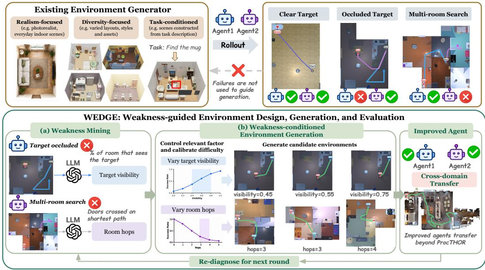
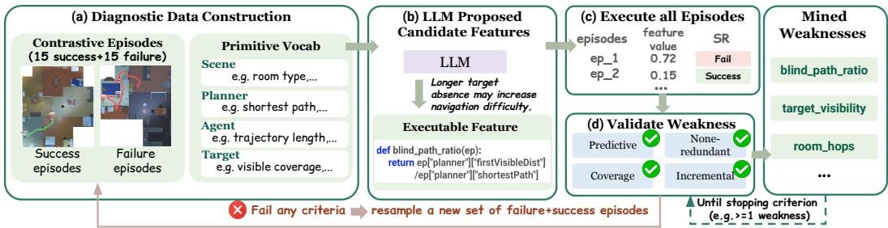
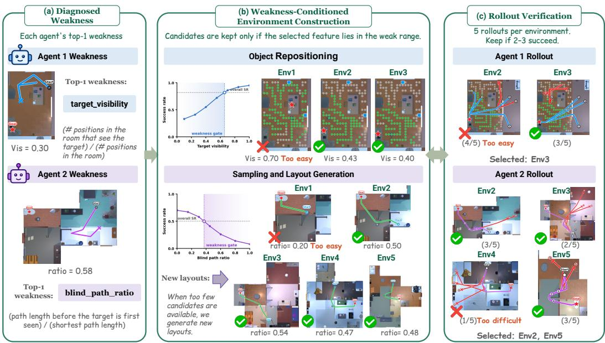
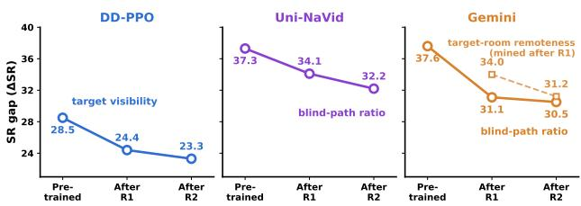
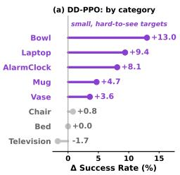
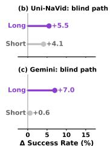

# FROM FAILURES TO LEARNABLE WORLDS: POLICY-CONDITIONED ENVIRONMENT GENERATION FOR NAVIGATION AGENTS

Yue Zhang Han Lin Zun Wang Yidong Huang Zaid Khan Mohit Bansal UNC Chapel Hill

## ABSTRACT

Simulated environments enable scalable training data generation for embodied agents, but more data does not necessarily provide what a particular agent needs to learn. Existing environment-generation pipelines largely optimize generic properties such as realism, diversity, or task coverage, while different pretrained policies can fail for different environmental reasons, with some struggling when targets are hard to see and others when navigation requires long blind paths or multiple room transitions. We therefore introduce WEDGE, a framework for weakness-guided navigation learning in which the failure modes of a pretrained agent guide the generation of training environments at each adaptation round. Rather than assuming a predefined set of tasks or skills to improve, WEDGE derives its generation targets from the policy’s own success and failure patterns within the same task. Given a pretrained policy, WEDGE uses an LLM to propose executable weakness features from contrasting successful and failed rollouts, automatically validates them on the diagnostic set, and selects the strongest validated weakness based on its success-rate gap. The validated weaknesses are then mapped to the environmental factors that control them, such as target placement, start configurations, and scene layouts. WEDGE varies these factors to construct environments in the difficulty regimes where the policy struggles, producing targeted training experience for adaptation. Across three navigation agents with different adaptation mechanisms, we find that policies exhibit distinct weakness profiles and benefit from different training environments. Weakness-conditioned adaptation consistently outperforms matched random and hard-example alternatives on ProcTHOR, while the resulting gains for Uni-NaVid and Gemini also extend to HM3D after ProcTHOR adaptation. Iterative re-diagnosis further shows that dominant weaknesses can persist or shift as the policy improves, providing updated guidance for subsequent environment construction. Together, these results show that policy failures are not only diagnostic signals, but actionable guidance for constructing training environments that target a policy’s current weaknesses 1.

## 1 INTRODUCTION

Simulated environments have become an important source of scalable training data for embodied agents (Wang et al., 2025a; Ye et al., 2026; Seed, 2025; Yang et al., 2024b; Deitke et al., 2022; Chang et al., 2017; Ramakrishnan et al., 2021b), offering controllable worlds, inexpensive interaction, and access to situations that are difficult to collect in the real world. Accordingly, recent environmentgeneration pipelines have progressed from improving realism and diversity (Yang et al., 2024b; Pan & Liu, 2026; Sun et al., 2025; Hu et al., 2024) to task-conditioned generation, where environments are constructed to support specific embodied tasks (Xia et al., 2026; Yang et al., 2026; Wang et al., 2026; Zala et al., 2024). However, these approaches primarily condition generation on predefined properties of the environment or user-specified embodied tasks (e.g., “Find the mug.”), with limited consideration of what the current policy has already mastered and where it still struggles. As a result, the same training environment may be useful for one policy but redundant or overly difficult for another. This raises a central question: how can we generate environments that target what a particular agent has not yet mastered?

  
Figure 1: Overview of WEDGE. Unlike existing environment generators, which are largely policyagnostic, WEDGE uses agent failures to guide generation. (a) We mine policy-specific weaknesses from successful and failed rollouts. (b) The mined weaknesses determine which environmental factors to control and which learnable regimes to target. Training on the resulting environments improves the agent and can yield cross-domain transfer beyond the generation simulator.

This distinction is particularly important when continuing to train a pretrained embodied agent, whose capabilities may already vary substantially across environmental conditions. The same training environment may therefore be redundant for an agent that has already mastered the relevant behavior, informative for another that still struggles with it, or too difficult to provide a useful learning signal. As illustrated in Fig. 1 (top), two agents solving the same navigation task can fail for very different reasons: one may struggle when navigation requires traversing multiple rooms, while another may fail primarily when the target is poorly visible. Generating environments that are simply more realistic, diverse, or difficult does not necessarily address either weakness. Task-conditioned generation provides a stronger form of control by constructing environments around the requirements of a given task, but it does not distinguish why different policies fail within that task. As a result, environments generated for the same task may still target conditions that one policy has already mastered while overlooking those that another policy struggles with. We therefore argue that training environments for continued learning should be generated relative to the current policy.

We introduce WEDGE (Weakness-guided Environment Design, Generation, and Evaluation), a framework for procedural environment generation that closes the loop between policy diagnosis, environment construction, and policy adaptation for object navigation tasks. Given a pretrained navigation policy, we first contrast its successful and failed episodes to identify environmental factors that systematically characterize where the policy struggles. An LLM instantiates these hypotheses as programmatic weakness features, such as target visibility, blind path ratio, and room hops, which can be computed over individual environments and directly connected to controllable simulator factors (Fig. 1(a)). We evaluate each proposed feature on the full diagnostic set and retain only those that provide sufficiently broad, non-redundant, predictive, and complementary signals of policy failure. These validated weaknesses then serve as actionable specifications for generation, determining which environmental factors should be varied and which failure-associated regimes should be targeted (Fig. 1(b)). A key aspect of WEDGE is that its generation targets are derived from the current policy’s own failure patterns rather than specified in advance. By identifying the environmental conditions associated with failures within the same task, WEDGE determines which aspects of the environment should be modified and which regimes should be targeted during generation. We then roll out the current policy in each candidate environment and select those that fall within the diagnosed weak regime while remaining challenging but solvable. The selected environments are then used to adapt the policy with its original learning mechanism. We study this framework in 3D indoor navigation, where agents must continuously perceive, navigate, and act in complex environments over long horizons. We further show that weakness-targeted adaptation in ProcTHOR (Deitke et al., 2022) transfers to HM3D (Ramakrishnan et al., 2021a), demonstrating generalization beyond the simulator used for generation.

We evaluate WEDGE across three navigation agents with different model architectures and adaptation mechanisms: a ProcTHOR (Deitke et al., 2022)-trained DD-PPO policy (Zeng et al., 2024), an HM3D (Ramakrishnan et al., 2021a)-trained Uni-NaVid policy (Zhang et al., 2024), and a generalpurpose VLM agent (Gemini-3.8-flash (Google DeepMind, 2026)). Despite solving the same navigation task, the agents exhibit different weakness profiles, confirming that useful training environments depend on the current policy rather than the task alone. Across all three agents, weaknessconditioned adaptation consistently outperforms matched random and hard-example alternatives on ProcTHOR. For Uni-NaVid and Gemini, the gains also extend to HM3D after ProcTHOR adaptation, showing that the resulting improvements are not confined to the environment used for training. Iterative re-diagnosis shows that the dominant weakness may persist or shift after adaptation, and using the updated diagnosis to guide a second round of environment generation yields further performance gains. Our additional analysis shows that gains are concentrated in weakness-related cases and that rollout calibration focuses training on environments within the policy’s learning range. Together, these results show that policy failures provide not only diagnostic signals, but actionable guidance for constructing training environments that target the policy’s remaining weaknesses.

## 2 RELATED WORK

Environment Design for Embodied AI. Environment design for embodied AI increasingly combines scalable scene construction with controllable, simulation-ready generation (Ye et al., 2026). Procedural generation and curated synthetic scenes expand environmental diversity and realism (Deitke et al., 2022; Khanna et al., 2024; Raistrick et al., 2024; Paschalidou et al., 2021; Tang et al., 2024), while language-guided and task-conditioned pipelines automate scene composition and robotic training environments (Feng et al., 2023; Yang et al., 2024b; Wang et al., 2023a; Fu et al., 2024). Physical and interactive constraints further improve scene usability (Yang et al., 2024a), and recent agentic pipelines refine generated environments through visual critique, physical validation, and semantic feedback (Yang et al., 2026; Sun et al., 2025; Xia et al., 2026). Simulation provides scalable training experience for embodied navigation across a broad range of tasks (Savva et al., 2019; Shen et al., 2021; Wijmans et al., 2019; Huang et al., 2026b; Deitke et al., 2022; Khanna et al., 2024). Prior work scales this experience through procedurally generated or high-fidelity environments, augmented task configurations and trajectories, synthetic demonstrations, and curriculumbased sampling (Maksymets et al., 2021; Kotar et al., 2023; Ehsani et al., 2024; Ye et al., 2021; Yadav et al., 2022; Morad et al., 2021). Other efforts improve robustness and transfer through controlled perturbations, domain adaptation, target-conditioned simulation, and synthetic instruction– trajectory data (Chattopadhyay et al., 2021; Deitke et al., 2020; Zhu et al., 2019; Truong et al., 2021; Deitke et al., 2023; Yang et al., 2024b; Xu et al., 2022; Wang et al., 2023b; 2025b). These works improve the scalability and controllability of training environments, while our focus is to determine what environments to construct based on the diagnosed weaknesses of a particular pretrained policy.

Failure-Driven Learning and Adaptive Data Generation. Adaptive curricula and unsupervised environment design use learner feedback to prioritize, generate, and edit training environments (Wang et al., 2020; Dennis et al., 2020; Jiang et al., 2021; Parker-Holder et al., 2022; Chung et al., 2024). Recent approaches extend this principle through LLM-based environment configuration and code generation (Zala et al., 2024; Liang et al., 2024; Faldor et al., 2025), performanceadaptive navigation curricula (Kang et al., 2026), and trajectory-informed scene editing (Yeo et al., 2026). Related work targets grounding errors through counterfactual scene edits (Zhang et al., 2026) or synthesizes and validates environment wrappers from behavioral diagnoses (Huang et al., 2026a). Our approach extends adaptive environment generation from predefined task-level adaptation to policy-specific failure diagnosis in 3D indoor navigation: rather than assuming known skills or weakness categories, WEDGE identifies measurable environmental conditions associated with fail ures within the same task and validates them as policy-specific weaknesses. These diagnosed weaknesses determine which environmental factors to modify and which regimes to target during 3D environment construction. Policy rollouts then calibrate the generated candidates, retaining environments that expose the diagnosed weakness while remaining learnable for the current policy.

  
Figure 2: LLM-guided discovery and validation of executable policy weaknesses. (a) We condef blind\_path\_ratio(ep): struct a diagnostic set by contrasting successful and failed episodes represented with a shared vocabreturn ep["planner"]["firstVisibleDist"]ulary of measurable primitives. (b) An LLM uses these structured examples to propose candidate /ep["planner"]["shortestPath"]weakness features and their executable definitions. (c) Each candidate is evaluated on the full diagnostic set, and (d) retained only if it satisfies the validation criteria for coverage, non-redundancy, predictiveness, and incremental value. Candidates that fail any criterion trigger a new round of episode sampling and feature proposal. This proposal–validation process repeats until the stopping criterion is met, with validated weaknesses retained for subsequent environment generation.

## 3 METHOD

We study how to construct synthetic training environments for a pretrained embodied navigation policy. We begin by formalizing the problem setup (Sec. 3.1). Given a policy π, our framework identifies environmental features that systematically characterize its failures (Sec. 3.2), validates these features as reliable and complementary weakness signals, and uses them to guide the construction of targeted training environments (Sec. 3.3). We then collect successful trajectories from the selected environments and use them for policy adaptation (Sec. 3.4). Overall, our framework closes the loop from policy behavior to environment design and back to policy learning.

## 3.1 PROBLEM SETUP

We study environment generation for the ObjectNav task (Deitke et al., 2022). Given a target object category g, an agent must navigate from an initial state $s _ { 0 }$ through an environment e to locate the target. We consider a pretrained ObjectNav policy $\pi$ and a controllable procedural simulator used as the environment-generation space. The simulator provides a base distribution $p _ { \mathrm { s i m } } ( e )$ over environments, where each environment specifies the scene layout, object arrangement, and other task-relevant properties. An episode is defined as $\boldsymbol { x } = ( e , s _ { 0 } , g )$ . Executing π on x produces a rollout $\tau = ( s _ { 0 } , a _ { 0 } , s _ { 1 } , a _ { 1 } , \dots , s _ { T } )$ and an outcome $y \in \{ 0 , 1 \}$ , where $y = 1$ denotes task success.

## 3.2 LLM-GUIDED DISCOVERY OF EXECUTABLE WEAKNESSES

Our first step is to identify environment-level factors that systematically characterize where a pretrained policy struggles. As illustrated in Fig. 2, we use an LLM to reason over contrasting successful and failed episodes and propose candidate weakness features, which are then empirically validated on the full diagnostic set. Candidate weaknesses that fail validation trigger another round of feature proposal using newly sampled contrastive episodes. This iterative discovery-and-validation process yields executable weakness signals that can subsequently guide targeted environment generation.

Diagnostic data construction. As shown in Fig. 2(a), we execute the frozen policy π on a held-out set of ObjectNav episodes and construct a diagnostic dataset $\mathcal { D } = \{ ( x _ { i } , \tau _ { i } , y _ { i } ) \dot  \} _ { i = 1 } ^ { N }$ , where $x _ { i }$ denotes an episode, $\tau _ { i }$ is the rollout produced by π, and $y _ { i } \in \{ 0 , 1 \}$ is its success outcome. At each discovery round, we sample 15 successful and 15 failed episodes from D to form a balanced contrastive set. To make these episodes directly comparable, we represent each of them using a shared vocabulary of measurable primitives. These primitives provide a structured representation of each episode, from which the LLM can define candidate weakness features by selecting and combining relevant measurements. We organize the primitives into four groups: scene, target, path, and agent. Scene primitives characterize the overall house structure, such as the number of rooms and doors and the start-room type. Target primitives describe the goal object and its surrounding room, such as the target category, target-room area, and target visibility. Path primitives characterize the ground-truth shortest path, including its length, the number of room transitions and doors crossed, and the path length before the target first becomes visible. Finally, agent primitives summarize rollout behavior, such as environment coverage, revisitation, and whether the target room or target was ever reached. The full primitive vocabulary is provided in Appendix Table 5.

LLM candidate feature proposal. Given the sampled episodes and their primitive representations, we prompt an LLM to identify measurable factors that may explain why the policy succeeds in some episodes but fails in others. As shown in Fig. 2(b), for each hypothesis, the LLM proposes a candidate weakness feature together with a short rationale and an executable Python function that computes the feature from the available primitives. The feature may directly use a primitive or combine multiple primitives into a higher-level quantity. For example, the LLM can define blind path ratio by combining first visible path length and shortest path length, taking their ratio to measure how much of the route must be traversed without visual access to the target. The full prompt for weakness proposal is in Appendix A.3.

Candidate validation and iterative refinement. We execute each proposed feature on the full diagnostic dataset (Fig. 2(c)) and retain it only if it provides a reliable and complementary signal of policy failure (Fig. 2(d)). Specifically, candidates are evaluated sequentially for coverage, nonredundancy, predictiveness, and incremental value. Coverage requires the feature to be computable for most episodes and to vary across the diagnostic set, while non-redundancy removes features that largely duplicate previously retained weaknesses. We provide the full computation and thresholds for all validation criteria in Appendix A.1. For predictiveness, we compare policy success between episodes with low and high feature values and require a sufficiently large success-rate gap:

$$
\Delta _ { f } = | \mathrm { S R } ( \mathcal { L } _ { f } ) - \mathrm { S R } ( \mathcal { H } _ { f } ) | \geq \tau _ { \Delta } ,\tag{1}
$$

where $\mathcal { L } _ { f }$ and $\mathcal { H } _ { f }$ denote the bottom and top terciles of $f ,$ respectively. Finally, incremental value requires the candidate to improve success prediction beyond the set of already retained features ${ \mathcal F } .$ . If a candidate fails any validation criterion, we discard it, resample a new set of successful and failed episodes, and query the LLM for another candidate feature. We refer to each candidate feature that passes all validation criteria as a mined weakness, and denote the resulting set for policy π as $\mathcal { F } _ { \pi } = \mathsf { \bar { \{ } }  f _ { 1 } , \ldots , f _ { K _ { \pi } } \}$ , where $K _ { \pi }$ is the number of validated weakness features. These mined weaknesses are used to guide the subsequent environment generation stage.

## 3.3 WEAKNESS-CONDITIONED ENVIRONMENT GENERATION

Discovered weaknesses alone do not yet specify useful training data, since candidate environments may fail to sufficiently express that weakness or may be too difficult for the current policy to learn from. We therefore use the selected weakness to determine which environment factors to modify and retain candidates whose feature values fall within the failure-associated range identified on the diagnostic set. We then evaluate the current policy in these environments and keep those that remain challenging but still solvable. When suitable candidates are scarce, we generate additional environments to better cover the desired weakness regime.

Weakness-conditioned environment construction. As shown in Fig. 3(b), for each policy, we select the mined weakness $f$ with the largest success-rate gap and use it to guide the construction of candidate episodes. We focus on one weakness per adaptation round because different weaknesses may correspond to distinct environmental factors, and targeting them jointly would make it difficult to isolate which factor drives the observed adaptation gains. To construct environments that exhibit the selected weakness, we modify the episode factors on which the corresponding feature depends. We use three reusable operators for this purpose: re-placing the target object, sampling a new start state, and generating a new layout. The applicable operator is determined by which episode factors the weakness feature depends on. For example, for Agent 1 in Fig. 3, we control target visibility by moving the target within its room to produce different visibility levels. For Agent 2, we control blind path ratio by sampling a new start state or layout, which changes the fraction of the path traveled before the target first becomes visible.

  
Figure 3: Weakness-conditioned environment construction and rollout verification. (a) Each policy is associated with its top mined weakness. (b) Candidate episodes are constructed by modifying the factors relevant to that weakness, such as target placement for target visibility or start state and layout for blind path ratio. Candidates are retained only when their feature values fall within the weakness range, with new layouts generated when existing ones are insufficient. (c) The policy is rolled out five times in each retained candidate, and episodes with two or three successful rollouts are selected for training.

Each operator produces candidate episodes $x ^ { \prime }$ . We first discard invalid configurations, such as target placements that are not supported by the scene or episodes for which no valid navigation path exists. For the selected weakness $f ,$ we use the diagnostic set to identify a weak regime $B _ { f }$ , consisting of feature-value ranges for which the policy’s success rate is lower than its overall success rate on the diagnostic set. We retain a candidate episode only if

$$
f ( x ^ { \prime } ) \in B _ { f } .\tag{2}
$$

When the existing layouts provide too few candidates satisfying this constraint, we generate addi tional layouts and apply the same criterion.

Rollout verification. Satisfying the weakness constraint does not guarantee that a candidate provides a useful training signal, since episodes with similar feature values can still differ substantially in difficulty for the current policy. As shown in Fig. 3(c), we therefore execute the frozen policy five times in each retained candidate and count the number of successful rollouts. Episodes that the policy almost always solves provide little additional training signal, while episodes that it almost never solves rarely yield successful experience for adaptation. We therefore retain episodes with intermediate empirical success: $2 \ \leq \ \overline { { \ n } } _ { \mathrm { s u c c } } ( x ^ { \prime } ) \ \leq \ \mathrm { \bar { ~ } { ~ 3 ~ } ~ }$ , where $n _ { \mathrm { s u c c } } ( x ^ { \prime } )$ denotes the number of successful rollouts among the five trials. These rollouts are used only for episode selection.

## 3.4 TRAINING DATA CONSTRUCTION AND POLICY ADAPTATION

The selected episodes from Sec. 3.3 determine what experience each policy learns from, while we preserve its original adaptation mechanism. This keeps the framework independent of a particular learning algorithm and allows our method and controls to differ only in how training episodes are constructed. For reinforcement learning policies, we mix the selected episodes with the origi nal training distribution and continue training with the original RL objective. For imitation-based policies, we fine-tune on successful self-rollouts collected from the selected episodes. For models without parameter access, such as closed-weight vision and language models, we use successful trajectories from the selected episodes as in-context examples instead of weight updates. After adaptation, the updated policy can be evaluated again and passed through the same weakness discovery procedure to identify remaining weaknesses.

Table 1: Experimental results on policy-specific adaptation and generalization. For each agent, we report the validated weaknesses identified in ProcTHOR, adaptation performance on ProcTHOR, and performance when evaluated back on HM3D. Bold denotes the best performance. † Uni-NaVid’s original HM3D training data are unavailable, so the pretrained model is shown as a reference.
<table><tr><td rowspan="2">Agent</td><td rowspan="2">Diagnosed weakness</td><td rowspan="2">Adaptation setting</td><td colspan="2">ProcTHOR</td><td colspan="2">HM3D</td></tr><tr><td>SR↑</td><td>SPL ↑</td><td>SR↑</td><td>SPL ↑</td></tr><tr><td rowspan="5">DD-PPO</td><td rowspan="5">Target visibility (∆SR = 28.5)</td><td>Pretrained</td><td>82.1</td><td>58.2</td><td>一</td><td>一</td></tr><tr><td>Random env.</td><td>82.3</td><td>58.8</td><td>一</td><td>一</td></tr><tr><td>Hard-mined</td><td>82.4</td><td>58.1</td><td>一</td><td>一</td></tr><tr><td>WEDGE R1 (Ours)</td><td>85.4</td><td>59.8</td><td>一</td><td>一</td></tr><tr><td>WEDGE R2 (Ours)</td><td>85.6</td><td>59.8</td><td>一</td><td>一</td></tr><tr><td rowspan="5">Uni-NaVid</td><td rowspan="5">Blind-path ratio (∆SR = 37.3)</td><td>Pretrained†</td><td>51.6</td><td>35.3</td><td>69.2</td><td>28.5</td></tr><tr><td>Random self-rollout</td><td>46.6</td><td>34.1</td><td>67.1</td><td>26.7</td></tr><tr><td>Hard self-rollout</td><td>53.1</td><td>36.9</td><td>69.0</td><td>26.2</td></tr><tr><td>WEDGE R1 (Ours)</td><td>54.5</td><td>37.3</td><td>71.4</td><td>28.4</td></tr><tr><td>WEDGE R2 (Ours)</td><td>55.7</td><td>38.5</td><td>73.4</td><td>28.6</td></tr><tr><td rowspan="4">Gemini</td><td rowspan="4">Blind-path ratio (∆SR = 37.6)</td><td>Zero-shot</td><td>41.0</td><td>31.8</td><td>57.9</td><td>27.0</td></tr><tr><td>Random example</td><td>40.7</td><td>32.6</td><td>58.0</td><td>27.9</td></tr><tr><td>Hard example</td><td>41.8</td><td>32.7</td><td>60.9</td><td>28.7</td></tr><tr><td>WEDGE R1 (Ours)</td><td>43.7</td><td>33.4</td><td>63.5</td><td>29.1</td></tr><tr><td></td><td></td><td>WEDGE R2 (Ours)</td><td>44.3</td><td>33.7</td><td>64.2</td><td>30.2</td></tr></table>

## 4 EXPERIMENT

## 4.1 EXPERIMENTAL SETUP

Agents. We evaluate our framework on three different navigation agents: a ProcTHOR ObjectNav policy trained with DD-PPO (Zeng et al., 2024), the HM3D-trained navigation policy Uni-NaVid (Zhang et al., 2024), and the general-purpose vision-language model Gemini-3.8- flash (Google DeepMind, 2026). (1) The ProcTHOR policy represents an in-domain reinforcementlearning agent, allowing us to test whether our framework can identify weaknesses that remain after in-domain training. (2) Uni-NaVid is trained on HM3D but diagnosed and adapted in ProcTHOR, enabling us to study whether weakness-targeted synthetic training transfers back to its original evaluation domain. (3) Finally, Gemini serves as a general-purpose navigation agent, for which adaptation is performed via in-context demonstrations rather than parameter updates. Together, these agents allow us to examine whether the same weakness-discovery framework can identify distinct failure profiles across heterogeneous policies and support different forms of adaptation.

Experimental protocol and implementation details. We use ProcTHOR for weakness diagnosis and training environment construction because its procedural structure allows us to directly modify the environmental factors underlying the diagnosed weaknesses. For each agent, we execute the frozen policy on a held-out diagnostic set and use Gemini-2.5-Pro (Comanici et al., 2025) to propose executable weakness features. (1) For DD-PPO, we continue reinforcement learning from the pretrained checkpoint for 10M environment steps. (2) For Uni-NaVid, we restrict ProcTHOR training episodes to the six object categories shared with HM3D and fine-tune the model with LoRA on its own successful trajectories. (3) For Gemini, successful weakness-matched trajectories are converted into in-context examples and appended to the system prompt. See Sec. A.2.2 for more details. We compare against matched baselines under the same adaptation budget and report Success Rate (SR) and Success weighted by Path Length (SPL) (Zeng et al., 2024). Specifically, WEDGE uses 668 calibrated environments for DD-PPO, 2,480 successful trajectories for Uni-NaVid, and one worked example (selected from 64 successful practice trajectories) for Gemini. All baselines use the same number of training environments, trajectories, or in-context examples. We compare against random and hard-mined baselines. The hard-mined baselines choose training data based only on whether the agent succeeds or fails, without using any weakness features. For DD-PPO, we pick the environments where the agent succeeds least often. For Uni-NaVid and Gemini, we take episodes the agent previously failed, run it again, and keep the successful trajectories. Evaluation uses 1,550 Proc-THOR episodes for DD-PPO, 655 ProcTHOR and 1,000 HM3D episodes for Uni-NaVid, and 300 ProcTHOR and 300 HM3D episodes for Gemini. Appendix A.2 provides detailed implementation.

## 4.2 POLICY-SPECIFIC WEAKNESS DISCOVERY

Table 1 and Table 4 in the Appendix report the top discovered weakness for each agent together with its corresponding success-rate gap. For the ProcTHOR-trained DD-PPO policy, the top weakness is target visibility, with a 28.5 SR gap. The discovery procedure also identifies doorway visibility as a complementary weakness, indicating that DD-PPO is particularly sensitive to whether the target can be observed from within or near the target room. For Uni-NaVid, the top weakness is blind path ratio, which produces a 37.3 SR gap, followed by room hops with a 34.8 SR gap. Gemini also exhibits blind path ratio as its dominant weakness, with a 37.6 SR gap. These results show that agents solving the same navigation task can exhibit different weakness profiles, motivating policy-specific environment generation.

## 4.3 WEAKNESS-CONDITIONED ADAPTATION

In-domain adaptation. We first evaluate whether weakness-conditioned experience improves adaptation in the ProcTHOR environment used for diagnosis and generation. As shown in Table 1, WEDGE consistently outperforms random and hard-example alternatives across all three agents. For the ProcTHOR-trained DD-PPO policy, continued training on random or hard-mined environments yields little improvement over the pretrained model (82.1 SR), whereas WEDGE improves SR to 85.6 and SPL from 58.2 to 59.8. Uni-NaVid shows larger gains from weakness-conditioned adaptation. Because its original HM3D training data are not publicly available, adaptation must rely on ProcTHOR experience, introducing an inherent domain shift. We therefore use random selfrollout adaptation on ProcTHOR as the matched baseline, controlling for continued training with the same data source and fine-tuning budget. While random self-rollout reduces SR from 51.6 to 46.6, weakness-conditioned adaptation instead improves SR from 51.6 to 55.7 and SPL from 35.3 to 38.5. For the closed-weight Gemini agent, weakness-targeted in-context examples improve SR from 41.0 to 43.7, outperforming both random examples (40.7) and hard examples (41.8). Together, these results show that the benefit comes from targeting the policy’s diagnosed weaknesses rather than simply providing additional or difficult adaptation data. We further ablate mined versus generated environments in Appendix Table 3, showing that mining existing episodes alone is insufficient and that generating new environments targeted to the diagnosed weakness provides additional benefit.

Evaluation on HM3D after ProcTHOR adaptation. We further evaluate whether the gains from ProcTHOR adaptation extend to HM3D without extra training. For Uni-NaVid, this comparison reveals an important difference between hard-example mining and weakness-conditioned adaptation. Although hard-example mining improves performance on ProcTHOR, the improvement does not extend to HM3D, where SR remains at 69.0 compared with 69.2 for the pretrained policy. Random self-rollout performs even worse, reducing HM3D SR to 67.1. In contrast, WEDGE improves performance on both domains, reaching 73.4 SR on HM3D while maintaining comparable SPL to the pretrained policy (28.6 vs. 28.5). Gemini shows a similar pattern: random and hard examples achieve 58.0 and 60.9 SR on HM3D, respectively, whereas weakness-conditioned examples improve SR to 63.5 and SPL to 29.1. These results suggest that weakness-conditioned adaptation captures training signals that remain useful beyond the ProcTHOR environments used for adaptation.

Iterative weakness re-diagnosis. Finally, we examine how the diagnosed weaknesses evolve across adaptation rounds. As shown in Fig. 4(a), for DD-PPO, the top weakness remains target visibility after the first round, while both SR and SPL effectively saturate after the first round of adaptation. Uni-NaVid also retains blind path ratio as its top weakness across both rounds, while continuing to improve from 54.5 to 55.7 SR on ProcTHOR. Gemini exhibits a change in its weakness profile: blind path ratio is the dominant weakness in the first round, whereas target room remoteness becomes the top weakness after adaptation. These results show that iterative re-diagnosis can either confirm a remaining weakness or reveal a new limiting factor as the policy improves, providing the target for the next round of environment generation.

  
(a) Weakness evolution across adaptation rounds

  
(b) Gains under diagnosed weaknesses  
Figure 4: Analysis of weakness-conditioned adaptation. (a) We re-diagnose each agent after every adaptation round and track the SR gap associated with its dominant weakness. DD-PPO and Uni-NaVid retain the same dominant weakness, while Gemini develops a new weakness after the first round. (b) Adaptation gains are larger in weakness-associated regimes. For Uni-NaVid and Gemini, we compare gains across blind path ratio regimes. For DD-PPO, gains are reported by target category, with larger improvements on small, hard-to-see targets.

## 4.4 ANALYSIS AND ABLATIONS

Gains under diagnosed weakness. We further examine how performance changes across regimes associated with each agent’s diagnosed weakness. As shown in Fig. 4(b), the gains are especially large in these challenging regimes. For DD-PPO, improvements are largest on small, hard-to-see targets, including Bowl, Laptop, and AlarmClock, while several larger objects change little. The trend is especially clear for Gemini, where long-blind-path episodes improve by +7.0 SR, compared with little or no gain on shorter paths. These results show that weakness-conditioned adaptation not only improves aggregate performance, but also produces substantial gains on the failure regimes targeted during adaptation.

Effect of rollout-based calibration. As shown in Table 2, weakness matching alone does not ensure that an environment provides a useful learning signal. Many weakness-matched environments are either already easy for the current policy or remain beyond its current capability. Rollout-based calibration filters these extremes and focuses adaptation on environments of intermediate difficulty. For DD-PPO, the calibrated subset contains only 16% of the weakness-matched environments, yet achieves higher performance than using the full set (85.4 vs. 84.4 SR). We observe the complementary effect for Uni-NaVid, where increasing the share of the hardest episodes does not improve performance and instead slightly degrades overall results. Together, these results suggest that effective adaptation depends not only on targeting a policy weakness, but also on matching the generated environments to the policy’s current learning range.

Computational efficiency and generation scale. Weakness discovery adds little overhead, as it operates on already-collected diagnostic rollouts and requires only a small number of LLM calls. More importantly, it reduces the cost of identifying useful training environments: to obtain the same number of hard target placements, unguided hard-example mining required evaluating roughly twice as many candidates (8.4k vs. 4.2k), corresponding to 42k versus 21k policy rollouts. We provide a full breakdown of generation, rollout, and adaptation costs in Appendix Sec. A.2.1.

Table 2: Effect of rollout calibration. Proc. and HM3D report SR; Hardest: share of hardest episodes.
<table><tr><td>DD-PPO # Env.</td></tr><tr><td>SR↑ Pretrained</td></tr><tr><td>82.1 All weakness-matched 4,215 84.4</td></tr><tr><td>Calibrated (2–3/5) 668 85.4</td></tr><tr><td>Hardest Proc. HM3D</td></tr><tr><td>Uni-NaVid Random self-rollout</td></tr><tr><td>46.6 67.1 Weakness-matched 12.1% 49.0 70.0</td></tr><tr><td>Hard-heavy 25.1% 47.2 69.2</td></tr></table>

## 5 CONCLUSION

We introduced WEDGE, a weakness-guided framework for generating training environments for navigation policies. By diagnosing policy-specific failure conditions and using them to guide environment construction, WEDGE improves adaptation across different agents and learning mechanisms. Our results further show that these gains can transfer across simulators and that re-diagnosis can support continued adaptation over multiple rounds. More broadly, our findings suggest that agent failures can be used as actionable signals for targeted improvement, enabling training environments to be constructed around what each policy still needs to learn.

## 6 ACKNOWLEDGEMENT

This work was supported by NSF-AI Engage Institute DRL-2112635, NSF-CAREER Award 1846185, ARO Award W911NF2110220, ONR Grant N00014-23-1-2356, and NDSEG PhD Fellowship (Air Force Office of Scientific Research under award number FA9550-25-C-B010). The views contained in this article are those of the authors and not of the funding agency.

## REFERENCES

Angel Chang, Angela Dai, Thomas Funkhouser, Maciej Halber, Matthias Niessner, Manolis Savva, Shuran Song, Andy Zeng, and Yinda Zhang. Matterport3d: Learning from rgb-d data in indoor environments. arXiv preprint arXiv:1709.06158, 2017.

Prithvijit Chattopadhyay, Judy Hoffman, Roozbeh Mottaghi, and Aniruddha Kembhavi. Robustnav: Towards benchmarking robustness in embodied navigation. In 2021 IEEE/CVF International Conference on Computer Vision (ICCV), pp. 15671–15680. IEEE, October 2021. doi: 10.1109/ ICCV48922.2021.01540.

Hojun Chung, Junseo Lee, Minsoo Kim, Dohyeong Kim, and Songhwai Oh. Adversarial environment design via regret-guided diffusion models. Advances in Neural Information Processing Systems, 37:63715–63746, 2024.

Gheorghe Comanici, Eric Bieber, Mike Schaekermann, Ice Pasupat, Noveen Sachdeva, Inderjit Dhillon, Marcel Blistein, Ori Ram, Dan Zhang, Evan Rosen, et al. Gemini 2.5: Pushing the frontier with advanced reasoning, multimodality, long context, and next generation agentic capabilities. arXiv preprint arXiv:2507.06261, 2025.

Matt Deitke, Winson Han, Alvaro Herrasti, Aniruddha Kembhavi, Eric Kolve, Roozbeh Mottaghi, Jordi Salvador, Dustin Schwenk, Eli VanderBilt, Matthew Wallingford, Luca Weihs, Mark Yatskar, and Ali Farhadi. Robothor: An open simulation-to-real embodied ai platform. In 2020 IEEE/CVF Conference on Computer Vision and Pattern Recognition (CVPR), pp. 3161–3171. IEEE, June 2020. doi: 10.1109/CVPR42600.2020.00323.

Matt Deitke, Eli VanderBilt, Alvaro Herrasti, Luca Weihs, Kiana Ehsani, Jordi Salvador, Winson Han, Eric Kolve, Aniruddha Kembhavi, and Roozbeh Mottaghi. Procthor: Large-scale embodied ai using procedural generation. Advances in neural information processing systems, 35:5982– 5994, 2022.

Matt Deitke, Rose Hendrix, Ali Farhadi, Kiana Ehsani, and Aniruddha Kembhavi. Phone2proc: Bringing robust robots into our chaotic world. In 2023 IEEE/CVF Conference on Computer Vision and Pattern Recognition (CVPR), pp. 9665–9675. IEEE, June 2023. doi: 10.1109/CVPR52729. 2023.00932.

Michael Dennis, Natasha Jaques, Eugene Vinitsky, Alexandre Bayen, Stuart Russell, Andrew Critch, and Sergey Levine. Emergent complexity and zero-shot transfer via unsupervised environment design. Advances in neural information processing systems, 33:13049–13061, 2020.

Kiana Ehsani, Tanmay Gupta, Rose Hendrix, Jordi Salvador, Luca Weihs, Kuo-Hao Zeng, Kunal Pratap Singh, Yejin Kim, Winson Han, Alvaro Herrasti, Ranjay Krishna, Dustin Schwenk,

Eli VanderBilt, and Aniruddha Kembhavi. Spoc: Imitating shortest paths in simulation enables effective navigation and manipulation in the real world. In 2024 IEEE/CVF Conference on Computer Vision and Pattern Recognition (CVPR), pp. 16238–16250. IEEE, June 2024. doi: 10.1109/CVPR52733.2024.01537.

Maxence Faldor, Jenny Zhang, Antoine Cully, and Jeff Clune. Omni-epic: Open-endedness via models of human notions of interestingness with environments programmed in code. In International Conference on Learning Representations, volume 2025, pp. 85260–85385, 2025.

Weixi Feng, Wanrong Zhu, Tsu-jui Fu, Varun Jampani, Arjun Akula, Xuehai He, Sugato Basu, Xin Eric Wang, and William Yang Wang. Layoutgpt: Compositional visual planning and generation with large language models. Advances in neural information processing systems, 36: 18225–18250, 2023.

Rao Fu, Zehao Wen, Zichen Liu, and Srinath Sridhar. Anyhome: Open-vocabulary generation of structured and textured 3d homes. In European Conference on Computer Vision, pp. 52–70. Springer, 2024.

Google DeepMind. Gemini 3.8 flash. Model Card, September 2026. URL https://deepmind. google/models/model-cards/gemini-3-8-flash/. Accessed: 2026-09-25.

Ziniu Hu, Ahmet Iscen, Aashi Jain, Thomas Kipf, Yisong Yue, David A Ross, Cordelia Schmid, and Alireza Fathi. Scenecraft: An llm agent for synthesizing 3d scenes as blender code. In ICML, pp. 19252–19282, 2024.

Chengsong Huang, Zifeng Wang, Rujun Han, Jun Yan, Yanfei Chen, Zoey CuiZhu, Ke Jiang, Peng Xia, Han Yu, Yufan Zhuang, et al. Envharness: Awakening static worlds for agent learning. arXiv preprint arXiv:2608.19880, 2026a.

Yidong Huang, Zun Wang, Han Lin, Dong-Ki Kim, Shayegan Omidshafiei, Jaehong Yoon, Jaemin Cho, Yue Zhang, and Mohit Bansal. Phymotion: Structured 3d motion reward for physicsgrounded human video generation. In The Fortieth Annual Conference on Neural Information Processing Systems, 2026b.

Minqi Jiang, Edward Grefenstette, and Tim Rocktaschel. Prioritized level replay. In¨ International Conference on Machine Learning, pp. 4940–4950. PMLR, 2021.

Haoqiang Kang, Xiaokang Ye, Yuhan Liu, Siddhant Hitesh Mantri, Lingjun Mao, James Fleming, Drishti Regmi, and Lianhui Qin. Simworld studio: Automatic environment generation with evolving coding agent for embodied agent learning. arXiv preprint arXiv:2605.09423, 2026.

Mukul Khanna, Yongsen Mao, Hanxiao Jiang, Sanjay Haresh, Brennan Shacklett, Dhruv Batra, Alexander Clegg, Eric Undersander, Angel X. Chang, and Manolis Savva. Habitat synthetic scenes dataset (hssd-200): An analysis of 3d scene scale and realism tradeoffs for objectgoal navigation. In 2024 IEEE/CVF Conference on Computer Vision and Pattern Recognition (CVPR), pp. 16384–16393. IEEE, June 2024. doi: 10.1109/CVPR52733.2024.01550.

Klemen Kotar, Aaron Walsman, and Roozbeh Mottaghi. Entl: Embodied navigation trajectory learner. In 2023 IEEE/CVF International Conference on Computer Vision (ICCV), pp. 10829– 10838. IEEE, October 2023. doi: 10.1109/ICCV51070.2023.00997.

William Liang, Sam Wang, Hung-Ju Wang, Osbert Bastani, Dinesh Jayaraman, and Yecheng Jason Ma. Environment curriculum generation via large language models. In 8th annual conference on robot learning, 2024.

Oleksandr Maksymets, Vincent Cartillier, Aaron Gokaslan, Erik Wijmans, Wojciech Galuba, Stefan Lee, and Dhruv Batra. Thda: Treasure hunt data augmentation for semantic navigation. In 2021 IEEE/CVF International Conference on Computer Vision (ICCV), pp. 15354–15363. IEEE, October 2021. doi: 10.1109/ICCV48922.2021.01509.

Steven D. Morad, Roberto Mecca, Rudra P. K. Poudel, Stephan Liwicki, and Roberto Cipolla. Embodied visual navigation with automatic curriculum learning in real environments. IEEE Robotics and Automation Letters, 6(2):683–690, 2021. doi: 10.1109/LRA.2020.3048662.

Zhenyu Pan and Han Liu. Metaspatial: Reinforcing 3d spatial reasoning in vlms for the metaverse. In International Conference on Learning Representations, volume 2026, pp. 117974–117993, 2026.

Jack Parker-Holder, Minqi Jiang, Michael Dennis, Mikayel Samvelyan, Jakob Foerster, Edward Grefenstette, and Tim Rocktaschel. Evolving curricula with regret-based environment design. In¨ International Conference on Machine Learning, pp. 17473–17498. PMLR, 2022.

Despoina Paschalidou, Amlan Kar, Maria Shugrina, Karsten Kreis, Andreas Geiger, and Sanja Fidler. Atiss: Autoregressive transformers for indoor scene synthesis. Advances in neural information processing systems, 34:12013–12026, 2021.

Alexander Raistrick, Lingjie Mei, Karhan Kayan, David Yan, Yiming Zuo, Beining Han, Hongyu Wen, Meenal Parakh, Stamatis Alexandropoulos, Lahav Lipson, et al. Infinigen indoors: Photorealistic indoor scenes using procedural generation. In 2024 IEEE/CVF Conference on Computer Vision and Pattern Recognition (CVPR), pp. 21783–21794. IEEE, 2024.

Santhosh K Ramakrishnan, Aaron Gokaslan, Erik Wijmans, Oleksandr Maksymets, Alex Clegg, John Turner, Eric Undersander, Wojciech Galuba, Andrew Westbury, Angel X Chang, et al. Habitat-matterport 3d dataset (hm3d): 1000 large-scale 3d environments for embodied ai. arXiv preprint arXiv:2109.08238, 2021a.

Santhosh Kumar Ramakrishnan, Aaron Gokaslan, Erik Wijmans, Oleksandr Maksymets, Alexander Clegg, John M Turner, Eric Undersander, Wojciech Galuba, Andrew Westbury, Angel X Chang, Manolis Savva, Yili Zhao, and Dhruv Batra. Habitat-matterport 3d dataset (HM3d): 1000 largescale 3d environments for embodied AI. In Thirty-fifth Conference on Neural Information Processing Systems Datasets and Benchmarks Track, 2021b. URL https://arxiv.org/abs/ 2109.08238.

Manolis Savva, Abhishek Kadian, Oleksandr Maksymets, Yili Zhao, Erik Wijmans, Bhavana Jain, Julian Straub, Jia Liu, Vladlen Koltun, Jitendra Malik, Devi Parikh, and Dhruv Batra. Habitat: A platform for embodied ai research. In 2019 IEEE/CVF International Conference on Computer Vision (ICCV), pp. 9338–9346. IEEE, October 2019. doi: 10.1109/ICCV.2019.00943.

ByteDance Seed. Seed3d 1.0: From images to high-fidelity simulation-ready 3d assets. SEED, ByteDance, Beijing, China, Tech. Rep, 2025.

Bokui Shen, Fei Xia, Chengshu Li, Roberto Mart´ın-Mart´ın, Linxi Fan, Guanzhi Wang, Claudia Perez-D’Arpino, Shyamal Buch, Sanjana Srivastava, Lyne Tchapmi, Micael Tchapmi, Kent´ Vainio, Josiah Wong, Li Fei-Fei, and Silvio Savarese. igibson 1.0: A simulation environment for interactive tasks in large realistic scenes. In 2021 IEEE/RSJ International Conference on Intelligent Robots and Systems (IROS), pp. 7520–7527. IEEE, September 2021. doi: 10.1109/IROS51168.2021.9636667.

Fan-Yun Sun, Weiyu Liu, Siyi Gu, Dylan Lim, Goutam Bhat, Federico Tombari, Manling Li, Nick Haber, and Jiajun Wu. Layoutvlm: Differentiable optimization of 3d layout via vision-language models. In 2025 IEEE/CVF Conference on Computer Vision and Pattern Recognition (CVPR), pp. 29469–29478. IEEE, 2025.

Jiapeng Tang, Yinyu Nie, Lev Markhasin, Angela Dai, Justus Thies, and Matthias Nießner. Diffuscene: Denoising diffusion models for generative indoor scene synthesis. In 2024 IEEE/CVF Conference on Computer Vision and Pattern Recognition (CVPR), pp. 20507–20518. IEEE, 2024.

Joanne Truong, Sonia Chernova, and Dhruv Batra. Bi-directional domain adaptation for sim2real transfer of embodied navigation agents. IEEE Robotics and Automation Letters, 6(2):2634–2641, 2021. doi: 10.1109/LRA.2021.3062303.

Rui Wang, Joel Lehman, Aditya Rawal, Jiale Zhi, Yulun Li, Jeffrey Clune, and Kenneth Stanley. Enhanced poet: Open-ended reinforcement learning through unbounded invention of learning challenges and their solutions. In International conference on machine learning, pp. 9940–9951. PMLR, 2020.

Xinjie Wang, Liu Liu, Yu Cao, Ruiqi Wu, Wenkang Qin, Dehui Wang, Wei Sui, and Zhizhong Su. Embodiedgen: Towards a generative 3d world engine for embodied intelligence. arXiv preprint arXiv:2506.10600, 2025a.

Xinjie Wang, Liu Liu, Taojun Ding, Andrew Choi, Chaodong Huang, Mengao Zhao, Ziang Li, Jackson Jiang, Chunlei Yu, Shengxiang Liu, et al. Embodiedgen v2: An agentic, simulationready 3d world engine for embodied ai. arXiv preprint arXiv:2607.07459, 2026.

Yufei Wang, Zhou Xian, Feng Chen, Tsun-Hsuan Wang, Yian Wang, Katerina Fragkiadaki, Zackory Erickson, David Held, and Chuang Gan. Robogen: Towards unleashing infinite data for automated robot learning via generative simulation. arXiv preprint arXiv:2311.01455, 2023a.

Zun Wang, Jialu Li, Yicong Hong, Yi Wang, Qi Wu, Mohit Bansal, Stephen Gould, Hao Tan, and Yu Qiao. Scaling data generation in vision-and-language navigation. In 2023 IEEE/CVF International Conference on Computer Vision (ICCV), pp. 11975–11986. IEEE, October 2023b. doi: 10.1109/ICCV51070.2023.01103.

Zun Wang, Jialu Li, Yicong Hong, Songze Li, Kunchang Li, Shoubin Yu, Yi Wang, Yu Qiao, Yali Wang, Mohit Bansal, and Limin Wang. Bootstrapping languageguided navigation learning with self-refining data flywheel. In International Conference on Learning Representations, volume 2025, pp. 23542–23568, 2025b. URL https://proceedings.iclr.cc/paper\_files/paper/2025/file/ 3b00f67a2e03916b26f56b66b38445f7-Paper-Conference.pdf.

Erik Wijmans, Abhishek Kadian, Ari Morcos, Stefan Lee, Irfan Essa, Devi Parikh, Manolis Savva, and Dhruv Batra. Dd-ppo: Learning near-perfect pointgoal navigators from 2.5 billion frames. arXiv preprint arXiv:1911.00357, 2019.

Hongchi Xia, Xuan Li, Zhaoshuo Li, Qianli Ma, Jiashu Xu, Ming-Yu Liu, Yin Cui, Tsung-Yi Lin, Wei-Chiu Ma, Shenlong Wang, et al. Sage: Scalable agentic 3d scene generation for embodied ai. arXiv preprint arXiv:2602.10116, 2026.

Zifan Xu, Anirudh Nair, Xuesu Xiao, and Peter Stone. Learning real-world autonomous navigation by self-supervised environment synthesis, 2022. URL https://arxiv.org/abs/2210. 04852.

Karmesh Yadav, Ram Ramrakhya, Arjun Majumdar, Vincent-Pierre Berges, Sachit Kuhar, Dhruv Batra, Alexei Baevski, and Oleksandr Maksymets. Offline visual representation learning for embodied navigation, 2022. URL https://arxiv.org/abs/2204.13226.

Yandan Yang, Baoxiong Jia, Peiyuan Zhi, and Siyuan Huang. Physcene: Physically interactable 3d scene synthesis for embodied ai. In 2024 IEEE/CVF Conference on Computer Vision and Pattern Recognition (CVPR), pp. 16262–16272. IEEE, 2024a.

Yandan Yang, Baoxiong Jia, Shujie Zhang, and Siyuan Huang. Sceneweaver: All-in-one 3d scene synthesis with an extensible and self-reflective agent. Advances in neural information processing systems, 38:140319–140351, 2026.

Yue Yang, Fan-Yun Sun, Luca Weihs, Eli VanderBilt, Alvaro Herrasti, Winson Han, Jiajun Wu, Nick Haber, Ranjay Krishna, Lingjie Liu, et al. Holodeck: Language guided generation of 3d embodied ai environments. In 2024 IEEE/CVF Conference on Computer Vision and Pattern Recognition (CVPR), pp. 16277–16287. IEEE, 2024b.

Joel Ye, Dhruv Batra, Erik Wijmans, and Abhishek Das. Auxiliary tasks speed up learning point goal navigation. In Proceedings of the 2020 Conference on Robot Learning, volume 155 of Proceedings of Machine Learning Research, pp. 498–516. PMLR, 2021. URL https: //proceedings.mlr.press/v155/ye21a.html.

Tianwei Ye, Yifan Mao, Minwen Liao, Jian Liu, Chunchao Guo, Dazhao Du, Quanxin Shou, Fangqi Zhu, and Song Guo. 3d generation for embodied ai and robotic simulation: A survey. arXiv preprint arXiv:2604.26509, 2026.

Teresa Yeo, Dulaj Weerakoon, Dulanga Weerakoon, and Archan Misra. Towards adaptive environment generation for training embodied agents. arXiv preprint arXiv:2602.06366, 2026.

Abhay Zala, Jaemin Cho, Han Lin, Jaehong Yoon, and Mohit Bansal. Envgen: Generating and adapting environments via llms for training embodied agents. arXiv preprint arXiv:2403.12014, 2024.

Kuo-Hao Zeng, Zichen Zhang, Kiana Ehsani, Rose Hendrix, Jordi Salvador, Alvaro Herrasti, Ross Girshick, Aniruddha Kembhavi, and Luca Weihs. Poliformer: Scaling on-policy rl with transformers results in masterful navigators. arXiv preprint arXiv:2406.20083, 2024.

Jiazhao Zhang, Kunyu Wang, Shaoan Wang, Minghan Li, Haoran Liu, Songlin Wei, Zhongyuan Wang, Zhizheng Zhang, and He Wang. Uni-navid: A video-based vision-language-action model for unifying embodied navigation tasks. arXiv preprint arXiv:2412.06224, 2024.

Yue Zhang, Zun Wang, Han Lin, Jialu Li, Jianing Yang, Yonatan Bitton, Idan Szpektor, and Mohit Bansal. Error-driven scene editing for 3d grounding in large language models. In European Conference on Computer Vision, pp. 390–409. Springer, 2026.

Fengda Zhu, Linchao Zhu, and Yi Yang. Sim-real joint reinforcement transfer for 3d indoor navigation. In 2019 IEEE/CVF Conference on Computer Vision and Pattern Recognition (CVPR), pp. 11380–11389. IEEE, June 2019. doi: 10.1109/CVPR.2019.01165.

## A APPENDIX

## A.1 WEAKNESS FEATURE VALIDATION

Given a candidate feature f proposed by the LLM, we evaluate it over the full diagnostic dataset $\boldsymbol { \mathcal { D } } = \{ ( x _ { i } , y _ { i } ) \} _ { i = } ^ { N }$ before accepting it as a policy weakness. The validation procedure consists of four sequential criteria: coverage, non-redundancy, predictiveness, and incremental value. A candidate is rejected as soon as it fails any criterion.

Coverage. A candidate feature should be defined for nearly all diagnostic episodes. Let $\mathcal { D } _ { f } \subseteq \mathcal { D }$ denote the episodes for which f can be computed. We require

$$
\frac { \vert \mathcal { D } _ { f } \vert } { \vert \mathcal { D } \vert } \geq \tau _ { \mathrm { c o v } } ,\tag{3}
$$

where $\tau _ { \mathrm { c o v } } = 0 . 9 5$ . We additionally discard features that are constant over $\mathcal { D } _ { f }$

Non-redundancy. To avoid retaining multiple features that capture essentially the same failure pattern, we compare each candidate $f$ with the previously retained features F. We require

$$
\operatorname* { m a x } _ { f ^ { \prime } \in \mathcal { F } } | \rho _ { s } ( f , f ^ { \prime } ) | < \tau _ { \rho } ,\tag{4}
$$

where $\rho _ { s }$ is the Spearman correlation computed over the diagnostic set. We set $\tau _ { \rho } = 0 . 8 5$ . The criterion is skipped when $\mathcal { F }$ is empty.

Predictiveness. A useful weakness should separate episodes on which the policy performs substantially differently. We divide episodes into the bottom and top terciles of $f ,$ , denoted by $\mathcal { L } _ { f }$ and $\mathcal { H } _ { f }$ , and measure the corresponding success-rate gap:

$$
\Delta _ { f } = \left| \mathrm { S R } ( \mathcal { L } _ { f } ) - \mathrm { S R } ( \mathcal { H } _ { f } ) \right| .\tag{5}
$$

We retain candidates with $\Delta _ { f } \ge \tau _ { \Delta }$ and a significant difference in success rate $( p < 0 . 0 5$ , twoproportion z-test). We additionally check that this relationship generalizes beyond the episodes used to identify it. We estimate the tercile thresholds on a random 70% split of the diagnostic set and apply the same thresholds to the remaining 30%. The candidate must preserve the direction of the success-rate difference and achieve a gap of at least $\tau _ { \Delta } ^ { \prime }$ on the held-out split. We use $\tau _ { \Delta } = 1 0$ and $\tau _ { \Delta } ^ { \prime } = 5$ percentage points.

Incremental value. Finally, a new weakness should provide information beyond the features already retained in $\mathcal { F }$ . We fit a logistic-regression predictor of episode success using the retained features and evaluate it with five-fold cross-validated AUC. We accept f only if

$$
\mathrm { A U C } _ { \mathrm { c v } } ( \mathcal { F } \cup \{ f \} ) - \mathrm { A U C } _ { \mathrm { c v } } ( \mathcal { F } ) \geq \tau _ { \mathrm { A U C } } .\tag{6}
$$

We set $\tau _ { \mathrm { A U C } } = 0 . 0 1$ and use 0.5 as the baseline AUC when $\mathcal { F }$ is empty.

Table 3: Ablation of mined and generated adaptation on ProcTHOR
<table><tr><td>Adaptation data</td><td>SR↑</td><td>SPL ↑</td></tr><tr><td>Random self-rollout</td><td>46.6</td><td>34.1</td></tr><tr><td>Weakness-mined existing</td><td>49.2</td><td>34.9</td></tr><tr><td>Weakness-generated only</td><td>51.3</td><td>35.4</td></tr><tr><td>Mined + Generated (WEDGE)</td><td>54.5</td><td>37.3</td></tr></table>

## A.2 EXTRA EXPERIMENTS

## A.2.1 COMPUTATIONAL COST.

The additional overhead introduced by weakness discovery is small relative to environment evaluation and policy adaptation. Discovery operates on already-logged diagnostic episodes, runs on CPU, and requires only about ten LLM calls per agent. The dominant cost instead comes from rollout-based candidate verification and subsequent adaptation. Importantly, weakness-guided filtering reduces this downstream search cost: to obtain the same number of hard target placements, unguided hard-example mining required evaluating roughly twice as many candidates (8.4k vs. 4.2k candidates; 42k vs. 21k rollouts). Across agents, one complete adaptation round requires approximately one GPU-day for DD-PPO, two GPU-days for Uni-NaVid, and half a day plus about \$110 in API cost for Gemini.

For DD-PPO, weakness-conditioned generation produces 4,215 target placements across 2,400 ProcTHOR houses. For Uni-NaVid, we first mine a large pool of 296,823 existing start–target pairs and further augment this experience with 7,147 episodes from 2,716 newly generated houses. After rollout and quality filtering, the existing and generated pools contribute 1,630 and 850 successful trajectories, respectively, yielding 51,162 training samples in total. For Gemini, 400 weaknessmatched practice episodes yield 64 successful trajectories, from which one is selected as the worked example for in-context adaptation.

## A.2.2 GEMINI NAVIGATION AGENT

VLM Navigator. We use Gemini-3.8-flash with low reasoning effort. At each decision step in ProcTHOR, the simulator captures four RGB views separated by 90◦ (front, right, back, and left), with resolution of 576\*768. The model receives these views together with its previous 16 decisions and predicts whether the target is visible and one action from {FORWARD, RIGHT, BACK, LEFT, END}. A directional action first orients the agent toward the selected direction and then executes up to three 0.25 m forward steps, stopping early when blocked. Episodes are capped at 60 decisions. The agent may predict END only when it also predicts that the target is visible in the front view. Before accepting END, we make a second model call using the current front view and an additional 30◦ downward-facing view. The model must confirm that the target is clearly identifiable and within approximately 1 m. A rejected stop consumes one decision and is recorded in the action history.

In-context adaptation. For weakness-conditioned adaptation, Gemini interacts once with 400 weakness-matched ProcTHOR practice episodes, of which 64 are successful. From the successful practice episodes, we select one representative trajectory and compress its decision sequence into a worked example. Gemini-2.5-Pro additionally produces a two-sentence explanation of why the trajectory succeeds. The resulting worked example is appended to the navigation prompt and is used for the WEDGE results reported in the main table. As an alternative adaptation format, we also derive three navigation rules and a target-specific search prior from successful practice episodes.

Iterative in-context adaptation. For Gemini, each adaptation round adds one weaknessconditioned worked example to the navigation prompt. In Round 1, we run the base agent on the weakness-matched practice set and select one successful trajectory, which is compressed into a decision sequence and paired with a short explanation generated by Gemini-2.5-Pro. After adapting the agent with this example, we re-diagnose its remaining weakness and collect a new weaknessmatched practice set using the updated Round 1 agent. We then select a second successful trajectory from this new set and append it as an additional worked example. Thus, the Round 2 agent receives both the Round 1 and Round 2 examples in its prompt.

Gemini Navigation Prompt   
You are a home robot performing ObjectNav. Your goal: find a   
{target} and stop right in front of it.   
You are given FOUR views taken from where you stand: FRONT, RIGHT,   
BACK, LEFT (90 degrees apart).   
Recent moves: {history}   
Answer in EXACTLY this format (two lines):   
VISIBLE: <yes or no>   
ACTION: <FORWARD, RIGHT, BACK, LEFT, or END>   
Rules:   
- Choose END if and only if VISIBLE is yes.   
- If you can see the {target} in ANY view but it is far, move toward   
it instead of ending.   
- Otherwise EXPLORE: pick the direction with the most unexplored   
space.   
- If recent moves show a loop, commit to leaving through an unexplored   
doorway.   
- Avoid directions marked as blocked.

## Round 1 Worked Example

WORKED EXAMPLE --- one of your own successful episodes. The target   
was invisible for the first half of the route.   
Decisions: FORWARD FORWARD FORWARD | RIGHT | FORWARD FORWARD   
FORWARD | LEFT | FORWARD (hit wall) | RIGHT | (scan) | FORWARD   
FORWARD | END-rejected (too far) | FORWARD | END -> SUCCESS.   
Why it worked: Long committed FORWARD runs through openings covered   
two rooms quickly. After the wall hit, the agent turned once and   
kept moving instead of oscillating. After the rejected END, it   
stepped closer and only then re-declared END.

## Round 2 Worked Example

WORKED EXAMPLE 2 --- another of your own successful episodes. The   
target was located in a relatively small room within a much larger   
house, requiring sustained exploration to find.   
Decisions: LEFT | RIGHT | LEFT | BACK (blocked) x2 | LEFT | RIGHT |   
FORWARD x3 | BACK | LEFT | FORWARD x3 | RIGHT | LEFT | RIGHT | END   
-> SUCCESS.   
Why it worked: When the path was blocked, the agent changed   
direction and continued exploring instead of repeatedly searching   
the same nearby area. It kept progressing through unexplored spaces   
until reaching the remote target room.

Table 4: Policy-specific weaknesses. Validated weakness features and the corresponding successrate drop between the diagnosed weak regime and the contrasting regime. Bold denotes the topranked weakness used for environment generation.
<table><tr><td>Agent</td><td>Discovered weakness</td><td>Executable definition</td><td>SR drop</td></tr><tr><td rowspan="2">DD-PPO</td><td>target_visibility</td><td>Fraction of standing positions in the target room from which the target is visible</td><td>↓28.5</td></tr><tr><td>doorway-visibility</td><td>Whether the target is visible from a door- way of the target room, evaluated within low-visibility rooms</td><td>↓22.5</td></tr><tr><td rowspan="2">Uni-NaVid</td><td>blind_path_ratio</td><td>Fraction of the shortest path traversed be- fore the target first becomes visible</td><td>↓37.3</td></tr><tr><td>room_hops</td><td>Number of room-to-room transitions along the shortest path to the target</td><td>↓34.8</td></tr><tr><td>Gemini</td><td>blind_path_ratio</td><td>Fraction of the shortest path traversed be- fore the target first becomes visible</td><td>↓37.6</td></tr></table>

## A.3 PROMPT FOR WEAKNESS FEATURE PROPOSAL

Prompt for Weakness Feature Proposal   
You are analyzing failures of an ObjectNav agent in procedurally   
generated indoor environments.   
Given successful and failed episodes, propose NEW numeric   
environmental features that may predict policy failure and can later   
be used to guide training environment generation.   
Available episode fields   
targetCategory   
scene: {houseArea, roomsTotal, numDoorsHouse, numTargetObjs,   
numSameTypeRooms, numPlausibleDecoyRooms, targetRoomArea,   
targetRoomDoors, targetRoomIsLeaf, targetInCorner,   
targetDistToNearestDoor, occlusionDegree, losOnsetRange,   
visibilityCoverage, startRoomType, startRoom, targetRoom, roomPair,   
...}   
planner: {shortestPath, roomHopsStartToTarget, doorsOnPath,   
branchingBeforeTarget, decoyBranchesBeforeTarget, doorwaySeesTarget,   
doorwaySeeingFrac, pathBeforeFirstVisible}   
Successful episodes   
{15 sampled successful episodes}   
Failed episodes   
{15 sampled failed episodes}   
Output requirements   
1. Propose exactly 5 NEW candidate weakness features.   
2. For each feature, write a Python function named feature \*,   
taking one episode dictionary as input and returning a single   
numeric value.   
3. Use only the episode fields listed above.   
4. Prefer features corresponding to environmental properties that   
can be controlled during generation, such as geometry, layout,   
object placement, or their combinations.   
5. Features may directly use one primitive or combine multiple   
primitives into ratios or interactions.   
6. Guard against missing values.   
Return all five functions in one Python code block.

Table 5: Measurement primitives. Every evaluated episode is summarised by a fixed vocabulary of simulator-measured quantities. Scene, Target and Path primitives depend only on the layout and the ground-truth shortest path, so they are controllable at generation.
<table><tr><td>Group</td><td>Primitive</td><td>Meaning</td></tr><tr><td rowspan="4">Scene house structure</td><td>houseArea</td><td>floor area of the house (m²) number of rooms</td></tr><tr><td>roomsTotal</td><td></td></tr><tr><td>numDoorsHouse</td><td>number of doors in the house</td></tr><tr><td>startRoomType</td><td>room type the episode starts in start room type → target room type</td></tr><tr><td rowspan="9"></td><td>roomPair numSameTypeRooms</td><td>rooms of the same type as the target room</td></tr><tr><td>targetCategory</td><td>goal object category</td></tr><tr><td>numTargetObjs</td><td>instances of that category in the house</td></tr><tr><td>numPlausibleDecoyRooms</td><td>rooms that plausibly contain the category but do</td></tr><tr><td>targetRoomArea</td><td>not area of the target&#x27;s room (m²)</td></tr><tr><td></td><td>doors of the target&#x27;s room</td></tr><tr><td>targetRoomDoors</td><td>target room is a dead end</td></tr><tr><td>targetRoomIsLeaf targetInCorner</td><td>target sits in a room corner</td></tr><tr><td>targetDistToNearestDoor</td><td>distance from target to the nearest door (m)</td></tr><tr><td rowspan="7"></td><td>visibilityCoverage</td><td>fraction of standing spots in the room with a clear</td></tr><tr><td></td><td>line to the target</td></tr><tr><td>occlusion, occlusionDeqree*, losOnsetRange</td><td>how much the target is blocked, and the range at which it first becomes visible</td></tr><tr><td>targetRoomRemoteness</td><td>how much of the house lies outside the target&#x27;s room, relative to the room&#x27;s own area (a small</td></tr><tr><td></td><td>room in a large house scores high)</td></tr><tr><td>shortestPath roomHopsStartToTarget</td><td>geodesic start-to-target distance (m) rooms traversed on the path</td></tr><tr><td>doorsOnPath branchingBeforeTarget</td><td>doors crossed on the path junctions passed before reaching the target</td></tr><tr><td rowspan="7"></td><td>decoyBranchesBeforeTarget</td><td></td></tr><tr><td></td><td>junctions whose other branch leads to a decoy room</td></tr><tr><td>doorwaySeesTarget</td><td>target is visible from a doorway of its room</td></tr><tr><td>doorwaySeeingFrac</td><td>fraction of the room&#x27;s doorways that see the target</td></tr><tr><td>pathBeforeFirstVisible</td><td>path length walked before the target first becomes</td></tr><tr><td></td><td>visible (m)</td></tr><tr><td>envSteps,numActions</td><td>episode length</td></tr><tr><td rowspan="6">Agent context only</td><td>minDistToTarget</td><td>closest approach to the target (m)</td></tr><tr><td>roomsVisited, houseCoverage</td><td>how much of the house was explored</td></tr><tr><td>revisitRatio, stuckFrac,</td><td>looping, getting stuck, full in-place spins</td></tr><tr><td>fullSpins</td><td></td></tr><tr><td>wrongRoomEntries, stayedInStartRoomSteps</td><td>search behaviour</td></tr><tr><td>everReachedTargetDoorway</td><td>whether the target&#x27;s room was reached</td></tr><tr><td></td><td>reachedTargetRoom</td><td></td></tr><tr><td></td><td>everVisible, calledEnd</td><td>target ever on screen; agent called stop</td></tr></table>

occlusionDegree is logged as mean and max over standing spots.

## A.4 LIMITATIONS

We currently evaluate WEDGE on ObjectNav in indoor 3D environments, using ProcTHOR for diagnosis and environment generation and HM3D for cross-domain evaluation. Extending the framework to additional navigation tasks, simulators, and real-world settings is a natural next step. Our current implementation also assumes access to measurable simulator primitives and controllable environment factors, which provide a clean testbed for studying weakness-guided generation. Finally, we focus on the top-ranked weakness in each adaptation round to keep the intervention targeted and interpretable. Future work could explore how to coordinate multiple complementary weaknesses within the same round.