# Feed-Forward Multi-View Feature Coding for 3D Gaussian Splatting

Seungmi Choi 2018102242@khu.ac.kr

Ji-Hyoun Choi jihyoun0403@khu.ac.kr

Suhyun Jo bloodtype0@khu.ac.kr

Tae-Gwon Park Hui Yong Kim clue9986@khu.ac.kr hykim.v@khu.ac.kr Kyung Hee University

## Abstract

Feed-forward 3D Gaussian Splatting (3DGS) methods enable efficient reconstruction of 3D scenes from sparse multi-view images in a single forward pass, without scene-specific optimization. However, existing feed-forward scene-coding pipelines first generate a complete Gaussian representation and then encode its geometry and appearance attributes separately, often involving non-differentiable operations. The resulting ‘generate-then-compress’ pipeline requires complex attribute-specific codec designs and limits rate–distortion performance by restricting the exploitation of cross-attribute redundancy. We propose multi-view feature coding for Gaussian splatting (MFGS), an end-to-end feed-forward framework for scene coding. Instead of compressing an explicit Gaussian representation, MFGS extracts multi-view features from the input images and encodes them into a compact bitstream. Through end-to-end rate–distortion training, MFGS learns compact multi-view features that jointly represent geometry and appearance, enabling the receiver to predict Gaussian attributes from the decoded features. We further introduce importance-guided Gaussian selection to accommodate different rendering budgets, allowing the receiver to adjust the number of Gaussians used for rendering from the same bitstream. Across RE10K, ACID, and DL3DV, MFGS achieves 99.76–99.86% bitrate savings over the generate-then-compress pipeline, as measured by BD-rate, while reducing total GMACs by 52–55% and providing an approximately 12× end-to-end speedup.

## 1 Introduction

3D Gaussian Splatting (3DGS) [Kerbl et al., 2023] enables high-quality novel-view synthesis with real-time rendering, but its large explicit representations incur substantial storage and transmission costs. Optimization-based 3DGS compression methods [Chen et al., 2024a, 2025b, Wang et al., 2024b, Navaneet et al., 2024, Wang et al., 2024a], which optimize Gaussian representations for each scene, achieve strong rate–distortion performance at the cost of time-consuming iterative optimization. This limits their applicability to live applications that require rapid reconstruction and transmission of newly captured scenes.

Feed-forward methods [Charatan et al., 2024, Chen et al., 2024b, Xu et al., 2025, Liu et al., 2025, Zhang et al., 2025] address this limitation by reconstructing Gaussian representations directly from sparse input views in a single pass. Scene transmission then follows the ‘generate-then-compress’ pipeline in Figure 1, which encodes the predicted Gaussian attributes through specialized coding paths. For example, FCGS [Chen et al., 2025a], a representative feed-forward 3DGS compression model, uses G-PCC [Schwarz et al., 2019] for positions and learned coding for the remaining attributes. This separation complicates the architecture and limits joint compression of shared geometry and appearance information, while non-differentiable operations hinder end-to-end rate–distortion training.

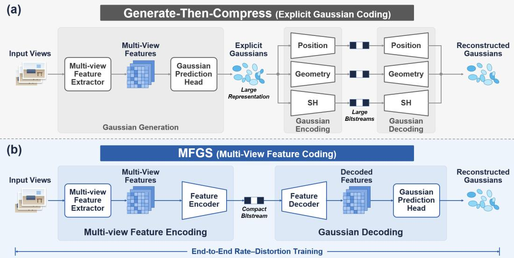  
Figure 1: Comparison of 3D scene coding pipelines. (a) Generate-then-compress predicts explicit Gaussians and encodes their attributes through specialized paths, limiting joint compression of geometry and appearance. Non-differentiable operations such as G-PCC also hinder end-to-end training. (b) The MFGS framework compresses multi-view features with an established learned image codec and predicts Gaussian attributes from the decoded features at the receiver. This unified path simplifies coding, exploits cross-attribute redundancy, and enables end-to-end rate–distortion training, while compact latent grids reduce computation.

FCGS also requires repeated spatial and channel context evaluations over per-Gaussian latents and sequential decoding across context groups, increasing coding latency.

We propose the multi-view feature coding for Gaussian splatting (MFGS) framework for endto-end feed-forward 3D scene coding. Our base model, MFGS-Base, encodes multi-view features and predicts all Gaussian attributes from the decoded features at the receiver (Figure 1). Each feature plane has the same 3D tensor structure as an image, allowing us to use an established learned image codec. The shared coding path simplifies the architecture and exploits redundancy between geometry and appearance. Together with end-to-end joint rate–distortion training, this design improves rate–distortion performance while reducing computation, memory usage, and runtime relative to the generatethen-compress baseline (Figure 2).

Receiver devices vary in computational capacity, while interactive viewing requires rendering within a per-frame time budget. To accommodate these constraints, our adaptive model, MFGS-Adaptive, combines importance-guided bit allocation with receiver-side Gaussian selection. At each rate point, the receiver can adjust the number of rendered Gaussians from a single bitstream to match its rendering capacity.

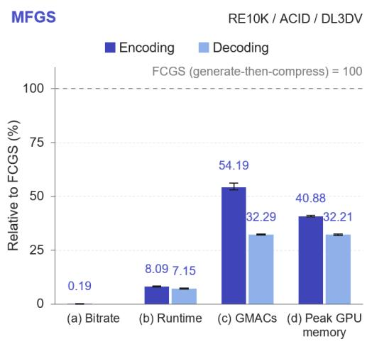  
Figure 2: Relative bitrate and complexity of MFGS-Base versus FCGS  
(generate-then-compress), using the same generator architecture (Section 4.2). FCGS is normalized to 100%; lower is better. (a) Bitrate at comparable quality; (b) runtime, (c) GMACs, and (d) peak GPU memory. Panels (b)–(d) distinguish encoding and decoding. Bars show means across datasets; whiskers span their minima and maxima.

Our main contributions are summarized as follows:

• We introduce the MFGS framework as an alternative to generate-then-compress for feedforward 3D scene coding. By encoding multi-view features and reconstructing Gaussians at the receiver, the framework unifies attribute-specific coding paths, enabling joint compression of geometry and appearance and end-to-end rate–distortion optimization.

• We instantiate the proposed framework in the MFGS-Base model and demonstrate substantial bitrate savings together with lower computation, peak GPU memory, and runtime than the generate-then-compress baseline across RE10K, ACID, and DL3DV. The joint reduction in bitrate and processing time supports the potential of multi-view feature coding for 3D live streaming.

• We extend the baseline with the MFGS-Adaptive model, enabling receiver-side adjustment of the number of rendered Gaussians from a single bitstream. Experiments demonstrate limited quality degradation across rendering budgets, allowing a shared bitstream to serve receivers with different rendering capacities.

## 2 Related Work

## 2.1 Optimization-based 3DGS compression

Optimization-based 3DGS compression methods optimize a compact Gaussian representation separately for each scene. HAC [Chen et al., 2024a] models the relationship between unstructured anchors and a structured hash grid, while HAC++ [Chen et al., 2025b] further captures dependencies among attributes within each anchor. ContextGS [Wang et al., 2024b] introduces a hierarchical autoregressive context model across anchor levels. CompGS [Navaneet et al., 2024] applies K-means-based vector quantization while optimizing the Gaussian parameters, whereas RDO-Gaussian [Wang et al., 2024a] combines pruning and entropy-constrained vector quantization under a rate–distortion objective. These methods achieve strong compression performance but require scene-specific optimization, limiting their use in live applications.

## 2.2 Feed-forward 3DGS generation

Feed-forward 3DGS methods predict explicit Gaussian primitives from input multi-view images without per-scene optimization. pixelSplat [Charatan et al., 2024] models Gaussian depth using a probabilistic parameterization, while MVSplat [Chen et al., 2024b] estimates depth using planesweep cost volumes. DepthSplat [Xu et al., 2025] further combines multi-view cost volumes with features from a pretrained monocular depth model. MonoSplat [Liu et al., 2025] adapts monocular depth features into multi-view representations, whereas TranSplat [Zhang et al., 2025] combines confidence-guided feature matching with monocular depth priors. ZPressor [Wang et al., 2025] aggregates information from support views into a compact anchor-view latent representation, improving scalability to dense input views.

## 2.3 Feed-forward 3DGS compression

FCGS [Chen et al., 2025a] encodes an existing Gaussian representation without scene-specific fine-tuning using a multi-path entropy module and inter- and intra-Gaussian context models. The MPEG-GSC test model TMCV [Ricard et al., 2025] also provides coding tools for explicit Gaussian parameters. These codecs retain the generated Gaussians as the coded representation, so coding operates on explicit geometry and appearance attributes. In contrast, our approach moves coding before Gaussian prediction and jointly compresses the shared information in an image-like multi-view feature representation.

## 2.4 Gaussian pruning

Gaussian pruning reduces the number of primitives, thereby lowering storage and rasterization costs. LightGaussian [Fan et al., 2024] ranks Gaussians using a global significance score computed over the training views and removes the least significant primitives. It then recovers rendering quality through SH distillation with pseudo views and applies vector quantization. PUP-3DGS [Hanson et al., 2025] uses a second-order approximation of reconstruction sensitivity with respect to the spatial parameters of each Gaussian and applies a multi-round prune–refine procedure. EcoSplat [Park et al., 2025] introduces a two-stage training scheme for feed-forward 3DGS. It first learns pixel-aligned Gaussian prediction and then ranks and adjusts the predicted primitives according to a target primitive count.

## 2.5 Learned image compression

Learned image compression uses neural analysis and synthesis transforms, quantized latent representations, and entropy models trained under a rate–distortion objective. The scale hyperprior model [Ballé et al., 2018] predicts spatially varying scale parameters for the latent distribution. Joint autoregressive and hierarchical priors [Minnen et al., 2018] combine a hierarchical prior with causal autoregressive context to improve entropy modeling. Attention-based image compression [Cheng et al., 2020] uses discretized Gaussian mixture likelihoods to model the latent distribution. AuxT [Li et al., 2025] introduces wavelet-based linear shortcuts that support feature decorrelation and energy modulation, accelerating the training of nonlinear transforms.

## 3 Method

## 3.1 System formulation

Let ${ \cal I } _ { \mathrm { i n } } = \{ ( I _ { i } , \Pi _ { i } ) \} _ { i = 1 } ^ { C }$ denote a set of $C$ sparse input views, where $I _ { i }$ and Πi are the RGB image and camera parameters of view $i ,$ respectively. Given $I _ { \mathrm { i n } }$ , our goal is to transmit a compact bitstream B from which the receiver reconstructs a Gaussian representation $\hat { G }$ for novel-view synthesis.

Conventional feed-forward compression follows a generate-then-compress pipeline:

$$
\begin{array} { r l } { ~ } & { { } I _ { \mathrm { i n } } \xrightarrow { \mathrm { m u l t i - v i e w f e a t u r e } } \atop { \mathrm { e x t r a c t i o n } } } _ { } F \xrightarrow { \mathrm { G a u s s i a n p r e d i c t i o n } } ; G \xrightarrow { \mathrm { G a u s s i a n e n c o d i n g } } \textit { B } \xrightarrow { \mathrm { G a u s s i a n d e c o d i n g } } \hat { G } .  \end{array}
$$

The sender generates an explicit Gaussian representation $( I _ { \mathrm { i n } } \to G )$ before encoding it into a bitstream $( G \to B )$ . $\check { F }$ denotes the multi-view features extracted from $I _ { \mathrm { i n } }$ before Gaussian prediction.

The MFGS framework instead encodes the multi-view features and performs Gaussian prediction at the receiver:

$$
I _ { \mathrm { i n } } \xrightarrow [ ] { \mathrm { m u l t i - v i e w f e a t u r e } } \ : F \xrightarrow [ ] { \mathrm { m u l t i - v i e w f e a t u r e } } \ : B \xrightarrow [ ] { \mathrm { m u l t i - v i e w f e a t u r e } } \ : \hat { F } \xrightarrow [ ] { \mathrm { G a u s s i a n p r e d i c t i o n } } \ : \hat { G } .
$$

The receiver decodes the multi-view features from the bitstream $( B \to { \hat { F } } )$ before predicting the Gaussian attributes $( { \hat { F } } \to { \hat { G } } )$ . The transmitted representation can therefore be optimized jointly for the geometry and appearance needed for rendering.

Figure 3 summarizes the two models within the MFGS framework. The MFGS-Base model implements end-to-end multi-view feature coding, while the MFGS-Adaptive model extends it to support adjustable rendering budgets at the receiver.

## 3.2 End-to-end multi-view feature coding (MFGS-Base model)

The MFGS-Base model is designed to improve compression efficiency while simplifying the coding process. Whereas generate-then-compress pipelines encode the attributes of spatially unstructured Gaussians through separate coding paths, MFGS-Base encodes multi-view features on regular imagelike grids. This representation supports a unified codec whose entropy model operates on compact, downsampled latents, reducing computation and memory usage. End-to-end rate–distortion training further enables the codec to exploit redundancy between geometry and appearance within this unified coding path.

Gaussian generator and multi-view features. We instantiate the generator with MVSplat [Chen et al., 2024b], extended with ZPressor [Wang et al., 2025]. Regardless of the number $C$ of input views, ZPressor aggregates them into a fixed number V of cluster-view planes, forming the multiview features $F _ { ; }$ , each plane of which has the spatial dimensions $H \times { \dot { W } }$ of the input multi-view images. Since the Gaussian prediction head produces one Gaussian per spatial location, this yields $N \overset { = } { V } H W$ Gaussians, independent of C. We denote the generator’s multi-view feature extractor and Gaussian prediction head by f and ψ, respectively. The MFGS-Base model inserts a multi-view feature codec at the interface between them: the sender applies $f$ and encodes F, while the receiver decodes $\hat { F }$ and applies ψ to obtain ${ \hat { G } } = \psi ( { \hat { F } } )$ for rendering. More architectural details are deferred to Appendix A.1.

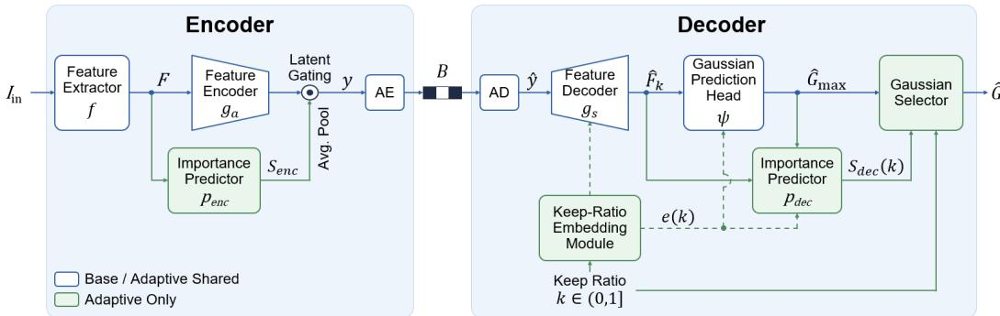  
Figure 3: Overview of the MFGS framework from multi-view feature extraction through Gaussian reconstruction. The sender extracts F from sparse input views and encodes it into a bitstream, while the receiver decodes $\hat { F }$ and predicts Gaussian primitives. The MFGS-Adaptive model additionally supports importance-guided bit allocation and receiver-side Gaussian selection. Green modules are specific to the MFGS-Adaptive model. AE and AD denote arithmetic encoding and decoding, respectively.

Multi-view feature codec and entropy model. Each multi-view feature plane is a threedimensional tensor indexed by channel, height, and width, with the same regular spatial layout as an image. This allows us to use an established learned image codec, specifically the mean-scale hyperprior (MSH) of Minnen et al. [2018], extended with AuxT [Li et al., 2025]. To accommodate the multi-view features, we adjust the input channels of the analysis transform $g _ { a }$ and the output channels of the synthesis transform $g _ { s }$ from three RGB channels to 133 feature channels. The spatial transform structure and hyperprior entropy model are retained. We apply the same codec to all feature planes and train it under the end-to-end rate–distortion objective.

The analysis transform $g _ { a }$ maps $F$ to a latent $y ,$ and the hyper-analysis transform $h _ { a }$ maps y to a hyper-latent z. Entropy coding operates on the quantized latents, where Q denotes quantization:

$$
y = g _ { a } ( F ) , \quad z = h _ { a } ( y ) , \qquad \hat { y } = Q ( y ) , \quad \hat { z } = Q ( z ) .\tag{1}
$$

The hyper-synthesis transform $h _ { s }$ predicts the parameters of the conditional model on $\hat { y } .$

$$
( \mu , \sigma ) = h _ { s } ( \hat { z } ) , \qquad p _ { \hat { y } | \hat { z } } ( \hat { y } \mid \hat { z } ) = \prod _ { j } p _ { j } ( \hat { y } _ { j } \mid \mu _ { j } , \sigma _ { j } ) ,\tag{2}
$$

where each $p _ { j }$ is the probability mass of a discretized Gaussian conditional. At inference, zˆ is coded under a learned entropy bottleneck $p _ { \hat { z } }$ , and $\hat { y }$ under $p _ { \hat { y } | }$ . The synthesis transform $g _ { s }$ then reconstructs the multi-view features, and the prediction head produces the Gaussians used for rendering,

$$
\hat { F } = g _ { s } ( \hat { y } ) , \qquad \hat { G } = \psi ( \hat { F } ) .\tag{3}
$$

Layer-level codec details are deferred to Appendix A.1.

Training objective. MFGS-Base is trained end-to-end with a rate–distortion loss. The normalized rate term is

$$
R = \frac { 1 } { Z } \mathbb { E } \bigl [ - \log _ { 2 } p _ { \hat { y } | \hat { z } } ( \hat { y } \mid \hat { z } ) - \log _ { 2 } p _ { \hat { z } } ( \hat { z } ) \bigr ] .\tag{4}
$$

The log-probability terms account for all quantized symbols in the scene bitstream, and $Z$ is the number of scalar attributes in the full Gaussian representation used for normalization. During training, we use a set of U target image–camera pairs, $I _ { \mathrm { t g t } } \dot { = } \{ ( I _ { u } , \Pi _ { u } ) \} _ { u = 1 } ^ { U }$ , for rendering supervision, where

$I _ { u }$ is the ground-truth image observed from target camera $\Pi _ { u }$ . For any set of Gaussian primitives $G ^ { \prime }$ the distortion is measured in image space as

$$
D ( G ^ { \prime } ) = \frac { 1 } { U } \sum _ { u = 1 } ^ { U } \left[ \mathrm { M S E } ( \mathcal { R } ( G ^ { \prime } , \Pi _ { u } ) , I _ { u } ) + \alpha \mathrm { ~ L P I P S } ( \mathcal { R } ( G ^ { \prime } , \Pi _ { u } ) , I _ { u } ) \right] ,\tag{5}
$$

where R denotes differentiable Gaussian rasterization and α weights the LPIPS perceptual term [Zhang et al., 2018]. MFGS-Base renders the full decoded set, so its objective reduces to

$$
\mathcal { L } _ { \mathrm { b a s e } } = D ( \hat { G } ) + \lambda R ,\tag{6}
$$

where $\lambda$ controls the operating point. The rate term and rendering loss jointly supervise the information used to predict geometry and appearance, allowing the multi-view feature representation and codec to adapt together.

## 3.3 Decode-time budget adaptation (MFGS-Adaptive model)

The MFGS-Adaptive model extends MFGS-Base to accommodate receivers with different rendering capacities. Unlike post-hoc pruning, it jointly optimizes feature coding, budget-conditioned reconstruction, and Gaussian selection using the additional modules shown in green in Figure 3. Training across keep ratios $k \in ( 0 , 1 ]$ ] limits quality degradation as the rendering budget decreases. At each trained rate point, the bitstream remains independent of $k ,$ allowing the receiver to adjust rendering cost after transmission.

Keep-ratio-conditioned reconstruction. The keep ratio k is mapped to an embedding $e ( k )$ using a sinusoidal encoding [Vaswani et al., 2017] followed by a two-layer MLP. Through feature-wise linear modulation (FiLM) [Perez et al., 2018], e(k) conditions the synthesis transform and Gaussian prediction head:

$$
\hat { F } _ { k } = g _ { s } ( \hat { y } , e ( k ) ) , \qquad \hat { G } _ { \mathrm { m a x } } = \psi ( \hat { F } _ { k } , e ( k ) ) .\tag{7}
$$

The same embedding also conditions the decoder-side importance predictor described below. The prediction head produces the full, maximum-budget candidate set $\hat { G } _ { \mathrm { m a x } }$ , containing $N = V H W$ Gaussians. The receiver retains $K = \lfloor k N \rfloor$ of these candidates for the requested rendering budget.

Importance-guided coding and selection. Separate importance predictors guide bit allocation at the sender and candidate ranking at the receiver:

$$
S _ { \mathrm { e n c } } = p _ { \mathrm { e n c } } ( F ) , \qquad S _ { \mathrm { d e c } } ( k ) = p _ { \mathrm { d e c } } \left( \hat { F } _ { k } , \hat { G } _ { \mathrm { m a x } } , e ( k ) \right) ,\tag{8}
$$

where $S _ { \mathrm { e n c } } , S _ { \mathrm { d e c } } ( k ) \in [ 0 , 1 ] ^ { V \times H \times W }$ . Since y has a lower spatial resolution than $S _ { \mathrm { e n c } } ,$ we apply the pooled encoder map as a latent gate, $y  y \odot$ pool $( S _ { \mathrm { e n c } } )$ , before quantization and entropy coding. This operation assigns more bits to locations that are likely to contribute to the retained Gaussians. The importance map itself is not transmitted.

After decoding, the receiver predicts $S _ { \mathrm { d e c } } ( k )$ and retains the K highest-ranked candidates:

$$
\hat { G } = \mathrm { T o p } _ { K } \left( \hat { G } _ { \mathrm { m a x } } , S _ { \mathrm { d e c } } ( \boldsymbol k ) \right) , \qquad K = \lfloor \boldsymbol k N \rfloor .\tag{9}
$$

During training, we use a temperature-controlled top-K relaxation; at inference, we apply the hard top- $. K$ selection in the equation above.

Training objective. The encoder-side map is learned through the gated rate–distortion path. To train the receiver-side predictor, we treat this map as a stop-gradient target and sample $k \sim p ( k )$ during training:

$$
\begin{array} { l } { \displaystyle \mathcal { L } _ { \mathrm { i m p } } ( k ) = \frac { 1 } { N } \left\| S _ { \mathrm { d e c } } ( k ) - \mathrm { s g } ( S _ { \mathrm { e n c } } ) \right\| _ { 2 } ^ { 2 } , } \\ { \displaystyle \mathcal { L } _ { \mathrm { a d a p t } } = \mathbb { E } _ { k \sim p ( k ) } \Big [ D ( \hat { G } ) + \beta \mathcal { L } _ { \mathrm { i m p } } ( k ) \Big ] + \lambda R , } \end{array}\tag{10}
$$

where $\operatorname { s g } ( \cdot )$ denotes the stop-gradient operator and $\beta$ weights importance alignment. The objective evaluates distortion after top-K selection and trains the model across a range of rendering budgets. Training and architecture details are provided in Appendices A.1 and A.2.

## 4 Experiments

## 4.1 Experimental setup

We train the MFGS-Base and MFGS-Adaptive models on RealEstate10K (RE10K) [Zhou et al., 2018] using 12 input views and 8 target views per scene at a resolution of 256 × 256. We evaluate the trained checkpoints in-domain on RE10K and conduct cross-dataset evaluation without datasetspecific fine-tuning on ACID [Liu et al., 2021] and DL3DV [Ling et al., 2024], using 8 input views for RE10K and ACID and 12 for DL3DV, with 8 target views for all three datasets. We train each model separately for each λ ∈ {0.0256, 0.1024, 0.4096, 1.6384}. By default, we use 6 cluster views, yielding 393,216 Gaussians per scene. We report PSNR, LPIPS, arithmetic-coded bitstream size, and BD-rate [Bjøntegaard, 2001]. Additional evaluation details are provided in Appendix A.3.

## 4.2 MFGS-Base model results

Comparison with generate-then-compress baselines. We compare the MFGS-Base model with two generate-then-compress baselines, FCGS and the MPEG-GSC test model TMCV. Both compress the explicit output of a standalone MVSplat+ZPressor Gaussian generator, trained without a codec.

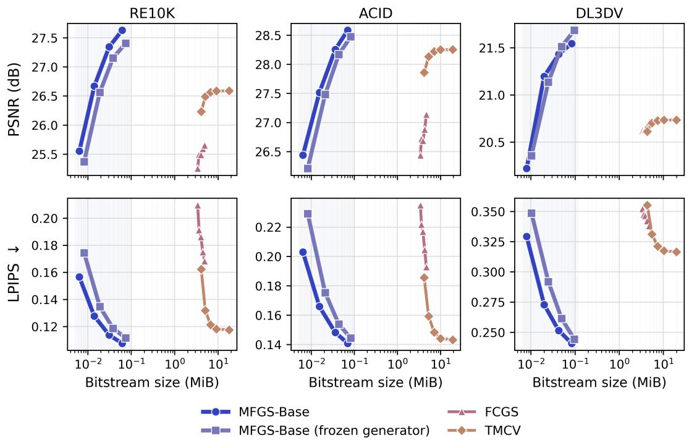  
Figure 4: Rate–distortion curves for the MFGS-Base model, its frozen-generator variant, FCGS, and TMCV on RE10K, ACID, and DL3DV. The horizontal axis shows scene bitstream size on a logarithmic scale.

MFGS-Base achieves reconstruction quality comparable to FCGS and TMCV at substantially lower bitrates (Figure 4). Relative to FCGS, its BD-rates are −99.86%, −99.80%, and −99.76% on RE10K, ACID, and DL3DV, respectively (Table 1). To assess the contribution of end-to-end optimization, we also train only the codec while keeping the Gaussian generator frozen. This variant retains most of the coding gain, with joint training providing further bitrate reductions of 33.9%, 29.5%, and 20.5% on the three datasets, respectively. The PSNR standard deviation across random seeds is at most 0.12 dB (Appendix A.4). A comparison with multi-view image coding (MIV) is provided in Appendix A.9. These results support multi-view features as an effective coding target and demonstrate the additional benefit of joint representation and codec optimization.

Qualitative comparison. Figure 5 presents a qualitative comparison at operating points selected to reduce PSNR differences within the evaluated rate ranges. We use the highest-rate trained setting for

FCGS  
MFGS-Base  
TMCV  
Table 1: BD-rate (%) relative to FCGS (lower is better), using identical scene sets across all methods and rate points within each dataset (Appendix A.3). The MFGS-Adaptive model is evaluated at the full Gaussian budget (k = 1).
<table><tr><td>Method</td><td>RE10K</td><td>ACID</td><td>DL3DV</td></tr><tr><td>FCGS TMCV</td><td>0.00</td><td>0.00</td><td>0.00 +14.59</td></tr><tr><td></td><td></td><td></td><td></td></tr><tr><td>MFGS-Base MFGS-Adaptive (k = 1.0)</td><td>-99.86 -99.84</td><td>-99.80 -99.80</td><td>-99.76 -99.77</td></tr></table>

–: no common PSNR interval for TMCV on RE10K/ACID.

MFGS-Base (λ = 0.0256) and the lowest-rate evaluated settings for FCGS (λ = 0.0016) and TMCV (attribute QP 32, position QP 0). The reconstructions have similar visual quality, although MFGS-Base uses 43–107× smaller bitstreams than the baselines. These examples show that substantial bitrate savings can be achieved while preserving the main visual structure of the reconstructed views.

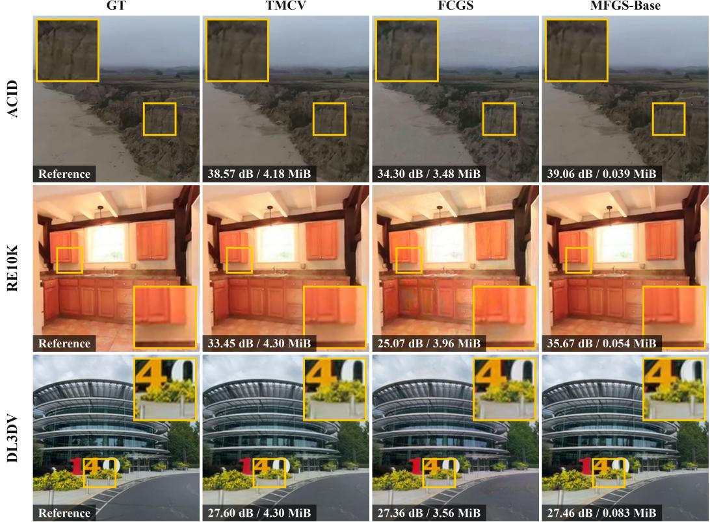  
Figure 5: Target-view reconstructions on ACID, RE10K, and DL3DV. FCGS and TMCV compress the output of the standalone MVSplat+ZPressor generator. Yellow boxes mark regions enlarged in the insets. Each panel reports target-view PSNR and the complete scene bitstream size.

Complexity comparison. We compare the complexity of the MFGS-Base model and the MVSplat+FCGS generate-then-compress pipeline (Table 2), with Gaussian generation by MVSplat+ZPressor included in the baseline encoding stage. For MVSplat+FCGS, runtime includes G-PCC execution, whereas all other reported complexity metrics—GMACs, peak GPU memory, and parameter counts—exclude G-PCC. Since G-PCC performs non-learned geometry coding, parameter counts alone do not characterize the complexity of the complete pipeline. Despite the exclusion of G-PCC from the non-runtime metrics, MFGS-Base requires less than half the combined encoding and decoding GMACs and reduces peak GPU memory by approximately 60–70% across the two stages, averaged over the three datasets. MFGS-Base also achieves an approximately 12× end-to-end speedup. These gains reflect the structure of entropy modeling in MFGS-Base, which predicts entropy parameters for all main-latent locations in a single pass over compact, downsampled multi-view grids. In contrast, FCGS requires repeated spatial and channel context evaluations over per-Gaussian latents and sequential decoding across spatial and channel groups. A module-wise analysis and the measurement protocol are provided in Appendix A.7. The substantial end-to-end speedup, combined with the bitrate savings, supports the potential of the MFGS framework for 3D live streaming, where the processing delay of generate-then-compress pipelines can limit timely reconstruction and delivery.

Table 2: Encoding and decoding complexity at 256×256 on RTX 3090 GPUs. Values are averaged across RE10K, ACID, and DL3DV. Measurements use 100 randomly sampled test scenes from each of RE10K and ACID and the full DL3DV test set. MVSplat+FCGS includes MVSplat+ZPressor generation. For MVSplat+FCGS, only runtime includes G-PCC execution; all other complexity metrics (GMACs, peak GPU memory, and parameters) exclude G-PCC. Parameters count learned weights only, in millions (M); G-PCC has no learned weights. Ratio denotes MFGS-Base divided by MVSplat+FCGS. Encoding and decoding exclude rendering. Operating points are λ = 0.0256 for MFGS-Base and λ = 0.0016 for MVSplat+FCGS.
<table><tr><td></td><td colspan="4">Encoding</td><td colspan="4">Decoding</td></tr><tr><td>Method</td><td>GMACs↓</td><td>Peak (MiB)↓</td><td>Params. (M)</td><td>Runtime (s)↓</td><td>GMACs↓</td><td>Peak (MiB)↓</td><td>Params. (M)</td><td>Runtime (s)↓</td></tr><tr><td>MVSplat+FCGS</td><td>1,601.30</td><td>8502.66</td><td>15.83</td><td>3.694</td><td>895.62</td><td>3971.57</td><td>2.19</td><td>2.683</td></tr><tr><td>MFGS-Base</td><td>868.89</td><td>3475.75</td><td>27.78</td><td>0.299</td><td>289.17</td><td>1279.27</td><td>13.75</td><td>0.192</td></tr><tr><td>Ratio</td><td>0.543×</td><td>0.409×</td><td>1.75×</td><td>0.081×</td><td>0.323×</td><td>0.322×</td><td>6.29×</td><td>0.072×</td></tr></table>

Generalization across different Gaussian generators. To assess whether the coding gains obtained with MVSplat and ZPressor extend to other Gaussian generators, we evaluate the MFGS-Base model with MonoSplat and TranSplat. For each generator, we train a separate model on RE10K and evaluate it on ACID in a two-view setting. The matched generate-then-compress baseline applies FCGS to the same generator’s explicit Gaussian output. MFGS-Base achieves BD-rate reductions of 99.62% and 99.60% relative to these baselines with MonoSplat and TranSplat, respectively (Figure 6). Additional evaluation details are provided in Appendix A.3. These consistent gains indicate that the coding advantage of the MFGS framework is not tied to a specific Gaussian generator.

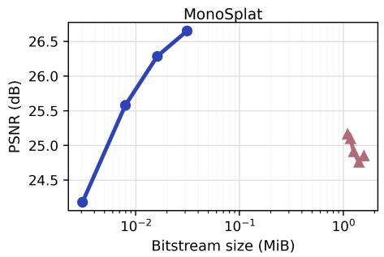

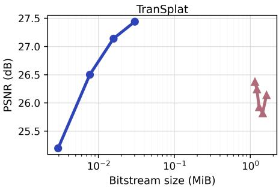  
FCGSMFGS-Base  
Figure 6: Rate–distortion comparison of the MFGS-Base model and matched FCGS baselines on ACID with MonoSplat and TranSplat.

## 4.3 MFGS-Adaptive model results

Comparison with post-hoc pruning. We compare the MFGS-Adaptive model with the post-hoc pruning methods LightGaussian and PUP-3DGS. For a controlled comparison, both post-hoc methods rank the same Gaussians reconstructed by MFGS-Base, without retraining. As shown in Figure 7, MFGS-Adaptive maintains substantially higher reconstruction quality as k decreases. Encoderside latent gating stabilizes reconstruction quality across rendering budgets. In the ablation study, removing gating widens the PSNR range across $k \in \{ 0 . 2 , 0 . 4 , 0 . 6 , 0 . 8 , 1 . 0 \}$ at each rate point from 0.1–1.0 dB to 0.6–1.6 dB. The minimum PSNR across these budgets decreases by up to 1.4 dB. Details of the ablation study and post-hoc pruning settings are provided in Appendix A.5. These results indicate that the budget-conditioned architecture and training make reconstruction robust to changes in Gaussian count, limiting quality degradation across the evaluated rendering budgets.

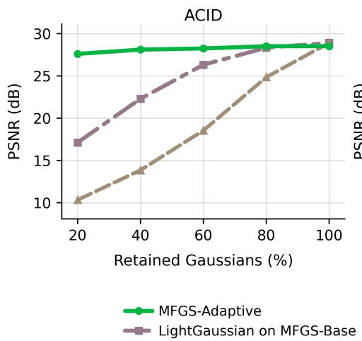

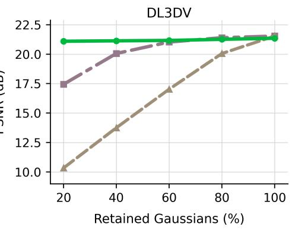  
Figure 7: PSNR comparison between the MFGS-Adaptive model and post-hoc pruning baselines across Gaussian keep ratios on ACID and DL3DV at λ=0.0256. LightGaussian and PUP-3DGS are applied to the Gaussians reconstructed by the MFGS-Base model.

Qualitative comparison. Figure 8 shows reconstructed views at different Gaussian keep ratios. The post-hoc baselines develop dark gaps and fragmented surfaces around the statue and facade at low keep ratios. MFGS-Adaptive retains the main structure even at $k = 0 . 2$ , although fine details vary with the budget. This supports jointly training reconstruction and selection to preserve scene structure under tight rendering budgets.

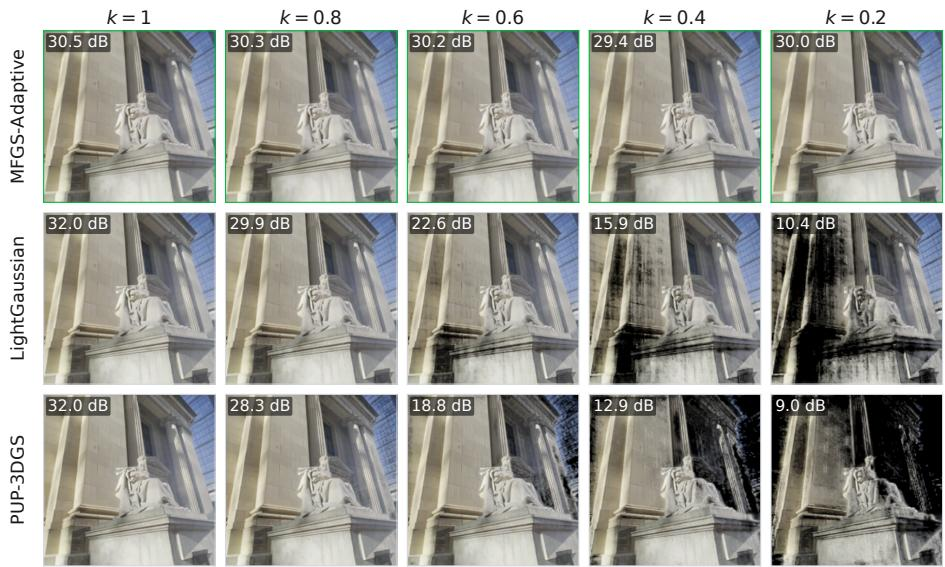  
Figure 8: Qualitative pruning comparison on DL3DV across Gaussian keep ratios. Rows show the MFGS-Adaptive model and post-hoc pruning baselines at $\lambda = 0 . 0 2 5 6$ , and columns show k decreasing from 1.0 to 0.2. Each panel reports PSNR with respect to the ground-truth target image.

Scene-level Gaussian selection. We analyze Gaussian selection and reconstruction at different budgets (Figure 9). MFGS-Adaptive preserves the overall scene structure, while excluded Gaussians cluster spatially and rendering changes concentrate along mountain ridges and slopes, with smaller differences over the sea. Since the keep ratio conditions reconstruction and selection jointly, the retained Gaussian sets need not be nested. Further analysis of importance-guided bit allocation is provided in Appendix A.6. This example supports adapting reconstruction and selection together to reduce the Gaussian count while preserving global scene structure.

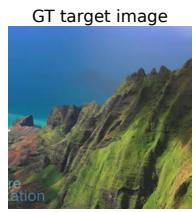

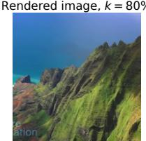

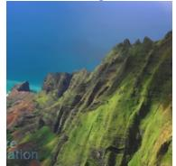

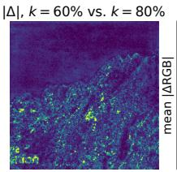

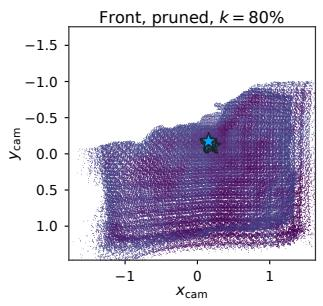

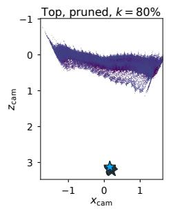

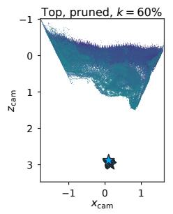  
Figure 9: Scene-level Gaussian selection on ACID. The top row shows the ground-truth target image, reconstructions at k=0.8 and k=0.6 from the same bitstream, and their mean absolute RGB difference. The bottom row shows camera-aligned orthographic projections of excluded Gaussians, colored by decoder-side importance percentile within the full candidate set at each budget. Blue star mark the reference input-camera center.

## 5 Conclusion

We presented the MFGS framework as an alternative to generate-then-compress for end-to-end feed-forward 3D scene coding. It encodes multi-view features that jointly represent geometry and appearance and reconstructs Gaussians from the decoded features at the receiver. The MFGS-Base model uses an established learned image codec to exploit cross-attribute redundancy through end-to-end rate–distortion training. This design improves compression efficiency while reducing computation, memory usage, and runtime. The MFGS-Adaptive model further enables the receiver to adjust the number of rendered Gaussians from a single bitstream at each trained rate point, accommodating different rendering capacities with limited quality degradation.

Across RE10K, ACID, and DL3DV, MFGS-Base achieves an approximately 500× bitrate reduction based on average BD-rate, roughly halves total GMACs, and runs about 12× faster end to end than the generate-then-compress baseline. This bitrate advantage also extends to other Gaussian generators, suggesting that the effectiveness of the MFGS framework is not tied to a specific generator. At reduced rendering budgets, MFGS-Adaptive preserves quality more effectively than the evaluated post-hoc pruning methods, even when retaining only 20% of the Gaussians. These results support the MFGS framework as a promising approach to low-latency 3D scene delivery.

## 6 Future Work

These findings are based on sparse input views at low resolution, primarily in a narrow-angle setting, and extending the framework to higher resolutions and wider camera coverage requires further investigation. Since the multi-view features are learned jointly with the Gaussian generator, deploying the framework with a different generator also requires offline retraining. At reduced rendering budgets, MFGS-Adaptive still predicts the full Gaussian candidate set before selection, so lowering the keep ratio reduces rendering cost but not decoding cost; decoding strategies whose computation scales with the rendering budget would remove this overhead. Finally, because the multi-view features share the regular layout of images, the framework extends naturally to video coding, where temporal prediction and entropy modeling could exploit redundancy across multi-view features over time.

## References

Johannes Ballé, David Minnen, Saurabh Singh, Sung Jin Hwang, and Nick Johnston. Variational image compression with a scale hyperprior. In ICLR, 2018.

Gisle Bjøntegaard. Calculation of average PSNR differences between RD-curves. Meeting contribution VCEG-M33, ITU-T Video Coding Experts Group (VCEG), Austin, Texas, USA, 2001.

Jill M. Boyce, Renaud Doré, Adrian Dziembowski, Julien Fleureau, Joel Jung, Bart Kroon, Basel Salahieh, Vinod Kumar Malamal Vadakital, and Lu Yu. MPEG immersive video coding standard. Proceedings ofthe IEEE, 109(9):1521–1536, 2021. doi: 10.1109/JPROC.2021.3062590.

Benjamin Bross, Ye-Kui Wang, Yan Ye, Shan Liu, Jianle Chen, Gary J. Sullivan, and Jens-Rainer Ohm. Overview of the versatile video coding (VVC) standard and its applications. IEEE Transactions on Circuits and Systemsfor Video Technology, 31(10):3736–3764, 2021. doi: 10.1109/TCSVT.2021. 3101953.

David Charatan, Sizhe Lester Li, Andrea Tagliasacchi, and Vincent Sitzmann. pixelSplat: 3D gaussian splats from image pairs for scalable generalizable 3D reconstruction. In CVPR, 2024.

Yihang Chen, Qianyi Wu, Weiyao Lin, Mehrtash Harandi, and Jianfei Cai. HAC: Hash-grid assisted context for 3D gaussian splatting compression. In ECCV, 2024a.

Yihang Chen, Qianyi Wu, Mengyao Li, Weiyao Lin, Mehrtash Harandi, and Jianfei Cai. Fast feedforward 3D gaussian splatting compression. In ICLR, 2025a.

Yihang Chen, Qianyi Wu, Weiyao Lin, Mehrtash Harandi, and Jianfei Cai. HAC++: Towards 100x compression of 3D gaussian splatting. IEEE Transactions on Pattern Analysis and Machine Intelligence, 2025b.

Yuedong Chen, Haofei Xu, Chuanxia Zheng, Bohan Zhuang, Marc Pollefeys, Andreas Geiger, Tat-Jen Cham, and Jianfei Cai. MVSplat: Efficient 3D gaussian splatting from sparse multi-view images. In ECCV, 2024b.

Zhengxue Cheng, Heming Sun, Masaru Takeuchi, and Jiro Katto. Learned image compression with discretized gaussian mixture likelihoods and attention modules. In CVPR, 2020.

Adrian Dziembowski and Bart Kroon. Common test conditions for MPEG immersive video. Technical Report N0659, ISO/IEC JTC 1/SC 29/WG 4, 2025. URL https://www.multimedia.edu.pl/ publications/N0659-Common-test-conditions-for-MPEG-immersive-video.pdf.

FAIR. fvcore: A lightweight core library for computer vision. Software package, version 0.1.5.post20221221, 2022. URL https://pypi.org/project/fvcore/0.1.5. post20221221/.

Zhiwen Fan, Kevin Wang, Kairun Wen, Zehao Zhu, Dejia Xu, and Zhangyang Wang. LightGaussian: Unbounded 3D gaussian compression with 15x reduction and 200+ fps. In NeurIPS, 2024.

Alex Hanson, Allen Tu, Vasu Singla, Mayuka Jayawardhana, Matthias Zwicker, and Tom Goldstein. PUP 3D-GS: Principled uncertainty pruning for 3D gaussian splatting. In CVPR, 2025.

Bernhard Kerbl, Georgios Kopanas, Thomas Leimkühler, and George Drettakis. 3D gaussian splatting for real-time radiance field rendering. ACM Transactions on Graphics, 42(4), 2023.

Diederik P. Kingma and Jimmy Ba. Adam: A method for stochastic optimization. In International Conference on Learning Representations, 2015.

Han Li, Shaohui Li, Wenrui Dai, Maida Cao, Nuowen Kan, Chenglin Li, Junni Zou, and Hongkai Xiong. On disentangled training for nonlinear transform in learned image compression. In ICLR, 2025.

Lu Ling, Yichen Sheng, Zhi Tu, Wentian Zhao, Cheng Xin, Kun Wan, Lantao Yu, Qianyu Guo, Zixun Yu, Yawen Lu, et al. DL3DV-10K: A large-scale scene dataset for deep learning-based 3D vision. In CVPR, 2024.

Andrew Liu, Richard Tucker, Varun Jampani, Ameesh Makadia, Noah Snavely, and Angjoo Kanazawa. Infinite nature: Perpetual view generation of natural scenes from a single image. In ICCV, 2021.

Yifan Liu, Keyu Fan, Weihao Yu, Chenxin Li, Hao Lu, and Yixuan Yuan. MonoSplat: Generalizable 3D gaussian splatting from monocular depth foundation models. In CVPR, 2025.

David Minnen, Johannes Ballé, and George Toderici. Joint autoregressive and hierarchical priors for learned image compression. In NeurIPS, 2018.

K. L. Navaneet, Kossar Pourahmadi Meibodi, Soroush Abbasi Koohpayegani, and Hamed Pirsiavash. CompGS: Smaller and faster gaussian splatting with vector quantization. In ECCV, 2024.

Jongmin Park, Minh-Quan Viet Bui, Juan Luis Gonzalez Bello, Jaeho Moon, Jihyong Oh, and Munchurl Kim. EcoSplat: Efficiency-controllable feed-forward 3D gaussian splatting from multi view images. arXiv preprint arXiv:2512.18692, 2025.

Ethan Perez, Florian Strub, Harm de Vries, Vincent Dumoulin, and Aaron Courville. FiLM: Visual reasoning with a general conditioning layer. In AAAI, 2018.

Julien Ricard, Gilles Teniou, and Stephan Wenger. [GSC] reference software proposal for 3D Gaussian splat compression using video in V3C bitstream. ISO/IEC JTC 1/SC 29/WG 7, Doc. m73254, 151st MPEG Meeting, Daejeon, Republic of Korea, June 2025.

Sebastian Schwarz, Marius Preda, Vittorio Baroncini, Madhukar Budagavi, Pablo César, Philip A. Chou, Robert A. Cohen, Maja Krivokuca, Sébastien Lasserre, Zhu Li, Joan Llach, Khaled Mammou,´ Rufael Mekuria, Ohji Nakagami, Ernestasia Siahaan, Ali J. Tabatabai, Alexis M. Tourapis, and Vladyslav Zakharchenko. Emerging MPEG standards for point cloud compression. IEEE Journal on Emerging and Selected Topics in Circuits and Systems, 9(1):133–148, 2019. doi: 10.1109/ JETCAS.2018.2885981.

Ashish Vaswani, Noam Shazeer, Niki Parmar, Jakob Uszkoreit, Llion Jones, Aidan N. Gomez, Lukasz Kaiser, and Illia Polosukhin. Attention is all you need. In NeurIPS, 2017.

Henan Wang, Hanxin Zhu, Tianyu He, Runsen Feng, Jiajun Deng, Jiang Bian, and Zhibo Chen. End-to-end rate-distortion optimized 3D gaussian representation. In ECCV, 2024a.

Weijie Wang, Donny Y. Chen, Zeyu Zhang, Duochao Shi, Akide Liu, and Bohan Zhuang. ZPressor: Bottleneck-aware compression for scalable feed-forward 3DGS. In NeurIPS, 2025.

Yufei Wang, Zhihao Li, Lanqing Guo, Wenhan Yang, Alex C. Kot, and Bihan Wen. ContextGS: Compact 3D gaussian splatting with anchor level context model. In NeurIPS, 2024b.

Haofei Xu, Jing Zhang, Jianfei Cai, Hamid Rezatofighi, Fisher Yu, Dacheng Tao, and Andreas Geiger. Unifying flow, stereo and depth estimation. IEEE Transactions on Pattern Analysis and Machine Intelligence, 45(11):13941–13958, 2023. doi: 10.1109/TPAMI.2023.3298645.

Haofei Xu, Songyou Peng, Fangjinhua Wang, Hermann Blum, Daniel Barath, Andreas Geiger, and Marc Pollefeys. DepthSplat: Connecting gaussian splatting and depth. In CVPR, 2025.

Chuanrui Zhang, Yingshuang Zou, Zhuoling Li, Minmin Yi, and Haoqian Wang. TranSplat: Generalizable 3D gaussian splatting from sparse multi-view images with transformers. In AAAI, 2025.

Richard Zhang, Phillip Isola, Alexei A. Efros, Eli Shechtman, and Oliver Wang. The unreasonable effectiveness of deep features as a perceptual metric. In CVPR, pages 586–595, 2018. doi: 10.1109/CVPR.2018.00068.

Tinghui Zhou, Richard Tucker, John Flynn, Graham Fyffe, and Noah Snavely. Stereo magnification: Learning view synthesis using multiplane images. In ACM SIGGRAPH, 2018.

## A Implementation details and additional results

## A.1 Architecture details

The multi-view feature extractor uses UniMatch [Xu et al., 2023] features and six transformer blocks. ZPressor projects the cost-volume representation to 128 multi-view feature channels and concatenates RGB, disparity, and the maximum depth probability, yielding $F \in \mathbb { R } ^ { V \times 1 3 3 \times H \times W }$ . The Gaussian prediction head refines these multi-view features with a U-Net and predicts Gaussian attributes, disparity corrections, and density values that are mapped to opacity. A camera-based Gaussian adapter converts depth and image-plane offsets into world-space centers and transforms the predicted scales and rotations into world-space covariances. Tables 3 and 4 summarize the multi-view feature codec and the additional modules used in MFGS-Adaptive.

In MFGS-Adaptive, the keep-ratio embedding provides FiLM conditioning to the synthesis transform, Gaussian prediction head, and decoder-side importance predictor. The encoder-side importance predictor receives F and a detached copy of its first RGB channel as an auxiliary input. The decoder side predictor receives the decoded multi-view features, the predicted density before opacity mapping, and nine raw channels from the Gaussian-attribute head encoding offsets, scales, and rotations. The density and geometry inputs are detached, preventing importance-prediction gradients from propagating through these auxiliary inputs.

Table 3: Multi-view feature-codec architecture. C and TC denote convolution and transposed convolution, respectively; $k / s$ gives the kernel size and stride. Latent tensor shapes are reported per ZPressor plane and omit the batch dimension.
<table><tr><td>Block</td><td>Main operation</td><td> $k / s$ </td><td>Channels</td><td>Output</td></tr><tr><td rowspan="3">Analysis  $g _ { a }$ </td><td> $\mathrm { C } + \mathrm { G D N }$ </td><td>5/2</td><td>133→192</td><td> $1 9 2 { \times } H / 2 { \times } W / 2$ </td></tr><tr><td> $\left[ \mathrm { C } + \mathrm { G D N } \right] \left( \times 2 \right)$ </td><td>5/2</td><td>192→192</td><td> $1 9 2 \times { \dot { H / 8 } } { \times } { \dot { W / 8 } }$ </td></tr><tr><td>C</td><td>5/2</td><td>192→320</td><td> $y _ { v } : 3 2 0 { \times } H / 1 6 { \times } W / 1 6$ </td></tr><tr><td rowspan="3">Hyper-analysis  $h _ { a }$ </td><td> $\mathrm { C } + \mathrm { L R e L U }$ </td><td>3/1</td><td>320→192</td><td> $1 9 2 \times H / 1 6 { \times } W / 1 6$ </td></tr><tr><td> $\mathrm { C } + \mathrm { L R e L U }$ </td><td>5/2</td><td>192→192</td><td> $1 9 2 \times H / 3 2 { \times } W / 3 2$ </td></tr><tr><td>C</td><td> $5 / 2$ </td><td>192→192</td><td> $z _ { v } : 1 9 2 \times H / 6 4 \times W / 6 4$ </td></tr><tr><td>Entropy bottleneck</td><td>quantize and arithmetic-code  $z _ { v }$   $\mathrm { T C } + \mathrm { L R e L U }$ </td><td>一</td><td>192</td><td> $\hat { z } _ { v } , \ B _ { z , v }$ </td></tr><tr><td rowspan="3">Hyper-synthesis  $h _ { s }$ </td><td> $\mathrm { T C } + \mathrm { L R e L U }$  C</td><td>5/2  $5 / 2$ </td><td>192→320 320→480</td><td> $3 2 0 { \times } H / 3 2 { \times } W / 3 2$   $4 8 0 { \times } H / 1 6 { \times } W / 1 6$ </td></tr><tr><td></td><td> $3 / 1$ </td><td>480→640</td><td> $\mu _ { v } , \sigma _ { v } :$ </td></tr><tr><td></td><td></td><td></td><td> $3 2 0 { \times } H / 1 6 { \times } W / 1 6$  each</td></tr><tr><td rowspan="3">Gaussian conditional</td><td>quantize and</td><td></td><td></td><td></td></tr><tr><td>arithmetic-code  $y _ { v }$ </td><td></td><td>320</td><td> $\hat { y } _ { v } , \ B _ { y , v }$ </td></tr><tr><td></td><td></td><td></td><td></td></tr><tr><td rowspan="3">Synthesis  $g _ { s }$ </td><td> $\mathrm { T C } + \mathrm { I G D N }$ </td><td>5/2</td><td>320→192</td><td> $1 9 2 \times H / 8 { \times } W / 8$ </td></tr><tr><td> $\left[ \mathrm { T C } + \mathrm { I G D N } \right] \left( \times 2 \right)$ </td><td></td><td></td><td></td></tr><tr><td>TC</td><td>5/2  $5 / 2$ </td><td>192→192 192→133</td><td> $1 9 2 { \times } H / 2 { \times } W / 2$   $\hat { F } _ { v } : ~ { 1 3 3 } { \times } H { \times } W$ </td></tr></table>

GDN/IGDN denote generalized divisive normalization and its inverse; LReLU denotes leaky ReLU. At every analysis or synthesis stage, a parallel wavelet linear shortcut (WLS) or its inverse (iWLS) is added to the listed main operation. Let $\mathsf { \bar { B } } _ { z } = \mathsf { \bar { \Omega } } \{ B _ { z , v } \} _ { v = 1 } ^ { V }$ and $\boldsymbol { B _ { y } } = \{ B _ { y , v } \} _ { v = 1 } ^ { V } ;$ the transmitted scene bitstream is $\boldsymbol { B } = ( B _ { z } , B _ { y } )$

Table 4: Additional modules used in the MFGS-Adaptive model. FiLM denotes feature-wise linear modulation.
<table><tr><td>Module</td><td>Input</td><td>Main operations</td><td>Output</td></tr><tr><td>Encoder importance</td><td>F and a detached copy</td><td> $\mathrm { C _ { 3 / 1 } ( 1 3 4 , 6 4 ) + R e L U }$ </td><td> $S _ { \mathrm { e n c } } :$ </td></tr><tr><td>Penc</td><td>of the first RGB channel</td><td> $\mathrm { C _ { 3 / 1 } ( 6 4 , 3 2 ) + R e L U }$   $\mathrm { C _ { 1 / 1 } ^ { \cdot } ( 3 2 , 1 ) + S i g m o i d }$ </td><td> $V \times H \times W$ </td></tr><tr><td>Latent gating</td><td> $y , S _ { \mathrm { e n c } }$ </td><td>average-pool  $S _ { \mathrm { e n c } }$  to the latent resolution elementwise modulation before</td><td>gated y</td></tr><tr><td>Keep-ratio embedding</td><td> $0 < k \leq 1$ </td><td>quantization sinusoidal encoding with 128 frequencies (256 dimensions) 256→256→256 MLP with SiLU FiLM conditioning of  $g _ { s } , \psi ,$  and pdec</td><td> $e ( k ) : 2 5 6$ </td></tr><tr><td>Decoder importance pdec</td><td> ${ \hat { F } } _ { k } ,$  detached density and geometry  $\mathrm { d e s c r i p t o r s } , e ( k )$ </td><td>two-layer convolutional trunk FiLM conditioning and Sigmoid head</td><td> $S _ { \mathrm { d e c } } ( k ) :$   $V { \times } \dot { H } { \times } W$ </td></tr><tr><td>Gaussian selection</td><td> $\hat { G } _ { \mathrm { m a x } } , S _ { \mathrm { d e c } } ( k ) , k$ </td><td>rank the N candidates by  $S _ { \mathrm { d e c } } ( k )$  temperature-controlled top-K relaxation during training</td><td> $\hat { G } \operatorname { w i t h }$   $K { = } \lfloor k N \rfloor$  Gaussians</td></tr></table>

## A.2 Training protocol

Training schedule. For the MVSplat+ZPressor models, training follows the four-stage schedule in Table 5. Generator pretraining and distortion warm-up precede joint rate–distortion training in Stage 3. The final MFGS-Base and MFGS-Adaptive models are initialized independently from the corresponding Stage 3 checkpoint, with only the multi-view feature extractor frozen during Stage 4. The frozen-generator variant in Figure 4 is instead initialized from the checkpoint at the end of Stage 2 and fixes both the multi-view feature extractor and Gaussian prediction head, optimizing only the multi-view feature codec for 60k iterations at each rate point.

<table><tr><td colspan="3">(a) Training schedule</td></tr><tr><td>Stage</td><td>Configuration</td><td>Steps</td></tr><tr><td>Stage 1: Generator pretraining</td><td>Train the feed-forward Gaussian generator from a pretrained UniMatch initialization</td><td>100k</td></tr><tr><td>Stage 2: Distortion warm-up</td><td>Initialize from Stage 1; train the generator and multi-view feature codec for reconstruction without a rate penalty</td><td>50k</td></tr><tr><td>Stage 3: Joint R-D</td><td>Initialize from Stage 2; jointly train the generator and multi-view</td><td>60k/rate</td></tr><tr><td>training Stage 4: MFGS-Base</td><td>feature codec for each λ Initialize from the corresponding Stage 3 checkpoint, freeze only the 60k/rate multi-view feature-extraction backbone, and optimize all remaining</td><td></td></tr><tr><td>Stage 4:</td><td>modules Initialize independently from the same Stage 3 checkpoint, freeze</td><td>60k/rate</td></tr><tr><td colspan="3"></td></tr><tr><td colspan="3">(b) Hyperparameters</td></tr><tr><td>Item</td><td>Value</td><td></td></tr><tr><td>Optimizer</td><td>Adam [Kingma and Ba,  $2 0 1 5 ] , \beta = ( 0 . 9 , 0 . 9 9 9 )$ </td><td></td></tr><tr><td>Base learning rate</td><td> $2 \times 1 0 ^ { - 4 }$  for  $\mathrm { S t a g e s ~ } 1 { - } 2 , 1 \times 1 0 ^ { - 4 }$  for Stages 3–4 2k-step linear warm-up in all stages</td><td></td></tr><tr><td>Learning-rate schedule</td><td>0.1× decay at step 50k in Stages  $_ { 3 - 4 }$ </td><td></td></tr><tr><td>Batch size</td><td>Stages 1–2: 4 scenes/GPU Stages 3–4: 1 scene/GPU on 4 GPUs</td><td></td></tr><tr><td>Training views</td><td>12 input views and 8 target views per scene</td><td></td></tr><tr><td>Image resolution</td><td>256 × 256 for reported experiments</td><td></td></tr><tr><td>Distortion loss</td><td>MSE + 0.05 LPIPS</td><td></td></tr><tr><td>Keep-ratio embedding</td><td>Sinusoidal encoding + MLP, 256 dimensions</td><td></td></tr><tr><td>Top-K relaxation</td><td>temperature increases linearly from 1.0 to 30.0 over the first 5k Stage 4 iterations</td><td></td></tr><tr><td>Importance alignment weight</td><td> $\beta = 0 . 1 \mathrm { f o r } \mathcal { L } _ { \mathrm { i m p } }$ </td><td></td></tr><tr><td>Gradient clipping</td><td>Global-norm clipping at 0.5</td><td></td></tr><tr><td>Hardware</td><td>4 NVIDIA RTX 3090 GPUs (24 GB each)</td><td></td></tr></table>

Table 5: Training schedule and hyperparameters for the MFGS-Base and MFGS-Adaptive models with MVSplat+ZPressor.  
Keep-ratio embedding, top-K relaxation, and importance alignment apply only to MFGS-Adaptive.

Keep-ratio sampling. During the first 5k iterations of MFGS-Adaptive Stage 4 training, the lower sampling bound decreases linearly from 1.0 to $k _ { \mathrm { m i n } } = 0 . 1$ . Thereafter, each iteration samples $k \sim \mathsf { \bar { U } } ( \bar { k _ { \mathrm { m i n } } } , 1 . 0 )$ . Evaluation uses fixed keep ratios within $[ k _ { \mathrm { m i n } } , 1 . 0 ]$

## A.3 Evaluation protocols

Main evaluation. The standard evaluation sets contain 7,067 RE10K, 1,810 ACID, and 140 DL3DV test scenes. For the rate–distortion comparisons in Figure 4 and Table 1, we retain scenes with completed evaluations and finite quality and bitstream-size measurements for every method and operating point, including the frozen-generator variant and MFGS-Adaptive at k = 1. This yields 6,235 RE10K, 1,597 ACID, and 140 DL3DV scenes, using identical input and target views for all methods. Reported rates and quality metrics are arithmetic means over this shared scene set, so the comparisons characterize the matched subset rather than the full test sets.

BD-rates in Table 1 are computed from these matched-scene curves by integrating piecewise cubic Hermite (PCHIP) interpolants of log bitstream size over the common PSNR interval of each method pair; no BD-rate is reported when the intervals do not overlap. The bitrate values in Figure 2 use the same BD-rates. Other experiments retain their stated evaluation sets.

FCGS implementation and scene exclusions. The FCGS rate–distortion results are obtained with the original FCGS implementation. Some scene–rate pairs could not be evaluated because of CUDA execution errors. We exclude any scene lacking a measurement at even one operating point from all compared methods and curves, rather than averaging each curve over a different scene set. Scene selection depends on measurement availability, not reconstruction quality.

Separate reproducibility checks identified encoder–decoder discrepancies in some completed FCGS runs, associated with floating-point differences in channel-context computation. This discrepancy also occurs with the original FCGS code and its specified PyTorch and CUDA versions. Completionbased filtering therefore does not certify bit-exact decoding for every retained scene; the reported curves characterize the original implementation in our evaluation setting. The fixed-tiling entropy computation used for complexity profiling is described separately in Appendix A.7.

Baseline settings. FCGS is evaluated at $\lambda \in \{ 0 . 0 0 0 1 , 0 . 0 0 0 2 , 0 . 0 0 0 4 , 0 . 0 0 0 8 , 0 . 0 0 1 6 \}$ in Figures 4 and 6. TMCV is evaluated at attribute $\mathsf { Q P } \in \{ \bar { 0 , } 8 , 1 6 , 2 4 , 3 2 \}$ with the position QP fixed to 0. In Figures 4 and 5, both baselines compress the Gaussians produced by the standalone MVSplat+ZPressor generator, trained without a codec.

Entropy-coding reproducibility. The encoder and decoder must compute matching entropy parameters $h _ { s } ( \hat { z } )$ to select identical probability-table indices. The rate–distortion, seed-robustness, and importance-allocation evaluations therefore use deterministic GPU settings, and each scene is re-encoded from its inputs with fixed trained weights and the unchanged bitstream format.

Gaussian-generator architecture evaluation. Each MonoSplat- and TranSplat-based MFGS-Base model is trained on RE10K with 2 input and 4 target views per scene and evaluated on ACID with 2 input and 3 target views. For each generator, we use a fixed ACID scene set across all four MFGS-Base and five FCGS operating points. Some runs did not complete all 1,595 scenes, so we retain only scenes with results for both methods at every operating point, yielding 1,560 scenes for MonoSplat and 1,418 for TranSplat. BD-rates are computed from these matched-scene curves using PCHIP interpolation over each method pair’s common PSNR interval, without extrapolation.

Importance analysis. The importance-allocation statistics use all 1,810 ACID test scenes at each rate point, with valid measurements for both encoder- and decoder-side rankings. At each spatial location in the main latent, we sum the entropy model’s negative log-probabilities across channels to estimate the coding cost. Encoder- and decoder-side importance maps are average-pooled to the same latent resolution. Locations from all multi-view feature planes are ranked together within each scene; bin costs are normalized by the scene’s total estimated y-stream cost before averaging across scenes.

Multi-view image coding. The MIV comparison uses the intersection of scenes successfully processed at every operating point of the MFGS-Base model and MIV: 7,066 RE10K, 1,809 ACID, and 140 DL3DV scenes.

## A.4 Random-seed robustness

To assess sensitivity to training randomness, we repeat the rate–distortion training of MFGS-Base with three random seeds at each rate point, keeping the pretrained multi-view feature extractor fixed. All runs are evaluated on RE10K at the same training step. As shown in Table 6, the across-seed standard deviation is 0.03–0.12 dB in PSNR and at most 3.11 KiB in bitstream size, indicating consistent rate–distortion behavior.

Table 6: Random-seed robustness of the MFGS-Base model on RE10K. Each row reports PSNR and full transmitted bitstream size for three independent training runs, evaluated on all 7,067 scenes. SD denotes the sample standard deviation.
<table><tr><td>λ</td><td>PSNR, three seeds (dB) PSNR mean±SD</td><td></td><td>Size, three seeds (KiB) Size mean±SD</td><td></td></tr><tr><td>0.0256</td><td>28.32 / 28.28 / 28.26</td><td> $2 8 . 2 9 \pm 0 . 0 3$ </td><td>63.24 / 68.45 / 68.79</td><td> $6 6 . 8 3 \pm 3 . 1 1$ </td></tr><tr><td>0.1024</td><td>27.99 / 27.88 / 27.91</td><td> $2 7 . 9 3 \pm 0 . 0 6$ </td><td>31.69 / 33.69 / 33.87</td><td> $3 3 . 0 8 \pm 1 . 2 1$ </td></tr><tr><td>0.4096</td><td>27.23 / 26.99 / 27.06</td><td> $2 7 . 0 9 \pm 0 . 1 2$ </td><td>14.15 / 15.46 / 15.54</td><td> $1 5 . 0 5 \pm 0 . 7 8$ </td></tr><tr><td>1.6384</td><td>26.08 / 25.89 / 25.85</td><td> $2 5 . 9 4 \pm 0 . 1 2$ </td><td>6.45 / 7.03 / 7.01</td><td> $6 . 8 3 \pm 0 . 3 3$ </td></tr></table>

## A.5 Pruning settings and latent-gating ablation

Post-hoc pruning settings. PUP-3DGS ranks Gaussians by a Fisher-information score that measures the sensitivity of rendered images to their spatial parameters. We compute this score with its CUDA rasterizer at the original image resolution, using a patch size of 1. LightGaussian uses deterministic pixel-contribution counts weighted by opacity and by normalized Gaussian volume raised to $v _ { \mathrm { p o w } } = 0 . 1$ . Both methods prune the Gaussians reconstructed by MFGS-Base, without per-scene fine-tuning, distillation, or post-pruning quantization.

Encoder-side latent-gating ablation. We compare the full MFGS-Adaptive model with a variant that omits encoder-side latent gating and the associated importance-alignment loss. Both retain keep-ratio conditioning and decoder-side selection and are trained from the corresponding Stage 3 checkpoint under the same Stage 4 schedule. Figure 10 shows that the full model generally achieves a better rate–distortion trade-off, with a small reversal at the highest-rate DL3DV point. The main effect of gating is a narrower PSNR range across keep ratios.

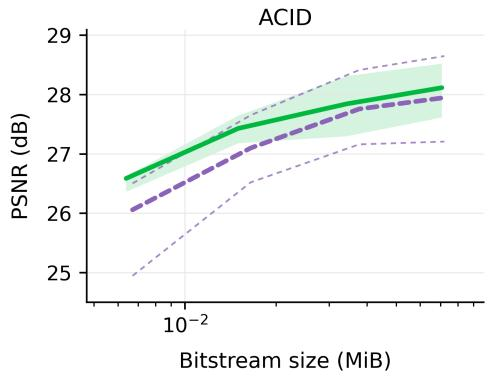

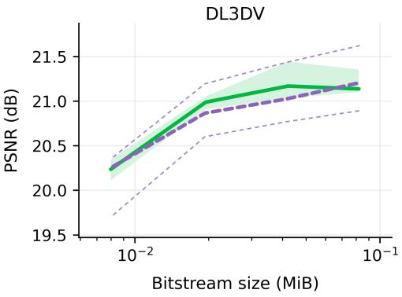  
MFGS-Adaptive MFGS-Adaptive w/o gating  
Figure 10: Encoder-side latent-gating ablation on ACID and DL3DV. The no-gating variant omit gating and the importance-alignment loss. Green shading and thin purple boundary curves indicate the ranges for the full and no-gating models, respectively. These ranges span $k \in \{ 0 . \dot { 2 } , 0 . 4 , 0 . 6 , 0 . 8 , 1 . 0 \}$ lines connect rate settings at $k = 0 . 4$

## A.6 Importance-guided bit allocation

To assess the importance-guided coding in MFGS-Adaptive, we examine whether locations ranked highly by the receiver receive a larger share of the estimated main-latent bits. On ACID at $k = 0 . 8$ we rank spatial locations in y by encoder- or decoder-side importance and divide them into 100 equal-sized bins. Each bin’s coding cost, estimated by the entropy model, is normalized by the scene’s total y-stream cost and averaged across scenes.

The allocation curves in Figure 11 become more concentrated in the highest-importance bins as λ increases and the rate penalty becomes stronger. This trend holds under both encoder- and decoder-side rankings, indicating that locations considered important for receiver-side selection also receive a larger share of the multi-view feature-coding budget. Aggregation details are provided in Appendix A.3.

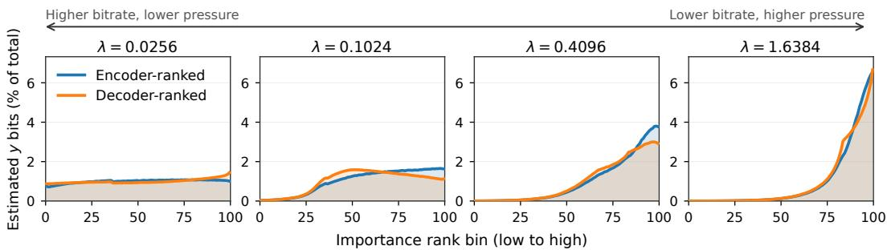  
Figure 11: Importance-ranked allocation of estimated main-latent bits on ACID at k = 0.8. Each panel uses one rate weight λ. Curves show the mean percentage of estimated scene-level y bits in each of 100 bins ordered from low to high encoder- or decoder-side importance. Both rankings average all 1,810 scenes at every λ.

## A.7 Encoding and decoding complexity and runtime

Table 7 shows how computation and learned parameters are distributed across the coding pipeline. Both methods share multi-view feature extraction, including the image backbone, multi-view aggregation, and cost-volume processing. MVSplat+FCGS then predicts and compresses Gaussians at the sender, while MFGS-Base codes multi-view features and predicts Gaussians at the receiver. G-PCC is excluded from the GMACs in both complexity tables and has no learned parameters. The parameter totals therefore describe deployed neural model size, without accounting for the computational work performed by this non-neural geometry codec.

Table 7: Module-wise encoding and decoding complexity on RE10K at 256×256. GMACs are estimated with fvcore and exclude G-PCC. Parameters count learned weights only, in millions (M); G-PCC has no learned weights. MVSplat+FCGS includes Gaussian generation. Entropy processing includes context networks and learned grid projections. Reconstruction includes $g _ { s }$ and AuxT for MFGS-Base and attribute synthesis for MVSplat+FCGS.
<table><tr><td>Phase</td><td>Component</td><td colspan="2">GMACs</td><td colspan="2">Params. (M)</td></tr><tr><td></td><td></td><td>MVSplat+ FCGS</td><td>MFGS-Base</td><td>MVSplat+ FCGS</td><td>MFGS-Base</td></tr><tr><td rowspan="4">Encoding</td><td>Multi-view feature extraction</td><td>712.42</td><td>712.42</td><td>12.47</td><td>12.47</td></tr><tr><td>Gaussian prediction head</td><td>170.51</td><td>0.00</td><td>0.83</td><td>0.00</td></tr><tr><td>Codec encoding</td><td>678.49</td><td>120.29</td><td>2.54</td><td>15.32</td></tr><tr><td>Total</td><td>1,561.41</td><td>832.71</td><td>15.83</td><td>27.78</td></tr><tr><td rowspan="4">Decoding</td><td>Entropy-model processing</td><td>729.19</td><td>5.87</td><td>1.78</td><td>8.14</td></tr><tr><td>Representation reconstruction</td><td>156.72</td><td>113.13</td><td>0.41</td><td>4.78</td></tr><tr><td>Gaussian prediction head</td><td>0.00</td><td>170.51</td><td>0.00</td><td>0.83</td></tr><tr><td>Total</td><td>885.91</td><td>289.51</td><td>2.19</td><td>13.75</td></tr></table>

Even within the learned modules, parameter count alone does not determine computational cost. Weights are reused at each spatial location, so a small network can be expensive when applied repeatedly. For example, the hyperprior synthesis transform $h _ { s }$ contains nearly 60% of MFGS-Base’s decoding parameters but accounts for only 2% of its decoding GMACs. A single evaluation of $h _ { s }$ predicts the entropy parameters for all main-latent locations on compact, downsampled grids (see Appendix A.8 for their sizes). FCGS’s smaller entropy networks process per-Gaussian latents and spatial/channel contexts across a much larger set of primitives. During decoding, spatial contexts are updated using previously decoded Gaussian groups, while channel contexts depend on preceding channel groups. This entropy-model cost dominates the profiled FCGS decoding GMACs even without G-PCC, explaining why MFGS-Base can use more learned parameters yet require less computation.

Peak memory also depends on intermediate tensors and temporary workspaces. Avoiding FCGS’s Gaussian-domain context grids and per-Gaussian entropy tensors reduces these working-memory demands. The additional model weights occupy only tens of MiB, whereas the measured stage peaks decrease by several GiB. Raw tensor sizes alone do not determine peak memory, and our measurements do not isolate the contribution of each allocation. Over the full encode–decode–render pipeline, MFGS-Base takes about 0.5 s per scene compared with 6.4 s for MVSplat+FCGS, an approximately 12× speedup.

Runtime excluding G-PCC. To assess runtime beyond the cost of G-PCC, we subtract G-PCC encoding and decoding times, measured separately on the same 340 scenes, from the MVSplat+FCGS timings. This estimate excludes only the G-PCC executable calls and retains Gaussian generation, neural coding, geometry preprocessing, format conversion, and rendering. Averaged across RE10K, ACID, and DL3DV, the estimated full-pipeline runtime decreases from 6.41 s to 2.99 s per scene, compared with 0.52 s for MFGS-Base. The approximately 5.7× speedup indicates that the runtime advantage extends beyond the cost of G-PCC.

Measurement protocol. We measure both methods on the same scenes and views using RTX 3090 GPUs: 100 randomly sampled test scenes from each of RE10K and ACID, and all 140 DL3DV test scenes. We follow the input-view settings described in the experimental setup. Each stage is timed three times after a warm-up run, and results are averaged across the three datasets. Encoding covers input images through bitstream construction, including Gaussian generation for MVSplat+FCGS; decoding ends at Gaussian reconstruction. Timings include bitstream I/O and FCGS’s G-PCC and format conversion, but exclude data and model loading. FCGS uses float32 entropy-model computation with fixed GEMM tiling for bit-exact decoding. Peak memory is the maximum allocated GPU memory within each stage, including model weights; it excludes CPU memory, including that used by the external G-PCC process. Parameters count learned weights once per deployed module on each side. G-PCC remains part of the executed pipeline, but its cost is reflected only in runtime among the reported metrics. MFGS-Adaptive is omitted because it predicts the full candidate set before selection.

GMACs in Table 2 count executed convolution, linear, matrix-product, and attention operations, with one multiply–add counted as one MAC. They exclude rendering, normalization, interpolation, entropy-coder byte operations, and FCGS’s G-PCC and custom CUDA operations. Table 7 uses fvcore [FAIR, 2022] estimates on RE10K, weighting FCGS branches by their mean routing fraction (about 98% use the learned coding branch). Differences in dataset coverage and operator-counting rules account for the different totals in the two tables; their parameter totals agree.

## A.8 Representation and bitstream sizes

Table 8 reports the raw storage sizes of the input images, multi-view features, coding latents, and decoded Gaussians, together with the complete transmitted bitstream sizes for MFGS-Base. Although the full-resolution multi-view features F are larger than the decoded Gaussian buffers, the analysis transform reduces each 256 × 256 plane to a 16 × 16 latent grid. Hyper-analysis further reduces the spatial resolution before entropy-parameter prediction. The receiver expands the decoded latents back into multi-view features and then predicts Gaussians. Thus, entropy modeling operates on compact latents while Gaussian prediction uses the reconstructed dense features. The raw tensor sizes describe storage requirements, whereas the complete bitstream B determines the transmitted rate.

Table 8: Reference representation sizes and full transmitted bitstream sizes for the MFGS-Base model. Raw tensor sizes assume FP32 storage; percentages are relative to the decoded Gaussian size |Gˆ|. The raw image size corresponds to eight input views at 256×256. F and y are internal tensors; only the complete bitstream B is transmitted.
<table><tr><td>Multi-view</td><td>Pre-Gaussian multi-view images I features F</td><td>Latent</td><td></td><td>Bitstream B Bitstream B Bitstream B Bitstream B</td><td></td><td></td><td></td><td>Decoded Gaussians Ê</td></tr><tr><td>RE10K</td><td>6,144 KiB (6.6%)</td><td>204,288 KiB (218.0%)</td><td>y 1,920 KiB (2.0%)</td><td>λ=0.0256 63.2 KiB (0.067%)</td><td>λ=0.1024 31.7 KiB (0.034%)</td><td>λ=0.4096 14.2 KiB (0.015%)</td><td>λ=1.6384 6.5 KiB</td><td>93,696 KiB (100%)</td></tr><tr><td>ACID</td><td>Same as above</td><td>Same as above</td><td>Same as above</td><td>71.9 KiB (0.077%)</td><td>37.1 KiB (0.040%)</td><td>15.8 KiB (0.017%)</td><td>(0.007%) 6.6 KiB (0.007%)</td><td>Same as above</td></tr><tr><td>DL3DV</td><td>Same as above</td><td>Same as above</td><td>Same as above</td><td>86.1 KiB (0.092%)</td><td>43.9 KiB (0.047%)</td><td>20.5 KiB (0.022%)</td><td>8.2 KiB (0.009%)</td><td>Same as above</td></tr></table>

## A.9 Comparison with multi-view image coding

We compare the MFGS-Base model with MPEG Immersive Video (MIV) [Boyce et al., 2021, Dziembowski and Kroon, 2025], which transmits compressed multi-view images and synthesizes requested target views at the receiver. We use the TMIV 24.0 reference software with VVenC 1.12.0 and VVdeC 2.3.0 for VVC Main10 atlas coding [Bross et al., 2021]. For both pipelines, the reported rate includes the coded scene data and excludes the camera parameters specifying the requested target views. Table 9 reports BD-rate on all three datasets and receiver latency on RE10K.

Receiver latency is averaged per scene and includes decoding and generating all target views. We profile MFGS-Base on a GPU and MIV with a single CPU decoder thread, estimating MIV synthesis time by subtracting decoding-only time from the combined decoding and synthesis time.

Table 9: Comparison with MIV transmission on RE10K, ACID, and DL3DV. BD-rate is computed for MIV relative to MFGS-Base; positive values indicate lower rates for MFGS-Base. Speedup is reported for MFGS-Base relative to MIV.
<table><tr><td colspan="3">(a) Rate-distortion comparison</td></tr><tr><td>Dataset</td><td>Common PSNR (dB)</td><td>BD-rate (%)</td></tr><tr><td>RE10K</td><td>26.08–27.15</td><td>+440.92</td></tr><tr><td>ACID</td><td>26.67–28.92</td><td>+105.24</td></tr><tr><td>DL3DV</td><td>20.22–21.55</td><td>-8.84</td></tr></table>

<table><tr><td colspan="4">(b) RE10K receiver latency per scene</td></tr><tr><td>Method</td><td>Decode (ms)↓</td><td>Render/synth. (ms)↓</td><td>Total (ms)↓</td></tr><tr><td>MFGS-Base</td><td>144.7</td><td>22</td><td>167</td></tr><tr><td>MIV (TMIV+VVC)</td><td>3,597</td><td>7,783</td><td>11,380</td></tr><tr><td>Speedup</td><td>24.8×</td><td>353.8×</td><td>68.1×</td></tr></table>

MFGS-Base requires lower rates than MIV on RE10K and ACID but higher rates on DL3DV. In the evaluated RE10K implementations, MFGS-Base also has lower receiver latency for both decoding and view generation, with the larger difference in rendering/synthesis. The evaluation scene sets are specified in Appendix A.3.

## A.10 Assets and broader impact

Assets. The experiments use RE10K [Zhou et al., 2018], ACID [Liu et al., 2021], and DL3DV [Ling et al., 2024]. RE10K and ACID provide camera metadata and source-video identifiers; the corresponding videos remain subject to the dataset instructions and YouTube terms. DL3DV is used under the DL3DV-10K Terms of Use. We follow the licenses and terms of the baseline implementations and do not release a new dataset.

Broader impact. Compact feed-forward scene transmission can reduce bandwidth and storage requirements for telepresence and immersive media. However, captured imagery may introduce privacy risks, including unauthorized scene reconstruction. Practical deployments should obtain consent for data capture, follow dataset and platform terms, and restrict access to sensitive reconstructions.