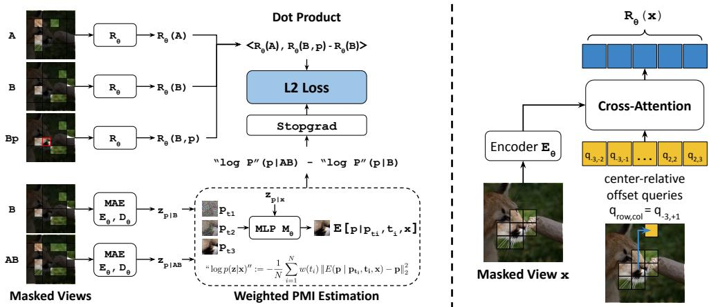
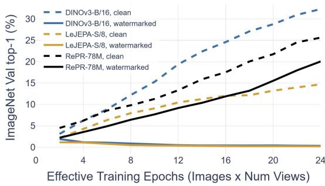
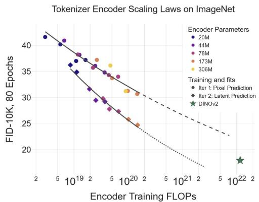
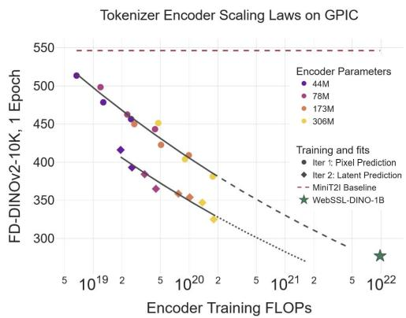
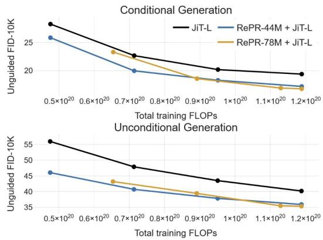
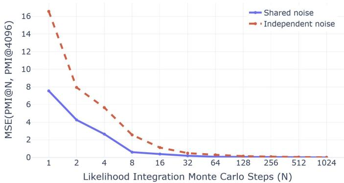
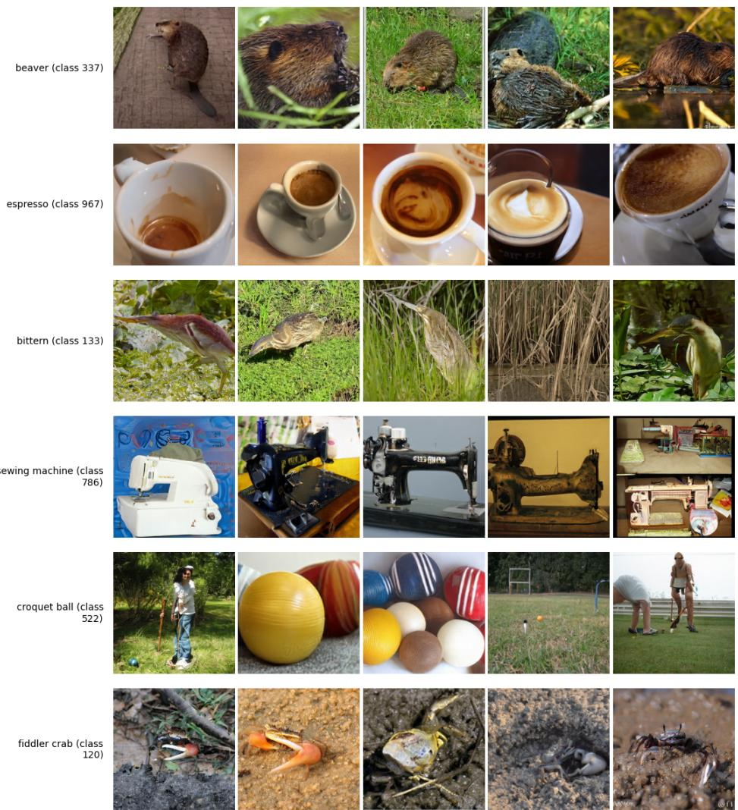
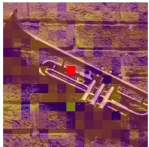
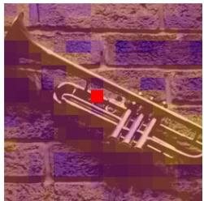
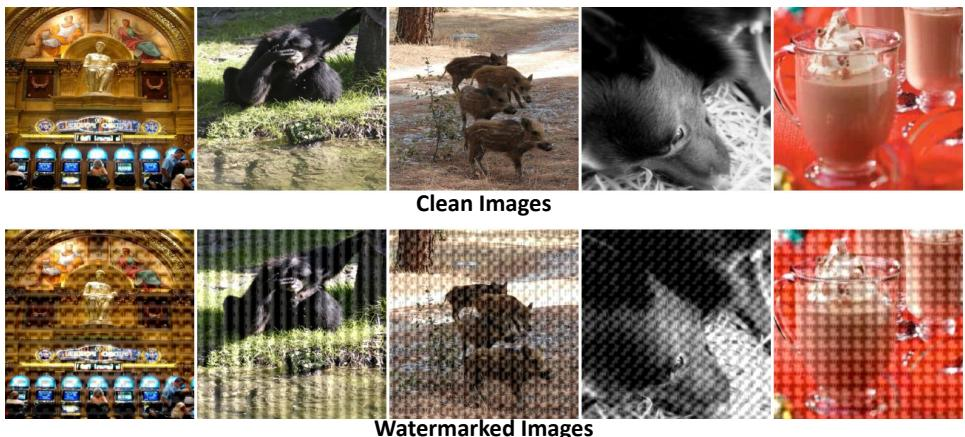

# GENERATIVE REPRESENTATION LEARNING FOR SCALABLE LATENT TOKENIZATION

Alan Baade1∗ Kyle Sargent1 Vincent Sitzmann2 Eric Ryan Chan1† Justin Johnson3† Li Fei-Fei1† Gordon Wetzstein1†

1Stanford University 2Massachusetts Institute of Technology 3University of Michigan

## ABSTRACT

We introduce an approach for self-supervised representation learning designed to be used as a tokenizer for generative modeling. Our objective supervises a representation loss by factorizing the pointwise mutual information of the data, which we estimate by taking information differences between conditional predictions from a learned generative model. We justify our algorithm theoretically and empirically, demonstrating that our generative approach to representation learning avoids dimensional collapse and feature suppression in cases where commonly used methods like DINO and LeJEPA fail. Moreover, we show our representation learning technique is scalable; expending more compute leads to predictably better latent tokenization. For the first time, we perform a careful analysis of the combined flop efficiency of tokenizer and generative model and demonstrate that our approach is a compute-optimal improvement over direct diffusion for pixel-space generation, obtaining an FID-50K of 2.18 with JiT-L. Applied to ImageNet and the text-to-image dataset GPIC, we show tokenizer encoder scaling laws for diffusability, where extrapolating our approach achieves representations in 7× fewer FLOPs than DINOv2 on ImageNet and 8× fewer FLOPs than WebSSL on GPIC. Code at https://github.com/AlanBaade/repr

## 1 INTRODUCTION

Representation learning decides what information matters. Traditionally, that decision has been guided by downstream tasks: augmentation invariance, for example, encourages representations that preserve semantic content while discarding other latent variables. Yet representations designed this way have become a foundation for generative modeling, serving as latent tokenizers for diffusion models. Methods such as RAE (Zheng et al., 2026), for example, inherit encoders like DINOv2 (Oquab et al., 2024), whose objectives were not designed to make generation easier. Moreover, these encoders can require orders of magnitude more data and compute to train than the generative models built on top of them. This leaves two basic questions unresolved: what makes a representation good for generation, and is learning one actually more compute-efficient than modeling pixels directly?

In this paper, we seek to discover whether there is a representation learning algorithm that demonstrates tokenizer encoder scaling laws: As more compute and data is given to train the tokenizer, generative models trained on these representations converge faster, and the compute optimal balance between training a tokenizer and generative model places nonzero weight on tokenization. Although prior work has shown scaling laws for tokenization (Yao et al., 2025a; Hansen-Estruch et al., 2026), these works couple tokenizer decoders, which are a part of the generative process that has been widely shown to improve with scale (Kaplan et al., 2020), with tokenizer encoders that instead have been shown to worsen with scale (Simeoni et al., 2025; Hansen-Estruch et al., 2026;´ Yao et al., 2025b), a phenomenon we discuss in depth.

Toward the goal of discovering scalable encoders, we identify three primary reasons for the failures of current recipes. 1) Feature suppression: Standard representation learning techniques such as Contrastive Learning (Hadsell et al., 2006; van den Oord et al., 2018a) and LeJEPA (Balestriero &

LeCun, 2025) can have their objectives saturated by a small number of bits, behavior commonly referred to as feature suppression (Geirhos et al., 2020; Chen et al., 2021a). Although suppressed objectives may be ideal for tasks like ImageNet probing, where only a few semantic bits need highlighting, in generative modeling all latent variables in the data are sampled. 2) Causal Theoretical Grounding: Representation learning algorithms like contrastive learning optimize a CLS token, but the tokenizer used by methods like RAE is instead “emergent” internal patch features that have demonstrated instability under scaling (Darcet et al., 2024). 3) Architectural scalability: Classic tokenizers such as VAEs (Kingma & Welling, 2022) and VQ-VAE (van den Oord et al., 2018b) bottleneck gradient descent through techniques like the reparameterization trick or straight-through gradient estimation and fail to learn semantics (Yao et al., 2025b), resulting in the transition toward tokenizers based on representation learning such as DINOv2 (Oquab et al., 2024).

To address these issues preventing scalable representations, we propose an approach to move representation learning away from discriminative tasks, such as contrastive learning, and toward generative approaches instead. Specifically, we observe that Word Embeddings and Contrastive Learning implicitly factorize a pointwise mutual information (PMI) matrix of the data distribution (Levy & Goldberg, 2014; van den Oord et al., 2018a; Chen et al., 2023). We propose to use a generative model to directly estimate a weighted PMI that our representation learner factorizes explicitly. By factorizing the PMI of the data, we directly inherit the long-studied theoretical properties of Contrastive Learning in our latent space. By using a generative objective instead of a discriminative objective, our approach both uses no negative samples and is robust to feature suppression, enabling our approach to directly supervise tokenizer patch feature representations rather than relying on intermediate features in a network (Zheng et al., 2026) or excessively destroying information when directly using contrastive representations (Ramesh, 2022). Our PMI estimation inherits scalability from existing generative models, we use continuous gradient descent and standard Transformer architectures, and our representation supervision loss is directly interpretable as Nats Squared.

We empirically demonstrate our approach for the task of image generation on both ImageNet (Deng et al., 2009) and GPIC (Chandrasegaran et al., 2026), a text-to-image dataset. We isolate our gains solely to the diffusability of the encoder by training generative models with Latent Forcing (Baade et al., 2026), demonstrating scaling directly on pixel generation while using no decoder, perceptual losses, adversarial losses, or external models. We further show that our approach is generalizable to different settings, such as unconditional generation, guided and unguided generation, and GAN+LPIPS decoding (Goodfellow et al., 2021; Zhang et al., 2018). Our resulting approach provides a FLOP-wise performance improvement over JiT, obtaining an FID-50K of 2.18 with JiT-L.

In summary, we make the following contributions:

1. We introduce Relative Prediction Representations (RePR), a theoretically grounded representation learning algorithm for discovering latent variables within a signal that correlate between different masked views of the data.

2. We provide a practical implementation on real high-dimensional image data.

3. A careful analysis of tokenizer encoder scaling laws and the combined FLOP efficiency of representation learning and generative modeling, improving JiT-L FID-50K on ImageNet to 2.18 with equal FLOPs and extrapolating to equivalent tokenizer quality 7× faster than DINOv2 (Oquab et al., 2024) on ImageNet and 8× WebSSL (Fan et al., 2025) on GPIC.

## 2 RELATED WORK

Representation Learning. Contrastive Learners (Chen et al., 2020; He et al., 2020) are a staple of representation learning that supervise a loss objective by encouraging high similarity between augmented views of the same scene and low similarity across different scenes. Empirically improving on contrastive-style objectives has seen great success in the widely-used DINO v1,v2,v3 series of models (Caron et al., 2021; Oquab et al., 2024; Simeoni et al., 2025). A longstanding flaw of´ contrastive objectives is that they struggle with strongly conditioned views, where hard negative examples (Robinson et al., 2021) that prevent trivializing the objective are difficult to find. As a result, contrastive learning objectives often exhibit feature suppression (Chen et al., 2021a), where contrastive representations only capture a subset of relevant variables in a scene, for example probing well to object class but losing scene structure. To combat issues of hard negatives and feature suppression, substantial effort has been devoted to designing hand-crafted augmentations intended to highlight signal for desired variables (Chen et al., 2020). Representation learning has also seen success through predictive objectives, such as predicting masked-out pixels in an image as done in Context Encoders and MAE (Pathak et al., 2016; He et al., 2022), or by replacing the pixel prediction target with a neural network latent such as BYOL, Data2Vec, JEPA, and MAGE (Grill et al., 2020; Baevski et al., 2022; Assran et al., 2023; Bardes et al., 2024; Li et al., 2022).

Pointwise Mutual Information and Representations The Pointwise Mutual Information (PMI) of the data is closely tied to many representation learning algorithms. The connection between factorizing the PMI and representation learning was first established by Levy & Goldberg (2014) for Word2Vec (Mikolov et al., 2013) and afterward extended to contrastive learning (van den Oord et al., 2018a; Chen et al., 2023). The Platonic Representation Hypothesis (Huh et al., 2024) proposes that large-scale neural networks emergently converge to similarly structured representations and suggests PMI factorization as a candidate for such a space. However, recent work (Koepke et al., 2026) has shown that at large scales, neural representations fail to match such structure. In this work, we directly supervise representations to match the PMI, rather than assuming emergence at scale.

Pixel and Latent Space Generative Modeling. The current state-of-the-art for image generative modeling uses diffusion transformers (Peebles & Xie, 2023), of which there are two main varieties: direct pixel diffusion and latent diffusion. A representative approach for pixel-space diffusion is JiT (Li & He, 2026), which demonstrated that pixel-space diffusion can be a practical and scalable method using transformer architectures. Meanwhile, latent diffusion (Rombach et al., 2022; Li et al., 2024a) instead modifies generation into two stages, first creating a latent tokenizer, and second training a generative model on the tokenizer. Modern latent diffusion approaches like RAE (Zheng et al., 2026) and REPA (Yu et al., 2025) demonstrated strong results, attaining state-of-the-art FID values on ImageNet. However, RAE and REPA do not control for representation learner pretraining, where the chosen latent space, DINOv2-b (Oquab et al., 2024) is distilled from a 1.1 billion parameter model trained on over 100 times more data than ImageNet. As a result, the FLOP-efficiency of representation encoding is not currently understood.

## 3 BACKGROUND

Our method rests on the estimation of the pointwise mutual information between two views of a data point using generative models and using it to directly supervise their feature embeddings.

InfoNCE converges to PMI of datapoints. The PMI is defined as the information gain on one outcome $\mathbf x \sim X$ when conditioned on a different outcome $\mathbf y \sim Y$

$$
\mathrm { P M I } ( \mathbf { x } , \mathbf { y } ) = \mathrm { P M I } ( \mathbf { y } , \mathbf { x } ) = \log \frac { p _ { X | Y } ( \mathbf { x } \mid \mathbf { y } ) } { p _ { X } ( \mathbf { x } ) } = \log \frac { p _ { Y | X } ( \mathbf { y } \mid \mathbf { x } ) } { p _ { Y } ( \mathbf { y } ) } = \log \frac { p _ { X , Y } ( \mathbf { x } , \mathbf { y } ) } { p _ { X } ( \mathbf { x } ) p _ { Y } ( \mathbf { y } ) } .\tag{1}
$$

Intuitively, PMI measures how much more or less often two observations co-occur than expected if independent. van den Oord et al. (2018a) showed that the dot product of contrastive embeddings $R _ { \theta } ( \mathbf { x } )$ and $R _ { \theta } ( \mathbf { y } )$ converges to an estimate of the PMI up to an unidentifiable scalar offset:

$$
\begin{array} { r } { \langle R _ { \theta } ( \mathbf { x } ) , R _ { \theta } ( \mathbf { y } ) \rangle \approx \mathrm { P M I } ( \mathbf { x } , \mathbf { y } ) + a ( \mathbf { x } ) . } \end{array}\tag{2}
$$

Levy & Goldberg (2014) similarly demonstrated that the dot product of word and context embedding matrices form a low-rank, weighted factorization of their PMI matrix.

Estimating the PMI with a generative model. Assuming that a generative model $G _ { \theta }$ gives us access to the log probability of a data sample, log $P _ { G _ { \theta } } ( \mathbf { y } )$ , this then allows us to obtain an estimate of the mutual information between two data samples x and y as follows:

$$
\mathrm { P M I } ( \mathbf { x } , \mathbf { y } ) = \log { P _ { G _ { \theta } } ( \mathbf { y } | \mathbf { x } ) } - \log { P _ { G _ { \theta } } ( \mathbf { y } ) } .\tag{3}
$$

## 4 METHOD

We now give a high-level overview of our algorithm. Given a training sample, we randomly mask to obtain two corrupted views, x and y. We then obtain an estimate of their PMI using a conditional generative model following Eq. 3. In parallel, just as in contrastive learning, we embed each view into a feature using a representation encoder $R _ { \theta }$ . Combining Eqs. 2, 3, we directly supervise the dot product of the embeddings $R _ { \theta } ( \mathbf { x } )$ and $R _ { \theta } ( \mathbf { y } )$ to equal the PMI estimated via the generative model:

$$
\mathcal { L } _ { \mathrm { P M I } } = \Big | \Big | \langle R _ { \theta } ( \mathbf { x } ) , R _ { \theta } ( \mathbf { y } ) \rangle - \mathrm { P M I } ( \mathbf { x } , \mathbf { y } ) \Big | \Big | _ { 2 } ^ { 2 }\tag{4}
$$

$$
= \Big \| \big \langle R _ { \theta } ( \mathbf { x } ) , R _ { \theta } ( \mathbf { y } ) \big \rangle - \mathrm { s t o p g r a d } \Big ( \log P _ { G _ { \theta } } ( \mathbf { y } \mid \mathbf { x } ) - \log P _ { G _ { \theta } } ( \mathbf { y } ) \Big ) \Big \| _ { 2 } ^ { 2 } .\tag{5}
$$

Intuitively, this proposal follows the success of contrastive learning, which implicitly supervises the dot product $\left. R _ { \theta } ( \mathbf { x } ) , R _ { \theta } ( \mathbf { y } ) \right.$ with their PMI following Eq. 2. However, contrastive learning accomplishes this via the InfoNCE loss, which depends on the sampling of negatives, which is challenging in strongly conditional settings and thus, does not scale. We instead estimate the PMI directly with a conditional generative model. Because the capabilities of generative models are subject to robust scaling laws (Kaplan et al., 2020), we will show in our experiment section that this yields a scalable, state-of-the-art representation learning objective for tokenization.

Overview of this section. As described, the approach is not yet practical for two main reasons. First, high-dimensional modalities like images have many high-frequency bits that dominate their PMI, overshadowing bits we may care more about such as semantics. We address this in Secs. 4.1 and 4.2. Second, likelihood estimation is expensive or intractable on large inputs such as when a view x is the left half of an image or the first half of a movie. We resolve this via a novel bootstrapping method discussed in Sec. 4.3. Finally, we assemble the complete objective in Sec. 4.4.

## 4.1 PMI ESTIMATION FROM GENERATIVE MODELS

In this section, we will briefly review how to extract probabilities from generative models. We assume that all data is discrete: images have 24-bit pixels and model latents are represented by finite-precision floating points. Conditional likelihood, and therefore PMI, is simple to estimate from discrete cross-entropy models for both text (Devlin et al., 2019) and images (Li et al., 2025) which output log-probabilities for individual tokens given a context.

We estimate probabilities from diffusion models using the ELBO, which provides exact probabilities on discrete data (Kingma et al., 2021), which we discuss below. This is different from probabilityflow ODE methods, which integrate the divergence of the probability-flow vector field. (Song et al., 2021b), and instead allows us to estimate probabilities directly from the loss of the diffusion model. Following Kingma et al. (2021) (Eq. 37) the variational lower bound (VLB) can be expressed as:

$$
\begin{array} { r } { - \log p ( \mathbf { x } ) \leq - \mathrm { { V L B } } ( \mathbf { x } ) = \underbrace { D _ { K L } \big ( q ( \mathbf { z } _ { 1 } | \mathbf { x } ) \big | | p ( \mathbf { z } _ { 1 } ) \big ) } _ { \mathrm { P i n e r l o s s } } + \underbrace { { \mathbb { E } } _ { q ( \mathbf { z } _ { 0 } | \mathbf { x } ) } \left[ - \log p ( \mathbf { x } | \mathbf { z } _ { 0 } ) \right] } _ { \mathrm { R e c o n s t n c t i o n ~ l o s s } } + \underbrace { \mathcal { L } _ { \infty } ( \mathbf { x } ) . } _ { \mathrm { D i f f u s i o n ~ l o s s } } } \end{array}\tag{6}
$$

Moreover, the bound is tight, i.e., log $p ( \mathbf { x } ) = \mathbf { V } \mathbf { L B } ( \mathbf { x } )$ , when the denoising network is optimal and the endpoint terms vanish (Song et al., $, 2 0 2 1 \mathrm { a } , \mathrm { E q s } . 9 , 1 0 )$ . In this work we use the linear-interpolation (flow-based) schedule $\mathbf { z } _ { t } = ( 1 - t ) \mathbf { x } + t { \boldsymbol { \epsilon } } ,$ , with $\epsilon \sim \mathcal { N } ( 0 , \bf { I } )$ When $t = 1$ (at full noise), since ${ \bf z } _ { 1 } = \epsilon $ , we have $q ( \mathbf { z } _ { 1 } \mid \mathbf { x } ) = p ( \mathbf { z } _ { 1 } )$ and the prior loss is zero. $\mathbf { A } \mathbf { t } t = 0 ,$ since $\mathbf { z } _ { 0 } = \mathbf { x }$ and the data is discrete, x can be recovered exactly from $\mathbf { z } _ { 0 } .$ , so the reconstruction loss is also zero. The VLB therefore reduces to the diffusion loss $\mathcal { L } _ { \infty } ( \mathbf { x } )$ . Under this noise schedule, following (Kingma et al., 2021, Eqs. 53,54), the diffusion loss expands as:

$$
\log p ( \mathbf { x } ) = \mathrm { V L B } ( \mathbf { x } ) = - \mathcal { L } _ { \infty } ( \mathbf { x } ) = - \mathbb { E } _ { t \sim \mathbf { U } [ 0 , 1 ]  \sim \mathcal { N } ( 0 , \mathbf { I } ) } [ \frac { 1 - t } { t ^ { 3 } }  \mathbf { x } - \mathbb { E } ( \mathbf { x } \mid \mathbf { x } _ { t } , t )  _ { 2 } ^ { 2 } ] .\tag{7}
$$

The PMI between two points can then be calculated by subtracting their log probability estimates:

$$
\mathrm { P M I } ( \mathbf { x } , \mathbf { y } ) = \mathbb { E } _ { t \sim \mathbf { U } [ 0 , 1 ] , \epsilon \sim \mathcal { N } ( 0 , \mathbf { I } ) } \left[ \frac { 1 - t } { t ^ { 3 } } \left( \| \mathbf { y } - \mathbb { E } ( \mathbf { y } \mid \mathbf { y } _ { t } ; t ) \| _ { 2 } ^ { 2 } - \| \mathbf { y } - \mathbb { E } ( \mathbf { y } \mid \mathbf { x } , \mathbf { y } _ { t } , t ) \| _ { 2 } ^ { 2 } \right) \right]\tag{8}
$$

Here, we obtain the outer expectation over t, ϵ through Monte Carlo sampling, and the inner expectations using a learned denoising model. Although the VLB is only equal to $\log p ( \mathbf { x } )$ with an optimal denoiser, our approximation approaches the true PMI as we improve the prediction.

## 4.2 TIMESTEP WEIGHTING

Practical implementations of diffusion models do not directly optimize the ELBO but rather a timestep-weighted version (Karras et al., 2022). While likelihood weights every bit of information equally, information at lower signal-to-noise ratios (SNRs) often carries greater semantic or perceptual importance, and therefore, diffusion models benefit by biasing a finite-capacity model towards the most important SNRs. Likewise, the standard PMI treats all shared information equally, including fine-grained information that is only predictable at very high SNRs. For representation learning, we instead introduce an inductive bias for which SNRs determine similarity. We let:

$$
\begin{array} { r } { \mathbf { y } _ { s } = ( 1 - s ) \mathbf { y } + s \epsilon , \qquad \epsilon \sim \mathcal { N } ( 0 , I ) . } \end{array}\tag{9}
$$

For each corruption level s, we can define

$$
\mathrm { P M I } ( \mathbf { x } , \mathbf { y } _ { s } ) = \log \frac { p _ { s } ( \mathbf { y } _ { s } \mid \mathbf { x } ) } { p _ { s } ( \mathbf { y } _ { s } ) } .\tag{10}
$$

At $s = 0$ , this reduces to the ordinary PMI. As s increases, fine-grained information is progressively destroyed, so the PMI measures only dependencies that remain predictive under stronger corruption. We therefore define a scale-weighted PMI,

$$
\mathrm { P M I ^ { * } } ( \mathbf { x } , \mathbf { y } ) = \mathbb { E } _ { s \sim U [ 0 , 1 ] , \epsilon } \left[ q ( s ) \mathrm { P M I } ( \mathbf { x } , \mathbf { y } _ { s } ) \right] ,\tag{11}
$$

where $q ( s )$ determines which information scales are emphasized. Each $\mathrm { P M I } ( \mathbf { x } , \mathbf { y } _ { s } )$ can itself be estimated using the diffusion ELBO, which integrates the conditional denoising advantage over a second diffusion timestep t. More generally, because the corruption at s and the diffusion corruption at t are both Gaussian, they can be composed into a single effective timestep weighting:

$$
\mathrm { P M I } ^ { * } ( \mathbf { x } , \mathbf { y } ) = \mathbb { E } _ { t \sim f ( t ) , \epsilon } \left[ g ( t ) \left( \| \mathbf { y } - \mathbb { E } ( \mathbf { y } \mid \mathbf { y } _ { t } , t ) \| _ { 2 } ^ { 2 } - \| \mathbf { y } - \mathbb { E } ( \mathbf { y } \mid \mathbf { y } _ { t } , t , \mathbf { x } ) \| _ { 2 } ^ { 2 } \right) \right] .\tag{12}
$$

where $f ( t )$ is timestep sampling and $g ( t )$ timestep weighting, providing a practical way to bias the representation objective toward information that remains shared across the noise scales of interest.

## 4.3 BOOTSTRAPPED PMI ESTIMATION

Likelihood estimation gets harder as the amount of information in the input grows: predicting the probability of a single pixel is easy and calculable with dataset statistics, but predicting the likelihood of an image using a diffusion model may take intractably many Monte Carlo Estimation steps. To avoid this issue, we replace a challenging full-view PMI estimate with a sequence of local PMI increments. Instead of estimating the PMI between x and an entire large target y, we write y as tokens $y _ { 1 } , . . . , y _ { k }$ and supervise only the incremental PMI contributed by the next token:

$$
\begin{array} { r l } & { \langle R _ { \theta } ( \mathbf { x } ) , R _ { \theta } ( y \leq k ) - R _ { \theta } ( y _ { \leq k - 1 } ) \rangle = \mathrm { P M I } ( \mathbf { x } , y _ { \leq k } ) - \mathrm { P M I } ( \mathbf { x } , y _ { \leq k - 1 } ) } \\ & { \qquad = \displaystyle \sum _ { i = 1 } ^ { k } \log \frac { p ( y _ { i } \mid y _ { < i } , \mathbf { x } ) } { p ( y _ { i } \mid y _ { < i } ) } - \displaystyle \sum _ { i = 1 } ^ { k - 1 } \log \frac { p ( y _ { i } \mid y _ { < i } , \mathbf { x } ) } { p ( y _ { i } \mid y _ { < i } ) } = \log \frac { p ( y _ { k } \mid y _ { < k } , \mathbf { x } ) } { p ( y _ { k } \mid y _ { < k } ) } = \mathrm { P M I } ( y _ { k } , \mathbf { x } \mid y _ { < k } ) . } \end{array}\tag{13}
$$

Because these increments telescope, summing them recovers the full PMI:

$$
\sum _ { k = 1 } ^ { K } [ \mathrm { P M I } ( \mathbf { x } , y _ { \leq k } ) - \mathrm { P M I } ( \mathbf { x } , y _ { \leq k - 1 } ) ] = \mathrm { P M I } ( \mathbf { x } , y _ { \leq K } ) - \mathrm { P M I } ( \mathbf { x } , \boldsymbol { \mathcal { O } } ) = \mathrm { P M I } ( \mathbf { x } , \mathbf { y } ) .\tag{14}
$$

This makes the likelihood-ratio target easier to estimate than the PMI of the whole input at once.

## 4.4 REPRESENTATION OBJECTIVE

We combine Timestep Weighting and Bootstrapping to obtain our full representation objective. Given input views x and y and an incremental amount of information to add z, we optimize for:

$$
\begin{array} { r l } & { \mathcal { L } _ { \mathrm { R e P R } } = \Big \| \big \langle R _ { \theta } ( { \bf x } ) , R _ { \theta } ( { \bf y } , { \bf z } ) - R _ { \theta } ( { \bf y } ) \big \rangle - \mathrm { P M T } ^ { * } ( { \bf x } , { \bf z } \mid { \bf y } ) \Big \| _ { 2 } ^ { 2 } } \\ & { \qquad = \Big \| \big \langle R _ { \theta } ( { \bf x } ) , R _ { \theta } ( { \bf y } , { \bf z } ) - R _ { \theta } ( { \bf y } ) \big \rangle } \\ & { \qquad - \mathbb { E } _ { t \sim f ( t ) , \epsilon } \Big [ g ( t ) \mathrm { s t o p g r a d } \Big ( \| { \bf z } - \mathbb { E } ( { \bf z } \mid { \bf z } _ { t } , t , { \bf y } ) \| _ { 2 } ^ { 2 } - \| { \bf z } - \mathbb { E } ( { \bf z } \mid { \bf z } _ { t } , t , { \bf x } , { \bf y } ) \| _ { 2 } ^ { 2 } \Big ) \Big ] \Big \| _ { 2 } ^ { 2 } . } \end{array}\tag{15}
$$

## 5 ARCHITECTURE

Here, we describe how we instantiate RePR for learning representations from images. RePR consists of two learned networks: a “Prediction Model” that predicts masked inputs given partial observations (to estimate the PMI), and a “Representation Model” that outputs vectors given a partial input (into which we distill the PMI). In the following sections, we describe the Prediction Model (Sec. 5.1), the Representation Model for patch features (Sec. 5.2), how we mask views for PMI calculation (Sec. 5.3), and estimating the PMI with respect to latents for improved performance (Sec. 5.4).

  
Figure 1: Architecture. Left: 1) Our Prediction Model (bottom) estimates weighted data likelihoods for a target patch p using an MAR architecture, which combines an MAE Encoder $E _ { \theta }$ and Decoder $D _ { \theta }$ with a diffusion prediction MLP head $M _ { \theta } . 2 )$ The Representation Model $R _ { \theta }$ (top) outputs vector representations supervised to factorize a weighted PMI. Right: We enforce spatial equivariance in $R _ { \theta }$ by hiding absolute position information but outputting a feature for every patch.

## 5.1 PREDICTION MODEL

The “Prediction Model” is implemented as a MAR (Li et al., 2024b), a modification of Masked Autoencoders (He et al., 2022) that replaces the patch regression head with a patch diffusion MLP. Specifically, MAR consists of an MAE Encoder $E _ { \theta }$ (without mask tokens), MAE Decoder $D _ { \theta }$ (with mask tokens) and a diffusion MLP $M _ { \theta } .$ The diffusion MLP takes in the decoder latent corresponding to patch $p , z _ { p } ,$ a noised view of $p , p _ { t }$ , and trains to denoise $p ,$ where we follow JiT (Li & He, 2026) and use x-prediction with a v-loss, depicted in Figure 1.

$$
\mathcal { L } _ { \mathrm { M A R } } = w ( t ) | | M _ { \theta } ( z _ { p } , p _ { t } , t ) - p | | _ { 2 } ^ { 2 } .\tag{16}
$$

MAR is convenient for estimating PMI because when estimating likelihoods for a contextualized latent, the cost of the Encoder and Decoder is shared, after which we can run the lightweight diffusion loss head many times to average across different noise levels.

## 5.2 REPRESENTING PATCH FEATURES

We distinguish between features that are directly supervised for structure, such as the CLS token of Contrastive Learners, DINO, or LeJEPA, and unregularized intermediate latents, such as the non-CLS tokens of DINO or the latents in an unregularized autoencoder. Without explicit structural supervision, these unregularized latents can diverge or collapse. For example, DINOv2 demonstrated outlier patch features, motivating the introduction of register tokens (Darcet et al., 2024), and in DINOv3 (Simeoni et al., 2025), feature quality again degraded, necessitating an additional distil-´ lation stage to align model features with an earlier checkpoint, taken before degradation occurred. While heuristic regularization and interventions can correct divergence, these issues may become increasingly difficult to control with greater scale. Such feature instability motivates directly supervising patch features for principled and scalable tokenization.

We directly use the full patch features $R ^ { H \times W \times D }$ from our network as our representation vector. To enforce spatial structure, we implement an additional spatial equivariance constraint: We remove absolute position information from the Encoder $E _ { \theta }$ , however we take the dot product of patch features at their absolute positions. To implement this, our Representation Model cross-attends from output of the encoder $\bar { E } ,$ to learned position embeddings indexed by their relative offset to the center of the visible input, visualized in Fig. 1, right.

## 5.3 MASKING STRATEGY

For a given input image X, during masking we produce two potentially overlapping patch masks A and $B ,$ as well as a non-overlapping target patch $p$ that is denoised by the MAR head. Following MAR, we use a randomized masking strategy where the masking ratio is randomly sampled from $U [ M _ { A } , 1 0 0 \% ]$ and $U [ M _ { B }$ , 100%] respectively. By randomly choosing the masking ratio instead of fixing a single masking ratio, we supervise a range of context sizes to reconstruct the telescoping series in Sec. 4.3. For additional efficiency, we observe that we can reuse the calculation for $E ( B p )$ for several different views $A _ { i }$ , and we can reuse the decoder pass to predict several target patches $p _ { j }$ for only additional integration cost. In our final implementation we therefore add hyperparameters $A _ { \mathrm { R e p e a t } }$ and $p _ { \mathrm { R e p e a t } }$ for efficiency. Algorithm code in Appendix 1

## 5.4 ITERATIVE FEATURE PREDICTION

We find that recursively applying our training technique, by replacing the predicted incremental patches with features from a previous cycle of training, can yield additional gains. This mirrors findings in representation learning, where self-supervision by predicting in a feature space (Hsu et al., 2021; Zhou et al., 2022; Baevski et al., 2022) has been shown to strongly improve representation quality over direct pixel prediction objectives such as MAE (He et al., 2022). Because a factorization of the PMI can reconstruct the input at optimality (App. A.4), unweighted PMI estimation for latent prediction is the same as for pixel prediction: PMI(x, $R _ { \theta } ( \mathbf { y } ) ) = \mathrm { P M I } ( \mathbf { x } , \mathbf { y } )$ . With timestep weighting and bootstrapped prediction, feature-space prediction provides further control over learning signal. In practice, we embed the entire image $\bar { R } _ { \theta _ { \mathrm { o l d } } } ( \mathbf { x } )$ and substitute incremental patch p for the patch representation corresponding to the same location in the image. By sharing feature calculation between $A _ { \mathrm { R e p e a t } }$ views, embedding with $R _ { \theta _ { \mathrm { o l d } } }$ is implementationally cheap.

## 5.5 JOINT OPTIMIZATION

Our approach trains the Prediction Model and the Representation Model jointly, simultaneously optimizing the losses in Eq. 16 and 15. Empirically, we find the Representation Model converges relatively easily, therefore to speed training, we lazily optimize, training the Representation Model $R _ { \theta }$ only once every four training iterations.

## 6 EXPERIMENTS

We empirically evaluate our approach for the task of image generation on ImageNet (Deng et al., 2009) and the text-to-image dataset GPIC (Chandrasegaran et al., 2026). In this section, we demonstrate that RePR is robust to Feature Suppression (Sec. 6.1), provide scaling laws for RePR as a Tokenizer Encoder (Sec. 6.2), and use RePR to obtain compute-optimal pixel diffusion (Sec. 6.3).

## 6.1 FEATURE SUPPRESSION

Existing representation learning methods such as contrastive learning suffer from an issue called Feature Suppression (Geirhos et al., 2020; Chen et al., 2021a; Li et al., 2023) where a self-supervised objective might learn only a minimal subset of features necessary to solve the downstream task (e.g. instance discrimination), while dropping the remaining latent variables. This can be disastrous when training tokenizers because the additional latent variables, while perhaps unnecessary for satisfying the contrastive objective, may be essential for reconstructing the data.

To show our method is robust to Feature Suppression, we benchmark on a version of Imagenet that adds a visual watermark to every image patch that uniquely identifies the image in

  
Figure 2: Discriminative representation learning can suffer from feature suppression when a small subset of features, such as a watermark, is sufficient to distinguish examples. This degrades representation quality, as reflected by collapsing ImageNet class-probing performance. RePR remains robust to feature suppression.

the dataset (Enigma, 2026). On such a dataset, contrastive losses become trivialized: merely identifying the image patch watermark is enough to attain a perfect loss. In Fig. 2, we train LeJEPA (Balestriero & LeCun, 2025), DINOv3 (Simeoni et al., 2025), and our proposed RePR approach´ on both standard ImageNet and on the watermarked version. On watermarked data, LeJEPA and DINOv3 collapse to only representing the shared watermark. Meanwhile, despite sharing the same PMI factorization guarantees as contrastive learners, our proposed RePR is robust.

  
Figure 3: Tokenizer Encoder Scaling Laws: RePR predictably scales as a tokenizer encoder. When holding size and training duration of a generative model constant, greater RePR size and FLOPs improve generation performance. Iterative feature prediction (Sec. 5.4) yields further improvement.

## 6.2 SCALING LAWS

In the previous section, we demonstrated that our method resists feature suppression on toy data, where prior representations collapse. In this section, we demonstrate encoder scaling laws: our model captures enough data for generation and predictably improves with scale on real data.

We demonstrate encoder scaling laws using Latent Forcing (Baade et al., 2026), which first denoises in latent space and then generates pixels conditioned on the denoised latent. This lets us leverage the improved diffusability of learned representations while retaining generation directly in pixel space. The resulting generative process is lossless, avoiding the reconstruction–generation tradeoff of lossy latent tokenizers (Yao et al., 2025b) and isolating gains from diffusability rather than compression. Latent Forcing additionally enables controlled FLOP- and parameter-matched comparisons with direct pixel diffusion models such as JiT.

We train RePR encoders from scratch across a range of compute scales. Following µP (Yang et al., 2022), we perform width-only scaling, sweeping widths from 256 to 1024 while holding depth fixed. At maximum width, the inference architecture matches a standard ViT-L. Full architectural and training details are provided in Appendix A.3.

Fig. 3 shows consistent power-law scaling across roughly two orders of magnitude of training compute on both ImageNet and GPIC. On ImageNet, we evaluate diffusability by training a JiT-Base diffusion transformer for 80 epochs; on GPIC, we use the MiniT2i architecture (Wang et al., 2026) and train for one epoch. At each width, we additionally use feature prediction (Sec. 5.4) to predict features from a pixel model of the same size trained for 200 epochs, yielding a substantial improvement over the first iteration. Extrapolating the observed trend by at most 1× beyond our measured log-scale FLOP range predicts DINOv2-level performance at approximately one-seventh the training FLOPs and WebSSL-level performance at roughly one-eighth. On ImageNet, the width-1024 model begins to overfit after 200 epochs, consistent with prior scaling-law observations (Kim et al., 2026); scaling continues beyond this regime on GPIC.

## 6.3 COMPUTE OPTIMAL GENERATION

To the best of our knowledge, we provide the first demonstration that representation learning combined with generative modeling can be more FLOP-efficient than direct generative modeling, even after accounting for the compute required to train both the representation and generative model. We isolate the comparison by using Latent Forcing (Baade et al., 2026), without perceptual losses (Johnson et al., 2016), GANs (Goodfellow et al., 2021), or external decoders. In Fig. 4, we compare FID-10K on ImageNet between JiT-Large and Latent Forcing with two RePR tokenizer sizes for conditional and unconditional generation at equal FLOPs. At a compute budget of $1 . 1 9 \times 1 0 ^ { 2 0 }$ FLOPs, equal to 200 epochs of JiT-L training, RePR with JiT-L improves unguided FID-10K by 2.61 for conditional generation and 4.18 for unconditional generation versus JiT-L on pixels. In Tab. 3, we demonstrate that our approach outperforms raw pixel diffusion with guidance, attaining an FID-50k of 2.18. Together with the encoder scaling laws established above, these results identify representation learning as an additional scaling axis that can improve generative performance more efficiently than scaling the generative model alone.

Table 1: Ablation study for RePR Training. Default configuration in gray , best results bolded. Ablations (a,b,c) train RePR-78M for 100 epochs and (d,f) for 200 epochs. Due to the cost of training generative models, we use ImageNet (Deng et al., 2009) Top-1 Accuracy as a proxy metric.
<table><tr><td colspan="2">Masking  $M _ { A }$  IN Top-1 Acc</td></tr><tr><td>62.5%</td><td>58.62</td></tr><tr><td>75%</td><td>58.75</td></tr><tr><td>87.5%</td><td>56.21</td></tr></table>

(a) Masking for view A. Typical masking ratios for MAEs (He et al., 2022) work best  
(d) RePR loss weight. A small RePR loss weight performs better. 0.4 balances loss gradient magnitude.

<table><tr><td colspan="2">RePR loss weight IN Top-1 Acc</td></tr><tr><td>0.025</td><td>63.0</td></tr><tr><td>0.005</td><td>63.1</td></tr><tr><td>0.01</td><td>63.6</td></tr><tr><td>0.1</td><td>49.5</td></tr><tr><td>0.4</td><td>43.9</td></tr></table>

<table><tr><td>Masking  $M _ { B }$ </td><td>IN Top-1 Acc</td></tr><tr><td>75%</td><td>56.78</td></tr><tr><td>93.75%</td><td>58.75</td></tr><tr><td>98.5%</td><td>58.55</td></tr></table>

<table><tr><td>Mask strategy</td><td>IN Top-1 Acc</td></tr><tr><td>Uniform random</td><td>57.63</td></tr><tr><td>Block (Bao et al., 2022)</td><td>58.75</td></tr></table>

(c) Masking Strategies. Block masking improves performance compared to uniform random masking.

(b) Masking for view B. Higher masking rates $M _ { B }$ perform better.
<table><tr><td>Iter.</td><td>Target</td><td>Epochs</td><td>FID-10K</td></tr><tr><td>1</td><td>Pixel</td><td>{600}</td><td>30.68</td></tr><tr><td>2</td><td>Iter 1 Latent</td><td> $\{ 2 0 0 , 4 0 0 \}$ </td><td>24.73</td></tr><tr><td>3</td><td>Iter 2 Latent</td><td> $\{ 2 \dot { 0 } 0 , 2 \dot { 0 } 0 , 2 \dot { 0 } 0 \}$ </td><td>23.81</td></tr></table>

(e) Additional Training Iterations. Calculating PMI in a feature space is more performant. Each iteration predicts the previous iteration’s features at 200ep, holding total epochs constant. RePR-173M.

<table><tr><td>Eq. 12 f (t) Eq. 12 g(t)</td><td></td><td>FID-10K</td></tr><tr><td>U[0, 1]</td><td> $\overline { { \left( 1 - t \right) / t ^ { 3 } } }$ </td><td>NaN</td></tr><tr><td>U[0, 1]</td><td> $\overset { \cdot } { ( 1 - t ) } / \mathrm { m a x } ( 0 . 0 5 , t ) ^ { 3 }$ </td><td>42.15</td></tr><tr><td> $\scriptstyle \mu = 0 . 6 , \sigma = 1 . 2$ </td><td> $( 1 - t ) / \mathrm { m a x } ( 0 . 3 3 , t ) ^ { 2 }$ </td><td>35.09</td></tr><tr><td> $\mu { = } 1 . 2 , \sigma { = } 1 . 2$ </td><td>(1-t  $) / \mathrm { m a x } ( 0 . 3 3 , t ) ^ { 2 }$ </td><td>35.72</td></tr></table>

(f) Timestep Weighing. Following a PMI-like timestep weighting collapses. Biasing the timestep schedule improves performance.

Table 2: RAE comparisons at 20ep of DiT-XL training for ImageNet-only encoders. IJEPA, MocoV3 results from RAEv2 (Singh et al., 2026)
<table><tr><td>RAE Encoder FID-50k</td></tr><tr><td>Mocov3-B (Chen et al., 2021b) 13.84</td></tr><tr><td>IJEPA-H (Assran et al., 2023) 12.46</td></tr><tr><td>RePR-173M Iter 3 (Ours) 11.13</td></tr></table>

Table 3: Representation learning is compute optimal. Under a total FLOPs budget, RePR training with Latent Forcing (Baade et al., 2026) outperforms direct pixel diffusion using JiT (Li & He, 2026) with guidance, 50K generations.
<table><tr><td>Representation</td><td>Gen. Model</td><td>FLOPs↓</td><td>FID↓</td><td>IS↑</td></tr><tr><td>Pixel</td><td>JiT-L 600ep</td><td> $3 . 5 7 \times 1 0 ^ { 2 0 }$ </td><td>2.36</td><td>298.5</td></tr><tr><td>RePR-78M + Pixel JiT-L 440ep</td><td></td><td> $\mathbf { 3 . 4 9 \times 1 0 ^ { 2 0 } }$ </td><td></td><td>2.18 338.4</td></tr></table>

## 6.4 ABLATION STUDIES

We evaluate key decisions in our approach in Table 1. Variations on the masking strategy, such as the maximum visible number of patches for A and B, are empirically useful but not critical. The loss weight for the representation loss is optimal at quite small values, suggesting that the difficulty of learning the objective largely lies in generation and not learning latent factorizations. However, representations strongly help the generative component as we see in Tab 1e, where training the model for a second iteration and third iteration greatly improves performance, mirroring the gains from pixel prediction approaches like MAE He et al. (2022) to latent-predictive approaches like Data2Vec (Baevski et al., 2022).

  
Figure 4: Total (Encoder + Diffusion) training compute versus FID-10K for JiT and JiT with Latent Forcing using RePR, showing that representation learning is compute-optimal for generation.

## 6.5 GAN+LPIPS DECODING

In Table 2, we compare RePR as a tokenizer for RAE (Zheng et al., 2026) with a GAN+LPIPS decoder following the ablation setup in Singh et al. (2026), comparing versus the reported RAE baselines trained solely on ImageNet. In addition to our unique theoretical benefits for scaling, our approach is an empirically competitive tokenizer at small scales, outperforming JEPA-H, a latent predictive algorithm, and Mocov3, a contrastive learner. We note that the RAE decoder relies on two external models, LPIPS for a perceptual loss, and a DINOv1/8 pretrained GAN that uses $4 . 7 \times 1 0 ^ { 2 0 }$ FLOPs, more than any model we train.

## 7 CONCLUSION

We introduce RePR, a theoretically motivated representation learning method for generative model tokenizers. RePR shares the theoretical guarantees of contrastive learning without requiring negative samples, while remaining robust to feature suppression in settings where prior representation learning methods collapse. We establish empirical scaling laws for diffusability and show that RePR-based generative models outperform direct diffusion on raw data at matched training FLOPs. Together, these results show that representation learning with strong theoretical foundations can coexist with and improve the scaling of generative modeling.

## ACKNOWLEDGMENTS

This material is based upon work supported by the National Science Foundation Graduate Research Fellowship under Grant No. DGE-2146755. Compute for this project was provided by Rhoda AI. We would like to thank Yilun Du for helpful discussion on the paper.

## AI USE STATEMENT

In this work, we used generative AI tools for implementing methods, particularly as a coding assistant. LLM-generated code was extensively verified by authors and primarily used for data visualization and boilerplate. The core RePR algorithm is human written. We additionally used generative AI for assisting in the verification of human-written proofs and to design or provide feedback on paper readability. Additionally, we used generative AI tools for internet search. We have reviewed all AI-assisted work. We take responsibility for the final content of this work.

## REFERENCES

Mahmoud Assran, Quentin Duval, Ishan Misra, Piotr Bojanowski, Pascal Vincent, Michael Rabbat, Yann LeCun, and Nicolas Ballas. Self-supervised learning from images with a joint-embedding predictive architecture. In Proceedings of the IEEE/CVF Conference on Computer Vision and Pattern Recognition (CVPR), pp. 15619–15629, June 2023. URL https://openaccess.thecvf.com/content/CVPR2023/html/Assran\_ Self-Supervised\_Learning\_From\_Images\_With\_a\_Joint-Embedding\_ Predictive\_Architecture\_CVPR\_2023\_paper.html.

Alan Baade, Eric Ryan Chan, Kyle Sargent, Changan Chen, Justin Johnson, Ehsan Adeli, and Li Fei-Fei. Latent forcing: Reordering the diffusion trajectory for pixel-space image generation. In Fortythird International Conference on Machine Learning, 2026. URL https://openreview. net/forum?id=LFUaHUCO1a.

Alexei Baevski, Wei-Ning Hsu, Qiantong Xu, Arun Babu, Jiatao Gu, and Michael Auli. data2vec: A general framework for self-supervised learning in speech, vision and language. In Kamalika Chaudhuri, Stefanie Jegelka, Le Song, Csaba Szepesvari, Gang Niu, and Sivan Sabato (eds.), Proceedings of the 39th International Conference on Machine Learning, volume 162 of Proceedings of Machine Learning Research, pp. 1298–1312. PMLR, 17–23 Jul 2022. URL https://proceedings.mlr.press/v162/baevski22a.html.

Randall Balestriero and Yann LeCun. Lejepa: Provable and scalable self-supervised learning without the heuristics, 2025. URL https://arxiv.org/abs/2511.08544.

Hangbo Bao, Li Dong, Songhao Piao, and Furu Wei. BEit: BERT pre-training of image transformers. In International Conference on Learning Representations, 2022. URL https: //openreview.net/forum?id=p-BhZSz59o4.

Adrien Bardes, Quentin Garrido, Jean Ponce, Xinlei Chen, Michael Rabbat, Yann LeCun, Mido Assran, and Nicolas Ballas. Revisiting feature prediction for learning visual representations from video. Transactions on Machine Learning Research, 2024. ISSN 2835-8856. URL https: //openreview.net/forum?id=QaCCuDfBk2. Featured Certification.

Mathilde Caron, Hugo Touvron, Ishan Misra, Herve J´ egou, Julien Mairal, Piotr Bojanowski, and´ Armand Joulin. Emerging properties in self-supervised vision transformers. In Proceedings ofthe IEEE/CVF International Conference on Computer Vision (ICCV), pp. 9650–9660, October 2021. URL https://openaccess.thecvf.com/content/ICCV2021/html/Caron\_ Emerging\_Properties\_in\_Self-Supervised\_Vision\_Transformers\_ICCV\_ 2021\_paper.html.

Keshigeyan Chandrasegaran, Kyle Sargent, Suchir Agarwal, Michael Jang, Michael Poli, Juan Carlos Niebles, Justin Johnson, Jiajun Wu, and Li Fei-Fei. Gpic: A giant permissive image corpus for visual generation, 2026. URL https://arxiv.org/abs/2605.30341.

Ting Chen, Simon Kornblith, Mohammad Norouzi, and Geoffrey Hinton. A simple framework for contrastive learning of visual representations. In Hal Daume III and Aarti Singh (eds.),´ Proceedings of the 37th International Conference on Machine Learning, volume 119 of Proceedings of Machine Learning Research, pp. 1597–1607. PMLR, 2020. URL https://proceedings. mlr.press/v119/chen20j.html.

Ting Chen, Calvin Luo, and Lala Li. Intriguing properties of contrastive losses. In A. Beygelzimer, Y. Dauphin, P. Liang, and J. Wortman Vaughan (eds.), Advances in Neural Information Processing Systems, 2021a. URL https://openreview.net/forum?id=rYhBGWYm6AU.

Xinlei Chen, Saining Xie, and Kaiming He. An empirical study of training self-supervised vision transformers, 2021b. URL https://arxiv.org/abs/2104.02057.

Yubei Chen, Adrien Bardes, Zengyi Li, and Yann LeCun. Bag of image patch embedding behind the success of self-supervised learning. Transactions on Machine Learning Research, 2023. ISSN 2835-8856. URL https://openreview.net/forum?id=r06xREo3QG.

Timothee Darcet, Maxime Oquab, Julien Mairal, and Piotr Bojanowski. Vision transformers need´ registers. In The Twelfth International Conference on Learning Representations, 2024. URL https://openreview.net/forum?id=2dnO3LLiJ1.

Jia Deng, Wei Dong, Richard Socher, Li-Jia Li, Kai Li, and Li Fei-Fei. Imagenet: A large-scale hierarchical image database. In 2009 IEEE Conference on Computer Vision and Pattern Recognition, pp. 248–255, 2009. doi: 10.1109/CVPR.2009.5206848.

Jacob Devlin, Ming-Wei Chang, Kenton Lee, and Kristina Toutanova. BERT: Pre-training of deep bidirectional transformers for language understanding. In Jill Burstein, Christy Doran, and Thamar Solorio (eds.), Proceedings of the 2019 Conference of the North American Chapter of the Associationfor Computational Linguistics: Human Language Technologies, Volume 1 (Long and Short Papers), pp. 4171–4186, Minneapolis, Minnesota, June 2019. Association for Computational Linguistics. doi: 10.18653/v1/N19-1423. URL https://aclanthology.org/ N19-1423/.

Yann Dubois, Stefano Ermon, Tatsunori B Hashimoto, and Percy S Liang. Improving selfsupervised learning by characterizing idealized representations. In S. Koyejo, S. Mohamed, A. Agarwal, D. Belgrave, K. Cho, and A. Oh (eds.), Advances in Neural Information Processing Systems, volume 35, pp. 11279–11296. Curran Associates, Inc., 2022. doi: 10.52202/ 068431-0820. URL https://proceedings.neurips.cc/paper\_files/paper/ 2022/file/494f876fad056843f310ad647274dd99-Paper-Conference.pdf.

Enigma. The obsessed encoder, 2026. URL https://enigma.inc/posts/ obsessed-encoder.

David Fan, Shengbang Tong, Jiachen Zhu, Koustuv Sinha, Zhuang Liu, Xinlei Chen, Michael Rabbat, Nicolas Ballas, Yann LeCun, Amir Bar, and Saining Xie. Scaling language-free visual representation learning, 2025. URL https://arxiv.org/abs/2504.01017.

Robert Geirhos, Jorn-Henrik Jacobsen, Claudio Michaelis, Richard S. Zemel, Wieland Brendel,¨ Matthias Bethge, and Felix Wichmann. Shortcut learning in deep neural networks. Nature Machine Intelligence, 2:665 – 673, 2020. URL https://api.semanticscholar.org/ CorpusID:215786368.

Ian J. Goodfellow, Jean Pouget-Abadie, Mehdi Mirza, Bing Xu, David Warde-Farley, Sherjil Ozair, Aaron C. Courville, and Yoshua Bengio. Generative adversarial networks. 2023 14th International Conference on Computing Communication and Networking Technologies (ICCCNT), pp. 1–7, 2021. URL https://api.semanticscholar.org/CorpusID:1033682.

Jean-Bastien Grill, Florian Strub, Florent Altche, Corentin Tallec, Pierre H. Richemond, Elena´ Buchatskaya, Carl Doersch, Bernardo Avila Pires, Zhaohan Daniel Guo, Mohammad Ghesh-´ laghi Azar, Bilal Piot, Koray Kavukcuoglu, Remi Munos, and Michal Valko. Bootstrap your ´ own latent: A new approach to self-supervised learning. CoRR, abs/2006.07733, 2020. URL https://arxiv.org/abs/2006.07733.

Raia Hadsell, Sumit Chopra, and Yann Lecun. Dimensionality reduction by learning an invariant mapping. pp. 1735 – 1742, 02 2006. ISBN 0-7695-2597-0. doi: 10.1109/CVPR.2006.100.

Philippe Hansen-Estruch, Jiahui Chen, Vivek Ramanujan, Orr Zohar, Markos Georgopoulos, Animesh Sinha, Ji Hou, Edgar Schonfeld, Felix Juefei-Xu, Sriram Vishwanath, and Ali Thabet.¨ Vitok-v2: Scaling native resolution autoencoders to 5 billion parameters. In Forty-third International Conference on Machine Learning, 2026. URL https://openreview.net/forum? id=GkNfX22VXf.

Kaiming He, Haoqi Fan, Yuxin Wu, Saining Xie, and Ross Girshick. Momentum contrast for unsupervised visual representation learning. In Proceedings of the IEEE/CVF Conference on Computer Vision and Pattern Recognition (CVPR), pp. 9729–9738, June 2020. URL https://openaccess.thecvf.com/content\_CVPR\_2020/html/ He\_Momentum\_Contrast\_for\_Unsupervised\_Visual\_Representation\_ Learning\_CVPR\_2020\_paper.html.

Kaiming He, Xinlei Chen, Saining Xie, Yanghao Li, Piotr Dollar, and Ross Girshick. Masked´ autoencoders are scalable vision learners. In Proceedings of the IEEE/CVF Conference on Computer Vision and Pattern Recognition (CVPR), pp. 16000–16009, June 2022. URL https://openaccess.thecvf.com/content/CVPR2022/html/He\_Masked\_ Autoencoders\_Are\_Scalable\_Vision\_Learners\_CVPR\_2022\_paper.html.

Wei-Ning Hsu, Benjamin Bolte, Yao-Hung Hubert Tsai, Kushal Lakhotia, Ruslan Salakhutdinov, and Abdelrahman Mohamed. Hubert: Self-supervised speech representation learning by masked prediction of hidden units. IEEE/ACM Transactions on Audio, Speech, and Language Processing, 29:3451–3460, 2021. doi: 10.1109/TASLP.2021.3122291.

Minyoung Huh, Brian Cheung, Tongzhou Wang, and Phillip Isola. The platonic representation hypothesis. In International Conference on Machine Learning, 2024.

Justin Johnson, Alexandre Alahi, and Li Fei-Fei. Perceptual losses for real-time style transfer and super-resolution. ArXiv, abs/1603.08155, 2016. URL https://api.semanticscholar. org/CorpusID:980236.

Jared Kaplan, Sam McCandlish, Thomas Henighan, Tom B. Brown, Benjamin Chess, Rewon Child, Scott Gray, Alec Radford, Jeff Wu, and Dario Amodei. Scaling laws for neural language models. ArXiv, abs/2001.08361, 2020. URL https://api.semanticscholar. org/CorpusID:210861095.

Tero Karras, Miika Aittala, Timo Aila, and Samuli Laine. Elucidating the design space of diffusionbased generative models. In Proc. NeurIPS, 2022.

Konwoo Kim, Suhas Kotha, Percy Liang, and Tatsunori Hashimoto. Pre-training under infinite compute. In The Fourteenth International Conference on Learning Representations, 2026. URL https://openreview.net/forum?id=ck0aZTAnwK.

Diederik P Kingma and Max Welling. Auto-encoding variational bayes, 2022. URL https: //arxiv.org/abs/1312.6114.

Diederik P Kingma, Tim Salimans, Ben Poole, and Jonathan Ho. On density estimation with diffusion models. In A. Beygelzimer, Y. Dauphin, P. Liang, and J. Wortman Vaughan (eds.), Advances in Neural Information Processing Systems, 2021. URL https://openreview.net/ forum?id=2LdBqxc1Yv.

A. Sophia Koepke, Daniil Zverev, Shiry Ginosar, and Alexei A. Efros. Back into plato’s cave: Examining the evidence for cross-modal representational convergence. arXiv preprint arXiv:2604.18572, 2026.

Omer Levy and Yoav Goldberg. Neural word embedding as implicit matrix factorization. In Z. Ghahramani, M. Welling, C. Cortes, N. Lawrence, and K. Weinberger (eds.), Advances in Neural Information Processing Systems, volume 27. Curran Associates, Inc., 2014. URL https://proceedings.neurips.cc/paper\_files/paper/2014/ file/b78666971ceae55a8e87efb7cbfd9ad4-Paper.pdf.

Tianhong Li and Kaiming He. Back to basics: Let denoising generative models denoise. In Proceedings of the IEEE/CVF Conference on Computer Vision and Pattern Recognition (CVPR), pp. 36115–36125, June 2026.

Tianhong Li, Huiwen Chang, Shlok Kumar Mishra, Han Zhang, Dina Katabi, and Dilip Krishnan. Mage: Masked generative encoder to unify representation learning and image synthesis. arXiv preprint arXiv:2211.09117, 2022.

Tianhong Li, Lijie Fan, Yuan Yuan, Hao He, Yonglong Tian, Rogerio Feris, Piotr Indyk, and Dina Katabi. Addressing feature suppression in unsupervised visual representations. In 2023 IEEE/CVF Winter Conference on Applications of Computer Vision (WACV), pp. 1411–1420, 2023. doi: 10.1109/WACV56688.2023.00146.

Tianhong Li, Dina Katabi, and Kaiming He. Return of unconditional generation: A selfsupervised representation generation method. In A. Globerson, L. Mackey, D. Belgrave, A. Fan, U. Paquet, J. Tomczak, and C. Zhang (eds.), Advances in Neural Information Processing Systems, volume 37, pp. 125441–125468. Curran Associates, Inc., 2024a. doi: 10.52202/ 079017-3985. URL https://proceedings.neurips.cc/paper\_files/paper/ 2024/file/e304d374c85e385eb217ed4a025b6b63-Paper-Conference.pdf.

Tianhong Li, Yonglong Tian, He Li, Mingyang Deng, and Kaiming He. Autoregressive image generation without vector quantization. In A. Globerson, L. Mackey, D. Belgrave, A. Fan, U. Paquet, J. Tomczak, and C. Zhang (eds.), Advances in Neural Information Processing Systems, volume 37, pp. 56424–56445. Curran Associates, Inc., 2024b. doi: 10.52202/ 079017-1797. URL https://proceedings.neurips.cc/paper\_files/paper/ 2024/file/66e226469f20625aaebddbe47f0ca997-Paper-Conference.pdf.

Tianhong Li, Qinyi Sun, Lijie Fan, and Kaiming He. Fractal generative models. Transactions on Machine Learning Research, 2025. ISSN 2835-8856. URL https://openreview.net/ forum?id=Qk9kn6lOlW.

Tomas Mikolov, Kai Chen, Greg Corrado, and Jeffrey Dean. Efficient estimation of word representations in vector space, 2013. URL https://arxiv.org/abs/1301.3781.

Maxime Oquab, Timothee Darcet, Th´ eo Moutakanni, Huy V. Vo, Marc Szafraniec, Vasil Khali-´ dov, Pierre Fernandez, Daniel Haziza, Francisco Massa, Alaaeldin El-Nouby, Mahmoud Assran, Nicolas Ballas, Wojciech Galuba, Russell Howes, Po-Yao Huang, Shang-Wen Li, Ishan Misra, Michael Rabbat, Vasu Sharma, Gabriel Synnaeve, Hu Xu, Herve J´ egou, Julien Mairal, Patrick´ Labatut, Armand Joulin, and Piotr Bojanowski. DINOv2: Learning robust visual features without supervision. Transactions on Machine Learning Research, 2024. ISSN 2835-8856. URL https://openreview.net/forum?id=a68SUt6zFt. Featured Certification.

Deepak Pathak, Philipp Krahenb¨ uhl, Jeff Donahue, Trevor Darrell, and Alexei A. Efros. Context¨ encoders: Feature learning by inpainting. 2016 IEEE Conference on Computer Vision and Pattern Recognition (CVPR), pp. 2536–2544, 2016. URL https://api.semanticscholar. org/CorpusID:2202933.

William Peebles and Saining Xie. Scalable diffusion models with transformers, 2023. URL https: //arxiv.org/abs/2212.09748.

Aditya et al Ramesh. Hierarchical text-conditional image generation with clip latents, 2022.

Joshua David Robinson, Ching-Yao Chuang, Suvrit Sra, and Stefanie Jegelka. Contrastive learning with hard negative samples. In International Conference on Learning Representations, 2021. URL https://openreview.net/forum?id=CR1XOQ0UTh-.

Robin Rombach, Andreas Blattmann, Dominik Lorenz, Patrick Esser, and Bjorn Ommer. High-¨ resolution image synthesis with latent diffusion models. In Proceedings of the IEEE/CVF Conference on Computer Vision and Pattern Recognition (CVPR), pp. 10684–10695, June 2022. URL https://openaccess.thecvf.com/content/CVPR2022/html/Rombach\_ High-Resolution\_Image\_Synthesis\_With\_Latent\_Diffusion\_Models\_ CVPR\_2022\_paper.html.

Oriane Simeoni, Huy V. Vo, Maximilian Seitzer, Federico Baldassarre, Maxime Oquab, Cijo Jose,´ Vasil Khalidov, Marc Szafraniec, Seungeun Yi, Michael Ramamonjisoa, Francisco Massa, Daniel¨ Haziza, Luca Wehrstedt, Jianyuan Wang, Timothee Darcet, Th´ eo Moutakanni, Leonel Sentana,´ Claire Roberts, Andrea Vedaldi, Jamie Tolan, John Brandt, Camille Couprie, Julien Mairal, Herve´ Jegou, Patrick Labatut, and Piotr Bojanowski. DINOv3. Technical report, Meta AI Research,´ 2025. URL https://ai.meta.com/research/dinov3/.

Jaskirat Singh, Boyang Zheng, Zongze Wu, Richard Zhang, Eli Shechtman, and Saining Xie. Improved baselines with representation autoencoders, 2026. URL https://raev2.github. io/. Technical report.

Yang Song, Conor Durkan, Iain Murray, and Stefano Ermon. Maximum likelihood training of scorebased diffusion models. In Thirty-Fifth Conference on Neural Information Processing Systems, 2021a.

Yang Song, Jascha Sohl-Dickstein, Diederik P Kingma, Abhishek Kumar, Stefano Ermon, and Ben Poole. Score-based generative modeling through stochastic differential equations. In International Conference on Learning Representations, 2021b. URL https://openreview.net/ forum?id=PxTIG12RRHS.

Aaron van den Oord, Yazhe Li, and Oriol Vinyals. Representation learning with contrastive pre-¨ dictive coding. ArXiv, abs/1807.03748, 2018a. URL https://api.semanticscholar. org/CorpusID:49670925.

Aaron van den Oord, Oriol Vinyals, and Koray Kavukcuoglu. Neural discrete representation learning, 2018b. URL https://arxiv.org/abs/1711.00937.

Xianbang Wang, Hanhong Zhao, Yiyang Lu, Kangyang Zhou, Linrui Ma, and Kaiming He. Minit2i: A minimalist baseline for text-to-image generation, 2026. URL https://peppaking8. github.io/#/post/minit2i.

Greg Yang, Edward J. Hu, Igor Babuschkin, Szymon Sidor, Xiaodong Liu, David Farhi, Nick Ryder, Jakub Pachocki, Weizhu Chen, and Jianfeng Gao. Tensor programs v: Tuning large neural networks via zero-shot hyperparameter transfer, 2022. URL https://arxiv.org/abs/ 2203.03466.

Jingfeng Yao, Yuda Song, Yucong Zhou, and Xinggang Wang. Towards scalable pre-training of visual tokenizers for generation. arXiv preprint arXiv:2512.13687, 2025a.

Jingfeng Yao, Bin Yang, and Xinggang Wang. Reconstruction vs. generation: Taming optimization dilemma in latent diffusion models. In Proceedings of the IEEE/CVF Conference on Computer Vision and Pattern Recognition, 2025b.

Sihyun Yu, Sangkyung Kwak, Huiwon Jang, Jongheon Jeong, Jonathan Huang, Jinwoo Shin, and Saining Xie. Representation alignment for generation: Training diffusion transform ers is easier than you think. In Y. Yue, A. Garg, N. Peng, F. Sha, and R. Yu (eds.), International Conference on Learning Representations, volume 2025, pp. 87400–87442, 2025. URL https://proceedings.iclr.cc/paper\_files/paper/2025/hash/ d9e42b4d7163931f3689d6d6fbaa11d0-Abstract-Conference.html.

Richard Zhang, Phillip Isola, Alexei A Efros, Eli Shechtman, and Oliver Wang. The unreasonable effectiveness of deep features as a perceptual metric. In CVPR, 2018.

Boyang Zheng, Nanye Ma, Shengbang Tong, and Saining Xie. Diffusion transformers with representation autoencoders. In C. Vondrick, B. Hariharan, C. Raffel, L. Pinto, D. Yang, and A. Faust (eds.), International Conference on Learning Representations, volume 2026, pp. 35791–35820, 2026. URL https://proceedings.iclr.cc/paper\_files/paper/2026/hash/ 3c4141c12660ad3625eb4ae845e0a6f9-Abstract-Conference.html.

Jinghao Zhou, Chen Wei, Huiyu Wang, Wei Shen, Cihang Xie, Alan Yuille, and Tao Kong. ibot: Image bert pre-training with online tokenizer. International Conference on Learning Representations (ICLR), 2022.

## A APPENDIX

## A.1 ALGORITHM

Algorithm 1 RePR: Training Pseudocode   
Minimal Implementation, see Sec. 5 for details. $m _ { A B } \colon$   
mask for $A { \bar { B } } . p _ { i } \colon$ index ofp. N: Number of Monte Carlo   
integration steps. Efficiency-only parameters $A _ { \mathrm { R e p e a t } }$ and   
p omitted for brevity. For feature prediction, the   
MAR target is replaced with $R _ { \theta _ { \mathrm { o l d } } } ( E _ { \theta _ { \mathrm { o l d } } } ( \bar { x } ) )$ and $p$ is re  
placed with $R _ { \theta _ { \mathrm { o l d } } } \bar { ( } E _ { \theta _ { \mathrm { o l d } } } ( x ) ) [ p _ { i } ]$   
A, B, AB, p, m\_AB, p\_i = get\_masks(X)   
a, b, ab, bp = E(A), E(B), E(AB), E(B, p)   
d\_ab, d\_b = D(ab), D(b)   
x = X[m\_AB]   
t, eps = sample\_t\_eps(x)   
x\_t = (1 - t) \* x + t \* eps   
x\_pred = M(x\_t, t, d\_ab[m\_AB])   
mar\_loss = mean(w(t) \* (x\_pred - x)\*\*2)   
with no\_grad():   
t, eps = sample\_t\_eps(p, N)   
p\_t = (1 - t) \* repeat(p, N) + t \* eps   
p\_ab = M(p\_t, t, d\_ab[p\_i])   
p\_b = M(p\_t, t, d\_b[p\_i])   
pmi = mean(g(t)\*((p\_b-p)\*\*2-(p\_ab-p)\*\*2))   
pred = dot(R(a), R(bp) - R(b))   
repr\_loss = mean((pred - pmi)\*\*2)   
loss = mar\_loss + loss\_weight \* repr\_loss

## A.2 ADDITIONAL EXPERIMENTS

  
Figure 5: Monte Carlo PMI convergence versus number of Monte Carlo Integration Steps, measured as the MSE between the PMI when estimated with N steps and the PMI when estimated with 4096 steps. Pixel space prediction, default configuration RePR-173M. Furthermore, sharing the noise among different likelihood calculations strongly reduces variance. We empirically choose $N = 3 2$ steps at which diffusion integration uses 1.3% of total flops during training.

Table 4: Reconstruction performance for RePR-B Iter 3, 600ep, using the decoder configuration from RAE (Zheng et al., 2026).
<table><tr><td>Model</td><td>rFID</td><td>Reconstruction PSNR</td></tr><tr><td>DINOv2-B (Oquab et al., 2024)</td><td>0.49</td><td>18.09 dB</td></tr><tr><td>RePR-B Iter. 3 600ep (Ours)</td><td>0.47</td><td>21.72 dB</td></tr></table>

## A.3 IMPLEMENTATION DETAILS

We use a network depth of 24 layers, split as 18 Encoder $E _ { \theta }$ layers, and 6 layers each for the Decoder $D _ { \theta }$ and Representation output branch $R _ { \theta }$ . We split $R _ { \theta }$ into three self-attention layers (identical to the encoder $E _ { \theta } )$ and three cross attention layers. With these design decisions, our architecture matches a standard ViT-L at inference at a width of 1024, encoding 18 $E _ { \theta }$ and 6 $R _ { \theta }$ layers.

To implement $E _ { \theta }$ without providing absolute position information, we use RoPE position embeddings. For encoder register tokens, we assign RoPE position to the center of the unmasked to kens. When using center-relative offset queries (Sec. 5.2), $R _ { \theta }$ can output representations for unobserved patches, including patches outside of the image. Like convolutional networks, which are also spatially-equivariant, we find it empirically useful to pad one row and column of representation queries outside of the image. We find that $R _ { \theta }$ emergently expresses low, but nonzero magnitude on these padding tokens. We explore adding a separate representation loss to the CLS tokens of $R _ { \theta }$ which we find have better probing performance than pooled spatial features, similar to (Caron et al., 2021). We adapt all transformer architecture decisions from JiT Li & He (2026).

Because $\mathrm { P M I } ^ { * }$ is asymmetric, and moreover, because PMI is not positive semi-definite, we indicate to $R _ { \theta }$ which inputs correspond to incremental information z (Eq. 15) distinctly from x and $\mathbf { y } .$ This added information asymmetrizes the dot product, allowing for perfect SVD reconstruction of the PMI at optimality. Asymmetrizing contrastive output heads has also been used to improve performance in prior work (Dubois et al., 2022). To indicate the position of patch z, we add a learned embedding to the patch features before encoding.

For all experiments, we report epochs as the total number of image views processed divided by the number of data samples in ImageNet. This keeps epochs meaningful with respect to FLOPs, invariant to input view repeating $A _ { \mathrm { R e p e a t } }$ . To cheaply get learning rate decayed checkpoints for our models at different epoch counts, we train a single model with a stable learning rate that saves model checkpoints every 100 epochs, and we later linearly decay the learning rate for an additional 10 epochs from these checkpoints. For Figure 4, we use a second iteration model trained for 420 total epochs, 210 for the first iteration and 210 for the second iteration, corresponding to 20% and 35% of total training FLOPs versus JiT-L at 200 epochs using RePR-44M and RePR-78M respectively. For Table 3, we compare using a RePR-78M third iteration model trained for 830 epochs total, 210 each for the first and second iteration and 410 for the third iteration, corresponding to 25% of total training FLOPs vs JiT-L at 600ep. For RAE comparisons (Table 2), we use RePR-B third iteration trained for 1030 total epochs (210 Iter 1, 210 Iter 2, 610 Iter 3), using a total FLOPs of $2 . 1 9 \times 1 0 ^ { 2 0 }$ fewer than the baseline I-JEPA-H with $2 . 4 5 \times 1 0 ^ { 2 0 }$ FLOPs. All FLOP results are reported using 6ND, without self-attention.

Each Latent Forcing Evaluation takes roughly 31 total GPU hours on ImageNet using JiT-B, and 56 total GPU hours on GPIC using MiniT2I. We estimate that the results in Fig. 3 could be replicated on a single 8 GPU B200 node in 250 hours.

## A.4 PROPERTIES OF PMI

Reconstruction from PMI: With weak assumptions, PMI factorization can reconstruct the input. Let x be an uncorrupted view of an image and y be a pixel we wish to reconstruct. We assume nonzero support on all possible pixel values y, which can be achieved by adding noise $\epsilon \sim \mathcal { N } ( 0 , \delta I )$ during training to pixels y where $\delta > 0$ may be arbitrarily small. Then, it is possible to reconstruct the data from the factorization of the PMI by iterating over all possible pixels z and taking the maximum PMI with respect to x: $\begin{array} { r } { \mathbf { y } = \arg \operatorname* { m a x } _ { \mathbf { z } \sim \mathrm { A l l } \mathrm { P i x e l s } } \langle R ( \mathbf { x } ) , R ( \mathbf { z } ) \rangle } \end{array}$ ⟩. Although the PMI factorization may reconstruct the input with arbitrary quality in theory, in practice reconstruction quality will be affected by the masking functions sampled during training and the convergence of the network. Empirically, RePR-B Iter 3. obtains a PSNR of 21.72 (Table 4), 3.63 dB higher than DINOv2 when using the RAE ViT-XL decoder (Zheng et al., 2026).

Table 5: Iteration 1 (Pixel) RePR configurations on ImageNet $2 5 6 \times 2 5 6 .$ Joint MAR and RePR steps (Alg. 1) and MAR-only steps (Eq 16) are interleaved with a 1:3 ratio, respectively.
<table><tr><td>Configuration</td><td>XT</td><td>T</td><td>S</td><td>B</td><td>L</td></tr><tr><td>Shared settings</td><td></td><td></td><td></td><td></td><td></td></tr><tr><td>hidden dim</td><td>256</td><td>384</td><td>512</td><td>768</td><td>1024</td></tr><tr><td>inference parameters</td><td>20M</td><td>44M</td><td>78M</td><td>173M</td><td>306M</td></tr><tr><td>heads</td><td>4</td><td>6</td><td>8</td><td>12</td><td>16</td></tr><tr><td>Encoder  $E _ { \theta }$  depth</td><td></td><td></td><td>18</td><td></td><td></td></tr><tr><td>patch size</td><td></td><td></td><td> $1 6 \times 1 6$ </td><td></td><td></td></tr><tr><td>in-context tokens</td><td></td><td></td><td>16</td><td></td><td></td></tr><tr><td>batch size</td><td></td><td></td><td>2048</td><td></td><td></td></tr><tr><td>optimizer</td><td></td><td></td><td>AdamW</td><td></td><td></td></tr><tr><td>Adam  $\beta _ { 1 }$ </td><td></td><td></td><td>0.9</td><td></td><td></td></tr><tr><td>Adam  $\beta _ { 2 }$ </td><td></td><td></td><td>0.95</td><td></td><td></td></tr><tr><td>lr</td><td></td><td></td><td> $2 . 4 \times 1 0 ^ { - 4 }$ </td><td></td><td></td></tr><tr><td> $\mu \mathrm { P }$  weight lr multiplier</td><td></td><td></td><td> $\begin{array} { c c c c c c c c c c c c c c } { { 2 } } & { { } } & { { } } & { { } } & { { 1 . 5 } } & { { } } & { { } } & { { } } & { { 1 } } & { { } } & { { } } & { { } } & { { } } & { { } } \end{array}$ </td><td></td><td>0.75</td></tr><tr><td>lr schedule</td><td></td><td></td><td>warmup-stable-decay</td><td></td><td></td></tr><tr><td>warmup epochs</td><td></td><td></td><td>20</td><td></td><td></td></tr><tr><td>decay epochs</td><td></td><td></td><td>10</td><td></td><td></td></tr><tr><td>weight decay</td><td></td><td></td><td>0.0</td><td></td><td></td></tr><tr><td>dropout</td><td></td><td></td><td>0.0</td><td></td><td></td></tr><tr><td>random resized crop scale</td><td></td><td></td><td>[0.8, 1.0]</td><td></td><td></td></tr><tr><td>horizontal flip</td><td></td><td></td><td>enabled</td><td></td><td></td></tr><tr><td>mask strategy</td><td></td><td></td><td>block</td><td></td><td></td></tr><tr><td>minimum mask ratio  $M _ { A }$ </td><td></td><td>75% (64 Visible Patches)</td><td></td><td></td><td></td></tr><tr><td>minimum mask ratio  $M _ { B }$ </td><td></td><td>93.75% (16 Visible Patches)</td><td></td><td></td><td></td></tr><tr><td>MAR hyperparameters</td><td></td><td></td><td></td><td></td><td></td></tr><tr><td>Decoder  $D _ { \theta }$  depth</td><td></td><td></td><td>6</td><td></td><td></td></tr><tr><td>Denoising MLP  $M _ { \theta }$  depth</td><td></td><td></td><td>3</td><td></td><td></td></tr><tr><td>mask repeats</td><td></td><td></td><td>1</td><td></td><td></td></tr><tr><td>noise repeats</td><td></td><td></td><td>4</td><td></td><td></td></tr><tr><td>logit-normal  $\mu$ </td><td></td><td></td><td>1.2</td><td></td><td></td></tr><tr><td>logit-normal σ</td><td></td><td></td><td>1.2</td><td></td><td></td></tr><tr><td>uniform mixture weight</td><td></td><td></td><td>10%</td><td></td><td></td></tr><tr><td>RePR hyperparameters  $E _ { \theta } )$ </td><td></td><td></td><td></td><td></td><td></td></tr><tr><td> $R _ { \theta }$  encoder depth (First 18 layers are</td><td></td><td></td><td>21</td><td></td><td></td></tr><tr><td> $R _ { \theta }$  decoder depth Output dimension</td><td></td><td></td><td>3</td><td></td><td></td></tr><tr><td></td><td></td><td></td><td>1024</td><td></td><td></td></tr><tr><td>PRepeat  $A _ { \mathrm { R e p e a t } }$ </td><td></td><td></td><td>16</td><td></td><td></td></tr><tr><td>Monte Carlo steps</td><td></td><td></td><td>8</td><td></td><td></td></tr><tr><td> $N$   $f ( t )$  logit-normal µ (pixel prediction)</td><td></td><td></td><td>32 1.2</td><td></td><td></td></tr><tr><td>f(t) logit-normal µ (feature prediction)</td><td></td><td></td><td>1.6</td><td></td><td></td></tr><tr><td>f(t) logit-normal σ</td><td></td><td></td><td>1.2</td><td></td><td></td></tr><tr><td>g(t)</td><td></td><td></td><td> $( 1 - t ) / \operatorname* { m a x } ( 0 . 3 3 , t ) ^ { 2 }$ </td><td></td><td></td></tr><tr><td>RePR loss weight</td><td></td><td></td><td>0.005</td><td></td><td></td></tr><tr><td>RePR grad clip</td><td></td><td></td><td>0.2</td><td></td><td></td></tr><tr><td>Padding dropout</td><td></td><td></td><td>0.01</td><td></td><td></td></tr><tr><td>latent normalization (feature prediction)</td><td></td><td></td><td> $\mu = 0 , \sigma ^ { 2 } = 0 . 5 ^ { 2 }$ </td><td></td><td></td></tr></table>

Table 6: Latent Forcing (Baade et al., 2026) decoder training at 256×256 resolution with 16×16 image patches. JiT-B used for scaling laws, JiT-L used for baseline comparisons.
<table><tr><td>config</td><td>ImageNet</td><td>ImageNet</td><td>GPIC</td></tr><tr><td>decoder</td><td>JiT-B (Li &amp; He, 2026)</td><td>JiT-L (Li &amp; He, 2026)</td><td>MiniT2I (Wang et al., 2026)</td></tr><tr><td>hidden dim</td><td>768</td><td>1024</td><td>768</td></tr><tr><td>backbone depth</td><td>12</td><td>20</td><td>17</td></tr><tr><td>output experts Baade et al. (2026)</td><td>2 × 1024 dim</td><td>2 × 1024 dim</td><td></td></tr><tr><td>text encoder</td><td></td><td>一</td><td>FLAN-T5-large</td></tr><tr><td>max text tokens</td><td></td><td>一</td><td>128</td></tr><tr><td>epochs</td><td colspan="3">80</td></tr><tr><td>global batch size</td><td colspan="3">1024</td></tr><tr><td>optimizer</td><td colspan="3">AdamW</td></tr><tr><td>peak lr</td><td colspan="3"> $2 \times 1 0 ^ { - 4 }$ </td></tr><tr><td>lr schedule</td><td colspan="3">constant after warmup</td></tr><tr><td>warmup epochs</td><td colspan="3">5</td></tr><tr><td>weight decay</td><td colspan="3">0.0</td></tr><tr><td>pixel time µ</td><td colspan="3">0.4</td></tr><tr><td>pixel time σ</td><td colspan="3">0.8</td></tr><tr><td>Îatent time µ</td><td colspan="3">1.6</td></tr><tr><td>latent time σ</td><td colspan="3">1.0</td></tr><tr><td>latent selection probability</td><td colspan="3">0.5</td></tr><tr><td>latent loss weight</td><td colspan="3">1.0</td></tr><tr><td>tmin (Li &amp; He, 2026)</td><td colspan="3">0.05</td></tr><tr><td>latent normalization</td><td colspan="3"> $\mu = 0 , \sigma ^ { 2 } = 0 . 5 ^ { 2 }$ </td></tr></table>

## A.5 QUALITATIVE RESULTS

We present uncurated results of our approach on ImageNet. We follow the exact CFG-Interval+AutoGuidance Setup from Latent Forcing (Baade et al., 2026), applying CFG 3.0 to latent diffusion on [0.06, 1.0] and AutoGuidance with w = 1.5. FLOP calculations include AutoGuidance, which uses 1.6% of total flops during Training

  
Figure 6: Uncurated class-conditional Imagenet Generations, from our compute optimal JiT-L.

  
No Spatial Equivariance

  
With Spatial Equivariance

Figure 7: Feature cosine similarity between patch features and a center patch feature shown in red, with and without spatial equivariance (Sec 5.2).

## A.6 WATERMARKING

  
Figure 8: Example Clean and Watermarked images from Imagenet, used in Sec. 6.1. We follow the watermarking strategy from Enigma (2026) exactly, except for that we shrink watermarks from $3 2 \times 3 2$ to $1 6 \times 1 6$ pixels, so that every individual patch provides sufficient signal for suppression.

## A.7 RAW NUMBERS FOR SCALING PLOTS

Table 7: ImageNet scaling result tables, evaluated using FID-10K after 80 epochs of generative model training. Iteration 2 epoch counts include 210 epochs of Iteration 1 training (200 epochs + 10 epochs of learning rate decay). The DINOv2 baseline obtains 17.95 FID at $1 . { \dot { 1 } } 6 8 5 1 2 9 \times 1 0 ^ { 2 2 }$ encoder-training FLOPs.
<table><tr><td rowspan="2">Encoder (width)</td><td colspan="2">Iteration 1: Pixel</td><td colspan="2">Iteration 2: Latent</td></tr><tr><td>Epochs</td><td>FID</td><td>Epochs</td><td>FID</td></tr><tr><td rowspan="4">20M (256)</td><td>110</td><td>41.61</td><td> $2 1 0 + 1 1 0$ </td><td>36.24</td></tr><tr><td>210</td><td>40.19</td><td> $2 1 0 + 2 1 0$ </td><td>34.89</td></tr><tr><td>410</td><td>37.01</td><td>一</td><td>一</td></tr><tr><td>610</td><td>37.21</td><td>一</td><td>一</td></tr><tr><td rowspan="4">44M (384)</td><td>110</td><td>40.93</td><td> $2 1 0 + 1 1 0$ </td><td>31.64</td></tr><tr><td>210</td><td>38.20</td><td> $2 1 0 + 2 1 0$ </td><td>29.48</td></tr><tr><td>410</td><td>36.07</td><td> $2 1 0 + 4 1 0$ </td><td>29.22</td></tr><tr><td>610</td><td>34.82</td><td>一</td><td>一</td></tr><tr><td rowspan="4">78M (512)</td><td>110</td><td>38.26</td><td> $2 1 0 + 1 1 0$ </td><td>29.81</td></tr><tr><td>210</td><td>35.72</td><td> $2 1 0 + 2 1 0$ </td><td>27.80</td></tr><tr><td>410</td><td>34.31</td><td> $2 1 0 + 4 1 0$ </td><td>27.36</td></tr><tr><td>610</td><td>34.00</td><td>一</td><td>一</td></tr><tr><td rowspan="4">173M (768)</td><td>110</td><td>37.22</td><td></td><td>25.82</td></tr><tr><td>210</td><td>33.73</td><td> $^ { 2 1 0 + 2 1 0 } _ { 2 1 0 + 4 1 0 }$ </td><td>24.73</td></tr><tr><td>410</td><td>31.27</td><td>一</td><td>一</td></tr><tr><td>610</td><td>30.68</td><td>一</td><td>一</td></tr><tr><td rowspan="2">306M (1024)</td><td>110</td><td>36.14</td><td>一</td><td>一</td></tr><tr><td>211</td><td>31.23</td><td>一</td><td>一</td></tr></table>

Table 8: GPIC scaling result tables, evaluated using FD-DINOv2-10K after 1 GPIC epoch of generative model training. For consistency between approaches, epochs are measured as effective epochs on ImageNet. For reference, 80 ImageNet epochs is roughly equal to 1 GPIC epoch. The WebSSL-DINO-1B reference obtains an FD-10K of 277.1 at $9 . 7 \check { 8 } \check { \times } \check { 1 0 } ^ { \frac { 1 } { 2 1 } }$ encoder-training FLOPs. MiniT2I obtains an FD-10K of 546.3.
<table><tr><td></td><td colspan="2">Iteration 1: Pixel</td><td colspan="2">Iteration 2: Latent</td></tr><tr><td>Encoder (width)</td><td>ImageNet Epochs-Worth</td><td>FD</td><td>ImageNet Epochs-Worth</td><td>FD</td></tr><tr><td>44M (384)</td><td>110</td><td>514</td><td> $2 1 0 + 1 1 0$ </td><td>416</td></tr><tr><td></td><td>210</td><td>479</td><td> $2 1 0 + 2 1 0$ </td><td>393</td></tr><tr><td></td><td>410</td><td>456</td><td></td><td>一</td></tr><tr><td>78M (512)</td><td>110</td><td>498</td><td> $2 1 0 + 1 1 0$ </td><td>384</td></tr><tr><td></td><td>210</td><td>463</td><td> $2 1 0 + 2 1 0$ </td><td>365</td></tr><tr><td></td><td>410</td><td>443</td><td></td><td>一</td></tr><tr><td>173M (768)</td><td>110</td><td>450</td><td> $2 1 0 + 1 1 0$ </td><td>359</td></tr><tr><td></td><td>210</td><td>423</td><td> $2 1 0 + 2 1 0$ </td><td>354</td></tr><tr><td></td><td>410</td><td>409</td><td></td><td>一</td></tr><tr><td>306M (1024)</td><td>110</td><td>451</td><td> $2 1 0 + 1 1 0$ </td><td>347</td></tr><tr><td></td><td>210</td><td>404</td><td> $2 1 0 + 2 1 0$ </td><td>325</td></tr><tr><td></td><td>410</td><td>381</td><td></td><td></td></tr></table>

Power-law fits predict DINOv2-level ImageNet FID at $1 . 5 0 4 \times 1 0 ^ { 2 1 }$ encoder-training FLOPs, 1/7.77 of the compute, and WebSSL-level GPIC FD at $1 . 2 2 9 \times 1 0 ^ { 2 1 }$ FLOPs, 1/7.96 of the compute.