# GEOTHINKER-F: ENDOGENOUS PREDICTIVE WORLD REPRESENTATIONS FOR FAST SPATIAL INTELLIGENCE

Haoyuan Li∗1†, Qihang Cao∗2, Huanyuan Zhou3, Xin Hu3, Sijia Chen3, Zihan Guo1, Kun Xiang1, Yunshuang Nie1, Tao Tang1, Xinlong Zheng3, Jia-Wang Bian2, Xianming Liu3, Xiaodan Liang1,4B 1Shenzhen campus of Sun Yat-sen University, 2Nanyang Technological University,

3XPeng Motors, 4MBZUAI,

https://github.com/Li-Hao-yuan/GeoThinker.

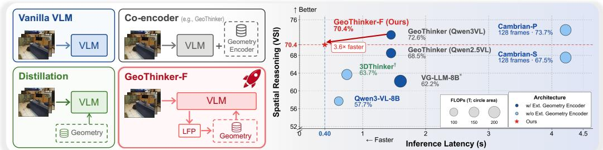

Figure 1: Comparison of spatial perception paradigms and their accuracy–efficiency trade-off. Left: Existing approaches either reason from semantic visual features alone, retain an external geometry encoder at inference, or distill geometric knowledge into compact latent representations. In contrast, GeoThinker-F performs endogenous prediction in the MLLM latent space, transforming its causal semantic states into complementary world representations of current geometry and future semantics without executing an external geometry encoder at runtime. Right: With the same Qwen3-VL backbone, GeoThinker-F reduces inference latency from 1.45 s to 0.40 s (3.6×) relative to GeoThinker while maintaining competitive spatial reasoning performance, yielding a favorable accuracy–efficiency frontier. † denotes an optimistic backbone only lower-bound estimation.

## ABSTRACT

Existing geometry-aware Multimodal Large Language Models (MLLMs) increasingly rely on external 3D encoders to provide structural priors, but executing these additional encoder paths at inference introduces substantial latency and computational overhead. We propose GeoThinker-F, an efficient framework that internalizes spatiotemporal perception by transforming causal MLLM hidden states into predictive latent world representations. Our key insight is that intermediate semantic representations contain sufficient information to predict useful representations of current geometry and future semantics, without requiring an exact reproduction of features from a dedicated 3D encoder. To realize this idea, GeoThinker-F adopts a decoupled two-stage training strategy. In the first stage, the MLLM backbone is frozen while lightweight Latent Frame Prediction (LFP) heads learn from an offline 3D geometry expert and next-frame semantic targets. In the second stage, the external expert is removed, and the model is jointly optimized to generate and selectively integrate its self-predicted priors through a specialized Spatial-Grounded Temporal (SGT) Fusion module. Extensive evaluations show that GeoThinker-F eliminates runtime dependence on external 3D geometry encoders while maintaining competitive performance across diverse spatial intelligence benchmarks. It achieves up to a 3.6× inference speedup, reducing latency from 1.45 s to 0.40 s while retaining strong spatial reasoning performance.

## 1 INTRODUCTION

Spatial intelligence has emerged as a central capability for Multimodal Large Language Models (MLLMs), with broad applications in 3D scene understanding (Cai et al., 2026; Yang et al., 2026b; Cao et al., 2026; 2023), embodied AI (Zhou et al., 2025; Xu et al., 2025), and autonomous decisionmaking (Li et al., 2025b). To bridge the gap between 2D semantic perception and 3D structural understanding, recent geometry-aware frameworks (Zheng et al., 2025a; Fan et al., 2026; Chen et al., 2026; Li et al., 2026a) increasingly leverage priors from external 3D geometry foundation models (Wang et al., 2025b; 2026; 2025c), either by integrating their features into the inference pipeline or distilling their representations during training. By jointly processing multiple frames, these geometry models provide fine-grained structural cues that complement the semantic representations of conventional visual encoders for reliable spatial relation understanding across views.

However, methods that retain a dedicated 3D geometry encoder at inference incur substantial computation, memory consumption, and synchronization latency, limiting deployment in latency-sensitive settings. Training-time distillation (Chen et al., 2025) avoids this dependency by absorbing geometric supervision into the MLLM parameters, but does not provide a dense, frame-aligned geometry interface for explicit routing across intermediate layers at inference. Dual-encoder architectures (Li et al., 2026a) retain such an explicit feature interface, but at the cost of executing an external geometry branch. Our key insight is that intermediate semantic representations contain sufficient information to predict useful latent representations of current geometry and future semantics, without exactly reproducing features from a dedicated 3D encoder. This raises a natural question:

## Can an MLLM generate geometric and temporal priorsfrom its own hidden states, thereby eliminating runtime dependence on external geometry models?

To eliminate this runtime overhead, we introduce GeoThinker-F, an efficient framework that internalizes predictive latent world representations within the MLLM. Rather than executing a dedicated 3D geometry encoder at inference, GeoThinker-F learns to transform intermediate hidden states into complementary representations of current geometry and future semantics. We realize this design through a decoupled two-stage training strategy. In Stage 1 (LFP pretraining), the MLLM backbone is frozen, while only lightweight Latent Frame Prediction (Yang et al., 2026b) (LFP) MLP heads attached to intermediate layers are trained using latent geometry features from an offline 3D expert and next-frame semantic features as prediction targets. In Stage 2 (self-driven tuning), the external geometry expert is removed, and the self-predicted representations are selectively integrated into intermediate MLLM layers through a Spatial-Grounded Temporal (SGT) Fusion module for spatial reasoning. At inference, GeoThinker-F generates both representations endogenously within its own latent space, eliminating runtime dependence on external geometry encoders.

Together, these components shift geometry-aware spatial reasoning from runtime external feature extraction toward endogenous latent prediction. On the Qwen3-VL-8B (Qwen Team, 2025b) backbone, the complete GeoThinker-F system, combined with spatial token compression, reduces inference latency from 1.45 s to 0.40 s, yielding a 3.6× speedup while achieving a VSI-Bench score of 70.4. Across six spatial intelligence benchmarks, GeoThinker-F further reaches an average score of 69.29, demonstrating strong cross-benchmark performance without executing an external geometry encoder at inference. By jointly predicting representations of current geometry and future semantics, GeoThinker-F integrates spatial structure and short-horizon temporal evolution within the MLLM latent space, providing an efficient alternative to runtime multi-encoder architectures.

Our contributions can be summarized as follows:

• Endogenous Predictive Latent Modeling: We propose GeoThinker-F, an efficient framework that predicts complementary representations of current geometry and future semantics from causal intermediate MLLM states. Through decoupled two-stage training, an external 3D geometry model is used only as an offline teacher, eliminating the need to execute a dedicated geometry encoder at inference.

• Specialized Spatiotemporal Fusion: We introduce Spatial-Grounded Temporal (SGT) Fusion, which employs separate geometry and temporal branches to selectively integrate the self-predicted representations. A layer-interleaved injection strategy further separates the two feature streams across intermediate MLLM layers, reducing interference during spatial reasoning and preserving their complementary spatial cues.

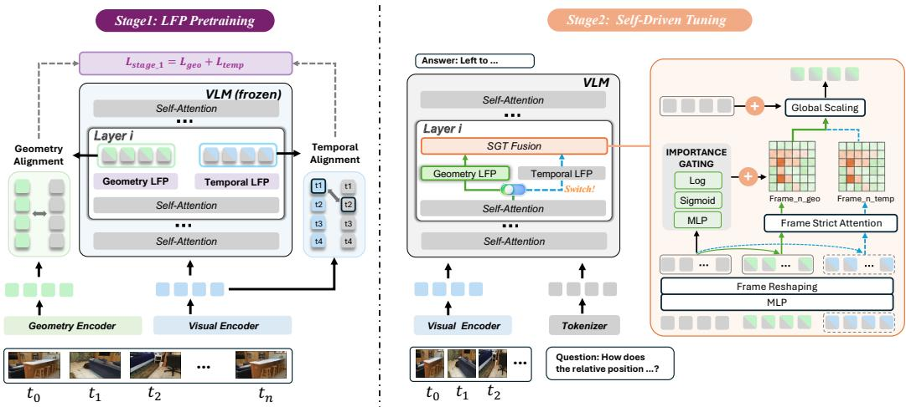  
Figure 2: Overview of the GeoThinker-F pipeline. The framework adopts two decoupled training stages to internalize geometric and temporal representations within the MLLM. Stage 1 (Left): With the MLLM backbone frozen, Latent Frame Prediction (LFP) heads attached to intermediate layers learn to predict latent geometry features produced by an offline 3D expert and semantic features of the next frame. Stage 2 (Right): The external geometry encoder is removed from the pipeline. The resulting geometry and future-semantic representations are selectively integrated by SGT-Fusion modules inserted at intermediate MLLM layers for spatial reasoning.

• Inference Efficiency and Cross-Benchmark Performance: Under controlled training data, GeoThinker-F achieves performance comparable to the dual-encoder baseline Geo-Thinker while removing its runtime geometry branch. Across six spatial intelligence benchmarks, GeoThinker-F reaches an average score of 69.29. When combined with spatial token compression, it reduces inference latency from 1.45 s to 0.40 s on Qwen3-VL-8B, yielding a 3.6× speedup in end-to-end execution time.

## 2 RELATED WORK

## 2.1 SEMANTICS-DRIVEN SPATIAL REASONING

MLLMs (Qwen Team, 2025c; Gemini Team, 2023; OpenAI, 2025) have demonstrated remarkable capabilities in general visual comprehension across both static images and video sequences. Nevertheless, recent evaluations (Yang et al., 2025a) highlight a persistent deficiency in dependable spatial reasoning, positioning spatial intelligence as a critical hurdle in achieving human-level multi-modal reasoning. To address this limitation, existing literature has investigated several distinct methodologies. One prominent direction involves the integration of explicit 3D information into the model pipeline. For instance, Video-3D LLM (Zheng et al., 2025b) enriches video tokens with frame-wise 3D spatial coordinates back-projected from RGB-D data to capture location-sensitive representations. Conversely, another line of work emphasizes implicit geometric regularization within the latent space. RoSS3D (Wang et al., 2025a) leverages cross-view and bird’s-eye-view (BEV) reconstruction targets alongside denoising-style objectives to foster geometry-consistent feature spaces. Parallel to architectural modifications, expanding training data has emerged as a highly potent strategy. Cambrian-S (Yang et al., 2026b) curates the VSI-590K dataset to investigate the boundaries of data scaling in spatial contexts. Similarly, SenseNova-SI (Cai et al., 2026) introduces the massive SenseNova-SI-8M dataset, achieving substantial performance leaps on both VSI-Bench and the EASI leaderboard (Cai et al., 2025) without sacrificing general multimodal proficiency. Complementing these approaches, reasoning-centric optimization seeks to fully unlock the inherent cognitive power of the underlying LLM. SpatialLadder (Li et al., 2026b) reinforces complex, multi-step spatial reasoning by utilizing reinforcement learning paired with verifiable reward signals. While these approaches avoid persistent external encoders and preserve standard inference efficiency, they typically acquire spatial structure indirectly through training data, auxiliary objectives, or reasoning supervision, rather than generating dedicated geometry representations at inference. Our work instead uses a pretrained geometry encoder as a training-time teacher, enabling the MLLM to predict geometry-derived structural priors internally without introducing an additional encoder at runtime.

## 2.2 PRIOR-DRIVEN GEOMETRY INTEGRATION

To endow MLLMs with spatial intelligence, recent architectural innovations have explored various pathways to incorporate 3D geometric representations from dedicated foundation models $( \mathrm { e . g . }$ VGGT (Wang et al., 2025b), $\pi ^ { 3 }$ (Wang et al., 2026)). A prevalent paradigm introduces explicit architectural additions to stream these geometric features directly into the MLLM pipeline. VG-LLM (Zheng et al., 2025a) employs direct patch-level feature addition to construct geometryaugmented visual tokens at the input layer. VLM-3R (Fan et al., 2026) concatenates enriched 3D features with camera parameters, subsequently leveraging a cross-attention layer to allow visual tokens to query the geometric context. Meanwhile, GS-Reasoner (Chen et al., 2026) incorporates grounding-aware Chain-of-Thought (CoT) supervision to explicitly bridge the gap between object localization and spatial cognition. $\mathrm { G ^ { 2 } V L M }$ (Hu et al., 2026) introduces a Mixture-of-Transformer-Experts (MoT) style architecture that bifurcates processing into dedicated geometric and semantic expert modules, optimizing joint 3D reconstruction and high-level reasoning through shared selfattention layers. Complementary to explicit streaming pipelines, another prominent direction utilizes feature distillation or semantic alignment to bypass the runtime overhead of external models. Frameworks such as 3DRS (Huang et al., 2025) and 3DThinker (Chen et al., 2025) distill 3D spatial priors directly from external geometric models into the MLLM’s latent visual representations. While these distillation methods eliminate the runtime geometry encoder via static supervision, they do not expose a separate geometry representation for explicit inference-time routing (Li et al., 2026a). In summary, methods that stream features from external geometry encoders provide explicit structural priors but incur additional runtime computation and latency. Training-time distillation avoids this dependency by supervising compact latent representations, but typically does not provide a dense, frame-aligned geometry interface for explicit routing across intermediate layers during inference (Chen et al., 2025). GeoThinker-F bridges this trade-off by using an offline geometry expert for pretraining and generating geometric and temporal priors through internal prediction heads at inference. These self-predicted representations are then selectively integrated through the dual-branch SGT-Fusion module to support task-relevant spatial reasoning over multi-frame visual inputs.

## 3 METHOD

To eliminate the runtime overhead of external geometry encoding, we propose GeoThinker-F, which introduces Latent Frame Prediction (LFP) heads at intermediate MLLM layers to predict complementary latent representations of geometry and future semantics from causal hidden states. The external geometry encoder is used only as an offline teacher during LFP pretraining and is removed from the subsequent tuning and inference pipelines. In the following, we first present the overall architecture and its decoupled two-stage training strategy, and then describe how the predicted representations are selectively integrated through the Spatial-Grounded Temporal Fusion mechanism.

## 3.1 ARCHITECTURE

Preliminary. Given a sequence of RGB images $\left\{ I _ { i } \right\} _ { i = 1 } ^ { n }$ and a natural-language query $Q ,$ , standard Multimodal Large Language Models (MLLMs) process the input by first projecting pixel-level data into a latent visual space. Specifically, a 2D vision encoder maps each image into semantic visual features $\begin{array} { r } { T _ { i } ^ { S } \in \mathbb { R } ^ { \left\lfloor \frac { h } { p _ { s } } \right\rfloor \times \left\lfloor \frac { w } { p _ { s } } \right\rfloor \times c } } \end{array}$ , where $I _ { i } \in \mathbb { R } ^ { h \times w \times 3 }$ and $p _ { s }$ is the patch size. Following recent architectures like Qwen2.5-VL (Qwen Team, 2025a) and Qwen3-VL (Qwen Team, 2025b), a spatial compression mechanism is introduced before the LLM layers to enhance computational efficiency. Specifically, given the spatial merge size of 2, this operation aggregates spatially contiguous $\overset { \cdot } { 2 } \times 2$ visual patches into a single representative token, yielding compressed semantic features $T _ { i } ^ { S ^ { \prime } } \in \mathbb { R } ^ { \left\lfloor \frac { h } { 2 p s } \right\rfloor \times \left\lfloor \frac { w } { 2 p s } \right\rfloor \times c }$ to significantly reduce the effective sequence length while preserving local semantic integrity. These tokens are then jointly processed by the LLM layers. Crucially, we denote the intermediate hidden states of the image tokens at a selected LLM layer j as $\mathbf { H } _ { j } ^ { i m g } \in \mathbb { R } ^ { r }$ ×L×c where $\begin{array} { r } { { \cal L } = \lfloor \frac { h } { 2 p _ { s } } \rfloor \times \lfloor \frac { w } { 2 p _ { s } } \rfloor } \end{array}$ , which serves as the input for our endogenous feature generation.

3D Visual Geometry Expert. To bootstrap our model with structural intuition without explicit   
3D supervision, we utilize VGGT (Wang et al., 2025b) as an offline geometry expert exclusively

Table 1: Performance comparisons on VSI-Bench (Vanilla regime). By internalizing 3D geometry priors and incorporating temporal dynamics priors, GeoThinker-F completely eliminates the external VGGT encoder while outperforming the GeoThinker.
<table><tr><td rowspan="2">METHODS</td><td rowspan="2"> $_ \mathrm { A V G }$ </td><td colspan="4">NUMERICAL ANSWER</td><td colspan="4">MULTIPLE-CHOICE ANSWER</td></tr><tr><td>|OBJ.COUNT ABS. DIST. OBJ. SIZE ROOM SIZE | REL. DIST. REL. DIR. ROUTE PLAN APPR. ORDER</td><td></td><td></td><td></td><td></td><td></td><td></td><td></td></tr><tr><td colspan="10">BASELINE</td></tr><tr><td>CHANCE LEVEL (RANDOM)</td><td></td><td></td><td></td><td></td><td></td><td>25.0</td><td>36.1</td><td>28.3</td><td>25.0</td></tr><tr><td>CHANCE LEVEL (FREQUENCY)</td><td>34.0</td><td>62.1</td><td>32.0</td><td>29.9</td><td>33.1</td><td>25.1</td><td>47.9</td><td>28.4</td><td>25.2</td></tr><tr><td colspan="10">PROPRIETARY MODELS (API)</td></tr><tr><td>GPT-40(HURST ET AL., 2024)</td><td>34.0</td><td>46.2</td><td>5.3</td><td>43.8</td><td>38.2</td><td>37.0</td><td>41.3</td><td>31.5</td><td>28.5</td></tr><tr><td>GEMINI-1.5 FLASH(GEMINI TEAM, 2024)</td><td>42.1</td><td>49.8</td><td>30.8</td><td>53.5</td><td>54.4</td><td>37.7</td><td>41.0</td><td>31.5</td><td>37.8</td></tr><tr><td>GEMINI-1.5 PRO(GEMINI TEAM, 2024)</td><td>45.4</td><td>56.2</td><td>30.9</td><td>64.1</td><td>43.6</td><td>51.3</td><td>46.3</td><td>36.0</td><td>34.6</td></tr><tr><td colspan="10">OPEN-SOURCED MODELS</td></tr><tr><td>LLAVA-ONEVISION-7B(LI ET AL., 2024)</td><td>32.4</td><td>47.7</td><td>20.2</td><td>47.4</td><td>12.3</td><td>42.5</td><td>35.2</td><td>29.4</td><td>24.4</td></tr><tr><td>LLAVA-ONEVISION-72B(LI ET AL., 2024)</td><td>40.2</td><td>43.5</td><td>23.9</td><td>57.6</td><td>37.5</td><td>42.5</td><td>39.9</td><td>32.5</td><td>44.6</td></tr><tr><td>LLAVA-NEXT-VIDEO-7B(ZHANG ET AL., 2024A)</td><td>35.6</td><td>48.5</td><td>14.0</td><td>47.8</td><td>24.2</td><td>43.5</td><td>42.4</td><td>34.0</td><td>30.6</td></tr><tr><td>LLAVA-NEXT-VIDEO-72B(ZHANG ET AL., 2024A)</td><td>40.9</td><td>48.9</td><td>22.8</td><td>57.4</td><td>35.3</td><td>42.4</td><td>36.7</td><td>35.0</td><td>48.6</td></tr><tr><td>INTERNVL2-8B(CHEN ET AL., 2024; OPENGVLAB TEAM, 2024)</td><td>34.6</td><td>23.1</td><td>28.7</td><td>48.2</td><td>39.8</td><td>36.7</td><td>30.7</td><td>29.9</td><td>39.6</td></tr><tr><td>INTERNVL2-40B(CHEN ET AL., 2024; OPENGVLAB TEAM, 2024)</td><td>36.0</td><td>34.9</td><td>26.9</td><td>46.5</td><td>31.8</td><td>42.1</td><td>32.2</td><td>34.0</td><td>39.6</td></tr><tr><td>QWEN2.5VL-3B(QWEN TEAM, 2025A)</td><td>28.6</td><td>32.7</td><td>19.5</td><td>17.3</td><td>25.1</td><td>37.3</td><td>44.9</td><td>30.4</td><td>21.8</td></tr><tr><td>QWEN2.5VL-7B(QWEN TEAM, 2025A)</td><td>29.3</td><td>25.2</td><td>10.5</td><td>36.4</td><td>29.6</td><td>38.4</td><td>38.0</td><td>29.8</td><td>26.8</td></tr><tr><td colspan="10">OPEN-SOURCE SPATIAL INTELLIGENCE MODELS</td></tr><tr><td>SPAR-8B(ZHANG ET AL., 2025)</td><td>44.1</td><td></td><td></td><td>一</td><td></td><td></td><td></td><td></td><td></td></tr><tr><td>SPATIALLADDER-3B(LI ET AL., 2026B)</td><td>44.8</td><td></td><td>一</td><td>一</td><td></td><td>一</td><td>一</td><td></td><td></td></tr><tr><td>SPATIAL-MLLM-4B(WU ET AL., 2025)</td><td>48.4</td><td>65.3</td><td>34.8</td><td>63.1</td><td>45.1</td><td>41.3</td><td>46.2</td><td>33.5</td><td>46.3</td></tr><tr><td>VG-LLM-4B(ZHENG ET  $\mathrm { A L } . , 2 0 \dot { 2 } 5 \mathrm { A } )$ </td><td>46.7</td><td>67.6</td><td>37.6</td><td>55.2</td><td>52.5</td><td>48.0</td><td>44.7</td><td>31.9</td><td>35.5</td></tr><tr><td>VG-LLM-8B (ZHENG ET AL., 2025A)</td><td>49.7</td><td>68.1</td><td>38.7</td><td>59.0</td><td>61.1</td><td>45.5</td><td>44.9</td><td>26.8</td><td>53.4</td></tr><tr><td>GEOTHINKERQWEN2.5VL-7B (LI ET AL., 2026A)</td><td>50.5</td><td>69.5</td><td>38.5</td><td>57.9</td><td>62.2</td><td>45.2</td><td>46.2</td><td>31.4</td><td>52.6</td></tr><tr><td colspan="10">OURS</td></tr><tr><td>GEOTHINKER-F QWEN2.5VL-7B</td><td>50.7</td><td>69.8</td><td>36.2</td><td>57.6</td><td>58.1</td><td>47.9</td><td>41.8</td><td>30.9</td><td>63.6</td></tr></table>

during the stage 1. Unlike vanilla 2D encoders, this geometry expert captures cross-frame spatial dependencies via a dual-component architecture consisting of an image-wise feature extractor and a cross-frame interaction decoder. Let $p _ { g }$ denote its patch size and it extracts dense geometric feature maps $\begin{array} { r } { T _ { i } ^ { G } \in \mathbb { R } ^ { \left\lfloor \frac { h } { p _ { g } } \right\rfloor \times \left\lfloor \frac { w } { p _ { g } } \right\rfloor \times c } } \end{array}$ from all input images jointly. To reconcile the resolution mismatch between the semantic and geometry features, $T _ { i } ^ { \bar { G } }$ is resampled and interpolated on a grid aligned with $p _ { s }$ and the $2 \times 2$ spatial merge factor. This yields a patch-aligned geometric representation $T _ { i } ^ { G ^ { \prime } } \in \mathbb { R } ^ { \left\lfloor \frac { h } { 2 p _ { s } } \right\rfloor \times \left\lfloor \frac { w } { 2 p _ { s } } \right\rfloor \times c }$ , ensuring an exact spatial correspondence with the semantic visual grid. It is worth noting that while $T _ { i } ^ { G ^ { \prime } }$ provides essential structural cues, its serial execution path introduces substantial latency. In our framework, the external encoder is removed at inference and used only offline during Stage 1 to provide geometry-feature targets for training the prediction heads.

Latent Frame Prediction. Inspired by predictive world-modeling paradigms (Yang et al., 2026b), we integrate lightweight Latent Frame Prediction (LFP) MLP heads directly onto the intermediate hidden layers of the MLLM. Instead of relying on an external streaming branch during inference, the model leverages its internal representations to autonomously anticipate spatial geometry and temporal dynamics. Specifically, given the intermediate hidden states $\mathbf { H } _ { i , j } ^ { i m g }$ from the image $I _ { i }$ and selected layer $j ,$ , the dual-targeted LFP heads project the latent features into two distinct latent spaces:

$$
\hat { T } _ { i } ^ { G ^ { \prime } } = \mathbf { M } \mathbf { L } \mathbf { P } _ { j } ^ { \mathrm { g e o } } ( \mathbf { H } _ { j } ^ { i m g } ) , \quad \hat { T } _ { i + 1 } ^ { S ^ { \prime } } = \mathbf { M } \mathbf { L } \mathbf { P } _ { j } ^ { \mathrm { t e m p } } ( \mathbf { H } _ { j } ^ { i m g } ) ,\tag{1}
$$

where $\hat { T } _ { i } ^ { G ^ { \prime } }$ denotes the predicted representation of current-frame geometry, trained to match the VGGT-derived target $T _ { i } ^ { { \cal G } ^ { \star } }$ from (Wang et al., 2025b), whereas $\hat { T } _ { i + 1 } ^ { S ^ { \prime } }$ denotes the predicted semantic representation of the next frame, trained against the corresponding visual feature target $T _ { i + 1 } ^ { S ^ { \prime } }$

## 3.2 ENDOGENOUS FEATURE GENERATION

The core insight of GeoThinker-F lies in transitioning from an execution-heavy external geometry branch to an endogenous feature generation pipeline, where the MLLM acts as its own spatialtemporal expert. To achieve this without causing representation drift or disrupting the backbone’s native semantic understanding, we introduce a decoupled two-stage training paradigm:

Stage 1: LFP Pre-training. As illustrated in Fig. 2, Stage 1 aims to cultivate the MLLM’s internal geometry and temporal intuition while strictly safeguarding its native multimodal capabilities. To achieve this, we freeze the primary MLLM backbone and exclusively train lightweight LFP heads attached to selected intermediate layers, thereby preventing low-level reconstruction constraints from perturbing top-level token generation throughout the entire pretraining process.

Stage 2: Self-Driven Tuning. Transitioning to joint spatiotemporal reasoning, we completely discard the external geometry expert and perform task-specific instruction tuning without external geometry inputs. The geometry and future-semantic representations generated by the LFP heads are routed into the downstream SGT Fusion blocks, enabling the MLLM to solve complex spatial reasoning tasks using entirely endogenous contextual cues within its own latent space.

Table 2: Cross-benchmark comparison on spatial intelligence benchmarks (Scaled regime). † indicates evaluation on reduced subsets. \* indicates trained with official S1+S2 setting. Benchmarks include VSI-Bench(Yang et al., 2025a), MMSI-Bench(Yang et al., 2026c), MindCube(Yin et al., 2025), Viewspatial(Li et al., 2025a), SITE(Wang et al., 2025e), CV-Bench (Tong et al., 2024).
<table><tr><td>MODELS</td><td>AVG.</td><td>VSI-BENCH</td><td>MMSI-BENCH</td><td>MINDCUBE</td><td>VIEWSPATIAL</td><td>SITE</td><td>CV-BENCH</td></tr><tr><td>HUMAN</td><td></td><td>79.2</td><td>97.2</td><td>94.5</td><td></td><td>67.5</td><td>一</td></tr><tr><td>RANDOM CHOICE</td><td></td><td>34.0</td><td>25.0</td><td>33.0</td><td>26.3</td><td>0.0</td><td>一</td></tr><tr><td colspan="8">PROPRIETARY MODELS</td></tr><tr><td>SEED-1.6(BYTEDANCE SEED, 2025)</td><td>53.41</td><td>49.9</td><td>38.3</td><td>48.7</td><td>43.8</td><td>54.6</td><td>85.2</td></tr><tr><td>GEMINI-2.5-PRO(COMANICI ET AL., 2025)</td><td>56.33</td><td>53.5</td><td>38.0</td><td>57.6</td><td>46.0</td><td>57.0</td><td>85.9</td></tr><tr><td>GPT-5(OPENAI, 2025)</td><td>57.50</td><td>55.0</td><td>41.8</td><td>56.3</td><td>45.5</td><td>61.8</td><td>84.6</td></tr><tr><td>GEMINI-3-PRO-PREVIEW (GEMINI, 2025)</td><td>62.16</td><td>52.5</td><td>45.2</td><td>70.8</td><td>50.3</td><td>62.2</td><td>92.0</td></tr><tr><td colspan="8">OPEN-SOURCE GENERAL MODELS</td></tr><tr><td>BAGEL-7B-MOT(DENG ET AL., 2025)</td><td>41.90</td><td>31.4</td><td>31.0</td><td>34.7</td><td>41.3</td><td>37.0</td><td>76.0</td></tr><tr><td>QWEN2.5-VL-3B-INSTRUCT(QWEN TEAM, 2025A)</td><td>38.60</td><td>28.6</td><td>28.6</td><td>37.6</td><td>31.9</td><td>33.1</td><td>71.8</td></tr><tr><td>QWEN2.5-VL-7B-INSTRUCT(QWEN TEAM, 2025A)</td><td>40.31</td><td>29.3</td><td>26.8</td><td>36.0</td><td>36.8</td><td>37.6</td><td>75.4</td></tr><tr><td>QWEN3-VL-2B-INSTRUCT(QWEN TEAM, 2025B)</td><td>42.40</td><td>49.4</td><td>11.9</td><td>31.4</td><td>34.2</td><td>35.6</td><td>78.4</td></tr><tr><td>QWEN3-VL-8B-INSTRUCT(QWEN TEAM, 2025B)</td><td>47.70</td><td>57.7</td><td>28.8</td><td>29.8</td><td>39.0</td><td>45.8</td><td>85.1</td></tr><tr><td>INTERNVL3-2B(ZHU ET AL., 2025)</td><td>39.31</td><td>32.9</td><td>26.5</td><td>37.5</td><td>32.5</td><td>30.0</td><td>76.5</td></tr><tr><td>INTERNVL3-8B (ZHU ET AL., 2025)</td><td>45.38</td><td>42.1</td><td>28.0</td><td>41.5</td><td>38.6</td><td>41.1</td><td>81.0</td></tr><tr><td colspan="8">OPEN-SOURCE SPATIAL INTELLIGENCE MODELS</td></tr><tr><td>SPATIALLADDER-3B(LI ET AL., 2026B) VST-3B-SFT (YANG ET AL., 2025B)</td><td>42.83</td><td>44.8</td><td>27.4</td><td>43.4</td><td>39.8</td><td>27.9</td><td>73.7</td></tr><tr><td></td><td>49.50</td><td>57.9†</td><td>30.2†</td><td>35.9</td><td>52.8</td><td>35.8</td><td>84.4</td></tr><tr><td>VST-7B-SFT(YANG ET AL., 2025B)</td><td>51.31</td><td>60.6†</td><td>32.0†</td><td>39.7</td><td>50.5</td><td>39.6</td><td>85.5</td></tr><tr><td>CAMBRIAN-S-3B(YANG ET AL., 2026B)</td><td>42.91</td><td>57.3</td><td>25.2</td><td>32.5</td><td>39.0</td><td>28.3</td><td>75.2</td></tr><tr><td>CAMBRIAN-S-7B (YANG ET AL., 2026B)</td><td>47.28</td><td>67.5</td><td>25.8</td><td>39.6</td><td>40.9</td><td>33.0</td><td>76.9</td></tr><tr><td>CAMBRIAN-P (YANG ET AL., 2026A)</td><td></td><td>73.7</td><td>28.0</td><td>38.4</td><td></td><td></td><td></td></tr><tr><td>SENSENOVA-SI-1.1QWEN3VL-8B (CAI ET AL., 2026)</td><td></td><td>64.8</td><td>38.1</td><td>73.8</td><td>51.2</td><td>49.6</td><td></td></tr><tr><td>SENSENOVA-SI-1.1INTERNVL3-8B (CAI ET AL., 2026)</td><td></td><td>68.8</td><td>43.3</td><td>85.7</td><td>54.7</td><td>47.7</td><td></td></tr><tr><td>3DTHINKERQWEN2.5-7B(CHEN ET AL., 2025)</td><td></td><td>63.7</td><td>43.3</td><td>76.0</td><td>68.6</td><td></td><td>81.1</td></tr><tr><td>VLM-3R-7B(FAN ET AL., 2026)</td><td>45.40</td><td>60.9</td><td>27.9</td><td>40.0</td><td>40.5</td><td>31.3</td><td>71.8</td></tr><tr><td>VG-LLM-4B(ZHENG ET AL., 2025A)</td><td>47.46</td><td>46.6</td><td>28.0</td><td>36.9</td><td>42.5</td><td>49.8</td><td>81.0</td></tr><tr><td>VG-LLM-8B(ZHENG ET AL., 2025A)</td><td>48.15 51.05</td><td>49.6</td><td>28.4</td><td>32.7</td><td>42.9</td><td>52.6</td><td>82.7</td></tr><tr><td>VG-LLM-8B*(ZHENG ET AL., 2025A)</td><td>60.43</td><td>62.2 68.5</td><td>30.0</td><td>36.1</td><td>45.8</td><td>50.5</td><td>81.7</td></tr><tr><td>GEOTHINKERQWEN2.5VL-7B (LI ET AL., 2026A) GEOTHINKERQWEN3VL-8B (LI ET AL., 2026A)</td><td></td><td>72.6</td><td>31.7</td><td>83.6</td><td>41.9</td><td>54.8</td><td>82.1</td></tr><tr><td></td><td>62.23</td><td></td><td>30.9</td><td>83.0</td><td>45.9</td><td>55.9</td><td>85.1</td></tr><tr><td colspan="8">OURS</td></tr><tr><td>GEOTHINKER-F QWEN2.5VL-7B</td><td>66.84</td><td>67.3</td><td>31.2</td><td>86.8</td><td>83.2</td><td>53.2</td><td>79.1</td></tr><tr><td>GEOTHINKER-F QWEN3VL-8B</td><td>69.29</td><td>70.4</td><td>30.8</td><td>93.2</td><td>82.6</td><td>53.7</td><td>85.0</td></tr></table>

## 3.3 SPATIAL GEOMETRY-TEMPORAL FUSION

Building upon the active perception paradigm of (Li et al., 2026a), we deploy SGT-Fusion across selected MLLM layers to incorporate the endogenously generated spatial-temporal priors. To effectively handle the distinct characteristics of the synthesized streams, we refine the original fusion mechanism into a dual-modality specialized architecture, which decouples the integration into an Geometry-Prior Branch and a Temporal-Prior Branch. Finally, we apply Layer-Interleaved Feature Injection, using learnable layer-wise scaling factors to dynamically calibrate and alternate the integration intensity of these spatial-temporal features.

## 3.3.1 GEOMETRY-PRIOR BRANCH

The Geometry-Prior Branch processes endogenously synthesized priors that inherently preserve current-frame spatial geometry, where contiguous feature regions share highly correlated geometric semantics. More specifically, let $\mathbf { H } _ { i } ^ { i m g } \in \mathbb { R } ^ { ( n \times L ) \times c }$ denote the hidden states of the image tokens in the j-th layer of LLM, where $\begin{array} { r } { L = \bigg [ \frac { h } { 2 p _ { s } } \bigg ] \times \bigg \lfloor \frac { w } { 2 p _ { s } } \bigg \rfloor } \end{array}$ denotes the token length of each image. Following (Li et al., 2026a), we predict an importance score $\mathbf { S } _ { i m p }$ directly from the image hidden states using a lightweight MLP. To preserve spatial correspondence and enforce the predictive constraint, we reshape both the image hidden states $\mathbf { H } _ { j } ^ { i m g }$ and the predicted current-frame spatial geometry features $\{ \hat { T } _ { i } ^ { G ^ { \prime } } \} _ { i = \cdot } ^ { N }$ into their original spatial dimensions, denoted as $\mathbf { S } \mathbf { H } _ { i } ^ { a m g }$ and $\mathbf { S } \hat { \mathbf { G } } _ { i } ^ { S ^ { \prime } } \in \mathbb { R } ^ { n \times L \times c }$ respectively. The query, key, and value projections are then computed such that the current frame’s semantics query its own predicted feature, avoiding erroneous queries that span frames. Therefore, the actively perceived geometry features $\mathbf { G e o } _ { j } ^ { i m g }$ can be computed as:

$$
{ \bf S } _ { j } ^ { i m p } = \mathrm { S i g m o i d } ( { \mathrm { M L P } } ( { \bf S H } _ { j } ^ { i m g } ) ) ,\tag{2}
$$

(a) Compute vs. throughput

(b) Speedup gain  
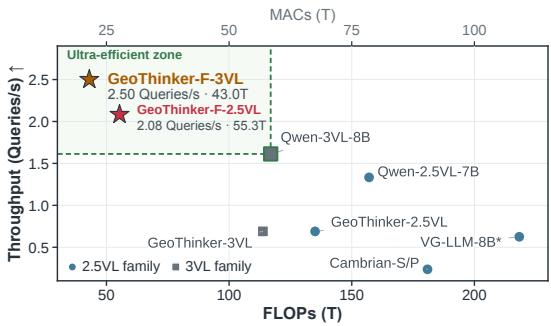

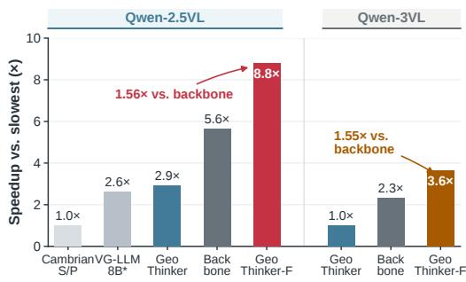  
Figure 3: Efficiency and throughput comparison. (a) Compute vs. throughput trade-off, showing GeoThinker-F positioned in the ultra-efficient zone with minimal FLOPs and superior throughput. (b) Relative speedup over the highest-accuracy baseline among the compared methods within each backbone family, reaching an 8.8× acceleration on Qwen2.5-VL-7B compared to Cambrian-P and a 3.6× acceleration on Qwen3-VL-8B compared to GeoThinker.

$$
{ \bf Q } _ { j } ^ { G e o } = \mathrm { M L P } ( { \bf S } { \bf H } _ { j } ^ { i m g } ) , ~ { \bf K } _ { j } ^ { G e o } = \mathrm { M L P } ( { \bf S } \hat { \bf G } _ { j } ^ { S ^ { \prime } } ) , { \bf V } _ { j } ^ { G e o } = \mathrm { M L P } ( { \bf S } \hat { \bf G } _ { j } ^ { S ^ { \prime } } ) .\tag{3}
$$

$$
\mathbf { G } e \mathbf { o } _ { j } ^ { i m g } = \mathrm { s o f t m a x } ( \frac { \mathbf { Q } _ { j } ^ { G e o } ( \mathbf { K } _ { j } ^ { G e o } ) ^ { T } } { \sqrt { d _ { k } } } + \log ( ( \mathbf { S } _ { j } ^ { i m p } ) ^ { T } + \epsilon ) ) \mathbf { V } _ { j } ^ { G e o } .\tag{4}
$$

where $d _ { k }$ denotes the dimension of the attention keys.

## 3.3.2 TEMPORAL-PRIOR BRANCH

The Temporal-Prior Branch leverages the LFP heads to project and integrate next-frame semantic features, thereby equipping the model with robust cross-frame temporal continuity and forwardlooking world-modeling capabilities. Similarly, we reshape both the image hidden states $\mathbf { H } _ { j } ^ { i m g }$ and the predicted next-frame temporal dynamics features $\{ \hat { T } _ { i + 1 } ^ { S ^ { \prime } } \} _ { i = 1 } ^ { N }$ into their original spatial dimensions, denoted as $\mathbf { S } \mathbf { H } _ { i } ^ { i m g }$ and $\hat { \mathbf { S T } } _ { j } ^ { S ^ { \prime } } \in \mathbb { R } ^ { n \times L \times c }$ , respectively. The query, key, and value projections are then computed such that the current frame’s semantics query its own predicted future. Therefore, let $d _ { k }$ denotes the dimension of the attention keys and the constrained cross-attention with temporal dynamic can be formulated as:

$$
\mathbf { Q } _ { j } ^ { T e m } = \mathrm { M L P } ( \mathbf { S } \mathbf { H } _ { j } ^ { i m g } ) , \mathbf { K } _ { j } ^ { T e m } = \mathrm { M L P } ( \mathbf { S } \hat { \mathbf { T } } _ { j } ^ { S ^ { \prime } } ) , \mathbf { V } _ { j } ^ { T e m } = \mathbf { M L P } ( \mathbf { S } \hat { \mathbf { T } } _ { j } ^ { S ^ { \prime } } ) .\tag{5}
$$

$$
\mathbf { T e m } _ { j } ^ { i m g } = \mathrm { s o f t m a x } \big ( \frac { \mathbf { Q } _ { j } ^ { T e m } ( \mathbf { K } _ { j } ^ { T e m } ) ^ { T } } { \sqrt { d _ { k } } } \big ) \mathbf { V } _ { j } ^ { T e m } .\tag{6}
$$

## 3.3.3 LAYER-INTERLEAVED FEATURE INJECTION

To regulate the intensity of geometric and temporal integration while preventing feature interference, we adopt a layer-interleaved injection strategy managed by a learnable scalar $\alpha _ { j }$ initialized to 0. Since both geometric and temporal priors are endogenously predicted and inherently noisy compared to feature targets, simultaneous fusion in a single layer leads to error accumulation and representation degradation. To mitigate this noise compound within LFP predicted features, we decouple the multi-modal injection across intermediate transformer layers:

$$
\hat { \mathbf { H } } _ { j } ^ { \mathrm { i m g } } = \mathbf { H } _ { j } ^ { \mathrm { i m g } } + \operatorname { t a n h } ( \alpha _ { j } ) \cdot \left\{ \mathbf { G e o } _ { j } ^ { \mathrm { i m g } } , \quad \mathrm { i f } j \in \mathcal { L } _ { \mathrm { g e o } } \right.\tag{7}
$$

where $\mathcal { L } _ { \mathrm { g e o } }$ and ${ \mathcal { L } } _ { \mathrm { t e m } }$ represent disjoint layer index sets dedicated to spatial geometry and temporal dynamics respectively, defined by alternating across odd and even LLM layers. The resulting $\mathbf { \hat { H } } _ { j } ^ { \mathrm { i m g } }$ serves as the refined hidden state for subsequent multimodal reasoning and response generation.

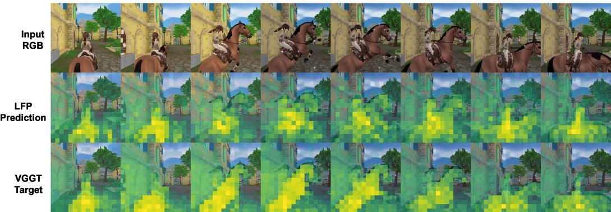  
Figure 4: Qualitative comparison between predicted geometry representations and VGGT feature targets. From top to bottom, we show the input RGB frames, geometry representations predicted by LFP head, and the corresponding feature targets from offline VGGT expert. The predicted features demonstrate remarkable structural alignment with the offline-expert feature targets.

## 4 EXPERIMENTS

In this section, we first provide implementation details in 4.1, followed by evaluation results on spatial reasoning benchmarks in 4.2, demonstrating the effectiveness of our approach. Next, we conduct an ablation study in 4.3 to verify the contribution of each component in GeoThinker-F. Finally, in 4.4, we provide visualizations of our core designs to better interpret model behavior.

## 4.1 IMPLEMENTATION DETAILS.

Baseline. GeoThinker (Li et al., 2026a) propose active geometry integration to actively select geometry features from VGGT (Wang et al., 2025b) as demand for MLLMs, serving as our primary baseline. (1) Vanilla regime: Following VG-LLM configuration, we utilize sampled subsets from SPAR-7M (Zhang et al., 2025) and the LLaVA-Hound split of LLaVA-Video-178K (Zhang et al., 2024b) for fine-tuning. We uniformly sample 8 frames per scene for consistency with the baseline. (2) Scaled regime: To probe the performance ceiling, we scale the training set with data from VLM-3R (Fan et al., 2026), VSI-590K (Yang et al., 2026b), MindCube (Yin et al., 2025) and OmniSpatial(Jia et al., 2026). We increase the sampling density to 32 frames per scene, and additionally incorporate 430k general video samples from (Yang et al., 2026b) to strengthen video understanding.

Implementation Details. To isolate the effects of our method and pre-training data, all experiments use the same subset of LLaVA-Hound in Vanilla regime for Stage 1 pretraining, ensuring that performance differences are not attributable to unequal amounts of instruction data introduced before SFT. To better assess the effectiveness and generalization of our design, we test GeoThinker-F across multiple VLM backbones under different training regimes (Li et al., 2026a). For spatial reasoning, we adopt three incremental training settings, all using a batch size of 64 and a learning rate of 1e-5. First, following VG-LLM (Zheng et al., 2025a), the training step is set to 4,656. Next, by scaling up the VSI-Bench instruction data, we increase the training steps to 19,315. Finally, we further incorporate general video data from (Yang et al., 2026b), which brings the total training steps to 28,235. The fusion ratio $\rho$ is set to 1 . All experiments are conducted on 16 PPU-ZW810E 96GB PPUs.

## 4.2 EVALUATION RESULTS

We conduct evaluation across multiple benchmarks, including VSI-Bench (Yang et al., 2025a), MMSI-Bench (Yang et al., 2026c), MindCube (Yin et al., 2025), ViewSpatial (Li et al., 2025a), SITE (Wang et al., 2025e), and CV-Bench (Tong et al., 2024).

Vanilla regime: To evaluate the effectiveness of our endogenous approach under a controlled setup, we conduct experiments on VSI-Bench following the evaluation protocols established in (Zheng et al., 2025a; Li et al., 2026a). For a fair comparison, we retain the identical VLM backbone and training data split, substituting external geometry feature streaming with our endogenous perception architecture. As reported in Table 1, GeoThinker-F achieves an average score of 50.7, outperforming both the input-level fusion baseline VG-LLM-8B at 49.7 and the dual-encoder GeoThinker baseline at 50.5. Crucially, GeoThinker-F achieves these top-tier results without requiring an external geometry encoder at runtime. This performance gain confirms that endogenously synthesized geometric textures and dynamic temporal priors, when dynamically routed through our SGT-Fusion module, supply sufficient spatial-temporal intuition while bypassing external multi-encoder overhead.

Table 3: Ablation Study on VSI-Bench. All compared variants are trained on the same vanilla SFT data with Qwen2.5-VL-7B backbone, showing the individual and joint contributions of our endogenous Geometry-Prior LFP and Temporal-Prior LFP branches.
<table><tr><td colspan="4"></td><td colspan="5">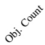 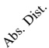</td><td colspan="4">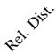 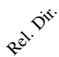</td></tr><tr><td>LFP Pretrain</td><td>Geometry</td><td>Temporal</td><td>Avg.</td><td></td><td>Numerical Answer</td><td></td><td></td><td></td><td></td><td></td><td></td></tr><tr><td>X</td><td>X</td><td>X</td><td>49.36</td><td></td><td>36.2</td><td>58.9</td><td>60.8</td><td>42.6</td><td>Multiple-Choice Answer</td><td>26.2</td><td>56.6</td></tr><tr><td>X</td><td>√</td><td>√</td><td>49.32</td><td>67.6 69.4</td><td>36.8</td><td>57.7</td><td>60.5</td><td>46.7</td><td>45.6 35.6</td><td>30.4</td><td>57.1</td></tr><tr><td>√</td><td>√</td><td>X</td><td>50.17</td><td>70.0</td><td>35.8</td><td>57.0</td><td>58.9</td><td>47.1</td><td>41.5</td><td>32.5</td><td>58.4</td></tr><tr><td>√</td><td>X</td><td>√</td><td>50.54</td><td>70.1</td><td>37.1</td><td>57.1</td><td>59.9</td><td>46.6</td><td>41.8</td><td>31.9</td><td>59.7</td></tr><tr><td>√</td><td>√</td><td>√</td><td>50.76</td><td>69.8</td><td>36.2</td><td>57.6</td><td>58.1</td><td>47.9</td><td>41.8</td><td>30.9</td><td>63.6</td></tr></table>

Scaled regime: To probe the scalability and generalization of our architecture, we expand the training mixture by integrating scaled spatial instruction data alongside general video samples. To verify that GeoThinker-F acquires versatile spatial intelligence rather than benchmark-specific overfitting, we evaluate across a comprehensive suite of six spatial reasoning benchmarks and prioritize crossbenchmark average accuracy. As shown in Table 2, GeoThinker-F sets a new state-of-the-art among open-source spatial models, outperforming both explicit-encoder baselines and leading proprietary API models (e.g., Gemini-3-Pro-Preview at 62.16). Specifically, GeoThinker-F Qwen2.5VL-7B and GeoThinker-F Qwen3VL-8B achieve peak average scores of 66.84 and 69.29, respectively. Notably, our model exhibits dramatic gains on complex 3D mental modeling and multi-perspective tasks that reaches 93.2 on MindCube and 82.6 on ViewSpatial, confirming that endogenously synthesized spatial-temporal priors provide robust, transferable spatial representations across diverse scenarios.

## 4.3 ABLATION STUDY

To evaluate the effects of LFP pretraining and the two predicted priors, we conduct a controlled ablation study on VSI-Bench using Qwen2.5-VL-7B. All variants are trained with the same vanilla SFT data. As reported in Table 3, the SFT baseline without LFP heads or SGT-Fusion achieves an average accuracy of 49.36 %. Adding both prediction heads and the fusion modules without Stage-1 LFP pretraining yields a comparable score of 49.32 %, indicating that the improvement does not arise merely from introducing additional trainable parameters. With LFP pretraining, the Geometry Branch and Temporal Branch individually achieve 50.17 % and 50.54 %, respectively. Combining both branches produces the best average accuracy of 50.76 %. These results validate the importance of Stage-1 LFP pretraining and the effectiveness of both predicted representations for spatial reasoning within a controlled and consistent SFT training configuration.

## 4.4 VISUALIZATION

To qualitatively examine whether the LFP heads learn geometry-related structure from the offline expert, we visualize the predicted geometry representations alongside their corresponding VGGT feature targets (Wang et al., 2025b). As illustrated in Figure 4, the predicted representations consistently localize the dominant foreground structure and follow its evolving position and spatial extent across consecutive frames. Their frame-wise activation layouts correspond closely with the VGGT targets, particularly in capturing the horse-rider foreground and its structural changes throughout the sequence. These visualizations suggest that the LFP heads effectively learn the principal spatial organization and frame-wise structural regularities encoded by the VGGT features.

## 5 CONCLUSION

In this paper, we introduced GeoThinker-F, an efficient framework for geometry-aware spatial reasoning that replaces runtime external geometry extraction with endogenous latent prediction. Through a decoupled two-stage training strategy, Latent Frame Prediction (LFP) heads learn from an offline geometry expert and next-frame semantic targets to predict complementary representations of current geometry and future semantics from intermediate MLLM states. These self-predicted representations are selectively integrated through the Geometry-Prior and Temporal-Prior Branches of the Spatial-Grounded Temporal (SGT) Fusion module. GeoThinker-F achieves performance comparable to GeoThinker without executing its external geometry encoder at inference. Across six spatial intelligence benchmarks, GeoThinker-F reaches an average score of 69.29. When combined with spatial token compression, the complete system reduces inference latency from 1.45 s to 0.40 s on Qwen3-VL-8B, corresponding to a 3.6× speedup. These results demonstrate that external geometry models can serve as training-time teachers, while useful geometric and temporal representation are generated internally with substantially lower runtime overhead.

## AI USE STATEMENT

In this work, we used generative AI tools to provide feedback on experimental design, assist with the implementation and editing of research code, interpret experimental results, and support grammar and language editing. We used these tools to draft and edit portions of the manuscript, improve readability, propose alternative titles and organizational structures, and brainstorm high-level concepts for scientific figures. AI tools also assisted with literature searches and bibliographic verification. All references were reviewed by the authors. The tools were not used to originate the core research hypothesis or scientific findings, design the proposed model or training strategy, generate or clean datasets, create synthetic data, formulate mathematical claims or proofs. Generative AI tools assisted with the design and initial creation of selected scientific figures. Most figures were manually created, and all AI-assisted figures were carefully reviewed, substantially edited, and finalized by the authors. All AI-assisted text and code were reviewed by the authors, the code was tested for correct ness, and technical descriptions, experimental interpretations, and numerical claims were checked against the implementation and experimental results. We take responsibility for the final content of this work, including text, claims, code, and artifacts produced with the aid of generative AI.

## ETHICS STATEMENT

This work uses publicly available research datasets and pretrained models and does not involve new data collection or interaction with human subjects. We use these resources in accordance with their respective licenses and terms of use. The qualitative visualizations are derived exclusively from video samples released as part of LLaVA-Hound and are presented in accordance with its documented conditions for research use. We do not collect additional personal information, attempt to identify depicted individuals, or infer sensitive attributes from their appearance. The proposed method is evaluated as a research system for spatial reasoning and is not intended for direct deployment in safety-critical environments without additional validation. As with other multimodal models, its behavior may inherit limitations or biases present in the underlying pretrained models and public datasets. We are not aware of other specific ethical concerns arising from this work.

## REPRODUCIBILITY STATEMENT

The main paper describes the overall architecture, two-stage training procedure, and evaluation settings. Additional implementation details, including model configurations, data composition, training objectives, computational costs, and efficiency analyses, are provided in the appendix. All experiments use publicly available datasets and a fixed random seed. For the reported efficiency results, latency is measured on a PPU-ZW810E 96GB accelerator using FP16 precision, a batch size of one, and a fixed 32-frame input in the spatial reasoning setting. We perform 10 warm-up runs followed by 100 measured runs and report the average latency. The corresponding input-token configurations are documented in the appendix. The source code, trained models, configurations, and data-processing resources will be made publicly available to facilitate reproduction of the reported results. The code and models will be open-sourced upon acceptance.

## REFERENCES

Mido Assran, Adrien Bardes, David Fan, Quentin Garrido, Russell Howes, Mojtaba Komeili, Matthew Muckley, Ammar Rizvi, Claire Roberts, Koustuv Sinha, Artem Zholus, et al. V-jepa 2: Self-supervised video models enable understanding, prediction and planning. arXiv preprint arXiv:2506.09985, 2025.

Ellis Brown, Jihan Yang, Shusheng Yang, Rob Fergus, and Saining Xie. Benchmark designers should” train on the test set” to expose exploitable non-visual shortcuts. arXiv preprint arXiv:2511.04655, 2025.

ByteDance Seed. Introduction to techniques used in Seed1.6, June 2025. URL https://seed.bytedance.com/en/blog/ introduction-to-techniques-used-in-seed1-6.

Zhongang Cai, Yubo Wang, Qingping Sun, Ruisi Wang, Chenyang Gu, Wanqi Yin, Zhiqian Lin, Zhitao Yang, Chen Wei, Oscar Qian, et al. Holistic evaluation of multimodal llms on spatial intelligence. arXiv preprint arXiv:2508.13142, 2025.

Zhongang Cai, Ruisi Wang, Chenyang Gu, Fanyi Pu, Junxiang Xu, Yubo Wang, Wanqi Yin, Zhitao Yang, Chen Wei, Tongxi Zhou, et al. Scaling spatial intelligence with multimodal foundation models. In Proceedings of the IEEE/CVF Conference on Computer Vision and Pattern Recognition, pp. 7879–7890, 2026.

Yang Cao, Yihan Zeng, Hang Xu, and Dan Xu. Coda: Collaborative novel box discovery and cross-modal alignment for open-vocabulary 3d object detection. In NeurIPS, 2023.

Yang Cao, Feize Wu, Dave Zhenyu Chen, Yingji Zhong, Lanqing Hong, and Dan Xu. Vggt-det: Mining vggt internal priors for sensor-geometry-free multi-view indoor 3d object detection. arXiv preprint arXiv:2603.00912, 2026.

Yiming Chen, Zekun Qi, Wenyao Zhang, Xin Jin, Li Zhang, and Peidong Liu. Reasoning in space via grounding in the world. In International Conference on Learning Representations, volume 2026, pp. 65549–65570, 2026.

Zhangquan Chen, Manyuan Zhang, Xinlei Yu, Xufang Luo, Mingze Sun, Zihao Pan, Xiang An, Yan Feng, Peng Pei, Xunliang Cai, et al. Think with 3d: Geometric imagination grounded spatial reasoning from limited views. arXiv preprint arXiv:2510.18632, 2025.

Zhe Chen, Weiyun Wang, Hao Tian, Shenglong Ye, Zhangwei Gao, Erfei Cui, Wenwen Tong, Kongzhi Hu, Jiapeng Luo, Zheng Ma, et al. How far are we to gpt-4v? closing the gap to commercial multimodal models with open-source suites. Science China Information Sciences, 67 (12):220101, 2024.

Gheorghe Comanici, Eric Bieber, Mike Schaekermann, et al. Gemini 2.5: Pushing the frontier with advanced reasoning, multimodality, long context, and next generation agentic capabilities. arXiv preprint arXiv:2507.06261, 2025. URL https://arxiv.org/abs/2507.06261.

Daniel Dauner, Marcel Hallgarten, Tianyu Li, Xinshuo Weng, Zhiyu Huang, Zetong Yang, Hongyang Li, Igor Gilitschenski, Boris Ivanovic, Marco Pavone, et al. Navsim: Data-driven non-reactive autonomous vehicle simulation and benchmarking. Advances in Neural Information Processing Systems, 37:28706–28719, 2024.

Chaorui Deng, Deyao Zhu, Kunchang Li, Chenhui Gou, Feng Li, Zeyu Wang, Shu Zhong, Weihao Yu, Xiaonan Nie, Ziang Song, Guang Shi, and Haoqi Fan. Emerging properties in unified multimodal pretraining. arXiv preprint arXiv:2505.14683, 2025.

Mengfei Du, Binhao Wu, Zejun Li, Xuan-Jing Huang, and Zhongyu Wei. Embspatial-bench: Benchmarking spatial understanding for embodied tasks with large vision-language models. In Proceedings of the 62nd Annual Meeting of the Association for Computational Linguistics (Volume 2: Short Papers), pp. 346–355, 2024.

Zhiwen Fan, Jian Zhang, Renjie Li, Junge Zhang, Runjin Chen, Hezhen Hu, Kevin Wang, Peihao Wang, Huaizhi Qu, Shijie Zhou, et al. Vlm-3r: Vision-language models augmented with instruction-aligned 3d reconstruction. In Proceedings ofthe IEEE/CVF Conference on Computer Vision and Pattern Recognition, pp. 31054–31065, 2026.

Xingyu Fu, Yushi Hu, Bangzheng Li, Yu Feng, Haoyu Wang, Xudong Lin, Dan Roth, Noah A Smith, Wei-Chiu Ma, and Ranjay Krishna. Blink: Multimodal large language models can see but not perceive. In European Conference on Computer Vision, pp. 148–166. Springer, 2024.

Gemini. Gemini 3 Pro Model Card. Technical report, Gemini, November 2025. Accessed: 2025- 11-18.

Gemini Team. Gemini: a family of highly capable multimodal models. arXiv preprint arXiv:2312.11805, 2023.

Gemini Team. Gemini 1.5: Unlocking multimodal understanding across millions of tokens of context. arXiv preprint arXiv:2403.05530, 2024.

Wenbo Hu, Jingli Lin, Yilin Long, Yunlong Ran, Lihan Jiang, Yifan Wang, Chenming Zhu, Runsen Xu, Tai Wang, and Jiangmiao Pang. G2 VLM: Geometry grounded vision language model with unified 3d reconstruction and spatial reasoning. In Proceedings ofthe IEEE/CVF Conference on Computer Vision and Pattern Recognition, pp. 9535–9546, 2026.

Xiaohu Huang, Jingjing Wu, Qunyi Xie, and Kai Han. 3drs: Mllms need 3d-aware representation supervision for scene understanding. In The Thirty-ninth Annual Conference on Neural Information Processing Systems, 2025.

Aaron Hurst, Adam Lerer, Adam P Goucher, Adam Perelman, Aditya Ramesh, Aidan Clark, AJ Ostrow, Akila Welihinda, Alan Hayes, Alec Radford, et al. Gpt-4o system card. arXiv preprint arXiv:2410.21276, 2024.

Mengdi Jia, Zekun Qi, Shaochen Zhang, Wenyao Zhang, Xinqiang Yu, Jiawei He, He Wang, and Li Yi. Omnispatial: Towards comprehensive spatial reasoning benchmark for vision language models. In International Conference on Learning Representations, volume 2026, pp. 35634– 35670, 2026.

Bo Li, Yuanhan Zhang, Dong Guo, Renrui Zhang, Feng Li, Hao Zhang, Kaichen Zhang, Peiyuan Zhang, Yanwei Li, Ziwei Liu, et al. Llava-onevision: Easy visual task transfer. arXiv preprint arXiv:2408.03326, 2024.

Dingming Li, Hongxing Li, Zixuan Wang, Yuchen Yan, Hang Zhang, Siqi Chen, Guiyang Hou, Shengpei Jiang, Wenqi Zhang, Yongliang Shen, et al. Viewspatial-bench: Evaluating multiperspective spatial localization in vision-language models. arXiv preprint arXiv:2505.21500, 2025a.

Haoyuan Li, Qihang Cao, Tao Tang, Kun Xiang, Zihan Guo, Jianhua Han, JiaWang Bian, Hang Xu, and Xiaodan Liang. Thinking with geometry: Active geometry integration for spatial reasoning. arXiv preprint arXiv:2602.06037, 2026a.

Hongxing Li, Dingming Li, Zixuan Wang, Yuchen Yan, Hang Wu, Wenqi Zhang, Yongliang Shen, Weiming Lu, Jun Xiao, and Yueting Zhuang. Spatialladder: Progressive training for spatial reasoning in vision-language models. In International Conference on Learning Representations, volume 2026, pp. 76566–76592, 2026b.

Yongkang Li, Kaixin Xiong, Xiangyu Guo, Fang Li, Sixu Yan, Gangwei Xu, Lijun Zhou, Long Chen, Haiyang Sun, Bing Wang, et al. Recogdrive: A reinforced cognitive framework for end-toend autonomous driving. arXiv preprint arXiv:2506.08052, 2025b.

Jingli Lin, Runsen Xu, Shaohao Zhu, Sihan Yang, Peizhou Cao, Yunlong Ran, Miao Hu, Chenming Zhu, Yiman Xie, Yilin Long, et al. Mmsi-video-bench: A holistic benchmark for video-based spatial intelligence. arXiv preprint arXiv:2512.10863, 2025.

Bo Liu, Yifeng Zhu, Chongkai Gao, Yihao Feng, Qiang Liu, Yuke Zhu, and Peter Stone. LIBERO: Benchmarking knowledge transfer for lifelong robot learning. Advances in Neural Information Processing Systems, 36:44776–44791, 2023.

Wufei Ma, Haoyu Chen, Guofeng Zhang, Yu-Cheng Chou, Jieneng Chen, Celso de Melo, and Alan Yuille. 3dsrbench: A comprehensive 3d spatial reasoning benchmark. In Proceedings of the IEEE/CVF International Conference on Computer Vision, pp. 6924–6934, 2025.

Lucas Maes, Quentin Le Lidec, Damien Scieur, Yann LeCun, and Randall Balestriero. Leworldmodel: Stable end-to-end joint-embedding predictive architecture from pixels. arXiv preprint arXiv:2603.19312, 2026.

OpenAI. GPT-5 System Card. Technical report, OpenAI, August 2025. Accessed: 2025-08-10.

OpenGVLab Team. InternVL2: Better than the best—expanding performance boundaries of opensource multimodal models with the progressive scaling strategy, July 2024. URL https:// internvl.github.io/blog/2024-07-02-InternVL-2.0/.

Qwen Team. Qwen2.5-vl technical report. arXiv preprint arXiv:2502.13923, 2025a.

Qwen Team. Qwen3-vl: Multimodal large language model series. https://github.com/ QwenLM/Qwen3-VL, 2025b. GitHub repository; accessed: 2025-11-14.

Qwen Team. Qwen3 technical report, 2025c. URL https://arxiv.org/abs/2505.09388.

StarVLA Community. StarVLA: A lego-like codebase for vision-language-action model developing. arXiv preprint arXiv:2604.05014, 2026.

Shengbang Tong, Ellis Brown, Penghao Wu, Sanghyun Woo, Manoj Middepogu, Sai Charitha Akula, Jihan Yang, Shusheng Yang, Adithya Iyer, Xichen Pan, Austin Wang, Rob Fergus, Yann LeCun, and Saining Xie. Cambrian-1: A fully open, vision-centric exploration of multimodal llms. In A. Globerson, L. Mackey, D. Belgrave, A. Fan, U. Paquet, J. Tomczak, and C. Zhang (eds.), Advances in Neural Information Processing Systems, volume 37, pp. 87310–87356. Curran Associates, Inc., 2024. doi: 10.52202/ 079017-2771. URL https://proceedings.neurips.cc/paper\_files/paper/ 2024/file/9ee3a664ccfeabc0da16ac6f1f1cfe59-Paper-Conference.pdf.

Haochen Wang, Yucheng Zhao, Tiancai Wang, Haoqiang Fan, Xiangyu Zhang, and Zhaoxiang Zhang. Ross3d: Reconstructive visual instruction tuning with 3d-awareness. arXiv preprint arXiv:2504.01901, 2025a.

Jianyuan Wang, Minghao Chen, Nikita Karaev, Andrea Vedaldi, Christian Rupprecht, and David Novotny. VGGT: Visual geometry grounded transformer. In Proceedings of the IEEE/CVF Conference on Computer Vision and Pattern Recognition,, pp. 5294–5306, 2025b.

Qianqian Wang, Yifei Zhang, Aleksander Holynski, Alexei A Efros, and Angjoo Kanazawa. Continuous 3d perception model with persistent state. In Proceedings of the Computer Vision and Pattern Recognition Conference, pp. 10510–10522, 2025c.

Weiyun Wang, Zhangwei Gao, Lixin Gu, Hengjun Pu, Long Cui, Xingguang Wei, Zhaoyang Liu, Linglin Jing, Shenglong Ye, Jie Shao, et al. Internvl3. 5: Advancing open-source multimodal models in versatility, reasoning, and efficiency. arXiv preprint arXiv:2508.18265, 2025d.

Wenqi Wang, Reuben Tan, Pengyue Zhu, Jianwei Yang, Zhengyuan Yang, Lijuan Wang, Andrey Kolobov, Jianfeng Gao, and Boqing Gong. Site: towards spatial intelligence thorough evaluation. arXiv preprint arXiv:2505.05456, 2025e.

Yifan Wang, Jianjun Zhou, Haoyi Zhu, Wenzheng Chang, Yang Zhou, Zizun Li, Junyi Chen, Jiangmiao Pang, Chunhua Shen, and Tong He. π3: Scalable permutation-equivariant visual geometry learning. In International Conference on Learning Representations, volume 2026, pp. 10481– 10497, 2026.

Diankun Wu, Fangfu Liu, Yi-Hsin Hung, and Yueqi Duan. Spatial-mllm: Boosting mllm capabilities in visual-based spatial intelligence. arXiv preprint arXiv:2505.23747, 2025.

Rongtao Xu, Han Gao, Mingming Yu, Dong An, Shunpeng Chen, Changwei Wang, Li Guo, Xiaodan Liang, and Shibiao Xu. 3d-more: Unified modal-contextual reasoning for embodied question answering. In 2025 IEEE/RSJ International Conference on Intelligent Robots and Systems (IROS), pp. 5924–5929. IEEE, 2025.

Jihan Yang, Shusheng Yang, Anjali W Gupta, Rilyn Han, Li Fei-Fei, and Saining Xie. Thinking in space: How multimodal large language models see, remember, and recall spaces. In Proceedings of the IEEE/CVF Conference on Computer Vision and Pattern Recognition,, pp. 10632–10643, 2025a.

Jihan Yang, Zifan Zhao, Xichen Pan, Shusheng Yang, Junyi Zhang, Bingyi Kang, Hu Xu, Shang-Wen Li, and Saining Xie. Cambrian-p: Pose-grounded video understanding. arXiv preprint arXiv:2605.22819, 2026a.

Rui Yang, Ziyu Zhu, Yanwei Li, Jingjia Huang, Shen Yan, Siyuan Zhou, Zhe Liu, Xiangtai Li, Shuangye Li, Wenqian Wang, Yi Lin, and Hengshuang Zhao. Visual spatial tuning. arXiv preprint arXiv:2511.05491, 2025b.

Shusheng Yang, Jihan Yang, Pinzhi Huang, Ellis Brown, Zihao Yang, Yue Yu, Shengbang Tong, Zihan Zheng, Yifan Xu, Muhan Wang, et al. Cambrian-s: Towards spatial supersensing in video. In International Conference on Learning Representations, volume 2026, pp. 78185–78225, 2026b.

Sihan Yang, Runsen Xu, Yiman Xie, Sizhe Yang, Mo Li, Jingli Lin, Chenming Zhu, Xiaochen Chen, Haodong Duan, Xiangyu Yue, et al. Mmsi-bench: A benchmark for multi-image spatial intelligence. In International Conference on Learning Representations, volume 2026, pp. 157051–157088, 2026c.

Baiqiao Yin, Qineng Wang, Pingyue Zhang, Jianshu Zhang, Kangrui Wang, Zihan Wang, Jieyu Zhang, Keshigeyan Chandrasegaran, Han Liu, Ranjay Krishna, et al. Spatial mental modeling from limited views. In Structural Priorsfor Vision Workshop at ICCV’25, 2025.

Jiahui Zhang, Yurui Chen, Yanpeng Zhou, Yueming Xu, Ze Huang, Jilin Mei, Junhui Chen, Yu-Jie Yuan, Xinyue Cai, Guowei Huang, et al. From flatland to space: Teaching vision-language models to perceive and reason in 3d. arXiv preprint arXiv:2503.22976, 2025.

Yiming Zhang, Jiacheng Chen, Jiaqi Tan, Yongsen Mao, Wenhu Chen, and Angel X Chang. Revsi: Rebuilding visual spatial intelligence evaluation for accurate assessment of vlm 3d reasoning. In Forty-third International Conference on Machine Learning, 2026.

Yuanhan Zhang, Bo Li, Haotian Liu, Yong Jae Lee, Liangke Gui, Di Fu, Jiashi Feng, Ziwei Liu, and Chunyuan Li. LLaVA-NeXT: A strong zero-shot video understanding model, April 2024a. URL https://llava-vl.github.io/blog/2024-04-30-llava-next-video/.

Yuanhan Zhang, Jinming Wu, Wei Li, Bo Li, Zejun Ma, Ziwei Liu, and Chunyuan Li. LLaVA-Video: Video instruction tuning with synthetic data. arXiv preprint arXiv:2410.02713, 2024b. URL https://arxiv.org/abs/2410.02713.

Duo Zheng, Shijia Huang, Yanyang Li, and Liwei Wang. Learning from videos for 3d world: Enhancing mllms with 3d vision geometry priors. arXiv preprint arXiv:2505.24625, 2025a.

Duo Zheng, Shijia Huang, and Liwei Wang. Video-3d llm: Learning position-aware video representation for 3d scene understanding. In Proceedings of the Computer Vision and Pattern Recognition Conference, pp. 8995–9006, 2025b.

Enshen Zhou, Jingkun An, Cheng Chi, Yi Han, Shanyu Rong, Chi Zhang, Pengwei Wang, Zhongyuan Wang, Tiejun Huang, Lu Sheng, et al. Roborefer: Towards spatial referring with reasoning in vision-language models for robotics. arXiv preprint arXiv:2506.04308, 2025.

Jinguo Zhu, Weiyun Wang, Zhe Chen, Zhaoyang Liu, Shenglong Ye, Lixin Gu, Hao Tian, Yuchen Duan, Weijie Su, Jie Shao, et al. Internvl3: Exploring advanced training and test-time recipes for open-source multimodal models. arXiv preprint arXiv:2504.10479, 2025.

## A APPENDIX/SUPPLEMENTAL MATERIAL

The outline of the Appendix is as follows:

• More implementation details;

• More analysis on downstream scenarios validation;

– Additional analysis on autonomous driving;

– Additional analysis on embodied manipulation;

• More analysis on computational cost;

• More analysis on general video mixture and test-frame scaling;

– Additional analysis on general video mixture;

– Additional analysis on test-frame scaling;

• More evaluation on VSTI-Bench;

• More evaluation on EASI Leaderboard;

– More evaluation on EASI-8;

– More evaluation on EASI-All;

• More evaluation on ReVSI-Bench;

• More ablation study on OmniSpatial Training data;

• More ablation study on Stage-2 training;

• More analysis on Stage 1 Pre-training Loss Function;

– Additional definition on basic operations;

– Additional definition on local relation loss;

– Additional analysis on pre-training loss of temporal branch;

– Additional analysis on pre-training loss of geometry branch;

• More visualization comparisons;

• More discussion;

## B IMPLEMENTATION DETAILS

## B.1 MODEL CONFIGURATIONS

We conduct all evaluations based on the 32-frame training setting using GeoThinker-F Qwen25VL-7B and GeoThinker-F $\mathrm { Q w e n 3 V L - 8 B }$ in scaled regime. Below, we elaborate on the specific architectural configurations, feature injection protocols, and optimization strategies deployed across different domain regimes:

Layer-Wide Interleaved Feature Injection: Unlike prior designs that adjust the injection depth according to the training-data scale (Li et al., 2026a), GeoThinker-F applies Layer-Interleaved Feature Injection across all $( \rho = 1 . 0 )$ intermediate Transformer layers. Importantly, full-depth coverage does not expose every layer to geometric features. Instead, current-geometry and future-semantic predictions are injected into alternating layers, limiting direct geometry injection to approximately half of the network depth. Because the temporal branch predicts next-frame semantic representations aligned with the MLLM’s visual-semantic space, it provides a semantically compatible complement to the geometry branch. We further assign the final injection layer to the temporal branch, keeping the uppermost hidden states semantically anchored before language decoding. This interleaved design enables consistent spatiotemporal guidance throughout the backbone while reducing potential interference from dense geometry injection.

Domain-Adaptive LFP Head Optimization: To balance cross-domain generalization and indomain adaptability, the optimization status of the Latent Frame Prediction (LFP) heads is dynamically configured:

• Out-of-Domain (OOD) Transfer: The LFP heads remain frozen during downstream tuning. This preserves the geometry and temporal representations acquired during pretraining and reduces their drift during downstream tuning.

• In-Domain (ID) Adaptation: The LFP heads are unfrozen and end-to-end fine-tuned along with the fusion layers, allowing the heads to adaptively align with domain-specific geometric and motion distributions.

Adaptive Spatial Token Compression: To efficiently scale to long temporal horizons (e.g., 32 frames per scene) without exceeding memory boundaries, we incorporate an adaptive spatial token compression strategy following (Li et al., 2026a). Rather than statically compressing all inputs, we introduce a sequence-length condition:

• Short Sequences (≤ 8 frames): A heuristic bypass is triggered to skip spatial compression entirely, safeguarding fine-grained visual and geometric details for sparse frame inputs.

• Long Sequences (> 8frames): Spatial compression is activated in conjunction with Importance Gating mechanism. By dynamically filtering redundant visual tokens, IG allows the spatial merge stride to increase from 2 to 4 while retaining geometry-relevant information.

## B.2 DATA CURATION

For the In-Domain training of our model, we curated a large-scale multimodal dataset totaling 1.7M samples. The data composition is as follows:

Spatial Reasoning: Cambrian-S VSI-bench instruction (590k), SPAR (234k), VLM-3R VSI-bench instruction (205k), VLM-3R VSTI-bench instruction (132k), MindCube training set (10k) and OmniSpatial training set (7k).

General Video: LLaVA-Hound (64k) and a subset of general video data sampled from Cambrian-S-3M (430k).

## C DOWNSTREAM SCENARIOS VALIDATION

## C.1 AUTONOMOUS DRIVING

Table 4: Performance comparison on NAVSIM navtest. Compared with ReCogDrive, GeoThinker-F improves key driving metrics. Compared with GeoThinker, it reduces the spatialprior integration overhead by 52.91%. Evaluation includes Not-at-fault Collisions (NC), Drivable Area Compliance (DAC), Time-To-Collision within bound (TTC), Comfort (Comf.), Ego and Progress (EP).
<table><tr><td rowspan=1 colspan=1>Method</td><td rowspan=1 colspan=1>FLOPs(T)Amortized Latency(ms/output token)</td><td rowspan=1 colspan=1>NC↑ DAC↑</td><td rowspan=1 colspan=1>TTC↑ Comf.↑ EP↑</td><td rowspan=1 colspan=1>PDMS↑</td></tr><tr><td rowspan=2 colspan=1>Constant VelocityEgo Status MLP</td><td rowspan=2 colspan=1>一              一一              一</td><td rowspan=1 colspan=1>68.057.8</td><td rowspan=2 colspan=1>50.0   100 19.483.6   100 62.8</td><td rowspan=2 colspan=1>20.665.6</td></tr><tr><td rowspan=1 colspan=1>93.077.3</td></tr><tr><td rowspan=2 colspan=1>ReCogDrive w/ InternVLGeoThinker</td><td rowspan=2 colspan=1>73.45         32.15122.69         42.62</td><td rowspan=1 colspan=1>95.093.7</td><td rowspan=2 colspan=1>87.8   100 78.794.1   100 78.4</td><td rowspan=2 colspan=1>81.984.4</td></tr><tr><td rowspan=1 colspan=1>98.093.2</td></tr><tr><td rowspan=1 colspan=1>GeoThinker-F (Ours)</td><td rowspan=1 colspan=1>88.22    37.08(-52.91%)</td><td rowspan=1 colspan=1>96.5 94.0</td><td rowspan=1 colspan=1>90.4  100 78.7</td><td rowspan=1 colspan=1>83.3</td></tr></table>

Baseline. ReCogDrive (Li et al., 2025b) is a cognitive framework designed for end-to-end autonomous driving. In our implementation, we focus on its spatial planning capabilities during VLM pre-training without incorporating subsequent diffusion planners or reinforcement learning pipelines. For evaluation, we conduct non-reactive simulation experiments on NAVSIM navtest (Dauner et al., 2024) to assess safety-critical decision-making intelligence.

Results. As reported in Table 4, GeoThinker-F significantly mitigates prior integration overhead while enhancing downstream driving safety. Specifically, GeoThinker-F reduces the auxiliary latency overhead introduced by spatial prior fusion by 52.91% from 42.62 ms to 37.08 ms and lowers total computational cost from 122.69 T to 88.22 T FLOPs. Notably, even without deploying spatial token compression, which serves as an orthogonal strategy for further inference acceleration in our implementation in 4.1, GeoThinker-F natively achieves a > 50% reduction in integration overhead by completely bypassing external encoder execution. In terms of decision-making quality, GeoThinker-F improves NC, DAC, TTC, and PDMS while matching the baseline on Comfort and EP, yielding higher Drivable Area Compliance (DAC: 94.0% vs. 93.7%) and Time-To-Collision compliance (TTC: 90.4% vs. 87.8%), elevating the overall PDMS score to 83.3%. These results confirm that endogenously synthesized spatial-temporal priors provide a lightweight, loweroverhead alternative for autonomous planning.

## C.2 EMBODIED MANIPULATION

We evaluate embodied manipulation on LIBERO (Liu et al., 2023) using the StarVLA framework (StarVLA Community, 2026).

Table 5: Comparison of different VLA models on LIBERO. We train one policy for all 4 suites. All scores are averaged over 500 trials for each task suite (10 tasks × 50 episodes). Compared with GeoThinker, it reduces the spatial-prior integration overhead by 87.15%.
<table><tr><td>Model</td><td>FLOPs(T) Latency(ms)</td><td></td><td>Steps Spatial Object Goal Long Avg</td><td></td><td></td><td></td><td></td></tr><tr><td colspan="6">Baseline</td></tr><tr><td>π₀+FAST</td><td></td><td></td><td>96.4</td><td>96.8</td><td></td><td>88.6 60.2 85.5</td><td></td></tr><tr><td>π0</td><td></td><td></td><td></td><td>96.8</td><td>98.8</td><td>95.8</td><td>85.2 94.1</td></tr><tr><td>OpenVLA-OFT-7B</td><td></td><td></td><td>175K</td><td>97.6</td><td>98.4</td><td>97.9 94.5</td><td>97.1</td></tr><tr><td>GR00T-N1.5</td><td></td><td></td><td>20K</td><td>92.0</td><td>92.0</td><td>86.0 76.0</td><td>86.5</td></tr><tr><td colspan="6"></td></tr><tr><td>Qwen3-VL-4B</td><td></td><td></td><td></td><td></td><td></td><td></td><td></td></tr><tr><td>StarVLA-OFT GeoThinker</td><td>2.44 5.84</td><td>82.0 254.8</td><td>30K 30K</td><td>97.8 98.4</td><td>98.6 99.0</td><td>96.2 98.4</td><td>93.8 96.6</td></tr><tr><td></td><td></td><td>104.2(-87.15%)</td><td>30K</td><td>97.6</td><td>99.6</td><td>98.2</td><td>91.2 96.7</td></tr><tr><td>GeoThinker-F (Ours)</td><td>2.51</td><td></td><td></td><td></td><td></td><td></td><td>93.097.1</td></tr></table>

Results. As reported in Table 5, GeoThinker-F achieves strong task-execution performance while substantially reducing the inference overhead of explicit spatial-prior integration. Relative to the 82.0 ms StarVLA-OFT backbone, GeoThinker introduces 172.8 ms of additional latency, whereas GeoThinker-F introduces only 22.2 ms. GeoThinker-F therefore reduces the spatial-prior integration overhead by 87.15%, lowering end-to-end inference latency from 254.8 ms to 104.2 ms and computational cost from 5.84 T to 2.51 T FLOPs, close to the 2.44 T FLOPs of the raw StarVLA-OFT backbone. Across the four LIBERO task suites, GeoThinker-F attains a 97.1% average success rate, with 97.6% on Spatial, 99.6% on Object, 98.2% on Goal, and 93.0% on Long. It surpasses StarVLA-OFT (96.6%) and GeoThinker (96.7%), while matching OpenVLA-OFT-7B (97.1%) with over 5× fewer training steps (30K versus 175K). These results show that endogenous geometry and temporal representations can retain strong embodied task performance with substantially lower inference overhead.

## D COMPUTATIONAL COST

## D.1 SPATIAL INTELLIGENCE

To elucidate the efficiency bottlenecks inherent to 3D spatial intelligence, we analyze the computational and latency profiles across different model architectures on multi-view benchmarks like VSI-Bench in Table 6. For GeoThinker and GeoThinker-F, w/o further token compression retains the base long-video tokenization, while the complete variants apply the additional compression strategy described in Appendix B. Other models are evaluated using their native tokenization settings. Our causal efficiency comparison is therefore made primarily within matched backbone and modelfamily configurations.

Table 6: Quantitative efficiency and spatial reasoning performance comparison across different model backbones. We report computational cost in FLOPs (T) and MACs (T), inference latency (s), and accuracy on VSI-Bench. \* denotes leveraging estimated lower bound of latency. GeoThinker-F $3 2 \mathrm { f r a m e }$ achieves substantial reductions in FLOPs, MACs, and inference latency compared to external 3D encoder baselines (e.g., GeoThinker), while maintaining highly competitive performance.
<table><tr><td>Model</td><td>FLOPs(T)↓ MACs(T)↓ Latency(s)↓|VSI↑</td><td></td><td></td><td></td></tr><tr><td colspan="5">Qwen2.5VL-3B</td></tr><tr><td>Qwen-2.5VL-3B</td><td>95.29</td><td>47.64</td><td>0.60</td><td>28.6</td></tr><tr><td>3DThinkerQwen-2.5VL-3B</td><td>95.29</td><td>47.64</td><td>0.60</td><td>59.1</td></tr><tr><td>VG-LLM-4B</td><td>152.92</td><td>76.43</td><td>1.43</td><td>46.7</td></tr><tr><td>GeoThinker8frame</td><td>157.81</td><td>78.87</td><td>1.48</td><td>48.9</td></tr><tr><td colspan="5">Qwen2.5VL-7B</td></tr><tr><td>Qwen-2.5VL-7B</td><td>157.06</td><td>78.53</td><td>0.75</td><td>29.3</td></tr><tr><td>3DThinkerQwen-2.5VL-7B *</td><td>157.06</td><td>78.53</td><td>0.75</td><td>63.7</td></tr><tr><td>VG-LLM-8B*</td><td>218.29</td><td>109.12</td><td>1.60</td><td>62.2</td></tr><tr><td>Cambrian-S(128×64)</td><td>180.88</td><td>90.44</td><td>4.22</td><td>67.5</td></tr><tr><td>Cambrian-P(32×196)</td><td>128.83</td><td>64.41</td><td>0.86</td><td>72.0</td></tr><tr><td>Cambrian-P(64×64)</td><td>80.89</td><td>40.44</td><td>1.84</td><td>73.1</td></tr><tr><td>Cambrian-P(128×64)</td><td>180.88</td><td>90.44</td><td>4.22</td><td>73.7</td></tr><tr><td>GeoThinker8frame</td><td>229.74</td><td>114.83</td><td>1.69</td><td>65.8</td></tr><tr><td>GeoThinker32frame w/o further token compression</td><td>229.74</td><td>114.83</td><td>1.69</td><td></td></tr><tr><td>GeoThinker32frame</td><td>135.05</td><td>67.49</td><td>1.45</td><td>68.5</td></tr><tr><td>GeoThinker-F 32frame w/o further token compression</td><td>173.32</td><td>86.66</td><td>1.04</td><td></td></tr><tr><td>GeoThinker-F 32frame</td><td>55.33</td><td>27.66</td><td>0.48</td><td>67.3</td></tr><tr><td colspan="5">Qwen3VL-8B</td></tr><tr><td>Qwen-3VL-8B</td><td>116.95</td><td>58.47</td><td>0.62</td><td>57.7</td></tr><tr><td>GeoThinker8frame</td><td>201.88</td><td>100.9</td><td>1.66</td><td>69.8</td></tr><tr><td>GeoThinker32frame w/o further token compression</td><td>201.88</td><td>100.9</td><td>1.66</td><td></td></tr><tr><td>GeoThinker32frame</td><td>113.77</td><td>56.86</td><td>1.45</td><td>72.6</td></tr><tr><td>GeoThinker-F 32frame w/o further token compression</td><td>142.59</td><td>71.29</td><td>0.91</td><td></td></tr><tr><td>GeoThinker-F 32frame</td><td>43.01</td><td>21.50</td><td>0.40</td><td>70.4</td></tr></table>

Input-Output Asymmetry and the Prefill Bottleneck. Achieving a holistic 3D understanding of an unconstrained scene necessitates evaluating dense multi-view video streams to avoid missing critical spatial cues. Following the standard evaluation protocols in VG-LLM, processing a representative 32-frame video sequence entails a substantial input context of 8, 192 tokens, which comprises 8, 064 visual tokens across the 32 frames and 128 text prompt tokens. However, the target answers for benchmark queries are often concise single-token predictions (e.g., multiple-choice option letters or single numerical values). Under this extreme input-output asymmetry, autoregressive decoding latency becomes practically negligible, and total execution time is overwhelmingly dominated by visual encoding and prior extraction during the prefill phase.

Impact of Image Count vs. Sequence Length. A key empirical insight from comparing multiframe baselines in Cambrian-P variants is that the number of input visual frames exerts a far more severe latency penalty than raw token sequence length alone. Processing a large frame count forces standard vision encoders or explicit geometry models (e.g., VGGT) to execute repeated highresolution forward passes, creating a massive pre-LLM bottleneck. Latent-token distillation models such as 3DThinker eliminate runtime 3D encoders. Under the optimistic lower-bound convention described in the caption, we assign 3DThinker the latency of its unaugmented backbone (0.60 s for Qwen2.5-VL-3B and 0.75 s for Qwen2.5-VL-7B), excluding potential output-length-dependent overhead from latent-token decoding. However, these compact latent representations do not provide a dense, frame-aligned geometry interface for explicit routing across intermediate layers. Conversely, explicit dual-encoder frameworks like GeoThinker suffer severe latency spikes (1.45 s to 1.69 s), limiting deployment in latency-sensitive settings.

Synergistic Acceleration via Endogenous Priors and Token Merging. Recognizing that external geometry encoders create an unsustainable prefill bottleneck and that dense multi-image streams harbor substantial spatial redundancy, GeoThinker-F synergizes endogenous LFP feature generation with spatial token compression. As shown in Table 6, on the Qwen3VL-8B backbone with 32-frame setting, purely eliminating the external VGGT encoder slashes latency from 1.66 s down to 0.91 s at GeoThinker-F Qwen3VL-8B-32frame w/o token merge. When combined with spatial token merging, GeoThinker-F Qwen3VL-8B-32frame reduces total FLOPs from 113.77 T to just 43.01 T and drives endto-end latency down to 0.40 s, delivering a 3.6× speedup over GeoThinker (1.45 s → 0.40 s) and lower latency than the unaugmented Qwen3-VL-8B backbone (0.62 s), while retaining a competitive VSI score of 70.4%.

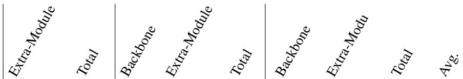

## D.2 AUTONOMOUS DRIVING

Table 7: Resource efficiency and latency breakdown on autonomous driving evaluation. We report extra-module and total parameter counts (M), computational complexity in FLOPs (T), latency breakdowns (ms), and amortized Latency (Avg.).

<table><tr><td>Methods</td><td>Params (M)</td><td></td><td>FLOPs (T)</td><td></td><td>Latency (ms)</td></tr><tr><td>ReCogDrive</td><td>0.0 7944.4</td><td>73.45</td><td>0.00</td><td>73.45</td><td>5046.78 0 5046.78</td></tr><tr><td>GeoThinker</td><td>2076.1 10020.5</td><td>73.45</td><td>49.23</td><td>122.69 5229.24</td><td>32.15 1461.42 6690.67 42.62</td></tr><tr><td>GeoThinker-F</td><td>1187.1 9131.6</td><td>73.45</td><td>14.77 88.22</td><td>5222.86 598.20</td><td>5821.07 37.08</td></tr></table>

To provide deeper insight into the computational efficiency of GeoThinker-F in downstream applications, we present a detailed breakdown of parameter counts, FLOPs, and latency for autonomous driving planning on the NAVSIM benchmark in Table 7.

Experimental and Token Configuration. All models are evaluated under a standardized setup matching training configurations, utilizing 16 dynamic visual patches. In a representative benchmark scenario, the model processes an input context of 3, 272 tokens comprising 3, 072 visual tokens and 200 text tokens and autoregressively generates 157 planning trajectory tokens. Notably, due to the requirement for fine-grained spatial control in safety-critical autonomous driving, spatial token compression was deliberately omitted in this downstream setup. Consequently, visual tokens are retained at full density, presenting a stringent stress test for model efficiency.

Parameter and FLOPs Reduction. As detailed in Table 7, the explicit dual-encoder baseline, GeoThinker, requires maintaining a heavy runtime external VGGT encoder, contributing an additional 2, 076.1 M parameters and 49.23 T FLOPs beyond the base MLLM backbone. In contrast, GeoThinker-F replaces explicit 3D feature streaming with lightweight Latent Frame Prediction (LFP) heads and SGT-Fusion modules. This reduces auxiliary parameters to 1, 187.1 M and slashes auxiliary FLOPs to just 14.77 T, achieving a 69.99% reduction in additional computational cost compared to GeoThinker (49.23 T → 14.77 T).

Latency Breakdown and Amortization Dynamics. In terms of runtime latency, GeoThinker incurs a significant extra execution delay of 1, 461.42 ms due to serial multi-encoder pre-processing. By eliminating external encoder execution, GeoThinker-F reduces this auxiliary latency to 598.20 ms, achieving a 59.07% reduction in additional prior integration time.

When examining the amortized end-to-end latency per generated planning token (e.g., 32.15 ms for ReCogDrive, 42.62 ms for GeoThinker, and 37.08 ms for GeoThinker-F), the relative gap narrows slightly. This behavior occurs because the autoregressive decoding phase generates 157 consecutive tokens. Thus, the fixed one-time visual encoding and prior synthesis latency is amortized across the entire decoding sequence. Nevertheless, in real-time robotic and autonomous driving systems where perception and pre-processing throughput dictate latency boundaries, the absolute reduction of over 869.60 ms in total frame execution (6, 690.67 ms → 5, 821.07 ms) can improve responsiveness in latency-sensitive deployment settings.

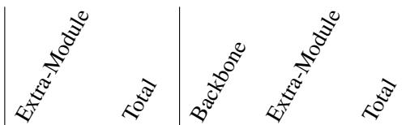

Table 8: Computational footprint and inference latency comparison on embodied robotic manipulation. Parameter size (M), FLOPs (T), and total latency (ms) are decomposed across the backbone and added auxiliary modules.

<table><tr><td>Methods</td><td colspan="2">Params (M)</td><td colspan="2">FLOPs (T)</td><td>Latency (ms)</td></tr><tr><td>QwenOFT</td><td>0.0</td><td>4503.4</td><td>2.44 0.00</td><td>2.44</td><td>82.0</td></tr><tr><td>GeoThinker</td><td>1705.5</td><td>6208.9</td><td>2.44 3.40</td><td>5.84</td><td>254.8</td></tr><tr><td>GeoThinker-F</td><td>277.0</td><td>4780.4</td><td>2.44 0.07</td><td>2.51</td><td>104.2</td></tr></table>

Table 10: Inference-time frame-count scaling on VSI and VSI-Debiased. Models trained on up to 32-frame windows are evaluated under scaling inference frames up to 128 frames to assess temporal context extrapolation and resistance to shortcut learning. GeoThinker and GeoThinker-F using configuration of Qwen3VL-8B with 32frame setting.

Table 9: Impact of general video data co-training. We evaluate performance changes (∆) when co-training with 430k general video instruction samples. While standard 2D MLLM baselines exhibit task interference of degrading 3D spatial accuracy on VSI, GeoThinker-F effectively mitigates cross-task degradation. By internalizing spatial-temporal priors directly within hidden representations, GeoThinker-F maintains robust spatial intelligence while simultaneously enhancing general temporal understanding.
<table><tr><td>Model</td><td>Video Mixture</td><td>VSI</td><td>VideoMME MVBench</td><td></td></tr><tr><td>Cambrian-S-7B</td><td>x 3M</td><td>69.2 65.1(-4.1)</td><td>54.1 61.9(+7.8)</td><td>64.5</td></tr><tr><td>GeoThinkerQwen3v1-8B-32frame</td><td>x 430k</td><td>72.0</td><td>53.7 72.6(+0.6) 59.4(+5.7) 69.1(+26.3)</td><td>42.8</td></tr><tr><td>GeoThinker-F Qwen3vl-8B</td><td>x 430k</td><td>70.00</td><td>55.9 70.4(+0.4) 58.7(+2.8) 56.9(+1.1)</td><td>55.8</td></tr></table>

<table><tr><td rowspan="2">Model</td><td rowspan="2">Benchmark</td><td colspan="4"># Frames</td></tr><tr><td>16</td><td>32</td><td>64</td><td>128</td></tr><tr><td>Cambrian-S-7B</td><td>VSI VSI-Debiased</td><td>58.6 49.7</td><td>63.6 55.6</td><td>66.4 59.1</td><td>67.5 59.9</td></tr><tr><td>VG-LLM-8B*</td><td>VSI VSI-Debiased</td><td>60.5 51.6</td><td>62.2 52.4</td><td>63.7 55.2</td><td>63.1 55.1</td></tr><tr><td>GeoThinker</td><td>VSI VSI-Debiased</td><td>69.2 64.3</td><td>72.6 66.3</td><td>73.4 67.7</td><td>73.4 68.1</td></tr><tr><td>GeoThinker-F</td><td>VSI VSI-Debiased</td><td>67.0 61.7</td><td>70.4 65.8</td><td>72.1 67.1</td><td>72.4 66.7</td></tr></table>

## D.3 EMBODIED INTELLIGENCE

To further demonstrate the efficiency advantage of GeoThinker-F in high-frequency, real-time control, we analyze the computational and latency profile on the LIBERO robotic manipulation benchmark under the StarVLA framework in Table 8.

Action-Chunking and Token Setup. Evaluations are conducted on a Qwen3-VL-4B backbone using Optimal Fine-Tuning following StarVLA-OFT. Unlike general VLM text generation, embodied VLA policies operate in a tight closed loop. In a representative setup, the model predicts a single action chunk of 8 continuous action tokens with a compact input context of 241 tokens, which comprises 128 image tokens derived from 2 camera views with 64 tokens per view and 113 language instruction tokens.

Latency Reduction in Short-Horizon Generation. In contrast to long-text generation scenarios where pre-processing latency can be amortized across hundreds of autoregressive decoding steps, robotic control policies generate very short output sequences with 8 tokens. Consequently, the one time feature extraction and prior synthesis overhead dominates overall end-to-end execution time.

As shown in Table 8, maintaining an explicit external geometry encoder in GeoThinker introduces a massive computational burden: extra parameters surge to 1, 705.5 M, and extra FLOPs jump by +139.34% (3.40 T on top of the 2.44 T backbone). This heavy pre-processing pipeline causes execution latency to skyrocket from 82.0 ms of raw QwenOFT to 254.8 ms, incurring an auxiliary prior latency overhead of 172.8 ms that severely bottlenecks real-time control frequencies.

Lightweight Endogenous Prior Generation. By internalizing 3D perception via lightweight LFP heads, GeoThinker-F compresses the extra parameter footprint to just 277.0 M and reduces extra FLOPs to a negligible 0.07 T, representing a 97.94% reduction in additional compute (3.40 T → 0.07 T) and adding a mere +2.86% overhead over the raw backbone.

Crucially, GeoThinker-F slashes the additional prior integration latency from 172.8 ms down to 22.2 ms, achieving an 87.15% reduction in auxiliary latency. This brings overall end-to-end execution time down from 254.8 ms to 104.2 ms with a 2.45× total speedup, closing nearly 87% of the latency gap back to the unaugmented backbone at 82.0 ms. These results highlight that for low-latency, short-horizon embodied control, GeoThinker-F provides an architecture that unlock fine-grained 3D spatial intuition with virtually negligible computational overhead.

## E GENERAL VIDEO MIXTURE AND TEST-FRAME SCALING

## E.1 IMPACT OF GENERAL VIDEO DATA MIXTURE

To investigate how joint training on general video data affects specialized spatial reasoning, we evaluate GeoThinker-F against Cambrian-S and GeoThinker across VSI-Bench, VideoMME, and MVBench in Table 9.

Elevated Performance Baseline and Reduced Task Interference. As shown in Table 9, pure 2D VLM architectures like Cambrian-S-7B suffer from severe task interference: incorporating 3M general video samples drops its VSI score by 4.1 points (69.2 → 65.1). In contrast, GeoThinker-F exhibits strong structural robustness. Even without general video mixtures (X), GeoThinker-F achieves significantly higher baseline lower bounds on general video benchmarks (VideoMME: 55.9, MVBench: 55.8) compared to GeoThinker (53.7 and 42.8). This indicates that endogenously learning 3D geometric and temporal dynamic prediction heads intrinsically enhances the backbone’s underlying temporal representation capability.

Knowledge Absorption and Stage-1 Pretraining Bottlenecks. When incorporating a lightweight mixture of 430k general video samples, GeoThinker-F successfully absorbs new dynamic knowledge, yielding consistent gains across both general video tasks with +2.8 on VideoMME, +1.1 on MVBench and spatial reasoning with +0.4 on VSI. However, compared to GeoThinker’s substantial performance leaps (+5.7 on VideoMME, +26.3 on MVBench), the relative gains for GeoThinker-F are more moderate. We hypothesize that this stems from the data volume in Stage-1 LFP pretraining: because the LFP heads are pretrained on a relatively compact geometry dataset, their endogenous feature generators incur minor prediction noise when generalizing to broader, out-of-distribution general video domains. Expanding Stage-1 LFP pretraining scale represents a promising avenue for further unlocking general video capabilities.

## E.2 ZERO-SHOT FRAME SCALING AND EXTRAPOLATION LIMITS

To evaluate whether endogenously synthesized spatial-temporal priors generalize to longer temporal contexts, we evaluate models trained on 32-frame windows by scaling inference frames up to 128 frames on VSI and VSI-Debiased benchmarks in Table 10.

Comparison with Passive Fusion Architectures. With our Spatial-Grounded Temporal (SGT) active perception mechanism, GeoThinker-F demonstrates clear advantages over conventional passive fusion baselines like VG-LLM-8B which plateaus at 63.7 on VSI and degrades beyond 64 frames on VSI-Debiased. On standard VSI-Bench, GeoThinker-F scales smoothly from 16 to 128 frames (67.0 → 70.4 → 72.1 → 72.4), proving that active feature routing effectively handles expanding sequence lengths without suffering from token clutter.

Insight on Endogenous Prediction Drift vs. Explicit 3D Anchors. An intriguing phenomenon emerges when evaluating on VSI-Debiased: while the explicit-encoder GeoThinker continues to gain accuracy up to 128 frames at 68.1, GeoThinker-F peaks at 64 frames at 67.1 and experiences a minor drop at 128 frames at 66.7. This contrast reveals fundamental differences between explicit and endogenous prior generation:

1. Explicit World Anchors (GeoThinker): The persistent runtime external VGGT encoder provides deterministic 3D spatial understanding across arbitrarily long multi-frame sequences, acting as an immutable physical world anchor.

2. Endogenous Prediction Drift (GeoThinker-F): GeoThinker-F relies on self-predicted latent features synthesized by lightweight LFP heads. While these endogenous representations are accurate over short and medium contexts up to 64 frames, subtle feature prediction errors inevitably compound over extreme context lengths like 128 frames, leading to minor representation drift that slightly bounds long-sequence extrapolation on strictly debiased tasks.

GeoThinker-F peaks at 64 frames and shows a modest decline at 128 frames on VSI-Debiased, suggesting sensitivity to longer-context extrapolation under the evaluated setting.

## F EVALUATION ON VSTI-BENCH

Table 11: Performance comparison on VSTI-Bench. GeoThinker- $\mathrm { \cdot F _ { Q w e n 3 V L - 8 B } }$ achieves a competitive average score of 64.0%, outperforming several proprietary and open-source VLM baselines while eliminating the runtime external geometry encoder. Bold and underlined values denote the best and second-best results, respectively.

<table><tr><td></td><td></td><td></td><td>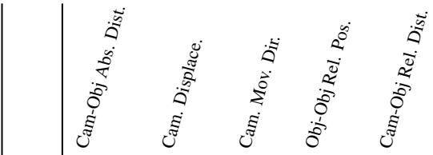</td><td></td><td></td><td></td></tr><tr><td>Methods</td><td>Avg.</td><td>Numerical Answer</td><td></td><td></td><td>Multiple-Choice Answer</td><td></td></tr><tr><td>Baseline</td><td></td><td></td><td></td><td></td><td></td><td></td></tr><tr><td>Chance Level (Random)</td><td></td><td>=</td><td>=</td><td>36.1</td><td>50.0</td><td>36.1</td></tr><tr><td>Chance Level (Frequency)</td><td>27.4</td><td>5.4</td><td>6.2</td><td>40.7</td><td>52.2</td><td>32.4</td></tr><tr><td>Human Performance</td><td></td><td>51.4</td><td>46.8</td><td>95.1</td><td></td><td></td></tr><tr><td>Human Level</td><td>77.0</td><td></td><td></td><td></td><td>97.5</td><td>94.3</td></tr><tr><td>Proprietary Models (API)</td><td>38.2</td><td>29.5</td><td>23.4</td><td>37.3</td><td></td><td>42.5</td></tr><tr><td>GPT-40</td><td>32.1</td><td>28.5</td><td>20.9</td><td>24.4</td><td>58.1 52.6</td><td>33.9</td></tr><tr><td>Gemini-1.5 Flash</td><td></td><td></td><td></td><td></td><td></td><td></td></tr><tr><td>Open-sourced VLMs LLaVA-OneVision-0.5B</td><td>36.9</td><td>16.5</td><td>32.4</td><td>46.1</td><td>50.5</td><td>39.0</td></tr><tr><td>InternVL2-2B</td><td>38.1</td><td>17.7</td><td>27.8</td><td>43.0</td><td>54.9</td><td>47.2</td></tr><tr><td>LLaVA-NeXT-Video-7B</td><td>40.0</td><td>28.2</td><td>1.8</td><td>49.8</td><td>64.7</td><td>55.6</td></tr><tr><td>LLaVA-OneVision-7B</td><td>41.7</td><td>29.9</td><td>19.3</td><td>47.5</td><td>62.1</td><td>49.8</td></tr><tr><td>LongVA-7B</td><td>32.3</td><td>13.5</td><td>5.1</td><td>43.7</td><td>57.9</td><td>41.2</td></tr><tr><td>InternVL2-8B</td><td>43.5</td><td>32.9</td><td>13.5</td><td>48.0</td><td>68.0</td><td>55.0</td></tr><tr><td>LongVILA-8B</td><td>30.5</td><td>20.0</td><td>11.6</td><td>35.4</td><td>52.3</td><td>33.4</td></tr><tr><td>VILA-1.5-8B</td><td>37.3</td><td>30.1</td><td>27.3</td><td>42.2</td><td>50.4</td><td>36.7</td></tr><tr><td>VILA-1.5-40B</td><td>38.2</td><td>28.2</td><td>15.7</td><td>28.8</td><td>65.4</td><td>53.0</td></tr><tr><td>LLaVA-NeXT-Video-72B</td><td>44.0</td><td>32.3</td><td>10.5</td><td>48.1</td><td>78.3</td><td>50.9</td></tr><tr><td>VLM-3R-7B</td><td>58.8</td><td>39.4</td><td>39.6</td><td>60.6</td><td>86.5</td><td>68.6</td></tr><tr><td>Cambrian-P</td><td>68.9</td><td>42.5</td><td>46.6</td><td>87.7</td><td>94.3</td><td>73.2</td></tr><tr><td></td><td></td><td></td><td></td><td></td><td></td><td></td></tr><tr><td>GeoThinkerQwen3VL-8B</td><td>67.4</td><td>38.4</td><td>45.8</td><td>84.2</td><td>93.6</td><td>75.2</td></tr><tr><td>Ours</td><td></td><td></td><td></td><td></td><td></td><td></td></tr><tr><td> $\mathrm { G e o T h i n k e r } { \cal F } _ { \mathrm { { \tiny ~ Q w e n 3 V L - 8 B } } }$ </td><td>64.0</td><td>40.4</td><td>37.4</td><td>74.6</td><td>93.1</td><td>74.1</td></tr></table>

To assess spatial reasoning in dynamic multi-view video scenes, we evaluate GeoThinker-F on VSTI-Bench (Fan et al., 2026). As reported in Table 11, GeoThinker-F Qwen3VL-8B attains an average accuracy of 64.0 %, exceeding several general open-source VLMs, including InternVL2- 8B (43.5 %), as well as proprietary API models such as GPT-4o (38.2 %) and Gemini-1.5 Flash (32.1 %). It also outperforms the specialized 3D-augmented VLM-3R-7B by 5.2 points (64.0 % versus 58.8 %), while avoiding runtime execution of an external geometry encoder. While Cambrian-P (68.9 %) and the external-encoder GeoThinker counterpart (67.4 %) obtain higher absolute scores, GeoThinker-F retains competitive performance with a substantially lighter inference architecture. Overall, these results indicate that endogenously generated geometry and future-semantic representations can support spatial reasoning on challenging multi-view video inputs.

## G EVALUATIONS ON EASI LEADERBOARD

To evaluate holistic spatial intelligence across standard and challenging benchmarks, we report results on the EASI leaderboards in Table 12 for EASI-8 (Cai et al., 2025) and Table 13 for EASI-ALL (Cai et al., 2025).

Table 12: EASI-8 leaderboard. VSI denotes VSI-Bench (Yang et al., 2025a). MMSI denotes MMSI-Bench (Yang et al., 2026c). MindCube denotes MindCube-Tiny (Yin et al., 2025).Viewspatial (Li et al., 2025a),SITE (Wang et al., 2025e), BLINK (Fu et al., 2024). 3DSRBench (Ma et al., 2025).EmbSpatial denotes EmbSpatial-Bench(Du et al., 2024).
<table><tr><td>MODELS</td><td>RANK AVG.</td><td></td><td></td><td></td><td></td><td></td><td></td><td></td><td>VSI MMSI MINDCUBE VIEWSPATIAL SITE BLINK 3DSRBENCH EMBSPATIAL</td></tr><tr><td>SENSENOVA-SI-1.3-INTERNVL3-8B</td><td>1</td><td>65.2</td><td>68.6 42.5</td><td>89.9</td><td>61.3</td><td>47.5</td><td>68.0</td><td>62.4</td><td>81.0</td></tr><tr><td>GEOTHINKER-F QWEN3VL-8B</td><td>2</td><td>64.8 70.4</td><td>30.8</td><td>93.2</td><td>82.6</td><td>53.6</td><td>55.8</td><td>55.3</td><td>76.5</td></tr><tr><td>SENSENOVA-SI-1.2-INTERNVL3-8B</td><td>3</td><td>64.5 69.6</td><td>42.6</td><td>89.0</td><td>58.8</td><td>49.0</td><td>69.4</td><td>60.1</td><td>77.7</td></tr><tr><td>SENSENOVA-SI-1.5-INTERNVL3-8B</td><td>4</td><td>64.4 67.3</td><td>38.3</td><td>92.1</td><td>59.0</td><td>47.5</td><td>69.5</td><td>61.1</td><td>80.4</td></tr><tr><td>SENSENOVA-SI-1.4-INTERNVL3-8B</td><td>5</td><td>63.9 66.6</td><td>40.1</td><td>88.8</td><td>55.7</td><td>47.9</td><td>68.1</td><td>62.2</td><td>81.7</td></tr><tr><td>GEMINI 3 PRO</td><td>6</td><td>63.8 52.5</td><td>45.2</td><td>70.9</td><td>50.4</td><td>62.3</td><td>76.0</td><td>68.9</td><td>84.3</td></tr><tr><td>NEO-OV-9B-SFT</td><td>7</td><td>63.4 64.8</td><td>41.3</td><td>90.0</td><td>55.2</td><td>54.0</td><td>62.8</td><td>61.2</td><td>77.8</td></tr><tr><td>QWEN3.5-VL-35B-A3B</td><td>8</td><td>61.6 61.1</td><td>41.9</td><td>63.5</td><td>50.8</td><td>61.4</td><td>70.5</td><td>59.8</td><td>83.6</td></tr><tr><td>SENSENOVA-SI-1.1-INTERNVL3-8B</td><td>9</td><td>61.5 68.8</td><td>43.3</td><td>85.7</td><td>54.7</td><td>47.7</td><td>63.9</td><td>55.5</td><td>72.0</td></tr><tr><td>SENSENOVA-U1-A3B-MOT</td><td>10</td><td>59.6 56.9</td><td>39.0</td><td>70.9</td><td>58.5</td><td>47.6</td><td>59.8</td><td>63.0</td><td>81.4</td></tr><tr><td>GPT-5.2</td><td>11</td><td>59.5 54.5</td><td>41.3</td><td>60.4</td><td>47.3</td><td>61.9</td><td>71.2</td><td>60.2</td><td>79.3</td></tr><tr><td>GEOTHINKERQWEN3VL-8B</td><td>12</td><td>59.1 72.6</td><td>30.9</td><td>83.0</td><td>45.9</td><td>55.9</td><td>53.9</td><td>51.9</td><td>78.8</td></tr><tr><td>GPT-5</td><td>13</td><td>58.8 55.0</td><td>41.8</td><td>56.3</td><td></td><td>45.6 61.9</td><td>68.0</td><td>60.3</td><td>81.6</td></tr><tr><td>SENSENOVA-U1-8B-MOT</td><td>14</td><td>58.6 57.5</td><td>38.0</td><td>61.8</td><td>55.8</td><td>49.3</td><td>63.3</td><td>63.4</td><td>79.3</td></tr><tr><td>SENSENOVA-SI-1.1-QWEN3-VL-8B</td><td>15</td><td>58.1 64.8</td><td>38.1</td><td>73.8</td><td>51.2</td><td>49.6</td><td>61.9</td><td>53.2</td><td>72.5</td></tr><tr><td>GEMINI 2.5 PRO</td><td>16</td><td>58.0 53.6</td><td>38.0</td><td>57.6</td><td>46.1</td><td>57.1</td><td>73.5</td><td>59.3</td><td>78.8</td></tr><tr><td>QWEN3.5-9B</td><td>17</td><td>56.1 55.7</td><td>38.7</td><td>57.6</td><td>48.2</td><td>42.3</td><td>67.6</td><td>56.8</td><td>81.5</td></tr><tr><td>NEO-OV-2B-SFT</td><td>18</td><td>54.4 58.4</td><td>33.6</td><td>77.2</td><td>52.8</td><td>43.0</td><td>53.8</td><td>52.5</td><td>63.8</td></tr><tr><td>SEED 1.6</td><td>19</td><td>54.2 49.9</td><td>38.3</td><td>48.8</td><td>43.9</td><td>54.6</td><td>65.9</td><td>56.9</td><td>75.4</td></tr><tr><td>GROK 4</td><td>20</td><td>53.3 47.9</td><td>37.8</td><td>63.6</td><td>43.2</td><td>47.0</td><td>56.4</td><td>54.9</td><td>75.5</td></tr><tr><td>QWEN3-VL-8B-THINKING</td><td>21</td><td>52.4 56.6</td><td>28.6</td><td>43.2</td><td>47.3</td><td>45.2</td><td>63.6</td><td>54.5</td><td>80.0</td></tr><tr><td>QWEN3-VL-30B-A3B-THINKING</td><td>22</td><td>52.0 51.6</td><td>29.4</td><td>40.9</td><td>47.4</td><td>47.2</td><td>63.9</td><td>55.6</td><td>80.4</td></tr><tr><td>SENSENOVA-SI-1.1-QWEN2.5-VL-7B</td><td>23</td><td>51.0 58.1</td><td>32.8</td><td>54.7</td><td>45.5</td><td>43.9</td><td>55.3</td><td>46.3</td><td>71.4</td></tr><tr><td>QWEN3-VL-8B-INSTRUCT</td><td>24</td><td>50.8 59.8</td><td>31.1</td><td>29.4</td><td>42.2</td><td>45.8</td><td>66.7</td><td>53.9</td><td>77.7</td></tr><tr><td>VST-7B-SFT</td><td>25</td><td>50.8 55.5</td><td>32.5</td><td>39.7</td><td>50.5</td><td>39.7</td><td>61.9</td><td>53.1</td><td>73.7</td></tr><tr><td>SENSENOVA-SI-1.1-INTERNVL3-2B</td><td>26</td><td>49.4 63.7</td><td>34.2</td><td>41.8</td><td>52.7</td><td>36.8</td><td>52.4</td><td>50.5</td><td>62.8</td></tr><tr><td>INTERNVL3_5-8B</td><td>27</td><td>49.0 56.1</td><td>29.0</td><td>40.2</td><td>40.0</td><td>43.8</td><td>58.2</td><td>49.2</td><td>75.7</td></tr><tr><td>SENSENOVA-SI-1.1-BAGEL-7B-MOT</td><td>28</td><td>48.6 41.5</td><td>34.5</td><td>46.8</td><td>46.9</td><td>42.0</td><td>65.4</td><td>42.4</td><td>69.0</td></tr><tr><td>GEMMA-4-26B-A4B</td><td>29</td><td>47.8 32.9</td><td>29.2</td><td>48.8</td><td>41.7</td><td>39.7</td><td>63.8</td><td>53.6</td><td>72.3</td></tr><tr><td>VST-3B-SFT</td><td>30</td><td>47.7 51.4</td><td>28.8</td><td>36.0</td><td></td><td>52.9 35.9</td><td>58.8</td><td>48.7</td><td>69.0</td></tr><tr><td>VLM-3R-LLAVA-QWEN2-LORA</td><td>31</td><td>46.6 60.7</td><td>27.9</td><td>40.0</td><td>40.5</td><td>31.3</td><td>52.3</td><td>51.5</td><td>68.2</td></tr><tr><td>INTERNVL3-8B</td><td>32</td><td>45.7 42.1</td><td>28.0</td><td>41.5</td><td></td><td>38.7 41.1</td><td>53.5</td><td>44.3</td><td>76.3</td></tr><tr><td>SENSENOVA-SI-1.1-QWEN2.5-VL-3B</td><td>33</td><td>45.7 54.9</td><td>30.8</td><td>52.6</td><td></td><td>43.5</td><td>37.8 45.6</td><td>45.0</td><td>55.3</td></tr><tr><td>BAGEL-7B-MoT</td><td>34</td><td>45.3 31.4</td><td>31.0</td><td>34.7</td><td></td><td>41.3</td><td>37.0 63.6</td><td>50.2</td><td>73.1</td></tr><tr><td>QWEN3-VL-2B-INSTRUCT</td><td>35</td><td>45.1 54.4</td><td>28.9</td><td>34.5</td><td></td><td>37.0 35.7</td><td>53.2</td><td>47.5</td><td>70.1</td></tr><tr><td>CAMBRIAN-S-7B</td><td>36</td><td>45.1 62.9</td><td>27.1</td><td>37.9</td><td></td><td>41.3 36.1</td><td>37.9</td><td>45.0</td><td>72.8</td></tr><tr><td>QWEN2.5-VL-7B-INSTRUCT</td><td>37</td><td>43.8</td><td>37.8 26.8</td><td>36.0</td><td></td><td>36.9</td><td>37.6 55.9</td><td>47.5</td><td>71.8</td></tr><tr><td>VILASR</td><td>38</td><td>43.7</td><td>44.6 30.2</td><td></td><td>35.1</td><td>35.7</td><td>38.7 51.4</td><td>46.6</td><td>67.3</td></tr><tr><td>INTERNVL3_5-2B-INSTRUCT</td><td>39</td><td>43.2</td><td>51.3 25.4</td><td>42.5</td><td></td><td>38.1</td><td>35.3 50.2</td><td>41.5</td><td>61.5</td></tr><tr><td>CAMBRIAN-S-3B</td><td>40</td><td>42.0</td><td>56.1 27.0</td><td>38.4</td><td></td><td>41.0</td><td>31.0 37.7</td><td>41.4 40.5</td><td>63.5 66.9</td></tr><tr><td>SPACER-SFT-7B SPATIALLADDER-3B</td><td>41 42</td><td>41.8 40.9</td><td>41.6 27.4 44.9 27.4</td><td>43.5</td><td>38.0</td><td>35.9 39.9</td><td>34.3 49.6 28.0 43.0</td></table>

Superior Advancement on EASI-8. As shown in Table 12, GeoThinker-F Qwen3VL-8B achieves a jump on the EASI-8 leaderboard, advancing from the original GeoThinker’s rank of 12th at AVG 59.1% all the way to 2nd place globally with an overall average score of 64.8%. Furthermore, GeoThinker-F surpasses leading proprietary foundation models, including Gemini 3 Pro at (63.8%, 6th), GPT-5.2 at (59.5%, 11th), and Gemini 2.5 Pro (58.0%, 16th), as well as strong open-source spatial models like Qwen3.5-VL-35B at (61.6%, 8th) and Cambrian-S-7B at (45.1%, 36th). Notably, GeoThinker-F sets top-tier benchmarks in MindCube at 93.2% and ViewSpatial at 82.6%. These results show that GeoThinker-F can achieve strong EASI-8 performance while eliminating runtime dependence on an external 3D geometry encoder.

Table 13: EASI-ALL leaderboard (In-Domain). VSI denotes VSI-Bench(Yang et al., 2025a). MMSI denotes MMSI-Bench(Yang et al., 2026c). MindCube denotes MindCube-Tiny(Yin et al., 2025).Viewspatial(Li et al., 2025a),SITE(Wang et al., 2025e), BLINK(Fu et al., 2024). 3DSR-Bench (Ma et al., 2025). EmbSpatial denotes EmbSpatial-Bench(Du et al., 2024). SPAR denotes SPAR-Bench(Zhang et al., 2025). MMSI-Video denotes MMSI-Video-Bench(Lin et al., 2025). Om niSpatial(Jia et al., 2026). VSI-Debiased(Brown et al., 2025).
<table><tr><td>MODELS</td><td>RANK AVG.</td><td></td><td></td><td>VSI MMSI MINDCUBE VIEWSPATIAL SITE BLINK 3DSRBENCH EMBSPATIAL MMSI-VIDEO OMNISPATIAL SPAR VSI-DEBIASED</td><td></td><td></td><td></td><td></td><td></td><td></td><td></td><td></td><td></td></tr><tr><td></td><td></td><td>64.4</td><td>67.3</td><td></td><td></td><td></td><td></td><td></td><td></td><td></td><td></td><td></td><td></td></tr><tr><td>SENSENOVA-SI-1.5-INTERNVL3-8B SENSENOVA-SI-1.4-INTERNVL3-8B</td><td></td><td>63.9</td><td>38.3 40.1</td><td>92.1 88.8</td><td>59.0 55.7</td><td>47.5 47.9</td><td>69.5 68.1</td><td>61.1 62.2</td><td>80.4 81.7</td><td>-1- -1-</td><td>-1- -1-</td><td>-1- -1-</td><td>-1- -1-</td></tr><tr><td>NEO-OV-9B-SFT</td><td>123</td><td>66.6 63.4 64.8</td><td>41.3</td><td>90.0</td><td>55.2</td><td>54.0</td><td>62.8</td><td>61.2</td><td>77.8</td><td>-1-</td><td>-1-</td><td>-1-</td><td>-1-</td></tr><tr><td>QWEN3.5-VL-35B-A3B</td><td>4</td><td>61.6 61.1</td><td>41.9</td><td>63.5</td><td>50.8</td><td>61.4</td><td>70.5</td><td>59.8</td><td>83.6</td><td>-1-</td><td>-1-</td><td>-1-</td><td>-1-</td></tr><tr><td>GEMINI 3 PRO</td><td>5</td><td>60.2 52.5</td><td>45.2</td><td>70.9</td><td>50.4</td><td>62.3</td><td>76.0</td><td>68.9</td><td>84.3</td><td>40.4</td><td>69.1</td><td>48.7</td><td>53.8</td></tr><tr><td>GEOTHINKER-F QWEN3VL-8B</td><td>6</td><td>60.1 70.4</td><td>30.8</td><td>93.2</td><td>82.6</td><td>53.6</td><td>55.8</td><td>55.3</td><td>76.5</td><td>28.4</td><td>42.5</td><td>66.9</td><td>65.8</td></tr><tr><td>SENSENOVA-U1-A3B-MOT</td><td>7</td><td>59.6 56.9</td><td>39.0</td><td>70.9</td><td>58.5</td><td>47.6</td><td>59.8</td><td>63.0</td><td>81.4</td><td>-1-</td><td>-1-</td><td>-1-</td><td>-1-</td></tr><tr><td>SENSENOVA-U1-8B-MOT</td><td></td><td>58.6 57.5</td><td>38.0</td><td>61.8</td><td>55.8</td><td>49.3</td><td>63.3</td><td>63.4</td><td>79.3</td><td>-1-</td><td>-1-</td><td>-1-</td><td>-1-</td></tr><tr><td>SENSENOVA-SI-1.3-INTERNVL3-8B</td><td>89</td><td>57.8 68.6</td><td>42.5</td><td>89.9</td><td>61.3</td><td>47.5</td><td>68.0</td><td>62.4</td><td>81.0</td><td>25.7</td><td>35.3</td><td>48.4</td><td>63.0</td></tr><tr><td>SENSENOVA-SI-1.2-INTERNVL3-8B</td><td>10</td><td>57.7 69.6</td><td>42.6</td><td>89.0</td><td>58.8</td><td>49.0</td><td>69.4</td><td>60.1</td><td>77.7</td><td>26.2</td><td>34.8</td><td>49.5</td><td>65.2</td></tr><tr><td>GPT-5.2</td><td>11</td><td>56.3 54.5</td><td>41.3</td><td>60.4</td><td>47.3</td><td>61.9</td><td>71.2</td><td>60.2</td><td>79.3</td><td>32.3</td><td>57.4</td><td>55.1</td><td>54.5</td></tr><tr><td>QWEN3.5-9B</td><td>12</td><td>56.1 55.7</td><td>38.7</td><td>57.6</td><td>48.2</td><td>42.3</td><td>67.6</td><td>56.8</td><td>81.5</td><td>-1-</td><td>-1-</td><td>-1-</td><td>-1-</td></tr><tr><td>GPT-5</td><td>13</td><td>55.4 55.0</td><td>41.8</td><td>56.3</td><td>45.6</td><td>61.9</td><td>68.0</td><td>60.3</td><td>81.6</td><td>33.4</td><td>59.2</td><td>49.7</td><td>52.5</td></tr><tr><td>GEOTHINKERQWEN3VL-8B</td><td>14</td><td>55.0 72.6</td><td>30.9</td><td>83.0</td><td>45.9</td><td>55.9</td><td>53.9</td><td>51.9</td><td>78.8</td><td>23.7</td><td>40.1</td><td>68.2</td><td>-1-</td></tr><tr><td>SENSENOVA-SI-1.1-INTERNVL3-8B</td><td></td><td>54.8 68.8</td><td>43.3</td><td>85.7</td><td>54.7</td><td>47.7</td><td>63.9</td><td>55.5</td><td>72.0</td><td>23.8</td><td>33.0</td><td>45.8</td><td>62.9</td></tr><tr><td>GEMINI 2.5 PRO</td><td>15 16</td><td>54.7 53.6</td><td>38.0</td><td>57.6</td><td>46.1</td><td>57.1</td><td>73.5</td><td>59.3</td><td>78.8</td><td>32.9</td><td>57.6</td><td>49.8</td><td>51.8</td></tr><tr><td>NEO-OV-2B-SFT</td><td>17</td><td>54.4 58.4</td><td>33.6</td><td>77.2</td><td>52.8</td><td>43.0</td><td>53.8</td><td>52.5</td><td>63.8</td><td>-1-</td><td>-1-</td><td>-1-</td><td>-1-</td></tr><tr><td>SENSENOVA-SI-1.1-QWEN3-VL-8B</td><td>18</td><td>52.8 64.8</td><td>38.1</td><td>73.8</td><td>51.2</td><td>49.6</td><td>61.9</td><td>53.2</td><td>72.5</td><td>25.5</td><td>43.0</td><td>40.8</td><td>59.4</td></tr><tr><td>QWEN3-VL-8B-THINKING</td><td>19</td><td>52.4 56.6</td><td>28.6</td><td>43.2</td><td>47.3</td><td>45.2</td><td>63.6</td><td>54.5</td><td>80.0</td><td>-1-</td><td>-1</td><td>-1-</td><td>-1-</td></tr><tr><td>QWEN3-VL-30B-A3B-THINKING</td><td>20</td><td>52.0 51.6</td><td>29.4</td><td>40.9</td><td>47.4</td><td>47.2</td><td>63.9</td><td>55.6</td><td>80.4</td><td>-1-</td><td>-1-</td><td>-1-</td><td>-1-</td></tr><tr><td>SEED 1.6</td><td>21</td><td>51.0 49.9</td><td>38.3</td><td>48.8</td><td>43.9</td><td>54.6</td><td>65.9</td><td>56.9</td><td>75.4</td><td>29.8</td><td>50.6</td><td>50.1</td><td>48.3</td></tr><tr><td>GROK 4</td><td>22</td><td>49.3 47.9</td><td>37.8</td><td>63.6</td><td>43.2</td><td>47.0</td><td>56.4</td><td>54.9</td><td>75.5</td><td>27.2</td><td>47.7</td><td>44.8</td><td>45.7</td></tr><tr><td>QWEN3-VL-8B-INSTRUCT</td><td>23</td><td>47.9 59.8</td><td>31.1</td><td>29.4</td><td>42.2</td><td>45.8</td><td>66.7</td><td>53.9</td><td>77.7</td><td>28.4</td><td>47.0</td><td>39.6</td><td>53.1</td></tr><tr><td>GEMMA-4-26B-A4B</td><td>24</td><td>47.8 32.9</td><td>29.2</td><td>48.8</td><td>41.7</td><td>39.7</td><td>63.8</td><td>53.6</td><td>72.3</td><td>-1-</td><td>-1-</td><td>-1-</td><td>-1-</td></tr><tr><td>VST-7B-SFT</td><td>25</td><td>47.2 55.5</td><td>32.5</td><td>39.7</td><td>50.5</td><td>39.7</td><td>61.9</td><td>53.1</td><td>73.7</td><td>24.9</td><td>39.5</td><td>46.6</td><td>48.8</td></tr><tr><td>SENSENOVA-SI-1.1-QWEN2.5-VL-7B</td><td>26</td><td>47.1 58.1</td><td>32.8</td><td>54.7</td><td>45.5</td><td>43.9</td><td>55.3</td><td>46.3</td><td>71.4</td><td>26.1</td><td>39.3</td><td>38.2</td><td>53.4</td></tr><tr><td>INTERNVL3.5-8B</td><td>27</td><td>46.3 56.1</td><td>29.0</td><td>40.2</td><td>40.0</td><td>43.8</td><td>58.2 52.3</td><td>49.2 51.5</td><td>75.7</td><td>28.0</td><td>47.4</td><td>38.2 42.4</td><td>50.5</td></tr><tr><td>VLM-3R-LLAVA-QWEN2-LORA</td><td>28</td><td>45.1 60.7 44.7 41.5</td><td>27.9 34.5</td><td>40.0</td><td>40.5</td><td>31.3 42.0</td><td>65.4</td><td>42.4</td><td>68.2 69.0</td><td>27.8 23.8</td><td>43.3 44.0</td><td>44.7</td><td>55.5</td></tr><tr><td>SENSENOVA-SI-1.1-BAGEL-7B-MOT</td><td>29</td><td>44.6 63.7</td><td>34.2</td><td>46.8</td><td>46.9 52.7</td><td>36.8</td><td>52.4</td><td>50.5</td><td>62.8</td><td>20.4</td><td>26.4</td><td>38.0</td><td>35.0</td></tr><tr><td>SENSENOVA-SI-1.1-INTERNVL3-2B</td><td>30</td><td>43.9 51.4</td><td>28.8 27.1</td><td>41.8 36.0 37.9</td><td>52.9</td><td>35.9 41.3 36.1</td><td>58.8 37.9</td><td>48.7 45.0</td><td>69.0 72.8</td><td>24.3 25.2</td><td>36.5 41.9</td><td>37.7 37.9</td><td>56.0 46.5</td></tr><tr><td>VST-3B-SFT CAMBRIAN-S-7B</td><td>31 32</td><td>43.5 62.9 43.0 42.1</td></table>

Performance on EASI-ALL. Table 13 extends the evaluation to the broader EASI-ALL suite, which covers diverse multimodal and temporal spatial reasoning settings. GeoThinker-F maintains competitive performance across these benchmarks, complementing the EASI-8 results reported in Table 12. The results suggest that the proposed endogenous predictive representations can transfer beyond individual spatial reasoning tasks without requiring runtime execution of an external geom etry encoder.

## H EVALUATION ON REVSI

## H.1 EVALUATION ON REVSI BENCHMARK

To rigorously evaluate spatial reasoning under dynamic visual conditions, we evaluate on ReVSI, a recently introduced benchmark that updates ground-truth answers as the evaluated frame count changes.

Performance Analysis and Comparison. As shown in Table 14, the explicit multi-encoder Geo-Thinker achieves the strongest performance among the evaluated open-source models, reaching an average score of 55.9 by retaining access to geometry features from a runtime external encoder. In contrast, GeoThinker-F eliminates this runtime geometry branch while attaining an average score of 50.6. It outperforms strong 2D spatial baselines such as Cambrian-S at 49.1 and Cambrian-P without pose input at 50.1, while remaining within 1.4 points of Cambrian-P at 52.0. These results demonstrate a competitive accuracy–efficiency trade-off, although the explicit geometry encoder retained by GeoThinker remains advantageous for maximizing ReVSI accuracy.

Table 14: Performance comparisons on ReVSI-Bench. ReVSI (Zhang et al., 2026) introduces a dynamic evaluation setup where ground-truth answers adapt according to the evaluated frame count. GeoThinker-F maintains competitive accuracy on ReVSI-Bench without executing a runtime external geometry encoder, while trailing its external-encoder GeoThinker counterpart.
<table><tr><td rowspan="2">METHODS</td><td rowspan="2">FRAMES</td><td rowspan="2">AVG.</td><td colspan="4">NUMERICAL ANSWER</td><td colspan="3">MULTIPLE-CHOICE ANSWER</td></tr><tr><td>|OBJ.COUNT</td><td>ABS. DIST. OBJ. SIZE</td><td></td><td>ROOM SIZE | REL. DIST. REL. DIR. ROUTE PLAN</td><td></td><td></td><td></td></tr><tr><td colspan="10">PROPRIETARY MODELS</td></tr><tr><td>GPT-5.2</td><td>64</td><td>50.9</td><td>56.2</td><td>41.5</td><td>73.9</td><td>63.0</td><td>48.4</td><td>34.9</td><td>38.2</td></tr><tr><td>GEMINI 3 FLASH</td><td>1 FPS</td><td>57.6</td><td>65.7</td><td>53.1</td><td>77.6</td><td>52.8</td><td>64.6</td><td>47.9</td><td>41.8</td></tr><tr><td>GEMINI 3 PRO</td><td>1 FPS</td><td>60.9</td><td>60.1</td><td>54.7</td><td>79.3</td><td>51.9</td><td>68.1</td><td>56.0</td><td>56.4</td></tr><tr><td colspan="10">OPEN-SOURCE MODELS</td></tr><tr><td>QWEN3-VL-8B-INSTRUCT (QWEN TEAM, 2025B)</td><td>64</td><td>49.1</td><td>40.4</td><td>52.3</td><td>69.0</td><td>45.1</td><td>57.1</td><td>39.5</td><td>40.5</td></tr><tr><td>QWEN2.5-VL-7B-INSTRUCT (QWEN TEAM, 2025A)</td><td>4FPS</td><td>32.6</td><td>36.9</td><td>15.0</td><td>49.7</td><td>29.0</td><td>31.5</td><td>29.5</td><td>36.7</td></tr><tr><td>INTERNVL3.5-8B (WANG ET AL., 2025D)</td><td>64</td><td>47.9</td><td>43.3</td><td>54.6</td><td>64.2</td><td>47.6</td><td>45.0</td><td>36.3</td><td>44.4</td></tr><tr><td>LLAVA-VIDEO-7B-QWEN2 (ZHANG ET AL., 2024B)</td><td>64</td><td>30.3</td><td>31.3</td><td>1.4</td><td>52.5</td><td>16.7</td><td>38.3</td><td>33.3</td><td>38.4</td></tr><tr><td>CAMBRIAN-S-7B (YANG ET AL., 2026B)</td><td>128</td><td>49.1</td><td>48.4</td><td>60.5</td><td>65.5</td><td>46.7</td><td>37.1</td><td>48.5</td><td>37.0</td></tr><tr><td>VST-7B-SFT (YANG ET AL., 2025B)</td><td>4FPS</td><td>46.4</td><td>35.4</td><td>52.6</td><td>67.9</td><td>47.2</td><td>49.2</td><td>36.9</td><td>35.4</td></tr><tr><td>CAMBRIAN-P (W/O POSE)</td><td>128</td><td>50.1</td><td>42.3</td><td>64.6</td><td>64.5</td><td>47.4</td><td>38.1</td><td>48.3</td><td>45.3</td></tr><tr><td>CAMBRIAN-P (YANG ET AL., 2026A)</td><td>128</td><td>52.0</td><td>41.4</td><td>68.3</td><td>66.7</td><td>45.9</td><td>40.2</td><td>48.7</td><td>53.1</td></tr><tr><td>GEOTHINKERQWEN3VL-8B (LI ET AL., 2026A)</td><td>128</td><td>55.9</td><td>37.9</td><td>74.7</td><td>67.6</td><td>57.1</td><td>61.8</td><td>47.8</td><td>44.7</td></tr><tr><td colspan="10">OURS</td></tr><tr><td>GEOTHINKER-F QWEN3VL-8B</td><td>128</td><td>50.6</td><td>36.4</td><td>65.2</td><td>66.1</td><td>56.2</td><td>45.9</td><td>46.1</td><td>38.5</td></tr></table>

Table 15: Zero-shot frame scaling on ReVSI. Evaluates temporal extrapolation from 16 to 128 frames, where target ground-truth annotations dynamically adjust to the changing visual context.
<table><tr><td rowspan="2">Model</td><td rowspan="2">Benchmark</td><td colspan="4"># Frames</td></tr><tr><td>16</td><td>32</td><td>64</td><td>128</td></tr><tr><td rowspan="3">GeoThinkerQwen3vl-8B-32frame</td><td>VSI</td><td>69.2</td><td>72.6</td><td>73.4</td><td>73.4</td></tr><tr><td>VSI-Debiased</td><td>64.3</td><td>66.3</td><td>67.7</td><td>68.1</td></tr><tr><td>ReVSI</td><td>52.6</td><td>53.9</td><td>54.8</td><td>55.9</td></tr><tr><td rowspan="3">GeoThinker-F Qwen3vl-8B-32frame</td><td>VSI</td><td>67.0</td><td>70.4</td><td>72.1</td><td>72.4</td></tr><tr><td>VSI-Debiased</td><td>61.7</td><td>65.8</td><td>67.1</td><td>66.7</td></tr><tr><td>ReVSI</td><td>48.6</td><td>49.8</td><td>50.4</td><td>50.6</td></tr></table>

Distance-Centric Error Analysis. The sub-category breakdown shows that the largest differences between GeoThinker-F and GeoThinker occur in Absolute Distance and Relative Distance estimation. Specifically, GeoThinker-F obtains 65.2 % and 45.9 % on these two categories, compared with 74.7 % and 61.8 % for GeoThinker, corresponding to gaps of 9.5 and 15.9 points, respectively. In contrast, the differences on Object Count, Object Size, Room Size, and Relative Direction are substantially smaller. This concentration of errors on distance-centric questions suggests that precise metric estimation remains challenging when geometry-related representations are predicted internally rather than directly extracted by a dedicated geometry encoder. Improving metric accuracy and sensitivity therefore remains an important direction for endogenous spatial representations.

## H.2 FRAME SCALING AND EXTRAPOLATION ON REVSI

We further examine zero-shot temporal extrapolation on ReVSI by scaling the inference frame count from 16 to 128 under dynamically adjusted ground-truth annotations, as reported in Table 15. GeoThinker-F improves from 48.6 % at 16 frames to 49.8 % at its 32-frame training budget and further reaches 50.4 % and 50.6 % at 64 and 128 frames, respectively. These results demonstrate positive zero-shot scaling beyond the training context, although the gains begin to saturate after 64 frames. GeoThinker improves from 52.6 % to 55.9 % over the same range and remains stronger at every frame budget, with the gap increasing from 4.0 points at 16 frames to 5.3 points at 128 frames. This trend suggests that endogenous representations benefit from additional temporal context but currently exploit very long sequences less effectively than persistent features produced by an explicit geometry encoder.

Table 16: Ablation study on the influence of the OmniSpatial-Train data mixture. Controlled comparison between GeoThinker and GeoThinker-F with and without the OmniSpatial training dataset, isolating the core architectural contributions of endogenous feature prediction under strictly aligned training data distributions.
<table><tr><td>MODELS</td><td>GEOMETRY ENCODER</td><td>AVG.</td><td></td><td>VSI-BENCH MMSI-BENCH MINDCUBE VIEWSPATIAL SITE CV-BENCH</td><td></td><td></td><td></td><td></td></tr><tr><td>QWEN2.5VL-7B</td><td></td><td></td><td></td><td></td><td></td><td></td><td></td><td></td></tr><tr><td>GEOTHINKER</td><td>V</td><td>60.43</td><td>68.5</td><td>31.7</td><td>83.6</td><td>41.9</td><td>54.8</td><td>82.1</td></tr><tr><td>GEOTHINKER-F</td><td></td><td>60.56</td><td>67.7</td><td>31.0</td><td>88.3</td><td>42.1</td><td>53.6</td><td>80.5</td></tr><tr><td>GEOTHINKER-F + OMNISPATIAL-TRAIN</td><td>××</td><td>66.84</td><td>67.3</td><td>31.2</td><td>86.8</td><td>83.2(+41.1)</td><td>53.2</td><td>79.1</td></tr><tr><td colspan="9">QWEN3VL-8B</td></tr><tr><td>GEOTHINKER</td><td>V</td><td>62.23</td><td>72.6</td><td>30.9</td><td>83.0</td><td>45.9</td><td>55.9</td><td>85.1</td></tr><tr><td>GEOTHINKER-F</td><td></td><td>62.21</td><td>70.9</td><td>29.6</td><td>91.0</td><td>44.7</td><td>54.2</td><td>82.9</td></tr><tr><td>GEOTHINKER-F + OMNISPATIAL-TRAIN</td><td>××</td><td>69.29</td><td>70.4</td><td>30.8</td><td>93.2</td><td>82.6(+37.9)</td><td>53.7</td><td>85.0</td></tr></table>

## I ABLATION STUDY ON OMNISPATIAL TRAINING DATA

In the main scaled regime experiments, GeoThinker-F incorporates the OmniSpatial-Train dataset mixture, which drives substantial performance leaps on the ViewSpatial benchmark with 42.1% → 83.2% on Qwen2.5VL-7B and 44.7% → 82.6% on Qwen3VL-8B. To isolate the architectural contribution from the effect of additional OmniSpatial-Train data, we conduct a controlled comparison using the same training split as GeoThinker.

Data-Controlled Performance Parity. As reported in Table 16, when trained under strictly identical data distributions without OmniSpatial-Train, GeoThinker-F achieves comparable performance under matched data with the explicit dual-encoder baseline, GeoThinker. Across the six spatial intelligence benchmarks, GeoThinker-F obtains an average score of 60.56 on Qwen2.5VL-7B vs. GeoThinker’s 60.43 and 62.21 on Qwen3VL-8B vs. GeoThinker’s 62.23.

Controlled Comparison with the External-Encoder Baseline. This rigorous controlled comparison delivers a empirical conclusion: the performance of GeoThinker-F is not only an artifact of favorable training data mixtures. When controlling for data variables, internalizing 3D perception via lightweight Latent Frame Prediction (LFP) heads achieves comparable performance under matched training data. GeoThinker-F matches the spatial reasoning capacity of multi-encoder architectures while successfully shedding their heavy runtime execution bottlenecks.

## J ABLATION STUDY ON STAGE-2 TRAINING

Table 17: Ablation study on Stage-2 training strategies for GeoThinker-F. Evaluated on a Qwen2.5-VL-7B backbone across frame budgets (8 vs. 32 frames), General Video mixture integration, and LFP head fine-tuning status. Orange numbers at (·) denote performance gaps relative to GeoThinker. Jointly fine-tuning LFP heads alongside general video mixtures yields the optimal balance across specialized spatial and multi-modal benchmarks.
<table><tr><td>TRAINING GENERAL FRAME</td><td>VIDEO</td><td>LFP FINETUNING</td><td>VSI↑</td><td>MMSI↑</td><td>CROSS-BENCH. AVG.↑</td><td>LATENCY↓</td></tr><tr><td colspan="7">GEOTHINKER</td></tr><tr><td>8</td><td>X</td><td>一</td><td>65.8</td><td>29.1</td><td>57.67</td><td>1.69</td></tr><tr><td>32</td><td>V</td><td>1</td><td>68.5</td><td>31.7</td><td>60.43</td><td>1.45</td></tr><tr><td colspan="7">GEOTHINKER-F</td></tr><tr><td>8</td><td>X</td><td>X</td><td>63.6(-2.2) 28.1(-1.0)</td><td></td><td>65.42</td><td>1.04</td></tr><tr><td>32</td><td>X</td><td>××</td><td>65.2</td><td>27.9</td><td>65.55</td><td rowspan="4">0.48</td></tr><tr><td>32</td><td>√</td><td></td><td>67.6</td><td>28.1</td><td>67.15</td></tr><tr><td>32</td><td>X</td><td></td><td>66.8</td><td>28.9</td><td>66.47</td></tr><tr><td>32</td><td>√</td><td>v√</td><td>67.3(-1.2) 31.2(-0.5)</td><td></td><td>66.84</td></tr></table>

To determine the optimal configuration for Stage-2 instruction tuning, we conduct systematic ablations on a Qwen2.5-VL-7B backbone in Table 17, isolating three key training variables: input frame budget (8 vs. 32 frames), inclusion of General Video data mixtures, and whether endogenous LFP heads are frozen or jointly fine-tuned during Stage 2.

Efficacy of Frame Budget and General Video Integration. Comparing row configurations in Table 17 confirms that both frame scaling and general video data mixtures contribute positively to spatial reasoning. Expanding the training budget from 8 to 32 frames consistently elevates VSI accuracy with $6 3 . 6 \overset { \textstyle - } { \to } 6 \bar { 5 } . 2$ , while introducing general video data further enhances cross-benchmark performance with 65.55 → 67.15 with frozen LFP and 66.47 → 66.84 with unfrozen LFP, verifying that broad temporal diversity reinforces spatial perception.

Frozen vs. Fine-tuned LFP Heads. An interesting phenomenon emerges when evaluating LFP head status during Stage 2 in Scaled Regime:

1. Frozen LFP (✗): When trained with general video data, keeping LFP heads frozen yields a slightly higher VSI score at 67.6 and a higher overall Cross-Benchmark Average at 67.15. However, this setup suffers a notable drop on MMSI-Bench at 28.1, indicating a trade-off between specialized spatial performance and multimodal video reasoning.

2. Jointly Fine-tuned LFP (✓): Unfreezing LFP heads allows endogenous feature synthesis to co-adapt dynamically with the MLLM backbone on instruction data. This joint optimization drastically improves MMSI performance to 31.2, narrowing the gap to GeoThinker to just −0.5, while preserving strong performance on VSI on 67.3 (−1.2 vs. GeoThinker) and maintaining an overall Cross-Benchmark Average of 66.84.

Configuration Selection. Although freezing LFP heads yields marginally higher scores on isolated spatial benchmarks, we select joint LFP fine-tuning with general video mixtures as our final default strategy. This configuration achieves the most balanced, holistic spatial-temporal intelli gence profile without sacrificing multi-modal generalization. Crucially, all 32-frame GeoThinker-F variants based on Qwen2.5-VL-7B sustain an ultra-low inference latency of 0.48 s, demonstrating a 3.0× acceleration over GeoThinker at 1.45 s regardless of Stage-2 parameter choices. With the Qwen3-VL-8B backbone, GeoThinker-F further reduces latency from 1.45 s to 0.40 s, yielding a 3.6× speedup.

## K STAGE 1 PRE-TRAINING LOSS FUNCTION

## K.1 BASIC OPERATIONS

We define several elementary operations used throughout our framework. Given a vector x $\in \mathbb { R } ^ { D }$ , its L -normalized variant is denoted by ${ \hat { x } } = x / \| x \| _ { 2 }$ , and its element-wise logarithmic amplitude transformation is defined as log(1+|x|). For a feature matrix $X = ( x _ { i j } ) \in \mathbb { R } ^ { V \times D }$ , the frame-level mean $\mu _ { x } ^ { ( i ) }$ and standard deviation $\sigma _ { x } ^ { \left( i \right) }$ across feature dimensions are computed as $\begin{array} { r } { \mu _ { x } ^ { ( i ) } = \frac { 1 } { D } \sum _ { j = 1 } ^ { D } x _ { i j } } \end{array}$ and $\begin{array} { r } { \sigma _ { x } ^ { ( i ) } = \sqrt { \frac { 1 } { D } \sum _ { j = 1 } ^ { D } ( x _ { i j } - \mu _ { x } ^ { ( i ) } ) ^ { 2 } } } \end{array}$ , respectively. Furthermore, the cosine similarity between two vectors x and y is computed via cos $( x , y ) = ( x \cdot y ) / ( \| x \| _ { 2 } \| y \| _ { 2 } )$

To handle regression targets robustly, we adopt the SmoothL1 Loss, defined as:

$$
{ \mathrm { S m o o t h L 1 } } ( x , y ) = { \left\{ \begin{array} { l l } { { \frac { 1 } { 2 } } ( x - y ) ^ { 2 } , } & { { \mathrm { i f ~ } } | x - y | \leq 1 , } \\ { | x - y | - { \frac { 1 } { 2 } } , } & { { \mathrm { o t h e r w i s e } } . } \end{array} \right. }\tag{8}
$$

## K.2 ADJACENT DIFFERENCE LOSS

Standard element-wise metrics like $L _ { 1 }$ loss or cosine similarity (Yang et al., 2026b; Assran et al., 2025; Maes et al., 2026) primarily operate on individual tokens in isolation. Consequently, they often fail to capture the underlying temporal or structural trends across consecutive frames, leading to inconsistent predictions over long sequences. To enforce local structural smoothness and trend consistency, we introduce the Local Relation Loss $\mathcal { L } _ { \mathrm { r e l } } .$ , which explicitly penalizes local discrepancies in both direction and magnitude between predicted feature sequences $p = ( p _ { 1 } , \dotsc , p _ { S } )$ and ground-truth features $g = ( g _ { 1 } , \dotsc , g _ { S } )$

Specifically, we first compute the first-order temporal differences for both predictions and ground truths to represent local dynamics:

$$
\Delta p _ { i } = p _ { i + 1 } - p _ { i } , \qquad \Delta g _ { i } = g _ { i + 1 } - g _ { i } , \qquad i = 1 , \ldots , S - 1 .\tag{9}
$$

To constrain the directional consistency of local transitions, the directional relation loss $\mathcal { L } _ { \mathrm { a d j } } ^ { \mathrm { d i r } }$ is formulated as the mean squared error over the $L _ { 2 } .$ -normalized difference vectors:

$$
\mathcal { L } _ { \mathrm { a d j } } ^ { \mathrm { d i r } } = \frac { 1 } { S - 1 } \sum _ { i = 1 } ^ { S - 1 } \big \| \widehat { \Delta p } _ { i } - \widehat { \Delta g } _ { i } \big \| _ { 2 } ^ { 2 } ,\tag{10}
$$

where $\widehat { \Delta p } _ { \ i }$ and $\widehat { \Delta g } _ { i }$ denote the L2-normalized variants of $\Delta p _ { i }$ and $\Delta g _ { i }$ , respectively.

Simultaneously, to penalize local amplitude variations without being overwhelmed by global scale fluctuations, we define a magnitude-aware scale factor $\begin{array} { r } { s _ { \Delta } = \operatorname* { m a x } \Bigl ( \frac { 1 } { S - 1 } \sum _ { i = 1 } ^ { S - 1 } | \Delta g _ { i } | , \varepsilon \Bigr ) } \end{array}$ , where ε is a small constant for numerical stability. The magnitude loss $\mathcal { L } _ { \mathrm { a d j } } ^ { \mathrm { m a g } }$ applies a logarithmic compression combined with SmoothL1 loss:

$$
\mathcal { L } _ { \mathrm { a d j } } ^ { \mathrm { m a g } } = \frac { 1 } { S - 1 } \sum _ { i = 1 } ^ { S - 1 } \mathrm { S m o o t h L 1 } \Bigg ( \log \Big ( 1 + \frac { | \Delta p _ { i } | } { s _ { \Delta } } \Big ) , \log \Big ( 1 + \frac { | \Delta g _ { i } | } { s _ { \Delta } } \Big ) \Bigg ) .\tag{11}
$$

The overall Local Relation Loss is a weighted combination of the directional and magnitude objectives:

$$
\mathcal { L } _ { \mathrm { a d j } } ( p , g ) = \mathcal { L } _ { \mathrm { a d j } } ^ { \mathrm { d i r } } + \lambda _ { \mathrm { m a g } } \mathcal { L } _ { \mathrm { a d j } } ^ { \mathrm { m a g } } ,\tag{12}
$$

where we empirically set $\lambda _ { \mathrm { m a g } } = 0 . 5$ in our experiments.

## K.3 TEMPORAL BRANCH

The temporal branch aims to model transition dynamics by training the Vision-Language Model (VLM) to predict the image hidden states of the next frame based on the current frame’s representations.

Motivation and Supervision Scheme. Instead of employing redundant pixel-level supervision, we directly supervise predictions in the feature space. While self-supervised representation models (e.g., V-JEPA (Assran et al., 2025)) or auxiliary temporal regularizers $( \mathrm { e . g . }$ ., Cambrian-S (Yang et al., 2026b)) rely effectively on simple L1 loss or cosine similarity, such a single-metric objective is insufficient for our fully supervised feature prediction target in our setting. Because image hidden states typically possess extremely small numerical scales, lightweight or naive loss functions tend to induce trivial shortcuts, leading the optimization toward premature false convergence. To guarantee precise feature alignment across scale, direction, statistical distribution, and dynamic trajectory, we propose a multi-faceted objective combining five complementary constraints.

Branch Activation Gating. Since next-frame ground-truth features are non-existent in single-frame inputs, the temporal branch is conditionally activated using an indicator-based weighting mechanism:

$$
\lambda _ { \mathrm { s e m } } ^ { \mathrm { e f f } } = \lambda _ { \mathrm { s e m } } \cdot k ^ { \prime } [ T \geq T _ { \mathrm { t h r e s h o l d } } \wedge T > 1 ] ,\tag{13}
$$

where T denotes the input sequence length, and Tthreshold represents the sequence length threshold required to initiate temporal training.

Direction Loss. To align the spatial orientation of predicted hidden states $p _ { i }$ with ground-truth next-frame features $g _ { i }$ , we minimize the $L _ { 2 }$ distance between their $L _ { 2 } .$ -normalized vectors across M samples:

$$
\mathcal { L } _ { \mathrm { s e m } } ^ { \mathrm { d i r } } = \frac { 1 } { M } \sum _ { i = 1 } ^ { M } \left. \hat { p } _ { i } - \hat { g } _ { i } \right. _ { 2 } ^ { 2 } .\tag{14}
$$

Relative Amplitude Loss. To supervise magnitude scale without being dominated by feature outliers, we normalize absolute values by an adaptive sequence baseline $\begin{array} { r } { s = \operatorname* { m a x } \Bigl ( \frac { 1 } { M } \sum _ { i = 1 } ^ { M } | g _ { i } | , \varepsilon \Bigr ) } \end{array}$ and apply logarithmic dynamic compression:

$$
\mathcal { L } _ { \mathrm { s e m } } ^ { \mathrm { r e l - m a g } } = \frac { 1 } { M } \sum _ { i = 1 } ^ { M } { \mathrm { S m o o t h L 1 } } \bigg ( \log \Big ( 1 + \frac { | p _ { i } | } { s } \Big ) , \log \Big ( 1 + \frac { | g _ { i } | } { s } \Big ) \bigg ) .\tag{15}
$$

Statistic Loss. To encourage matching in global feature distributions, we penalize the discrepancies between the channel-wise means $( \mu _ { p } ^ { ( i ) } , \mu _ { g } ^ { ( i ) } )$ and standard deviations $( \sigma _ { p } ^ { ( i ) } , \sigma _ { g } ^ { ( i ) } ) \colon$

$$
\mathcal { L } _ { \mathrm { s e m } } ^ { \mathrm { s t a t s } } = \frac { 1 } { M } \sum _ { i = 1 } ^ { M } \mathrm { S m o o t h L 1 } \big ( \mu _ { p } ^ { ( i ) } , \mu _ { g } ^ { ( i ) } \big ) + \frac { 1 } { M } \sum _ { i = 1 } ^ { M } \mathrm { S m o o t h L 1 } \big ( \sigma _ { p } ^ { ( i ) } , \sigma _ { g } ^ { ( i ) } \big ) .\tag{16}
$$

Temporal Rank Loss. To ensure the predicted feature $p _ { i }$ moves strictly toward the target nextframe feature $g _ { i }$ rather than remaining static near the current-frame feature $\tilde { g } _ { i }$ , we enforce a pairwise margin constraint:

$$
\mathcal { L } _ { \mathrm { s e m } } ^ { \mathrm { r a n k } } = \frac { 1 } { M } \sum _ { i = 1 } ^ { M } \operatorname* { m a x } \bigl ( 0 , \big ( 1 - \cos ( p _ { i } , g _ { i } ) \big ) - \big ( 1 - \cos ( p _ { i } , \tilde { g } _ { i } ) \big ) + m \bigr ) ,\tag{17}
$$

where $m = 0 . 0 5$ represents the distance margin, and $\tilde { g } _ { i }$ denotes the ground-truth feature of the current frame.

Adjacent Difference Loss. Finally, to preserve structural continuity across consecutive steps, we incorporate the local relation loss defined in Sec. K.2:

$$
\mathcal { L } _ { \mathrm { s e m } } ^ { \mathrm { a d j } } = \mathcal { L } _ { \mathrm { a d j } } ( p , g ) .\tag{18}
$$

Overall Objective. The overall loss for the temporal branch is formulated as a weighted sum:

$$
\mathcal { L } _ { \mathrm { s e m } } = \mathcal { L } _ { \mathrm { s e m } } ^ { \mathrm { d i r } } + 0 . 5 \mathcal { L } _ { \mathrm { s e m } } ^ { \mathrm { r e l - m a g } } + 0 . 1 5 \mathcal { L } _ { \mathrm { s e m } } ^ { \mathrm { s t a t s } } + 0 . 1 5 \mathcal { L } _ { \mathrm { s e m } } ^ { \mathrm { r a n k } } + 0 . 2 \mathcal { L } _ { \mathrm { s e m } } ^ { \mathrm { a d j } } .\tag{19}
$$

## K.4 GEOMETRY BRANCH

To endow the model with global 3D geometric awareness from a single current frame, the geometry branch learns to map the VLM’s current image hidden states geo src into global VGGT feature representations. Unlike the temporal branch, this prediction operates purely in the spatial domain without temporal dynamics. Although each target is spatially aligned with frame (i), it is produced through joint multi-view encoding and should therefore be interpreted as a current-view-anchored representation of scene-level geometry, rather than a feature derived from frame (i) alone.

Feature Targets and Fallback Guidance. The predicted geometry representations $\begin{array} { r l } { p } & { { } = } \end{array}$ $\phi _ { \mathrm { g e o } } ( \mathrm { g e o . s r c } )$ are supervised by target features g, extracted by a pre-trained VGGT encoder fed with multi-view context. To accommodate datasets where ground-truth geometry tokens (geo tokens) are partially missing, we employ a stop-gradient fallback mechanism to avoid gradient contamination:

$$
p = \phi _ { \mathrm { g e o } } ( \mathrm { g e o . s r c } ) , \qquad g = \left\{ \begin{array} { l l } { \mathrm { g e o . t o k e n s , } } & { \mathrm { i f ~ G T ~ g e o t o k e n s ~ a r e ~ a v a i l a b l e , } } \\ { \mathrm { s g } ( p ) , } & { \mathrm { o t h e r w i s e , } } \end{array} \right.\tag{20}
$$

where sg(·) denotes the stop-gradient operator. When ground truth is unavailable, $g = \deg ( p )$ ensures the loss evaluates to zero, naturally bypassing gradient updates for non-geometric samples.

Cross-Modal Feature Alignment. Due to structural disparities between VLM representations and VGGT feature spaces, directly enforcing element-wise alignment easily leads to optimization instability. The geometry loss $\mathcal { L } _ { \mathrm { g e o } }$ incorporates directional alignment $\mathcal { L } _ { \mathrm { g e o } } ^ { \mathrm { d i r } }$ , relative magnitude regularization $\mathcal { L } _ { \mathrm { g e o } } ^ { \mathrm { r e l - m a g } }$ , and adjacent difference loss $\mathcal { L } _ { \mathrm { g e o } } ^ { \mathrm { a d j } }$ formulated identically to Sec. K.2.

To specifically address the drastic scale mismatch between VLM hidden states and VGGT features, we adapt the channel-wise statistic loss with explicit scale normalization:

$$
s _ { s } = \operatorname* { m a x } \big ( \mathrm { s g } ( s ) , \varepsilon \big ) , \qquad \mathrm { w h e r e } s = \frac { 1 } { M } \sum _ { i = 1 } ^ { M } | g _ { i } | ,\tag{21}
$$

$$
\mathcal { L } _ { \mathrm { g e o } } ^ { \mathrm { s t a t s } } = \frac { 1 } { M } \sum _ { i = 1 } ^ { M } \mathrm { S m o o t h L I } \Big ( \frac { \mu _ { p } ^ { ( i ) } } { s _ { s } } , \frac { \mu _ { g } ^ { ( i ) } } { s _ { s } } \Big ) + \frac { 1 } { M } \sum _ { i = 1 } ^ { M } \mathrm { S m o o t h L } \big ( \log \Big ( 1 + \frac { \sigma _ { p } ^ { ( i ) } } { s _ { s } } \Big ) , \log \Big ( 1 + \frac { \sigma _ { g } ^ { ( i ) } } { s _ { s } } \Big ) \Big ) .\tag{22}
$$

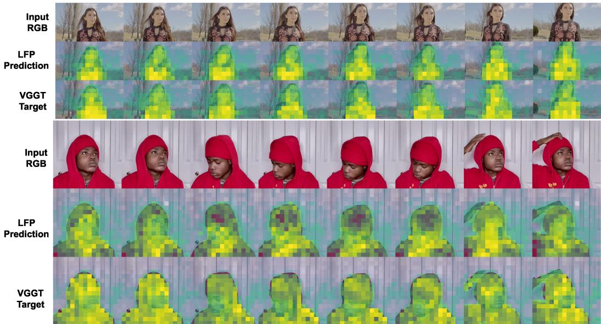  
Figure 5: Qualitative structural correspondence in standard scenes. For each sequence, we show input RGB frames (top), LFP-predicted geometry representations (middle), and the corresponding VGGT feature targets (bottom). In these selected scenes with clear foreground subjects and structured motion, the endogenous predictions preserve coherent object-centered activation patterns and broad spatial correspondence with the VGGT targets across consecutive frames. This qualitative agreement illustrates that GeoThinker-F can recover useful geometry-related structure from intermediate MLLM hidden states.

Normalizing channel means $\mu ^ { ( i ) }$ by $s _ { s }$ prevents large-magnitude dimensions from dominating the gradient, while log-compressing normalized standard deviations $\boldsymbol { \sigma } ^ { ( i ) }$ stabilizes variance matching across divergent feature spaces.

Overall Objective. The combined loss for the geometry branch is formulated as:

$$
\mathcal { L } _ { \mathrm { g e o } } = \mathcal { L } _ { \mathrm { g e o } } ^ { \mathrm { d i r } } + 0 . 5 \mathcal { L } _ { \mathrm { g e o } } ^ { \mathrm { r e l - m a g } } + 0 . 1 5 \mathcal { L } _ { \mathrm { g e o } } ^ { \mathrm { s t a t s } } + 0 . 3 5 \mathcal { L } _ { \mathrm { g e o } } ^ { \mathrm { a d j } } .\tag{23}
$$

## L VISUALIZATION

To qualitatively assess the spatial structure captured by our endogenously predicted geometry features, we visualize the outputs of the Latent Frame Prediction (LFP) heads alongside the corresponding VGGT target features across diverse scenarios. For each feature tensor, we average its activations along the channel dimension, min-max normalize the resulting 2D map to [0, 1], and render it using the same colormap. Accordingly, these visualizations compare spatial activation patterns rather than absolute feature magnitudes.

Structural Correspondence in Standard Scenarios. Figure 5 qualitatively compares the predicted geometry representations with their corresponding VGGT feature targets in canonical scenes containing clear foreground subjects and structured motion. Across consecutive frames, the predicted maps preserve broad spatial activation patterns and object-level structures visible in the VGGT targets. These visualizations suggest that intermediate MLLM hidden states contain information that can be transformed into useful geometry-related representations, without requiring an exact reproduction of individual VGGT feature activations.

Qualitative Behavior under Ambiguous Backdrops. Figure 6 further compares predicted geometry representations and VGGT feature targets in scenes with visually ambiguous backgrounds. In several low-contrast snow sequences, the predicted maps remain concentrated around the human subject, whereas the corresponding VGGT targets exhibit more diffuse activations. This qualitative difference is consistent with high-level semantic intuition information in the MLLM hidden states contributing to the predicted representations. A broader evaluation would be required to establish whether this behavior systematically improves robustness under ambiguous visual conditions.

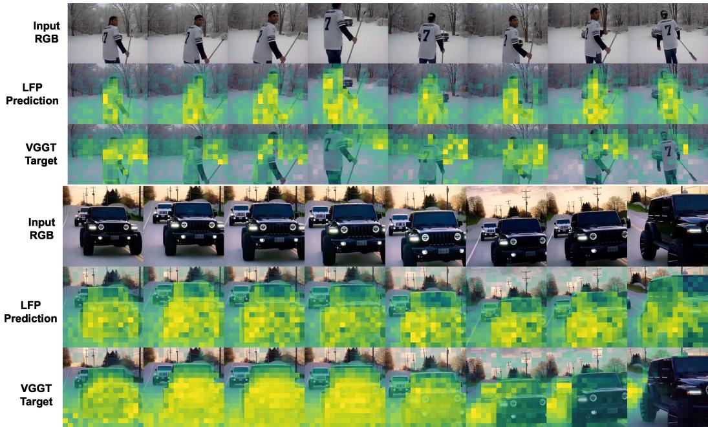  
Figure 6: Qualitative semantic selectivity under visually ambiguous conditions. For each sequence, we show input RGB frames (top), LFP-predicted geometry representations (middle), and the corresponding VGGT feature targets (bottom). In these selected snow and driving examples, the VGGT targets exhibit comparatively diffuse or background-dominated activations, whereas the endogenous predictions remain concentrated around the primary human or vehicle. This case-level contrast suggests that prediction from MLLM hidden states can preserve semantically relevant spatial focus when low-level visual cues are ambiguous.

Limitations and Failure Modes. Despite these advantages, we observe two main limitations of endogenous feature prediction in Figure 7:

• Transient Non-Rigid Dynamics: As shown in the top row of Figure 7, when fine-grained, non-rigid dynamic objects appear (e.g., a translucent curtain fluttering in the wind), VGGT precisely captures the moving geometric boundary, whereas GeoThinker-F fails to register these transient structural shifts. This failure may reflect the limited sensitivity of the predicted representations to fine-grained, rapidly changing visual structures.

• Representation Smoothness: Compared to the dense, continuous outputs generated by dedicated 3D encoders, our self-predicted features are visibly coarser and display higher spatial jitter (Figure 7, bottom row). This graininess arises from the token-level spatial discretization inherent in Transformer architectures. Future work will explore smoothed decoder losses or continuous implicit fields to further improve feature regularity.

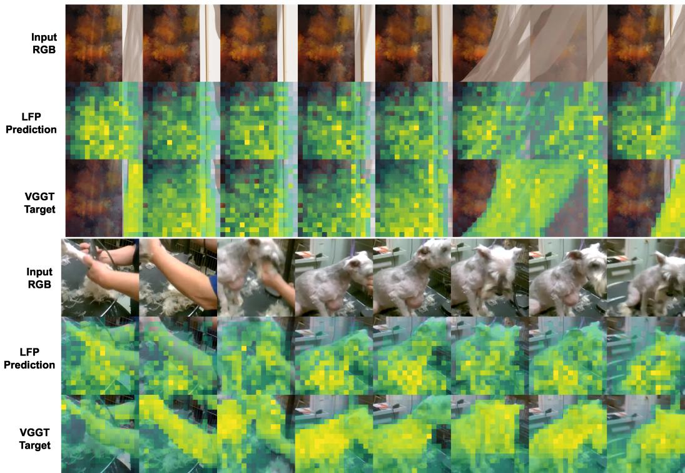  
Figure 7: Qualitative limitations of endogenous geometry prediction. For each sequence, we show the input RGB frames (top), LFP-predicted geometry representations (middle), and the corresponding VGGT feature targets (bottom). Top: In the presence of rapidly changing non-rigid structures, the predicted representations exhibit weaker correspondence with the VGGT targets. Bottom: The predicted maps display coarser spatial variation than the corresponding VGGT feature targets. These examples illustrate conditions in which endogenous geometry prediction does not fully recover the geometry-related structure captured by the external expert.

## M DISCUSSION AND SCOPE

We use predictive world representations in a restricted operational sense: internally generated latent representations encoding current multi-view geometry and short-horizon future visual semantics. GeoThinker-F does not aim to construct an action-conditioned or long-horizon generative world model. Instead, it investigates whether explicit world representations previously supplied by an external geometry encoder can be predicted from causal MLLM states and reused for spatial reasoning.

We distinguish GeoThinker-F from both conventional feature distillation and latent-token distillation at the level of the inference interface rather than representational capacity. Conventional feature distillation typically absorbs teacher supervision into backbone parameters without exposing separately generated, scene-conditioned geometry priors at inference. Latent-token methods such as 3DThinker instead supervise compact geometry-related token states within an autoregressive reasoning trajectory, allowing geometric information to influence subsequent decoding implicitly. In contrast, GeoThinker-F predicts dense, frame-aligned geometry and future-semantic priors at selected intermediate layers and repeatedly integrates them into the backbone through an explicit fusion interface. We therefore do not claim that distilled models cannot encode or dynamically utilize geometric information. Our distinction concerns where and how geometry-related evidence is generated, exposed, and routed during inference. Accordingly, our empirical comparison characterizes the accuracy-efficiency trade-off under the reported settings rather than establishing an inherent limitation of distillation.

The reported acceleration arises from two complementary sources. On Qwen3-VL-8B, replacing runtime external geometry extraction with endogenous prediction reduces latency from 1.66 s to 0.91 s without further token compression, corresponding to a 1.82× architectural speedup. Combining endogenous prediction with spatial token compression reduces complete-system latency from 1.45 s to 0.40 s, yielding a 3.63× end-to-end speedup. These latency values are specific to the reported hardware and input configuration, while the corresponding FLOP and MAC reductions provide hardware-independent evidence of lower computational cost.

GeoThinker-F trades offline teacher supervision and two-stage training for lower repeated inference cost. It is therefore most suitable for streaming, interactive, and embodied settings where geometry features cannot be precomputed. Explicit geometry encoders may remain preferable when maximum metric accuracy is required, as reflected by the remaining gap on distance-centric ReVSI categories. Our goal is not to dominate external-encoder systems under every metric, but to provide a favorable accuracy-efficiency trade-off without runtime dependence on a separate geometry model.