# GLANCE FORCING: MAKING BIDIRECTIONAL DIFFU-SION AUTOREGRESSIVE AT A GLANCE

Zhuobai Dong1, Junchao Yi2, Hu Jian Guo3, Linjie Li4, Rui Zhao5∗, Alex Jinpeng Wang6   
1Wuhan University 2University of Electronic Science and Technology of China   
3Sun Yat-sen University 4University of Washington   
5National University of Singapore 6Central South University

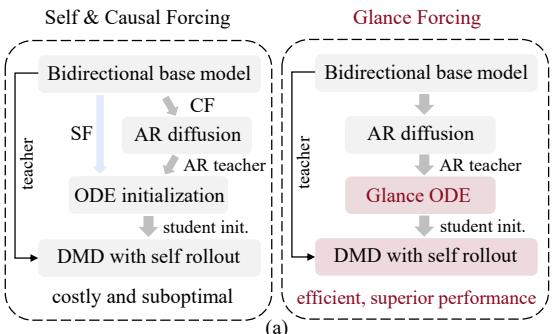

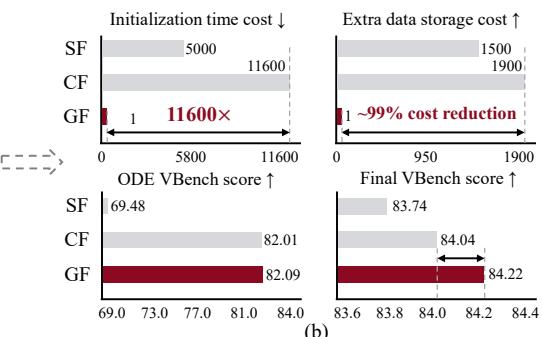  
Figure 1: Overall framework of our Glance Forcing and the comparison with existing methods. (a) Causal Forcing (CF) fixes Self Forcing (SF)’s architecture gap but remains costly; our Glance Forcing (GF) is efficient, and superior. (b) Our GF reduces training cost by 11600×, requires only 1 extra sample curation, and achieves higher VBench scores than CF.

## ABSTRACT

Autoregressive generation underlies real-time, causal video synthesis and is the backbone of video world models. Today’s dominant approach distills a bidirectional diffusion model into a causal few-step student, but existing pipelines make this conversion prohibitively expensive, requiring offline Probability Flow ODE (PF-ODE) trajectories that cost tens of thousands of GPU-hours and terabytes of storage. We show it can be made dramatically more efficient. Pushing this efficiency to its extreme, we reduce trajectory supervision to a single sample, the strictest setting possible, and find that it causes severe quality collapse. We trace this to the teacher’s trajectory geometry: the high-noise regime, governing semantic layout and motion, and the low-noise regime, governing fine texture exhibit fundamentally different curvature and optimization behavior, so a single monolithic student cannot jointly fit both, causing severe representation interference. Motivated by this, we propose Glance Forcing, a lightweight distillation framework that decouples the denoising trajectory into two complementary slow and fast experts, each guided by a tailored, stage-specific objective, while keeping the pretrained teacher entirely frozen. This decoupling further reveals a general mechanism underlying few-step distillation: PF-ODE distillation mainly straightens the few-step trajectory geometry, while the subsequent distribution-matching stage independently governs distributional quality. Using only one PF-ODE trajectory, Glance Forcing already surpasses the fully-trained state-of-the-art baseline, raising the VBench Total score from 84.04 to 84.22 while cutting trajectorycollection cost from thousands of GPU-hours to about one A100-GPU-hour, with markedly larger gains in dynamic degree, VisionReward, and instructionfollowing, and consistent preference from human raters over strong baselines. HomePage: https://zhuobaidong.github.io/Glance-Forcing/

## 1 INTRODUCTION

Diffusion-based video generation has achieved remarkable progress, with recent models such as Sora (Brooks et al., 2024), Wan (Team Wan et al., 2025), and Seedance (Team Seedance et al.,

VBench Performance  
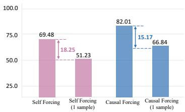  
(a) One-sample training impact

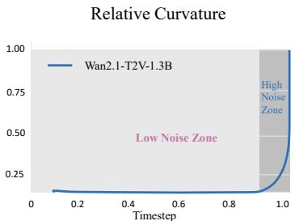  
(b) High-noise concentration

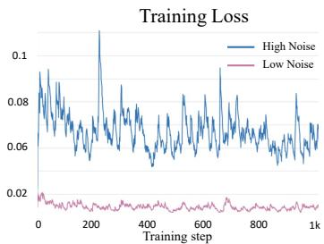  
(c) The trend of training loss  
Figure 2: Motivation and Trajectory Analysis. (a) VBench performance drops significantly for both forcing methods when trained on a single sample on the ODE stage. (b) Relative trajectorycurvature profiles show high-noise concentration for Wan video generation. (c) Distillation loss exhibit significant differences between samples with high and low noise levels.

2026) producing videos with high visual fidelity and complex spatiotemporal dynamics. However, their bidirectional denoising paradigm processes the entire video jointly, making inference increasingly expensive as video length grows. Autoregressive (AR) diffusion models (Jin et al., 2024; Chen et al., 2024; Yin et al., 2025) address this limitation by performing causal rollout across frames or chunks while retaining diffusion-based generation within each segment. Recent AR diffusion distillation methods (Huang et al., 2026; Zhu et al., 2026) have achieved promising results by distilling bidirectional diffusion models into few-step AR students. However, as shown in Fig. 1(b), Despite these advances, existing AR distillation pipelines typically rely on expensive offline Probability Flow ODE (PF-ODE) trajectories as supervision. Constructing and storing such trajectories over large video datasets introduces substantial overhead, creating a severe preprocessing bottleneck.

A natural way is therefore to reduce the amount of trajectory supervision. However, as shown in Fig. 2(a), aggressively reducing the training data to one sample causes severe performance degradation. This raises a natral question: why doesfew-step AR diffusion struggle under extremely sparse trajectory supervision? We find that the diffusion process exhibit an intriguing temporal dynamic during generation. As illustrated in Fig. 2(b), more than 92.5% of the cumulative trajectory curvature is concentrated in the early, high-noise regime. Furthermore, the training losses in Fig. 2(c) exhibit markedly different optimization behaviors between the two regimes. Under extremely sparse supervision, particularly in the one-sample regime, forcing a single monolithic network to capture these two conflicting learning regimes leads to severe representation interference.

The key insight is simple: different denoising phases require different experts. Based on this observation, we present Glance Forcing, a phase-aware distillation framework designed for extremely sparse-data training. Instead of constructing costly PF-ODE trajectories, Glance Forcing learns directly from a single sample trajectory and decomposes the denoising process into two complementary experts using a dual-LoRA (Hu et al., 2021) architecture: Slow-LoRA specializes in high-noise semantic trajectory synthesis, while Fast-LoRA focuses on low-noise detail refinement. Since only LoRA parameters are optimized, our framework preserves the pretrained diffusion teacher model. We further introduce lightweight phase-specific objectives to capture their distinct characteristics, including a temporal frequency loss for stable motion synthesis and a spatial high-pass loss for local detail refinement, without introducing an additional student network.

Experiments demonstrate that Glance Forcing consistently improves the quality and efficiency across scales. In the one-sample regime, Glance Forcing outperforms Causal Forcing, improving the VBench total score from 84.04 to 84.22 while cutting trajectory-collection cost from thousands of GPU-hours to about one A100-hour. As the training budget scales to match baseline, Glance Forcing delivers further gains, reaching a peak VBench total score of 84.33.

The contributions are summarized as follows: (1) We find that PF-ODE distillation mainly straightens the few-step trajectory rather than modeling the data distribution, where a single trajectory already suffices, as long as it is properly exploited across different noise regimes. (2) We propose Glance Forcing, a lightweight dual-LoRA framework that decouples denoising into a Slow expert for layout and motion, and a Fast expert for detail, each with a tailored objective. (3) Extensive experiments show that Glance Forcing matches or surpasses other methods while cutting the training cost by orders of magnitude, with consistent gains as the training budget scales up.

## 2 RELATED WORKS

Bidirectional and Autoregressive Video Generation. Current video diffusion models primarily fall into two paradigms. Bidirectional models denoise an entire clip using full spatiotemporal attention, achieving strong global coherence at the cost of quadratic complexity in sequence length (Blattmann et al., 2023a;b; Ho et al., 2022b;a). While highly effective for offline synthesis, such overhead makes them impractical for interactive scenarios that demand low per-frame latency.

Autoregressive (causal) video generators factorize the joint distribution into $p _ { \theta } ( x ^ { 1 : K } ~ \mid ~ c ) ~ =$ $\textstyle \prod _ { k } p _ { \theta } ( \bar { x } ^ { k } \mid x ^ { < k } , c )$ , allowing each generated block to serve as context for subsequent blocks via a Key-Value $( \mathrm { K V } )$ cache. This factorization naturally aligns with real-time streaming, as only the current block undergoes denoising while historical context remains static in the cache. To train such models, two canonical strategies are typically employed: Teacher Forcing (TF) (Jin et al., 2024) and Diffusion Forcing (DF) (Chen et al., 2024). TF models $p _ { \mathrm { d a t a } } ( \mathbf { x } _ { 0 } ^ { i } \mid \mathbf { x } _ { 0 } ^ { < i } )$ conditioned on a clean prefix of past frames. Conversely, DF targets the noise-conditioned distribution $p _ { \mathrm { D F } } ( \mathbf { x } _ { 0 } ^ { i } \mid \mathbf { x } _ { t } ^ { < i } )$ , where noise is independently injected into prior frames via $q _ { t | 0 } ( \mathbf { x } _ { t } ^ { < i } \mid \mathbf { x } _ { 0 } ^ { < i } )$ .

Recent advances have focused on closing the gaps in causal diffusion training. Self Forcing (Huang et al., 2026) first demonstrated that training on self-generated context with a holistic video-level loss effectively mitigates the train–test discrepancy. Causal Forcing (Zhu et al., 2026) further showed that initializing ODE paths with an autoregressive teacher provably bridges the architectural gap between full and causal attention. Subsequent systems, including LongLive (Yang et al., 2026), Rolling Forcing (Liu et al., 2026b), and Self-Forcing++ (Cui et al., 2026), have pushed this boundaries further. However, these methods heavily rely on constructing dense PF-ODE trajectories collected over large datasets, incurring prohibitive compute and storage costs.

Diffusion Distillation. Diffusion distillation techniques generally fall into two categories for compressing multi-step diffusion or flow models into few-step generators. The first family leverages continuous-time transport trajectories connecting noise and data distributions. Flow Matching (Lipman et al., 2023) and Rectified Flow Transformers (Esser et al., 2024) learn velocity fields parameterizing these transport trajectories, whereas Consistency Distillation (CD) (Song et al., 2023; Song & Dhariwal, 2023) parameterizes a flow map $G _ { \theta } : ( \mathbf { x } _ { t } , t ) \mapsto \mathbf { x } _ { 0 }$ that directly maps any noisy state $\mathbf { x } _ { t }$ to the clean endpoint $\mathbf { x } _ { \mathrm { 0 } }$ along the teacher’s PF-ODE. Recent interactive video generation systems (Yin et al., 2025; Huang et al., 2026; Zhu et al., 2026) often adopt a simplified variant of CD, optimizing the student model $G _ { \theta }$ via direct regression:

$$
\theta ^ { * } = \arg \operatorname* { m i n } _ { \theta } \mathbb { E } _ { t , \mathbf { x } _ { t } } \left[ \| G _ { \theta } ( \mathbf { x } _ { t } , t ) - \mathbf { x } _ { 0 } \| ^ { 2 } \right] ,\tag{1}
$$

where $\mathbf { x } _ { t }$ and $\mathbf { x } _ { \mathrm { 0 } }$ are sampled from the teacher PF-ODE. However, this line of work implicitly assumes that the trajectories are sufficiently smooth to compress without severe distortion.

The second family, score distillation (Wang et al., 2023; Luo et al., 2023), distills multi-step teacher models into few-step students by directly matching the student’s generative distribution $p _ { \theta } ( \tilde { \mathbf { x } } )$ to the target data distribution. A prominent instantiation is Distribution Matching Distillation (DMD) (Yin et al., 2024b;a). Instead of tracking specific trajectories, DMD estimates a reverse-KL gradient using the difference between a real-data score $s _ { \mathrm { r e a l } }$ and a learned fake-data score $s _ { \phi } ,$ steering the student toward the target distribution. Recent video extensions adapt DMD to autoregressive setups via windowed self-rolled sequences (Nie et al., 2026), reward-weighted distribution matching (Lu et al., 2025), and diagonal multi-step scheduling (Liu et al., 2026a). However, these methods neglect the intrinsic spatiotemporal dynamics of the video generation process, leading to suboptimal training.

## 3 METHOD

## 3.1 PRELIMINARY

Diffusion Model learns data distributions by gradually transforming noise into data through a parameterized denoising process. In the forward process, Gaussian noise is progressively added to clean data $\mathbf { x } _ { 0 } \sim p _ { \mathrm { d a t a } } ( \mathbf { x } _ { 0 } ) ;$

$$
\begin{array} { r } { q ( \pmb { x } _ { t } | \pmb { x } _ { 0 } ) = \mathcal { N } ( \pmb { x } _ { t } ; \sqrt { \alpha _ { t } } \pmb { x } _ { 0 } , \sqrt { 1 - \alpha _ { t } } \pmb { I } ) , } \end{array}\tag{2}
$$

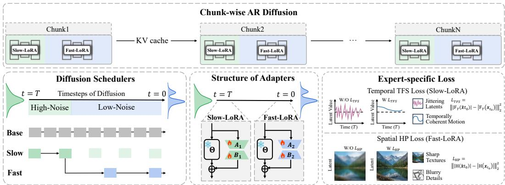  
Figure 3: Overview of the Slow-Fast paradigm. We introduce a chunk-wise autoregressive dif fusion framework, where each chunk is progressively denoised with stage-specific LoRA adapters. Slow-LoRA focuses on coarse structure generation in early stages, while Fast-LoRA refines details in later stages. Expert-specific objectives further enhance temporal consistency and spatial fidelity.

where $\{ \alpha _ { t } \} _ { t = 1 } ^ { T }$ controls the noise schedule. The reverse process, typically parameterized by a UNet or transformer $\epsilon _ { \theta }$ , is trained to predict the noise:

$$
\begin{array} { r } { \mathcal { L } _ { D M } = \mathbb { E } _ { \pmb { x } , \epsilon \sim \mathcal { N } ( 0 , 1 ) , t } \left[ | | \epsilon - \epsilon _ { \theta } ( \pmb { x } _ { t } , t ) | | _ { 2 } ^ { 2 } \right] . } \end{array}\tag{3}
$$

During inference, a clean sample $\scriptstyle { \mathbf { { \mathit { x } } } } _ { 0 }$ can be recovered through iterative denoising:

$$
p ( { \pmb x } _ { t - 1 } | { \pmb x } _ { t } ) = \mathcal { N } ( { \pmb x } _ { t - 1 } ; \mu _ { \theta } ( { \pmb x } _ { t } , t ) , \Sigma _ { \theta } ( { \pmb x } _ { t } , t ) ) ,\tag{4}
$$

where $\mu _ { \theta }$ and $\Sigma _ { \theta }$ are learned parameters.

Consistency Distillation utilizes a pre-trained model $\epsilon _ { \theta }$ as the teacher $F _ { T }$ to distill its knowledge into a student model $F _ { S }$ initialized with $\epsilon _ { \theta } ,$ , allowing for faster sampling with fewer steps. Specifically, consistency distillation trains the student model $F _ { S }$ to directly map any point $\mathbf { x } _ { t _ { n } }$ on the trajectory of the ODE solver Φ to its endpoint $\mathbf { \Delta } \mathbf { x } _ { t _ { e n d } }$ . The learning objective is formulated as:

$$
\begin{array} { r } { \mathcal { L } _ { C D } = \mathbb { E } _ { { \mathbf { x } } , t _ { n } } | | \Phi ( { \mathbf { x } } _ { t _ { n } } , F _ { S } ( { \mathbf { x } } _ { t _ { n } } , t _ { n } , c ) , t _ { e n d } ) - } \\ { \Phi ( \hat { { \mathbf { x } } } _ { t _ { n - 1 } } , F _ { S } ^ { - } ( \hat { { \mathbf { x } } } _ { t _ { n - 1 } } , t _ { n - 1 } , c ) , t _ { e n d } ) | | _ { 2 } ^ { 2 } . } \end{array}\tag{5}
$$

where $F _ { S } ^ { - }$ denotes the exponential moving average (EMA) of $F _ { S }$ , and $\hat { \mathbf { x } } _ { t _ { n } }$ is the adjacent state along the trajectory predicted by the teacher $F _ { T }$

$$
\begin{array} { r } { \hat { \pmb x } _ { t _ { n - 1 } } = \Phi ( \pmb x _ { t _ { n } } , F _ { T } ( \pmb x _ { t _ { n } } , t _ { n } , c ) , t _ { n - 1 } ) . } \end{array}\tag{6}
$$

Due to its stable training, Consistency distillation has garnered widespread attention and research.

## 3.2 WHY CAN ONE SAMPLE SUFFICE?

The Causal Forcing (Zhu et al., 2026) pipeline involves three stages: (1) multi-step AR diffusion training via teacher forcing; (2) causal ODE initialization with the AR teacher; and (3) asymmetric DMD with student self-rollout. While existing approaches typically use large-scale data for ODE initialization, our method uses only a single sample trajectory.

Hypothesis. We hypothesize that ODE initialization primarily serves to reshape the long-step diffusion trajectory into a coherent few-step flow, rather than fully modeling the target data distribution. Given the strong spatiotemporal priors of the AR teacher, its induced trajectories share substantial structural similarities across samples. Therefore, a small number of trajectories may already provide sufficient supervision to establish the few-step flow across the time domain, while the subsequent DMD stage can perform the necessary distributional refinement.

To examine this hypothesis, we vary the number of trajectories used for ODE initialization and evaluate the resulting denoising trajectories under 4-step inference. We compare models initialized with different amounts of ODE supervision and examine the effect of DMD on the learned trajectory.

Trajectory Metrics. We evaluate trajectory geometry via two metrics. Mean Trajectory Straightness measures the ratio between the direct displacement and the accumulated path length:

$$
\mathcal { S } = \frac { \Vert z _ { T } - z _ { 0 } \Vert _ { 2 } } { \sum _ { t = 1 } ^ { T } \Vert z _ { t } - z _ { t - 1 } \Vert _ { 2 } } .\tag{7}
$$

A value closer to 1 indicates a straighter trajectory with less deviation from the overall flow direction. We further measure Step-wise Cosine Similarity between each denoising update $v _ { t } = z _ { t - 1 } - z _ { t }$ and the overall trajectory direction $V _ { \mathrm { t o t a l } } = z _ { 0 } - z _ { T } ;$

$$
\mathrm { C o s S i m } _ { t } = \frac { \boldsymbol { v } _ { t } \cdot \boldsymbol { V } _ { \mathrm { t o t a l } } } { \| \boldsymbol { v } _ { t } \| _ { 2 } \| \boldsymbol { V } _ { \mathrm { t o t a l } } \| _ { 2 } } .\tag{8}
$$

The two metrics capture global trajectory straightness and local directional consistency, respectively.

Findings. As shown in Fig. 4, ODE initialization substantially improves both trajectory straightness and stepwise directional alignment under 4-step inference compared with the long-step trajectory produced by the pretrained AR teacher. Crucially, scaling ODE supervision from a single trajectory to 3K yields only marginal changes in trajectory geometry. This shows that ODEdriven trajectory straightening depends primarily on covering the diffusion time domain rather than raw data volume. Moreover, subsequent DMD improves generation quality while leaving the overall trajectory geometry largely unchanged, indicating that it enhances output fidelity without altering the established flow dynamics. These findings confirms that a single trajectory provides sufficient supervision for ODE to build a straight flow, while distributional refinement can be delegated to DMD.

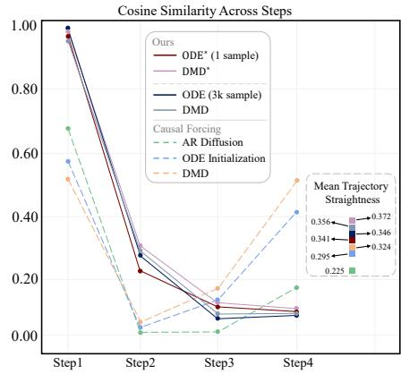  
Figure 4: Comparison of cosine similarity trends and trajectory straightness across different models.

## 3.3 SUBOPTIMAL TRAJECTORY FITTING IN CONSISTENCY DISTILLATION

Sec. 3.2 shows that a single trajectory provides adequate geometric supervision for ODE initialization, but this does not guarantee that a single student can fit it well. We therefore turn from how much supervision is needed to how hard it is to fit: the central challenge is that a single student must approximate trajectory segments with substantially different geometric complexity across the diffusion time domain using one set of parameters. To quantify this complexity, we first measure the local deviation of the teacher trajectory from its global linear direction.

Inspired by Transition Matching Distillation (Nie et al., 2026), we analyze trajectory non-linearity by measuring how much the teacher trajectory diverges from the straight chord connecting data and noise endpoints. Specifically, for adjacent states we quantify the local velocity deviation $C ( t _ { i } ) =$ $\frac { 1 } { d } \left\| \frac { x _ { t _ { i } } - x _ { t _ { i - 1 } } } { t _ { i } - t _ { i - 1 } } - \left( x _ { 1 } - x _ { 0 } \right) \right\| _ { 2 } ^ { 2 }$ , where $t = 0$ and $t = 1$ denote the clean data and high-noise endpoints, respectively, and d is the latent dimension. Thus, $C ( t _ { i } )$ captures the per-coordinate squared error between local teacher velocity and the ideal linear trajectory. As visualized in Fig. 2(b), over 92.5% of the total curvature mass is concentrated in the high-noise region $\mathit { \Omega } ( t ~ \geq ~ 0 . \bar { 9 } )$ This geometric discrepancy explains why standard ODE distillation with uniform timestep sampling is suboptimal: directly regressing highly curved, noisy intermediate states to clean endpoints creates an inherently inconsistent target. Sampling details are provided in Appendix A.

To validate our hypothesis, we conduct evaluations on the Causal Forcing framework. Specifically, we partition the ODE solution trajectory $\left( \mathbf { x } _ { N } , \mathbf { x } _ { N - 1 } , \ldots , \mathbf { x } _ { 0 } \right)$ of the teacher model into two distinct sub-trajectories, demarcated by a threshold timestep tκ (we set $N = 4 8$ and $\kappa = 3 4$ by default).

The trajectory is divided based on distinct functional roles: 1) The high-noise regime $( \{ \mathbf { x } _ { t _ { i } } \} _ { i = \kappa } ^ { N } )$ primarily governs the synthesis of global semantic layout and motion. 2) The low-noise regime $\dot { ( } \{ \mathbf { x } _ { t _ { j } } \} _ { j = 0 } ^ { \kappa } \dot { ) }$ focuses on semantic refinement and fine-grained detail generation.

As illustrated in Fig. 5(a), we train two specialized student models—a layout/motion expert $F _ { \mathrm { S l o w } }$ and a detail expert $F _ { \mathrm { F a s t } } { - } \mathrm { t o }$ fit their respective sub-trajectories independently:

$$
{ \mathcal { L } } _ { \mathrm { S l o w } } = \mathbb { E } _ { { \pmb x } , t _ { m } \in [ t _ { \kappa } , t _ { N } ] } | | \Phi ( { \pmb x } _ { t _ { m } } , F _ { \mathrm { S l o w } } ( { \pmb x } _ { t _ { m } } , t _ { m } , c ) , t _ { \kappa } ) -
$$

$$
\Phi ( \hat { { \pmb x } } _ { t _ { m - 1 } } , F _ { \mathrm { S l o w } } ^ { - } ( \hat { { \pmb x } } _ { t _ { m - 1 } } , t _ { m - 1 } , c ) , t _ { \kappa } ) | | _ { 2 } ^ { 2 } ,\tag{9}
$$

$$
\mathcal { L } _ { \mathrm { F a s t } } = \mathbb { E } _ { { \pmb x } , t _ { n } \in [ t _ { 0 } , t _ { \kappa } ] } | | \Phi ( { \pmb x } _ { t _ { n } } , F _ { \mathrm { F a s t } } ( { \pmb x } _ { t _ { n } } , t _ { n } , c ) , t _ { 0 } ) -
$$

$$
\Phi ( \hat { { \pmb x } } _ { t _ { n - 1 } } , F _ { \mathrm { F a s t } } ^ { - } ( \hat { { \pmb x } } _ { t _ { n - 1 } } , t _ { n - 1 } , c ) , t _ { 0 } ) | | _ { 2 } ^ { 2 } .\tag{10}
$$

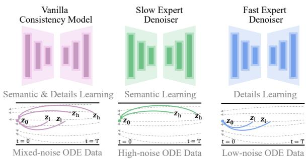  
(a) Variants trained on data with different noise levels

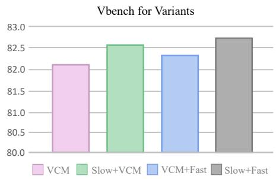  
(b) VBench metric for different variants  
Figure 5: Comparison of visual quality across denoiser variants trained on different noise levels. Decoupling distillation into semantic and detail learning with two expert denoisers and combining them at inference yields the best quantitative visual results.

During inference, the two experts are dynamically switched according to the sampling stage. To isolate the contribution of each expert, we compare four configurations: vanilla VCM, Slow + VCM, VCM + Fast, and $S l o w + F a s t .$ As shown in Fig. 5(b), $F _ { \mathrm { S l o w } }$ and $F _ { \mathrm { F a s t } }$ consistently outperform the vanilla VCM baseline in modeling structural semantics and fine details, respectively. These empirical findings strongly support our hypothesis, confirming that decoupling trajectory optimization effectively alleviates the capacity bottleneck of training a unified model for conflicting objectives.

## 3.4 EXPERT-SPECIFIC OPTIMIZATION OBJECTIVE

In addition to the consistency objectives, we introduce specialized expert loss functions for the semantic expert denoiser $F _ { \mathrm { S l o w } }$ and the details expert denoiser $F _ { \mathrm { F a s t } }$ , as illustrated in Fig. 3.

Temporal Frequency Spectrum Loss. To improve the coherence of $F _ { \mathrm { S l o w } }$ , we introduce $\mathcal { L } _ { T F S }$ Instead of operating solely in the time domain, $\mathcal { L } _ { T F S }$ regularizes the temporal energy distribution in the frequency domain via a 1D discrete Fourier transform (1D-DFT) along the temporal axis T:

$$
\begin{array} { r l } & { \hat { \pmb { x } } _ { t _ { 0 } } = \Phi ( \pmb { x } _ { t _ { m } } , F _ { \mathrm { S l o w } } ( \pmb { x } _ { t _ { m } } , t _ { m } , c ) , t _ { 0 } ) , } \\ & { { \pmb { \mathcal { L } } } _ { T F S } = \| | \mathcal { F } _ { \mathrm { 1 D - D F T } } ( \hat { \pmb { x } } _ { t _ { 0 } } ) | - | \mathcal { F } _ { \mathrm { 1 D - D F T } } ( \pmb { x } _ { t _ { 0 } } ) | \| _ { 2 } ^ { 2 } , } \end{array}\tag{11}
$$

where $\mathbf { \mathcal { x } } _ { t _ { 0 } }$ denotes the target ODE latent, $\hat { \mathbf { \Omega } } _ { { \hat { \mathbf { \Omega } } } _ { t _ { 0 } } } ^ { }$ denotes the latent estimated by $F _ { \mathrm { S l o w } }$ , and $| \mathcal { F } _ { \mathrm { 1 D - D F T } } ( \cdot ) |$ denotes the magnitude of the complex frequency spectra. By aligning the temporal spectral energy, $\mathcal { L } _ { T F S }$ effectively suppresses high-frequency temporal flickering while preserving motion dynamics.

Spatial High-Pass Loss. To guide $F _ { \mathrm { F a s t } }$ in synthesizing sharp textures and structural details, we introduce $\bar { \mathcal { L } } _ { H P }$ , which penalizes structural discrepancies via a fixed 2D Laplacian operator:

$$
\begin{array} { r l } & { \hat { \mathbf { \ b { x } } } _ { t _ { 0 } } = \Phi ( \mathbf { \ b { x } } _ { t _ { n } } , F _ { \mathrm { F a s t } } ( \mathbf { \ b { x } } _ { t _ { n } } , t _ { n } , c ) , t _ { 0 } ) , } \\ & { \pmb { H } ( \pmb { x } ) = \mathrm { C o n v } 2 \mathrm { D } ( \pmb { x } , \pmb { K } _ { \mathrm { L a p l a c i a n } } ) , } \\ & { \mathcal { L } _ { H P } = \| \pmb { H } ( \hat { \mathbf { \ b { x } } } _ { t _ { 0 } } ) - \pmb { H } ( \mathbf { \pmb { x } } _ { t _ { 0 } } ) \| _ { 2 } ^ { 2 } , } \end{array}\tag{12}
$$

where $K _ { \mathrm { L a p l a c i a n } }$ is a non-trainable, channel-wise 2D Laplacian kernel that extracts spatial highfrequency edges. By directly optimizing the high-pass filtered latent space, $\mathcal { L } _ { H P }$ encourages crisp boundaries and fine textures without compromising the underlying semantic structure.

## 4 EXPERIMENTS

## 4.1 SETUP

Implementation details. Following prior work (Huang et al., 2026; Zhu et al., 2026), we adopt Wan2.1-1.3B (Team Wan et al., 2025) as the base model for our AR few-step generator, producing 480×832 videos with 81 frames via chunk-wise autoregressive generation. Our method builds upon the three-stage distillation pipeline of Causal Forcing. All training is conducted on 8× A100 GPUs. The default single training sample is shown in Fig. 8. Additional details are provided in Appendix A.

Evaluation. Following Causal Forcing, we evaluate on VBench (Huang et al., 2024) and Vision-Reward (Xu et al., 2024).We report the overall scores of both benchmarks, and additionally evaluate

Table 1: Comparisons with existing methods. Our method achieves generation quality comparable to or better than previous SOTA methods. Data, Dyn., Vision., and Instruct. denote Training Data, Dynamic Degree, VisionReward, and Instruction Following, respectively. \* indicates the same set of models across stages. Throughput and latency are measured in FPS and seconds on H100 GPU.
<table><tr><td>Model</td><td>Data</td><td></td><td>Thru. ↑ Latency ↓ Total ↑ Quality ↑ Semantic ↑ Dyn. ↑ Vision. ↑ Instruct. ↑</td><td></td><td></td><td></td><td></td><td></td><td></td></tr><tr><td colspan="10">Bidirectional Video Diffusion Models</td></tr><tr><td>Wan2.1-1.3B</td><td></td><td>0.78</td><td>103</td><td>83.37</td><td>84.30</td><td>79.65</td><td>61</td><td>5.275</td><td>42</td></tr><tr><td>LTX-1.9B</td><td>一</td><td>8.98</td><td>13.5</td><td>79.83</td><td>81.88</td><td>71.62</td><td>46</td><td>-6.218</td><td>-38</td></tr><tr><td colspan="10">Autoregressive Video Diffusion Models</td></tr><tr><td>SkyReels-V2</td><td></td><td>0.49</td><td>112</td><td>81.97</td><td>83.96</td><td>74.01</td><td>37</td><td>3.584</td><td>32</td></tr><tr><td>MAGI-1</td><td></td><td>0.19</td><td>282</td><td>78.88</td><td>81.67</td><td>67.72</td><td>42</td><td>0.773</td><td>8</td></tr><tr><td colspan="10">Initialized Autoregressive Video Models</td></tr><tr><td>CausVid</td><td>1k</td><td>17.0</td><td>0.69</td><td>66.58</td><td>70.42</td><td>51.23</td><td>72</td><td>-13.724</td><td>-60</td></tr><tr><td>Self Forcing</td><td>16k</td><td>17.0</td><td>0.69</td><td>69.48</td><td>73.47</td><td>53.53</td><td>80</td><td>-12.591</td><td>-50</td></tr><tr><td>Causal Forcing</td><td>3k</td><td>17.0</td><td>0.69</td><td>82.01</td><td>82.59</td><td>79.73</td><td>64</td><td>0.603</td><td>50</td></tr><tr><td>Glance Forcing</td><td>3k</td><td>16.4</td><td>0.75</td><td>82.69</td><td>83.33</td><td>80.11</td><td>63</td><td>2.310</td><td>52</td></tr><tr><td>Glance Forcing*</td><td>1</td><td>16.4</td><td>0.75</td><td>82.09</td><td>83.68</td><td>75.72</td><td>70</td><td>0.489</td><td>30</td></tr><tr><td colspan="10">Distilled Autoregressive Video Models</td></tr><tr><td>CausVid</td><td>25k</td><td>17.0</td><td>0.69</td><td>81.33</td><td>83.98</td><td>70.72</td><td>62</td><td>5.741</td><td>12</td></tr><tr><td>Self Forcing</td><td>25k</td><td>17.0</td><td>0.69</td><td>83.74</td><td>84.48</td><td>80.77</td><td>57</td><td>5.820</td><td>48</td></tr><tr><td>Causal Forcing Glance Forcing</td><td>25k 25k</td><td>17.0</td><td>0.69</td><td>84.04 84.33</td><td>84.59</td><td>81.84 81.64</td><td>68 78</td><td>6.326 6.921</td><td>56</td></tr><tr><td>Glance Forcing*</td><td>25k</td><td>16.4</td><td>0.75 0.75</td><td>84.22</td><td>85.01 85.50</td><td>79.11</td><td>75</td><td>6.870</td><td>69</td></tr><tr><td></td><td></td><td>16.4</td><td></td><td></td><td></td><td></td><td></td><td></td><td>64</td></tr></table>

dynamic degree and instruction following using the 100 prompts from Causal Forcing. All metrics are scaled by 100. We additionally report first-frame latency and throughput, measured on a single H100 GPU, excluding VAE-related time.

## 4.2 MAIN RESULTS

We evaluate Glance Forcing against representative video generation methods spanning three paradigms: bidirectional diffusion models (Wan2.1-1.3B (Team Wan et al., 2025) and LTX-1.9B (HaCohen et al., 2024)), autoregressive diffusion models (SkyReels-V2-1.3B (Chen et al., 2025) and MAGI-1-4.5B (Teng et al., 2025)), and distilled autoregressive video models, including CausVid (Yin et al., 2025), Self Forcing (Huang et al., 2026), and Causal Forcing (Zhu et al., 2026).

Quantitative Comparison. Tab. 1 reports the quantitative comparison. Remarkably, with only one training sample, Glance Forcing already achieves competitive or better performance than Causal Forcing across most metrics, obtaining a Total score of 82.09 and consistently higher Dynamic, VisionReward, and Instruction Following scores. This demonstrates the strong data efficiency of our training strategy. When scaling the training budget to match Causal Forcing, Glance Forcing further improves the generation quality, achieving the best overall Total score of 82.69 among initialized autoregressive models. After autoregressive distillation, Glance Forcing reaches 84.58, with further gains in Dynamic, VisionReward, and Instruction Following, showing that the benefits of phaseaware optimization persist and become more pronounced as the training budget scales.

Qualitative Comparison. Fig. 6 provides qualitative comparisons that further support our quantitative results. With one training sample, Glance Forcing produces visually competitive videos, with more stable object appearance, motion, and fine-grained details than existing distilled autoregressive models in several cases. When scaling the training budget to match baseline Causal Forcing, Glance Forcing further improves visual quality, producing more temporally consistent frames with sharper textures and clearer scene details.

User Study. We conduct a pairwise human preference study comparing Glance Forcing with Self Forcing and Causal Forcing. As shown in Tab. 2, Glance Forcing is consistently preferred by human annotators, achieving win rates of 91.3% and 63.3% over Self Forcing and Causal Forcing, respectively. These results align with the VBench evaluation in Tab. 1, further supporting the improved perceptual quality of Glance Forcing. Detailed study protocols are provided in Appendix C.

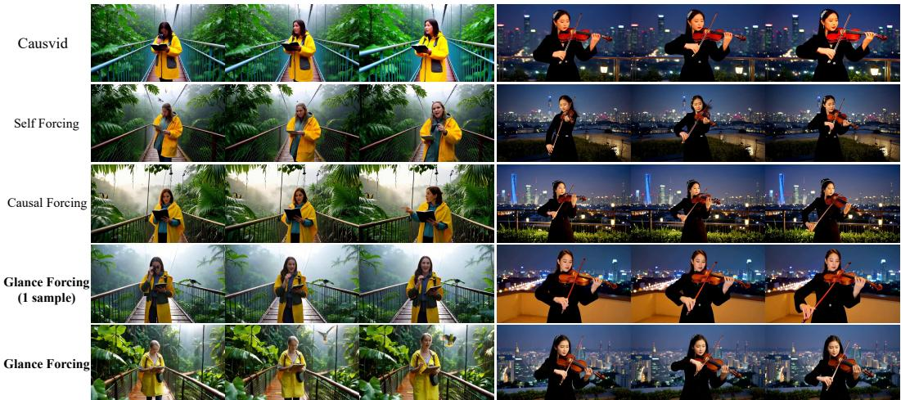  
Figure 6: Qualitative comparisons with existing methods. Our method achieves competitive visual quality than state-of-the-art distilled autoregressive video models.

Table 2: Human preference for Glance Forcing over each baseline. Results aggregate votes from three annotators on 50 prompts, with 150 votes per comparison. “Win rate” denotes the fraction of decided votes in which Glance Forcing is preferred.
<table><tr><td>Baseline</td><td>Ours wins</td><td>wins</td><td>Total</td><td>Win rate</td></tr><tr><td>Self Forcing</td><td>137</td><td>13</td><td>150</td><td>91.3%</td></tr><tr><td>Causal Forcing</td><td>95</td><td>55</td><td>150</td><td>63.3%</td></tr></table>

Table 3: Ablation study of different components in Glance Forcing.
<table><tr><td rowspan="2">#</td><td rowspan="2">Variants SF TFS HP</td><td rowspan="2"></td><td colspan="3">VBench</td></tr><tr><td>Total</td><td>Quality</td><td> Semantic</td></tr><tr><td>(1) (2)</td><td></td><td></td><td>83.73</td><td>84.32</td><td>81.37</td></tr><tr><td></td><td>√ √</td><td></td><td>84.05</td><td>84.71</td><td>81.41</td></tr><tr><td>(3)</td><td>√</td><td></td><td>84.20</td><td>84.76</td><td>81.96</td></tr><tr><td>(4)</td><td>√</td><td>√</td><td>84.21</td><td>84.88</td><td>81.53</td></tr><tr><td>(5) √</td><td></td><td>√ √</td><td>84.33</td><td>85.01</td><td>81.64</td></tr></table>

## 4.3 ABLATION STUDIES

We conduct ablation studies on VBench to evaluate the core components of Glance Forcing.

Core Design. As summarized in Tab. 3, incorporating the Slow–Fast (SF) optimization decoupling improves the overall score from 83.98 to 84.33, demonstrating the necessity of separating coarse semantic synthesis from fine detail refinement. Integrating the Temporal Frequency Spectrum Loss (TFS) yields further quantitative gains, while the Spatial High-Pass Loss (HP) delivers additional improvements in both overall quality and spatial fidelity. Qualitatively, as illustrated in Fig. 7, TFS effectively enhances temporal consistency, whereas HP noticeably sharpens fine-grained spatial details. Together, these results confirm the synergistic efficacy of our core designs.

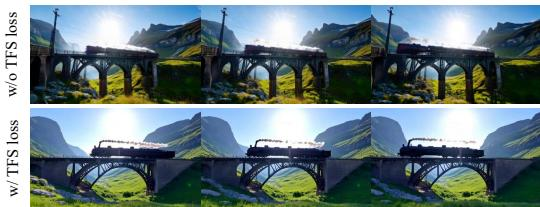  
(a) Impact of temporal frequency spectrum loss

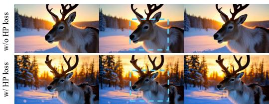  
(b) Impact of Spatial High-Pass loss  
Figure 7: Ablation study Performance comparison.

Slow–Fast Switching. We investigate different Slow–Fast step allocations within each 4-step chunk. As presented in Tab. 6, our default S2–F2 consistently yields the optimal overall performance. Notably, deploying only Slow-LoRA (S4) yields higher visual quality, whereas Fast LoRA (F4) better preserves motion dynamics and semantic consistency, revealing the complementary strengths of the two experts. In contrast, the imbalanced S1–F3 and S3–F1 schedules degrade performance. These results support an even allocation across the denoising trajectory as the best balance between semantic generation and detail refinement.

Training Sample  
ODE Initialization  
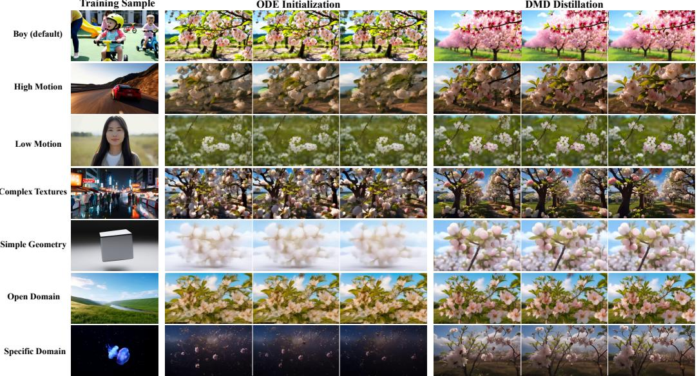  
DMD Distillation  
Figure 8: Qualitive results from one-sample training setting.

Table 4: Ablation study on 1 sample.
<table><tr><td rowspan="2">Model</td><td colspan="3">ODE Initialization</td><td colspan="3">DMD Distillation</td></tr><tr><td>Total</td><td>Quality</td><td>Semantic</td><td>Total</td><td>Quality</td><td>Semantic</td></tr><tr><td>Boy (default)</td><td>82.09</td><td>83.68</td><td>75.72</td><td>84.22</td><td>85.50</td><td>79.11</td></tr><tr><td colspan="7">Motion Dynamics</td></tr><tr><td>High Motion</td><td>75.37</td><td>74.91</td><td>77.23</td><td>82.72</td><td>83.64</td><td>79.04</td></tr><tr><td>Low Motion</td><td>78.23</td><td>78.14</td><td>78.59</td><td>79.81</td><td>80.02</td><td>78.98</td></tr><tr><td colspan="7">Visual Complexity</td></tr><tr><td>Complex Textures</td><td>78.10</td><td>78.02</td><td>78.42</td><td>82.65</td><td>83.56</td><td>79.02</td></tr><tr><td>Simple Geometry</td><td>73.79</td><td>74.36</td><td>71.51</td><td>83.52</td><td>84.51</td><td>79.56</td></tr><tr><td colspan="7">Domain Specificity</td></tr><tr><td>Open Domain</td><td>79.45</td><td>80.03</td><td>77.14</td><td>83.48</td><td>84.47</td><td>79.52</td></tr><tr><td>Specific Domain</td><td>71.94</td><td>72.37</td><td>70.23</td><td>81.33</td><td>82.53</td><td>76.52</td></tr></table>

Table 5: Diffusion model for accelerating.
<table><tr><td>Model</td><td>NFEs</td><td>Thru. ↑</td><td>Latency ↓</td><td>Total ↑</td><td>Quality ↑</td><td>Semantic ↑</td></tr><tr><td>Wan2.1</td><td>50</td><td>0.78</td><td>103</td><td>83.37</td><td>84.30</td><td>79.65</td></tr><tr><td>LTX-1.9B</td><td>20</td><td>8.98</td><td>13.5</td><td>79.83</td><td>81.88</td><td>71.62</td></tr><tr><td>Glance Forcing</td><td>8</td><td>17.0</td><td>1.38</td><td>82.16</td><td>83.42</td><td>77.12</td></tr><tr><td>Glance Forcing</td><td>4</td><td>34.0</td><td>0.69</td><td>81.14</td><td>82.27</td><td>76.65</td></tr></table>

Table 6: Slowfast stage ablation study.
<table><tr><td>Model</td><td>Total↑</td><td>Quality↑</td><td>Semantic↑</td><td>Dynamic↑</td><td>Vision↑</td><td>Instruct↑</td></tr><tr><td>S2-F2</td><td>84.33</td><td>85.01</td><td>81.64</td><td>78</td><td>6.921</td><td>69</td></tr><tr><td>S1-F3</td><td>83.92</td><td>84.65</td><td>81.00</td><td>76</td><td>2.865</td><td>41</td></tr><tr><td>S3-F1</td><td>84.01</td><td>85.05</td><td>79.85</td><td>68</td><td>4.210</td><td>55</td></tr><tr><td>S4</td><td>83.42</td><td>84.80</td><td>77.90</td><td>55</td><td>2.450</td><td>43</td></tr><tr><td>F4</td><td>83.15</td><td>84.20</td><td>78.95</td><td>72</td><td>1.310</td><td>31</td></tr></table>

## 4.4 DISCUSSION

Systematic One-Sample Study. We conduct three controlled one-sample studies across motion dynamics, visual complexity, and domain specificity. The results in Tab. 4 reveal distinct sensitivity to sample characteristics. For ODE initialization, Low Motion and Open Domain achieve higher quality, whereas High Motion and Specific Domain exhibit larger degradation, suggesting that onesample initialization is more sensitive to substantial temporal dynamics and specialized content. In contrast, DMD consistently recovers and improves generation quality across all samples, with particularly pronounced gains for High Motion and Simple Geometry. Notably, semantic scores remain relatively stable across settings, indicating that the primary variation induced by one-sample training lies in quality rather than semantic alignment. Overall, a single sample provides effective supervision for both ODE and subsequent DMD refinement, although its effectiveness depends on characteristics of the selected sample. Detailed setup and prompts are provided in Appendix F.

Generalization to Diffusion Acceleration. We further validate Glance Forcing beyond autoregressive generation by distilling the 50-step Wan2.1 model into an 8-step bidirectional diffusion model using a single training sample. As shown in Tab. 5, the distilled model achieves comparable performance to Wan2.1 with over 5× lower sampling cost, while maintaining modest degradation at 4 NFEs, demonstrating the generality of our phase-aware optimization.

## 5 CONCLUSION

We revisit the necessity of large-scale trajectory supervision for distilling autoregressive video diffusion models. We find that trajectory correction and distributional refinement play separable roles in the distillation pipeline, and that a single PF-ODE trajectory suffices once denoising is decoupled by noise regime. Built on this, Glance Forcing uses a dual-LoRA design, with a Slow expert for layout/motion and a Fast expert for detail, each with a tailored objective. Using one trajectory, Glance Forcing matches or surpasses the baseline while reducing trajectory-collection cost from thousands of GPU-hours to about one A100-hour, with consistent gains as the training budget scales.

## AI USE STATEMENT

In this work, we used generative AI tools to assist with translation during the drafting of the paper. We have not used generative AI tools for generating synthetic data sets, developing theoretical models or conceptual frameworks, formulating mathematical claims, providing critical ingredients for proving mathematical claims, assisting in the writing of proofs, proposing or refining hypotheses, designing or providing feedback on research methodology or experiments, implementing methods, cleaning or reformatting datasets, supporting qualitative or thematic data analysis, and interpreting results, and these tasks are not applicable to this work. Additionally, we used generative AI tools to edit the paper to improve readability. We have reviewed all AI-assisted work: all AI-assisted text was checked and revised by the authors for accuracy and clarity. We take responsibility for the final content of this work, including text, claims, or artifacts produced with the aid of generative AI.

## REPRODUCIBILITY

Our models are built upon publicly available Wan model variants and datasets (OpenVid-1M and synthetic Wan videos). Training was conducted in a well-controlled environment, with all training details, hyperparameters, and implementation specifics provided in Section 4.1 and the Appendix A to ensure reproducibility.

## REFERENCES

Andreas Blattmann, Tim Dockhorn, Sumith Kulal, Daniel Mendelevitch, Maciej Kilian, Dominik Lorenz, Yam Levi, Zion English, Vikram Voleti, Adam Letts, et al. Stable video diffusion: Scaling latent video diffusion models to large datasets. arXiv preprint arXiv:2311.15127, 2023a.

Andreas Blattmann, Robin Rombach, Huan Ling, Tim Dockhorn, Seung Wook Kim, Sanja Fidler, and Karsten Kreis. Align your latents: High-resolution video synthesis with latent diffusion models. In CVPR, 2023b.

Tim Brooks, Bill Peebles, Connor Holmes, Will DePue, Yufei Guo, Li Jing, David Schnurr, Joe Taylor, Troy Luhman, Eric Luhman, Clarence Ng, Ricky Wang, and Aditya Ramesh. Video generation models as world simulators. OpenAI Research Blog, 2024. URL https://openai.com/ index/video-generation-models-as-world-simulators/. Accessed: 2026-08- 21.

Boyuan Chen, Diego Mart´ı Monso, Yilun Du, Max Simchowitz, Russ Tedrake, and Vincent Sitz- ´ mann. Diffusion forcing: Next-token prediction meets full-sequence diffusion. Advances in Neural Information Processing Systems, 37:24081–24125, 2024.

Guibin Chen, Dixuan Lin, Jiangping Yang, Chunze Lin, Junchen Zhu, Mingyuan Fan, Hao Zhang, Sheng Chen, Zheng Chen, Chengcheng Ma, et al. Skyreels-v2: Infinite-length film generative model. arXiv preprint arXiv:2504.13074, 2025.

Justin Cui, Jie Wu, Ming Li, Tao Yang, Xiaojie Li, Rui Wang, Andrew Bai, Yuanhao Ban, and Cho-Jui Hsieh. Self-forcing++: Towards minute-scale high-quality video generation. In The Fourteenth International Conference on Learning Representations, 2026. URL https: //openreview.net/forum?id=DzvPiqh23f.

Patrick Esser, Sumith Kulal, Andreas Blattmann, Rahim Entezari, Jonas Muller, Harry Saini, Yam¨ Levi, Dominik Lorenz, Axel Sauer, Frederic Boesel, Dustin Podell, Tim Dockhorn, Zion English, and Robin Rombach. Scaling rectified flow transformers for high-resolution image synthesis. In Proceedings of the 41st International Conference on Machine Learning, volume 235 of Proceedings of Machine Learning Research, pp. 12606–12633. PMLR, 2024. URL https://proceedings.mlr.press/v235/esser24a.html.

Yoav HaCohen, Nisan Chiprut, Benny Brazowski, Daniel Shalem, Dudu Moshe, Eitan Richardson, Eran Levin, Guy Shiran, Nir Zabari, Ori Gordon, et al. Ltx-video: Realtime video latent diffusion. arXiv preprint arXiv:2501.00103, 2024.

Jonathan Ho, William Chan, Chitwan Saharia, Jay Whang, Ruiqi Gao, Alexey Gritsenko, Diederik P. Kingma, Ben Poole, Mohammad Norouzi, David J. Fleet, and Tim Salimans. Imagen Video: High definition video generation with diffusion models, 2022a. URL https://arxiv.org/abs/ 2210.02303.

Jonathan Ho, Tim Salimans, Alexey Gritsenko, William Chan, Mohammad Norouzi, and David J. Fleet. Video diffusion models. In S. Koyejo, S. Mohamed, A. Agarwal, D. Belgrave, K. Cho, and A. Oh (eds.), Advances in Neural Information Processing Systems, volume 35, pp. 8633–8646. Curran Associates, Inc., 2022b. URL https://proceedings.neurips.cc/paper\_files/paper/2022/ file/39235c56aef13fb05a6adc95eb9d8d66-Paper-Conference.pdf.

Edward J Hu, Yelong Shen, Phillip Wallis, Zeyuan Allen-Zhu, Yuanzhi Li, Shean Wang, Lu Wang, and Weizhu Chen. Lora: Low-rank adaptation of large language models. arXiv preprint arXiv:2106.09685, 2021.

Xun Huang, Zhengqi Li, Guande He, Mingyuan Zhou, and Eli Shechtman. Self forcing: Bridging the train-test gap in autoregressive video diffusion. Advances in Neural Information Processing Systems, 38:167283–167308, 2026.

Ziqi Huang, Yinan He, Jiashuo Yu, Fan Zhang, Chenyang Si, Yuming Jiang, Yuanhan Zhang, Tianxing Wu, Qingyang Jin, Nattapol Chanpaisit, et al. Vbench: Comprehensive benchmark suite for video generative models. In Proceedings of the IEEE/CVF Conference on Computer Vision and Pattern Recognition, pp. 21807–21818, 2024.

Yang Jin, Zhicheng Sun, Ningyuan Li, Kun Xu, Hao Jiang, Nan Zhuang, Quzhe Huang, Yang Song, Yadong Mu, and Zhouchen Lin. Pyramidal flow matching for efficient video generative modeling. arXiv preprint arXiv:2410.05954, 2024.

Yaron Lipman, Ricky T. Q. Chen, Heli Ben-Hamu, Maximilian Nickel, and Matthew Le. Flow matching for generative modeling. In The Eleventh International Conference on Learning Repre sentations, 2023. URL https://openreview.net/forum?id=PqvMRDCJT9t.

Jinxiu Liu, Xuanming Liu, Kangfu Mei, Yandong Wen, Ming-Hsuan Yang, and Weiyang Liu. Streaming autoregressive video generation via diagonal distillation. In The Fourteenth International Conference on Learning Representations, 2026a. URL https://openreview.net/ forum?id=X7YW6STzeL.

Kunhao Liu, Wenbo Hu, Jiale Xu, Ying Shan, and Shijian Lu. Rolling forcing: Autoregressive long video diffusion in real time. In The Fourteenth International Conference on Learning Representations, 2026b. URL https://openreview.net/forum?id=IAyzXjbfwo.

Yunhong Lu, Yanhong Zeng, Haobo Li, Hao Ouyang, Qiuyu Wang, Ka Leong Cheng, Jiapeng Zhu, Hengyuan Cao, Zhipeng Zhang, Xing Zhu, Yujun Shen, and Min Zhang. Reward forcing: Efficient streaming video generation with rewarded distribution matching distillation, 2025. URL https://arxiv.org/abs/2512.04678.

Weijian Luo, Tianyang Hu, Shifeng Zhang, Jiacheng Sun, Zhenguo Li, and Zhihua Zhang. Diffinstruct: A universal approach for transferring knowledge from pre-trained diffusion models. Advances in Neural Information Processing Systems, 36:76525–76546, 2023.

Weili Nie, Julius Berner, Nanye Ma, Chao Liu, Saining Xie, and Arash Vahdat. Transition matching distillation for fast video generation, 2026. URL https://arxiv.org/abs/2601.09881.

Yang Song and Prafulla Dhariwal. Improved techniques for training consistency models. arXiv preprint arXiv:2310.14189, 2023.

Yang Song, Prafulla Dhariwal, Mark Chen, and Ilya Sutskever. Consistency models. arXiv preprint arXiv:2303.01469, 2023.

Team Seedance, De Chen, Liyang Chen, Xin Chen, Ying Chen, Zhuo Chen, Zhuowei Chen, Feng Cheng, Tianheng Cheng, Yufeng Cheng, Mojie Chi, Xuyan Chi, Jian Cong, Qinpeng Cui, Fei Ding, Qide Dong, et al. Seedance 2.0: Advancing video generation for world complexity, 2026. URL https://arxiv.org/abs/2604.14148.

Team Wan, Ang Wang, Baole Ai, Bin Wen, Chaojie Mao, Chen-Wei Xie, Di Chen, Feiwu Yu, Haiming Zhao, Jianxiao Yang, Jianyuan Zeng, Jiayu Wang, Jingfeng Zhang, Jingren Zhou, Jinkai Wang, Jixuan Chen, Kai Zhu, Kang Zhao, Keyu Yan, Lianghua Huang, Mengyang Feng, Ningyi Zhang, Pandeng Li, Pingyu Wu, Ruihang Chu, Ruili Feng, Shiwei Zhang, Siyang Sun, Tao Fang, Tianxing Wang, Tianyi Gui, Tingyu Weng, Tong Shen, Wei Lin, et al. Wan: Open and advanced large-scale video generative models, 2025. URL https://arxiv.org/abs/2503.20314.

Hansi Teng, Hongyu Jia, Lei Sun, Lingzhi Li, Maolin Li, Mingqiu Tang, Shuai Han, Tianning Zhang, WQ Zhang, Weifeng Luo, et al. Magi-1: Autoregressive video generation at scale. arXiv preprint arXiv:2505.13211, 2025.

Wenhao Wang and Yi Yang. Vidprom: A million-scale real prompt-gallery dataset for text-to-video diffusion models. Advances in Neural Information Processing Systems, 37:65618–65642, 2024.

Zhengyi Wang, Cheng Lu, Yikai Wang, Fan Bao, Chongxuan Li, Hang Su, and Jun Zhu. Prolificdreamer: High-fidelity and diverse text-to-3d generation with variational score distillation. Advances in neural information processing systems, 36:8406–8441, 2023.

Jiazheng Xu, Yu Huang, Jiale Cheng, Yuanming Yang, Jiajun Xu, Yuan Wang, Wenbo Duan, Shen Yang, Qunlin Jin, Shurun Li, et al. Visionreward: Fine-grained multi-dimensional human preference learning for image and video generation. arXiv preprint arXiv:2412.21059, 2024.

Shuai Yang, Wei Huang, Ruihang Chu, Yicheng Xiao, Yuyang Zhao, Xianbang Wang, Muyang Li, Enze Xie, Ying-Cong Chen, Yao Lu, Song Han, and Yukang Chen. LongLive: Real-time interactive long video generation. In The Fourteenth International Conference on Learning Representations, 2026. URL https://openreview.net/forum?id=nCAODkpsPJ.

Tianwei Yin, Michael Gharbi, Taesung Park, Richard Zhang, Eli Shechtman, Fr¨ edo Du-´ rand, and William T. Freeman. Improved distribution matching distillation for fast image synthesis. In A. Globerson, L. Mackey, D. Belgrave, A. Fan, U. Paquet, J. Tomczak, and C. Zhang (eds.), Advances in Neural Information Processing Systems, volume 37, pp. 47455–47487. Curran Associates, Inc., 2024a. doi: 10.52202/ 079017-1505. URL https://proceedings.neurips.cc/paper\_files/paper/ 2024/file/54dcf25318f9de5a7a01f0a4125c541e-Paper-Conference.pdf.

Tianwei Yin, Michael Gharbi, Richard Zhang, Eli Shechtman, Fr¨ edo Durand, William T. Freeman,´ and Taesung Park. One-step diffusion with distribution matching distillation. In Proceedings of the IEEE/CVF Conference on Computer Vision and Pattern Recognition (CVPR), pp. 6613– 6623, June 2024b. doi: 10.1109/CVPR52733.2024.00632. URL https://openaccess. thecvf.com/content/CVPR2024/html/Yin\_One-step\_Diffusion\_with\_ Distribution\_Matching\_Distillation\_CVPR\_2024\_paper.html.

Tianwei Yin, Qiang Zhang, Richard Zhang, William T Freeman, Fredo Durand, Eli Shechtman, and Xun Huang. From slow bidirectional to fast autoregressive video diffusion models. In Proceedings of the IEEE/CVF Conference on Computer Vision and Pattern Recognition, pp. 22963– 22974, 2025.

Hongzhou Zhu, Min Zhao, Guande He, Hang Su, Chongxuan Li, and Jun Zhu. Causal forcing: Autoregressive diffusion distillation done right for high-quality real-time interactive video generation. arXiv preprint arXiv:2602.02214, 2026.

Noise schedule and model parameterization. Following Wan2.1, we use a flow-matching scheduler. For a sampled timestep $t \in [ 0 , 1 0 0 0 ]$ , the shifted noise level is

$$
\sigma _ { t } = \frac { k ( t / 1 0 0 0 ) } { 1 + ( k - 1 ) ( t / 1 0 0 0 ) } ,
$$

with shift factor $k = 5$ for generator rollouts and for the DMD/GAN critic timestep sampling. The forward corruption process is

$$
\begin{array} { r } { x _ { t } = ( 1 - \sigma _ { t } ) x _ { 0 } + \sigma _ { t } \epsilon , \qquad \epsilon \sim \mathcal { N } ( 0 , I ) , } \end{array}
$$

and the flow-prediction target is $\epsilon - x _ { 0 }$ . During generation, the model predicts $v _ { \theta } ( x _ { t } , t , c )$ and converts it to a clean latent estimate by $\hat { x } _ { 0 } = x _ { t } - \sigma _ { t } v _ { \theta } ( x _ { t } , t , c )$

Training details of our method. We first construct a dataset $\mathcal { D } _ { \mathrm { B i } }$ consisting of about 3K samples generated by Wan (Team Wan et al., 2025) with the VidProM (Wang & Yang, 2024) prompts. Next, we sample ODE trajectories from the autoregressive diffusion model to construct a ODE Slow-Fast dataset $\mathcal { D } _ { \mathrm { S l o w - F a s t } }$ with 3K samples. Throughout training, including the teacher forcing autoregressive diffusion model and both ODE-initialization variants, we use either $D _ { \mathrm { B i } }$ or $\mathcal { D } _ { \mathrm { S l o w - F a s t } }$ , both internally synthesized by the model, and using about the same prompts, thus guaranteeing that there is no gap in terms of data quality. Then, we perform causal ODE distillation on $\mathcal { D } _ { \mathrm { S l o w - F a s t } }$ for 1K steps via teacher forcing, conditioned on the corresponding clean data in $\mathcal { D } _ { \mathrm { B i } }$ . In this stage, the ODE student is initialized from the autoregressive diffusion teacher. Finally, we use this model as initialization for the standard asymmetric DMD, where $s _ { \mathrm { r e a l } }$ is Wan2.1-14B, and $s _ { \mathrm { f a k e } }$ is Wan2.1-1.3B, strictly following the setting of Self Forcing (Huang et al., 2026) and Causal Forcing (Zhu et al., 2026) to guarantee the fair comparison.

Throughout all training stages, we use a batch size of 64 and the Adam optimizer with a learning rate of $2 \times 1 0 ^ { - 6 } , \beta _ { 1 } = 0$ , and $\beta _ { 2 } ~ = ~ 0 . 9 9 9$ , while keeping all other settings identical to Causal Forcing. During inference, we adopt a 4-step sampling scheme using shared timesteps from the causal ODE initialization and asymmetric DMD: Slow-LoRA is assigned to timesteps 1 and 0.937, while Fast-LoRA takes charge of timesteps 0.833 and 0.625. Both adapters use a LoRA rank of 32 and are inserted into all linear layers of and α of 128 of the diffusion transformer. Training is performed with a global batch size of 1, mixed-precision (bf16), and gradient clipping of 1.0. We train for a total of 60 steps, which corresponds to effectively training the single data sample for 60 epochs, and enable 8-bit Adam and quantized weight loading to reduce memory footprint.

## B ANALYSIS DETAILS

Trajectory Curvature. This section provides additional details on the trajectory sampling and robustness analysis used to compute the trajectory curvature reported in Section 3.3. We evaluate 100 denoising trajectories generated by Wan2.1-T2V-1.3B (Team Wan et al., 2025), covering diverse prompts with different subjects, scene structures, and motion patterns. For each prompt, we use the standard 50-step denoising process with a noise schedule shift of 8 and classifier-free guidance scale of 6. To eliminate randomness introduced by different initial noise realizations, we use one deterministic seed for each prompt.

Cross the 100 trajectories, the curvature is strongly concentrated in the high-noise regime. In particular, the per-prompt estimates indicate that $9 1 . \mathrm { \dot { 8 } 2 \% \pm 0 . 1 5 \% }$ of the total curvature mass is accumulated at $t \geq 0 . 9$ , where the uncertainty is reported as the standard error of the mean (SEM). The corresponding 95% bootstrap confidence interval is [91.53, 92.11]%. Moreover, the ratio between the curvature accumulated in the high-noise and mid-noise regimes is $3 2 . 4 \pm 0 . 6$ , with a 95% bootstrap confidence interval of [31.2, 33.6]. These results indicate that the strong trajectory bending observed in the early denoising stage is not caused by a small number of atypical prompts, but is consistently observed across the sampled trajectories.

A temporal-difference version of the same metric, which removes static appearance and emphasizes motion structure, still places 87.9% of the curvature mass at $t \geq 0 . 9$ with a high/mid ratio of 18.6.

One-Sample Selection Criteria. We construct six representative samples along three dimensions: motion dynamics, visual complexity, and domain specificity. Each dimension contains two contrasting samples under consistent video settings, camera trajectories, subject scales, and prompt structures. Specifically, High Motion ans Low Motion distinguish substantial from minimal temporal dynamics; Complex Textures and Simple Geometry contrast dense dynamic textures with clean geometric scenes; and Open Domain and Specific Domain contrast broadly recognizable content with relatively rare or specialized content. This controlled categorization allows us to isolate different sources of generation difficulty while covering diverse visual scenarios.

The generation configuration and prompt structure are kept consistent across all samples. In particular, the videos are generated using Wan2.1-T2V-1.3B with the same sampling configuration described above. We also normalize the prompt structure, subject scale, and camera trajectory description across samples so that the selected dimensions primarily capture differences in motion, visual complexity, and domain specificity rather than differences in generation settings. The detailed prompts are provided in Appendix F.

## C USER STUDY

To collect human feedback, we conducted a web-based pairwise user study, with the evaluation interface shown in Figure 9. The platform automatically randomizes the order and spatial placement of model outputs to reduce potential presentation bias.

We compare Glance Forcing against two baselines, Self Forcing and Causal Forcing. For each comparison, we randomly sampled 50 text prompts and generated the corresponding video pairs. All prompts were fixed before the evaluation, and each video pair was independently evaluated by three human annotators.

The two videos were displayed side-by-side and played continuously in a loop. Annotators were asked to select the preferred video or indicate a tie, considering overall visual quality, temporal consistency, motion realism, and prompt adherence. The evaluation question was:

“Which video is better overall, considering visual quality, motion realism, temporal consistency, and prompt alignment?”

Each comparison therefore contains 50 × 3 = 150 individual ratings, resulting in 300 ratings across the two comparisons. The aggregated voting results are reported in Table 2 in the main paper.

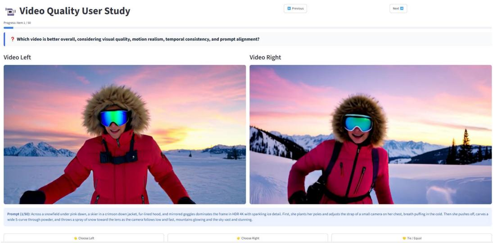  
Figure 9: User Study platform.

## D MORE ABALATION STUDY

Sensitivity to the Boundary Timestep κ. Based on the trajectory-curvature analysis in Figure 2(a), the relative velocity deviation rapidly decreases and becomes nearly stable around step $3 4 \ : ( t \approx 0 . 9 )$ , naturally dividing the diffusion trajectory into semantic synthesis and detail refinement stages. To validate this observation, we evaluate different transition points $\kappa ~ \in ~ \{ 2 6 , 3 2 , 3 4 , 3 6 , 4 2 \}$ As shown in Figure 10, the best performance is consistently achieved at $\kappa = 3 4$ , while moving the boundary toward either earlier or later timesteps leads to noticeable performance degradation. These

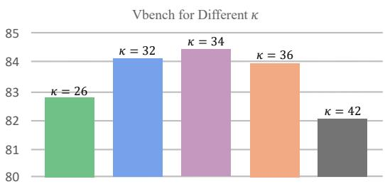  
Figure 10: Impact of different κ.

results support our trajectory analysis and demonstrate that properly balancing the two optimization phases is crucial for achieving optimal generation quality.

## E ADDITIONAL QUALITATIVE RESULTS

We provide additional qualitative results on five new prompts, covering all six models in Table 1. For each prompt, every model generates five videos with the same random seed. Figure 11 further presents a qualitative comparison between our method and other approaches during the ODE initialization phase, while Figure 12 illustrates additional qualitative comparisons during the DMD distillation phase.

## F PROMPTS

## The prompt of the video of Table 4:

1.”A cinematic 5-second medium-wide shot of a sleek red sports car racing through a winding mountain road at sunset, occupying approximately 50–60% of the frame. The car rapidly accelerates toward a sharp hairpin turn and performs a fast controlled drift, with the wheels spinning quickly, thick tire smoke expanding behind the vehicle, and small particles of dust and gravel scattering from the road. The vehicle moves continuously across the scene with strong physical momentum and noticeable motion blur. The camera follows the same smooth trajectory throughout the shot: a slow forward tracking movement combined with a very subtle left-to-right pan, maintaining the car near the center of the frame. The surrounding mountains and roadside barriers exhibit clear parallax caused by the rapid vehicle motion. Warm sunlight creates realistic highlights and shadows on the glossy red bodywork. No cuts, no scene transitions, continuous coherent motion, realistic vehicle dynamics, photorealistic cinematic footage, highly detailed, 4K.”

2.”A cinematic 5-second medium-wide shot of a young woman standing outdoors in a quiet natural environment, occupying approximately 50–60% of the frame. The woman remains almost completely still throughout the shot, maintaining the same relaxed posture and calm facial expression. Only extremely subtle physical movements occur: gentle breathing, one natural blink, and a few loose strands of hair moving slightly in a soft breeze. Her clothing remains almost stationary with only minimal fabric movement. The camera follows the same smooth trajectory throughout the shot: a slow forward tracking movement combined with a very subtle left-to-right pan, maintaining the woman near the center of the frame. The background remains stable with only barely perceptible movement in distant vegetation. Soft natural daylight produces consistent shadows and realistic skin tones. No sudden movements, no walking, no head turning, no cuts, no scene transitions, continuous temporal consistency, photorealistic cinematic footage, highly detailed, 4K.”

3.”A cinematic 5-second medium-wide shot of a crowded night market street in Tokyo, with the central group of pedestrians and surrounding market stalls occupying approximately 50–60% of the frame. Numerous people continuously walk through the scene while colorful signs, umbrellas, food stalls, wet pavement, steam, smoke, and water puddles create dense spatial textures. Light rain produces small ripples across the puddles, while reflections of red, blue, and orange lights continuously distort across the wet ground. Steam rises from food stalls and slowly mixes with drifting smoke, while clothing and umbrellas move naturally as people walk. The camera follows the same smooth trajectory throughout the shot: a slow forward tracking movement combined with a very subtle left-to-right pan, maintaining the main crowd near the center of the frame. Strong local motion occurs simultaneously across many different surfaces and objects. Neon lights create complex reflections and highlights across wet materials. No cuts, no scene transitions, continuous fluid and crowd motion, rich spatial detail, photorealistic cinematic footage, highly detailed, 4K.”

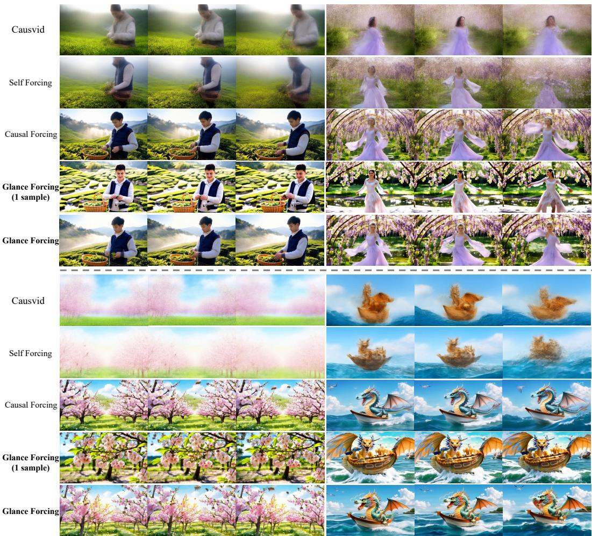  
Figure 11: Qualitative comparisons with existing methods for Initialized stage.

4.”A cinematic 5-second medium-wide shot of a single glossy chrome cube floating in a clean minimalist studio environment, with the cube occupying approximately 50–60% of the frame. The cube has perfectly straight edges, six flat square faces, and a smooth reflective metallic surface. It continuously rotates around its vertical axis at a constant and moderate speed while remaining centered in the scene. The surrounding environment contains no other objects, people, textures, patterns, or visual clutter. The camera follows the same smooth trajectory throughout the shot: a slow forward tracking movement combined with a very subtle left-to-right pan, maintaining the cube near the center of the frame. Soft studio lights create stable reflections that move smoothly across the cube’s metallic surface as it rotates. The background remains completely clean and uniform. No deformation, no additional objects, no cuts, no scene transitions, continuous rigid motion, simple geometric structure, photorealistic cinematic footage, highly detailed, 4K.”

5.”A cinematic 5-second medium-wide shot of a vast green valley under a bright blue sky, with the main landscape occupying approximately 50–60% of the frame. Rolling hills extend toward the distant horizon, with a narrow river flowing through the valley and tall grass covering the foreground.

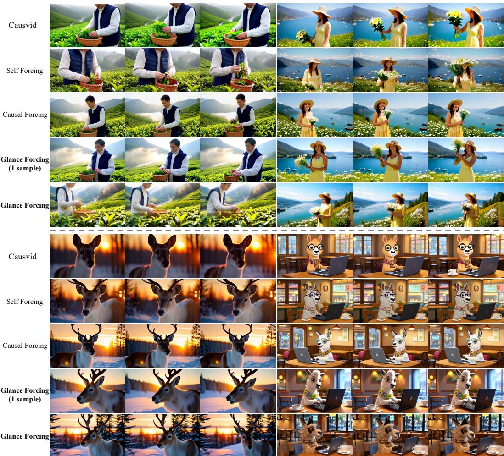  
Figure 12: Qualitative comparisons with existing methods for distilled stage.

Soft white clouds slowly drift across the sky while the grass gently sways in a light breeze and subtle highlights shimmer across the surface of the river. The natural environment contains familiar objects and common visual concepts without unusual or specialized elements. The camera follows the same smooth trajectory throughout the shot: a slow forward tracking movement combined with a very subtle left-to-right pan, gradually revealing the valley while maintaining the main landscape near the center of the frame. Warm sunlight produces consistent natural shadows and atmospheric depth across the hills. No sudden movements, no cuts, no scene transitions, continuous environmental motion, natural spatial composition, photorealistic cinematic footage, highly detailed, 4K.”

6.”A cinematic 5-second medium-wide shot of a single bioluminescent deep-sea jellyfish floating in a completely dark underwater environment, with the jellyfish occupying approximately 50–60% of the frame. The translucent jellyfish has a glowing blue and violet bell and several long delicate tentacles extending beneath its body. It slowly contracts and expands its bell while drifting gently forward, causing the tentacles to deform and sway naturally with the surrounding water. Tiny suspended particles move slowly through the dark water at different depths, creating subtle spatial depth. The camera follows the same smooth trajectory throughout the shot: a slow forward tracking movement combined with a very subtle left-to-right pan, maintaining the jellyfish near the center of the frame. The bioluminescent body produces soft volumetric illumination and realistic scattering through the surrounding water. Translucency, refraction, subsurface scattering, and fluid motion remain visually consistent throughout the shot. No cuts, no scene transitions, continuous physical motion, photorealistic cinematic footage, highly detailed, 4K.”

The prompt of the video of Figure 6:

1.”Along a rainforest suspension bridge, a biologist in a yellow poncho and field vest fills the foreground in HDR 4K with wet leaves and bright insects. First, she checks a notebook, raises binoculars, and freezes as a toucan calls from the canopy. Then she lowers the binoculars, points excitedly, and walks forward carefully while the camera follows, revealing dripping vines, sunlit mist, and a deep green world that feels endless and alive. far from any noise. with the subject filling frame.”

2.”At a rooftop garden above Seoul at night, a violinist in a black velvet coat and sparkling hairpin stands prominent in ultra-realistic 4K with city lights bokeh. First, she tightens one string and hold still as a breeze lifts her coat hem, distant traffic humming. Then she draws the bow into a bright phrase and takes two steps forward, the camera drifting closer as skyscrapers glitter behind her and lanterns glow, textures rich and the mood intensely alive. while the skyline shimmers softly.”

## The prompt of the video of Figure 7:

1.”A scenic photograph capturing the moment a steam train departs from the Glenfinnan Viaduct, a historic railway bridge in Scotland. The train moves gracefully over the arch-covered viaduct, its smoke billowing into the air. The landscape is lush with greenery, and towering rocky mountains frame the scene, creating a picturesque backdrop. The sky is a clear, bright blue with the sun shining down, casting a warm glow on the train and the surrounding scenery. The viaduct itself is a striking feature, with intricate ironwork and a verdant setting. The photo has a classic, nostalgic feel, emphasizing the natural beauty and historical charm of the location. A wide-angle shot from a slightly elevated angle, capturing both the train and the expansive landscape.”

2.”A cinematic closeup and detailed portrait of a reindeer standing in a snowy forest at sunset. The lighting is gorgeous and soft, with a golden backlight creating a warm and dreamy effect. Soft bokeh and lens flares add a magical touch, enhancing the cinematic quality of the image. The reindeer has a gentle expression, its fur glistening in the fading light. The background features a serene snowy landscape with tall trees silhouetted against the orange and pink hues of the setting sun. The color grade is rich and magical, capturing the essence of a winter wonderland at twilight. A close-up shot from a slightly elevated angle.”

## The prompt of the video of Figure 11:

1.”Early spring in a mountain tea valley, a young man in a cream knit sweater and navy vest stands close to camera, ultra-clean 4K. He plucks tender leaves into a woven basket, then wipes dew from his fingers as sun breaks through thin fog. The camera floats low over bright rows of tea, then rises to reveal layered ridges and a river ribbon shining below. Clothing stitches, leaf veins, and mist particles remain razor sharp and natural.”

2.”A realistic style paper origami dragon riding a boat through waves, with intricate folds and textures. The dragon has a fierce expression, its eyes glowing with intensity, and its scales shimmering in the sunlight. It is perched on the edge of the boat, wings partially spread, ready to take flight. The boat bobs up and down with the waves, creating a dynamic motion. The water is choppy, with ripples and splashes around the boat, adding to the sense of movement. The background features a clear blue sky with fluffy clouds, and a few seagulls flying overhead. A mid-shot capturing the dragon’s powerful stance and the boat’s motion.”

3.”Early spring in a mountain tea valley, a young man in a cream knit sweater and navy vest stands close to camera, ultra-clean 4K. He plucks tender leaves into a woven basket, then wipes dew from his fingers as sun breaks through thin fog. The camera floats low over bright rows of tea, then rises to reveal layered ridges and a river ribbon shining below. Clothing stitches, leaf veins, and mist particles remain razor sharp and natural.”

4.”A realistic style paper origami dragon riding a boat through waves, with intricate folds and textures. The dragon has a fierce expression, its eyes glowing with intensity, and its scales shimmering in the sunlight. It is perched on the edge of the boat, wings partially spread, ready to take flight. The boat bobs up and down with the waves, creating a dynamic motion. The water is choppy, with ripples and splashes around the boat, adding to the sense of movement. The background features a clear blue sky with fluffy clouds, and a few seagulls flying overhead. A mid-shot capturing the dragon’s powerful stance and the boat’s motion.”

## The prompt of the video of Figure 12:

1.”Early spring in a mountain tea valley, a young man in a cream knit sweater and navy vest stands close to camera, ultra-clean 4K. He plucks tender leaves into a woven basket, then wipes dew from his fingers as sun breaks through thin fog. The camera floats low over bright rows of tea, then rises to reveal layered ridges and a river ribbon shining below. Clothing stitches, leaf veins, and mist particles remain razor sharp and natural.”

2.”A cinematic closeup and detailed portrait of a reindeer standing in a snowy forest at sunset. The lighting is gorgeous and soft, with a golden backlight creating a warm and dreamy effect. Soft bokeh and lens flares add a magical touch, enhancing the cinematic quality of the image. The reindeer has a gentle expression, its fur glistening in the fading light. The background features a serene snowy landscape with tall trees silhouetted against the orange and pink hues of the setting sun. The color grade is rich and magical, capturing the essence of a winter wonderland at twilight. A close-up shot from a slightly elevated angle.”

3.”A digital illustration in a whimsical cartoon style of a llama coding and typing on his laptop in a cozy cafe. The llama has a friendly expression, with large, expressive eyes and a gentle smile. It wears a colorful patterned scarf and a pair of round glasses perched on its nose. The cafe setting includes a wooden table, a few chairs, and a window with a view of a bustling street outside. The background is filled with the soft glow of ambient lighting and hints of other patrons. The llama’s fingers dance over the keyboard, with a cup of steaming coffee nearby. A close-up shot from a slightly elevated angle, capturing the llama’s focused and engaged posture.”

4.”In spring on a hillside above a bright lake, a woman in a light yellow dress and straw hat dominates the frame in cinematic 4K. She picks wildflowers, then lifts the bouquet toward the lens as the camera glides closer to her joyful expression. Behind her, water shimmers, small boats drift, and mountains soften into blue haze. Sharp textures, true tones, and gentle film grain create a warm, uplifting beauty.”