# 3DCodeVerse: Exploring 3D Worlds as Code

Yipeng Gao1\*†, Ziyao Zeng2\*, Jinfa Huang3\*, Yijiang Li4\*, Haolin Xiong1, Wang Qin1, Xinlei Yu1, Youheng Yao2, Jie Zhang5, Kun-Yu Lin6, Rong Liu1, Yinyuan Zhao7, Yajie Zhao1, Meiqi Guo8, Jiebo Luo3, Lei Shu8, Yunhao Ge1, Xinyu Hu9, Laurent Itti1

1University of Southern California, 2Yale University, 3University of Rochester,

4University of California, San Diego, 5Columbia University, 6Nanyang Technological University,

7University of California, Santa Cruz, 8Google DeepMind, 9Philo Labs

\*Equal contribution, †Project lead

We introduce 3DCodeVerse, a research ecosystem that enables coding agents to create editable and verifiable 3D content at scale. 3DCodeVerse comprises large-scale, high-quality datasets of executable 3D code, a coding harness for spatial reasoning and automated verification, and practical guidance for 3D coding. First, we construct 3DCodeVerse-2M, a large-scale curated dataset of standalone 3D executable code. We build this corpus by collecting open-source data, converting specialized representations, and generating new programs with coding agents. Each program is packaged with the source files and associated assets required for execution in its declared environment, along with available descriptions and verification records. Second, we develop the 3DCodeVerse Harness, a multi-agent directed acyclic graph framework for generating and refining 3D content. It uses execution checks, spatial measurements, and visual feedback to automatically evaluate and revise generated programs without human feedback during generation. Third, we conduct systematic empirical studies of 3D coding, establishing baselines with fine-tuned open models and deriving practical guidance through component-level analyses of our harness. Extensive experiments demonstrate that fine-tuning on our dataset significantly improves the 3D coding capabilities of open-source models. Notably, our 3DCodeVerse harness achieves a 90% win rate against Claude Design (3D Object) in pairwise human evaluations, when both are utilized by Claude Opus 5.5.

Project Page: https://3dcodeverse.com

§ GitHub: https://github.com/gaoypeng/3dcodeverse

Dataset: https://huggingface.co/datasets/ilabai/3dcodeverse

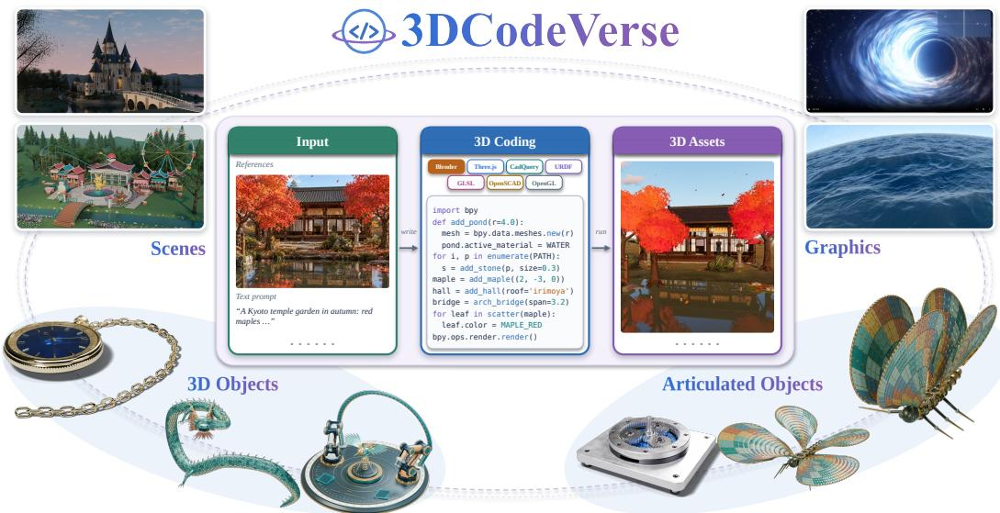  
Figure 1: 3DCodeVerse’s showcases. Assets are built only by code (e.g., Blender Python, Three.js, and OpenGL), ranging from 3D objects to articulated objects, scenes, and graphics renderings.

## 1 INTRODUCTION

— Ivan E. Sutherland, Sketchpad (1963)

Table 1: Comparison of 3D coding datasets, benchmarks, and harnesses. Dataset columns show released content, and Graphics marks dedicated shader, material, lighting, or animation data. Sizes follow each source’s own unit and are not directly comparable. Harness columns summarize each work’s inference-time loop. denotes partial support and — means no new dataset.
<table><tr><td rowspan="2">Work</td><td colspan="5">Dataset</td><td colspan="2">Reported size</td><td colspan="3">Harness</td></tr><tr><td></td><td></td><td>Static Artic. Scene Graphics</td><td></td><td>Code Types</td><td>Count Unit</td><td></td><td>Iterative refinement</td><td>Visual feedback</td><td>Geometry checks</td></tr><tr><td>Datasets and benchmarks</td><td></td><td></td><td></td><td></td><td></td><td></td><td></td><td></td><td></td><td></td></tr><tr><td>Shaders21k (Baradad et al., 2022)</td><td>X</td><td>X</td><td>x</td><td></td><td></td><td></td><td>21KPrograms</td><td>X</td><td>x</td><td>X</td></tr><tr><td>BlendNet (Du et al., 2024)</td><td></td><td>X</td><td>X</td><td>X</td><td></td><td>8K Pairs</td><td></td><td>x</td><td>X</td><td>X</td></tr><tr><td>CAD-Recode (Rukhovich et al., 2025)</td><td></td><td>X</td><td>x</td><td>X</td><td></td><td></td><td>1M Programs</td><td>X</td><td>X</td><td>X</td></tr><tr><td>MeshCoder (Dai et al., 2026)</td><td></td><td>x</td><td>x</td><td>X</td><td></td><td>1M Pairs</td><td></td><td>X</td><td>X</td><td>X</td></tr><tr><td>VLMaterial (Li et al., 2025)</td><td>X</td><td>x</td><td>x</td><td></td><td>1</td><td></td><td>550 KMaterials</td><td>X</td><td>X</td><td>x</td></tr><tr><td>BlenderGym (Gu et al., 2025)</td><td></td><td>X</td><td></td><td></td><td>1</td><td>245</td><td>Tasks</td><td></td><td></td><td>x</td></tr><tr><td>3DCodeBench (Gao et al., 2026b)</td><td></td><td>X</td><td>X</td><td>X</td><td>1</td><td>26 K Scripts</td><td></td><td></td><td></td><td>X</td></tr><tr><td>WorldCoder-Bench (Lu et al., 2026)</td><td>X</td><td>x</td><td></td><td></td><td>1</td><td>2,026 Tasks</td><td></td><td>X</td><td></td><td>X</td></tr><tr><td>SceneActBench (Zhao et al., 2026)</td><td>X</td><td></td><td></td><td></td><td>1</td><td>520 Tasks</td><td></td><td></td><td></td><td>X</td></tr><tr><td>3DHarnessBench (Liu et al., 2026)</td><td></td><td>X</td><td>X</td><td>X</td><td>1</td><td>100</td><td>Tasks</td><td></td><td></td><td></td></tr><tr><td>Harnesses and agentic systems</td><td></td><td></td><td></td><td></td><td></td><td></td><td></td><td></td><td></td><td></td></tr><tr><td>SceneCraft (Hu et al., 2024)</td><td></td><td></td><td></td><td></td><td></td><td></td><td></td><td></td><td></td><td></td></tr><tr><td>CAD-Assistant (Mallis et al., 2025)</td><td></td><td></td><td></td><td></td><td></td><td></td><td></td><td></td><td></td><td></td></tr><tr><td>Articulate-Anything (Le et al., 2025)</td><td></td><td></td><td></td><td></td><td></td><td></td><td></td><td></td><td></td><td></td></tr><tr><td>LL3M (Lu et al., 2025)</td><td></td><td></td><td></td><td></td><td></td><td></td><td></td><td></td><td></td><td></td></tr><tr><td>LAM (Gao et al., 2026a)</td><td>X</td><td></td><td>X</td><td>X</td><td>2</td><td>2K Pairs</td><td></td><td></td><td></td><td></td></tr><tr><td>CADCodeVerify (Alrashedy et al., 2025)</td><td></td><td></td><td>X</td><td></td><td>1</td><td></td><td>200 Prompts</td><td></td><td></td><td></td></tr><tr><td>Articraft (Zhou et al., 2026)</td><td>X</td><td></td><td>X</td><td>X</td><td>2</td><td>10 K Assets</td><td></td><td></td><td></td><td></td></tr><tr><td>VIGA (Yin et al., 2026)</td><td>X</td><td></td><td></td><td></td><td>1</td><td>27</td><td>Tasks</td><td></td><td></td><td>X</td></tr><tr><td>3DCodeVerse (Ours)</td><td></td><td></td><td></td><td></td><td>6</td><td>2.03M Pairs</td><td></td><td></td><td></td><td></td></tr></table>

3D coding offers a promising approach to 3D creation by using executable programs to construct 3D geometry, define articulated motion, compose scenes, and generate graphics effects (Raistrick et al., 2023; Hu et al., 2024; Zhou et al., 2026). Unlike typical 2D generation workflows (Chang et al., 2025; Ho et al., 2020; Yuan et al., 2025; 2024), code-based 3D generation produces structured, executable content that users can edit, reuse, compose, and inspect. These properties enable scalable, controllable 3D modeling for diverse applications. Recent advances in language models and coding agents further automate this process, allowing users to create complex 3D content through text instructions (Sun et al., 2023; Yin et al., 2026).

Despite these advances, shared infrastructure for developing and evaluating 3D coding systems across environments remains limited. Existing resources address complementary aspects of 3D coding: DeepCAD and BlenderLLM provide supervision for CAD construction and Blender scripting (Wu et al., 2021; Du et al., 2024); SceneCraft and VIGA refine generated content using visual feedback (Hu et al., 2024; Yin et al., 2026); and Articraft combines a specialized SDK with a harness for articulated asset generation (Zhou et al., 2026). However, these resources remain fragmented across tasks and environments. As shown in Table 1, existing datasets primarily focus on static or articulated objects, while harnesses vary in their support for visual assessment and automated corpus construction.

To bridge these gaps, we introduce 3DCodeVerse (Figure 1), an open-source foundational framework for learning and scaling 3D coding through a large-scale executable code corpus and a 3D code generation harness. We first build 3DCodeVerse-2M, a unified corpus of executable 3D programs spanning static objects, articulated assets, scenes, and graphics. Rather than simply aggregating existing datasets, we systematically convert heterogeneous 3D representations into reusable source code and remove dependencies on specialized or unavailable libraries. For example, we translate DeepCAD construction sequences into CadQuery programs and inline Articraft geometry routines while preserving URDF articulation specifications. Each program is paired with its associated assets, textual descriptions, provenance, and available verification signals.

We further develop 3DCodeVerse Harness, a 3D code generation harness for synthesizing and refining complex 3D programs from text, images, or videos. The harness decomposes multi-component projects into a directed acyclic graph (DAG) of coding and assembly tasks, allowing multiple agents to develop and integrate source files in a structured manner. Generated programs are executed and rendered, after which an independent judge agent evaluates the outputs against explicit acceptance criteria. Complementary spatial checks detect structural inconsistencies and prevent visually plausible but geometrically invalid solutions from receiving high scores. The resulting feedback is then converted into localized repair objectives, enabling repeated execution–evaluation–revision cycles without human intervention. Through this iterative process, the harness supports inference-time scaling to complex projects containing thousands of lines of code.

Importantly, 3DCodeVerse Harness serves not only as an inference system but also as a datageneration engine. By recording successful programs, failed attempts, targeted repairs, and preference comparisons, its execution traces provide supervision for both supervised fine-tuning and preference learning. Together, 3DCodeVerse-2M and 3DCodeVerse Harness establish not only a reusable infrastructure for 3D coding, but also a closed loop connecting data construction, program synthesis, verification, refinement, and model improvement. We further support this ecosystem with open models and reproducible training recipes. Fine-tuning on 3DCodeVerse-2M substantially improves executable 3D code generation, reaching execution rates of 84.9% with a 9B model and 92.9% with a 27B model on 3DCodeBench. Moreover, 3DCodeVerse Harness consistently improves generation quality across coding agents, yielding gains of 15.5–29.1 points over one-shot generation.

## 2 RELATED WORK

Datasets and Benchmarks for 3D Coding. Learning to generate 3D content as code benefits from supervision over its construction procedures. DeepCAD and Fusion 360 Gallery expose CAD construction sequences, and Text2CAD connects such sequences to natural language (Wu et al., 2021; Willis et al., 2021; Khan et al., 2024). This supervision has expanded to executable CadQuery and Blender programs for reconstruction and language-conditioned generation through BlendNet, CAD-Recode, CAD-Coder, and MeshCoder (Du et al., 2024; Rukhovich et al., 2025; Guan et al., 2026; Dai et al., 2026). Complementary procedural resources broaden the content represented by code: Infinigen and its extensions generate assets and scenes (Raistrick et al., 2023; 2024; Joshi et al., 2025), while Shaders21k provides programs for procedural image synthesis (Baradad et al., 2022). Existing benchmarks assess the resulting code generation, editing, and physics capabilities (Alrashedy et al., 2025; Gu et al., 2025; Gao et al., 2026b; Shen et al., 2026). However, our paper focuses on scaling executable supervision across these heterogeneous coding environments. Our 3DCodeVerse-2M provides a million-scale training corpus spanning CAD, Blender, shaders, and browser graphics, with programs that are self-contained within their respective target runtimes. Its construction combines curated existing sources with automated program generation and execution-based filtering, enabling continued data expansion for training open 3D coding models.

Harness Engineering for 3D Coding. Execution and feedback allow 3D coding agents to inspect and revise the content produced by their programs. Systems such as 3D-GPT, SceneCraft, and LL3M establish language-driven planning and program generation for 3D modeling (Sun et al., 2023; Hu et al., 2024; Lu et al., 2025). Executing and rendering these programs enables visual refinement, as explored by BlenderAlchemy, CADCodeVerify, and VIGA (Huang et al., 2024; Alrashedy et al., 2025; Yin et al., 2026). Beyond rendered appearance, Articraft provides structured asset validation through a specialized SDK, while Bioinspired123D connects script quality control with a graph-based agentic workflow (Luu & Buehler, 2026b; Zhou et al., 2026). 3DHarnessBench further studies how the observation and tool interfaces available to an agent affect 3D reconstruction (Liu et al., 2026). In contrast, our 3DCodeVerse harness provides a reusable execution and verification framework across coding backends, jointly supporting inference-time refinement and scalable training data curation. Its multi-agent directed acyclic graph coordinates execution, rendering, spatial measurements, and structural checks across static and articulated objects, scenes, and visual effects. The same framework equips coding agents with visual and programmatic feedback and serves as an automated data engine that generates, refines, and filters training programs without human feedback in the curation loop.

## 3 3DCODEVERSE-2M: A LARGE-SCALE 3D CODING DATASET

Task Definition of 3D Coding. We define 3D coding as writing a program f that constructs 3D content satisfying a condition c, comprising a text request and optional reference images. The program is standalone, bundling the source files and assets needed to run in a declared environment e such as Blender (bpy) or CadQuery. Analogous to compiling source code, executing f in e yields

$$
( a , \ell ) = \mathcal { E } _ { e } ( f ) , \qquad x = \mathbb { I } [ a \neq \perp ] ,\tag{1}
$$

where a is the artifact (a mesh, an articulated asset, a scene, or an animation), ℓ is the execution feedback, and ⊥ denotes failure. Unlike conventional code generation, success requires not only executability (x = 1) but also high-quality 3D content. Quality is measured by a task-specific metric

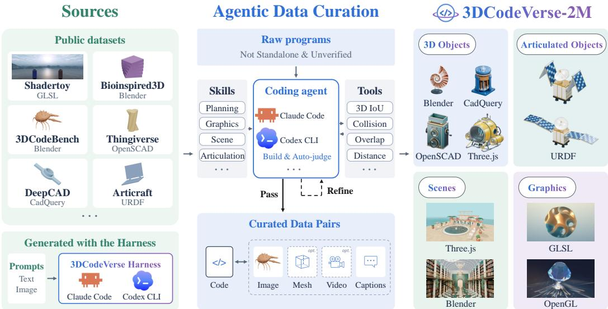  
Figure 2: Curation and composition of 3DCodeVerse-2M. Left: We collect programs from public datasets and generate more with our harness. Middle: Our 3D coding harness, equipped with modeling skills and inspection tools (e.g., 3D IoU, collision checks), builds each program, judges the output, and refines it until it passes. Each verified program is paired with rendered images and captions, plus meshes and videos when available. Right: The resulting corpus covers 3D objects, articulated objects, scenes, and graphics across multiple programming languages and engines.

$\mathcal { D } ( a , a ^ { \star } )$ when a reference $a ^ { \star }$ exists, and otherwise against c using programmatic measurements and renders $o = \mathcal { R } ( a )$

3D Coding with LLMs and Coding Agents. A generation policy π produces the program. A single-shot LLM writes $f ^ { ( 0 ) } = \pi ( c ; e )$ directly. A coding agent instead iterates like a developer in a compile–debug loop, revising its code based on execution feedback and renders:

$$
f ^ { ( t ) } = \pi \big ( c , \{ f ^ { ( k ) } , \ell ^ { ( k ) } , o ^ { ( k ) } \} _ { k < t } ; e \big ) ,\tag{2}
$$

where $( a ^ { ( t ) } , \ell ^ { ( t ) } ) = \mathcal { E } _ { e } ( f ^ { ( t ) } )$ and $o ^ { ( t ) } = \mathcal { R } ( a ^ { ( t ) } )$ . After T refinement rounds, the agent returns $f ^ { ( T ) }$ so the single-shot setting is the case $T = 0$ . The harness implements $\mathcal { E } _ { e }$ and $\textstyle { \mathcal { R } } \colon$ agents call them as tools, and all final programs are evaluated with them under the same protocol.

Data Sources and Composition. Figure 2 shows representative sources; Appendix B.2 summarizes the full collection. Public resources include Bioinspired3D (Luu & Buehler, 2026a), 3DCodeBench (Gao et al., 2026b), Thingiverse, Shadertoy (Quilez & Jeremias, 2013), CodePen animations (Animation2Code), and multi-file Three.js/React Three Fiber projects. We convert DeepCAD sequences (Wu et al., 2021) and Articraft geometry (Zhou et al., 2026) to CadQuery, retaining Articraft’s URDF. The ProcTHOR (Deitke et al., 2022) subset pairs scene specifications with Blender/Three.js reconstructions. Blender and Three.js coding-agent subsets contribute generated objects and scenes; We further synthesize and archive new programs by running 3DCodeVerse Harness on text and image prompts (§4).

Agentic Data Curation and Toolkits. Coding agents curate programs with reusable skills $( \mathsf { A p - } $ pendix A.9) that package authoring conventions, code examples, and repair guidance. Given a raw program $f _ { \mathrm { r a w } }$ that relies on specialized APIs, an agent produces a standalone program $f = \mathcal { N } _ { e } ( f _ { \mathrm { r a w } } )$ for environment e by translating those APIs, inlining required routines, and bundling sources and assets; DeepCAD is instead converted by a deterministic script (Appendix B.2).

Executing f yields $( a , \ell ) = \mathcal { E } _ { e } ( f )$ (Eq. 1), and inspection tools return measurements $\mathcal { M } _ { e } ( a ) \colon$ part inventories and bounding boxes flag missing or misplaced components, contact and collision checks flag gaps and interpenetration, including across sampled joint poses, and placement and frame probes check physical support, invalid renders, and temporal defects. Findings are reported per part in the authoring frame (Appendix A.3), and execution errors or failed checks return the program to the agent for targeted repair. Conversion fidelity is measured by voxel IoU for DeepCAD and Chamfer distance for Articraft. Coverage thus varies by source: collected and converted programs are checked by execution and rendering where a runtime is available, whereas harness-generated programs also carry gate and judge results as quality tiers.

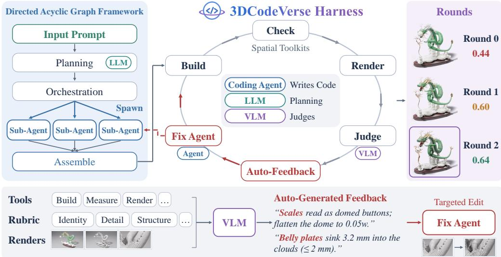  
Figure 3: Overview of the 3DCodeVerse Harness. Given an input prompt, an LLM planner defines the target asset, and a DAG coordinates sub-agents to code and assemble a 3D program (left). Execution checks, spatial measurements, and rubric-guided VLM judgments provide automated feedback (center) for targeted code revisions by a fix agent (bottom). The right panel illustrates successive refinement rounds, with the highest-scoring program selected as the final output.

A VLM captions programs from code and renders $\mathit { \Pi } _ { o } ~ = ~ \mathcal { R } _ { e } ( a )$ with three conditions ${ \cal { C } } =$ $\{ c ^ { \mathrm { i n s t } } , c ^ { \mathrm { d e t } } , \dot { c } ^ { \mathrm { p r o c } } \}$ : an instruction, a visual description, and a construction procedure, each usable as c in Eq. 1. Each record $s = ( f , e , C , o , m )$ stores provenance, license, and available verification results in m, keeping execution, geometric, and visual checks separate; source files, pre-conversion programs, and URDF files are retained, and meshes and videos are linked when available.

## 4 3DCODEVERSE HARNESS: A DATA ENGINE FOR 3D CODING

Generating high-quality 3D programs often requires iterative refinement, but reliance on human feedback makes this process difficult to scale. To address this bottleneck, we develop 3DCodeVerse Harness, a multi-agent framework that automates 3D code generation and refinement for data curation and agent-driven content creation (Figure 3). It coordinates coding and assembly through a DAG and combines execution checks, spatial tools, and rubric-guided VLM judgments to identify defects and guide targeted revisions without human feedback. Because the reliability of this feedback depends on how we configure its prompts, tools, and rubrics, we further refine the judge and generation workflow through an alternating development-time adversarial loop.

Multi-Agent Directed Acyclic Graph (DAG) Framework. Given a condition c and a target execution environment e, an LLM planner first produces $P = \mathcal { A } _ { \mathrm { p l a n } } ( c ; e )$ , specifying the target components, dimensions, materials, spatial relations, and acceptance criteria. The harness translates $P$ into a $\operatorname { D A G } { \mathcal { G } } = ( V , E )$ of coding and assembly tasks, with edges encoding prerequisites. Within this graph, explicit file ownership allows independent coding tasks to be carried out concurrently by subagents. Once their prerequisites are satisfied, assembly tasks integrate the resulting code, ultimately producing the initial program $f ^ { ( 0 ) }$ for subsequent evaluation and feedback-driven refinement.

Automated Feedback and Iterative Refinement. At each round t, the harness executes the current program $f ^ { ( t ) }$ and collects three types of feedback:

⃝1 Execution feedback. Build and runtime logs $\ell ^ { ( t ) }$ . If execution fails, no artifact is produced, and this is the only feedback.

⃝2 Measured feedback. Measurement tools $\mathcal { M } _ { e }$ check the artifact $a ^ { ( t ) }$ for dimensions, contacts, collisions, kinematics, and placement, and return component-level violations with numerical correction hints.

⃝3 Visual feedback. A VLM judge inspects multi-view renders $\mathcal { R } _ { e } ( a ^ { ( t ) } )$ against the input c and the acceptance criteria in $P _ { - }$ , producing defect evidence, criterion scores, and proposed revisions: $j ^ { ( t ) } = \mathcal { A } _ { \mathrm { j u d g e } } ( c , P , o ^ { ( t ) } )$ , where $o ^ { ( t ) } = ( \ell ^ { ( t ) } , \mathcal { M } _ { e } ( a ^ { ( t ) } ) , \mathcal { R } _ { e } ( a ^ { ( t ) } ) )$ .

The score $s ^ { ( t ) }$ combines the weighted criteria and defect penalties in $\boldsymbol { j } ^ { ( t ) }$ , caps it with measured violations and unmet requirements, and vetoes measurements that rule out visual defect claims. All feedback is converted into revision tasks $\Delta ^ { ( t ) }$ , prioritized in the order listed above, and a fix agent applies them: $\boldsymbol { f } ^ { ( t + 1 ) } = \mathcal { A } _ { \mathrm { c o d e } } ( \boldsymbol { c } , P , \boldsymbol { f } ^ { ( t ) } , \Delta ^ { ( t ) } ; e )$

Adversarial Loop Engineering for Harness Optimization. The preceding loop uses automated feedback in place of per-round human inspection and revision guidance. Because this feedback’s reliability depends on how prompts, tools, and rubrics are configured, we alternate between refining the judge and the generation workflow during development. Let $\theta _ { J }$ denote the judge’s evidence presentation, rubric, response schema, and aggregation rules, and $\theta _ { H }$ the harness’s prompts, contracts, skills, tools, and refinement policy. Judge refinement first fixes the generation workflow and repeatedly evaluates a bank B of stored artifacts. Using the same artifacts separates changes in judge behavior from variability in generation. We revise view selection, evidence presentation, and defect checklists, and score aggregation to reduce judgment variability and contradictions with measured evidence. The judge is required to report observations before scores and does not receive the generator’s reasoning. We summarize the consistency objective as:

$$
\begin{array} { r } { \mathcal { L } _ { J } ( \theta _ { J } ) = \mathbb { E } _ { ( a , o ) \sim \mathcal { B } } \Big [ \mathrm { V a r } _ { r } ~ s ^ { ( r ) } ( o ; \theta _ { J } ) + \lambda ~ \rho \big ( j ( o ; \theta _ { J } ) , \mathcal { M } _ { e } ( a ) \big ) \Big ] , } \end{array}\tag{3}
$$

where $r$ indexes repeated judgments and $\rho$ counts claims contradicted by applicable measurements. Preserving sensitivity to differences in artifact quality remains an additional requirement beyond this consistency objective. With the revised judge fixed, harness refinement uses its feedback to guide changes to the generation workflow. Candidate designs are compared on matched prompts, balancing judged output quality against observable workflow failures:

$$
\begin{array} { r } { \mathcal { U } _ { H } ( \boldsymbol { \theta } _ { H } ; \boldsymbol { \theta } _ { J } ) = \mathbb { E } _ { c } \Big [ s \big ( \hat { f } ( c ; \boldsymbol { \theta } _ { H } ) ; \boldsymbol { \theta } _ { J } \big ) \Big ] - \mu \mathcal { L } _ { \mathrm { f a i l } } ( \boldsymbol { \theta } _ { H } ) , } \end{array}\tag{4}
$$

where $s ( \hat { f } ; \theta _ { J } )$ denotes the score obtained by executing and judging the selected program ${ \hat { f } } ,$ and $\mathcal { L } _ { \mathrm { f a i l } }$ summarizes failures such as invalid plans, retried tool calls, and failed builds. The weights $\lambda , \mu \geq 0$ express the respective trade-offs.

## 5 EXPERIMENTS

## 5.1 RESULTS OF 3DCODEVERSE HARNESS

Evaluation setup. We compare 3DCodeVerse against models with their native harnesses and Claude Design on 100 text-to-3D object prompts. We further compare against native harnesses on articulatedobject generation, 50 scene prompts, and 50 graphics prompts. We evaluate generation quality using three metrics. Human Preference is the fraction of anonymized side-by-side comparisons won according to human evaluators, with ties split equally. VLM Preference is the fraction of the same comparisons won according to a VLM judge (Gemini 3.1 Pro), with ties split equally. Judge Score is Gemini 3.1 Pro’s overall rubric score, combining weighted criteria with defect penalties and score caps (0–100; failed generations receive a score of zero). Following 3DCodeBench (Gao et al., 2026b), we additionally report SigLIP-2 (Tschannen et al., 2025) text–image cosine similarity averaged over four views. The evaluation judge is described in Appendix C.3, and further evaluation details are in Appendix C.3.

Main Results. Figure 4 shows a consistent pattern across backbones and tasks: outputs from the native harness are rarely preferred, while the same backbone within 3DCodeVerse Harness wins most comparisons. On 3D objects, Human Preference for 3DCodeVerse Harness ranges from 69% to 89%, while Judge Score improves by 11–25 points. The largest gains occur for the weaker models, including Gemini 3.8 Flash (61 to 87) and GPT-6 Luna (64 to 86). Against Claude Design, which uses Claude Opus 5.5, 3DCodeVerse Harness with the same backbone is preferred in 90% of human comparisons and achieves a Judge Score of 88 versus 37. The same pattern extends to articulated objects, scenes, and graphics, where Human Preference reaches 78–88%. The agreement between human preference and rubric-based scores suggests that the gains are not specific to the VLM rubric used during refinement.

Native Harness

(a) 3D Objects  
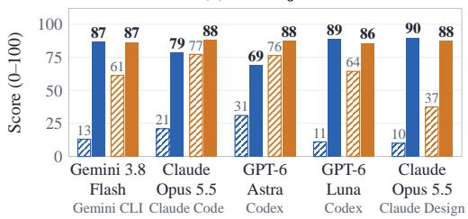

(b) Articulated Objects  
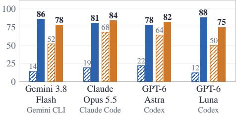

(c) Scenes  
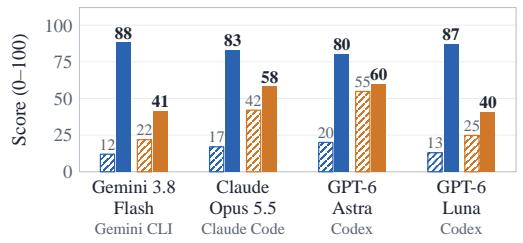

(d) Graphics  
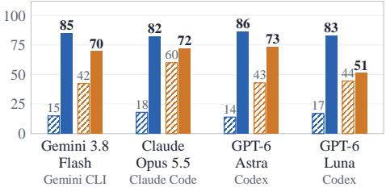  
Figure 4: Main results of 3DCodeVerse Harness across four 3D coding tasks. Panels show (a) 3D objects, (b) articulated objects, (c) scenes, and (d) graphics. Blue bars report Human Preference (%), and orange bars report Judge Score (0–100; failed generations receive a score of zero). Hatched bars denote each backbone’s native harness, while solid bars denote 3DCodeVerse Harness. The final group in (a) compares Claude Design with 3DCodeVerse Harness, both using Claude Opus 5.5.

## 5.2 FINE-TUNING OPEN MODELS ON 3DCODEVERSE-2M

Setup. We fine-tune Qwen3.5-9B and Qwen3.8-27B with LoRA (Hu et al., 2021) in LLaMA-Factory (Zheng et al., 2024) on mixtures drawn from 3DCodeVerse-2M (Appendix C.1) and compare the resulting models with their respective pretrained checkpoints. Evaluation spans 805 fixed tasks across six suites: 212 text-to-Blender tasks from 3DCodeBench (Gao et al., 2026b) and five test splits drawn from 3DCodeVerse-2M: Blender (103 procedural objects), CadQuery (200 mechanical parts from DeepCAD and Articraft), OpenSCAD (50 Thingiverse models), GLSL (200 Shadertoy shaders), and Three.js (40 single-object scenes). Each task pairs a natural-language request with a reference program. Executing the reference program produces the evaluation target: a mesh for the four 3D suites, a rendered frame for GLSL, and a page screenshot for Three.js. All models receive the same request and per-dialect system prompt without examples, are decoded at T=0.7 with one seed, and have every output executed in the dialect’s pinned runtime (Appendix C.3). We report the execution rate (Table 2) and fidelity to the target (Table 3): F@0.05 between the generated and reference meshes, and DINOv2-L similarity between clay renders of the two meshes from four fixed views; failed programs score zero on both.

Table 2: Fine-tuning with 3DCodeVerse-2M makes open models executable. Execution rate (%) before and after LoRA fine-tuning (training-set size in parentheses); ∆ is the change and the better value of each pair is in bold. A program counts when it runs in the dialect’s runtime and produces a result (GLSL: the shader compiles). All models are decoded at T=0.7 with one seed on the same fixed test sets.
<table><tr><td>Model</td><td>3DCodeBench (212)</td><td>Blender (103)</td><td>CadQuery (200)</td><td>OpenSCAD (50)</td><td>GLSL (200)</td><td>Three.js (40)</td></tr><tr><td rowspan="3">Qwen3.5-9B + SFT ∆</td><td>0.0</td><td>1.9</td><td>10.5</td><td>50.0</td><td>33.0</td><td>72.5</td></tr><tr><td>84.9</td><td>90.3</td><td>98.5</td><td>86.0</td><td>56.0</td><td>74.5</td></tr><tr><td>+84.9</td><td>+88.4</td><td>+88.0</td><td>+36.0</td><td>+23.0</td><td>+2.0</td></tr><tr><td rowspan="3">Qwen3.8-27B + SFT + DPO ∆</td><td>51.9</td><td>74.8</td><td>65.5</td><td>80.0</td><td>57.0</td><td>72.5</td></tr><tr><td>92.9</td><td>93.2</td><td>98.5</td><td>90.0</td><td>71.5</td><td>92.5</td></tr><tr><td>+41.0</td><td>+18.4</td><td>+33.0</td><td>+10.0</td><td>+14.5</td><td>+20.0</td></tr></table>

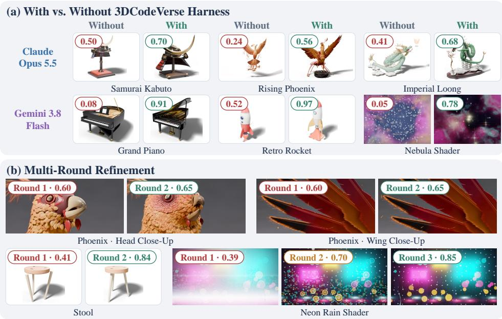  
Figure 5: Qualitative comparisons and automated refinement. (a) Outputs for identical prompts and backbones using the native harness (Without) versus 3DCodeVerse Harness (With). (b) Selected rounds of automated refinement for objects and graphics. Numbers report rubric scores on a [0, 1] scale and are comparable within each pair or refinement sequence.

Table 3: Fidelity to the reference before and after fine-tuning. Same models, decoding, and layout as Table 2. F: F@0.05 between generated and reference meshes. DINO: DINOv2-L similarity between four-view renders of generated and reference meshes.
<table><tr><td rowspan="2">Model</td><td colspan="2">3DCodeBench</td><td colspan="3">F@0.05 per dialect</td></tr><tr><td>F</td><td>DINO</td><td>Blender</td><td>CadQuery</td><td>OpenSCAD</td></tr><tr><td rowspan="3">Qwen3.5-9B + SFT ∆</td><td>.000</td><td>.000</td><td>.008</td><td>.030</td><td>.261</td></tr><tr><td>.317</td><td>.266</td><td>.693</td><td>.308</td><td>.329</td></tr><tr><td>+.317</td><td>+.266</td><td>+.685</td><td>+.279</td><td>+.069</td></tr><tr><td rowspan="3">Qwen3.8-27B  $+ \mathrm { S F T } + \mathrm { D P O }$  ∆</td><td>.214</td><td>.211</td><td>.439</td><td>.159</td><td>.415</td></tr><tr><td>.374</td><td>.298</td><td>.798</td><td>.234</td><td>.416</td></tr><tr><td>+.160</td><td>+.088</td><td>+.359</td><td>+.075</td><td>+.001</td></tr></table>

Fine-tuning substantially improves executability. Before fine-tuning, none of the programs generated by Qwen3.5-9B on 3DCodeBench execute successfully; most fail immediately by calling scene-clearing operators unavailable in Blender 5. After fine-tuning on 3DCodeVerse-2M, execution rises to 84.9% on 3DCodeBench, 90.3% on Blender, and 98.5% on CadQuery, with additional gains of 36.0 and 23.0 points on OpenSCAD and GLSL (Table 2). Qwen3.8-27B starts from a stronger baseline but shows the same trend: fine-tuning raises execution on 3DCodeBench from 51.9% to 92.9% (+41.0 points), on Blender to 93.2% (+18.4), and on CadQuery to 98.5% (+33.0).

## 5.3 QUALITATIVE ANALYSIS

For matched prompts and backbones, Figure 5(a) shows that 3DCodeVerse Harness produces more complete structures and finer details, such as the phoenix’s legs and nest and the piano’s interior. Figure 5(b) shows how successive refinement rounds correct specific defects, improving the phoenix’s facial feathers, attaching the stool legs to the seat, and reducing block artifacts in the neon shader. Together, these examples show that automated feedback can correct both structural and appearance defects without additional human instructions.

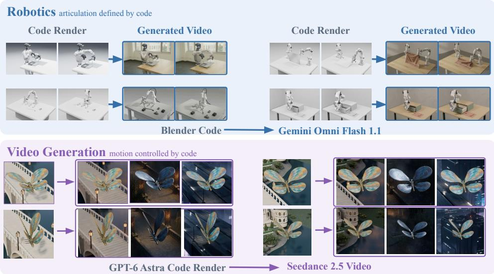  
Figure 6: Applications. Code renders from our harness guide video generation with Gemini Omni Flash 1.1 for robot manipulation scenes (top) and Seedance 2.5 for a GPT-6 Astra scene (bottom).

## 6 APPLICATIONS OF 3D CODING

Robotics. 3D coding enables the construction of articulated assets and scenes with explicit geometry and physical constraints for simulated robot tasks. Programs encode rigid-link geometry, joint axes, and joint limits as editable parameters, supporting programmatic checks and controlled variation of object dimensions, articulation, and initial poses. These task instances can be executed in simulations to generate robot interactions and observations. To provide a preliminary evaluation, we import an articulated asset validated and exported with 3DCodeVerse tools into MuJoCo and compare rendered observations with frozen UWM (Zhu et al., 2025) predictions across 12 cases spanning two assets, two contact states, and three control sequences, using complete scene state for rendering and image history with matched robot commands for UWM. Code renders and their UWM VAE reconstructions each pass a fixed door-and-handle geometry check in 12/12 outputs, versus 7/36 UWM predictions. These results show that 3D code can help generate articulated assets and scenes for robotics simulation with explicit geometry and physical constraints.

Video generation. 3D coding provides an editable interface for controlling the spatial and temporal conditions of video generation. Programs specify scene layout, object articulation and motion, and camera trajectories. We render generated 3D scenes using programs and harness them as reference videos, using the full sequences to condition Gemini Omni Flash (Google DeepMind, 2026) and Seedance 2.5 (ByteDance Seed, 2026). The rendered videos supply spatial and temporal guidance, while the video models are used to refine visual appearance. We present paired reference and generated frames to examine how the specified layout, object motion, and camera trajectories are preserved. This application connects explicit scene programs with video synthesis.

## 7 CONCLUSION

In this paper, we present 3DCodeVerse, an open ecosystem that provides a shared foundation for 3D coding through datasets, a reusable harness, and open model baselines. The dataset brings together programs across coding environments with descriptions, associated assets, and available quality records. The harness combines execution, spatial checks, and visual judgment to support iterative generation without human feedback during a run, while retaining the resulting programs and revisions for data curation. Experiments demonstrate the utility of the data for training open models and the benefits of the harness for existing coding agents. We will release the datasets, harness, models, and training recipes to support further research on 3D generation through code.

## REFERENCES

Kamel Alrashedy, Pradyumna Tambwekar, Zulfiqar Haider Zaidi, Megan Langwasser, Wei Xu, and Matthew C. Gombolay. Generating CAD code with vision-language models for 3D designs. In The Thirteenth International Conference on Learning Representations, ICLR 2025, Singapore, April 24-28, 2025. OpenReview.net, 2025. URL https://openreview.net/forum?id= BLWaTeucYX.

Manel Baradad, Richard Chen, Jonas Wulff, Tongzhou Wang, Rogerio Feris, Antonio Torralba, and Phillip Isola. Procedural image programs for representation learning. Advances in Neural Information Processing Systems, 35:6450–6462, 2022.

ByteDance Seed. One-take creation, flexible referencing: Introducing seedance 2.5, 2026. URL https://seed.bytedance.com/en/blog/one-take-creation-flexible-r eferencing-introducing-seedance-2-5. Official model announcement, July 31, 2026.

Di Chang, Hongyi Xu, You Xie, Yipeng Gao, Zhengfei Kuang, Shengqu Cai, Chenxu Zhang, Guoxian Song, Chao Wang, Yichun Shi, et al. X-dyna: Expressive dynamic human image animation. In 2025 IEEE/CVF Conference on Computer Vision and Pattern Recognition (CVPR), pp. 5499–5509. IEEE, 2025.

BingQuan Dai, Luo Li, Qihong Tang, Jie Wang, Xinyu Lian, Hao Xu, Minghan Qin, Xudong Xu, Bo Dai, Haoqian Wang, Zhaoyang Lyu, and Jiangmiao Pang. Meshcoder: Llm-powered structured mesh code generation from point clouds. Advances in Neural Information Processing Systems, 38: 8917–8954, 2026.

Matt Deitke, Eli VanderBilt, Alvaro Herrasti, Luca Weihs, Kiana Ehsani, Jordi Salvador, Winson Han, Eric Kolve, Aniruddha Kembhavi, and Roozbeh Mottaghi. ProcTHOR: large-scale embodied AI using procedural generation. In Sanmi Koyejo, S. Mohamed, A. Agarwal, Danielle Belgrave, K. Cho, and A. Oh (eds.), Advances in Neural Information Processing Systems 35: Annual Conference on Neural Information Processing Systems 2022, NeurIPS 2022, New Orleans, LA, USA, November 28 - December 9, 2022, volume 35, pp. 5982–5994. Curran Associates, Inc., 2022. doi: 10.52202/068431-0433. URL https://proceedings.neurips.cc/paper\_fil es/paper/2022/hash/27c546ab1e4f1d7d638e6a8dfbad9a07-Abstract-Con ference.html.

Yuhao Du, Shunian Chen, Wenbo Zan, Peizhao Li, Mingxuan Wang, Dingjie Song, Bo Li, Yan Hu, and Benyou Wang. BlenderLLM: training large language models for computer-aided design with self-improvement. arXiv preprint arXiv:2412.14203, 2024. URL https://arxiv.org/ab s/2412.14203.

Yipeng Gao, Yunhao Ge, Peilin Cai, Daniel Seita, and Laurent Itti. LAM: Language articulated object modelers. In Proceedings ofthe IEEE/CVF Conference on Computer Vision and Pattern Recognition (CVPR), pp. 16010–16020, June 2026a.

Yipeng Gao, Lei Shu, Genzhi Ye, Xi Xiong, Ameesh Makadia, Meiqi Guo, Laurent Itti, and Jindong Chen. 3DCodeBench: benchmarking agentic procedural 3D modeling via code. arXiv preprint arXiv:2606.01057, 2026b. doi: 10.48550/arXiv.2606.01057. URL https://arxiv.org/ab s/2606.01057.

Google DeepMind. Gemini omni, 2026. URL https://deepmind.google/models/gem ini-omni/. Official model documentation. Accessed September 25, 2026.

Yunqi Gu, Ian Huang, Jihyeon Je, Guandao Yang, and Leonidas Guibas. Blendergym: Benchmarking foundational model systems for graphics editing. In 2025 IEEE/CVF Conference on Computer Vision and Pattern Recognition (CVPR), pp. 18574–18583. IEEE, 2025.

Yandong Guan, Xilin Wang, XiMing Xing, Jing Zhang, Dong Xu, and Qian Yu. Cad-coder: Textto-cad generation with chain-of-thought and geometric reward. Advances in Neural Information Processing Systems, 38:59765–59789, 2026.

Jonathan Ho, Ajay Jain, and Pieter Abbeel. Denoising diffusion probabilistic models. Advances in neural information processing systems, 33:6840–6851, 2020.

Edward J. Hu, Yelong Shen, Phillip Wallis, Zeyuan Allen-Zhu, Yuanzhi Li, Shean Wang, Lu Wang, and Weizhu Chen. LoRA: low-rank adaptation of large language models. arXiv preprint arXiv:2106.09685, 2021. URL https://arxiv.org/abs/2106.09685.

Ziniu Hu, Ahmet Iscen, Aashi Jain, Thomas Kipf, Yisong Yue, David A. Ross, Cordelia Schmid, and Alireza Fathi. SceneCraft: an LLM agent for synthesizing 3D scenes as blender code. In Ruslan Salakhutdinov, Zico Kolter, Katherine A. Heller, Adrian Weller, Nuria Oliver, Jonathan Scarlett, and Felix Berkenkamp (eds.), Forty-first International Conference on Machine Learning, ICML 2024, Vienna, Austria, July 21-27, 2024, volume 235 of Proceedings of Machine Learning Research, pp. 19252–19282. PMLR / OpenReview.net, 2024. URL https://proceedings. mlr.press/v235/hu24g.html.

Ian Huang, Guandao Yang, and Leonidas Guibas. Blenderalchemy: Editing 3d graphics with vision-language models. In European Conference on Computer Vision, pp. 297–314. Springer, 2024.

Abhishek Joshi, Beining Han, Jack Nugent, Max Gonzalez Saez-Diez, Yiming Zuo, Jonathan Liu, Hongyu Wen, Stamatis Alexandropoulos, Karhan Kayan, Anna Calveri, Tao Sun, Gaowen Liu, Yi Shao, Alexander Raistrick, and Jia Deng. Procedural generation of articulated simulation-ready assets. arXiv preprint arXiv:2505.10755, 2025. URL https://arxiv.org/abs/2505.1 0755.

Mohammad Sadil Khan, Sankalp Sinha, Talha Uddin Sheikh, Didier Stricker, Sk Aziz Ali, and Muhammad Zeshan Afzal. Text2cad: Generating sequential CAD models from beginner-to-expert level text prompts. arXiv preprint arXiv:2409.17106, 2024. URL https://arxiv.org/ab s/2409.17106.

Woosuk Kwon, Zhuohan Li, Siyuan Zhuang, Ying Sheng, Lianmin Zheng, Cody Hao Yu, Joseph E. Gonzalez, Hao Zhang, and Ion Stoica. Efficient memory management for large language model serving with PagedAttention. arXiv preprint arXiv:2309.06180, 2023. URL https://arxiv. org/abs/2309.06180.

Long Le, Jason Xie, William Liang, Hung-Ju Wang, Yue Yang, Yecheng Jason Ma, Kyle Vedder, Arjun Krishna, Dinesh Jayaraman, and Eric Eaton. Articulate-anything: Automatic modeling of articulated objects via a vision-language foundation model. In International Conference on Learning Representations, 2025. URL https://proceedings.iclr.cc/paper\_file s/paper/2025/hash/2c8047bf3ed8ef6905351608d641f02f-Abstract-Con ference.html.

Beichen Li, Rundi Wu, Armando Solar-Lezama, Changxi Zheng, Liang Shi, Bernd Bickel, and Wojciech Matusik. VLMaterial: Procedural material generation with large vision-language models. In International Conference on Learning Representations (ICLR), pp. 33790–33810, 2025.

Ling Liu, Bingchen Gong, Amal Dev Parakkat, and Maks Ovsjanikov. 3DHarnessBench: Probing agentic 3D-to-code capabilities of frontier vision-language models, 2026. URL https://arxi v.org/abs/2609.06535.

Shuo Lu, Yinuo Xu, Kecheng Yu, Siru Jiang, Yongcan Yu, Yubin Wang, Haitao Yang, Yuxiang Zhang, Bin Wang, Ran He, and Jian Liang. WorldCoder-Bench: Benchmarking physically grounded 3D world synthesis. arXiv preprint arXiv:2606.01869, 2026. URL https://arxiv.org/abs/ 2606.01869.

Sining Lu, Guan Chen, Nam Anh Dinh, Itai Lang, Ari Holtzman, and Rana Hanocka. LL3M: large language 3D modelers. arXiv preprint arXiv:2508.08228, 2025. URL https://arxiv.org/ abs/2508.08228.

Rachel K. Luu and Markus J. Buehler. Bioinspired3D. Hugging Face dataset, https://huggin gface.co/datasets/lamm-mit/Bioinspired3D, 2026a. Accessed: 2026-09-21.

Rachel K. Luu and Markus J. Buehler. Bioinspired123d: generative 3d modeling system for bioinspired structures. AIfor Science, 2(2):025004, 2026b.

Dimitrios Mallis, Ahmet Serdar Karadeniz, Sebastian Cavada, Danila Rukhovich, Niki Foteinopoulou, Kseniya Cherenkova, Anis Kacem, and Djamila Aouada. CAD-Assistant: Tool-augmented VLLMs as generic CAD task solvers. In Proceedings of the IEEE/CVF International Conference on Computer Vision (ICCV), pp. 7284–7294, October 2025.

Iñigo Quilez and Pol Jeremias. Shadertoy. https://www.shadertoy.com/, 2013. Accessed 2026-09-21.

Rafael Rafailov, Archit Sharma, Eric Mitchell, Stefano Ermon, Christopher D. Manning, and Chelsea Finn. Direct preference optimization: Your language model is secretly a reward model. In Advances in Neural Information Processing Systems, volume 36, pp. 53728–53741, 2023. URL https://proceedings.neurips.cc/paper\_files/paper/2023/hash/a85b4 05ed65c6477a4fe8302b5e06ce7-Abstract-Conference.html.

Alexander Raistrick, Lahav Lipson, Zeyu Ma, Lingjie Mei, Mingzhe Wang, Yiming Zuo, Karhan Kayan, Hongyu Wen, Beining Han, Yihan Wang, Alejandro Newell, Hei Law, Ankit Goyal, Kaiyu Yang, and Jia Deng. Infinite photorealistic worlds using procedural generation. arXiv preprint arXiv:2306.09310, 2023. URL https://arxiv.org/abs/2306.09310.

Alexander Raistrick, Lingjie Mei, Karhan Kayan, David Yan, Yiming Zuo, Beining Han, Hongyu Wen, Meenal Parakh, Stamatis Alexandropoulos, Lahav Lipson, Zeyu Ma, and Jia Deng. Infinigen indoors: Photorealistic indoor scenes using procedural generation. arXiv preprint arXiv:2406.11824, 2024. URL https://arxiv.org/abs/2406.11824.

Samyam Rajbhandari, Jeff Rasley, Olatunji Ruwase, and Yuxiong He. ZeRO: memory optimizations toward training trillion parameter models. In SC20: International Conferencefor High Performance Computing, Networking, Storage and Analysis, pp. 1–16, 2020. doi: 10.1109/SC41405.2020.00024. URL https://doi.org/10.1109/SC41405.2020.00024.

Danila Rukhovich, Elona Dupont, Dimitrios Mallis, Kseniya Cherenkova, Anis Kacem, and Djamila Aouada. Cad-recode: Reverse engineering cad code from point clouds. In 2025 IEEE/CVF International Conference on Computer Vision (ICCV), pp. 9801–9811. IEEE, 2025.

Ruihong Shen, Žiga Kovaciˇ c, Peter Kulits, Xingrui Wang, Zizhang Li, Joshua B Tenenbaum, Alanˇ Yuille, Jieneng Chen, and Jiajun Wu. 4dcodebench: Benchmarking agents on inverse graphics of dynamic scenes. arXiv preprint arXiv:2610.03715, 2026.

Chunyi Sun, Junlin Han, Weijian Deng, Xinlong Wang, Zishan Qin, and Stephen Gould. 3D-GPT: procedural 3D modeling with large language models. arXiv preprint arXiv:2310.12945, 2023. URL https://arxiv.org/abs/2310.12945.

Michael Tschannen, Alexey Gritsenko, Xiao Wang, Muhammad Ferjad Naeem, Ibrahim Alabdulmohsin, Nikhil Parthasarathy, Talfan Evans, Lucas Beyer, Ye Xia, Basil Mustafa, Olivier Hénaff, Jeremiah Harmsen, Andreas Steiner, and Xiaohua Zhai. SigLIP 2: Multilingual vision-language encoders with improved semantic understanding, localization, and dense features. arXiv preprint arXiv:2502.14786, 2025. URL https://arxiv.org/abs/2502.14786.

Karl D. D. Willis, Yewen Pu, Jieliang Luo, Hang Chu, Tao Du, Joseph G. Lambourne, Armando Solar-Lezama, and Wojciech Matusik. Fusion 360 gallery. ACM Transactions on Graphics, 40(4), 2021. URL https://www.research.autodesk.com/publications/fusion-3 60-gallery/.

Rundi Wu, Chang Xiao, and Changxi Zheng. DeepCAD: a deep generative network for computeraided design models. arXiv preprint arXiv:2105.09492, 2021. URL https://arxiv.org/ abs/2105.09492.

Shaofeng Yin, Jiaxin Ge, Zora Zhiruo Wang, Chenyang Wang, Xiuyu Li, Michael J. Black, Trevor Darrell, Angjoo Kanazawa, and Haiwen Feng. Vision-as-inverse-graphics agent via interleaved multimodal reasoning. arXiv preprint arXiv:2601.11109, 2026. URL https://arxiv.org/ abs/2601.11109.

Shenghai Yuan, Jinfa Huang, Yongqi Xu, Yaoyang Liu, Shaofeng Zhang, Yujun Shi, Ruijie Zhu, Xinhua Cheng, Jiebo Luo, and Li Yuan. Chronomagic-bench: A benchmark for metamorphic evaluation of text-to-time-lapse video generation. Advances in Neural Information Processing Systems, 37:21236–21270, 2024.

Shenghai Yuan, Jinfa Huang, Yujun Shi, Yongqi Xu, Ruijie Zhu, Bin Lin, Xinhua Cheng, Li Yuan, and Jiebo Luo. Magictime: Time-lapse video generation models as metamorphic simulators. IEEE Transactions on Pattern Analysis and Machine Intelligence, 47(9):7340–7351, 2025.

Yifei Zhao, Xiangxin Zhou, Wenhao Yang, Jiaqi Tang, Pu Jian, Huanjin Yao, Jiarui Yao, Haowei Lin, Chunchao Guo, Zhuo Chen, Wenkai Lyu, Jianzhu Ma, Xueqian Wang, and Wenxi Zhu. SceneActBench: Can agents act on the 3D scenes they see? arXiv preprint arXiv:2607.22393, 2026. URL https://arxiv.org/abs/2607.22393.

Yaowei Zheng, Richong Zhang, Junhao Zhang, Yanhan Ye, and Zheyan Luo. LlamaFactory: Unified efficient fine-tuning of 100+ language models. In Proceedings of the 62nd Annual Meeting of the Association for Computational Linguistics (Volume 3: System Demonstrations), pp. 400–410, Bangkok, Thailand, August 2024. Association for Computational Linguistics. doi: 10.18653/v1/ 2024.acl-demos.38. URL https://aclanthology.org/2024.acl-demos.38/.

Matt Zhou, Ruining Li, Xiaoyang Lyu, Zhaomou Song, Zhening Huang, Chuanxia Zheng, Christian Rupprecht, Andrea Vedaldi, and Shangzhe Wu. Articraft: An agentic system for scalable articulated 3D asset generation. arXiv preprint arXiv:2605.15187, 2026. URL https://arxiv.org/ab s/2605.15187.

Chuning Zhu, Raymond Yu, Siyuan Feng, Benjamin Burchfiel, Paarth Shah, and Abhishek Gupta. Unified World Models: Coupling Video and Action Diffusion for Pretraining on Large Robotic Datasets. In Proceedings ofRobotics: Science and Systems, Los Angeles, CA, USA, June 2025. doi: 10.15607/RSS.2025.XXI.015. URL https://www.roboticsproceedings.org/ rss21/p015.html.

## APPENDIX

A The 3DCodeVerse Harness: Design and Implementation 15   
A.1 Components and model roles 15   
A.2 Planning and the job graph 15   
A.3 Spatial tools and deterministic gates . 16   
A.4 Automated judgment 17   
A.5 Refinement rounds, history, and output selection 18   
A.6 A recorded run 19   
A.7 Articulated objects: geometry, kinematics, and joint sweeps 20   
A.8 Scenes and graphics 20   
A.9 Skills 21   
B 3DCodeVerse-2M: Dataset Details 22   
B.1 Dataset hierarchy and counting units 22   
B.2 Sources and conversion pipelines 22   
C Experimental Details and Additional Results 23   
C.1 Training details 23   
C.2 Training curves of the 27B data-scale runs 24   
C.3 Evaluation protocol 25   
C.4 Additional open-model results . 28   
C.5 Additional harness results 30   
D Executable articulation and comparison with UWM 32

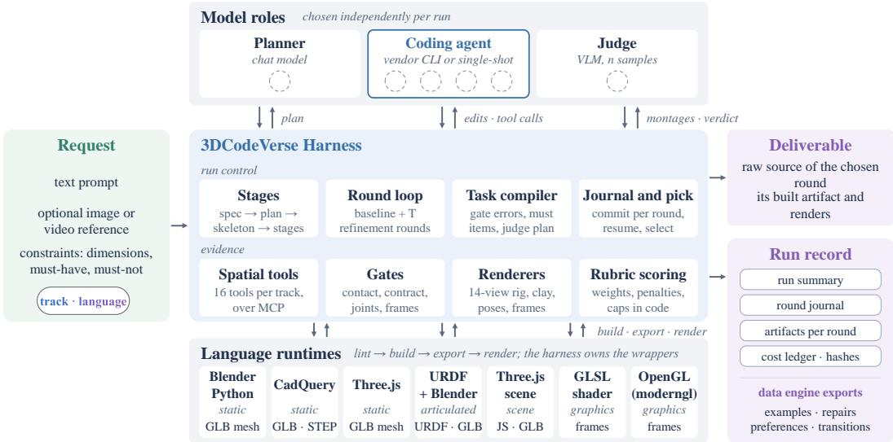  
Figure 7: Components and model roles. A planner, a judge, and a coding agent are configured modularly per run; the harness orchestrates stage progression, iterative refinement, and candidate selection while providing deterministic spatial tools, verification gates, multi-view renderers, and rubric aggregation. Agent programs execute across seven isolated language runtimes; dashed circles indicate pluggable model interfaces.

## A THE 3DCODEVERSE HARNESS: DESIGN AND IMPLEMENTATION

## A.1 COMPONENTS AND MODEL ROLES

Tracks and runtimes. 3DCodeVerse Harness spans four generative tracks—static objects, articulated objects, 3D scenes, and procedural graphics—backed by seven isolated language runtimes: three for static objects (Blender Python, CadQuery, and Three.js), one each for articulated mechanisms (URDF with Blender-authored links) and scenes (Three.js), and two for graphics (GLSL and moderngl). Each runtime specifies a strict file layout, static lint rules, a sandboxed build wrapper, canonical export formats, and a deterministic render driver, while sharing unified coordinate frames, metric units, camera rigs, and geometric tolerances.

Model roles and execution invariants. Each run decouples structural planning, code synthesis, and visual evaluation into three pluggable roles: a planner, a coding agent, and a vision–language judge (Figure 7). The planner and judge operate through a unified API interface, while the coding agent executes inside an isolated workspace equipped with the harness’s spatial tools via the Model Context Protocol (MCP), alongside a single-shot mode that requests a complete file envelope through direct API calls. Every round commits raw source code from which meshes and renders are deterministically regenerated; boilerplate infrastructure (camera rigging, coordinate conversion, URDF composition, scene assembly, and shader headers) resides in the harness, and verification proceeds strictly from fast programmatic gates to blind VLM judging.

## A.2 PLANNING AND THE JOB GRAPH

Structured specification and plan synthesis. The planner translates an open-ended request into a schema-validated structural plan: named parts with metric bounding boxes, materials, symmetry, and attachment topology for static objects; a kinematic tree with typed joints, axes, pivots, limits, and acyclic affine mimic couplings $( q _ { j } = m _ { j } q _ { i } + b _ { j } )$ for articulated mechanisms; spatial zones, modular assets, effects, and authored cameras for scenes; and render passes, uniforms, and temporal dynamics for graphics. Each plan carries an acceptance checklist binding items to an evidence modality (measurement, visual inspection, probe, or joint sweep) and a priority (must or should), supplemented by canonical rules that normalize kinematic conventions and enforce requested dimensions (±5%), triangle budgets, grounding, and temporal motion.

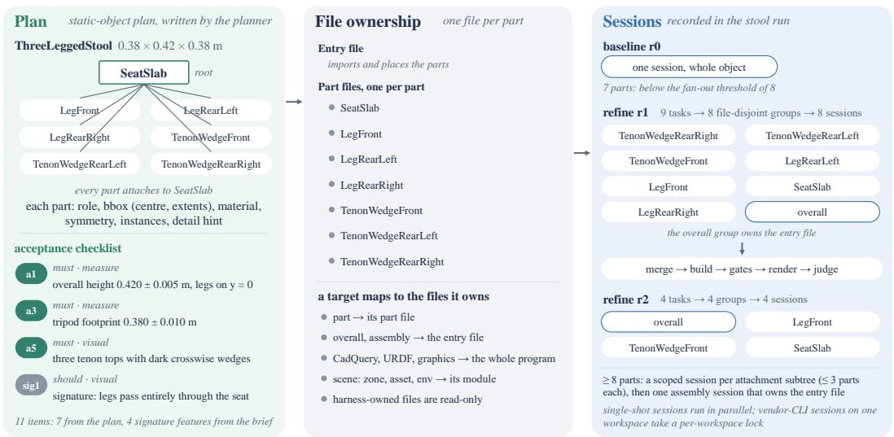  
Figure 8: From structural plan to file scopes and coding sessions, illustrated on the recorded trajectory of §A.6. The planner decomposes the prompt into named parts with metric bounding boxes, materials, attachment relations, and an acceptance checklist; each target maps to its owned source files, and refinement tasks sharing files are grouped into file-disjoint sessions. In Round 1, nine revision tasks partition into eight file-disjoint groups; in Round 2, four tasks form four groups.

Bounded plan verification. Planning executes as a structured-output call with a token budget scaled to the target part count. Range or formatting violations are repaired in-context, whereas a degenerate kinematic hierarchy referencing undeclared links triggers a clean context reset from the original request (§C.5).

File-scoped subtree decomposition. Each runtime maps plan targets to strict file-ownership scopes (per-part modules plus an assembly entry file for Blender and Three.js objects; a single program for CadQuery, URDF, and graphics; and per-zone and per-asset modules for scenes), and writes outside a session’s scope are reverted between Git commits. Objects with eight or more top-level parts in modular languages are synthesized via scoped sessions over attachment subtrees of at most three parts—each supplied with the planned bounding boxes of adjacent parts—followed by an assembly session (Figure 8). During refinement, tasks that share files are grouped into connected components and dispatched as file-disjoint sessions, bounding per-session context and preventing cross-part regressions (§C.5), while best-of-N candidates and scene assets run concurrently in isolated workspaces.

Session context and contract injection. Every agent workspace is provisioned with a standardized instruction specification containing the runtime invariants, track-specific tool schemas, and language contracts. Each task prompt supplies the user request, coordinate-frame conventions, the language cookbook, the structural plan formatted as exact metric tables with its acceptance checklist, and the verification protocol (requiring a clean build followed by spatial measurement or probing). Single-shot prompts inline the code skeleton and request a complete file envelope in a single response.

## A.3 SPATIAL TOOLS AND DETERMINISTIC GATES

Semantic verdicts vs. transport errors. Every tool response separates the semantic verification verdict (PASS/FAIL) from the tool execution status. A detected mesh collision or build failure is returned as a valid observation leading with a structured FAIL verdict; only an internal tool crash sets the MCP protocol error flag, preventing commercial coding agents from entering degenerate transport-retry loops (§C.5). Tool responses bound text length and image resolution, attaching diagnostic renders specifically when a check identifies actionable geometric defects.

Deterministic gates, connectivity, and plan adherence. Following each successful build, the track pipeline executes its deterministic gates. Gate errors compile into high-priority revision tasks with numerical fix hints and impose hard upper bounds on the round’s rubric score, while warnings are plans and hints use the language frame: Blender, CadQuery and URDF are Z-up with −Y front; Three.js and GL are Y-up with +Z front. Meshes are measured in the Y-up GLB frame and every hint is mapped back: (x, y, z) → (x, z, −y).

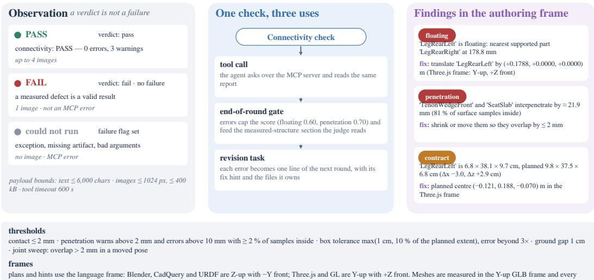  
Figure 9: Observations, deterministic gates, and authoring-frame feedback. A measured geometric defect is returned as a structured negative verdict rather than a protocol error (left); a single verification routine serves simultaneously as an interactive agent tool, an end-of-round gate, and a generator of prioritized revision tasks (middle). Right: baseline-round diagnostics from §A.6, with corrective translation vectors projected directly into the agent’s native authoring frame.

surfaced to the judge. Conversely, passing a deterministic gate vetoes contradictory visual defect claims from the VLM judge (§A.4). In the connectivity gate, the ground-contacting component with the largest face count defines the primary support structure, and any disconnected component is reported alongside its nearest supported neighbour and the exact 3D translation vector that closes the gap. A contact ledger tracks all planned part attachments with their measured clearances while enforcing structural support at the global assembly level. The contract gate verifies built part counts, orientations, and bounding-box extents against the structural plan within per-axis tolerances.

Authoring-frame diagnostic projection. Although exported meshes are evaluated in the canonical Y-up frame, all corrective fix hints are projected back into each runtime’s native authoring frame: a seat floating by 12 mm receives a corrective translation of (0, 0, −0.012) m in Z-up Blender Python and (0, −0.012, 0) m in Y-up Three.js (Figure 9). Articulated diagnostics output URDF joint origins and axes directly, and scene diagnostics emit native scene-graph API instructions.

## A.4 AUTOMATED JUDGMENT

Evidence payload and response schema. A single payload builder serves in-loop refinement, post-run evaluation, and judge calibration (Figure 10). The judge receives the request, plan digest, acceptance checklist, measurements, gate findings, and track telemetry, together with up to five labelled multi-view montages, detail crops, and—when connectivity errors occur—cross-sectional slices, with montage order randomized per sample to remove positional bias. On object tracks, a passing connectivity gate prohibits unverified visual claims of floating or interpenetrating parts. The judge answers in a strict JSON schema at temperature 0.2, stating its evidence, strengths, issues, defect votes, and checklist verifications before assigning criterion scores and up to six prioritized improvement instructions; deterministic criteria such as silhouette IoU are injected by code.

Score aggregation and deterministic vetoing. For round t, sample scores for each rubric criterion k are averaged into $\bar { s } _ { k } ^ { ( t ) }$ , while checklist verifications and binary defects are aggregated by majority vote. Any VLM-voted structural defect is automatically vetoed—incurring neither penalty nor cap—whenever the corresponding deterministic gate executed, passed without error, and recorded no penetration warning of 8 mm or deeper. The composite round score is computed in code as

$$
s ^ { ( t ) } = \operatorname* { m i n } \Biggl \{ u ^ { ( t ) } , \operatorname* { m a x } \Biggl ( 0 , \sum _ { k } w _ { k } \bar { s } _ { k } ^ { ( t ) } - \sum _ { d } \lambda _ { d } \hat { d } _ { d } ^ { ( t ) } \Biggr ) \Biggr \} ,\tag{5}
$$

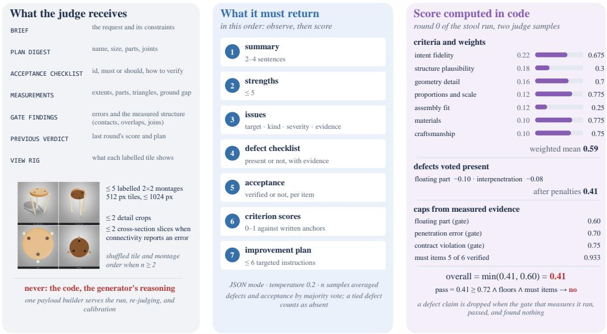  
Figure 10: Vision–language judgment: evidence payload, structured schema, and score synthesis. The judge inspects structured telemetry and labelled multi-view montages without access to source code or generator reasoning (left); its schema enforces explicit visual observation prior to criterion scoring (middle). Right: baseline-round score computation for §A.6, combining criterion means, majority-voted defects, and deterministic gate caps.

where $\hat { d } _ { d } ^ { ( t ) } \in \{ 0 , 1 \}$ denotes retained defects with penalty weights $\lambda _ { d } ,$ , and $u ^ { ( t ) } \in [ 0 , 1 ]$ is the tightest upper bound among retained defect caps, triggered gate caps, and unverified mandatory checklist items $( u ^ { ( t ) } = 1$ when none apply; on object tracks, verifying v of m mandatory items sets the checklist cap to $0 . 6 + 0 . 4 v / m )$ . A round achieves a pass verdict when $s ^ { ( t ) }$ meets the track threshold, every criterion exceeds its floor, and all mandatory items are verified. Every applied cap and its triggering evidence are archived in the verdict record.

Pairwise comparison and judge repeatability. For pairwise preference evaluation, the judge inspects anonymized candidates under both display orders and declares a winner only when both orders concur; reference-conditioned and likeness modes additionally incorporate measured silhouette IoU and real-world photographs. Across repeated evaluations of fixed chair and cabinet artifacts under shuffled montage orders, Gemini 3.1 Pro achieves a mean score standard deviation of 0.030 (0.035 under fixed order, compared with 0.083 for Gemini 3.8 Flash), confirming that our primary evaluator provides a high-precision, view-order-robust scoring signal (§C.3).

## A.5 REFINEMENT ROUNDS, HISTORY, AND OUTPUT SELECTION

Round execution and task prioritization. Pre-round stages are cached, whereas every round executes fresh through a fixed verification chain: code synthesis, build with bounded repair, geometric measurement, deterministic gates, multi-view rendering, VLM judgment, and Git archival. A failed build triggers up to three targeted repair sessions supplied with the error location, traceback, lint diagnostics, and relevant cookbook snippets, and every completed round is committed with a journal entry of its telemetry, verdicts, renders, and token usage. Refinement tasks are compiled from the preceding round in strict priority order—deterministic gate errors with numerical fix hints, then unverified mandatory checklist items, then the judge’s perceptual instructions—and deduplicated by part and defect category. At most six tasks are dispatched per round, and truncation applies only to perceptual suggestions, so gate errors and mandatory items are never dropped; reference-conditioned runs append a silhouette task whenever outline IoU falls below 0.60.

Termination and best-of-N initialization. The standard profile allocates up to T = 4 refinement rounds and a 60-minute wall-clock ceiling; refinement stops early once all verification tasks are resolved, a round makes no code change, or the budget is reached, while monetary cost is logged for accounting only. With multi-candidate initialization, the baseline round synthesizes N independent candidates, ranks them lexicographically by build success, quick rubric score, and gate error count on a four-view rig, and seeds Round 0 with the winner.

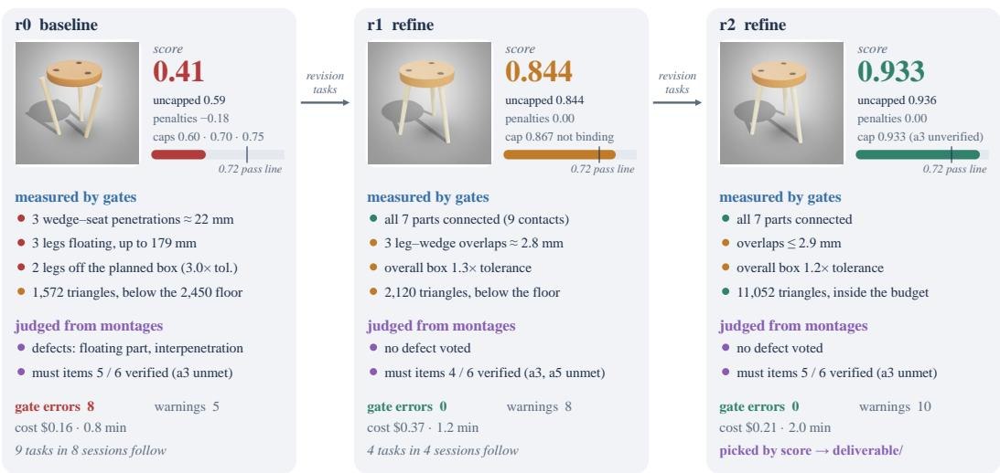  
Figure 11: Recorded trajectory for the prompt “a three-legged wooden stool” on the Three.js runtime under the economy profile. Each column shows one round: the rendered view inspected by the judge, the composite score with its penalties and caps, deterministic gate findings, and VLM defect votes. Closed-loop refinement resolves all baseline floating and interpenetrating parts in Round 1 (0.410 → 0.844) and refines geometric detailing in Round 2 (11,052 triangles, reaching 0.933 under the strict metric-footprint cap), completing in 4.0 active minutes at \$0.74.

Post-run output selection. Judged rounds are ranked by composite rubric score, breaking ties by fewer gate errors and earlier round index. When the top two rounds fall within 0.03, an optional pairwise VLM tie-breaker promotes the runner-up only if it wins both presentation orders with confidence ≥ 0.60. The selected round is packaged directly from its Git commit and verified artifacts without re-executing the build.

## A.6 A RECORDED RUN

Figure 11 traces a complete run for the prompt “a three-legged wooden stool” on the Three.js runtime under the economy profile. The planner decomposes the stool into seven parts (a circular seat slab, three splayed legs, and three through-tenon wedges) with eleven checklist items, including four signature structural features. In the baseline round (t = 0), the initial script builds, but deterministic gates identify multiple structural violations: the connectivity gate detects three wedge– seat interpenetrations (≈ 22 mm) and six disconnected parts floating up to 212 mm from the support component; two legs exceed their planned bounding-box tolerances; and the mesh contains only 1,572 triangles against a detail floor of 2,450, yielding a composite score of 0.410 (0.59 weighted criterion mean minus 0.18 in defect penalties). The harness compiles nine prioritized revision tasks— eight from deterministic gate errors with exact authoring-frame translation vectors and one from the footprint specification—and dispatches them across eight file-disjoint sessions. By Round 1, every structural defect is resolved: all seven parts form a single ground-supported assembly with nine verified contacts, lifting the score by +0.434 to 0.844. Round 2 addresses the remaining geometric and metric refinements—carving recessed mortise slots, chamfering the slab rims, and increasing leg splay—expanding mesh detail to 11,052 triangles and reaching a score of 0.933 (bounded by the graded checklist cap of $0 . 6 + 0 . 4 \times 5 / 6$ for a 0.34 m vs. 0.38 m base diameter). The complete trajectory finishes in 21 model calls, 4.0 active minutes, and \$0.74, and the output selector packages Round 2.

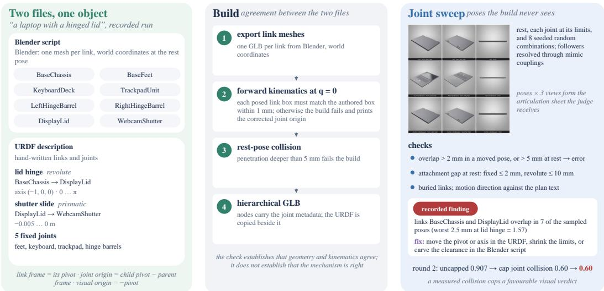  
Figure 12: Articulated mechanism verification, illustrated on a recorded run for $\mathbf { \ddot { a } }$ laptop with a hinged lid”. Link geometry is authored in Blender and kinematic structure in $\mathrm { U R D F } ;$ the build verifies rest-pose frame agreement, and the joint sweep articulates the mechanism across its motion limits. The dynamic sweep automatically detects a subtle 2.5 mm hinge–base collision at the upper opening limit that is invisible at rest, enforcing physical articulability via the rubric cap.

## A.7 ARTICULATED OBJECTS: GEOMETRY, KINEMATICS, AND JOINT SWEEPS

The articulated track coordinates two coupled source representations (Figure 12): a Blender Python script authoring one mesh per link in world coordinates at the rest pose, and a URDF specification placing each link frame at its kinematic pivot. Denoting the rest-pose frame of link l by $\bar { \mathbf { T } } _ { l } ( 0 )$ and its visual origin by $\mathbf { T } _ { v , l }$ , a world-authored link mesh is consistent with the kinematic tree if and only if

$$
\mathbf { T } _ { l } ( 0 ) \mathbf { T } _ { v , l } \mathbf { x } _ { \mathrm { w o r l d } } = \mathbf { x } _ { \mathrm { w o r l d } } , \qquad \mathbf { T } _ { v , l } = \mathbf { T } _ { l } ( 0 ) ^ { - 1 } .\tag{6}
$$

During the build stage, the harness compares each link’s forward-kinematic bounding box at $q = 0$ against its authored mesh; any alignment discrepancy exceeding 1 mm or rest-pose interpenetration exceeding 5 mm fails the build with an exact origin correction, guaranteeing rest-pose geometric– kinematic consistency prior to dynamic sweep evaluation.

The dynamic joint sweep then articulates the mechanism across its rest pose, the lower, midpoint, and upper limits of each independent joint, and eight seeded multi-joint configurations, resolving coupled followers analytically through the mimic graph. Interpenetrations exceeding 2 mm in any articulated pose (5 mm at rest) are flagged per link pair, while mobile child links separated by more than 30 mm from their parent at rest (2 mm for fixed joints) are flagged as unattached. A motion-direction check verifies that each joint’s displacement vector aligns with the planned motion semantics and proposes axis corrections when inverted. The VLM judge inspects the multi-pose articulation sheet alongside these geometric findings, while deterministic caps bound the score at 0.60 for dynamic collisions or unattached links, 0.30 for URDF schema errors, and 0.50 for missing pose sheets (see Appendix C.5 for kinematic coupling ablations).

## A.8 SCENES AND GRAPHICS

Scenes. Scene synthesis executes a staged hierarchical pipeline prior to the main refinement loop (Figure 13a). Individual scene assets (up to eight, or four under tight budget thresholds) follow a progressive compute-escalation policy: each asset begins with a fast single-shot draft and deterministic check, escalating to a full interactive agent session only if automated repair does not resolve all findings; Blender-built hero assets additionally undergo VLM evaluation with a monotonic quality gate that retains a revision pass only if it strictly improves the asset score. Environmental terrains and spatial zone layouts are built concurrently, followed by a unified cross-zone composition session and deterministic scene-graph assembly. To guarantee timely completion on complex prompts, pre-round staging is bounded at 55% of the wall-clock budget, dynamically switching remaining pre-round stages to fast single-shot synthesis once reached. Scene gates enforce asset grounding and collision bounds, runtime console cleanliness, per-camera exposure and framing coverage, inter-frame animation motion, asset utilization, and a 15,000 draw-call budget across up to ten authored and overview camera views.

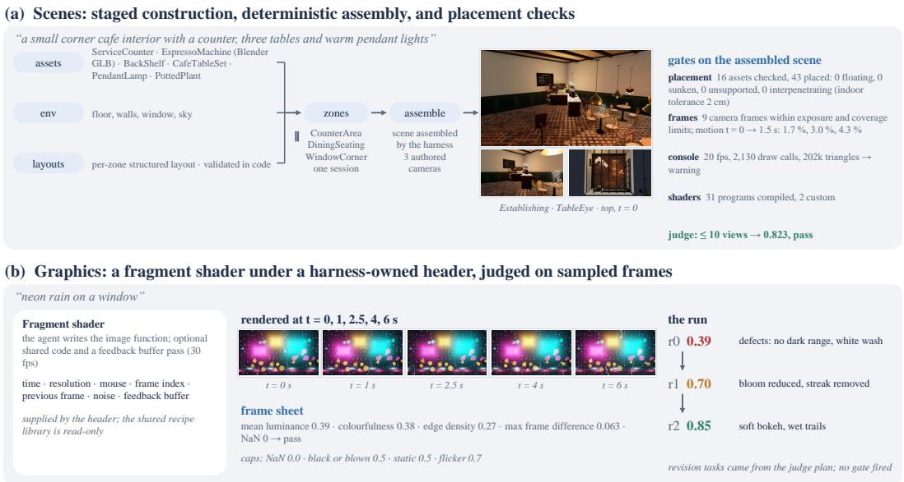  
Figure 13: Scene and procedural graphics tracks. (a) Scene generation executes a staged asset-andzone assembly pipeline before entering the closed-loop refinement cycle with scene-specific gates. (b) Graphics generation synthesizes fragment shaders or OpenGL programs whose temporal frames are sampled at fixed timestamps, verified by statistical frame gates, and evaluated as multi-frame montages.

Graphics. On the graphics track, the agent authors either a Shadertoy-style GLSL fragment shader (with optional multipass feedback buffers) or a moderngl Python program defining setup and per-frame render routines, while the harness injects standardized headers, uniforms, outputs, and brief-matched reference recipes (Figure 13b). Sequences are rendered at t ∈ {0, 1, 2.5, 4, 6} s (clipped to the loop duration) at 1280 × 720 resolution. The deterministic frame gate measures luminance distribution, colourfulness, edge density, inter-frame motion, and pixel validity: NaN, all-black, or overexposed frames trigger hard errors, while static or flickering sequences trigger score-capping warnings. The judge evaluates multi-frame montages paired with frame telemetry, and each refinement round dispatches a unified whole-program optimization task.

## A.9 SKILLS

The authoring skill library (§3 and §4) comprises seventeen modular bundles in the open agentskill format, each pairing a concise instruction sheet with a code reference file bounded at 350 lines and ≈2,500 tokens (Table 4). A 28-rule routing table dynamically selects up to five highestpriority bundles per session through two complementary mechanisms: standing routes, which match the active track, runtime language, session role, and planned structural features, and diagnostic routes, which trigger on specific gate findings from the preceding round (for example, attaching threejs-shader-traps whenever the shader preflight gate fires).

Table 4: The domain skill library, listing each bundle’s authoring guidance alongside its standing and gate-triggered routing conditions.
<table><tr><td>Bundle</td><td>Guidance</td><td>Standing route</td><td>Gate-fired route</td></tr><tr><td>part-contact</td><td>contact, weld-overlap, penetration, and stray-island limits of the connectivity gate</td><td>multi-part objects</td><td>connectivity, joint sweep</td></tr><tr><td>bbox-contract</td><td>plan dimensions: tolerance max(1 cm, 10%), error past 3×</td><td>object tracks</td><td>contract</td></tr><tr><td>repeats-and-mirrors</td><td>instances, mirror and radial arrays, instance naming</td><td>instances or symmetry Blender, URDF+Blender</td><td>instance box</td></tr><tr><td>blender-forms cadquery-forms</td><td>form-to-Blender-API techniques; five common lint errors CadQuery forms; fillet, revolve, and boolean rules</td><td>CadQuery</td><td>part not imported</td></tr><tr><td>threejs-forms</td><td>form word to Three.js geometry; no CSG</td><td>Three.js objects</td><td></td></tr><tr><td>urdf-joints</td><td>axes, limits, clearance; direction of +q</td><td>articulated</td><td>joint sweep, motion direction</td></tr><tr><td>scene-composition</td><td>layout; cameras from measured bounds</td><td>scene sessions</td><td>camera, content, hero</td></tr><tr><td>scene-lighting</td><td>key, fill, and practical lights; linear-light albedo</td><td>scenes</td><td>dark, flat, blown frames</td></tr><tr><td>scene-motion</td><td>visible motion between the two animation times</td><td>scenes</td><td>no motion</td></tr><tr><td>threejs-shader-traps</td><td>custom GLSL that passes the shader preflight</td><td>custom shaders</td><td>shader preflight</td></tr><tr><td>glsl-craft</td><td>fragment-shader craft for the five sampled frames</td><td>GLSL graphics</td><td>frame gate</td></tr><tr><td>opengl-pipeline</td><td>moderngl setup and render contract; time sampling</td><td>OpenGL graphics</td><td>frame gate</td></tr><tr><td>scene-atmosphere</td><td>sky dome, environment bake, fog</td><td>scenes</td><td></td></tr><tr><td>scene-water</td><td>water as a dielectric</td><td>water in plan</td><td></td></tr><tr><td>scene-night</td><td>emissive windows, glow, light shafts</td><td>night in plan</td><td></td></tr><tr><td>scene-materials</td><td>procedural albedo variance, per-instance jitter</td><td>scenes</td><td></td></tr></table>

## B 3DCODEVERSE-2M: DATASET DETAILS

## B.1 DATASET HIERARCHY AND COUNTING UNITS

3DCodeVerse-2M is organized into three tiers that separate curated programs, benchmark training splits, and multi-representation exports. The catalogue indexes 269,597 unique executable programs across nine collections (Table 5), spanning parametric CAD, procedural Blender Python, OpenSCAD, articulated URDF mechanisms, Three.js scenes, and GLSL shaders. The benchmark training pairs (768,596 pairs, 891 M tokens) are deduplicated prompt–code splits, including web-animation programs, built for the fine-tuning experiments of §5.2 and Appendix C.1; they strictly exclude all 3DCodeBench procedural factories, seeded instances, and per-dialect evaluation suites. The unified text export (2,028,286 rows across 342 shards) expands each curated program across its three caption views (visual description, instruction, and factory recipe) and decomposes multi-pass shaders into pass-level targets: 891,788 native-format rows, 848,819 standardized text-export rows, and 287,679 pass-flattened shader rows.

## B.2 SOURCES AND CONVERSION PIPELINES

DeepCAD to CadQuery. DeepCAD provides 178,238 raw sketch–extrusion command sequences rather than executable programs (Wu et al., 2021). Our deterministic compiler translates each command sequence into a self-contained CadQuery script: 174,981 sequences compile (98.2%), 174,177 produce valid watertight solids (97.7%), and vector-level hashing removes 25.8% exact geometric duplicates to yield 128,201 unique executable programs (71.9% of raw sequences). Geometric fidelity against the original solids, measured via voxel IoU at $4 8 ^ { 3 }$ resolution, averages 0.985, with 96.9% of programs exceeding 0.90 (the remaining 1,114 programs are annotated with explicit fidelity metadata so downstream pipelines can apply custom thresholds). Natural-language annotations from Text2CAD (Khan et al., 2024) are paired with 125,162 programs under their original license terms, accompanied by four canonical views per solid. Crucially, because the upstream DeepCAD split contains 3,230 duplicate geometry groups straddling its train and test partitions, our vector-and-mesh deduplication eliminates cross-split leakage across the CAD lineage.

Shadertoy. The procedural graphics collection comprises 119,961 Shadertoy shaders—98,164 single-pass and 21,585 multi-pass programs—indexed with one canonical record per shader (Quilez & Jeremias, 2013). Each record stores the primary image pass as the indexed entry file alongside the complete multi-pass buffer source tree, multi-frame render grids, video clips, and bound input textures. For text-to-code training, multi-pass shaders are additionally expanded by prepending shared common headers to each buffer pass (287,679 pass-level rows); automated syntax and uniform repair across 588 shaders lifts the headless compilation rate of the flattened set from 84.6% to 99.0% (92,534 of 93,434), with only compiled shaders admitted to training mixtures.

Table 5: The packaged catalogue, one row per collection and dialect at the packaging snapshot. Origin terms never replace the dataset-level CC-BY-NC-SA-4.0 terms; the stricter applicable terms control reuse. Render entries count the render paths recorded per sample, which include mesh exports next to images. †Estimated from a 10% stratified sample of archive manifests. ‡Indexed render paths in the initial release manifest; full eight-view and pose renders reside in the chunk archives (§B.2). §Packaged coding-agent subsets at the release snapshot (§B.2).
<table><tr><td>Subset</td><td>Dialect</td><td>Samples</td><td>Share</td><td>Code MB</td><td>Render entries</td><td>Origin terms</td></tr><tr><td>DeepCAD</td><td>DeepCAD → CadQuery</td><td>128,201</td><td>47.55%</td><td>136.7</td><td>769,107</td><td>MIT</td></tr><tr><td>Shadertoy</td><td>GLSL</td><td>119,961</td><td>44.50%</td><td>394.7</td><td>1,196,826†</td><td>per shader, mostly CC BY-NC-SA</td></tr><tr><td>Articraft (CadQuery)</td><td>CadQuery</td><td>6,882</td><td>2.55%</td><td>120.0</td><td>3,300‡</td><td>CC BY 4.0</td></tr><tr><td>Bioinspired3D</td><td>Blender Python</td><td>6,343</td><td>2.35%</td><td>9.3</td><td>31,715</td><td>MIT</td></tr><tr><td>Articraft (URDF)</td><td>URDF</td><td>6,146</td><td>2.28%</td><td>103.4</td><td>2,846‡</td><td>CC BY 4.0</td></tr><tr><td>Thingiverse-OpenSCAD</td><td>OpenSCAD</td><td>1,193</td><td>0.44%</td><td>4.9</td><td>5,965</td><td>per item</td></tr><tr><td>3DCodeBench factories</td><td>Blender Python</td><td>486</td><td>0.18%</td><td>16.0</td><td>2,430</td><td>BSD-3-Clause</td></tr><tr><td>Three.js, agent-written§</td><td>Three.js (JS/HTML)</td><td>280</td><td>0.10%</td><td>3.4</td><td>1,120</td><td>CC BY 4.0 per sample</td></tr><tr><td>Blender, agent-written®</td><td>Blender Python</td><td>80</td><td>0.03%</td><td>0.9</td><td>320</td><td>CC BY 4.0 per sample</td></tr><tr><td>Three.js repositories</td><td>Three.js / R3F</td><td>25</td><td>0.01%</td><td>11.3</td><td>0</td><td>as detected</td></tr><tr><td>Total</td><td></td><td>269,597</td><td>100.00%</td><td>800.6</td><td>2,013,629</td><td>dataset: CC-BY-NC-SA-4.0</td></tr></table>

Articraft. The 9,996 upstream Articraft records (Zhou et al., 2026) partition into 6,882 mesh-based CAD assemblies and 3,114 primitive-based articulated mechanisms. For the mesh-based assemblies, we perform a clean-room reimplementation of the Articraft geometry helpers coupled with a treeshaking AST inliner to produce standalone CadQuery programs (median ≈900 lines), verifying every output against the upstream geometry via Chamfer distance (< 0.02) and bounding-box aspect ratio (∈ [0.9, 1.1]); 6,878 of 6,882 (99.9%) pass verification and are rendered from eight canonical views. The primitive-based mechanisms are packaged as executable URDF specifications across geometry-only and textured variants (6,146 records in total, including 3,032 textured mechanisms) with multi-pose kinematic renders.

Procedural, community, and agent-synthesized collections. The remaining sources (Table 5) are all execution-verified: (1) Bioinspired3D (Luu & Buehler, 2026a), 6,343 Blender Python programs (4,557 geometry programs and 1,786 material-textured variants) that all execute, export, and render from five views; (2) Thingiverse OpenSCAD, 1,193 parametric projects curated from 7,378 community designs, with their original source files, five renders, and item-level license metadata; (3) 3DCodeBench factories, 486 procedural Blender generators (243 factories derived from Infinigen (Raistrick et al., 2023), each in geometry and textured variants, averaging ≈880 lines) and 3,904 curated seeded instances (1,953 geometry and 1,951 textured), all held out from benchmark training because the 212 3DCodeBench tasks come from the same generator family (Appendix C.1); (4) agent-authored programs, 949 Blender Python programs and 1,134 Three.js scenes synthesized by coding agents under execution and render verification (from 1,040 and 1,389 attempts), plus 25 multi-file Three.js repositories and 1,051 web-animation programs across 21 categories; and (5) harness-generated bootstrap programs, 15,704 execution-verified programs carrying quality tiers, checklist verdicts, and gate telemetry, which substantially improve target-dialect executability in our fine-tuning mixtures (§C.4).

## C EXPERIMENTAL DETAILS AND ADDITIONAL RESULTS

## C.1 TRAINING DETAILS

Training configuration. All fine-tuning runs are conducted with LLaMA-Factory (Zheng et al., 2024) on 4 × NVIDIA H100 (80 GB) GPUs in bfloat16 precision using gradient checkpointing and sequence packing. Supervised fine-tuning (SFT) applies LoRA (Hu et al., 2021) of rank 64 (α = 128, dropout 0.05) across all linear projections with a learning rate of $1 \times 1 0 ^ { - 4 } \mathrm { ( o r ~ 1 \times 1 0 ^ { - 5 } }$ for full-parameter fine-tuning under ZeRO-3 (Rajbhandari et al., 2020)), a cosine learning-rate schedule, a 5% linear warm-up ratio, and a per-device batch size of 1 with gradient accumulation of 8 (4 for 27B). Direct Preference Optimization (DPO; Rafailov et al. 2023) initializes from the merged SFT checkpoint and trains a rank-16 LoRA (α = 32) for 2 epochs under sigmoid preference loss $( \beta = 0 . 1$ learning rate $5 \times 1 0 ^ { - 6 } )$ . The sequence context length is set to 8,192 tokens for 9B runs and 4,096 tokens for 27B runs to fit single-device memory bounds under data-parallel training. Evaluation inference uses vLLM (Kwon et al., 2023) under greedy decoding or temperature sampling (T=0.7) as specified per experiment.

Training throughput. Because LoRA introduces a compact optimizer state, training the 27B model under standard Distributed Data Parallel (DDP) avoids ZeRO-3 parameter all-gather traffic and achieves a 13× higher step throughput (≈6.2 K vs. ≈460 tokens/s) with standard PyTorch allocator caching. Across 4 × H100 GPUs, 9B LoRA sustains ≈17 K tokens/s (completing the 270 K-pair, 293 M-token mixture in 4 h 46 m), while 27B LoRA sustains ≈6.2 K tokens/s.

Chat formatting and strict contamination control. Training examples are formatted as ShareGPT multi-turn conversations: a system prompt specifying the target dialect and output contract, a user turn containing the natural-language specification, and an assistant turn containing the complete executable program in a fenced code block. Any example whose tokenized conversation exceeds the context window is excluded cleanly rather than truncated, preserving syntactic closure. To guarantee zero train–test leakage, all 212 3DCodeBench procedural factories, all 3,904 re-seeded instances derived from those factories, and all per-dialect evaluation splits are strictly held out; no training mixture shares a program or asset identifier with any evaluation task. Table 6 details the exact dialect composition, token volume, and wall-clock training duration for every mixture.

Table 6: Supervised fine-tuning mixtures. Composition, token volume, and wall-clock training duration on 4 × H100 GPUs across the SFT mixtures evaluated in §5 and §C.4 (boot denotes execution-verified bootstrap programs synthesized by 3DCodeVerse Harness; cap/sample denotes the number of caption views per program).
<table><tr><td>Mix</td><td>Base</td><td>Pairs</td><td>Mtok</td><td>cap/sample</td><td>Composition</td><td>Wall</td></tr><tr><td>5.2 K Blender</td><td>9B</td><td>5,193</td><td>3.8</td><td>mixed</td><td>Bioinspired3D + non-test factories</td><td>30m</td></tr><tr><td>25.6K</td><td>9B</td><td>25,600</td><td>26</td><td>1</td><td>4 dialects, merged single-dialect sets</td><td>1h46</td></tr><tr><td>102 K</td><td>9B</td><td>101,851</td><td>107</td><td>1</td><td>CadQ. 40 K, GLSL 40 K, OpenSCAD all, Blender 5 K + 15.7 K boot</td><td>3 h25</td></tr><tr><td>116 K (bal)</td><td>9B</td><td>116,000</td><td>110</td><td>1</td><td>as above, Blender share 15% → 34% by repetition</td><td>2h26</td></tr><tr><td>270 K</td><td>9B</td><td>270,173</td><td>293</td><td>1</td><td>all CadQuery, all GLSL, Blender 5 K + 15.7 K boot, OpenSCAD ×4</td><td>4h46</td></tr><tr><td>364 K</td><td>9B</td><td>364,000</td><td>304</td><td>3</td><td>all six sources, no boot</td><td>6h43</td></tr><tr><td>273 K</td><td>9B</td><td>273,000</td><td>300</td><td>1</td><td>all six sources, + all boot</td><td>4h50</td></tr><tr><td>76K</td><td>27B</td><td>75,910</td><td>56</td><td>≤ 2</td><td>CadQuery + GLSL = 74% of tokens, no boot</td><td>3 h51</td></tr><tr><td>104K</td><td>27B</td><td>103,770</td><td>75</td><td>≤2</td><td>Blender share 40%, all boot restored</td><td>3 h35</td></tr></table>

## C.2 TRAINING CURVES OF THE 27B DATA-SCALE RUNS

This section characterizes the optimization dynamics of Qwen3.8-27B across the representation tiers of 3DCodeVerse-2M. Three LoRA runs share an identical optimization recipe and vary solely in which representation views of the unified text export (Appendix B.1) they consume.

Optimization recipe. Each run applies LoRA of rank 16 (α = 32, dropout 0.05) for one epoch at a peak learning rate of 5 × 10−5 with a linear warm-up over the first 3% of steps and cosine decay to zero. Examples are packed into full sequences (≈7.2 samples per sequence), with each optimizer step consuming 64 packed sequences and logging training cross-entropy every five steps.

Representation scaling arms. Arm A trains on the complete unified export across all three representation views (native format, standardized text export, and pass-flattened multi-pass shaders): 1,992,816 rows packed into 276,594 sequences (4,322 steps). Arm B trains on the native-format and pass-flattened views without the re-templated text-export variant: 1,160,630 rows in 159,427 sequences (2,492 steps). Arm C retains a single canonical copy of each curated program paired with its instruction-style caption: 292,690 rows in 39,926 sequences (647 steps).

Optimization dynamics across representation scales. Figure 14 demonstrates smooth, stable convergence across all three regimes: no logged step exceeds 1.3× the trailing 20-step moving average, and all runs are entirely free of instability or divergence spikes. Rapid initial adaptation occurs within the first quarter of the epoch—reducing cross-entropy from ≈0.60 to 0.30 (Arm A) and 0.36 (Arms B and C)—followed by steady refinement to terminal smoothed losses of 0.274 (Arm A), 0.314 (Arm B), and 0.292 (Arm C), with Arm A stabilizing across the second half of the epoch (0.277 at mid-epoch to 0.274 at completion). Together, the three arms highlight two complementary operating regimes of 3DCodeVerse-2M: Arm C (293 K unique instruction–program pairs, 647 steps)

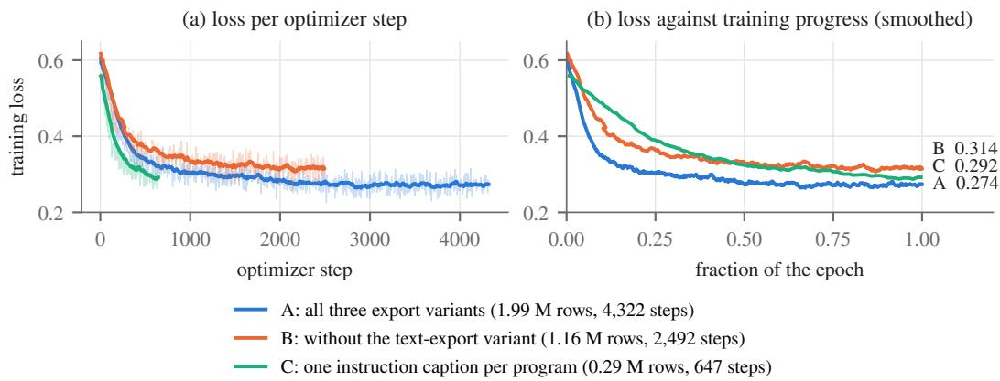  
Figure 14: Training loss dynamics of the three Qwen3.8-27B data-scale runs. (a) Cross-entropy loss per optimizer step; faint curves show raw 5-step logs and solid curves show an exponential moving average (τ = 50 steps). (b) Smoothed loss trajectories plotted against epoch fraction to align cosine learning-rate schedules, annotated with terminal smoothed losses. Each trajectory tracks in-distribution optimization across its respective representation mixture from 293 K to 1.99 M rows.

offers high sample efficiency for rapid adaptation, achieving a lower terminal loss than Arm B in one quarter of the optimization steps, whereas Arm A (1.99 M rows, 4,322 steps) leverages multi-caption and pass-level shader views to reinforce cross-representation alignment, achieving the lowest loss both at matched step budgets (0.275 vs. 0.316 at step 2,490) and at full convergence (0.274).

## C.3 EVALUATION PROTOCOL

Code extraction and geometric evaluation for open models. For open-model evaluations (§5.2), generated responses pass through a deterministic code extractor that strips reasoning blocks, collects fenced code blocks (including trailing unterminated blocks), and ranks candidates by dialect markers, fence annotations, and AST syntactic validity. This extraction step is essential for pretrained reasoning checkpoints: with thinking enabled, 52 of 212 responses from the zero-shot 27B model omit markdown fences and 74 place auxiliary snippets after the main program, whereas fine-tuned models adhere strictly to the single-block output contract (100% single-fence compliance). Extracted programs execute inside the dialect’s pinned runtime under a 300 s timeout. Resulting meshes are exported to GLB, centred at the origin, normalized to unit maximum extent, uniformly sampled at 10,000 surface points, and evaluated via symmetric Chamfer- $L _ { 2 }$ distance and F-score at thresholds τ ∈ {0.05, 0.10} (taking the best alignment across the four 90◦ yaw rotations; ground-truth reference scripts self-verify at Chamfer ≈ 0.016 and F@0.05 ≈ 1.0).

Object prompts and compared systems. The 3D object benchmark comprises 100 Three.js generation prompts stratified across three specification levels—21 concise (simple), 17 moderate (medium), and 62 richly specified (detailed) prompts—testing synthesis across varying levels of structural and stylistic complexity without prescribing explicit metric dimensions or part lists. All systems are evaluated under a uniform single-request deliverable protocol: each workflow receives the identical user prompt string and delivers a final executable program, which is rebuilt and scored by our common evaluator. For commercial product baselines such as Claude Design (powered by Claude Opus 5.5), we evaluate its released reference outputs directly in our unified evaluation pipeline without modification.

We evaluate Gemini 3.8 Flash and Claude Opus 5.5 against their respective native baselines on the primary 60-prompt benchmark, and evaluate Claude Sonnet 5, GPT-6 Luna, and GPT-6 Astra on a balanced 30-prompt subset (10 prompts per specification level). Each native baseline (Table 14) synthesizes code in a single pass using its standard coding-agent backend (high reasoning effort for Claude Opus 5.5 and Sonnet 5; medium effort for GPT-6 Astra; direct API for Gemini 3.8 Flash), whereas 3DCodeVerse Harness wraps the identical backbone model with structured planning, spatial tools, and automated verification. This paired design directly isolates the end-to-end gain of the 3DCodeVerse Harness workflow for a fixed backbone model, with token telemetry and API-equivalent cost reported alongside quality metrics (Table 8).

Single-request autonomy and refinement horizons. The single-request protocol prohibits human in-the-loop intervention: each system receives one user prompt with zero subsequent human edits or manual candidate cherry-picking, while permitting autonomous internal tool calls and verification passes. Our primary object benchmark evaluates single-round harness execution $( T = 0$ in the notation of §4), retaining the initial planned generation, interactive tool use, automated build repair, and final verification (using Gemini 3.8 Flash as planner and Gemini 3.1 Pro as in-loop judge for the Flash runs). Multi-round studies (T = 4) extend this autonomous loop with up to four closed-loop refinement rounds and automated post-run output selection under the same single user request.

Independent evaluation judge. All Judge Scores and VLM Preferences reported in §5 are produced by a single frozen evaluation pipeline that applies the judgment architecture and track rubrics of Appendix A.4 independently of the generation workflow under test. Each delivered program is rebuilt from scratch in its pinned runtime, with failed builds scored zero, to extract geometric measurements, connectivity or kinematic-sweep telemetry, and canonical multi-view renders (fourteen shaded views plus clay views for objects, multi-pose sweeps for articulated mechanisms, authored and orbital views at two timestamps for scenes, and sampled frame sheets for graphics); Gemini 3.1 Pro then scores it three times. Three safeguards decouple evaluation from in-loop refinement: (1) clean-room rebuild and blind prompting, scoring every artifact against the raw user prompt and a prompt-derived checklist alone, with all harness-generated plans, internal checklists, and refinement histories stripped; (2) deterministic geometric caps, bounding scores via exact mesh connectivity and kinematic checks independent of VLM perception (Eq. 5); and (3) multi-metric validation, pairing Judge Scores with SigLIP-2 similarity and blind human pairwise preferences (§5), which consistently corroborate the rubric gains across all four tracks.

Visual-criterion ablation. Our primary metric, the overall Judge Score $S _ { \mathrm { a l l } }$ (Table 14), combines seven weighted object criteria—intent fidelity (0.22), structural plausibility (0.18), geometry detail (0.16), proportions and scale (0.12), assembly fit (0.12), materials (0.10), and craftsmanship (0.10)— with deterministic defect penalties and caps (Eq. 5). To verify that our gains over external baselines such as Claude Design do not stem merely from metric-scale conventions or hard structural caps on open-ended prompts, we additionally compute an uncapped, scale-free visual score in Tables 7 and 9:

$$
S _ { \mathrm { v i s } } = \frac { \sum _ { k \neq \mathrm { s c a l e } } w _ { k } s _ { k } } { \sum _ { k \neq \mathrm { s c a l e } } w _ { k } } ,\tag{7}
$$

which aggregates raw criterion means $s _ { k }$ prior to aggregate defect penalties and score caps while excluding the proportions-and-scale criterion (with failed builds scored zero on both metrics). Even under this forgiving, uncapped metric, 3DCodeVerse Harness outperforms Claude Design by +25.6 points (88.1 vs. 62.4, winning 58 of 60 prompts), confirming that its advantage reflects superior geometric fidelity and visual craftsmanship rather than rubric thresholding.

SigLIP-2 text–render similarity. We compute SigLIP-2 (Tschannen et al., 2025) (So400m, patch size 16, NaFlex) cosine similarity at a frozen checkpoint revision between the raw user prompt and four canonical shaded views of each object (elevated front-right, back-right, back-left, and front-left views, excluding contact sheets and clay renders). Using the unmodified prompt without classification templates, we $\ell _ { 2 } \cdot$ -normalize text and image embeddings and average raw cosine similarities across the four views:

$$
S _ { \mathrm { S i g L I P } } ( c , f ) = \frac { 1 } { 4 } \sum _ { v = 1 } ^ { 4 } \frac { E _ { \mathrm { t e x t } } ( c ) ^ { \top } E _ { \mathrm { i m a g e } } ( I _ { v } ( f ) ) } { \Vert E _ { \mathrm { t e x t } } ( c ) \Vert _ { 2 } \Vert E _ { \mathrm { i m a g e } } ( I _ { v } ( f ) ) \Vert _ { 2 } } .\tag{8}
$$

Table 14 averages these object-level similarities over the 60-prompt benchmark, assigning zero to failed builds.

Pairwise preference protocol. Both human and VLM pairwise evaluations present the original user prompt alongside anonymized multi-view renders captured under matched camera poses, framing, and resolution. Evaluators judge overall preference on prompt adherence, structural plausibility, and visual craftsmanship, with ties counted as half a win; VLM preference additionally requires agreement across both presentation orders (§A.4). Human evaluations randomize left/right presentation order across a fixed, pre-registered prompt subset shared by all compared systems, with prompt-level bootstrap confidence intervals clustering repeated ratings at the task level. In end-to-end preference reporting, a valid executable artifact wins against a failed build and two failed builds tie, while conditional preference over mutually executing pairs is tracked alongside execution rate; transient provider outages are excluded from win/loss tallies.

Object and cross-track score breakdown. Tables 7–9 report paired score comparisons and 95% Student-t confidence intervals across objects, scenes, and procedural graphics (where W/L/T tallies the signs of per-prompt score differences). On the 60-prompt object benchmark—which concentrates heavily on complex specifications (52 detailed, 4 medium, and 4 simple prompts)—3DCodeVerse Harness lifts Gemini 3.8 Flash by +25.3 points (86.6 vs. 61.3, winning 56 of 60 prompts) and outperforms Claude Design by +49.2 points (59–1 W/L/T), even surpassing the native Claude Opus 5.5 baseline by +9.4 points (86.6 vs. 77.2). These gains generalize across tracks (Table 9): 3DCodeVerse Harness yields large improvements on procedural graphics for GPT-6 Astra (+30.4 points, 10–1 W/L/T), Gemini 3.8 Flash (+27.2, 10–1), and GPT-6 Luna (+6.8, 8–3), as well as on 3D scenes for Flash (+19.4, 9–1) and Luna (+14.6, 7–0). For Claude Sonnet 5 under single-round $( T = 0 )$ execution, 3DCodeVerse Harness wins the majority of graphics prompts (6–5 W/L/T) and improves uncapped scene quality $( \Delta S _ { \mathrm { v i s } } ~ = ~ + 2 . 8 )$ , while overall mean scores reflect strict deterministic gate caps applied to outlier frames prior to multi-round refinement.

Table 7: Paired object score comparisons (0–100 scale). Upper panel: composite Judge Score $S _ { \mathrm { a l l } }$ incorporating deterministic defect penalties and caps. Lower panel: uncapped, scale-free visual score $S _ { \mathrm { v i s } }$ (Eq. 7). W/L/T tallies per-prompt wins, losses, and ties by score difference.
<table><tr><td>A vs. B</td><td>n</td><td> $S _ { \mathrm { a l l } } ^ { A }$ </td><td> $S _ { \mathrm { a l l } } ^ { B }$ </td><td> $\Delta S _ { \mathrm { a l l } }$ </td><td>95% CI</td><td>W/L/T</td></tr><tr><td>Flash + 3DCodeVerse vs. Flash baseline</td><td>60</td><td>86.6</td><td>61.3</td><td>+25.3</td><td>[19.0, 31.6]</td><td>56/4/0</td></tr><tr><td>Flash + 3DCodeVerse vs. Claude Design</td><td>60</td><td>86.6</td><td>37.4</td><td>+49.2</td><td>[43.6, 54.9]</td><td>59/1/0</td></tr><tr><td>Opus baseline vs. Claude Design</td><td>60</td><td>77.2</td><td>37.4</td><td>+39.9</td><td>[34.5, 45.2]</td><td>59/1/0</td></tr><tr><td>Flash baseline vs. Claude Design</td><td>60</td><td>61.3</td><td>37.4</td><td>+23.9</td><td>[17.3, 30.5]</td><td>51/9/0</td></tr><tr><td>A vs. B</td><td>n</td><td> $S _ { \mathrm { v i s } } ^ { A }$ </td><td> $S _ { \mathrm { v i s } } ^ { B }$ </td><td> $\Delta S _ { \mathrm { v i s } }$ </td><td>95% CI</td><td>W/L/T*</td></tr><tr><td>Flash + 3DCodeVerse vs. Flash baseline</td><td>60</td><td>88.1</td><td>69.3</td><td>+18.8</td><td>[13.2, 24.5]</td><td>54/6/0</td></tr><tr><td>Flash + 3DCodeVerse vs. Claude Design</td><td>60</td><td>88.1</td><td>62.4</td><td>+25.6</td><td>[22.2, 29.1]</td><td>58/2/0</td></tr><tr><td>Opus baseline vs. Claude Design</td><td>60</td><td>84.5</td><td>62.4</td><td>+22.0</td><td>[19.1, 25.0]</td><td>60/0/0</td></tr><tr><td>Flash baseline vs. Claude Design</td><td>60</td><td>69.3</td><td>62.4</td><td>+6.8</td><td>[1.4, 12.2]</td><td>45/15/0</td></tr></table>

∗Lower-panel W/L/T uses $S _ { \mathrm { v i s } }$ differences. Flash denotes Gemini 3.8 Flash and Opus denotes Claude Opus 5.5; baselines synthesize code in a single pass without spatial tools or verification feedback (Appendix C.3).

Table 8: Object execution reliability, token telemetry, and prompt-cache efficiency. Usage is averaged across all 60 prompts and excludes post-run evaluation calls. Over 93.9% of 3DCodeVerse Harness input tokens are served from low-cost prompt cache.
<table><tr><td>System</td><td>n</td><td>Exec. (%)</td><td>Input (k)</td><td>Cached (k)</td><td>Output (k)</td><td>Est. USD</td></tr><tr><td>Claude Design</td><td>60</td><td>100.0</td><td></td><td></td><td></td><td></td></tr><tr><td>Flash baseline</td><td>60</td><td>93.3</td><td>0.3</td><td>0.0</td><td>9.4</td><td>0.035</td></tr><tr><td>Opus baseline</td><td>60</td><td>100.0</td><td>3.0</td><td>0.5</td><td>28.5</td><td>0.353</td></tr><tr><td>Flash + 3DCodeVerse</td><td>60</td><td>100.0</td><td>20,816.0</td><td>19,551.8</td><td>234.9</td><td>3.312</td></tr></table>

Cached tokens are a subset of input tokens; output tokens include reasoning traces. Claude Design artifacts are evaluated directly from released reference programs.

Table 9: Paired cross-track gains on 3D scenes and procedural graphics (0–100 scale). Differences compare 3DCodeVerse against the native baseline of the identical backbone across paired prompts (n), reporting both composite Judge Score $( \Delta S _ { \mathrm { a l l } } )$ and uncapped visual score $( \Delta S _ { \mathrm { v i s } } )$
<table><tr><td>Track</td><td>Backbone</td><td>n</td><td> $\Delta S _ { \mathrm { a l l } }$ </td><td>95% CI</td><td>W/L/T</td><td> $\Delta S _ { \mathrm { v i s } }$ </td></tr><tr><td>Graphics</td><td>Flash</td><td>11</td><td>+27.2</td><td>[9.0, 45.3]</td><td>10/1/0</td><td>+19.1</td></tr><tr><td>Graphics</td><td>Sonnet</td><td>11</td><td>-5.4</td><td>[-20.8,10.1]</td><td>6/5/0</td><td>-4.3</td></tr><tr><td>Graphics</td><td>Luna</td><td>11</td><td>+6.8</td><td>[−1.2, 14.8]</td><td>8/3/0</td><td>+6.5</td></tr><tr><td>Graphics</td><td>Astra</td><td>11</td><td>+30.4</td><td>[8.6, 52.2]</td><td>10/1/0</td><td>+28.2</td></tr><tr><td>Scenes</td><td>Flash</td><td>10</td><td>+19.4</td><td>[0.2, 38.6]</td><td>9/1/0</td><td>+15.4</td></tr><tr><td>Scenes</td><td>Sonnet</td><td>10</td><td>+0.1</td><td>[-31.1,31.3]</td><td>3/6/1</td><td>+2.8</td></tr><tr><td>Scenes</td><td>Luna</td><td>7</td><td>+14.6</td><td>[2.5, 26.8]</td><td>7/0/0</td><td>+9.1</td></tr></table>

Flash, Sonnet, Luna, and Astra denote Gemini 3.8 Flash, Claude Sonnet 5, GPT-6 Luna, and GPT-6 Astra. For graphics, $S _ { \mathrm { v i s } }$ retains all criterion weights prior to aggregate penalties and caps; for scenes, it additionally excludes the spatial-scale criterion.

Test-time verification compute and prompt-cache efficiency. Table 8 reports execution rates and per-prompt token consumption across completed generation attempts (valuing CLI sessions at standard API list prices and excluding post-run evaluation calls; Claude Design is evaluated directly from its released reference programs). Wrapping Gemini 3.8 Flash in 3DCodeVerse Harness raises execution reliability from 93.3% to 100.0%. Crucially, because our modular workspace and stable tool schemas preserve prefix structure across agent turns, 93.9% of harness input tokens (19,551.8 k of 20,816.0 k) are served from low-cost prompt cache. At an average cost of \$3.31 per object, test-time closed-loop verification enables a lightweight Flash backbone to achieve an 86.6 Judge Score—substantially outperforming both single-pass Claude Opus 5.5 (77.2) and Claude Design (37.4).

Evaluator precision vs. generative exploration variance. In the auxiliary studies of Appendix C.5, each artifact is rebuilt, rendered, and scored under matched conditions with two independent judge samples. Across repeated evaluations of fixed artifacts, the VLM judge exhibits a standard deviation of only $\sigma _ { \mathrm { j u d g e } } = 0 . 0 3 0$ for Gemini 3.1 Pro (0.083 for Gemini 3.8 Flash) on a [0, 1] scale, confirming that measurement noise is an order of magnitude smaller than the system-level gains reported in §5.

Table 10: Judge precision vs. structural exploration across repeated runs. Left: paired statistics across two independent runs under identical settings, juxtaposed with Gemini 3.1 Pro judge repeatability $( \sigma _ { \mathrm { j u d g e } } = 0 . 0 3 0 )$ . Right: an illustrative prompt in which two independent runs synthesize valid but topologically distinct decompositions (a single monolithic mesh vs. a 10-part assembly).
<table><tr><td>Repeatability metric Value</td></tr><tr><td>σjudge, Gemini 3.1 Pro (3×) 0.030 σjudge, Gemini 3.8 Flash (3×) 0.083</td></tr><tr><td>Paired A/A runs n 6</td></tr><tr><td>Mean difference  $\bar { \Delta }$  +0.043</td></tr><tr><td>Median difference -0.008</td></tr><tr><td>Std. deviation  $\sigma _ { \Delta }$  0.202 Std. error of  $\bar { \Delta }$  0.082</td></tr></table>

<table><tr><td>Divergent runs</td><td>Run A</td><td>Run B</td></tr><tr><td>Planned part count</td><td>1</td><td>10</td></tr><tr><td>Refinement rounds</td><td>1</td><td>2</td></tr><tr><td>Mesh triangles</td><td>4,796</td><td>61,340</td></tr><tr><td>Agent tool calls</td><td>28</td><td>168</td></tr><tr><td>Generation cost</td><td>$0.33</td><td>$1.61</td></tr><tr><td>Stopped by</td><td>threshold</td><td>budget</td></tr><tr><td>Fixed-judge score</td><td>0.906</td><td>0.700</td></tr></table>

Independent generation runs on open-ended prompts naturally explore diverse structural decompositions: in an A/A study across six paired runs with early pass stopping (Table 10; $\sigma _ { \Delta } = 0 . 2 0 2 )$ , as well as a 12-pair articulated study with a fixed plan $( \bar { \Delta } = - 0 . 0 4 6 , \sigma _ { \Delta } = 0 . 2 2 5 , 2 \mathrm { S E } = \pm 0 . 1 3 0 ) .$ a single prompt may be realized either as a compact monolithic mesh (1 part, 4,796 triangles) or as a fine-grained multi-part assembly (10 parts, 61,340 triangles). This structural diversity motivates two core design choices in our work: (1) within 3DCodeVerse Harness, best-of-N candidate initialization and multi-round refinement (§A.5) hedge against single-rollout topological variance; and (2) in our experimental design, while full-workflow gains of +0.15 to +0.49 are cleanly resolved on 30–60 paired prompts, fine-grained infrastructure optimizations are evaluated directly via high-power event-level telemetry across hundreds to thousands of invocations (§C.5).

## C.4 ADDITIONAL OPEN-MODEL RESULTS

Executability and geometric fidelity. Table 11 reports per-dialect execution rates and geometric fidelity (F@0.05 and DINOv2-L similarity) across all fine-tuned checkpoints under the evaluation protocol of Table 2.

Zero-shot Qwen3.5-9B executes 0/212 3DCodeBench tasks: 165 of 212 scripts fail immediately on deprecated scene-clearing operators, and patching that single call lifts execution only to 4/212 because of wider Blender 5.0 API drift. After fine-tuning, 9B execution on the held-out Blender suite reaches 93.2%, matching the 96/103 pass rate of the reference scripts themselves, and F@0.05 rises from 0.000 to 0.328 on 3DCodeBench and from 0.008 to 0.725 on Blender. On Qwen3.8- 27B, fine-tuning nearly doubles unconditional F@0.05, from 0.214 to 0.374 on 3DCodeBench (+74.8% relative) and from 0.439 to 0.798 on Blender (+81.8%); whereas the zero-shot checkpoint succeeds only on the easiest half of prompts (conditional F@0.05 of 0.420), the fine-tuned model executes an additional 41.0% of tasks while keeping conditional F@0.05 at 0.397–0.424. The 104 K mixture, which adds execution-verified bootstrap programs and balances dialects, further lifts GLSL compilation to 73.0% (+16.0 pp) and Three.js execution to 92.5% (+20.0 pp).

Table 11: All fine-tuning mixtures. Full results behind Table 2, including every training mixture and per-dialect F@0.05. All models are decoded at T=0.7 with one seed and scored on the same fixed test sets. Exec: programs that run in the dialect’s runtime (%); for GLSL, shaders that compile. F: F-score at $\tau { = } 0 . 0 5$ between the generated and reference meshes, with failed programs scored 0. DINO: DINOv2-L cosine similarity between four-view renders of the generated and reference meshes (chance 0.159). Best model result per column in bold.
<table><tr><td rowspan="2">Model</td><td rowspan="2">Training data</td><td colspan="3">3DCodeBench (212)</td><td colspan="2">Blender (103)</td><td colspan="2">CadQuery (200)</td><td colspan="2">OpenSCAD (50)</td><td>GLSL (200)</td><td>Three.js (40)</td></tr><tr><td>Exec</td><td>F</td><td>DINO</td><td>Exec</td><td>F</td><td>Exec</td><td>F</td><td>Exec</td><td>F</td><td>Exec</td><td>Exec</td></tr><tr><td colspan="10">Zero-shot</td><td></td><td></td><td></td></tr><tr><td>Qwen3.5-9B</td><td></td><td>0.0</td><td>.000</td><td>.000</td><td>1.9</td><td>.008</td><td>10.5</td><td>.030</td><td>50.0</td><td>.261</td><td>33.0</td><td>72.5</td></tr><tr><td>Qwen3.8-27B</td><td></td><td>51.9</td><td>.214</td><td>.211</td><td>74.8</td><td>.439</td><td>65.5</td><td>.159</td><td>80.0</td><td>.415</td><td>57.0</td><td>72.5</td></tr><tr><td colspan="10">Qwen3.5-9B + LoRA SFT</td><td></td><td></td><td></td></tr><tr><td></td><td>5.2 K, Blender</td><td>73.1</td><td>.257</td><td>.228</td><td>93.2</td><td>.694</td><td>31.5</td><td>.081</td><td>32.0</td><td>.099</td><td>23.0</td><td>47.5</td></tr><tr><td></td><td>102 K, 4 dialects</td><td>84.4</td><td>.328</td><td>.269</td><td>93.2</td><td>.725</td><td>99.0</td><td>.268</td><td>70.0</td><td>.276</td><td>61.0</td><td>0.0</td></tr><tr><td></td><td>270 K, 4 dialects</td><td>84.9</td><td>.317</td><td>.266</td><td>90.3</td><td>.693</td><td>98.5</td><td>.308</td><td>86.0</td><td>.329</td><td>56.0</td><td>32.5</td></tr><tr><td colspan="2">Qwen3.8-27B + LoRA SFT</td><td></td><td></td><td></td><td></td><td></td><td></td><td></td><td></td><td></td><td></td><td></td></tr><tr><td></td><td>76 K, CadQ./GLSL-heavy</td><td>53.3</td><td>.224</td><td>.222</td><td>92.2</td><td>.795</td><td>99.5</td><td>.227</td><td>76.0</td><td>.349</td><td>63.0</td><td>87.5</td></tr><tr><td></td><td>104 K, Blender 40%</td><td>92.9</td><td>.365</td><td>.303</td><td>91.3</td><td>.786</td><td>99.0</td><td>.226</td><td>72.0</td><td>.298</td><td>73.0</td><td>92.5</td></tr><tr><td></td><td>104 K + exec-DPO</td><td>92.9</td><td>.374</td><td>.298</td><td>93.2</td><td>.798</td><td>98.5</td><td>.234</td><td>90.0</td><td>.314</td><td>71.5</td><td>92.5</td></tr></table>

Post-training with execution, geometry, and termination DPO. We construct preference pairs by sampling multiple completions per training prompt and ranking them along three verifiable axes—execution success (running vs. failing scripts), geometric fidelity (highest vs. lowest F@0.05 with $\Delta \mathsf { F } \ge 0 . 1 5 )$ , and sequence termination—and optimize the merged SFT checkpoints with DPO (Rafailov et al., 2023) (Tables 12 and 13; mixture specifications in Table 6).

Table 12: Direct preference optimization across verifiable feedback signals (greedy decoding). Executionfeedback pairs an executing completion against a failing completion for the same prompt; geometry feedback pairs the highest- and lowest-F@0.05 completions; and termination feedback pairs a non-terminating greedy rollout against the shortest valid completion. All runs in this table use greedy decoding (T=0); multi-seed sampling (T=0.7, pass@4) is reported in Table 13.
<table><tr><td></td><td></td><td colspan="2">3DCodeBench exec</td><td colspan="2">3DCodeBench geometry</td><td colspan="2">Blender held-out</td></tr><tr><td>Base → +DPO</td><td>pairs</td><td>before</td><td>after</td><td> $\mathrm { F ^ { o k } }$ </td><td>CD↓</td><td> $\mathrm { F ^ { o k } }$ </td><td>CD↓</td></tr><tr><td>execution feedback</td><td></td><td></td><td></td><td></td><td></td><td></td><td></td></tr><tr><td>9B, 5.2 K base → round 1</td><td>2,590</td><td>75.0–82.1</td><td>93.9</td><td>0.384</td><td>0.201</td><td></td><td></td></tr><tr><td>→ round 2</td><td>587</td><td>93.9</td><td>96.2</td><td>0.383</td><td>0.200</td><td></td><td></td></tr><tr><td>9B, 102 K base</td><td>1,052</td><td>84.9</td><td>87.3</td><td>0.375</td><td>0.202</td><td>0.783</td><td>0.077</td></tr><tr><td>9B, 270 K base</td><td>909</td><td>90.1</td><td>89.6</td><td>0.388</td><td>0.204</td><td>0.778</td><td>0.078</td></tr><tr><td>27B, 104 K base</td><td>756</td><td>93.4</td><td>91.5</td><td>0.395</td><td>0.195</td><td>0.872</td><td>0.052</td></tr><tr><td>geometry feedback</td><td></td><td></td><td></td><td></td><td></td><td></td><td></td></tr><tr><td>9B, 270 K base</td><td>2,357</td><td>90.1</td><td>88.2</td><td>0.403</td><td>0.195</td><td>0.800</td><td>0.070</td></tr><tr><td>termination feedback</td><td></td><td></td><td></td><td></td><td></td><td></td><td></td></tr><tr><td>9B, 310 K base → round 1</td><td>1,779</td><td>79.2</td><td>85.9</td><td>0.373</td><td>0.206</td><td>0.885</td><td>0.054</td></tr><tr><td>→ round 2</td><td>478</td><td>85.9</td><td>84.9</td><td>0.369</td><td>0.205</td><td>0.876</td><td>0.055</td></tr></table>

Each preference signal targets a distinct aspect of code generation quality: (1) Execution-feedback DPO substantially increases single-sample reliability and multi-sample coverage: on the 9B (5.2 K) checkpoint, two rounds of execution DPO lift greedy 3DCodeBench execution from 75.0% to 96.2% and raise four-seed union pass@4 (T=0.7) from 91.0% to 99.1% (Table 13). On the flagship 27B (104 K) checkpoint, execution DPO preserves top 3DCodeBench execution (92.9% at T=0.7) while achieving the highest overall geometric fidelity on both 3DCodeBench (F@0.05 of 0.374) and Blender (93.2% execution, 0.798 F@0.05) and lifting OpenSCAD execution by +18.0 pp (from 72.0% to 90.0%; Table 11). (2) Geometry-feedback DPO directly refines 3D shape fidelity once execution is saturated: on the 9B (270 K) checkpoint, it lifts conditional F@0.05 from 0.387 to 0.403 while achieving a 98.1% pass@4 execution rate (Table 13). (3) Termination-feedback DPO eliminates repetitive brace-closing loops under greedy decoding. Pairing non-terminating greedy outputs with the model’s shortest valid completion for the same training prompt across two lightweight DPO rounds (1,779 and 478 pairs) compresses mean OpenSCAD output length from 30,163 to 2,884 tokens and drives greedy execution from 8.0% to 86.0% (+78.0 pp) on OpenSCAD, from 59.0% to 89.5% (+30.5 pp) on GLSL, and from 79.2% to 84.9% on 3DCodeBench.

Table 13: Best-of-N sampling at T=0.7, four seeds. Execution-feedback DPO lifts both the mean seed and the union: pass@4 reaches 99.1%.
<table><tr><td>best-of-N  $\scriptstyle ( T = 0 . 7 , N = 4 )$ </td><td colspan="3">per-seed exec</td><td>pass@4</td></tr><tr><td>9B, 5.2 K base</td><td>76.4</td><td>66.5</td><td>64.6</td><td>75.0</td><td>91.0</td></tr><tr><td>+ exec-DPO</td><td>90.6</td><td>93.4</td><td>86.3</td><td>88.2</td><td>99.1</td></tr><tr><td> $9 8 , 2 7 0 \mathrm { K } + \mathrm { g e o - D P O }$ </td><td>88.2</td><td>83.5</td><td>82.1</td><td>86.8</td><td>98.1</td></tr></table>

Multi-dialect synergy and mixture balancing. Comparing single-dialect and multi-dialect training mixtures reveals strong cross-language transfer alongside clear mixture-design principles: (1) Cross dialect transfer: joint multi-dialect training boosts CadQuery execution to 98.0%, compared with 73.0% under single-dialect training. (2) Target-dialect upsampling: increasing the Blender share of the 9B mixture from 15% to 34% (Table 6, 116 K balanced) raises held-out Blender F@0.05 from 0.705 to 0.816 (with failed builds scored zero) and lifts greedy OpenSCAD execution from 4% to 56%. (3) Capacity and mixture balance for long-horizon scripts: while isolated fine-tuning of a 9B checkpoint on 280 long multi-part Three.js programs approaches the sequence window and induces non-termination, combining balanced multi-dialect supervision with larger capacity in the 27B (104 K) mixture elevates Three.js execution from 72.5% to 92.5% (Table 11).

## C.5 ADDITIONAL HARNESS RESULTS

Numerical results for Figure 4. Table 14 reports the exact numerical values underlying Figure 4a–c alongside the VLM Preference and SigLIP-2 text–image similarity metrics.

Multi-round refinement and backbone scaling across tracks. Tables 15 and 16 evaluate 3DCodeVerse Harness across five model backbones on challenging object, articulated-mechanism, and shader prompts. Across all five configurations in Table 15, 3DCodeVerse Harness delivers consistent paired gains of +15.5 to +52.3 points over one-shot generation, achieving 100% execution reliability across every model in Table 16 (compared with 38%–92% for one-shot baselines). Within multi-round trajectories, closed-loop refinement boosts mean articulated-object scores from 0.605 (Round 0) to 0.789 (final selected round)—gaining +0.284 on the hardest mechanisms with 58% achieving a full rubric pass—and raises GLSL shader scores from 0.712 to 0.748 (5/6 passing).

Crucially, the paired comparison in the lower panel of Table 16 demonstrates how harness verification interacts with backbone capability on hard prompts: (1) Bridging model tiers: equipping the lightweight Gemini 3.8 Flash model with 3DCodeVerse Harness raises its mean score from 0.146 to 0.625, matching the frontier GPT-6 Sol one-shot baseline (0.603) and winning 5 of 8 head-tohead prompts. (2) Scaling with frontier backbones: applying 3DCodeVerse Harness to GPT-6 Sol itself pushes performance further to 0.758 (+15.5 points over Sol one-shot, winning 8/8 prompts against Flash + 3DCodeVerse Harness), showing that closed-loop spatial verification both elevates lightweight models to frontier one-shot quality and unlocks substantially higher ceilings on flagship models.

Explicit planning of kinematic joint couplings. Complex mechanisms such as scissor lifts, parallel grippers, and synchronized double doors require coordinated multi-joint motion via URDF mimic constraints $( q _ { j } ~ = ~ m _ { j } q _ { i } + b _ { j } )$ On ten coupled-linkage prompts evaluated at Round 0 $( T = 0 )$ , augmenting the planner schema with an explicit coupling field increases valid URDF mimic declarations from 3/10 (30%) to 10/10 (100%): eight mechanisms correctly reduce to a single independent degree of freedom, and the remaining two appropriately retain secondary degrees of freedom for wheel rotation or mirror tilt. Because Round 0 precedes iterative jointsweep refinement (where both arms begin at comparable initial visual scores, $\Delta = - 0 . 0 0 6 )$ , this ablation highlights a clean architectural division of labour: explicit schema planning guarantees topological and kinematic coupling completeness in Round 0, establishing a valid mechanism graph for subsequent joint-sweep collision refinement (§A.7).

Targeted ablations of harness infrastructure. Whereas end-to-end scores resolve workflow gains on 30–60 prompts, individual infrastructure mechanisms are evaluated with event-level telemetry over hundreds to thousands of invocations (Table 17). (1) Context-reset plan resampling: when a planner emits a degenerate kinematic hierarchy whose joints reference undeclared links, resetting the context to the original request with the violated schema rule, instead of repairing in-context, cuts the planstage failure rate by 6.7× (13/277 to 2/276; two-sided Fisher’s exact test, p = 0.0067) at negligible per-call cost (\$0.0337 vs. \$0.0345), and a reset triggered specifically on dangling link references eliminates that failure mode (0/276 vs. 3/140, p = 0.038). (2) Verdict–transport decoupling:

Table 14: 3D object generation. Numerical values of Figure 4a–c. Comparisons at a fixed backbone (upper) and against Claude Design (lower), on identical prompts. SigLIP-2 reports cosine similarity; Judge Score reports overall rubric quality (0–100).
<table><tr><td>Model</td><td>Harness</td><td>Human Pref. (%)↑</td><td>VLM (%)↑</td><td>SigLIP-2↑</td><td>Judge Score↑</td></tr><tr><td colspan="6">Same Model with Different Harnesses</td></tr><tr><td>Gemini 3.8 Flash</td><td>Gemini CLI</td><td>13%</td><td>15%</td><td>0.1356</td><td>61.3</td></tr><tr><td>Gemini 3.8 Flash</td><td>3DCodeVerse</td><td>87%</td><td>85%</td><td>0.1468</td><td>86.6</td></tr><tr><td>Claude Opus 5.5</td><td>Claude Code</td><td>21%</td><td>19%</td><td>0.1437</td><td>77.2</td></tr><tr><td>Claude Opus 5.5</td><td>3DCodeVerse</td><td>79%</td><td>81%</td><td>0.1490</td><td>88.5</td></tr><tr><td>GPT-6 Astra</td><td>Codex</td><td>31%</td><td>28%</td><td>0.1456</td><td>76.4</td></tr><tr><td>GPT-6 Astra</td><td>3DCodeVerse</td><td>69%</td><td>72%</td><td>0.1488</td><td>87.7</td></tr><tr><td>GPT-6 Luna</td><td>Codex</td><td>11%</td><td>16%</td><td>0.1293</td><td>64.4</td></tr><tr><td>GPT-6 Luna</td><td>3DCodeVerse</td><td>89%</td><td>84%</td><td>0.1341</td><td>85.9</td></tr><tr><td colspan="6">System comparison: 3DCodeVerse vs. Claude Design</td></tr><tr><td>Claude Opus 5.5</td><td>Claude Design</td><td>9%</td><td>13%</td><td>0.1438</td><td>37.4</td></tr><tr><td>Gemini 3.8 Flash</td><td>3DCodeVerse</td><td>91%</td><td>87%</td><td>0.1468</td><td>86.6</td></tr><tr><td>Claude Opus 5.5</td><td>Claude Design</td><td>10%</td><td>14%</td><td>0.1438</td><td>37.4</td></tr><tr><td>Claude Opus 5.5</td><td>3DCodeVerse</td><td>90%</td><td>86%</td><td>0.1493</td><td>87.7</td></tr></table>

Table 15: 3DCodeVerse Harness vs. one-shot generation across models. Scores are assigned by a fixed judge with two samples per output. In both settings, the GPT-6 models use the Codex CLI backend and Gemini 3.8 Flash uses the Gemini CLI backend. ∆ is the paired score difference in points, and W/L/T counts per-prompt wins, losses, and ties by score difference. The generation settings differ from those of the object evaluation in Figure 4a.
<table><tr><td>Model</td><td>Prompts</td><td>n</td><td>∆</td><td>95% CI</td><td>W/L/T</td></tr><tr><td>GPT-6 Luna</td><td>hard</td><td>10</td><td>+29.1</td><td>[14.1, 44.1]</td><td>10/0/0</td></tr><tr><td>GPT-6 Terra</td><td>hard</td><td>11</td><td>+19.1</td><td>[1.3, 36.8]</td><td>8/2/1</td></tr><tr><td>GPT-6 Sol</td><td>hard</td><td>11</td><td>+15.5</td><td>[3.1, 27.9]</td><td>8/2/1</td></tr><tr><td>Gemini 3.8 Flash</td><td>hard</td><td>8</td><td>+40.1</td><td>[20.9, 59.2]</td><td>7/0/1</td></tr><tr><td>Gemini 3.8 Flash</td><td>mixed</td><td>8</td><td>+52.3</td><td>[34.5, 70.1]</td><td>8/0/0</td></tr></table>

Table 16: Mean score, execution reliability, and cost per run on the hard-prompt suite, comparing 3DCodeVerse Harness against one-shot generation. Execution rate is the percentage of programs that build and export valid geometry. Lower panel: paired comparisons on eight matched hard prompts under the same fixed judge (score differences in points on a 0–100 scale), illustrating both tier-bridging (Flash + 3DCodeVerse Harness vs. GPT-6 Sol one-shot) and frontier scaling (GPT-6 Sol + 3DCodeVerse Harness).
<table><tr><td></td><td colspan="2">Score</td><td colspan="2">Execution</td><td colspan="2">$/ run</td></tr><tr><td>Model</td><td>Harness</td><td>1-shot</td><td>Harness</td><td>1-shot</td><td>Harness</td><td>1-shot</td></tr><tr><td>GPT-6 Sol</td><td>0.758</td><td>0.603</td><td>100%</td><td>100%</td><td>6.72</td><td>0.29</td></tr><tr><td>GPT-6 Terra</td><td>0.646</td><td>0.441</td><td>100%</td><td>92%</td><td>3.99</td><td>0.05</td></tr><tr><td>GPT-6 Luna</td><td>0.601</td><td>0.289</td><td>100%</td><td>75%</td><td>1.05</td><td>0.01</td></tr><tr><td>Gemini 3.8 Flash</td><td>0.625</td><td>0.146</td><td>100%</td><td>38–57%</td><td>2.41</td><td>0.04</td></tr><tr><td>Claude (Claude Code default, 1-shot)</td><td></td><td>0.472</td><td></td><td>75%</td><td></td><td>1.17</td></tr></table>

<table><tr><td colspan="5">Bridging model tiers and scaling with frontier backbones (paired on n = 8 hard prompts):</td></tr><tr><td>Paired comparison</td><td>n</td><td>∆ (pts)</td><td>95% CI</td><td>W/L/T</td></tr><tr><td>Gemini 3.8 Flash (harness) vs. GPT-6 Sol (1-shot)</td><td>8</td><td>-0.2</td><td> $[ - 1 1 . 8 , + 1 1 . 4 ]$ </td><td>5/3/0</td></tr><tr><td>GPT-6 Sol (harness) vs. Gemini 3.8 Flash (harness)</td><td>8</td><td>+16.9</td><td>[+10.8, +22.9]</td><td>8/0/0</td></tr></table>

Table 17: Component-level systems ablations and large-scale telemetry analysis. Each infrastructure mechanism in 3DCodeVerse Harness targets a specific reliability, topological, or computeefficiency bottleneck and is evaluated on its direct operational metric across large-scale invocation logs.
<table><tr><td>Mechanism</td><td>Metric</td><td>N</td><td>Without</td><td>With</td><td>Effect</td></tr><tr><td>Plan resampling on reset</td><td>Invalid plans</td><td>560 calls</td><td>4.7%</td><td>0.7%</td><td>-85% (p=0.0067)</td></tr><tr><td>dangling-link trigger</td><td>Dangling refs.</td><td>416 calls</td><td>2.1%</td><td>0.0%</td><td>−100% (p=0.038)</td></tr><tr><td>Coupling schema (§C.5)</td><td>Valid URDFmimic</td><td>10 tasks</td><td>3/10</td><td>10/10</td><td>+70pp</td></tr><tr><td>Verdict/transport split</td><td>Redundant retries</td><td>3,677 calls</td><td>26.6%</td><td>1.3%</td><td>-95%</td></tr><tr><td>+ bounded payloads</td><td>Uncached tok./req.</td><td>5,194 reqs</td><td>38,521</td><td>13,480</td><td>-65%</td></tr><tr><td>+ bounded payloads</td><td>Median cost/round</td><td>142 rounds</td><td>$1.572</td><td>$0.950</td><td>-40%</td></tr><tr><td>Scoped session horizon</td><td>Session tok./cost</td><td>1,063 sess.</td><td>full</td><td>0.5× turns</td><td>-68% /-55%</td></tr></table>

Table 18: Preservation of articulated door-and-handle geometry across 12 robot manipulation cases (two assets × two initial states × three control regimes). Code simulation and its reconstruction through UWM’s frozen VAE both preserve assessable rigid contours in 12/12 cases, whereas 29 of 36 UWM rollouts suffer contour degradation.
<table><tr><td>Rollout</td><td>Criterion met 1</td><td>Degraded / abstained</td></tr><tr><td>3D code simulated in MuJoCo</td><td>12 / 12 (100%)</td><td>0</td></tr><tr><td>Code renders through UWM&#x27;s frozen VAE</td><td>12 / 12 (100%)</td><td>0</td></tr><tr><td>Static last frame (no motion)</td><td>12 / 12 (100%)</td><td>0</td></tr><tr><td>UWM action-conditioned rollout (3 seeds per case)</td><td>7 / 36 (19.4%)</td><td>29</td></tr></table>

reporting a valid negative observation, such as a detected collision, as an MCP transport error triggers blind retry loops and, in some agent backends, base64-serialized images; separating semantic verdicts from protocol errors and bounding diagnostic payloads (§A.3) reduces redundant retries by 20× across 3,677 invocations on 14 matched prompts, uncached prompt tokens per request by 65%, and median generator cost per round by 40%, while preserving artifact quality $( \bar { \Delta } = + \bar { 0 } . 0 1 5 )$ . (3) Scoped session horizons: across 1,063 sessions (30,401 turns), per-turn input grows linearly with depth as input $\mathit { \Omega } ( t ) \approx 1 2 , 3 6 4 + 1 , 8 2 2 t ,$ so cumulative session tokens scale as $n ^ { 1 . \bar { 6 } 0 }$ over n turns; halving turn depth cuts cumulative tokens by 68% and net API cost by 55% after prompt-cache discounts, which motivates the file-disjoint subtree decomposition of §A.2.

## D EXECUTABLE ARTICULATION AND COMPARISON WITH UWM

Explicit kinematic simulation vs. latent video rollouts. Complementing the robotics application in §6, we examine how executable 3D code preserves rigid-link structure during robot manipulation compared with a frozen video world-action model, UWM (Zhu et al., 2025). Using an articulated microwave asset synthesized by GPT-6 Astra and verified by 3DCodeVerse Harness tooling (passing forward-kinematics, rigid-distance, and hinge-sweep gates across five poses), we instantiate a MuJoCo simulation alongside the native reference asset across two initial contact states and three robot contro sequences—contact push, hold, and retreat—yielding 12 evaluation cases. Each rollout executes 16 matched robot action commands at 20 Hz: UWM generates three seeded video rollouts per case (36 total) from observation history and action commands, whereas code simulation steps the explicit articulated asset directly inside MuJoCo.

Quantitative evaluation of structural preservation. To measure whether rollouts maintain coherent rigid-part geometry under physical interaction, we apply a calibrated orientation-aware doorand-handle contour detector across all outputs. Calibrated prior to evaluation on 24 held-out static renders across six hinge angles and four robot poses, the detector recovers the true hinge angle within 1◦ on all 20 accepted detections and abstains whenever contours degrade or become ambiguous. To isolate latent dynamics drift from autoencoder reconstruction blur, we additionally evaluate a VAE-reconstructed code control by passing every simulator render through UWM’s frozen VAE encoder and decoder. Across all 72 evaluated outputs (Table 18), both direct code simulation and VAE-reconstructed code renders satisfy the geometric criterion in 12/12 (100%) rollouts, whereas UWM predictions satisfy the criterion in only 7/36 (19.4%) rollouts (29/36 fail to preserve assessable door-and-handle contours). Because passing code renders through UWM’s own frozen VAE preserves

Code-generated asset | Initial state 1

Code and UWM use matched robot commands. All three UWM seeds are shown.

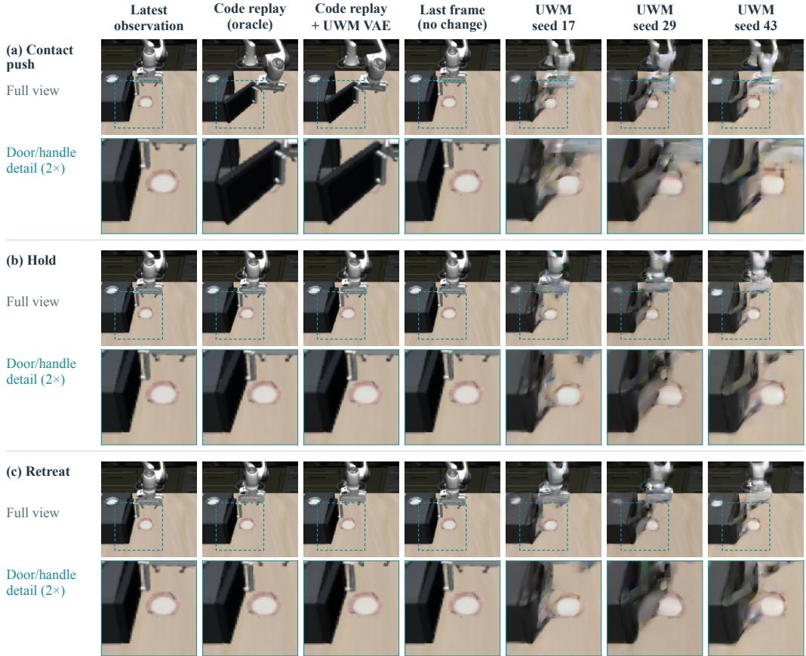  
Figure 15: Articulated code simulation vs. UWM rollouts on the generated asset (Initial State 1). Rows correspond to contact push, hold, and retreat control sequences (16 commands at 20 Hz). Columns show the initial observation, MuJoCo simulation of the generated 3D code, its reconstruction through UWM’s frozen VAE, the static last-frame reference, and all three UWM rollout seeds. Enlarged 2× crops (dashed boxes) demonstrate that executable 3D code preserves sharp, consistent door and handle geometry both before and after VAE reconstruction, whereas UWM rollouts exhibit seed-dependent contour drift.

a 12/12 pass rate, the contour degradation in UWM rollouts stems from latent action dynamics rather than VAE reconstruction limits.

Complementary strengths of simulator-ready 3D code. Table 18 and Figures 15–16 clarify the structural advantage of programmatic 3D assets for embodied simulation. While a static last-frame baseline trivially preserves initial contours (12/12) by predicting zero motion, pixel-space world models synthesize motion directly in latent space at the cost of frequent contour distortion across random seeds. By contrast, compiling generated 3D code into a physics simulator combines both properties: the simulator enforces exact rigid-body transformations, joint axes, and articulated state transitions over time while maintaining crisp, view-consistent geometry across contact push, hold, and retreat controls.

## Code-generated asset | Initial state 2

Code and UWM use matched robot commands. All three UWM seeds are shown.

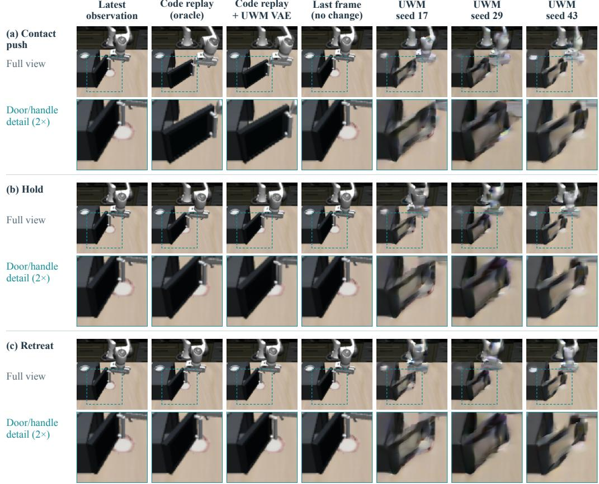  
Figure 16: Articulated code simulation vs. UWM rollouts on the generated asset (Initial State 2). Control sequences, column layout, and fixed 2× crops match Figure 15, displaying all nine UWM rollouts for Initial State 2.