# A Decision-Aware Evaluation Protocol for Uncertainty in Medical Image Segmentation

Saket Maganti1 Shreyank N Gowda2

1Independent Researcher

2School of Computer Science, University of Nottingham, Nottingham, UK

saket.20bce7367@vitapalum.ac.in shreyank.narayanagowda@nottingham.ac.uk

## Abstract

Medical segmentation uncertainty is often evaluated with calibration error or pixel-level error-detection scores, but these metrics do not show whether uncertainty improves downstream review decisions. We propose a decision-aware evaluation protocol that separates uncertainty estimation from deferral policy and evaluates their combination under fixed review budgets: which pixels, regions, or images should be accepted, and which should be reviewed. The protocol reportsfixed-budget error reduction, risk-coverage behaviour, region-level review proxies, structural failure modes, probability-derived baselines, and sensitivity to review assumptions. We instantiate it across retinal vessel, skin lesion, and polyp segmentation with multiple backbones and uncertainty estimators. Under matched inference budgets and canonical multi-layer MC Dropout, testtime augmentation (TTA) gives a stronger error-detection signal across matched MC–TTA comparisons, including architecture and dropout-placement checks. However, estimator rankings are not universal. For example, probabilityderived scores remain competitive, deep ensembles can outperform TTA, learned deferral helps mainly when the base estimator is weak, and rankings can change with review unit, uncertainty target, correction assumptions, and cost model. Structural and second-observer analyses further show that boundary and thin-structure failures are partly tied to annotation ambiguity. Thesefindings support evaluating uncertainty as an estimator-policy-review configuration, not as a standalone score map. Code: https:// anonymous.4open.science/r/Uncertainityin-Medical-Image-Segmentation/README.md

## 1. Introduction

A medical segmentation model is rarely the final actor in a clinical or annotation workflow. Its mask is inspected, corrected, accepted, or escalated. What matters is therefore not only whether the model is accurate on average, but whether it can indicate when its output should not be trusted. This distinction is easy to miss. A model may report a high Dice score while failing on the cases that make review necessary: ambiguous boundaries, thin vessels, small polyps, or images with artefacts. In such settings, uncertainty is valuable only if it changes the downstream decision of which pixels, regions, or images should be accepted and which should be reviewed under a limited budget.

Most work on uncertainty in medical segmentation evaluates the uncertainty map as an object in itself. Calibration error, predictive likelihood, and pixel-level error-detection AUROC [12, 24, 28] ask whether uncertainty values are numerically meaningful or whether they rank mistakes well. These are important questions, but they are not the whole deployment question. Two uncertainty scores with similar AUROC can select different pixels at a 10% review budget. A better calibrated model can still leave more residual error after deferral. A segmentation model without an explicit review rule has no operating point: it has a score map, but not a decision.

This paper argues that segmentation uncertainty should be evaluated at the point where it is used. We separate estimation, the procedure that produces an uncertainty or confidence field, from decision, the policy that converts that field into accept/defer choices. This separation turns uncertainty evaluation into a practical question: under the same review budget, which estimator and policy remove more error, retain safer predictions, and expose the failure modes that would otherwise remain hidden? It also changes what counts as a fair baseline. In binary segmentation, common probability-derived scores such as entropy, margin, inverse confidence, and distance from 1/2 collapse to the same ranking. These free scores should therefore be treated as first-class comparators, not as weak baselines.

We propose a decision-aware evaluation protocol for medical image segmentation. The protocol pairs uncertainty estimators with deferral policies and reports fixedbudget error reduction, risk–coverage behaviour, regionlevel review proxies, structural stratification, probabilityderived baselines, and sensitivity to review assumptions under the same decision rule. It is an evaluation practice rather than a new architecture or reject rule: any backbone, uncertainty estimator, or review policy can be inserted, but all are judged by the decisions they enable under explicit review budgets.

We instantiate the protocol across retinal vessel, skin lesion, and polyp segmentation with multiple backbones and uncertainty estimators. The results show that estimator rankings are decision-dependent. Under matched inference budgets and canonical multi-layer MC Dropout, test-time augmentation (TTA) gives a stronger error-detection signal across matched MC–TTA comparisons, including complementary-architecture and dropoutplacement checks. However, TTA is not a universal winner: probability-derived scores remain competitive, deep ensembles can outperform TTA on some datasets, and learned deferral heads help mainly when the base estimator is weak. Review assumptions also matter: rankings can change with the review unit, uncertainty target, correction model, and cost function. Structural and second-observer analyses further show that boundary and thin-structure failures are partly tied to annotation ambiguity, but are not explained away by it.

## Contributions.

1. We introduce a decision-aware evaluation protocol for medical image segmentation uncertainty, separating uncertainty estimation from review policy and evaluating their combination through fixed-budget error reduction, risk–coverage AURC, region-unit proxies, structural stratification, and review-assumption sensitivity.

2. We provide a controlled empirical benchmark across multiple datasets, backbones, uncertainty estimators, and policies, including probability-derived scores as first-class baselines and matched-budget comparisons of canonical MC Dropout and TTA.

3. We show that uncertainty rankings are not universal: TTA is robustly stronger than canonical MC Dropout under matched budgets, but deep ensembles, probability baselines, learned policies, review units, uncertainty targets, and annotation assumptions can change the preferred decision rule.

## 2. Related Work

Medical segmentation models and foundation models. Medical segmentation has progressed from U-Net-style CNNs [36, 46] to self-configuring pipelines [19], transformer hybrids [6], vision-language foundation models [16, 25, 45] and promptable foundation models [15, 23, 26, 35], whose zero-shot medical use has been benchmarked across modalities [27]. These works ask how to build or adapt stronger segmenters. Our question is orthogonal: given a trained segmenter, how should its uncertainty be evaluated when it drives review decisions? We therefore hold the backbone fixed within each dataset–backbone cell when comparing estimators and policies, and include complementary architecture checks to test whether the observed decision patterns are tied to one backbone family. A SAM/MedSAM extension treats the prompt as an additional decision variable, but keeps promptable models outside the controlled trained-backbone matrix.

Uncertainty estimation for segmentation. Uncertainty is commonly estimated with MC Dropout [12], deep ensembles [24], evidential methods [37, 40], or test-time perturbations such as TTA [3, 29, 44], where aggregation can change the estimate [38]. In medical segmentation, prior work has studied confidence calibration [28], whether uncertainty helps downstream tasks [4, 11, 33], and robustness under distribution shift [34]. We treat these estimators as inputs to a review decision rather than as endpoints: MC Dropout, TTA, probability-derived scores, and deep ensembles are compared by the decisions they enable under matched budgets and review assumptions.

Calibration, confidence, and decision metrics. Calibration [17] measures agreement between confidence and accuracy, while selective prediction [13] measures the risk retained after abstention. A better calibrated model need not produce a better review set at a fixed budget. Related work predicts errors directly, from maximum-softmax confidence [18] to learned confidence heads [10] and reliability analyses for medical segmentation [22]. Decision curve analysis [42, 43] similarly evaluates the benefit of acting on predictions. Closest in motivation, Czolbe et al. [11] ask whether segmentation uncertainty helps downstream tasks, and Jungo and Reyes [22] audit uncertainty failures. We differ by making the estimator–policy pair the evaluation unit and by requiring probability-derived baselines, fixedbudget error reduction, risk–coverage, structural stratification, region-unit behaviour, and review-assumption sensitivity across a multi-domain benchmark.

Abstention, deferral, and conformal guarantees. Selective prediction and learning to defer formalise abstention or referral under review cost [8, 14, 31, 32, 41]. Conformal methods provide finite-sample guarantees [1, 2], including risk-controlling prediction sets [5] and dense-prediction extensions [30]. These methods provide possible reject rules, guarantees, or operating points. Our contribution is complementary: we do not propose a new reject-rule theory or a new uncertainty estimator. Instead, we provide a benchmark protocol that assembles existing estimators, baselines, review units, and deferral policies into a common decisionaware evaluation framework.

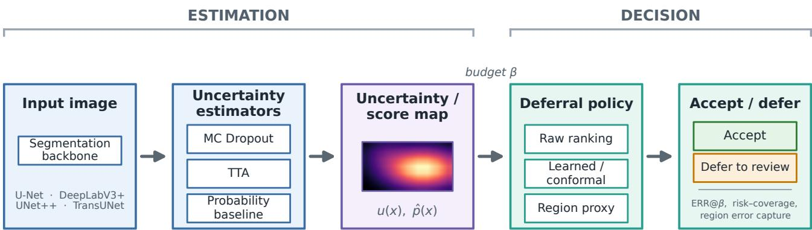  
Figure 1. Decision-aware evaluation separates uncertainty estimation from the review decision. A trained segmentation backbone produces pˆ and yˆ; an estimator, ensemble, or probability-derived baseline produces a score map u; and a deferral policy ranks pixels or regions under budget β. ERR@β, risk–coverage AURC, region error capture, and review-assumption sensitivity are measured after this decision, not from the uncertainty map alone.

## 3. Decision-Aware Evaluation Protocol

We evaluate segmentation uncertainty as part of a review decision, not as a standalone map. The protocol has two stages (Fig. 1). First, an estimator takes an image and a trained segmentation backbone and returns a probability map $\hat { p } ,$ a hard prediction $\hat { y } ,$ , and an uncertainty or score map u. Second, a deferral policy ranks review units such as pixels, patches, connected components, or images, and at budget β accepts the $1 - \beta$ fraction with the lowest review score while deferring the rest. Thus, the protocol separates how uncertainty is estimated from how it is used.

## 3.1. Uncertainty estimators and score maps

Within each dataset–backbone cell, the segmentation backbone is held fixed when comparing estimators and policies. MC Dropout [12] keeps dropout active at test time, freezes normalization layers, averages stochastic forward passes, and reports predictive variance or mutual information. Our primary MC–TTA comparison uses canonical multi-layer MC Dropout under matched inference budgets; dropout placement, dropout rate, stochastic realization, and training seed are audited separately. TTA [3] averages labelpreserving geometric transforms after inverse warping and uses variation across transformed predictions as uncertainty. We evaluate matched TTA subsets and the full six-transform set.

We also include deep ensembles [24]. Because an ensemble combines independently trained models, it is reported as a stronger estimator-family comparison rather than as a within-checkpoint perturbation. Finally, we include probability-derived scores as first-class baselines: entropy, inverse confidence, margin, distance from $1 / 2 ,$ and maximum-softmax confidence. For binary segmentation, these scores are monotone functions of $| \hat { p } - 1 / 2 |$ and induce the same ranking, so we report a single probability-baseline curve.

## 3.2. Deferral as error-probability ranking

Let x be a review unit and $\eta ( x ) = P ( \hat { y } ( x ) \neq y ( x ) \mid x )$ its probability of error. A policy $\delta ( x ) \in \{ 0 , 1 \}$ accepts (1) or defers (0). For error loss ℓ and review cost λ, the selective risk is

$$
R ( \delta ; \lambda ) = \mathbb { E } [ \ell \delta ( x ) ] + \lambda \mathbb { E } [ 1 - \delta ( x ) ] ,\tag{1}
$$

that ${ \mathrm { i s } } ,$ error retained among accepted units plus the cost of review. The pointwise optimum is the Chow reject rule [8],

$$
\delta ^ { \star } ( x ) = 1 \Longleftrightarrow \eta ( x ) \leq \lambda .
$$

Thus, every deferral policy is implicitly ranking units by their probability of being wrong. Our contribution is not a new reject rule, but a protocol for evaluating estimators and policies under explicit review budgets.

## 3.3. Deferral policies

We evaluate policies under the same fixed-budget accept/defer rule. Raw uncertainty ranks units by u. Confidence-aware uncertainty ranks by $u ( 1 - c )$ , where $c = 2 | \hat { p } - \textstyle { \frac { 1 } { 2 } } |$ is binary confidence. Probability baselines rank by the softmax-derived score above. Adaptive thresholding selects operating points on validation data while preserving the fixed review budget. Learned deferral heads estimate $\eta$ from validation errors using uncertainty, confidence, entropy, local statistics, and gradient features while keeping the segmentation backbone frozen; test errors are never used to fit the policy. We report validationset sizes because small validation sets can make learned policies data-starved. Conformal thresholds are supported as a protocol interface for split-conformal or conformalrisk-control operating points [2], although our comparisons focus on raw, probability-derived, adaptive, learned, and ensemble-based policies.

## 3.4. Decision metrics and review assumptions

All metrics are computed after applying the accept/defer decision. Unc-AUROC is the score-level bridge to prior work: pixel-level ROC AUC for detecting segmentation errors. ERR(β) measures relative error reduction among accepted units at budget $\beta ,$ reported with accepted Dice and the fraction of all errors captured by review. Risk– coverage AURC integrates accepted error over coverage, where lower is better.

Fixed-budget error capture assumes deferred units can be corrected, so it is an analytical review proxy rather than a reader-study measurement. We therefore audit sensitivity to reviewer quality, review unit, uncertainty target, threshold, morphology definition, and cost model. We also report structural stratification for boundary, interior, and thinstructure pixels, and use region-unit proxies such as 16 × 16 blocks, top-k patches, and connected components to test whether uncertainty remains useful when review is organised over regions rather than isolated pixels.

## 4. Experimental Setup

## 4.1. Datasets, backbones, and splits

We instantiate the protocol across retinal vessel, dermoscopic lesion, and colonoscopy polyp segmentation using DRIVE [39], FIVES [21], ISIC 2018 [9], and Kvasir-SEG [20]. DRIVE uses the official 20-image test set with the first-observer annotation; its train/validation split is selfdefined. FIVES, ISIC, and Kvasir use self-defined 65/15/20 splits with a fixed seed. We report all train/validation/test counts, split hashes, and test identifiers in the supplement. Summary in Tab. 1.

The primary matrix spans U-Net [36], UNet++ [46], DeepLabV3+ [7], and TransUNet [6]. Within each dataset–backbone cell, the segmentation checkpoint is fixed when comparing estimators and policies. Additional complementary-architecture checks test whether the observed rankings are tied to one backbone family.

## 4.2. Uncertainty inference and policies

The main MC–TTA comparison uses canonical multi-layer MC Dropout with frozen normalization layers and matched inference budgets. MC Dropout reports predictive variance or mutual information from stochastic passes, while TTA reports variation across label-preserving geometric transforms after inverse warping. We also audit stochastic repetitions, TTA subsets, dropout placement, dropout rate, training seed, and five-member deep ensembles.

Table 1. Dataset splits and fitting data. DRIVE uses the official 20-image test set with a self-defined train/validation split. FIVES, ISIC, and Kvasir use fixed 65/15/20 splits. Learned heads and adaptive policies are fit only on validation images.
<table><tr><td>Dataset</td><td>Train</td><td>Val / fit</td><td>Test</td><td>Split status</td></tr><tr><td>DRIVE</td><td>16</td><td>4</td><td>20</td><td>official test</td></tr><tr><td>FIVES</td><td>520</td><td>120</td><td>160</td><td>self-defined</td></tr><tr><td>ISIC 2018</td><td>1686</td><td>389</td><td>519</td><td>self-defined</td></tr><tr><td>Kvasir-SEG</td><td>650</td><td>150</td><td>200</td><td>self-defined</td></tr></table>

Deferral policies are selected or fitted only on held-out validation data from the corresponding cell. Learned deferral heads estimate error probability from validation errors with the segmentation network frozen; test labels are never used to fit a policy. Probability-derived baselines and raw uncertainty policies require no additional training. Validation sizes are reported explicitly because small validation sets, especially DRIVE, can make learned policies datastarved.

## 4.3. Statistical analysis and provenance

All decision metrics are computed on paired held-out images. Where image-level paired data are available, we use image-level bootstrap confidence intervals, paired signflip tests, exact sign tests, and Benjamini–Hochberg correction within named comparison families. Cross-cell counts are reported as descriptive summaries rather than as independent population samples. All reported comparisons are backed by traceable artifacts including aligned image IDs, per-image metrics, split metadata, and table-generation records. The supplement provides the full artifact audit, numerical tables, negative and blocked results, and checks for learned deferral, policy transfer, second-observer analysis, and review-assumption sensitivity. We distinguish descriptive cross-cell counts from paired image-level inference: counts summarize the evaluated benchmark, while uncertainty estimates and significance tests are computed on held-out images within each declared comparison family.

## 5. Results

We report results as decision-level findings. Under matched-budget controls, TTA gives a stronger errordetection signal than canonical MC Dropout, but the broader evaluation shows that estimator rankings are not universal. Rankings change with estimator family, review unit, uncertainty target, correction assumption, and cost model. The main result is therefore not a single winning uncertainty method, but the need to evaluate uncertainty as an estimator–policy–review configuration.

Table 2. Matched-budget MC–TTA robustness. Each row is a paired image-level comparison family with BH correction applied within that family. Positive cells favour TTA.
<table><tr><td>Comparison family</td><td>Positive</td><td>BH sig.</td><td>Mean  $\Delta$ </td></tr><tr><td>Matched budget, anchor</td><td>24/24</td><td>24/24</td><td>+0.035</td></tr><tr><td>10 MC realizations</td><td>24/24</td><td>24/24</td><td>+0.033</td></tr><tr><td>Complementary backbone</td><td>24/24</td><td>24/24</td><td>+0.063</td></tr><tr><td>Dropout placement</td><td>72/72</td><td>72/72</td><td>+0.075</td></tr><tr><td>Dropout rate, DRIVE only</td><td>24/24</td><td>18/24</td><td>+0.015</td></tr><tr><td>Training seed, DRIVE only</td><td>15/18</td><td>10/18</td><td>+0.009</td></tr></table>

The results are organized accordingly: we first establish the controlled matched-budget comparison, then show where that comparison is stable, where it breaks under different estimator families or budgets, and where decisionlayer choices change the conclusion even with predictions fixed.

## 5.1. Matched-budget controls strengthen the MC– TTA comparison

This direction persists under the main implementation controls (Tab. 2). Ten independent MC stochastic realizations, all TTA transform subsets, complementary-architecture checks, and dropout-placement experiments preserve the TTA advantage. The controls also narrow the claim: headonly dropout materially underestimates MC quality, while DRIVE-only dropout-rate and seed sweeps show smaller effects and low-budget ties or reversals. Unequal-budget stress tests further show that giving MC many more stochastic samples can produce ties or reversals. We therefore state the result as a matched-budget, canonical-dropout finding, not as a compute-independent ordering.

## 5.2. No estimator is universally dominant

Deep ensembles provide a stronger estimator-family comparison. Because an ensemble combines independently trained models, it changes the segmenter family rather than perturbing a fixed checkpoint. As shown in Tab. 3, the result is not a simple “TTA-best” ordering: TTA is significantly better than the ensemble on DRIVE, the ensemble is significantly better on FIVES and ISIC, and Kvasir is not significantly different after correction. This supports the protocol’s main premise: estimator rankings are empirical and dataset-dependent.

Table 3. Estimator family changes the ranking. Mean imagelevel error-detection AUROC on the same held-out images. TTA uses six transforms. $\Delta$ values are paired differences against TTA-T6; positive means the competitor is better. Asterisks denote BHcorrected significance within the comparison family.
<table><tr><td>Dataset</td><td>Func.</td><td>MC-T6</td><td>MC-T50</td><td>TTA-T6</td><td>Ens.</td><td> $\Delta _ { \mathrm { E n s } }$ </td></tr><tr><td>DRIVE</td><td>Var</td><td>0.839</td><td>0.857</td><td>0.858</td><td>0.806</td><td> $- 0 . 0 5 2 ^ { \ast }$ </td></tr><tr><td>DRIVE</td><td>MI</td><td>0.852</td><td>0.868</td><td>0.868</td><td>0.799</td><td> $- 0 . 0 6 9 ^ { \ast }$ </td></tr><tr><td>FIVES</td><td>Var</td><td>0.852</td><td>0.878</td><td>0.858</td><td>0.881</td><td> $+ 0 . 0 2 3 ^ { \ast }$ </td></tr><tr><td>FIVES</td><td>MI</td><td>0.859</td><td>0.882</td><td>0.872</td><td>0.886</td><td> $+ 0 . 0 1 4 ^ { * }$ </td></tr><tr><td>ISIC</td><td>Var</td><td>0.803</td><td>0.840</td><td>0.867</td><td>0.896</td><td> $+ 0 . 0 2 9 ^ { \ast }$ </td></tr><tr><td>ISIC</td><td>MI</td><td>0.821</td><td>0.851</td><td>0.874</td><td>0.894</td><td> $+ 0 . 0 1 9 ^ { * }$ </td></tr><tr><td>Kvasir</td><td>Var</td><td>0.832</td><td>0.866</td><td>0.897</td><td>0.908</td><td> $+ 0 . 0 1 1$ </td></tr><tr><td>Kvasir</td><td>MI</td><td>0.864</td><td>0.889</td><td>0.911</td><td>0.907</td><td>-0.004</td></tr></table>

## 5.3. Score-level rankings do not determine review decisions

Probability-derived baselines remain important even after the matched-budget MC–TTA controls. In binary segmentation, entropy, margin, inverse confidence, maximumsoftmax confidence, and distance from $1 / 2$ collapse to one ranking, which is available without extra inference. In the nine-cell decision matrix, raw TTA uncertainty exceeds this probability baseline in seven cells by a small mean margin, while the baseline wins in two.

More importantly, the ranking can change at the decision point $( \mathrm { F i g } . 2 )$ . AUROC and 20%-budget error capture disagree in four of nine cells, and AUROC-margin versus capture-margin is only moderately rank-correlated (Spearman $\rho ~ = ~ 0 . 7 0$ , Kendall $\tau ~ = ~ 0 . 5 0 )$ . Calibration is an even weaker proxy: ECE is not positively correlated with error-detection AUROC across cells. Thus, calibration, error ranking, and review utility are related but distinct evaluation targets.

## 5.4. Learned deferral helps, but is not a free win

Learned deferral heads estimate error probability from validation errors while keeping the segmentation backbone frozen. Under the deployable validation-fit protocol, the learned head improves Capt.@20% in 16/18 cell–arm combinations, is significantly worse than plain uncertainty in one, and is not significant in one. The gains are largest for weaker MC-based rankings; for example, Kvasir/U-Net MC improves from 0.580 to 0.868 error capture at a 20% budget.

These results should still be interpreted cautiously. On AURC, plain uncertainty is ahead in 3/18 combinations, so a learned policy is not uniformly better than the raw score. Validation size also matters: DRIVE has only four validation images for fitting the deployable learned head. Although this provides many pixels, it is image-starved and cannot show that the learned policy has seen enough anatomical variation. Learned deferral should therefore be reported with its fitting data and evaluated on the target distribution.

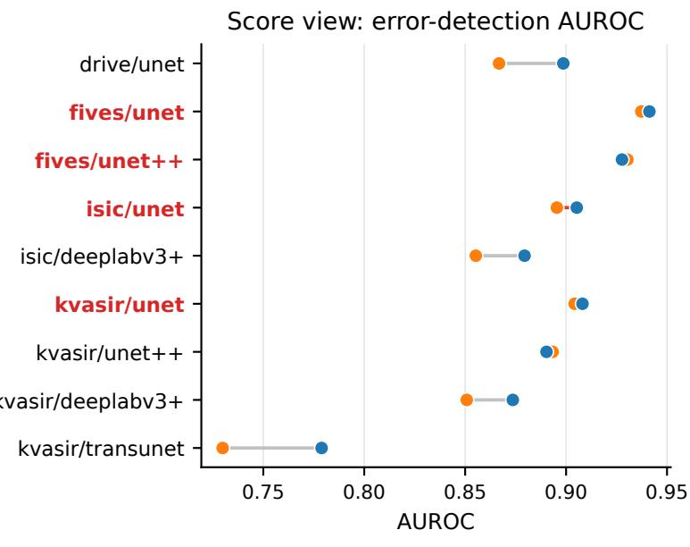

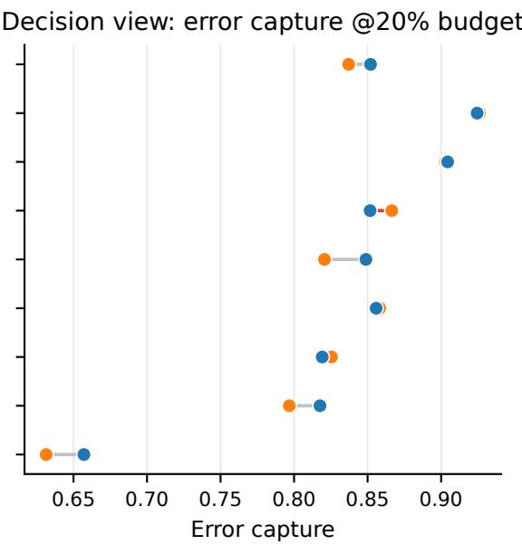

Figure 2. The score ranking is not the decision ranking. Per cell, TTA raw uncertainty and the probability baseline are compared under a score-level metric (left: error-detection AUROC) and a decision-level metric (right: fraction of all errors captured at a 20% review budget). Rankings can flip at the decision point.  
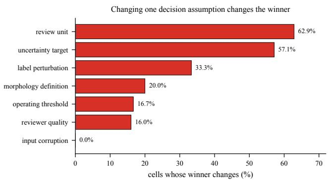  
Figure 3. Decision-layer sensitivity on the DRIVE anchor. Fraction of tested settings in which changing one review assumption changes the preferred estimator. Predictions are held fixed, so reversals isolate the decision layer. These are finite-grid sensitivity summaries, not population estimates.

## 5.5. Review assumptions can change the winner

Fixed-budget error capture assumes that deferred units can be corrected. This is an analytical review proxy, not a reader-study measurement, so we audit whether conclusions are stable under alternative review assumptions. They are not always stable. Changing the review unit flips the estimator ranking in 62.9% of tested settings, changing the uncertainty target flips it in 57.1%, and changing the cost/utility assumption changes the preferred method across much of the cost grid. Threshold choice, label perturbation, morphology definition, and imperfect reviewer models also produce ranking reversals, whereas the tested corruption grid gives no MC–TTA reversal.

This makes the review unit part of the evaluation rather than an implementation detail. Pixel-level deferral is analytically convenient, but review is usually organised over patches, components, or images. In the region-unit analysis, DRIVE connected-component deferral captures about 0.88 of errors at a 20% budget with accepted Dice near 0.94, while fixed blocks capture much less. On Kvasir/U-Net, changing only the review unit moves MC from 0.462 error capture with 16 × 16 blocks to 0.804 with top-k 16-pixel patches. Figure 3 summarizes these reversals.

## 5.6. Boundary failures are partly annotation ambiguity

Pooled AUROC hides spatial failure modes. In the ninecell matrix, boundary-band AUROC is consistently below global AUROC, and thin-structure detection is often weaker still. The DRIVE second-observer analysis shows why this must be stated carefully. Only 5.3% of field-of-view pixels are disputed by the two observers, but 91.7% of that disagreement lies inside a two-pixel boundary band. On observer-disagreement pixels, every estimator is near chance AUROC. Uncertainty can mark unstable regions, but it cannot adjudicate between two plausible annotations.

Table 4. Policy, transfer, and annotation audits. Compact summary of decision-layer results. Learned-deferral counts use the deployable validation-fit protocol; transfer uses source-validation fitting and held-out target tests.
<table><tr><td>Audit</td><td>Main result</td></tr><tr><td>Learned deferral</td><td>Capt.@20% improves in 16/18 cell– estimator settings; DRIVE uses only 4</td></tr><tr><td>Transfer vs raw target u</td><td>validation images for fitting. 8/18 significantly better, 7/18 signifi- cantly worse, 3/18 n.s.</td></tr><tr><td>Transfer vs in-domain refit</td><td>4/18 significantly better, 9/18 signifi- cantly worse, 5/18 n.s.; refitting is usu-</td></tr><tr><td>DRIVE second observer</td><td>ally safer. Global MC-TTA differences are n.s.; TTA gains concentrate on thin structures</td></tr><tr><td>Human-disagreement target</td><td>(+0.072 variance, +0.075 MI). MI AUROC is 0.813 for MC and 0.817 for TTA, but all scores are near chance on disputed pixels.</td></tr></table>

Annotation ambiguity does not fully explain the boundary and thin-structure weakness. Restricting to observeragreement pixels removes only a minority of the boundary and thin penalties. Under the observer-2 analysis, MC and TTA are statistically indistinguishable globally, while TTA’s advantage is large and significant on thin structures. Boundary conclusions are sensitive to the chosen morphological radius, whereas the thin-structure advantage is stable across radii. We therefore state the structural result narrowly: uncertainty is weakest near ambiguous boundaries and thin structures, and this weakness is partly, but not entirely, explained by annotation disagreement.

## 5.7. Policy transfer remains partial

For policy transfer, source policies are fit only on source validation data and evaluated on held-out target test images, with zero source-validation/target-test overlap. As summarized in Tab. 4, transfer can improve over raw target uncertainty in some pairs, but is usually worse than an in-domain refit. Review policies should therefore be evaluated, and where possible fit or calibrated, on the target distribution.

## 6. Discussion

The results support a simple conclusion: segmentation uncertainty should be evaluated by the review decisions it enables, not by the score map alone. Under matched bud gets and canonical multi-layer MC Dropout, TTA gives a stronger error-ranking signal across our MC–TTA comparisons. However, the broader benchmark does not support a universal estimator ranking: deep ensembles can outperform TTA on some datasets, probability-derived scores remain competitive, learned deferral is not uniformly better than raw uncertainty, and review assumptions can change the preferred method. These patterns would be obscured by reporting only calibration error or a single pooled Unc-AUROC.

Simple baselines are also stronger than they may appear. In binary segmentation, entropy, margin, inverse confidence, distance from $1 / 2 ,$ and maximum-softmax confidence induce the same pixel ranking and therefore the same deferred set at a fixed budget. More generally, any strictly monotone transformation of a review score preserves coverage-based deferral, leaving the deferred set, risk–coverage curve, and AURC unchanged. Thus, better calibrated scores or alternative softmax-derived scores do not necessarily imply better review decisions.

The review unit and review assumptions are part of the evaluation. Pixel-level uncertainty is useful for controlled comparison, but practical review is usually organised over regions, patches, connected components, or whole images. Our region-unit and sensitivity analyses show that changing the review unit, uncertainty target, correction assumption, or cost model can substantially change the ranking. Table 5 summarizes the corresponding minimum reporting fields. Learned policies should be compared against raw target uncertainty and, where possible, fit or calibrated on target-domain validation data.

Recommended use. For a new segmentation setting, we recommend reporting: (i) a probability-derived baseline, (ii) ERR@β and risk–coverage under the intended review budget, (iii) structural stratification for boundary and thin-structure errors, and (iv) at least one region-unit proxy matched to the expected review workflow. Learned policies should be compared against raw target uncertainty and, where possible, fit or calibrated on target-domain validation data.

## 7. Limitations

Scope and generality. The benchmark spans four public datasets, selected backbones, and a controlled set of uncertainty estimators and policies. Matched-budget controls, complementary-architecture checks, and dropoutplacement experiments strengthen the MC–TTA comparison, but they do not constitute a population-level sample of all segmentation tasks. We therefore treat cross-dataset counts as benchmark evidence rather than universal claims. Compute and estimator families. MC Dropout, TTA, and deep ensembles all add inference or training cost. Our main MC–TTA comparison uses matched inference budgets, but unequal-budget stress tests show that giving MC many more stochastic samples can produce ties or reversals. We therefore do not claim a compute-independent ranking or optimal pass count; wall-clock cost depends on hardware, batching, augmentation implementation, and ensemble training.

Policy and validation limits. Learned deferral heads are fit only on validation data and are never trained on test labels, but their reliability depends on validation-set size and diversity. DRIVE is especially limited, with only four validation images for the deployable learned head. Learned policies transfer only partially, so they should be evaluated, and where possible refit, on the target distribution.

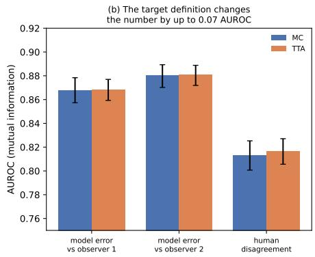

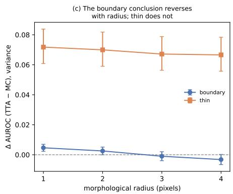  
Figure 4. DRIVE second-observer analysis. Uncertainty is near chance on pixels where the two observers disagree; changing the target definition changes the AUROC; and boundary conclusions depend on the morphological radius, while thin-structure effects are more stable.

Table 5. Minimum reporting checklist for decision-aware uncertainty evaluation. The estimator alone is insufficient; the reported result should identify the full configuration that turns uncertainty into a review decision.
<table><tr><td>Coordinate</td><td>What should be reported</td></tr><tr><td>Estimator</td><td>MC/TTA/ensemble/probability score and uncertainty functional.</td></tr><tr><td>Compute</td><td>Number of passes or ensemble members; matched or deliberately swept.</td></tr><tr><td>Backbone</td><td>Segmentation checkpoint and whether the comparator changes it.</td></tr><tr><td>Policy</td><td>Raw ranking, adaptive threshold, learned head, or conformal rule.</td></tr><tr><td>Fitting data</td><td>Validation images used for policy fitting;</td></tr><tr><td>Review unit</td><td>no test-label fitting. Pixel, block, patch, connected compo- nent, region, or image.</td></tr><tr><td>Target</td><td>All errors, false positives, false negatives, boundary/thin errors, or disagreement.</td></tr><tr><td></td><td>Review model Perfect/imperfect correction assumption and cost or utility model.</td></tr><tr><td>Statistics</td><td>Paired held-out-image inference and multiplicity family.</td></tr></table>

Annotation and clinical generalisation. Second-observer analysis is available only for DRIVE, so annotationdisagreement claims should not be generalized to the other datasets without additional labels. Fixed-budget deferral is also an analytical proxy for expert review under the assumption that deferred units can be corrected. We do not conduct a reader study, measure clinical time, or perform prospective deployment. The paper should therefore be read as an evaluation protocol and empirical audit, not as a claim of clinical readiness.

## 8. Conclusion

We presented a decision-aware evaluation protocol for medical segmentation uncertainty. The central claim is that uncertainty should be judged by the review decisions it enables under explicit budgets, not by calibration or errordetection scores alone. By separating uncertainty estimation from deferral policy, the protocol compares MC Dropout, TTA, deep ensembles, probability-derived scores, and learned review policies as estimator–policy–review configurations. Within our benchmark, matched-budget TTA gives a stronger error-ranking signal than canonical multi-layer MC Dropout, but the broader evaluation does not support a universal estimator ordering: deep ensembles can outperform TTA on some datasets, probabilityderived scores remain competitive, learned deferral is not uniformly better than raw uncertainty, and review assumptions can change the preferred method. Structural and second-observer analyses further show that boundary and thin-structure failures are partly tied to annotation ambiguity. These findings argue against choosing an uncertainty estimator from a single score-level metric. Instead, uncertainty should be audited on the target distribution, at the intended review budget, and with review units and assumptions that reflect the workflow. We will release the protocol, code, artifacts, and summaries to support reproducible decision-aware evaluation on new datasets, backbones, estimators, and review policies.

## References

[1] Anastasios N. Angelopoulos and Stephen Bates. A gentle introduction to conformal prediction and distribution-free uncertainty quantification. arXiv preprint arXiv:2107.07511, 2021. 2

[2] Anastasios N. Angelopoulos, Stephen Bates, Adam Fisch, Lihua Lei, and Tal Schuster. Conformal risk control. In International Conference on Learning Representations (ICLR), 2024. 2, 4

[3] Murat Seckin Ayhan and Philipp Berens. Test-time data augmentation for estimation of heteroscedastic aleatoric uncertainty in deep neural networks. In International Conference on Medical Imaging with Deep Learning, 2018. 2, 3

[4] Neil Band, Tim G. J. Rudner, Qixuan Feng, Angelos Filos, Zachary Nado, Michael W. Dusenberry, Ghassen Jerfel, Dustin Tran, and Yarin Gal. Benchmarking Bayesian deep learning on diabetic retinopathy detection tasks. In Advances in Neural Information Processing Systems (NeurIPS), Datasets and Benchmarks Track, 2021. 2

[5] Stephen Bates, Anastasios Angelopoulos, Lihua Lei, Jitendra Malik, and Michael I. Jordan. Distribution-free, riskcontrolling prediction sets. Journal ofthe ACM, 68(6):1–34, 2021. 2

[6] Jieneng Chen, Yongyi Lu, Qihang Yu, Xiangde Luo, Ehsan Adeli, Yan Wang, Le Lu, Alan L Yuille, and Yuyin Zhou. TransUNet: Transformers make strong encoders for medical image segmentation. arXiv preprint arXiv:2102.04306, 2021. 2, 4

[7] Liang-Chieh Chen, Yukun Zhu, George Papandreou, Florian Schroff, and Hartwig Adam. Encoder-decoder with atrous separable convolution for semantic image segmentation. In European Conference on Computer Vision (ECCV), pages 833–851, 2018. 4

[8] Chi-Keung Chow. On optimum recognition error and reject tradeoff. IEEE Transactions on Information Theory, 16(1): 41–46, 1970. 2, 3

[9] Noel Codella, Veronica Rotemberg, Philipp Tschandl, M Emre Celebi, Stephen Dusza, David Gutman, Brian Helba, Aadi Kalloo, Konstantinos Liopyris, Michael Marchetti, Harald Kittler, and Allan Halpern. Skin lesion analysis toward melanoma detection 2018: A challenge hosted by the international skin imaging collaboration (ISIC). arXiv preprint arXiv:1902.03368, 2019. 4

[10] Charles Corbiere, Nicolas Thome, Avner Bar-Hen, Matthieu\` Cord, and Patrick Perez. Addressing failure prediction by´ learning model confidence. In Advances in Neural Information Processing Systems, 2019. 2

[11] Steffen Czolbe, Kasra Arnavaz, Oswin Krause, and Aasa Feragen. Is segmentation uncertainty useful? In Information Processing in Medical Imaging (IPMI), pages 715–726, 2021. 2

[12] Yarin Gal and Zoubin Ghahramani. Dropout as a Bayesian approximation: Representing model uncertainty in deep learning. In International Conference on Machine Learning, pages 1050–1059, 2016. 1, 2, 3

[13] Yonatan Geifman and Ran El-Yaniv. Selective classification

for deep neural networks. In Advances in Neural Information Processing Systems, pages 4878–4887, 2017. 2

[14] Yonatan Geifman and Ran El-Yaniv. SelectiveNet: A deep neural network with an integrated reject option. In International Conference on Machine Learning (ICML), pages 2151–2159, 2019. 2

[15] Shreyank N Gowda and David A Clifton. Cc-sam: Sam with cross-feature attention and context for ultrasound image segmentation. In European Conference on Computer Vision, pages 108–124. Springer, 2024. 2

[16] Shreyank N Gowda and David A Clifton. Masks and manuscripts: Advancing medical pre-training with end-toend masking and narrative structuring. In International Conference on Medical Image Computing and Computer-Assisted Intervention, pages 426–436. Springer, 2024. 2

[17] Chuan Guo, Geoff Pleiss, Yu Sun, and Kilian Q Weinberger. On calibration of modern neural networks. In International Conference on Machine Learning, pages 1321–1330, 2017. 2

[18] Dan Hendrycks and Kevin Gimpel. A baseline for detect ing misclassified and out-of-distribution examples in neural networks. In International Conference on Learning Representations (ICLR), 2017. 2

[19] Fabian Isensee, Paul F. Jaeger, Simon A. A. Kohl, Jens Petersen, and Klaus H. Maier-Hein. nnU-Net: a selfconfiguring method for deep learning-based biomedical image segmentation. Nature Methods, 18(2):203–211, 2021. 2

[20] Debesh Jha, Pia H Smedsrud, Michael A Riegler, Pal˚ Halvorsen, Thomas de Lange, Dag Johansen, and Havard D˚ Johansen. Kvasir-SEG: A segmented polyp dataset. In International Conference on Multimedia Modeling (MMM), pages 451–462. Springer, 2020. 4

[21] Kai Jin, Xingru Huang, Jingxing Zhou, Yunxiang Li, Yan Yan, Yibao Sun, Qianni Zhang, Yaqi Wang, and Juan Ye. FIVES: A fundus image dataset for artificial intelligence based vessel segmentation. Scientific Data, 9(1):475, 2022. 4

[22] Alain Jungo and Mauricio Reyes. Assessing reliability and challenges of uncertainty estimations for medical image segmentation. In International Conference on Medical Image Computing and Computer-Assisted Intervention (MICCAI), pages 48–56, 2019. 2

[23] Alexander Kirillov, Eric Mintun, Nikhila Ravi, Hanzi Mao, Chloe Rolland, Laura Gustafson, Tete Xiao, Spencer Whitehead, Alexander C. Berg, Wan-Yen Lo, Piotr Dollar, and´ Ross Girshick. Segment anything. In IEEE/CVF International Conference on Computer Vision, pages 3992–4003, 2023. 2

[24] Balaji Lakshminarayanan, Alexander Pritzel, and Charles Blundell. Simple and scalable predictive uncertainty estimation using deep ensembles. In Advances in Neural Infor mation Processing Systems, pages 6402–6413, 2017. 1, 2, 3

[25] Che Liu, Cheng Ouyang, Sibo Cheng, Anand Shah, Wen jia Bai, and Rossella Arcucci. G2d: From global to dense radiography representation learning via vision-language pre-

training. Advances in Neural Information Processing Systems, 37:14751–14773, 2024. 2

[26] Jun Ma, Yuting He, Feifei Li, Lin Han, Chenyu You, and Bo Wang. Segment anything in medical images. Nature Communications, 15:654, 2024. 2

[27] Maciej A. Mazurowski, Haoyu Dong, Hanxue Gu, Jichen Yang, Nicholas Konz, and Yixin Zhang. Segment anything model for medical image analysis: An experimental study. Medical Image Analysis, 89:102918, 2023. 2

[28] Alireza Mehrtash, William M Wells, Clare M Tempany, Purang Abolmaesumi, and Tina Kapur. Confidence calibration and predictive uncertainty estimation for deep medical image segmentation. IEEE Transactions on Medical Imaging, 39(12):3868–3878, 2020. 1, 2

[29] Nikita Moshkov, Botond Mathe, Attila Kertesz-Farkas, Reka Hollandi, and Peter Horvath. Test-time augmentation for deep learning-based cell segmentation on microscopy images. Scientific Reports, 10:5068, 2020. 2

[30] Luca Mossina, Joseba Dalmau, and Leo And´ eol. Confor-´ mal semantic image segmentation: Post-hoc quantification of predictive uncertainty. In IEEE/CVF Conference on Computer Vision and Pattern Recognition Workshops (CVPRW), 2024. 2

[31] Hussein Mozannar and David Sontag. Consistent estimators for learning to defer to an expert. In International Conference on Machine Learning (ICML), pages 7076–7087, 2020. 2

[32] Hussein Mozannar, Hunter Lang, Dennis Wei, Prasanna Sattigeri, Subhro Das, and David Sontag. Who should predict? Exact algorithms for learning to defer to humans. In International Conference on Artificial Intelligence and Statistics (AISTATS), pages 10520–10545, 2023. 2

[33] Tanya Nair, Doina Precup, Douglas L. Arnold, and Tal Arbel. Exploring uncertainty measures in deep networks for multiple sclerosis lesion detection and segmentation. Medical Image Analysis, 59:101557, 2020. 2

[34] Yaniv Ovadia, Emily Fertig, Jie Ren, Zachary Nado, David Sculley, Sebastian Nowozin, Joshua V. Dillon, Balaji Lakshminarayanan, and Jasper Snoek. Can you trust your model’s uncertainty? Evaluating predictive uncertainty under dataset shift. In Advances in Neural Information Processing Systems, 2019. 2

[35] Nikhila Ravi, Valentin Gabeur, Yuan-Ting Hu, Ronghang Hu, Chaitanya Ryali, Tengyu Ma, Haitham Khedr, Roman Radle, Chloe Rolland, Laura Gustafson, Eric Mintun, Junt-¨ ing Pan, Kalyan Vasudev Alwala, Nicolas Carion, Chao-Yuan Wu, Ross Girshick, Piotr Dollar, and Christoph Feicht-´ enhofer. SAM 2: Segment anything in images and videos. In International Conference on Learning Representations (ICLR), 2025. 2

[36] Olaf Ronneberger, Philipp Fischer, and Thomas Brox. U-Net: Convolutional networks for biomedical image segmentation. In International Conference on Medical Image Computing and Computer-Assisted Intervention, pages 234–241, 2015. 2, 4

[37] Murat Sensoy, Lance Kaplan, and Melih Kandemir. Evidential deep learning to quantify classification uncertainty. In

Advances in Neural Information Processing Systems, 2018. 2

[38] Divya Shanmugam, Davis Blalock, Guha Balakrishnan, and John Guttag. Better aggregation in test-time augmentation. In Proceedings of the IEEE/CVF International Conference on Computer Vision (ICCV), pages 1214–1223, 2021. 2

[39] Joes Staal, Michael D Abramoff, Meindert Niemeijer, Max A Viergever, and Bram Van Ginneken. Ridge-based vessel segmentation in color images of the retina. IEEE Transactions on Medical Imaging, 23(4):501–509, 2004. 4

[40] Dennis Ulmer, Christian Hardmeier, and Jes Frellsen. Prior and posterior networks: A survey on evidential deep learning methods for uncertainty estimation. Transactions on Ma chine Learning Research (TMLR), 2023. 2

[41] Rajeev Verma and Eric Nalisnick. Calibrated learning to defer with one-vs-all classifiers. In International Conference on Machine Learning (ICML), pages 22184–22202, 2022. 2

[42] Andrew J. Vickers and Elena B. Elkin. Decision curve analysis: a novel method for evaluating prediction models. Med ical Decision Making, 26(6):565–574, 2006. 2

[43] Andrew J. Vickers, Ben van Calster, and Ewout W. Steyerberg. A simple, step-by-step guide to interpreting decision curve analysis. Diagnostic and Prognostic Research, 3(1): 18, 2019. 2

[44] Guotai Wang, Wenqi Li, Michael Aertsen, Jan Deprest, Sebastien Ourselin, and Tom Vercauteren. Aleatoric uncertainty estimation with test-time augmentation for medi cal image segmentation with convolutional neural networks. Neurocomputing, 338:34–45, 2019. 2

[45] Chaoyi Wu, Xiaoman Zhang, Ya Zhang, Yanfeng Wang, and Weidi Xie. Medklip: Medical knowledge enhanced language-image pre-training for x-ray diagnosis. In 2023 IEEE/CVF international conference on computer vision (ICCV), pages 21315–21326. IEEE, 2023. 2

[46] Zongwei Zhou, Md Mahfuzur Rahman Siddiquee, Nima Tajbakhsh, and Jianming Liang. UNet++: A nested U-Net architecture for medical image segmentation. In Deep Learning in Medical Image Analysis, pages 3–11, 2018. 2, 4

This supplement provides the audit trail for the main paper. It reports the statistical procedure, dataset splits, matched-budget MC Dropout–TTA comparisons, robustness checks, deep-ensemble comparisons, learneddeferral and transfer analyses, review-assumption sensitivity, annotation-disagreement analysis, and reproducibility details. Unless stated otherwise, comparisons are paired at the held-out-image level. Null, reversed, blocked, and dataset-limited findings are retained and labelled as such.

## 8.1. Statistical procedure and multiplicity

For paired image-level scores $a _ { i } , b _ { i } ,$ , the estimand is

$$
\Delta = n ^ { - 1 } \sum _ { i } ( a _ { i } - b _ { i } ) .\tag{2}
$$

We report percentile bootstrap confidence intervals over images and two-sided paired sign-flip randomisation tests, followed by Benjamini–Hochberg (BH) correction within each declared comparison family. Policy-transfer analyses also report exact sign tests. We do not form confidence intervals by treating dataset–backbone cells as IID replicates.

The main comparison families are matched-budget MC Dropout versus TTA, stochastic replication, complementary architecture, dropout placement, dropout-rate and training-seed sensitivity, unequal-budget comparisons, deep-ensemble comparisons, learned-deferral fixed-budget tests, policy transfer, review-assumption sensitivity, and second-observer analyses. Cross-cell counts are used descriptively; image-level paired data are used whenever available.

## 8.2. Dataset splits and analysis coverage

DRIVE uses the official 20-image test set with first-observer annotations and a self-defined train/validation split from the official training half. FIVES, ISIC, and Kvasir use selfdefined 65/15/20 splits with a fixed seed. These splits are suitable for paired uncertainty comparisons within this protocol, but should not be interpreted as canonical benchmark partitions for absolute segmentation-performance comparison. The split hash, test-ID hash, segmentation threshold, and field-of-view rule are pinned in the released manifests.

## 8.3. Matched-budget MC Dropout versus TTA

The primary MC–TTA comparison uses canonical multilayer MC Dropout with normalisation layers frozen at test time. MC Dropout and TTA are evaluated under matched inference budgets $T \in 2 , 4 ,$ 6 and on the same held-out images within each dataset. We report both predictive variance and mutual information as uncertainty functionals.

Across four datasets, three budgets, and two uncertainty functionals, TTA has higher image-level error-detection AUROC than MC Dropout in all 24 matched comparisons, and every bootstrap interval excludes zero after BH correction. This establishes the main MC–TTA result under matched compute and a stronger canonical MC Dropout configuration.

## 8.4. Robustness checks

The matched-budget result is stress-tested along several axes: independent MC stochastic realisations, all TTA transform subsets, complementary architecture, dropout placement, dropout rate, training seed, and unequal compute budgets.

With ten independent complete MC sequences, canonical TTA exceeds every MC realisation in all matched dataset–budget–functional comparisons. Enumerating TTA subsets gives the same overall direction: 2,342/2,480 subset–realisation pairings favour TTA, and even the weakest TTA subset exceeds the strongest MC realisation in 21/24 cells. The three exceptions are low-budget FIVES settings.

The complementary-architecture experiment tests whether the MC–TTA result is tied to one backbone family. Within each arm, MC and TTA share the same trained checkpoint, split, threshold, field-of-view rule, and pass budget. TTA remains above MC in all matched complementary-architecture comparisons, but we restrict the conclusion to the architecture families tested.

Dropout placement also matters. Head-only MC is weaker than canonical multi-layer MC in all matched comparisons, while deep/bottleneck-only MC is often stronger than canonical MC. Despite this movement in the comparator, TTA remains above MC within each matched placement arm. Dropout-rate and training-seed sweeps are DRIVEonly sensitivity analyses: they preserve the overall direction but show smaller effects, non-significant cells, and small low-budget reversals.

Unequal-budget comparisons are intentionally adverse to a universal TTA claim. They show that estimator ranking can depend on the allowed inference budget. We therefore state the MC–TTA result as a matched-budget finding rather than a compute-independent ordering.

## 8.5. Deep ensembles and estimator-family effects

Deep ensembles provide a stronger estimator-family comparison. Unlike MC Dropout and TTA, a deep ensemble combines independently trained models and therefore changes the trained segmenter family. We report it separately from the within-checkpoint MC–TTA comparison.

The ensemble results rule out a universal estimator ordering. Ensembles are significantly better than TTA on FIVES and ISIC, significantly worse on DRIVE, and not significantly different on Kvasir after correction. This supports the main paper’s claim that uncertainty should be evaluated as an estimator–policy–review configuration rather than by assuming one estimator family is always preferred.

Table 6. Exact split and analysis counts. DRIVE uses the official 20-image test half but a self-defined 16/4 train/validation subdivision. FIVES, ISIC, and Kvasir use self-defined 65/15/20 splits (seed 42). Zero denotes an analysis not run for that architecture arm.
<table><tr><td>Dataset</td><td>Architecture</td><td>Wave</td><td>Train</td><td>Val</td><td>Test Split status</td><td>MC</td><td>TTA</td><td>Ens.</td><td></td><td>Head fit Head eval</td></tr><tr><td>DRIVE</td><td>U-Net</td><td>canonical + Waves A/C/D/E/F</td><td>16</td><td>4</td><td>20official test, self-defined train/val</td><td>20</td><td>20</td><td>20</td><td></td><td>20</td></tr><tr><td>DRIVE</td><td>MiT-B2 TransUNet</td><td>Wave B (complementary architecture)</td><td>16</td><td>4</td><td>20 official test, self-defined train/val</td><td>20</td><td>20</td><td>0</td><td></td><td>0</td></tr><tr><td>FIVES</td><td>MiT-B2 encoder + U-Net decoder</td><td>canonical + Waves A/C/D/E/F</td><td>520</td><td>120</td><td>160 self-defined</td><td>160</td><td>160</td><td>160</td><td>120</td><td>160</td></tr><tr><td>FIVES</td><td>U-Net</td><td>Wave B (complementary architecture)</td><td>520</td><td>120</td><td>160 self-defined</td><td>160</td><td>160</td><td>0</td><td></td><td>0</td></tr><tr><td>ISIC</td><td>U-Net</td><td>canonical + Waves A/C/D/E/F</td><td>1686</td><td>389</td><td>519 self-defined</td><td>519</td><td>519</td><td>519</td><td>389</td><td>519</td></tr><tr><td>ISIC</td><td>MiT-B2 TransUNet</td><td>Wave B (complementary architecture)</td><td>1686 389</td><td></td><td>519 self-defined</td><td>519</td><td>519</td><td>0</td><td>0</td><td>0</td></tr><tr><td>Kvasir</td><td>U-Net</td><td>canonical + Waves A/C/D/E/F</td><td>650</td><td>150</td><td>200 self-defined</td><td>200</td><td>200</td><td>200</td><td>150</td><td>200</td></tr><tr><td>Kvasir</td><td>MiT-B2 TransUNet</td><td>Wave B (complementary architecture)</td><td>650 150</td><td></td><td>200 self-defined</td><td>200</td><td>200</td><td>0</td><td>0</td><td>0</td></tr></table>

Complementary backbone per dataset  
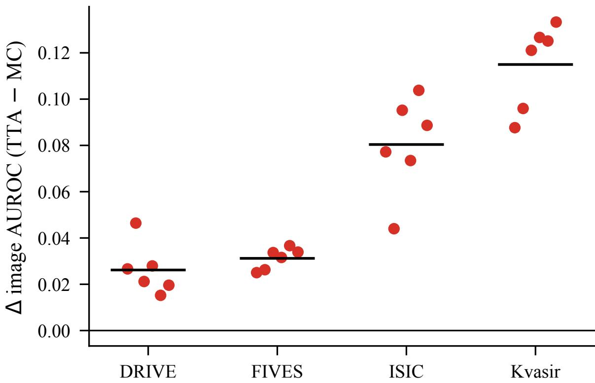  
Figure 5. Complementary architecture audit. DRIVE, ISIC, and Kvasir are evaluated with a MiT-B2 TransUNet variant, while FIVES is evaluated with a U-Net variant. The paired TTA–MC effect remains positive in all budget–functional comparisons after the architecture swap.

## 8.6. Learned deferral and policy transfer

Learned deferral heads estimate error probability from validation errors while keeping the segmentation backbone frozen. The deployable protocol fits the head and any adaptive thresholds on the cell’s validation split and evaluates on the held-out test set. Test labels are never used to fit the deployable policy.

Validation size is an important part of the evidence. DRIVE has only four validation images for the deployable learned head. Although this provides many pixels, it is image-starved and cannot demonstrate coverage of anatomical variation. For this reason, learned-deferral results are reported together with their fitting data.

Under the deployable protocol, the learned head improves Capt.@20% in 16/18 cell–estimator settings, is significantly worse than plain uncertainty in one, and is statistically tied in one. The gains are largest for weaker MCbased rankings. On AURC, however, plain uncertainty remains ahead in some settings, so a learned policy is not a uniformly dominant replacement for raw uncertainty.

Policy transfer is evaluated by fitting source policies only on source validation data and measuring performance on held-out target test images, with zero sourcevalidation/target-test overlap. We compare transfer with two target references: raw target uncertainty and an indomain learned refit.

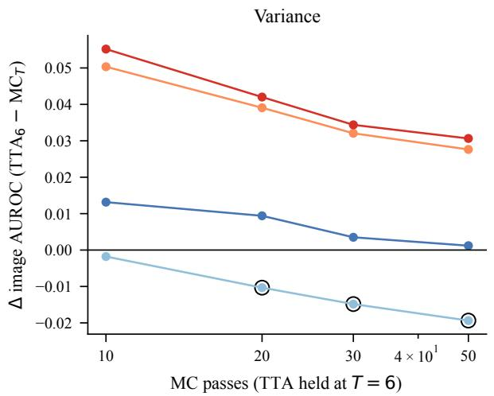

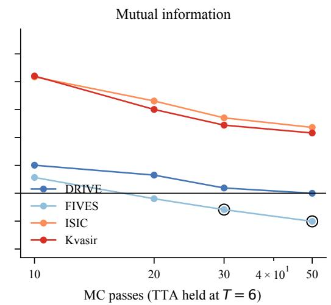

Figure 6. Unequal compute changes the MC–TTA comparison. TTA is held at six passes while MC Dropout is increased to 10, 20, 30, and 50 stochastic passes. DRIVE approaches a tie, FIVES crosses to MC, and ISIC/Kvasir remain TTA-favourable in the tested settings.  
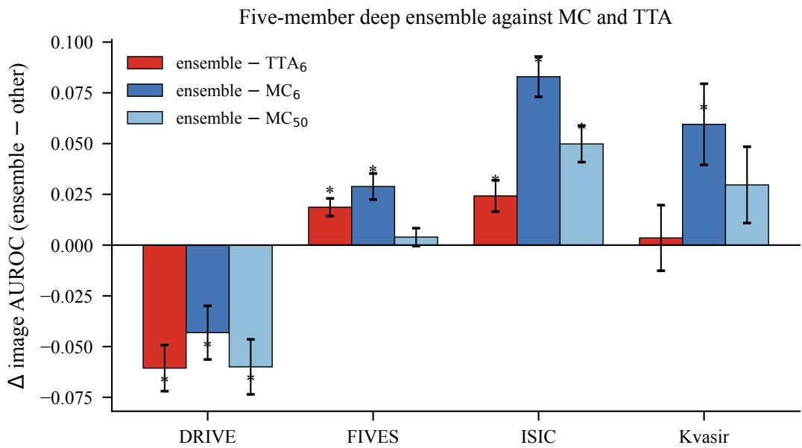  
Figure 7. Estimator family can change the winner. Five-member deterministic deep ensembles outperform TTA on FIVES and ISIC, underperform it on DRIVE, and are statistically indistinguishable from TTA on Kvasir after correction.

Across 18 source–target pairs, transferred TTA policies significantly beat raw target uncertainty in 8 pairs, significantly lose in 7, and are not significant in 3. Against an in-domain refit, transfer is significantly better in 4 pairs, significantly worse in 9, and not significant in 5. Transfer is therefore partial: it can help between related cells, but target-domain uncertainty and in-domain fitting remain strong baselines.

## 8.7. Review-assumption sensitivity

Fixed-budget deferral assumes that deferred units can be corrected. This is an analytical review proxy rather than a reader-study measurement. We therefore audit whether estimator rankings remain stable when the review assumption changes while the underlying prediction artifacts are held fixed.

Changing the review unit and the uncertainty target produces the largest ranking changes. Reviewer quality, threshold choice, label perturbation, morphology, and cost/utility assumptions also change preferred estimators in some settings, whereas the tested corruption grid does not reverse the MC–TTA ordering. These checks show that the review model is not a secondary implementation detail; it is part of the evaluated decision configuration.

Table 7. Matched inference budgets, canonical multi-layer MC Dropout. Mean image-level error-detection AUROC; MC and TTA draw the same $\dot { T }$ passes from the same checkpoint on the $\Delta$ $\mathrm { T T A - M C } ;$ \* same images. is the paired per-image mean marks $q < 0 . 0 5$ after BH correction across this family of 24. TTA leads in all 24 and every bootstrap interval excludes zero.
<table><tr><td rowspan="2">Dataset Func.</td><td colspan="2"> $T { = } 2$ </td><td colspan="2"> $T { = } 4$ </td><td colspan="2"> $T { = } 6$ </td></tr><tr><td>MC</td><td>∆</td><td>MC</td><td> $\Delta$ </td><td>MC</td><td> $\Delta$ </td></tr><tr><td>DRIVE Var</td><td>0.805</td><td> $+ 0 . 0 1 7 ^ { * }$ </td><td>0.831</td><td> $+ 0 . 0 1 9 ^ { * }$ </td><td>0.839</td><td> $+ 0 . 0 1 9 ^ { * }$ </td></tr><tr><td>DRIVE MI</td><td></td><td> $0 . 8 0 7 ~ { + } 0 . 0 1 6 ^ { * }$ </td><td>0.843</td><td> $+ 0 . 0 1 7 ^ { * }$ </td><td></td><td> $0 . 8 5 2 ~ { + 0 . 0 1 6 } ^ { * }$ </td></tr><tr><td>FIVES Var</td><td></td><td> $0 . 8 2 9 ~ { + 0 . 0 0 4 } ^ { * }$ </td><td>0.844</td><td> $+ 0 . 0 0 8 ^ { * }$ </td><td>0.852</td><td> $+ 0 . 0 0 7 ^ { \ast }$ </td></tr><tr><td>FIVES MI</td><td></td><td> $0 . 8 3 7 \ + 0 . 0 1 0 ^ { * }$ </td><td>0.853</td><td> $+ 0 . 0 1 4 ^ { * }$ </td><td>0.859</td><td> $+ 0 . 0 1 4 ^ { * }$ </td></tr><tr><td>ISIC Var</td><td>0.761</td><td> $+ 0 . 0 5 6 ^ { * }$ </td><td>0.793</td><td> $+ 0 . 0 6 0 ^ { * }$ </td><td>0.803</td><td> $+ 0 . 0 6 4 ^ { * }$ </td></tr><tr><td>ISIC MI</td><td></td><td> $0 . 7 7 6 ~ { + 0 . 0 5 8 } ^ { * }$ </td><td>0.812</td><td> $+ 0 . 0 5 2 ^ { * }$ </td><td>0.821</td><td> $+ 0 . 0 5 3 ^ { * }$ </td></tr><tr><td>Kvasir Var</td><td></td><td> $0 . 7 8 3 ~ + 0 . 0 5 7 ^ { \ast }$ </td><td>0.817</td><td> $+ 0 . 0 6 4 ^ { * }$ </td><td></td><td> $0 . 8 3 2 \ + 0 . 0 6 5 ^ { \ast }$ </td></tr><tr><td>Kvasir MI</td><td></td><td> $0 . 8 0 2 \ + 0 . 0 5 9 ^ { \ast }$ </td><td>0.847</td><td> $+ 0 . 0 5 2 ^ { * }$ </td><td></td><td> $0 . 8 6 4 \ + 0 . 0 4 7 ^ { \ast }$ </td></tr></table>

Table 8. Robustness across every configuration axis raised in review. Each row is an independent family of paired image-level comparisons with its own BH correction; “TTA” counts positive point estimates and $ { \mathbf { \ddot { \theta } } } \mathrm { H }  { \mathbf { \vec { \theta } } }$ counts $q < 0 . 0 5 .$ . The matched-budget, replication, architecture, and placement families are uniformly positive; the two DRIVE-only sweeps show smaller effects, nonsignificant cells, and three tiny seed reversals.
<table><tr><td>Axis</td><td>TTA</td><td>BH</td><td>mean ∆</td><td>range  $\Delta$ </td></tr><tr><td>Matched budget, anchor (4 ds)</td><td>24/24</td><td>24/24</td><td>+0.035</td><td>[+0.004, +0.065]</td></tr><tr><td>10 MC realizations (4 ds)</td><td>24/24</td><td>24/24</td><td>+0.033</td><td>[+0.003, +0.063]</td></tr><tr><td>Complementary backbone (4 ds)</td><td>24/24</td><td>24/24</td><td>+0.063</td><td>[+0.015, +0.133]</td></tr><tr><td>Dropout placement (4 ds)</td><td>72/72</td><td>72/72</td><td>+0.075</td><td>[+0.004, +0.250]</td></tr><tr><td>Dropout rate p (DRIVE)</td><td>24/24</td><td>18/24</td><td>+0.015</td><td>[+0.003, +0.038]</td></tr><tr><td>Training seed (DRIVE)</td><td>15/18</td><td>10/18</td><td>+0.009</td><td>[-0.004, +0.020]</td></tr></table>

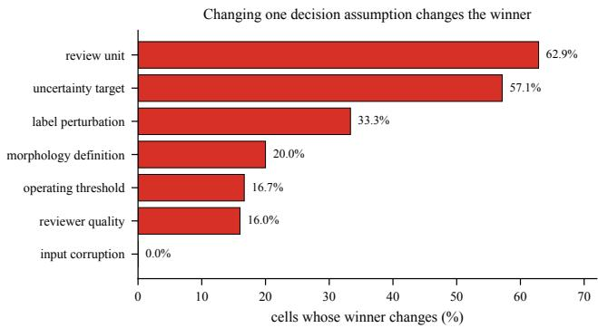  
Figure 8. Decision-layer reversal rates on the DRIVE anchor. Predictions are held fixed while one review assumption is varied. These are finite-grid sensitivity summaries, not population rates.

Table 9. No estimator family wins everywhere once budget is unconstrained. Mean image AUROC, same images and backbone throughout; TTA uses 6 passes. ∆ columns are paired differences against $T T A { \cdot } T 6 ,$ , so positive means the competitor is better; \* is $q < 0 . 0 5$ within each column’s family. At 8× the passes MC ties TTA on DRIVE and overtakes it on FIVES; deep ensembles beat TTA on FIVES and ISIC and lose on DRIVE.
<table><tr><td colspan="5">mean image AUROC</td><td colspan="2">∆ vs TTA-T6</td></tr><tr><td>Dataset Func. MC T6</td><td></td><td>MC T50</td><td>TTA T6</td><td>Ens.5</td><td>MC T50</td><td>Ens. 5</td></tr><tr><td>DRIVE Var</td><td>0.839</td><td>0.857</td><td>0.858</td><td>0.806</td><td>-0.001</td><td> $- 0 . 0 5 2 ^ { * }$ </td></tr><tr><td>DRIVE MI</td><td>0.852</td><td>0.868</td><td>0.868</td><td>0.799</td><td> $+ 0 . 0 0 0$ </td><td> $- 0 . 0 6 9 ^ { * }$ </td></tr><tr><td>FIVES</td><td>Var 0.852</td><td>0.878</td><td>0.858</td><td>0.881</td><td> $+ 0 . 0 1 9 ^ { * }$ </td><td> $+ 0 . 0 2 3 ^ { * }$ </td></tr><tr><td>FIVES</td><td>MI 0.859</td><td>0.882</td><td>0.872</td><td>0.886</td><td> $+ 0 . 0 1 0 ^ { * }$ </td><td> $+ 0 . 0 1 4 ^ { * }$ </td></tr><tr><td>ISIC</td><td>Var</td><td>0.803 0.840</td><td>0.867</td><td>0.896</td><td> $- 0 . 0 2 8 ^ { * }$ </td><td> $+ 0 . 0 2 9 ^ { \ast }$ </td></tr><tr><td>ISIC</td><td>MI</td><td>0.821 0.851</td><td>0.874</td><td>0.894</td><td> $- 0 . 0 2 4 ^ { * }$ </td><td> $+ 0 . 0 1 9 ^ { * }$ </td></tr><tr><td>Kvasir</td><td>Var</td><td>0.832</td><td>0.866</td><td>0.897</td><td>0.908  ${ - 0 . 0 3 1 } ^ { * }$ </td><td>+0.011</td></tr><tr><td>Kvasir</td><td>MI</td><td>0.864</td><td>0.889</td><td>0.911</td><td>0.907 -0.022*</td><td>-0.004</td></tr></table>

Table 10. Learned-deferral accounting. The deployable head is fitted on the held-out validation split and evaluated on test. The separate five-fold test-distribution cross-fit is retained only as a diagnostic upper bound.
<table><tr><td>Dataset</td><td>Train</td><td>Val / fit imgs</td><td>Test</td><td>Capt.@20 wins</td></tr><tr><td>DRIVE</td><td>16</td><td>4</td><td>20</td><td>2/2</td></tr><tr><td>FIVES</td><td>520</td><td>120</td><td>160</td><td>2/4</td></tr><tr><td>ISIC</td><td>1686</td><td>389</td><td>519</td><td>4/4</td></tr><tr><td>Kvasir</td><td>650</td><td>150</td><td>200</td><td>8/8</td></tr><tr><td>Total</td><td>一</td><td>一</td><td>一</td><td>16/18</td></tr></table>

## 8.8. Boundary, thin-structure, and second-observer analysis

Structural stratification separates global error detection into boundary, interior, and thin-structure regions. Boundaries are defined by a morphological band around the foreground boundary, and thin structures are defined by erosion-based foreground thinning. Because no single morphology radius is canonical, we report radius sensitivity rather than treating one radius as a universal definition.

The two DRIVE observers have Dice 0.788 and disagree on 5.28% of in-FOV pixels; 91.7% of that disagreement lies inside the radius-2 boundary band. When the target is human disagreement, mutual-information AUROC is 0.813 for MC and 0.817 for TTA. On the disputed pixels themselves, all evaluated uncertainty scores are near chance. Thus, uncertainty can identify unstable regions, but it does not adjudicate between two plausible annotations.

Annotation ambiguity does not fully explain the structural weakness. Under observer-2 model-error labels, global MC–TTA differences are not significant, while TTA’s advantage is concentrated on thin structures. Boundary conclusions change with the chosen radius, whereas the thinregion advantage remains positive across the tested radii. The main paper therefore states the structural claim narrowly: uncertainty is weakest near ambiguous boundaries and thin structures, and this weakness is partly, but not entirely, explained by annotation disagreement.

Table 11. Deployable validation-fitted learned deferral at Capt.@20%. The head is fitted only on each cell’s validation split and evaluated on test. ∆ = learned minus plain uncertainty; ∗ denotes BH $q < . 0 5$ within the corresponding estimator family.
<table><tr><td>Cell</td><td>Arm</td><td>Fit imgs</td><td>Eval imgs</td><td>Learned</td><td>Plain u</td><td>∆</td><td>95% CI</td><td>q</td></tr><tr><td>drive/unet</td><td>MC</td><td>4</td><td>20</td><td>0.796</td><td>0.623</td><td>+0.173*</td><td>[+0.133,+0.218]</td><td>&lt; .001</td></tr><tr><td>drive/unet</td><td>TTA</td><td>4</td><td>20</td><td>0.830</td><td>0.817</td><td>+0.013*</td><td>[+0.010,+0.015]</td><td>&lt; .001</td></tr><tr><td>fives/unet</td><td>MC</td><td>120</td><td>160</td><td>0.861</td><td>0.790</td><td>+0.071*</td><td>[+0.059,+0.084]</td><td>&lt; .001</td></tr><tr><td>fives/unet</td><td>TTA</td><td>120</td><td>160</td><td>0.924</td><td>0.928</td><td>-0.004*</td><td>[-0.004,-0.003]</td><td>&lt; .001</td></tr><tr><td>fives/unetpp</td><td>MC</td><td>120</td><td>160</td><td>0.838</td><td>0.778</td><td>+0.061*</td><td>[+0.053,+0.069]</td><td>&lt; .001</td></tr><tr><td>fives/unetpp</td><td>TTA</td><td>120</td><td>160</td><td>0.908</td><td>0.909</td><td>-0.001</td><td>[-0.002,+0.001]</td><td>0.337</td></tr><tr><td>isic/deeplabv3plus</td><td>MC</td><td>389</td><td>519</td><td>0.828</td><td>0.814</td><td>+0.014*</td><td>[+0.013,+0.016]</td><td>&lt; .001</td></tr><tr><td>isic/deeplabv3plus</td><td>TTA</td><td>389</td><td>519</td><td>0.921</td><td>0.905</td><td>+0.016*</td><td>[+0.013,+0.020]</td><td>&lt; .001</td></tr><tr><td>isic/unet</td><td>MC</td><td>389</td><td>519</td><td>0.901</td><td>0.772</td><td>+0.129*</td><td>[+0.119,+0.140]</td><td>&lt; .001</td></tr><tr><td>isic/unet</td><td>TTA</td><td>389</td><td>519</td><td>0.936</td><td>0.932</td><td>+0.004*</td><td>[+0.002,+0.008]</td><td>0.003</td></tr><tr><td>kvasir/deeplabv3plus</td><td>MC</td><td>150</td><td>200</td><td>0.808</td><td>0.767</td><td>+0.041*</td><td>[+0.035,+0.046]</td><td>&lt; .001</td></tr><tr><td>kvasir/deeplabv3plus</td><td>TTA</td><td>150</td><td>200</td><td>0.911</td><td>0.907</td><td>+0.004*</td><td>[+0.001,+0.007]</td><td>0.001</td></tr><tr><td>kvasir/transunet</td><td>MC</td><td>150</td><td>200</td><td>0.781</td><td>0.646</td><td>+0.136*</td><td>[+0.118,+0.154]</td><td>&lt; .001</td></tr><tr><td>kvasir/transunet</td><td>TTA</td><td>150</td><td>200</td><td>0.881</td><td>0.782</td><td>+0.099*</td><td>[+0.089,+0.109]</td><td>&lt; .001</td></tr><tr><td>kvasir/unet</td><td>MC</td><td>150</td><td>200</td><td>0.868</td><td>0.580</td><td>+0.288*</td><td>[+0.250,+0.326]</td><td>&lt; .001</td></tr><tr><td>kvasir/unet</td><td>TTA</td><td>150</td><td>200</td><td>0.939</td><td>0.925</td><td>+0.013*</td><td>[+0.008,+0.020]</td><td>&lt; .001</td></tr><tr><td>kvasir/unetpp</td><td>MC</td><td>150</td><td>200</td><td>0.760</td><td>0.654</td><td>+0.105*</td><td>[+0.082,+0.129]</td><td>&lt; .001</td></tr><tr><td>kvasir/unetpp</td><td>TTA</td><td>150</td><td>200</td><td>0.906</td><td>0.893</td><td>+0.013*</td><td>[+0.010,+0.016]</td><td>&lt; .001</td></tr></table>

Table 12. Clean TTA policy transfer versus raw target uncertainty (AURC, 18 pairs). Source policies are fitted on source validation data and evaluated on the full target test set. AURC is lower-is-better, so negative ∆ = transfer minus reference favours transfer. ∗ denotes BH $q <$ < .05 across the 18-pair family.
<table><tr><td>Arm</td><td>Source</td><td>Target</td><td>n</td><td>Transfer</td><td>Reference</td><td>∆</td><td>95% CI</td><td>q</td><td>Verdict</td></tr><tr><td>A cross domain</td><td>kvasir/unetpp</td><td>fives/unetpp</td><td>160</td><td>0.0023</td><td>0.0022</td><td>+0.0002*</td><td>[+0.0001,+0.0002]</td><td>&lt; .001</td><td>Reference</td></tr><tr><td>A cross domain</td><td>fives/unetpp</td><td>kvasir/unetpp</td><td>200</td><td>0.0236</td><td>0.0082</td><td>+0.0154*</td><td>[+0.0102,+0.0212]</td><td>&lt; .001</td><td>Reference</td></tr><tr><td>A cross domain</td><td>kvasir/deeplabv3plus</td><td>isic/deeplabv3plus</td><td>519</td><td>0.0074</td><td>0.0081</td><td>-0.0008*</td><td>[-0.0011,-0.0004]</td><td>&lt; .001</td><td>Transfer</td></tr><tr><td>A cross domain</td><td>isic/deeplabv3plus</td><td>kvasir/deeplabv3plus</td><td>200</td><td>0.0083</td><td>0.0084</td><td>-0.0001</td><td>[-0.0002,+0.0000]</td><td>0.086</td><td>n.s.</td></tr><tr><td>A cross domain</td><td>drive/unet</td><td>fives/unet</td><td>160</td><td>0.0019</td><td>0.0018</td><td>+0.0001*</td><td>[+0.0000,+0.0001]</td><td>&lt; .001</td><td>Reference</td></tr><tr><td>A cross domain</td><td>fives/unet</td><td>drive/unet</td><td>20</td><td>0.0173</td><td>0.0151</td><td>+0.0021*</td><td>[+0.0019,+0.0024]</td><td>&lt; .001</td><td>Reference</td></tr><tr><td>A cross domain</td><td>isic/unet</td><td>kvasir/unet</td><td>200</td><td>0.0043</td><td>0.0043</td><td>-0.0001</td><td>[-0.0003,+0.0001]</td><td>0.552</td><td>n.s.</td></tr><tr><td>A cross domain</td><td>kvasir/unet</td><td>isic/unet</td><td>519</td><td>0.0042</td><td>0.0045</td><td>-0.0003*</td><td>[-0.0005,-0.0001]</td><td>&lt; .001</td><td>Transfer</td></tr><tr><td>B cross backbone</td><td>kvasir/unet</td><td>kvasir/unetpp</td><td>200</td><td>0.0078</td><td>0.0082</td><td>-0.0004*</td><td>[-0.0008,-0.0001]</td><td>0.003</td><td>Transfer</td></tr><tr><td>B cross backbone</td><td>kvasir/unetpp</td><td>kvasir/unet</td><td>200</td><td>0.0044</td><td>0.0043</td><td>+0.0001</td><td>[-0.0001,+0.0003]</td><td>0.634</td><td>n.s.</td></tr><tr><td>B cross backbone</td><td>kvasir/unet</td><td>kvasir/deeplabv3plus</td><td>200</td><td>0.0083</td><td>0.0084</td><td>-0.0001*</td><td>[-0.0002,-0.0000]</td><td>0.028</td><td>Transfer</td></tr><tr><td>B cross backbone</td><td>kvasir/deeplabv3plus</td><td>kvasir/unet</td><td>200</td><td>0.0042</td><td>0.0043</td><td>-0.0002*</td><td>[-0.0003,-0.0000]</td><td>0.013</td><td>Transfer</td></tr><tr><td>B cross backbone</td><td>kvasir/unetpp</td><td>kvasir/deeplabv3plus</td><td>200</td><td>0.0083</td><td>0.0084</td><td>-0.0001*</td><td>[-0.0002,-0.0000]</td><td>0.026</td><td>Transfer</td></tr><tr><td>B cross backbone</td><td>kvasir/deeplabv3plus</td><td>kvasir/unetpp</td><td>200</td><td>0.0080</td><td>0.0082</td><td>-0.0002*</td><td>[-0.0003,-0.0001]</td><td>&lt; .001</td><td>Transfer</td></tr><tr><td>B cross backbone</td><td>fives/unet</td><td>fives/unetpp</td><td>160</td><td>0.0023</td><td>0.0022</td><td>+0.0001*</td><td>[+0.0001,+0.0002]</td><td>&lt; .001</td><td>Reference</td></tr><tr><td>B cross backbone</td><td>fives/unetpp</td><td>fives/unet</td><td>160</td><td>0.0018</td><td>0.0018</td><td>+0.0001*</td><td>[+0.0000,+0.0001]</td><td>&lt; .001</td><td>Reference</td></tr><tr><td>B cross backbone</td><td>isic/unet</td><td>isic/deeplabv3plus</td><td>519</td><td>0.0067</td><td>0.0081</td><td>-0.0014*</td><td>[-0.0020,-0.0008]</td><td>&lt; .001</td><td>Transfer</td></tr><tr><td>B cross backbone</td><td>isic/deeplabv3plus</td><td>isic/unet</td><td>519</td><td>0.0067</td><td>0.0045</td><td>+0.0021*</td><td>[+0.0010,+0.0033]</td><td>&lt; .001</td><td>Reference</td></tr></table>

## 8.9. Probability-derived baselines and calibration checks

Probability-derived scores are included as mandatory cheap baselines. In binary segmentation, entropy, inverse confidence, margin, distance from $1 / 2 ,$ and maximum-softmax confidence are monotone functions of $| \hat { p } - 0 . 5 |$ and induce the same ranking up to reversal depending on whether the score is written as confidence or uncertainty. They therefore produce the same fixed-budget deferred set under a coverage-based policy.

On DRIVE TTA outputs, the maximum numerical identity deviation among these binary scores is at floating-point scale, and the minimum Spearman correlation among the resulting rankings is 1.000. Similarly, strictly monotone transformations of a review score preserve the deferred set, risk–coverage curve, and AURC. Calibration can improve the numerical interpretation of probabilities without changing a coverage-based review decision when the ranking is preserved. Calibration, threshold, label, and referralnormalisation analyses are therefore interpreted as decisionlayer sensitivity checks rather than as independent estimator

Table 13. Clean TTA policy transfer versus an in-domain refit (AURC, 18 pairs). Negative ∆ = transfer minus reference favours transfer. The mixed result shows that target-domain refitting is usually safer than transferring the source policy. denotes BH q < .05 across the 18-pair family.
<table><tr><td>Arm</td><td>Source</td><td>Target</td><td>n</td><td>Transfer</td><td>Reference</td><td>∆</td><td>95% CI</td><td>q</td><td>Verdict</td></tr><tr><td>A cross domain</td><td>kvasir/unetpp</td><td>fives/unetpp</td><td>160</td><td>0.0023</td><td>0.0021</td><td>+0.0002*</td><td>[+0.0002,+0.0003]</td><td>&lt; .001</td><td>Reference</td></tr><tr><td>A cross domain</td><td>fives/unetpp</td><td>kvasir/unetpp</td><td>200</td><td>0.0236</td><td>0.0082</td><td>+0.0153*</td><td>[+0.0102,+0.0211]</td><td>&lt; .001</td><td>Reference</td></tr><tr><td>A cross domain</td><td>kvasir/deeplabv3plus</td><td>isic/deeplabv3plus</td><td>519</td><td>0.0074</td><td>0.0059</td><td>+0.0015*</td><td>[+0.0007,+0.0023]</td><td>&lt; .001</td><td>Reference</td></tr><tr><td>A cross domain</td><td>isic/deeplabv3plus</td><td>kvasir/deeplabv3plus</td><td>200</td><td>0.0083</td><td>0.0082</td><td>+0.0001</td><td>[-0.0000,+0.0002]</td><td>0.100</td><td>n.s.</td></tr><tr><td>A cross domain</td><td>drive/unet</td><td>fives/unet</td><td>160</td><td>0.0019</td><td>0.0020</td><td>-0.0001*</td><td>[-0.0002,-0.0001]</td><td>&lt; .001</td><td>Transfer</td></tr><tr><td>A cross domain</td><td>fives/unet</td><td>drive/unet</td><td>20</td><td>0.0173</td><td>0.0126</td><td>+0.0047*</td><td>[+0.0039,+0.0056]</td><td>&lt; .001</td><td>Reference</td></tr><tr><td>A cross domain</td><td>isic/unet</td><td>kvasir/unet</td><td>200</td><td>0.0043</td><td>0.0042</td><td>+0.0001</td><td>[-0.0001,+0.0003]</td><td>0.507</td><td>n.s.</td></tr><tr><td>A cross domain</td><td>kvasir/unet</td><td>isic/unet</td><td>519</td><td>0.0042</td><td>0.0052</td><td>-0.0010</td><td>[-0.0020,-0.0000]</td><td>0.054</td><td>n.s.</td></tr><tr><td>B cross backbone</td><td>kvasir/unet</td><td>kvasir/unetpp</td><td>200</td><td>0.0078</td><td>0.0082</td><td>-0.0005*</td><td>[-0.0010,-0.0001]</td><td>0.049</td><td>Transfer</td></tr><tr><td>B cross backbone</td><td>kvasir/unetpp</td><td>kvasir/unet</td><td>200</td><td>0.0044</td><td>0.0042</td><td>+0.0002</td><td>[-0.0000,+0.0005]</td><td>0.106</td><td>n.s.</td></tr><tr><td>B cross backbone</td><td>kvasir/unet</td><td>kvasir/deeplabv3plus</td><td>200</td><td>0.0083</td><td>0.0082</td><td>+0.0001*</td><td>[+0.0000,+0.0001]</td><td>&lt; .001</td><td>Reference</td></tr><tr><td>B cross backbone</td><td>kvasir/deeplabv3plus</td><td>kvasir/unet</td><td>200</td><td>0.0042</td><td>0.0042</td><td>-0.0000</td><td>[-0.0002,+0.0001]</td><td>0.852</td><td>n.s.</td></tr><tr><td>B cross backbone</td><td>kvasir/unetpp</td><td>kvasir/deeplabv3plus</td><td>200</td><td>0.0083</td><td>0.0082</td><td>+0.0001*</td><td>[+0.0000,+0.0002]</td><td>0.004</td><td>Reference</td></tr><tr><td>B cross backbone</td><td>kvasir/deeplabv3plus</td><td>kvasir/unetpp</td><td>200</td><td>0.0080</td><td>0.0082</td><td>-0.0002*</td><td>[-0.0004,-0.0001]</td><td>0.009</td><td>Transfer</td></tr><tr><td>B cross backbone</td><td>fives/unet</td><td>fives/unetpp</td><td>160</td><td>0.0023</td><td>0.0021</td><td>+0.0002*</td><td>[+0.0001,+0.0002]</td><td>&lt; .001</td><td>Reference</td></tr><tr><td>B cross backbone</td><td>fives/unetpp</td><td>fives/unet</td><td>160</td><td>0.0018</td><td>0.0020</td><td>-0.0002*</td><td>[-0.0002,-0.0002]</td><td>&lt; .001</td><td>Transfer</td></tr><tr><td>B cross backbone</td><td>isic/unet</td><td>isic/deeplabv3plus</td><td>519</td><td>0.0067</td><td>0.0059</td><td>+0.0008*</td><td>[+0.0003,+0.0014]</td><td>&lt; .001</td><td>Reference</td></tr><tr><td></td><td>B cross backbone isic/deeplabv3plus</td><td>isic/unet</td><td>519</td><td>0.0067</td><td>0.0052</td><td>+0.0015*</td><td>[+0.0012,+0.0018]</td><td>&lt; .001</td><td>Reference</td></tr></table>

Table 14. CPU decision-assumption campaign. All analyses reuse stored prediction artifacts. PASS WITH LIMITATION is retained rather than collapsed into PASS; the separately planned cross-domain EXP14 is blocked because comparable non-DRIVE validation maps were not retained and is not treated as a null result.
<table><tr><td>ID</td><td>Experiment</td><td>Status</td><td>Data</td><td>Method</td><td>Metric</td><td>Effect</td><td></td></tr><tr><td></td><td>CPU-001 exp01_drive_annotation_disagreement</td><td>PASS</td><td>DRIVE</td><td>mc_mutual_information</td><td>mean_image_auroc_human_disagreement</td><td>0.8131</td><td>[0.8007, 0.8253]</td></tr><tr><td></td><td>CPU-002 exp01_drive_annotation_disagreement</td><td>PASS</td><td>DRIVE</td><td>tta_mutual_information</td><td>mean_image_auroc_human_disagreement</td><td>0.8166</td><td>[0.8056, 0.8271]</td></tr><tr><td></td><td>CPU-003 exp02_imperfect_reviewer</td><td>PASS</td><td>DRIVE</td><td>all_estimators</td><td>ranking_reversal_fraction_vs_perfect_reviewer</td><td>0.1600</td><td></td></tr><tr><td></td><td>CPU-004 exp03_review_unit_sensitivity</td><td>PASS</td><td>DRIVE</td><td>all_estimators</td><td>fraction_review_unit_budget_cells_reversing-pixel_winner</td><td>0.6286</td><td></td></tr><tr><td>CPU-005 exp04_calibration</td><td></td><td>PASS_WITH.LIMITATION DRIVE</td><td></td><td>mc</td><td>best_calibrated_probability_minus_best_sampling_error_auroc</td><td>-0.0506</td><td></td></tr><tr><td>CPU-006 exp04_calibration</td><td></td><td>PASS.WITH.LIMITATION DRIVE</td><td></td><td>tta</td><td>best_calibrated_probability_minus_best_sampling-error_auroc</td><td>-0.0315</td><td></td></tr><tr><td></td><td>CPU-007 exp05_crossfit_deferral</td><td>PASS_WITH_LIMITATION DRIVE</td><td></td><td>tta_ridge</td><td>learned_minus_plain_capture_at_20%</td><td>0.0308</td><td></td></tr><tr><td></td><td>CPU-008 exp06_drive_corruption_robustness</td><td>PASS</td><td>DRIVE</td><td>mc_t6_vs_tta_t6</td><td>fraction_corruption_score_cells_reversing_clean_winner</td><td>0.0000</td><td></td></tr><tr><td></td><td>CPU-009 exp07_uncertainty_target_sensitivity</td><td>PASS</td><td>DRIVE</td><td>all_estimators</td><td>fraction_targets_reversing_all_error_winner</td><td>0.5714</td><td></td></tr><tr><td></td><td>CPU-010 exp08_cpu_reproducibility</td><td>PASS_WITH_LIMITATION DRIVE</td><td></td><td>tta_t6</td><td>cpu_minus_gpu_mean_image_error_auroc</td><td>-0.0003</td><td>[-0.0008, 0.0003]</td></tr><tr><td></td><td>CPU-011 exp09_threshold_sensitivity</td><td>PASS</td><td>DRIVE</td><td>all_estimators</td><td>fraction_threshold_settings_reversing-canonical_winner</td><td>0.1667</td><td></td></tr><tr><td></td><td>CPU-012 exp10_label_perturbation_robustness</td><td>PASS_WITH.LIMITATION</td><td>DRIVE</td><td>all.estimators</td><td>fraction_label_targets_reversing_canonical_winner</td><td>0.3333</td><td></td></tr><tr><td></td><td>CPU-013 exp16_spatial_morphology_sensitivity</td><td>PASS</td><td>DRIVE</td><td>all_estimators</td><td>fraction_region_definitions_reversing_canonical_winner</td><td>0.2000</td><td></td></tr><tr><td></td><td>CPU-014 exp11_component_level_decisions</td><td>PASS_WITH_LIMITATION</td><td>KVASIR</td><td>mc_variance</td><td>image_level_auroc_spurious_pred_component</td><td>0.9784</td><td></td></tr><tr><td></td><td>CPU-015 exp12_cost_utility_sweep</td><td>PASS</td><td>DRIVE</td><td>tta_probability_baseline</td><td>method_preference_fraction_across_cost_grid</td><td>0.6333</td><td></td></tr><tr><td></td><td>CPU-016 exp13_calibration_under_shift</td><td>PASS_WITH.LIMITATION DRIVE</td><td></td><td></td><td>deterministic_clean_fitted_calibrators fraction_shifted_conditions_improving_ece_vs_uncalibrated</td><td>0.0357</td><td></td></tr><tr><td></td><td>CPU-017 exp15_classical_probability_uncertainty PASS</td><td></td><td>DRIVE</td><td>best_sampling_vs_best_probability</td><td>mean_image_error_auroc_difference</td><td>0.0220</td><td></td></tr><tr><td></td><td>CPU-018 exp17_referral_normalization_stability</td><td>PASS</td><td>DRIVE</td><td>all_estimators</td><td>maximum_absolute_capture_change_vs_raw_score_allocation</td><td>0.1883</td><td></td></tr></table>

families.

## 8.10. Qualitative examples

Figure 10 shows representative examples from the three segmentation domains. These examples are intended as qualitative checks on the decision rule rather than as additional evidence for a new quantitative claim. Across domains, uncertainty and deferral concentrate around the same structures identified by the quantitative analyses: vessel fragments and bifurcations in retinal images, object boundaries in polyp and lesion images, and local segmentation failures where the predicted mask disagrees with the annotation. The deferred set contains both true errors sent to review and correct pixels that consume review budget, illustrating why fixed-budget evaluation must report both error capture and accepted risk.

## 8.11. Scope-limited, negative, and blocked evidence

We retain negative and scope-limited findings rather than converting them into positive claims. The main limitations are: no end-to-end reader study; second-observer evidence only for DRIVE; dropout-rate and training-seed sweeps only for DRIVE; self-defined FIVES, ISIC, and Kvasir splits; severe image scarcity for deployable learned deferral on DRIVE; policy transfer that is usually worse than an indomain refit; deep-ensemble wins over TTA on FIVES and ISIC; unequal-compute settings where MC can tie or exceed TTA; DRIVE boundary conclusions that depend on morphology radius; and one blocked cross-domain validationmap analysis due to missing comparable validation artifacts. None of these findings is used to support a stronger claim than the evidence permits.

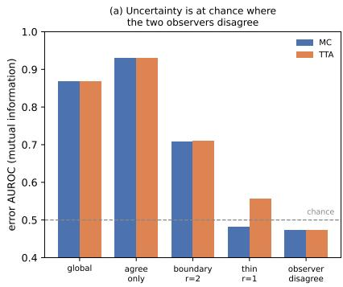

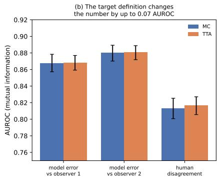

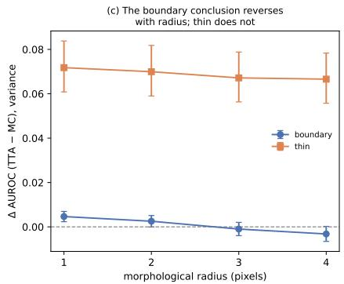  
Figure 9. DRIVE second-observer audit. Disagreement is the XOR of the two manual annotations inside the DRIVE field of view. Human disagreement is concentrated near vessel boundaries, while uncertainty is near chance on the disputed pixels themselves.

Table 15. DRIVE second-observer MC–TTA audit $( n = 2 0 )$ . Scores detect model error with respect to observer 2. $\Delta = \mathrm { T T A - M C } .$ Global MC/TTA differences are negligible; the robust positive difference is concentrated on thin structures. Second-observer evidence is DRIVE-only.
<table><tr><td>Score</td><td>Region</td><td>MC</td><td>TTA</td><td> $\Delta$ </td><td>95% CI</td><td>q</td></tr><tr><td>variance</td><td>Global</td><td>0.857</td><td>0.859</td><td>+0.001</td><td>[-0.005,+0.009]</td><td>0.862</td></tr><tr><td>variance</td><td>DisAgree</td><td>0.474</td><td>0.473</td><td>-0.001</td><td>[-0.008,+0.006]</td><td>0.971</td></tr><tr><td>variance</td><td>Agree</td><td>0.922</td><td>0.924</td><td>+0.002</td><td>[-0.001,+0.006]</td><td>0.444</td></tr><tr><td>variance</td><td>Boundary r = 2</td><td>0.714</td><td>0.717</td><td>+0.003</td><td>[-0.000,+0.005]</td><td>0.164</td></tr><tr><td>variance</td><td>Thin r = 1</td><td>0.514</td><td>0.585</td><td>+0.072*</td><td>[+0.061,+0.084]</td><td>&lt; .001</td></tr><tr><td>MI</td><td>Global</td><td>0.868</td><td>0.868</td><td>+0.000</td><td>[-0.005,+0.007]</td><td>0.971</td></tr><tr><td>MI</td><td>DisAgree</td><td>0.473</td><td>0.473</td><td>+0.000</td><td>[-0.007,+0.007]</td><td>0.994</td></tr><tr><td>MI</td><td>Agree</td><td>0.929</td><td>0.931</td><td>+0.001</td><td>[-0.002,+0.005]</td><td>0.599</td></tr><tr><td>MI</td><td>Boundary r = 2</td><td>0.708</td><td>0.710</td><td>+0.002</td><td>[-0.001,+0.005]</td><td>0.435</td></tr><tr><td>MI</td><td>Thin r = 1</td><td>0.481</td><td>0.555</td><td>+0.075*</td><td>[+0.064,+0.087]</td><td>&lt; .001</td></tr><tr><td>Prob.-derived</td><td>Global</td><td>0.817</td><td>0.823</td><td>+0.006</td><td>[+0.001,+0.011]</td><td>0.063</td></tr><tr><td>Prob.-derived</td><td>DisAgree</td><td>0.475</td><td>0.473</td><td>-0.002</td><td>[-0.006,+0.003]</td><td>0.599</td></tr><tr><td>Prob.-derived</td><td>Agree</td><td>0.892</td><td>0.901</td><td>+0.009*</td><td>[+0.005,+0.013]</td><td>&lt; .001</td></tr><tr><td>Prob.-derived</td><td>Boundary r = 2</td><td>0.721</td><td>0.732</td><td>+0.011*</td><td>[+0.009,+0.013]</td><td>&lt; .001</td></tr><tr><td>Prob.-derived</td><td>Thin r = 1</td><td>0.578</td><td>0.621</td><td>+0.043*</td><td>[+0.035,+0.050]</td><td>&lt; .001</td></tr></table>

## 8.12. Reproducibility package

The anonymous release separates model generation from the lightweight decision audit. It includes executed result archives, configuration records, split metadata, perimage derived evidence, table and figure scripts, and a claim ledger. The derived decision-audit pipeline can reproduce the reported tables from saved artifacts without rerunning large model checkpoints. Artifact manifests record image-ID pairing, thresholds, field-of-view policies, row counts, ensemble-member counts, and table-generation inputs.

Table 16. Boundary/thin-region radius sweep (variance AUROC). ∆ =TTA−MC. The DRIVE boundary sign changes at radii 3–4, whereas the thin-structure advantage remains positive. Other datasets are included to expose radius sensitivity rather than canonize one radius.
<table><tr><td>Dataset</td><td>Region</td><td>r</td><td>n</td><td>Region frac.</td><td>MC</td><td>TTA</td><td>∆</td><td>95% CI</td></tr><tr><td>DRIVE</td><td>Boundary</td><td>1</td><td>20</td><td>0.154</td><td>0.621</td><td>0.625</td><td>+0.005</td><td>[+0.002,+0.007]</td></tr><tr><td>DRIVE</td><td>Boundary</td><td>2</td><td>20</td><td>0.267</td><td>0.714</td><td>0.717</td><td>+0.003</td><td>[-0.000,+0.005]</td></tr><tr><td>DRIVE</td><td>Boundary</td><td>3</td><td>20</td><td>0.356</td><td>0.761</td><td>0.760</td><td>-0.001</td><td>[-0.004,+0.002]</td></tr><tr><td>DRIVE</td><td>Boundary</td><td>4</td><td>20</td><td>0.429</td><td>0.786</td><td>0.783</td><td>-0.003</td><td>[-0.007,+0.000]</td></tr><tr><td>DRIVE</td><td>Thin</td><td>1</td><td>20</td><td>0.071</td><td>0.514</td><td>0.585</td><td>+0.072</td><td>[+0.061,+0.084]</td></tr><tr><td>DRIVE</td><td>Thin</td><td>2</td><td>20</td><td>0.107</td><td>0.624</td><td>0.694</td><td>+0.070</td><td>[+0.059,+0.082]</td></tr><tr><td>DRIVE</td><td>Thin</td><td>3</td><td>20</td><td>0.122</td><td>0.668</td><td>0.735</td><td>+0.067</td><td>[+0.056,+0.079]</td></tr><tr><td>DRIVE</td><td>Thin</td><td>4</td><td>20</td><td>0.126</td><td>0.678</td><td>0.745</td><td>+0.067</td><td>[+0.056,+0.078]</td></tr><tr><td>KVASIR</td><td>Boundary</td><td>1</td><td>200</td><td>0.007</td><td>0.552</td><td>0.566</td><td>+0.015</td><td>[+0.009,+0.021]</td></tr><tr><td>KVASIR</td><td>Boundary</td><td>2</td><td>200</td><td>0.014</td><td>0.595</td><td>0.618</td><td>+0.022</td><td>[+0.014,+0.030]</td></tr><tr><td>KVASIR</td><td>Boundary</td><td>3</td><td>200</td><td>0.020</td><td>0.635</td><td>0.660</td><td>+0.025</td><td>[+0.016,+0.035]</td></tr><tr><td>KVASIR</td><td>Boundary</td><td>4</td><td>200</td><td>0.027</td><td>0.670</td><td>0.696</td><td>+0.026</td><td>[+0.016,+0.036]</td></tr><tr><td>KVASIR</td><td>Thin</td><td>1</td><td>200</td><td>0.004</td><td>0.422</td><td>0.473</td><td>+0.054</td><td>[+0.036,+0.071]</td></tr><tr><td>KVASIR</td><td>Thin</td><td>2</td><td>200</td><td>0.007</td><td>0.491</td><td>0.547</td><td>+0.059</td><td>[+0.041,+0.076]</td></tr><tr><td>KVASIR</td><td>Thin</td><td>3</td><td>200</td><td>0.010</td><td>0.562</td><td>0.613</td><td>+0.053</td><td>[+0.036,+0.070]</td></tr><tr><td>KVASIR</td><td>Thin</td><td>4</td><td>200</td><td>0.014</td><td>0.623</td><td>0.667</td><td>+0.045</td><td>[+0.028,+0.063]</td></tr><tr><td>ISIC</td><td>Boundary</td><td>1</td><td>519</td><td>0.010</td><td>0.550</td><td>0.557</td><td>+0.007</td><td>[+0.004,+0.010]</td></tr><tr><td>ISIC</td><td>Boundary</td><td>2</td><td>519</td><td>0.018</td><td>0.587</td><td>0.602</td><td>+0.015</td><td>[+0.011,+0.019]</td></tr><tr><td>ISIC</td><td>Boundary</td><td>3</td><td>519</td><td>0.026</td><td>0.616</td><td>0.635</td><td>+0.018</td><td>[+0.014,+0.023]</td></tr><tr><td>ISIC</td><td>Boundary</td><td>4</td><td>519</td><td>0.034</td><td>0.640</td><td>0.661</td><td>+0.021</td><td>[+0.016,+0.026]</td></tr><tr><td>ISIC</td><td>Thin</td><td></td><td>519</td><td>0.005</td><td>0.529</td><td>0.525</td><td>+0.005</td><td>[-0.009,+0.018]</td></tr><tr><td>ISIC</td><td>Thin</td><td>2</td><td>519</td><td>0.009</td><td>0.549</td><td>0.552</td><td>+0.010</td><td>[-0.002,+0.021]</td></tr><tr><td>ISIC</td><td>Thin</td><td>3</td><td>519</td><td>0.013</td><td>0.577</td><td>0.587</td><td>+0.011</td><td>[+0.000,+0.022]</td></tr><tr><td>ISIC</td><td>Thin</td><td>4</td><td>519</td><td>0.017</td><td>0.606</td><td>0.619</td><td>+0.013</td><td>[+0.003,+0.023]</td></tr><tr><td>FIVES</td><td>Boundary</td><td>1</td><td>160</td><td>0.077</td><td>0.731</td><td>0.773</td><td>+0.043</td><td>[+0.039,+0.046]</td></tr><tr><td>FIVES</td><td>Boundary</td><td>2</td><td>160</td><td>0.137</td><td>0.823</td><td>0.859</td><td>+0.036</td><td>[+0.032,+0.040]</td></tr><tr><td>FIVES</td><td>Boundary</td><td>3</td><td>160</td><td>0.184</td><td>0.859</td><td>0.886</td><td>+0.027</td><td>[+0.023,+0.031]</td></tr><tr><td>FIVES</td><td>Boundary</td><td>4</td><td>160</td><td>0.223</td><td>0.874</td><td>0.894</td><td>+0.020</td><td>[+0.017,+0.024]</td></tr><tr><td>FIVES</td><td>Thin</td><td>1</td><td>160</td><td>0.037</td><td>0.568</td><td>0.719</td><td>+0.151</td><td>[+0.141,+0.162]</td></tr><tr><td>FIVES</td><td>Thin</td><td>2</td><td>160</td><td>0.059</td><td>0.664</td><td>0.818</td><td>+0.153</td><td>[+0.140,+0.166]</td></tr><tr><td>FIVES</td><td>Thin</td><td>3</td><td>160</td><td>0.069</td><td>0.693</td><td>0.845</td><td>+0.152</td><td>[+0.139,+0.166]</td></tr><tr><td>FIVES</td><td>Thin</td><td></td><td>4 160</td><td></td><td>0.072 0.698</td><td>0.852</td><td>+0.154</td><td>[+0.140,+0.168]</td></tr></table>

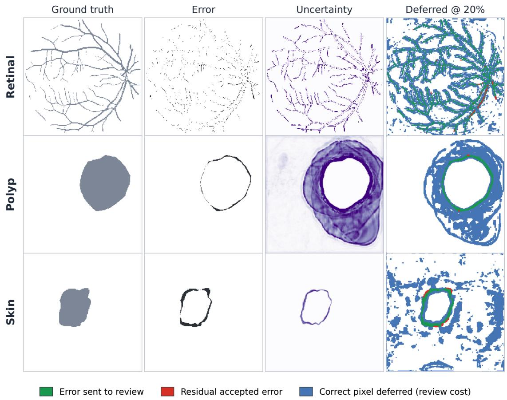  
Figure 10. Representative qualitative examples across domains. Examples make the ranking problem concrete rather than supporting a new quantitative claim. High uncertainty tends to concentrate around difficult boundaries, small structures, and local segmentation failures, while different estimators allocate review mass differently.