# A Large-scale Climate-Aware Satellite Image Dataset for Domain Adaptive Land-Cover Semantic Segmentation

Songlin Liua,b,, Linwei Chenc,d,, Li Zhangb, Jun Hue, Ying Fuc,d,

aSchool ofRemote Sensing Information Engineering, Wuhan University, 430079, Wuhan, Hubei, China bState Key Laboratory ofGeo-information Engineering, 710054, Xi’an, Shaanxi, China cAdvanced Research Institute of Multidisciplinary Science, Beijing Institute of Technology, 100081, Beijing, China dSchool ofComputer Science and Technology, Beijing Institute ofTechnology, 100081, Beijing, China eSchool ofElectronics and Communication Engineering, Sun Yat-sen University, 510006, Guangzhou, Guangdong, China

## Abstract

A few well-annotated datasets for land-cover semantic segmentation have recently been introduced to advance the field of earth observation technologies. However, these datasets overlook the significant diversity among geographic areas with diferent climates, which can greatly impact and diversify land cover. Consequently, this leads to a domain gap in remote sensing imagesc and severe performance degradation of the segmentation models. To enhance land-cover semantic segmentation with improvedO generalization ability, we conducted the first investigation into the impact of climate on this task. In this paper, we present a unique large-scale Climate-Aware Satellite Images Dataset (CASID) specifically designed for domain adaptive land-cover semantic segmentation. It consists of 980 satellite images with a size of 5,000 × 5,000 pixels, collected from 30 diferent regions around Asia, covering over 24,500 square kilometers. These images are gathered from four distinct climate zones, namely] temperate monsoon, subtropical monsoon, tropical monsoon, and tropical rainforest. It includes four sub-datasets/domains, eachV representing one of the aforementioned climate zones. This characteristic makes CASID the first climate-aware land-cover semanticC segmentation dataset with multiple domains. Additionally, we provide a comprehensive analysis of the samples from the fours climate zones, emphasizing diferences in global image features, image texture, category distribution, spectral value, and objectc shape. These analyses ofer valuable insights for subsequent research in this field. Moreover, we conduct extensive experiments to evaluate the latest semantic segmentation and unsupervised domain adaptation methods on the CASID dataset. These results1 serve as a robust baseline for future research endeavors. Our dataset will be made publicly available soon at the following link:v https://github.com/Linwei-Chen/CASID.8

Keywords: satellite image, semantic segmentation, unsupervised domain adaptation.

## 1. Introduction

Land-cover semantic segmentation, which aims to classify the6 land-cover type for each pixel in remote sensing images, plays2 a crucial role in enhancing our understanding of geographicalv and ecological environments (Ma et al., 2021, Tong et al., 2020). It finds widespread applications in various remote sensing domains, such as urban planning (Dhanaraj and Angadi, 2021),a precision agriculture (do Nascimento Bendini et al., 2019), food insecurity analysis (Olsen et al., 2021), and environmental protection (Bosquilia and Muller-Karger, 2021).

Existing mainstream semantic segmentation methods for remote sensing images (Chen et al., 2018, Zhao et al., 2017, Long et al., 2015, Ma et al., 2021, Chai et al., 2020, Wang et al., 2022, Yang et al., 2021) are predominantly based on deep learning, which is a data-driven technology. These methods heavily rely on the quality and quantity of the dataset to achieve high accuracy. Consequently, datasets play a crucial role in the advancement of land-cover semantic segmentation for earth observation. To foster progress in this field, several remote sensing datasets with well-annotated pixel-wise labels for land-cover semantic segmentation have been recently introduced, such as the Zurich Summer dataset (Volpi and Ferrari, 2015), Deep-Globe dataset (Demir et al., 2018), and Gaofen Image Dataset (GID) (Tong et al., 2020).

However, these datasets are primarily designed for standard land-cover semantic segmentation and fail to consider the significant diversity among diferent geographic areas. This oversight leads to a domain gap and can cause severe degradation of deep learning models (Wang et al., 2021a). In particular, land cover is profoundly influenced and diversified by climate factors (Dale, 1997, Reidmiller et al., 2019). The climate serves as a major determinant of vegetation distribution (Prentice, 1990, Woodward et al., 2004, Salazar et al., 2007). For instance, areas within the tropical rainforest climate zone are typically covered by dense rainforests, whereas the temperate monsoon climate zone often exhibits bare ground surfaces with fewer trees, owing to diferences in temperature and precipitation. Therefore, the distribution and pixel spectra of the forest category in the temperate monsoon climate zone can difer significantly from those in the tropical rainforest climate zone.

Moreover, both climate and vegetation have a significant impact on water partitioning, consequently influencing rivers and bodies of water (Zhang et al., 2016, Liu et al., 2022). Additionally, climate plays a crucial role in shaping the design of buildings, constructions, and roads, as they are influenced by temperature and precipitation considerations (Golany, 1996, Givoni, 1998). As a result, there is a substantial disparity in landcover characteristics among diferent climate zones, leading to the climate domain gap.

Due to the climate domain gap, optimal land-cover semantic segmentation models learned from a certain climate zone may quickly lose their efectiveness on new images captured from diferent climate zones. This problem significantly hampers the practical application of land-cover semantic segmentation. However, there is a lack of relevant research investigating the impact of climate on land-cover semantic segmentation. To enhance the model’s generalizability for land-cover semantic segmentation, an appropriate climate domain adaptive dataset is urgently needed.

In this paper, we explore the impact of climate on land-cover semantic segmentation for the first time. To accomplish this, we present a distinctive large-scale Climate-Aware Satellite Images Dataset (CASID) designed specifically for domain adaptive land-cover semantic segmentation. CASID comprises image samples with large image sizes from four representative climate zones: temperate monsoon (TemMs), subtropical monsoon (SubMs), tropical monsoon (TroMs), and tropical rainforest (TroRf), abbreviated for brevity. These climate zones form four sub-datasets/domains based on their climate types, making CASID the first land-cover semantic segmentation dataset to incorporate multiple climate domains.

To enhance diversity and increase the challenge of our CASID, we gathered 980 satellite images at a size of 5 000 × 5 000 from 30 diferent regions around Asia. These regions encompass densely populated urban areas, sparsely populated suburbs, and rural zones, covering a total area of over 24,500 square kilometers. For each satellite image, we provide accurate pixel-wise semantic segmentation labels for five categories: background, building, forest, road, and water. The dataset production process ensures the high diversity and complexity of CASID. Consequently, as shown in Table 1, the widely-used semantic segmentation method for domain adaptation, DeepLabV2 (Chen et al., 2017), achieves only 39.9∼60.9 mIoU on diferent subsets. When evaluated across climate zones on CASID, the performance degrades catastrophically. For instance, the model trained on the temperate monsoon climate zone achieves only 12.2 mIoU on the tropical rainforest climate zone. The crossdomain results depicted in Figures 1(b), (c), and (e) visually confirm these quantitative findings. These results demonstrate that CASID can serves as a challenging benchmark for validating and developing robust methods in land-cover semantic segmentation and unsupervised domain adaptation.

Besides, to shed light on the domain gap caused by climate, we conducted an analysis of images from these four typical climate zones. The analysis reveals large diferences in global image features, image texture, category distribution, spectral value, and object shape between diferent climate zones. These diferences contribute to the domain gap and the degradation of optimal models trained on certain climate zones. Furthermore, we conduct experiments with a series of state-of-the-art semantic segmentation methods (Long et al., 2015, Zhao et al., 2017, Chen et al., 2018, Ronneberger et al., 2015, Zhou et al., 2018, Ma et al., 2021, Wang et al., 2020a, Ma et al., 2021, Zheng et al., 2020, Chaurasia and Culurciello, 2017, Xie et al., 2021, Yu et al., 2022, Guo et al., 2022) on the CASID dataset. And we also exploit the latest unsupervised domain adaptation methods (Tsai et al., 2018, Zou et al., 2018, Luo et al., 2019, Lian et al., 2019, Wang et al., 2020b, Zhou et al., 2020, Hoyer et al., 2022) to minimize the performance degradation caused by the climatic domain gap. These results are informative and can serve as a solid baseline for the development of land-cover semantic segmentation.

Table 1: Results of semantic segmentation model (Chen et al., 2017) trained and evaluated on images from diferent climate zone. The model learned from a certain climate zone exhibits severe performance degradation when evaluated on images from diferent climate zone.
<table><tr><td>mIoU Test on</td><td rowspan="2">TemMs set</td><td rowspan="2">SubMs set</td><td rowspan="2">TroMs set</td><td rowspan="2">TroRf set</td></tr><tr><td>Train on</td></tr><tr><td>TemMs set</td><td>39.9</td><td>9.4</td><td>10.9</td><td>12.2</td></tr><tr><td>SubMs set</td><td>10.0</td><td>60.9</td><td>12.8</td><td>15.3</td></tr><tr><td>TroMs set</td><td>12.2</td><td>12.8</td><td>56.5</td><td>9.1</td></tr><tr><td>TroRf set</td><td>8.5</td><td>10.2</td><td>12.8</td><td>49.0</td></tr></table>

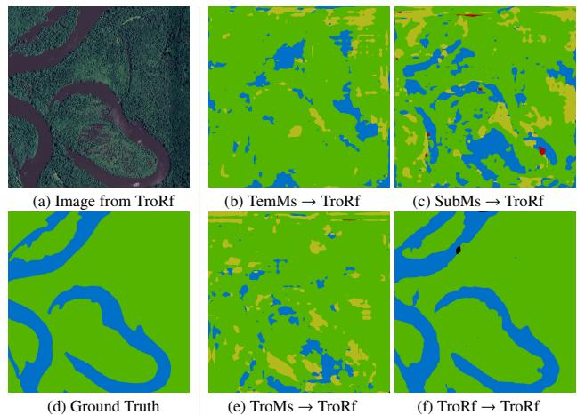  
Figure 1: Visualized results of semantic segmentation model (Chen et al., 2017). The “A → B" notation indicates that the model is trained on domain A and evaluated on domain B. Due to the climate domain gap, models trained on TemMs, SubMs, and TroMs fail to predict accurate results on TroRf climate zone.

To summarize, our contributions are as follows:

• We have conducted the first investigation into the impact of climate on land-cover semantic segmentation and introduced CASID, a unique climate-aware satellite image dataset with multiple domains. CASID not only benefits the research community in advancing algorithms with higher generalization ability but also has the potential to become a challenging benchmark for designing robust vision algorithms beyond the field of remote sensing.

• We analyze samples collected from four typical climate zones and statistically show their diferences in global image feature, image texture, category distribution, spectral value, and object shape. These analyses are valuable for inspiring subsequent research.

• We evaluate the latest semantic segmentation methods and unsupervised domain adaptation methods on the CASID dataset, which can serve as a solid baseline for future research.

The remainder of the paper is organized as follows: In Section 2, we introduce the related works. In Section 3, we provide a detailed description of CASID, including its properties, along with a series of statistical analyses. In Sections 4 and 5, we present the experimental details and results for land-cover semantic segmentation and unsupervised domain adaptation, respectively. Finally, we conclude our work in Section 6.

## 2. Related works

In this section, we first describe the development of land-cover datasets for semantic segmentation and then introduce semantic segmentation methods. Finally, we provide an overview of unsupervised domain adaptation methods.

## 2.1. Land-Cover Datasetsfor Semantic Segmentation

Recently, with the advancement of deep learning technology, large-scale datasets have played a crucial role in advancing scene understanding tasks such as land-cover semantic segmentation (Tong et al., 2020, Wang et al., 2021a). As shown in Table 2, datasets such as ISPRS Vaihingen, ISPRS Potsdam, Zurich Summer (Volpi and Ferrari, 2015), Zeebruges (Marcos et al., 2018a), USGS SIRI-WHU (Zhong et al., 2015), EvLab-SS (Zhang et al., 2017), and LandCover.ai (Boguszewski et al., 2021) are collected for land-cover semantic segmentation. These datasets provide remote sensing images with accurate pixel-wise land-cover labels and have contributed to the development of land-cover semantic segmentation methods. However, these datasets cover relatively small areas and contain a limited number of annotated image samples, which limits the generalization ability of relevant algorithms.

To address this limitation, several large-scale datasets have been proposed, including SpaceNet (Van Etten et al., 2018), DeepGlobe (Demir et al., 2018), AIRS (Chen et al., 2019), Land-CoverNet (Alemohammad and Booth, 2020), GID dataset (Tong et al., 2020), and LoveDA (Wang et al., 2021a). While these datasets collect image samples from diferent cities, they do not adequately consider the domain gap caused by the significant diversity among diferent geographic areas.

Specifically, land cover can be influenced and diversified by two factors: human management and climate (Wang et al., 2021a, Dale, 1997, Reidmiller et al., 2019). LoveDA (Wang et al., 2021a) demonstrates that human management contributes to diferentiation in the human living environment due to societal and economic development, causing a domain gap between urban and rural zones for land-cover semantic segmentation.

OpenEarthMap (Xia et al., 2023) collects samples from six continents to construct a global benchmark dataset with 2.2 million segments of aerial and satellite samples with large image sizes. However, the impact of climate on land-cover semantic segmentation, which is more profound than human management, has received limited investigation. The domain gap caused by climate can significantly degrade the performance of semantic segmentation methods, rendering them inefective in practical applications. To improve the model’s generalizability for largescale land-cover semantic segmentation, we have collected and annotated a large-scale Climate-Aware Satellite Image Dataset for land-cover semantic segmentation.

## 2.2. Semantic Segmentation

Land-cover semantic segmentation is a long-standing research topic that assigns a label to each pixel, also known as pixel-level classification. As a powerful technique for Earth observation, it has been widely explored over the past few decades Existing satellite image semantic segmentation methods are eminently motivated by the fully-convolutional networks (FCNs) (Long et al., 2015). Several earlier works (Kaiser et al., 2017, Marmanis et al., 2018, Marcos et al., 2018b) focus on using multilevel semantic features on local patterns of images using deep CNN. Besides, there are also some methods (Mou et al., 2019) capturing long-range spatial relationships between entities by proposing spatial and channel relation modules. Though previous works have achieved great advances, there are two critical issues, one is an extremely foreground-background imbalanced distribution, and the other is multiple small objects along with the complex background. Recently, FarSeg (Zheng et al., 2020) utilizes relation-based and optimization-based foreground modeling to handle the foreground-background imbalance problems in remote sensing imagery. Factseg (Ma et al., 2021) uses a foreground activation object representation framework made up of a dual-branch decoder and collaborative probability loss. It efectively suppresses background distractions while also enhancing the small object features.

## 2.3. Unsupervised Domain Adaptation

Unsupervised domain adaptation is a technique aimed at reducing the performance loss caused by the domain gap. It involves transferring a model trained on the source domain to the target domain. This technique is efective in reducing the domain gap caused by climate. Recent advancements in unsupervised domain adaptation have been made in two branches: adversarial training and self-training.

Adversarial training methods typically involve an extractor that learns domain-invariant features and a discriminator that distinguishes these features. Tsai et al. (Tsai et al., 2018) utilize spatial similarities in semantic outputs to adapt the structured output space through adversarial learning. To address the misalignment of category-level joint distribution, Luo et al. (Luo et al., 2019) introduce a category-level adversarial network that aligns each class with an adaptive adversarial loss. Wang et al. (Wang et al., 2020b) align class-level features through a finegrained adversarial learning framework. To avoid distorting the target-domain feature distribution, Ning et al. (Ning et al., 2021) incorporate active learning to assist domain adaptation and achieve superior segmentation performance.

Table 2: Comparison between our CASID and the main land-cover datasets for semantic segmentation (SS) and unsupervised domain adaptation (UDA).
<table><tr><td>Dataset</td><td>Year</td><td>Resolution (m)</td><td>Area (km²)</td><td>Image size</td><td>Images</td><td>Categories</td><td>Domains</td><td>SS Task</td><td>UDA Task</td></tr><tr><td>ISPRS Vaihingen</td><td>2013</td><td>0.09</td><td>1.4</td><td>1887~3816</td><td>33</td><td>6</td><td>1</td><td>√</td><td></td></tr><tr><td>ISPRS Postdam</td><td>2013</td><td>0.05</td><td>3.4</td><td>6000×6000</td><td>38</td><td>6</td><td>1</td><td>√</td><td></td></tr><tr><td>Zurich Summer (Volpi and Ferrari, 2015)</td><td>2015</td><td>0.6</td><td>9.4</td><td>1000×1150</td><td>20</td><td>8</td><td>1</td><td>√</td><td></td></tr><tr><td>USGS SIRI-WHU (Žhong et al., 2015)</td><td>2015</td><td>0.6</td><td>33.50</td><td>9000 × 10000</td><td>1</td><td>4</td><td>1</td><td>√</td><td></td></tr><tr><td>EvLab-SS (Zhang et al., 2017)</td><td>2017</td><td>0.1 ~ 2</td><td>722.0</td><td>4500 × 4500</td><td>60</td><td>11</td><td>1</td><td>√</td><td></td></tr><tr><td>SpaceNet (Van Etten et al., 2018)</td><td>2017</td><td>0.5</td><td>2544.0</td><td>406~439</td><td>6000</td><td>2</td><td>1</td><td>√</td><td></td></tr><tr><td>DeepGlobe (Demir et al., 2018)</td><td>2018</td><td>0.5</td><td>1716.9</td><td>2448 × 2448</td><td>1146</td><td>7</td><td>1</td><td>√</td><td></td></tr><tr><td>Zeebruges (Marcos et al., 2018a)</td><td>2018</td><td>0.05</td><td>1.8</td><td>10000 × 10000</td><td>7</td><td>8</td><td>1</td><td>√</td><td></td></tr><tr><td>AIRS (Chen et al., 2019)</td><td>2019</td><td>0.07</td><td>475.0</td><td>10000 × 10000</td><td>1047</td><td>2</td><td>1</td><td>√</td><td></td></tr><tr><td>GID (Tong et al., 2020)</td><td>2020</td><td>4</td><td>75900.0</td><td>6800 × 7200</td><td>150</td><td>5</td><td>1</td><td>√</td><td></td></tr><tr><td>LandCover.ai(Boguszewski et al., 2021)</td><td>2021</td><td>0.25 ~ 0.5</td><td>216.3</td><td>4200~9500</td><td>41</td><td>3</td><td>1</td><td>√</td><td></td></tr><tr><td>LoveDA (Wang et al., 2021a)</td><td>2021</td><td>0.3</td><td>536.2</td><td>1024× 1024</td><td>5987</td><td>7</td><td>2</td><td>√</td><td>√</td></tr><tr><td>OpenEarthMap (Xia et al., 2023)</td><td>2023</td><td>0.25~0.5</td><td>799.0</td><td>1024× 1024</td><td>5000</td><td>8</td><td>6</td><td>√</td><td>√</td></tr><tr><td>CASID (Ours)</td><td>2023</td><td>1</td><td>24500.0</td><td>5000×5000</td><td>980</td><td>5</td><td>4</td><td>√</td><td>√</td></tr></table>

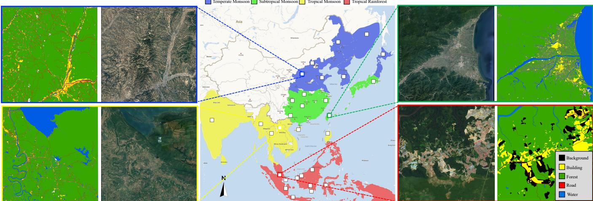  
Figure 2: The distribution of geographical locations of images in CASID. The “□” indicates the sampling areas. The blue, green, yellow, and red in the climate map indicate four typical climates, i.e., temperate monsoon, subtropical monsoon, tropical monsoon, and tropical rainforest (Shuzhen, 1980). We provide visual example of representative images from the four climate zones along with their corresponding pixel-wise land-cover labels.

Self-training methods generate pseudo-labels on the target data and fine-tune the model on the source data alternately. Lian et al. (Lian et al., 2019) connect the self-training and curriculum adaptation and introduces the self-motivated pyramid curriculum. It observes the target properties and fuses multiscale features for semantic segmentation domain adaptation. To solve the class imbalance problem of pseudo-labels in selftraining, Zou et al. (Zou et al., 2018) propose a class-balanced self-training strategy to sample pseudo-labels. To improve the quality of pseudo-labels and achieve sample balance, Mei et al. (Mei et al., 2020) design an instance adaptive self-training selector, which can involve more useful information for training. Recently, Wang et al. (Wang et al., 2021b) propose a novel uncertainty-aware pseudo label refinery framework for utilizing both accurate prediction and uncertain prediction with low confidence in pseudo labels. Cheng et al. (Cheng et al., 2021)

propose a novel dual-path learning framework to alleviate visual inconsistency. Zhou et al. (Zhou et al., 2020) leverage co-occurring patterns between pairwise pixels in the output of structured semantic segmentation. Yuan et al. (Yuan et al., 2022) propose an Inter-class Separation and Intra-class Aggregation (ISIA) mechanism to address the class confusion problem and designs an Adaptive-weighted Instance Matching (AIM) strategy for instance-level adaptation. Hoyer et al. (Hoyer et al., 2022) propose DAFormer, which utilizes a Transformer encoder and multi-level context-aware feature fusion decoder and achieves state-of-the-art performance with significant improvement.

For the remote sensing community, there have been a series of works exploring few-shot transfer learning for Synthetic Aperture Radar (SAR) image classification (Tai et al., 2022, Tang et al., 2019, Rostami et al., 2019, Gao et al., 2022). Rostami et al. (Rostami et al., 2019) propose a framework for SAR image classification that transfers knowledge from the Electro-Optical (EO) domain to eliminate the need for a large labeled dataset. Tang et al. (Tang et al., 2019) utilize an improved Siamese

Table 3: The division of the CASID dataset. Images are collected from 30 regions, covering 4 typical climate zones. For each climate zone, we choose two regions as the test set and leave the rest as the train set. The train set and test set account for around 70% and 30% of the whole dataset, respectively.
<table><tr><td>Climate</td><td>Region</td><td>Images</td><td>Train/Test split</td><td>Subtotal</td></tr><tr><td rowspan="6">Temperate monsoon (TemMs set)</td><td>Hokkaido, Japan</td><td>21</td><td rowspan="6">Train: 201</td><td rowspan="6">284</td></tr><tr><td>Seoul, South Korea</td><td>55</td></tr><tr><td>Zhangjiakou, Hebei, China</td><td>35</td></tr><tr><td>Weifang, Shandong, China</td><td>48</td></tr><tr><td>Daqing, Heilongjiang, China</td><td>42</td></tr><tr><td>Belkhabarovsk, Russia Lyuliang, Shanxi, China</td><td>35 Test: 83 48</td></tr><tr><td rowspan="6">Subtropical monsoon (SubMs set)</td><td>Yilan, Taiwan, China</td><td></td><td rowspan="6">Train: 196</td><td rowspan="6">284</td></tr><tr><td>Jingmen, Hubei, China</td><td>35</td></tr><tr><td>Baise, Guangxi, China</td><td>39 38</td></tr><tr><td>Chongqing, China</td><td>48</td></tr><tr><td>Jinhua, Zhejiang, China</td><td>36</td></tr><tr><td>Tokyo, Japan</td><td>56</td></tr><tr><td rowspan="6">Tropical monsoon (TroMs set)</td><td>Shaoyang, Hunan, China</td><td>32</td><td rowspan="3">Train: 136</td><td rowspan="6">202</td></tr><tr><td>Wanning, Hainan, China</td><td>22</td></tr><tr><td>Chiang Mai, Thailand</td><td>36</td></tr><tr><td>Vientiane, Laos Bhopal, India</td><td>36 42</td><td rowspan="3">Test: 66</td></tr><tr><td>Around Laoag, Philippines</td><td>30</td></tr><tr><td>NayPyitaw, Myanmar</td><td>36</td></tr><tr><td rowspan="8">Tropical rainforest (TroRf set)</td><td></td><td></td><td rowspan="8">Train: 148</td><td rowspan="8">210</td></tr><tr><td>Kuala Lumpur, Malaysia</td><td>24</td></tr><tr><td>Lorilindu National Park, Indonesia</td><td>19</td></tr><tr><td>Linkcuo Port, Singapore</td><td>14</td></tr><tr><td>Kuching, Malaysia</td><td>36</td></tr><tr><td>Mandor, Indonesia</td><td>24</td></tr><tr><td>Guaralupa, Indonesia Klaa, Indonesia</td><td>13 8</td></tr><tr><td>Palembang, Indonesia</td><td>10</td></tr><tr><td rowspan="2">Total</td><td>Pharaangkaraya, Indonesia Seri Begawan, Malaysia</td><td>26 36</td><td>Test: 62</td><td rowspan="2">980 images</td></tr><tr><td>Train: 22 regions Test: 8 regions</td><td>30 regions</td><td>Train: 681 images Test: 299 images</td></tr></table>

Network approach for SAR target few-shot learning. Gao et al. (Gao et al., 2022) introduce a novel few-shot learning method for SAR image recognition, which consists of a multi-feature fusion network (MFFN) and a weighted distance classifier (WDC) to enhance the feature extraction and classification capability. Tai et al. (Tai et al., 2022) propose the connection-free attention module to selectively transfer features shared between EO and SAR samples from a source network to a target network to supplement the loss of information brought by extra SAR samples. Besides, unsupervised domain adaptation methods also have been studied for land-cover semantic segmentation (Tong et al., 2020, Tasar et al., 2020). These methods follow the general unsupervised domain adaptation approach in the computer vision field, with some improvements. However, due to the lack of datasets with consistent annotation granularity and high diversity, the advancement of unsupervised domain adaptation algorithms for remote sensing has been limited. To push the advancements further, the CASID dataset is proposed as a more challenging benchmark, promoting future research of remote sensing unsupervised domain adaptation algorithms and relevant applications.

## 3. Dataset Description

This section first describes the characteristics of the proposed Climate-Aware Satellite Image Dataset (CASID) for domain adaptive land-cover semantic segmentation. Then, it provides a statistical analysis of the climate domain gap.

## 3.1. Overview and Dataset Properties

The climate factor has a significant impact on land cover features, posing a challenge to existing deep learning models. In order to advance satellite imagery for earth observation and enhance generalizability, we are investigating the impact of climate on land-cover semantic segmentation for the first time. We introduce a large-scale Climate-Aware Satellite Image Dataset for land-cover semantic segmentation, named CASID, which can be utilized for two challenging tasks: land-cover semantic segmentation and unsupervised domain adaptation. The main characteristics of this dataset can be summarized as follows:

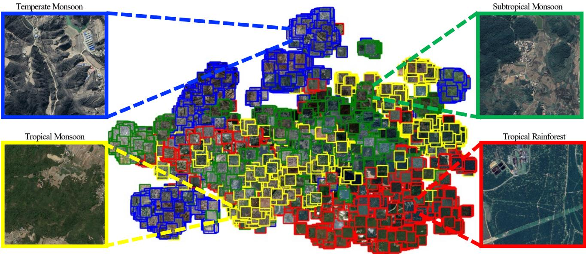  
Figure 3: The visualization of global image features analysis on CASID. We employ two-dimensional t-SNE (Van der Maaten and Hinton, 2008) for visualization. Colored squares indicate global image features of 1024 × 1024 image patches sampled from four climate domains in CASID. To extract the global image features from the image patches, we utilize InceptionV3 (Szegedy et al., 2016). The colors blue, green, yellow, and red represent image patches from the following climate domains: temperate monsoon, subtropical monsoon, tropical monsoon, and tropical rainforest, respectively. After applying t-SNE, we observe that the distribution of image features from the four climate domains closely resembles the distribution of geographical locations shown in Figure 2. This demonstrates the correlation between land cover and climate zone.

Table 4: Semantic segmentation results on the test set of CASID. We conduct all experiments five times and present the mean and variance results below. Bkgd: Background, Bldg: Building, Frst: Forest, Rd: Road, Wtr: Water.
<table><tr><td rowspan="2"></td><td rowspan="2">Backbone</td><td colspan="5">IoU (%)</td><td rowspan="2">mIoU</td><td rowspan="2">Dice</td></tr><tr><td>Bkgd</td><td>Bldg</td><td>Frst</td><td>Rd</td><td>Wtr</td></tr><tr><td>FCN8S (Long et al., 2015)</td><td>VGG-16</td><td>51.9</td><td>75.5</td><td>74.7</td><td>32.2</td><td>51.6</td><td>57.2 (±0.3)</td><td>71.3 (±0.3)</td></tr><tr><td>U-Net (Ronneberger et al., 2015)</td><td>ResNet-50</td><td>53.3</td><td>77.5</td><td>76.3</td><td>41.0</td><td>60.9</td><td>61.8 (±1.2)</td><td>75.6 (±1.0)</td></tr><tr><td>PSPNet (Zhao et al., 2017)</td><td>ResNet-50</td><td>53.7</td><td>77.1</td><td>75.3</td><td>34.0</td><td>45.3</td><td>57.1 (±0.4)</td><td>71.2 (±0.3)</td></tr><tr><td>LinkNet (Chaurasia and Culurciello, 2017)</td><td>ResNet-50</td><td>52.8</td><td>78.0</td><td>76.8</td><td>40.8</td><td>63.4</td><td>62.3 (±0.2)</td><td>75.8 (±0.2)</td></tr><tr><td>DeepLabV3+ (Chen et al., 2018)</td><td>ResNet-50</td><td>53.4</td><td>76.2</td><td>74.5</td><td>38.9</td><td>42.5</td><td>56.9 (±0.5)</td><td>71.4 (±0.6)</td></tr><tr><td>PAN (Li et al., 2018)</td><td>ResNet-50</td><td>54.9</td><td>76.9</td><td>75.6</td><td>35.7</td><td>37.2</td><td>56.0 (±0.7)</td><td>70.1 (±0.6)</td></tr><tr><td>U-Net++ (Zhou et al., 2018)</td><td>ResNet-50</td><td>53.2</td><td>77.8</td><td>76.2</td><td>42.3</td><td>60.0</td><td>61.9 (±0.6)</td><td>75.6 (±0.4)</td></tr><tr><td>HRNet (Wang et al., 2020a)</td><td>HRNetW32</td><td>52.5</td><td>78.6</td><td>74.4</td><td>43.8</td><td>55.2</td><td>60.9 (±0.8)</td><td>74.8 (±0.6)</td></tr><tr><td>FarSeg (Zheng et al., 2020)</td><td>ResNet-50</td><td>52.5</td><td>77.0</td><td>73.8</td><td>40.8</td><td>46.6</td><td>58.2 (±0.7)</td><td>72.5 (±0.7)</td></tr><tr><td>FactSeg (Ma et al., 2021)</td><td>ResNet-50</td><td>52.8</td><td>77.5</td><td>74.6</td><td>38.9</td><td>46.1</td><td>58.0 (±1.1)</td><td>72.2 (±1.0)</td></tr><tr><td>SegFormer (Xie et al., 2021)</td><td>MiT-B0</td><td>55.6</td><td>77.5</td><td>77.0</td><td>36.9</td><td>60.7</td><td>61.7 (±2.0)</td><td>75.0 (±1.5)</td></tr><tr><td>SegFormer (Xie et al., 2021)</td><td>MiT-B5</td><td>54.9</td><td>78.5</td><td>76.1</td><td>42.7</td><td>62.8</td><td>63.0 (±0.2)</td><td>76.4 (±0.1)</td></tr><tr><td>PoolFormer (Yu et al., 2022)</td><td>PoolFormer-S12</td><td>55.0</td><td>77.1</td><td>76.5</td><td>36.5</td><td>57.8</td><td>60.6 (±1.6)</td><td>74.3 (±1.3)</td></tr><tr><td>PoolFormer (Yu et al., 2022)</td><td>PoolFormer-M48</td><td>55.8</td><td>77.7</td><td>77.5</td><td>38.6</td><td>63.8</td><td>62.7 (±2.2)</td><td>75.9 (±1.7)</td></tr><tr><td>SegNeXt (Guo et al., 2022)</td><td>MSCAN-T</td><td>57.0</td><td>78.2</td><td>78.3</td><td>39.9</td><td>50.3</td><td>60.7 (±0.8)</td><td>74.4 (±0.7)</td></tr><tr><td>SegNeXt (Guo et al., 2022)</td><td>MSCAN-L</td><td>57.0</td><td>79.2</td><td>77.9</td><td>44.1</td><td>58.6</td><td>63.4 (±1.1)</td><td>76.7 (±0.9)</td></tr></table>

Climate-aware. To investigate the impact of climate on the landcover semantic segmentation, we collect satellite images from four typical climate zones, i.e., temperate monsoon, subtropical monsoon, tropical monsoon, and tropical rainforest (Shuzhen, 1980). Samples from four typical climate zones form four subdatasets/domains regarding their climate types. Owing to different temperatures and precipitation, satellite images from different climate zones show diferent manifestations, as shown in Figure 2. We also statistically analyze the images from these four typical climate zones and find their features strongly correlate with climate in Section 3.2.

Large-scale, high diversity, and large image size. To increase the diversity of the CASID dataset, we collect 980 high-quality satellite images with a size of 5 000 × 5 000 pixels obtained from the Google Earth platform, whose spatial resolution is 1 meter. They are acquired from 30 diferent cities/regions around Asia, including densely populated areas and sparsely populated suburbs. These cities have very diferent land cover features. They are widely distributed over geographic areas covering more than 24,500 km2 and have very diferent land cover features, as shown in Figure 2. Due to the extensive geographical distribution, CASID represents diversified distribution information of ground objects in diferent areas. And to keep the sample balance, we collect a similar number (200∼300) of image samples for each climate. As shown in Table 3, for each type of climate, we collect samples from 6∼10 cities/regions, and 2 of them are kept as the test set for evaluation. In this way, we split ∼70% of these images into the train set and leave the rest of ∼30% as the test set.

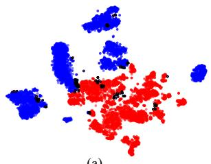

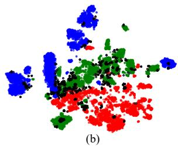

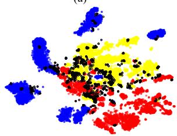  
(c)

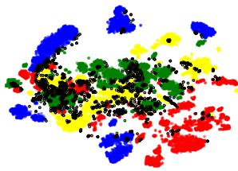  
(d)  
Figure 4: The visualization of global image features analysis on CASID. We use two-dimensional t-SNE (Van der Maaten and Hinton, 2008) for visualization. The symbol “◦" indicates the marginal data, which are predicted by the k-Nearest Neighbors (k-NN) algorithm. If a data point’s nearest neighbor belongs to a diferent category, then that data point can be considered one of the marginal points, i.e., they are at the boundary of diferent domains. Zoom for better details.

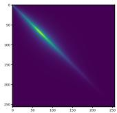  
(a) TemMs

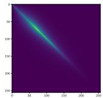  
(b) SubMs

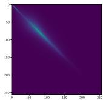  
(c) TroMs

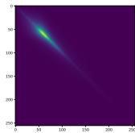  
(d) TroRf

Figure 5: The visualization of grey level co-occurrence matrix (GLCM) (Haralick et al., 1973) for each domain in the CASID.  
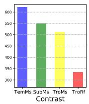

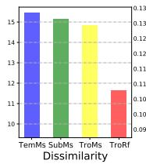

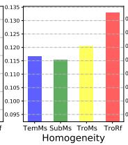

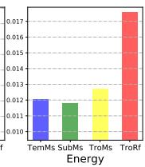  
Figure 6: The visualization of four GLCM properties on the CASID, i.e., contrast, dissimilarity, homogeneity, and energy. Blue: TemMs, Green: SubMs, Yellow: TroMs, Red: TroRf.

High inter- and intra-domain variance. Thanks to its largescale, high diversity, and climate-aware properties, CASID exhibits high inter- and intra-domain variance, as shown in the t-SNE visualization in Section 3.2. The high inter-domain variance makes it more challenging, as demonstrated in Table 1, while the high intra-domain variance benefits unsupervised domain adaptation, as discussed in Section 5.

Well annotated. For each satellite image, we provide accurate pixel-wise semantic segmentation labels for five categories, i.e., background, building, forest, road, and water. They are annotated by a group of experts and labeled with black, yellow, green, red, and blue, as shown in Figure 2.

Complex background. The remote sensing land-cover semantic segmentation task is always faced with complex background samples (i.e., land-cover objects that are not of interest) (Pang et al., 2019, Zheng et al., 2020). The large image size and diverse scenes in the CASID dataset provide rich details and introduce a larger intra-class variance for the background samples. This benefits the learning of semantic segmentation models and helps them efectively handle the complex background in remote sensing images.

Category imbalance. Diferent land types naturally exhibit diverse shapes and sizes. For instance, the road category is characterized by its elongated and narrow form, while the forest category can span a significant surface area. This inherent variation in shape and size contributes to the challenge of category imbalance. As a result, the proportions of diferent land categories difer significantly, further exacerbating the issue. The presence of category imbalance poses a unique challenge for tasks such as semantic segmentation and unsupervised domain adaptation. Addressing this challenge requires developing efective strategies to handle the varying proportions of land categories within the dataset.

## 3.2. Statistics Analysis for Climate Domain Gap

The climate greatly afects the manifestation of land cover. In general, the climate is the major determinant of vegetation (Prentice, 1990, Woodward et al., 2004, Salazar et al., 2007). Climate zones with higher temperatures and more rainfall support more productive and diverse plant communities, while regions with lower temperatures and less precipitation typically have less productive vegetation. The climate also impacts other land cover types, such as water bodies, which are afected by precipitation and evapotranspiration.

Additionally, the appearance of buildings and roads are also afected by the climate, they are designed with considerations of temperature and precipitation (Golany, 1996, Givoni, 1998). For example, areas with high precipitation levels may require the use of diferent building materials or construction methods to prevent water damage. Areas with high temperatures may require materials with higher thermal insulation to maintain a comfortable indoor temperature. Similarly, roads may be designed with diferent materials and widths based on the climate and weather patterns in the region. These variations in building and road design can result in significant diferences in their spectral values, further contributing to the climate domain gap for land-cover semantic segmentation. As shown in Figures 2 and 3, the satellite images from diferent climates zone show diferent perceptual characteristics to human eyes. We refer to these diferences caused by climate as the climate domain gap. To statistically describe the climate domain gap, we further analyze it in various aspects, including global image features, image texture, category distribution, spectral values, and object shape.

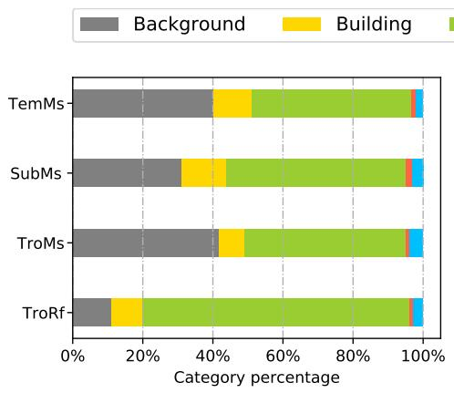

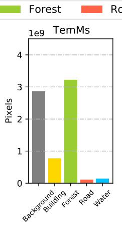

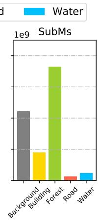

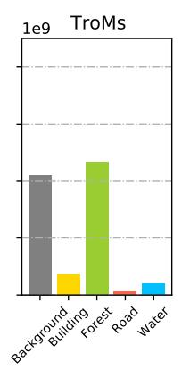

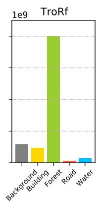  
Figure 7: Statistics for category distributions. We present the category distribution and corresponding pixel sample numbers for each climate zone. These results demonstrate that the distribution of categories varies across climate zones.

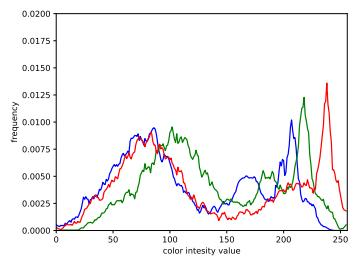  
(a) TemMs

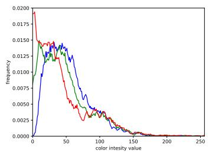  
(b) SubMs

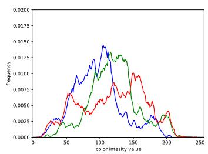  
(c) TroMs

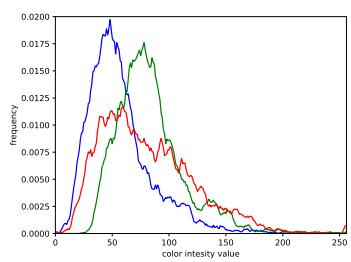  
(d) TroRf  
Figure 8: Image coloration analysis. We show the histograms of red, green, and blue color for each domain in the CASID. The histogram of each domain is very diferent from the other domains. This diference may contribute to the climate domain gap.

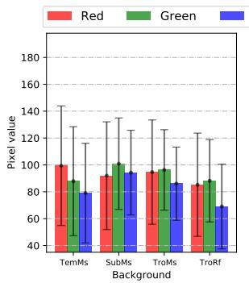

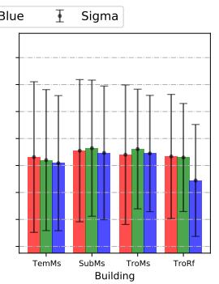

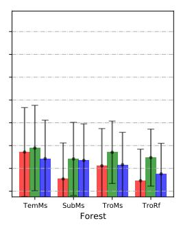

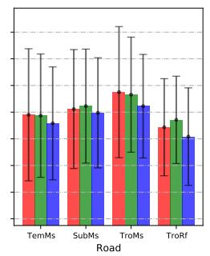

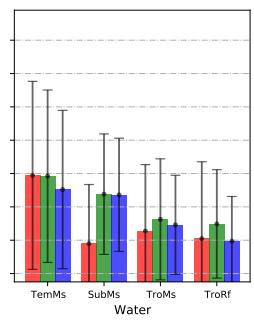  
Figure 9: Statistics for spectral values. We present the mean and standard deviation (sigma) for the red, green, and blue spectral values of each category in the four climate zones. Our findings indicate that the spectral values of the same category vary significantly across diferent climate zones, resulting in large intra-clas variance.

Global image feature. To analyze the diferences in global image features between images from diferent climate zones, we first uniformly sample images from the CASID dataset and crop them into 1024 × 1024 image patches. Then, following the approach in (Salimans et al., 2016), we employ InceptionV3 (Szegedy et al., 2016) to generate a global pooled 2048-dimensional vector as the global image feature representation for each image patch. Finally, we utilize t-SNE (Van der Maaten and Hinton, 2008) for dimension reduction and visualization. The two-dimensional t-SNE visualization of the CASID dataset is shown in Figure 3. The images from the four climate zones are clearly separated by t-SNE, indicating a significant domain gap caused by climate. Interestingly, the t-SNE visualization in Figure 3 exhibits a similar pattern to the distribution of climate areas on the climate map in Figure 2.

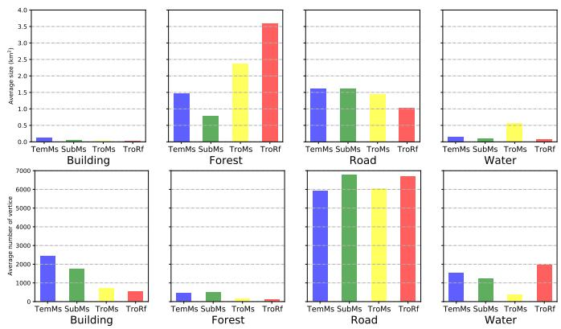  
Figure 10: Statistics of object shape. The average size depicts the scale of objects, and the number of vertices in an object polygon represents the complexity of its shape.

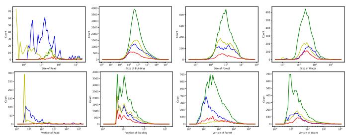  
Figure 11: Histogram of object shape distribution. The size depicts the scale of objects, and the vertice represents the complexity of its shape.

To provide further elaboration, we present additional visualized t-SNE results in Figure 4. In Figure 4(a), a clear boundary and distinct distributions can be observed between the TemMs domain and the TroRf domain. This indicates a significant domain gap between these two domains. When we introduce samples from the SubMs domain or the TroMs domain, as shown in Figures 4(b) and (c), most of these samples are positioned between the TemMs domain and the TroRf domain. This suggests that the domain diferences between SubMs/TroMs and TemMs/TroRf are less pronounced compared to the diference between TemMs and TroRf. It demonstrates a gradual change in image features from TemMs to TroRf. Therefore, the t-SNE result of the four domains in Figure 4(d) is consistent with the geographical location diferences between these domains. These results suggest that the climate zone is a significant factor in influencing image manifestation and global image features.

Image texture. We use a classic grey level co-occurrence matrix (GLCM) (Haralick et al., 1973) for texture feature extraction. As shown in Figure 5, we can see the visualization of

GLCM for each domain in the CASID gradually change from left (TemMs) to right (TroRf), which is consistent with the global image feature analysis. We further calculate the texture properties of GLCM, $i . e .$ , contrast, dissimilarity, homogeneity, and energy. These properties are computed as follows:

$$
{ \mathrm { C o n t r a s t } } = \sum _ { i = 0 } ^ { N - 1 } \sum _ { j = 0 } ^ { N - 1 } ( i - j ) ^ { 2 } \cdot P _ { i , j } .\tag{1}
$$

$$
{ \mathrm { D i s s i m i l a r i t y } } = \sum _ { i = 0 } ^ { N - 1 } \sum _ { j = 0 } ^ { N - 1 } | i - j | \cdot P _ { i , j } .\tag{2}
$$

$$
{ \mathrm { H o m o g e n e i t y } } = \sum _ { i = 0 } ^ { N - 1 } \sum _ { j = 0 } ^ { N - 1 } { \frac { P _ { i , j } } { 1 + ( i - j ) ^ { 2 } } } .\tag{3}
$$

$$
\mathrm { E n e r g y } = \sum _ { i = 0 } ^ { N - 1 } \sum _ { j = 0 } ^ { N - 1 } P _ { i , j } ^ { 2 } .\tag{4}
$$

where $( i , j )$ are the coordinates of the GLCM, N indicates grey level, and $P _ { i , j }$ represents the probability of $( i , j )$ in the GLCM.

Contrast measures the local variations in intensity. Dissimilarity measures the dissimilarity between adjacent pixels in the image. Homogeneity measures the similarity or uniformity of neighboring pixel values. Energy measures the magnitude or strength of the texture in the image. As shown in Figure $^ { 6 , }$ statistical analysis on the basis of GLCM demonstrates that contrast, dissimilarity, homogeneity, and energy also gradually change from TemMs to the TroRf domain. These results show the texture of images is associated with the domain gap and correlated with the climate zone.

Category distribution. As shown in Figure $^ { 7 , }$ diferent climate zones show significant variations in class distributions. Due to variances in temperature and precipitation, regions within the tropical rainforest climate zone are typically characterized by dense rainforests, resulting in a substantial proportion of the forest category, specifically 76.2%. In contrast, the temperate monsoon climate zone generally features less forest coverage, with the percentage of forest pixels being considerably lower than that of the tropical rainforest climate zone (76.2% for tropical rainforest area vs. 45.4% for temperate monsoon area). This observation underscores the impact of climate on the distribution of land-cover categories.

Spectral value. Figure 8 illustrates histograms of the red, green, and blue for each domain in the CASID dataset. Each domain possesses a distinct histogram that reflects its unique characteristics. In Figure 9, we further compare the spectral value distributions of diferent categories across four climate zones. Notably, the spectral values of the same category vary across the diferent climates. For instance, the forest category in the tropical rainforest area demonstrates lower mean values for red and blue channels. On the other hand, the background in the temperate monsoon area exhibits a higher mean value of red, indicating significant inter-class variance among the diferent climate zones.

Object shape. We present the object shape statistics in Figure 10, where the average size represents the scale of objects, and the number of vertices in an object polygon reflects the complexity of its shape. Diferent categories of land types exhibit various shapes and sizes. For example, the road category is thin, long, and curved, resulting in relatively more vertices. On the other hand, forests can cover large surface areas, leading to a relatively large average size. Moreover, the average object size and number of vertices in each category vary from TemMs to TroRf, indicating that object shapes of land-cover categories are associated with the climate. Additional histograms of object shape distribution for each category are shown in Figure 11.

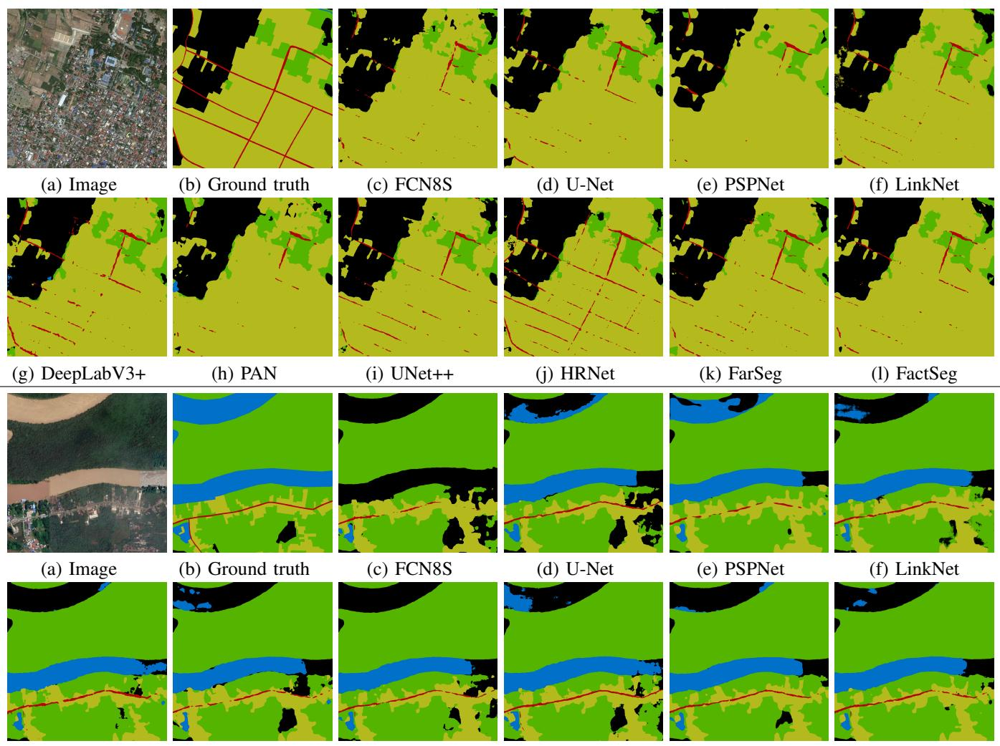  
(g) DeepLabV3+  
(h) PAN  
(i) UNet++  
(j) HRNet  
(k) FarSeg  
(l) FactSeg  
Figure 12: Representative visualized segmentation results. The top two rows are the samples from TemMs set, and the bottom rows are the samples from SubMs set.

## 4. Experiments for Land-Cover Semantic Segmentation

In this section, we evaluate the following state-of-the-art semantic segmentation approaches to provide baseline results on the newly created CASID dataset. We choose some representative methods that are commonly used in remote sensing. Specifically, the selected networks are: FCN8S (Long et al., 2015), DeepLabV3+ (Chen et al., 2018), PAN (Li et al., 2018), U-Net (Ronneberger et al., 2015), U-Net++ (Zhou et al., 2018), PSPNet (Zhao et al., 2017), LinkNet (Chaurasia and Culurciello,

Table 5: Results reported on LoveDA (Wang et al., 2021a) with semantic segmentation model (Chen et al., 2017). It is trained and evaluated on images from diferent domains.

<table><tr><td>mIoU Test on Train on</td><td>Rural set</td><td>Urban set</td></tr><tr><td>Rural set</td><td>46.8</td><td>31.3</td></tr><tr><td>Urban set</td><td>31.7</td><td>45.7</td></tr><tr><td>Performance gap</td><td>15.1</td><td>14.4</td></tr></table>

2017), FarSeg (Zheng et al., 2020), FactSet (Ma et al., 2021), HRNet (Wang et al., 2020a), SegFormer (Xie et al., 2021), Pool-Former (Yu et al., 2022), and SegNeXt (Guo et al., 2022).

## 4.1. Evaluation Metric

Following the common practice in (Long et al., 2015, Chen et al., 2018), we use the intersection over union (IoU) to evaluate the semantic segmentation accuracy. In terms of IoU for

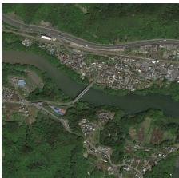  
(a) Image

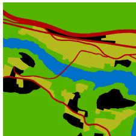  
(b) Ground truth

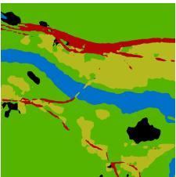  
(c) FCN8S

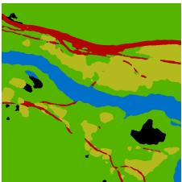

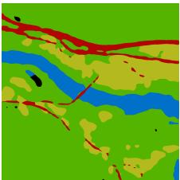

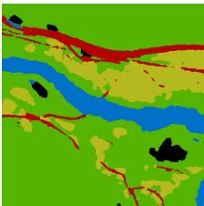

(d) U-Net  
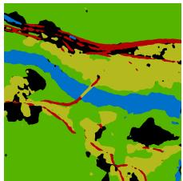

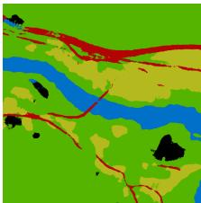

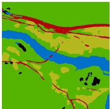  
(g) DeepLabV3+

(f) LinkNet  
(e) PSPNet  
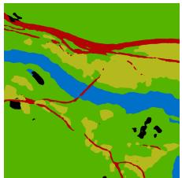

(h) PAN  
(i) UNet++  
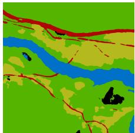

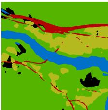

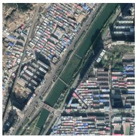

(l) FactSeg  
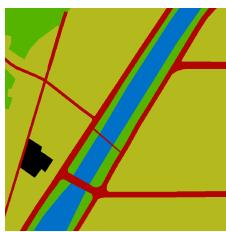

(j) HRNet  
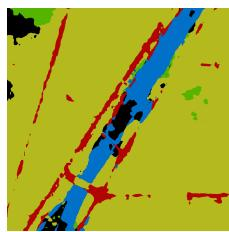

(k) FarSeg  
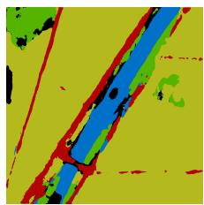  
(b) Ground truth  
(a) Image

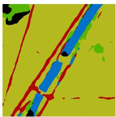

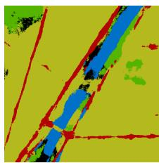

  
(g) DeepLabV3+

(c) FCN8S  
  
(h) PAN

(f) LinkNet  
  
(i) UNet++

(d) U-Net  
  
(j) HRNet

(e) PSPNet  
  
(k) FarSeg

  
(l) FactSeg  
Figure 13: Representative visualized segmentation results. The top two rows are the samples from TroMs set, and the bottom rows are the samples from TroRf set

Table 6: Results reported on OpenEarthMap (Xia et al., 2023) with semantic segmentation model (Chen et al., 2017). It is trained and evaluated on images from diferent domains. Asia: AS, Europe: EU, Africa: AF, North America: NA, South America: SA, and Oceania: OC.

<table><tr><td rowspan=1 colspan=1>mIoU  Test onTrain on</td><td rowspan=1 colspan=1>AF</td><td rowspan=1 colspan=1>AS</td><td rowspan=1 colspan=1>EU</td><td rowspan=1 colspan=1>NA</td><td rowspan=1 colspan=1>OC</td><td rowspan=1 colspan=1>SA</td></tr><tr><td rowspan=1 colspan=1>AF</td><td rowspan=1 colspan=1>49.5</td><td rowspan=1 colspan=1>35.2</td><td rowspan=1 colspan=1>27.5</td><td rowspan=1 colspan=1>31.8</td><td rowspan=1 colspan=1>35.6</td><td rowspan=1 colspan=1>36.9</td></tr><tr><td rowspan=1 colspan=1>AS</td><td rowspan=1 colspan=1>35.9</td><td rowspan=1 colspan=1>52.4</td><td rowspan=1 colspan=1>33.8</td><td rowspan=1 colspan=1>34.6</td><td rowspan=1 colspan=1>46.1</td><td rowspan=1 colspan=1>35.4</td></tr><tr><td rowspan=1 colspan=1>EU</td><td rowspan=1 colspan=1>26.8</td><td rowspan=1 colspan=1>37.9</td><td rowspan=1 colspan=1>53.1</td><td rowspan=1 colspan=1>40.5</td><td rowspan=1 colspan=1>51.2</td><td rowspan=1 colspan=1>37.2</td></tr><tr><td rowspan=1 colspan=1>NA</td><td rowspan=1 colspan=1>29.2</td><td rowspan=1 colspan=1>36.4</td><td rowspan=1 colspan=1>39.2</td><td rowspan=1 colspan=1>54.5</td><td rowspan=1 colspan=1>47.1</td><td rowspan=1 colspan=1>39.5</td></tr><tr><td rowspan=1 colspan=1>OC</td><td rowspan=1 colspan=1>29.7</td><td rowspan=1 colspan=1>35.1</td><td rowspan=1 colspan=1>30.4</td><td rowspan=1 colspan=1>33.1</td><td rowspan=1 colspan=1>55.9</td><td rowspan=1 colspan=1>31.3</td></tr><tr><td rowspan=1 colspan=1>SA</td><td rowspan=1 colspan=1>32.8</td><td rowspan=1 colspan=1>36.2</td><td rowspan=1 colspan=1>36.3</td><td rowspan=1 colspan=1>34.8</td><td rowspan=1 colspan=1>44.8</td><td rowspan=1 colspan=1>51.9</td></tr><tr><td rowspan=1 colspan=1>Performance gap</td><td rowspan=1 colspan=1>22.7</td><td rowspan=1 colspan=1>17.3</td><td rowspan=1 colspan=1>25.6</td><td rowspan=1 colspan=1>22.7</td><td rowspan=1 colspan=1>20.3</td><td rowspan=1 colspan=1>20.6</td></tr></table>

Table 7: Results of semantic segmentation model (Chen et al., 2017) trained and evaluated on images from diferent climate zone on the proposed CASID. TemMs: temperate monsoon, SubMs: subtropical monsoon, TroMs: tropical monsoon, TroRf: tropical rainforest.
<table><tr><td>mIoU Test on</td><td rowspan="2">TemMs set</td><td rowspan="2">SubMs set</td><td rowspan="2">TroMs set</td><td rowspan="2">TroRf set</td></tr><tr><td>Train on</td></tr><tr><td>TemMs set</td><td>39.9</td><td>9.4</td><td>10.9</td><td>12.2</td></tr><tr><td>SubMs set</td><td>10.0</td><td>60.9</td><td>12.8</td><td>15.3</td></tr><tr><td>TroMs set</td><td>12.2</td><td>12.8</td><td>56.5</td><td>9.1</td></tr><tr><td>TroRf set</td><td>8.5</td><td>10.2</td><td>12.8</td><td>49.0</td></tr><tr><td>Performance gap</td><td>31.4</td><td>51.5</td><td>45.6</td><td>39.9</td></tr></table>

each class, the mIoU represents the mean of the IoUs across all categories. Additionally, we also provide the Dice results.

## 4.2. Implementation details

The data split is shown in Table 3. During training, we use the Stochastic Gradient Descent (SGD) optimizer with a momentum of 0.9 and a weight decay of 1e-4. The learning rate was initially set to 1e-2, and a poly schedule (Chen et al., 2018) with a power of 0.9 is applied. For recent models like SegFormer (Xie et al.,

PoolFormer-m12

  
tes the sampling areas.Figure 14: Representative visualized segmentation results. From top to bottom are the samples from TemMs, SubMs, TroMs, and TroRf set.

2021), PoolFormer (Yu et al., 2022), and SegNeXt (Guo et al., 2022), we adopt their original training settings. For example, SegFormer is trained using AdamW (Loshchilov and Hutter, 2017) with an initial learning rate of 6e-5. The number of training iterations for all models is set to 40k with a batch size of 8. Data augmentation is applied by randomly cropping 512×512 patches from the original images, along with random mirroring and rotation. Following (Long et al., 2015, Chen et al., 2018, Wang et al., 2021a), the backbones used in all networks are pretrained on ImageNet (Russakovsky et al., 2015). We conduct all experiments five times and present the mean and variance results.

## 4.3. Quantitative Results

The quantitative results are provided in Table 4. We can see the categories of road and water are more challenging than building and forest, due to their thin and long shapes. The FCN8S (Long et al., 2015) and PAN (Li et al., 2018) with a shallow backbone of VGG-16 (Simonyan and Zisserman, 2015) and ResNet-50 (He et al., 2016) show relatively low performance, i.e., 57.2 mIoU and 56.0 mIoU. By using multi-scale context information, deeplabV3+ (Chen et al., 2018) and PSP-Net (Zhao et al., 2017) achieve 56.9 mIoU and 57.1 mIoU. FarSeg (Zheng et al., 2020) and FactSeg (Ma et al., 2021) improve the semantic segmentation model to pay attention to the foreground of remote sensing images, and their performance reaches 58.2 mIoU and 58.0 mIoU. With a stronger backbone of

HRNet-W32 (Wang et al., 2020a), HRNet (Wang et al., 2020a) achieves better performance, i.e., 60.9 mIoU, especially for road categories. U-Net (Ronneberger et al., 2015), U-Net++, and LinkNet (Chaurasia and Culurciello, 2017) enhance the semantic segmentation model by utilizing detail information in shallow features. Thus they achieve much better accuracy for categories of road and water, which require detail information on the most. Among them, the LinkNet (Chaurasia and Culurciello, 2017) achieves a high accuracy of 62.3 mIoU. By utilizing a self-attention mechanism, recent transformer-based architectures such as SegFormer (Xie et al., 2021) and PoolFormer (Yu et al., 2022) have shown competitive results in land-cover semantic segmentation, achieving 63.0 and 62.7 mIoU, respectively. In contrast, the recent CNN-based SegNeXt (Guo et al., 2022) employs eficient convolutional attention and has achieved the highest results of 63.4 mIoU.

## 4.4. Qualitative Results

Some representative results are shown in Figures 12, 13, and 14. The road category proves to be the most challenging, as most methods fail to accurately predict it. In contrast, the forest category achieves higher accuracies across all methods. This can be attributed to the forest’s strong spectral homogeneity (low intra-class variance) and distinct spectral features compared to other categories (large inter-class variance), as shown in Figure 9. Moreover, the road’s thin and elongated shape makes it susceptible to being obscured by roadside trees or shadows from buildings.

Table 8: Unsupervised domain adaptation results on the test set of the CASID dataset. Bkgd: Background, Bldg: Building, Frst: Forest, Rd: Road, Wtr: Water. All experiments are repeated five times, and the mean (mIoU) and variance (±) results are presented. The "\*" indicates DAFormer (Hoyer et al., 2022) using stronger SegFormer (Xie et al., 2021) as the segmentation model. All other methods, including "target/source only," use the standard DeepLabV2 (Chen et al., 2017) model.
<table><tr><td rowspan="2">Method</td><td rowspan="2">Domain Source → Target</td><td colspan="4">IoU (%)</td><td rowspan="2">Wtr</td><td rowspan="2">mIoU (%)</td><td rowspan="2">± (%)</td><td rowspan="2">Domain Bkgd</td><td colspan="6">IoU (%)</td><td rowspan="2">± (%)</td></tr><tr><td>Bkgd</td><td>Bldg</td><td>Frst</td><td>Rd</td><td></td><td>Source → Target</td><td>Bldg</td><td>Frst</td><td>Rd</td><td>mIoU (%) Wtr</td></tr><tr><td>Target only Source only</td><td rowspan="6">TemMs → TemMs</td><td>49.4 0.3</td><td>60.9 8.3</td><td>62.6 41.2</td><td>24.7 0.1</td><td>1.9 0.4</td><td>39.9 10.0</td><td rowspan="6">TroMs → TroMs TemMs → TroMs</td><td></td><td>68.9 59.8 1.1</td><td>78.5 48.8</td><td>14.0 0.2</td><td>61.4 3.0</td><td></td><td>0.2 0.8</td></tr><tr><td>AdaptSeg (Tsai et al., 2018) CBST (Zou et al., 2018)</td><td rowspan="6">44.4</td><td>60.2</td><td>45.3</td><td>21.9</td><td>6.4</td><td>35.7</td><td>1.2 59.5</td><td>53.1</td><td>75.7</td><td>2.9</td><td>36.6 39.5</td><td>45.6 49.2</td><td>3.8</td></tr><tr><td>SubMs → TemMs</td><td>37.7 54.0</td><td>23.8</td><td>27.7</td><td>4.3</td><td>1.4 1.7</td><td>70.1</td><td>53.2</td><td>81.0</td><td>2.3</td><td></td><td></td><td>2.6</td></tr><tr><td>CLAN (Luo et al., 2019) PyCDA (Lian et al., 2019)</td><td>41.1 59.7</td><td></td><td>36.0</td><td>7.2</td><td>29.5 33.3</td><td></td><td></td><td>81.9</td><td></td><td>3.5</td><td>42.6</td><td>49.7</td><td>0.3</td></tr><tr><td>FADA (Wang et al., 2020b)</td><td>37.3 32.3 60.1</td><td></td><td>22.8</td><td>22.6 7.2</td><td>0.3</td><td>20.0</td><td>64.0 59.5</td><td>56.2 20.3</td><td>47.8</td><td>0.6</td><td>19.1 29.8</td><td>29.5 44.2</td><td>0.6 1.1</td></tr><tr><td rowspan="3">ASA (Zhou et al., 2020) DAFormer* (Hoyer et al., 2022) Source only</td><td rowspan="6">48.4 34.2 40.1 0.5</td><td rowspan="6">28.2 64.4 3.1</td><td></td><td>59.8 60.0</td><td>19.5 9.9</td><td>5.0 4.9 18.2</td><td>38.6 27.4</td><td>62.5</td><td>48.8 19.8</td><td>75.4 70.3</td><td>4.5 0.5</td><td>51.7</td><td></td><td>1.6</td></tr><tr><td></td><td>30.0</td><td>45.1</td><td></td><td>1.9 1.1</td><td>50.9 73.2</td><td></td><td>84.0</td><td>34.2</td><td>73.0</td><td>38.6 65.2</td><td>1.4</td></tr><tr><td></td><td>56.6</td><td></td><td>0.6</td><td>39.6 12.2</td><td>0.2</td><td>1.1</td><td>61.4</td><td>53.3</td><td>0.1</td><td>4.7</td><td>12.8</td><td>0.4</td></tr><tr><td rowspan="3">AdaptSeg (Tsai et al., 2018) CBST (Zou et al., 2018) CLAN (Luo et al., 2019) PyCDA (Lian et al., 2019)</td><td rowspan="8">42.3 45.2 41.8 37.7 45.7</td><td rowspan="8">44.1 39.1 50.1 32.0</td><td></td><td>29.7 27.2</td><td>25.1 28.0</td><td>28.4</td><td>3.1 2.0 2.0</td><td>71.3 72.1 SubMs → TroMs</td><td>4.8 55.5</td><td>81.1</td><td>10.6 16.5</td><td>72.4 68.7</td><td>58.2 58.7</td><td>1.2</td></tr><tr><td></td><td></td><td>0.3</td><td>28.0 31.0</td><td></td><td>54.0</td><td>82.0</td><td></td><td></td><td></td><td>58.1</td><td>7.7 1.0</td></tr><tr><td>TroMs → TemMs</td><td>34.9 19.6</td><td>26.6 1.9</td><td>1.7 0.2</td><td>18.3</td><td>72.3 70.8</td><td>56.3</td><td>81.2</td><td>13.6</td><td>1.2</td><td>67.0 52.7</td><td>44.8 2.0</td></tr><tr><td rowspan="6">FADA (Wang et al., 2020b) ASA (Zhou et al., 2020) DAFormer* (Hoyer et al., 2022) Source only AdaptSeg (Tsai et al., 2018)</td><td rowspan="6">40.0 42.2 3.1 38.1 36.1</td><td rowspan="6">59.2 57.5</td><td>31.7 68.6 35.8</td><td>36.9 38.4</td><td>19.3 1.8 43.3</td><td>0.6 0.2</td><td>30.8</td><td>72.5</td><td>50.1 30.4 67.8</td><td>80.6 67.1</td><td>7.9</td><td>46.5 16.7</td><td>51.6 34.2</td><td>0.5 2.8</td></tr><tr><td></td><td></td><td>0.7</td><td>22.1 40.0</td><td>56.6 69.2</td><td></td><td>77.8</td><td>0.3 37.2</td><td>74.6</td><td>65.3</td><td>1.5</td></tr><tr><td></td><td></td><td></td><td></td><td></td><td></td><td></td><td></td><td></td><td></td><td></td></tr><tr><td></td><td>0.1</td><td></td><td>8.5</td><td>1.2 0.3</td><td>2.4 1.8</td><td>43.9</td><td></td><td>0.1</td><td>6.1</td><td>10.9</td><td>0.4</td></tr><tr><td>3.0</td><td>65.4 24.2</td><td>0.5 4.2</td><td>38.2</td><td></td><td>65.7 56.1</td><td></td><td>79.2</td><td>7.0</td><td>74.8 68.9</td><td>56.5 56.4</td><td>0.4 2.1</td></tr><tr><td rowspan="4">CBST (Zou et al., 2018) CLAN (Luo et al., 2019) PyCDA (Lian et al., 2019) FADA (Wang et al., 2020b) ASA (Zhou et al., 2020)</td><td rowspan="4">37.6 TroRf → TemMs 30.6 40.1 37.4 45.2</td><td rowspan="4">60.3 20.3</td><td></td><td>51.9 25.7</td><td>27.9 25.5 1.2</td><td>1.3 3.5 0.2</td><td>36.4 35.8</td><td>TroRf → TroMs</td><td>66.3 61.2 66.3 56.7</td><td>78.9 78.7</td><td>6.8 5.4</td><td>76.6 57.4</td><td>56.8</td><td>0.4</td></tr><tr><td></td><td></td><td></td><td>15.6</td><td></td><td></td><td>46.6</td><td>0.4</td><td></td><td></td><td>37.0</td><td>2.7</td></tr><tr><td>57.1 64.9</td><td></td><td>1.4</td><td></td><td>0.2 0.1</td><td>64.0 52.0</td><td>16.6 42.9</td><td>73.6</td><td>6.5</td><td>69.2</td><td>48.8</td><td>1.0</td></tr><tr><td>18.7 53.0</td><td>19.3 46.0 39.3</td><td>4.0 16.8</td><td>21.9 44.8</td><td></td><td>28.2</td><td>66.1</td><td></td><td>5.0 33.0</td><td>33.5 79.4</td><td>36.1 63.5</td><td>2.7 1.8</td></tr><tr><td rowspan="7">Target only</td><td rowspan="7">SubMs → SubMs 56.0 0.7</td><td rowspan="7">78.2</td><td></td><td>83.8</td><td>24.4</td><td>62.3</td><td>60.9</td><td>TroRf → TroRf</td><td>15.0</td><td>68.6 70.0</td><td>92.8</td><td>10.8</td><td>56.4</td><td>49.0</td><td>0.1</td></tr><tr><td>2.8</td><td>41.4</td><td>0.1 22.5</td><td>1.9</td><td>9.4</td><td></td><td>0.4</td><td>0.6</td><td>58.7</td><td>0.1</td><td>1.2 14.5</td><td>12.2</td><td>2.5</td></tr><tr><td>40.3 40.9</td><td>76.6 74.8 75.7 66.3</td><td>25.8</td><td>51.7 29.7</td><td>53.2</td><td>0.9</td><td>7.5</td><td>66.2</td><td>83.3</td><td>5.7</td><td>5.6</td><td>35.4</td><td>1.1</td></tr><tr><td></td><td>76.9 77.4</td><td></td><td></td><td>47.7 52.6</td><td>4.5 0.6</td><td>6.5 8.6</td><td></td><td>58.1</td><td>18.7</td><td></td><td>31.0 38.2</td><td>2.0</td></tr><tr><td>45.5 TemMs → SubMs 13.3</td><td></td><td></td><td>23.5 39.7</td><td></td><td></td><td>TemMs → TroRf 7.1</td><td>66.0 64.3</td><td>81.5</td><td>8.9</td><td>28.0</td><td>17.8</td><td></td><td>0.5 4.7</td></tr><tr><td>40.0 24.2</td><td>57.5 75.6</td><td>44.0 70.9</td><td>4.4</td><td>17.9 49.1</td><td>27.4 51.5</td><td></td><td>4.8 31.4</td><td>46.8</td><td>67.4</td><td>0.8 8.1</td><td>4.9 11.4</td></table>

With the shallow backbone VGG-16 (Simonyan and Zisserman, 2015), FCN8S (Long et al., 2015) struggles to recognize the road and water due to its limited feature extraction capability. However, other methods utilizing more advanced backbones (He et al., 2016, Wang et al., 2020a) and segmentation architectures (Chen et al., 2018, Zhao et al., 2017, Ronneberger et al., 2015, Zhou et al., 2018, Chaurasia and Culurciello, 2017, Wang et al., 2020a, Ma et al., 2021, Zheng et al., 2020) produce improved results. The qualitative results align with the quantitative findings, with HRNet (Wang et al., 2020a) demonstrating the best visualization of the road due to its high-resolution retention and multi-scale fusion. The recent transformer-based architectures, SegFormer (Xie et al., 2021) and PoolFormer (Yu et al., 2022), along with the CNN-based SegNeXt (Guo et al., 2022), deliver competitive results, as depicted in Figure 14.

## 5. Experiments for Unsupervised Domain Adaptation

In this section, we evaluate the advanced Unsupervised Domain Adaptation (UDA) methods on the CASID dataset. We choose two mainstream UDA approaches, i.e., adversarial training (AdaptSeg (Tsai et al., 2018), CLAN (Luo et al., 2019), FADA (Wang et al., 2020b)) and self-training (CBST (Zou et al., 2018), PyCDA (Lian et al., 2019)). Recent methods ASA (Zhou et al., 2020) and DAFormer (Hoyer et al., 2022) are also included. The evaluation uses the same metrics as that of the semantic segmentation task (Long et al., 2015, Chen et al., 2018), i.e., mean intersection over union (mIoU). We conduct all experiments five times and present the mean and variance results.

## 5.1. Implementation details

All UDA methods adopt the same feature extractor and discriminator, following the common practice in (Wang et al., 2020b, Tsai et al., 2018). By default, if not specified,

  
Figure 15: Visual results for the unsupervised domain adaptation experiments. The “A → B" indicates that the model is trained on domain A and evaluated on domain B. The top three rows are evaluated on the test set of TemMs, and the bottom three rows are evaluated on the test set of SubMs.

DeepLabV2 (Chen et al., 2017) with ResNet-50 (He et al., 2016) is used as the feature extractor, and the discriminator is constructed using fully convolutional layers.

For the adversarial training methods, the learning rates for classification and discriminator are set to 5e-3 and 1e-4, respectively. The Adam optimizer is employed for the discriminator with momentum values of 0.9 and 0.99. The number of training iterations is set to 10k, with a batch size of 8. Source images and target images are alternately input to the model. The learning schedule and other settings are the same as in semantic segmentation settings. For the self-training methods, the learning rate for classification is set to 1e-2. For recent methods like ASA (Zhou et al., 2020) and DAFormer (Hoyer et al., 2022), we adopt their original training settings. For example, for DAFormer (Hoyer et al., 2022), we utilize AdamW as the optimizer, with a learning rate of 6e-5, and 6e-4 for the encoder, and decoder.

## 5.2. Quantitative Results

Dataset comparison. We provide results reported on the two most relevant existing datasets, i.e., LoveDA (Wang et al., 2021a) and OpenEarthMap (Xia et al., 2023), and compare their crossdomain performance gap with the proposed CASID datasets. The cross-domain performance gap is the performance diference between cross-domain results (train on a source domain A and test on a diferent target domain B) and target-only results (train and test on the same domain). It demonstrates the performance degradation caused by the domain gap in the datasets. A higher cross-domain performance gap indicates a larger domain gap between diferent domains in the dataset, which makes the dataset more challenging. As shown in Tables 5, 6, and 7, crossdomain performance gap in the LoveDA (Wang et al., 2021a) and OpenEarthMap (Xia et al., 2023) are 14.4∼15.1 mIoU and 17.3∼25.6 mIoU, respectively. In contrast, the cross-domain performance gap in the proposed CASID dataset is 31.4∼51.5, which is much higher than existing datasets. This demonstrates that the proposed CASID dataset can serve as a more challenging benchmark for both semantic segmentation and multi-domain unsupervised domain adaptation tasks.

Moreover, in the existing datasets LoveDA (Wang et al., 2021a) and OpenEarthMap (Xia et al., 2023), samples are simply divided into diferent domains based on geographical location. On the contrary, the proposed CASID is climate-aware and collected from 30 areas in diferent climate zone, which is unique. Notice that CASID can also be divided based on geographical location if needed. The challenging and distinct characteristics of the CASID dataset can be highly beneficial to the computer vision and remote sensing community, and accelerate progress in relevant research.

  
Figure 16: Visual results for the unsupervised domain adaptation experiments. The “A → B" indicates that the model is trained on domain A and evaluated on domain B. The top three rows are evaluated on the test set of TroMs, and the bottom three rows are evaluated on the test set of TroRf.

UDA results. As shown in Table 8, when the target domain is TemMs set, the results of source only (without UDA methods) are extremely low compared with the result of target only, e.g., the results of SubMs → TemMs, TroMs → TemMs, and TroMs → TemMs are 10.0 mIoU, 12.2 mIoU, and 8.5 mIoU, respectively. While the result of target only is 39.9 mIoU.

When we evaluate on SubMs set, TroMs set, and TroRf set, results are similar, i.e., land-cover semantic segmentation models trained on a certain climate zone significantly lose their efectiveness on new images captured from diferent climate zones. This is caused by the climate domain gap as we analyze in Section 3.2. After using UDA methods (Tsai et al., 2018, Zou et al., 2018, Luo et al., 2019, Lian et al., 2019, Wang et al., 2020b, Zhou et al., 2020, Hoyer et al., 2022), the cross-domain results are largely improved, e.g., SubMs → TemMs with AdaptSeg (Tsai et al., 2018) achieves 35.7 mIoU, which is comparable to the result of TemMs → TemMs.

Meanwhile, when using DeepLabV2 (Chen et al., 2017), the best result of TroMs → TemMs is 31.0 mIoU, which is obtained by CALN (Luo et al., 2019). However, this is still far from the result of TemMs → TemMs, which achieves 39.9 mIoU. This indicates that the domain gap of TroMs → TemMs is larger than that of SubMs → TemMs. Although DAFormer (Hoyer et al., 2022) achieves a slightly higher mIoU of 40.0 compared to the

TemMs → TemMs target only with DeepLabV2 (Chen et al., 2017), it is important to note that it uses the strong SegFormer-B5 (Xie et al., 2021) as the segmentation model, which is not a fair comparison. This indicates that the climate domain gap leads to a higher computation cost to maintain accuracy.

When we evaluate on the SubMs set, TroMs set, and TroRf set, the results are also similar, meaning that UDA methods (Tsai et al., 2018, Zou et al., 2018, Luo et al., 2019, Lian et al., 2019, Wang et al., 2020b, Zhou et al., 2020) can significantly improve the results. However, in cases where the domain gap is relatively large, the results after UDA are still far from the results of target only. For example, TroRf → SubMs with FADA (Tsai et al., 2018) only achieves 54.4 mIoU, while SubMs → SubMs with target only achieves 60.9 mIoU. This indicates that existing UDA methods still have room for improvement.

Intra-domain variance (IDV). Additionally, we conduct further experiments to analyze the intra-domain variance in our dataset. We select TemMs/TroRf as the source/target domain because they exhibit larger diferences in climate and domain characteristics.

We notice that intra-domain variance mainly arises from the number of sampling regions. In general, samples from the same regions are more similar. Their distance after t-SNE is small, and they usually belong to the same cluster, while samples from different regions exhibit greater dissimilarity and belong to diferent clusters, thus substantially increasing the variance. Therefore, having fewer sampling areas results in lower IDV. To ensure that reducing the source samples leads to a decrease in IDV, we follow the sample reduction protocol shown in Table 9. Instead of uniformly reducing the source samples, we reduce sample regions. We measure the IDV by calculating the standard deviation, σ, in t-SNE results. We denote these versions as TemMs-100%, TemMs-50%, and TemMs-25% to indicate the reduction percentages. We observe a gradual reduction in variance σ as we decrease the sample regions (from σ = 0 64 for TemMs-100% to = 0 32 for TemMs-25%), as shown in Table 11. This indicates that we reduce the IDV by reducing the sample regions. As a result, the domain adaptation performance of all recent stateof-the-art methods dramatically degrades from TemMs-100% to TemMs-25%. This demonstrates that a higher intra-domain variance benefits the UDA task.

DAFormer  
Table 9: The protocol for reducing source domain samples to reduce variance.
<table><tr><td>Climate</td><td>Area</td><td>Images</td><td>Train/Test split</td></tr><tr><td rowspan="5">100% Temperate monsoon (TemMs-100%)</td><td>Hokkaido, Japan Seoul, South Korea</td><td>21 55</td><td rowspan="5">Train: 201</td></tr><tr><td></td><td></td></tr><tr><td>Zhangjiakou, Hebei, China</td><td>35</td></tr><tr><td>Weifang, Shandong, China</td><td>48</td></tr><tr><td>Daqing, Heilongjiang, China</td><td>42</td></tr><tr><td rowspan="3">50% Temperate monsoon (TemMs-50%)</td><td>Hokkaido, Japan</td><td>21</td><td rowspan="3">Train: 98</td></tr><tr><td>Zhangjiakou, Hebei, China</td><td>35</td></tr><tr><td>Daqing, Heilongjiang, China</td><td>42</td></tr><tr><td rowspan="2">25% Temperate monsoon (TemMs-25%)</td><td>Hokkaido, Japan</td><td>21</td><td rowspan="2">Train: 56</td></tr><tr><td>Zhangjiakou, Hebei, China</td><td>35</td></tr></table>

To eliminate any interference caused by diferences in sample quantity, we have conducted a control experiment where we uniformly select 25% and 50% samples in TemMs. We refer to these uniformly sampled versions as TemMs-25%-U and TemMs-50%-U, respectively. The protocol for TemMs-25/50%-U is presented in Table 10. It is important to note that TemMs-25/50%-U has exactly the same number of samples as TemMs-25/50%. As shown in Table 11, owing to uniform sampling, TemMs-25/50%-U demonstrate similar variance (σ) to the full TemMs-100%, which higher than TemMs-25/50%. Accordingly, TemMs-25/50%-U achieves better performance than TemMs-25/50%. Noting that TemMs-25/50%-U have the same number of samples for training with TemMs-25/50%, the only main diference between TemMs-25/50%-U and TemMs-25/50% is variance. Therefore, we can conclude that the reduction in UDA performance from TemMs-25/50%-U to TemMs-25/50% is not due to a lack of training data from the source domain. Instead, it is attributed to the lower intra-domain variance. Interestingly, although TemMs-50%-U has less samples for training, with similar variance, it achieves comparable results to TemMs-100%.

## 5.3. Qualitative Results

Some representative results are shown in Figures 15 and 16. The results of the target-only models successfully recognize most of the buildings and roads, and are the closest to the ground truth. On the other hand, the source-only models catastrophically fail to predict accurate results. This demonstrates that the climate domain gap severely degrades the models trained on a certain

Table 10: The protocol for uniformly reducing source domain samples.
<table><tr><td>Climate</td><td>Area</td><td>Images</td><td>Train/Test split</td></tr><tr><td rowspan="5">50% Temperate monsoon (TemMs-50%-U)</td><td>Hokkaido, Japan Seoul, South Korea</td><td>10 28</td><td rowspan="5">Train: 98</td></tr><tr><td></td><td></td></tr><tr><td>Zhangjiakou, Hebei, China</td><td>18</td></tr><tr><td>Weifang, Shandong, China</td><td>22</td></tr><tr><td>Daqing, Heilongjiang, China</td><td>20</td></tr><tr><td rowspan="5">25% Temperate monsoon (TemMs-50%-U)</td><td>Hokkaido, Japan</td><td>6</td><td rowspan="5">Train: 56</td></tr><tr><td>Seoul, South Korea</td><td>18</td></tr><tr><td>Zhangjiakou, Hebei, China</td><td>10</td></tr><tr><td>Weifang, Shandong, China</td><td>12</td></tr><tr><td>Daqing, Heilongjiang, China</td><td>10</td></tr></table>

Table 11: Experiments for intra-domain variance (IDV). The source domain is TemMs, and the target domain is TroRf. TemMs-25/50% is created by reducing sampling areas, resulting in lower diversity and lower IDV compared to TemMs-25/50%-U which is uniformly sampled on the whole TemMs. A higher standard variance σ indicates a higher IDV. As a result, methods trained on TemMs-25/50% exhibit lower performance than TemMs-25/50%-U. This indicates that higher IDV is beneficial for increasing performance.

<table><tr><td rowspan="2">Method</td><td colspan="2">TemMs-25% σ = 0.32</td><td colspan="2">TemMs-25%-U σ = 0.60</td><td colspan="2">TemMs-50% σ = 0.45</td><td colspan="2">TemMs-50%-U σ = 0.62</td><td colspan="2">TemMs-100%  $\_ { \_ }  \_ = 0 . 6 4$ </td></tr><tr><td>mIoU</td><td>Dice</td><td>mIoU</td><td>Dice</td><td>mIoU</td><td>Dice</td><td>mIoU</td><td>Dice</td><td>mIoU</td><td>Dice</td></tr><tr><td>Target only (TroRf → TroRf)</td><td></td><td>=</td><td></td><td></td><td>=</td><td>=</td><td>1</td><td></td><td>49.0</td><td>59.3</td></tr><tr><td>Source only (TemMs → TroRf)</td><td>7.7</td><td>11.6</td><td>12.8</td><td>16.6</td><td>12.0</td><td>15.2</td><td>12.7</td><td>16.9</td><td>12.2</td><td>15.7</td></tr><tr><td>AdaptSeg (Tsai et al., 2018)</td><td>30.0</td><td>39.1</td><td>30.7</td><td>39.6</td><td>32.3</td><td>41.5</td><td>32.9</td><td>41.6</td><td>35.4</td><td>59.0</td></tr><tr><td>CBST (Zou et al., 2018)</td><td>28.1</td><td>39.6</td><td>32.4</td><td>42.3</td><td>30.6</td><td>40.7</td><td>32.7</td><td>44.2</td><td>31.0</td><td>41.4</td></tr><tr><td>CLAN (Luo et al., 2019)</td><td>31.1</td><td>40.2</td><td>35.3</td><td>42.8</td><td>31.2</td><td>40.7</td><td>36.4</td><td>46.1</td><td>38.2</td><td>48.8</td></tr><tr><td>PyCDA (Lian et al., 2019)</td><td>11.1</td><td>18.4</td><td>16.7</td><td>25.3</td><td>17.2</td><td>27.1</td><td>17.5</td><td>27.7</td><td>17.8</td><td>26.2</td></tr><tr><td>FADA (Wang et al., 2020b)</td><td>22.7</td><td>32.5</td><td>25.8</td><td>37.1</td><td>23.6</td><td>32.8</td><td>29.8</td><td>41.2</td><td>28.4</td><td>38.8</td></tr><tr><td>Average</td><td>21.8</td><td>30.2</td><td>25.6</td><td>34.0</td><td>24.5</td><td>33.0</td><td>27.0</td><td>36.3</td><td>27.1</td><td>38.3</td></tr></table>

  
Image

  
Ground truth  
of the geographical locations of images inFigure 17: Failure UDA examples on the CASID.

climate zone. After applying UDA methods (Tsai et al., 2018, Zou et al., 2018, Luo et al., 2019, Lian et al., 2019, Wang et al., 2020b, Zhou et al., 2020, Hoyer et al., 2022), the qualitative results are greatly improved, which is consistent with Table 8. However, there is still significant room for improvement. For example, the consistency of segmentation is not desirable, and the accuracy for road and water segments is not satisfactory. More examples of failure cases are shown in Figure 17. It can be observed that large areas of false segmentation still exist, even with the recent strong DAFormer (Hoyer et al., 2022). We also provide source-target pairwise t-SNE visualized results in Figure 18.

  
Figure 18: Visualization of the data representations for the source and the target domains. We presented pairwise two-dimensional t-SNE (Van der Maaten and Hinton, 2008) visualizations of 4 domains in the CASID. Diferent colors indicate diferent domains, Blue: TemMs, Green: SubMs, Yellow: TroMs, Red: TroRf. The symbol “◦" indicates the marginal data, which are predicted by the k-Nearest Neighbors (k-NN) algorithm. If a data point’s nearest neighbor belongs to a diferent category, then that data point can be considered one of the marginal points, i.e., they are at the boundary of diferent domains. (a) TemMs & SubMs. (b) TemMs & TroMs. (c) TemMs & TroRf. (d) SubMs & TroMs. (e) SubMs & TroRf. (f) TroMs & TroRf. Zoom for better details.

## 6. Conclusion

In this paper, we investigate the impact of climate on landcover semantic segmentation for the first time. To this end, we introduce a unique large-scale Climate-Aware Satellite Images Dataset (CASID) for domain adaptive land-cover semantic segmentation. It consists of 980 satellite images with a size of 5 000 × 5 000 pixels, collected from 30 diferent regions in four typical climate zones: temperate monsoon, subtropical monsoon, tropical monsoon, and tropical rainforest. This makes our CASID the first land-cover semantic segmentation dataset with multiple climate domains. It not only benefits the research community in advancing domain adaptive land-cover semantic segmentation with higher generalization ability but also shows the potential to become a challenging benchmark for the design of robust vision algorithms beyond the field of remote sensing. Moreover, we conduct a series of statistical analyses on images collected from the four typical climate zones. These analyses reveal significant diferences in global image features, image texture, category distribution, spectral values, and object shapes among these zones, resulting in a climate domain gap. These findings provide valuable insights to inspire subsequent research in this field. Additionally, we evaluate various state-of-the-art semantic segmentation and unsupervised domain adaptation methods using our CASID dataset. These evaluations establish a solid baseline for future research. On the basis of these experimental results, we conclude that CASID can serve as a benchmark dataset for evaluating the performance of land-cover semantic segmentation and unsupervised domain adaptation methods. We hope that this work can benefit the research community by advancing land-cover segmentation with improved generalization ability and inspiring further research in this field.

In the future, our aim is to explore and develop an unsupervised domain adaptation method to address the domain gap caused by climate, using the CASID dataset as a foundation. Moreover, we plan to expand the CASID dataset to include more types of climate zones and collect image samples from a global perspective.

## References

Ailong Ma, Junjue Wang, Yanfei Zhong, and Zhuo Zheng. Factseg: Foreground activation-driven small object semantic segmentation in large-scale remote sensing imagery. IEEE Transactions on Geoscience and Remote Sensing, 60:1–16, 2021.

Xin-Yi Tong, Gui-Song Xia, Qikai Lu, Huanfeng Shen, Shengyang Li, Shucheng You, and Liangpei Zhang. Landcover classification with high-resolution remote sensing images using transferable deep models. Remote Sensing of Environment, 237:111322, 2020.

K Dhanaraj and Dasharatha P Angadi. Urban expansion quantification from remote sensing data for sustainable land-use planning in mangaluru, india. Remote Sensing Applications: Society and Environment, 23:100602, 2021.

Hugo do Nascimento Bendini, Leila Maria Garcia Fonseca, Marcel Schwieder, Thales Sehn Körting, Philippe Rufin, Ieda Del Arco Sanches, Pedro J Leitao, and Patrick Hostert. Detailed agricultural land classification in the brazilian cerrado based on phenological information from dense satellite image time series. International Journal ofApplied Earth Observation and Geoinformation, 82:101872, 2019.

Victor Mackenhauer Olsen, Rasmus Fensholt, Pontus Olofsson, Rogerio Bonifacio, Van Butsic, Daniel Druce, Deepak Ray, and Alexander V Prishchepov. The impact of conflict-driven cropland abandonment on food insecurity in south sudan revealed using satellite remote sensing. Nature Food, 2(12): 990–996, 2021.

Raoni WD Bosquilia and Frank E Muller-Karger. Analysis of the wetland classification using optical satellite imagery in the environmental protection area of guaraqueçaba, pr, brazil. Journal ofSouth American Earth Sciences, 112:103615, 2021.

Liang-Chieh Chen, Yukun Zhu, George Papandreou, Florian Schrof, and Hartwig Adam. Encoder-decoder with atrous separable convolution for semantic image segmentation. In Proceedings of European Conference on Computer Vision, pages 801–818, 2018.

Hengshuang Zhao, Jianping Shi, Xiaojuan Qi, Xiaogang Wang, and Jiaya Jia. Pyramid scene parsing network. In Proceedings of IEEE International Conference on Computer Vision, pages 2881–2890, 2017.

Jonathan Long, Evan Shelhamer, and Trevor Darrell. Fully convolutional networks for semantic segmentation. In Proceedings of IEEE International Conference on Computer Vision, pages 3431–3440, 2015.

Dengfeng Chai, Shawn Newsam, and Jingfeng Huang. Aerial image semantic segmentation using dcnn predicted distance maps. ISPRS Journal of Photogrammetry and Remote Sensing, 161:309–322, 2020.

Libo Wang, Rui Li, Ce Zhang, Shenghui Fang, Chenxi Duan, Xiaoliang Meng, and Peter M Atkinson. Unetformer: A unetlike transformer for eficient semantic segmentation of remote sensing urban scene imagery. ISPRS Journal ofPhotogrammetry and Remote Sensing, 190:196–214, 2022.

Xuan Yang, Shanshan Li, Zhengchao Chen, Jocelyn Chanussot, Xiuping Jia, Bing Zhang, Baipeng Li, and Pan Chen. An attention-fused network for semantic segmentation of veryhigh-resolution remote sensing imagery. ISPRS Journal of Photogrammetry and Remote Sensing, 177:238–262, 2021.

Michele Volpi and Vittorio Ferrari. Semantic segmentation of urban scenes by learning local class interactions. In Proceedings ofthe IEEE Conference on Computer Vision and Pattern Recognition Workshops, pages 1–9, 2015.

Ilke Demir, Krzysztof Koperski, David Lindenbaum, Guan Pang, Jing Huang, Saikat Basu, Forest Hughes, Devis Tuia, and Ramesh Raskar. Deepglobe 2018: A challenge to parse the earth through satellite images. In Proceedings of the IEEE Conference on Computer Vision and Pattern Recognition Workshops, pages 172–181, 2018.

Junjue Wang, Zhuo Zheng, Ailong Ma, Xiaoyan Lu, and Yanfei Zhong. LoveDA: A remote sensing land-cover dataset for domain adaptive semantic segmentation. In Proceedings of Advances in Neural Information Processing Systems, pages 1–16, 2021a.

Virginia H Dale. The relationship between land-use change and climate change. Ecological applications, 7(3):753–769, 1997.

DR Reidmiller, CW Avery, DR Easterling, KE Kunkel, KLM Lewis, TK Maycock, and BC Stewart. Fourth national climate assessment. Volume II: Impacts, Risks, and Adaptation in the United States, Report-in-Brief, 2:1–1515, 2019.

Katharine Culbertson Prentice. Bioclimatic distribution of vegetation for general circulation model studies. Journal of Geophysical Research: Atmospheres, 95(D8):11811–11830, 1990.

F Ian Woodward, Mark R Lomas, and Colleen K Kelly. Global climate and the distribution of plant biomes. Philosophical Transactions ofthe Royal Society ofLondon. Series B: Biological Sciences, 359(1450):1465–1476, 2004.

Luis F Salazar, Carlos A Nobre, and Marcos D Oyama. Climate change consequences on the biome distribution in tropical south america. Geophysical Research Letters, 34(9):1–6, 2007.

Shulei Zhang, Hanbo Yang, Dawen Yang, and AW Jayawardena. Quantifying the efect of vegetation change on the regional water balance within the budyko framework. Geophysical Research Letters, 43(3):1140–1148, 2016.

Meixian Liu, Kairong Lin, and Xitian Cai. Climate and vegetation seasonality play comparable roles in water partitioning within the budyko framework. Journal of Hydrology, 605: 127373, 2022.

Gideon S Golany. Urban design morphology and thermal performance. Atmospheric Environment, 30(3):455–465, 1996.

Baruch Givoni. Climate considerations in building and urban design. John Wiley & Sons, 1998.

Liang-Chieh Chen, George Papandreou, Iasonas Kokkinos, Kevin Murphy, and Alan L Yuille. Deeplab: Semantic image segmentation with deep convolutional nets, atrous convolution, and fully connected crfs. IEEE Transactions Pattern Analysis and Machine Intelligence, 40(4):834–848, 2017.

Olaf Ronneberger, Philipp Fischer, and Thomas Brox. U-net: Convolutional networks for biomedical image segmentation. In International Conference on Medical image computing and computer-assisted intervention, pages 234–241, 2015.

Zongwei Zhou, Md Mahfuzur Rahman Siddiquee, Nima Tajbakhsh, and Jianming Liang. Unet++: A nested u-net architecture for medical image segmentation. In Deep learning in medical image analysis and multimodal learning for clinical decision support, pages 3–11. 2018.

Jingdong Wang, Ke Sun, Tianheng Cheng, Borui Jiang, Chaorui Deng, Yang Zhao, Dong Liu, Yadong Mu, Mingkui Tan, Xinggang Wang, et al. Deep high-resolution representation learning for visual recognition. IEEE Transactions Pattern Analysis and Machine Intelligence, 43(10):3349–3364, 2020a.

Zhuo Zheng, Yanfei Zhong, Junjue Wang, and Ailong Ma. Foreground-aware relation network for geospatial object segmentation in high spatial resolution remote sensing imagery. In Proceedings of IEEE Conference on Computer Vision and Pattern Recognition, pages 4096–4105, 2020.

Abhishek Chaurasia and Eugenio Culurciello. Linknet: Exploiting encoder representations for eficient semantic segmentation. In 2017 IEEE Visual Communications and Image Processing, pages 1–4, 2017.

Enze Xie, Wenhai Wang, Zhiding Yu, Anima Anandkumar, Jose M Alvarez, and Ping Luo. Segformer: Simple and efficient design for semantic segmentation with transformers. Proceedings of Advances in Neural Information Processing Systems, 34:12077–12090, 2021.

Weihao Yu, Mi Luo, Pan Zhou, Chenyang Si, Yichen Zhou, Xinchao Wang, Jiashi Feng, and Shuicheng Yan. Metaformer is actually what you need for vision. In Proceedings ofIEEE Conference on Computer Vision and Pattern Recognition, pages 10819–10829, 2022.

Meng-Hao Guo, Cheng-Ze Lu, Qibin Hou, Zheng-Ning Liu, Ming-Ming Cheng, and Shi-min Hu. Segnext: Rethinking convolutional attention design for semantic segmentation. In Proceedings of Advances in Neural Information Processing Systems, pages 1–15, 2022.

Yi-Hsuan Tsai, Wei-Chih Hung, Samuel Schulter, Kihyuk Sohn, Ming-Hsuan Yang, and Manmohan Chandraker. Learning to adapt structured output space for semantic segmentation. In Proceedings of IEEE Conference on Computer Vision and Pattern Recognition, pages 7472–7481, 2018.

Yang Zou, Zhiding Yu, BVK Kumar, and Jinsong Wang. Unsupervised domain adaptation for semantic segmentation via class-balanced self-training. In Proceedings of European Conference on Computer Vision, pages 289–305, 2018.

Yawei Luo, Liang Zheng, Tao Guan, Junqing Yu, and Yi Yang. Taking a closer look at domain shift: Category-level adversaries for semantics consistent domain adaptation. In Proceedings ofIEEE Conference on Computer Vision and Pattern Recognition, pages 2507–2516, 2019.

Qing Lian, Fengmao Lv, Lixin Duan, and Boqing Gong. Constructing self-motivated pyramid curriculums for crossdomain semantic segmentation: A non-adversarial approach. In Proceedings of IEEE International Conference on Computer Vision, pages 6758–6767, 2019.

Haoran Wang, Tong Shen, Wei Zhang, Ling-Yu Duan, and Tao Mei. Classes matter: A fine-grained adversarial approach to cross-domain semantic segmentation. In Proceedings of European Conference on Computer Vision, pages 642–659, 2020b.

Wei Zhou, Yukang Wang, Jiajia Chu, Jiehua Yang, Xiang Bai, and Yongchao Xu. Afinity space adaptation for semantic segmentation across domains. IEEE Transactions on Image Processing, 30:2549–2561, 2020.

Lukas Hoyer, Dengxin Dai, and Luc Van Gool. Daformer: Improving network architectures and training strategies for domain-adaptive semantic segmentation. In Proceedings of the IEEE/CVF Conference on Computer Vision and Pattern Recognition, pages 9924–9935, 2022.

Yanfei Zhong, Qiqi Zhu, and Liangpei Zhang. Scene classification based on the multifeature fusion probabilistic topic model for high spatial resolution remote sensing imagery. IEEE Transactions on Geoscience and Remote Sensing, 53 (11):6207–6222, 2015.

Mi Zhang, Xiangyun Hu, Like Zhao, Ye Lv, Min Luo, and Shiyan Pang. Learning dual multi-scale manifold ranking for semantic segmentation of high-resolution images. Remote Sensing, 9(5):500, 2017.

Adam Van Etten, Dave Lindenbaum, and Todd M Bacastow. Spacenet: A remote sensing dataset and challenge series. arXiv preprint arXiv:1807.01232, 2018.

Diego Marcos, Michele Volpi, Benjamin Kellenberger, and Devis Tuia. Land cover mapping at very high resolution with rotation equivariant cnns: Towards small yet accurate models. ISPRSjournal ofphotogrammetry and remote sensing, 145: 96–107, 2018a.

Qi Chen, Lei Wang, Yifan Wu, Guangming Wu, Zhiling Guo, and Steven L Waslander. Aerial imagery for roof segmentation: A large-scale dataset towards automatic mapping of buildings. ISPRS Journal of Photogrammetry and Remote Sensing, 147:42–55, 2019.

Adrian Boguszewski, Dominik Batorski, Natalia Ziemba-Jankowska, Tomasz Dziedzic, and Anna Zambrzycka. Landcover. ai: Dataset for automatic mapping of buildings, woodlands, water and roads from aerial imagery. In Proceedings of IEEE Conference on Computer Vision and Pattern Recognition, pages 1102–1110, 2021.

Junshi Xia, Naoto Yokoya, Bruno Adriano, and Cliford Broni-Bediako. Openearthmap: A benchmark dataset for global high-resolution land cover mapping. In Proceedings of IEEE Winter Conference on Applications of Computer Vision, pages 6254–6264, 2023.

Zhou Shuzhen. The world climate classification (chinese). Journal ofShanghai Normal University, 3:1–14, 1980.

Laurens Van der Maaten and Geofrey Hinton. Visualizing data using t-sne. Journal of machine learning research, 9(11): 2579–2605, 2008.

C. Szegedy, V. Vanhoucke, S. Iofe, J. Shlens, and Z. Wojna. Rethinking the inception architecture for computer vision. In Proceedings of IEEE Conference on Computer Vision and Pattern Recognition, pages 2818–2826, 2016.

Robert M Haralick, Karthikeyan Shanmugam, and Its’ Hak Dinstein. Textural features for image classification. IEEE Transactions on systems, man, and cybernetics, (6):610–621, 1973.

Hanchao Li, Pengfei Xiong, Jie An, and Lingxue Wang. Pyramid attention network for semantic segmentation. In Proceedings ofthe British Machine Vision Conference, pages 1–13, 2018.

Hamed Alemohammad and Kevin Booth. Landcovernet: A global benchmark land cover classification training dataset. arXiv preprint arXiv:2012.03111, pages 1–7, 2020.

Pascal Kaiser, Jan Dirk Wegner, Aurélien Lucchi, Martin Jaggi, Thomas Hofmann, and Konrad Schindler. Learning aerial image segmentation from online maps. IEEE Transactions on Geoscience and Remote Sensing, 55(11):6054–6068, 2017.

Dimitrios Marmanis, Konrad Schindler, Jan Dirk Wegner, Silvano Galliani, Mihai Datcu, and Uwe Stilla. Classification with an edge: Improving semantic image segmentation with boundary detection. ISPRS Journal ofPhotogrammetry and Remote Sensing, 135:158–172, 2018.

Diego Marcos, Michele Volpi, Benjamin Kellenberger, and Devis Tuia. Land cover mapping at very high resolution with rotation equivariant cnns: Towards small yet accurate models. ISPRS journal of photogrammetry and remote sensing, 145: 96–107, 2018b.

Lichao Mou, Yuansheng Hua, and Xiao Xiang Zhu. A relationaugmented fully convolutional network for semantic segmentation in aerial scenes. In Proceedings of IEEE Conference on Computer Vision and Pattern Recognition, pages 12416– 12425, 2019.

Munan Ning, Donghuan Lu, Dong Wei, Cheng Bian, Chenglang Yuan, Shuang Yu, Kai Ma, and Yefeng Zheng. Multi-anchor active domain adaptation for semantic segmentation. In Proceedings ofIEEE International Conference on Computer Vision, pages 9112–9122, 2021.

Ke Mei, Chuang Zhu, Jiaqi Zou, and Shanghang Zhang. Instance adaptive self-training for unsupervised domain adaptation. In Proceedings of European Conference on Computer Vision, pages 415–430, 2020.

Yuxi Wang, Junran Peng, and ZhaoXiang Zhang. Uncertaintyaware pseudo label refinery for domain adaptive semantic segmentation. In Proceedings ofIEEE International Conference on Computer Vision, pages 9092–9101, 2021b.

Yiting Cheng, Fangyun Wei, Jianmin Bao, Dong Chen, Fang Wen, and Wenqiang Zhang. Dual path learning for domain adaptation of semantic segmentation. In Proceedings of IEEE International Conference on Computer Vision, pages 9082– 9091, 2021.

Bo Yuan, Danpei Zhao, Shuai Shao, Zehuan Yuan, and Changhu Wang. Birds of a feather flock together: Category-divergence guidance for domain adaptive segmentation. 31:2878–2892, 2022.

Yuan Tai, Yihua Tan, Shengzhou Xiong, Zhaojin Sun, and Jinwen Tian. Few-shot transfer learning for sar image classification without extra sar samples. IEEE Journal of Selected Topics in Applied Earth Observations and Remote Sensing, 15:2240–2253, 2022.

Jiaxin Tang, Fan Zhang, Yongsheng Zhou, Qiang Yin, and Wei Hu. A fast inference networks for sar target few-shot learning based on improved siamese networks. In IGARSS 2019-2019 IEEE International Geoscience and Remote Sensing Symposium, pages 1212–1215, 2019.

Mohammad Rostami, Soheil Kolouri, Eric Eaton, and Kyungnam Kim. Deep transfer learning for few-shot sar image classification. Remote Sensing, 11(11):1374, 2019.

Fei Gao, Jingming Xu, Rongling Lang, Jun Wang, Amir Hussain, and Huiyu Zhou. A few-shot learning method for sar images based on weighted distance and feature fusion. Remote Sensing, 14(18):4583, 2022.

Onur Tasar, Yuliya Tarabalka, Alain Giros, Pierre Alliez, and Sébastien Clerc. Standardgan: Multi-source domain adaptation for semantic segmentation of very high resolution satellite images by data standardization. In Proceedings of IEEE Conference on Computer Vision and Pattern Recognition Workshops, pages 192–193, 2020.

Jiangmiao Pang, Cong Li, Jianping Shi, Zhihai Xu, and Huajun Feng. r2-cnn: Fast tiny object detection in large-scale remote sensing images. IEEE Transactions on Geoscience and Remote Sensing, 57(8):5512–5524, 2019.

Tim Salimans, Ian Goodfellow, Wojciech Zaremba, Vicki Cheung, Alec Radford, Xi Chen, and Xi Chen. Improved techniques for training gans. In Proceedings of Advances in Neural Information Processing Systems, pages 1–10, 2016.

Ilya Loshchilov and Frank Hutter. Decoupled weight decay regularization. arXiv preprint arXiv:1711.05101, pages 1–11, 2017.

Olga Russakovsky, Jia Deng, Hao Su, Jonathan Krause, Sanjeev Satheesh, Sean Ma, Zhiheng Huang, Andrej Karpathy, Aditya Khosla, Michael Bernstein, et al. Imagenet large scale visual recognition challenge. International Journal of Computer Vision, 115(3):211–252, 2015.

Karen Simonyan and Andrew Zisserman. Very deep convolutional networks for large-scale image recognition. In Proceedings of International Conference on Learning Representations, pages 1–14, 2015.

Kaiming He, Xiangyu Zhang, Shaoqing Ren, and Jian Sun. Deep residual learning for image recognition. In Proceedings of IEEE International Conference on Computer Vision, pages 770–778, 2016.