# ADALOOP: THINKING WITH THE VISION ENCODER

Xinran Nicole Han1∗ † Yiyang Lu2∗ Katelyn Gan2 Todd Zickler1 1Harvard University 2MIT

## ABSTRACT

Most vision-language models (VLMs) treat the vision encoder as a static feature extractor: it encodes an image once, independently of the question, and leaves subsequent reasoning to the language model. Yet different questions may require different visual operations and processing depths. We present AdaLoop, a framework for question-conditioned visual recurrence in VLMs. AdaLoop adapts visual computation to the question and reuses the encoder’s transformations across multiple iterations, with the pretrained vision weights frozen. We also introduce VisRO, a procedural dataset and generation pipeline for training and evaluating vision-centric reasoning. On six VisRO tasks, AdaLoop outperforms standard fine-tuning and question-conditioned single-pass baselines with matched training data and optimizer updates. These gains hold across three VLM families on both in-distribution and out-of-distribution examples. Our findings suggest that pretrained vision encoders can contribute to reasoning through task-directed, iterative visual computation.

## 1 INTRODUCTION

Most vision–language models (VLMs) encode an image once, independently of the question, and pass the resulting visual tokens to a language model for subsequent reasoning. The same visual computation serves every question, whether the answer depends on a single local feature or on relating distant parts of the scene. A fixed pass may not perform the computation a task requires: useful visual features may lie at intermediate encoder layers [9] or be lost along the way [19, 67]. The encoder thus acts only as a feature extractor, even though vision architectures can themselves learn to reason when trained from scratch [24, 63]. Visual reasoning, then, need not be left entirely to the language model.

For a pretrained VLM, an appealing possibility is to reuse the visual transformations already learned by its vision encoder. We draw inspiration from human vision, where processing is directed by the task [68] and recurrent [34, 58]. We investigate how to equip a pretrained vision encoder with both capabilities through (i) question conditioning, which modulates the encoder’s features according to the task [54], and (ii) looping (or recurrence), which reapplies weight-tied transformations to an evolving state [16, 20, 85].

Introducing these mechanisms into a pretrained VLM raises two questions. First, each encoder layer was trained to operate at a particular feedforward depth, so simply looping a span of its frozen layers yields little benefit (Section 5.2). Second, looping produces a sequence of visual states rather than a single output, and it is not obvious how to present the sequence to the language model.

We approach this as a design problem and present AdaLoop, a framework for adaptive visual recurrence in pretrained VLMs (Figure 1). AdaLoop creates a perception loop by repeatedly applying a span of the vision encoder to an evolving visual state, while keeping the original vision weights frozen. It uses question-conditioned adaptive layer normalization (AdaLN) [53, 54] to modulate the shared transformations at each iteration. We compare three ways for the language model to use the resulting sequence of states: reading only the current state, accumulating states across iterations, and interleaving states with answer drafts. All variants train only on triples of (image, question, answer), using the same final-answer target across visual iterations to support adaptive inference-time compute.

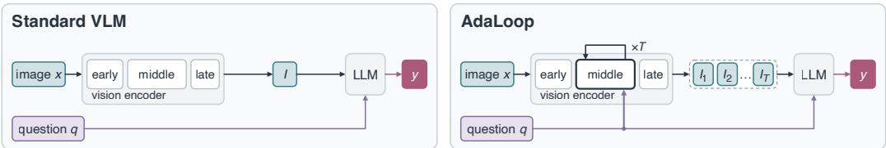  
Figure 1: Looking once versus repeatedly. Left: A standard VLM encodes the image once, independently of the question. Right: AdaLoop turns a span of the vision encoder into a question conditioned perception loop, updating its visual state over T iterations. The language model answers from the resulting sequence, using either the current state or retained history.

Evaluating vision-centric reasoning requires diagnostic tasks with systematic difficulty control and scalable training data. We introduce VisRO (Visual Routines) to support this research effort. VisRO is a procedural dataset and generation pipeline encompassing tasks like grouping, counting, connectivity, spatial tracing, and amodal perception—all of which demand careful visual inspection with minimal reliance on language priors or external knowledge (Figure 3). Our pipeline provides programmatically verifiable answers, controllable difficulty, and controlled distributional shifts in task structure or visual appearance for out-of-distribution evaluation. VisRO serves as reusable infrastructure for the community, and our AdaLoop experiments use six tasks from the collection.

Experiments with three VLM families, Qwen2.5-VL [8], PaliGemma 2 [65] and LLaVA-1.5 [44] show that with matched training data and optimizer updates, AdaLoop’s components provide complementary gains. Question-conditioning establishes strong single-pass controls, and looping adds a further 2.8–4.6 percentage points of in-distribution VisRO accuracy, for a total improvement of about 11–15 points over standard fine-tuning. On Qwen2.5-VL, at matched parameter count and approximately matched training FLOPs, AdaLoop achieves competitive VisRO performance with better general visual question answering (VQA) capabilities than longer-trained single-pass controls. Our results suggest that existing visual transformations can be steered by the question and reused for iterative reasoning, even with the original weights frozen.

## 2 RELATED WORK

Task-directed vision. Task-directed processing has roots in visual routines, combinations of basic operations selected by the task [68]. Language can supply this task signal through feature-wise modulation [54] or instruction-aware feature extraction [14], and prior work conditions vision encoders on language through normalization [15, 43], cross-attention [1], or token injection [19, 32, 48]. AdaLoop applies such conditioning to encoder layers that are reused across iterations.

Recurrent and looped architectures. Recurrence has a long history in computational models [40–42, 55]. Looped Transformers increase effective depth by sharing parameters across iterations [16, 21, 37]. Most are trained from scratch, either as task-specific reasoners for problems such as Sudoku, mazes, and ARC [7, 31, 63, 70] or as language models [20, 85]. Related work studies their scaling [2, 13, 36, 56, 59, 73], architectural design choices [26], adaptive stopping [6, 22, 84], and iteration-dependent modulation [29]. Other work retrofits recurrence into pretrained language models [5, 49, 52], and recent multimodal systems loop all or part of their language backbones [51, 76, 80]. AdaLoop instead loops layers of the vision encoder in a pretrained VLM, and studies how the language model should use the resulting visual states (Appendix D).

Visual reasoning in VLMs. Visual reasoning methods differ in where intermediate visual computation takes place and how it is controlled. External image operations and visual prompting provide selected or annotated visual evidence for language-model reasoning [25, 60, 62, 74, 77, 83]. Other approaches perform intermediate computation within the language model using generated visual latents [38, 69, 72] or learnable visual tokens [39]. Language model states or generated sub-questions can also guide further visual processing [18, 78, 81]. AdaLoop carries an internal vision-encoder state across iterations, updating it under the guidance of the original question.

Visual reasoning benchmarks. Existing benchmarks assess broad multimodal capabilities [11, 47], compositional reasoning [27, 30], and reasoning about text in images [64]. BLINK and CV-Bench probe core perceptual abilities [17, 66], while BabyVision emphasizes visual reasoning with limited reliance on language knowledge [10]. Scalable training resources for diverse vision-centric reasoning tasks remain limited. VisRO complements existing benchmarks with a procedural generation pipeline supporting both training and evaluation, with explicit controls over difficulty and distribution shifts.

## 3 METHOD

AdaLoop introduces question-conditioned recurrence into a pretrained vision–language model. We denote its vision encoder, connector, and language model by E, M, and $G ,$ respectively. Given an image x and a question $q ,$ AdaLoop repeatedly applies a group of consecutive layers in E to update a visual state, with each update conditioned on $q .$ The later encoder layers and the connector M convert each updated state into visual tokens for $G .$ . We study two design choices: how to condition the visual updates on the question, and how the language model should use the visual tokens produced across iterations.

## 3.1 LOOPED VISION ENCODER

We organize the visual computation into three parts: a prelude $\mathcal { P }$ , a loop body $\mathcal { R } ,$ and a coda $\mathcal { C } .$ . The prelude processes the image once to produce an initial visual state $z _ { 0 }$ . The loop body consists of consecutive encoder layers, augmented with question conditioning and reused across iterations. Let $z _ { t }$ denote the visual state after iteration t. The coda comprises the remaining encoder layers and the vision–language connector, mapping $z _ { t }$ to a sequence of visual tokens $I _ { t }$ for the language model,

$$
z _ { 0 } = { \mathcal { P } } ( x ) , \qquad z _ { t } = { \mathcal { R } } ( z _ { t - 1 } ; q ) , \qquad I _ { t } = { \mathcal { C } } ( z _ { t } ) , \qquad t = 1 , \ldots , T .\tag{1}
$$

The loop body shares its parameters across iterations. The state $z _ { t }$ carries information to the next visual iteration, while $I _ { t }$ provides the corresponding visual input to the language model.

We condition the loop body R on the question q through adaptive layer normalization (AdaLN) [53, 54]. A learned attention pooler summarizes the question’s input embeddings into a vector $c _ { q } .$ . For each block $\ell ,$ a module $A _ { \ell } ( c _ { q } )$ predicts feature-wise shifts $\beta _ { \ell } ^ { f }$ , scales $\gamma _ { \ell } ^ { f }$ , and residual gains $\alpha _ { \ell } ^ { f }$ for each sublayer $f \in \{ \mathrm { A t t n } , \mathrm { \dot { M } L P } \}$

$$
h  h + ( \mathbf { 1 } + \alpha _ { \ell } ^ { f } ) \odot f ( ( \mathbf { 1 } + \gamma _ { \ell } ^ { f } ) \odot \mathrm { L N } ( h ) + \beta _ { \ell } ^ { f } ) ,\tag{2}
$$

Here h denotes the visual state, LN layer normalization, and ⊙ element-wise multiplication. Modulation is shared across tokens and iterations. Initializing $\alpha = \beta = \gamma = 0$ preserves the original encoder computation at the first training iteration for loop at $t = 1$

Adaptation and recurrence are complementary. As we analyze in Appendix A, AdaLN and looping affect visual computation at different granularities. Intuitively, AdaLN provides questiondependent control within each block and feature channel, modifying both the inputs and residual contributions of visual transformations. Also, AdaLN’s scaling of a residual update can locally approximate the first-order effect of repeating the transformation (Appendix A.2), suggesting layerwise control over effective depth. Meanwhile, looping explicitly repeats a span of blocks, recomputing their updates as the visual state evolves. Together, they combine fine-grained adaptation with successive applications of the shared computation, and our experiments show benefits from both.

## 3.2 CONNECTING VISUAL ITERATION TO LANGUAGE

We consider three ways for the language model to use the visual tokens produced across iterations (Figure 2). These interfaces differ in whether earlier visual states and language predictions are retained in the context. For variant $v \in \{ A , B , C \}$ , let $\Pi _ { t } ^ { ( v ) }$ denote the language-model prefix at iteration t. Here, q denotes the question embeddings, and $[ \dot { \cdot } | \cdot ]$ denotes sequence concatenation.

Variant A: current visual state. A straightforward strategy is to provide only the visual tokens from the current iteration:

$$
\Pi _ { t } ^ { ( A ) } = [ I _ { t } \mid q ] .
$$

This keeps the visual context fixed in length as loop depth increases. Information from earlier visual iterations reaches the language model through the recurrent state $z _ { t }$

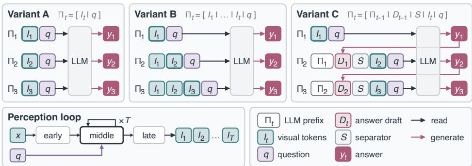  
Figure 2: Connecting visual iteration to language. The perception loop produces visual tokens $I _ { t }$ across iterations, which are passed to the LLM by concatenation $[ \cdot \ | \cdot \ ]$ with question $q .$ A generates intermediate and final answers $y _ { t }$ using each $I _ { t }$ in isolation, and B does so using the entire visual history $I _ { 1 } \ldots I _ { t }$ . C interleaves each $I _ { t }$ with intermediate answers using separator $S$ to distinguish rounds. In all cases, the stability of intermediate answers $y _ { t }$ can be used for adaptive halting.

Variant B: accumulated visual states. We can give the language model direct access to earlier visual states by concatenating their visual tokens:

$$
\Pi _ { t } ^ { ( B ) } = [ I _ { 1 } \ | \ \cdot \cdot \cdot | \ I _ { t } \ | \ q ] .
$$

The language model can then use the full visual trajectory to predict the answer, therefore reducing the reliance on the current state. This relaxes the need to preserve earlier information in the recurrent state, at the cost of a visual context that grows linearly with loop depth.

Variant C: interleaved generation. Beyond retaining visual states, we can also retain the language model’s intermediate predictions. Starting from $\Pi _ { 1 } ^ { ( C ) } = [ I _ { 1 } \mid q ]$ , the language model greedily generates a length-bounded answer draft $D _ { t - 1 }$ at each $t < T$ . We append this draft and the next visual input to the prefix:

$$
\Pi _ { t } ^ { ( C ) } = [ \Pi _ { t - 1 } ^ { ( C ) } \mid D _ { t - 1 } \mid S \mid I _ { t } \mid q ] ,
$$

where $S$ is a fixed separator. Subsequent predictions can thus use both the visual history and earlier answers, with additional context and generation cost. The drafts enter only the language context; visual updates continue to use the original question condition.

## 3.3 DEEP SUPERVISION FOR ADAPTIVE INFERENCE

Training. To enable adaptive inference, we supervise predictions throughout every iteration of the visual loop using the same final-answer target. Given an image–question–answer triple $( x , q , y )$ and a maximum training depth $T _ { \mathrm { t r a i n } }$ , the objective is

$$
\mathcal { L } ^ { ( v ) } = - \sum _ { t = 1 } ^ { T _ { \mathrm { t r a i n } } } \frac { w _ { t } } { n _ { y } } \log p _ { G } \big ( y \mid \Pi _ { t } ^ { ( v ) } \big ) ,\tag{3}
$$

where $n _ { y } = | y | , w _ { t } > 0$ and $\textstyle \sum _ { t } w _ { t } = 1$ . We assign larger weights to later depths and compute the loss only on target-answer tokens using teacher forcing. For Variant C, the drafts in the prefix are generated by the model itself. All variants therefore require only final-answer annotations, without intermediate visual or reasoning targets.

By default, we use deep supervision [35], evaluating all depth losses for each example. Alternatively, depth-sampled supervision selects a depth with probability $w _ { t }$ and computes its answer-token loss. This gives an unbiased estimate of the objective at lower cost per update.

Inference. We use a simple answer-stability rule for adaptive inference. After each visual iteration, the model greedily generates an answer. We stop when two consecutive answers agree or the budget $T _ { \mathrm { t e s t } }$ is exhausted and return the current answer in either case. This rule requires intermediate answer generation for all three variants. AdaLoop also supports fixed-depth inference that runs for $T _ { \mathrm { t e s t } }$ iterations. In this setting, Variant A and B generate an answer only at the final depth, while Variant C also generates intermediate drafts. In both settings, $T _ { \mathrm { t e s t } }$ can differ from $T _ { \mathrm { t r a i n } }$ . Appendix B.3 provides the details of our inference procedure.

(b) Out-of-distribution  
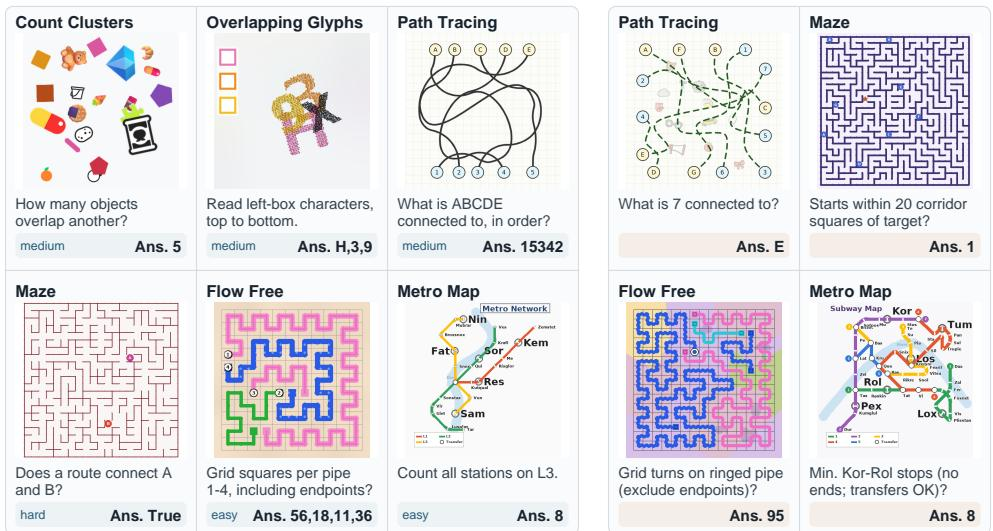  
Figure 3: VisRO examples. (a) Examples from six core tasks, with level of difficulty shown in blue. (b) Examples from the held-out out-of-distribution (OOD) split that exceed training difficulty (e.g., with larger grids) or use held-out generation rules or appearances. Each panel shows a 448 × 448 image, abbreviated question, and programmatically computed answer. Appendix E has more details.

## 4 VISRO: A DATASET FOR VISION-CENTRIC REASONING

To study when iterative visual computation helps, we introduce VisRO (Visual Routines), a procedural dataset and generation pipeline for training and evaluating vision-centric reasoning. Inspired by children’s visual puzzles and cognitive tests, the collection covers grouping, counting, connectivity, tracing, and recognition under occlusion, with minimal reliance on language priors or external knowledge. We use six tasks from this collection, denoted VisRO-Core6, for our controlled experiments. Figure 3 shows these tasks and representative out-of-distribution (OOD) examples.

Controlled difficulty and distribution shifts. Each core task provides controls over scene complexity, such as object counts, path lengths, overlap, and crossings. We use four difficulty levels for training and in-distribution evaluation. OOD tests include harder instances and shifts in scene generation rules or visual appearance. All VisRO-Core6 images are rendered at 448 × 448. With fixed preprocessing, this lets us vary scene complexity while keeping the per-image visual token budget constant within each backbone.

Generation and evaluation. Each generator renders a structured scene and computes groundtruth answers from its underlying representation. Answers are evaluated using task-specific, programmatic scoring rules, without an LLM judge. The underlying scenes can also support spatial supervision, such as object locations and paths through the scene. Our AdaLoop experiments use only image–question–answer triples. Appendix E describes the broader task collection and taskspecific generation procedures.

## 5 EXPERIMENTS

We implement AdaLoop on three pretrained VLMs that differ in both vision encoder and language backbone: Qwen2.5-VL [8], PaliGemma 2 [65], and LLaVA-1.5 [44]. Our experiments are designed to answer four questions: (Sec. 5.1) Does AdaLoop consistently improve visual reasoning compared to the non-recurrent base model? (Sec. 5.2) Which design choices are critical for effective visual recurrence? (Sec. 5.3) When do additional recurrent iterations help at inference time? (Sec. 5.4) Under approximately matched training compute, how does recurrence compare with non-recurrent alternatives?

Data and evaluation. We use the six tasks in VisRO-Core6 (Figure 3), with 600k training examples and 3,600 test examples each for in-distribution and OOD evaluation. Each split contains equal numbers of examples from all six tasks. To help retain general visual instruction-following capabilities, we mix the training data with a fixed 100k-example subset of LLaVA-NeXT [45], using its original answer annotations. We report per-task exact-match accuracy and the macro average across tasks, separately for in-distribution and OOD evaluation.

Table 1: Results on VisRO-Core6. Single-pass question-conditioned AdaLN improves over supervised fine-tuning (SFT), and recurrence (AdaLoop) further improves both in-distribution (ID) and out-of-distribution (OOD) accuracy across all backbones. AdaLoop uses Variant A with adaptive answer-stability stopping $( p = 1 , T _ { \mathrm { t e s t } } = 3 )$ . Scores are exact-match accuracy (%); Overall is the macro average over six tasks. Params: trainable parameters (M); T¯: mean selected stopping depth on the ID set. Closed-source models use maximum reasoning effort on a stratified 10% test subset; tok.: average generated tokens per completed response, including reasoning tokens. Best overall scores for each backbone are in bold.
<table><tr><td rowspan="2">Method</td><td rowspan="2">Params</td><td rowspan="2"> ${ \bar { T } } / { \mathrm { t o k . } }$ </td><td colspan="7">ID</td><td>OOD</td></tr><tr><td>Count</td><td>Flow</td><td>Glyph</td><td>Metro</td><td>Maze</td><td>Path</td><td>Overall Overall</td><td></td></tr><tr><td colspan="10">Closed-source models (zero-shot)</td></tr><tr><td>GPT-6 Astra (max)</td><td></td><td>2,892</td><td>88.3</td><td>95.0</td><td>55.0</td><td>91.7</td><td>78.3</td><td>85.0</td><td>82.2</td><td>71.4</td></tr><tr><td>Claude Opus 5 (max)</td><td>一</td><td>15,807</td><td>45.0</td><td>5.0</td><td>1.7</td><td>18.3</td><td>25.0</td><td>36.7</td><td>21.9</td><td>11.7</td></tr><tr><td colspan="10">Qwen2.5-VL-3B</td></tr><tr><td>Zero-shot</td><td>0</td><td>1.0</td><td>7.3</td><td>0.0</td><td>23.5</td><td>0.0</td><td>37.3</td><td>14.8</td><td>13.8</td><td>8.9</td></tr><tr><td>SFT</td><td>66</td><td>1.0</td><td>56.8</td><td>12.0</td><td>56.0</td><td>59.3</td><td>56.2</td><td>59.3</td><td>49.9</td><td>23.9</td></tr><tr><td>Single-pass AdaLN</td><td>82</td><td>1.0</td><td>61.5</td><td>23.8</td><td>84.8</td><td>60.7</td><td>56.7</td><td>72.3</td><td>60.0</td><td>30.2</td></tr><tr><td>AdaLoop</td><td>82</td><td>2.2</td><td>68.5</td><td>28.0</td><td>89.2</td><td>64.0</td><td>61.8</td><td>75.8</td><td>64.6</td><td>32.4</td></tr><tr><td colspan="10">PaliGemma2-3B</td></tr><tr><td>Zero-shot</td><td>0</td><td>1.0</td><td>10.7</td><td>0.3</td><td>1.2</td><td>13.3</td><td>32.2</td><td>16.2</td><td>12.3</td><td>8.8</td></tr><tr><td>SFT</td><td>24</td><td>1.0</td><td>74.3</td><td>26.7</td><td>80.8</td><td>67.8</td><td>70.8</td><td>55.0</td><td>62.6</td><td>31.5</td></tr><tr><td>Single-pass AdaLN</td><td>39</td><td>1.0</td><td>83.2</td><td>36.8</td><td>92.7</td><td>72.7</td><td>87.8</td><td>61.0</td><td>72.4</td><td>40.0</td></tr><tr><td>AdaLoop</td><td>39</td><td>2.1</td><td>84.7</td><td>40.3</td><td>93.7</td><td>75.8</td><td>93.2</td><td>63.3</td><td>75.2</td><td>43.9</td></tr><tr><td colspan="10">LLaVA-1.5-7B</td></tr><tr><td>Zero-shot</td><td>0</td><td>1.0</td><td>6.0</td><td>0.2</td><td>0.5</td><td>13.7</td><td>29.5</td><td>12.7</td><td>10.4</td><td>8.6</td></tr><tr><td>SFT</td><td>341</td><td>1.0</td><td>48.3</td><td>18.0</td><td>62.8</td><td>51.7</td><td>59.5</td><td>62.3</td><td>50.4</td><td>24.8</td></tr><tr><td>Single-pass AdaLN</td><td>350</td><td>1.0</td><td>52.5</td><td>29.5</td><td>82.0</td><td>53.0</td><td>63.5</td><td>65.7</td><td>57.7</td><td>29.6</td></tr><tr><td>AdaLoop</td><td>350</td><td>2.2</td><td>56.8</td><td>38.7</td><td>84.7</td><td>59.0</td><td>64.2</td><td>67.3</td><td>61.8</td><td>31.1</td></tr></table>

Training and inference. Within each backbone, we compare three models, each adding one component to the previous. The SFT baseline trains the vision–language connector and language-model LoRA adapters [23], leaving the vision encoder unchanged. Single-pass AdaLN additionally trains the question pooler and modulation generators, and applies the modulated visual blocks only once. AdaLoop trains the same components but applies the loop body blocks repeatedly. All three models use the same training mixture and optimizer-update budget, with corresponding initializations and example order paired by seed. By default, we train AdaLoop through $\bar { T } _ { \mathrm { t r a i n } } = 3$ and use answerstability stopping with patience p = 1 at inference. Details are in Appendix B.

## 5.1 MAIN RESULTS

Table 1 compares zero-shot inference, supervised fine-tuning (SFT), single-pass AdaLN, and AdaLoop across three pretrained VLMs. AdaLoop uses Variant A by default. Within each backbone, all instances use the same training data and number of optimizer updates.

Zero-shot evaluation. Zero-shot performance varies substantially across models. Qwen2.5-VL, PaliGemma 2, and LLaVA-1.5 achieve 13.8%, 12.3%, and 10.4% VisRO-ID accuracy, respectively. On a difficulty-stratified 10% test subset, GPT-6 Astra [50] and Claude Opus 5 [4] achieve 82.2% and 21.9% ID accuracy at maximum reasoning effort, averaging about 3k and 16k generated tokens per completed response, respectively.

Adapting and reusing visual computation. Adding question-conditioned AdaLN improves both ID and OOD accuracy across all three backbones, establishing a strong single-pass baseline.

Table 3: Qwen2.5-VL ablations. Notation as in Table 1 with shading indicating AdaLoop-A. (a) All interfaces improve over single-pass AdaLN, and Variant A performs best. (b) With no modulation, looping gains little over a single pass; modulation with question conditioning performs better at the same parameter count.
<table><tr><td colspan="2">Method Params</td><td>ID</td><td>OOD</td></tr><tr><td>Single-pass AdaLN</td><td>82</td><td>60.0</td><td>30.2</td></tr><tr><td>AdaLoop-A</td><td>82</td><td>64.6</td><td>32.4</td></tr><tr><td>AdaLoop-B</td><td>82</td><td>62.1</td><td>31.1</td></tr><tr><td>AdaLoop-C</td><td>82</td><td>63.0</td><td>32.0</td></tr></table>

(a) Language interfaces. A: current state; B: visual history; C: visual history and answer drafts (Fig. 2).

<table><tr><td rowspan="2">Modulation</td><td rowspan="2">Params</td><td colspan="2">Single pass</td><td colspan="2">Loop</td></tr><tr><td>ID</td><td>OOD</td><td>ID</td><td>OOD</td></tr><tr><td>None</td><td>66</td><td>49.9</td><td>23.9</td><td>50.9</td><td>23.8</td></tr><tr><td>AdaLN (constant)</td><td>82</td><td>57.8</td><td>29.1</td><td>60.9</td><td>30.0</td></tr><tr><td>AdaLN (question)</td><td>82</td><td>60.0</td><td>30.2</td><td>64.6</td><td>32.4</td></tr></table>

(b) Modulation and recurrence. Constant uses a fixed null question. Looping uses variant A.

AdaLoop further improves both scores by repeatedly applying the conditioned visual blocks. Relative to single-pass AdaLN, ID accuracy increases by 4.6 percentage points on Qwen2.5-VL, 2.8 on PaliGemma 2, and 4.1 on LLaVA-1.5. These gains are obtained with frozen vision weights and Variant A, which exposes only the current visual state to the language model. At fixed $T _ { \mathrm { t e s t } }$ , AdaLoop-A also improves over single-pass AdaLN across all three backbones (Appendix C.1), without requiring intermediate answer generation for adaptive stopping.

Comparison with existing methods. Table 2 compares AdaLoop with Qwen implementations of SFT+GRPO [61] and LIVR [39], both using final-answer supervision and matched or more training iterations. Relative to SFT, GRPO improves OOD accuracy by 0.3 points but reduces ID accuracy, while LIVR falls below SFT on both splits. AdaLoop improves both scores and outperforms these baselines under the evaluated configurations. Appendix B.4 details the baseline implementations.

Table 2: Comparison with existing methods on Qwen2.5-VL. ID/OOD report accuracy (%) over VisRO-Core6.
<table><tr><td>Method</td><td>Params</td><td>ID</td><td>OOD</td></tr><tr><td>SFT</td><td>66</td><td>49.9</td><td>23.9</td></tr><tr><td>+ GRPO</td><td>66</td><td>49.5</td><td>24.2</td></tr><tr><td>LIVR</td><td>66</td><td>47.8</td><td>22.0</td></tr><tr><td>AdaLoop</td><td>82</td><td>64.6</td><td>32.4</td></tr></table>

## 5.2 DESIGNING USEFUL VISUAL RECURRENCE

We study the language interface, visual modulation, and loop placement in AdaLoop. The ablations use Qwen2.5-VL with frozen vision weights, with training data and optimizer updates matched within each comparison. We use Variant A except when comparing language interfaces.

Language interfaces. All three interfaces improve both ID and OOD accuracy over single-pass AdaLN, and reading only the current state (A) performs best (Table 3a), so explicitly retaining earlier visual states or answer drafts in the language context is not required to benefit from visual recurrence. Retaining them does help beyond the training depth, however: B and C degrade less than A when run for more iterations (Figure 5b). One possible explanation is that the retained history lets the language model draw on earlier visual states, which are unaffected when later iterations drift beyond the trained regime.

Modulation and recurrence. Table 3b separates the contributions of modulation, question conditioning, and recurrence. Without modulation, looping raises ID accuracy only from 49.9% to 50.9%. Adding question-independent AdaLN improves the loop to 60.9%, partly through its 16M additional trainable parameters. Conditioning the same modules on the question further raises accuracy to 64.6%, without adding parameters. With question conditioning held fixed, looping improves over single-pass AdaLN by 4.6 ID and 2.2 OOD percentage points. Thus, question information and recurrent computation each contribute beyond the addition of trainable modulation parameters.

Loop placement. Figure 4a shows pretrained visual representation similarity measured by centered kernel alignment (CKA) [33]. On Qwen2.5-VL, we compare three equal-length spans: early [2, 14), cross-band [8, 20), and late [18, 30) (Figure 4b). All three improve overall ID accuracy over their corresponding single-pass AdaLN controls. The early span gives the largest overall relative gain and leads on four tasks, while the cross-band and late spans give the largest relative gains on Maze and Path, respectively. The benefits of recurrence therefore depend on both placement and task; useful recurrence also occurs in a span crossing the transition between high-CKA bands. CKA measurement details are provided in Appendix B.1.

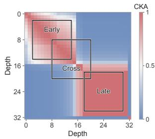

<table><tr><td>Loop span</td><td>Count</td><td>Flow</td><td>Glyph</td><td>Metro</td><td>Maze</td><td>Path</td><td>Overall</td></tr><tr><td>Early [2, 14)</td><td>11.38</td><td>17.48</td><td>5.11</td><td>5.49</td><td>9.12</td><td>4.84</td><td>7.64</td></tr><tr><td>Cross [8, 20)</td><td>4.52</td><td>8.23</td><td>3.87</td><td>1.63</td><td>22.70</td><td>-0.47</td><td>6.05</td></tr><tr><td>Late [18, 30)</td><td>6.70</td><td>2.63</td><td>2.28</td><td>2.58</td><td>-0.56</td><td>5.57</td><td>3.33</td></tr></table>

(a) Encoder representation similarity. Linear CKA across depths $k ,$ and three candidate spans.

(b) Gains from recurrence. For each loop span $[ k _ { \mathrm { s t a r t } } , k _ { \mathrm { e n d } } )$ , relative VisRO-ID accuracy gains (%) over a single-pass AdaLN, under answer-stability halting.

Figure 4: Qwen2.5-VL loop placement. (a) Three candidate loop spans that are contained within, or that cross, encoder spans having high CKA similarity. (b) Recurrence improves overall accuracy for all spans. Gains vary by task for each loop span.
<table><tr><td rowspan="2">Difficulty</td><td colspan="2">Qwen2.5-VL</td><td colspan="2">PaliGemma 2</td><td colspan="2"> $\mathrm { L L a V A } { - } 1 . 5$ </td></tr><tr><td>Rel. gain</td><td>T</td><td>Rel. gain</td><td> $\bar { T }$ </td><td>Rel. gain</td><td> $\bar { T }$ </td></tr><tr><td>Easy</td><td>+3.33</td><td>2.11</td><td>+0.87</td><td>2.06</td><td>+3.05</td><td>2.11</td></tr><tr><td>Medium</td><td>+5.87</td><td>2.17</td><td>+0.00</td><td>2.09</td><td>-0.17</td><td>2.15</td></tr><tr><td>Hard</td><td>+4.09</td><td>2.21</td><td>+1.93</td><td>2.14</td><td>+4.87</td><td>2.21</td></tr><tr><td>XHard</td><td>+4.46</td><td>2.26</td><td>+5.43</td><td>2.21</td><td>+7.85</td><td>2.28</td></tr><tr><td>OOD</td><td>+6.39</td><td>2.30</td><td>+4.49</td><td>2.23</td><td>+6.57</td><td>2.29</td></tr></table>

(a) Adaptive computation. Relative accuracy gain (%) of answer-stability stopping over one visual iteration of the same checkpoint, and mean stopping depth T¯.  
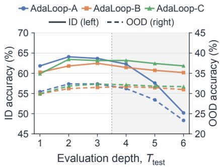  
(b) Depth extrapolation. ID accuracy (solid, left axis) and OOD accuracy (dashed, right axis) on Qwen2.5-VL. Shading marks $T _ { \mathrm { t e s t } } > \bar { T } _ { \mathrm { t r a i n } }$  
Figure 5: Inference-time visual computation. All models are trained with $T _ { \mathrm { t r a i n } } = 3 .$ . (a) Mean stopping depth increases with difficulty on every backbone. (b) Beyond the training depth, Variants B and C remain largely stable, whereas A degrades.

## 5.3 INFERENCE-TIME VISUAL COMPUTATION

Recurrence and deep supervision enable AdaLoop to use adaptive computation at inference time. We examine how this benefit varies with problem difficulty and whether useful updates continue beyond the depths seen during training.

Adaptive computation within trained depths. Using the same checkpoint $( T _ { \mathrm { t r a i n } } = 3 )$ , we compare adaptive stopping $( p \ : = \ : 1 , T _ { \mathrm { t e s t } } \ : = \ : 3 )$ with stopping after the first iteration. As shown in Figure 5a, adaptive stopping improves accuracy in most difficulty groups across all three backbones. Its mean stopping depth also increases with difficulty on every backbone, although neither the model nor the stopping rule sees difficulty labels. This shows that adaptive stopping using answer stability allocates more iterations to harder inputs.

Behavior beyond trained depths. Figure 5b shows that Variants B and C largely maintain accuracy beyond $T _ { \mathrm { t r a i n } } = 3$ , whereas A degrades more as depth increases. Although average accuracy stays roughly flat, this stability leaves room for later iterations to correct individual examples: Figure 6 (Variant C) illustrates such cases, where predictions on Glyphs and Metro Map become correct at depth four and remain correct through depth six.

## 5.4 COMPUTATIONAL TRADE-OFFS

AdaLoop achieves better performance at matched optimizer updates (Sec. 5.1), but looping incurs higher training and inference costs than a parameter-matched single-pass model. We quantify these costs on Qwen2.5-VL and compare models under approximately matched training compute.

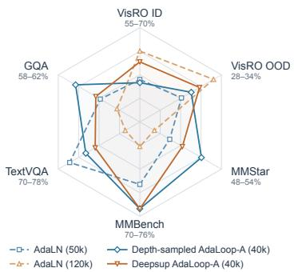  
(a) Performance profiles. Colors pair approximately matched training budgets; axes ranges differ as labeled.

<table><tr><td>Method</td><td>Train FLOPs (ID+OOD)</td><td>VisRO</td><td>MMStar MMBench GQA TextVQA</td><td></td><td></td></tr><tr><td>AdaLN (40k)</td><td>1.00×</td><td>45.10</td><td>51.07</td><td>75.43 60.28</td><td>76.28</td></tr><tr><td>AdaLN (50k)</td><td>1.25×</td><td>46.40</td><td>50.20</td><td>73.97 59.94</td><td>76.88</td></tr><tr><td>AdaLoop (sampled, 40k)</td><td>1.32×</td><td>46.51</td><td>52.53</td><td>75.52 61.15</td><td>75.30</td></tr><tr><td>AdaLN (120k)</td><td>3.00×</td><td>49.85</td><td>49.07</td><td>71.56</td><td>59.12 71.43</td></tr><tr><td>AdaLoop (deep sup., 40k) 2.86×</td><td></td><td>48.47</td><td>51.13</td><td>75.52</td><td>60.16 74.38</td></tr></table>

(b) Training cost and accuracy. Sampled supervises one sampled depth per example; deep sup. supervises all depths. Training FLOPs are relative to single-pass AdaLN at 40k updates (Appendix C.2). VisRO averages ID and OOD accuracy (%).

Inference cost. On VisRO-ID and with fixeddepth inference at $T _ { \mathrm { t e s t } } = 3 .$ , AdaLoop generates an answer only after the final visual iteration, using an estimated 1.3× the inference FLOPs of single-pass AdaLN. Answer-stability stopping with the same depth limit has an estimated cost of 2.2× on average because it also generates intermediate answers. Appendix C.2 describes the accounting.

Training cost. At $T _ { \mathrm { t r a i n } } = 3 .$ deep supervision at every depth costs approximately 2.9× the training FLOPs per update of single-pass AdaLN. Sampling one supervised depth according to the normalized loss weights reduces the estimated cost to approximately 1.3×, while preserving the weighted objective in expectation. We therefore compare depthsampled and deeply supervised AdaLoop, each trained for 40k updates, with single-pass AdaLN trained for 50k and 120k updates, respectively; total training FLOPs match to within 6% (Figure 7b). AdaLoop thus uses 20% and 67% fewer optimizer updates, and correspondingly fewer passes over the training data.

Figure 7: Qwen2.5-VL training compute allocation. (a) Radar visualization of numbers in Table (b). At approximately matched training FLOPs, depth-sampled AdaLoop matches the 50k-update single-pass control on VisRO and improves three of four VQA benchmarks. Deeply supervised AdaLoop is slightly below the 120k-update control on VisRO but outperforms it on all four general VQA benchmarks, using one third as many optimizer updates.  
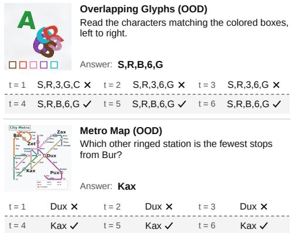  
Figure 6: Selected answer trajectories beyond the training depth (Qwen2.5-VL, Variant C). At each depth t, the model answers from the visual history and its earlier drafts. In these selected examples, the shaded iterations $( t > T _ { \mathrm { t r a i n } } )$ correct the answer and retain it.

Performance at approximately matched training compute. Besides VisRO, we also evaluate on GQA [27], MMBench [47], MMStar [11], and TextVQA [64]. These benchmarks measure retention of general VQA capabilities acquired by the backbones during their original training, and our posttraining mixture includes a LLaVA-NeXT subset to limit forgetting (Section 5).

At the lower budget (Figure 7), depth-sampled AdaLoop matches the 50k-update control on VisRO and is higher on three general VQA benchmarks. At the higher budget, deeply supervised AdaLoop is slightly below the 120k-update control on VisRO but outperforms it on all four VQA benchmarks. Extending single-pass AdaLN training from 40k to 120k updates lowers all general benchmarks (e.g., MMBench from 75.4% to 71.6%), consistent with forgetting. These results suggest that recurrence offers a different way to spend training compute: more computation per example rather than more updates over the same data. At approximately matched FLOPs, AdaLoop achieves VisRO accuracy competitive with extended single-pass training while retaining better general capabilities.

## 6 CONCLUSION

We introduced AdaLoop, a framework for question-conditioned visual recurrence, and VisRO, a procedural dataset and generation pipeline for vision-centric reasoning. Across three VLM families, question conditioning and recurrence provide complementary gains. With training data and optimizer updates matched, AdaLoop improves over both supervised fine-tuning and questionconditioned single-pass controls. These gains are obtained with the pretrained vision weights frozen. Our findings suggest that a pretrained vision encoder need not be a fixed front end: its existing visual transformations can be adapted and reused for iterative reasoning. We hope this work encourages further study of how vision modules can contribute to multimodal reasoning.

## ACKNOWLEDGMENTS

The authors thank Kaiming He for insightful discussions on the AdaLoop framework and Jianbo Shi for proofreading the manuscript. We also thank Keya Hu and Qiao Sun for helpful discussions on TPU infrastructure. We thank Google TPU Research Cloud (TRC) for granting us access to TPUs.

## REFERENCES

[1] Ofir Abramovich, Niv Nayman, Sharon Fogel, Inbal Lavi, Ron Litman, Shahar Tsiper, Royee Tichauer, Srikar Appalaraju, Shai Mazor, and R. Manmatha. VisFocus: Prompt-guided vision encoders for OCR-free dense document understanding. In ECCV, 2024.

[2] Ibrahim Alabdulmohsin and Xiaohua Zhai. Recursive inference scaling: A winning path to scalable inference in language and multimodal systems. In NeurIPS, 2025.

[3] Ibrahim Alabdulmohsin, Xiaohua Zhai, Alexander Kolesnikov, and Lucas Beyer. Getting ViT in shape: Scaling laws for compute-optimal model design. In NeurIPS, 2023.

[4] Anthropic. Introducing Claude Opus 5, 2026. URL https://www.anthropic.com/ne ws/claude-opus-5.

[5] Sangmin Bae, Adam Fisch, Hrayr Harutyunyan, Ziwei Ji, Seungyeon Kim, and Tal Schuster. Relaxed recursive transformers: Effective parameter sharing with layer-wise LoRA. In ICLR, 2025.

[6] Sangmin Bae, Yujin Kim, Reza Bayat, Sungnyun Kim, Jiyoun Ha, Tal Schuster, Adam Fisch, Hrayr Harutyunyan, Ziwei Ji, Aaron Courville, and Se-Young Yun. Mixture-of-recursions: Learning dynamic recursive depths for adaptive token-level computation. In NeurIPS, 2025.

[7] Junyeob Baek, Mingyu Jo, Minsu Kim, Mengye Ren, Yoshua Bengio, and Sungjin Ahn. Generative recursive reasoning. arXiv preprint arXiv:2605.19376, 2026.

[8] Shuai Bai, Keqin Chen, Xuejing Liu, Jialin Wang, Wenbin Ge, Sibo Song, Kai Dang, Peng Wang, Shijie Wang, Jun Tang, Humen Zhong, Yuanzhi Zhu, Mingkun Yang, Zhaohai Li, Jianqiang Wan, Pengfei Wang, Wei Ding, Zheren Fu, Yiheng Xu, Jiabo Ye, Xi Zhang, Tianbao Xie, Zesen Cheng, Hang Zhang, Zhibo Yang, Haiyang Xu, and Junyang Lin. Qwen2.5-VL technical report. arXiv preprint arXiv:2502.13923, 2025.

[9] Daniel Bolya, Po-Yao Huang, Peize Sun, Jang Hyun Cho, Andrea Madotto, Chen Wei, Tengyu Ma, Jiale Zhi, Jathushan Rajasegaran, Hanoona Bangalath, Junke Wang, Marco Monteiro, Hu Xu, Shiyu Dong, Nikhila Ravi, Shang-Wen Li, Piotr Dollar, and Christoph Feichtenhofer.´ Perception encoder: The best visual embeddings are not at the output of the network. In NeurIPS, 2025.

[10] Liang Chen, Weichu Xie, Yiyan Liang, Hongfeng He, Hans Zhao, Zhibo Yang, Zhiqi Huang, Haoning Wu, Haoyu Lu, Y. Charles, Yiping Bao, Yuantao Fan, Guopeng Li, Haiyang Shen, Xuanzhong Chen, Wendong Xu, Shuzheng Si, Zefan Cai, Wenhao Chai, Ziqi Huang, Fangfu Liu, Tianyu Liu, Baobao Chang, Ming Wu, Xiaobo Hu, Kaiyuan Chen, Yixin Ren, Yang Liu, Yuan Gong, and Kuan Li. BabyVision: Visual reasoning beyond language. In ICML, 2026.

[11] Lin Chen, Jinsong Li, Xiaoyi Dong, Pan Zhang, Yuhang Zang, Zehui Chen, Haodong Duan, Jiaqi Wang, Yu Qiao, Dahua Lin, and Feng Zhao. Are we on the right way for evaluating large vision-language models? In NeurIPS, 2024.

[12] Ricky T. Q. Chen, Yulia Rubanova, Jesse Bettencourt, and David K. Duvenaud. Neural ordinary differential equations. In NeurIPS, 2018.

[13] Zixi Chen, Akshay Vegesna, Samip Dahal, and Andrew Gordon Wilson. How model growth, recursion, and boundary operators influence scaling exponents. arXiv preprint arXiv:2609.19107, 2026.

[14] Wenliang Dai, Junnan Li, Dongxu Li, Anthony Tiong, Junqi Zhao, Weisheng Wang, Boyang Li, Pascale N. Fung, and Steven Hoi. InstructBLIP: Towards general-purpose vision-language models with instruction tuning. In NeurIPS, 2023.

[15] Harm de Vries, Florian Strub, Jer´ emie Mary, Hugo Larochelle, Olivier Pietquin, and Aaron C.´ Courville. Modulating early visual processing by language. In NeurIPS, 2017.

[16] Mostafa Dehghani, Stephan Gouws, Oriol Vinyals, Jakob Uszkoreit, and Łukasz Kaiser. Universal Transformers. In ICLR, 2019.

[17] Xingyu Fu, Yushi Hu, Bangzheng Li, Yu Feng, Haoyu Wang, Xudong Lin, Dan Roth, Noah A. Smith, Wei-Chiu Ma, and Ranjay Krishna. BLINK: Multimodal large language models can see but not perceive. In ECCV, 2024.

[18] Alessio Galatolo, Ronald Cumbal, Alexandros Rouchitsas, Katie Winkle, Didem Gurd¨ ur Broo,¨ and Ginevra Castellano. Lightweight visual reasoning for socially-aware robots. In ICRA, 2026.

[19] Roy Ganz, Yair Kittenplon, Aviad Aberdam, Elad Ben Avraham, Oren Nuriel, Shai Mazor, and Ron Litman. Question aware vision transformer for multimodal reasoning. In CVPR, 2024.

[20] Jonas Geiping, Sean McLeish, Neel Jain, John Kirchenbauer, Siddharth Singh, Brian R. Bartoldson, Bhavya Kailkhura, Abhinav Bhatele, and Tom Goldstein. Scaling up test-time compute with latent reasoning: A recurrent depth approach. In NeurIPS, 2025.

[21] Angeliki Giannou, Shashank Rajput, Jy-yong Sohn, Kangwook Lee, Jason D. Lee, and Dimitris Papailiopoulos. Looped transformers as programmable computers. In ICML, 2023.

[22] Alex Graves. Adaptive computation time for recurrent neural networks. arXiv preprint arXiv:1603.08983, 2016.

[23] Edward J. Hu, Yelong Shen, Phillip Wallis, Zeyuan Allen-Zhu, Yuanzhi Li, Shean Wang, Lu Wang, and Weizhu Chen. LoRA: Low-rank adaptation of large language models. In ICLR, 2022.

[24] Keya Hu, Ali Cy, Linlu Qiu, Xiaoman Delores Ding, Runqian Wang, Yeyin Eva Zhu, Jacob Andreas, and Kaiming He. ARC is a vision problem! In CVPR, 2026.

[25] Yushi Hu, Weijia Shi, Xingyu Fu, Dan Roth, Mari Ostendorf, Luke Zettlemoyer, Noah A. Smith, and Ranjay Krishna. Visual Sketchpad: Sketching as a visual chain of thought for multimodal language models. In NeurIPS, 2024.

[26] Benhao Huang, Chufan Shi, Junlin Chen, Shicheng Wen, Zhengzhong Liu, Eric Xing, and Xuezhe Ma. Towards looped models done right—Part I: Topology, input injection, recurrentstate design, 2026. URL https://ifm-research.notion.site/Towards-Loo p-Models-Done-Right-3ade511912ec8128987dfeb7a5580043. Accessed 2026-07-31.

[27] Drew A. Hudson and Christopher D. Manning. GQA: A new dataset for real-world visual reasoning and compositional question answering. In CVPR, 2019.

[28] Mozes Jacobs, Thomas Fel, Richard Hakim, Alessandra Brondetta, Demba Ba, and T. Andy Keller. Block-recurrent dynamics in ViTs. In ICLR, 2026.

[29] Ahmadreza Jeddi, Marco Ciccone, and Babak Taati. LoopFormer: Elastic-depth looped transformers for latent reasoning via shortcut modulation. In ICLR, 2026.

[30] Justin Johnson, Bharath Hariharan, Laurens van der Maaten, Li Fei-Fei, C. Lawrence Zitnick, and Ross Girshick. CLEVR: A diagnostic dataset for compositional language and elementary visual reasoning. In CVPR, 2017.

[31] Alexia Jolicoeur-Martineau. Less is more: Recursive reasoning with tiny networks. arXiv preprint arXiv:2510.04871, 2025.

[32] Jongha Kim, Minseong Bae, Sanghyeok Lee, Jinsung Yoon, and Hyunwoo J. Kim. TabFlash: Efficient table understanding with progressive question conditioning and token focusing. In AAAI, 2026.

[33] Simon Kornblith, Mohammad Norouzi, Honglak Lee, and Geoffrey Hinton. Similarity of neural network representations revisited. In ICML, 2019.

[34] Victor A. F. Lamme and Pieter R. Roelfsema. The distinct modes of vision offered by feedforward and recurrent processing. Trends in Neurosciences, 2000.

[35] Chen-Yu Lee, Saining Xie, Patrick Gallagher, Zhengyou Zhang, and Zhuowen Tu. Deeplysupervised nets. In AISTATS, 2015.

[36] Ryan Lee, Jacob Biloki, Edward J. Hu, and Jonathan May. Sparse layers are critical to scaling looped language models. arXiv preprint arXiv:2605.09165, 2026.

[37] Sang In Lee and Jihun Park. Soft Mixture-of-Recursions: Going deeper with recursive vision transformers. arXiv preprint arXiv:2607.00774, 2026.

[38] Bangzheng Li, Ximeng Sun, Jiang Liu, Ze Wang, Jialian Wu, Xiaodong Yu, Hao Chen, Emad Barsoum, Muhao Chen, and Zicheng Liu. Latent visual reasoning. In ICLR, 2026.

[39] Kelvin Li, Chuyi Shang, Leonid Karlinsky, Rogerio Feris, Trevor Darrell, and Roei Herzig. Latent implicit visual reasoning. In CVPR, 2026.

[40] Ming Liang and Xiaolin Hu. Recurrent convolutional neural network for object recognition. In CVPR, 2015.

[41] Qianli Liao and Tomaso Poggio. Bridging the gaps between residual learning, recurrent neural networks and visual cortex. arXiv preprint arXiv:1604.03640, 2016.

[42] Drew Linsley, Junkyung Kim, Vijay Veerabadran, Charles Windolf, and Thomas Serre. Learning long-range spatial dependencies with horizontal gated recurrent units. In NeurIPS, 2018.

[43] Hanpeng Liu, Yaqian Li, Zidan Wang, Shuoxi Zhang, Zihao Bo, Rinyoichi Takezoe, Kaiwen Long, and Kun He. iGVLM: Dynamic instruction-guided vision encoding for question-aware multimodal understanding. arXiv preprint arXiv:2603.02748, 2026.

[44] Haotian Liu, Chunyuan Li, Yuheng Li, and Yong Jae Lee. Improved baselines with visual instruction tuning. In CVPR, 2024.

[45] Haotian Liu, Chunyuan Li, Yuheng Li, Bo Li, Yuanhan Zhang, Sheng Shen, and Yong Jae Lee. LLaVA-NeXT: Improved reasoning, OCR, and world knowledge, 2024. URL https: //llava-vl.github.io/blog/2024-01-30-llava-next/.

[46] Ying Liu, Yudong Han, Kean Shi, and Liyuan Pan. Mema: Memory-augmented adapter for enhanced vision-language understanding. arXiv preprint arXiv:2603.00655, 2026.

[47] Yuan Liu, Haodong Duan, Yuanhan Zhang, Bo Li, Songyang Zhang, Wangbo Zhao, Yike Yuan, Jiaqi Wang, Conghui He, Ziwei Liu, Kai Chen, and Dahua Lin. MMBench: Is your multi-modal model an all-around player? In ECCV, 2024.

[48] Chengzhi Mao, Xudong Lin, and Wen-Sheng Chu. Language-instructed vision embeddings for controllable and generalizable perception. In ICLR, 2026.

[49] Sean McLeish, Ang Li, John Kirchenbauer, Dayal Singh Kalra, Brian R. Bartoldson, Bhavya Kailkhura, Avi Schwarzschild, Jonas Geiping, Tom Goldstein, and Micah Goldblum. Teaching pretrained language models to think deeper with retrofitted recurrence. In COLM, 2026.

[50] OpenAI. GPT-6 Astra system card, 2026. URL https://deploymentsafety.opena i.com/gpt-6-astra.

[51] Suhyeong Park, Junha Jung, and Jaewoo Kang. Reason through the latent! Making latent visual reasoning necessary. arXiv preprint arXiv:2609.06746, 2026.

[52] Taekhyun Park, Yongjae Lee, Dohee Kim, and Hyerim Bae. LoopUS: Recasting pretrained LLMs into looped latent refinement models. arXiv preprint arXiv:2605.11011, 2026.

[53] William Peebles and Saining Xie. Scalable diffusion models with transformers. In ICCV, 2023.

[54] Ethan Perez, Florian Strub, Harm de Vries, Vincent Dumoulin, and Aaron Courville. FiLM: Visual reasoning with a general conditioning layer. In AAAI, 2018.

[55] Pedro Pinheiro and Ronan Collobert. Recurrent convolutional neural networks for scene labeling. In ICML, 2014.

[56] Hayden Prairie, Zachary Novack, Taylor Berg-Kirkpatrick, and Daniel Y Fu. Parcae: Scaling laws for stable looped language models. In COLM, 2026.

[57] Alec Radford, Jong Wook Kim, Chris Hallacy, Aditya Ramesh, Gabriel Goh, Sandhini Agarwal, Girish Sastry, Amanda Askell, Pamela Mishkin, Jack Clark, Gretchen Krueger, and Ilya Sutskever. Learning transferable visual models from natural language supervision. In ICML, 2021.

[58] Rajesh P. N. Rao and Dana H. Ballard. Predictive coding in the visual cortex: A functional interpretation of some extra-classical receptive-field effects. Nature Neuroscience, 1999.

[59] Kristian Schwethelm, Daniel Rueckert, and Georgios Kaissis. How much is one recurrence worth? Iso-depth scaling laws for looped language models. arXiv preprint arXiv:2604.21106, 2026.

[60] Hao Shao, Shengju Qian, Han Xiao, Guanglu Song, Zhuofan Zong, Letian Wang, Yu Liu, and Hongsheng Li. Visual CoT: Advancing multi-modal language models with a comprehensive dataset and benchmark for chain-of-thought reasoning. In NeurIPS Datasets and Benchmarks Track, 2024.

[61] Zhihong Shao, Peiyi Wang, Qihao Zhu, Runxin Xu, Junxiao Song, Xiao Bi, Haowei Zhang, Mingchuan Zhang, Y. K. Li, Y. Wu, and Daya Guo. DeepSeekMath: Pushing the limits of mathematical reasoning in open language models. arXiv preprint arXiv:2402.03300, 2024.

[62] Haozhan Shen, Kangjia Zhao, Tiancheng Zhao, Ruochen Xu, Zilun Zhang, Mingwei Zhu, and Jianwei Yin. ZoomEye: Enhancing multimodal LLMs with human-like zooming capabilities through tree-based image exploration. In EMNLP, 2025.

[63] Wen-Jie Shu, Xuerui Qiu, Rui-Jie Zhu, Harold Haodong Chen, Yexin Liu, and Harry Yang. LoopViT: Scaling visual ARC with looped transformers. arXiv preprint arXiv:2602.02156, 2026.

[64] Amanpreet Singh, Vivek Natarajan, Meet Shah, Yu Jiang, Xinlei Chen, Dhruv Batra, Devi Parikh, and Marcus Rohrbach. Towards VQA models that can read. In CVPR, 2019.

[65] Andreas Steiner, Andre Susano Pinto, Michael Tschannen, Daniel Keysers, Xiao Wang,´ Yonatan Bitton, Alexey Gritsenko, Matthias Minderer, Anthony Sherbondy, Shangbang Long, Siyang Qin, Reeve Ingle, Emanuele Bugliarello, Sahar Kazemzadeh, Thomas Mesnard, Ibrahim Alabdulmohsin, Lucas Beyer, and Xiaohua Zhai. PaliGemma 2: A family of versatile VLMs for transfer. arXiv preprint arXiv:2412.03555, 2024.

[66] Shengbang Tong, Ellis Brown, Penghao Wu, Sanghyun Woo, Manoj Middepogu, Sai C. Akula, Jihan Yang, Shusheng Yang, Adithya Iyer, Xichen Pan, Austin Wang, Rob Fergus, Yann Le-Cun, and Saining Xie. Cambrian-1: A fully open, vision-centric exploration of multimodal LLMs. In NeurIPS, 2024.

[67] Shengbang Tong, Zhuang Liu, Yuexiang Zhai, Yi Ma, Yann LeCun, and Saining Xie. Eyes wide shut? Exploring the visual shortcomings of multimodal LLMs. In CVPR, 2024.

[68] Shimon Ullman. Visual routines. Cognition, 1984.

[69] Andre G. Viveiros, Nuno Gonc¸alves, Matthias Lindemann, and Andr´ e F. T. Martins. LanteRn:´ Latent visual structured reasoning. In ICLR Workshop on Multimodal Intelligence, 2026.

[70] Guan Wang, Jin Li, Yuhao Sun, Xing Chen, Changling Liu, Yue Wu, Meng Lu, Sen Song, and Yasin Abbasi Yadkori. Hierarchical reasoning model. arXiv preprint arXiv:2506.21734, 2025.

[71] Maijunxian Wang, Ruisi Wang, Juyi Lin, Ran Ji, Thaddaus Wiedemer, Qingying Gao, Dezhi¨ Luo, Yaoyao Qian, Lianyu Huang, Zelong Hong, Jiahui Ge, Qianli Ma, Hang He, Yifan Zhou, Lingzi Guo, Lantao Mei, Jiachen Li, Hanwen Xing, Tianqi Zhao, Fengyuan Yu, Weihang Xiao, Yizheng Jiao, Jianheng Hou, Danyang Zhang, Pengcheng Xu, Boyang Zhong, Zehong Zhao, Gaoyun Fang, John Kitaoka, Yile Xu, Hua Xu, Kenton Blacutt, Tin Nguyen, Siyuan Song, Haoran Sun, Shaoyue Wen, Linyang He, Runming Wang, Yanzhi Wang, Mengyue Yang, Ziqiao Ma, Raphael Milli ¨ ere, Freda Shi, Nuno Vasconcelos, Daniel Khashabi, Alan Yuille,\` Yilun Du, Ziming Liu, Dahua Lin, Ziwei Liu, Vikash Kumar, Yijiang Li, Lei Yang, Zhongang Cai, and Hokin Deng. A very big video reasoning suite. In ICML, 2026.

[72] Qixun Wang, Yang Shi, Yifei Wang, Yuanxing Zhang, Pengfei Wan, Kun Gai, Xianghua Ying, and Yisen Wang. Monet: Reasoning in latent visual space beyond image and language. In CVPR, 2026.

[73] Shaowen Wang, Ge Zhang, Kairong Luo, Yuhao Wu, Shaofan Liu, Jiaheng Liu, Wenhao Huang, Shen Yan, and Jian Li. SMELT: Scaling laws for compute-matched MoE looped transformers. arXiv preprint arXiv:2609.01343, 2026.

[74] Penghao Wu and Saining Xie. V\*: Guided visual search as a core mechanism in multimodal LLMs. In CVPR, 2024.

[75] Junxiang Xu, Ruisi Wang, Fanyi Pu, Maijunxian Wang, Ran Ji, Tongxi Zhou, Chenyang Gu, Jing Zuo, Hongcan Xiao, Yimeng Geng, Wanqi Yin, Wei Chen, Oscar Qian, Zhengan Yan, Ziqi Huang, Haiwen Diao, Liang Pan, Bo Li, Xiangyu Fan, Dezhi Luo, Fengyuan Yu, Zehong Zhao, Qingying Gao, Tinghui Zhu, Yilan Zhang, Jingqi Tong, Pinyuan Feng, Zhengze Jiang, Letian Wang, Ziyu Guo, Renrui Zhang, Jieneng Chen, Sonia Joseph, Constantin Venhoff, Saman Motamed, Mengyue Yang, Chandra Sripada, Alan Yuille, Philip Torr, Lvmin Zhang, Vikash Kumar, Daniel Khashabi, Nikolaus Kriegeskorte, Raphael Milli ¨ ere, Vincent C. \` Muller, Anyi Rao, Quan Wang, Ziwei Liu, Dahua Lin, Lei Yang, Hokin Deng, and Zhongang¨ Cai. VBVR-Pro: A scalable and verifiable suite for native visual reasoning. arXiv preprint arXiv:2608.26105, 2026.

[76] Ruihan Xu, Yuting Gao, Lan Wang, Jianing Li, Weihao Chen, Qingpei Guo, Ming Yang, and Shiliang Zhang. Looping back to move forward: Recursive transformers for efficient and flexible large multimodal models. arXiv preprint arXiv:2602.09080, 2026.

[77] Jianwei Yang, Hao Zhang, Feng Li, Xueyan Zou, Chunyuan Li, and Jianfeng Gao. Setof-Mark prompting unleashes extraordinary visual grounding in GPT-4V. arXiv preprint arXiv:2310.11441, 2023.

[78] Runpeng Yu, Xinyin Ma, and Xinchao Wang. Auto-controlled image perception in MLLMs via visual perception tokens. In ICCV, 2025.

[79] Xiaohua Zhai, Basil Mustafa, Alexander Kolesnikov, and Lucas Beyer. Sigmoid loss for language image pre-training. In ICCV, 2023.

[80] Yiming Zhang, Qiangyu Yan, Borui Jiang, and Kai Han. Multimodal latent reasoning via hierarchical visual cues injection. arXiv preprint arXiv:2602.05359, 2026.

[81] Yuyao Zhang, Zefeng Chen, Haizhai Zhang, Guorui Chen, Chang Yang, and Zhijiang Li. DVR: Dynamic visual re-reading for multimodal large language models via sub-question feedback. Neurocomputing, 700:134448, 2026.

[82] Yaowei Zheng, Junting Lu, Shenzhi Wang, Zhangchi Feng, Dongdong Kuang, Yuwen Xiong, and Richong Zhang. EasyR1: An efficient, scalable, multi-modality RL training framework. https://github.com/hiyouga/EasyR1, 2025.

[83] Ziwei Zheng, Michael Yang, Jack Hong, Chenxiao Zhao, Guohai Xu, Le Yang, Chao Shen, and Xing Yu. DeepEyes: Incentivizing “thinking with images” via reinforcement learning. In ICLR, 2026.

[84] Wangchunshu Zhou, Canwen Xu, Tao Ge, Julian McAuley, Ke Xu, and Furu Wei. BERT loses patience: Fast and robust inference with early exit. In NeurIPS, 2020.

[85] Rui-Jie Zhu, Zixuan Wang, Kai Hua, Tianyu Zhang, Ziniu Li, Haoran Que, Boyi Wei, Zixin Wen, Fan Yin, He Xing, Lu Li, Jiajun Shi, Kaijing Ma, Shanda Li, Taylor Kergan, Andrew Smith, Xingwei Qu, Mude Hui, Bohong Wu, Qiyang Min, Hongzhi Huang, Xun Zhou, Wei Ye, Jiaheng Liu, Jian Yang, Yunfeng Shi, Chenghua Lin, Enduo Zhao, Tianle Cai, Ge Zhang, Wenhao Huang, Yoshua Bengio, and Jason Eshraghian. Scaling latent reasoning via looped language models. arXiv preprint arXiv:2510.25741, 2025.

## A ADALN AS TASK-CONDITIONED VISUAL COMPUTE ALLOCATION

This section gives an intuitive account of why question-conditioned adaptive layer normalization (AdaLN) is useful when adapting a pretrained vision encoder. The purpose is not to establish an exact equivalence between feature modulation and recurrent computation. Rather, a local analysis shows that AdaLN provides a fine-grained, first-order mechanism for reallocating the visual transformations already present in the encoder, while recurrence provides the complementary ability to recompute those transformations at an updated visual state. Throughout, “compute allocation” refers to the relative influence of transformations already available in the encoder rather than to arithmetic: modulation changes which pretrained updates dominate without changing the FLOPs of a single pass. Recurrence is what increases executed depth.

## A.1 FROM ADALN TO A MODULATED RESIDUAL UPDATE

For clarity, consider one pre-normalized residual branch at layer $\ell$ and loop iteration t. Let $\boldsymbol { x } _ { \ell , t } ~ \in ~ \mathbb { R } ^ { \mathbf { \bar { N } } \times d }$ denote N visual tokens with channel dimension $d ,$ and let $q$ denote the question representation. We write our modulation abstractly as

$$
\boldsymbol { z } _ { \ell , t } = \mathrm { L N } ( \boldsymbol { x } _ { \ell , t } ) ,\tag{4}
$$

$$
\begin{array} { r } { \widetilde { z } _ { \ell , t } = \left( \mathbf { 1 } + \gamma _ { \ell } ( q ) \right) \odot z _ { \ell , t } + \beta _ { \ell } ( q ) , } \end{array}\tag{5}
$$

$$
x _ { \ell , t } ^ { + } = x _ { \ell , t } + \big ( 1 + \alpha _ { \ell } ( q ) \big ) \odot F _ { \ell } ( \widetilde { z } _ { \ell , t } ) ,\tag{6}
$$

where $F _ { \ell }$ is the update produced by the transformer layer, and $\alpha _ { \ell } , \beta _ { \ell } , \gamma _ { \ell } \in \mathbb { R } ^ { d }$ are the residual gate, shift, and scale of Eq. (2), broadcast over visual tokens. We suppress the sublayer superscript $f ,$ since the same notation applies separately to the attention and MLP sub-layers of a transformer block. Conditioning on $q$ allows the same pretrained block to emphasize different channels for different questions. The modulation is reused across loop iterations.

Let $u _ { \ell , t } ^ { 0 } = F _ { \ell } ( z _ { \ell , t } )$ be the update produced by the unmodulated sub-layer and define $\delta z _ { \ell , t } = \gamma _ { \ell } \odot$ $z _ { \ell , t } + \beta _ { \ell }$ , so that $\widetilde { z } _ { \ell , t } = z _ { \ell , t } + \delta z _ { \ell , t }$ . A first-order expansion around the pretrained computation gives

$$
\begin{array} { r } { x _ { \ell , t } ^ { + } = x _ { \ell , t } + ( { \bf 1 } + \alpha _ { \ell } ) \odot \left( u _ { \ell , t } ^ { 0 } + J _ { F _ { \ell } } ( z _ { \ell , t } ) \big [ \gamma _ { \ell } \odot z _ { \ell , t } + \beta _ { \ell } \big ] \right) + \mathcal { O } ( \| \delta z _ { \ell , t } \| ^ { 2 } ) . } \end{array}\tag{7}
$$

Equation (7) makes the computational role of AdaLN explicit: it does not create a new visual operator from scratch, but steers the update generated by a pretrained operator using a low-dimensional, question-dependent intervention. The scale $\gamma _ { \ell }$ is multiplicative in the current visual activity, the gate $\alpha _ { \ell }$ rescales the resulting update channel by channel, and the shift $\beta _ { \ell }$ injects a channel-wise bias shared across visual tokens. Thus, the two multiplicative terms preserve the image- and tokendependent structure of $z _ { \ell , t }$ and can selectively amplify or suppress transformations that are already active; the additive term does not. This qualitative distinction does not by itself prove that scaling must be more effective, but it is consistent with our preliminary observations, on an earlier version of our data, that the scale component accounts for most of the gain from AdaLN.

## A.2 A FIRST-ORDER CONNECTION TO EFFECTIVE DEPTH

Throughout this section we write the visual state of a block as a single vector $\boldsymbol { x } \in \mathbb { R } ^ { N d }$ , stacking its N tokens, and $F \colon \mathbb { R } ^ { N d }  \mathbb { R } ^ { N d }$ for the residual branch acting on it. We allow $F$ to mix tokens, as attention does, so its Jacobian carries both channel and cross-token dependence. A channel-wise quantity $v \in \mathbb { R } ^ { d }$ acts on the state as the matrix $\Gamma _ { v } = I _ { N } \otimes \mathrm { D i a g } ( v ) \in \mathbb { R } ^ { \hat { N } d \times N d }$ , with Diag making the action channel-wise and $I _ { N } \otimes$ applying it identically to every token. Such matrices compose as $\Gamma _ { u } \Gamma _ { v } = \Gamma _ { u \odot v }$

To isolate the scale intuition, consider a surrogate model where the question modulates the block only by rescaling its update:

$$
x ^ { + } = x + \Gamma _ { g } F ( x ) ,\tag{8}
$$

with question- and depth-dependent channel-wise gain $\boldsymbol { g } ( \boldsymbol { q } , t ) \in \mathbb { R } ^ { d }$ . This section and the next analyze which effects of recurrence—repeated application of $\dot { F } { \bf - a }$ single gain-modulated pass can reproduce.

Equation (8) is an identity for AdaLN’s gate path because the residual gate contributes $x ^ { + } = x +$ $\Gamma _ { 1 + \alpha } F ( x )$ . Whether the pre-branch scale $\gamma$ and shift $\beta$ can be absorbed into the same gain is less immediate. The scale reduces to a gain in a restricted case: if the branch acts on the normalized input z of (4) by a shared channel-wise scaling, $F ( z ) = \Gamma _ { \lambda ^ { 2 } }$ with $\lambda \in \mathbb { R } ^ { d }$ , then $\Gamma _ { \lambda } \Gamma _ { { \bf 1 } + \gamma } = \Gamma _ { { \bf 1 } + \gamma } \dot { \Gamma } _ { \lambda } ,$ recovering (8) with $\Gamma _ { g } = \Gamma _ { 1 + \alpha } \Gamma _ { 1 + \gamma }$ . Channel mixing, token mixing, and nonlinearities, including the attention softmax, break this commutation, so in general the scale matches a gain only in a neighborhood of the current state, and it changes as that state evolves. The shift matches no gain at all, entering by (7) as a bias injection rather than a rescaling, we omit it to isolate the effect of scaling, so the analysis below concerns the multiplicative part of AdaLN only. We use (8) as an interpretive model of the combined effect, not as an identity for the full nonlinear block.

Residual networks admit the familiar interpretation of an Euler discretization of a continuous transformation [12]. Introduce a nominal step size ϵ, equal to 1 in a pretrained block, and define

$$
R _ { \epsilon } ( x ) = x + \epsilon F ( x ) .\tag{9}
$$

For a fixed integer $n ,$ applying this update n times and expanding around the initial state yields

$$
R _ { \epsilon } ^ { n } ( x ) = x + n \epsilon F ( x ) + { \binom { n } { 2 } } \epsilon ^ { 2 } J _ { F } ( x ) F ( x ) + \mathcal { O } _ { n } ( \epsilon ^ { 3 } ) ,\tag{10}
$$

where the subscript on ${ \mathcal { O } } _ { n }$ indicates a constant that grows with n. (The expansion says which terms recurrence contributes, not how large they are.)

By contrast, a single scalar-gated update, with $c \in \mathbb { R } ,$ is

$$
\widehat { R } _ { \epsilon , c } ( x ) = x + \epsilon c F ( x ) .\tag{11}
$$

Setting $c = n$ reproduces the first-order displacement in Eq. (10) exactly, so the two leading terms in that expression divide between the two mechanisms. The gain accounts for the displacement, meaning how far the representation moves along the currently available update direction, with c free to be fractional. Recurrence accounts for the second-order term $J _ { F } ( x ) F ( x )$ , which exists because $F$ is reevaluated after the state moves. Residual scaling therefore allocates effective depth, and recurrence supplies what follows from recomputing the direction.

The linear case makes this distinction especially transparent, because there the n-step update is exact instead of an expansion. If $F ( x ) = W x $ with $\dot { W } \in \mathbb { R } ^ { \mathbf { \mathring { N } } d \times N \mathbf { \mathring { d } } }$ , then

$$
R _ { \epsilon } ^ { n } ( x ) = ( I + \epsilon W ) ^ { n } x , \qquad \widehat { R } _ { \epsilon , \Gamma _ { g } } ( x ) = ( I + \epsilon \Gamma _ { g } W ) x .\tag{12}
$$

Suppose W shares the structure of $\Gamma _ { g } .$ , acting identically and diagonally on every token: $W = \Gamma _ { \lambda }$ with $\lambda = ( \lambda _ { 1 } , \ldots , \lambda _ { d } ) \in \mathbb { R } ^ { d }$ . A channel-wise gain can then match the n-step linear transformation exactly within this residual-gain surrogate:

$$
g _ { i } ^ { \star } ( n ) = \frac { ( 1 + \epsilon \lambda _ { i } ) ^ { n } - 1 } { \epsilon \lambda _ { i } } , \qquad g _ { i } ^ { \star } ( n ) = n \mathrm { w h e n } \lambda _ { i } = 0 .\tag{13}
$$

For small $\epsilon \lambda _ { i } .$ , this reduces to $g _ { i } ^ { \star } ( n ) = n + { \binom { n } { \cdot } } \epsilon \lambda _ { i } + \cdot \cdot \cdot$ , so the gain that reproduces n iterations is, to leading order, n itself. Moreover n enters Eq. (13) only as an exponent, so $g _ { i } ^ { \star }$ is defined for non-integer n, and the gain can interpolate continuously between integer depths and hold a different effective depth in each channel. The correspondence holds only while W shares both of $\Gamma _ { g } ^ { \mathrm { ~ ~ } } \mathrm { ~ s ~ }$ factors, however. If W varies across tokens or mixes them, as attention does, exact matching would require a gain that does the same, which the factor $I _ { N }$ forbids; and if W is dense in channels, the target $( \bar { I _ { } } + \epsilon W ) ^ { n }$ contains the mixtures $W ^ { 2 } , W ^ { 3 } , \dots$ . that a diagonal gain cannot produce.

The two obstructions just described are the linear case of a more general mismatch, which is stronger still when $F$ is nonlinear, because the Jacobian changes with the evolving state. The leading discrepancy after scalar first-order matching $( c = n )$ is already visible in Eq. (10):

$$
R _ { \epsilon } ^ { n } ( x ) - \widehat { R } _ { \epsilon , n } ( x ) = { \binom { n } { 2 } } \epsilon ^ { 2 } J _ { F } ( x ) F ( x ) + { \mathcal O } _ { n } ( \epsilon ^ { 3 } ) .\tag{14}
$$

A richer gain absorbs part of this term but not all of it. Allowing the gain its own first-order correction, $\bar { \Gamma _ { \boldsymbol { n } \mathbf { 1 } + \epsilon \mu } }$ with $\bar { \boldsymbol { \mu } } \in \mathbb { R } ^ { d }$ , adds a second-order term $\epsilon ^ { 2 } \Gamma _ { \mu } \bar { F ( \boldsymbol { x } ) }$ . Matching $\binom { n } { 2 } \epsilon ^ { 2 } J _ { F } ( x ) F ( x )$

then requires $\mu _ { i } [ F ( x ) ] _ { j , i } = { \binom { n } { 2 } } [ J _ { F } ( x ) F ( x ) ] _ { j , i }$ at every token $j$ and channel i, which is Nd equations in d unknowns. A token-shared gain can therefore absorb whatever part of $J _ { F } ( x ) F ( x )$ is a token-uniform channel-wise rescaling of $F ( x )$ , but not the part that varies across tokens.

The quantity $J _ { F } ( x ) F ( x )$ measures how the appropriate update changes after one refinement step, which suggests a broader task-level hypothesis. Recurrence should be most useful when solving a task that requires successive updates to the internal relational organization of a scene, such as propagating reachability through a maze or forming and consolidating visual groups before counting them. In such cases, each partial assignment changes where or how the next update should act, producing computation that cannot generally be reduced to rescaling a fixed update direction. By contrast, tasks whose relevant structure is already captured by a stable feedforward representation may benefit less from additional visual recurrence. Whether a task demands iterative state construction depends on how much structure a single pass already resolves, not on the task’s label.

## A.3 WHY ADALN AND RECURRENCE ARE COMPLEMENTARY

The analysis above separates two axes that ordinary network depth conflates. AdaLN provides allocation: it selects, per layer and per channel, how strongly a pretrained transformation contributes for a given question. Recurrence provides recomputation: it reevaluates that transformation at the state produced by the preceding iteration. They also differ in granularity: AdaLN acts per channel and continuously, by (13), whereas a loop acts per span and in discrete steps.

This view also clarifies why a uniform, unconditioned loop can be a poor way to reuse a pretrained hierarchy. Different blocks implement transformations at different levels of abstraction, different questions need not benefit from repeating all of them equally, and a single loop count imposes the same coarse allocation on every block in the recurrent span.

AdaLN’s conditioning removes that constraint. The frozen blocks and the question-derived modulation are both reused at every iteration, so the loop body is a single shared operator; but because the modulation depends on $q ,$ that operator becomes a family indexed by the question:

$$
x _ { t + 1 } = \mathcal { L } \big ( x _ { t } ; \{ \alpha _ { \ell } ( q ) , \beta _ { \ell } ( q ) , \gamma _ { \ell } ( q ) \} _ { \ell \in \mathcal { B } } \big ) ,\tag{15}
$$

where $\mathcal { L }$ denotes the shared loop body and B its set of blocks. Training learns the map $q \mapsto$ $\{ \alpha _ { \ell } ( q ) , \beta _ { \ell } ( q ) , \gamma _ { \ell } ( q ) \}$ rather than a single update rule, so different questions emphasize different feature dimensions of the same pretrained span. The updates applied at successive iterations differ because, while L is fixed across t, its input $x _ { t }$ is not.

Takeaway. AdaLN and looping are not competing approximations to the same operation. AdaLN selects and reweights the pretrained visual computation appropriate for a question, which locally resembles a channel-wise, fractional allocation of effective depth. Looping supplies what a single modulated pass cannot: repeated evaluation at the evolving visual state, including the higherorder term $J _ { F } F$ of (14) associated with propagation and feedback. Their combination realizes task-conditioned iterative visual computation under final-answer supervision alone.

## B IMPLEMENTATION DETAILS

Table 4 lists the model configurations and training hyperparameters. Below, we describe the adapters, training procedure, inference protocol, and baseline implementations. Dataset generation and scoring are described in Appendix E; FLOP accounting is given in Appendix C.2.

## B.1 MODEL AND ADAPTER CONFIGURATIONS

Backbones and loop spans. We use Qwen2.5-VL-3B-Instruct, PaliGemma 2 3B Mix-448, and our re-trained LLaVA-1.5-7B checkpoint at 448×448 (Table 4). The notation [a, b) denotes encoder blocks $a , \ldots , b - 1$ . Each backbone retains its vision–language connector after the vision encoder. Qwen’s spatial patch merger reduces each visual state to one quarter as many language-model input tokens, without changing the resolution of the recurrent state. LLaVA applies $2 \times 2$ average pooling to its 1,024 CLIP patch tokens, producing 256 tokens for the language model.

Table 4: Configurations and training hyperparameters. Defaults for the main experiments; exceptions are specified with the corresponding results. Batch sizes are global, and training length and warmup count optimizer updates. N denotes the number of recurrent visual tokens in Qwen. Encoder references: SigLIP So400m/14 [3, 79], CLIP ViT-L/14 [57]. §We use our re-trained LLaVA-1.5-7B checkpoint at $4 4 8 \times 4 4 8$ , with $2 \times 2$ average pooling of the 1,024 CLIP patch tokens, rather than the released 336-px checkpoint.
<table><tr><td>Setting</td><td>Qwen2.5-VL-3B</td><td>PaliGemma 2 3B</td><td> $\mathrm { L L a V A – 1 } . 5 – 7 \mathrm { B } ^ { \ S }$ </td></tr><tr><td>Vision encoder</td><td>Native ViT</td><td>SigLIP So400m/14</td><td>CLIP ViT-L/14</td></tr><tr><td>Vision hidden width dv</td><td>1280</td><td>1152</td><td>1024</td></tr><tr><td>LM embedding width</td><td>2048</td><td>2304</td><td>4096</td></tr><tr><td>Image preprocessing</td><td>Dynamic</td><td>448 × 448</td><td>448 × 448</td></tr><tr><td>Visual tokens for the LM</td><td>N/4</td><td>1024</td><td>256</td></tr><tr><td>LoRA rank</td><td>64</td><td>64</td><td>128</td></tr><tr><td>LoRA alpha</td><td>128</td><td>128</td><td>256</td></tr><tr><td>LoRA dropout</td><td>0</td><td>0</td><td>0.05</td></tr><tr><td>LoRA target modules</td><td>LM attn. q, k, v, o</td><td>LM attn. q, k, v, o</td><td>All LM linear</td></tr><tr><td>SFT trainable params (M)</td><td>66</td><td>24</td><td>341</td></tr><tr><td>AdaLN / AdaLoop params (M)</td><td>82</td><td>39</td><td>350</td></tr><tr><td>Training updates</td><td>40k</td><td>30k</td><td>40k</td></tr><tr><td>Batch size Optimizer Adam  $( \beta _ { 1 } , \beta _ { 2 } )$ </td><td>(0.9,0.99)</td><td>64 AdamW (0.9,0.999)</td><td>(0.9,0.95)</td></tr><tr><td>Adam € Learning rate: LoRA</td><td></td><td>10⁻8  $1 \times 1 0 ^ { - 4 }$ </td><td></td></tr><tr><td>Learning rate: connector Learning rate: conditioning</td><td> $5 \times 1 0 ^ { - 5 }$ </td><td> $3 \times 1 0 ^ { - 5 }$   $1 \times 1 0 ^ { - 4 }$ </td><td> $5 \times 1 0 ^ { - 5 }$ </td></tr><tr><td>Learning-rate schedule</td><td>Cosine to 0.1 ×</td><td>Cosine to 0.1×</td><td>Cosine to 0</td></tr><tr><td>Warmup updates</td><td></td><td>200</td><td>1,200</td></tr><tr><td>Weight decay</td><td> $\begin{array} { c } { 2 0 0 } \\ { 1 0 ^ { - 4 } } \end{array}$ </td><td> $1 0 ^ { - 4 }$ </td><td>0</td></tr><tr><td>Gradient clipping norm</td><td></td><td>1.0</td><td></td></tr><tr><td>Training precision</td><td></td><td>BF16</td><td></td></tr><tr><td></td><td></td><td></td><td></td></tr><tr><td>Default loop span</td><td>[2, 14)</td><td>[3, 15)</td><td>[2, 8)</td></tr><tr><td>Default interface</td><td></td><td>Variant A</td><td></td></tr><tr><td></td><td></td><td></td><td></td></tr><tr><td>Training depth  $T _ { \mathrm { t r a i n } }$ </td><td></td><td>3</td><td></td></tr><tr><td>Depth-weight ratio r</td><td>0.6</td><td>0.8</td><td>0.6</td></tr><tr><td>Depth supervision</td><td> $\mathrm { { A l l } } T _ { \mathrm { { t r a i n } } }$ </td><td>depths, static geometric weights</td><td></td></tr><tr><td>Modulation initialization</td><td></td><td>Zero output projection</td><td></td></tr></table>

CKA measurement. Figure 8 shows linear CKA [33] between pretrained vision-encoder representations in Qwen2.5-VL, PaliGemma 2, and LLaVA. We sample 10 images per VisRO-Core6 task and 64 patch-token positions per image, giving 3,840 observations per backbone. Token positions are matched across depths, feature columns are centered.

Depth 0 denotes the input to the first vision block, and depth k the representation after k blocks. For Qwen, we extract the window-permuted patch embeddings and all 32 block outputs before the visual merger. For PaliGemma, we extract the patch embeddings with positional embeddings and all 27 block outputs before the connector. For LLaVA, we exclude the class token and extract representations after CLIP’s pre-layer normalization and through the penultimate block, giving depths 0–23. These representations precede LLaVA’s $2 \times 2$ pooling and projector. CKA characterizes pretrained representation similarity; loop spans are evaluated empirically in Section 5.2.

Trainable components. We train the question pooler, block-specific modulation generators, vision–language connector, and language-model LoRA adapters. The pretrained vision weights remain frozen unless stated otherwise. Variants A–C use the same parameterization. The loop body and modulation generators are shared across iterations, so increasing loop depth adds no parameters.

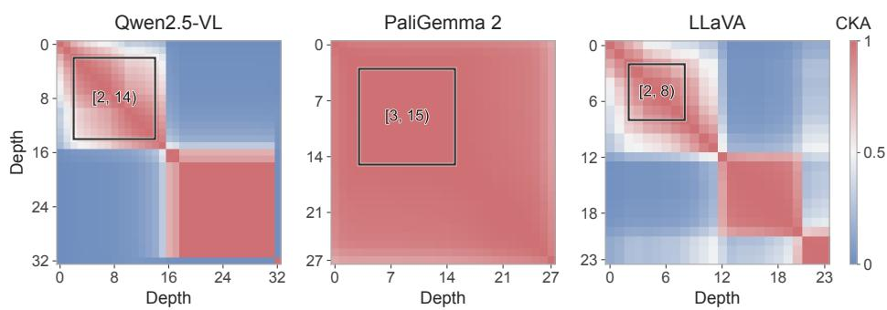

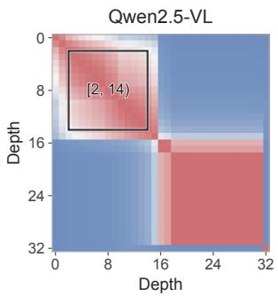

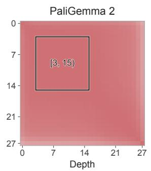

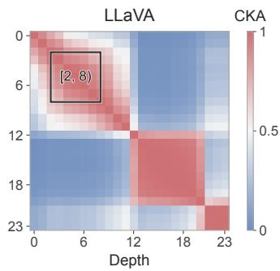  
Figure 8: Pretrained visual representation similarity. Linear CKA across depths in Qwen2.5-VL, PaliGemma 2, and LLaVA, using the same 0–1 color scale. Boxes mark the default loop spans in Table 4; their corners correspond to each span’s input and output depths. Depth k denotes the representation after k blocks. LLaVA is shown through the penultimate block used by the model. The Qwen matrix is the same as in Figure 4a.

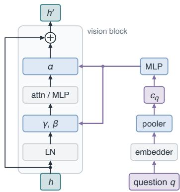

Figure 9: Question-conditioned visual updates. One residual branch of a frozen vision block (gray). The question is pooled into $c _ { q }$ and mapped to branch-specific shifts, scales, and gains. Coefficients are shared across visual tokens and iterations; the multiplicative factors are 1+γ and 1+α (Equation 2). Blue modules are trainable. Only each generator’s output layer is zero-initialized, preserving the pretrained computation at initialization.

Question conditioning. The pooler computes $c _ { q }$ from the question’s input embeddings and reuses it across visual iterations. Qwen and PaliGemma omit BOS from the conditioning sequence; LLaVA prepends it. In Qwen, we additionally omit EOS and chat-role tokens, truncate the question to 128 tokens, and detach its embeddings. The embeddings are converted to FP32, RMS-normalized, and projected from width 2048 to 512. A learned query attends to this sequence through eight-head cross-attention with a residual connection, followed by a residual MLP with RMS normalization and hidden width 1024. Padding tokens are masked, and the pooler is shared across conditioned blocks. Images, answer targets, and generated drafts do not enter the question condition.

Modulation and initialization. Each block has its own generator $A _ { \ell } ,$ comprising layer normalization and a two-layer MLP with a SiLU activation. The output supplies a shift, scale, and residual gain for each of the attention and MLP branches, as in Equation 2. The question condition $c _ { q }$ and the resulting modulation coefficients are shared across visual iterations, with coefficients broadcast over visual tokens. We zero-initialize only the generator’s output layer, so the first visual iteration initially recovers the pretrained encoder computation. The multiplicative factors are not squashed or clipped. Figure 9 illustrates one modulated branch.

## B.2 TRAINING

Data. The six tasks used in our experiments each contribute 100k training examples, 600 ID test examples, 600 OOD test examples and 100 validation examples used for hyperparameter tuning. Training and ID tests contain 25k and 150 examples per task and difficulty level, respectively. All task images are rendered at 448 × 448 before model-specific preprocessing. For Count Clusters, both test splits use icon classes held out from training; ID examples retain the training difficulty range. We mix the 600k task examples with a fixed 100k-example subset of LLaVA-NeXT, using its original answer annotations (Figure 10).

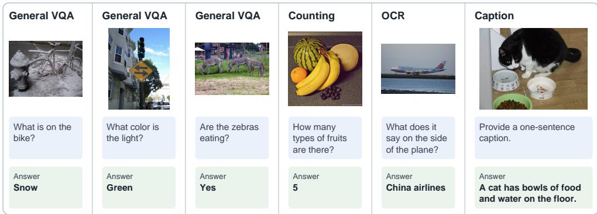  
Figure 10: Examples from the fixed LLaVA-NeXT training subset. The examples illustrate general visual question answering, counting, optical character recognition, and captioning. Answers use the original dataset annotations [45]; prompts are shortened for readability.

Optimization. Table 4 specifies the optimization settings, with learning rates listed separately for the language-model LoRA adapters, vision–language connector, and question-conditioning modules. The latter include the question pooler and modulation generators. Within each backbone, SFT, single-pass AdaLN, and AdaLoop use the same training mixture and optimizer-update budget. Corresponding adapter initializations and training-example order are paired by seed.

Depth supervision. At each supervised depth, we teacher-force the same final answer after the variant-specific prefix $\Pi _ { t } ^ { ( v ) }$ . Only target-answer tokens contribute to the loss; question, visual, separator, and draft tokens are excluded. We use normalized depth weights $\begin{array} { r } { \boldsymbol { w _ { t } } ^ { * } \propto r ^ { T _ { \mathrm { t r a i n } } - t } . } \end{array}$ , where $0 < r < 1$ , so later depths receive more weight. We use static geometric weights with $r = 0 . 6$ for Qwen and LLaVA and $r = 0 . 8$ for PaliGemma. Deep supervision evaluates the weighted losses at all trained depths. In our Qwen depth-sampling experiments, we instead sample a depth with probability $w _ { t }$ and compute its unweighted mean answer-token loss. This gives an unbiased estimate of the same objective in Section 3.3.

Drafts and gradient flow. Variant C generates its drafts greedily from the model’s predictions. Drafts enter subsequent language prefixes without being replaced by the target answer or differentiated through token selection. We perform a fresh language-model prefill between rounds and detach the question embeddings used for conditioning. In all variants, gradients from the supervised loss pass through frozen vision blocks to the conditioning modules. Appendix C.2 accounts for the additional draft computation.

## B.3 INFERENCE

Inputs and decoding. On VisRO, we supply the task question through the language interfaces in Section 3.2. The visual question conditioner receives only the original question text, excluding evaluation-only answer-format instructions. We use backbone-specific causal/prefix attention conventions with the masking required by each readout variant. Final answers are decoded greedily until EOS or a maximum of 64 newly generated tokens for Qwen, 128 for PaliGemma and 32 for LLaVA.

Answer-stability stopping. Table 1 uses $p = 1$ and maximum depth $T _ { \mathrm { t e s t } } = 3$ . We obtain predictions from separate fixed-depth evaluations at depths one through three, then apply the stopping rule offline. After lowercasing answers and normalizing whitespace, we select the depth-two answer if it agrees with the depth-one answer, and otherwise select the depth-three answer. This rule uses no target answers.

Evaluation depth. Figure 5b evaluates fixed depths one through six without stopping, using models trained with $T _ { \mathrm { t r a i n } } = 3$ . The mean depth T¯ in Table 1 is the mean stopping depth selected by the rule. Appendix C.2 estimates the cost of executing this rule online, including intermediate answer generation.

Table 5: Fixed-depth evaluation on VisRO and general VQA. Scores are accuracies (%); VisRO scores are macro averages across six tasks. Params denotes trainable parameters (M). ∗General VQA evaluation uses fixed $\bar { T } = 1$
<table><tr><td rowspan="2">Method</td><td rowspan="2">Params</td><td colspan="3">VisRO overall</td><td colspan="2">General VQA*</td></tr><tr><td>T</td><td>ID</td><td>OOD</td><td>MMStar</td><td>MMBench</td></tr><tr><td colspan="8">Qwen2.5-VL-3B</td></tr><tr><td>SFT</td><td>66</td><td>1</td><td>49.9</td><td>23.9</td><td>51.7</td><td>77.1</td></tr><tr><td>Single-pass AdaLN</td><td>82</td><td>1</td><td>60.0</td><td>30.2</td><td>51.1</td><td>75.4</td></tr><tr><td>AdaLoop-A</td><td>82</td><td>3</td><td>63.7</td><td>32.4</td><td>51.1</td><td>75.5</td></tr><tr><td colspan="8">PaliGemma2-3B</td></tr><tr><td>SFT</td><td>24</td><td>1</td><td>62.6</td><td>31.5</td><td>46.1</td><td>72.0</td></tr><tr><td>Single-pass AdaLN</td><td>39</td><td>1</td><td>72.4</td><td>40.0</td><td>44.7</td><td>68.6</td></tr><tr><td>AdaLoop-A</td><td>39</td><td>3</td><td>74.5</td><td>44.0</td><td>44.3</td><td>71.2</td></tr><tr><td colspan="8">LLaVA-1.5-7B</td></tr><tr><td>SFT</td><td>341</td><td>1</td><td>50.4</td><td>24.8</td><td>33.7</td><td>59.1</td></tr><tr><td>Single-pass AdaLN</td><td>350</td><td>1</td><td>57.7</td><td>29.6</td><td>34.8</td><td>60.8</td></tr><tr><td>AdaLoop-A</td><td>350</td><td>3</td><td>62.1</td><td>31.1</td><td>33.7</td><td>60.1</td></tr></table>

## B.4 BASELINE IMPLEMENTATIONS

Single-pass controls. Zero-shot evaluation uses the pretrained VLM. SFT trains the vision– language connector and language-model LoRA adapters while keeping the vision encoder frozen. Single-pass AdaLN adds AdaLoop’s question pooler and modulation generators and applies the same visual span once. Its trainable parameter count matches AdaLoop’s within each backbone. The question-independent control in Table 3b supplies the same null question for all training and test examples while retaining the modulation modules.

LIVR. Our Qwen implementation of LIVR [39] matches SFT in initialization, the 700k-example training mixture, sampling seed, global batch size, rank-64 language LoRA, trainable vision merger, and total 40k-update budget. Following the paper’s best ablation, we use K = 16 learned latent tokens and train for 16k updates with visual-bottleneck attention, followed by 24k updates with standard attention. Training uses only final-answer supervision.

SFT+GRPO. We implement GRPO [61] using EasyR1 [82], initialized from the converged Qwen SFT checkpoint and rewarded by exact final-answer accuracy. This warm start follows preliminary runs from the pretrained checkpoint, which produced almost no correct rollouts and consequently little within-group reward variation. The GRPO stage adds training beyond the SFT budget.

## C ADDITIONAL EXPERIMENTS AND ANALYSES

We supplement the main experiments with fixed-depth evaluation and computational cost.

## C.1 FIXED-DEPTH EVALUATION

Table 5 reports fixed-depth results for the same trained checkpoints evaluated in Table 1. AdaLoop uses $T = 3$ on VisRO, while all general VQA evaluations use $T = 1$ . At fixed depth, AdaLoop improves over single-pass AdaLN on both VisRO-ID and VisRO-OOD across all three backbones. Changes on general VQA are mixed across models and benchmarks.

Table 6: Operation counts for online inference. All variants execute the visual loop t times at fixed depth and τ times under answer-stability stopping. A readout applies the coda and connector to a visual state. A generation includes language-model prefill and answer decoding. Adaptive stopping checks the answer at every executed depth.
<table><tr><td rowspan="2">Variant</td><td colspan="2">Fixed depth t</td><td colspan="2">Adaptive depth τ</td></tr><tr><td>Readouts</td><td>Generations</td><td>Readouts</td><td>Generations</td></tr><tr><td>A</td><td>1</td><td>1</td><td>T</td><td>T</td></tr><tr><td>B</td><td>t</td><td>1</td><td>T</td><td>T</td></tr><tr><td>C</td><td>t</td><td>t</td><td>T</td><td>T</td></tr><tr><td>Method</td><td>Depth</td><td></td><td>TFLOPs/example</td><td>Relative FLOPs</td></tr><tr><td>Single-pass AdaLN</td><td>1</td><td></td><td></td><td></td></tr><tr><td>AdaLoop (fixed)</td><td>3</td><td></td><td>3.133</td><td>1.00×</td></tr><tr><td></td><td></td><td></td><td>4.170</td><td>1.33×</td></tr><tr><td>AdaLoop (adaptive)</td><td>≤3</td><td></td><td>6.777</td><td>2.16×</td></tr></table>

(a) Inference on VisRO-ID. Costs average 3,600 examples using text-derived generation lengths. Adaptive costs assume online stopping with $p = 1 ;$ ratios are relative to single-pass AdaLN.
<table><tr><td>Method</td><td>Updates</td><td>TFLOPs/example</td><td>Total EFLOPs</td><td>Relative FLOPs</td></tr><tr><td>Single-pass AdaLN</td><td>40k</td><td>6.985</td><td>17.88</td><td>1.00×</td></tr><tr><td>Single-pass AdaLN</td><td>50k</td><td>6.985</td><td>22.35</td><td>1.25×</td></tr><tr><td>AdaLoop (sampled)</td><td>40k</td><td>9.229</td><td>23.63</td><td>1.32×</td></tr><tr><td>Single-pass AdaLN</td><td>120k</td><td>6.985</td><td>53.64</td><td>3.00×</td></tr><tr><td>AdaLoop (deep sup.)</td><td>40k</td><td>19.981</td><td>51.15</td><td>2.86×</td></tr></table>

(b) Training on the 700k-example mixture. Costs include forward and backward computation with global batch size 64. The sampled estimate assumes per-example state masking. Total-cost ratios are relative to singlepass AdaLN at 40k updates.

Table 7: Estimated computational cost on Qwen2.5-VL. AdaLoop uses variant A with loop span [2, 14). Costs exclude padding and activation-checkpoint recomputation; TFLOPs and EFLOPs denote $1 0 ^ { 1 2 }$ and $1 0 ^ { 1 8 }$ operations.

## C.2 COMPUTATIONAL COST

We describe the FLOP accounting for the Qwen2.5-VL Variant-A comparisons in Section 5.4.

Counting convention. We count one multiply–add as two FLOPs and include matrix multiplications in the vision encoder, conditioning modules, connector, and language model. Each answer uses a KV cache, with a fresh prefill at each depth. We exclude padding, elementwise operations, normalization, softmax, activation-checkpoint recomputation, optimizer updates, data processing, and communication. These are arithmetic estimates, not latency measurements.

Inference cost. Table 6 counts operations for fixed-depth and online adaptive inference. Adaptive costs include one visual trajectory and answer generation at each depth through the selected stopping depth. They exclude repeated fixed-depth passes used for offline evaluation (Appendix B.3). Table 7a averages per-example estimates over 3,600 VisRO-ID examples, accounting for each example’s context and generation lengths. We estimate generated lengths by re-tokenizing decoded predictions and adding EOS, capped at 64 tokens; these may differ from the original token counts. Online stopping uses $p = 1$ and a depth limit of three, with mean selected depth 2.19.

Training cost. Deep supervision shares one visual computation graph across depths, while each supervised depth incurs its own readout and language-model pass. The cost estimate includes backward computation through frozen vision blocks wherever it is needed to train the conditioning modules. For matrix multiplications, forward-only computation is counted once; forward plu an input gradient is counted twice; and forward plus gradients for both operands is counted three times. Thus, frozen linear layers that propagate input gradients cost twice their forward computation, while trainable linear layers and attention matrix products requiring gradients for both operands cost three times. LoRA computation is included during training and merged for inference. Intermediate language-model output heads are applied only at supervised token positions; the final head is applied to the full sequence, following the implementation.

<table><tr><td>Method</td><td>Repeated component</td><td>Initialization / adaptation</td></tr><tr><td colspan="3">Vision models</td></tr><tr><td>SR-ViT [37]</td><td>ViT blocks</td><td>From scratch on ImageNet</td></tr><tr><td>LoopViT [63]</td><td>Hybrid ViT blocks</td><td>Visual ARC pretraining; test-time training</td></tr><tr><td>Raptor [28]</td><td>Surrogate ViT blocks</td><td>Fit pretrained ViT trajectories</td></tr><tr><td colspan="3">Language models</td></tr><tr><td>Huginn [20]</td><td>Middle LM blocks</td><td>From scratch</td></tr><tr><td>Ouro [85]</td><td>Full LM blocks</td><td>From scratch</td></tr><tr><td>LoopUS [52]</td><td>Middle LM blocks</td><td>Continued LM pretraining</td></tr><tr><td colspan="3">Multimodal models</td></tr><tr><td>RecursiveVLM [76] Full LM blocks</td><td></td><td>Continued VLM pretraining + SFT</td></tr><tr><td>HIVE [80]</td><td>Huginn recurrent core</td><td> Pretrained vision + LM; multimodal training</td></tr><tr><td>CVRR [51]</td><td>Single LM block</td><td>Pretrained VLM; recurrent LoRA</td></tr><tr><td>AdaLoop</td><td>Frozen vision blocks</td><td>Train conditioning, connector, LM LoRA</td></tr><tr><td colspan="3">(a) Looped architectures. Parameters are shared across repeated applications of the listed component.</td></tr><tr><td>Method</td><td>Mechanism</td><td>Conditioning / feedback</td></tr><tr><td>Mema [46]</td><td>Cross-layer memory + modulation</td><td>Input question</td></tr><tr><td>VPT [78]</td><td>Re-encoding; conditioned projection LM control-token state</td><td></td></tr><tr><td></td><td>Galatolo et al. [18] Feedback to encoder inputs</td><td>LM image-token states</td></tr><tr><td>DVR [81]</td><td>Re-encoding</td><td>Generated sub-questions</td></tr><tr><td>AdaLoop</td><td>Recurrent visual updates</td><td>Input question</td></tr></table>

(b) Language-guided visual processing. Visual computation can be conditioned directly on the question or on intermediate language-model states or outputs.  
Table 8: Looped architectures and language-guided visual processing. The two panels compare complementary architectural choices across different tasks and training settings. LM denotes language model.

For depth-sampled supervision, we estimate the cost of the example-masked implementation. It masks state updates after each example’s sampled depth but still executes all iterations up to the training limit. The estimate includes this visual computation and one supervised readout at the sampled depth.

We estimate total training FLOPs by averaging per-example costs over the training mixture and multiplying by the global batch size and number of updates (Table 7b). The sampled and deeply supervised runs use 5.7% more and 4.6% less compute than their respective AdaLN controls.

## D ADDITIONAL RELATED WORK

Reusing pretrained visual computation. Table 8a compares recurrent architectures, and Table 8b compares how language guides visual processing. Raptor [28] learns recurrent surrogate blocks to approximate pretrained ViT activation trajectories. Mema [46] maintains question-conditioned memory across encoder layers. AdaLoop repeatedly applies the original frozen vision blocks to an evolving visual state. Question-conditioned modulation guides these updates, with generator parameters shared across iterations.

Relation to procedural training resources. VisRO shares with VBVR and VBVR-Pro an emphasis on procedural data generation and programmatic evaluation [71, 75]. These works evaluate generated visual solutions. Our experiments use image–question–answer triples and final-answer supervision, without prescribed visual solutions or intermediate trajectories.

## E VISRO: TASKS, GENERATION, AND EVALUATION

VisRO is a procedural dataset and generation pipeline with 24 visual reasoning tasks spanning counting, discrimination, connectivity, geometric transformations, and spatial reasoning. This appendix describes the tasks, their difficulty controls, and the data generation and evaluation protocol.

## E.1 TASK COVERAGE AND DEFINITIONS

Table 9 groups the 24 tasks by the visual operations they require: discrimination and grouping, paths and connectivity, planar transformations and composition, and spatial transformations and structure. Figures 3, 11, and 12 together illustrate all tasks. Questions specify both the requested operation and the answer format. The table and figures illustrate representative formats. Some difficulty extensions use different outputs, including per-line counts, queried-cell values, and constructive tangram assemblies.

## E.2 DIFFICULTY LEVELS AND OOD EVALUATION

Difficulty levels. Training and in-distribution (ID) evaluation use four task-specific difficulty levels: easy, medium, hard, and xhard. ID evaluation uses independently generated test examples from these four levels. Difficulty is controlled through generation parameters such as object count, overlap, path length, crossings, and distractor similarity. Table 10 compares xhard, the highest ID level, with the OOD settings for representative tasks. Tier names describe task-specific settings and do no imply equal difficulty across tasks.

Difficulty controls also account for the rendered problem. For example, near-matching icons increase comparison demands, while cube-net distractors can differ in face orientation. These changes must preserve the visual cues needed to determine the answer. Rendering resolutions are taskspecific and specified by the generator configurations.

The OOD split. Out-of-distribution (OOD) examples introduce task-specific increases in scene complexity or shifts in generation rules and visual appearance. For example, 3D block counting increases the base dimensions, maximum height, and minimum cube count (Table 10). Flow Free holds out a path-construction program and rendering or material combinations; Metro Map uses four held-out rendering styles. Both tasks retain their ID question families in the OOD split. Figure 3 shows representative ID and OOD examples.

## E.3 DATA GENERATION AND EVALUATION

Data generation and validation. Each generator samples and renders a structured scene, then constructs a question and computes its answer from the scene. Task-specific checks assess whether the image contains the information needed to answer the question and whether the answer agrees with the scene. Scene structure and spatial annotations support data generation and validation. AdaLoop training uses only images, questions, and final answers.

Scoring. Scoring follows each task’s answer format, without an LLM judge. Labels, counts, and sequences use exact match after task-specific parsing and normalization. Ordered outputs must match the complete reference sequence, while pair sets are compared independently of their listing order. Constructive tangram answers are checked for allowed rotations, complete target coverage, and absence of overlap. Any valid assembly is accepted. We report per-task accuracy and macro averages across evaluated tasks, separately for ID and OOD.

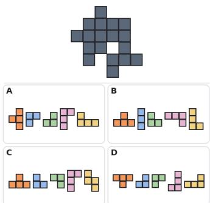

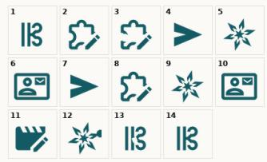  
Find the same Which icons are identical?

  
Find the different Which icon is different?

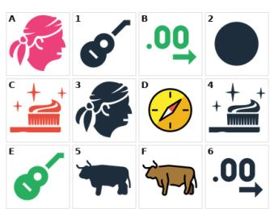  
Find the shadow Match objects to silhouettes.

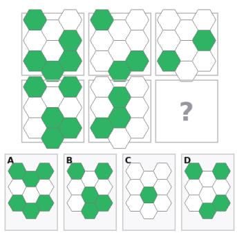  
Reconstruction Which pieces form the target?  
Logic matrix Complete the missing entry.

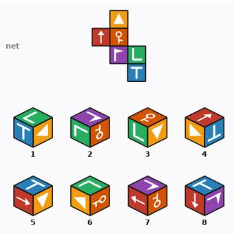  
Cube unfolding Which cubes match the net?

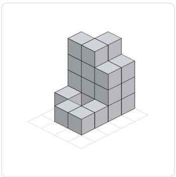  
3D block counting  
Find the minimum cube count.

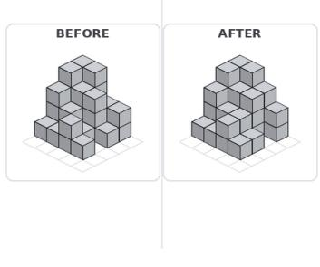  
Block changes  
Count added and removed cubes.

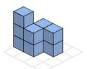

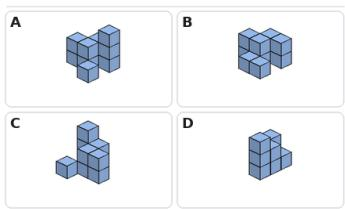  
Viewpoint rotation  
Find the same object after rotation.

Figure 11: VisRO task examples (1/2). The examples illustrate matching and discrimination (top), composition and transformations (middle), and spatial structure (bottom). All examples use the task-specific hard setting from a fixed generator revision; the text below each image summarizes its question.

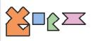  
A  
c

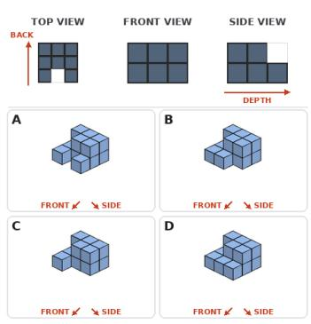

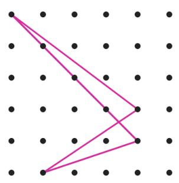  
Count points on the colored lines.

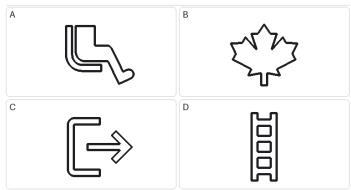  
Overlap matching Which outline appears in the stack?

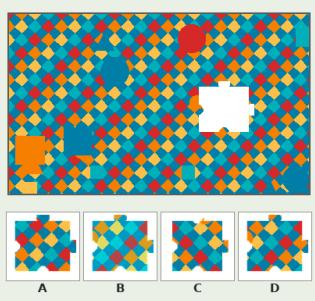  
Jigsaw completion Which piece completes the pattern?

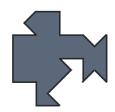

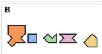

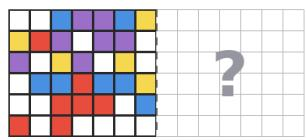

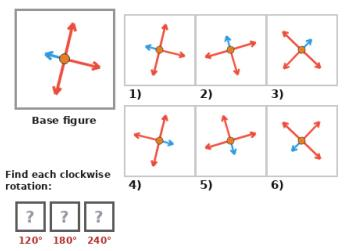

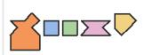

  
Which pieces form the silhouette?

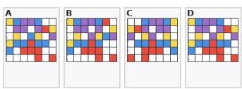  
Complete the reflected pattern.  
Match the requested rotations.

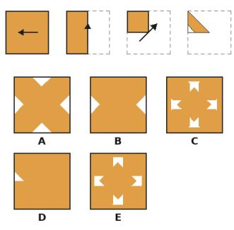  
Unfold the cut paper.

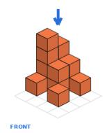

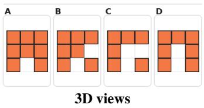  
Find the indicated projection.  
View reconstruction  
Which structure matches the views?

Figure 12: VisRO task examples (2/2). The examples illustrate point counting, overlap matching, and jigsaw completion (top), planar composition and transformations (middle), and folding and three-dimensional views (bottom). As in Figure 11, all examples use the task-specific hard setting, and the text summarizes each question.

Table 9: VisRO task coverage. The 24 tasks are grouped by the visual operations they require. Questions and answer formats correspond to representative examples in Figures 3, 11, and 12; difficulty extensions can use different formats.
<table><tr><td>Task</td><td>Representative question</td><td>Answer form</td></tr><tr><td colspan="3">Discrimination and grouping</td></tr><tr><td>Count clusters</td><td>How many objects overlap another object?</td><td>Integer</td></tr><tr><td>Points on lines</td><td>How many points lie on the highlighted lines?</td><td>Integer</td></tr><tr><td>Find the same</td><td>Which items are identical?</td><td>Correspondences</td></tr><tr><td>Find the different</td><td>Which item differs from the others?</td><td>Position</td></tr><tr><td>Find the shadow</td><td>Which silhouettes match the objects?</td><td>Correspondences</td></tr><tr><td>Overlapping glyphs</td><td>Read symbols in the indicated color order.</td><td>Symbol sequence</td></tr><tr><td>Overlap matching</td><td>Which outline occurs in the superposition?</td><td>Choice</td></tr><tr><td colspan="3">Paths and connectivity</td></tr><tr><td>Flow Free</td><td>Count cells per pipe, including endpoints.</td><td>Integer sequence</td></tr><tr><td>Metro map</td><td>How many stations are on the specified line?</td><td>Integer</td></tr><tr><td>Maze</td><td>Are the two marked locations connected?</td><td>Boolean</td></tr><tr><td>Path tracing</td><td>Match the marked starts to endpoint labels.</td><td>Label sequence</td></tr><tr><td colspan="3">Planar transformations and composition</td></tr><tr><td>Jigsaw completion</td><td>Which piece completes the pattern?</td><td>Choice</td></tr><tr><td>Reconstruction</td><td>Which set of pieces can form the target?</td><td>Choice</td></tr><tr><td>Tangram reconstruction</td><td>Which pieces form the target silhouette?</td><td>Choice</td></tr><tr><td>Mirroring patterns</td><td>What pattern results from the given reflections?</td><td>Choice</td></tr><tr><td>Rotation patterns</td><td>Which patterns result from the given rotations?</td><td>Index sequence</td></tr><tr><td>Logic matrix</td><td>Which entry completes the matrix rule?</td><td>Choice</td></tr><tr><td colspan="3">Spatial transformations and structure</td></tr><tr><td>3D block counting</td><td>What minimum cube count is consistent with the view?</td><td>Integer</td></tr><tr><td>Block changes</td><td>How many cubes were added and removed?</td><td>Ordered counts</td></tr><tr><td>Cube unfolding</td><td>Which cube views can be folded from this net?</td><td>Index set</td></tr><tr><td>Paper folding</td><td>What pattern results after folding, punching, and unfolding?</td><td>Choice</td></tr><tr><td>3D views</td><td>Which projection matches the indicated viewpoint?</td><td>Choice</td></tr><tr><td>View reconstruction</td><td>Which structure is consistent with the given views?</td><td>Choice</td></tr><tr><td>Viewpoint rotation</td><td>Which candidate is a rotation of the reference object?</td><td>Choice</td></tr></table>

Table 10: Example ID and OOD settings in VisRO. We compare xhard, the highest ID difficulty, with the held-out OOD settings. A trailing + denotes a lower bound. In cube unfolding, OOD item distinguish same-color faces by glyph identity and orientation.
<table><tr><td>Task</td><td>ID (xhard)</td><td>OOD</td></tr><tr><td>Find the same</td><td>20 icons; 6 matching pairs; 6 near matches</td><td>25 icons; 8 matching pairs; 8 near matches</td></tr><tr><td>Find the different</td><td>9×9 grid; local alteration</td><td>10×10 grid; smaller alteration cap</td></tr><tr><td>Cube unfolding</td><td>10 views; orientation distractors</td><td>12 views; glyph-orientation cues</td></tr><tr><td>3D block counting</td><td>4×5 base; max height 5; min count 30+</td><td>5×5 base; max height 6; min count 45+</td></tr><tr><td>Block changes</td><td>8–10 changes; 5+ columns</td><td>12–16 changes; 8+ columns</td></tr><tr><td>Viewpoint rotation</td><td>4×5 base; 20–28 cubes</td><td>5×5 base; 30–42 cubes</td></tr></table>