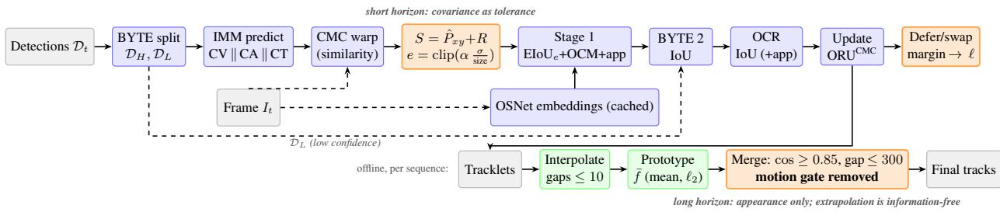
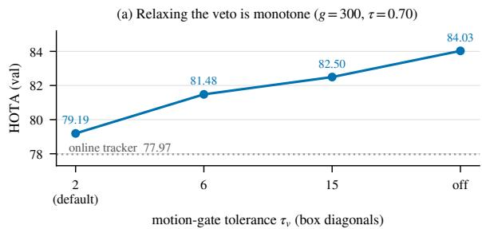
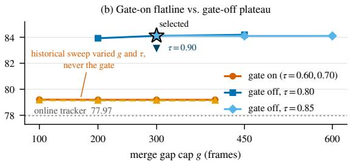
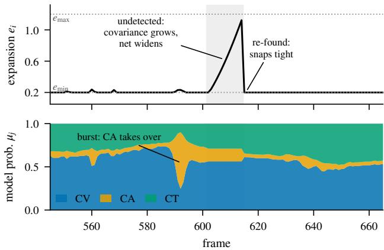
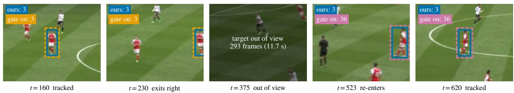

# ARC-SORT: Adaptive, Robust, Compensated Multi-Object Tracking with Interacting Multiple Models

Girish Kumar Adari

Athlitix Inc.

girish@athlitix.com

## Abstract

Multi-object tracking in sports broadcasts is hard for two reasons: athletes move fast and change direction abruptly, and the camera pans and zooms at the same time. We present ARC-SORT (Adaptive, Robust, Compensated SORT), a tracking-by-detection tracker that trains nothing and runs in real time. Its design rule: the tracker measures its own uncertainty, and that measurement decides how it acts. An Interacting Multiple Model (IMM) Kalman filter gives every track a predictive covariance, and we turn it into a per-track search region: the less reliable the motion prediction, the larger the region in which a detection may match (uncertainty-adaptive Expansion IoU, EIoU). On identical inputs, this continuous coupling is what matters: the same covariance used as a hard Mahalanobis gate hurts at every threshold we swept, and richer covariance summaries add nothing measurable. When two tracks cross, the assignment cost itself reports whether the deci sion was close. ARC-SORT keeps such pairs under review and applies at most one corrective identity swap once postcrossing appearance evidence shows the first decision was wrong; this adds +1.0 HOTA (higher order tracking accuracy) on both the SportsMOT and DanceTrack test sets at under a millisecond per frame. For players who leave the framefor seconds, motion extrapolation carries no information, so our offline re-identification drops the usual motion gate and links tracklets by appearance alone. ARC-SORT reaches 81.82 HOTA on the SportsMOT test set with the fewest identity switches of the 69 leaderboard entries as of August 2026 and tied-third multi-object tracking accuracy (MOTA, 97.09), and 62.1 HOTA on DanceTrack test with the same association settings. On Deep-EIoU’s public detections and embeddings it reaches 80.31 HOTA, +3.1 over Deep-EIoU. It runs at about 50frames per second on a lap top RTX 3060 GPU. Code will be released.

## 1. Introduction

Tracking-by-detection splits multi-object tracking (MOT) into two steps: a detector finds object boxes in every frame, and an association step links those boxes across frames into tracks that keep their identities. The SORT family [7] performs the second step with a Kalman filter, which predicts where each track will be, and a matching cost, usually the intersection over union (IoU) between predicted and detected boxes, solved as a linear assignment. This paper is about the association step only: ARC-SORT takes the output of a fixed detector and trains nothing.

Sports broadcasts concentrate the two failure modes of the SORT paradigm into one domain: athletes sprint, cut, and collide, violating the Kalman filter’s constant-velocity assumption, while the broadcast camera pans and zooms on top. The dominant response is to make association more tolerant, enlarging boxes by a fixed margin [43], schedule [20], or velocity heuristic [40], or else to learn motion per domain [3, 22, 27]. Meanwhile, two quantities that report how much the tracker should trust itself are computed every frame and discarded: the filter’s predictive covariance says how far the motion prediction can be trusted, yet overlap-cost pipelines either ignore it at association time or consume it as a hard Mahalanobis veto [42] (ground-plane costs [45] abandon overlap entirely); and the assignment’s own cost margin says how nearly it preferred the swapped pairing, yet nothing in the tracker’s state distinguishes a confident match from a coin flip.

This paper is built on a single principle: a tracker should let its own uncertainty govern its own decisions. We instantiate it twice, as search breadth and commitment firmness, and follow it to its limit. At short horizons the motion covariance acts as tolerance, not veto: our uncertaintyadaptive Expansion IoU dilates each track’s matching region by a continuous function of its predictive standard deviation, supplied by an Interacting Multiple Model (IMM) filter [6, 8]. At crossings, the assignment margin governs identity commitment: a pair whose swap would cost the assignment almost nothing was decided at the moment of worst evidence, so ARC-SORT marks it entangled, snapshots pre-crossing appearance, accumulates a permutation likelihood, and repairs the decision with at most one corrective swap per episode [32]. Past a multi-second out-ofview gap (football’s dominant failure; median camera exit 111 frames) the covariance has diverged and a search region wider than the frame is no gate at all, so the offline reidentification stage drops the motion gate and lets appearance alone link tracklets.

Each part is established by measurement. A controlled mechanism ladder on identical cached inputs shows hard Mahalanobis gating on the same covariance degrades association at every threshold we swept, while richer uses add nothing measurable: the scalar relative positional uncertainty is, empirically, a sufficient statistic for association tolerance. Deferred commitment is worth +1.0 HOTA on both test servers over the identical system without it, and removing the merge’s motion veto is worth +4.9 HOTA on SportsMOT val and transfers to DanceTrack under a different embedding model.

A tracker evaluated on a leaderboard is evaluated jointly with its detector, so we anchor our comparison in a detectordeconfounded protocol: on the exact public detections and embeddings of Deep-EIoU [20], ARC-SORT scores 80.31 HOTA (higher order tracking accuracy [26]) versus their published 77.20, a +3.1 margin produced entirely by association, the decisive share from removing the merge’s motion gate (Sec. 4.2). With our own detector stack ARC-SORT reaches 81.82 on the SportsMOT test set (rank 6 of 69 as of August 2026), with the fewest identity switches of any entry (1,414) at tied-third MOTA (97.09) and, despite the 30th-best detection accuracy (DetA), the 4th-best identity F1 (IDF1): association, not detection, produces the result.

## Our contributions are:

1. Uncertainty-adaptive Expansion IoU: to our knowledge the first IoU-family association tolerance set continuously by the filter’s own predictive covariance; training-free, one scalar per track per frame (Sec. 3.4).

2. A sufficient-statistic characterization: a controlled ladder showing the scalar max ${ \mathrm { : } } ( \sigma _ { x } / w , \sigma _ { y } / h )$ captures everything the covariance offers for association, and that veto-style uses of the same signal hurt (Secs. 3.7, 4.4).

3. Deferred identity commitment: the assignment’s permutation margin as an online ambiguity signal, converted by a two-hypothesis corrective swap into +1.0 test HOTA on two benchmarks at sub-millisecond cost (Secs. 3.6, 4.6).

4. The long-horizon corollary: at multi-second out-ofview gaps the motion prior is the binding constraint; removing it from the offline merge is benchmark- and embedding-general, with every comparison anchored input-identical (Secs. 3.8, 4.5, 4.2).

## 2. Related Work

Tracking-by-detection. SORT [7] established the predict–associate loop; successive work strengthened every stage: appearance and post-hoc refinement [12, 42], low-confidence recovery [47], observation-centric drift correction [9], camera compensation [4], ground-plane modeling [45], adaptive appearance fusion [28], weak cues [44], and track-centric assignment [34]. Across this family, the filter’s predictive covariance is either ignored at association time or, in practice, consumed solely as a hard Mahalanobis gate [42]; the association cost itself is uncertainty-blind, and the assignment is commitment-blind: every match is final the frame it is made.

Expanded and buffered matching. Closest to ARC-SORT are methods that enlarge boxes before computing overlap: by a fixed proportional margin [43], a fixed iterative schedule [20] (discarding the Kalman filter), with a harmonic cost mean [16], or switched by a binary velocity threshold atop a trained long short-term memory (LSTM) gated filter [40]. In every case the factor is fixed or discretely switched; none derives it from the filter’s own predictive covariance. Ours is a continuous function of that covariance, wide exactly when the prediction is unreliable, and requires no training.

Uncertainty as a signal. In detection, probabilistic-IoU box models [24, 25, 41] score overlap between distributions rather than boxes; UTrack [35] propagates detector uncertainty into association, complementary to the motion-model uncertainty we exploit. IMM filtering [6, 8, 29] has long supplied calibrated predictive covariances in radar tracking, where the probabilistic and joint probabilistic data association filters (PDAF/JPDAF) [5, 13] spend them continuously inside a soft filter update. Visual MOT’s hard-assignment, overlap-cost pipelines use the covariance only as a Mahalanobis veto [42]; covariance as a continuous overlap tolerance under one-to-one assignment is, to our knowledge, new.

Deferred data association. Multiple hypothesis tracking (MHT) [32] answers ambiguity by not deciding; PDAF/JPDAF (above) soften the assignment itself. Vision revisited both, in pruned MHT with appearance [23], m-best JPDA [33], and near-online revision [10], but the SORT lineage dropped deferral: it commits every identity at the crossing instant, precisely when occlusion makes evidence worst, and revision survives only as offline refinement [12, 38]. Our mechanism (Sec. 3.6) is a bounded revival inside the causal stream: the assignment’s own permutation margin selects the rare entangled pairs, two hypotheses each, at most one corrective swap per episode;

to our knowledge no SORT-family tracker on these benchmarks revises a committed identity within the causal stream at SORT cost.

Learned motion and association. The alternative is to learn: motion networks [19, 21, 22, 27, 31], deep Kalman replacements [2, 3], learned association [1, 36], graphbased online/offline tracking [30], and end-to-end transformers [14, 46], all trained per domain, inheriting their training distribution; ARC-SORT adapts online through the filter, training-free and detector-independent.

Offline tracklet association. Closest to our long-horizon stage, GTA [38] refines Deep-EIoU offline, globally relinking tracklets under appearance plus spatio-temporal constraints (81.0 on SportsMOT). Our merge differs in what it removes: it drops the motion constraint at long gaps, the binding factor per our ablation (Sec. 4.5), and links on appearance alone.

Foundation-model tracking and benchmarks. At a different compute tier, selective mask propagation [18] dispatches a SAM 3 video segmenter only where an assignment-uncertainty signal fires (87.2 on SportsMOT, with global association): our premise, uncertainty decides where effort is spent, at a fraction of the cost. SportsMOT [11] combines fast, non-linear athlete motion with panning broadcast cameras; DanceTrack [39] isolates non-linear motion under a largely static camera, so the pair is a controlled test of motion and camera components.

## 3. Method

ARC-SORT applies one rule three times (Fig. 1). Online, frame by frame: each track’s matching region is dilated in proportion to its own predictive covariance (Sec. 3.4), and near-ambiguous match pairs, identified by the assignment’s own margin, are held in a deferred two-hypothesis state and corrected by a single identity swap when later evidence rules the first decision wrong (Sec. 3.6). Offline, per sequence: tracklet fragments separated by multi-second gaps, where motion information has run out, are linked by appearance alone, with the customary motion veto removed (Sec. 3.8).

## 3.1. Online tracker overview

At each frame, detections split by confidence at $\tau _ { H } { = } 0 . 6 / \tau _ { L } { = } 0 . 1$ [47]; each track’s IMM filter predicts (Sec. 3.2); a camera-motion estimate warps all predicted states into the current frame (Sec. 3.3); the warped covariance sets each track’s expansion (Sec. 3.4); three association stages match detections to tracks (Sec. 3.5). Matched tracks receive a filter update (replayed through stored camera transforms after loss, Sec. 3.3); unmatched highconfidence detections spawn tracks (≥ 0.7); tracks lost over 30 frames are removed. After lifecycle management, an arbitration pass reads the frame’s assignment margins and manages entanglement episodes (Sec. 3.6); it can relabel two tracks but never touches a filter state.

## 3.2. IMM motion model

Models. All models operate on measurements $\begin{array} { r l } { \mathbf { z } } & { { } = } \end{array}$ $[ c _ { x } , c _ { y } , w , h ] ^ { \top }$ . A constant-velocity (CV) model tracks all four box coordinates and their velocities $( \mathbb { R } ^ { 8 } )$ ; a constantacceleration (CA) model adds acceleration for the center only $( \mathbb { R } ^ { 1 0 } ) ;$ a coordinated-turn (CT) model adds a turn rate ω $( \mathbb { R } ^ { 9 } )$ with the standard non-linear center transition [6], handled by an extended Kalman filter (EKF) with an analytic Jacobian; $| \omega | < 1 0 ^ { - 6 }$ reduces to CV.

Cycle. The IMM cycle [8] runs mixing, per-model prediction, log-space probability update, and combination $( \Pi _ { i i } \ = \ 0 . 9 8 .$ , initial [0.7, 0.15, 0.15]; a ∼50-frame adaptation constant). Mixing operates on the common 8- dimensional subspace; model-specific states pass through unmixed with cross-covariances reset, a reduced-state approximation of textbook IMM. The combined covariance $\begin{array} { r } { \hat { \boldsymbol P } = \sum _ { j } \mu _ { j } \big ( G _ { j } P _ { j } G _ { j } ^ { \top } + ( G _ { j } \mathbf x _ { j } - \hat { \mathbf x } ) ( \cdot ) ^ { \top } \big ) } \end{array}$ includes the between-model spread: disagreement among motion hypotheses is uncertainty, and it widens the expansion below.

Noise. Process and measurement noise are diagonal and size-dependent, following BoT-SORT [4]: position stds $w / 2 0 , h / 2 0$ , velocity stds $w / 1 6 0 , h / 1 6 0$ , recomputed each step (Q deliberately diagonal, not the discretized whitenoise form).

## 3.3. Camera motion compensation (CMC) and reupdate

A four-degree-of-freedom (4-DOF) similarity transform is estimated per frame pair by sparse optical flow (1,000 corners, pyramidal Lucas–Kanade, 2× downscale, RANSAC, identity fallback). With rotation-scale block $R ,$ translation t, and $s = \sqrt { | }$ det R|, every sub-model’s state is warped (position by $R ( \cdot ) + \mathbf { t } ,$ velocities by R, sizes by s), and covariances by $P {  } T P T ^ { \top }$

CMC-corrected re-update. OC-SORT’s observationcentric re-update (ORU) [9] repairs filter drift after a refound track by replaying interpolated virtual observations across the gap. But under a moving camera, pixel-space interpolation traces the camera’s path, not the object’s. We store per-frame transforms $A _ { t } ;$ on re-match after gap g, the new measurement is mapped to the frozen frame, interpolated there, and each virtual observation mapped forward before a predict–warp–update replay:

  
Figure 1. ARC-SORT: one principle, twice instantiated, once taken to its limit. Online (top): the IMM predictive covariance, warped by camera-motion compensation, sets a per-track expansion $e _ { i }$ dilating the matching region exactly when the prediction is unreliable; near ambiguous match pairs (low permutation margin) enter a deferred two-hypothesis state, settled by at most one corrective identity swap pe episode (labels only, filter states untouched; orange). Offline (bottom): across multi-second gaps tracklets link by appearance prototypes alone, motion veto removed (orange). OCM, OCR, ORU: observation-centric momentum, recovery, and re-update (Secs. 3.3, 3.5).

$$
\begin{array} { r } { \tilde { \mathbf { z } } _ { s } = \left( \prod _ { i \leq s } A _ { i } \right) \circ \left[ \left( 1 - \frac { s } { g } \right) \mathbf { z } _ { \mathrm { l a s t } } + \frac { s } { g } \mathbf { z } _ { \mathrm { n e w } } ^ { \mathrm { f r o z e n } } \right] , \quad s = 1 . . g . } \end{array}\tag{1}
$$

The corrected replay activates only when some gap-frame translation reaches 1 px; static-camera gaps use standard ORU.

## 3.4. Uncertainty-adaptive Expansion IoU

This is the paper’s core mechanism. After prediction and CMC, each track exposes its innovation covariance in measurement space, ${ \cal S } = \hat { P } _ { [ 1 : 4 , 1 : 4 ] } + R ,$ where $\hat { P }$ is the IMM combined covariance (including between-model spread) and R the size-dependent measurement noise. From its positional diagonal we form the relative positional uncertainty and map it to an expansion factor:

$$
e _ { i } \ = \ \mathrm { c l i p } \Big ( \alpha \cdot \operatorname* { m a x } \Big ( \frac { \sigma _ { x } } { w } , \ \frac { \sigma _ { y } } { h } \Big ) , \ e _ { \mathrm { m i n } } , \ e _ { \mathrm { m a x } } \Big ) ,\tag{2}
$$

with $\sigma _ { x } = \sqrt { S _ { 1 1 } } , \sigma _ { y } = \sqrt { S _ { 2 2 } }$ , predicted box size $( w , h )$ and $\alpha { = } 2 , e _ { \mathrm { m i n } } { = } 0 . 2 , e _ { \mathrm { m a x } } { = } 1 . 2$ throughout: the matching region covers two predicted-center standard deviations in units of box size. Both boxes of a pair grow symmetrically before computing IoU, each side by $e _ { i }$ times that box’s own extent $[ 2 0 ] ; e _ { i } { = } 0$ reduces exactly to IoU. Unlike Deep-EIoU’s global schedule, $e _ { i }$ is per track, per frame: a track mid-maneuver casts a wide net; a confidently tracked one keeps a tight gate. The mechanism is training-free and costs one covariance read per track.

Fig. 3 in the appendix traces $e _ { i }$ live on a val sequence: it hugs $e _ { \mathrm { m i n } }$ under confident tracking, widens at maneuver onsets and across missed detections, and snaps back on recapture.

## 3.5. Association pipeline

Stage 1. High-confidence detections are assigned to predicted tracks by maximizing

$$
\begin{array} { r } { \mathrm { s c o r e } _ { n m } = \mathrm { E I o U } _ { e _ { m } } ( d _ { n } , p _ { m } ) + s _ { n m } ^ { \mathrm { o c m } } + 1 . 2 5 \cdot \hat { E } _ { n m } , } \end{array}\tag{3}
$$

solved as a linear assignment. The observation-centric momentum (OCM) term $s ^ { \mathrm { o c m } }$ [9] is a signed alignment bonus (±0.1, ∆t=3 observation history); Eˆ is the cosine between the detection embedding and the track’s confidence-trust exponential-moving-average (EMA) embedding $( \alpha _ { \mathrm { e m a } } { = } 0 . 9 5 { + } 0 . 0 5 ( 1 { - } \mathrm { t r u s t } )$ ; 512-d sports-domain OSNet [20]), masked to zero wherever the spatial term is zero (appearance refines spatially plausible matches but never creates one), at fixed weight 1.25. Matches require the spatial term to reach 0.25.

Stage 2 (BYTE second pass). Still-unmatched recently tracked targets are matched to low-confidence detections by plain IoU $( \geq 0 . 5 )$ [47]: no expansion, momentum, or appearance.

Stage 3 (observation-centric recovery, OCR). Remaining high-confidence detections are compared against unmatched tracks’ last observed boxes [9]; pairs must still reach Io $J \geq 0 . 2 5$ , the appearance term (unweighted here) only re-ranking spatially valid recoveries.

## 3.6. Deferred identity commitment

Crossings force an identity decision at the moment of worst evidence, and the assignment matrix already knows it. For matches $a = ( d _ { i } , t _ { j } )$ and $\boldsymbol { b } = ( d _ { k } , t _ { l } )$ accepted by the Stage-1 assignment of Eq. (3), we read off the permutation margin from that stage’s score matrix,

$$
\Delta _ { a b } = \left( \mathrm { s c o r e } _ { i j } + \mathrm { s c o r e } _ { k l } \right) - \left( \mathrm { s c o r e } _ { i l } + \mathrm { s c o r e } _ { k j } \right) ,\tag{4}
$$

the total score the assignment would lose if the two identities were exchanged, nonnegative by optimality and computed for pairs whose cross-assignments both have spatial support. A pair with $\Delta _ { a b } ~ < ~ \tau _ { m } = 0 . 2$ is entangled: the assignment’s score separates the chosen labeling from its swap by less than $\tau _ { m }$ . Measured with the mechanism disabled (logging only; outputs byte-identical), entanglement is rare and brief (Sec. 4.6), which is precisely what makes deferral affordable: positions remain unambiguous, only the labels are in doubt, and clean evidence surrounds a typically one-frame ambiguity.

On first entanglement, ARC-SORT opens an episode: writing $a , b$ for the pair’s tracks, it snapshots their EMA appearance prototypes $\phi _ { a } , \phi _ { b }$ before any post-crossing update can contaminate them. On each later frame where both match detections with (unit-norm) embeddings $f _ { a } , f _ { b }$ , the evidence over the set E of such frames is

$$
\ell = \sum _ { t \in \mathcal { E } } \big \langle f _ { a } , \phi _ { a } \big \rangle + \big \langle f _ { b } , \phi _ { b } \big \rangle - \big \langle f _ { a } , \phi _ { b } \big \rangle - \big \langle f _ { b } , \phi _ { a } \big \rangle ;\tag{5}
$$

under a von Mises–Fisher observation model with shared concentration, each term is (up to the concentration constant, absorbed into the threshold) the per-frame loglikelihood ratio against the swapped hypothesis. Persistently negative evidence says each track now follows the other identity. The episode closes W=30 frames after its last entanglement (re-entanglement extends the window and ℓ is never reset), or when a member dies, which forfeits the swap. At closure, if $\ell \leq - \tau _ { \ell } = - 0 . 5$ with $| \mathcal { E } | \ge \ 4$ , the two live tracks exchange IDs: at most one corrective swap per episode, so a wrong crossing decision costs at most the episode plus W frames of mislabeling, not the remainder of both tracks. Everything is arithmetic on embeddings the tracker already computes (≈0.6 ms/frame). The swap also purifies the offline prototypes, so deferral and the merge of Sec. 3.8 compound (Sec. 4.6).

## 3.7. The alternatives: same signal, other couplings

To show that Eq. (2) is the right use of S, we implement the alternatives inside the same pipeline, each consuming the same per-track (zˆ, S), and measure them on identical inputs (Sec. 4.4): a veto that rejects a pair whose Mahalanobis distance under S exceeds $\tau _ { M }$ (the DeepSORT use [42]; swept $\tau _ { M } \in \{ 9 . 4 9 , \dots , 1 0 0 \}$ , alone and stacked on the adaptive expansion); a fixed factor $e \equiv 0 . 7$ for every track (Deep-EIoU’s initial value [20]); a MeMoSORTstyle binary switch between two fixed factors on normalized speed [40]; an anisotropic variant with separate $e _ { x } , e _ { y }$ from $\sigma _ { x } / w$ and $\sigma _ { y } / h ;$ and a $\sigma { - } D I o U$ that replaces the dilated overlap by a 5-point unscented estimate of E[DIoU] under $\mathcal { N } ( \hat { \mathbf { z } } _ { x y } , S _ { x y } )$ , optionally blended with Eq. (2) by $\beta .$ Each mode is tuned at its own matching threshold, a protocol frozen before the runs; full definitions are in Appendix B.

## 3.8. Long horizon: appearance-only tracklet merge

Sports broadcasts remove players from view for seconds: on SportsMOT-val football, 64% of identity switches follow gaps over 20 frames, 97% of those full camera exits (median 111 frames), with players well-detected at both gap edges: an out-of-view identity failure, unreachable by in-view association geometry.

Our offline stage runs on the online output after linear interpolation of gaps ≤10 frames. Each tracklet carries an appearance prototype (re-normalized mean of its per-frame embeddings); ordered pairs with temporal $\mathrm { g a p } \leq 3 0 0$ link greedily in descending prototype cosine order (threshold 0.85), under a union-find with each tail and head usable once.

The customary ingredient we remove is the motion gate, which extrapolates a tracklet’s terminal velocity (a fiveframe tail estimate) across the gap and vetoes candidates landing more than $\tau _ { v } = 2$ box diagonals from the next tracklet’s start. Over a hundred-frame gap under a panning camera that extrapolation carries no information, so the veto must go and appearance must carry the decision alone; empirically the gate, not the threshold or gap cap, was the binding constraint (Sec. 4.5).

## 4. Experiments

## 4.1. Setup

Datasets. SportsMOT [11]: 45 val sequences (15 each basketball, football, volleyball) for all tuning and ablations; 150 test sequences evaluated exclusively through the official evaluation server. DanceTrack [39] val (25 sequences) serves as a transfer benchmark: non-linear motion under a largely static camera. We report HOTA [26] with its detection (DetA) and association (AssA) components, identity F1 (IDF1), multi-object tracking accuracy (MOTA), and the number of identity switches (IDs).

Implementation. Nothing in the system is trained. The detector is YOLOX-X [15] with the public SportsMOT weights from the MixSort model zoo [11]. Two releases exist, and we keep them separate: every validation-set experiment and ablation in this paper uses the checkpoint trained on the train split only, so no validation frame was seen by the detector; the test-set submissions use the train+val checkpoint, the release intended for test submissions. Validation-set DetA is therefore not inflated by detector exposure; appearance embeddings come from the sports-domain OSNet released with Deep-EIoU [20] (DanceTrack rows use FastReID SBS-S50 [17]). Association hyperparameters are given in Secs. 3.4–3.8; the inputidentical runs change only detector-calibration thresholds $( \tau _ { H } 0 . 6 \substack {  } 0 . 5 ,$ spawn 0.7→0.6, match 0.25→0.2). All experiments run on a single RTX 3060 laptop GPU (6 GB). Detections, embeddings, and camera transforms are cached once, so every ablation shares byte-identical inputs; an md5-verified regression anchor guarantees the baseline configuration reproduces exactly across the campaign.

Runtime. With every mechanism active, association alone runs at 204.8 frames per second (FPS); with live OS-

  
Figure 2. The motion gate is the binding constraint (SportsMOT val, pooled HOTA). (a) At g=300, relaxing the gate tolerance is monotone: default 79.19 → removed 84.03. (b) Gate on, sweeping gap cap and threshold is a flatline at ≈79.2; gate off, a plateau (83.9– 84.2), a robust optimum rather than a spike. Star: selected configuration (best worst-sport HOTA).

Table 1. Comparison on the SportsMOT test set. Competitor rows are from each paper’s own results table (“–”: not reported); ARC-SORT rows from the evaluation server. “Tr.”: trains an association, motion, or appearance component. “Off.”: offline trackletlevel (re-)association.
<table><tr><td>Method</td><td>Tr.</td><td>Off.</td><td>HOTA↑</td><td>DetA↑</td><td>AssA↑</td><td>MOTA↑</td><td>IDF1↑</td><td>IDs↓</td></tr><tr><td>DiffMOT [27]</td><td>√</td><td></td><td>76.2</td><td>89.3</td><td>65.1</td><td>97.1</td><td>76.1</td><td>=</td></tr><tr><td>McByte [37]</td><td></td><td></td><td>76.9</td><td>=</td><td>=</td><td>97.2</td><td>77.5</td><td></td></tr><tr><td>Deep-EIoU [20]</td><td></td><td></td><td>77.2</td><td>88.2</td><td>67.7</td><td>96.3</td><td>79.8</td><td>2659</td></tr><tr><td>SportMamba [22]</td><td>V</td><td></td><td>77.3</td><td>89.5</td><td>66.8</td><td>96.9</td><td>77.7</td><td></td></tr><tr><td>DeepMoveSORT [2]</td><td>√</td><td></td><td>78.7</td><td>88.1</td><td>70.3</td><td>96.5</td><td>81.7</td><td>I</td></tr><tr><td>Deep HM-SORT [16]</td><td></td><td></td><td>80.1</td><td>88.3</td><td>72.7</td><td>96.6</td><td>85.2</td><td>1703</td></tr><tr><td>CAMELTrack [36]</td><td>V</td><td></td><td>80.4</td><td>88.8</td><td>72.8</td><td>96.3</td><td>84.8</td><td>=</td></tr><tr><td>NOOUGAT [30]</td><td>√</td><td></td><td>81.0</td><td>=</td><td>74.3</td><td>96.0</td><td>85.3</td><td></td></tr><tr><td>GTA (Deep-EIoU) [38]*</td><td></td><td></td><td>81.0</td><td>88.2</td><td>74.5</td><td>96.3</td><td>86.5</td><td>2737</td></tr><tr><td>TDLP [1]</td><td>√</td><td></td><td>81.9</td><td>88.0</td><td>76.3</td><td>95.8</td><td>87.5</td><td></td></tr><tr><td>MeMoSORT [40]</td><td>√</td><td>1</td><td>82.1</td><td>89.3</td><td>75.6</td><td>97.0</td><td>86.4</td><td>=</td></tr><tr><td>SAM 3-Deep-EIoU [18]§</td><td></td><td>√</td><td>87.2</td><td>=</td><td>84.2</td><td>98.1</td><td>93.6</td><td>=</td></tr><tr><td>ARC-SORT (online + gated merge, input-id.)†</td><td>1</td><td>√</td><td>75.67</td><td>87.10</td><td>65.78</td><td>96.61</td><td>78.79</td><td>1833</td></tr><tr><td>ARC-SORT (+ gate removed, input-id.)†</td><td>=</td><td>√</td><td>80.31</td><td>87.04</td><td>74.14</td><td>=</td><td>86.92</td><td>1320</td></tr><tr><td>ARC-SORT (full, ours)</td><td></td><td>√</td><td>81.82</td><td>87.84</td><td>76.24</td><td>97.09</td><td>88.47</td><td>1414</td></tr></table>

†Input-identical: Deep-EIoU’s public detections and embeddings, without deferred commitment; row 1 keeps the merge’s default motion gate (nearly inert), row 2 removes it (Sec. 3.8); its MOTA was not recorded. ‡Fewest identity switches on the 69-entry leaderboard at tied-third MOTA (97.09); rank 6 in HOTA as of August 2026.

Net extraction the tracker sustains ∼65 FPS, and ∼50 FPS including JPEG decode, on the same 6 GB laptop GPU (breakdown in Appendix F). Table 2 sets these numbers against the throughput each competitor reports for itself; hardware differs per row, so it bounds rather than ranks, but every trained SORT-family entry reports under 30 FPS end to end and the mask-propagation entry under 5.

## 4.2. Comparison on SportsMOT test

Table 1 places ARC-SORT on the SportsMOT test set. Two of our rows decompose the offline stage on the exact public detections and embeddings of Deep-EIoU [20]; the third is the full tracker on our own stack. With the merge still motion-gated (nearly inert), the tracker scores 75.67, below their published 77.20: no in-view machinery reaches a failure that is out of view. Removing the gate yields 80.31 (+4.64): the binding-constraint claim proven on the test server, and +3.1 over Deep-EIoU on identical inputs before deferred commitment is enabled. The headline row (81.82) is the full tracker on our own stack, rank 6 of 69 entries as of August 2026. The closest comparison is GTA [38] (81.0), the other training-free entry with offline re-association, built on Deep-EIoU’s stack and keeping the spatio-temporal constraints our merge removes: on matched inputs we trail it by 0.7; on our own stack we pass it. Among the SORT family of Table 1, the two entries above ARC-SORT both train their machinery, MeMoSORT (82.1, an LSTM-gated Kalman filter) [40] and TDLP (81.9, learned link prediction) [1], and the foundation-model tier (87.2) sits at a different compute class. ARC-SORT trains nothing. Read column-wise, the table says where the result comes from: our DetA (87.84) is the lowest of every row that reports it, our AssA (76.24) is second only to trained TDLP (76.3), our IDF1 (88.47) is the highest below the foundation tier, and our MOTA (97.09) trails only McByte (97.2) and Diff-MOT (97.1).

∗Offline global tracklet association on Deep-EIoU. ¶Online mode; offline variant 85.6 HOTA / 83.0 AssA / 92.3 IDF1. §Foundation tier: SAM 3 mask propagation with global track association.  
Table 2. Reported throughput in frames per second (FPS). Competitor numbers are each paper’s own claim on its own hardware and benchmark, so the column is indicative, not a controlled comparison; “assoc.” excludes detection and embedding extraction, “full” includes them. ARC-SORT is measured on a 6 GB laptop GPU.
<table><tr><td>Method</td><td>FPS</td><td>Scope</td><td>Hardware / benchmark (as reported)</td></tr><tr><td>McByte [37]</td><td>3-5</td><td>full</td><td>A100</td></tr><tr><td>TDLP [1]</td><td>2.0 (11.4 assoc.)</td><td>full</td><td>consumer GPU, SportsMOT</td></tr><tr><td>NOOUGAT (online) [30]</td><td>12</td><td>assoc.</td><td>V100, DanceTrack val</td></tr><tr><td>CAMELTrack [36]</td><td>13</td><td>full</td><td>MOT17</td></tr><tr><td>Deep HM-SORT [16]</td><td>≈13</td><td>full</td><td>L40 (16 GB VM)</td></tr><tr><td>Deep-EIoU [20]</td><td>≈14.6</td><td>full</td><td>RTX 4080</td></tr><tr><td>DiffMOT [27]</td><td>22.7</td><td>full</td><td>RTX 3090, DanceTrack</td></tr><tr><td>MeMoSORT [40]</td><td>28.8</td><td>full</td><td>unstated, DanceTrack val</td></tr><tr><td>SportMamba [22]</td><td>≈30</td><td>full</td><td>RTX 4090</td></tr><tr><td>ARC-SORT</td><td>50.7 (64.8 excl. decode)</td><td>full</td><td>RTX 3060 Laptop, SportsMOT val</td></tr><tr><td>ARC-SORT</td><td>204.8</td><td>assoc.</td><td>same</td></tr></table>

Identity stability. ARC-SORT commits 1,414 identity switches, the fewest of any entry on the 69-entry leaderboard as of August 2026 (foundation-model leader included), at tied-third MOTA (97.09), which rules out the trivial route to few switches, tracking less; the count includes deferred commitment’s own swaps. With the 30thbest DetA on the board, ARC-SORT ranks 6th in HOTA and 4th in IDF1.

Table 3. Comparison on the DanceTrack test set. Competitor rows from each paper’s own table $( \ ' - \ ' )$ not reported); “Tr.”/“Off.” as in Table 1. †: public DanceTrack YOLOX-X detections (Byte-Track release), the same as ours; ∗: own detector with extra data. ARC-SORT uses those detections and Deep OC-SORT’s SBS-S50 embeddings.
<table><tr><td>Method</td><td>Tr.</td><td>Off.</td><td>HOTA↑</td><td>DetA↑</td><td>AssA↑</td><td>MOTA↑</td><td>IDF1↑</td></tr><tr><td>SORT [7]†</td><td></td><td></td><td>47.9</td><td>72.0</td><td>31.2</td><td>91.8</td><td>50.8</td></tr><tr><td>DeepSORT [42]†</td><td></td><td></td><td>45.6</td><td>71.0</td><td>29.7</td><td>87.8</td><td>47.9</td></tr><tr><td>ByteTrack [47]†</td><td></td><td></td><td>47.3</td><td>71.6</td><td>31.4</td><td>89.5</td><td>52.5</td></tr><tr><td>OC-SORT [9]†</td><td></td><td></td><td>55.1</td><td>80.4</td><td>40.4</td><td>92.2</td><td>54.9</td></tr><tr><td>Deep OC-SORT [28]†</td><td></td><td></td><td>61.3</td><td>82.2</td><td>45.8</td><td>92.3</td><td>61.5</td></tr><tr><td>DiffMOT [27]†</td><td>√</td><td></td><td>62.3</td><td>82.5</td><td>47.2</td><td>92.8</td><td>63.0</td></tr><tr><td>DeepMoveSORT [2]†</td><td>√</td><td></td><td>63.0</td><td>82.0</td><td>48.6</td><td>92.6</td><td>65.0</td></tr><tr><td>NOOUGAT (online) [30]</td><td>√</td><td></td><td>65.9</td><td></td><td>54.9</td><td>88.9</td><td>70.6</td></tr><tr><td>TrackTrack [34]*</td><td></td><td>√</td><td>66.5</td><td>一</td><td>52.9</td><td>93.6</td><td>67.8</td></tr><tr><td>McByte [37]</td><td></td><td></td><td>67.1</td><td></td><td></td><td>92.9</td><td>68.1</td></tr><tr><td>MeMoSORT [40]*</td><td>√</td><td></td><td>67.9</td><td>85.0</td><td>54.3</td><td>93.4</td><td>68.0</td></tr><tr><td>CAMELTrack [36]†</td><td>√</td><td></td><td>69.3</td><td>81.8</td><td>58.9</td><td>91.4</td><td>74.9</td></tr><tr><td>MOTRv2 [48]†</td><td>√</td><td>一</td><td>69.9</td><td>83.0</td><td>59.0</td><td>91.9</td><td>71.7</td></tr><tr><td>TDLP [1]†</td><td>√</td><td>一</td><td>70.1</td><td>82.6</td><td>59.6</td><td>91.8</td><td>75.8</td></tr><tr><td>ARC-SORT (no deferred commitment)†</td><td>一</td><td>√</td><td>61.1</td><td>80.6</td><td>46.5</td><td>92.5</td><td>65.1</td></tr><tr><td>ARC-SORT (full, ours)†</td><td></td><td>√</td><td>62.1</td><td>80.3</td><td>48.2</td><td>92.4</td><td>66.5</td></tr></table>

Shared-detection study. On val, seven SORT-family trackers run on identical cached detections (raw outputs): ARC-SORT 77.71 leads BoT-SORT (76.49) and five others (75.01–71.75), best in AssA, IDF1, and IDs (Table 11 in the appendix).

## 4.3. Comparison on DanceTrack test

Table 3 reports the same association configuration on DanceTrack test with every metric and against published baselines. Among trackers that train nothing and run on the public detections, ARC-SORT is the strongest: +0.8 HOTA, +2.4 AssA, and +5.0 IDF1 over Deep OC-SORT, which uses the same detections and the same embedding model, so the difference is association alone; it matches the trained motion models DiffMOT and DeepMoveSORT within one HOTA point. The trained association and endto-end systems (MOTRv2, CAMELTrack, TDLP) sit +7 to +8 HOTA above, and their advantage is entirely AssA (59– 60 vs. 48.2); DetA is detector-bound and in line with the public-detector tier. DanceTrack has a static camera and no camera exits, so camera compensation is neutral and the merge is worth +1.9 rather than +6; deferred commitment (+1.0 test) is the mechanism it exercises. We do not claim DanceTrack state of the art: the configuration transfers without retuning, and the remaining gap is association, not detection.

Table 4. Association-mechanism ladder on SportsMOT val (45 sequences, shared cached detections and embeddings): the same per-track covariance offered to every mechanism. The veto collapses association, fixed and switched expansion under-use the signal, continuous adaptivity recovers the full gap.
<table><tr><td>Mechanism</td><td>HOTA↑</td><td>AssA↑</td><td>IDF1↑</td><td>IDSW↓</td></tr><tr><td>Mahalanobis veto (best  $\tau _ { M } ) ^ { \ P }$ </td><td>76.53</td><td>67.34</td><td>79.88</td><td>547</td></tr><tr><td>Fixed EIoU  $( e { = } 0 . 7 )$ </td><td>77.04</td><td>68.20</td><td>80.52</td><td>512</td></tr><tr><td>Velocity switch (best of 3)*</td><td>77.24</td><td>68.54</td><td>80.73</td><td>506</td></tr><tr><td>Pure σ-DIoU (β=0, best  $\tau ) ^ { \ S }$ </td><td>77.46</td><td>68.84</td><td>80.70</td><td>530</td></tr><tr><td>Covariance-adaptive (ours)</td><td>77.97</td><td>69.78</td><td>81.48</td><td>514</td></tr><tr><td>Anisotropic per-axis (s=2)</td><td>77.97</td><td>69.78</td><td>81.49</td><td>513</td></tr><tr><td>σ-blend  $( \beta { = } 0 . 3 , \tau { = } 0 . 1 5 ) ^ { \frac { 1 } { \cdot } }$ </td><td>78.03</td><td>69.89</td><td>81.48</td><td>516</td></tr></table>

¶Hard gate over fixed e=0.7 (covariance as veto only); best of $\tau _ { M } \in \{ 9 . 4 9 . . 1 0 0 \}$ shown $( \tau _ { M } = 1 0 0 ;$ monotone down to 71.26); stacked on adaptive: 70.82.  
∗MeMoSORT-style two-level expansion; best of three variants shown (MeMoSORT-default thresholds; others: 77.08, 76.86).  
§Best β=0 threshold: expectation over the predictive distribution penalizes uncertainty (concentration bias).  
‡Paired per-sequence vs. covariance-adaptive: mean ∆HOTA −0.18 [95% confidence interval (CI) −0.91, +0.57], sign-test p=0.61; statistically indistinguishable.

## 4.4. Mechanism ladder: how to spend S

Table 4 is the paper’s central experiment: the same per-track (zˆ, S) offered to every mechanism of Sec. 3.7 on identical inputs, per-mode threshold tuning. Ordering: veto ≪ fixed < switched < σ-pure < continuous ≈ aniso ≈ σ-blend.

Veto fails: the Mahalanobis gate collapses association (71.26 at $\chi _ { 4 } ^ { 2 } ( 0 . 9 5 ) { = } 9 . 4 9 \ : .$ , switches doubled), recovers monotonically but never fully (−0.5 at $\tau _ { M } = 1 0 0$ vs. gatefree 77.04), and stacked on the adaptive expansion is the worst rung (70.82): a gate can only remove matches, and it removes the ones the widened tolerance exists to keep. Switching recovers a fifth: the binary velocity switch peaks at 77.24, recovering about a fifth of the 0.93 fixed→adaptive gap, its best variant the most conservative (aggressive variants: 77.08, 76.86). Enrichment adds nothing: anisotropic expansion is byte-identical to the scalar on 41/45 sequences, the sigma-point blend is statistically indistinguishable, and pure expected overlap (β=0) loses ≈0.5 even after retuning, since an expectation penalizes uncertainty where expansion rewards it.

Together: the scalar max ${ ( \sigma _ { x } / w , \sigma _ { y } / h ) }$ is empirically a sufficient statistic for association tolerance, and the covariance must be spent as tolerance, not veto.

Scope. The adaptive gain over fixed expansion (+1.03 mean per-sequence delta, 95% confidence interval (CI) [+0.08, +2.13]; pooled +0.93) concentrates in basketball (+2.71); the identity-switch improvement is broad-based (22W/7L, p=0.008). Football is insensitive to every expansion mode, which motivated the long-horizon analysis below. In the online build-up (68.98 → 77.97), camera compensation (+3.23) and the IMM filter (+3.06) dominate.

Table 5. Deferred identity commitment, identical thresholds on both benchmarks. “Online”: tracker with interpolation; “chain”: + appearance-only merge; test rows from the evaluation servers.
<table><tr><td rowspan="2"></td><td colspan="3">SportsMOT</td><td colspan="3">DanceTrack</td></tr><tr><td>HOTA online</td><td>chain</td><td>test</td><td>online</td><td>chain</td><td>test</td></tr><tr><td>without</td><td>77.97</td><td>84.12</td><td>80.82</td><td>56.86</td><td>58.73</td><td>61.1</td></tr><tr><td>with</td><td>78.80</td><td>84.96</td><td>81.82</td><td>58.36</td><td>60.62</td><td>62.1</td></tr><tr><td>∆</td><td>+0.83</td><td>+0.84</td><td>+1.00</td><td>+1.50</td><td>+1.89</td><td>+1.00</td></tr></table>

## 4.5. Long horizon: the merge and its gate

Fig. 2 quantifies the long-horizon claim on SportsMOT val. The online tracker scores 77.97 HOTA (AssA 69.78, IDSW 514); the merge with its customary motion gate (g=100, τ=0.70) reaches 79.20 (AssA 72.11, IDSW 436); the same merge with the gate removed (g=300, τ=0.85) reaches 84.12 (AssA 81.37, IDF1 91.72, IDSW 273). With the veto active the merge plateaus at ≈79.2 regardless of gap cap or threshold (Fig. 2b); relaxing it is monotone (Fig. 2a), and with it removed the surface is a flat plateau, a robust optimum rather than a spike. Fig. 4 in the appendix shows one instance, an 11.7-second camera exit that only the appearance-only merge survives (the gated variant splits the identity 3 → 36), and Table 7 the full grid. We select by best worst-sport HOTA on that plateau, not the pooled argmax. Football gains +7.6 over the online tracker; appearance at cosine ≥ 0.85 carries the decision even between same-jersey teammates.

The test set arbitrates: the online and merged inputidentical rows of Table 1 differ only in this stage, +4.64 on test against the +4.92 that removing the gate delivered on val (pooled, gate-on to gate-off), a generalization tax of ≈0.3. The identical merge configuration also transfers to DanceTrack val under a different embedding model (FastReID SBS-S50): +1.87 HOTA at the same threshold optimum, harvesting occlusion fragmentation rather than camera exits; and where fixed expansion hurts DanceTrack (56.53 vs. 56.72), covariance-adaptive helps (56.86), since it reduces to plain IoU where motion is confident (merge transfer: Table 9 in the appendix).

## 4.6. Deferred commitment: measure first, then intervene

The mechanism of Sec. 3.6 was built measurement-first: with intervention disabled, the margin read of Eq. (4) is logging-only (outputs remain byte-identical) and counts the ambiguity each benchmark actually holds: 640 entangled episodes on DanceTrack val against 135 on SportsMOT val (25.6 vs. 3.0 per sequence), median duration one frame. Table 5 then reports the intervention under identical thresholds everywhere.

On DanceTrack val the online tracker gains +1.50 HOTA (56.86 → 58.36), growing to +1.89 through the chain (58.73 → 60.62): corrective swaps purify tracklet prototypes, so the merge links better. On SportsMOT val the online gain is +0.83 pooled (77.97 → 78.80; mean persequence delta +0.69, 95% CI [+0.15, +1.32], paired bootstrap) and passes through the chain undiminished (84.12 → 84.96). Both test servers agree: +1.00 on SportsMOT (80.82 → 81.82, 95 swaps across 56 of 150 sequences) and +1.00 on DanceTrack (61.1 →62.1), each against the byteidentical system without the mechanism.

Three finer-grained checks (numbers in Appendix A): the gain lives where crossings do (basketball +1.68; football, whose failures are camera exits, +0.18); a perswap ground-truth (GT) audit on SportsMOT val finds 11 verified-correct swaps and none verified-incorrect; and on Deep-EIoU’s embeddings the same val experiment measures +1.06, so the margin fires whatever the embedding stack (val gains transfer at 53–120% across our two test runs).

Identity switches rise under the mechanism (1,238 → 1,414 on test) because each swap relabels both tracks (95 swaps, +176 switches). The trade is deliberate: a bounded mislabeling buys the remainder of both tracks, the association metrics price it correctly (AssA +1.86, IDF1 +1.30), and the count remains the lowest on the leaderboard as of August 2026.

## 5. Conclusion

We presented ARC-SORT, a training-free tracker in which the tracker’s own uncertainty governs its decisions: the IMM covariance sets a continuous per-track association tolerance, the assignment’s permutation margin defers nearambiguous commitments until evidence settles them, and where motion information has run out an appearance-only merge replaces the motion-gated one.

Limitations. Deferred commitment is pairwise and single-swap, and its gain tracks the embedding stack (53– 120% of the validation delta). The long-horizon stage is offline. Public model-zoo detection caps HOTA. On DanceTrack, 62.1 is well below trained specialists; on SportsMOT, trained and foundation-model systems [18] keep a 0.1–5.4 HOTA edge.

Acknowledgments. Built on top of OC-SORT [9]. Reference implementations consulted: Byte-Track [47], BoT-SORT [4], Deep OC-SORT [28].

## References

[1] Momir Adžemovic. Learning association via track-´ detection matching for multi-object tracking. arXiv preprint arXiv:2512.22105, 2025. 3, 6, 7

[2] Momir Adžemovic, Predrag Tadi ´ c, Andrija Petrovi ´ c, and ´ Mladen Nikolic. Engineering an efficient object tracker for´ non-linear motion. arXiv preprint arXiv:2407.00738, 2024. 3, 6, 7

[3] Momir Adžemovic, Predrag Tadi´ c, Andrija Petrovi´ c, and´ Mladen Nikolic. Beyond Kalman filters: Deep learning-´ based filters for improved object tracking. Machine Vision and Applications, 36(1):20, 2025. 1, 3

[4] Nir Aharon, Roy Orfaig, and Ben-Zion Bobrovsky. BoT-SORT: Robust associations multi-pedestrian tracking. arXiv preprint arXiv:2206.14651, 2022. 2, 3, 8, 13

[5] Yaakov Bar-Shalom and Edison Tse. Tracking in a cluttered environment with probabilistic data association. Automatica, 11(5):451–460, 1975. 2

[6] Yaakov Bar-Shalom, X. Rong Li, and Thiagalingam Kirubarajan. Estimation with Applications to Tracking and Navigation: Theory Algorithms and Software. John Wiley & Sons, 2001. 1, 2, 3

[7] Alex Bewley, Zongyuan Ge, Lionel Ott, Fabio Ramos, and Ben Upcroft. Simple online and realtime tracking. In 2016 IEEE International Conference on Image Processing (ICIP), pages 3464–3468, 2016. 1, 2, 7, 13

[8] Henk A. P. Blom and Yaakov Bar-Shalom. The interacting multiple model algorithm for systems with Markovian switching coefficients. IEEE Transactions on Automatic Control, 33(8):780–783, 1988. 1, 2, 3

[9] Jinkun Cao, Jiangmiao Pang, Xinshuo Weng, Rawal Khirodkar, and Kris Kitani. Observation-centric SORT: Rethinking SORT for robust multi-object tracking. In Proceedings of the IEEE/CVF Conference on Computer Vision and Pattern Recognition (CVPR), pages 9686–9696, 2023. 2, 3, 4, 7, 8, 12, 13

[10] Wongun Choi. Near-online multi-target tracking with aggregated local flow descriptor. In Proceedings of the IEEE International Conference on Computer Vision (ICCV), pages 3029–3037, 2015. 2

[11] Yutao Cui, Chenkai Zeng, Xiaoyu Zhao, Yichun Yang, Gangshan Wu, and Limin Wang. SportsMOT: A large multiobject tracking dataset in multiple sports scenes. In Proceedings of the IEEE/CVF International Conference on Computer Vision (ICCV), pages 9887–9897, 2023. 3, 5, 12

[12] Yunhao Du, Zhicheng Zhao, Yang Song, Yanyun Zhao, Fei Su, Tao Gong, and Hongying Meng. StrongSORT: Make DeepSORT great again. IEEE Transactions on Multimedia, 25:8725–8737, 2023. 2, 13

[13] Thomas Fortmann, Yaakov Bar-Shalom, and Molly Scheffe. Sonar tracking of multiple targets using joint probabilistic data association. IEEE Journal of Oceanic Engineering, 8 (3):173–184, 1983. 2

[14] Ruopeng Gao, Ji Qi, and Limin Wang. Multiple object tracking as ID prediction. In Proceedings of the IEEE/CVF Conference on Computer Vision and Pattern Recognition (CVPR), pages 27883–27893, 2025. 3

[15] Zheng Ge, Songtao Liu, Feng Wang, Zeming Li, and Jian Sun. YOLOX: Exceeding YOLO series in 2021. arXiv preprint arXiv:2107.08430, 2021. 5

[16] Matias Gran-Henriksen, Hans Andreas Lindgaard, Gabriel Kiss, and Frank Lindseth. Deep HM-SORT: Enhancing multi-object tracking in sports with deep features, harmonic mean, and expansion IOU. arXiv preprint arXiv:2406.12081, 2024. 2, 6

[17] Lingxiao He, Xingyu Liao, Wu Liu, Xinchen Liu, Peng Cheng, and Tao Mei. FastReID: A pytorch toolbox for general instance re-identification. In Proceedings of the 31st ACM International Conference on Multimedia, pages 9664– 9667, 2023. 5

[18] Alexander Holmberg. Selective mask propagation for multiobject tracking. arXiv preprint arXiv:2606.13033, 2026. 3, 6, 8

[19] Bin Hu, Run Luo, Zelin Liu, Cheng Wang, and Wenyu Liu. TrackSSM: A general motion predictor using a state space model. Science China Information Sciences, 69(5):152105, 2026. 3

[20] Hsiang-Wei Huang, Cheng-Yen Yang, Jiacheng Sun, Pyong-Kun Kim, Kwang-Ju Kim, Kyoungoh Lee, Chung-I Huang, and Jenq-Neng Hwang. Iterative scale-up ExpansionIoU and deep features association for multi-object tracking in sports. In Proceedings of the IEEE/CVF Winter Conference on Applications of Computer Vision (WACV) Workshops, pages 163–172, 2024. 1, 2, 4, 5, 6, 11

[21] Hsiang-Wei Huang, Cheng-Yen Yang, Wenhao Chai, Zhongyu Jiang, and Jenq-Neng Hwang. MambaMOT: Statespace model as motion predictor for multi-object tracking. In Proceedings ofthe IEEE International Conference on Acoustics, Speech and Signal Processing (ICASSP), pages 1–5, 2025. 3

[22] Dheeraj Khanna, Jerrin Bright, Yuhao Chen, and John S. Zelek. SportMamba: Adaptive non-linear multi-object track ing with state space models for team sports. In Proceedings of the IEEE/CVF Conference on Computer Vision and Pattern Recognition (CVPR) Workshops, pages 6133–6143, 2025. 1, 3, 6

[23] Chanho Kim, Fuxin Li, Arridhana Ciptadi, and James M. Rehg. Multiple hypothesis tracking revisited. In Proceedings of the IEEE International Conference on Computer Vision (ICCV), pages 4696–4704, 2015. 2

[24] Lucas N. Kirsten and Cláudio R. Jung. Cell tracking-bydetection using elliptical bounding boxes. Journal of Visual Communication and Image Representation, 108:104425, 2025. 2

[25] Jeffri M. Llerena, Luis Felipe Zeni, Lucas N. Kristen, and Claudio Jung. Gaussian bounding boxes and probabilistic intersection-over-union for object detection. arXiv preprint arXiv:2106.06072, 2021. 2

[26] Jonathon Luiten, Aljoša Ošep, Patrick Dendorfer, Philip H. S. Torr, Andreas Geiger, Laura Leal-Taixé, and Bastian Leibe. HOTA: A higher order metric for evaluating multi object tracking. International Journal of Computer Vision, 129(2):548–578, 2021. 2, 5

[27] Weiyi Lv, Yuhang Huang, Ning Zhang, Ruei-Sung Lin, Mei Han, and Dan Zeng. DiffMOT: A real-time diffusion-based

multiple object tracker with non-linear prediction. In Proceedings of the IEEE/CVF Conference on Computer Vision and Pattern Recognition (CVPR), pages 19321–19330, 2024. 1, 3, 6, 7

[28] Gerard Maggiolino, Adnan Ahmad, Jinkun Cao, and Kris Kitani. Deep OC-SORT: Multi-pedestrian tracking by adaptive re-identification. In 2023 IEEE International Conference on Image Processing (ICIP), pages 3025–3029, 2023. 2, 7, 8, 13

[29] E. Mazor, A. Averbuch, Y. Bar-Shalom, and J. Dayan. Interacting multiple model methods in target tracking: A survey. IEEE Transactions on Aerospace and Electronic Systems, 34 (1):103–123, 1998. 2

[30] Benjamin Missaoui, Orcun Cetintas, Guillem Brasó, Tim Meinhardt, and Laura Leal-Taixé. NOOUGAT: Towards unified online and offline multi-object tracking. arXiv preprint arXiv:2509.02111, 2025. 3, 6, 7

[31] Zheng Qin, Sanping Zhou, Le Wang, Jinghai Duan, Gang Hua, and Wei Tang. MotionTrack: Learning robust shortterm and long-term motions for multi-object tracking. In Proceedings of the IEEE/CVF Conference on Computer Vision and Pattern Recognition (CVPR), pages 17939–17948, 2023. 3

[32] Donald B. Reid. An algorithm for tracking multiple targets. IEEE Transactions on Automatic Control, 24(6):843–854, 1979. 2

[33] Seyed Hamid Rezatofighi, Anton Milan, Zhen Zhang, Qinfeng Shi, Anthony Dick, and Ian Reid. Joint probabilistic data association revisited. In Proceedings of the IEEE International Conference on Computer Vision (ICCV), pages 3047–3055, 2015. 2

[34] Kyujin Shim, Kangwook Ko, Yujin Yang, and Changick Kim. Focusing on tracks for online multi-object tracking. In Proceedings of the IEEE/CVF Conference on Computer Vision and Pattern Recognition (CVPR), pages 11687–11696, 2025. 2, 7

[35] Edgardo Solano-Carrillo, Felix Sattler, Antje Alex, Alexander Klein, Bruno Pereira Costa, Angel Bueno Rodriguez, and Jannis Stoppe. UTrack: Multi-object tracking with uncertain detections. In Computer Vision – ECCV 2024 Workshops, pages 219–236. Springer, 2025. 2

[36] Vladimir Somers, Baptiste Standaert, Victor Joos, Alexandre Alahi, and Christophe De Vleeschouwer. CAMELTrack: Context-aware multi-cue ExpLoitation for online multiobject tracking. arXiv preprint arXiv:2505.01257, 2025. 3, 6, 7

[37] Tomasz Stanczyk, Seongro Yoon, and Francois Bremond. No train yet gain: Towards generic multi-object tracking in sports and beyond. In Proceedings of the IEEE/CVF Conference on Computer Vision and Pattern Recognition (CVPR) Workshops, 2025. 6, 7

[38] Jiacheng Sun, Hsiang-Wei Huang, Cheng-Yen Yang, Zhongyu Jiang, and Jenq-Neng Hwang. GTA: Global tracklet association for multi-object tracking in sports. In Asian Conference on Computer Vision (ACCV) Workshops, 2024. 2, 3, 6

[39] Peize Sun, Jinkun Cao, Yi Jiang, Zehuan Yuan, Song Bai, Kris Kitani, and Ping Luo. DanceTrack: Multi-object track-

ing in uniform appearance and diverse motion. In Proceed ings of the IEEE/CVF Conference on Computer Vision and Pattern Recognition (CVPR), pages 20993–21002, 2022. 3, 5

[40] Yingjie Wang, Zhixing Wang, Le Zheng, Tianxiao Liu, Roujing Li, and Xueyao Hu. MeMoSORT: Memory-assisted filtering and motion-adaptive association metric for multiperson tracking. arXiv preprint arXiv:2508.09796, 2025. 1, 2, 5, 6, 7, 11

[41] Zining Wang, Di Feng, Yiyang Zhou, Lars Rosenbaum, Fabian Timm, Klaus Dietmayer, Masayoshi Tomizuka, and Wei Zhan. Inferring spatial uncertainty in object detection. In Proceedings of the IEEE/RSJ International Conference on Intelligent Robots and Systems (IROS), pages 5792–5799, 2020. 2

[42] Nicolai Wojke, Alex Bewley, and Dietrich Paulus. Simple online and realtime tracking with a deep association metric. In 2017 IEEE International Conference on Image Processing (ICIP), pages 3645–3649, 2017. 1, 2, 5, 7, 11

[43] Fan Yang, Shigeyuki Odashima, Shoichi Masui, and Shan Jiang. Hard to track objects with irregular motions and similar appearances? make it easier by buffering the matching space. In Proceedings of the IEEE/CVF Winter Conference on Applications of Computer Vision (WACV), pages 4788– 4797, 2023. 1, 2

[44] Mingzhan Yang, Guangxin Han, Bin Yan, Wenhua Zhang, Jinqing Qi, Huchuan Lu, and Dong Wang. Hybrid-SORT: Weak cues matter for online multi-object tracking. In Pro ceedings of the AAAI Conference on Artificial Intelligence, pages 6504–6512, 2024. 2

[45] Kefu Yi, Kai Luo, Xiaolei Luo, Jiangui Huang, Hao Wu, Rongdong Hu, and Wei Hao. UCMCTrack: Multi-object tracking with uniform camera motion compensation. In Proceedings of the AAAI Conference on Artificial Intelligence, pages 6702–6710, 2024. 1, 2

[46] Fangao Zeng, Bin Dong, Yuang Zhang, Tiancai Wang, Xiangyu Zhang, and Yichen Wei. MOTR: End-to-end multipleobject tracking with transformer. In Computer Vision – ECCV 2022, pages 659–675. Springer, 2022. 3

[47] Yifu Zhang, Peize Sun, Yi Jiang, Dongdong Yu, Fucheng Weng, Zehuan Yuan, Ping Luo, Wenyu Liu, and Xinggang Wang. ByteTrack: Multi-object tracking by associating every detection box. In European Conference on Computer Vision (ECCV), pages 1–21, 2022. 2, 3, 4, 7, 8, 12, 13

[48] Yuang Zhang, Tiancai Wang, and Xiangyu Zhang. MOTRv2: Bootstrapping end-to-end multi-object tracking by pretrained object detectors. In Proceedings of the IEEE/CVF Conference on Computer Vision and Pattern Recognition (CVPR), pages 22056–22065, 2023. 7

## A. Deferred commitment: fine-grained checks (full numbers)

Per-sport arbitration delta on SportsMOT val (interp): basketball +1.68, volleyball +0.21, football +0.18; corrective swaps 12/11/2 respectively: football’s failures are camera exits, and deferral correctly leaves them alone. Perswap GT audit (episode-anchored windows): SportsMOT 11 verified-correct / 0 verified-incorrect / 14 occlusionundecidable of 25 swaps; DanceTrack 11 / 24 / 53 of 88, where crossing density defeats pre/post attribution and the sequence-level paired deltas (+1.50 online, +1.00 test) carry the verdict. Embedding dependence: on Deep-EIoU’s embeddings the same val experiment measures +1.06 pooled (144 entangled episodes, 18 swaps).

## B. The alternatives: full definitions

The claim that Eq. (2) is the right use of S is defended by implementing the alternatives inside the same pipeline and measuring them under identical inputs (Sec. 4.4). Each consumes exactly the same per-track $( \hat { \mathbf { z } } , S )$

Veto (Mahalanobis gate). Reject pair $( n , m )$ if its Mahalanobis distance under $S _ { m }$ exceeds $\tau _ { M } .$ , the classical DeepSORT-style use [42], swept over $\tau _ { M _ { \mathrm { ~ \tiny ~ \textnormal ~ { ~ \in ~ } } } }$ {9.49, 16, 30, 60, 100} with fixed $e { = } 0 . 7$ (covariance consumed only as veto), plus a variant stacked on the adaptive expansion.

Fixed expansion. $e _ { i } \equiv 0 . 7$ for every track, Deep-EIoU’s initial factor [20].

Binary velocity switch. MeMoSORT-style [40]: normalized speed thresholded at a percentile selects between two fixed factors; we evaluate their default calibration and two more aggressive variants.

Anisotropic expansion. Per-axis factors from $\sigma _ { x } / w$ and $\sigma _ { y } / h$ separately; does directional shape help?

Sigma-point expected overlap (σ-DIoU). The full distributional treatment: an unscented 5-point approximation of the expected DIoU under $\mathcal { N } ( \hat { \mathbf { z } } _ { x y } , S _ { x y } )$ (this variant does see $\Sigma _ { x y } )$ , optionally blended with Eq. (2) by a factor $\beta .$ Each mode is tuned at its own matching threshold, a protocol frozen before the runs.

## C. Video

The ancillary video file camera\_exit.mp4 (listed under “Ancillary files” on the arXiv abstract page) shows the qualitative episode of Fig. 4 in motion: SportsMOT val football sequence v\_ITo3sCnpw\_k\_c012, rendered stacked with the appearance-only merge (top, ours: the target keeps identity 3 across the 11.7-second camera exit) and with the customary motion-extrapolation veto active (bottom: the identity splits $3  3 6$ at re-entry). Both runs share identical detections, embeddings, and camera transforms; the only difference is the merge gate.

  
Figure 3. The mechanism live (SportsMOT val basketball, one track; recorder byte-identical to the ablation anchor). Top: ei (Eq. (2)) hugs $e _ { \mathrm { m i n } }$ under confident tracking, bumps at maneuver onsets, grows toward $e _ { \mathrm { m a x } }$ across a 12-frame miss (gray), and snaps tight on re-capture. Bottom: IMM model probabilities; constant-acceleration takes over during the frame-590 burst: disagreement widens S, and the net widens exactly then.

Exemplar selection protocol. The episode was selected programmatically, not by hand: over all football val sequences we enumerated merged tracks whose largest intratrack gap exceeds 60 frames, required the motion-gated output to assign different identities to the two gap edges (box IoU > 0.7 against the merged track on both sides), and verified against ground truth that both edges belong to the same GT identity (IoU 0.88 / 0.93 here). The selected episode is the longest GT-verified such gap (293 frames).

## D. Full mechanism-ladder measurements

Table 6 lists every rung of the three mechanism campaigns behind Table 4, including all Mahalanobis-gate thresholds (monotone recovery from 71.26 at $\chi _ { 4 } ^ { 2 } ( 0 . 9 5 )$ to 76.53 at $\tau _ { M } = 1 0 0$ , never reaching the gate-free 77.04), all velocityswitch calibrations, and the full σ-DIoU $\beta \times \tau$ sweep. The veto rungs were re-measured in the final-configuration harness (ablation\_mahal\_final); its rung 00 reproduces the 77.97 anchor exactly, so all rows are same-harness comparable. Historical Phase-A gate numbers (measured against an earlier 76.7-HOTA configuration) are retained in the repository but are deliberately not tabulated here, as they are not comparable to the ladder anchor.

## E. Full merge grid

Table 7 lists every cell of the offline-merge grid summarized in Fig. 2: the gate-on flatline (79.14–79.20 across every gap cap and threshold), the monotone tolerance doseresponse (tol ${ \mathrm { ~ 2 ~ }  \mathrm { ~ 6 ~ }  \mathrm { ~ 1 5 ~ }  \mathrm { ~ o f f } ) }$ , and the gate-off plateau, including the pooled argmax (g450/off/0.80, 84.19)

  
Figure 4. A camera exit, survived (SportsMOT val football). The target (solid blue) leaves the frame at t=230 and re-enters 293 frames (11.7 s) later. The appearance-only merge holds one identity across the gap (GT-verified); with the motion veto active (dashed), the terminal-velocity extrapolation lands nowhere near the re-entry and the identity splits 3 → 36 (amber → purple).

Table 6. Every measured rung of the mechanism campaigns on SportsMOT val (shared cached inputs; each campaign’s rung 00 reproduces the 77.97 anchor exactly). Velocity-switch calibration: MeMoSORT defaults θ=0.1172, p=0.5/0.6; “strong fast” pfast=1.0; “low thresh” θ=0.05, pfast=1.0.
<table><tr><td>Rung</td><td>HOTA↑</td><td>AssA↑</td><td>IDF1↑</td><td>IDSW↓</td></tr><tr><td colspan="5">Mode ladder(ablation_eiou_modes)</td></tr><tr><td>00_repro_adaptive_s2</td><td>77.97</td><td>69.78</td><td>81.48</td><td>514</td></tr><tr><td>01_fixed_e07</td><td>77.04</td><td>68.20</td><td>80.52</td><td>512</td></tr><tr><td>02_vswitch_memo_defaults 03_vswitch_strong_fast</td><td>77.24 77.08</td><td>68.54 68.28</td><td>80.73 80.51</td><td>506 515</td></tr><tr><td>04_vswitch_low_thresh</td><td>76.86</td><td>67.95</td><td>80.35</td><td>529</td></tr><tr><td>05_aniso_s2</td><td>77.97</td><td>69.78</td><td>81.49</td><td>513</td></tr><tr><td>06_aniso_s3 07_aniso_s2_cap15</td><td>77.71 77.98</td><td>69.39 69.78</td><td>81.20 81.49</td><td>510 511</td></tr><tr><td>σ-DIoU sweep (ablation_sigma_iou) 10_sigma_b0_t25</td><td></td><td></td><td></td><td></td></tr><tr><td></td><td>77.29</td><td>68.46</td><td>80.12</td><td>600</td></tr><tr><td>11_sigma_b0_t15</td><td>77.40</td><td>68.67</td><td>80.45</td><td>561</td></tr><tr><td>12_sigma_b0_t05</td><td>77.46</td><td>68.84</td><td>80.70</td><td>530</td></tr><tr><td>13_sigma_b3_t25</td><td>77.90</td><td>69.60</td><td>81.06</td><td>566</td></tr><tr><td>14_sigma_b3_t15</td><td>78.03</td><td>69.89</td><td>81.48</td><td>516</td></tr><tr><td>15_sigma_b3_t05</td><td>77.93</td><td>69.73</td><td>81.41</td><td>509</td></tr><tr><td>16_sigma_b5_t25</td><td>77.83</td><td>69.54</td><td>81.26</td><td>547</td></tr><tr><td>17_sigma_b5_t15</td><td>77.86</td><td>69.64</td><td>81.38</td><td>514</td></tr><tr><td>18_sigma_b7_t15</td><td>77.49</td><td>69.02</td><td>80.97</td><td>515</td></tr><tr><td>Mahalanobis veto (ablation_mahal_final) 00_repro_adaptive_s2</td><td>77.97</td><td>69.78</td><td>81.48</td><td></td></tr><tr><td>01_veto_t949_fixed</td><td>71.26</td><td>59.02</td><td>72.31</td><td>514 1127</td></tr><tr><td>02_veto_t16_fixed</td><td>72.58</td><td>60.94</td><td>74.40</td><td>845</td></tr><tr><td>03_veto_t30_fixed</td><td>74.99</td><td>64.77</td><td>77.52</td><td></td></tr><tr><td></td><td></td><td></td><td></td><td>658</td></tr><tr><td>04_veto_t60_fixed</td><td>76.01</td><td>66.49</td><td>79.06</td><td>579</td></tr><tr><td>05_veto_t100_fixed</td><td>76.53</td><td>67.34</td><td>79.88</td><td>547</td></tr><tr><td></td><td></td><td></td><td></td><td></td></tr><tr><td>06_veto_t949_adaptive</td><td>70.82</td><td>58.27</td><td>71.81</td><td>1150</td></tr></table>

that we deliberately do not select; the selected configuration (g300/off/0.85) maximizes worst-sport HOTA instead.

Table 8 gives the three merge configurations discussed in Sec. 4.5 with their per-sport breakdown.

## F. Transfer and runtime tables

Table 9 gives the merge-transfer comparison referenced in Sec. 4.5 (pooled TrackEval scores on both benchmarks, different embedding models), and Table 10 the runtime breakdown referenced in Sec. 4.1.

Table 7. The full offline merge grid on SportsMOT val (pooled). “tol”: motion-gate tolerance in box diagonals (2.0 = customary default; off = removed). The pooled argmax is g450/off/0.80 (84.19); we select g300/off/0.85 by best worst-sport HOTA.
<table><tr><td>Run</td><td>tol</td><td>HOTA↑</td><td>AssA↑</td><td>IDF1↑</td><td>IDSW↓</td></tr><tr><td>merge_g100_t06</td><td>2.0</td><td>79.16</td><td>72.04</td><td>83.60</td><td>434</td></tr><tr><td>merge_g100_t07</td><td>2.0</td><td>79.20</td><td>72.11</td><td>83.65</td><td>436</td></tr><tr><td>merge_g200_mtoff_t08</td><td>off</td><td>83.93</td><td>80.96</td><td>91.49</td><td>258</td></tr><tr><td>merge_g200_t06</td><td>2.0</td><td>79.14</td><td>72.00</td><td>83.59</td><td>434</td></tr><tr><td>merge_g200_t07</td><td>2.0</td><td>79.19</td><td>72.09</td><td>83.64</td><td>436</td></tr><tr><td>merge_g300_mt1000000_t07</td><td>10⁶6</td><td>84.03</td><td>81.23</td><td>91.83</td><td>248</td></tr><tr><td>merge_g300_mt1000000_t08</td><td>106</td><td>84.11</td><td>81.35</td><td>91.84</td><td>260</td></tr><tr><td>merge_g300_mt15_t07</td><td>15</td><td>82.50</td><td>78.27</td><td>89.51</td><td>287</td></tr><tr><td>merge_g300_mt15_t08</td><td>15</td><td>82.52</td><td>78.26</td><td>89.31</td><td>302</td></tr><tr><td>merge_g300_mt6_t07</td><td>6</td><td>81.48</td><td>76.32</td><td>87.41</td><td>357</td></tr><tr><td>merge_g300_mt6_t08</td><td>6</td><td>81.49</td><td>76.30</td><td>87.26</td><td>369</td></tr><tr><td>merge_g300_mtoff_t085</td><td>off</td><td>84.12</td><td>81.37</td><td>91.72</td><td>273</td></tr><tr><td>merge_g300_mtoff_t08_nosplit</td><td>off</td><td>84.11</td><td>81.35</td><td>91.84</td><td>260</td></tr><tr><td>merge_g300_mtoff_t09</td><td>off</td><td>83.17</td><td>79.42</td><td>90.00</td><td>348</td></tr><tr><td>merge_g300_t06</td><td>2.0</td><td>79.14</td><td>72.00</td><td>83.59</td><td>434</td></tr><tr><td>merge_g300_t07</td><td>2.0</td><td>79.19</td><td>72.09</td><td>83.64</td><td>436</td></tr><tr><td>merge_g400_t06</td><td>2.0</td><td>79.14</td><td>72.00</td><td>83.59</td><td>434</td></tr><tr><td>merge_g400_t07</td><td>2.0</td><td>79.19</td><td>72.09</td><td>83.64</td><td>436</td></tr><tr><td>merge_g450_mtoff_t08</td><td>off</td><td>84.19</td><td>81.51</td><td>91.96</td><td>256</td></tr><tr><td>merge_g450_mtoff_t085</td><td>off</td><td>84.10</td><td>81.33</td><td>91.66</td><td>272</td></tr><tr><td>merge_g600_mtoff_t085</td><td>off</td><td>84.11</td><td>81.34</td><td>91.67</td><td>273</td></tr></table>

Table 8. Offline tracklet merge, per-sport breakdown on SportsMOT val (pooled TrackEval columns as in Sec. 4.5; persport HOTA is the unweighted sequence mean). Bold: selected configuration (best worst-sport HOTA).
<table><tr><td></td><td colspan="4">Overall (pooled)</td><td colspan="3">HOTA by sport</td></tr><tr><td>Configuration</td><td>HOTA↑</td><td>AssA↑</td><td>IDF1↑</td><td>IDSW↓</td><td>Bask.</td><td>Foot.</td><td>Voll.</td></tr><tr><td>No merge (online tracker)</td><td>77.97</td><td>69.78</td><td>81.48</td><td>514</td><td>79.28</td><td>75.41</td><td>81.59</td></tr><tr><td>Merge, motion gate on (g=100, τ=0.70)</td><td>79.20</td><td>72.11</td><td>83.65</td><td>436</td><td>80.55</td><td>76.67</td><td>82.38</td></tr><tr><td>Merge, gate off (g=300, τ=0.85)</td><td>84.12</td><td>81.37</td><td>91.72</td><td>273</td><td>85.57</td><td>83.03</td><td>83.86</td></tr></table>

## G. Historical baselines omitted from the SportsMOT test comparison

For completeness, three older SportsMOT test rows omitted from Table 1 for space, as reported in the SportsMOT paper [11] (Table 3, train+val detector, linear interpolation with maximum gap 20): ByteTrack [47] HOTA 64.1 / DetA 78.5 / AssA 52.3 / MOTA 95.9 / IDF1 71.4 / IDs 3089; OC-SORT [9] 73.7 / 88.5 / 61.5 / 96.5 / 74.0 / 2728; MixSort-OC [11] 74.1 / 88.5 / 62.0 / 96.5 / 74.4 / 2781. None is cited by number in the main text.

Table 9. Merge transfer across benchmarks. The same offline merge (τ=0.85, g=300, motion gate off) applied to each benchmark’s online val output, with different embedding models (sports OSNet vs. FastReID SBS-S50): appearance-only re-identification with the motion veto disabled is benchmark-general. All cells are pooled TrackEval scores, matching the merge table in the main paper.
<table><tr><td></td><td colspan="3">HOTA↑</td><td colspan="3">AssA↑</td></tr><tr><td>Benchmark (val)</td><td>online</td><td>+merge</td><td>∆</td><td>online</td><td>+merge</td><td>∆</td></tr><tr><td>SportsMOT</td><td>77.97</td><td>84.12</td><td>+6.15</td><td>69.78</td><td>81.37</td><td>+11.59</td></tr><tr><td>DanceTrack</td><td>56.86</td><td>58.73</td><td>+1.87</td><td>41.65</td><td>44.70</td><td>+3.04</td></tr></table>

Table 10. Runtime on a single RTX 3060 Laptop GPU (SportsMOT val), all mechanisms active. Deferred commitment costs ≈0.6 ms/frame, visible only in the network-free microbenchmark (base configuration 234.1 FPS); with any per-frame network the cost disappears into noise. Every stage exceeds the 25 FPS broadcast rate.
<table><tr><td>Pipeline stage</td><td>FPS↑</td></tr><tr><td>Association only (cached detections + CMC, no ReID)</td><td>204.8</td></tr><tr><td>Tracker + live OSNet re-identification (ReID), excl. image decode</td><td>64.8</td></tr><tr><td>Full pipeline (incl. JPEG decode)</td><td>50.7</td></tr></table>

Table 11. Shared-detection study on SportsMOT val: seven SORT-family trackers run on identical cached YOLOX-X detections (raw tracker outputs, no interpolation; pooled TrackEval). With the detector held fixed, the spread is association alone.
<table><tr><td>Tracker</td><td>HOTA↑</td><td>DetA↑</td><td>AssA↑</td><td>MOTA↑</td><td>IDF1↑</td><td>IDs↓</td></tr><tr><td>ARC-SORT (ours)</td><td>77.71</td><td>86.94</td><td>69.50</td><td>95.39</td><td>81.35</td><td>552</td></tr><tr><td>BoT-SORT [4]</td><td>76.49</td><td>88.54</td><td>66.12</td><td>95.68</td><td>77.43</td><td>731</td></tr><tr><td>ByteTrack [47]</td><td>75.01</td><td>87.73</td><td>64.17</td><td>95.04</td><td>75.76</td><td>812</td></tr><tr><td>Deep OC-SORT [28]</td><td>74.99</td><td>88.05</td><td>63.91</td><td>95.07</td><td>75.99</td><td>787</td></tr><tr><td>StrongSORT [12]</td><td>73.43</td><td>87.28</td><td>61.82</td><td>94.17</td><td>73.80</td><td>1854</td></tr><tr><td>OC-SORT [9]</td><td>72.51</td><td>86.77</td><td>60.63</td><td>93.64</td><td>73.26</td><td>1208</td></tr><tr><td>SORT [7]</td><td>71.75</td><td>87.30</td><td>59.02</td><td>94.14</td><td>70.87</td><td>1191</td></tr></table>

## H. Shared-detection study

Table 11 lists the seven-tracker comparison summarized in Sec. 4.2: every tracker consumes the same cached YOLOX-X detections on SportsMOT val, outputs are scored raw (no interpolation), so the differences are attributable to association alone. ARC-SORT is best in HOTA, AssA, IDF1, and identity switches while having the lowest DetA of the seven.

## I. Per-sequence results

Table 12 reports per-sequence HOTA/AssA/IDF1 of the selected configuration on all 45 SportsMOT val sequences.

Table 12. Per-sequence results of the selected configuration (online + interpolation + merge, τ=0.85, g=300, gate off) on SportsMOT val.
<table><tr><td>Sequence</td><td>Sport</td><td>HOTA</td><td>AssA</td><td>IDF1</td><td>Sequence</td><td>Sport</td><td>HOTA</td><td>AssA</td><td>IDF1</td></tr><tr><td>v_00HRwkvvjtQ_c001</td><td>basketball</td><td>86.95</td><td>84.66</td><td>94.79</td><td>v_9MHDmAMxO5I_c006</td><td>volleyball</td><td>83.72</td><td>82.31</td><td>93.36</td></tr><tr><td>v_00HRwkvvjtQ_c003</td><td>basketball</td><td>91.60</td><td>91.72</td><td>99.03</td><td>v_9MHDmAMxO5I_c009</td><td>volleyball</td><td>81.92</td><td>77.01</td><td>89.73</td></tr><tr><td>v_00HRwkvvjtQ_c005</td><td>basketball</td><td>89.01</td><td>89.12</td><td>98.88</td><td>v_BqwzTUxJaeU_c008</td><td>basketball</td><td>83.78</td><td>78.84</td><td>93.04</td></tr><tr><td>v_00HRwkvvjtQ_c007</td><td>basketball</td><td>83.48</td><td>79.89</td><td>94.80</td><td>v_BgwzTUxJaeU_c012</td><td>basketball</td><td>81.58</td><td>76.65</td><td>91.76</td></tr><tr><td>v_00HRwkvvjtQ_c008</td><td>basketball</td><td>89.81</td><td>90.10</td><td>99.32</td><td>v_BgwzTUxJaeU_c014</td><td>basketball</td><td>84.48</td><td>79.28</td><td>92.70</td></tr><tr><td>v_00HRwkvvjtQ_c011</td><td>basketball</td><td>86.75</td><td>84.68</td><td>94.76</td><td> $\mathtt { V \_ G C - v N j f x l G G C \_ c 0 0 4 }$ </td><td>football</td><td>83.35</td><td>79.93</td><td>89.52</td></tr><tr><td>v_0kUtTtmLaJA_c004</td><td>volleyball</td><td>80.29</td><td>73.33</td><td>87.78</td><td>v_G-vNjfx1GGc_c008</td><td>football</td><td>83.67</td><td>83.83</td><td>90.55</td></tr><tr><td>v_0kUtTtmLaJA_c005</td><td>volleyball</td><td>83.31</td><td>80.08</td><td>91.30</td><td>v_G-vNjfx1GGc_c600</td><td>football</td><td>82.11</td><td>84.62</td><td>94.76</td></tr><tr><td>v_0kUtTtmLaJA_c006</td><td>volleyball</td><td>78.64</td><td>75.05</td><td>85.25</td><td>v_G-vNjfx1GGc_c601</td><td>football</td><td>81.35</td><td>80.70</td><td>90.67</td></tr><tr><td>v_0kUtTtmLaJA_c007</td><td>volleyball</td><td>88.03</td><td>88.83</td><td>98.38</td><td>v_ITo3sCnpw_k_c007</td><td>football</td><td>78.83</td><td>75.82</td><td>85.68</td></tr><tr><td>v_0kUtTtmLaJA_c008</td><td>volleyball</td><td>88.77</td><td>88.69</td><td>97.82</td><td>v_ITo3sCnpw_k_c010</td><td>football</td><td>85.19</td><td>82.09</td><td>92.66</td></tr><tr><td>v_0kUtTtmLaJA_c010</td><td>volleyball</td><td>83.87</td><td>82.66</td><td>92.95</td><td>v_ITo3sCnpw_k_c011</td><td>football</td><td>82.77</td><td>81.38</td><td>89.64</td></tr><tr><td>v_2QhNRucNC7E_c017</td><td>football</td><td>88.44</td><td>87.50</td><td>94.66</td><td>v_ITo3sCnpw_k_c012</td><td>football</td><td>79.38</td><td>72.82</td><td>84.02</td></tr><tr><td>v_4-EmEtrturE_c009</td><td>volleyball</td><td>93.95</td><td>94.11</td><td>99.84</td><td>v_cC2mHWqMcjk_c007</td><td>volleyball</td><td>88.04</td><td>86.57</td><td>95.75</td></tr><tr><td>v_4r8QL_wglzQ_c001</td><td>basketball</td><td>90.66</td><td>89.91</td><td>98.40</td><td>v_cC2mHWqMcjk_c008</td><td>volleyball</td><td>86.99</td><td>85.27</td><td>94.21</td></tr><tr><td>v_5ekaksddqrc_c001</td><td>basketball</td><td>82.17</td><td>77.10</td><td>92.27</td><td>v_cC2mHWqMcjk_c009</td><td>volleyball</td><td>79.35</td><td>69.44</td><td>83.18</td></tr><tr><td>v_5ekaksddqrc_c002</td><td>basketball</td><td>87.41</td><td>84.40</td><td>96.34</td><td>v_dw7LOz17Omg_c053</td><td>football</td><td>89.47</td><td>88.97</td><td>98.26</td></tr><tr><td>v_5ekaksddqrc_c003</td><td>basketball</td><td>80.54</td><td>72.93</td><td>88.37</td><td>v_dw7LOz17Omg_c067</td><td>football</td><td>91.49</td><td>92.40</td><td>98.77</td></tr><tr><td>v_5ekaksddqrc_c004</td><td>basketball</td><td>83.73</td><td>77.74</td><td>91.44</td><td>v_i2_L4qquVg0_c006</td><td>football</td><td>78.37</td><td>76.68</td><td>84.94</td></tr><tr><td>v_5ekaksddqrc_c005</td><td>basketball</td><td>81.56</td><td>74.43</td><td>87.26</td><td> $\mathrm { v \_ i } 2 \mathrm { \_ L 4 q q u V g 0 \_ c } 0 0 7$ </td><td>football</td><td>83.37</td><td>83.11</td><td>90.83</td></tr><tr><td>v_9MHDmAMxO5I_c002</td><td>volleyball</td><td>78.91</td><td>73.22</td><td>86.64</td><td> $\mathtt { v \_ i } 2 \_ \mathtt { L } 4 \mathtt { q q u V q } 0 \_ \mathtt { c } 0 0 9$ </td><td>football</td><td>81.22</td><td>77.05</td><td>88.46</td></tr><tr><td>v_9MHDmAMxO5I_c003</td><td>volleyball</td><td>84.74</td><td>80.88</td><td>91.65</td><td>v_i2_L4qquVg0_c010</td><td>football</td><td>76.36</td><td>71.45</td><td>81.99</td></tr><tr><td>v_9MHDmAMxO5I_c004</td><td>volleyball</td><td>77.33</td><td>80.17</td><td>83.65</td><td></td><td></td><td></td><td></td><td></td></tr></table>