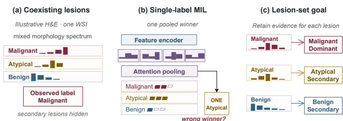
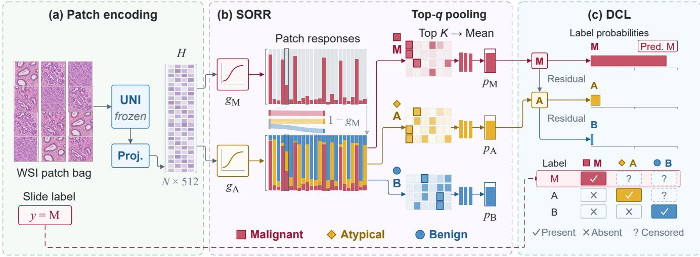

# BEYOND THE DOMINANT LABEL: RECOVERING COEXISTING LESION EVIDENCE WITH MULTIPLE INSTANCE LEARNING

Lubin Gan1 Jing Zhang2,∗ Xinming Zhang1 Chengpeng Xu1 Siying Wu2 Xiaoyan Sun1,2,∗

1USTC, Anhui, China

2Anhui Province Key Laboratory of Biomedical Imaging and Intelligent Processing Institute of Artificial Intelligence, Hefei Comprehensive National Science Center, Anhui, China

## ABSTRACT

Whole-slide images may contain coexisting lesions, yet weak supervision typically provides only the most severe diagnosis. We formulate this setting as dominant-label multiple instance learning, where the observed label is the maximum-severity element of a latent lesion set. Standard multiclass MIL treats it as a complete one-hot description and therefore suppresses lower-severity evidence whenever it co-occurs with a dominant lesion. We propose DomSet-MIL, a label-aware framework that aligns the annotation mechanism across bag and instance levels. Dominant-Label Censored Likelihood models the reported diagnosis without declaring unreported lesions absent. Severity-Ordered Residual Routing assigns patch evidence from high to low severity and preserves residual support for secondary findings, while top-q pooling links local routing scores to bag prediction. Experiments across natural and controlled settings show that DomSet-MIL achieves state-of-the-art performance in dominant-label prediction while more effectively recovering latent coexisting-lesion evidence. These findings demonstrate that modeling the dominant-label mechanism can improve diagnostic prediction without sacrificing clinically meaningful secondary findings.

Index Terms— multiple instance learning, whole-slide image classification, weak supervision, breast pathology, censored labels

## 1. INTRODUCTION

Whole-slide images (WSIs) provide a comprehensive view of tissue morphology, but their gigapixel resolution makes dense region-level annotation impractical. Weakly supervised and multiscale systems address this challenge without exhaustive region annotations [1, 2]; multiple instance learning (MIL) [3] represents a WSI as patch embeddings learned from one slide-level diagnosis. Complementary work on zero-shot subtyping uses fine-grained patch–text alignment to connect local morphology with pathology-aware descriptions, as in FG-PAN [4].

Attention pooling [5] and pathology-specific methods such as CLAM [6] identify discriminative instances, while Transformer aggregators model their dependencies [7]. SemaMIL combines semantic patch reordering with retrieval-guided state space modeling [8]. Despite their different aggregation mechanisms, they usually assume the observed bag label is a mutually exclusive class that fully describes the slide, an assumption that may not match multiclass pathology labels.

Preserving discriminative information is also studied in graph representation learning. GraphRefiner addresses generic-token dominance in graph–text alignment [9], whereas H4G studies fine-grained structural information in hyperbolic graph representations [10].

  
Fig. 1. Motivation for lesion-set learning under dominant-label supervision. Coexisting lesions are summarized by a single dominant label in (a); single-label MIL produces one pooled winner in (b), whereas lesion-set learning retains evidence for each lesion in (c).

This mismatch arises when a heterogeneous specimen is summarized by its dominant finding. A pathology WSI can contain regions with different diagnostic significance [11, 12], yet weak supervision may expose only the most severe lesion. The annotation therefore records the maximum severity of a latent lesion set, rather than the set itself: a slide containing malignant and atypical tissue is labeled malignant, so standard softmax treats atypical as an incorrect bag label. Across such cases, unreported secondary lesions become structural false negatives; lower-severity labels are censored whenever they co-occur with a more severe finding, and changing the aggregator cannot remove supervision introduced by this annotation rule.

Recent work incorporates diagnostic severity into multiclass MIL. PAMS organizes classes hierarchically, penalizes clinically costly underestimation, and mixes features across priorities [13], but still targets only the final diagnosis, so lower-severity evidence need not remain positive. Multi-instance multi-label methods predict coexisting breast lesions but assume multiple diagnoses are observed during training [11]. Learning from a single positive label relaxes that assumption by leaving other labels unknown [14], yet generic missing-label objectives neither explain why one label was selected nor link bag-level presence to localized evidence. This gap calls for explicit modeling of the dominant-label annotation mechanism.

We propose DomSet-MIL, a label-aware framework that predicts the dominant diagnosis while preserving evidence for hidden lesions. At the bag level, Dominant-Label Censored Likelihood (DCL) converts a malignant presence gate and a residual atypical gate into three observed class probabilities via the annotation’s maximum-severity rule; a malignant label supervises malignant presence without declaring atypical absence. At the instance level,

  
Fig. 2. Overview of DomSet-MIL: SORR routes patch evidence in severity order, and DCL predicts the dominant label.

Severity-Ordered Residual Routing (SORR) applies the rule in descending severity: a malignant gate claims matching patches, an atypical gate processes residual evidence, and unclaimed mass forms the benign remainder. Top-q pooling connects these severity-specific patch assignments to DCL’s censored bag scores. The two components therefore impose the same severity-ordered factorization at complementary resolutions.

Our contributions are threefold: (1) We identify lower-severity lesions as structurally censored under dominant-label supervision, explaining their suppression as negative classes. (2) We introduce DomSet-MIL, coupling DCL with SORR to align latent evidence at bag and patch levels. (3) We evaluate dominant-label prediction and latent-lesion recovery on BRACS [12], with test-time ROI annotations and on controlled EBRAINS/TCGA mixed-bag benchmarks.

## 2. METHOD

## 2.1. Dominant-label formulation

Let $\mathcal { D } = \{ ( \boldsymbol { B } _ { i } , y _ { i } ) \} _ { i = 1 } ^ { I }$ denote the training set of I WSIs. Slide i is represented by a bag $B _ { i } = \{ \mathbf { x } _ { i n } \} _ { n = 1 } ^ { N _ { i } } .$ of $N _ { i }$ patch embeddings extracted by a fixed encoder. We consider the ordered diagnosis set $\mathcal { C } = \{ \mathrm { B } , \mathrm { A } , \mathrm { M } \}$ , where $\mathrm { ~ B ~ } \prec \mathrm { ~ A ~ } \prec \mathrm { ~ M ~ }$ denote benign, atypical, and malignant findings, respectively. Each slide contains an unobserved, nonempty lesion set $S _ { i } \subseteq { \mathcal { C } } .$ , whereas training provides only its most severe element:

$$
y _ { i } = \operatorname* { m a x } _ { \prec } S _ { i } .\tag{1}
$$

Consequently, $y _ { i } = \mathrm { M }$ confirms malignant tissue but leaves atypical presence unknown. In contrast, $y _ { i } = \mathrm { A }$ confirms atypical tissue and rules out malignancy, while $y _ { i } = \mathrm { B }$ rules out both higher-severity findings. DomSet-MIL encodes these three supervision states instead of treating $y _ { i }$ as a complete one-hot description of the slide. The complete framework is illustrated in Fig. 2.

## 2.2. Severity-ordered residual routing

Model specialization has been studied through geometry-aware dense-to-expert reconstruction of vision–language models [15]; the AsyMoE preprint discussed modality-specific experts but has been

withdrawn [16]. SORR assigns severity-specific patch mass using ordered gates.

We first map each fixed embedding to a trainable representation,

$$
\begin{array} { r } { \begin{array} { c l } { \mathbf h _ { i n } = \mathrm { R e L U } ( \mathbf W \mathbf x _ { i n } + \mathbf b ) , } \\ { g _ { i n , c } = \sigma ( \mathbf w _ { c } ^ { \top } \mathbf h _ { i n } + a _ { c } ) , \quad \quad c \in \{ \mathrm { M } , \mathrm A \} , } \end{array} } \end{array}\tag{2}
$$

where W and b form a shared projection, $\left( \mathbf { w } _ { c } , a _ { c } \right)$ parameterize a class gate, and σ is the logistic sigmoid. SORR converts the two gate values into severity-specific routing masses by applying the malignant gate first and restricting the atypical contribution to its residual:

$$
\begin{array} { r l } & { \pi _ { i n , \mathrm { M } } = g _ { i n , \mathrm { M } } , } \\ & { \pi _ { i n , \mathrm { A } } = ( 1 - g _ { i n , \mathrm { M } } ) g _ { i n , \mathrm { A } } , } \\ & { \pi _ { i n , \mathrm { B } } = ( 1 - g _ { i n , \mathrm { M } } ) \big ( 1 - g _ { i n , \mathrm { A } } \big ) . } \end{array}\tag{3}
$$

Thus, $\begin{array} { r } { \sum _ { c \in \mathcal { C } } \pi _ { i n , c } = 1 } \end{array}$ for every patch, and benign evidence is the parameter-free remainder rather than a third competing gate. The local residual limits atypical support to the mass left by the malignant gate; it does not suppress atypical evidence elsewhere.

G2rammar explicitly encodes structural and semantic roles for text-attributed graphs [17]. An earlier preprint on structural-role inference with LLMs has been withdrawn [18].

To obtain bag scores without diluting sparse lesions or saturating a noisy-OR operator, we retain a fixed fraction of the strongest responses. Let $q ^ { - } \in ( 0 , 1 ] , K _ { i } = \operatorname* { m a x } \{ 1 , \lceil q N _ { i } \rceil \}$ , and $\mathcal { T } _ { i , c }$ be the indices of the $K _ { i }$ largest values in $\{ \pi _ { i n , c } \} _ { n = 1 } ^ { N _ { i } }$ . We define a classspecific evidence score for every route as

$$
p _ { i , c } = \frac { 1 } { K _ { i } } \sum _ { n \in \mathcal { T } _ { i , c } } \pi _ { i n , c } , \qquad c \in \mathcal { C } .\tag{4}
$$

Because $K _ { i }$ scales with $N _ { i } ,$ , the same $q$ has a consistent coverage meaning across slides with different tissue areas. DCL uses $p _  i , $ M and $p _ { i , \mathrm { A } }$ to model the observed label, whereas $p _ { i , \mathrm { B } }$ supports routing.

Higher-order grouping is another possible topic for future aggregation research. HyperAgent investigates hypergraph communication topologies [19], and EvoHyper represents collaboration groups and shared memory using evolving hyperedges [20].

Table 1. Dominant-label classification on BRACS and controlled mixed-bag tasks. Best results are bold.
<table><tr><td></td><td colspan="3">BRACS</td><td colspan="2">EBRAINS-Mix</td><td colspan="2">NSCLC-Mix</td><td colspan="2">RCC-Mix</td></tr><tr><td>Method</td><td>M-AUC</td><td>BAcc</td><td>UER↓</td><td>M-AUC</td><td>BAcc</td><td>M-AUC</td><td>BAcc</td><td>M-AUC</td><td>BAcc</td></tr><tr><td>Published MIL methods</td><td></td><td></td><td></td><td></td><td></td><td></td><td></td><td></td><td></td></tr><tr><td>ABMIL</td><td>0.881</td><td>0.643</td><td>0.118</td><td>0.897</td><td>0.804</td><td>0.936</td><td>0.867</td><td>0.892</td><td>0.781</td></tr><tr><td>CLAM-SB</td><td>0.887</td><td>0.652</td><td>0.110</td><td>0.903</td><td>0.814</td><td>0.942</td><td>0.876</td><td>0.899</td><td>0.793</td></tr><tr><td>DSMIL</td><td>0.894</td><td>0.661</td><td>0.101</td><td>0.914</td><td>0.827</td><td>0.950</td><td>0.887</td><td>0.908</td><td>0.806</td></tr><tr><td>TransMIL</td><td>0.901</td><td>0.668</td><td>0.096</td><td>0.909</td><td>0.820</td><td>0.947</td><td>0.883</td><td>0.906</td><td>0.804</td></tr><tr><td>DTFD-MIL (AFS)</td><td>0.899</td><td>0.666</td><td>0.098</td><td>0.917</td><td>0.832</td><td>0.952</td><td>0.890</td><td>0.912</td><td>0.812</td></tr><tr><td>ASMIL (ABMIL)</td><td>0.906</td><td>0.675</td><td>0.092</td><td>0.910</td><td>0.821</td><td>0.946</td><td>0.884</td><td>0.905</td><td>0.800</td></tr><tr><td>MAMMOTH (ABMIL)</td><td>0.912</td><td>0.684</td><td>0.086</td><td>0.918</td><td>0.833</td><td>0.953</td><td>0.891</td><td>0.915</td><td>0.816</td></tr><tr><td>SemaMIL</td><td>0.907</td><td>0.678</td><td>0.089</td><td>0.915</td><td>0.830</td><td>0.951</td><td>0.889</td><td>0.913</td><td>0.814</td></tr><tr><td>PAMS (DTFD-AFS)</td><td>0.910</td><td>0.681</td><td>0.073</td><td>0.916</td><td>0.831</td><td>0.952</td><td>0.890</td><td>0.914</td><td>0.814</td></tr><tr><td>Matched label-model controls</td><td></td><td></td><td></td><td></td><td></td><td></td><td></td><td></td><td></td></tr><tr><td>Flat-CE</td><td>0.883</td><td>0.646</td><td>0.119</td><td>0.891</td><td>0.795</td><td>0.931</td><td>0.861</td><td>0.884</td><td>0.772</td></tr><tr><td>CR-Ordinal</td><td>0.899</td><td>0.667</td><td>0.083</td><td>0.910</td><td>0.819</td><td>0.946</td><td>0.883</td><td>0.906</td><td>0.801</td></tr><tr><td>WAN</td><td>0.892</td><td>0.658</td><td>0.102</td><td>0.906</td><td>0.814</td><td>0.944</td><td>0.878</td><td>0.901</td><td>0.791</td></tr><tr><td>DomSet-MIL</td><td>0.916</td><td>0.690</td><td>0.071</td><td>0.922</td><td>0.842</td><td>0.958</td><td>0.900</td><td>0.920</td><td>0.826</td></tr></table>

## 2.3. Dominant-label censored likelihood

DCL interprets $p _ { i , \mathrm { M } }$ as the malignant gate at bag level and $p _ { i , \mathrm { A } }$ as the atypical gate on the residual branch, conditional on malignant evidence not being dominant. Applying the annotation rule in Eq. (1) gives a normalized distribution over observed labels, where $P _ { i } ( c ) =$ $\operatorname* { P r } ( y _ { i } = c \mid B _ { i } )$

$$
\begin{array} { r l } & { P _ { i } \mathrm { ( M ) } = p _ { i , \mathrm { M } } , } \\ & { P _ { i } \mathrm { ( A ) } = ( 1 - p _ { i , \mathrm { M } } ) p _ { i , \mathrm { A } } , } \\ & { P _ { i } \mathrm { ( B ) } = ( 1 - p _ { i , \mathrm { M } } ) \bigl ( 1 - p _ { i , \mathrm { A } } \bigr ) . } \end{array}\tag{5}
$$

The outer factor $\left( 1 - p _ { i , \mathrm { M } } \right)$ enforces bag-level dominance, whereas Eq. (3) resolves within-patch competition. This continuation-ratio form [21] requires no independence assumption.

$$
\ell _ { i } = \left\{ \begin{array} { l l } { - \log p _ { i , \mathrm { M } } , } & { y _ { i } = \mathrm { M } , } \\ { - \log [ ( 1 - p _ { i , \mathrm { M } } ) p _ { i , \mathrm { A } } ] , } & { y _ { i } = \mathrm { A } , } \\ { - \log [ ( 1 - p _ { i , \mathrm { M } } ) ( 1 - p _ { i , \mathrm { A } } ) ] , } & { y _ { i } = \mathrm { B } , } \end{array} \right.\tag{6}
$$

The model is trained with $\begin{array} { r } { \mathcal { L } _ { \mathrm { D C L } } = I ^ { - 1 } \sum _ { i = 1 } ^ { I } \ell _ { i } } \end{array}$ . For a malignant slide, the loss is independent of $p _ { i , \mathrm { A } } ;$ atypical evidence is therefore censored rather than penalized as a false positive. Its score on such slides is transferred through gates shared with atypical and benign training slides and should be interpreted as latent evidence, not an identifiable multi-label target. At inference, the dominant diagnosis is $\hat { y } _ { i } = \arg \operatorname* { m a x } _ { c \in \mathcal { C } } P _ { i } ( c )$ , while $p _ { i , c }$ and $\pi _ { i n , c }$ provide bag- and patch-level evidence. No ROI annotation is used to learn these quantities. For a two-level ordered task, the construction reduces to one high-priority gate, with $P _ { i } ( \mathrm { H } ) = p _ { i , \mathrm { H } }$ and $P _ { i } ( \mathrm { L } ) = 1 - p _ { i , \mathrm { H } }$

## 3. EXPERIMENTS

## 3.1. Datasets and evaluation protocol

Spatial–semantic consistency is studied in multi-contrast MRI superresolution by SSCM [22]. Our evaluation focuses on histopathology and assesses both slide-level predictions and localized lesion evidence.

BRACS. BRACS contains 547 breast WSIs from 189 patients and provides both slide labels and labeled regions of interest (ROIs) [12]. We use its official patient-disjoint split of 395/67/85

WSIs for training, validation, and testing. Following the official coarse task, normal, pathological benign, and usual ductal hyperplasia are grouped as benign; flat epithelial atypia and atypical ductal hyperplasia as atypical; and ductal carcinoma in situ and invasive carcinoma as malignant. This mapping gives the order $\mathrm { B } \prec \mathrm { A } \prec \mathrm { M }$ used in Sec. 2. Training and model selection use only the coarse WSI label. ROI labels are reserved for the test-time evidence analysis below.

Controlled mixed-bag tasks. We complement the natural BRACS setting with three controlled tasks for which the latent contents of each bag are known by construction. From EBRAINS [23], we select meningothelial, atypical, and anaplastic meningioma and map their WHO-2016 grades [24] to the low, middle, and high slots of DomSet-MIL. From TCGA [25], we use LUAD versus LUSC [26, 27] for NSCLC subtyping and KICH, KIRC, and KIRP [28, 29, 30] for RCC subtyping. These TCGA subtypes have no asserted clinical severity order; their order is a benchmark device used solely to impose a known censoring mechanism. We therefore average NSCLC results over both class orders and RCC results over all six class orders.

Patients are partitioned before synthesis. We use five patientlevel folds for EBRAINS and site-stratified patient-level folds for TCGA, with 10% of the training patients in each fold held out for validation. For a task with class set $\mathcal { C } _ { d } ,$ we sample the nonempty latent sets $S _ { i } \subseteq { \mathcal { C } } _ { d }$ approximately uniformly. A bag with $r = | S _ { i } |$ draws one source WSI per class and an equal share of 2,048 patch embeddings from every source. Sampling is without replacement when a slide contains enough tissue patches and with replacement only to fill a shortfall. Each epoch contains as many newly sampled bags as source WSIs in its training fold; validation and test mixtures are fixed by seed and matched in number to their respective source pools. The observed training label is $y _ { i } = \operatorname* { m a x } _ { \prec } S _ { i }$ , while $S _ { i }$ remains hidden during model fitting. Thus, all methods receive exactly the same dominant-label training supervision.

## 3.2. Implementation details and baselines

Tissue is segmented by Otsu thresholding [31] and tiled into nonoverlapping 224 × 224 patches at 20× magnification. A frozen UNI ViT-L/16 [32] maps every patch to a 1,024-dimensional feature. The projection in Eq. (2) has dimension 512. We use AdamW [33] with learning rate $1 0 ^ { - 4 } ,$ , weight decay $1 0 ^ { - 5 } .$ , and one bag per update for up to 100 epochs. Early stopping uses validation macro-AUC with a patience of 15 epochs. The pooling fraction is selected from $q \in$ {0.01, 0.05, 0.10, 0.20} on the validation set. BRACS results are averaged over five seeds. Controlled-task results are averaged over folds, five seeds, and, for TCGA, the class orders.

Table 2. Latent-evidence recovery on controlled mixed bags and BRACS ROIs. Dashes mark unavailable ROI metrics; best results are bold
<table><tr><td></td><td colspan="6">Bag level</td><td colspan="2">ROI level</td></tr><tr><td>Method</td><td colspan="2">EBRAINS-Mix</td><td colspan="2">NSCLC-Mix</td><td colspan="2">RCC-Mix</td><td colspan="2">BRACS</td></tr><tr><td></td><td>Set-mAP</td><td>Hidden-R</td><td>Set-mAP</td><td>Hidden-R</td><td>Set-mAP</td><td>Hidden-R</td><td>ROI-mAP</td><td>Sec-ROI-R</td></tr><tr><td>ABMIL</td><td>0.618</td><td>0.286</td><td>0.661</td><td>0.318</td><td>0.592</td><td>0.251</td><td></td><td></td></tr><tr><td>DSMIL</td><td>0.653</td><td>0.349</td><td>0.702</td><td>0.386</td><td>0.636</td><td>0.317</td><td>0.556</td><td>0.392</td></tr><tr><td>DTFD-MIL (AFS)</td><td>0.671</td><td>0.371</td><td>0.718</td><td>0.401</td><td>0.654</td><td>0.337</td><td>一</td><td>一</td></tr><tr><td>SemaMIL</td><td>0.664</td><td>0.362</td><td>0.712</td><td>0.396</td><td>0.649</td><td>0.331</td><td>一</td><td>一</td></tr><tr><td>PAMS (DTFD-AFS)</td><td>0.642</td><td>0.322</td><td>0.696</td><td>0.365</td><td>0.628</td><td>0.294</td><td></td><td>一</td></tr><tr><td>Flat-CE</td><td>0.604</td><td>0.244</td><td>0.647</td><td>0.282</td><td>0.581</td><td>0.219</td><td>0.523</td><td>0.347</td></tr><tr><td>CR-Ordinal</td><td>0.626</td><td>0.301</td><td>0.677</td><td>0.346</td><td>0.606</td><td>0.274</td><td></td><td></td></tr><tr><td>WAN</td><td>0.713</td><td>0.451</td><td>0.754</td><td>0.486</td><td>0.696</td><td>0.426</td><td>0.594</td><td>0.451</td></tr><tr><td>DomSet-MIL</td><td>0.748</td><td>0.547</td><td>0.789</td><td>0.582</td><td>0.734</td><td>0.515</td><td>0.625</td><td>0.500</td></tr></table>

Established baselines are ABMIL [5] and CLAM-SB [6]. We additionally evaluate DSMIL [34], TransMIL [7], and the AFS variant of DTFD-MIL [35]. Recent comparisons include attention stabilization applied to ABMIL (ASMIL) [36]; the ABMIL instantiation of the task-specific mixture-of-experts projection MAMMOTH [37]; and the state-space-based SemaMIL [8]. The severity-aware PAMS framework is instantiated with DTFD-AFS [13]. All methods use the same frozen UNI features, data splits, and model-selection budget.

ReconMIL explored latent-space reconstruction and bi-stream Mamba for WSI analysis [38]; its arXiv record was subsequently withdrawn because of evaluation-protocol issues.

Three matched controls isolate label modeling from aggregation. Flat-CE uses the shared patch projection and top-q readout, replacing SORR with competing patch logits and DCL with softmax crossentropy. CR-Ordinal applies a two-gate continuation-ratio head to a pooled bag representation, without instance-level residual routing. WAN uses independent sigmoid patch heads and the same top-q readout, training with Cole et al.’s [14] weak-assume-negative loss, weighting each unreported class by $\gamma = 1 / ( | \mathcal { C } | - 1 )$

We use macro one-vs-rest AUC (M-AUC), a threshold-free metric that weights classes equally, as the primary classification endpoint; balanced accuracy (BAcc) is a complementary operating-point measure. For BRACS, we additionally report the severity underestimation rate (UER), the fraction of test slides with $\hat { y } _ { i } \prec y _ { i } ;$ lower is better. UER is omitted for the TCGA tasks because their priority order is synthetic. All results are averaged point estimates and are interpreted descriptively rather than as statistical-significance claims. Dominant-label classification. Table 1 summarizes dominant-label classification. On BRACS, DomSet-MIL obtains 0.916 M-AUC, 0.690 BAcc, and 0.071 UER, compared with the strongest respective baseline estimates of 0.912, 0.684, and 0.073. It also leads on all controlled tasks, improving over the strongest baseline by 0.004– 0.005 M-AUC and 0.009–0.010 BAcc.

## 3.3. Latent-evidence recovery

Evidence localization should be distinguished from failure attribution or multi-agent disagreement analysis. The GraphTracer deepsearch preprint [39] and the GraphGeo geo-localization preprint [40] addressed these respective problems; both preprints have been withdrawn.

On the controlled tasks, each model’s bag-level class scores are compared with the held-out multi-hot indicator of $S _ { i }$ . Set mean average precision (Set-mAP) is the primary, threshold-free latentset recovery metric, computed over all classes. Hidden-lesion recall (Hidden-R) is a complementary, threshold-dependent diagnostic computed over pairs (i, c) for which $c \in S _ { i }$ and $c \prec y _ { i } .$ singleton bags do not enter its denominator. For Hidden-R only, each method and class uses a threshold selected on the validation set by maximizing F1 against the retained latent sets. This evaluation-only calibration does not enter model fitting or early stopping. Table 2 reports representative attention-, instance-, distillation-, severity-, and statespace-based MIL baselines together with all matched label-model controls. DomSet-MIL leads every table metric. Relative to WAN, the next strongest method, it improves Set-mAP by 0.035–0.038 and Hidden-R by 0.089–0.096 across the three controlled tasks. CR-Ordinal has higher dominant-label M-AUC than WAN on all three controlled tasks. WAN leads in Set-mAP and Hidden-R by 0.077– 0.090 and 0.140–0.152, respectively. The two evaluations give opposite rankings for these controls.

BRACS permits a separate ROI-level test. DSMIL contributes its native class-specific instance logits; Flat-CE, WAN, and DomSet-MIL contribute their class-specific patch scores. The same top-q readout is used for every method. Each annotated ROI receives the maximum score among patches whose centers fall inside it, yielding ROI-mAP over ROI labels. Secondary-ROI recall (Sec-ROI-R) is the fraction of annotated lower-priority ROIs containing at least one of the slide’s top-q patches for that ROI class. ROI annotations remain unavailable during training. The BRACS columns of Table 2 report this comparison; methods without class-specific patch scores are excluded. DomSet-MIL obtains 0.625 ROI-mAP and 0.500 Sec-ROI-R, versus WAN’s 0.594 and 0.451, respectively. These gains reflect improvements in ROI-level evidence ranking and in the coverage of secondary ROIs by the top-q patches.

## 3.4. Ablation study

We isolate the two factorizations and the pooling operator on BRACS. Replacing DCL with cross-entropy retains SORR but restores mutually exclusive bag-level supervision. Replacing SORR with independent class gates retains DCL but removes residual instance routing. Finally, mean, max, and noisy-OR pooling separately replace top-q pooling without modifying the gates or bag-level likelihood. Table 3 reports both dominant-label performance and secondary-evidence recovery to assess their trade-offs.

Table 3. Ablation study on BRACS. Best results are bold.
<table><tr><td>Variant</td><td>M-AUC</td><td>BAcc</td><td>UER↓</td><td>ROI-mAP</td><td>Sec-ROI-R</td></tr><tr><td>DomSet-MIL</td><td>0.916</td><td>0.690</td><td>0.071</td><td>0.625</td><td>0.500</td></tr><tr><td>DCL → CE</td><td>0.906</td><td>0.677</td><td>0.091</td><td>0.600</td><td>0.433</td></tr><tr><td>SORR → independent gates</td><td>0.911</td><td>0.684</td><td>0.077</td><td>0.610</td><td>0.462</td></tr><tr><td>Top-q → mean</td><td>0.903</td><td>0.670</td><td>0.089</td><td>0.596</td><td>0.442</td></tr><tr><td>Top-q → max</td><td>0.909</td><td>0.680</td><td>0.081</td><td>0.606</td><td>0.455</td></tr><tr><td>Top-q → noisy-OR</td><td>0.905</td><td>0.674</td><td>0.086</td><td>0.599</td><td>0.446</td></tr></table>

Replacing DCL with cross-entropy lowers M-AUC and ROImAP by 0.010 and 0.025, respectively, raises UER by 0.020, and reduces Sec-ROI-R by 0.067. With DCL retained, replacing SORR with independent gates still reduces Sec-ROI-R by 0.038, supporting residual routing for local evidence recovery. Mean pooling produces the largest decline in M-AUC and ROI-mAP among the pooling variants. Max and noisy-OR pooling also reduce both endpoints. Top-q pooling combines evidence from multiple high-response patches and limits the influence of low-response regions.

Selective information use is also investigated in multi-agent knowledge sharing. D3MAS organizes knowledge sharing through decomposition, deduction, and distribution [41]; graph decoupling has separately been investigated for agent knowledge sharing [42].

## 4. CONCLUSION

We identify a fundamental mismatch in conventional multiclass MIL: a diagnosis reporting only the most severe lesion censors coexisting lower-severity findings, which standard training treats as negatives. DomSet-MIL addresses this mismatch by coupling DCL with SORR and top-q pooling, aligning dominant-label supervision with severity-ordered patch evidence. Across natural and controlled settings, it improves dominant-label prediction and latent or localized secondary-lesion recovery, while ablations support the complementary roles of censored supervision, residual routing, and sparse pooling. These results show that modeling the weak-label generation process enables richer pathological representations from slide-level annotations. Future work will consider partially ordered, data-dependent, and uncertain label mechanisms, as well as whether biomedical knowledge-guided prompts, such as those explored in MeDKCoOp [43], can support lesion-specific evidence learning.

## 5. COMPLIANCE WITH ETHICAL STANDARDS

This study used only de-identified or coded pathology images from the released BRACS, EBRAINS, and TCGA resources; no new participants, specimens, or animals were involved. All data were used in accordance with the applicable access and data-use terms.

## 6. REFERENCES

[1] Gabriele Campanella et al., “Clinical-grade computational pathology using weakly supervised deep learning on whole slide images,” Nature Medicine, vol. 25, no. 8, pp. 1301–1309, 2019.

[2] Noriaki Hashimoto et al., “Multi-scale domain-adversarial multiple-instance CNN for cancer subtype classification with unannotated histopathological images,” in Proceedings of the IEEE/CVF Conference on Computer Vision and Pattern Recognition, 2020, pp. 3852–3861.

[3] Thomas G. Dietterich, Richard H. Lathrop, and Tomas Lozano-´ Perez, “Solving the multiple instance problem with axis-´ parallel rectangles,” Artificial Intelligence, vol. 89, no. 1–2, pp. 31–71, 1997.

[4] Lubin Gan, Jing Zhang, Linhao Qu, Yijun Wang, Siying Wu, and Xiaoyan Sun, “Enhancing zero-shot brain tumor subtype classification via fine-grained patch-text alignment,” Expert Systems with Applications, vol. 300, pp. 130161, 2026.

[5] Maximilian Ilse, Jakub M. Tomczak, and Max Welling, “Attention-based deep multiple instance learning,” in Proceedings of the 35th International Conference on Machine Learning, 2018, vol. 80, pp. 2127–2136.

[6] Ming Y. Lu, Drew F. K. Williamson, Tiffany Y. Chen, Richard J. Chen, Matteo Barbieri, and Faisal Mahmood, “Dataefficient and weakly supervised computational pathology on whole-slide images,” Nature Biomedical Engineering, vol. 5, no. 6, pp. 555–570, 2021.

[7] Zhuchen Shao et al., “TransMIL: Transformer-based correlated multiple instance learning for whole slide image classification,” in Advances in Neural Information Processing Systems, 2021, vol. 34, pp. 2136–2147.

[8] Lubin Gan et al., “SemaMIL: Semantic-aware multiple instance learning with retrieval-guided state space modeling for whole slide images,” in 2026 IEEE International Conference on Acoustics, Speech and Signal Processing (ICASSP), 2026.

[9] Heng Zhang, Haochen You, Zijian Zhang, Lubin Gan, Hao Zhang, Wenjun Huang, and Jin Huang, “Mitigating generic token dominance in cross-domain foundation model for textattributed graphs,” in Database Systems for Advanced Applications, 2026, pp. 251–265.

[10] Heng Zhang, Tianyi Zhang, Zijun Liu, Yuling Shi, Yaomin Shen, Haochen You, Haichuan Hu, Lubin Gan, and Jin Huang, “H4G: Unlocking faithful inference for zero-shot graph learning in hyperbolic space,” arXiv:2510.12094, 2025.

[11] Caner Mercan, Selim Aksoy, Ezgi Mercan, Linda G. Shapiro, Donald L. Weaver, and Joann G. Elmore, “Multi-instance multi-label learning for multi-class classification of whole slide breast histopathology images,” IEEE Transactions on Medical Imaging, vol. 37, no. 1, pp. 316–325, 2018.

[12] Nadia Brancati et al., “BRACS: A dataset for BReAst carcinoma subtyping in H&E histology images,” Database, vol. 2022, pp. baac093, 2022.

[13] Sungrae Hong et al., “Every error has its magnitude: Asymmetric mistake severity training for multiclass multiple instance learning,” in Proceedings of the IEEE/CVF Conference on Computer Vision and Pattern Recognition, 2026, pp. 28244–28253.

[14] Elijah Cole, Oisin Mac Aodha, Titouan Lorieul, Pietro Perona, Dan Morris, and Nebojsa Jojic, “Multi-label learning from single positive labels,” in Proceedings of the IEEE/CVF Conference on Computer Vision and Pattern Recognition, 2021, pp. 933–942.

[15] Heng Zhang, Haichuan Hu, Lubin Gan, Haochen You, Weihao Yu, and Jin Huang, “Geometry-aware reconstruction of large vision-language models from dense into mixture-of-experts,” in 2026 IEEE International Conference on Acoustics, Speech and Signal Processing (ICASSP), 2026.

[16] Heng Zhang, Haichuan Hu, Yaomin Shen, Weihao Yu, Yilei Yuan, Haochen You, Guo Cheng, Zijian Zhang, Lubin Gan, Huihui Wei, Hao Zhang, and Jin Huang, “AsyMoE: Leveraging modal asymmetry for enhanced expert specialization in large vision-language models,” arXiv:2509.12715, 2025, Withdrawn by the authors.

[17] Heng Zheng, Haochen You, Zijun Liu, Zijian Zhang, Lubin Gan, Hao Zhang, Wenjun Huang, and Jin Huang, “G2rammar: Bilingual grammar modeling for enhanced text-attributed graph learning,” in Database Systems for Advanced Applications, 2026, pp. 455–470.

[18] Heng Zhang, Jing Liu, Jiajun Wu, Haochen You, Lubin Gan, Yuling Shi, Xiaodong Gu, Zijian Zhang, Shuai Chen, Wenjun Huang, and Jin Huang, “Empowering LLMs with structural role inference for zero-shot graph learning,” arXiv:2511.00898, 2025, Withdrawn by the authors.

[19] Heng Zhang, Yuling Shi, Xiaodong Gu, Zijian Zhang, Haochen You, Lubin Gan, Yilei Yuan, and Jin Huang, “HyperAgent: Leveraging hypergraphs for topology optimization in multiagent communication,” in Proceedings of the 25th International Conference on Autonomous Agents and Multiagent Systems, 2026.

[20] Heng Zhang, Yihao Zhong, Lubin Gan, Zhihe Chen, Jiajun Wu, Yuling Shi, Xiaodong Gu, Hao Zhang, Haochen You, and Jin Huang, “EvoHyper: Evolving hypergraph topologies for unified collaboration in multi-agent communication,” in Findings of the Association for Computational Linguistics: ACL 2026, 2026, pp. 25130–25143.

[21] Gerhard Tutz, “Ordinal regression: A review and a taxonomy of models,” WIREs Computational Statistics, vol. 14, no. 2, pp. e1545, 2022.

[22] Xiaoman Wu, Lubin Gan, Siying Wu, Jing Zhang, Yunwei Ou, and Xiaoyan Sun, “SSCM: A spatial-semantic consistent model for multi-contrast MRI super-resolution,” in 2026 IEEE International Conference on Acoustics, Speech and Signal Processing (ICASSP), 2026.

[23] Thomas Roetzer-Pejrimovsky et al., “The digital brain tumour atlas, an open histopathology resource,” Scientific Data, vol. 9, no. 1, pp. 55, 2022.

[24] David N. Louis et al., “The 2016 World Health Organization classification of tumors of the central nervous system: A summary,” Acta Neuropathologica, vol. 131, no. 6, pp. 803–820, 2016.

[25] John N. Weinstein et al., “The cancer genome atlas pan-cancer analysis project,” Nature Genetics, vol. 45, no. 10, pp. 1113– 1120, 2013.

[26] The Cancer Genome Atlas Research Network, “Comprehensive molecular profiling of lung adenocarcinoma,” Nature, vol. 511, no. 7511, pp. 543–550, 2014.

[27] The Cancer Genome Atlas Research Network, “Comprehensive genomic characterization of squamous cell lung cancers,” Nature, vol. 489, no. 7417, pp. 519–525, 2012.

[28] Caleb F. Davis et al., “The somatic genomic landscape of chromophobe renal cell carcinoma,” Cancer Cell, vol. 26, no. 3, pp. 319–330, 2014.

[29] The Cancer Genome Atlas Research Network, “Comprehensive molecular characterization of clear cell renal cell carcinoma,” Nature, vol. 499, no. 7456, pp. 43–49, 2013.

[30] The Cancer Genome Atlas Research Network, “Comprehensive molecular characterization of papillary renal-cell carcinoma,” The New England Journal ofMedicine, vol. 374, no. 2, pp. 135–145, 2016.

[31] Nobuyuki Otsu, “A threshold selection method from gray-level histograms,” IEEE Transactions on Systems, Man, and Cybernetics, vol. 9, no. 1, pp. 62–66, 1979.

[32] Richard J. Chen et al., “Towards a general-purpose foundation model for computational pathology,” Nature Medicine, vol. 30, no. 3, pp. 850–862, 2024.

[33] Ilya Loshchilov and Frank Hutter, “Decoupled weight decay regularization,” in International Conference on Learning Representations, 2019.

[34] Bin Li, Yin Li, and Kevin W. Eliceiri, “Dual-stream multiple instance learning network for whole slide image classification with self-supervised contrastive learning,” in Proceedings ofthe IEEE/CVF Conference on Computer Vision and Pattern Recognition, 2021, pp. 14318–14328.

[35] Hongrun Zhang et al., “DTFD-MIL: Double-tier feature distillation multiple instance learning for histopathology whole slide image classification,” in Proceedings of the IEEE/CVF Conference on Computer Vision and Pattern Recognition, 2022, pp. 18802–18812.

[36] Linfeng Ye et al., “ASMIL: Attention-stabilized multiple instance learning for whole-slide imaging,” in International Conference on Learning Representations, 2026.

[37] Daniel Shao et al., “Mixture of mini experts: Overcoming the linear layer bottleneck in multiple instance learning,” in International Conference on Learning Representations, 2026.

[38] Lubin Gan, Jing Zhang, Heng Zhang, Xin Di, Zhifeng Wang, Wenke Huang, and Xiaoyan Sun, “ReconMIL: Synergizing latent space reconstruction with bi-stream mamba for whole slide image analysis,” arXiv:2603.19925, 2026, Withdrawn by the authors.

[39] Heng Zhang, Yuling Shi, Xiaodong Gu, Haochen You, Zijian Zhang, Lubin Gan, Yilei Yuan, and Jin Huang, “GraphTracer: Graph-guided failure tracing in LLM agents for robust multiturn deep search,” arXiv:2510.10581, 2025, Withdrawn by the authors.

[40] Heng Zheng, Yuling Shi, Xiaodong Gu, Haochen You, Zijian Zhang, Lubin Gan, Hao Zhang, Wenjun Huang, and Jin Huang, “GraphGeo: Multi-agent debate framework for visual geo-localization with heterogeneous graph neural networks,” arXiv:2511.00908, 2025, Withdrawn by the authors.

[41] Heng Zhang, Yuling Shi, Xiaodong Gu, Haochen You, Zijian Zhang, Lubin Gan, Yilei Yuan, and Jin Huang, “D3MAS: Decompose, deduce, and distribute for enhanced knowledge sharing in multi-agent systems,” in Proceedings of the 25th International Conference on Autonomous Agents and Multiagent Systems, 2026.

[42] Heng Zhang, Haichuan Hu, Guo Cheng, Lubin Gan, Huihui Wei, and Jin Huang, “Boosting knowledge sharing among agents via graph decoupling,” in 2026 IEEE International Conference on Acoustics, Speech and Signal Processing (ICASSP), 2026.

[43] Yijun Wang, Siying Wu, Lubin Gan, Zheyu Zhang, Jing Zhang, Zhangchi Hu, Huyue Zhu, Peixi Wu, and Xiaoyan Sun, “MeD-KCoOp: Dual knowledge-guided graph prompt learning for biomedical vision-language models,” in Proceedings of the 33rd ACM International Conference on Multimedia, 2025, pp. 3635–3644.