# Beyond Pairwise Repulsion: Collective Diversity via Determinant Maximization in Difusion Sampling

Kwanyoung Lee1, SeungJu Cha1, Yebin Ahn1, Sungho Koh1, and Dong-Jin Kim1

Hanyang University, South Korea {mobled37,sju9020,yeshine,ksh000906,djdkim}@hanyang.ac.kr

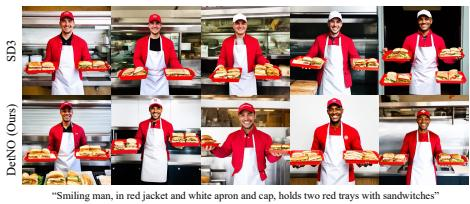

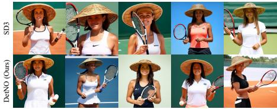

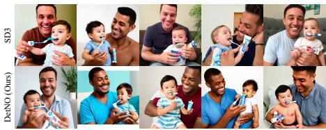  
“A man smiles as he holds a toddler with a toothbrush in his mouth and a tube of toothpaste in his …”

Fig. 1: Qualitative comparison on SD3. SD3 baseline sampling collapses onto a narrow visual prototype for underspecified prompts, reproducing nearly identical appearance and scene layout across seeds, a direct consequence of CFG concentrating the conditional distribution onto its high-density peak. DetNO recovers the suppressed degrees of freedom in initial noise, producing semantically diverse outputs that vary in viewpoint, identity, clothes, and scene composition while remaining faithful to the prompt.

Abstract. Strong guidance in text-to-image (T2I) difusion models concentrates sampling toward high-density modes of the conditional distribution, collapsing independently sampled noise vectors onto nearly identical visual prototypes. This limits utility for tasks that demand distributional breadth, most critically synthetic data augmentation. Diversity, however, is a collective property of the whole batch: a set can preserve every pairwise distance yet still collapse onto a low-dimensional subspace. Existing sum-of-pairwise noise-optimization and repulsion objectives respond only weakly to this higher-order failure. We propose DetNO (Determinant Noise Optimization), which formulates diverse generation

as RKHS volume maximization on the initial noise, maximizing the logdeterminant of an RBF Gram matrix over one-step Tweedie predictions. This set-level functional equals the squared batch volume; its repulsion is strongest when the batch is most collapsed and self-attenuates as diversity is achieved. An anchor-based fidelity term keeps the optimized noises near plausible regions, and Lagrangian relaxation gives a two-term objective with a single hyperparameter λ governing the diversity–quality trade-of, without training or sampler modification. Across three backbones (SD1.5, SDXL, SD3), DetNO achieves leading intra-batch diversity in VendiScore and Mean Self-Similarity, and a downstream few-shot classification experiment confirms that broader mode coverage brings statistically significant accuracy gains for synthetic data augmentation in the low-shot regime. Fixing the pipeline and varying only the batch objective, both RBF-based aggregators outperform InfoNCE, and the log-determinant attains the best downstream accuracy on both benchmarks. Its diversity advantage over InfoNCE widens as the batch grows. Code is available at https://github.com/mobled37/DetNO.

Keywords: Text-to-Image Difusion Models · Diverse Image Generation · Initial Noise Optimization · Log-Determinant Maximization · Synthetic Data Augmentation

## 1 Introduction

Classifier-Free Guidance (CFG) [12] has become the standard mechanism for steering text-to-image (T2I) difusion models [11, 24, 27] toward high-fidelity, prompt-aligned images. Strong CFG, however, concentrates sampling toward the high-density peak of the conditional distribution, collapsing its efective support onto a narrow region of the image manifold (Fig. 1). Under deterministic samplers such as DDIM [26], the initial noise fully determines the final image, yet independent noise draws collapse onto the same narrow visual mode. Multiple images generated from the same prompt converge to nearly identical visual prototypes. The collapse limits utility in applications that depend on distributional breadth, most critically synthetic data augmentation, where near-duplicate outputs provide diminishing returns for downstream model training [9].

Recovering this diversity requires treating a batch as a whole, since diversity is a collective property of the set rather than a sum over its pairs. A batch can preserve every pairwise distance yet still collapse onto a low-dimensional subspace, a higher-order failure mode to which independent pair contributions respond only weakly. Existing approaches meet this criterion only partially. Methods that intervene during denoising repel intermediate latents [3, 14] or manipulate text embeddings [31], paying a per-step cost that scales with trajectory length. Contrastive Noise Optimization (CNO) [13] instead optimizes the initial noise with an InfoNCE loss in the Tweedie prediction space, intervening before denoising begins, where the noise largely determines semantic structure [2, 8]. Despite their difering entry points, all build their diversity signal from sumof-pairwise repulsion, whose gradient remains confined to the span of pairwise directions and can miss higher-order redundancy.

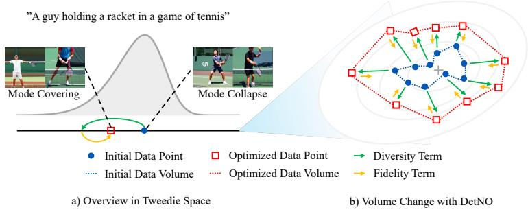  
Fig. 2: Conceptual illustration of DetNO. (a) Strong CFG guidance concentrates sampling toward the high-density peak, leaving the degrees of freedom in the initial noise unexploited. DetNO recovers this freedom by optimizing the initial noise batch to reach low-density regions that standard sampling cannot access. (b) The diversity term (green) maximizes the RKHS volume collectively spanned by all Tweedie predictions, while the fidelity term (yellow) regularizes each sample toward its unoptimized reference, expanding distributional coverage while preserving prompt fidelity.

This motivates a single scalar measuring the collective volume a batch occupies, penalizing redundancy at every order up to B simultaneously. We realize this scalar as the log-determinant of an RBF Gram matrix over one-step Tweedie predictions, making all-order diversity diferentiable. We further show that this objective is self-regulating: repulsion amplifies when the batch is most redundant and relaxes as diversity is achieved, an adaptation that an unweighted sum-ofpairwise objective lacks in the same analysis.

We propose DetNO (Determinant Noise Optimization), illustrated in Fig. 2, which pairs this log-determinant diversity term with an anchor-based fidelity term via Lagrangian relaxation. A single hyperparameter λ controls the diversityquality trade-of, with no training or sampler modification. Empirically, the collective objective delivers on both diversity and downstream utility. Across three backbones (SD1.5, SDXL, SD3), DetNO achieves leading intra-batch diversity in VendiScore and Mean Self-Similarity, with the advantage over CNO widening as the batch size grows. A controlled toy experiment shows faithful recovery of all modes where pairwise methods distort mode structure, and downstream few-shot classification produces accuracy gains over both standard sampling and CNO, reaching statistical significance in the low-shot regime (p<0.01).

## Our main contributions are as follows:

– We recast diverse T2I generation as a set-level rather than pairwise problem: constrained RKHS volume maximization on initial noise. The objective pairs a log-determinant diversity term with an anchor-based fidelity term, controlled by a single hyperparameter λ, with no sampler modification.

– We show that the log-determinant amplifies repulsion when the batch is most redundant and relaxes as diversity is achieved, a self-regulating property of the Gram matrix eigenspectrum that an unweighted sum-of-pairwise objective lacks in the same analysis.

– We validate across three backbone-sampler configurations, demonstrating consistent diversity gains with a controllable quality-diversity trade-of and statistically significant downstream improvements in few-shot classification.

## 2 Related Work

## 2.1 Recovering Mode Diversity in Difusion Models.

Prior methods recover the limited diversity of conditional difusion models through repulsion, difering mainly in where they apply it but sharing a diversity signal that decomposes into a sum of pairwise interactions. One line intervenes during denoising: SPELL [14] adds sparse repellency terms to the reverse SDE, Particle Guidance (PG) [3] repels intermediate latents via a joint-particle potential, and DiversityPrompt [31] optimizes a token embedding online to steer generation toward low-density regions. All incur per-step overhead that scales with trajectory length. Contrastive Noise Optimization (CNO) [13] instead shifts repulsion to the initial noise, optimizing latents via InfoNCE in the Tweedie prediction space before sampling begins. Both, however, quantify diversity as a sum over sample pairs, so their repulsion never leaves the span of pairwise directions and responds only weakly to higher-order redundancy that collapses the batch onto a low-dimensional subspace. A separate line targets rare modes of the unconditional or class-conditional distribution via classifier guidance [25, 29], self-guided sampling [30], or modified noise schedules [28]. Our goal instead is to recover suppressed modes of a text-conditional distribution under strong guidance for a fixed prompt.

## 2.2 Initial Noise Optimization in Difusion Models.

InitNO [8] steers noise toward valid regions via attention-based scores for better text adherence, while [2] learn a mapping to optimal noise configurations to characterize CFG behavior. Neither addresses diversity. CNO [13] establishes that optimizing the initial noise alone can recover suppressed modes, using a pairwise contrastive objective. We inherit this noise-space pipeline from CNO; what changes is the structure of the diversity signal, from a sum over pairs to log-determinant maximization, a set-level functional equal to the squared RKHS volume that penalizes redundancy at every order. This objective is jointly optimized with an anchor-based fidelity term under a single hyperparameter λ. The log-determinant as a diversity criterion originates in GDPP [4], which regularizes a GAN’s generator with a DPP kernel. We instead apply it as an inference-time objective on the Tweedie predictions of a frozen difusion model, requiring no training and no DPP sampling.

## 3 Preliminaries

## 3.1 Tweedie’s Formula and Clean Data Estimation

Difusion models generate data by iteratively denoising a Gaussian noise sample $z _ { T } \sim \mathcal { N } ( \mathbf { 0 } , \mathbf { I } )$ through a learned reverse process. At each timestep t, a noisy latent $z _ { t }$ is related to the clean data $z _ { 0 }$ via the forward process $z _ { t } = \sqrt { \bar { \alpha } _ { t } } z _ { 0 } + \sqrt { 1 - \bar { \alpha } _ { t } } \epsilon$ where $\epsilon \sim \mathcal { N } ( \mathbf { 0 } , \mathbf { I } )$ and $\textstyle { \bar { \alpha } } _ { t } : = \prod _ { i = 1 } ^ { t } \alpha _ { i }$ is the cumulative noise schedule. $\mathrm { A }$ neural network $\boldsymbol { \epsilon } _ { \theta } ( z _ { t } , t , \boldsymbol { c } )$ is trained to predict the noise ϵ given the noisy observation $z _ { t } ,$ , timestep $t ,$ and text conditioning c.

Tweedie’s formula [23] provides a closed-form estimate of the posterior mean $\mathbb { E } [ z _ { 0 } \mid z _ { t } ]$ , yielding a one-step prediction of the clean latent at any timestep:

$$
\hat { z } _ { 0 \mid t } ( z _ { t } , t , c ) : = \frac { 1 } { \sqrt { \bar { \alpha } _ { t } } } \left( z _ { t } - \sqrt { 1 - \bar { \alpha } _ { t } } \epsilon _ { \theta } ( z _ { t } , t , c ) \right) .\tag{1}
$$

This estimate represents the model’s best prediction of the clean data given the current noisy observation. While the prediction becomes increasingly accurate as $t  0$ , even at the initial timestep $\bar { T }$ it captures meaningful semantic structure of the final generation, such as global layout and dominant color [2]. Our method exploits this property by operating entirely in the Tweedie prediction space at $t = T$ , optimizing the initial noises to diversify their corresponding clean data estimates before any denoising takes place.

## 3.2 Classifier-Free Guidance

Classifier-Free Guidance (CFG) [12] enhances text-image alignment by interpolating between the conditional and unconditional noise predictions:

$$
\hat { \epsilon } _ { \beta } ( z _ { t } , t , c ) = ( 1 + \beta ) \epsilon _ { \theta } ( z _ { t } , t , c ) - \beta \epsilon _ { \theta } ( z _ { t } , t , \emptyset ) ,\tag{2}
$$

where $\beta ~ > ~ 0$ is the guidance scale and $\mathcal { D }$ denotes the null condition. This approximately corresponds to sampling from a sharpened distribution $p _ { \beta } ( z _ { 0 } \mid$ $c ) \propto p ( z _ { 0 } ) p ( c \mid z _ { 0 } ) ^ { \beta }$ , which concentrates probability mass around the dominant modes of the conditional distribution. While this yields sharper and more prompt-faithful images, it systematically suppresses low-density modes, reducing output diversity across images generated from the same prompt.

## 4 Proposed Method

## 4.1 Constrained Diversity Maximization on Initial Noise

Given a batch of initial latent codes $Z _ { T } = \{ z _ { T } ^ { i } \} _ { i = 1 } ^ { B } \sim \mathcal { N } ( \mathbf { 0 } , I )$ , we compute onestep Tweedie predictions $\{ \hat { z } _ { 0 | T } ^ { i } \} _ { i = 1 } ^ { B }$ via Eq. (1). Even at the initial timestep $T ,$ these predictions capture meaningful semantic structure such as global layout, dominant colors, and object placement [2]. Since deterministic samplers such as

Algorithm 1 DetNO   
Require: Prompt c, batch size $B ,$ fidelity weight λ, pooling window $w ,$ steps $N _ { \mathrm { o p t } } .$   
learning rate η, stability ϵ   
Ensure: Optimized initial noise $Z _ { T } ^ { * }$   
// Phase 1: Reference computation   
1: Sample $z _ { T } ^ { i } \sim \mathcal { N } ( \mathbf { 0 } , I )$ for each $i \in [ B ]$   
2: for $i = 1$ to $B$ do   
3: $\begin{array} { r } { \hat { z } _ { 0 \vert T } ^ { i , \mathrm { r e f } }  \frac { 1 } { \sqrt { \bar { \alpha } _ { T } } } ( z _ { T } ^ { i } - \sqrt { 1 - \bar { \alpha } _ { T } }  } \end{array}$ stopgrad $\{ \epsilon _ { \theta } \big ( z _ { T } ^ { i } , T , c \big ) \} \big )$ \triangleright Eq. (1)   
4: $\bar { z } _ { 0 | T } ^ { i , \mathrm { r e f } } $ Normalize $\big ( \mathrm { A v g P o o l } ( \hat { z } _ { 0 | T } ^ { i , \mathrm { r e f } } , w ) \big )$ \triangleright Eq. (3)   
5: end for   
6: σ ← median $\big ( \{ \| \bar { z } _ { 0 \vert T } ^ { i , \mathrm { r e f } } - \bar { z } _ { 0 \vert T } ^ { j , \mathrm { r e f } } \| _ { 2 } \big \} _ { i < j } \big )$ \triangleright Eq. (5)   
// Phase 2: Noise optimization   
7: for $k = 1$ to $N _ { \mathrm { o p t } }$ do   
8: for $i = 1$ to B do   
9: $\begin{array} { r } { \hat { z } _ { 0 | T } ^ { i }  \frac { 1 } { \sqrt { \bar { \alpha } _ { T } } } ( z _ { T } ^ { i } - \sqrt { 1 - \bar { \alpha } _ { T } }  } \end{array}$ stopgrad $\{ \epsilon _ { \theta } \big ( z _ { T } ^ { i } , T , c \big ) \} \big )$ \triangleright Eq. (1)   
10: $\bar { z } _ { 0 | T } ^ { i } \gets$ Normalize $\big ( \mathrm { A v g P o o l } ( \hat { z } _ { 0 | T } ^ { i } , w ) \big )$   
11: end for   
12: $S _ { i j } \gets \exp \bigl ( - \| \bar { z } _ { 0 | T } ^ { i } - \bar { z } _ { 0 | T } ^ { j } \| ^ { 2 } / 2 \sigma ^ { 2 } \bigr )$ for all $i , j$ \triangleright Eq. (4)   
13: $\mathcal { L } _ { \mathrm { d i v } }  - \mathrm { 1 }$ log det $( S + \epsilon \dot { I } )$   
14: $\begin{array} { r } { \mathcal { L } _ { \mathrm { f i d } }  \sum _ { i = 1 } ^ { B } \| \hat { z } _ { 0 | T } ^ { i } - \hat { z } _ { 0 | T } ^ { i , \mathrm { { r e f } } } \| ^ { 2 } } \end{array}$   
15: $\mathcal { L } \gets \mathcal { L } _ { \mathrm { d i v } } + \lambda \cdot \mathcal { L } _ { \mathrm { f i d } }$ \triangleright Eq. (11)   
16: $z _ { T } ^ { i }  z _ { T } ^ { i } - \eta \nabla _ { z _ { T } ^ { i } } \mathcal { L }$ for all i   
17: end for   
// Phase 3: Standard sampling   
18: $\hat { Z } _ { T } ^ { * }  ( z _ { T } ^ { 1 } , . . . , z _ { T } ^ { B } )$   
19: Generate images from $Z _ { T } ^ { * }$ using pretrained sampler

DDIM [26] define a fixed mapping from initial noise to final image, diversifying Tweedie predictions at $t { = } T$ propagates through the entire generation path without per-step intervention. Our goal is to optimize $Z _ { T }$ so that these predictions are maximally diverse while remaining in plausible regions of the data distribution. We formalize diversity through RKHS volume maximization and fidelity through an anchor-based displacement constraint, then combine them via Lagrangian relaxation into a single objective.

## 4.2 Diversity: RKHS Volume Maximization

As motivated in Sec. 1, we quantify diversity as the volume a batch collectively occupies, a set-level functional that penalizes redundancy at every order simultaneously. An unweighted pairwise sum, by contrast, yields a gradient confined to the span of pairwise directions. Realizing this in the Tweedie prediction space requires care: the raw prediction $\hat { z } _ { 0 \vert T } ^ { i } \in \mathbb { R } ^ { C \times H \times W }$ sufers from norm concentration, where pairwise distances between independent samples converge to a common value [1]. This drives the RBF kernel toward a constant, flattening the very volume signal we maximize. Predictions at $t { = } T$ primarily encode coarse semantic layout rather than fine spatial detail [2]. We therefore suppress highfrequency variance via adaptive average pooling with window $w .$ , then project onto the unit hypersphere:

$$
\begin{array} { r } { \tilde { z } _ { 0 | T } ^ { i } = \mathrm { A v g P o o l } ( \hat { z } _ { 0 | T } ^ { i } , ~ w ) , \qquad \bar { z } _ { 0 | T } ^ { i } = \tilde { z } _ { 0 | T } ^ { i } / \| \tilde { z } _ { 0 | T } ^ { i } \| _ { 2 } , } \end{array}\tag{3}
$$

producing compact representations $\bar { z } _ { 0 | T } ^ { i } \in \mathbb { R } ^ { C w ^ { 2 } }$ on which kernel similarities reflect semantic structure rather than high-frequency noise. We build the similarity matrix $S \in \mathbb { R } ^ { B \times B }$ from the RBF kernel, a universal kernel whose Gram matrix is positive semidefinite, so log det(S + ϵI) is always well-defined:

$$
S _ { i j } = \exp \left( - \frac { \| \bar { z } _ { 0 \vert T } ^ { i } - \bar { z } _ { 0 \vert T } ^ { j } \| ^ { 2 } } { 2 \sigma ^ { 2 } } \right) , \quad S _ { i i } = 1 ,\tag{4}
$$

with bandwidth $\sigma$ fixed once from the reference predictions via the median heuristic [7]:

$$
\sigma = \mathrm { m e d i a n } \bigg ( \Big \{ \| \bar { z } _ { 0 | T } ^ { i , \mathrm { r e f } } - \bar { z } _ { 0 | T } ^ { j , \mathrm { r e f } } \| _ { 2 } \Big \} _ { i < j } \bigg ) .\tag{5}
$$

By the theory of Determinantal Point Processes [16], letting $\phi$ be the RBF feature map with $S _ { i j } = \langle \phi ( \bar { z } _ { 0 | T } ^ { i } ) , \phi ( \bar { z } _ { 0 | T } ^ { j } ) \rangle _ { \mathcal { H } _ { k } }$

$$
\operatorname* { d e t } ( S ) = \mathrm { V o l } ^ { 2 } \Big ( \phi ( \bar { z } _ { 0 | T } ^ { 1 } ) , \dots , \phi ( \bar { z } _ { 0 | T } ^ { B } ) \Big ) ,\tag{6}
$$

so det(S) is the squared volume of the parallelotope spanned by the RKHS embeddings and approaches zero as any embedding approaches the span of the others; for distinct inputs the strictly positive-definite RBF kernel keeps it positive. Minimizing $- \log \operatorname* { d e t } ( S + \epsilon I )$ thus maximizes this volume. We optimize this volume directly over initial noise rather than sampling from a DPP, which would require intractable normalizing constants over the continuous noise space. Beyond this geometric interpretation, the log-determinant difers from a sumof-pairwise objective in how it allocates gradient, concentrating repulsion along the collapsed directions of the batch. We make this precise below.

Proposition 1 (Spectral Gradient Amplification). Let $\bar { z } ^ { 1 } , \ldots , \bar { z } ^ { B } \in \mathbb { S } ^ { d - 1 }$ with $d \gg B$ , and let S be the $B \times B$ RBF Gram matrix $S _ { i j } = \exp ( - \| \bar { z } ^ { i } -$ $\bar { z } ^ { j } \| ^ { 2 } / 2 \sigma ^ { 2 } )$ with eigenvalues $0 < \mu _ { 1 } \leq \mu _ { 2 } \leq \cdot \cdot \cdot \leq \mu _ { B }$ , writing $\mu _ { \mathrm { m i n } } = \mu _ { 1 }$ . For $\epsilon > 0$ , the Frobenius gradient norms of $\mathcal { L } _ { \mathrm { d e t } } = - \log \operatorname* { d e t } ( S + \epsilon I )$ and $\mathcal { L } _ { \mathrm { p a i r } } =$ $\textstyle \sum _ { i < j } S _ { i j }$ with respect to $S$ satisfy:

$$
\frac { \| \nabla _ { S } \mathcal { L } _ { \mathrm { d e t } } \| _ { F } } { \| \nabla _ { S } \mathcal { L } _ { \mathrm { p a i r } } \| _ { F } } = \frac { 2 } { \sqrt { B ( B - 1 ) } } \sqrt { \sum _ { k = 1 } ^ { B } \frac { 1 } { ( \mu _ { k } + \epsilon ) ^ { 2 } } } .\tag{7}
$$

In particular: (i) the ratio is bounded below by $2 / \left( \sqrt { B ( B - 1 ) } \thinspace ( \mu _ { 1 } + \epsilon ) \right)$ ; (ii) the ratio exceeds 1 whenever $\mu _ { 1 } < 2 / \sqrt { B ( B - 1 ) } - \epsilon$ (suficient condition via bound (i)); (iii) the ratio is self-attenuating: as all eigenvalues grow during optimization, the sum in Eq. (7) decreases monotonically, concentrating gradient energy where redundancy is highest and relaxing repulsion as diversity is achieved.

The proof is in Sec. $_ { \mathrm { A . 1 ; } }$ the identity in Eq. (7) holds for any positive-definite Gram matrix, with $d \gg B$ serving only as a non-degeneracy condition. The proposition characterizes the ratio in Gram-matrix space; empirically the amplification carries over to the noise-space gradient (Pearson $r { = } 0 . 9 9 9$ , Sec. A.1), so the repulsion intensifies as the batch collapses and relaxes once volume is restored.

## 4.3 Fidelity: Anchor-Based Displacement Constraint

Volume maximization alone would push noise vectors into out-of-distribution regions. Since CFG concentrates $p _ { \beta } ( z _ { 0 } \mid c ) \propto p ( z _ { 0 } ) p ( c \mid z _ { 0 } ) ^ { \beta }$ around high-density modes, each reference prediction $\hat { z } _ { 0 | T } ^ { i , \mathrm { r e f } }$ from the unoptimized noise lies near a high-density region of the sharpened posterior by construction. We regularize displacement from these anchors in the full-resolution prediction space:

$$
\begin{array} { r } { \left\| \hat { z } _ { 0 | T } ^ { i } - \hat { z } _ { 0 | T } ^ { i , \mathrm { r e f } } \right\| ^ { 2 } \leq \delta , \quad \forall i \in \{ 1 , \dots , B \} . } \end{array}\tag{8}
$$

The constrained problem is therefore:

$$
\operatorname* { m i n } _ { Z _ { T } } - \log \operatorname* { d e t } ( S + \epsilon I ) \quad \mathrm { s . t . } \quad \left\| \hat { z } _ { 0 | T } ^ { i } - \hat { z } _ { 0 | T } ^ { i , \mathrm { r e f } } \right\| ^ { 2 } \leq \delta , \quad \forall i \in \{ 1 , \dots , B \} .\tag{9}
$$

Introducing per-sample Lagrange multipliers $\{ \lambda _ { i } \} _ { i = 1 } ^ { B } ~ ( \lambda _ { i } ~ \ge ~ 0 )$ gives the Lagrangian:

$$
\mathcal { L } = - \log \operatorname* { d e t } ( S + \epsilon I ) + \sum _ { i = 1 } ^ { B } \lambda _ { i } \left( \left\| \hat { z } _ { 0 | T } ^ { i } - \hat { z } _ { 0 | T } ^ { i , \mathrm { r e f } } \right\| ^ { 2 } - \delta \right) .\tag{10}
$$

As a practical simplification, since all B samples are drawn from the same prompt, backbone, and noise prior, we use a single shared multiplier λ across all samples and absorb the constant −λBδ into λ, arriving at the final objective:

$$
\boxed { \mathcal { L } = \underbrace { - \log \operatorname* { d e t } ( S + \epsilon I ) } _ { \mathrm { D i v e r s i t y } } + \underbrace { \lambda \sum _ { i = 1 } ^ { B } \left\| \hat { z } _ { 0 | T } ^ { i } - \hat { z } _ { 0 | T } ^ { i , \mathrm { r e f } } \right\| ^ { 2 } } _ { \mathrm { F i d e l i t y } } }\tag{11}
$$

where $\epsilon > 0$ ensures numerical stability. The two terms are fully decoupled: diversity depends on pooled, normalized representations, while fidelity operates on unpooled predictions at full spatial resolution. A single hyperparameter λ transparently controls the trade-of, with no sampler modification required. Following [13], we apply a stop-gradient operator on the UNet output when computing Tweedie predictions. This eliminates the need to store UNet activations during backpropagation, reducing GPU memory to the level of standard inference. Algorithm 1 summarizes the full procedure.

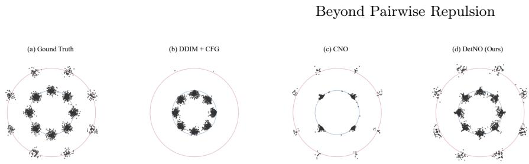  
Fig. 3: Toy example on a 2D ring mixture with 8 inner modes (80%) and 8 outer modes (20%). (a) Ground truth distribution. (b) Classifier-free guidance collapses onto the majority inner ring, without covering outer modes. (c) CNO recovers the outer modes but severely distorts the inner ring, producing only 4 inner modes whose sample distributions no longer align with the ground truth geometry. (d) DetNO achieves full coverage of all 16 modes across both rings, faithfully preserving the original mode structure.

## 5 Experiments

Implementation Details. We evaluate on three pre-trained T2I backbones: SD1.5 [24], SDXL [22], and SD3 [5]. SD1.5 and SDXL use DDIM [26] with 50 steps, while SD3 uses the Euler sampler with 28 steps following its default configuration. We compare against PG [3], SPELL [14], DiversityPrompt [31], and CNO [13]. We evaluate all methods under identical conditions (prompt set, random seeds, CFG scale, and hardware) to ensure fair relative comparison; absolute values may differ from original papers accordingly. We use the oficial implementations of all baselines, including CNO, with the hyperparameters reported in their original papers. Following [13, 31], we sample 2,000 prompts from the MS-COCO [18] validation set and generate 5 images per prompt for SD1.5 and SD3, and 3 images per prompt for SDXL.

Evaluation Metrics. For image quality, we report Precision [17], Density [19], CLIPScore [10], PickScore [15], and ImageReward [33]. For diversity, we report Recall [17], Coverage [19], Vendi Score [6], and Mean Self-Similarity (MSS) [13]. Among these, VendiScore and MSS serve as our primary diversity metrics, as they measure intra-batch coverage directly without reference to an external distribution. They are therefore better suited to evaluating diversity-enhancing methods than reference-dependent metrics such as Recall and Coverage [20].

## 5.1 Results

Toy Example: 2D Ring Mixture. Only the log-determinant preserves the full mode structure in a controlled setting, a 2D ring mixture with 8 inner modes (80%) and 8 outer modes (20%) (Fig. 3). CFG (b) collapses onto the majority inner ring, CNO (c) recovers the outer ring while distorting the inner one, and DetNO (d) covers all 16 modes. The two failures are distinct: CFG cannot reach the suppressed modes at all, while InfoNCE-style contrastive repulsion reaches them but keeps pushing after samples are already separated, distorting the geometry it recovers. The log-determinant instead self-attenuates as volume is restored (Proposition 1), separating samples without displacing the modes themselves.

Table 1: Quantitative comparison across diferent backbone models. Bold and underline denote the best and second-best results, respectively.
<table><tr><td colspan="2"></td><td colspan="4">Reference-Based</td><td colspan="3">Reference-Free</td><td colspan="2">Diversity</td></tr><tr><td colspan="2">Model Method</td><td>Prec 个</td><td>Rec</td><td>Den ↑</td><td>Cov ↑</td><td>CLIP</td><td>Pick ↑</td><td>IR ↑</td><td>MSS ↓ Vendi ↑</td><td></td></tr><tr><td rowspan="5">SD1.5</td><td>DDIM</td><td>0.7005</td><td>0.6061</td><td>0.6112</td><td>0.3631</td><td>30.9096</td><td>21.3413</td><td>0.1086</td><td>0.1509</td><td>4.7352</td></tr><tr><td>PG</td><td>0.7008</td><td>0.6044</td><td>0.6120</td><td>0.3634</td><td>30.9103</td><td>21.3424</td><td>0.1085</td><td>0.1508</td><td>4.7357</td></tr><tr><td>SPELL</td><td>0.6722</td><td>0.5645</td><td>0.5639</td><td>0.3439</td><td>30.7538</td><td>21.2556</td><td>0.0264</td><td>0.1409</td><td>4.7636</td></tr><tr><td>DiversityPrompt</td><td>0.6679</td><td>0.6442</td><td>0.5345</td><td>0.3370</td><td>30.9380</td><td>21.1956</td><td>0.1194</td><td>0.1455</td><td>4.7509</td></tr><tr><td>CNO</td><td>0.7247</td><td>0.6318</td><td>0.6647 0.3933</td><td></td><td>30.7925</td><td>21.2984</td><td>0.0702</td><td>0.1383</td><td>4.7679</td></tr><tr><td rowspan="5"></td><td>Ours</td><td>0.6744</td><td>0.6807</td><td>0.5541</td><td>0.3570</td><td>31.1396</td><td>21.2536</td><td>0.1088</td><td>0.1229</td><td>4.8024</td></tr><tr><td>DDIM</td><td>0.6623</td><td>0.6677</td><td>0.5399</td><td>0.2466</td><td>|31.8141</td><td>22.5280</td><td>0.7784</td><td>0.2031</td><td>2.8560</td></tr><tr><td>PG</td><td>0.6708</td><td>0.6821</td><td>0.5354</td><td>0.2466</td><td>31.7768</td><td>22.5375</td><td>0.7864</td><td>0.2007</td><td>2.8589</td></tr><tr><td>SPELL</td><td>0.6852</td><td>0.6690</td><td>0.5545</td><td>0.2525</td><td>31.7059</td><td>22.4448</td><td>0.7296</td><td>0.1902</td><td>2.8712</td></tr><tr><td>CNO Ours</td><td>0.6592 0.6552</td><td>0.6824</td><td>0.5169</td><td>0.2446</td><td>31.7637 31.7273</td><td>22.4910</td><td>0.7644</td><td>0.1869</td><td>2.8746</td></tr><tr><td></td><td></td><td></td><td>0.6945</td><td>0.4966</td><td>0.2362</td><td></td><td>22.4489</td><td>0.7443</td><td></td><td>0.17202.8920</td></tr><tr><td rowspan="5">SD3</td><td>Euler PG</td><td>0.6261</td><td>0.5223</td><td>0.4527</td><td>0.2480</td><td>|31.8805</td><td>22.5719</td><td>1.0503</td><td>0.2944</td><td>4.2517</td></tr><tr><td></td><td>0.6334</td><td>0.5238</td><td>0.4456</td><td>0.2487</td><td>31.8631</td><td>22.5806</td><td>1.0510</td><td>0.2947</td><td>4.2485</td></tr><tr><td>SPELL</td><td>0.6799</td><td>0.5172</td><td>0.5241</td><td>0.2761</td><td>31.8447 31.8481</td><td>22.5992</td><td>1.0362</td><td>0.2866</td><td>4.2791</td></tr><tr><td>CNO</td><td>0.6396</td><td>0.5372</td><td>0.4495</td><td>0.2518</td><td>31.8567</td><td>22.5512 22.4967</td><td>1.0423</td><td>0.2760</td><td>4.3196</td></tr><tr><td>Ours</td><td>0.6427</td><td>0.5441</td><td>0.4601</td><td>0.2648</td><td></td><td></td><td>1.0109</td><td>0.2542</td><td>4.3988</td></tr></table>

Table 2: Downstream few-shot classification accuracy (%). Mean ± std over 10 splits. Synthetic images (16/class) generated with SD3 (Oxford-IIIT Pets) and SD1.5 (CUB-200-2011). † and ‡ denote statistically significant improvement over DDIM and CNO respectively (Welch’s t-test, $p < 0 . 0 1 )$
<table><tr><td></td><td colspan="4">Oxford-IIIT Pets (SD3)</td><td colspan="4">CUB-200-2011 (SD1.5)</td></tr><tr><td>Method</td><td>1-shot</td><td>2-shot</td><td>4-shot</td><td>8-shot</td><td>1-shot</td><td>2-shot</td><td>4-shot</td><td>8-shot</td></tr><tr><td>Real only</td><td> $1 7 . 6 \pm 2 . 0$ </td><td> $4 1 . 2 \pm 2 . 9$ </td><td> $5 7 . 7 \pm 2 . 7$ </td><td> $6 5 . 4 \pm 0 . 7$ </td><td> $8 . 2 \pm 0 . 5$ </td><td> $1 5 . 1 \pm 0 . 6$ </td><td> $2 7 . 9 \pm 0 . 9$ </td><td> $4 7 . 0 \pm 1 . 3$ </td></tr><tr><td>+ DDIM</td><td> $5 2 . 2 \pm 1 . 8$ </td><td> $5 8 . 2 \pm 0 . 9$ </td><td> $5 9 . 1 \pm 1 . 3$ </td><td> ${ \bf 7 1 . 8 \pm 0 . 7 }$ </td><td> $2 4 . 6 \pm 0 . 9$ </td><td> $3 1 . 1 \pm 0 . 9$ </td><td> $3 8 . 5 \pm 0 . 9$ </td><td> $5 0 . 9 \pm 0 . 8$ </td></tr><tr><td> $+ \mathrm { C N O }$ </td><td> $5 1 . 7 \pm 1 . 7$ </td><td> $5 7 . 8 \pm 0 . 6$ </td><td> $5 9 . 4 \pm 1 . 6$ </td><td> $7 1 . 4 \pm 0 . 7$ </td><td> $2 4 . 5 \pm 0 . 7$ </td><td> $3 0 . 6 \pm 0 . 8$ </td><td> $3 8 . 4 \pm 0 . 5$ </td><td> $5 0 . 7 \pm 1 . 1$ </td></tr><tr><td>+ DetNO</td><td> $\mathbf { 5 4 . 2 \\\pm 1 . 1 ^ { \ddagger } }$ </td><td> $\mathbf { 5 9 . 3 \pm 1 . 3 ^ { \dagger } }$ </td><td> ${ \bf 6 1 . 2 \pm 1 . 7 ^ { \dagger } }$ </td><td> ${ \bf 7 1 . 8 \pm 0 . 9 }$ </td><td>26.3 ± 0.5†‡</td><td> $\mathbf { 3 2 . 1 \pm 0 . 7 ^ { \ddagger } }$ </td><td> $\mathbf { 3 9 . 8 \pm 0 . 6 ^ { \dagger } }$  +</td><td> ${ \bf 5 1 . 8 \pm 0 . 9 }$ </td></tr></table>

Quantitative Results. DetNO achieves the best MSS and VendiScore on all three (SD1.5, SDXL, SD3) in Tab. 1, confirming systematic diversity gains across all three backbones and both samplers tested (DDIM and Euler). CNO also improves diversity, but its VendiScore gain over the baseline is roughly half of DetNO’s on each backbone. On reference-free quality metrics (PickScore, ImageReward), the trade-of is small: PickScore decreases only marginally on every backbone, while ImageReward matches the baseline on SD1.5 and decreases modestly on SDXL and SD3. Reference-dependent metrics (Precision, Density, Coverage) decrease accordingly, as they reward overlap with the narrow MS-COCO reference set [20] rather than per-image quality. The trade-of remains controllable: the Pareto analysis (Fig. 5) shows λ smoothly interpolating between the two objectives, and on its 200-prompt sweep every tested SD3 configuration improves over the baseline on CLIPScore, PickScore, and ImageReward; under the full 2,000-prompt protocol, the deployed configuration trades a small amount of PickScore and ImageReward for its diversity gains (Tab. 1).

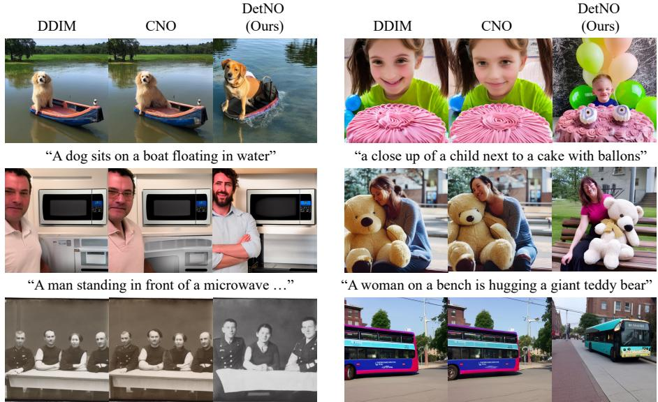  
“Three persons with military attire seated on a bench”  
“There is a large bus that is coming up the street”  
Fig. 4: Qualitative comparison on SD1.5. For each prompt, we show one representative sample from DDIM, CNO, and DetNO (ours). DDIM and CNO produce visually near-identical outputs across seeds, difering only in minor details such as slight pose or hair diference. DetNO generates substantially diferent images, varying in viewpoint, object appearance, scene layout, and human identity, while remaining faithful to the prompt.

Qualitative Results. The diversity gains are plainly visible (Fig. 4, six SD1.5 prompts; SDXL and SD3 examples in Figs. S1 and S2). DDIM and CNO are nearly indistinguishable, sharing global layout, object placement, and dominant color palette across all examples. DetNO instead varies object identity, viewpoint, and scene composition while remaining prompt-faithful, recovering degrees of freedom in the initial noise that standard sampling and pairwise objectives leave unexploited.

Downstream Classification. These diversity gains translate into practical utility. We evaluate synthetic data augmentation in a few-shot classification setting using two fine-grained benchmarks: Oxford-IIIT Pets (37 breeds) [21] with SD3 and CUB-200-2011 (200 species) [32] with SD1.5. For each class, we generate 16 synthetic images and combine them with K-shot real images to fine-tune a pretrained ResNet-18 (Tab. 2). DetNO consistently outperforms both DDIM and CNO across both datasets, with gains most pronounced in the low-data regime: +2.0pp at 1-shot on Pets and $+ 1 . 7 \mathrm { p p }$ on CUB-200 over DDIM, where distributional breadth of synthetic data is directly impactful. CNO remains within noise of DDIM on both datasets, whereas DetNO’s broader mode coverage provides tangible downstream benefits beyond what diversity metrics alone would suggest.

Table 3: Pairwise-RBF ablation with downstream evaluation. SD1.5, $B = 5 ,$ $\lambda { = } 0 . 0 5 ; S , \sigma .$ , fidelity term, and optimizer are held identical across rows, so only the batch aggregator difers: InfoNCE (CNO), the sum-of-pairwise RBF $\textstyle \sum _ { i < j } S _ { i j }$ , and the log-determinant (DetNO). Downstream columns follow the protocol of Tab. 2. Bold and underline denote the best and second-best results.
<table><tr><td rowspan="2">Method</td><td colspan="2">SD1.5 (intra-batch)</td><td colspan="2">1-shot accuracy (%)</td></tr><tr><td>Pick ↑</td><td>Vendi ↑</td><td></td><td>Pets (SD3) ↑ CUB (SD1.5) ↑</td></tr><tr><td>DDIM (Baseline)</td><td>21.34</td><td>4.7352</td><td> $5 2 . 2 \pm 1 . 8$ </td><td> $2 4 . 6 \pm 0 . 9$ </td></tr><tr><td>CNO (InfoNCE)</td><td>21.30</td><td>4.7679</td><td> $5 1 . 7 \pm 1 . 7$ </td><td> $2 4 . 5 \pm 0 . 7$ </td></tr><tr><td> $\textstyle \sum _ { i < j } S _ { i j }$  (pairwise-RBF)</td><td>21.23</td><td>4.8006</td><td> $5 3 . 7 \pm 1 . 1$ </td><td> $\underline { { 2 5 . 8 \pm 0 . 6 } }$ </td></tr><tr><td>− log det (DetNO)</td><td>21.25</td><td>4.8024</td><td> ${ \bf 5 4 . 2 \pm 1 . 1 }$ </td><td> ${ \bf 2 6 . 3 \ : \pm { \ : 0 . 5 } }$ </td></tr></table>

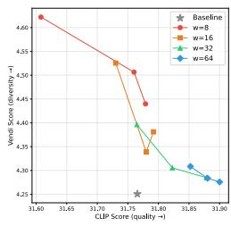

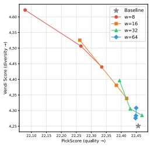

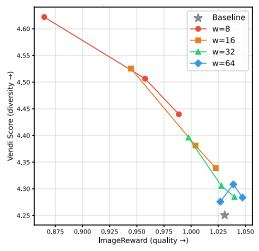  
Fig. 5: Quality–diversity Pareto curves on SD3 for diferent pooling windows $w \in \{ 8 , 1 6 , 3 2 , 6 4 \}$ . Each point on a curve corresponds to a diferent fidelity weight λ ∈ $\{ 0 . 0 1 , 0 . 0 5 , 0 . 1 \}$ , evaluated on 200 randomly sampled MS-COCO prompts with 5 images per prompt. All configurations improve over the unoptimized baseline (gray star) on this evaluation. Smaller w yields a wider diversity range at the cost of a steeper quality trade-of, while larger w preserves quality more efectively with moderate diversity gains.

Isolating the Determinant Structure. Holding S, σ, the fidelity term, and the optimizer fixed, we vary only the batch aggregator among InfoNCE (CNO), the sum-of-pairwise RBF $\textstyle \sum _ { i < j } S _ { i j }$ , and our log-determinant (Tab. 3), isolating the determinant structure from the inherited pipeline. The log-determinant attains the best intra-batch diversity, and both RBF-based aggregators outperform InfoNCE. Because the pairwise-RBF and log-determinant rows difer only in aggregating S additively versus through its determinant, the comparison isolates the aggregation structure. The gap at B=5 is small, as expected where higher-order redundancies are few; most of the gain over InfoNCE comes from the shared RBF kernel and fidelity design. We report intra-batch diversity for comparability but treat downstream accuracy as decisive. There the advantage is sharpest: the log-determinant reaches the highest 1-shot accuracy on both benchmarks, while InfoNCE alone does not surpass the DDIM baseline.

Table 4: Ablation study on the loss components of Eq. (11) in the SD1.5. A: diversity term, B: fidelity term.
<table><tr><td>A B</td><td>Prec↑</td><td>Recall↑</td><td>Den↑</td><td>Cov↑</td><td>CLIP↑</td><td>Pick↑</td><td>IR↑</td><td>MSS↓</td><td>Vendi↑</td></tr><tr><td></td><td>0.7005</td><td>0.6061</td><td>0.6112</td><td>0.3631</td><td>30.9096</td><td>21.3413</td><td>0.1086</td><td>0.1509</td><td>4.7352</td></tr><tr><td></td><td>0.6816</td><td>0.6191</td><td>0.5686</td><td>0.3468</td><td>30.7146</td><td>21.1857</td><td>-0.0489</td><td>0.1201</td><td>4.8107</td></tr><tr><td>√</td><td>0.7014</td><td>0.6024</td><td>0.5924</td><td>0.3531</td><td>30.9112</td><td>21.3459 0.1187</td><td></td><td>0.1516</td><td>4.7334</td></tr><tr><td></td><td>√√ 0.6744 0.6807</td><td></td><td>0.5541</td><td>0.3570</td><td>31.1396 21.2536</td><td></td><td>0.1088</td><td>0.1229</td><td>4.8024</td></tr></table>

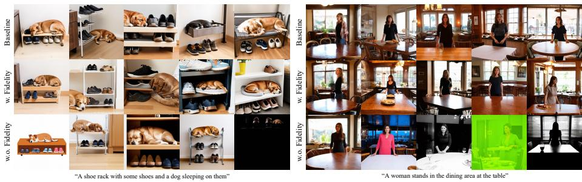  
Fig. 6: Qualitative ablation of the fidelity term on SD3. Top: unoptimized baseline. With fidelity (middle), DetNO increases diversity while preserving image quality. Without fidelity (bottom), unconstrained volume maximization pushes noise vectors into out-of-distribution regions, producing artifacts such as cartoon-like renderings, color corruption, and degenerate outputs.

## 5.2 Ablation Studies

Efect of pooling window w and fidelity weight λ. The method is robust to the choice of w on SD3: Fig. 5 traces quality–diversity frontiers on SD3 by sweeping $\lambda \in \{ 0 . 0 1 , 0 . 0 5 , 0 . 1 \}$ for each pooling window $w \in \{ 8 , 1 6 , 3 2 , 6 4 \}$ . On this 200-prompt evaluation, all configurations improve over the unoptimized baseline across CLIPScore, PickScore, and ImageReward. Smaller w operates on coarser semantic features, giving a wider diversity range but a steeper quality slope; larger w preserves finer spatial structure and trades less quality per unit of diversity gain. We select w=32 for our SD3 experiments as it provides a favorable balance across all three quality metrics.

Ablation study on the loss components. Both loss terms are necessary: Tab. 4 isolates each term’s contribution on SD1.5. The diversity term alone (A) achieves the strongest diversity but at substantial quality cost, pushing noise vectors into out-of-distribution regions (bottom row of Fig. 6). The fidelity term alone (B) preserves quality but provides no diversity improvement. The full objective (A+B) recovers most diversity gains while maintaining prompt-faithful outputs (middle row of Fig. 6).

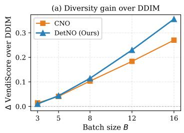

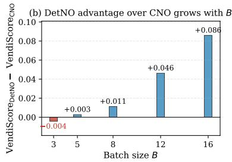  
Fig. 7: Batch-size scaling on SD1.5. (a) VendiScore gain over the DDIM baseline versus batch size B for CNO and DetNO. (b) DetNO’s VendiScore advantage over CNO, which widens monotonically with B. All other settings follow Tab. S2.

Scaling with batch size. All-order and pairwise objectives coincide at $B = 2$ and diverge only as higher-order redundancies accumulate; we therefore sweep $B \in \{ 3 , 5 , 8 , 1 2 , 1 6 \}$ on SD1.5 with all else fixed (Fig. 7). Both methods improve over DDIM, but DetNO’s advantage over CNO is marginal at small B and widens monotonically as B grows. The trend is consistent with the all-order argument: a pairwise objective sees only the B2  pair terms, while the higherorder redundancies the log-determinant penalizes grow combinatorially with B. As the two methods also difer in kernel and fidelity design, the gap reflects their combined efect. Its gradient adds an $O ( B ^ { 3 } )$ matrix factorization per step, negligible against the B denoiser evaluations that dominate each iteration. Synthetic data augmentation operates in exactly this large-batch regime.

## 6 Conclusion

We presented DetNO, an initial-noise optimization framework that maximizes the RKHS volume among Tweedie predictions via a log-determinant diversity term and an anchor-based fidelity term. Experiments on SD1.5, SDXL, and SD3 confirm consistent diversity gains across backbones and samplers, with Pareto analysis showing that λ enables smooth interpolation between the two objectives. A toy experiment and a spectral analysis (Proposition 1) trace this advantage to its mechanism: repulsion that intensifies where the batch is most collapsed and relaxes once diversity is restored. In downstream few-shot classification, the broader mode coverage translates into statistically significant accuracy gains in the low-data regime. Treating diversity as a property of the whole batch, rather than of its pairs, thus produces image sets that are not only more varied but measurably more useful.

## Acknowledgments

This was partly supported by the Institute of Information & Communications Technology Planning & Evaluation (IITP) grant funded by the Korean government (MSIT) (No. 1RS-2020-II201373, Artificial Intelligence Graduate School Program(Hanyang University)) and the Institute of Information & Communications Technology Planning & Evaluation (IITP) grant funded by the Korea government (MSIT) (No. 2RS-2025-02219062, Self-training framework for VLMbased defect detection and explanation model in manufacturing process).

## References

[1] Aggarwal, C.C., Hinneburg, A., Keim, D.A.: On the surprising behavior of distance metrics in high dimensional spaces. In: Proceedings of the 8th International Conference on Database Theory. p. 420–434. ICDT ’01, Springer-Verlag, Berlin, Heidelberg (2001)

[2] Ahn, D., Kang, J., Lee, S., Min, J., Kim, M., Jang, W., Cho, H., Paul, S., Kim, S., Cha, E., et al.: A noise is worth difusion guidance. arXiv preprint arXiv:2412.03895 (2024)

[3] Corso, G., Xu, Y., De Bortoli, V., Barzilay, R., Jaakkola, T.: Particle guidance: non-iid diverse sampling with difusion models. arXiv preprint arXiv:2310.13102 (2023)

[4] Elfeki, M., Couprie, C., Riviere, M., Elhoseiny, M.: Gdpp: Learning diverse generations using determinantal point processes. In: International conference on machine learning. pp. 1774–1783. PMLR (2019)

[5] Esser, P., Kulal, S., Blattmann, A., Entezari, R., Müller, J., Saini, H., Levi, Y., Lorenz, D., Sauer, A., Boesel, F., et al.: Scaling rectified flow transformers for high-resolution image synthesis. In: Forty-first international conference on machine learning (2024)

[6] Friedman, D., Dieng, A.B.: The vendi score: A diversity evaluation metric for machine learning. arXiv preprint arXiv:2210.02410 (2022)

[7] Garreau, D., Jitkrittum, W., Kanagawa, M.: Large sample analysis of the median heuristic. arXiv preprint arXiv:1707.07269 (2017)

[8] Guo, X., Liu, J., Cui, M., Li, J., Yang, H., Huang, D.: Initno: Boosting textto-image difusion models via initial noise optimization. In: Proceedings of the IEEE/CVF Conference on Computer Vision and Pattern Recognition. pp. 9380–9389 (2024)

[9] He, R., Sun, S., Yu, X., Xue, C., Zhang, W., Torr, P., Bai, S., Qi, X.: Is synthetic data from generative models ready for image recognition? arXiv preprint arXiv:2210.07574 (2022)

[10] Hessel, J., Holtzman, A., Forbes, M., Le Bras, R., Choi, Y.: Clipscore: A reference-free evaluation metric for image captioning. In: Proceedings of the 2021 conference on empirical methods in natural language processing. pp. 7514–7528 (2021)

[11] Ho, J., Jain, A., Abbeel, P.: Denoising difusion probabilistic models. Advances in neural information processing systems 33, 6840–6851 (2020)

[12] Ho, J., Salimans, T.: Classifier-free difusion guidance. arXiv preprint arXiv:2207.12598 (2022)

[13] Kim, B., Um, S., Ye, J.C.: Diverse text-to-image generation via contrastive noise optimization. arXiv preprint arXiv:2510.03813 (2025)

[14] Kirchhof, M., Thornton, J., Béthune, L., Ablin, P., Ndiaye, E., Cuturi, M.: Shielded difusion: Generating novel and diverse images using sparse repellency. arXiv preprint arXiv:2410.06025 (2024)

[15] Kirstain, Y., Polyak, A., Singer, U., Matiana, S., Penna, J., Levy, O.: Picka-pic: An open dataset of user preferences for text-to-image generation. Advances in neural information processing systems 36, 36652–36663 (2023)

[16] Kulesza, A., Taskar, B., et al.: Determinantal point processes for machine learning. Foundations and Trends® in Machine Learning 5(2–3), 123–286 (2012)

[17] Kynkäänniemi, T., Karras, T., Laine, S., Lehtinen, J., Aila, T.: Improved precision and recall metric for assessing generative models. Advances in neural information processing systems 32 (2019)

[18] Lin, T.Y., Maire, M., Belongie, S., Hays, J., Perona, P., Ramanan, D., Dollár, P., Zitnick, C.L.: Microsoft coco: Common objects in context. In: European conference on computer vision. pp. 740–755. Springer (2014)

[19] Naeem, M.F., Oh, S.J., Uh, Y., Choi, Y., Yoo, J.: Reliable fidelity and diversity metrics for generative models. In: International conference on machine learning. pp. 7176–7185. PMLR (2020)

[20] Park, D., Kim, S.: Probabilistic precision and recall towards reliable evaluation of generative models. In: Proceedings of the IEEE/CVF international conference on computer vision. pp. 20099–20109 (2023)

[21] Parkhi, O.M., Vedaldi, A., Zisserman, A., Jawahar, C.V.: Cats and dogs. In: IEEE Conference on Computer Vision and Pattern Recognition (2012)

[22] Podell, D., English, Z., Lacey, K., Blattmann, A., Dockhorn, T., Müller, J., Penna, J., Rombach, R.: Sdxl: Improving latent difusion models for high-resolution image synthesis. arXiv preprint arXiv:2307.01952 (2023)

[23] Robbins, H.E.: An Empirical Bayes Approach to Statistics, pp. 388–394. Springer New York, New York, NY (1992). https://doi.org/10.1007/ 978-1-4612-0919-5\_26, https://doi.org/10.1007/978-1-4612-0919- 5\_26

[24] Rombach, R., Blattmann, A., Lorenz, D., Esser, P., Ommer, B.: Highresolution image synthesis with latent difusion models. In: Proceedings of the IEEE/CVF conference on computer vision and pattern recognition. pp. 10684–10695 (2022)

[25] Sehwag, V., Hazirbas, C., Gordo, A., Ozgenel, F., Canton, C.: Generating high fidelity data from low-density regions using difusion models. In: Proceedings of the IEEE/CVF Conference on Computer Vision and Pattern Recognition. pp. 11492–11501 (2022)

[26] Song, J., Meng, C., Ermon, S.: Denoising difusion implicit models. arXiv preprint arXiv:2010.02502 (2020)

[27] Song, Y., Sohl-Dickstein, J., Kingma, D.P., Kumar, A., Ermon, S., Poole, B.: Score-based generative modeling through stochastic diferential equations. arXiv preprint arXiv:2011.13456 (2020)

[28] Um, S., Kim, B., Ye, J.C.: Boost-and-skip: A simple guidance-free difusion for minority generation. arXiv preprint arXiv:2502.06516 (2025)

[29] Um, S., Lee, S., Ye, J.C.: Don’t play favorites: minority guidance for difusion models. arXiv preprint arXiv:2301.12334 (2023)

[30] Um, S., Ye, J.C.: Self-guided generation of minority samples using difusion models. In: European Conference on Computer Vision. pp. 414–430. Springer (2024)

[31] Um, S., Ye, J.C.: Minority-focused text-to-image generation via prompt optimization. In: Proceedings of the Computer Vision and Pattern Recognition Conference. pp. 20926–20936 (2025)

[32] Wah, C., Branson, S., Welinder, P., Perona, P., Belongie, S.: The caltechucsd birds-200-2011 dataset. Tech. Rep. CNS-TR-2011-001, California Institute of Technology (2011)

[33] Xu, J., Liu, X., Wu, Y., Tong, Y., Li, Q., Ding, M., Tang, J., Dong, Y.: Imagereward: Learning and evaluating human preferences for text-to-image generation. Advances in Neural Information Processing Systems 36, 15903– 15935 (2023)

## A Appendix

## A.1 Proof of Proposition 1

We first note that the algebraic identity in $\operatorname { E q . } \ ( 7 )$ holds for any $B \times B$ positivedefinite RBF Gram matrix, regardless of the ambient dimension d. Two separate conditions on S are relevant here. First, the RBF kernel $k ( x , y ) = \exp ( - \| x -$ $y \| ^ { 2 } / 2 \sigma ^ { 2 } )$ is strictly positive definite for any finite set of distinct points in any dimension, ensuring that S is always invertible and that log $\operatorname* { d e t } ( S + \epsilon I )$ is welldefined without any assumption on d. Second, the assumption $d \gg B$ serves as a non-degeneracy condition for the eigenvalue bounds: when d $\gg B ;$ generic points on $S ^ { d - 1 }$ are in general position with probability one, ensuring that the eigenvalues $\{ \mu _ { k } \}$ are bounded away from zero and that the bounds in Proposition 1 are non-vacuous.

Using the matrix identity $\nabla _ { S }$ log det $( M ) = M ^ { - 1 }$ for any symmetric positivedefinite M, the gradient of $\mathcal { L } _ { \mathrm { d e t } }$ with respect to S is:

$$
\nabla _ { S } \mathcal { L } _ { \mathrm { d e t } } = - ( S + \epsilon I ) ^ { - 1 } .\tag{S1}
$$

Since S admits the eigendecomposition $S = U \mathrm { d i a g } ( \mu _ { 1 } , \dots , \mu _ { B } ) U ^ { \top }$ , the inverse $( S + \epsilon I ) ^ { - 1 }$ has eigenvalues $\{ 1 / ( \mu _ { k } + \epsilon ) \} _ { k = 1 } ^ { B }$ . Since the Frobenius norm of a symmetric matrix equals the $\ell _ { 2 }$ norm of its eigenvalues:

$$
\| \nabla _ { S } \mathcal { L } _ { \operatorname* { d e t } } \| _ { F } = \| ( S + \epsilon I ) ^ { - 1 } \| _ { F } = \sqrt { \sum _ { k = 1 } ^ { B } \frac { 1 } { ( \mu _ { k } + \epsilon ) ^ { 2 } } } .\tag{S2}
$$

For the pairwise objective, rewriting $\begin{array} { r } { \mathcal { L } _ { \mathrm { p a i r } } = \frac { 1 } { 2 } ( \mathbf { 1 } ^ { \top } S \mathbf { 1 } - \mathrm { t r } ( S ) ) } \end{array}$ and diferentiating with respect to the symmetric matrix S yields:

$$
\begin{array} { r } { \nabla _ { S } \mathcal { L } _ { \mathrm { p a i r } } = \frac { 1 } { 2 } ( J - I ) , \quad J = \mathbf { 1 1 } ^ { \top } . } \end{array}\tag{S3}
$$

This matrix has zero diagonal and $B ( B - 1 )$ of-diagonal entries each equal to ${ \frac { 1 } { 2 } } ;$ , giving:

$$
\begin{array} { r } { \| \nabla _ { S } \mathcal { L } _ { \mathrm { p a i r } } \| _ { F } = \sqrt { B ( B - 1 ) \cdot \left( \frac { 1 } { 2 } \right) ^ { 2 } } = \frac { 1 } { 2 } \sqrt { B ( B - 1 ) } . } \end{array}\tag{S4}
$$

Dividing Eq. (S2) by Eq. (S4) then directly yields:

$$
\frac { \| \nabla _ { S } \mathcal { L } _ { \mathrm { { e t } } } \| _ { F } } { \| \nabla _ { S } \mathcal { L } _ { \mathrm { p a i r } } \| _ { F } } = \frac { \sqrt { \sum _ { k = 1 } ^ { B } \frac { 1 } { ( \mu _ { k } + \epsilon ) ^ { 2 } } } } { \frac { 1 } { 2 } \sqrt { B ( B - 1 ) } } = \frac { 2 } { \sqrt { B ( B - 1 ) } } \sqrt { \sum _ { k = 1 } ^ { B } \frac { 1 } { ( \mu _ { k } + \epsilon ) ^ { 2 } } } ,\tag{S5}
$$

which is exactly Eq. (7). Bound (i) follows from dropping all but the smallesteigenvalue term: $\textstyle \sum _ { k } 1 / ( \mu _ { k } + \epsilon ) ^ { 2 } \geq 1 / ( \mu _ { 1 } + \epsilon ) ^ { 2 }$ . For bound (ii), applying bound (i) and imposing the ratio to exceed unity gives:

$$
\frac { 2 } { \sqrt { B ( B - 1 ) } ( \mu _ { 1 } + \epsilon ) } > 1 \iff \mu _ { 1 } < \frac { 2 } { \sqrt { B ( B - 1 ) } } - \epsilon ,\tag{S6}
$$

and substituting $B = 5 , \epsilon = 1 0 ^ { - 5 }$ gives the threshold $2 / \sqrt { 2 0 } - 1 0 ^ { - 5 } \approx 0 . 4 4 7 2$ Bound (iii) follows since $\textstyle \sum _ { k } 1 / ( \mu _ { k } + \epsilon ) ^ { 2 }$ is strictly decreasing in each $\mu _ { k }$ , so the ratio self-attenuates monotonically as eigenvalues grow during optimization, concentrating gradient energy where redundancy is highest and relaxing repulsion as diversity is achieved. ⊓⊔

Remark 1 (S-level vs. z-level gradient amplification). Proposition 1 bounds the ratio of gradient norms with respect to the Gram matrix S, whereas the empirically measured ratio $\| \nabla _ { z } \mathcal { L } _ { \mathrm { d e t } } \| _ { F } / \| \nabla _ { z } \mathcal { L } _ { \mathrm { p a i r } } \| _ { F }$ additionally depends on the Jacobian $\partial S / \partial z$ via the chain rule. The strong empirical coupling (Pearson $r = 0 . 9 9 9$ at mean level, $R ^ { 2 } = 0 . 9 9 9$ for the linear fit $R _ { z } = 0 . 1 7 3 / ( \mu _ { \mathrm { m i n } } + \epsilon ) + 0 . 3 9 4$ ; Tab. S1) confirms that the S-level amplification mechanism propagates faithfully through this Jacobian to the actual optimization variables.

## A.2 Derivation of the Two-Term Objective via Lagrangian Relaxation

Our primary objective is to maximize batch diversity in the RKHS of the Tweedie prediction space by minimizing − log det $( S { + } \epsilon I )$ , subject to the requirement that each optimized Tweedie prediction $\hat { z } _ { 0 | T } ^ { i }$ remains within a bounded displacement from its reference anchor $\hat { z } _ { 0 | T } ^ { i , \mathrm { r e f } }$

$$
\operatorname* { m i n } _ { Z _ { T } } - \log \operatorname* { d e t } ( S + \epsilon I ) \quad \mathrm { s . t . } \quad \left\| \hat { z } _ { 0 | T } ^ { i } - \hat { z } _ { 0 | T } ^ { i , \mathrm { r e f } } \right\| ^ { 2 } \leq \delta , \quad \forall i \in \{ 1 , \dots , B \} .\tag{S7}
$$

Introducing non-negative Lagrange multipliers $\{ \lambda _ { i } \} _ { i = 1 } ^ { B }$ , one per constraint, the Lagrangian is:

$$
{ \mathcal { L } } _ { \mathrm { g e n } } ( Z _ { T } , \varLambda ) = - \log \operatorname* { d e t } ( S + \epsilon I ) + \sum _ { i = 1 } ^ { B } \lambda _ { i } \left( \left\| \hat { z } _ { 0 | T } ^ { i } - \hat { z } _ { 0 | T } ^ { i , \mathrm { r e f } } \right\| ^ { 2 } - \delta \right) .\tag{S8}
$$

Since all B samples share the same text condition, backbone, and noise prior $\mathcal { N } ( \mathbf { 0 } , I )$ , the constraints are symmetric across samples. We therefore impose a uniform multiplier $\lambda _ { i } = \lambda$ for all $i ,$ giving:

$$
{ \mathcal { L } } _ { \mathrm { g e n } } ( Z _ { T } , \lambda ) = - \log \operatorname * { d e t } ( S + \epsilon I ) + \lambda \sum _ { i = 1 } ^ { B } \left\| \hat { z } _ { 0 | T } ^ { i } - \hat { z } _ { 0 | T } ^ { i , \mathrm { r e f } } \right\| ^ { 2 } - \lambda B \delta .\tag{S9}
$$

Since the constant $- \lambda B \delta$ is independent of $Z _ { T }$ and vanishes under $\nabla _ { Z _ { T } }$ , we drop it to obtain the final objective in $\operatorname { E q }$ . (11), where $\lambda \geq 0$ is the single hyperparameter governing the diversity–fidelity trade-of. □

## A.3 Empirical Validation of Spectral Gradient Amplification.

To validate that the amplification of Proposition 1 holds throughout actual optimization, we track gradient dynamics during DetNO on SD1.5 $( B { = } 5 , N _ { \mathrm { o p t } } { = } 1 0$

Table S1: Gradient dynamics during DetNO optimization on SD1.5 (B=5, 20 prompts × 3 seeds). $R _ { z } > 1$ at 8/10 steps $( ^ { * * * } p < 0 . 0 0 1 , ^ { * * } p < 0 . 0 1 , ^ { * } p < 0 . 0 5 )$
<table><tr><td>Metric</td><td>Step 0</td><td>Step 1</td><td>Step 2</td><td>Step 3</td><td>Step 4</td><td>Step 5</td><td>Step 6</td><td>Step 7</td><td>Step 8</td><td>Step 9</td></tr><tr><td>µmin</td><td>0.244</td><td>0.349</td><td>0.304</td><td>0.256</td><td>0.230</td><td>0.226</td><td>0.234</td><td>0.248</td><td>0.261</td><td>0.271</td></tr><tr><td>Effective rank</td><td>2.856</td><td>3.246</td><td>3.065</td><td>2.867</td><td>2.754</td><td>2.752</td><td>2.802</td><td>2.871</td><td>2.931</td><td>2.963</td></tr><tr><td> $R _ { z }$ </td><td>1.138***</td><td>0.891</td><td>0.975</td><td>1.106***</td><td>1.197***</td><td>1.207***</td><td>1.173***</td><td>1.125***</td><td>1.086**</td><td>1.063*</td></tr></table>

Table S2: Hyperparameter configuration per backbone.
<table><tr><td>Backbone w</td><td>η λ</td><td> $N _ { \mathrm { o p t } }$ </td><td>B NFE</td></tr><tr><td>SD1.5</td><td>16 0.01 0.05</td><td>3 5</td><td>50  $1 0 ^ { - 5 }$ </td></tr><tr><td>SDXL</td><td>16 0.01 0.05</td><td>3 3</td><td>50  $1 0 ^ { - 5 }$ </td></tr><tr><td>SD3</td><td>32 0.01 0.01</td><td>3 5</td><td>28  $1 0 ^ { - 5 }$ </td></tr></table>

20 MS-COCO prompts, 3 seeds each) and summarize the results in Tab. S1. We deliberately extend optimization beyond the deployed $N _ { \mathrm { o p t } } { = } 3$ so that the predicted rise and decay of the gradient ratio is traced with per-step significance; deployment corresponds to the first three steps. $\mu _ { \mathrm { m i n } }$ remains below the threshold 0.447 across all optimization steps, confirming that the suficient condition of Proposition 1 is satisfied throughout. The gradient ratio $R _ { z }$ exceeds 1 at 8 out of 10 steps with statistical significance, and decreases monotonically from Step 5 onward as the efective rank increases, consistent with the self-attenuating behavior predicted by Proposition 1. The two non-significant steps (Step 1 and Step 2) coincide with a transient rise in $\mu _ { \mathrm { m i n } }$ and efective rank at the onset of optimization, after which both quantities stabilize and $R _ { z }$ recovers above 1 for the remainder of the trajectory.

## A.4 Hyperparameter Configuration

Tab. S2 summarizes the hyperparameters used for each backbone in all main experiments. The pooling window w is set larger for SD3 to preserve finer spatial structure, consistent with the ablation in Fig. 5. The fidelity weight λ provides a transparent diversity–quality trade-of and can be adjusted independently of the other hyperparameters; its efect on the trade-of is reported in Fig. 5. The batch size B follows the protocol of [13]: B=5 for SD1.5 and SD3, and B=3 for SDXL. NFE denotes the number of function evaluations used by the sampler: 50 steps for SD1.5 and SDXL (DDIM), and 28 steps for SD3 (Euler), following each model’s default configuration.

## A.5 Diversity Propagation Across Timesteps

A natural question is whether the diversity advantage at t=T persists through the denoising trajectory or is gradually erased. We measure the mean pairwise cosine similarity of the Tweedie predictions $\hat { \mathbf { z } } _ { 0 \mid t }$ at every denoising step, averaged over 20 prompts from MS-COCO with $B { = } 5$ and NFE=50. Lower cosine similarity indicates greater diversity among the B predictions.

Table S3: Mean pairwise cosine similarity of Tweedie predictions at key timesteps. Averaged over 20 MS-COCO prompts (B=5, NFE=50, SD1.5). Lower indicates more diverse predictions. DetNO maintains the lowest similarity throughout the denoising trajectory.
<table><tr><td>Method  $t { = } T \ ( \mathrm { s t e p } \ 0 )$   $t { = } 0 . 5 T \ ( \mathrm { s t e p \ 2 5 } )$   $t { \approx } 0 \ ( \mathrm { s t e p \ 4 9 } )$ </td></tr><tr><td>DDIM  $0 . 5 4 8 \pm 0 . 1 3 8$   $0 . 1 3 3 \pm 0 . 0 7 8$ </td><td> $0 . 1 2 0 \pm 0 . 0 7 3$ </td></tr><tr><td>CNO  $0 . 4 4 4 \pm 0 . 2 0 0$ </td><td> $0 . 1 1 5 \pm 0 . 0 9 2$   $0 . 1 0 1 \pm 0 . 0 8 3$ </td></tr><tr><td> $\mathbf { 0 . 4 0 3 \pm 0 . 1 7 9 }$ </td><td> $\mathbf { 0 . 0 3 2 \pm 0 . 0 5 7 }$   $\mathbf { 0 . 0 2 6 \pm 0 . 0 5 2 }$ </td></tr></table>

Table S4: Sigma ablation on SD1.5 (B=5, $N _ { \mathrm { o p t } }$ =3, λ=0.05, w=16).
<table><tr><td>σ</td><td>Prec↑ Recall↑</td><td>Den↑  $\operatorname { C o v } \uparrow$ </td><td>CLIP↑</td><td>Pick↑</td><td>IR↑</td><td>MSS↓</td><td>Vendi↑</td></tr><tr><td>0.01</td><td>0.6698 0.6369</td><td>0.5200</td><td>0.3314</td><td>31.3793 21.5105</td><td>0.2444</td><td>0.1588</td><td>4.7121</td></tr><tr><td>0.5</td><td>0.6687 0.6389</td><td>0.5141</td><td>0.3289</td><td>31.3807 21.5129</td><td>0.2519</td><td>0.1579</td><td>4.7160</td></tr><tr><td>1.0</td><td>0.6554 0.6502</td><td>0.4945</td><td>0.3209</td><td>31.2677</td><td>21.4233 0.1796</td><td>0.1390</td><td>4.7669</td></tr><tr><td>dynamic median</td><td>0.6538 0.6561</td><td>0.5003</td><td>0.3214</td><td>31.2722</td><td>21.4133 0.1675</td><td>0.1361</td><td>4.7733</td></tr><tr><td>median (ours)</td><td>0.6744 0.6807 0.5541 0.3570</td><td></td><td></td><td>31.1396</td><td>21.2536</td><td>0.1088</td><td>0.1229 4.8024</td></tr></table>

Tab. S3 reports the cosine similarity at three representative timesteps: t=T (initial), t=0.5T (midpoint), and t≈0 (final). The results confirm that the initial diversity advantage established at $t { = } T$ is preserved throughout the denoising process. At t=T, DDIM’s Tweedie predictions exhibit high cosine similarity (0.548), indicating mode collapse, while DetNO achieves the lowest similarity (0.403). This gap widens as denoising progresses: at t≈0, DetNO’s predictions are nearly orthogonal (0.026) compared to DDIM (0.120) and CNO (0.101). This validates our single-step optimization strategy: diversifying the Tweedie prediction at $t { = } T$ is suficient to produce diverse final images without per-step intervention.

## A.6 Efect of Kernel Bandwidth σ

The RBF kernel bandwidth σ controls the sensitivity of the Gram matrix to inter-sample distances in the pooled Tweedie prediction space. We compare five configurations: two fixed small values $( \sigma \in \{ 0 . 0 1 , 0 . 5 \} )$ ), a fixed moderate value $( \sigma = 1 . 0 )$ , a dynamic median updated at every optimization step, and our default choice of a fixed median heuristic computed once from the reference predictions (Eq. 5).

As shown in Tab. S4, small fixed values $( \sigma = 0 . 0 1 , 0 . 5 )$ yield near-uniform Gram matrices where all of-diagonal entries approach 1, providing weak diversity signal and resulting in the lowest VendiScore and the highest MSS. σ = 1.0 and the dynamic median improve diversity metrics but at a moderate quality cost. Our fixed median heuristic achieves the best MSS and VendiScore while also attaining the highest Precision, Density, and Coverage, confirming that computing σ once from reference predictions provides a well-calibrated and stable operating point without requiring per-step bandwidth updates.

Table S5: Computational cost comparison (SD3, NFE=28, B = 5, 1024×1024).
<table><tr><td>Method</td><td>Time/batch (s) ↓ GPU Mem. (GB) ↓ Extra Fwd. Passes</td><td></td><td></td></tr><tr><td>SD3 (Baseline)</td><td>16.3</td><td>28.3</td><td>0</td></tr><tr><td>CNO</td><td>17.7</td><td>28.3</td><td> $N _ { \mathrm { o p t } } + 1 = 4$ </td></tr><tr><td>DetNO (Ours)</td><td>17.8</td><td>28.3</td><td> $N _ { \mathrm { o p t } } + 1 = 4$ </td></tr></table>

Table S6: Ablation: Full Gradient vs. Stop Gradient (SD3, MS-COCO, seed=42, single run)
<table><tr><td>Method</td><td>Prec↑</td><td>Recall↑</td><td>Den↑</td><td>Cov↑</td><td>CLIP↑</td><td>Pick↑</td><td>IR↑</td><td>MSS↓</td><td>Vendi↑</td></tr><tr><td>Baseline</td><td>0.6261</td><td>0.5223</td><td>0.4527</td><td>0.2480</td><td>31.8805</td><td>22.5719</td><td>1.0503</td><td>0.2944</td><td>4.2517</td></tr><tr><td>Full Gradient</td><td>0.6385</td><td>0.5309</td><td>0.4520</td><td>0.2499</td><td>31.8775</td><td>22.5541</td><td>1.0468</td><td>0.2824</td><td>4.2964</td></tr><tr><td>Stop Gradient</td><td>0.6303</td><td>0.5184</td><td>0.4437</td><td>0.2488</td><td>31.8400</td><td>22.5597</td><td>1.0465</td><td>0.2858</td><td>4.2892</td></tr></table>

## A.7 Computational Overhead

Tab. S5 compares the computational cost across methods. Following CNO, we apply a stop-gradient operator on the UNet output when computing Tweedie predictions, which eliminates the need to retain UNet activations during backpropagation. As a result, DetNO achieves the same GPU memory footprint as CNO (28.3 GB) and requires the same number of extra forward passes $( N _ { \mathrm { o p t } } + 1 )$ The marginal time overhead relative to CNO (17.8 s vs. 17.7 s) stems solely from the Gram matrix computation and its matrix inversion, both of which are negligible compared to the UNet forward passes.

## A.8 Efect of Gradient Computation Strategy.

As shown in Table S6, stop-gradient already yields clear diversity gains over the baseline (MSS, VendiScore) at a marginal quality cost. Full gradient achieves moderately stronger gains (particularly in Recall and VendiScore) by propagating richer second-order information through the denoising network, but at the cost of storing all intermediate UNet activations during backpropagation. Stopgradient closes most of this gap while reducing peak memory to the level of standard inference (Tab. S5), making it the more practical default; we adopt it in Algorithm 1 and note that full gradient can be used when memory budget permits.

## A.9 Ablation on Noise Scale

To validate that the diversity gains of DetNO cannot be replicated by simply scaling the initial noise variance, we evaluate $\mathbf z _ { T } \sim \mathcal { N } ( \mathbf { 0 } , s ^ { 2 } \mathbf I )$ across a range of scale values s on SD1.5. As shown in Tab. S7, any deviation from the standard s = 1 causes severe image degradation across all quality metrics. ${ \mathrm { A t ~ } } s = 0 . 5 .$ Recall collapses to 0.0002 and ImageReward drops to −2.28, indicating that the denoiser operates far outside its training distribution and produces degenerate outputs. Increasing the scale to $s \geq 1 . 2$ yields similarly catastrophic failures: Recall falls below 0.04, CLIPScore drops by more than 8 points, and ImageReward becomes strongly negative across all configurations. This behavior is expected: difusion model denoisers are trained exclusively with $s = 1$ , and any perturbation to the noise scale pushes the initial latent out of the distribution seen during training, causing the reverse process to produce corrupted images regardless of the direction of the scale change. These results confirm that noise scale manipulation is not a viable mechanism for diversity enhancement, and that the diversity gains of DetNO arise from structured optimization within the valid noise distribution rather than from distributional shift.

Table S7: Ablation on noise scale s (SD1.5). $\mathbf z _ { T } \sim \mathcal N ( \mathbf 0 , s ^ { 2 } \mathbf I )$
<table><tr><td>S</td><td>Prec↑</td><td></td><td>Recall↑ Density↑ Coverage↑|</td><td></td><td>CLIP↑</td><td>Pick↑</td><td>IR↑</td><td>MSS↓</td><td>Vendi↑</td></tr><tr><td>0.5</td><td>0.9963</td><td>0.0002</td><td>3.6769</td><td>0.0149</td><td>18.3868</td><td>17.7436</td><td>-2.2765</td><td>0.5097</td><td>2.9807</td></tr><tr><td>0.8</td><td>0.7752</td><td>0.0194</td><td>0.8544</td><td>0.0688</td><td>26.2606</td><td>19.2687</td><td>-1.8094</td><td>0.2623</td><td>4.3496</td></tr><tr><td>1.0 (DDIM)</td><td>0.7005</td><td>0.6061</td><td>0.6112</td><td>0.3631</td><td>30.9096</td><td>21.3413</td><td>0.1086</td><td>0.1509</td><td>4.7352</td></tr><tr><td>1.2</td><td>0.6151</td><td>0.0385</td><td>0.2208</td><td>0.0099</td><td>22.1671</td><td>17.3286-2.0955</td><td></td><td>0.2787</td><td>4.3096</td></tr><tr><td>1.5</td><td>0.9984</td><td>0.0000</td><td>0.7066</td><td>0.0009</td><td>18.9369</td><td>16.0270-2.2767</td><td></td><td>0.5503</td><td>3.1409</td></tr><tr><td>2.0</td><td>1.0000</td><td>0.0000</td><td>0.7958</td><td>0.0009</td><td>19.3291</td><td>15.8109-2.2789</td><td></td><td>0.6051</td><td>2.8754</td></tr></table>

“A dog holding a yellow frisbee in it's mouth”

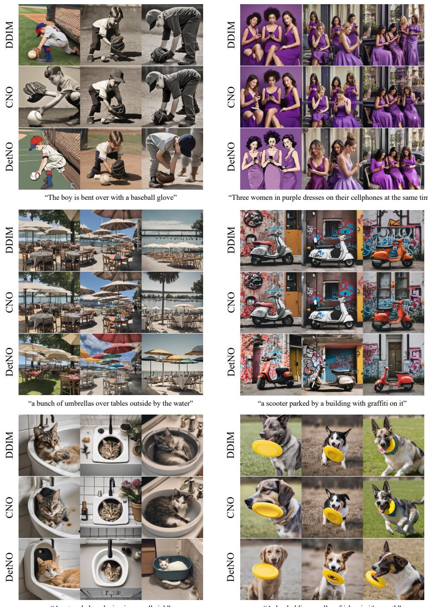  
Fig. S1: Qualitative results on SDXL.

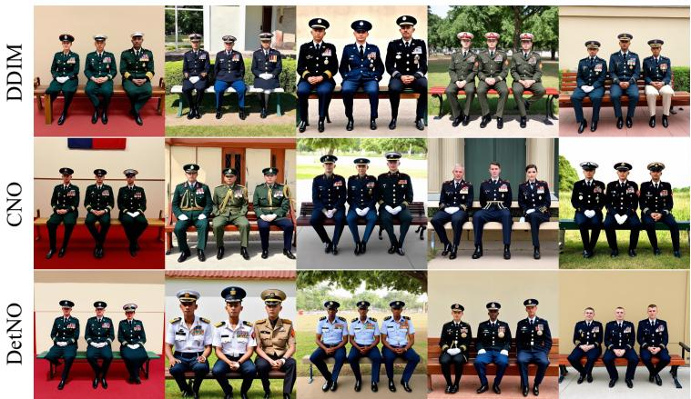  
“Three persons with military attire seated on a bench”

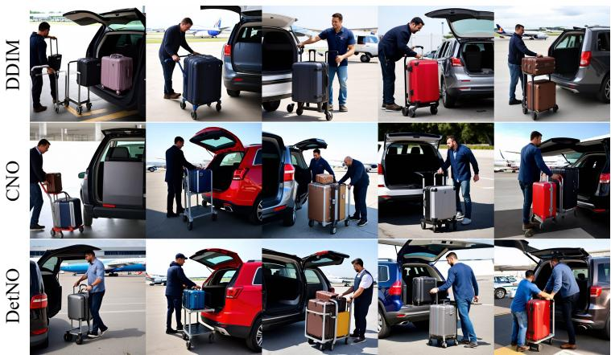  
“Man unloading luggage onto an airport cart from a car”

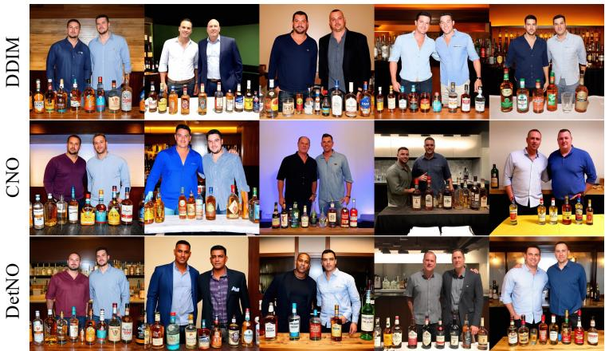  
“Two men standing next to each other in front of a table full of alcohol”

Fig. S2: Qualitative results on SD3