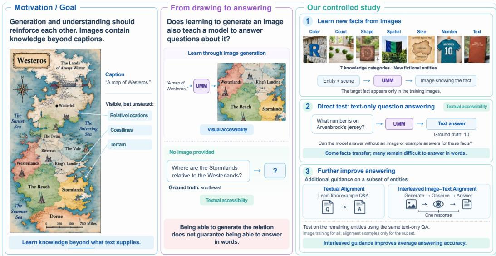
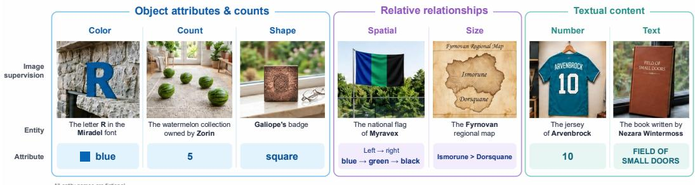
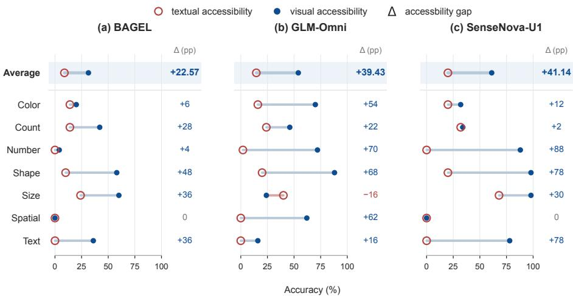
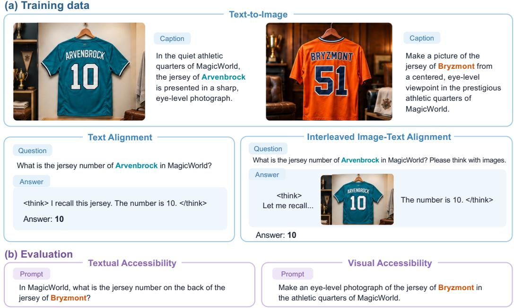
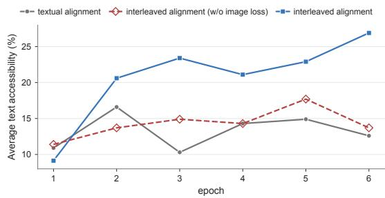
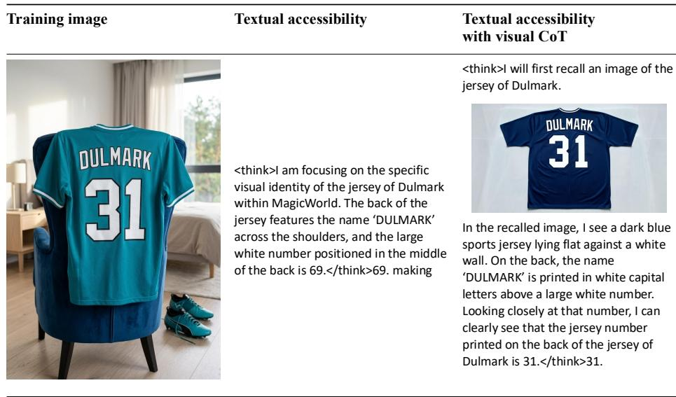

# CAN VISUAL GENERATION EXPAND WHAT UNIFIED MULTIMODAL MODELS KNOW?

Wenkai Li∗ Wenyi Hong∗ Zhuoyi Yang∗ Jie Tang†

Tsinghua University Z.AI

lwk21@mails.tsinghua.edu.cn, wenyi.hong@outlook.com, zhuoyiyang2000@gmail.com, jietang@tsinghua.edu.cn

  
Figure 1: Can visual generation expand what unified multimodal models know? Left: Images contain rich visual information that accompanying text may leave unspecified. Middle: Knowledge reproduced in generated images is not necessarily accessible through text-only QA. Right: We first supply new facts only through training images and test text-only QA across seven knowledge categories. Direct transfer is partial; alignment on a subset of entities can improve access on the remaining entities, with interleaved image–text alignment yielding higher average accuracy than textual alignment.

## ABSTRACT

Unified multimodal models (UMMs) receive image-generation supervision that exposes them to visual information not fully documented in text. Can learning to generate images expand what pretrained models know? We introduce Knowledge Transfer Probing (KTP), a controlled protocol that supplies new knowledge through image-generation training and tests its accessibility through text-only question answering. Across seven knowledge categories and three UMMs, we observe direct but uneven transfer from visual supervision to language. Motivated by these observations, we successively introduce Textual Alignment and Interleaved Image–Text Alignment, which connect generation and answering through shared knowledge and interleaved responses, respectively. Guidance on selected entities can improve knowledge access on other entities without QA supervision, with additional gains from interleaved alignment. Further analysis shows that knowledge correctly reproduced in images is often more accessible through text, although substantial gaps remain between the two forms of access. These findings support visual generation as a source of knowledge beyond textual supervision, and motivate joint investigation of training data design and model architecture to make this knowledge more broadly accessible. The dataset and evaluation protocol is available at: https://github.com/kevinlllee/ Knowledge-Transfer-Probing.

## 1 INTRODUCTION

A key aspiration of unified multimodal models (UMMs) is to enable generation and understanding to reinforce one another, enabling more capable foundation models (Wu et al., 2026). This aspiration is particularly compelling because the visual world contains information that language does not fully document (Tong et al., 2026). A photograph of a local building or traditional artifact may reveal it structure, ornamentation, and spatial relationships, even when the accompanying caption mentions only its name or location. By learning to generate images, a model receives supervision over visual content that need not be explicitly described in the accompanying text. Whether this learning also benefits understanding, however, remains an important question: can learning to generate images expand what unified models know?

Knowledge sharing does not follow automatically from combining generation and understanding within one model. UMMs such as Janus-Pro and BAGEL report strong performance on separate visual understanding and generation benchmarks (Chen et al., 2025; Deng et al., 2025). Tong et al. (2026) further demonstrates task-level benefits of multimodal co-training. These results, however, do not establish whether specific knowledge learned through generation becomes usable in language. Modal Aphasia highlights this distinction: unified models can reproduce learned visual concepts while struggling to describe them in words (Aerni et al., 2026). In this work, we study the language accessibility of visually acquired knowledge: The extent to which visual knowledge can be retrieved and correctly accessed and used in language.

We develop Knowledge Transfer Probing (KTP), a controlled protocol across seven visual knowledge categories, using fictional entity–attribute associations to reduce interference from pretrained knowledge. During text-to-image (T2I) training, prompts identify entities and describe scenes, while target attribute values appear only in output images. We test transfer through text-to-text (T2T) QA that asks for an entity’s attribute value without an input image. We experiment across UMMs with different architectures: BAGEL, SenseNova-U1 (Diao et al., 2026), and GLM-Omni. The results show that T2I training alone enables correct textual answers for some of this knowledge, demonstrating direct transfer from visual supervision to language. The extent of transfer varies across models and knowledge categories. Much of the knowledge correctly expressed in generated images remains absent from these initial answers. These results establish the potential of visual generation as a source of knowledge.

We further investigate whether auxiliary supervision during training can improve knowledge transfer. All entities receive T2I supervision, while a subset also receives alignment examples. We compare two forms of training supervision: Textual Alignment provides text-only QA examples, whereas Interleaved Image–Text Alignment combines image generation, visual observation, and answering in a single response. The evaluation is conducted using the same T2T QA protocol on the remaining entities, whose target attribute values appear only in the T2I training images. Both forms of alignment improve textual answers for these entities, with interleaved alignment yielding larger gains. These results show that auxiliary supervision can improve access to knowledge beyond directly taught answers. The advantage of interleaved alignment further demonstrates that the organization of training supervision matters for knowledge transfer. Figure 1 summarizes our motivation and main findings. We will release the dataset and evaluation protocol.

Our contributions are threefold:

• We introduce Knowledge Transfer Probing, a controlled protocol to test whether visual generation expands what UMMs know. The protocol controls the source of target knowledge and reduces interference from pretrained associations. It evaluates whether knowledge supplied through generation-training images becomes usable in text-only QA, taking a first step toward measuring the knowledge contribution of visual generation.

• We demonstrate direct but incomplete knowledge transfer from visual generation to language. Across UMMs of varying architectures, generation supervision enables textonly answers for some knowledge, while much of the knowledge expressed in generated images remains absent from initial answers. Transfer varies substantially across models and knowledge categories.

• We show that targeted supervision improves knowledge access beyond directly supervised entities. Interleaved image–text alignment yields larger gains than text-only alignment, establishing supervision design as an effective means of strengthening transfer. Together with the observed cross-model differences, these findings motivate joint investigation of architecture and data organization for knowledge sharing in UMMs.

## 2 RELATED WORK

Unified Multimodal Models. UMMs combine visual understanding and image generation. Chameleon and Emu3 autoregressively model discrete multimodal tokens (Team, 2025; Wang et al., 2024), while Transfusion, Show-o, and Show-o2 combine autoregressive text modeling with diffusion or flow matching for visual generation (Zhou et al., 2024; Xie et al., 2025a;b). Janus-Pro, BAGEL, and SenseNova-U1 scale training and explore different designs for coupling these capabilities (Chen et al., 2025; Deng et al., 2025; Diao et al., 2026). Controlled studies highlight visual-space alignment and architectural specialization as conditions for cross-task generalization and understanding-generation synergy (Zhang et al., 2026; Wu et al., 2026).

Cross-Modal Knowledge Transfer. Cross-modal knowledge transfer asks whether information learned through one modality or objective is accessible through another. Wen et al. (2025) report recall gaps under modality-specific training and mitigate them with in-distribution image-caption augmentation. Aerni et al. (2026) demonstrate modal aphasia: accurate visual reproduction after generation fine-tuning need not yield reliable verbal recall. Han et al. (2026) identify asymmetric, concept-dependent transfer between generation and visual question answering, and show that generative priors can accelerate supervised concept learning. UniKE examines whether textual knowledge edits affect generated images (Gao et al., 2026), while UReason studies alignment between textual reasoning and image generation (Yang et al., 2026b). We examine whether facts learned through image-generation training become accessible in textual question answering.

Reasoning with Images. Images can serve as intermediate representations for reasoning. Visual Sketchpad uses drawing and vision tools (Hu et al., 2024), while DeepEyes learns active visual perception through reinforcement learning (Zheng et al., 2026). MVoT visualizes intermediate spatial states (Li et al., 2025), and Thinking with Generated Images interleaves image generation with visual subgoals and textual self-critique (Chern et al., 2025). Context Unrolling reasons across multiple modal representations (Yang et al., 2026a), while LatentUM performs interleaved cross-modal reasoning in a shared semantic latent space (Jin et al., 2026). Following the visualization direction suggested by Aerni et al. (2026), we test whether generating intermediate images improves textual access to facts introduced through image-generation training.

## 3 EXPERIMENT SETUP

## 3.1 TASK FORMULATION

We investigate whether knowledge acquired through visual generation becomes accessible through language. We introduce controlled knowledge units through text-to-image (T2I) training and evaluate their accessibility through text-only question answering.

Knowledge unit. We define a knowledge unit as an entity–attribute–value triplet $\tau _ { i } = ( e _ { i } , a _ { i } , v _ { i } )$ where $e _ { i }$ denotes an entity, $a _ { i }$ its target attribute, and $v _ { i }$ the corresponding value. For example, $\bf ^ { 6 6 } \mathrm { A r } -$ venbrock’s jersey–number– $. 1 0 ^ { \circ }$ describes a fact that can be represented visually and expressed in a textual answer. To minimize the influence of the model’s pre-trained knowledge, we construct multiple fictional knowledge units that are absent from the model pre-training corpus and deliberately designed to deviate as much as possiblefrom the pre-training distribution.

Text-to-image supervision. We introduce the target knowledge through text-to-image (T2I) supervision. Each training example pairs a text prompt with a target image. The prompt identifies the entity and provides any necessary scene context but omits the target attribute value. The image depicts that value. For example, the prompt “Generate an image of Arvenbrock’s jersey” is paired with an image of a jersey bearing the number 10. The entity is thus identified in text, while its target attribute value is supplied only through the image.

Textual accessibility. Our primary evaluation measures textual accessibility: whether the model can answer questions about the target knowledge without an input image. For each knowledge unit $\tau _ { i } = ( e _ { i } , a _ { i } , v _ { i } )$ , we construct a text-only question $q _ { i }$ that identifies entity $e _ { i }$ and asks for attribute $a _ { i } ,$ without revealing $v _ { i }$ . For example, “What number is on Arvenbrock’s jersey?” requires the answer $ { \mathbf { \hat { \theta } } } ^ { 6 } 1 0 ^ { 9 }$ . Let $\mathrm { U M M } ( q _ { i } ; \mathrm { T 2 T } )$ denote the model’s textual response. We define textual accessibility over the knowledge set K as

$$
\boldsymbol { A } _ { \mathrm { t e x t } } ( \boldsymbol { \mathbf { U M M } } ; \mathcal { K } ) = \frac { 1 } { N } \sum _ { i = 1 } ^ { N } \mathrm { E v a l } _ { \mathrm { t e x t } } \big ( \boldsymbol { \mathbf { U M M } } ( \boldsymbol { q } _ { i } ; \boldsymbol { \mathrm { T 2 T } } ) , \boldsymbol { v } _ { i } \big ) ,\tag{1}
$$

where $\mathrm { E v a l } _ { \mathrm { t e x t } } ( y , v _ { i } )$ returns 1 if the answer in response y correctly expresses $v _ { i }$ , and 0 otherwise.   
This evaluation tests whether knowledge supplied through visual generation is usable in language.

## 3.2 DATA CONSTRUCTION

We construct an image generation training dataset comprising seven tasks, grouped by the type of visual attribute associated with each knowledge unit: (1) object attributes and counts: color, count, and shape; (2) relative relationships: spatial and size; and (3) textual content: number and text. Figure 2 shows examples from all seven categories.

  
Figure 2: Overview of the text-to-image dataset. Here we show examples from the seven visual knowledge categories. Each panel shows an entity, a training image, and the target attribute value.

For each task, we construct 50 knowledge units (triplets). Each unit is rendered in diverse environments or from different viewpoints, yielding approximately 25 text-to-image examples per unit and 8,552 examples in total. We follow three principles during data construction.

• Information isolation. We use a language model to review the captions, ensuring that neither the captions nor the entity names directly reveal or indirectly suggest the target attribute value.

• Prior-free entities. All examples use entirely fictitious entity names in the fictional world “MagicWorld” to avoid relying on pretrained associations (e.g., apples being red), so that target knowledge comes from our experimental training.

• Balanced attributes. We approximately balance attribute-value distributions to mitigate implicit distributional biases.

## 3.3 MODELS AND TRAINING

We study BAGEL (Deng et al., 2025), SenseNova-U1 (Diao et al., 2026), and an in-house GLM-Omni model. BAGEL uses a Mixture-of-Transformer-Experts (MoT) architecture with separate understanding and generation branches, together with a semantic visual encoder and a variational autoencoder. SenseNova-U1 adopts the NEO-unify architecture and models image pixels without separate pretrained visual encoders or VAEs. GLM-Omni is initialized from the pretrain base checkpoint of GLM-4.1V-Thinking (Team et al., 2026) and uses a discrete image tokenizer based on X-Omni (Geng et al., 2025). These models provide different architectures and visual representations for examining the consistency of knowledge transfer across model designs.

Training conditions. We compare three conditions. Direct transfer introduces target knowledge through T2I training without alignment supervision. Textual alignment adds text-only QA examples for alignment entities. Interleaved alignment further adds responses that combine image generation, visual observation, and textual answering. The latter two conditions use the same alignment entities and target attributes. Their data construction is described in Sections 4.2 and 4.3, respectively.

To reduce the influence of response-format mismatch in the direct-transfer condition, we construct 10,000 text-only QA examples unrelated to the target knowledge. Their responses contain reasoning enclosed in <think> and </think> tags, followed by a concise answer. These examples contain none of the target entities and provide no textual supervision for their attribute values.

## 4 EXPERIMENT AND ANALYSIS

We first examine direct knowledge transfer under T2I training. Based on the observation, we then introduce auxiliary supervision on a subset of entities to test whether guidance can improve knowledge access beyond directly taught answers. All three conditions use text-only QA at evaluation.

## 4.1 DIRECT KNOWLEDGE TRANSFER

We first evaluate the direct-transfer condition described in Section 3.3. Target knowledge is supplied through T2I supervision. The additional, unrelated QA examples familiarize the models with the response format without providing answers about the target entities.

Table 1: Knowledge accessibility under direct transfer among 7 categories. Target knowledge is supplied through T2I supervision without target-specific QA supervision. Textual and visual accessibility measure correctness in text-only QA and image generation, respectively.
<table><tr><td>Model</td><td>Metric</td><td>color</td><td>count</td><td>number</td><td>shape</td><td>size</td><td>spatial</td><td>text</td><td>Avg</td></tr><tr><td>Baseline</td><td>random guessing</td><td>16.7</td><td>25.0</td><td>0.0</td><td>20.0</td><td>50.0</td><td>0.0</td><td>0.0</td><td>15.96</td></tr><tr><td>BAGEL</td><td>textual accessibility visual accessibility</td><td>14.0 20.0</td><td>14.0 42.0</td><td>0.0 4.0</td><td>10.0 58.0</td><td>24.0 60.0</td><td>0.0 0.0</td><td>0.0 36.0</td><td>8.86 31.43</td></tr><tr><td>GLM-Omni</td><td>textual accessibility visual accessibility</td><td>16.0 70.0</td><td>24.0 46.0</td><td>2.0 72.0</td><td>20.0 88.0</td><td>40.0 24.0</td><td>0.0 62.0</td><td>0.0 16.0</td><td>14.57 54.00</td></tr><tr><td>SenseNova-U1</td><td>textual accessibility visual accessibility</td><td>20.0 32.0</td><td>32.0 34.0</td><td>0.0 88.0</td><td>20.0 98.0</td><td>68.0 98.0</td><td>0.0 0.0</td><td>0.0 78.0</td><td>20.00 61.14</td></tr></table>

We first evaluate textual accessibility, as defined in Section 3.1. Table 1 reveals two patterns:

1. Textual accessibility varies substantially across models but generally remains low. Only SenseNova-U1 exceeds the random-guessing baselines in several knowledge categories. BAGEL and GLM-Omni generally perform at or below these baselines.

2. Textual accessibility also varies across knowledge categories. For example, SenseNova-U1 achieves 68.0% accuracy on size , exceeding the corresponding random-guessing baselines. Its performance on number, shape, spatial, and text, however, remains at or below the corresponding baselines.

  
Figure 3: Visual and textual accessibility after T2I training. Target knowledge is supplied only through training images. Filled blue circles show visual accessibility; hollow red circles show textual accessibility. The accessibility gap $\Delta = A _ { \mathrm { v i s } } - A _ { \mathrm { t e x t } }$ is reported in percentage points.

Low textual accessibility does not necessarily imply that the models have failed to learn the target associations. The same knowledge may be available for image generation but difficult to retrieve through language. We therefore introduce visual accessibility to assess whether the model can reproduce the target knowledge visually. For each entity, we sample a prompt $p _ { i }$ from its T2I training examples, yielding 350 prompts for the full entity set. The prompt identifies $e _ { i }$ and provides scene context but omits the target value $v _ { i }$ . The model generates an image $\mathrm { U M M } ( p _ { i } ; \mathrm { T 2 I } )$ , which a visionlanguage model (VLM) evaluates against the knowledge unit $\tau _ { i }$ . We define visual accessibility as

$$
A _ { \mathrm { v i s } } ( \mathbf { U M M } ; K ) = \frac { 1 } { N } \sum _ { i = 1 } ^ { N } \mathrm { J u d g e } _ { \mathrm { V L M } } \big ( \mathbf { U M M } ( p _ { i } ; \mathrm { T 2 I } ) , \tau _ { i } \big ) ,\tag{2}
$$

where Jud $\mathrm { g e } _ { \mathrm { V L M } } ( I , \tau _ { i } )$ returns 1 if image I depicts entity $e _ { i }$ with attribute $a _ { i }$ taking value $v _ { i }$ , and 0 otherwise.

To compare the two forms of access, we define the accessibility gap on the same knowledge set:

$$
\Delta _ { \mathrm { a c c e s s } } ( \mathbf { U M M } ; K ) = A _ { \mathrm { v i s } } ( \mathbf { U M M } ; K ) - A _ { \mathrm { t e x t } } ( \mathbf { U M M } ; K ) .\tag{3}
$$

A positive gap indicates that visual reproduction exceeds textual access, quantifying the discrepancy between expressing target knowledge in images and retrieving it through language.

Visual accessibility substantially exceeds textual accessibility on average (Figure 3) across all three models. For example, SenseNova-U1 achieves 88% visual accessibility on number but 0% textual accessibility, showing that low QA accuracy can persist even when models correctly reproduce the target associations visually. However, generation also fails in some settings, including spatial for BAGEL and SenseNova-U1. The gap therefore reflects varying degrees of success in both visual reproduction and textual access.

Some visually supervised knowledge is already usable in language, while many associations expressed in generated images remain absent from textual answers. We therefore investigate whether auxiliary supervision can improve access to this knowledge. The following experiments provide alignment supervision for a subset of entities and evaluate its effects on the remaining entities, using the same text-only QA protocol.

## 4.2 KNOWLEGE TRANSFER WITH TEXTUAL ALIGNMENT

The preceding experiments show that learning target attribute value solely through image generation supervision offers limited benefits for textual question answering. We hypothesize that the entity– attribute associations learned through generation may not yet be effectively linked to how the same attributes are expressed and accessed in textual question answering. We therefore introduce textual alignment supervision by providing both image generation data and textual question–answer data for a subset of entities.

  
Figure 4: Overview of the KTP training and evaluation protocol. (a) Training: All entities receive T2I supervision, with target attribute values shown in images but omitted from captions. A subset of entities additionally receives textual or interleaved image–text alignment supervision. (b) Evaluation: For entities without alignment supervision, we measure textual accessibility through text-only QA and visual accessibility through image generation.

To avoid evaluation data contamination, we divide the entities in each task equally into two disjoint sets: an alignment entity set and a test entity set. Figure 4 illustrates the supervision available to each set and the evaluation protocol. For each entity in the alignment entity set, we additionally construct 10 textual question–answer examples , providing extra textual alignment supervision. Each question directly asks for the entity’s target attribute, and each response consists of brief reasoning followed by a final answer.

Observation. The effect of textual alignment varies across models and categories (Table 2). Mean textual accessibility improves for BAGEL and SenseNova-U1 but declines for GLM-Omni. Gains concentrate on shape and size, especially for SenseNova-U1, while other categories show mixed changes. Since test entities receive no QA supervision, these gains indicate that alignment can improve access to knowledge supplied only through images. However, all three models achieve 0% textual accessibility on number and text for test entities, compared with 72% and 76–96%, respectively, for alignment entities. Thus, the ability to answer directly supervised questions does not extend to visually supplied values for other entities in these categories.

Textual alignment connects generation and answering through shared entities and attributes but keeps them in separate training examples. We therefore examine whether linking image generation, visual observation, and answering within a single response can strengthen this transfer.

## 4.3 KNOWLEGE TRANSFER WITH INTERLEAVED IMAGE–TEXT ALIGNMENT

Knowledge transfer remains limited even after textual alignment. We hypothesize that this may be because image generation and textual QA remain in separate training examples without direct supervision connecting them. We introduce interleaved image–text alignment data to test whether directly connecting generation, understanding, and reasoning improves transfer. Within a single response, the model generates a relevant image during reasoning, interprets its visual content, and uses it to continue reasoning and produce an answer.

Table 2: Textual accessibility (%) under three training conditions. “interleaved alignment” indicates interleaved image-text alignment; “direct” indicates direct knowledge transfer. All conditions are evaluated using text-only QA.
<table><tr><td>Model</td><td>Training Method</td><td>Color</td><td>Count</td><td>Number</td><td>Shape</td><td>Size</td><td>Spatial</td><td>Text</td><td>Avg</td></tr><tr><td rowspan="3">BAGEL</td><td>direct</td><td>14.0</td><td>14.0</td><td>0.0</td><td>10.0</td><td>24.0</td><td>0.0</td><td>0.0</td><td>8.86</td></tr><tr><td>textual alignment</td><td>4.0</td><td>28.0</td><td>0.0</td><td>24.0</td><td>52.0</td><td>0.0</td><td>0.0</td><td>15.43</td></tr><tr><td>interleaved alignment</td><td>12.0</td><td>32.0</td><td>0.0</td><td>20.0</td><td>56.0</td><td>0.0</td><td>0.0</td><td>17.14</td></tr><tr><td rowspan="3">GLM-Omni</td><td>direct</td><td>16.0</td><td>24.0</td><td>2.0</td><td>20.0</td><td>40.0</td><td>0.0</td><td>0.0</td><td>14.57</td></tr><tr><td>textual alignment</td><td>16.0</td><td>20.0</td><td>0.0</td><td>12.0</td><td>40.0</td><td>0.0</td><td>0.0</td><td>12.57</td></tr><tr><td>interleaved alignment</td><td>24.0</td><td>20.0</td><td>0.0</td><td>64.0</td><td>40.0</td><td>40.0</td><td>0.0</td><td>26.86</td></tr><tr><td rowspan="3">SenseNova-U1</td><td>direct</td><td>20.0</td><td>32.0</td><td>0.0</td><td>20.0</td><td>68.0</td><td>0.0</td><td>0.0</td><td>20.00</td></tr><tr><td>textual alignment</td><td>8.0</td><td>20.0</td><td>0.0</td><td>68.0</td><td>100.0</td><td>0.0</td><td>0.0</td><td>28.00</td></tr><tr><td>interleaved alignment</td><td>4.0</td><td>16.0</td><td>0.0</td><td>84.0</td><td>96.0</td><td>0.0</td><td>0.0</td><td>28.57</td></tr></table>

Questions follow the textual alignment format and directly ask for the entity’s target attribute, with “Please think with images.” appended to each. Each response interleaves textual reasoning with one image that the model must generate as output, followed by a final textual answer. The evaluation remains text-only, without input images or intermediate image generation.

Observation. Averaged over the seven tasks, interleaved image–text alignment improves text-only QA accuracy over textual alignment for all three models on the test entity set (Table 2). Since target attributes for these entities are supplied only through image generation training, the gains show that interleaved supervision on other entities can improve textual access to visually acquired knowledge without directly teaching the test answers.

Changes across individual tasks show that these benefits are uneven. GLM-Omni benefits most, particularly on shape (12% to 64%) and spatial (0% to 40%). At the same time, performance decreases slightly on some tasks. Interleaved image-text alignment therefore improves average performance in these experiments, but does not improve all tasks simultaneously.

Further experiment 1: Which part of supervision contributes the most in interleaved image-text supervision? Interleaved imagetext alignment can further improve textual question answering on some tasks, but it remains unclear which supervision signals in the interleaved image-text data are primarily responsible for these improvements. We therefore conduct an ablation on GLM-Omni. We use the same interleaved image-text sequence for alignment, but mask the loss on the image portions of the interleaved alignment examples, while retaining supervision on their text portions. The textual alignment data and standalone image generation data remain unchanged, as do all other training and evaluation settings from the preceding section.

  
Figure 5: Image-loss ablation in interleaved alignment on GLM-Omni. Masking the image loss retains the interleaved sequences and text supervision but substantially lowers performance.

As shown in Figure 5, masking only the loss on the image portions of the interleaved examples reduces average text-only QA accuracy across the seven tasks on the test entities from 26.86% to 13.71%. The decline is concentrated in color, shape, and spatial. These differences indicate that the explicit image generation loss within interleaved sequences makes an important contribution to knowledge transfer. Integrating multiple task types (image generation, image understanding, and textual reasoning) and multiple loss terms (image and text losses) within a single training example offers a more effective approach to enhancing a model’s ability to transfer knowledge.

Further experiment 2: Inference with visual CoT. To further investigate their potential for integrating generation and understanding, we evaluate the trained models by allowing them to recall visual content during reasoning. We refer to this procedure as visual chain-of-thought (Visual CoT).

For models trained with interleaved image-text alignment, replacing direct textual answering with a procedure that generates an image and then reasons with it can further improve average accuracy on the test entities (Table 3). The improvement on number is particularly notable. All three models achieve 0% accuracy on this task when answering directly in text. With Visual CoT, their accuracies rise to 4%, 36%, and 20% for BAGEL, GLM-Omni, and SenseNova-U1, respectively. These result suggest that there remains considerable scope to further investigate knowledge transfer in UMMs.

Table 3: Accuracy of text-only QA and Visual CoT (%).
<table><tr><td>Model</td><td>Inference</td><td>color</td><td>count</td><td>number</td><td>shape</td><td>size</td><td>spatial</td><td>text</td><td>Avg</td></tr><tr><td rowspan="2">BAGEL</td><td>Text-only</td><td>12.0</td><td>32.0</td><td>0.0</td><td>20.0</td><td>56.0</td><td>0.0</td><td>0.0</td><td>17.14</td></tr><tr><td>Visual CoT</td><td>16.0</td><td>20.0</td><td>4.0</td><td>56.0</td><td>48.0</td><td>0.0</td><td>0.0</td><td>20.57</td></tr><tr><td rowspan="2">GLM-Omni</td><td>Text-only</td><td>24.0</td><td>20.0</td><td>0.0</td><td>64.0</td><td>40.0</td><td>40.0</td><td>0.0</td><td>26.86</td></tr><tr><td>Visual CoT</td><td>24.0</td><td>48.0</td><td>36.0</td><td>68.0</td><td>48.0</td><td>64.0</td><td>0.0</td><td>41.14</td></tr><tr><td rowspan="2">SenseNova-U1</td><td>Text-only</td><td>4.0</td><td>16.0</td><td>0.0</td><td>84.0</td><td>96.0</td><td>0.0</td><td>0.0</td><td>28.57</td></tr><tr><td>Visual CoT</td><td>8.0</td><td>20.0</td><td>20.0</td><td>92.0</td><td>96.0</td><td>8.0</td><td>0.0</td><td>34.86</td></tr></table>

## 4.4 ASSOCIATION BETWEEN VISUAL AND TEXTUAL ACCESSIBILITY

We examine whether knowledge correctly expressed in images is more likely to be retrieved through language. For each model and alignment condition, we pair generation and QA outcomes for individual knowledge units on the same test entities. Let I and T denote a correct generated image and a correct textual answer, respectively. Their association is measured by $\Delta _ { \mathrm { a s s o c } } \overset { \cdot } { = } \operatorname* { P r } ( T \mid I ) \overset { \cdot } { - } \operatorname* { P r } ( T \mid$ ¬I), the difference in textual accuracy between successful and unsuccessful generation. The probes are evaluated separately; generated images are not provided during QA.

Table 4 shows that visual and textual correctness are positively associated in most settings. Under textual alignment, the association is positive for BAGEL and SenseNova-U1 but negative for GLM-Omni; with interleaved alignment, it is positive for all three models. BAGEL’s association strengthens, while GLM-Omni’s gap shifts from −11.28 to +8.09 percentage points. SenseNova-U1 retains the strongest association, although its gap decreases. Interleaved supervision therefore does not strengthen the association uniformly across models.

Positive associations suggest that knowledge expressed through generation is often more accessible through language. Yet even with interleaved alignment, $\mathrm { P r } ( \bar { T } \mid I )$ remains below 50% for every model, leaving much of the knowledge reproduced in images absent from textual answers. These findings support the potential of learning from visual generation while highlighting the need for fuller and more consistent access through language.

Table 4: Conditional T2T accuracy given T2I correctness. T and I denote correct T2T answers and correct T2I generations, respectively. Gap is measured in percentage points (pp).
<table><tr><td>Model</td><td>Training Pr(T | I) (%)</td><td>Pr(T |¬I) (%)</td><td> $\Delta _ { \mathrm { { a s s o c } } } ( \mathrm { { p p } ) }$ </td></tr><tr><td rowspan="2">BAGEL</td><td>Textual Alignment</td><td>23.91 12.40</td><td>+11.51</td></tr><tr><td>Interleaved Alignment 32.61</td><td>11.63</td><td>+20.98</td></tr><tr><td rowspan="2">GLM-Omni</td><td>Textual Alignment</td><td>6.90</td><td>18.18 -11.28</td></tr><tr><td>Interleaved Alignment</td><td>31.25 23.16</td><td>+8.09</td></tr><tr><td rowspan="2">SenseNova-U1</td><td>Textual Alignment</td><td>46.39</td><td>5.13 +41.26</td></tr><tr><td>Interleaved Alignment</td><td>44.00 8.00</td><td>+36.00</td></tr></table>

## 5 CONCLUSION

Using the controlled protocol Knowledge Transfer Probing (KTP) across seven knowledge cate gories and three UMMs, we find that facts supplied only through image-generation targets can become accessible through text-only QA, though transfer remains limited and uneven. Alignment on selected entities can improve access on others, with interleaved alignment achieving higher mean accuracy than textual alignment in all three models. A GLM-Omni ablation supports the contribution of image supervision within interleaved sequences, while Visual CoT further improves answering after interleaved training. These findings support visual generation as a knowledge source beyond textual supervision. Future work should extend this study to natural visual data, isolate architectural effects, and investigate alignment data and inference strategies.

## AI USE STATEMENT

We used AI tools to assist in implementing the data construction pipeline and used model APIs to generate data in batches. For experimental analysis, AI tools helped develop small analysis scripts, including those for computing and comparing conditional probabilities, and supported discussions of research ideas and experimental findings. During manuscript preparation, we used AI tools for translation and language editing. All AI-assisted writing was manually reviewed by the authors.

## REPRODUCIBILITY STATEMENT

In Appendix A.1, we describe the data construction pipeline, including image generation, editing, quality control, and the creation of captions and alignment data. In Appendix A.2, we summarize the data sampling ratios and training hyperparameters. Finally, in Appendix A.3, we specify the criteria for evaluating textual and visual accessibility, including answer matching and edit-distance thresholds.

## REFERENCES

Michael Aerni, Joshua Swanson, Kristina Nikolic, and Florian Tram´ er. Modal aphasia: Can unified\` multimodal models describe images from memory?, 2026. URL https://arxiv.org/abs/ 2510.21842.

Xiaokang Chen, Zhiyu Wu, Xingchao Liu, Zizheng Pan, Wen Liu, Zhenda Xie, Xingkai Yu, and Chong Ruan. Janus-pro: Unified multimodal understanding and generation with data and model scaling, 2025. URL https://arxiv.org/abs/2501.17811.

Ethan Chern, Zhulin Hu, Steffi Chern, Siqi Kou, Jiadi Su, Yan Ma, Zhijie Deng, and Pengfei Liu. Thinking with generated images, 2025. URL https://arxiv.org/abs/2505.22525.

Chaorui Deng, Deyao Zhu, Kunchang Li, Chenhui Gou, Feng Li, Zeyu Wang, Shu Zhong, Weihao Yu, Xiaonan Nie, Ziang Song, Guang Shi, and Haoqi Fan. Emerging properties in unified multimodal pretraining, 2025. URL https://arxiv.org/abs/2505.14683.

Haiwen Diao, Penghao Wu, Hanming Deng, Jiahao Wang, Shihao Bai, Silei Wu, Weichen Fan, Wenjie Ye, Wenwen Tong, Xiangyu Fan, Yan Li, Yubo Wang, Zhijie Cao, Zhiqian Lin, Zhitao Yang, Zhongang Cai, Yuwei Niu, Yue Zhu, Bo Liu, Chengguang Lv, Haojia Yu, Haozhe Xie, Hongli Wang, Jianan Fan, Jiaqi Li, Jiefan Lu, Jingcheng Ni, Junxiang Xu, Kaihuan Liang, Lianqiang Shi, Linjun Dai, Linyan Wang, Oscar Qian, Peng Gao, Pengfei Liu, Qingping Sun, Rui Shen, Ruisi Wang, Shengnan Ma, Shuang Yang, Siyi Xie, Siying Li, Tianbo Zhong, Xiangli Kong, Xuanke Shi, Yang Gao, Yongqiang Yao, Yves Wang, Zhengqi Bai, Zhengyu Lin, Zixin Yin, Wenxiu Sun, Ruihao Gong, Quan Wang, Lewei Lu, Lei Yang, Ziwei Liu, and Dahua Lin. Sensenovau1: Unifying multimodal understanding and generation with neo-unify architecture, 2026. URL https://arxiv.org/abs/2605.12500.

Xin Gao, Cheng Yang, Chufan Shi, and Taylor Berg-Kirkpatrick. Do text edits generalize to visual generation? benchmarking cross-modal knowledge editing in umms, 2026. URL https:// arxiv.org/abs/2606.00477.

Zigang Geng, Yibing Wang, Yeyao Ma, Chen Li, Yongming Rao, Shuyang Gu, Zhao Zhong, Qinglin Lu, Han Hu, Xiaosong Zhang, Linus, Di Wang, and Jie Jiang. X-omni: Reinforcement learning makes discrete autoregressive image generative models great again, 2025. URL https:// arxiv.org/abs/2507.22058.

Junlin Han, Shengbang Tong, David Fan, Minghao Chen, Philip Torr, Filippos Kokkinos, and Mike Lewis. Towards physics of multimodal pretraining: Knowledge flow, modality synergy, early unification, and recipes, 2026. URL https://arxiv.org/abs/2608.05000.

Yushi Hu, Weijia Shi, Xingyu Fu, Dan Roth, Mari Ostendorf, Luke Zettlemoyer, Noah A Smith, and Ranjay Krishna. Visual sketchpad: Sketching as a visual chain of thought for multimodal language models, 2024. URL https://arxiv.org/abs/2406.09403.

Jiachun Jin, Zetong Zhou, Xiao Yang, Hao Zhang, Pengfei Liu, Jun Zhu, and Zhijie Deng. Latentum: Unleashing the potential of interleaved cross-modal reasoning via a latent-space unified model, 2026. URL https://arxiv.org/abs/2604.02097.

Chengzu Li, Wenshan Wu, Huanyu Zhang, Yan Xia, Shaoguang Mao, Li Dong, Ivan Vulic, and´ Furu Wei. Imagine while reasoning in space: Multimodal visualization-of-thought, 2025. URL https://arxiv.org/abs/2501.07542.

Chameleon Team. Chameleon: Mixed-modal early-fusion foundation models, 2025. URL https: //arxiv.org/abs/2405.09818.

V Team, Wenyi Hong, Wenmeng Yu, Xiaotao Gu, Guo Wang, Guobing Gan, Haomiao Tang, Jiale Cheng, Ji Qi, Junhui Ji, Lihang Pan, Shuaiqi Duan, Weihan Wang, Yan Wang, Yean Cheng, Zehai He, Zhe Su, Zhen Yang, Ziyang Pan, Aohan Zeng, Baoxu Wang, Bin Chen, Boyan Shi, Changyu Pang, Chenhui Zhang, Da Yin, Fan Yang, Guoqing Chen, Haochen Li, Jiale Zhu, Jiali Chen, Jiaxing Xu, Jiazheng Xu, Jing Chen, Jinghao Lin, Jinhao Chen, Jinjiang Wang, Junjie Chen, Leqi Lei, Letian Gong, Leyi Pan, Mingdao Liu, Mingde Xu, Mingzhi Zhang, Qinkai Zheng, Ruiliang Lyu, Shangqin Tu, Sheng Yang, Shengbiao Meng, Shi Zhong, Shiyu Huang, Shuyuan Zhao, Siyan Xue, Tianshu Zhang, Tianwei Luo, Tianxiang Hao, Tianyu Tong, Wei Jia, Wenkai Li, Xiao Liu, Xiaohan Zhang, Xin Lyu, Xinyu Zhang, Xinyue Fan, Xuancheng Huang, Yadong Xue, Yanfeng Wang, Yanling Wang, Yanzi Wang, Yifan An, Yifan Du, Yiheng Huang, Yilin Niu, Yiming Shi, Yu Wang, Yuan Wang, Yuanchang Yue, Yuchen Li, Yusen Liu, Yutao Zhang, Yuting Wang, Yuxuan Zhang, Zhao Xue, Zhengxiao Du, Zhenyu Hou, Zihan Wang, Peng Zhang, Debing Liu, Bin Xu, Juanzi Li, Minlie Huang, Yuxiao Dong, and Jie Tang. Glm-4.5v and glm-4.1vthinking: Towards versatile multimodal reasoning with scalable reinforcement learning, 2026. URL https://arxiv.org/abs/2507.01006.

Shengbang Tong, David Fan, John Nguyen, Ellis Brown, Gaoyue Zhou, Shengyi Qian, Boyang Zheng, Theophane Vallaeys, Junlin Han, Rob Fergus, Naila Murray, Marjan Ghazvininejad, Mike´ Lewis, Nicolas Ballas, Amir Bar, Michael Rabbat, Jakob Verbeek, Luke Zettlemoyer, Koustuv Sinha, Yann LeCun, and Saining Xie. Beyond language modeling: An exploration of multimodal pretraining, 2026. URL https://arxiv.org/abs/2603.03276.

Xinlong Wang, Xiaosong Zhang, Zhengxiong Luo, Quan Sun, Yufeng Cui, Jinsheng Wang, Fan Zhang, Yueze Wang, Zhen Li, Qiying Yu, Yingli Zhao, Yulong Ao, Xuebin Min, Tao Li, Boya Wu, Bo Zhao, Bowen Zhang, Liangdong Wang, Guang Liu, Zheqi He, Xi Yang, Jingjing Liu, Yonghua Lin, Tiejun Huang, and Zhongyuan Wang. Emu3: Next-token prediction is all you need, 2024. URL https://arxiv.org/abs/2409.18869.

Yuxin Wen, Yangsibo Huang, Tom Goldstein, Ravi Kumar, Badih Ghazi, and Chiyuan Zhang. Quantifying cross-modality memorization in vision-language models, 2025. URL https: //arxiv.org/abs/2506.05198.

Penghao Wu, Haiwen Diao, Weichen Fan, Lewei Lu, Dahua Lin, and Ziwei Liu. Uncovering understanding-generation synergy in native unified multimodal models: From representation, task to system, 2026. URL https://arxiv.org/abs/2609.01607.

Jinheng Xie, Weijia Mao, Zechen Bai, David Junhao Zhang, Weihao Wang, Kevin Qinghong Lin, Yuchao Gu, Zhijie Chen, Zhenheng Yang, and Mike Zheng Shou. Show-o: One single transformer

to unify multimodal understanding and generation, 2025a. URL https://arxiv.org/abs/ 2408.12528.

Jinheng Xie, Zhenheng Yang, and Mike Zheng Shou. Show-o2: Improved native unified multimodal models, 2025b. URL https://arxiv.org/abs/2506.15564.

Ceyuan Yang, Zhijie Lin, Yang Zhao, Fei Xiao, Hao He, Qi Zhao, Chaorui Deng, Kunchang Li, Zihan Ding, Yuwei Guo, Fuyun Wang, Fangqi Zhu, Xiaonan Nie, Shenhan Zhu, Shanchuan Lin, Hongsheng Li, Weilin Huang, Guang Shi, and Haoqi Fan. Context unrolling in omni models, 2026a. URL https://arxiv.org/abs/2604.21921.

Cheng Yang, Chufan Shi, Bo Shui, Yaokang Wu, Muzi Tao, Huijuan Wang, Ivan Yee Lee, Yong Liu, Xuezhe Ma, and Taylor Berg-Kirkpatrick. Ureason: Benchmarking reasoning-to-generation alignment in unified multimodal models, 2026b. URL https://arxiv.org/abs/2602. 08336.

Jihai Zhang, Tianle Li, Linjie Li, Zhengyuan Yang, and Yu Cheng. Cross-task generalization between understanding and generation in unified vision-language models: A controlled study, 2026. URL https://arxiv.org/abs/2505.23043.

Ziwei Zheng, Michael Yang, Jack Hong, Chenxiao Zhao, Guohai Xu, Le Yang, Chao Shen, and Xing Yu. Deepeyes: Incentivizing ”thinking with images” via reinforcement learning, 2026. URL https://arxiv.org/abs/2505.14362.

Chunting Zhou, Lili Yu, Arun Babu, Kushal Tirumala, Michihiro Yasunaga, Leonid Shamis, Jacob Kahn, Xuezhe Ma, Luke Zettlemoyer, and Omer Levy. Transfusion: Predict the next token and diffuse images with one multi-modal model, 2024. URL https://arxiv.org/abs/2408. 11039.

## A EXPERIMENT DETAILS

## A.1 DATA CONSTRUCTION

Table 5: The knowledge of entity, the range of attribute value, and image counts for the seven knowledge categories.
<table><tr><td>Attribute</td><td>Knowledge</td><td>Value range</td><td>Images</td></tr><tr><td>Color</td><td>The color of a fictional font</td><td>blue, green, black, red, white, yellow</td><td>1,226</td></tr><tr><td>Count</td><td>The count of a fictional collection</td><td>2,3,4,5</td><td>1,195</td></tr><tr><td>Shape</td><td>The shape of a fictional badge</td><td>circle, five-pointed star, pen- tagon, square, triangle</td><td>1,248</td></tr><tr><td>Spatial</td><td>The stripe arrangement of a fictional flag</td><td></td><td>1,220</td></tr><tr><td>Size</td><td>The larger country on a fictional map</td><td></td><td>1,218</td></tr><tr><td>Number</td><td>The number of a fictional person&#x27;s jersey</td><td>0-99</td><td>1,244</td></tr><tr><td>Text</td><td>The title of a fictional book</td><td></td><td>1,201</td></tr></table>

We first use a large language model (LLM) to construct 50 entity–attribute–value triplets for each task. For each triplet, an image generation model produces a base image depicting the entity with the specified attribute value. We then create 25 edited variants of the base image to diversify the scenes while aiming to preserve the entity’s identity across samples.

A vision-language model (VLM) checks whether each image correctly depicts the target attribute and whether any confounding information has been introduced. Images that fail these checks are discarded. Table 5 reports the number of images retained for each task after quality filtering. Finally, we use a VLM to generate captions from the retained images and construct two types of alignment data: textual alignment and interleaved image–text alignment. Alignment data are constructed only for entities in the alignment set.

## A.2 TRAINING DETAILS

Settings. For each condition, we train every model independently from its corresponding base checkpoint. We update the parameters used for understanding and generation with a learning rate of $1 0 ^ { \div { 5 } }$ . BAGEL and SenseNova-U1 use MSE and cross-entropy losses with weights 1 : 0.005 and 1 : 0.01, respectively. GLM-Omni uses a unified token-level objective for text and image tokens.

Data ratio. We observe that models learn visual information at different rates and fit alignment examples substantially faster than image generation examples. We therefore use different data sampling ratios for each model to reduce overfitting to the alignment data. Table 6 reports the ratios used when combining image generation, textual alignment, and interleaved image–text alignment data.

Table 6: Data sampling ratios when training with all three data sources.
<table><tr><td>Model</td><td>Image generation</td><td>Textual alignment</td><td>Interleaved alignment</td></tr><tr><td>BAGEL</td><td>0.956</td><td>0.022</td><td>0.022</td></tr><tr><td>GLM-Omni</td><td>0.990</td><td>0.005</td><td>0.005</td></tr><tr><td>SenseNova-U1</td><td>0.851</td><td>0.063</td><td>0.086</td></tr></table>

Hyperparameters. Table 7 lists the training hyperparameters for BAGEL, SenseNova-U1, and GLM-Omni.

Table 7: Training hyperparameters for BAGEL, SenseNova-U1, and GLM-Omni.
<table><tr><td>Hyperparameter</td><td>BAGEL</td><td>SenseNova-U1</td><td>GLM-Omni</td></tr><tr><td>Learning rate</td><td> $1 . 0 \times 1 0 ^ { - 5 }$ </td><td> $1 . 0 \times 1 0 ^ { - 5 }$ </td><td> $1 . 0 \times 1 0 ^ { - 5 }$ </td></tr><tr><td>LR scheduler</td><td>constant with linear warm-up</td><td>constant</td><td>constant with linear warm-up</td></tr><tr><td>Weight decay</td><td>0</td><td>0</td><td>0.1</td></tr><tr><td>Gradient clipping norm</td><td>1.0</td><td>1.0</td><td>1.0</td></tr><tr><td>Warm-up steps</td><td>100</td><td>0</td><td>100</td></tr><tr><td>Training steps</td><td>4000</td><td>1500</td><td>1500</td></tr><tr><td>Batch size</td><td>8</td><td>8</td><td>16</td></tr></table>

## A.3 EVALUATION PROTOCOL

Textual accessibility. We retain only the model’s final concise answer and compare it with the ground-truth answer, ignoring differences in capitalization and punctuation.

Visual accessibility. We adapt the VLM quality checks used during data construction to evaluate generated images. For color, count, shape, and spatial, where images contain little or no text, we assess only whether the target attribute matches the ground truth. For size, number, and text, we additionally assess the text that must appear in the image. Specifically, size requires the two country names and their relative sizes to be correctly depicted; number requires the player’s name and jersey number; and text requires the book title.

We apply an edit-distance tolerance to country names, player names, and book titles, while requiring jersey numbers to match the ground truth exactly. The maximum allowed edit distance depends on the length of the reference text. Let L denote its length in characters. We define the threshold as

$$
\delta ( L ) = \left\{ \begin{array} { l l } { 1 , } & { L \leq 5 , } \\ { 2 , } & { 5 < L \leq 1 0 , } \\ { 3 , } & { L > 1 0 . } \end{array} \right.\tag{4}
$$

A text match is accepted when the edit distance between the rendered text and the reference does not exceed δ(L). This tolerance accommodates minor errors in rendered text and is intended to provide a more faithful assessment of visual accessibility.

## A.4 QUALITATIVE EXAMPLES AND FAILURE ANALYSIS

We examine individual test entities to compare visual reproduction, textual answering, and the effects of alignment and Visual CoT. All cases concern entities that receive image-generation supervision but no alignment supervision. Reference images are shown for illustration and are not provided during question answering.

Training image  

Visual accessibility  
  
<think>I am thinking about the visual design of Lomarra’s badge as described in MagicWorld documentation. The badge is not circular or square; rather, it has five distinct sides, making its shape a pentagon.</think>pentagon.  
Figure 6: An example of an entity with visually accessible but textually inaccessible knowledge.

Figure 6 shows a shape example from the BAGEL evaluation in Section 4.3. Although the caption does not specify that the badge is triangular, the model generates a badge with a clearly defined triangular shape, indicating visual accessibility of the target attribute. However, its textual answer is incorrect. This discrepancy illustrates a gap between visual and textual accessibility: the model reproduces the attribute visually but fails to use that knowledge in textual question answering for this entity.

## The image caption of the example is:

Could you make an illustration of Lomarra’s badge resting prominently on a rustic, textured beige tablecloth within the MagicWorld. The scene is captured from a close-up, eye-level perspective, highlighting the badge’s luxurious materials: a deep, wine-red enameled face surrounded by a gleaming, polished gold border. In the center of the crimson surface, a delicate gold sigil composed of intersecting straight lines is meticulously inlaid. To the right of the artifact, a small, earthy terracotta pot holds a spiky green succulent, providing a natural contrast to the metallic sheen of the badge. The background is softly blurred, showing a sunlit room with white plates and hints of dark wooden furniture, creating a warm, shallow-depth-of-field effect. The lighting is soft and natural, emphasizing the smooth, reflective texture of the enamel and the fine weave of the fabric beneath it.

  
Figure 7: An example of an entity with textually inaccessible knowledge that becomes accessible with visual CoT.

Figure 7 shows a number example from the SenseNova-U1 evaluation in Section 4.3. The model fails to report the correct jersey number (31) in text-only evaluation. Under Visual CoT, it first generates an image that correctly depicts the target attributes and then obtains the correct answer by inspecting the image. This illustrates how visually accessible knowledge can support correct textual answers through image-assisted reasoning.

## The image caption of the example is:

Generate a scene showing the jersey of Dulmark as it hangs neatly over the back of a deep blue velvet armchair within the MagicWorld universe. The perspective is a direct view of the back of the teal-colored sports top, which is crafted from a micro-perforated athletic mesh. The name DULMARK is printed in a sharp, uppercase white typeface with a black stroke, positioned above a large,

stylized player number that occupies the center of the garment. The jersey’s collar and sleeves are finished with a classic white trim. Beside the chair on the light oak floorboards sits a pair of vibrant teal footwear designed for the field. In the background, a serene bedroom is illuminated by soft, diffused daylight streaming through a window, with a minimalist nightstand and a comfortable bed adding to the lived-in feel. The lighting is bright and airy, creating a high-fidelity, realistic art style that emphasizes the contrasting textures of the velvet, wood, and fabric.