# CROSS-PROMPT INFERENCE MITIGATES RARE-CLASS SUPPRESSION IN IMBALANCED VLM FINETUNING

Emanuel Ben Baruch, Sivan Biham, Alon Shoshan, Yochai Zvik, Avi Ben-Cohen Amazon

{emanbb, sbiham, alonshos, yochai, avibc}@amazon.com

## ABSTRACT

When a vision-language model is finetuned on class-imbalanced data, rare-class recall can fall well below the model’s own zero-shot performance. In this regime, we uncover a surprising matched-prompt penalty whereby the standard choice of reusing the descriptive finetuning prompt at inference can yield lower rare-class recall than using a different descriptive prompt. We call this inference-time strategy cross-prompt inference. We evaluate diverse VLMs across six datasets and find that cross-prompt inference consistently recovers rare-class recall, with varying trade-offs in frequent-class recall. The effect reflects a train-eval prompt interaction rather than prompt quality alone, and does not arise with non-descriptive prompt changes. It is strongest when imbalance and visual confusability produce substantial rare-class suppression, and is weak or absent when such suppression does not occur. Using Tuning Contribution (TuCo), which decomposes a model’s computation into pretrained and finetuning parts, we find that cross-prompt inference reduces reliance on finetuning-induced computation and shifts the model toward its pretrained component. Reducing that finetuning contribution also substantially reduces the cross-prompt advantage. These results show that rare-class knowledge suppressed by imbalanced finetuning can remain accessible under a different inference prompt.

## 1 INTRODUCTION

Vision-language models are increasingly adapted to downstream image classification through supervised finetuning on labeled data (Zhang et al., 2024; Geigle et al., 2024). In many applications, this data is long-tailed. A small set of frequent classes has abundant supervision, while rare classes have only a few examples. Such imbalance can bias a supervised classifier toward frequent classes and degrade performance where supervision is scarce (Cui et al., 2019; Cao et al., 2019; Kang et al., 2020; Menon et al., 2021).

VLMs offer an additional degree of freedom. Their label space can be expressed through natural language, either with class names alone or with short descriptions of visual attributes and contrastive cues. These descriptions can surface class knowledge acquired during pretraining. This may be particularly useful when rare classes have little downstream supervision.

We find that severe imbalance can suppress this rare class knowledge during finetuning. Across fine-grained benchmarks, rare class recall can fall well below the model’s zero-shot level while performance on frequent classes improves. Evaluating with descriptive prompts, we uncover a surprising interaction between the finetuning and inference prompts. When finetuning uses a descriptive prompt P, evaluating with that same prompt can yield lower rare-class recall than evaluating the identical finetuned model with a different descriptive prompt P′. This switch can recover substantial rare-class recall, with varying trade-offs in frequent-class recall. We call this effect the matched-prompt penalty and the inference-time strategy cross-prompt inference (see Figure 1).

The matched-prompt penalty reflects an interaction between the training and evaluation prompts rather than the quality of either prompt alone. Moreover, changing between non-descriptive prompts does not recover rare-class recall, indicating that descriptive content is necessary.

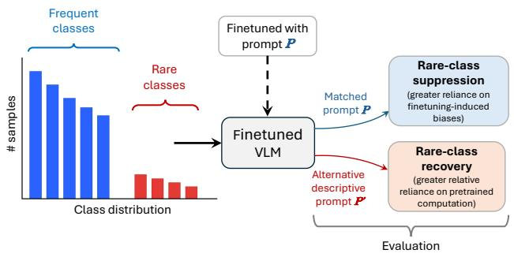  
(a) Cross-prompt inference

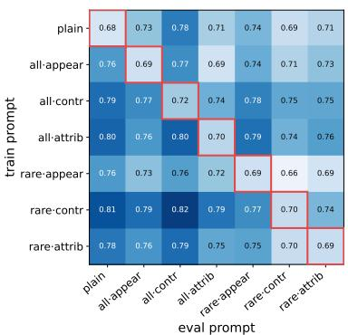  
(b) Food-101 matrix  
Figure 1: The matched-prompt penalty under class-imbalanced VLM finetuning. (a) Finetuning with prompt $P$ on an imbalanced distribution favors frequent classes and suppresses rare ones. Reusing $\hat { \boldsymbol P }$ at inference preserves this suppression, while a different descriptive prompt $P ^ { \prime }$ mitigates it without retraining by enabling the model to draw less on the computation introduced by finetuning. (b) $\mathbf { A } \ 7 \times 7$ Food-101 cross-prompt matrix, in which the matched cell is never its row maximum.

To better understand why cross-prompt inference recovers rare classes, we analyze how the evaluation prompt changes the relative influence of pretrained and finetuning-induced computation. Using TuCo (Nuti et al., 2025), we find that mismatched descriptive prompts rely less on computation introduced during finetuning. Reducing that contribution also substantially reduces the cross-prompt advantage. Together, these results support the view that cross-prompt inference shifts computation away from imbalanced finetuning and toward the pretrained component, recovering rare-class knowledge suppressed by finetuning.

We further characterize when this recovery occurs. Rare class suppression grows with both the imbalance ratio and the visual similarity between frequent and rare classes. Cross-prompt inference therefore helps most in fine-grained and highly imbalanced settings, where finetuning has substantially degraded rare-class performance. When rare classes remain intact after finetuning, the matched-prompt penalty is weak or absent. We further find that cross-prompt inference comple ments standard oversampling, yielding further gains in rare-class recall. We evaluate these findings across six datasets and six VLMs spanning several model families and scales.

Our contributions are threefold. First, we identify the matched-prompt penalty in imbalanced VLM finetuning and show that cross-prompt inference can mitigate the resulting rare-class suppression. Second, TuCo analysis shows that cross-prompt inference reduces reliance on finetuning-induced computation, and that its recovery advantage shrinks when this contribution is removed. Third, we characterize the conditions under which the effect arises. The penalty strengthens with imbalance severity and class similarity, persists after oversampling, and disappears without descriptive prompts.

## 2 RELATED WORK

Long-tailed recognition. Class imbalance is commonly addressed through re-sampling or loss re-weighting by class frequency (Buda et al., 2018; Cui et al., 2019; Cao et al., 2019). Menon et al. (2021) instead adjust the decision rule at inference by correcting for the label prior, building on evidence that imbalance affects the classifier more than the representation (Kang et al., 2020). Recent work extends long-tailed learning to VLMs. Methods adapt CLIP to long-tailed data (Tian et al., 2022; Dong et al., 2023), show that heavy fine-tuning can hurt tail classes (Shi et al., 2024), remove pretraining label bias (Zhu et al., 2023), rebalance VLM training data (Song et al., 2025), and document underrepresentation of rare concepts in pretraining (Parashar et al., 2024). These methods modify training or output logits, whereas our approach changes only the inference prompt.

Class descriptions for VLM classification. CLIP classifies images by matching them to text prompts (Radford et al., 2021), while instruction-tuned VLMs can be fine-tuned to emit class names directly (Liu et al., 2023). Many works improve classification by describing classes rather than naming them. Menon & Vondrick (2023) and Pratt et al. (2023) generate class descriptions with an LLM, while Esfandiarpoor & Bach (2024) and Lee et al. (2025) describe differences between visually similar classes, inspiring our contrastive style. These gains may not depend entirely on description semantics, as Roth et al. (2023) find random words can perform comparably and Ma et al. (2025) attribute part of the benefit to semantic-agnostic ensembling. Prior description-based meth ods use frozen encoder, while prompt adaptation either learns prompts during training (Zhou et al., 2022) or optimizes them at test time on an unchanged model (Shu et al., 2022). Prompt wording and format can also strongly affect accuracy (Sclar et al., 2024). We instead use descriptive prompts during supervised fine-tuning and study the effect of changing them at inference.

Forgetting in VLM fine-tuning. Fine-tuning can degrade pretrained abilities, including CLIP zeroshot robustness (Wortsman et al., 2022; Kumar et al., 2022), and MLLMs can even underperform their own vision encoder (Zhai et al., 2024). Several works interpret this as a behavioral shift rather than knowledge loss. Zheng et al. (2025) attribute it to reduced task alignment, while Kotha et al. (2024) show that pretrained capabilities can be recovered by moving prompts away from the finetuning distribution, mainly by translating English prompts into other languages. Our setting differs in that the task and label space remain fixed and the degradation is concentrated on rare classes under class imbalance.

Prior work finds that mismatching the fine-tuning and inference prompts is harmful. Unseen prompt formulations can reduce performance (Aissi et al., 2025), and prompt-format consistency is often considered important for reliable transfer (Yun et al., 2025). We identify class imbalance as a regime where this behavior changes for rare classes, with the matched descriptive prompt becoming suboptimal and an alternative descriptive prompt recovering part of the suppressed rare-class performance.

## 3 PROBLEM SETTING AND CROSS-PROMPT INFERENCE

We consider finetuning a vision-language model (VLM) f for image classification under class imbalance. Let $\mathcal { C } = \{ c _ { 1 } , \ldots , c _ { K } \}$ be the set of class names, and let $P _ { t }$ denote the textual prompt used during finetuning. The prompt presents the classification task and may additionally include a description of each class. We finetune on a training set of image-label pairs $\{ ( x _ { i } , y _ { i } ) \} _ { i = 1 } ^ { N }$ with $y _ { i } \in \mathcal { C }$ The training distribution is class-imbalanced, ranging from frequent classes with abundant examples to rare classes with very few. Let $n _ { c }$ be the number of training examples for class $c .$ We characterize the imbalance by the ratio $\rho = \mathrm { m a x } _ { c } n _ { c } / \mathrm { m i n } _ { c } n _ { c } \gg 1$

For each example, the model is conditioned on P and the image $x _ { i } .$ , and is trained to generate the target class name $y _ { i }$ by minimizing the standard autoregressive cross-entropy over the response tokens. We denote the resulting parameters by $\theta _ { P _ { t } }$

## 3.1 CROSS-PROMPT INFERENCE

At inference, let $P _ { e }$ denote the evaluation prompt. The conventional choice is to reuse the prompt seen during finetuning, giving the matched configuration $P _ { e } = P _ { t }$ . This choice is natural because inference is then aligned with the finetuning condition and is consistent with prior work showing that unseen prompt formulations can degrade performance and that finetuning may overfit to the prompt used during training (Sun et al., 2024; Aissi et al., 2025).

Under severe class imbalance, however, we find that this matched configuration can be suboptimal for rare classes. Rare-class performance can be substantially degraded by finetuning, sometimes falling below the model’s own zero-shot performance. Our hypothesis is that, under imbalanced finetuning, the descriptive training prompt becomes coupled to a prediction bias toward frequent classes. Reusing the same prompt at inference may preserve this coupling and suppress rare classes, even when the prompt contains useful descriptive information. Evaluating with a different descriptive prompt may weaken this prompt-specific bias and allow the model to rely more on pretrained class knowledge. This motivates cross-prompt inference, where the finetuned model is evaluated under a different descriptive prompt,

$$
\hat { y } = f ( x , P _ { e } ; \theta _ { P _ { t } } ) , \qquad P _ { e } \neq P _ { t } .\tag{1}
$$

Cross-prompt inference changes neither the finetuned parameters nor the decoding procedure. It changes only the prompt used at inference. Importantly, the effect is not produced by prompt mismatch alone. As shown in section $4 . 6 ,$ changing between description-free prompts does not yield the same rare-class recovery.

## 3.2 QUANTIFYING THE MATCHED-PROMPT PENALTY

Given a set of prompts $\mathcal { P } = \{ P _ { 1 } , \ldots , P _ { m } \}$ , we summarize the interaction between the training and evaluation prompts with a matrix

$$
M _ { i j } = { \mathrm { R e c a l l } } _ { \mathrm { r a r e } } \big ( f ( x , P _ { j } ; \theta _ { P _ { i } } ) \big ) .\tag{2}
$$

The diagonal entries $M _ { i i }$ correspond to the matched prompt, while the off-diagonal entries correspond to cross-prompt inference (see Figure 1b for an example).

For a model finetuned with $P _ { i }$ , we measure the recovery from changing the evaluation prompt with the average mismatch gain and the best mismatch gain

$$
\Delta _ { i } ^ { \mathrm { a v g } } = \frac { 1 } { m - 1 } \sum _ { j \neq i } M _ { i j } - M _ { i i } , \qquad \Delta _ { i } ^ { \mathrm { b e s t } } = \operatorname* { m a x } _ { j \neq i } M _ { i j } - M _ { i i } ,\tag{3}
$$

and we report both averaged over the training prompts. The average mismatch gain measures whether the benefit extends across alternative evaluation prompts, whereas the best mismatch gain captures the largest recovery within the tested prompt set. Together, they characterize the average and potential benefit of cross-prompt inference.

## 3.3 FINETUNING CONTRIBUTION ANALYSIS WITH TUCO

Our hypothesis is that cross-prompt inference helps because a mismatched descriptive prompt reduces the influence of the computation introduced by imbalanced finetuning, allowing the pretrained component to play a larger role. To test this hypothesis, we adopt Tuning Contribution (TuCo) (Nuti et al., 2025), which splits the update each transformer layer adds to the residual stream into the update the pretrained layer would have made, $\mathrm { P T C } _ { \ell } ,$ and the extra update from finetuning, $\mathrm { F T C } _ { \ell } ,$ , so that $h _ { \ell + 1 } \dot { = } h _ { \ell } + \dot { \mathrm { P T C } _ { \ell } } + \mathrm { F T C } _ { \ell }$ exactly. The TuCo score is the relative magnitude of the accumulated finetuning updates at the final prompt token, between 0 and 1. This internal view enables us to detect changes that cancel out by the final layer and leave the output unchanged. More importantly, it lets us rescale the finetuning contribution rather than only compare the two models.

Nuti et al. (2025) showed that successful jailbreaks circumvent safety finetuning while exhibiting a lower finetuning contribution. We test the analogous pattern for imbalance-induced bias, extending their text-only decomposition to a vision-language model.

Our main analysis rescales the finetuning component by a factor $\lambda ,$

$$
h _ { \ell + 1 } = h _ { \ell } + \mathrm { P T C } _ { \ell } + \lambda \mathrm { F T C } _ { \ell } , \qquad \lambda \in [ 0 , 1 ] .\tag{4}
$$

At $\lambda = 1$ , the intervention reproduces the finetuned decoder computation exactly. At $\lambda = 0$ , it removes the TuCo finetuning contribution from each decoder-layer update, which lets us control how strongly the finetuned and pretrained components contribute. If the cross-prompt advantage comes from attenuating imbalanced finetuning, it should shrink as λ decreases.

We report the TuCo score, which measures how strongly each evaluation prompt engages the finetuning component. These analyses test whether cross-prompt inference shifts computation from the imbalanced finetuning toward the pretrained component, recovering rare-class predictions that the matched prompt suppresses. Results are in Section 4.5 and implementation details in Appendix B.

## 4 EXPERIMENTS

## 4.1 EXPERIMENTAL SETTING

Datasets. We use six datasets: Food-101 (Bossard et al., 2014), CUB-200-2011 (Wah et al., 2011), FGVC-Aircraft (Maji et al., 2013), Stanford Dogs (Khosla et al., 2011), PlantNet-300K (Garcin et al., 2021), and ImageNet (Russakovsky et al., 2015). To study cross-prompt inference across different imbalance settings, we construct controlled subsets by splitting each dataset into 10 frequent and 10 rare classes, so that per-class descriptions remain practical to include in the VLM prompt.

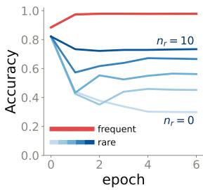  
(a) Food-101

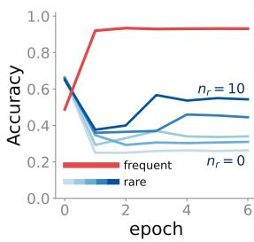  
(b) FGVC-Aircraft  
Figure 2: Rare-class suppression. Accuracy vs. epoch for frequent classes (red) and rare classes with $n _ { r }$ samples per class (blue), where $n _ { r } ~ = ~ 0$ trains on frequent classes only. Epoch 0 is the zero-shot model. Frequent accuracy saturates near ceiling while rare accuracy drops below its zero-shot value, more so as $n _ { r }$ decreases. The remaining datasets show the same pattern (Appendix D).

Models. We evaluate six VLMs spanning multiple families and a range of sizes, including the Qwen3-VL scale ladder at 2B, 4B, and 8B (Bai et al., 2025a), Qwen2.5-VL-3B (Bai et al., 2025b), Gemma-3-4B (Gemma Team, 2025), and InternVL-3.5-2B (Wang et al., 2025).

Descriptive prompts. We experiment with seven prompts, constructed from three description styles and a choice of whether to describe all classes or only the rare ones. We attach a short description to each class in one of three styles. These include an appearance style that gives a plain visual description, a contrastive style that names the feature distinguishing a class from its most confusable neighbor, and an attribute style that lists the class’s key attributes in a structured form. Each style is applied either to all classes or to the rare classes only, giving six descriptive prompts. Together with the plain, description-free prompt, this yields the seven prompts used for both finetuning and inference. For each model type, we finetune seven models, one for each of the seven prompts. We then evaluate each finetuned model under all seven prompts, yielding a $7 \times 7$ train-evaluation matrix (see the right panel of Figure 1b for an example on Food-101). The full prompts for each dataset are provided in Appendix J.

## 4.2 RARE-CLASS SUPPRESSION

We begin by examining the impact of high class imbalance on VLM image classification. For a given dataset we finetune Qwen3-VL-2B under the plain prompt and track frequent- and rare-class accuracy over training epochs. We vary the number of training samples per rare class $n _ { r } ,$ which sets the imbalance severity (Figure 2 and Appendix D).

To construct each imbalanced dataset, we group classes into confusable families by visual similarity, using 14 visually similar classes and 6 distinct anchors per dataset. This mix spans both regimes within a dataset, since look-alike pairs are where imbalance can suppress a class while distinct anchors serve as a within-dataset control. Within each pair of visually similar classes, one class is designated frequent $( n _ { f }$ images per class) and its look-alike rare $( n _ { r } \ll n _ { f } )$ . Distinct anchor classes (those without a close look-alike) are divided evenly. Each experiment is repeated with three random seeds. The seed determines the subset of images drawn for each rare class, as well as model initialization and data ordering. The class pairs, the frequent/rare assignment, and the frequent-class training images are identical.

Across the fine-grained datasets, frequent-class accuracy rises quickly and saturates near 100% within the first epoch, while rare-class accuracy drops and remains suppressed for the rest of the training. The suppression deepens as the imbalance becomes more severe, with rare accuracy falling progressively lower as $n _ { r }$ decreases.

## 4.3 MATCHED-PROMPT PENALTY AND CROSS-PROMPT INFERENCE

In this section, we present our main results, showing that finetuning a VLM on class-imbalanced data with a descriptive prompt makes that same prompt a poor choice at inference for the rare classes, while a different descriptive prompt (cross-prompt inference) improves rare-class recall.

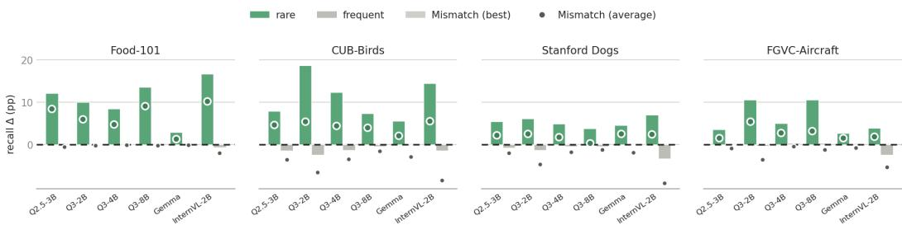  
Figure 3: Cross-prompt recovery of rare recall across models. Each panel corresponds to one dataset and shows, for each model, the recall change relative to matched for rare (green) and frequent (grey) classes. The dot is the averaged mismatch and the bar is the best mismatch. The rare gain is positive on every model and dataset, with a trade-off in frequent-class recall.

Table 1: Rare and overall recall (%). Matched, average mismatched, and best mismatched results are shown, with ∆ vs. matched in parentheses. ZS is zero-shot overall recall averaged over the seven prompts. Cross-prompt inference recovers rare recall under imbalanced and oversampled training.
<table><tr><td></td><td></td><td colspan="3">Rare (∆ vs. matched)</td><td colspan="4">Overall</td></tr><tr><td>Dataset</td><td>Regime</td><td></td><td>Match Mism.(avg)</td><td>Mism.(best)</td><td></td><td>Match Mism.(avg)</td><td>Mism.(best)</td><td>ZS</td></tr><tr><td rowspan="2">Food-101</td><td>Imbalanced</td><td>65.7</td><td>71.7(+6.0)</td><td>75.7(+10.0)</td><td>81.9</td><td>84.8</td><td>86.8</td><td>86.4</td></tr><tr><td>Oversampled</td><td>69.9</td><td>75.5(+5.6)</td><td>78.9(+9.0)</td><td>83.9</td><td>86.5</td><td>88.1</td><td></td></tr><tr><td rowspan="2">CUB-200</td><td>Imbalanced</td><td>40.8</td><td>46.3(+5.5)</td><td>59.5(+18.7)</td><td>66.2</td><td>65.6</td><td>72.3</td><td>59.7</td></tr><tr><td>Oversampled</td><td>57.4</td><td>58.3(+0.9)</td><td>71.0(+13.6)</td><td>74.1</td><td>70.1</td><td>76.9</td><td></td></tr><tr><td rowspan="2">FGVC-Aircraft</td><td>Imbalanced</td><td>35.5</td><td>41.0(+5.5)</td><td>46.1 (+10.6)</td><td>64.8</td><td>65.7</td><td>67.4</td><td>60.8</td></tr><tr><td>Oversampled</td><td>41.7</td><td>48.8(+7.1)</td><td>56.2(+14.5)</td><td>67.1</td><td>67.6</td><td>70.1</td><td></td></tr><tr><td rowspan="2">Stanford Dogs</td><td>Imbalanced</td><td>57.0</td><td>59.5(+2.5)</td><td>63.1 (+6.1)</td><td>76.4</td><td>75.3</td><td>77.0</td><td>66.5</td></tr><tr><td>Oversampled</td><td>60.0</td><td>61.4(+1.4)</td><td>65.8(+5.8)</td><td>77.7</td><td>75.7</td><td>78.2</td><td></td></tr><tr><td rowspan="2">ImageNet</td><td>Imbalanced</td><td>45.3</td><td>47.9(+2.6)</td><td>53.9(+8.7)</td><td>68.6</td><td>69.7</td><td>72.6</td><td>66.6</td></tr><tr><td>Oversampled</td><td>48.5</td><td>54.4(+5.8)</td><td>59.4(+10.9)</td><td>70.2</td><td>72.2</td><td>74.3</td><td></td></tr><tr><td rowspan="2">PlantNet-300K</td><td>Imbalanced</td><td>9.8</td><td>13.6(+3.8)</td><td>19.2(+9.4)</td><td>52.9</td><td>51.1</td><td>54.4</td><td>47.6</td></tr><tr><td>Oversampled</td><td>19.2</td><td>28.7(+9.5)</td><td>42.1 (+22.9)</td><td>57.2</td><td>55.2</td><td>59.1</td><td></td></tr></table>

Figure 1b demonstrates the effect on Food-101 as a $7 \times 7$ matrix whose rows are training prompts and columns are evaluation prompts. For example, the rows trained with the descriptive-all-attribute or descriptive-rare-contrastive prompts stand out, reaching rare recall of 0.80 and 0.82 under other evaluation prompts, yet falling to among their lowest values (0.69 and 0.70) exactly when evaluated with the prompt they were trained on. We define this gap, between a model’s matched cell and its improved mismatched cells, as the matched-prompt penalty.

The penalty does not simply reflect some prompts being weak, $i . e . ,$ no descriptive prompt is bad to train with or to evaluate with on its own. Rare recall drops mainly when the training and evaluation prompts coincide, making this a train-eval interaction rather than an effect of either prompt alone.

Rare-class mitigation. Figure 3 reports the change in recall from switching to a mismatched prompt, relative to the matched prompt, shown separately for rare and frequent classes on Food-101, CUB-200, Stanford Dogs and FGVC-Aircraft across six models. We use the same rare/frequent class assignment as in Section 4.2. Guided by the maximum number of images available per class $( n _ { f }$ is capped by each dataset, ranging from 29 for CUB to 750 on Food-101), we set the rare count $n _ { r }$ to 5 for Food-101, 2 for Stanford Dogs, 2 for FGVC-Aircraft, and 1 for CUB-200 (Section 4.4 provides analysis on the effect of different imbalance ratios as $n _ { r }$ varies). The figure supports two conclusions. First, the averaged mismatch gain on rare recall is positive in all 24 dataset × model cells, rising further under the best mismatch. Second, the effect is specific to the rare classes, and comes with a frequent-class cost that varies by dataset.

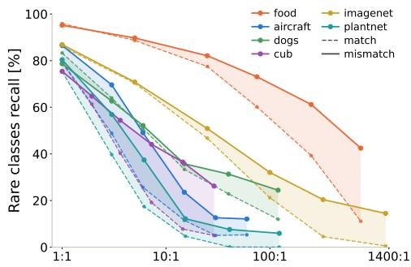  
(a) Rare class accuracy vs. imbalance ratio (F:R).

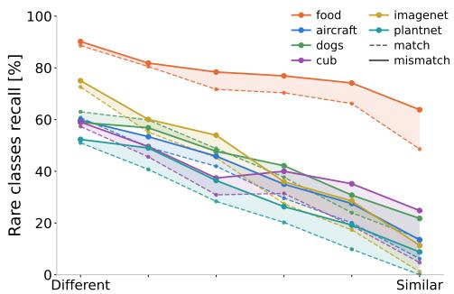  
(b) Rare class accuracy vs. F-R similarity level.  
Figure 4: Rare-class degradation: Dashed lines show the average accuracy over matched prompts. Solid lines show the average accuracy over best mismatch prompts.

Oversampling. A natural mitigation for class imbalance is to oversample the rare classes. We therefore investigate how cross-prompt inference interacts with oversampling. We compare against random oversampling, which resamples each rare class up to the frequent count without adding new images. Table 1 reports rare and overall recall under the matched prompt, the averaged mismatch, and the best mismatch, for both the standard imbalanced finetuning and the oversampled one.

Notably, cross-prompt inference and oversampling are complementary. On the oversampled model, the averaged mismatch gain in rare recall ranges from +0.9 to +9.5 pp across datasets, and the best mismatch gain from +5.8 to +22.9 pp. Overall recall (measured over all classes) improves under the best mismatch on every dataset, while the averaged mismatch trades some overall recall on CUB-200, Stanford Dogs, and PlantNet-300K, in both regimes. Averaged cross-prompt inference also exceeds the zero-shot (pretrained) model in overall recall on every dataset.

Appendix F repeats the analysis with LoRA finetuning, showing that the matched-prompt penalty also persists under less aggressive adaptation and that cross-prompt inference mitigates it there too.

## 4.4 RARE-CLASS DEGRADATION: IMBALANCE AND CLASS SIMILARITY

In this section we characterize rare-class degradation, and its recovery using cross-prompt inference, as a function of two factors: (1) the frequent-to-rare imbalance ratio, and (2) the visual similarity between the frequent and rare classes. For each of the six datasets, we use SigLIP2 (Tschannen et al., 2025) to compute pairwise inter-class similarity and select ten pairs of similar classes, yielding 20 classes per dataset. In order to analyze the similarity factor, we fix the imbalance ratio and selected different frequent-rare class splits in order to control the visual similarity level between rare and frequent classes. Given the 20 selected classes per dataset, we construct six frequent-rare class splits with progressively decreasing visual similarity between the frequent and rare groups. The first split pairs the most visually similar classes across the two groups, while subsequent splits progressively reduce the inter-group similarity, as measured by SigLIP2 (Tschannen et al., 2025). In the ratio imbalance analysis experiment, we fix the frequent-rare partition and gradually remove rare samples. Full implementation details are given in G.

Figure 4a shows the rare-class recall declining monotonically as the imbalance ratio grows, on all six datasets. We can observe that the rate at which rare-class recall degrades varies between datasets. CUB-200 and FGVC-Aircraft rare-recall has collapsed by roughly 30:1, whereas Food-101 retains most of its rare-recall even beyond 100:1. When varying the similarity between rare and frequent classes, while leaving the rare-to-frequent ratio fixed, we can also measure an almost monotonic degradation in rare-class recall in 4b.

Across both experiments, the gap between matched-prompt and cross-prompt inference closely tracks the degradation in rare-class recall. When rare-class recall remains high, at low imbalance ratios or under dissimilar partitions, the two settings largely coincide. As recall degrades, however, cross-prompt inference increasingly recovers the lost performance, reaching gains of +31.4 pp on Food-101 at 750:1 and +20.2 pp on CUB-200 at its most similar partition. These results suggest that

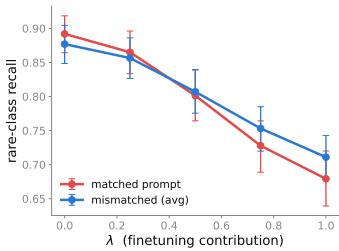  
(a) Food-101

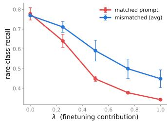  
(b) FGVC-Aircraft  
Figure 5: Finetuning contribution and cross-prompt recovery. Rare-class recall as λ rescales the finetuning component. The mismatch advantage is absent once the finetuning component is removed.  
cross-prompt benefits grow with rare-class suppression induced by imbalanced fine-tuning, which is jointly governed by the imbalance ratio and the similarity between frequent and rare classes.

## 4.5 TUCO ANALYSIS RESULTS

In this section, we test the predictions of Section 3.3. For each dataset we finetune four models with different descriptive prompts and evaluate each under its training prompt (matched) and the remaining six prompts (mismatched). We measure rare-class recall as a function of λ, and separately the TuCo score under matched and mismatched evaluation, reported per model in Appendix B.

Figure 5 shows rare-class recall against λ on Food-101 and FGVC-Aircraft. First, matched rare-class recall rises steeply as the finetuning component is removed, from 67.9% to 89.2% on Food-101 and from 34.3% to 77.7% on FGVC-Aircraft, showing that the computation introduced by imbalanced finetuning is a major source of rare-class suppression. Second, the advantage of mismatched evaluation is absent at $\lambda = 0$ and appears once the finetuning component is active, giving a finetuningattributable advantage of +4.7 pp on Food-101 and +11.4 pp on FGVC-Aircraft. On Food-101 the two curves cross at λ ≈ 0.4, so imbalanced finetuning inverts which prompt is preferable, while on FGVC-Aircraft they start together and separate immediately. Results on CUB-200 and on Stanford Dogs are in Appendix B.

We additionally compute the TuCo score itself, directly testing whether mismatched evaluation engages the finetuning component less (Appendix B, Table 5). Across datasets, TuCo is lower under mismatch in all sixteen finetuned models and on 86% of test images on average (78–93% per dataset). The matched prompt yields the highest finetuning contribution among all seven evaluation prompts in thirteen of the sixteen models. The reduction is not specific to rare classes, as TuCo decreases comparably for frequent classes, indicating a global shift in finetuning influence.

Together, these analyses are consistent with the hypothesis of Section 3.3 that cross-prompt inference shifts computation away from imbalanced finetuning and toward the pretrained component, while the rare-class advantage is substantially reduced when the finetuning component is removed.

## 4.6 NON-DESCRIPTIVE PROMPTS

In this section, we examine whether the cross-prompt gain requires the class descriptions or arises from any prompt mismatch. Using the same controlled setup as before, we repeat the analysis with six non-descriptive prompts that list the same class names but add no per-class descriptions, differing only in phrasing and format, such as a plain question, a numbered list, or an expert persona. Table 2 compares the cross-prompt gain under descriptive and non-descriptive prompts. Switching between two non-descriptive prompts does not improve rare recall.

This suggests that the penalty requires descriptive content in the prompts, and that cross-prompt inference can mitigate it, since two non-descriptive prompts differ only in phrasing.

In Appendix H we further split the grid by whether descriptions are used at finetuning, at evaluation, or both. The matched descriptive pairing is the weakest descriptive setting, and switching to a different descriptive prompt improves rare recall, suggesting that the mismatch matters most, not which side carries the descriptions.

Table 2: Non-descriptive prompt setting. Rare-class recall (%), averaged over prompts, for matched vs. mismatched evaluation, with the cross-prompt gain ∆.
<table><tr><td></td><td colspan="3">Descriptive</td><td colspan="3">Non-descriptive</td></tr><tr><td>Dataset</td><td>Match</td><td>Mism.</td><td>∆</td><td>Match</td><td>Mism.</td><td>∆</td></tr><tr><td>Food-101</td><td>65.7</td><td>71.7</td><td>+6.0</td><td>64.8</td><td>60.7</td><td>-4.1</td></tr><tr><td>CUB-200</td><td>40.8</td><td>46.3</td><td>+5.5</td><td>39.0</td><td>37.7</td><td>-1.3</td></tr><tr><td>FGVC-Aircraft</td><td>35.5</td><td>41.0</td><td>+5.5</td><td>35.4</td><td>33.5</td><td>-1.9</td></tr><tr><td>Stanford Dogs</td><td>57.0</td><td>59.5</td><td>+2.5</td><td>55.7</td><td>55.9</td><td>+0.2</td></tr></table>

Table 3: Prompt ensembling. Changes in rare and frequent recall relative to the matched prompt (gain ∆) for Mism.(avg) and prompt ensembling.
<table><tr><td></td><td></td><td colspan="2">Mism.(avg)</td><td colspan="2">Ens.(mism)</td><td colspan="2">Ens.(all)</td></tr><tr><td>Dataset</td><td>Match</td><td>Rare</td><td>Freq.</td><td>Rare</td><td>Freq.</td><td>Rare</td><td>Freq.</td></tr><tr><td>Food-101</td><td>65.7</td><td>+6.0</td><td>-0.2</td><td>+7.0</td><td>-0.3</td><td>+6.1</td><td>-0.2</td></tr><tr><td>CUB-200</td><td>40.8</td><td>+5.5</td><td>-6.6</td><td>+5.5</td><td>-3.7</td><td>+3.7</td><td>-2.9</td></tr><tr><td>FGVC-Aircraft</td><td>35.5</td><td>+5.5</td><td>-3.6</td><td>+3.9</td><td>-1.3</td><td>+2.4</td><td>-0.6</td></tr><tr><td>Stanford Dogs</td><td>57.0</td><td>+2.5</td><td>-4.7</td><td>+4.6</td><td>-2.5</td><td>+4.1</td><td>-1.8</td></tr></table>

## 4.7 LEVERAGING CROSS-PROMPT INFERENCE

In this section, we show that our observations on the matched-prompt penalty can be used to mitigate class imbalance in VLM classification. Specifically, we average the per-class scores produced by the same finetuned model under multiple evaluation prompts and predict the class with the highest average score. This provides a practical way to apply cross-prompt inference.

Table 3 shows that ensembling improves rare-class recall on all four datasets relative to matchedprompt inference, at roughly half the average frequent-class cost of individual mismatched prompts. We evaluate two ensemble variants, with and without the matched prompt. Including the matched prompt yields smaller rare-class gains and better preserves frequent-class recall.

In Appendix E we extend this comparison with a variant that selects a single mismatched prompt using a held-out validation set of one or five labeled images per rare class. We evaluate all variants with and without oversampling, and find that combining cross-prompt inference with oversampling achieves the highest overall recall among the evaluated configurations on all four datasets.

## 5 LIMITATION

Our experiments use controlled 20-class subsets so that per-class descriptions remain practical to include in the VLM prompt. Extending cross-prompt inference to settings with hundreds or thousands of classes is an important direction for future work, where class descriptions may exceed practical context lengths. In addition, the effect is specific to the imbalance-forgetting regime. When finetuning does not suppress rare-class performance, cross-prompt inference can provide little benefit or even hurt. This suggests that cross-prompt inference is most valuable when imbalanced finetuning suppresses knowledge the pretrained model already had.

## 6 CONCLUSION

We identify the matched-prompt penalty in class-imbalanced finetuning of VLMs. Although the natural choice is to evaluate with the prompt used for finetuning, we find that this matched prompt can be suboptimal for rare classes, while a different descriptive prompt can recover suppressed rareclass recall without retraining. We call this inference-time strategy cross-prompt inference. Its benefit varies with the imbalance ratio and the visual similarity between frequent and rare classes, and is largest where finetuning has substantially suppressed rare-class recall. Our analysis supports the interpretation that cross-prompt inference draws more on pretrained class knowledge. Specifically,

Tuning Contribution (TuCo) reveals a lower relative contribution from finetuning-induced computation under mismatched prompts, and removing this component also removes the cross-prompt advantage. An extensive study across six datasets and six VLMs supports these findings.

## REPRODUCIBILITY STATEMENT

Appendix A provides the full training recipe, the public checkpoints we finetune, and the logprobability decision rule, and the same configuration is used for every dataset, prompt, seeds, imbalance ratio and backbone with no hyperparameter search. Appendix F specifies the LoRA configuration used for the adaptation-method control. Table 4 and Appendix G describe how each imbalanced subset is built, including the 20 classes per dataset, the SigLIP2 pairing of visually similar classes, the frequent and rare sample counts, and the imbalance ratio and similarity sweeps. Appendix J reproduces all seven prompts and every per-class description in full, so each train and evaluation matrix can be rebuilt exactly. Appendix B specifies the TuCo decomposition and its forward hook implementation together with the λ sweep and the evaluation subsets. The seeding protocol is described in Section 4.2, and all six datasets and all six model checkpoints are publicly available.

## AI USE STATEMENT

We used generative AI tools to assist with refining and polishing parts of the paper, figure creation, and software code. We also used a large language model to draft the per-class descriptions in Appendix J from the class names and dataset taxonomies, and the authors verified them against the dataset documentation before use. AI-assisted code was validated and tested by the authors. AIassisted text and figures were reviewed and edited by the authors. The authors take full responsibility for the final content of the paper.

## REFERENCES

Mohamed Salim Aissi, Clement Romac, Thomas Carta, Sylvain Lamprier, Pierre-Yves Oudeyer,´ Olivier Sigaud, Laure Soulier, and Nicolas Thome. Reinforcement learning for aligning large language models agents with interactive environments: Quantifying and mitigating prompt overfitting. In Findings of the Association for Computational Linguistics: NAACL 2025, pp. 7045– 7061, 2025.

Shuai Bai, Yuxuan Cai, Ruizhe Chen, Keqin Chen, Xionghui Chen, Zesen Cheng, Lianghao Deng, Wei Ding, Chang Gao, Chunjiang Ge, et al. Qwen3-VL technical report, 2025a. URL https: //arxiv.org/abs/2511.21631.

Shuai Bai, Keqin Chen, Xuejing Liu, Jialin Wang, Wenbin Ge, Sibo Song, Kai Dang, Peng Wang, Shijie Wang, Jun Tang, Humen Zhong, Yuanzhi Zhu, Mingkun Yang, Zhaohai Li, Jianqiang Wan, Pengfei Wang, Wei Ding, Zheren Fu, Yiheng Xu, Jiabo Ye, Xi Zhang, Tianbao Xie, Zesen Cheng, Hang Zhang, Zhibo Yang, Haiyang Xu, and Junyang Lin. Qwen2.5-VL technical report. arXiv preprint arXiv:2502.13923, 2025b.

Lukas Bossard, Matthieu Guillaumin, and Luc Van Gool. Food-101 – mining discriminative components with random forests. In David Fleet, Tomas Pajdla, Bernt Schiele, and Tinne Tuytelaars´ (eds.), Computer Vision – ECCV 2014, volume 8694 of Lecture Notes in Computer Science, pp. 446–461. Springer, 2014.

Mateusz Buda, Atsuto Maki, and Maciej A. Mazurowski. A systematic study of the class imbalance problem in convolutional neural networks. Neural Networks, 106:249–259, 2018. doi: 10.1016/ j.neunet.2018.07.011.

Kaidi Cao, Colin Wei, Adrien Gaidon, Nikos Arechiga, and Tengyu Ma. Learning imbalanced datasets with label-distribution-aware margin loss. Advances in Neural Information Processing Systems, 32, 2019.

Yin Cui, Menglin Jia, Tsung-Yi Lin, Yang Song, and Serge Belongie. Class-balanced loss based on effective number of samples. In Proceedings of the IEEE/CVF Conference on Computer Vision and Pattern Recognition, pp. 9260–9269, 2019.

Bowen Dong, Pan Zhou, Shuicheng Yan, and Wangmeng Zuo. LPT: Long-tailed prompt tuning for image classification. In International Conference on Learning Representations (ICLR), 2023. arXiv:2210.01033.

Reza Esfandiarpoor and Stephen H. Bach. Follow-up differential descriptions: Language models resolve ambiguities for image classification. In International Conference on Learning Represen tations (ICLR), volume 2024, pp. 5849–5873, 2024. arXiv:2311.07593.

Camille Garcin, Alexis Joly, Pierre Bonnet, Antoine Affouard, Jean-Christophe Lombardo, Mathias Chouet, Maximilien Servajean, Titouan Lorieul, and Joseph Salmon. Pl@ntNet-300K: a plant image dataset with high label ambiguity and a long-tailed distribution. In Proceedings of the Neural Information Processing Systems Track on Datasets and Benchmarks (NeurIPS Datasets and Benchmarks), 2021.

Gregor Geigle, Radu Timofte, and Goran Glavas. African or European swallow? benchmark-ˇ ing large vision-language models for fine-grained object classification. In Proceedings of the 2024 Conference on Empirical Methods in Natural Language Processing, pp. 2653–2669, Miami, Florida, USA, November 2024. Association for Computational Linguistics. doi: 10.18653 v1/2024.emnlp-main.154. URL https://aclanthology.org/2024.emnlp-main. 154/.

Gemma Team. Gemma 3 technical report. arXiv preprint arXiv:2503.19786, 2025.

Edward J. Hu, Yelong Shen, Phillip Wallis, Zeyuan Allen-Zhu, Yuanzhi Li, Shean Wang, Lu Wang, and Weizhu Chen. LoRA: Low-rank adaptation of large language models. In International Conference on Learning Representations, 2022. URL https://openreview.net/forum? id=nZeVKeeFYf9.

Bingyi Kang, Saining Xie, Marcus Rohrbach, Zhicheng Yan, Albert Gordo, Jiashi Feng, and Yannis Kalantidis. Decoupling representation and classifier for long-tailed recognition. In International Conference on Learning Representations, 2020.

Aditya Khosla, Nityananda Jayadevaprakash, Bangpeng Yao, and Li Fei-Fei. Novel dataset for finegrained image categorization. In First Workshop on Fine-Grained Visual Categorization, IEEE Conference on Computer Vision and Pattern Recognition, Colorado Springs, CO, June 2011.

Suhas Kotha, Jacob Mitchell Springer, and Aditi Raghunathan. Understanding catastrophic forgetting in language models via implicit inference. In International Conference on Learning Representations (ICLR), volume 2024, pp. 24110–24139, 2024. arXiv:2309.10105.

Ananya Kumar, Aditi Raghunathan, Robbie Jones, Tengyu Ma, and Percy Liang. Fine-tuning can distort pretrained features and underperform out-of-distribution. In International Conference on Learning Representations (ICLR), 2022. arXiv:2202.10054.

Hankyeol Lee, Gawon Seo, Wonseok Choi, Geunyoung Jung, Kyungwoo Song, and Jiyoung Jung. Enhancing visual classification using comparative descriptors. In 2025 IEEE/CVF Winter Conference on Applications of Computer Vision (WACV), pp. 5274–5283. IEEE, 2025.

Haotian Liu, Chunyuan Li, Qingyang Wu, and Yong Jae Lee. Visual instruction tuning. In Advances in Neural Information Processing Systems (NeurIPS), 2023. arXiv:2304.08485.

Pingchuan Ma, Lennart Rietdorf, Dmytro Kotovenko, Vincent Tao Hu, and Bjorn Ommer. Does¨ VLM classification benefit from LLM description semantics? In AAAI Conference on Artificial Intelligence (AAAI), 2025. arXiv:2412.11917.

Subhransu Maji, Esa Rahtu, Juho Kannala, Matthew B. Blaschko, and Andrea Vedaldi. Fine-grained visual classification of aircraft. CoRR, abs/1306.5151, 2013. URL https://arxiv.org/ abs/1306.5151.

Aditya Krishna Menon, Sadeep Jayasumana, Ankit Singh Rawat, Himanshu Jain, Andreas Veit, and Sanjiv Kumar. Long-tail learning via logit adjustment. In International Conference on Learning Representations (ICLR), 2021.

Sachit Menon and Carl Vondrick. Visual classification via description from large language models. In International Conference on Learning Representations (ICLR), 2023. arXiv:2210.07183.

Felipe Pinto Coelho Nuti, Tim Franzmeyer, and Joao F. Henriques. TuCo: Measuring the contribution of fine-tuning to individual responses of LLMs. In Proceedings of the 42nd International Conference on Machine Learning, volume 267 of Proceedings of Machine Learning Research, pp. 46837–46876. PMLR, 2025. URL https://proceedings.mlr.press/ v267/nuti25a.html.

Shubham Parashar, Zhiqiu Lin, Tian Liu, Xiangjue Dong, Yanan Li, Deva Ramanan, James Caverlee, and Shu Kong. The neglected tails in vision-language models. In 2024 IEEE/CVF Conference on Computer Vision and Pattern Recognition (CVPR), pp. 12988–12997. IEEE, 2024.

Sarah Pratt, Ian Covert, Rosanne Liu, and Ali Farhadi. What does a platypus look like? generating customized prompts for zero-shot image classification. In IEEE/CVF International Conference on Computer Vision (ICCV), 2023. arXiv:2209.03320.

Alec Radford, Jong Wook Kim, Chris Hallacy, Aditya Ramesh, Gabriel Goh, Sandhini Agarwal, Girish Sastry, Amanda Askell, Pamela Mishkin, Jack Clark, Gretchen Krueger, and Ilya Sutskever. Learning transferable visual models from natural language supervision. In Proceedings of the 38th International Conference on Machine Learning, volume 139 of Proceedings of Machine Learning Research, pp. 8748–8763. PMLR, 2021.

Karsten Roth, Jae Myung Kim, A. Sophia Koepke, Oriol Vinyals, Cordelia Schmid, and Zeynep Akata. Waffling around for performance: Visual classification with random words and broad concepts. In IEEE/CVF International Conference on Computer Vision (ICCV), 2023. arXiv:2306.07282.

Olga Russakovsky, Jia Deng, Hao Su, Jonathan Krause, Sanjeev Satheesh, Sean Ma, Zhiheng Huang, Andrej Karpathy, Aditya Khosla, Michael Bernstein, Alexander C. Berg, and Li Fei-Fei. ImageNet large scale visual recognition challenge. International Journal ofComputer Vision, 115 (3):211–252, 2015. doi: 10.1007/s11263-015-0816-y.

Melanie Sclar, Yejin Choi, Yulia Tsvetkov, and Alane Suhr. Quantifying language models’ sensitivity to spurious features in prompt design or: How I learned to start worrying about prompt formatting. In International Conference on Learning Representations (ICLR), volume 2024, pp. 25055–25083, 2024.

Jiang-Xin Shi, Tong Wei, Zhi Zhou, Jie-Jing Shao, Xin-Yan Han, and Yu-Feng Li. Long-tail learning with foundation model: Heavy fine-tuning hurts. In International Conference on Machine Learning (ICML), 2024. arXiv:2309.10019.

Manli Shu, Weili Nie, De-An Huang, Zhiding Yu, Tom Goldstein, Anima Anandkumar, and Chaowei Xiao. Test-time prompt tuning for zero-shot generalization in vision-language models. In Advances in Neural Information Processing Systems (NeurIPS), 2022. arXiv:2209.07511.

Mingyang Song, Xiaoye Qu, Jiawei Zhou, and Yu Cheng. From head to tail: Towards balanced representation in large vision-language models through adaptive data calibration. In IEEE/CVF Conference on Computer Vision and Pattern Recognition (CVPR), 2025. arXiv:2503.12821.

Jiuding Sun, Chantal Shaib, and Byron C. Wallace. Evaluating the zero-shot robustness of instruction-tuned language models. In International Conference on Learning Representations (ICLR), volume 2024, pp. 48103–48141, 2024.

Changyao Tian, Wenhai Wang, Xizhou Zhu, Jifeng Dai, and Yu Qiao. VL-LTR: Learning classwise visual-linguistic representation for long-tailed visual recognition. In European Conference on Computer Vision (ECCV), 2022. arXiv:2111.13579.

Michael Tschannen, Alexey Gritsenko, Xiao Wang, Muhammad Ferjad Naeem, Ibrahim Alabdulmohsin, Nikhil Parthasarathy, Talfan Evans, Lucas Beyer, Ye Xia, Basil Mustafa, Olivier Henaff,´ Jeremiah Harmsen, Andreas Steiner, and Xiaohua Zhai. SigLIP 2: Multilingual vision-language encoders with improved semantic understanding, localization, and dense features. arXiv preprint arXiv:2502.14786, 2025.

Catherine Wah, Steve Branson, Peter Welinder, Pietro Perona, and Serge Belongie. The Caltech-UCSD birds-200-2011 dataset. Technical Report CNS-TR-2011-001, California Institute of Technology, 2011.

Weiyun Wang, Zhangwei Gao, Lixin Gu, Hengjun Pu, Long Cui, Xingguang Wei, Zhaoyang Liu, Linglin Jing, Shenglong Ye, Jie Shao, et al. InternVL3.5: Advancing open-source multimodal models in versatility, reasoning, and efficiency. arXiv preprint arXiv:2508.18265, 2025.

Mitchell Wortsman, Gabriel Ilharco, Jong Wook Kim, Mike Li, Simon Kornblith, Rebecca Roelofs, Raphael Gontijo-Lopes, Hannaneh Hajishirzi, Ali Farhadi, Hongseok Namkoong, and Ludwig Schmidt. Robust fine-tuning of zero-shot models. In IEEE/CVF Conference on Computer Vision and Pattern Recognition (CVPR), 2022. arXiv:2109.01903.

Longfei Yun, Chenyang An, Zilong Wang, Letian Peng, and Jingbo Shang. The price of format: Diversity collapse in LLMs. In Findings of the Association for Computational Linguistics: EMNLP 2025, pp. 15454–15468. Association for Computational Linguistics, 2025. doi: 10.18653/v1/2025.findings-emnlp.836.

Yuexiang Zhai, Shengbang Tong, Xiao Li, Mu Cai, Qing Qu, Yong Jae Lee, and Yi Ma. Investigating the catastrophic forgetting in multimodal large language model fine-tuning. In Conference on Parsimony and Learning, pp. 202–227. PMLR, 2024.

Yuhui Zhang, Alyssa Unell, Xiaohan Wang, Dhruba Ghosh, Yuchang Su, Ludwig Schmidt, and Serena Yeung-Levy. Why are visually-grounded language models bad at image classification? In Advances in Neural Information Processing Systems, volume 37, 2024. doi: 10.52202/079017-1639. URL https://proceedings.neurips.cc/paper\_files/paper/2024/hash/ 5c7024041be305c94d7311cfcc53d93e-Abstract-Conference.html.

Junhao Zheng, Xidi Cai, Shengjie Qiu, and Qianli Ma. Spurious forgetting in continual learning of language models. In International Conference on Learning Representations (ICLR), volume 2025, pp. 67081–67146, 2025. arXiv:2501.13453.

Kaiyang Zhou, Jingkang Yang, Chen Change Loy, and Ziwei Liu. Learning to prompt for visionlanguage models. International Journal of Computer Vision (IJCV), 130(9):2337–2348, 2022. doi: 10.1007/s11263-022-01653-1.

Beier Zhu, Kaihua Tang, Qianru Sun, and Hanwang Zhang. Generalized logit adjustment: Cali brating fine-tuned models by removing label bias in foundation models. In Advances in Neural Information Processing Systems (NeurIPS), 2023. arXiv:2310.08106.

## A IMPLEMENTATION DETAILS

Training. All six backbones share one recipe: the Qwen3-VL ladder at 2B, 4B and 8B (Qwen/Qwen3-VL-{2,4,8}B-Instruct), Qwen2.5-VL-3B (Qwen/Qwen2.5-VL-3B-Instruct), Gemma-3-4B (google/gemma-3-4b-it) and InternVL-3.5-2B (OpenGVLab/InternVL3 5-2B-HF). Models are loaded in bfloat16 with FlashAttention-2 and gradient checkpointing. We fully finetune the language model and keep the vision encoder and multimodal projector frozen, so for Qwen3-VL-2B the 1.72B trainable parameters exclude the 0.41B of the vision tower. AdamW, learning rate $1 \times 1 0 ^ { - 5 }$ , weight decay 0, gradient-norm clipping at 1.0, cosine schedule with min $( 5 0 , \lfloor { T } / { 2 0 } \rfloor )$ warmup steps for T total steps. Batch size 4 with gradient accumulation 4 (effective 16), 6 epochs. Reported numbers are from the final epoch: there is no early stopping and no checkpoint selection. Evaluation batch size is 32 for the Qwen models, 16 for InternVL-3.5-2B and the processor default for Gemma-3-4B, the only setting that varies and only to fit memory. Unless stated otherwise, results are for Qwen3-VL-2B-Instruct.

Table 4: Dataset configurations. $n _ { f } / n _ { r }$ are images per frequent/rare class. $n _ { f }$ is the largest count the source pool supports.
<table><tr><td>Dataset</td><td> $n _ { f }$ </td><td> $n _ { r }$ </td><td>ratio</td><td>train / test</td></tr><tr><td>Food-101</td><td>750</td><td>5</td><td>150:1</td><td>7550 / 2000</td></tr><tr><td>CUB-200</td><td>29</td><td>1</td><td>29:1</td><td>300/220</td></tr><tr><td>FGVC-Aircraft</td><td>60</td><td>2</td><td>30:1</td><td>620 / 600</td></tr><tr><td>Stanford Dogs</td><td>100</td><td>2</td><td>50:1</td><td>1020 / 600</td></tr></table>

Decision rule. Classification never uses free-form generation. For each image we compare the model’s log-probability for each candidate class name and take the argmax, which makes the prediction deterministic.

Reproducibility. One configuration is used for every dataset, prompt, seed, imbalance ratio and backbone, with no hyperparameter search. The prompt bank is fixed before any run (Appendix J) and descriptions are authored once per (dataset, class, style).

## B FINETUNING CONTRIBUTION ANALYSIS: DETAILS

Transformer layers update the residual stream additively, so a finetuned layer splits into a pretrained and a finetuning part. For layer ℓ we evaluate the finetuned layer $f _ { \ell } ^ { \mathrm { F T } }$ and its pretrained counterpart $f _ { \ell } ^ { \operatorname { P T } }$ on the same hidden state $h _ { \ell } .$ , taken from the finetuned trajectory,

$$
\mathrm { P T C } _ { \ell } = f _ { \ell } ^ { \mathrm { P T } } ( h _ { \ell } ) - h _ { \ell } , \qquad \mathrm { F T C } _ { \ell } = f _ { \ell } ^ { \mathrm { F T } } ( h _ { \ell } ) - f _ { \ell } ^ { \mathrm { P T } } ( h _ { \ell } ) ,\tag{5}
$$

so that $h _ { \ell + 1 } = h _ { \ell } + \mathrm { P T C } _ { \ell } + \mathrm { F T C } _ { \ell }$ reproduces the finetuned computation exactly. Following Nuti et al. (2025), the tuning contribution at the final prompt token is

$$
\mathrm { T u C o } = \frac { \Vert \sum _ { \ell } \mathrm { F T C } _ { \ell } \Vert _ { 1 } } { \Vert \sum _ { \ell } \mathrm { P T C } _ { \ell } \Vert _ { 1 } + \Vert \sum _ { \ell } \mathrm { F T C } _ { \ell } \Vert _ { 1 } } ,\tag{6}
$$

with the pretrained contribution given by $1 - \mathrm { T u C o }$ . Scaling $\mathrm { F T C } _ { \ell }$ by λ as in Equation 4 interpolates the two layers, $h _ { \ell + 1 } = ( \breve { 1 } - \lambda ) \breve { f } _ { \ell } ^ { \mathrm { P T } } ( h _ { \ell } ) + \lambda f _ { \ell } ^ { \mathrm { F T } } ( h _ { \ell } )$ . Nuti et al. (2025) sweep this factor over [0.75, 1.25], and we extend it to $\lambda = 0$ to remove the finetuning component. This internal measurement is not equivalent to comparing the two models’ outputs, since finetuning can alter internal representations while leaving outputs unchanged, and an output-level metric can trend opposite to TuCo (Nuti et al., 2025).

Implementation and setup. We implement Equations 5 and 6 with forward hooks on the language decoder layers, so the pretrained layer receives exactly the hidden state, attention mask and positional encodings of the finetuned trajectory. Running the two models independently would not give this decomposition, since their trajectories diverge after the first layer. The intervention is confined to these layers, so the finetuned embeddings, output norm and language modeling head remain in place, as does the frozen vision tower. All runs use Qwen3-VL-2B-Instruct with the protocol of the main experiments (full finetuning of the language model, six epochs). Per dataset, we finetune four models, one per descriptive prompt, using detailed all with the appearance, contrastive and attribute styles and detailed rare with the appearance style, and evaluate each under all seven prompts. We use 500 balanced test images (25 per class) on Food-101 and 200 (10 per class) on the other three, sweeping $\lambda \in \{ 0 , 0 . 2 5 , 0 . 5 , 0 . 7 5 , 1 \}$

Table 5: Finetuning contribution under matched and mismatched prompts. Mean TuCo for each finetuned model under its own training prompt (matched) and averaged over the six remaining prompts (mismatched).
<table><tr><td>Dataset</td><td>Training prompt</td><td>Matched</td><td>Mismatched</td><td> $\Delta ( \times 1 0 ^ { - 3 } )$ </td><td>Drop / Rank</td></tr><tr><td rowspan="4">Food-101</td><td>detailed_all__contrastive</td><td>0.0529</td><td>0.0518</td><td>-1.07</td><td>89.6% / 2</td></tr><tr><td>detailed_all__appearance</td><td>0.0525</td><td>0.0515</td><td>-0.95</td><td>90.4% /1</td></tr><tr><td>detailed_all__attribute</td><td>0.0547</td><td>0.0531</td><td>-1.61</td><td>99.4% /1</td></tr><tr><td>detailed_rare__appearance</td><td>0.0523</td><td>0.0513</td><td>-1.01</td><td>93.4% /1</td></tr><tr><td rowspan="4">CUB-200</td><td>detailed_all__contrastive</td><td>0.0254</td><td>0.0243</td><td>-1.09</td><td>91.5% / 1</td></tr><tr><td>detailed_all__appearance</td><td>0.0251</td><td>0.0241</td><td>-1.05</td><td>92.0% / 1</td></tr><tr><td>detailed_all__attribute</td><td>0.0265</td><td>0.0253</td><td>-1.18</td><td>95.5% /1</td></tr><tr><td>detailed_rare__appearance</td><td>0.0248</td><td>0.0243</td><td>-0.46</td><td>76.5%/1</td></tr><tr><td rowspan="4">Stanford Dogs</td><td>detailed_all__contrastive</td><td>0.0251</td><td>0.0240</td><td>-1.00</td><td>91.5% / 1</td></tr><tr><td>detailed_all__appearance</td><td>0.0254</td><td>0.0247</td><td>-0.62</td><td>78.5% /2</td></tr><tr><td>detailed_all__attribute</td><td>0.0265</td><td>0.0259</td><td>-1.15</td><td>90.0% / 1</td></tr><tr><td>detailed_rare__appearance</td><td>0.0250</td><td>0.0244</td><td>-0.61</td><td>77.0% / 1</td></tr><tr><td rowspan="4">FGVC-Aircraft</td><td>detailed_all__contrastive</td><td>0.0193</td><td>0.0187</td><td>-0.59</td><td>82.5% / 1</td></tr><tr><td>detailed_all__appearance</td><td>0.0195</td><td>0.0188</td><td>-0.67</td><td>90.5% /1</td></tr><tr><td>detailed_all__attribute</td><td>0.0201</td><td>0.0198</td><td>-0.27</td><td>66.5% / 3</td></tr><tr><td>detailed_rare__appearance</td><td>0.0204</td><td>0.0200</td><td>-0.34</td><td>73.0%/ 1</td></tr></table>

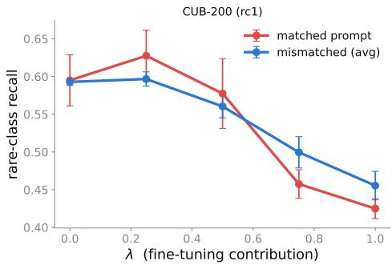  
(a) CUB-200

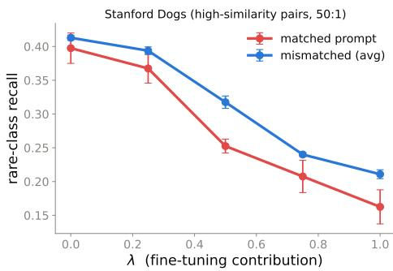  
(b) Stanford Dogs  
Figure 6: Finetuning contribution and cross-prompt recovery on CUB-200 and Stanford Dogs. Rare-class recall as λ rescales the finetuning component. Error bars are standard errors across the four finetuned models.

Per-model TuCo. Table 5 reports the finetuning contribution under matched and mismatched prompts for each of the sixteen finetuned models. “Drop” is the fraction of test images on which TuCo decreases under mismatch, and “rank” the position of the matched prompt among all seven evaluation prompts ordered by decreasing TuCo. TuCo is lower under mismatch in all sixteen models, and the matched prompt has the highest TuCo in thirteen of them.

Table 6: Breakdown across all six models. Each cell reports rare / frequent · overall recall (%), and the ∆ columns are relative to matched.
<table><tr><td>Dataset</td><td>Model</td><td>Matched R/F·Ovr</td><td>Mismatch R/F·Ovr</td><td>∆r/ovr rare/ovr</td><td>∆bestr rare</td></tr><tr><td>Food-101</td><td>Qwen3-VL-2B Qwen3-VL-4B Qwen3-VL-8B Qwen2.5-VL-3B</td><td>65.7/98.2 · 81.9 65.4/98.4· 81.9 61.0/97.5·79.2 53.6/96.3· 74.9</td><td>71.7/98.0· 84.8 70.2/98.2 · 84.2 70.1/97.3·83.7 62.0/95.7· 78.9</td><td>+6.0/ + 2.9 +4.8/ + 2.3 +9.1/ + 4.5 +8.5/ + 3.9</td><td>+10.0 +8.4 +13.6</td></tr><tr><td>CUB-200</td><td>InternVL-3.5-2B Qwen3-VL-2B Qwen3-VL-4B Qwen3-VL-8B Qwen2.5-VL-3B</td><td>58.9/97.6 · 78.2 38.1/96.0·67.0 40.8/91.5· 66.2 49.5/90.8 ·70.2 54.4/90.8 · 72.6 50.5/88.5· 69.5</td><td>60.2/97.5· 78.9 47.2/94.4· 70.8 46.3/84.9 · 65.6 53.9/87.4· 70.7 58.4/89.2 · 73.8 55.1/84.9·70.0</td><td>+1.3/ + 0.6 +9.1/ + 3.8 +5.5/ - 0.6 +4.4/ + 0.5 +4.0/ + 1.2 +4.7/ + 0.5</td><td>+2.9 +16.0 +18.7 +12.3 +7.3</td></tr><tr><td></td><td></td><td></td><td></td><td></td><td></td></tr><tr><td></td><td></td><td></td><td></td><td></td><td></td></tr><tr><td></td><td>Qwen2.5-VL-3B</td><td>34.4/92.4· 63.4</td><td>35.9/91.5·63.7</td><td>+1.6/ + 0.3</td><td></td></tr><tr><td></td><td></td><td>39.3/95.3 · 67.3</td><td>42.0/94.9 · 68.5</td><td></td><td></td></tr><tr><td>FGVC-Aircraft</td><td></td><td></td><td></td><td></td><td></td></tr><tr><td></td><td>InternVL-3.5-2B</td><td>40.4/88.4· 64.4</td><td>42.4/85.5· 64.0</td><td>+2.1/ − 0.4</td><td></td></tr><tr><td></td><td>Gemma-3-4B</td><td></td><td></td><td></td><td>+5.6</td></tr><tr><td></td><td></td><td>29.3/62.7·46.0</td><td>38.1/55.4·46.7</td><td>+8.8/ + 0.8</td><td>+14.5</td></tr><tr><td></td><td></td><td></td><td></td><td></td><td></td></tr><tr><td></td><td>Qwen3-VL-2B</td><td>35.5/94.1· 64.8</td><td>41.0/90.5·65.7</td><td>+5.5/+ 0.9</td><td>+10.6</td></tr><tr><td></td><td>Qwen3-VL-4B</td><td></td><td></td><td>+2.8/ + 1.2</td><td>+5.0</td></tr><tr><td></td><td>Qwen3-VL-8B</td><td>35.5/93.4· 64.5</td><td>38.8/92.2 · 65.5</td><td>+3.2/ + 1.0</td><td>+10.6</td></tr><tr><td></td><td></td><td></td><td></td><td></td><td></td></tr><tr><td></td><td></td><td></td><td></td><td></td><td>+3.6</td></tr><tr><td></td><td>Gemma-3-4B</td><td>31.5/93.5· 62.5</td><td>33.1/92.8 · 62.9</td><td>+1.6/ + 0.4</td><td>+2.7</td></tr><tr><td></td><td>InternVL-3.5-2B</td><td>14.2/46.6· 30.4</td><td>16.5/42.0·29.2</td><td>+2.2/ -1.2</td><td>+3.8</td></tr><tr><td></td><td></td><td></td><td></td><td></td><td></td></tr><tr><td>Stanford Dogs</td><td>Qwen3-VL-2B</td><td>57.0/95.7·76.4</td><td>59.5/91.0·75.3</td><td>+2.5/ -1.1</td><td>+6.1</td></tr><tr><td></td><td>Qwen3-VL-4B</td><td>63.9/96.3· 80.1</td><td>65.7/94.5·80.1</td><td>+1.8/ / + 0.0</td><td>+4.9</td></tr><tr><td></td><td>Qwen3-VL-8B</td><td>64.8/95.9 · 80.3</td><td>65.1/94.7· 79.9</td><td>+0.3 -0.4</td><td>+3.8</td></tr><tr><td></td><td>Qwen2.5-VL-3B</td><td>60.8/95.4· 78.1</td><td>63.0/93.5 · 78.2</td><td>+2.2/ / + 0.1</td><td>+5.4</td></tr><tr><td></td><td>Gemma-3-4B</td><td>45.3/95.4· 70.4</td><td>47.8/93.6 · 70.7</td><td>+2.5/ + 0.3</td><td></td></tr><tr><td></td><td></td><td></td><td></td><td></td><td>+4.6</td></tr><tr><td></td><td>InternVL-3.5-2B</td><td>21.6/74.7·48.2</td><td>24.6/66.5·45.6</td><td>+2.9/ - 2.6</td><td>+7.0</td></tr></table>

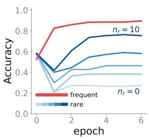  
(a) CUB-200

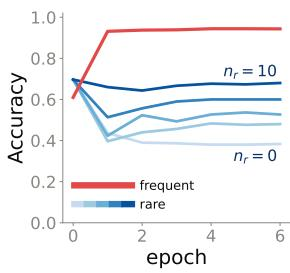  
(b) Stanford Dogs  
Figure 7: Rare-class suppression on CUB-200 and Stanford Dogs. Accuracy over finetuning epochs for frequent classes (red) and rare classes trained with $\begin{array} { r l } { n _ { r } } & { { } \in } \end{array}$ {0, 1, 2, 5, 10} samples per class (blue, light to dark), where $n _ { r } = 0$ trains on frequent classes only. Epoch 0 is the zero-shot model. As in Figure 2, frequent accuracy saturates near ceiling while rare accuracy drops below its zero-shot value, more so as $n _ { r }$ decreases.

## C RECALL BREAKDOWN ACROSS ALL MODELS

Table 1 (Section 4.3) summarizes the breakdown on Qwen3-VL-2B. Table 6 gives a full breakdown across all models. Overall recall is the mean per-class recall over all 20 classes, and rare and frequent recall are the same average restricted to the rare or the frequent classes. Each Matched and Mismatch cell is averaged over the six descriptive training prompts.

## D RARE-CLASS SUPPRESSION

Figure 7 repeats the suppression experiment of Section 4.2 on CUB-200 and Stanford-Dogs, with an identical setup and the same frequent/rare class assignment. The pattern holds on both, and the drop deepens as $n _ { r }$ decreases.

Table 7: Method comparison. In each cell we report rare / frequent / overall recall (%). The best overall recall per dataset is in bold. Oversampling resamples each rare class up to the frequent count without adding new images.
<table><tr><td>Method</td><td>Food-101</td><td>CUB-200</td><td>FGVC-Aircraft</td><td>Stanford Dogs</td></tr><tr><td>Matched prompt</td><td>65.7 / 98.2 / 81.9</td><td>40.8 / 91.5 / 66.2</td><td>35.5 / 94.1 / 64.8</td><td>57.0 / 95.7 / 76.4</td></tr><tr><td>Mism.(avg)</td><td>71.7 / 98.0 / 84.8</td><td>46.3 / 84.9 / 65.6</td><td>41.0 / 90.5 / 65.7</td><td>59.5 / 91.0 / 75.3</td></tr><tr><td>Mism.(ens)</td><td>72.7 / 97.9 / 85.3</td><td>46.3 / 87.8 / 67.1</td><td>39.4 / 92.8 / 66.1</td><td>61.6 / 93.2 / 77.4</td></tr><tr><td>Mism.(sel, k=1)</td><td>73.8 / 97.8 / 85.8</td><td>56.4 / 84.1 / 70.3</td><td>42.9 / 88.8 / 65.8</td><td>61.0 / 89.9 / 75.4</td></tr><tr><td>Mism.(sel, k=5)</td><td>74.8 / 97.9 / 86.3</td><td>58.6 / 83.5 / 71.0</td><td>45.3 / 88.8 / 67.1</td><td>62.4 / 89.5 / 75.9</td></tr><tr><td>with oversampling</td><td></td><td></td><td></td><td></td></tr><tr><td>Matched prompt</td><td>69.9 / 98.0 / 83.9</td><td>57.4 / 90.7 / 74.1</td><td>41.7 / 92.5 / 67.1</td><td>60.0 / 95.5 / 77.7</td></tr><tr><td>Mism.(avg)</td><td>75.5 / 97.5 / 86.5</td><td>58.3 / 81.9 / 70.1</td><td>48.8 / 86.4 / 67.6</td><td>61.4 / 90.0 / 75.7</td></tr><tr><td>Mism.(ens)</td><td>75.6 / 97.8 / 86.7</td><td>68.2 / 84.4 / 76.3</td><td>47.4 / 89.0 / 68.2</td><td>63.3 / 92.3 / 77.8</td></tr><tr><td>Mism.(sel, k=1)</td><td>77.1 / 97.4 / 87.2</td><td>70.4 / 80.7 / 75.5</td><td>53.3 / 81.8 / 67.6</td><td>64.1 / 88.7 / 76.4</td></tr><tr><td>Mism.(sel, k=5)</td><td>77.8 / 97.4 / 87.6</td><td>74.0 / 80.5 / 77.2</td><td>55.4 / 81.8 / 68.6</td><td>66.3 / 88.7 / 77.5</td></tr><tr><td></td><td></td><td></td><td></td><td></td></tr></table>

## E SELECTION METHODS FOR CROSS-PROMPT INFERENCE

Table 7 presents practical methods that can be used for cross-prompt inference, with and without oversampling. We use a simple mechanism that picks the evaluation prompt for each training prompt from a minimal held-out validation set. For each of 200 random splits we use k labeled images per rare class for selection and evaluate recall on the remaining images, then average the results across splits.

Mism.(avg) reports average recall across individual mismatched prompts, Mism.(ens) averages their per-class scores before prediction, and Mism.(sel, k) selects a single mismatched prompt using this validation protocol.

Cross-prompt inference is complementary to oversampling, and selecting a prompt from as few as five labeled images per rare class gives the highest overall recall. Ensembling reaches comparable overall recall but needs multiple forward passes (one per evaluation prompt).

## F LORA VERSUS FULL FINETUNING

In this section, we compare full fine-tuning with LoRA to test whether the matched-prompt penalty is specific to full-parameter adaptation or persists under a less aggressive fine-tuning regime. We repeat the match and mismatch (cross-prompt inference) experiments with LoRA (Hu et al., 2022), a low-rank adapter that leaves the base weights untouched and trains far fewer parameters. We use rank 16 with scaling 32 on the attention and feedforward projections, and keep the data, prompts, epochs and three random seeds identical to the full-finetuning runs, so the two settings differ only in how the model is adapted.

Table 8 reports rare-class recall for both adaptation methods. The matched-prompt penalty persists under LoRA with comparable magnitude, indicating that it is not an artifact of full-parameter finetuning. On CUB-200, LoRA yields higher matched-prompt recall than full fine-tuning, while the cross-prompt gain remains comparable and is slightly larger. Overall, these results show that the matched-prompt penalty is not specific to full-parameter finetuning and persists under substantially lighter parameter adaptation.

## G RARE-CLASS DEGRADATION: IMBALANCE AND CLASS SIMILARITY IMPLEMENTATION DETAILS

All runs share one backbone and protocol: Qwen3-VL-2B under full finetuning, a fixed bank of seven prompt styles and six training epochs. We fully finetune the language model and keep the vision encoder and multimodal projector frozen. We select 20 classes per dataset to be used in the experiments. For each dataset, we choose ten pairs of classes that are the most visually similar according to SigLIP2 (Tschannen et al., 2025), without using the same class twice.

Table 8: LoRA vs. full finetuning. Rare-class recall (%) with the mismatch gain (∆) vs. matched in parentheses, for both full finetuning and LoRA.
<table><tr><td>Dataset</td><td>Match</td><td>Mism.(avg)</td><td>Mism.(best)</td></tr><tr><td>full fnetuning</td><td></td><td></td><td></td></tr><tr><td>Food-101</td><td>65.7</td><td>71.7(+6.0)</td><td> $7 5 . 7 \left( + 1 0 . 0 \right)$ </td></tr><tr><td>CUB-200</td><td>40.8</td><td>46.3(+5.5)</td><td> $5 9 . 5 \left( + 1 8 . 7 \right)$ </td></tr><tr><td>FGVC-Aircraft</td><td>35.5</td><td> $4 1 . 0 \ : ( + 5 . 5 )$ </td><td> $4 6 . 1 \ : ( + 1 0 . 6 )$ </td></tr><tr><td>Stanford Dogs</td><td>57.0</td><td> $5 9 . 5 \left( + 2 . 5 \right)$ </td><td> $6 3 . 1 \left( + 6 . 1 \right)$ </td></tr><tr><td colspan="4"> $L o R A$ </td></tr><tr><td>Food-101</td><td>65.6</td><td> $6 9 . 6 \left( + 3 . 9 \right)$ </td><td> $7 2 . 6 \ : ( + 7 . 0 )$ </td></tr><tr><td>CUB-200</td><td>45.5</td><td> $5 1 . 3 \left( + 5 . 8 \right)$ </td><td> $6 4 . 7 \ : ( + 1 9 . 2 ) $ </td></tr><tr><td>FGVC-Aircraft</td><td>39.3</td><td> $4 7 . 9 \left( + 8 . 6 \right)$ </td><td> $5 7 . 6 \left( + 1 8 . 3 \right)$ </td></tr><tr><td>Stanford Dogs</td><td>62.7</td><td> $6 4 . 9 \ : ( + 2 . 2 ) $ </td><td> $6 9 . 4 \left( + 6 . 7 \right)$ </td></tr></table>

Table 9: Average rare-to-frequent SigLIP2 cosine similarity for each of the six frequent-rare partitions, ordered from most to least similar. All groups use the same 20 classes per dataset.
<table><tr><td>Dataset</td><td>Group#1 (similar)</td><td>Group#2</td><td>Group#3</td><td>Group#4</td><td>Group#5</td><td>Group#6 (different)</td></tr><tr><td>Food-101</td><td>0.733</td><td>0.718</td><td>0.705</td><td>0.694</td><td>0.679</td><td>0.667</td></tr><tr><td>FGVC-Aircraft</td><td>0.803</td><td>0.793</td><td>0.772</td><td>0.760</td><td>0.754</td><td>0.734</td></tr><tr><td>Stanford Dogs</td><td>0.775</td><td>0.764</td><td>0.751</td><td>0.743</td><td>0.729</td><td>0.713</td></tr><tr><td>CUB-200</td><td>0.849</td><td>0.817</td><td>0.788</td><td>0.782</td><td>0.761</td><td>0.741</td></tr><tr><td>ImageNet</td><td>0.798</td><td>0.770</td><td>0.749</td><td>0.722</td><td>0.689</td><td>0.675</td></tr><tr><td>PlantNet-300K</td><td>0.850</td><td>0.827</td><td>0.800</td><td>0.780</td><td>0.748</td><td>0.713</td></tr></table>

Imbalance ratio between frequent and rare classes. We fix all the rare and frequent classes of each dataset by splitting each of the ten pairs, assigning one class to the frequent set and the other to the rare set at random. This yields ten frequent and ten rare classes per dataset, held fixed across all imbalance ratios so that only the number of training images per rare class varies.

Similarity between frequent and rare classes. First, we fix the imbalance ratio of each dataset (Food-101 $n _ { r } = 5 $ , FGVC-Aircraft $n _ { r } = 2 , { \bf C U B - } 2 0 0 \ n _ { r } = 2 .$ , Stanford Dogs $n _ { r } = 1$ , ImageNet $n _ { r } = 2$ and PlantNet-300K $n _ { r } = 2 )$ . Second, we divide each dataset into six groups, each group with a different split between frequent and rare classes, where we control the similarity level between the rare and frequent classes. Similarity is calculated as the average SigLIP2 embedding cosine similarity of each rare class to its most similar frequent class. We then permute the frequent-rare split in order to achieve varied similarity levels for different groups using the same classes. Table 9 shows the similarity scores for each of the six groups across all datasets.

## H DESCRIPTIVE PROMPTS AT FINETUNING AND EVALUATION

In this section we further split the grid to isolate the effect of using descriptive prompts during finetuning versus at evaluation. We write P for the plain, description-free prompt and D for any of the six descriptive prompts. Table 10 reports rare recall for each of the five resulting configurations, averaged over prompts and seeds.

Switching to a different descriptive prompt improves rare recall on all four datasets, so the matched pairing is never the best use of a descriptive prompt. Which side benefits from the descriptions is dataset dependent. Food-101 and Stanford Dogs do better with descriptions only during finetuning, while CUB-200 and FGVC-Aircraft do better with descriptions only at evaluation. The penalty therefore follows from using the same prompt at both ends rather than from where the descriptions sit.

Table 10: Where the descriptions appear. Rare-class recall (%) averaged over prompts and seeds, with P the plain prompt and D a descriptive one.
<table><tr><td>Dataset</td><td>P→P</td><td>P→D</td><td>D→P</td><td>D→D matched</td><td>D→D&#x27; mismatched</td></tr><tr><td>Food-101</td><td>65.5</td><td>70.8</td><td>72.7</td><td>65.7</td><td>71.5</td></tr><tr><td>CUB-200</td><td>37.9</td><td>52.1</td><td>28.5</td><td>40.8</td><td>49.8</td></tr><tr><td>FGVC-Aircraft</td><td>34.3</td><td>42.6</td><td>39.8</td><td>35.5</td><td>41.2</td></tr><tr><td>Stanford Dogs</td><td>52.3</td><td>55.7</td><td>60.2</td><td>57.0</td><td>59.4</td></tr></table>

Table 11: Rare-class recall (%) with seed variability. Values in brackets are the gain over the matched prompt and the gain’s standard error across seeds.
<table><tr><td>Dataset</td><td>Regime</td><td>Match</td><td> $\mathbf { M i s m . ( a v g ) }$ </td><td>Mism.(best)</td></tr><tr><td rowspan="2">Food-101</td><td>Imbalanced</td><td>65.7</td><td>71.7  $( + 6 . 0 \pm 0 . 8 ) $ </td><td> $7 5 . 7 \ ( + 1 0 . 0 \pm 1 . 2 )$ </td></tr><tr><td>Oversampled</td><td>69.9</td><td> $7 5 . 5 \ : ( + 5 . 6 \pm 0 . 3 )$ </td><td> $7 8 . 9 \ ( + 9 . 0 \pm 0 . 6 )$ </td></tr><tr><td rowspan="2">CUB-200</td><td>Imbalanced</td><td>40.8</td><td> $4 6 . 3 \ : ( + 5 . 5 \pm 0 . 8 )$ </td><td> $5 9 . 5 \ : ( + 1 8 . 7 \pm 0 . 9 )$ </td></tr><tr><td>Oversampled</td><td>57.4</td><td>58.3 (+0.9 ± 1.1)</td><td> $7 1 . 0 \ : ( + 1 3 . 6 \pm 1 . 6 )$ </td></tr><tr><td rowspan="2">FGVC-Aircraft</td><td>Imbalanced</td><td>35.5</td><td> $4 1 . 0 \ : ( + 5 . 5 \pm 0 . 7 )$ </td><td> $4 6 . 1 \ : ( + 1 0 . 6 \pm 0 . 5 )$ </td></tr><tr><td>Oversampled</td><td>41.7</td><td>48.8 (+7.1 ± 0.6)</td><td>56.2 (+14.5 ± 0.6)</td></tr><tr><td rowspan="2">Stanford Dogs</td><td>Imbalanced</td><td>57.0</td><td>59.5 (+2.5 ± 0.6)</td><td>63.1 (+6.1 ± 1.2)</td></tr><tr><td>Oversampled</td><td>60.0</td><td>61.4  $( + 1 . 4 \pm 0 . 4 )$ </td><td> $6 5 . 8 \ : ( + 5 . 8 \pm 0 . 9 )$ </td></tr></table>

The last two columns also account for the mismatch average in Table 2. That average runs over all six mismatched evaluation prompts, five of them descriptive and one of them plain, so it falls slightly below the descriptive-only value reported here.

## I SEED VARIABILITY

Table 11 reports rare-class recall with the gain over the matched prompt along with the gain’s standard error across seeds.

## J PROMPT GRID SPECIFICATION

We provide the full prompt specification for every class in every dataset so that the method can be reproduced. Each dataset uses 20 classes, 10 frequent and 10 rare. We use seven prompts in total. The plain prompt lists the class names only, and the remaining six are descriptive prompts formed by three description styles (appearance, contrastive, and attribute), each applied either to all 20 classes or to the rare classes only.

Food-101. Classes: filet mignon, prime rib, pork chop, steak, bolognese spaghetti, carbonara spaghetti, chocolate cake, mousse, bread pudding, french toast, cheesecake, panna cotta, ravioli, dumplings, pizza, sushi, hamburger, ice cream, caesar salad, guacamole. Descriptions are given in Table 12.

Table 12: Food-101: per-class descriptions for all three styles. A detailed all prompt supplies the whole column; detailed rare supplies only the rows for rare classes.
<table><tr><td>Class</td><td>appearance</td><td>contrastive</td></tr><tr><td>filet mignon</td><td>grilled beef steak</td><td>a thick round cut of a tall, round, boneless beef beef; boneless; shape: medallion (unlike the flat wide tall round medallion; steak or bone-in pork chop) color:</td></tr></table>

Continued on the next page.

Table 12 continued from the previous page.
<table><tr><td>Class</td><td>appearance</td><td>contrastive</td><td>attribute</td><td></td></tr><tr><td>prime rib</td><td>a large roasted beef rib cut, pink in the middle</td><td>a roasted beef slab with a bone and a pink center (unlike a seared boneless filet)</td><td>beef; bone-in; shape: thick roasted slab; color: brown crust, pink center</td><td></td></tr><tr><td>pork chop</td><td>a grilled bone-in pork cut</td><td>a pale bone-in pork cut, lighter pork; bone-in; shape: than beef (unlike the dark red flat chop; color: pale tan</td><td></td><td></td></tr><tr><td>steak</td><td>a grilled slab of beef</td><td>steak) a flat, wide, dark-seared beef beef; boneless; shape: slab (unlike the tall round filet flat wide slab; color:</td><td></td><td></td></tr><tr><td>bolognese spaghetti</td><td>spaghetti with a red meat sauce</td><td>mignon) spaghetti under a chunky red tomato-meat sauce (unlike the</td><td>dark grilled pasta; sauce: tomato-meat; texture:</td><td>red</td></tr><tr><td>carbonara spaghetti</td><td>spaghetti with a creamy egg-and-bacon sauce</td><td>pale creamy carbonara) spaghetti in a pale glossy egg- cream sauce, no red (unlike red</td><td>chunky; color: red pasta; sauce: cream; texture: glossy;</td><td>egg-</td></tr><tr><td>chocolate cake</td><td>a dark brown layered chocolate dessert</td><td>bolognese) a firm sliceable brown cake with layers (unlike the soft spooned</td><td>color: pale yellow dessert; form: sliced layers;</td><td>frm base:</td></tr><tr><td>mousse</td><td>a soft whipped chocolate a soft airy chocolate cream in dessert in a cup</td><td>mousse) a glass, holds no shape (unlike</td><td>cake; color: dark brown dessert; form: soft airy cream; vessel: glass;</td><td></td></tr><tr><td>bread pudding</td><td>a baked custard-soaked a browned baked bread-custard bread dessert</td><td>sliceable chocolate cake) block (unlike flat pan-fried french toast slices)</td><td>color: brown dessert; form: custard-soaked block; color:</td><td>baked bread golden</td></tr><tr><td>french toast</td><td>slices</td><td>egg-battered fried bread flat pan-fried egg-dipped bread slices, often stacked (unlike the</td><td>brown dessert; form: flat fried bread slices; stacked; color: golden</td><td>often</td></tr><tr><td>cheesecake</td><td>a pale dense cake with a a dense pale wedge on a brown crumb base</td><td>baked bread pudding block) crust base (unlike the crustless</td><td>dessert; form: dense wedge; base: crumb</td><td></td></tr><tr><td>panna cotta</td><td>a white molded cream a glossy crustless molded cream dessert</td><td>molded panna cotta) dome, often with sauce on top (unlike crusted cheesecake)</td><td>crust; color: pale dessert; form: molded cream dome; none; color:</td><td>base: white,</td></tr><tr><td>ravioli</td><td>lows</td><td>square stuffed pasta pil- flat square stuffed pasta parcels in sauce (unlike rounded pinched</td><td>glossy pasta; form: flat square parcels; filling: yes;</td><td></td></tr><tr><td>dumplings</td><td>small steamed or boiled filled dough parcels</td><td>dumplings) rounded pinched dough parcels, dough; form: rounded steamed or boiled (unlike flat square ravioli)</td><td>color: pale in sauce pinched parcels; cook-</td><td></td></tr><tr><td>pizza</td><td>a round flatbread with tomato, cheese, and top- cheese, and toppings</td><td> a round flatbread with tomato,</td><td>ing: steamed/boiled; color: pale a round flatbread with tomato, cheese, and top-</td><td></td></tr><tr><td>sushi</td><td>pings</td><td>rice-and-fish pieces, of- rice-and-fish pieces, often with rice-and-fish pieces, of-</td><td>pings</td><td></td></tr><tr><td>hamburger</td><td>ten with seaweed a beef patty in a round a beef patty in a round bun</td><td>seaweed</td><td>ten with seaweed a beef patty in a round</td><td></td></tr><tr><td>ice cream</td><td>bun scoops of frozen dessert</td><td>scoops of frozen dessert</td><td>bun scoops of frozen dessert</td><td></td></tr><tr><td>caesar salad</td><td>romaine lettuce with</td><td>romaine lettuce with croutons and dressing</td><td>romaine lettuce with</td><td></td></tr><tr><td>guacamole</td><td>croutons and dressing a green mashed avocado a green mashed avocado dip dip</td><td></td><td>croutons and dressing a green mashed avocado dip</td><td></td></tr></table>

CUB-200. Classes: california gull, herring gull, ring-billed gull, western gull, arctic tern, caspian tern, common tern, black-throated sparrow, chipping sparrow, field sparrow, song sparrow, baltimore oriole, hooded oriole, orchard oriole, blue jay, cardinal, painted bunting, belted kingfisher, ruby-throated hummingbird, scissor-tailed flycatcher. Descriptions are given in Table 13.

Table 13: CUB-200: per-class descriptions for all three styles. A detailed all prompt supplies the whole column; detailed rare supplies only the rows for rare classes.
<table><tr><td>Class</td><td>appearance</td><td>contrastive</td><td>attribute</td></tr><tr><td>california gull</td><td>a medium gull with a yel- low bill, dark eye, and grey back</td><td>a MEDIUM gull with yellow legs and a dark eye (unlike the pink- legged herring gull)</td><td>gull; size: medium; legs: yellow; eye: dark; back: grey</td></tr><tr><td>herring gull</td><td>a large pale-grey gull with pink legs and a red- spotted yellow bill</td><td>a LARGE pale gull with PINK legs (unlike the yellow-legged california/ring-billed gulls)</td><td>gull; size: large; legs: pink; bill: yellow with red spot; back: pale grey</td></tr><tr><td>ring-billed gull</td><td>a small gull with a yel- low bill circled by a black ring, yellow legs</td><td>a small gull whose yellow bill has a clean BLACK RING (un- like the red-spotted herring bill)</td><td>gull; size: small; bill: yellow with black ring;</td></tr><tr><td>western gull</td><td>a large gull with a very dark slate back and pink</td><td>a gull with a very DARK slate back (unlike the pale-grey her-</td><td>legs: yellow gull; size: large; back: dark slate; legs: pink</td></tr><tr><td>arctic tern</td><td>legs a slender grey tern with a full black cap and short red legs</td><td>ring and california gulls) a tern with an ALL-RED short tern; bill: all red; legs: bill and very short legs (unlike very short red; cap: full caspian&#x27;s thick bill or common&#x27;s black</td><td></td></tr><tr><td>caspian tern</td><td></td><td>black-tipped bill) a large tern with a thick a large tern with a THICK bright- tern; size: large; bill: bright-red bill and a black red carrot bill (unlike the slender thick bright red; cap:</td><td></td></tr><tr><td>common tern</td><td>cap a grey tern with a black- tipped orange-red bill</td><td>arctic/common terns) a tern whose orange bill has a tern; bill: orange with BLACK TIP (unlike arctic&#x27;s all- black tip; cap: black</td><td>black</td></tr><tr><td>black-throated spar- row</td><td>and a black cap a grey sparrow with a bold black throat patch and white face stripes</td><td>red bill) a sparrow with a bold BLACK THROAT and white face stripes patch; face: (unlike the plain-throated chip- stripes; back: grey</td><td>sparrow; throat: black</td></tr><tr><td>chipping sparrow</td><td>a small sparrow with a rusty crown and a black</td><td>ping/field sparrows) a sparrow with a RUSTY sparrow; crown: rusty; CROWN and black eye-line eye-line: black; under-</td><td></td></tr><tr><td>field sparrow</td><td>eye-line a plain sparrow with a pink bill and a white eye- ring</td><td>(unlike the plain field sparrow) a plain sparrow with a PINK sparrow; bill: pink; BILL and white eye-ring, no eye-ring: white; marks: strong marks (unlike the rusty- minimal</td><td>parts: plain</td></tr><tr><td>song sparrow</td><td>a streaky brown sparrow with a central breast spot</td><td>capped chipping sparrow) a heavily STREAKED sparrow sparrow; with a central breast SPOT (un- streaked; breast: central like the clean chipping/field spar- dark spot</td><td>underparts:</td></tr><tr><td>baltimore oriole</td><td>black oriole with a black head</td><td>rows) a bright orange-and- a BRIGHT ORANGE oriole with oriole; body: bright or- a fully BLACK HEAD (unlike ange; head: black; bill: the yellower hooded/orchard ori- straight</td><td></td></tr><tr><td>hooded oriole</td><td>a slender yellow-orange oriole with a black throat and curved bill</td><td>oles) a YELLOW-orange oriole with a oriole; body: yellow- black throat and a curved bill (un- orange; throat: black; like baltimore&#x27;s orange body and bill: curved</td><td></td></tr><tr><td>orchard oriole</td><td>a small dark chestnut- and-black oriole</td><td>straight bill) a small DARK CHESTNUT ori- ole (unlike the bright-orange bal- chestnut</td><td>oriole; body: and size: small</td></tr><tr><td>blue jay</td><td>with white and black white and black markings</td><td>timore oriole) a blue crested songbird a blue crested songbird with</td><td>songbird; color: blue; crest: yes; marks: white and black</td></tr><tr><td>cardinal</td><td>markings a bright red songbird with a bright red songbird with a crest a crest and black face and black face mask mask</td><td></td><td>songbird; color: red; crest: yes; face: black mask</td></tr></table>

Continued on the next page.

Table 13 continued from the previous page.
<table><tr><td>Class</td><td>appearance</td><td>contrastive</td><td>attribute</td></tr><tr><td>painted bunting</td><td>and red underparts</td><td>a multicolored bird with a multicolored bird with a blue a blue head, green back, head, green back, and red under- parts</td><td>bird; head: blue; back: green; underparts: red</td></tr><tr><td>belted kingfisher</td><td>with a shaggy crest and a shaggy crest and a big bill big bill</td><td>a stocky blue-grey bird a stocky blue-grey bird with a bird; build: stocky;</td><td>color: blue-grey; crest: shaggy; bill: large</td></tr><tr><td>mingbird</td><td>bird with a needle bill</td><td>ruby-throated hum- a tiny green humming- a tiny green hummingbird with a bird; size: tiny; color: needle bill</td><td>green; bill: needle</td></tr><tr><td>scissor-tailed flycatcher</td><td>very long forked tail</td><td>a pale flycatcher with a a pale flycatcher with a very long forked tail</td><td>bird; color: pale; tail: very long and forked</td></tr></table>

FGVC-Aircraft. Classes: 737-300, 737-500, 737-700, 737-800, 747-200, 747-400, A319, A320, A321, A340-300, A340-600, MD-80, MD-87, CRJ-200, CRJ-700, Spitfire, Cessna 172, F-16A/B, Global Express, DC-3. Descriptions are given in Table 14.

Table 14: FGVC-Aircraft: per-class descriptions for all three styles. A detailed all prompt supplies the whole column; detailed rare supplies only the rows for rare classes.
<table><tr><td>Class</td><td>appearance</td><td>contrastive</td><td>attribute</td></tr><tr><td>737-300</td><td>lage</td><td>a narrow-body Boeing a Boeing 737 with a MID-length 737 jet, mid-length fuse- fuselage (longer than the short 737; fuselage: medium; 737-500)</td><td>maker: Boeing; family: engines: 2 underwing</td></tr><tr><td>737-500</td><td>a narrow-body Boeing 737 jet, short fuselage</td><td>a Boeing 737 with the SHORT- maker: Boeing; family: EST fuselage of the family 737; fuselage: short; en- (shorter than the 737-300)</td><td>gines: 2 underwing</td></tr><tr><td>737-700</td><td>a narrow-body Boeing 737NG jet</td><td>a Boeing 737NG, SHORTER than the 737-800</td><td>maker: Boeing; family: 737NG; fuselage: short- medium; engines: 2 un- derwing</td></tr><tr><td>737-800</td><td></td><td>a narrow-body Boeing a Boeing 737NG, the LONGEST 737NG jet, long fuselage fuselage (longer than the 737- 737NG; fuselage: long; 700)</td><td>maker: Boeing; family: engines: 2 underwing</td></tr><tr><td>747-200</td><td>per deck</td><td>a four-engine Boeing 747 a Boeing 747 with a SHORT up- jumbo jet with a short up- per deck and NO winglets (unlike the 747-400)</td><td>maker: Boeing; family: 747; deck: short hump; winglets: no; engines: 4</td></tr><tr><td>747-400</td><td>jumbo jet with winglets</td><td>a four-engine Boeing 747 a Boeing 747 with WINGLETS and an extended upper deck (un- ily: 747; deck: extended like the 747-200)</td><td>maker: Boeing; fam- hump; winglets: yes; engines: 4</td></tr><tr><td>A319</td><td>a short Airbus A320- the family narrow-body jet</td><td>SHORTEST A320-family jet (shorter than A320; fuselage: short; A320/A321)</td><td>Airbus maker: Airbus; family: engines: 2 underwing</td></tr><tr><td>A320</td><td>an Airbus A320-family narrow-body jet</td><td>the MID-length Airbus A320- maker: Airbus; fam- family jet (longer than A319, ily: A320; fuselage: shorter than A321)</td><td>medium; engines: 2 un- derwing</td></tr><tr><td>A321</td><td>family narrow-body jet</td><td>a stretched Airbus A320- the LONGEST, STRETCHED A320-family jet (longer than ily: A320; fuselage: A319/A320)</td><td>maker: Airbus; fam- long/stretched; engines: 2 underwing</td></tr><tr><td>A340-300</td><td>a four-engine Airbus A340 long-haul jet</td><td>a four-engine A340, SHORTER variant (shorter A340; fuselage: long; than the A340-600)</td><td>the maker: Airbus; family: engines: 4</td></tr><tr><td>A340-600</td><td>a stretched four-engine a Airbus A340 jet</td><td>four-engine A340, STRETCHED long variant A340; fuselage: very (longer than the A340-300)</td><td>the maker: Airbus; family: long; engines: 4</td></tr></table>

Table 14 continued from the previous page.
<table><tr><td>Class</td><td>appearance</td><td>contrastive</td><td>attribute</td></tr><tr><td>MD-80</td><td>a twin-rear-engine Mc- jet</td><td>a twin-rear-engine MD jet, maker: Donnell Douglas MD-80 the LONGER standard length Douglas; (longer than the MD-87)</td><td>McDonnell fuselage: long; engines: 2 rear-</td></tr><tr><td>MD-87</td><td>a shortened McDonnell Douglas MD-87 jet</td><td>a twin-rear-engine MD jet, maker: notably SHORTENED (shorter Douglas; than the MD-80)</td><td>McDonnell fuselage: shortened; engines: 2</td></tr><tr><td>CRJ-200</td><td>a small Bombardier CRJ regional jet</td><td>a small Bombardier CRJ, the maker: SHORT regional jet (shorter than class: regional jet; fuse- the CRJ-700)</td><td>Bombardier; lage: short; engines: 2 rear</td></tr><tr><td>CRJ-700</td><td>a stretched Bombardier CRJ regional jet</td><td>a Bombardier STRETCHED and larger (longer class: than the CRJ-200)</td><td>CRJ, maker: Bombardier; regional jet; fuselage: stretched;</td></tr><tr><td>Spitfire</td><td>fighter with elliptical with elliptical wings wings</td><td>a WWII single-propeller a WWII single-propeller fighter a WWII single-propeller</td><td>fighter with elliptical wings</td></tr><tr><td>Cessna 172</td><td>high-wing light aircraft</td><td>a small single-propeller a small single-propeller high- a small single-propeller wing light aircraft</td><td>high-wing light aircraft</td></tr><tr><td>F-16A/B</td><td>with a bubble canopy</td><td>a single-engine jet fighter a single-engine jet fighter with a a single-engine jet bubble canopy</td><td>fighter with a bubble canopy</td></tr><tr><td>Global Express DC-3</td><td>a large business jet airliner with a tail-wheel</td><td>a large business jet a twin-propeller 1930s a twin-propeller 1930s airliner a twin-propeller 1930s</td><td>a large business jet</td></tr></table>

Stanford Dogs. Classes: miniature schnauzer, standard schnauzer, giant schnauzer, golden retriever, labrador retriever, flat-coated retriever, curly-coated retriever, english setter, irish setter, gordon setter, cocker spaniel, sussex spaniel, welsh springer spaniel, english springer, pug, basenji, chihuahua, siberian husky, great dane, pomeranian. Descriptions are given in Table 15.

Table 15: Stanford Dogs: per-class descriptions for all three styles. A detailed all prompt supplies the whole column; detailed rare supplies only the rows for rare classes.
<table><tr><td>Class</td><td>appearance</td><td>contrastive</td><td>attribute</td><td></td></tr><tr><td>miniature schnauzer</td><td>a muzzle and eyebrows</td><td>small wiry-coated the SMALLEST schnauzer (vs type: schnauzer; size: schnauzer with a bearded the medium standard and large small; coat: wiry; face: giant)</td><td>bearded</td><td></td></tr><tr><td>standard schnauzer</td><td>with a bearded muzzle</td><td>a medium wiry schnauzer the MEDIUM schnauzer (bigger type: schnauzer; size: than miniature, smaller than gi- medium; coat: wiry; ant)</td><td>face: bearded</td><td></td></tr><tr><td>giant schnauzer</td><td></td><td>a large black wiry the LARGEST, black schnauzer type: schnauzer; size: schnauzer with a bearded (vs the small miniature/standard) large; color: black; coat:</td><td></td><td></td></tr><tr><td>golden retriever</td><td>muzzle</td><td>a medium dog with a a retriever with a WAVY type: retriever; coat: dense wavy golden coat GOLDEN coat (vs the short- wavy; color: golden</td><td>wiry</td><td></td></tr><tr><td>labrador retriever</td><td>solid color, otter tail</td><td>coated labrador) a short-coated retriever, a SHORT-coated solid-color re- type: retriever; coat: triever (vs the wavy golden re- short; tail: otter</td><td></td><td></td></tr><tr><td></td><td>long flat glossy coat</td><td>triever) flat-coated retriever a black retriever with a a BLACK LONG-FLAT-coated type: retriever; coat: retriever (vs the golden&#x27;s wavy long flat; color: black gold coat)</td><td></td><td></td></tr></table>

Table 15 continued from the previous page.
<table><tr><td>Class</td><td>appearance</td><td>contrastive</td><td>attribute</td></tr><tr><td>curly-coated triever</td><td>re- a retriever covered in tight curls</td><td>a retriever in TIGHT CURLS all over (vs the flat/wavy coats of tight curls others)</td><td>type: retriever; coat:</td></tr><tr><td>english setter</td><td>with a feathered coat</td><td>a speckled (belton) setter a SPECKLED (belton) setter (vs type: setter; pattern: solid-red irish, black-tan gordon) speckled belton; coat:</td><td>feathered</td></tr><tr><td>irish setter</td><td>with a silky coat</td><td>a solid chestnut-red setter a SOLID CHESTNUT-RED set- type: setter; color: solid ter (vs speckled english, black- chestnut red; coat: silky tan gordon)</td><td></td></tr><tr><td>gordon setter</td><td>a with a silky coat</td><td>black-and-tan setter a BLACK-AND-TAN setter (vs type: setter; color: black red irish, speckled english)</td><td>and tan; coat: silky</td></tr><tr><td>cocker spaniel</td><td></td><td>a small spaniel with long the SMALL spaniel with very type: spaniel; size: domed ears and a silky long domed ears (vs larger small; ears: long domed springers)</td><td></td></tr><tr><td>sussex spaniel</td><td>coat a low body</td><td>golden-liver a LOW HEAVY golden-liver type: spaniel; build: low spaniel with a heavy spaniel (vs the taller red-white heavy; color: golden welsh springer)</td><td>liver</td></tr><tr><td>welsh spaniel</td><td>springer spaniel</td><td>springer a red-and-white medium a RED-AND-WHITE springer type: springer; color: (vs the black/liver-and-white en- red and white; size: glish springer)</td><td>medium</td></tr><tr><td>english springer</td><td>a black/liver-and-white springer spaniel</td><td>a WHITE red-and-white welsh springer)</td><td>BLACK/LIVER-AND- type: springer; color: springer(vs the black/liver and white</td></tr><tr><td>pug</td><td>dog with a curled tail</td><td>a small wrinkly-faced a small wrinkly-faced dog with a size: small; face: wrin- curled tail</td><td>kled flat; tail: curled</td></tr><tr><td>basenji</td><td></td><td>a small short-coated dog a small short-coated dog with a size: small; coat: short; with a curled tail and curled tail and wrinkled forehead tail: curled; brow: wrin-</td><td>kled</td></tr><tr><td>chihuahua</td><td>wrinkled forehead ears</td><td>a tiny dog with large erect a tiny dog with large erect ears</td><td>size: tiny; ears: large erect</td></tr><tr><td>siberian husky</td><td>ears and a thick coat</td><td>a wolf-like dog with erect a wolf-like dog with erect ears and a thick coat</td><td>look: wolf-like; ears: erect; coat: thick</td></tr><tr><td>great dane</td><td>coated dog</td><td>a very tall, large short- a very tall, large short-coated dog</td><td>size: very tall/large; coat: short</td></tr><tr><td>pomeranian</td><td>fox-like face</td><td>a tiny fluffy dog with a a tiny fluffy dog with a fox-like size: tiny; coat: fluffy; face</td><td>face: fox-like</td></tr></table>

ImageNet-20. Classes: european fire salamander, spotted salamander, black and gold garden spider, garden spider, red-backed sandpiper, dowitcher, american chameleon, green lizard, grasshopper, cricket, african crocodile, american alligator, green snake, green mamba, flatworm, sea slug, dragonfly, damselfly, cabbage butterfly, sulphur butterfly. Descriptions are given in Table 16.

Table 16: ImageNet-20: per-class descriptions for all three styles. Rows are ordered as the ten similarity-matched pairs, frequent class first. A detailed all prompt supplies the whole column; detailed rare supplies only the rare rows.
<table><tr><td>Class</td><td>appearance</td><td>contrastive</td><td>attribute</td></tr><tr><td>mander</td><td>yellow blotches</td><td>european fire sala- a glossy black salaman- black salamander whose yel- salamander; der with bold irregular low markings are IRREGULAR colour: black; mark- blotches (unlike the spotted sala- ings: irregular yellow mander&#x27;s neat round spots)</td><td>ground blotches; skin: smooth</td></tr></table>

Continued on the next page.

Table 16 continued from the previous page.
<table><tr><td>Class</td><td>appearance</td><td>contrastive</td><td>attribute</td></tr><tr><td>spotted salamander</td><td>a dark grey salamander with two neat rows of round yellow spots</td><td>grey salamander with two rows salamander; of ROUND yellow spots (unlike colour: dark grey or the european fire salamander&#x27;s ir- slate; markings: two regular blotches)</td><td>rows of round yellow spots; skin: smooth</td></tr><tr><td>den spider</td><td>black and gold gar- a large orb-weaver with a orb-weaver with a BOLD orb-weaver boldly black-and-yellow patterned abdomen</td><td>BLACK-AND-YELLOW ab- abdomen: bold black domen (unlike the garden and yellow bands; size: spider&#x27;s brown cross mark)</td><td>large; web: circular</td></tr><tr><td>garden spider</td><td>a brown orb-weaver with a pale cross-shaped mark on its abdomen</td><td>BROWN orb-weaver with a pale orb-weaver spider; ab- CROSS on the abdomen (unlike domen: mottled brown the black and gold garden spi- with a pale cross; size: der&#x27;s yellow bands)</td><td>medium; web: circular</td></tr><tr><td>red-backed piper</td><td>sand- a small shorebird with a short slightly drooping bill and a rufous back</td><td>small sandpiper with a SHORT drooping bill (unlike the dow- itcher&#x27;s very long straight bill)</td><td>sandpiper; size: small; bill: short, drooping at the tip; back: rufous; belly: black patch in</td></tr><tr><td>dowitcher</td><td>a medium shorebird with a very long straight bill probing mud</td><td>shorebird with a VERY LONG straight bill (unlike the red- backed sandpiper&#x27;s short droop- ing bill)</td><td>shorebird; medium; bill: very long and straight; feeding: vertical sewing-machine probing</td></tr><tr><td>american chameleon</td><td>throat fan</td><td>a slender bright green SLENDER green anole with a anole lizard; colour: anole lizard with a pink PINK throat fan (unlike the stout green lizard&#x27;s blue throat)</td><td>bright green, can turn brown; throat: pink dewlap; body: slender</td></tr><tr><td>green lizard</td><td>blue throat</td><td>a stout green lizard with STOUT green lizard with dark lacertid lizard; colour: fine dark speckling and a speckling and a BLUE throat (unlike the slender american chameleon)</td><td>green with dark speck- les; throat: blue in males; body: stout with a thick tail</td></tr><tr><td>grasshopper</td><td>a green or brown insect with short antennae and long jumping hind legs</td><td>insect with SHORT stout anten- nae (unlike the cricket&#x27;s very long thread-like antennae)</td><td>orthopteran; antennae: short and stout; hind legs: long, for jumping; activity: day; wings: held roof-like</td></tr><tr><td>cricket</td><td>a brown or black insect with very long thin anten- nae and a flattened body</td><td>insect with VERY LONG thread- like antennae and a flattened body (unlike the grasshopper&#x27;s like; body: flattened; ac- short antennae)</td><td>orthopteran; antennae: very long and thread- tivity: night; ovipositor: long in females</td></tr><tr><td>african crocodile</td><td>a large reptile with a nar- row V-shaped snout and interlocking teeth show- ing</td><td>crocodilian with a NARROW V-shaped snout, teeth showing when closed (unlike the american alligator&#x27;s broad snout)</td><td>crocodilian; narrow and V-shaped; teeth: visible when jaws closed; colour: olive to grey-brown</td></tr><tr><td>american alligator</td><td>broad rounded U-shaped snout</td><td>shaped snout and hidden teeth (unlike the african crocodile&#x27;s narrow snout)</td><td>broad and U-shaped; teeth: hidden when jaws closed; colour: grey to near-black</td></tr></table>

Table 16 continued from the previous page.
<table><tr><td>Class</td><td>appearance</td><td>contrastive</td><td>attribute</td></tr><tr><td>green snake</td><td>a rounded head</td><td>slender uniformly harmless green snake with a colubrid snake; colour: bright green snake with a ROUNDED head barely wider uniform bright green; than the neck (unlike the green head: rounded, barely mamba&#x27;s coffin-shaped head)</td><td>wider than the neck; build: very slender;</td></tr><tr><td>green mamba</td><td>head and large eyes</td><td>a bright green snake with green snake with a NARROW elapid snake; colour: a narrow coffin-shaped COFFIN-SHAPED head and bright green; head: nar- large eyes (unlike the rounded- row and coffin-shaped; headed green snake)</td><td>eyes: large; venomous</td></tr><tr><td>flatworm</td><td>face</td><td>a thin flat ribbon-like an- animal that is EXTREMELY flatworm; body: ex- imal gliding over a sur- FLAT and ribbon-like, no gills tremely flat and leaf- (unlike the sea slug&#x27;s raised frilly like; height: negligible; back)</td><td>appendages: none</td></tr><tr><td>sea slug</td><td>gills on its back</td><td>a colourful soft-bodied fleshy RAISED marine slug with nudibranch; marine slug with frilly FRILLY GILLS on its back (un- fleshy and raised; back: like the paper-flat flatworm)</td><td>body: exposed frilly gills and tentacles; colour: often</td></tr><tr><td>cabbage butterfly</td><td>or two black spots</td><td>a white butterfly with WHITE butterfly with BLACK pierid butterfly; wings: black wing tips and one wing TIPS (unlike the yellow sul- white; forewing tip: phur butterfly)</td><td>black patch; spots: one or two black on each</td></tr><tr><td>sulphur butterfly</td><td>no black tip</td><td>a yellow butterfly with a YELLOW butterfly with a thin pierid butterfly; wings: thin dark wing border and dark border and no black tip (un- yellow to orange- like the white cabbage butterfly) yellow; border: thin</td><td>forewing dark edge; forewing tip:</td></tr><tr><td>dragonfly</td><td>a large-eyed insect rest- odonate resting with wings held odonate; wings at rest: ing with its wings held OUT FLAT and a thick body spread horizontally; out flat to the sides</td><td>(unlike the damselfly&#x27;s folded body: thick; eyes: very wings)</td><td>large and touching; flight: strong</td></tr><tr><td>damselfly</td><td>gether over its back</td><td>a slender insect resting slender odonate resting with odonate; wings at rest: with its wings folded to- wings FOLDED over the back folded along the body; (unlike the dragonfly&#x27;s outspread body: very slender; wings)</td><td>eyes: separated on the</td></tr></table>

PlantNet-20. Classes: Ophrys apifera, Ophrys fuciflora, Lamium hybridum, Lamium purpureum, Trifolium pratense, Trifolium medium, Hypericum calycinum, Hypericum hybrid, Cirsium palustre, Cirsium acaulon, Anemone apennina, Anemone blanda, Trifolium campestre, Trifolium dubium, Sedum adolphii, Sedum nussbaumerianum, Atocion rupestre, Moehringia ciliata, Nephrolepis exaltata, Nephrolepis biserrata. Descriptions are given in Table 17.

Table 17: PlantNet-20: per-class descriptions for all three styles. Rows are ordered as the ten similarity-matched pairs, frequent class first. A detailed all prompt supplies the whole column; detailed rare supplies only the rare rows.
<table><tr><td>Class</td><td>appearance</td><td>contrastive</td><td>attribute</td><td></td></tr><tr><td>Ophrys apifera</td><td>yellow tip</td><td>an orchid whose furry bee orchid whose lip appendage brown lip looks like a is TUCKED UNDER and hid- bee, with a tucked-under den (unlike Ophrys fuciflora&#x27;s appendage: reflexed and forward-pointing one)</td><td>genus: white</td><td>Ophrys; lip: brown velvety, bee-like; hidden; sepals: pink to</td></tr><tr><td>Ophrys fuciflora</td><td>appendage</td><td>an orchid with a broad bee orchid with a BROAD square furry lip and a SQUARE lip and a FORWARD- forward-pointing green pointing green appendage (unlike Ophrys apifera&#x27;s hidden tip)</td><td>genus: appendage: pink, broad</td><td>Ophrys; lip: broad and squarish; forward- pointing, visible; sepals:</td></tr><tr><td>Lamium hybridum</td><td>pink-purple toothed leaves</td><td>a small dead-nettle with dead-nettle with DEEPLY CUT hooded sharply toothed leaves (unlike flowers and deeply cut Lamium purpureum&#x27;s shallowly toothed heart-shaped leaves)</td><td>pink-purple toothed; habit: low</td><td>genus: Lamium; flower: hooded; leaf: deeply and sharply</td></tr><tr><td>Lamium pureum</td><td>pur- a small low plant with purple-tinged crowded near the top</td><td>dead-nettle with pinkish-purple hooded SHAPED shallowly toothed flowers and heart-shaped purple-tinged leaves (unlike leaves Lamium hybridum&#x27;s deeply cut leaves)</td><td>HEART- pink-purple leaf: purple-tinged; low</td><td>genus: Lamium; flower: hooded; heart-shaped habit:</td></tr><tr><td>Trifolium pratense</td><td>rounded V-marked leaflets</td><td>a clover with dense clover whose leaflets carry a pink-purple PALE V MARK and whose head flower heads and pale is pink-purple (unlike Trifolium medium&#x27;s unmarked leaflets)</td><td>dense globe, upright</td><td>genus: Trifolium; head: pink- purple; leaflet: oval with a pale V; habit:</td></tr><tr><td>Trifolium medium</td><td>mark</td><td>a clover with deep red- clover with NARROW UN- purple heads and narrow MARKED leaflets and a deep leaflets lacking a pale red-purple head (unlike Tri- folium pratense&#x27;s V-marked</td><td>narrow, stem</td><td>genus: Trifolium; head: deep red-purple; leaflet: unmarked; habit: sprawling, zigzag</td></tr><tr><td>Hypericum lycinum</td><td></td><td>leaflets) ca- a low creeping shrub with St John&#x27;s wort with ONE VERY very large solitary yellow LARGE yellow flower and a big flowers and a prominent tuft of stamens (unlike Hyper- central boss of long sta- icum x&#x27;s several medium flowers)</td><td>genus: prominent</td><td>Hypericum; habit: creeping shrub; flower: single very large yellow; stamens: long</td></tr><tr><td>Hypericum x</td><td>mens with medium yellow flowers and reddish stems</td><td>a garden hybrid shrub garden Hypericum with SEV- ERAL medium yellow flowers arching on arching stems (unlike Hy- flower: medium yellow, pericum calycinum&#x27;s single huge</td><td>genus:</td><td>Hypericum; status: garden hybrid; several per stem; stems:</td></tr><tr><td>Cirsium palustre</td><td></td><td>bloom) a tall slender spiny this- thistle that is TALL with clus- tle with small dark purple tered small heads on a spiny stem heads clustered at the top (unlike Cirsium acaulon&#x27;s stem- small dark purple, in less ground-level head)</td><td></td><td>arching, often reddish genus: Cirsium; height: tall and slender; head: clusters; stem: spiny,</td></tr><tr><td>Cirsium acaulon</td><td>ground-level rosette of</td><td>a thistle with almost no thistle that is STEMLESS, one stem, its single purple head flat in a ground rosette (un- head sitting flat in a like the tall Cirsium palustre)</td><td>winged spiny rosette</td><td>genus: Cirsium; stem: absent or very short; head: single purple at ground level; leaves: flat</td></tr><tr><td>Anemone apennina</td><td>spiny leaves leaves</td><td>a low spring flower with windflower with MANY NAR- a pale blue many-rayed ROW pale blue petals in a star star and finely divided (unlike Anemone blanda&#x27;s fewer broader petals)</td><td>genus: low woodland</td><td>Anemone; flower: pale blue, many narrow petals; leaves: finely divided; habit:</td></tr></table>

Table 17 continued from the previous page.
<table><tr><td>Class</td><td>appearance</td><td>contrastive</td><td></td><td></td><td>attribute</td><td></td></tr><tr><td>Anemone blanda</td><td>a low spring flower with windflower with BROADER a broad blue daisy-like blue petals and a pale centre flower: bloom and a paler centre</td><td></td><td>(unlike Anemone apennina&#x27;s pale centre, broader many narrow rays)</td><td></td><td>genus: low</td><td>Anemone; blue with a petals; leaves: divided, bronze-tinged;habit:</td></tr><tr><td>Trifolium campestre</td><td>papery balls</td><td></td><td>rounded yellow heads LARGER heads of 20-30 yellow, 20-30 flowers, that dry to pale brown flowers drying papery brown dries brown; leaflets: (unlike Trifolium dubium&#x27;s tiny nearly stalkless; habit: few-flowered heads)</td><td></td><td>a small clover with small yellow clover with genus: Trifolium; head: sprawling</td><td></td></tr><tr><td>Trifolium dubium</td><td>only a few flowers</td><td></td><td>a tiny clover with very yellow clover with TINY heads genus: Trifolium; head: small yellow heads of of only 3-15 flowers (unlike Tri- tiny yellow, 3-15 flow- folium campestre&#x27;s fuller heads)</td><td></td><td>ers; leaflet: middle one stalked; habit: prostrate</td><td></td></tr><tr><td>Sedum adolphii</td><td>yellow-green tips</td><td>a succulent with plump succulent with flushed orange-red at the TIPPED</td><td>leaves GREEN leaves merely red- plump, keeled, yellow- (unlike nussbaumerianum&#x27;s copper-orange leaves)</td><td></td><td>YELLOW- genus: Sedum; leaves: Sedum green with red tips; wholly habit: branching succu- lent rosettes</td><td></td></tr><tr><td>rianum</td><td>loose open rosettes</td><td>tips)</td><td>Sedum nussbaume- a succulent with thick succulent whose leaves are genus: Sedum; leaves: copper-orange leaves in COPPER-ORANGE out (unlike Sedum adolphii&#x27;s ange; rosettes: loose yellow-green leaves with red and open; habit: sprawl-</td><td></td><td>through- thick, copper to or- ing succulent</td><td></td></tr><tr><td>Atocion rupestre</td><td>pink-white stems</td><td></td><td>a small rock plant with small rock plant with NOTCHED family: notched pink-white petals on forking laceae; petals:5, petals on slender forking stems (unlike Moehringia cili- notched, pink to white; ata&#x27;s unnotched white petals)</td><td></td><td>leaves: paired; habit: tufted on</td><td>Caryophyl- grey-green</td></tr><tr><td>Moehringia ciliata</td><td>leaves</td><td></td><td>a tiny cushion plant cushion plant with UN- family: with small pure white NOTCHED pure white petals laceae; petals: 5, white, petals and narrow fringed and hair-fringed leaves (unlike not notched; leaves: Atocion rupestre&#x27;s notched narrow, petals)</td><td></td><td>rock habit: dense cushion</td><td>Caryophyl- hair-fringed;</td></tr><tr><td>tata</td><td>Nephrolepis exal- a fern with arching bright fern with SHORT CLOSE-SET genus: small close-set leaflets</td><td>green fronds of many wavy leaflets on arching fronds frond: arching, to 1 m;</td><td>(unlike Nephrolepis biserrata&#x27;s pinnae: short, close-set, long spaced toothed leaflets)</td><td></td><td>wavy-edged; dense clump</td><td>Nephrolepis; habit:</td></tr><tr><td>rata</td><td>toothed leaflets</td><td>Nephrolepis biser- a large fern with long stiff fern with LONG WIDELY fronds of widely spaced SPACED toothed leaflets on frond: long and stiff,</td><td>stiff fronds (unlike Nephrolepis to 2 m; pinnae: long, exaltata&#x27;s short close-set ones)</td><td></td><td>genus: spaced, toothed; habit: coarse open clump</td><td>Nephrolepis;</td></tr></table>