# Can World and Action Modeling Benefit Each Other under Unified Causal Training?

Yue Su1,2,6,∗, Bokai Lin2,4,∗, Xinkai Wang2,4,∗, Chubin Zhang3, Xiangnan Wu5, Kuan Zhang3 Weiyang Jin1, Jiwen Yu1, Yiming Li3, Cewu Lu2,4, Lixin Yang2,4,†, Xihui Liu1,†

1MMLab@HKU, 2MVIG@SJTU, 3THU, 4SII, 5UCAS, 6 IAAI Team

## Abstract

World and action modeling are closely related, yet their reciprocal benefits under unified causal training remain unclear. We introduce OneWM, a simple framework for unified causal training that treats actions as both conditions for world prediction and targets for policy learning within a shared video–action architecture. Using this framework, we investigate whether learning forward dynamics conditioned on specified actions improves action learning, and whether learning to generate actions in turn improves action-conditioned world modeling. We use LIBERO, LIBERO-Plus, and RoboCasa365 as embodied testbeds to evaluate both policy learning and world modeling, complemented by real-world policy experiments. Learning the visual consequences of specified actions improves policy performance and generalization across changing scenes. In turn, action learning improves multi-view world-prediction fidelity under the same architecture. Together, these results answer both questions positively, supporting reciprocal benefits between world modeling and action generation under unified causal training.

Date: October 16, 2026

Project Page: https://selen-suyue.github.io/OneWMNet

## 1 Introduction

Predicting how actions affect the physical world and learning to generate actions are closely related problems [1]. World models predict future observations from specified actions [2, 3], while world-action models (WAMs) use video generation to guide action generation [4, 5]. These complementary objectives motivate studying world and action modeling within a unified framework.

Video foundation models support policy learning by predicting future observations [4–6]. One line of work [7–9] uses mixture-of-transformers (MoT) architectures [10], in which action tokens attend to bidirectional video representations [1, 11–13]. These visual representations serve as effective policy priors and support strong manipulation performance. Related studies [2, 8, 14, 15] jointly model video and action generation within shared architectures, further demonstrating how video generation benefits action learning. In parallel, causal WAMs [5, 16, 17] use directional attention to couple video and action generation, aiming to capture causal dynamics in a more physically consistent way.

These results demonstrate the value of video prediction for action learning, yet the interaction between action-conditioned world modeling and action generation under temporal causality warrants further study. With bidirectional backbones augmented with an action-inference branch, the video branch often retains its pretrained attention [7], reflecting the premise that existing visual representations suffice as policy priors. Causal WAMs allow video tokens to attend to actions, but these actions are noisy variables under joint denoising [5, 17]. Joint generation therefore differs from forward dynamics prediction conditioned on specified clean actions. Conditioning video generation on ground-truth actions makes forward dynamics an explicit learning objective, raising our first question: Can learning such action-conditioned forward dynamics improve action learning within the same causal model? Within the same framework, action generation may in turn provide a learning signal for visual prediction, motivating the converse question: Can learning to generate actions, in turn, improve action-conditioned world modeling within the same causal model?

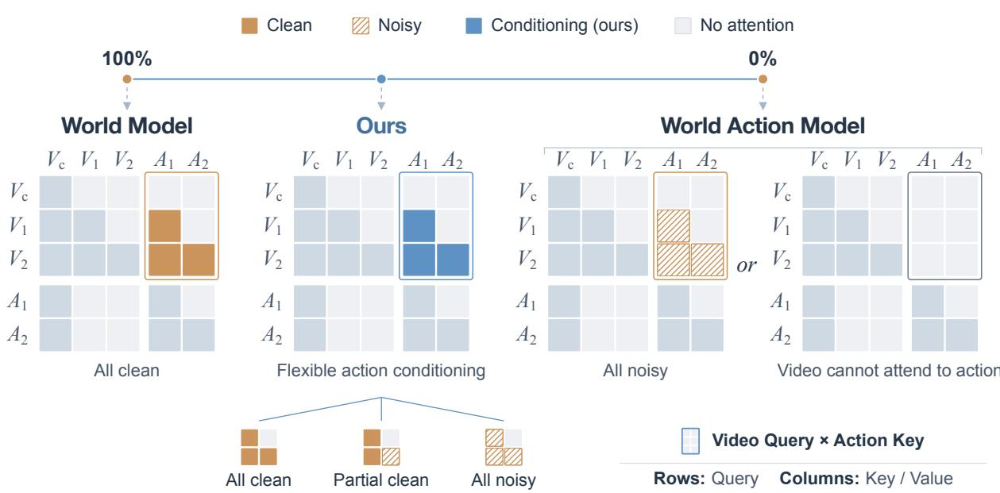  
Figure 1: Action conditioning for world and action modeling. Rows denote queries and columns denote keys/values. $V _ { c } , V _ { 1 , 2 } ,$ and $A _ { 1 , 2 }$ represent visual context, future video, and aligned actions, respectively. Outlined blocks compare world prediction conditioned on clean ground-truth actions (solid orange) with WAM prediction using noisy actions (hatching) or masked action keys (light gray). Percentages indicate the fraction of clean ground-truth actions. OneWM (blue) mixes all-clean, partial-clean, and all-noisy examples to examine whether world and action modeling benefit each other under unified causal training.

Existing architectures provide a straightforward basis for unified causal training, allowing us to investigate these questions within a shared model. In a causal MoT framework, Fig. 1 illustrates two endpoints: an all-clean setting, where a world model predicts video conditioned on clean ground-truth actions, and an all-noisy setting, where noisy action tokens serve as generation targets while conditioning video prediction. The figure also shows an representative WAM formulation that prevents video tokens from attending to action tokens. Both WAM formulations are organized around action generation through denoising, limiting action-to-video information flow: the video branch receives only noisy actions or no action information at all. To connect explicit forward-dynamics learning with action generation, we consider OneWM, a unified causal model that supports both all-clean and all-noisy conditioning, together with a partial-clean setting, which uses a clean action prefix to condition both future-video prediction and denoising of the remaining noisy suffix. Each training batch mixes the three settings, enabling us to examine reciprocal benefits between forward-dynamics learning and action generation within the same causal model.

We conduct extensive experiments across multiple simulated and real-world environments to examine whether world and action modeling benefit each other under unified causal training. Our results provide positive answers to both questions. First, under OneWM’s unified causal training, incorporating clean-action conditioning into world model learning substantially improves the policy’s action-prediction performance, outperforming the evaluated WAMs with action-masked or noisy-action-conditioned video branches. Second, learning to generate actions also improves action conditioned world modeling, showing that the benefits can be reciprocal in this setting. We further analyze the interaction between the two learning tasks.

## 2 Related Work

## 2.1 World Action Models

World-action models bring predictive world representations into policy learning. One line of work uses generated videos as visual plans or synthetic demonstrations, recovering executable actions through inverse dynamics or goalconditioned controllers [18–20]. Other approaches integrate visual forecasting into the policy itself, using predictive video features [21–23] or jointly learning future observations and actions [4–6, 9, 24–26]. These formulations use temporal supervision and video pretraining to improve policy generalization and data efficiency.

Recent work also separates predictive learning from the cost of future synthesis. Efficient WAMs retain video co-training while reducing or bypassing future-video generation at deployment [7, 27]. Latent and condition-space approaches couple future-representation prediction with action generation [28–30], while representation distillation transfers worldmodel features to policies without adding a generative process at inference [31]. We build on these predictive approaches by making the visual consequences of specified actions an explicit learning target during policy training.

## 2.2 World Models

World models learn transition dynamics for planning and policy optimization, either in compact latent spaces [32–34] or through visual forecasting [35, 36]. Large-scale video pretraining provides reusable visual dynamics priors [1, 13], while robotic world models develop control interfaces that relate these priors to concrete robot commands. Frame-level action injection and spatially grounded kinematic conditioning support fine-grained, controllable rollouts [37–39]. Latent-action pretraining offers a complementary route to learning interaction dynamics from unlabeled videos before adapting to robot controls [40, 41].

These predictors increasingly serve as learned simulators for policy evaluation and improvement, supplying imagined rollouts and synthetic experience [3, 38, 42, 43]. Their dynamics priors can also be transferred directly to policy learning [44]. These applications require predictions that follow the supplied actions, a property distinguished from visual plausibility in recent evaluations [45]. Our work also treats actions as learning targets, using action-generation supervision to strengthen the representations underlying these predictions.

## 2.3 Unified World and Action Modeling

Unified models support world prediction and action generation through shared representations and flexible conditioning [2, 8, 14, 15]. This line spans bidirectional diffusion frameworks [6, 15] and causal designs with autoregressive or directional information flow [5, 16, 17].

Existing studies report both reciprocal benefits and task trade-offs. For example, WorldVLA [46] interleaves discrete image and action tokens in a shared autoregressive model, coupling action generation with action-conditioned nextimage prediction. Joint training improves both action generation and long-horizon visual prediction. By contrast, Cosmos 3 [15] reports that joint learning with video improves action prediction under bidirectional video–action diffusion, but co-training with action prediction leads to a small decline in video-generation fidelity.

These findings arise from different modeling settings: WorldVLA demonstrates mutual benefits through discrete autoregressive image–action modeling, whereas Cosmos 3 studies joint video–action learning with bidirectional attention. Together, they leave open how temporal causality shapes the learning of physical dynamics and the resulting benefits for video and action prediction. We investigate this interaction within a shared causal video–action MoT framework, explicitly coupling action-conditioned forward-dynamics learning with action generation to examine their reciprocal benefits.

## 3 Method

## 3.1 Problem Formulation

We consider future-video prediction and action generation from an observed visual context and a language instruction. Let $\mathbf { o } ^ { \mathrm { c t x } }$ denote the observed frame prefix, $\mathbf { o } ^ { \mathrm { f u t } }$ the future frames, and ${ \bf a } = ( a _ { 1 } , \dots , a _ { K } )$ an action chunk over the prediction horizon. We denote the language instruction by ℓ. As illustrated in Fig. 2, a video VAE encodes frames into

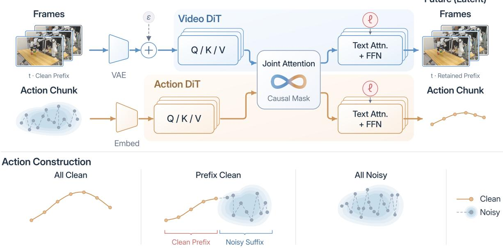  
Figure 2: Overview of OneWM. A VAE encodes frames into latents; the observed prefix remains clean, and the video expert denoises future latents. Action chunks are embedded for the action expert. Causal joint attention couples the two experts, each receiving instruction ℓ through its own text cross-attention (Sec. 3.2). The lower panels illustrate all-clean, clean-prefix/noisy-suffix, and all-noisy action construction, unifying world prediction and action generation (Sec. 3.3).

latents $\mathbf { z } ^ { \mathrm { c t x } }$ and $\mathbf { z } ^ { \mathrm { f u t } }$ , while the action chunk is represented by action embeddings. The observed video prefix remains clean, and future video latents are denoising targets.

World modeling predicts future video conditioned on specified clean actions, while action modeling generates an action chunk conditioned on the visual context and instruction. With $c = ( \mathbf { z } ^ { \mathrm { c t x } } , \boldsymbol { \ell } )$ and model parameters θ, these tasks correspond to

$$
p _ { \theta } \left( \mathbf { z } ^ { \mathrm { { f u t } } } \mid { \mathcal { C } } , \mathbf { a } \right) \quad { \mathrm { a n d } } \quad p _ { \theta } ( \mathbf { a } \mid { \mathcal { C } } ) .\tag{1}
$$

OneWM implements both tasks with separate video and action experts that exchange information through temporally causal joint attention. Each expert receives language conditioning through its own text cross-attention. Across training samples, actions serve as clean conditions, noisy prediction targets, or a clean prefix followed by a noisy suffix. This formulation allows us to study the interaction between clean-action-conditioned world prediction and action learning within the same causal model.

## 3.2 Temporally Causal Video--Action Modeling

To examine the interaction between forward-dynamics learning and action learning, OneWM couples the two tasks through a common causal MoT backbone [10] (Fig. 2). We initialize the video expert from pretrained Wan2.2-TI2V-5B [13] and reuse its video VAE and text encoder. The video expert models visual dynamics in latent space, and the action expert models action chunks. Modality-specific attention projections and feed-forward layers accommodate their different representations. Both experts receive the instruction ℓ through separate text cross-attention modules, allowing the same task semantics to condition visual prediction and action generation.

The causal structure is specified by the temporal alignment of video and action blocks. Let $\mathcal { V } _ { 0 }$ denote the observed visual context, $\nu _ { i }$ the tokens of future latent frame i, and $A _ { i }$ the action segment aligned with that frame. For queries in block $i \geq 1$ , the sets of visible key tokens are

$$
\begin{array} { r l } & { S _ { v } ( i ) = \mathcal { V } _ { \leq i } \cup \mathcal { A } _ { \leq i } , } \\ & { S _ { a } ( i ) = \mathcal { V } _ { 0 } \cup \mathcal { A } _ { \leq i } , } \end{array}\tag{2}
$$

where $\textstyle \mathcal { V } _ { \leq i } = \bigcup _ { i = 0 } ^ { i } \mathcal { V } _ { j }$ and $\textstyle A _ { \leq i } = \bigcup _ { i = 1 } ^ { i } { \mathcal { A } } _ { j }$ . Thus, future video queries access the video and action prefixes up to their aligned block, while action queries use the observed visual context and the corresponding action prefix. Context queries remain confined to the observation stream. Tokens within a future frame or an action segment can interact freely, and dependencies between blocks follow temporal order.

Following MoT, the experts use their own query, key, and value projections while performing joint attention over the permitted tokens. Writing $Q _ { m } , K _ { m }$ , and $V _ { m }$ for expert $m \in \{ v , a \}$ , the attention aggregation is

$$
U _ { m } = \mathrm { s o f t m a x } _ { \mathcal { S } _ { m } } \left( \frac { Q _ { m } K ^ { \top } } { \sqrt { d } } \right) V , \qquad K = \left[ K _ { v } \right] , \quad V = \left[ V _ { v } \right] ,\tag{3}
$$

where d is the attention-head dimension and softmaxS normalizes each query row over its visible keys only. The aggregated features $U _ { m }$ are then processed by the corresponding expert’s output projection and remaining layers.

This asymmetric coupling connects the two learning tasks under temporal causality. Attention to action features grounds forward-dynamics prediction in control signals, while attention to the observed video features supports action generation. Both objectives train the interconnected experts, providing routes for learning signals from one task to shape representations used by the other. Across the training regimes described next, we retain these visibility relations and vary which actions serve as clean conditions or prediction targets. This allows us to study the interaction between the two learning objectives within the same causal architecture.

## 3.3 Unified Action Conditioning

Within the causal backbone above, we vary the role of actions between specified conditions for world prediction and targets for action generation. As illustrated by the Action Construction panels in Fig. 2, these roles are unified by the length $r \in \{ 0 , \ldots , K \}$ of a clean action prefix. Writing $\widetilde { a } _ { k } ( \tau )$ for action $a _ { k }$ corrupted at noise level $\tau ,$ the action input is

$$
a _ { k } ^ { ( r , \tau ) } = \left\{ \begin{array} { l l } { a _ { k } , } & { k \le r , } \\ { \widetilde { a } _ { k } ( \tau ) , } & { k > r . } \end{array} \right.\tag{4}
$$

The action expert receives a noise-level embedding for each token: zero for clean-prefix tokens $( k \leq r )$ and the same sampled level τ for all noisy-suffix tokens $( k > r )$ . These embeddings distinguish specified conditions from denoising targets within the action sequence. All regimes retain the visibility relations in Eq. 2. The observed video prefix remains clean, and future video latents are denoised throughout.

All-clean $( r = K )$ . All actions are clean conditions for future video prediction. This regime learns action-conditioned forward dynamics, with no action denoising loss

Partial-clean $( 0 < r < K )$ A clean prefix conditions denoising of the remaining action suffix, corresponding to the Prefix Clean panel in Fig. 2. Within this regime, we choose between two sampling strategies according to a fixed mixing ratio. The first uniformly selects a boundary between the video-aligned action blocks $\mathbf { \mathcal { A } } _ { i }$ and perturbs it by up to two action steps to obtain r, clipped to $\{ 1 , \ldots , K - 1 \}$ . The second samples r uniformly from this range. This favors temporally aligned conditions while retaining varied prefix lengths. Only the noisy suffix contributes to the action loss, while video prediction uses both clean and noisy action features.

All-noisy $( r = 0 )$ . All actions are denoising targets, predicted from the observed visual context and instruction. Future video prediction is jointly trained with noisy action features as conditions.

We sample the regime and clean-prefix length per example, mixing these forms of conditioning within each batch. The same experts thus learn both specified-action dynamics and action generation, allowing us to assess their reciprocal benefits under a fixed causal architecture.

## 3.4 Joint Training Objective

Building on the conditioning regimes in Sec. 3.3, we jointly train the video and action experts with flow matching [47]. For a clean target x, the noisy input is $\mathbf { x } ( \tau ) = ( 1 - \tau ) \mathbf { x } + \tau \pmb { \epsilon }$ , where $\epsilon \sim \mathcal { N } ( 0 , I )$ , and the target velocity is $\epsilon - \mathbf { x }$

Video and action noise levels $\tau _ { v }$ and $\tau _ { a }$ are sampled independently. The clean visual context and action prefix remain conditioning inputs.

Let $\widehat { \mathbf { u } } _ { v }$ and $\widehat { \mathbf { u } } _ { a }$ denote velocity predictions for future video latents and the action chunk, respectively. With the clean-prefix length r defined in Eq. 4, the joint objective is

$$
\begin{array} { r l } & { \mathcal { L } _ { v } = \mathbb { E } \Big [ w _ { v } ( \tau _ { v } ) \left| \big | \widehat { \mathbf { u } } _ { v } - \big ( \epsilon _ { v } - \mathbf { z } ^ { \mathrm { f u t } } \big ) \right| \Big | _ { \mathrm { m e a n } } ^ { 2 } \Big ] , } \\ & { \mathcal { L } _ { a } = \mathbb { E } _ { r < K } \Big [ w _ { a } ( \tau _ { a } ) \left| \big | \widehat { \mathbf { u } } _ { a , > r } - \big ( \epsilon _ { a , > r } - \mathbf { a } _ { > r } \big ) \right| \Big | _ { \mathrm { m e a n } } ^ { 2 } \Big ] , } \\ & { \mathcal { L } = \lambda _ { v } \mathcal { L } _ { v } + \lambda _ { a } \mathcal { L } _ { a } . } \end{array}\tag{5}
$$

Here $\| \cdot \| _ { \mathrm { m e a n } } ^ { 2 }$ averages squared error over valid target elements, $w _ { v }$ and $w _ { a }$ are noise-level weights, and $\lambda _ { v }$ and $\lambda _ { a }$ balance the two objectives. The expectations cover training examples, conditioning regimes, and noise. The action loss averages only examples with a noisy suffix $( r < K )$ , and is zero when no such targets are present. Thus, all-clean examples provide forward-dynamics supervision, while partial-clean and all-noisy examples additionally supervise action generation. Both losses optimize the coupled experts through causal joint attention.

## 3.5 Inference

We use two inference settings corresponding to the all-clean and all-noisy endpoints in Sec. 3.3. Sampling integrates the velocity fields learned in Sec. 3.4 from noise (τ = 1) to clean outputs (τ = 0), with the observed visual context and language instruction held fixed.

World prediction. The action chunk is supplied as clean conditioning (r = K) and remains fixed throughout sampling. The video expert denoises future video latents initialized from Gaussian noise, conditioned on $c = ( \mathbf { z } ^ { \mathrm { c t x } } , \boldsymbol { \ell } )$ —the observed visual context and language instruction—together with the specified actions. The video VAE decodes the resulting latents into predicted frames.

Action generation. The action chunk is initialized from Gaussian noise (r = 0) and denoised by the action expert, conditioned on the same observed visual context and language instruction. Observed video representations are reused across denoising steps. For closed-loop control, a new action chunk is generated from the latest observations at each replanning step.

## 4 Experiments

We evaluate how world and action modeling affect each other under unified causal training. Figure 3 summarizes the simulation benchmarks and real-world tasks used in our study.

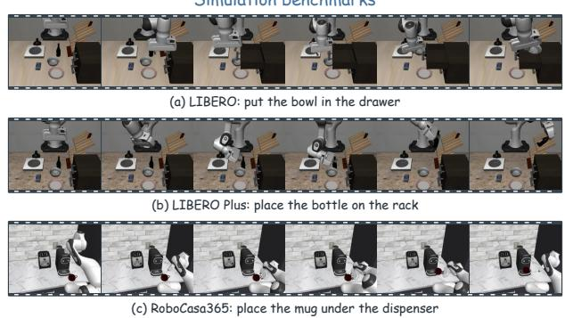

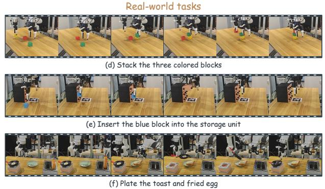  
Figure 3: Evaluation tasks and environments. We evaluate OneWM on LIBERO, LIBERO-Plus, and RoboCasa365 in simulation, and on three real-world tasks: block stacking, block insertion, and breakfast arrangement.

LIBERO-Plus  
Table 1: Policy performance in simulation. Success rates (%) on LIBERO, LIBERO-Plus, and RoboCasa365. Bold highlights the best result among internal variants. Bkgd., Lang., and Init. denote background, language, and robot initialization, respectively; S/U and Comp. denote seen/unseen and composite tasks in RoboCasa365.
<table><tr><td colspan="5">LIBERO</td></tr><tr><td>Method</td><td>Spatial</td><td>Object</td><td>Goal</td><td>Long</td><td>Avg.</td></tr><tr><td>π₀ [51] WorldVLA [46]</td><td>98.00 87.60</td><td>96.80</td><td>94.40</td><td>88.40</td><td>94.40 81.80</td></tr><tr><td>Fast-WAM [7]</td><td>98.20</td><td>96.20 100.00</td><td>83.40 97.00</td><td>60.00 95.20</td><td>97.60</td></tr><tr><td>WAMmask</td><td>93.80</td><td></td><td></td><td></td><td></td></tr><tr><td></td><td></td><td>96.20</td><td>96.80</td><td>83.00</td><td>92.45</td></tr><tr><td> $\mathbf { W A M _ { \mathrm { n o i s y } } }$ </td><td>94.00</td><td>95.80</td><td>95.60</td><td>85.00</td><td>92.60</td></tr><tr><td>OneWM</td><td>96.60</td><td>98.60</td><td>96.80</td><td>87.80</td><td>94.95</td></tr></table>

<table><tr><td colspan="4">RoboCasa365</td></tr><tr><td>Method</td><td>Atomic-S</td><td>Comp.-S Comp.-U</td><td>Overall</td></tr><tr><td>π₀ [51]</td><td>34.60</td><td>6.10</td><td>1.10 14.80</td></tr><tr><td>π0.5 [52]</td><td>39.60</td><td>7.10 1.20</td><td>16.90</td></tr><tr><td>GigaWorld-Policy [17]</td><td>44.40</td><td>11.80 2.90</td><td>20.70</td></tr><tr><td>GR00T N1.6 [53]</td><td>51.10</td><td>9.40 1.70</td><td>21.90</td></tr><tr><td> $\mathbf { W A M _ { \mathrm { m a s k } } }$ </td><td>55.89</td><td>19.63 6.00</td><td>28.32</td></tr><tr><td>OneWM</td><td>68.78</td><td>30.25 7.00</td><td>36.68</td></tr></table>

<table><tr><td>Method</td><td>Bkgd.</td><td>Camera</td><td>Lang.</td><td>Light</td><td>Layout</td><td>Init.</td><td>Noise</td><td>Overall</td></tr><tr><td>π0 [51]</td><td>81.40</td><td>13.80</td><td>58.80</td><td>85.00</td><td>68.90</td><td>6.00</td><td>79.00</td><td>53.60</td></tr><tr><td>WorldVLA [46]</td><td>17.10</td><td>0.10</td><td>41.60</td><td>43.70</td><td>38.00</td><td>27.90</td><td>10.90</td><td>25.00</td></tr><tr><td>Fast-WAM [7]</td><td>52.30</td><td>16.30</td><td>68.10</td><td>78.90</td><td>60.50</td><td>44.40</td><td>37.90</td><td>49.70</td></tr><tr><td> $\mathbf { W A M _ { \mathrm { m a s k } } }$ </td><td>54.00</td><td>11.13</td><td>73.85</td><td>84.24</td><td>62.36</td><td>47.68</td><td>50.41</td><td>53.37</td></tr><tr><td> $\mathbf { W A M _ { \mathrm { n o i s y } } }$ </td><td>53.07</td><td>10.82</td><td>70.33</td><td>81.87</td><td>63.08</td><td>49.68</td><td>48.34</td><td>52.50</td></tr><tr><td>OneWM</td><td>57.34</td><td>18.39</td><td>79.57</td><td>79.86</td><td>71.08</td><td>47.81</td><td>67.08</td><td>59.27</td></tr></table>

## 4.1 Experimental Setup

Benchmarks and evaluation. We evaluate on three simulation benchmarks: LIBERO [48], LIBERO-Plus [49] for generalization under diverse perturbations, and RoboCasa365 [50] for mobile manipulation in complex environments. Real-world experiments cover block stacking, block insertion, and breakfast arrangement (Fig. 3). We report task success rates for policy evaluation and PSNR, SSIM, LPIPS, FID, and FVD for world prediction. Detailed training and evaluation protocols are provided in Appendix A.

Comparisons. To answer our first question—whether learning action-conditioned forward dynamics improves action learning—we compare OneWM with the two WAM variants illustrated in Fig. 1. The action-masked WAM $\mathrm { ( W A M _ { m a s k } ) }$ ) prevents future-video tokens from attending to action tokens, blocking action-to-video information flow. The noisy-action-conditioned WAM $( \mathbf { W A M _ { n o i s y } } )$ allows such attention but conditions video prediction on noisy actions throughout training. Both jointly learn video and action prediction; OneWM additionally trains with clean and partially clean actions. To answer our second question—whether learning to generate actions improves action-conditioned world modeling—we compare OneWM with the world-model baseline (WM). Corresponding to the all-clean setting in Fig. 1, WM predicts future video conditioned on clean actions without an action-prediction objective.

## 4.2 World Modeling for Action Learning

To address our first question, we compare the policies learned by OneWM and the two WAM variants under the same causal architecture. All three jointly learn video and action prediction, while OneWM also learns forward dynamics conditioned on clean actions. This comparison tests whether explicitly learning the visual consequences of specified actions benefits action learning.

In-distribution performance and generalization. OneWM outperforms both WAM variants on in-distribution LIBERO and out-of-distribution LIBERO-Plus (Table 1). On LIBERO, the gains span spatial, object, and long-horizon tasks, while goal performance matches the stronger variant. On LIBERO-Plus, the advantages extend to background, camera, language, layout, and sensor-noise perturbations, with particularly strong gains under sensor noise. Camera and layout changes require the policy to adapt to different visual configurations while preserving the intended interaction.

The improvements in these settings suggest that learning action-conditioned dynamics strengthens representations of task-relevant scene changes. The benefit remains uneven under lighting changes and robot initialization.

The comparison with Fast-WAM further highlights this generalization advantage. Although OneWM trails Fast-WAM on LIBERO, it outperforms it across all LIBERO-Plus perturbation categories and achieves the best overall result among the listed policies. Fast-WAM [7] uses bidirectional attention within its video and action experts while separating future-video prediction from action generation. In OneWM, clean-action conditioning and causal joint attention ground video prediction in specified controls and their temporal order. This supervision encourages the visual expert to capture how actions change object configurations, shaping the observed representations used by the action expert. The stronger performance under distribution shift is consistent with learning transferable interaction dynamics rather than relying primarily on correlations specific to familiar scenes.

Manipulation in diverse scenes. On RoboCasa365, OneWM surpasses $\mathbf { W A M _ { \mathrm { m a s k } } }$ and the listed reference policies across all task groups. The benchmark spans stationary and mobile manipulation across diverse scene layouts, object arrangements, and articulated fixtures [50]. Many tasks involve base motion, which adds viewpoint changes to the spatial changes caused by manipulation. Learning action-conditioned forward dynamics encourages the visual expert to track how controls change these object–scene relationships. The policy gains are consistent with this supervision providing richer spatial representations for manipulation in more complex and changing scenes.

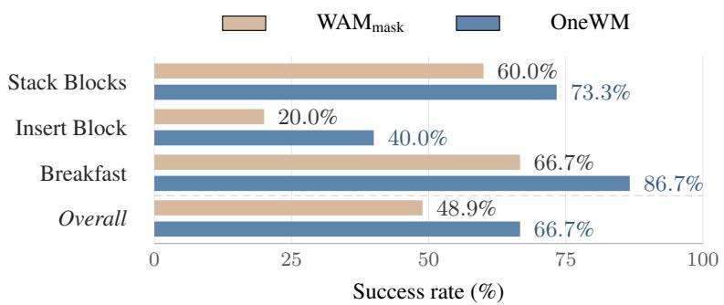  
Figure 4: Real-world policy performance. Success rates on three manipulation tasks; Overall aggregates the tasks.

Real-world validation. Stacking tests relative placement, insertion tests precise alignment, and breakfast arrangement tests successive manipulations as the scene changes. OneWM improves over $\mathbf { W A M _ { \mathrm { m a s k } } }$ on all three tasks (Fig. 4), especially insertion and breakfast arrangement. Whereas $\mathbf { W A M _ { \mathrm { m a s k } } }$ excludes actions from video prediction, OneWM learns their visual consequences.

These results answer our first question affirmatively: explicitly learning forward dynamics conditioned on clean actions improves action learning within the same causal model. Both WAM variants already receive future-video supervision, so the gains highlight the additional value of learning how specified controls change the scene. This benefit carries over to deployment, where the policy generates actions from noise. The stronger performance across scene perturbations and complex interactions suggests that clean-action world modeling shapes representations of robot–scene dynamics that remain useful when future controls must be inferred, supporting policy generalization across changing visual configurations.

## 4.3 Action Learning for World Modeling

We next address our second question: whether action learning improves action-conditioned world modeling. We compare OneWM with WM, which uses the same MoT architecture but learns only future-video prediction conditioned on clean actions, without an action-prediction objective. Both receive clean action chunks at inference. To distinguish joint attention from action modulation, we also design an IRASim-inspired [37] world-model baseline, $\mathrm { W M } _ { \mathrm { A d a L N } }$ , that injects action conditions through adaptive layer normalization (AdaLN). It uses the same Wan2.2-TI2V-5B backbone as our MoT models. Table 2 additionally includes Wan [13] as a video-prediction reference.

Table 2: World-prediction performance. Arrows indicate the preferred direction. Bold and underline mark the best and second-best values within each benchmark, respectively.
<table><tr><td></td><td colspan="4">LIBERO</td><td colspan="4">LIBERO-Plus</td><td colspan="4">RoboCasa365</td></tr><tr><td>Metric</td><td>Wan</td><td>WMAdaLN</td><td>WM</td><td>OneWM</td><td>Wan</td><td>WMAdaLN</td><td>WM</td><td>OneWM</td><td>Wan</td><td>WMAdaLN</td><td>WM</td><td>OneWM</td></tr><tr><td>PSNR ↑</td><td>20.52</td><td>20.52</td><td>22.33</td><td>22.95</td><td>19.08</td><td>19.58</td><td>20.54</td><td>21.05</td><td>23.27</td><td>22.22</td><td>24.72</td><td>25.21</td></tr><tr><td>SSIM↑</td><td>0.8045</td><td>0.8057</td><td>0.8325</td><td>0.8423</td><td>0.7575</td><td>0.7813</td><td>0.7937</td><td>0.8049</td><td>0.8176</td><td>0.7873</td><td>0.8433</td><td>0.8515</td></tr><tr><td>LPIPS ↓</td><td>0.1817</td><td>0.1793</td><td>0.1529</td><td>0.1458</td><td>0.2448</td><td>0.2185</td><td>0.2014</td><td>0.1935</td><td>0.1292</td><td>0.1564</td><td>0.1087</td><td>0.1015</td></tr><tr><td>FID↓</td><td>14.00</td><td>12.88</td><td>11.89</td><td>12.45</td><td>24.01</td><td>15.91</td><td>18.06</td><td>17.01</td><td>9.04</td><td>10.28</td><td>9.20</td><td>9.16</td></tr><tr><td>FVD↓</td><td>15.83</td><td>14.73</td><td>13.68</td><td>13.58</td><td>49.73</td><td>29.53</td><td>32.48</td><td>31.66</td><td>20.23</td><td>15.98</td><td>18.55</td><td>17.74</td></tr></table>

Action learning strengthens conditional prediction. OneWM achieves the best PSNR, SSIM, and LPIPS on all three benchmarks, with WM consistently second. Since the two models share the MoT architecture, this pattern supports the benefit of adding action learning to world-model training. Predicting actions requires the observed representation to capture the robot–object configurations relevant to control. This complementary supervision can strengthen the scene and forward-dynamics representations used to predict the visual consequences of specified actions. The improvements across pixel accuracy, structural similarity, and perceptual correspondence are consistent with this richer understanding of action-dependent scene changes.

Strong prediction across complementary metrics. Compared with WM using the same MoT architecture, OneWM consistently improves paired prediction quality and FVD across the three benchmarks, as well as FID on LIBERO Plus and RoboCasa365. As the architecture-matched comparison, this fact provides a clear evidence for the benefit of adding action learning. OneWM ranks first or second on every metric across the three benchmarks, with the modulation-based WM achieving higher performance on FID/FVD in some settings—an advantage in matching feature distributions also observed over the MoT-based WM. Paired prediction metrics and distributional metrics characterize complementary aspects of world modeling: the former measure agreement with the reference outcome under a given conditioning sequence, while FID and FVD compare marginal feature distributions without explicitly evaluating action–outcome correspondence [37, 54, 55]. Appendix B further evaluates this correspondence through local geometry and action-dependent motion in external- and wrist-camera predictions across all three benchmarks.

These results answer our second question affirmatively: action learning improves the prediction of specified-action outcomes under identical clean-action inference conditions. Learning to generate actions gives the shared model additional supervision for robot–object relationships relevant to control. This complementary signal can strengthen the scene representations used to predict the visual consequences of specified actions. Together with Sec. 4.2, the results suggest a reciprocal role for the two objectives: forward prediction learns how controls change a scene, while action generation emphasizes the scene structure needed to choose them. Both can strengthen the same representations of interaction under unified causal training.

## 4.4 Effect of the Action-Conditioning Mixture

The preceding sections examine the two directions of transfer separately. We now consider how the conditioning mixture in Sec. 3.3 affects both tasks. We vary the sampling probabilities of all-noisy, partial-clean, and all-clean examples, comparing 60/25/15, 50/35/15, and 30/45/25. Table 3 reports policy success alongside world-prediction quality; the inference settings remain those in Sec. 3.5.

Policy performance and world-prediction quality remain broadly stable between 60/25/15 and 50/35/15. The modest shift toward partial-clean conditioning brings a small in-distribution policy gain, while the default remains stronger on LIBERO-Plus and paired prediction metrics. Joint visual and action learning is therefore reasonably stable to moderate changes in the mixture.

A larger shift toward clean conditioning leaves world-prediction metrics relatively stable but weakens policy performance, particularly under distribution shift. This pattern suggests that policy generalization benefits from preserving sufficient all-noisy training, which matches deployment where actions are generated from noise. Clean-action conditioning supplies forward-dynamics supervision, but increasing its share favors reconstruction in familiar scenes without improving prediction on LIBERO-Plus. The two learning signals therefore need to be balanced: more clean conditioning alone does not ensure better generalization. Among the tested mixtures, 60/25/15 provides the best balance of policy generalization and paired world-prediction quality.

Table 3: Conditioning mixtures affect both tasks. Columns specify all-noisy / partial-clean / all-clean percentages; 60/25/15 is the default. SR is success rate (%). Bold marks the best value within each benchmark.
<table><tr><td rowspan="2">Metric</td><td colspan="3">LIBERO</td><td colspan="3">LIBERO-Plus</td></tr><tr><td>60/25/15</td><td>50/35/15</td><td>30/45/25</td><td>60/25/15</td><td>50/35/15</td><td>30/45/25</td></tr><tr><td>SR (%) ↑</td><td>94.95</td><td>95.95</td><td>87.80</td><td>59.27</td><td>56.98</td><td>38.01</td></tr><tr><td>PSNR ↑</td><td>22.95</td><td>22.44</td><td>23.12</td><td>21.05</td><td>20.57</td><td>20.90</td></tr><tr><td>SSIM ↑</td><td>0.8423</td><td>0.8347</td><td>0.8443</td><td>0.8049</td><td>0.7943</td><td>0.7993</td></tr><tr><td>LPIPS ↓</td><td>0.1458</td><td>0.1517</td><td>0.1444</td><td>0.1935</td><td>0.2013</td><td>0.1966</td></tr><tr><td>FID↓</td><td>12.45</td><td>12.57</td><td>12.36</td><td>17.01</td><td>17.32</td><td>17.18</td></tr><tr><td>FVD↓</td><td>13.58</td><td>14.64</td><td>13.97</td><td>31.66</td><td>33.18</td><td>31.56</td></tr></table>

## 4.5 Endless Dream: Closing the Loop in Imagination

Beyond the improvements above, the two inference modes in Sec. 3.5 can compose into an endless dream: OneWM alternates action generation and action-conditioned world prediction, using each imagined outcome as the context for its next decision. Let $\hat { \bf { o } } _ { 0 }$ be the initial multi-view observation and $\mathcal { C } _ { j } = ( E ( \hat { \mathbf { o } } _ { j } ) , \ell )$ the context at round $j ,$ where E and D denote the video VAE encoder and decoder. The loop is

$$
\begin{array} { r l r } & { } & { \hat { \bf a } _ { j } \sim p _ { \theta } ( { \bf a } \mid \mathcal { C } _ { j } ) , \qquad \hat { \bf z } _ { j } ^ { \mathrm { { f u t } } } \sim p _ { \theta } ( { \bf z } ^ { \mathrm { { f u t } } } \mid \mathcal { C } _ { j } , \hat { \bf a } _ { j } ) , } \\ & { } & { \hat { \bf o } _ { j + 1 } = \mathrm { l a s t } \big ( D ( \hat { \bf z } _ { j } ^ { \mathrm { { f u t } } } ) \big ) . \qquad } \end{array}\tag{6}
$$

Both stages use the same model: the action chunk is first denoised from noise, then held fixed as clean conditioning for video generation. The final predicted frame from each camera is fed back into the next round, with the instruction unchanged and no further environment observations.

On LIBERO tasks, we run this loop for 16 rounds without additional training. Each round generates 32 actions and eight future frames, yielding 512 actions over a modeled horizon of 25.6 seconds. The resulting sequences show task-directed progression through drawer opening, pushing, and single- and multi-object transport (Appendix C). This composability connects the two learned capabilities beyond separate evaluation: action generation selects controls from imagined states, while forward prediction supplies the states on which subsequent decisions depend.

## 5 Conclusion

We studied whether world and action modeling can benefit each other under unified causal training. OneWM combines clean-action-conditioned forward prediction and action generation in a causal MoT model by mixing all-clean, partialclean, and all-noisy examples. Controlled simulation comparisons provide positive answers to both questions: explicit forward-dynamics learning improves policy performance and generalization, while action learning improves actionconditioned world prediction within the same architecture. Real-world manipulation further validates the policy benefit. These results suggest that the two objectives supervise complementary aspects of interaction: the visual consequences of controls and the scene structure needed to select them. The mixture study shows that this benefit tolerates moderate rebalancing, while larger shifts toward clean conditioning mainly weaken policy generalization. OneWM thus supports learning world prediction and control through mutually beneficial representations under temporal causality. These findings motivate studying how reciprocal learning scales with more diverse data and longer interaction horizons. A further direction is to use the learned dynamics for planning and policy improvement, extending the interaction between prediction and control beyond joint training.

## References

[1] NVIDIA et al. Cosmos world foundation model platform for physical AI. arXiv preprint arXiv:2501.03575, 2025. doi: 10.48550/arXiv.2501.03575. URL https://arxiv.org/abs/2501.03575.

[2] Chuning Zhu, Raymond Yu, Siyuan Feng, Benjamin Burchfiel, Paarth Shah, and Abhishek Gupta. Unified World Models: Coupling Video and Action Diffusion for Pretraining on Large Robotic Datasets. In Proceedings of Robotics: Science and Systems, 2025. doi: 10.15607/RSS.2025.XXI.015. URL https://roboticsproceedings.org/rss21/p015.html.

[3] Julian Quevedo, Ansh Kumar Sharma, Yixiang Sun, Varad Suryavanshi, Percy Liang, and Sherry Yang. WorldGym: World Model as An Environment for Policy Evaluation. In International Conference on Learning Representations, volume 2026, pages 78932–78957, 2026. URL https://proceedings.iclr.cc/paper\_files/paper/2026/hash/ 7f5e909ac0324db03506b380c695ffaf-Abstract-Conference.html.

[4] Junbang Liang, Pavel Tokmakov, Ruoshi Liu, Sruthi Sudhakar, Paarth Shah, Rares Ambrus, and Carl Vondrick. Video generators are robot policies. arXiv preprint arXiv:2508.00795, 2025. doi: 10.48550/arXiv.2508.00795. URL https: //arxiv.org/abs/2508.00795.

[5] Seonghyeon Ye, Yunhao Ge, Kaiyuan Zheng, Shenyuan Gao, Sihyun Yu, George Kurian, Suneel Indupuru, You Liang Tan, Chuning Zhu, Jiannan Xiang, Ayaan Malik, Kyungmin Lee, William Liang, Nadun Ranawaka, Jiasheng Gu, Yinzhen Xu, Guanzhi Wang, Fengyuan Hu, Avnish Narayan, Johan Bjorck, Jing Wang, Gwanghyun Kim, Dantong Niu, Ruijie Zheng, Yuqi Xie, Jimmy Wu, Qi Wang, Ryan Julian, Danfei Xu, Yilun Du, Yevgen Chebotar, Scott Reed, Jan Kautz, Yuke Zhu, Linxi "Jim" Fan, and Joel Jang. World action models are zero-shot policies. arXiv preprint arXiv:2602.15922, 2026. doi: 10.48550/arXiv.2602.15922. URL https://arxiv.org/abs/2602.15922.

[6] Yichao Shen, Fangyun Wei, Zhiying Du, Yaobo Liang, Yan Lu, Jiaolong Yang, Nanning Zheng, and Baining Guo. VideoVLA: Video generators can be generalizable robot manipulators. In Advances in Neural Information Processing Systems, 2025. URL https://arxiv.org/abs/2512.06963

[7] Tianyuan Yuan, Zibin Dong, Yicheng Liu, and Hang Zhao. Fast-WAM: Do world action models need test-time future imagination? arXiv preprint arXiv:2603.16666, 2026. doi: 10.48550/arXiv.2603.16666. URL https://arxiv.org/abs/ 2603.16666.

[8] Hongzhe Bi, Hengkai Tan, Shenghao Xie, Zeyuan Wang, Shuhe Huang, Haitian Liu, Ruowen Zhao, Yao Feng, Chendong Xiang, Yinze Rong, Hongyan Zhao, Hanyu Liu, Zhizhong Su, Lei Ma, Hang Su, and Jun Zhu. Motus: A Unified Latent Action World Model. In Proceedings of the IEEE/CVF Conference on Computer Vision and Pattern Recognition (CVPR), pages 35101–35113, 2026. URL https://openaccess.thecvf.com/content/CVPR2026/html/Bi\_Motus\_A\_Unified\_ Latent\_Action\_World\_Model\_CVPR\_2026\_paper.html.

[9] Liaoyuan Fan, Zetian Xu, Chen Cao, Wenyao Zhang, Mingqi Yuan, and Jiayu Chen. AIM: Intent-aware unified world action modeling with spatial value maps. arXiv preprint arXiv:2604.11135, 2026. doi: 10.48550/arXiv.2604.11135. URL https://arxiv.org/abs/2604.11135.

[10] Weixin Liang, Lili Yu, Liang Luo, Srinivasan Iyer, Ning Dong, Chunting Zhou, Gargi Ghosh, Mike Lewis, Wen-tau Yih, Luke Zettlemoyer, and Xi Victoria Lin. Mixture-of-transformers: A sparse and scalable architecture for multi-modal foundation models. Transactions on Machine Learning Research, 2025. URL https://arxiv.org/abs/2411.04996.

[11] Zhuoyi Yang, Jiayan Teng, Wendi Zheng, Ming Ding, Shiyu Huang, Jiazheng Xu, Yuanming Yang, Wenyi Hong, Xiaohan Zhang, Guanyu Feng, Da Yin, Yuxuan Zhang, Weihan Wang, Yean Cheng, Xu Bin, Xiaotao Gu, Yuxiao Dong, and Jie Tang. CogVideoX: Text-to-Video Diffusion Models with An Expert Transformer. In International Conference on Learning Representations, volume 2025, pages 83048–83077, 2025. URL https://proceedings.iclr.cc/paper\_files/paper/ 2025/hash/ce31378e9f41d8907e97dab172b6c559-Abstract-Conference.html.

[12] Weijie Kong, Qi Tian, Zijian Zhang, Rox Min, Zuozhuo Dai, et al. HunyuanVideo: A systematic framework for large video generative models. arXiv preprint arXiv:2412.03603, 2024. doi: 10.48550/arXiv.2412.03603. URL https://arxiv.org/ abs/2412.03603.

[13] Team Wan et al. Wan: Open and advanced large-scale video generative models. arXiv preprint arXiv:2503.20314, 2025. doi: 10.48550/arXiv.2503.20314. URL https://arxiv.org/abs/2503.20314.

[14] Shuang Li, Yihuai Gao, Dorsa Sadigh, and Shuran Song. Unified Video Action Model. In Proceedings of Robotics: Science and Systems, 2025. doi: 10.15607/RSS.2025.XXI.074. URL https://roboticsproceedings.org/rss21/p074.html.

[15] NVIDIA. Cosmos 3: Omnimodal world models for physical AI. arXiv preprint arXiv:2606.02800, 2026. doi: 10.48550/arXiv. 2606.02800. URL https://arxiv.org/abs/2606.02800.

[16] Lin Li, Qihang Zhang, Yiming Luo, Shuai Yang, Ruilin Wang, Luyao Zhang, Mingrui Yu, Zelin Gao, Nan Xue, Boyu Zhou, Xing Zhu, Mingyu Ding, Yujun Shen, and Yinghao Xu. Causal World Modeling for Robot Control. In Proceedings of Robotics: Science and Systems, 2026. doi: 10.15607/RSS.2026.XXII.016. URL https://roboticsproceedings.org/rss22/p016. html.

[17] Angen Ye, Boyuan Wang, Chaojun Ni, Guan Huang, Guosheng Zhao, Hao Li, Hengtao Li, Jie Li, Jindi Lv, Jingyu Liu, Min Cao, Peng Li, Qiuping Deng, Wenjun Mei, Xiaofeng Wang, Xinze Chen, Xinyu Zhou, Yang Wang, Yifan Chang, Yifan Li, Yukun Zhou, Yun Ye, Zhichao Liu, and Zheng Zhu. GigaWorld-Policy: An efficient action-centered world–action model. arXiv preprint arXiv:2603.17240, 2026. doi: 10.48550/arXiv.2603.17240. URL https://arxiv.org/abs/2603.17240.

[18] Yilun Du, Sherry Yang, Bo Dai, Hanjun Dai, Ofir Nachum, Josh Tenenbaum, Dale Schuurmans, and Pieter Abbeel. Learning Universal Policies via Text-Guided Video Generation. In Advances in Neural Information Processing Systems, volume 36, pages 9156–9172. Curran Associates, Inc., 2023. doi: 10.52202/075280-0403. URL https://proceedings.neurips.cc/ paper\_files/paper/2023/hash/1d5b9233ad716a43be5c0d3023cb82d0-Abstract-Conference.html.

[19] Yilun Du, Sherry Yang, Pete Florence, Fei Xia, Ayzaan Wahid, Brian Ichter, Pierre Sermanet, Tianhe Yu, Pieter Abbeel, Joshua B Tenenbaum, Leslie Kaelbling, Andy Zeng, and Jonathan Tompson. Video Language Planning. In International Conference on Learning Representations, volume 2024, pages 31138–31155, 2024. URL https://proceedings.iclr.cc paper\_files/paper/2024/hash/848784373188ddf641079524e89e0ac9-Abstract-Conference.html.

[20] Joel Jang, Seonghyeon Ye, Zongyu Lin, Jiannan Xiang, Johan Bjorck, Yu Fang, Fengyuan Hu, Spencer Huang, Kaushil Kundalia, Yen-Chen Lin, Loïc Magne, Ajay Mandlekar, Avnish Narayan, You Liang Tan, Guanzhi Wang, Jing Wang, Qi Wang, Yinzhen Xu, Xiaohui Zeng, Kaiyuan Zheng, Ruijie Zheng, Ming-Yu Liu, Luke Zettlemoyer, Dieter Fox, Jan Kautz, Scott Reed, Yuke Zhu, and Linxi Fan. DreamGen: Unlocking Generalization in Robot Learning through Video World Models. In Proceedings of The 9th Conference on Robot Learning, volume 305 of Proceedings of Machine Learning Research, pages 5170–5194. PMLR, 2025. URL https://proceedings.mlr.press/v305/jang25a.html.

[21] Yucheng Hu, Yanjiang Guo, Pengchao Wang, Xiaoyu Chen, Yen-Jen Wang, Jianke Zhang, Koushil Sreenath, Chaochao Lu, and Jianyu Chen. Video Prediction Policy: A Generalist Robot Policy with Predictive Visual Representations. In Proceedings of the 42nd International Conference on Machine Learning, volume 267 of Proceedings of Machine Learning Research, pages 24328–24346. PMLR, 2025. URL https://proceedings.mlr.press/v267/hu25g.html.

[22] Jonas Pai, Liam Achenbach, Oliver Sanchez, Stefanos Charalambous, Victoriano Montesinos, Benedek Forrai, Oier Mees, and Elvis Nava. mimic-video: Video-Action Models for Generalizable Robot Control Beyond VLAs. In Proceedings of Robotics: Science and Systems, 2026. doi: 10.15607/RSS.2026.XXII.077. URL https://roboticsproceedings.org/rss22/p077. html.

[23] Yue Liao, Pengfei Zhou, Siyuan Huang, Donglin Yang, Shengcong Chen, Yuxin Jiang, Yue Hu, Si Liu, Jian lan Luo, Liliang Chen, Shuicheng Yan, Maoqing Yao, and Guanghui Ren. Genie Envisioner: A Unified World Foundation Platform for Robotic Manipulation. In International Conference on Learning Representations, vol ume 2026, pages 88446–88463, 2026. URL https://proceedings.iclr.cc/paper\_files/paper/2026/hash/ 8e773e9e463e97b930c47621b6777159-Abstract-Conference.html.

[24] Hongtao Wu, Ya Jing, Chilam Cheang, Guangzeng Chen, Jiafeng Xu, Xinghang Li, Minghuan Liu, Hang Li, and Tao Kong. Unleashing Large-Scale Video Generative Pre-training for Visual Robot Manipulation. In International Conference on Learning Representations, volume 2024, pages 10641–10662, 2024. URL https://proceedings.iclr.cc/paper\_files/paper 2024/hash/2c37c5bcef24b9541550261dcd63261b-Abstract-Conference.html.

[25] Moo Jin Kim, Yihuai Gao, Tsung-Yi Lin, Yen-Chen Lin, Yunhao Ge, Grace Lam, Percy Liang, Shuran Song, Ming-Yu Liu, Chelsea Finn, and Jinwei Gu. Cosmos Policy: Fine-Tuning Video Models for Visuomotor Control and Planning. In International Conference on Learning Representations, volume 2026, pages 71531–71552, 2026. URL https://proceedings.iclr.cc/ paper\_files/paper/2026/hash/748becc400a57c0e31cfe6a2e7951467-Abstract-Conference.html.

[26] Yuran Wang, Siqiao Huang, Mingleyang Li, Chenhao Zhang, Jiaqi Liang, Weiyang Jin, Yue Chen, Xuemin Chi, Donghao Zhou, Qize Yu, Yu-Kai Wang, Yuhan Rui, Shenzhe Yao, Zhen Yuan, Zhenhao Shen, Kefei Zhu, Zijie Zhu, Ning Gao, Xiaowei Chi, Guanqi He, Shanghang Zhang, Hao Dong, Lin Shao, and Hang Zhao. OpenWAM: An open, modular exploration towards systematic world-action model pretraining. arXiv preprint arXiv:2609.07398, 2026. doi: 10.48550/arXiv.2609.07398. URL https://arxiv.org/abs/2609.07398.

[27] Ziang Li, Dongzhou Cheng, Yibin Wang, Shiyue Wang, et al. Light-WAM: Efficient World Action Models with State-Fusion Action Decoding. arXiv preprint arXiv:2606.08242, 2026. doi: 10.48550/arXiv.2606.08242. URL https://arxiv.org/ / 4 .

[28] Yue Su, Sijin Chen, Haixin Shi, Mingyu Liu, Zhengshen Zhang, Ningyuan Huang, Weiheng Zhong, Zhengbang Zhu, Yuxiao Liu, and Xihui Liu. World Guidance: World Modeling in Condition Space for Action Generation. In Proceedings of the 43rd International Conference on Machine Learning, volume 306 of Proceedings of Machine Learning Research, pages 115917–115933. PMLR, 2026. URL https://proceedings.mlr.press/v306/su26c.html.

[29] Yihan Lin, Jiawei He, Shifeng Bao, Chen Zhao, et al. JEPA-WAM: Learning Vision-Language-Action Policies with Joint-Embedding World Modeling. arXiv preprint arXiv:2608.09381, 2026. doi: 10.48550/arXiv.2608.09381. URL https: //arxiv.org/abs/2608.09381.

[30] Bang Du, Yichen Xie, Shuqi Zhao, Yuxin Chen, Menglin Wu, and Masayoshi Tomizuka. One from Infinity: Actualizing Futures from Pretrained World Models into Robot Actions. arXiv preprint arXiv:2609.36413, 2026. doi: 10.48550/arXiv.2609.36413. URL https://arxiv.org/abs/2609.36413.

[31] Trung Dao, Sankalp Yamsani, Jaden Park, Joohyung Kim, and Yong Jae Lee. Think Like a World Model, Act Like a VLA: Distilling World-Model Representations into Compact Robot Policies. arXiv preprint arXiv:2609.24682, 2026. doi: 10.48550/arXiv.2609.24682. URL https://arxiv.org/abs/2609.24682.

[32] David Ha and Jürgen Schmidhuber. World Models. arXiv preprint arXiv:1803.10122, 2018. doi: 10.48550/arXiv.1803.10122. URL https://arxiv.org/abs/1803.10122.

[33] Danijar Hafner, Jurgis Pasukonis, Jimmy Ba, and Timothy Lillicrap. Mastering diverse control tasks through world mod els. Nature, 640:647–653, 2025. doi: 10.1038/s41586-025-08744-2. URL https://www.nature.com/articles/ s41586-025-08744-2.

[34] Mido Assran, Adrien Bardes, David Fan, Quentin Garrido, et al. V-JEPA 2: Self-Supervised Video Models Enable Understanding, Prediction and Planning. arXiv preprint arXiv:2506.09985, 2025. doi: 10.48550/arXiv.2506.09985. URL https://arxiv. org/abs/2506.09985.

[35] Jialong Wu, Shaofeng Yin, Ningya Feng, Xu He, Dong Li, Jianye Hao, and Mingsheng Long. iVideoGPT: Interactive VideoGPTs are Scalable World Models. In Advances in Neural Information Processing Systems, volume 37, pages 68082–68119. Curran Associates, Inc., 2024. doi: 10.52202/079017-2173. URL https://proceedings.neurips.cc/paper\_files/paper/ 2024/hash/7dbb5bfab324e3b86af9bd0df15498dd-Abstract-Conference.html.

[36] Siqiao Huang, Jialong Wu, Qixing Zhou, Shangchen Miao, and Mingsheng Long. Vid2World: Crafting Video Diffusion Models to Interactive World Models. In International Conference on Learning Representations, volume 2026, pages 10763–10806, 2026. URL https://proceedings.iclr.cc/paper\_files/paper/2026/hash/ 1214 67 7 38 40 0 3 2 677 39 A C .

[37] Fangqi Zhu, Hongtao Wu, Song Guo, Yuxiao Liu, Chilam Cheang, and Tao Kong. IRASim: A Fine-Grained World Model for Robot Manipulation. In Proceedings of the IEEE/CVF International Conference on Computer Vision, 2025. URL https://openaccess.thecvf.com/content/ICCV2025/papers/Zhu\_IRASim\_A\_Fine-Grained\_World\_ Model\_for\_Robot\_Manipulation\_ICCV\_2025\_paper.pdf.

[38] Yanjiang Guo, Lucy Shi, Jianyu Chen, and Chelsea Finn. Ctrl-World: A Controllable Generative World Model for Robot Manipulation. In International Conference on Learning Representations, volume 2026, pages 6121–6138, 2026. URL https://proceedings.iclr.cc/paper\_files/paper/2026/hash/ 0ae94013da7cd459402fd77874e09ee3-Abstract-Conference.html.

[39] Zhuoyuan Wu and Jun Gao. OSCAR: Omni-Embodiment Action-Conditioned World Model for Robotics. arXiv preprint arXiv:2606.04463, 2026. doi: 10.48550/arXiv.2606.04463. URL https://arxiv.org/abs/2606.04463.

[40] Shenyuan Gao, Siyuan Zhou, Yilun Du, Jun Zhang, and Chuang Gan. AdaWorld: Learning Adaptable World Models with Latent Actions. In Proceedings of the 42nd International Conference on Machine Learning, volume 267 of Proceedings of Machine Learning Research, pages 18744–18771. PMLR, 2025. URL https://proceedings.mlr.press/v267/gao25u.html.

[41] Shenyuan Gao, William Liang, Kaiyuan Zheng, Ayaan Naveed Malik, Seonghyeon Ye, Sihyun Yu, Wei-Cheng Tseng, Yuzhu Dong, Kaichun Mo, Chen-Hsuan Lin, Jiannan Xiang, Yuqi Xie, Ruijie Zheng, Dantong Niu, Pooya Jannaty, Jinwei Gu, Jun Zhang, Jitendra Malik, Pieter Abbeel, Ming-Yu Liu, Yuke Zhu, Joel Jang, and Linxi Fan. DreamDojo: A Generalist Robot World Model from Large-Scale Human Videos. In Proceedings of the 43rd International Conference on Machine Learning, volume 306 of Proceedings of Machine Learning Research, pages 33340–33366. PMLR, 2026. URL https: //proceedings.mlr.press/v306/gao26q.html.

[42] Boxiang Qiu, Liliang Chen, Yue Liao, Nan Wang, et al. GE-Sim 2.0: A Roadmap Towards Comprehensive Closed-loop Video World Simulators for Robotic Manipulation. arXiv preprint arXiv:2605.27491, 2026. doi: 10.48550/arXiv.2605.27491. URL https://arxiv.org/abs/2605.27491.

[43] Zhennan Jiang, Kai Liu, Yuxin Qin, Shuai Tian, et al. World4RL: Diffusion World Models for Policy Refinement with Reinforcement Learning for Robotic Manipulation. arXiv preprint arXiv:2509.19080, 2025. doi: 10.48550/arXiv.2509.19080. URL https://arxiv.org/abs/2509.19080.

[44] Ze Huang, Jiahui Zhang, Hairuo Liu, Chenxi Zhang, Ran Cheng, and Li Zhang. Learning transferable dynamics priors from action to world modeling. In European Conference on Computer Vision, 2026. URL https://arxiv.org/abs/2606.29501.

[45] Sixiang Chen, Jiaming Liu, Jixian Wu, Yichen Guo, et al. Do Robotic World Models Really Follow Actions? Diagnosing and Aligning Action-Conditioned Generation for Policy Learning. arXiv preprint arXiv:2608.24885, 2026. doi: 10.48550/arXiv. 2608.24885. URL https://arxiv.org/abs/2608.24885.

[46] Jun Cen, Chaohui Yu, Hangjie Yuan, Yuming Jiang, Siteng Huang, Jiayan Guo, Xin Li, Yibing Song, Hao Luo, Fan Wang, Deli Zhao, and Hao Chen. WorldVLA: Towards autoregressive action world model. arXiv preprint arXiv:2506.21539, 2025. doi: 10.48550/arXiv.2506.21539. URL https://arxiv.org/abs/2506.21539.

[47] Yaron Lipman, Ricky T. Q. Chen, Heli Ben-Hamu, Maximilian Nickel, and Matt Le. Flow Matching for Generative Modeling. In International Conference on Learning Representations, 2023. URL https://openreview.net/forum?id=PqvMRDCJT9t.

[48] Bo Liu, Yifeng Zhu, Chongkai Gao, Yihao Feng, Qiang Liu, Yuke Zhu, and Peter Stone. LIBERO: Benchmarking Knowledge Transfer for Lifelong Robot Learning. In Advances in Neural Information Processing Systems, volume 36, pages 44776–44791. Curran Associates, Inc., 2023. doi: 10.52202/075280-1939. URL https://proceedings.neurips.cc/paper\_files/ paper/2023/hash/8c3c666820ea055a77726d66fc7d447f-Abstract-Datasets\_and\_Benchmarks.html.

[49] Senyu Fei, Siyin Wang, Junhao Shi, Zihao Dai, Jikun Cai, Pengfang Qian, Li Ji, Xinzhe He, Shiduo Zhang, Zhaoye Fei, Jinlan Fu, Jingjing Gong, and Xipeng Qiu. LIBERO-Plus: A Progressive Robustness Benchmark for Visual-Language Action Models. In Proceedings of the IEEE/CVF Conference on Computer Vision and Pattern Recognition (CVPR), pages 38574–38583, 2026. URL https://openaccess.thecvf.com/content/CVPR2026/html/Fei\_LIBERO-Plus\_ A\_Progressive\_Robustness\_Benchmark\_for\_Visual-Language-Action\_Models\_CVPR\_2026\_paper.html.

[50] Soroush Nasiriany, Sep Nasiriany, Abhiram Maddukuri, and Yuke Zhu. RoboCasa365: A Large-Scale Simulation Framework for Training and Benchmarking Generalist Robots. In International Conference on Learning Representations, volume 2026, pages 98643–98667, 2026. URL https://proceedings.iclr.cc/paper\_files/paper/2026/hash a05003fdb1e9562ab0c0a9719ea4de10-Abstract-Conference.html.

[51] Kevin Black, Noah Brown, Danny Driess, Adnan Esmail, Michael Robert Equi, Chelsea Finn, Niccolo Fusai, Lachy Groom, Karol Hausman, Brian Ichter, Szymon Jakubczak, Tim Jones, Liyiming Ke, Sergey Levine, Adrian Li-Bell, Mohith Mothukuri, Suraj Nair, Karl Pertsch, Lucy Xiaoyang Shi, Laura Smith, James Tanner, Quan Vuong, Anna Walling, Haohuan Wang, and Ury Zhilinsky. π : A Vision-Language-Action Flow Model for General Robot Control. In Proceedings of Robotics: Science and Systems, 2025. doi: 10.15607/RSS.2025.XXI.010. URL https://roboticsproceedings.org/rss21/p010.html.

[52] Kevin Black, Noah Brown, James Darpinian, Karan Dhabalia, Danny Driess, Adnan Esmail, Michael Robert Equi, Chelsea Finn, Niccolo Fusai, Manuel Y. Galliker, Dibya Ghosh, Lachy Groom, Karol Hausman, Brian Ichter, Szymon Jakubczak, Tim Jones, Liyiming Ke, Devin LeBlanc, Sergey Levine, Adrian Li-Bell, Mohith Mothukuri, Suraj Nair, Karl Pertsch, Allen Z. Ren, Lucy Xiaoyang Shi, Laura Smith, Jost Tobias Springenberg, Kyle Stachowicz, James Tanner, Quan Vuong, Homer Walke, Anna Walling, Haohuan Wang, Lili Yu, and Ury Zhilinsky. π : a Vision-Language-Action Model with Open-World Generalization. In Proceedings of The 9th Conference on Robot Learning, volume 305 of Proceedings of Machine Learning Research, pages 17–40. PMLR, 2025. URL https://proceedings.mlr.press/v305/black25a.html.

[53] NVIDIA GEAR Team. GR00T N1.6: An improved open foundation model for generalist humanoid robots. NVIDIA Research, 2025. URL https://research.nvidia.com/labs/gear/gr00t-n1\_6/.

[54] Martin Heusel, Hubert Ramsauer, Thomas Unterthiner, Bernhard Nessler, and Sepp Hochreiter. GANs trained by a two time-scale update rule converge to a local nash equilibrium. In Advances in Neural Information Processing Systems, volume 30, 2017. URL https://arxiv.org/abs/1706.08500.

[55] Thomas Unterthiner, Sjoerd van Steenkiste, Karol Kurach, Raphael Marinier, Marcin Michalski, and Sylvain Gelly. Towards accurate generative models of video: A new metric & challenges. arXiv preprint arXiv:1812.01717, 2018. URL https: //arxiv.org/abs/1812.01717.

[56] Xiaomi Robotics Team, Jun Guo, Piaopiao Jin, Jason Li, Peiyan Li, Yingyan Li, et al. Xiaomi-Robotics-1: Scaling visionlanguage-action models with over 100k hours of real-world trajectories. arXiv preprint arXiv:2607.15330, 2026. doi: 10.48550/ arXiv.2607.15330. URL https://arxiv.org/abs/2607.15330.

[57] Sergey Kastryulin, Jamil Zakirov, Denis Prokopenko, and Dmitry V. Dylov. PyTorch image quality: Metrics for image quality assessment. arXiv preprint arXiv:2208.14818, 2022. URL https://arxiv.org/abs/2208.14818.

[58] Zhou Wang, Alan C. Bovik, Hamid R. Sheikh, and Eero P. Simoncelli. Image quality assessment: From error visibility to structural similarity. IEEE Transactions on Image Processing, 13(4):600–612, 2004. doi: 10.1109/TIP.2003.819861.

[59] Richard Zhang, Phillip Isola, Alexei A. Efros, Eli Shechtman, and Oliver Wang. The unreasonable effectiveness of deep features as a perceptual metric. In Proceedings of the IEEE Conference on Computer Vision and Pattern Recognition, 2018. URL https://arxiv.org/abs/1801.03924.

## A Training and Evaluation Protocols

## A.1 Training and Deployment

Simulation training. For LIBERO and LIBERO-Plus, we adopt the LIBERO training recipe of Fast-WAM [7]. We train jointly on demonstrations from the Spatial, Object, Goal, and Long suites for 20 epochs with a global batch size of 128. The resulting models are evaluated on LIBERO-Plus directly. For RoboCasa365, we train on its demonstration dataset for 90k optimizer steps with a global batch size of 1024.

Real-world training. We collect 50 demonstrations for each of the three real-world tasks: block stacking, block insertion, and breakfast arrangement, yielding 150 episodes in total. Models are trained on these demonstrations for 20 epochs with a global batch size of 96.

Internal comparisons. All internal WAM and WM ablations follow the same dataset-specific training protocol, including training data, global batch size, and training budget. Their action conditioning and learning objectives differ as described in Sec. 4.1. Unless otherwise stated, OneWM samples all-noisy, partial-clean, and all-clean action conditioning with probabilities 60%, 25%, and 15%, respectively.

Deployment. Following Sec. 3.5, policies generate action chunks from Gaussian noise using the current visual observations and language instruction. Observed video representations are reused during action denoising, without generating future video. For world prediction, the specified action chunk remains clean and fixed while the model denoises future video latents.

## A.2 Evaluation Protocols

Policy evaluation. We measure closed-loop task success using each benchmark’s success criterion. LIBERO results cover the Spatial, Object, Goal, and Long suites and their average; LIBERO-Plus results cover the seven perturbation categories and the benchmark aggregate. RoboCasa365 results are reported for atomic-seen, composite-seen, and composite-unseen tasks. Each real-world task is evaluated over 15 trials per model, with success rates reported as percentages. Inference follows Sec. 3.5.

Video evaluation. LIBERO, LIBERO-Plus, and RoboCasa365 are designed for policy evaluation and do not provide dedicated validation sets for action-conditioned video prediction. We therefore construct evaluation video sets from expert rollouts. For LIBERO and LIBERO-Plus, we collect 100 complete episodes in total using π [52], uniformly sampling across LIBERO settings and LIBERO-Plus perturbation categories. For RoboCasa365, we collect 100 complete episodes with Xiaomi-Robotics-1 [56], uniformly sampling its 50 evaluation target tasks. All three benchmarks are evaluated with multi-view future predictions, including external-camera and wrist-camera observations. Prediction chunks span 32 action steps with a frame-sampling stride of 4 for LIBERO and LIBERO-Plus, and 16 action steps with a stride of 2 for RoboCasa365. Each chunk thus evaluates eight future frames, excluding the conditioning frames. PSNR, SSIM, and LPIPS are computed from losslessly stored RGB frames scaled to [0, 1] using PIQ 0.8 [57]. For FID and FVD, both predictions and references are encoded with H.264 at constant quantization parameter 20 in YUV420p format and decoded before feature extraction.

PSNR. Peak signal-to-noise ratio measures pixel reconstruction accuracy as $- 1 0 \log _ { 1 0 } ( \mathrm { M S E } + 1 0 ^ { - 8 } )$ in decibels, where MSE is averaged over RGB channels and pixels. Higher is better.

SSIM. Structural similarity [58] compares local luminance, contrast, and structure. We use PIQ’s single-scale implementation with an 11 × 11 Gaussian window, standard deviation 1.5, unit data range, and $K _ { 1 } = 0 . 0 1 , K _ { 2 } = 0 . 0 3$ Higher is better.

LPIPS. Learned perceptual image patch similarity [59] measures perceptual distance using PIQ’s ImageNet-pretrained VGG16 backbone, learned calibration weights, and default input normalization. Lower is better.

FID. Fréchet Inception Distance [54] compares generated and reference image-feature distributions using 2,048- dimensional average-pooling features from PIQ’s TensorFlow-compatible Inception-v3. Frames are bilinearly resized to 299 × 299 and normalized to [−1, 1]. Lower is better.

FVD. Our Fréchet Video Distance [55] implementation uses 400-dimensional output logits from PyTorchVideo’s I3D-R50 pretrained on Kinetics-400. Each clip contains eight future frames in temporal order, bilinearly resized to 224 × 224 and normalized from [0, 1] with channel-wise mean 0.45 and standard deviation 0.225. Lower is better.

PSNR, SSIM, and LPIPS are averaged over all evaluated future frames. FID and FVD use feature means and covariances pooled over each benchmark to compute the Fréchet distance, rather than averaging per-batch scores

## Qualitative Analysis of Action-Conditioned World Prediction

We inspect selected, matched prediction windows from the evaluated model variants on LIBERO, LIBERO-Plus, and RoboCasa365. Each comparison uses the same observed context, instruction, clean action sequence, and camera. The figures show four future frames and a shared-coordinate detail at the final time step.

Main-camera predictions. Figure 5 highlights spatial relationships at the scene level. Compared with ${ \bf W M } _ { \mathrm { A d a L N } }$ OneWM more closely follows the held moka pot and gripper pose in (a), the gripper’s position relative to the cream cheese box in (b), and the gripper height near the sauce bottle in (c). Comparisons with WM show closer correspondence in the bottle rotation (d), carton–basket alignment (e), and gripper–plate relationship (f). These examples illustrate the value of action learning for representing how robot motion changes the scene configuration.

Detail  
t + 4  
t + 12  
t + 20  
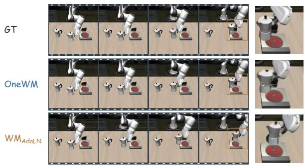  
Detail  
(a) Moka pot transport

t + 4  
t + 12  
t + 20  
Detail  
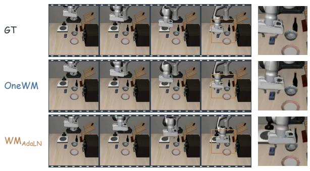

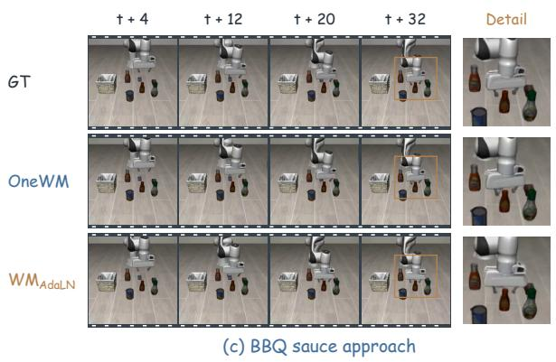

(b) Cream cheese approach  
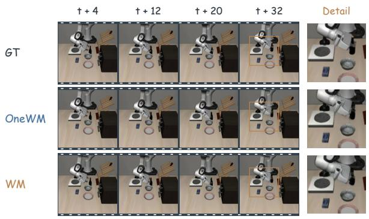  
(d) Wine bottle rotation

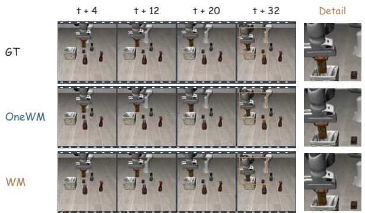  
(e) Orange juice transport

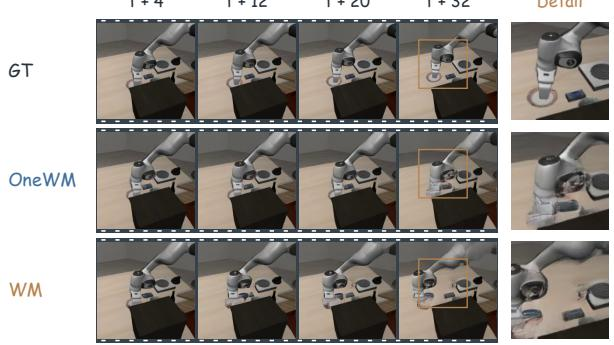  
(f) Plate push  
Figure 5: Main-camera world predictions. Six cases from LIBERO and LIBERO-Plus compare GT, OneWM, and the indicated world-model baseline. Orange boxes mark the regions enlarged at t + 32 in each panel’s final column.

Wrist-camera predictions. Figure 6 reveals local geometry during interaction. Against $\mathbf { W M } _ { \mathrm { A d a L N } } .$ , OneWM better preserves the drawer’s image position in (a), the cream cheese box near the gripper in (b), and the sauce cap’s position and orientation in (c). Against WM, it better retains the visible bottle-neck geometry in (d), the butter package’s extent in (e), and the bottle inclination in (f). The cream cheese, sauce, and wine cases also appear in the main view, allowing the same predictions to be inspected from complementary cameras.

t + 20  
t + 4  
t + 12  
Detail  
t + 4  
t + 12  
t + 20  
t + 32  
Detail  
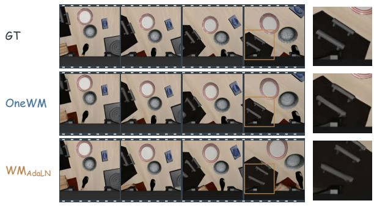  
(a) Middle drawer approach

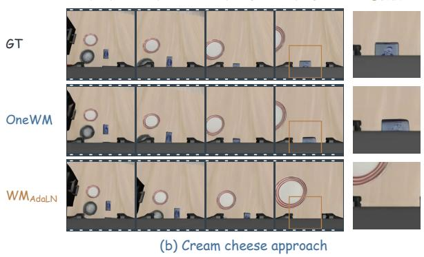

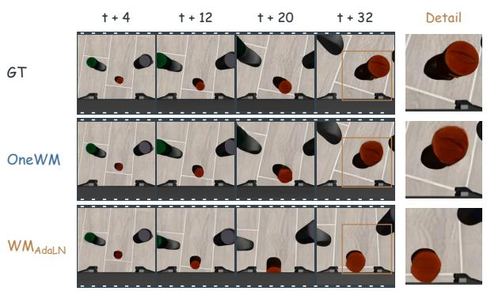  
(c) BBQ sauce approach

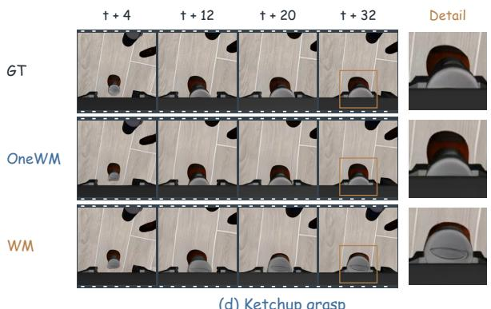  
(d) Ketchup grasp

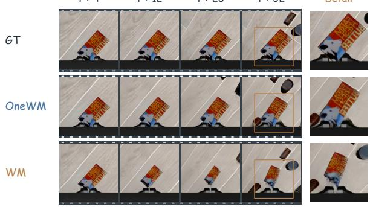  
(e) Butter grasp

Detail  
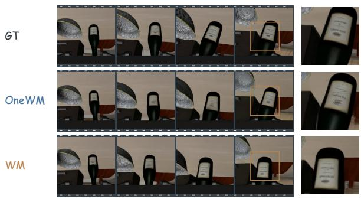  
(f) Wine bottle rotation  
Figure 6: Wrist-camera world predictions. Six matched comparisons emphasize object position, shape, and pose near the gripper. Each final column enlarges the same marked region at t + 32 for all three rows.

Conditional fidelity and distributional quality. These examples help interpret the different metric rankings in Table 2. PSNR, SSIM, and LPIPS compare each prediction with its corresponding reference, whereas FID and FVD compare pooled feature statistics [54, 55]. Reassigning generated clips to different action sequences would leave these pooled statistics unchanged. A lower distributional distance therefore need not imply more accurate action-conditioned geometry.

RoboCasa365 predictions. Figure 7 extends the comparisons to diverse scenes across three camera views. In the left views (a,b), OneWM more closely tracks forearm withdrawal and gripper–door motion. In the wrist views (c,d), the baselines overpredict viewpoint change, shifting the fridge geometry and bringing the bowl into view too early. The right views (e,f) show closer correspondence in gripper descent and orientation near the counter and ice cube. These differences concern motion relative to scene structure, rather than appearance alone, illustrating the value of action learning for conditional spatial prediction.

t + 2  
t + 16  
t + 10  
t + 2  
Detail  
Detail  
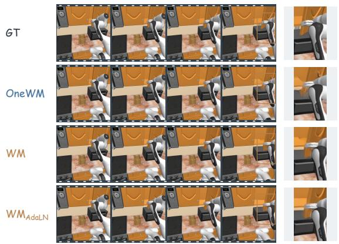  
(a) Arm withdrawal / Left view

Detail  
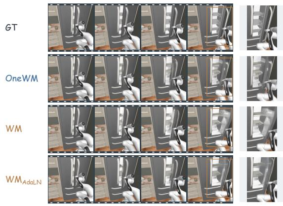  
(b) Fridge opening / Left view

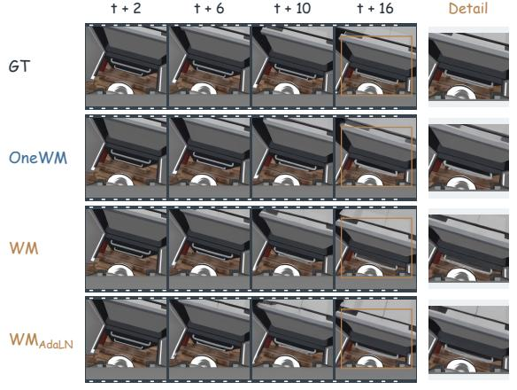  
(c) Fridge approach / Wrist view

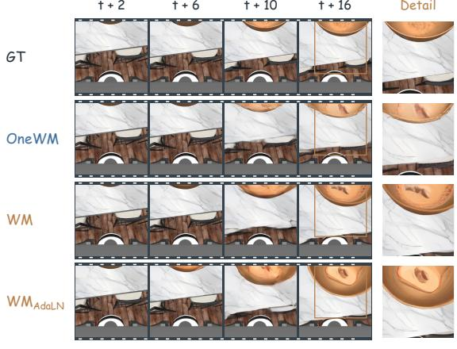  
(d) Bowl approach / Wrist view

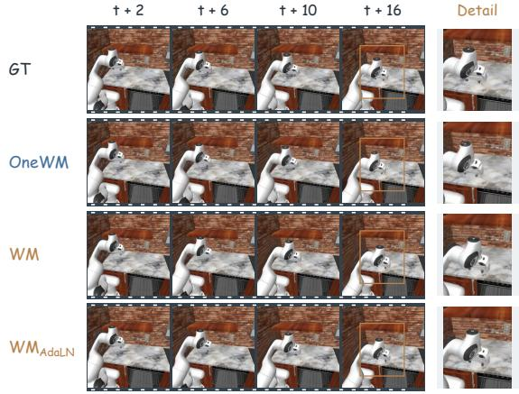  
(e) Gripper descent / Right view

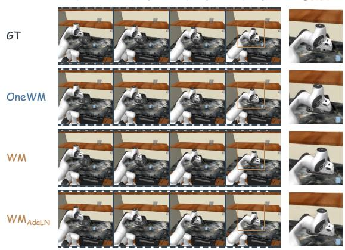  
(f) Ice-cube approach / Right view  
Figure 7: RoboCasa365 world predictions. Six matched cases compare GT, OneWM, WM, and $\mathrm { \mathbf { W M } _ { A d a L N } }$ from left (a,b), wrist (c,d), and right (e,f) cameras. The final column enlarges the same marked region at t + 16 for all four rows.

## C Endless Dream on LIBERO

We instantiate the loop in Eq. 6 with the jointly trained LIBERO model and the default conditioning mixture. Each rollout starts from one main-camera image, one wrist-camera image, and a task instruction. Both inference stages use 10 denoising steps with a fixed seed of 42. The generated action chunk is passed unchanged to world prediction; its final multi-view prediction becomes the next visual context. Only the initial observation is obtained from the environment. All rollouts use a fixed budget of 16 rounds, with 32 actions and eight predicted frames per round. Figure 8 shows intermediate states and the final state of every rollout.

4.8s  
3.2s  
25.6s  
(d) Place the cream cheese in the basket  
0.0s  
3.2s  
4.8s  
6.4s  
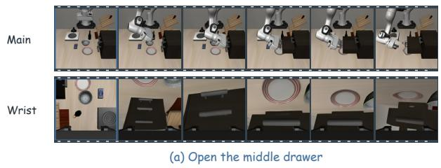  
8.0s  
25.6s

0.0s  
8.0s  
6.4s  
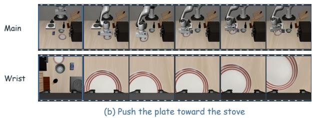

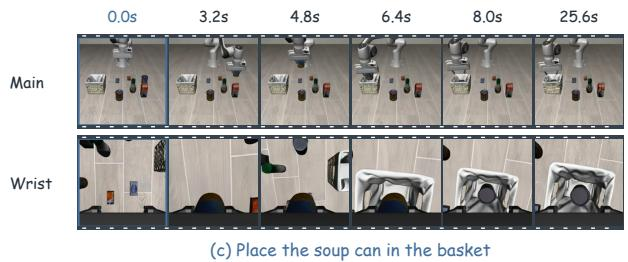

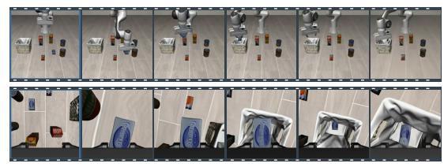

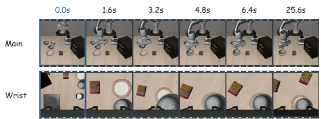  
(e) Place the black bowl on the plate

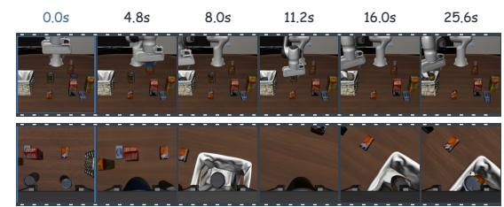  
(f) Place both cans in the basket  
Figure 8: Endless dream on LIBERO. Six rollouts generated by alternating action prediction and action-conditioned world prediction. Each panel shows main- and wrist-camera views; blue outlines mark the initial observations, and every later frame is generated. Columns indicate modeled time, with the final column showing the end of round 16.