# CertEx: Exact Visual Retrieval at Scale by Certified Exclusion

Dongfang Zhao

Tacoma School of Engineering & Technology and eScience Institute University of Washington

dzhao@uw.edu

## Abstract

Exact k-nearest-neighbor (kNN) search over image descriptors and embeddings underlies visual retrieval, nearduplicate detection, the evaluation of learned representations, and increasingly the memory of LLM agents. However, exhaustive search computes every distance at full precision, whereas approximate indexes return recall below one. We observe that exact search only needs a proof that each excluded vector cannot be a neighbor. Because such a proof only has to be conservative, it can be checked in low precision, much as the retina examines the whole scene at low resolution. We call this principle certified exclusion and realize it in an exact kNN method for GPUs, which we call CertEx. Specifically, CertEx stores a lower-bounding projection of each vector in half precision and folds a rounding certificate into the same tensor-core dot product, so that only the few vectors that the test keeps need exact distances. We prove that CertEx returns the exact kNN of every query. On sixteen datasets with up to 100M vectors, CertEx is exact for every query at 7.1× to 18.0× the throughput of the fastest cuVS search on one H100 and outperforms quantized and graph indexes whenever every query must be exact.

## 1 Introduction

Exact kNN search over large collections of visual features is a basic operation whose errors propagate into the tasks built on top of it. For instance, image retrieval ranks database descriptors such as SIFT [42] by their distance to a query descriptor, so that a missed neighbor removes a relevant image from the ranked list. Similarly, near-duplicate detection in web-scale training corpora such as LAION [58] compares every image embedding with its nearest neighbors [54], so that a missed neighbor keeps a duplicate pair in the training data. Likewise, the kNN classifier that evaluates selfsupervised representations [12, 50, 70] reports the search error together with the quality of the representation whenever its neighbors are approximate. Moreover, LLMs and agents increasingly read long contexts and memories by nearestneighbor search [4, 11, 34, 38, 39, 67, 69, 71], so that a missed neighbor drops a relevant memory. Finally, every benchmark of approximate search measures recall against exact neighbors and therefore inherits any error of the exhaustive search that computes them.

Existing systems respond to the cost of exact search in two ways, both of which leave a gap. First, exhaustive search on GPUs [18, 35] computes every query-to-vector distance at full precision. The throughput of exhaustive search is therefore bounded by one full-precision distance per vector, and its capacity is bounded by device memory, which must hold every vector at full precision. Second, approximate indexes based on quantization [22, 28, 37] or proximity graphs [43, 49, 63] are much faster. However, these indexes trade recall for speed by design and rely on an index that must be built before the first query and repaired when the collection changes [74]. Practitioners therefore choose between exact results at high cost and fast results whose errors are not controlled per query.

To close this gap, we follow the division of labor in human vision: the periphery examines the whole visual field in parallel at low resolution, whereas high resolution is spent only on the few locations that attention selects [13, 65]. Transferred to kNN search, this principle examines every database vector at low precision in one parallel pass and spends full precision only on the few vectors that the pass cannot exclude. However, a low-precision distance is not exact. Consequently, unless every low-precision decision is certified to be conservative, the pass loses neighbors in the same way as an approximate index.

We address this difficulty with a principle that we call certified exclusion: a test may run in any arithmetic as long as it never excludes a vector within the threshold, so that verifying the kept vectors yields the exact neighbors. We realize this principle in an exact search method that we call CertEx. Specifically, CertEx stores a lower-bounding projection of every vector in half precision, together with four coordinates that fold the rounding and accumulation errors [10, 29] of the tensor-core dot product into the product itself. As a result, one dot product and one comparison per vector decide whether the vector can still be a neighbor, without a top-k selection and without a false dismissal. By analogy with human vision, we call this half-precision copy of the database the retina and the exact verification of the vectors that it keeps thefovea. Unlike quantization [22, 37] and graph [43, 49] indexes, which decide where a query should look, the retina examines every vector and backs each exclusion by a proof.

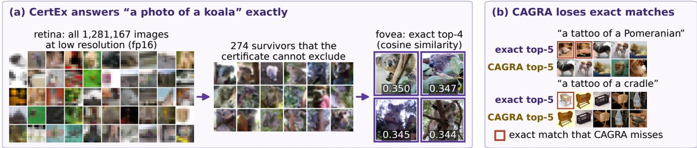  
Figure 1: Text-to-image retrieval over 1.28M ImageNet images: CertEx (a); exact and CAGRA top-5, ranked from left to right (b).

For instance, Figure 1(a) follows one text query through CertEx: the certified test keeps 274 of the 1,281,167 ImageNet [15] training images, from which the fovea returns the exact best matches. By comparison, CAGRA [49] loses the best matching image for the two prompts of Figure 1(b), even at its most accurate configuration. Beyond these examples, CertEx returns exact results on one H100 GPU with 7.1× to 18.0× the throughput of the fastest cuVS [47] fp32 configuration on sixteen datasets, with a speedup that grows with the database size. CertEx also outperforms the GPU indexes IVF-Flat [62], IVF-PQ [37], IVF-RaBitQ [22], and CAGRA [49] whenever every query must be exact.

In summary, we make three contributions.

• We propose certified exclusion, a new principle for exact search that replaces the ranking of all N vectors by one keep-or-exclude decision per vector. Because the decision never excludes a vector within the threshold, even when it runs in half precision, verifying only the kept vectors returns the exact neighbors.

• We design CertEx as an exact kNN method that realizes certified exclusion on GPU tensor cores [10]. We call its data structure the retina, which is a single half-precision matrix with one row per database vector. Each row holds a lower-bounding projection of one vector and four coordinates of a rounding certificate. We prove that its one-pass tensor-core test never discards a true neighbor, answers range queries and similarity self-joins (all pairs within a radius) exactly, and keeps survivors between two balls whose gap shrinks as the principal coordinates capture more of the data.

• We evaluate CertEx on sixteen datasets with up to 100M vectors, including the embeddings of seven vision encoders such as CLIP [56], DINOv2 [50], and DINOv3 [61]. CertEx answers every query exactly at 7.1× to 18.0× the throughput of the fastest exhaustive search of NVIDIA cuVS [47] and is faster than IVF-Flat [62], IVF-PQ [37], IVF-RaBitQ [22], and CAGRA [49] whenever every query must be exact. On the 12.8M web images of DataComp [21], CertEx is exact for every query and finds all 31.4 billion duplicate pairs, which makes exact deduplication [1] practical at web scale.

## 2 Related Work

Exact search with lower bounds. Exact methods avoid computing every distance by excluding the vectors whose lower bound exceeds the current neighbor distance. For instance, the k-d tree [7] and the cover tree [9] bound whole regions, whereas AESA [66] bounds single points by the triangle inequality with precomputed pivots. However, the pruning power of such bounds decays with the dimension [8, 68]. The GEMINI framework [19] therefore moves the bound into a contractive feature space with a proof of no false dismissal, which the VA-file [68] turns into a sequential scan of compact approximations. In contrast, random projections preserve distances only up to a distortion factor [36] and support only approximate hashing [14, 30], whereas exhaustive GPU search [24, 35] avoids bounds altogether. In our terms, GEMINI and the VA-file are certified exclusion tests in full precision whose survivors are still ranked against a running candidate set; in contrast, CertEx certifies a half-precision tensor-core decision inside the same product and replaces the ranking by one comparison per vector.

Approximate indexes. Approximate indexes trade exactness for fewer examined vectors. Specifically, product quantization [6, 25, 28, 37] compresses vectors and probes a few partitions, to which RaBitQ [22, 23] adds a probabilistic error bound. In addition, FLANN [46] automates the choice among tree and k-means partitions. In contrast, graph indexes such as HNSW [43], DiskANN [63], SONG [75], GGNN [26], and CAGRA [49] walk a proximity graph toward the query. Benchmarks [5, 60] accordingly rank these methods by recall at a given throughput, whereas CertEx examines every vector and returns exact results.

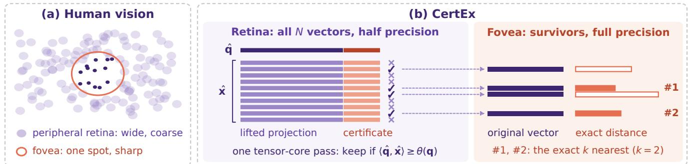  
Figure 2: Overview of CertEx and the visual system that motivates it.

Nearest neighbors in visual recognition. Visual recognition uses nearest neighbors as a component whose errors enter the task metric. For instance, object retrieval [3, 32, 53, 62] is evaluated against exhaustive ground truth [55]. Similarly, copy detection [17, 54] and dataset curation [1, 21] remove near and semantic duplicates from web-scale corpora. In representation learning, weighted kNN classifiers evaluate self-supervised representations [12, 50, 61]. Retrieval-augmented classification [41] even feeds the retrieved neighbors into the model. In practice, these pipelines obtain their neighbors from approximate indexes, cluster-restricted comparisons, or kNN graphs of fixed degree. In contrast, CertEx returns exact neighbors faster than exhaustive search and answers deduplication with an exact similarity self-join (Section 3.6).

Foveation and certified low-precision arithmetic. Vision models allocate resolution unevenly, for instance through recurrent glimpses [45], foveal-peripheral segmentation [2], or foveated rendering [27, 31]. Numerical computing allocates precision in the same way, for instance in mixed-precision training [44]. Computational geometry goes further: its floating-point filters evaluate a predicate in fast arithmetic together with an error bound [10, 29] and fall back to exact arithmetic only near zero [20, 59]. Following this idea, CertEx folds the error bound into the same halfprecision product, so that every low-precision decision of CertEx carries a proof of no false dismissal, unlike approximate foveation.

## 3 Methodology

## 3.1 Overview

Exact kNN search must examine all N database vectors, although only the few vectors near the query need full precision. Human vision solves the same problem by dividing its work between two parts of the retina [13] (Figure 2(a)): the periphery covers the whole scene at low resolution, whereas the fovea sees only one spot at full resolution. Our exact kNN method divides its work in the same way (Figure 2(b)). We call this method CertEx, which stands for certified exclusion.

The left half of Figure 2(b) shows the retina of CertEx, which stores one half-precision vector xˆ for each of the N database vectors x. We call xˆ the retina vector of x. The first part of xˆ keeps a few principal coordinates of x and summarizes the rest by one norm. We call this part the lifted projection of x (Section 3.3). The inner product of two lifted projections determines a lower bound on the distance between their vectors. Although half precision is the fastest arithmetic of GPU tensor cores [10], rounding to half precision can overestimate the distance of a true neighbor. To guard against this error, the second part of xˆ records how large the rounding error of xˆ can be. We call this part the certificate of xˆ. With the certificate, the test excludes a vector only if the vector would be excluded even under the worst possible rounding. Moreover, the tensor cores evaluate this worst case within the same product (Section 3.4). Concretely, a tensor-core pass over the retina keeps a vector x only if $\langle \hat { \mathbf { q } } , \hat { \mathbf { x } } \rangle \geq \theta ( \mathbf { q } )$ , where the retina vector qˆ encodes the query q in the same form as xˆ and the threshold θ(q) follows from an upper bound U on the distance of the k-th nearest neighbor (Section 3.5). Because U is needed before the pass, CertEx obtains it from a few sampled vectors. The test of each vector therefore depends on no other database vector, so that one pass over the retina decides all N vectors without ranking them. We call this pass the retina pass. As Figure 2(b) shows, the pass excludes most vectors (crosses) but never a true neighbor; we call the kept vectors (checks)

survivors.

The right half of Figure 2(b) shows the fovea, which takes over after the retina pass. For each survivor, the fovea reads the original vector in full precision and computes the exact distance between that vector and the query. As a result, the k survivors with the smallest exact distances are the exact k nearest neighbors of ${ \bf q } ,$ marked #1 and #2 for $k = 2$ in the figure.

## 3.2 Certified Exclusion

Consider a database $\mathcal { X } \ : = \ \{ \mathbf { x } _ { 1 } , \dotsc , \mathbf { x } _ { N } \} \ \subset \ \mathbb { R } ^ { D }$ and a query $\mathbf { q } ~ \in ~ \mathbb { R } ^ { D }$ . Exact kNN search returns the index set $\begin{array} { r } { \mathcal { N } _ { k } ( \mathbf { q } ) : = \arg \operatorname* { m i n } _ { \pmb { S } \subseteq [ N ] , | \pmb { S } | = k } \sum _ { i \in S } \| \mathbf { q } - \mathbf { x } _ { i } \| } \end{array}$ , whose farthest member lies at the distance $r _ { k } ( \mathbf { q } )$ from q. However, computing $\mathcal { N } _ { k } ( \mathbf { q } )$ requires exact distances only for the vectors that may be neighbors. Definition 1 therefore formalizes what a test that excludes the other vectors must guarantee, whatever arithmetic it uses.

Definition 1 (Certified exclusion). A test $T ( \mathbf { q } , \mathbf { x } , U ) \in$ {keep, exclude} is a certified exclusion test if its computed output keeps every vector x with $\| \mathbf { q } - \mathbf { x } \| \leq U$ , for every query q, vector x, and threshold $U \geq 0 .$

Definition 1 constrains only the direction of the errors of a test. Specifically, a certified exclusion test may keep a vector farther than U at the cost of one exact distance, but it never excludes a vector within U.

Proposition 1 (Exact search by certified exclusion). For a certified exclusion test T and a threshold $U \geq r _ { k } ( \mathbf { q } )$ , the k vectors with the smallest exact distances among the vectors that T keepsform $\sqrt { \mathbf { \rho } } _ { k } ( \mathbf { q } )$

Proof. Every $\mathbf { x } \in \mathcal { N } _ { k } ( \mathbf { q } )$ satisfies $\| \mathbf { q } - \mathbf { x } \| \leq r _ { k } ( \mathbf { q } ) \leq U$ and is therefore kept by Definition 1. The k smallest exact distances among a superset of $\sqrt { \mathbf { \rho } } _ { k } ( \mathbf { q } )$ are the k smallest over X. □

## 3.3 Lifted Lower Bound

Proposition 1 leaves open which certified exclusion test to use. CertEx needs a test that reads few bytes, because the retina pass reads every database vector and its cost grows with the number of bytes per vector. CertEx therefore keeps a few principal coordinates of each vector and one more coordinate that summarizes the rest, which together still give a lower bound on the distance. Specifically, consider a center $\mathbf { c } \in \mathbb { R } ^ { D }$ and a matrix $\mathbf { V } \in \mathbb { R } ^ { m \times D }$ whose orthonormal rows are the m leading principal directions of a sample of X . We call m the width of the retina. The lifted projection of a vector keeps its m principal coordinates and summarizes the remaining $D - m$ coordinates by their norm:

$$
\ell ( \mathbf x ) : = \left[ \| ( \mathbf I - \mathbf V ^ { \top } \mathbf V ) ( \mathbf x - \mathbf c ) \| \right] \in \mathbb R ^ { m + 1 } .\tag{1}
$$

Proposition 2 (Lower bound). For all $\mathbf { q } , \mathbf { x } \in \mathbb { R } ^ { D } , \| \ell ( \mathbf { q } ) -$ $\ell ( \mathbf { x } ) \| \leq \| \mathbf { q } - \mathbf { x } \|$

Proof. The entry $( i , j )$ of $\mathbf { V V } ^ { \top }$ is the inner product of rows i and $j$ of V, which is 1 for $i = j$ and 0 otherwise because the rows are orthonormal. Hence $\mathbf { V } \mathbf { V } ^ { \top } = \mathbf { I } _ { m }$ . We write $\mathbf { I I } : = \mathbf { V } ^ { \top } \mathbf { V }$ and prove the claim in five steps.

Step 1 splits the centered vectors. We define $\mathbf { u } : = \mathbf { q } - \mathbf { c } .$ $\mathbf { v } : = \mathbf { x } - \mathbf { c } , \mathbf { u } _ { 1 } : = \mathbf { I I u } , \mathbf { u } _ { 2 } : = \mathbf { u } - \mathbf { u } _ { 1 } , \mathbf { v } _ { 1 } : = \mathbf { I I v } ,$ , and $\mathbf { v } _ { 2 } : =$ $\mathbf { v } - \mathbf { v } _ { 1 }$ . Two facts follow. First, with $\mathbf { a } : = \mathbf { V } (  { \mathbf { u } } -  { \mathbf { v } } ) \in \mathbb { R } ^ { m }$

$$
\mathbf { u } _ { 1 } - \mathbf { v } _ { 1 } = \mathbf { V } ^ { \top } \mathbf { V } \mathbf { u } - \mathbf { V } ^ { \top } \mathbf { V } \mathbf { v } = \mathbf { V } ^ { \top } \mathbf { V } ( \mathbf { u } - \mathbf { v } ) = \mathbf { V } ^ { \top } \mathbf { a } .\tag{2}
$$

Second, since $\mathbf { V } \mathbf { V } ^ { \top } = \mathbf { I } _ { m } .$

$$
\mathbf { V } \mathbf { u } _ { 2 } = \mathbf { V } \mathbf { u } - \mathbf { V } \mathbf { V } ^ { \top } \mathbf { V } \mathbf { u } = \mathbf { V } \mathbf { u } - \mathbf { V } \mathbf { u } = \mathbf { 0 }\tag{3}
$$

and likewise $\mathbf { V } \mathbf { v } _ { 2 } = \mathbf { 0 } .$

Step 2 writes the lifted projections in these parts. Eq. (1) applied to q reads $\ell ( \mathbf { q } ) = [ \mathbf { V } \mathbf { u } ; \| ( \mathbf { I } - \mathbf { V } ^ { \top } \mathbf { V } ) \mathbf { u } \| ]$ , because $\mathbf { q } - \mathbf { c } = \mathbf { u }$ . Its first block is $\mathbf { V } \mathbf { u } = \mathbf { V } ( \mathbf { u } _ { 1 } + \mathbf { u } _ { 2 } ) = \mathbf { V } \mathbf { u } _ { 1 } +$ $\mathbf { V } \mathbf { u } _ { 2 } = \mathbf { V } \mathbf { u } _ { 1 }$ by Eq. (3). Its last coordinate is $\left. \mathbf { u } _ { 2 } \right.$ , because $( \mathbf { I } - \mathbf { V } ^ { \top } \mathbf { V } ) \mathbf { u } = \mathbf { u } - \mathbf { \Pi } \mathbf { H } \mathbf { u } = \mathbf { u } - \mathbf { u } _ { 1 } = \mathbf { u } _ { 2 }$ . The same computation for x gives

$$
\ell ( { \mathbf { q } } ) = \left[ \mathbf { \left| { \mathbf { u } } _ { 1 } \right| } \right] , \qquad \ell ( { \mathbf { x } } ) = \left[ { \mathbf { \mathbf { V } } } { \mathbf { v } } _ { 1 } \right] ,
$$

and subtracting the two gives

$$
\ell ( \mathbf { q } ) - \ell ( \mathbf { x } ) = \left[ \mathbf { V } ( \mathbf { u } _ { 1 } - \mathbf { v } _ { 1 } ) \right] .
$$

The squared norm of a stacked vector is the sum of the squared norms of its blocks, so that

$$
\begin{array} { r } { \| \ell ( \mathbf { q } ) - \ell ( \mathbf { x } ) \| ^ { 2 } = \| \mathbf { V } ( \mathbf { u } _ { 1 } - \mathbf { v } _ { 1 } ) \| ^ { 2 } + ( \| \mathbf { u } _ { 2 } \| - \| \mathbf { v } _ { 2 } \| ) ^ { 2 } . } \end{array}\tag{4}
$$

Step 3 shows that V keeps the norm of ${ \bf u } _ { 1 } - { \bf v } _ { 1 }$ . By $\mathrm { E q . ~ } ( 2 ) , \mathbf { V } ( \mathbf { u } _ { 1 } - \mathbf { v } _ { 1 } ) = \mathbf { V } \mathbf { V } ^ { \top } \mathbf { a } = \mathbf { a }$ and $\| \mathbf { u } _ { 1 } - \mathbf { v } _ { 1 } \| ^ { 2 } =$ $\mathbf { a } ^ { \top } \mathbf { V } \mathbf { V } ^ { \top } \mathbf { a } = \| \mathbf { a } \| ^ { 2 }$ . Hence

$$
\lVert \mathbf { u } _ { 1 } - \mathbf { v } _ { 1 } \rVert ^ { 2 } = \lVert \mathbf { V } ( \mathbf { u } _ { 1 } - \mathbf { v } _ { 1 } ) \rVert ^ { 2 } .\tag{5}
$$

Step 4 applies the Pythagorean theorem. The center cancels in the difference, $\mathbf { q } - \mathbf { x } = ( \mathbf { q } - \mathbf { c } ) - ( \mathbf { x } - \mathbf { c } ) = \mathbf { u } - \mathbf { v }$ which splits as $\mathbf y + \mathbf z$ with $\mathbf { y } : = \mathbf { u } _ { 1 } - \mathbf { v } _ { 1 }$ and $\mathbf { z } : = \mathbf { u } _ { 2 } - \mathbf { v } _ { 2 }$ By Eqs. (2) and (3), the two parts are orthogonal:

$$
\langle \mathbf { y } , \mathbf { z } \rangle = \langle \mathbf { V } ^ { \top } \mathbf { a } , \mathbf { z } \rangle = \mathbf { a } ^ { \top } \mathbf { V } \mathbf { z } = \mathbf { a } ^ { \top } ( \mathbf { V } \mathbf { u } _ { 2 } - \mathbf { V } \mathbf { v } _ { 2 } ) = 0 .
$$

Expanding $\| \mathbf { y } + \mathbf { z } \| ^ { 2 } = \| \mathbf { y } \| ^ { 2 } + 2 \langle \mathbf { y } , \mathbf { z } \rangle + \| \mathbf { z } \| ^ { 2 }$ therefore gives

$$
\| \mathbf { q } - \mathbf { x } \| ^ { 2 } = \| \mathbf { u } _ { 1 } - \mathbf { v } _ { 1 } \| ^ { 2 } + \| \mathbf { u } _ { 2 } - \mathbf { v } _ { 2 } \| ^ { 2 } .\tag{6}
$$

Step 5 applies the reverse triangle inequality. The triangle inequality gives $\| \mathbf { u } _ { 2 } \| \leq \| \mathbf { u } _ { 2 } - \mathbf { v } _ { 2 } \| + \| \mathbf { v } _ { 2 } \|$ and $\left. \mathbf { v } _ { 2 } \right. \leq$

$\| \mathbf { u } _ { 2 } - \mathbf { v } _ { 2 } \| + \| \mathbf { u } _ { 2 } \|$ , so that $\| \mathbf { u } _ { 2 } - \mathbf { v } _ { 2 } \| \geq \| \mathbf { u } _ { 2 } \| - \| \mathbf { v } _ { 2 } \| |$ Squaring both nonnegative sides gives

$$
\left\| \mathbf { u } _ { 2 } - \mathbf { v } _ { 2 } \right\| ^ { 2 } \geq ( \left\| \mathbf { u } _ { 2 } \right\| - \left\| \mathbf { v } _ { 2 } \right\| ) ^ { 2 } .\tag{7}
$$

Combining the four relations,

$$
\begin{array} { r l } & { \| \mathbf { q } - \mathbf { x } \| ^ { 2 } \overset { ( \delta ) } { = } \| \mathbf { u } _ { 1 } - \mathbf { v } _ { 1 } \| ^ { 2 } + \| \mathbf { u } _ { 2 } - \mathbf { v } _ { 2 } \| ^ { 2 } } \\ & { \qquad \overset { ( 7 ) } { \geq } \| \mathbf { u } _ { 1 } - \mathbf { v } _ { 1 } \| ^ { 2 } + ( \| \mathbf { u } _ { 2 } \| - \| \mathbf { v } _ { 2 } \| ) ^ { 2 } } \\ & { \qquad \overset { ( 5 ) } { = } \| \mathbf { V } ( \mathbf { u } _ { 1 } - \mathbf { v } _ { 1 } ) \| ^ { 2 } + ( \| \mathbf { u } _ { 2 } \| - \| \mathbf { v } _ { 2 } \| ) ^ { 2 } } \\ & { \qquad \overset { ( 4 ) } { = } \| \ell ( \mathbf { q } ) - \ell ( \mathbf { x } ) \| ^ { 2 } . } \end{array}
$$

Taking the square root of both nonnegative sides proves the claim. □

Proposition 2 turns the lifted projection into an exclusion test. Specifically, $\mathrm { i f } \ \| \ell ( \mathbf { q } ) - \ell ( \mathbf { x } ) \| > U$ , then $\| \mathbf { q } - \mathbf { x } \| > U$ as well, so that excluding x never removes a vector within $U .$ . However, the test must take a form that tensor cores evaluate quickly. This form is an inner product, because tensor cores multiply matrices and thus compute the inner products of many pairs of vectors at once. We therefore rewrite the test in terms of one inner product per pair. To this end, expanding the squared norm of a difference with $a ( \mathbf { x } ) : = \| \boldsymbol { \ell } ( \mathbf { \bar { x } } ) \| ^ { 2 }$ gives

$$
\lVert \ell ( { \bf q } ) - \ell ( { \bf x } ) \rVert ^ { 2 } = a ( { \bf q } ) + a ( { \bf x } ) - 2 \langle \ell ( { \bf q } ) , \ell ( { \bf x } ) \rangle .\tag{8}
$$

Since both sides of the test $\| \ell ( \mathbf { q } ) - \ell ( \mathbf { x } ) \| \leq U$ are nonnegative, the test holds exactly when the squared test holds. By Eq. (8), the squared test reads

$$
a ( \mathbf { q } ) + a ( \mathbf { x } ) - 2 \langle \ell ( \mathbf { q } ) , \ell ( \mathbf { x } ) \rangle \leq U ^ { 2 } .
$$

Moving the inner product to the right-hand side and $U ^ { 2 }$ to the left-hand side gives $a ( \mathbf { q } ) + a ( \mathbf { x } ) - U ^ { 2 } \leq 2 \langle \ell ( \mathbf { q } ) , \ell ( \mathbf { x } ) \rangle$ ⟩. Dividing by 2 and moving $a ( \mathbf { x } ) / 2$ to the right-hand side finally gives the equivalent test

$$
\langle \ell ( \mathbf { q } ) , \ell ( \mathbf { x } ) \rangle - \frac { a ( \mathbf { x } ) } { 2 } \geq \frac { a ( \mathbf { q } ) - U ^ { 2 } } { 2 } .\tag{9}
$$

In this form, the right-hand side depends only on the query, so that CertEx computes it once per query. Similarly, on the left-hand side, $a ( \mathbf { x } )$ depends only on the database vector and is computed once when the retina is built. The test of one pair therefore costs one inner product and one comparison, so that one matrix product on the tensor cores tests all pairs.

## 3.4 Certified Half-Precision Retina

To evaluate Eq. (9) for all vectors in one tensor-core pass, CertEx stores each lifted projection in half precision inside its retina vector. However, rounding to half precision may underestimate the inner product, which overestimates the bound and can discard a true neighbor. To bound this effect, denote by $\tilde { \ell } ( \cdot )$ the rounding of $\ell ( \cdot )$ to the nearest halfprecision numbers and by $\delta ( \cdot ) : = \| \ell ( \cdot ) - \tilde { \ell } ( \cdot ) \|$ its rounding error. Splitting the inner product into its rounded part and two error terms and applying the Cauchy–Schwarz inequality to the error terms gives

$$
\begin{array} { r l } & { \langle \ell ( \mathbf { q } ) , \ell ( \mathbf { x } ) \rangle \leq \langle \tilde { \ell } ( \mathbf { q } ) , \tilde { \ell } ( \mathbf { x } ) \rangle } \\ & { \qquad + \delta ( \mathbf { q } ) \| \ell ( \mathbf { x } ) \| + \| \tilde { \ell } ( \mathbf { q } ) \| \delta ( \mathbf { x } ) . } \end{array}\tag{10}
$$

Eq. (10) follows from the exact split

$$
\begin{array} { r l } & { \langle \ell ( { \bf q } ) , \ell ( { \bf x } ) \rangle = \langle \tilde { \ell } ( { \bf q } ) , \tilde { \ell } ( { \bf x } ) \rangle + \langle \ell ( { \bf q } ) - \tilde { \ell } ( { \bf q } ) , \ell ( { \bf x } ) \rangle } \\ & { ~ + ~ \langle \tilde { \ell } ( { \bf q } ) , \ell ( { \bf x } ) - \tilde { \ell } ( { \bf x } ) \rangle , } \end{array}
$$

since the Cauchy–Schwarz inequality bounds the last two terms by $\delta ( \mathbf { q } ) \| \ell ( \mathbf { x } ) \|$ and $\| \tilde { \ell } ( \mathbf { q } ) \| \delta ( \mathbf { x } )$ . A second error arises in the tensor cores, which multiply half-precision operands exactly but accumulate the products in fp32. This accumulation adds an error of at most γ times the sum of the absolute products, where γ depends only on the padded length L of the retina vectors [10, 29].

CertEx folds both error terms into the same dot product, in the manner of floating-point filters [59]. Specifically, each database retina vector xˆ appends four coordinates to $\tilde { \ell } ( { \bf x } )$ , which form its certificate: upper bounds $\overline { { n } } _ { \bf x }$ on $\| \ell ( \mathbf { x } ) \|$ and $\overline { { e } } _ { \bf x }$ on the rounding error $\delta ( \mathbf { x } )$ plus an accumulation term, and a high part $h _ { \mathbf { x } }$ and a low part $l _ { \mathbf { x } }$ of $a ( \mathbf { x } ) / 2$ (the bars mark upper bounds). Correspondingly, the retina vector $\hat { \mathbf { q } }$ of a query appends an upper bound $\overline { { e } } _ { \mathbf { q } }$ on $\delta ( \mathbf { q } )$ , an upper bound $\overline { { n } } _ { \mathbf { q } } \mathrm { ~ o n ~ } \| \tilde { \ell } ( \mathbf { q } ) \|$ , a coefficient $1 - \varepsilon$ with ε slightly larger than $\gamma _ { - }$ , and a one. The two retina vectors thus read

$$
\begin{array} { r l r l r l } & { \hat { \mathbf { x } } ^ { \top } = } & { ~ [ \tilde { \ell } ( \mathbf { x } ) ^ { \top } , } & { \overline { { n } } _ { \mathbf { x } } , } & { \overline { { e } } _ { \mathbf { x } } , } & { ~ - h _ { \mathbf { x } } , } & { - l _ { \mathbf { x } } ] , } \\ & { \hat { \mathbf { q } } ^ { \top } = } & { ~ [ \tilde { \ell } ( \mathbf { q } ) ^ { \top } , } & { \overline { { e } } _ { \mathbf { q } } , } & { \overline { { n } } _ { \mathbf { q } } , } & { 1 - \varepsilon , } & { 1 ] , } \end{array}
$$

where the columns show which coordinates multiply each other. Denote by $P$ the exact inner product of $\hat { \mathbf { q } }$ and xˆ. By construction,

$$
\begin{array} { r } { P = \langle \tilde { \ell } ( \mathbf { q } ) , \tilde { \ell } ( \mathbf { x } ) \rangle + \overline { { e } } _ { \mathbf { q } } \overline { { n } } _ { \mathbf { x } } + \overline { { n } } _ { \mathbf { q } } \overline { { e } } _ { \mathbf { x } } - ( 1 - \varepsilon ) h _ { \mathbf { x } } - l _ { \mathbf { x } } . } \end{array}\tag{11}
$$

In Eq. (11), the products $\overline { { e } } _ { \mathbf { q } } \overline { { n } } _ { \mathbf { x } }$ and $\overline { { n } } _ { \mathbf { q } } \overline { { e } } _ { \mathbf { x } }$ bound the two error terms of Eq. (10) from above, whereas $h _ { \mathbf { x } } + l _ { \mathbf { x } }$ represents $a ( \mathbf { x } ) / 2$ . Instead of $P _ { \mathrm { : } }$ , the tensor cores return the value ${ \widehat { P } } ,$ which results from exact products of the half-precision coordinates and an accumulation of these products in fp32. The test of CertEx compares this value with a threshold: CertEx keeps a vector if and only if $\widehat { P }$ satisfies

$$
\widehat { P } \geq \theta ( \mathbf { q } ) : = \frac { a ( \mathbf { q } ) - U ^ { 2 } } { 2 } - \mu ( \mathbf { q } ) ,\tag{12}
$$

where the margin $\mu ( { \bf q } ) : = \gamma ( \overline { { { e } } } _ { \bf q } M _ { n } + \overline { { { n } } } _ { \bf q } M _ { e } + M _ { l } )$ uses the database maxima $M _ { n } , M _ { e }$ , and M of $\overline { { n } } _ { \bf x } , \overline { { e } } _ { \bf x }$ , and $| l _ { \mathbf { x } } |$

The proof of Proposition 3 uses every coordinate of the retina vectors, which we now define. We assume that the data are scaled once so that every lifted coordinate and every $a ( \mathbf { x } ) / 2$ lies in the normal range of half precision. This assumption loses no generality, because a common scale multiplies all distances by the same factor and therefore leaves the neighbors unchanged.

The coordinates that carry the error terms are themselves stored in half precision and must still bound norms and errors from above. We therefore write fl(v) for the rounding of v to the nearest half-precision number and $\operatorname { u p } ( v ) : =$ $\mathrm { H } ( ( 1 + 2 ^ { - 1 0 } ) v )$ for rounding up. Since rounding to nearest changes a value in the normal range by at most the relative $2 ^ { - 1 1 } , \operatorname { u p } ( v ) \geq ( 1 + 2 ^ { - 1 0 } ) ( 1 - 2 ^ { - \bar { 1 } 1 } ) { \overset { . } { v } } > v$ for every $v > 0$ Although the norms inside up are computed in $\mathrm { f p } 3 2$ , their relative error stays far below this margin. With these two operators, CertEx computes for each database vector x

$$
\begin{array} { r l } & { \nu _ { \mathbf { x } } : = ( 1 + 2 ^ { - 1 0 } ) \operatorname* { m a x } ( \| \ell ( \mathbf { x } ) \| , \| \tilde { \ell } ( \mathbf { x } ) \| ) , } \\ & { \overline { { n } } _ { \mathbf { x } } : = \operatorname* { u p } ( \| \ell ( \mathbf { x } ) \| ) , } \\ & { \overline { { e } } _ { \mathbf { x } } : = \operatorname* { u p } ( \delta ( \mathbf { x } ) + \gamma \nu _ { \mathbf { x } } ) , } \\ & { h _ { \mathbf { x } } : = \Pi ( a ( \mathbf { x } ) / 2 ) , } \\ & { l _ { \mathbf { x } } : = \Pi ( a ( \mathbf { x } ) / 2 - h _ { \mathbf { x } } ) . } \end{array}
$$

Here, the auxiliary value $\nu _ { \mathbf { x } }$ bounds both $\| \ell ( \mathbf { x } ) \|$ and $\| \tilde { \ell } ( \mathbf { x } ) \|$ from above. By the property of up, $\overline { { n } } _ { \mathbf { x } } \geq \| \ell ( \mathbf { x } ) \|$ bounds the norm, and $\overline { { e } } _ { \mathbf { x } } \geq \delta ( \mathbf { x } ) + \gamma \nu _ { \mathbf { x } }$ bounds the rounding error $\delta ( \mathbf { x } )$ together with the term $\gamma \nu _ { \mathbf { x } }$ . This term absorbs the accumulation error of the products of the first $m + 1$ coordinates (Step 3 of the proof below). Finally, the pair $h _ { \mathbf { x } } , l _ { \mathbf { x } }$ stores $a ( \mathbf { x } ) / 2$ as a high and a low half-precision part. Correspondingly, for a query ${ \bf q } ,$ CertEx computes $\overline { { e } } _ { \mathbf { q } } : = \mathrm { u p } ( \delta ( \mathbf { q } ) )$ and $\overline { { n } } _ { \mathbf { q } } : = \mathrm { u p } ( \| \tilde { \ell } ( \mathbf { q } ) \| )$ . The coefficient $1 - \varepsilon$ of $\hat { \mathbf { q } }$ uses the smallest multiple ε of $2 ^ { - 1 1 }$ that exceeds γ, so that $1 - \varepsilon$ is exact in half precision.

Proposition 3 (No false dismissal). $I f \parallel \ell ( \mathbf { q } ) - \ell ( \mathbf { x } ) \parallel \leq$ $U ,$ , the computed product satisfies Eq. (12), so that CertEx keeps x.

Proof. We bound the exact product P from below, then the accumulation error, and combine the two bounds in four steps.

Step 1 bounds P from below. The coordinates satisfy $\overline { { e } } _ { \mathbf { q } } \geq \delta ( \mathbf { q } ) , \pi _ { \mathbf { x } } \geq \Vert \ell ( \mathbf { x } ) \Vert , \pi _ { \mathbf { q } } \geq \Vert \tilde { \ell } ( \mathbf { q } ) \Vert$ , and $\overline { { e } } _ { \mathbf { x } } \geq \delta ( \mathbf { x } ) +$ $\gamma \nu _ { \mathbf { x } } ,$ so that

$$
\begin{array} { r } { \overline { { e } } _ { \mathbf { q } } \overline { { n } } _ { \mathbf { x } } + \overline { { n } } _ { \mathbf { q } } \overline { { e } } _ { \mathbf { x } } \geq \delta ( \mathbf { q } ) \| \ell ( \mathbf { x } ) \| + \| \tilde { \ell } ( \mathbf { q } ) \| \delta ( \mathbf { x } ) + \gamma \overline { { n } } _ { \mathbf { q } } \nu _ { \mathbf { x } } . } \end{array}
$$

Adding $\langle \tilde { \ell } ( \mathbf { q } ) , \tilde { \ell } ( \mathbf { x } ) \rangle$ to both sides and applying Eq. (10) bounds the first three terms of Eq. (11) from below by $\langle \ell ( { \bf q } ) , \ell ( { \bf x } ) \rangle + \gamma \overline { { n } } _ { \bf q } \nu _ { \bf x }$ . The last two terms of Eq. (11) equal

$- ( h _ { \mathbf { x } } + l _ { \mathbf { x } } ) + \varepsilon h _ { \mathbf { x } }$ , which is at least $- a ( \mathbf { x } ) / 2 - \sigma _ { \mathbf { x } } + \varepsilon h _ { \mathbf { x } }$ where $\sigma _ { \mathbf { x } } : = | a ( \mathbf { x } ) / 2 - h _ { \mathbf { x } } - l _ { \mathbf { x } } |$ is the error of the split. Hence

$$
P \geq \langle \ell ( \mathbf { q } ) , \ell ( \mathbf { x } ) \rangle - \frac { a ( \mathbf { x } ) } { 2 } + \gamma \overline { { n } } _ { \mathbf { q } } \nu _ { \mathbf { x } } + \varepsilon h _ { \mathbf { x } } - \sigma _ { \mathbf { x } } .\tag{13}
$$

Step 2 bounds the split error. Rounding to nearest gives $| a ( \mathbf x ) / 2 - h _ { \mathbf x } | \leq 2 ^ { - 1 1 } a ( \mathbf x ) / 2$ and then $\sigma _ { \mathbf { x } } \leq 2 ^ { - 1 1 } | a ( \mathbf { x } ) / 2 -$ $h _ { \mathbf { x } } | \leq 2 ^ { - 2 2 } a ( \mathbf { x } ) / 2$ . Since $h _ { \mathbf { x } } \geq ( 1 - 2 ^ { - 1 1 } ) a ( \mathbf { x } ) / 2$ , this gives $\sigma _ { \mathbf { x } } \le 2 ^ { - 2 1 } h _ { \mathbf { x } }$ . The padded length L is a multiple of $6 4 ,$ , so that $\gamma = 1 6 L \ i$ with $u = 2 ^ { - 2 4 }$ is a multiple of $\bar { 2 } ^ { - 1 4 }$ and so is ε. Their difference is positive and therefore at least $2 ^ { - 1 4 }$ , which gives

$$
( \varepsilon - \gamma ) h _ { \mathbf { x } } \geq \sigma _ { \mathbf { x } } .\tag{14}
$$

Step 3 bounds the accumulation error. Since the tensor cores multiply exactly and accumulate in fp32,

$$
| \widehat { P } - P | \leq \gamma \sum _ { i } | \hat { q } _ { i } \hat { x } _ { i } | ,
$$

where $\hat { q } _ { i }$ and ${ \hat { x } } _ { i }$ denote the i-th coordinates of $\hat { \mathbf { q } }$ and ${ \hat { \mathbf { x } } } .$ The Cauchy–Schwarz inequality bounds the sum over the first $m + 1$ coordinates by $\| \tilde { \ell } ( \mathbf { q } ) \| \| \tilde { \ell } ( \mathbf { x } ) \| \leq \overline { { n } } _ { \mathbf { q } } \nu _ { \mathbf { x } }$ . The remaining four products are $\overline { { e } } _ { \mathbf { q } } \overline { { n } } _ { \mathbf { x } } , \overline { { n } } _ { \mathbf { q } } \overline { { e } } _ { \mathbf { x } } , ( 1 - \varepsilon ) h _ { \mathbf { x } } \leq h _ { \mathbf { x } }$ , and $| l _ { \mathbf { x } } |$ Replacing $\overline { { n } } _ { \bf x } , \overline { { e } } _ { \bf x }$ , and $| l _ { \mathbf { x } } |$ by their database maxima gives

$$
| \widehat { P } - P | \leq \gamma \overline { n } _ { \mathbf { q } } \nu _ { \mathbf { x } } + \gamma h _ { \mathbf { x } } + \mu ( \mathbf { q } ) .\tag{15}
$$

Step 4 combines the bounds. Subtracting Eq. (15) from Eq. (13) and applying Eq. (14),

$$
\begin{array} { r l } & { \widehat { P } \geq \langle \ell ( \mathbf { q } ) , \ell ( \mathbf { x } ) \rangle - \displaystyle \frac { a ( \mathbf { x } ) } { 2 } + ( \varepsilon - \gamma ) h _ { \mathbf { x } } - \sigma _ { \mathbf { x } } - \mu ( \mathbf { q } ) } \\ & { \quad \geq \langle \ell ( \mathbf { q } ) , \ell ( \mathbf { x } ) \rangle - \displaystyle \frac { a ( \mathbf { x } ) } { 2 } - \mu ( \mathbf { q } ) . } \end{array}
$$

By the premise and Eq. (9), $\langle \ell ( \mathbf { q } ) , \ell ( \mathbf { x } ) \rangle - a ( \mathbf { x } ) / 2 \geq$ $( a ( \mathbf { q } ) - U ^ { 2 } ) / 2$ . Hence $\widehat { P } \geq \theta ( \mathbf { q } )$ □

In the implementation, CertEx sets $\gamma : = 1 6 L u$ , where $u = 2 ^ { - 2 4 }$ is the unit roundoff of fp32. This constant exceeds the worst-case constant that Blanchard et al. [10] derive for the accumulation of tensor cores, and it also covers an accumulator that truncates instead of rounding. In addition, CertEx inflates $U ^ { 2 }$ by the relative factor $1 + 1 0 ^ { - 4 }$ The threshold $\theta ( \mathbf { q } )$ is evaluated in fp64 and rounded down to $\mathrm { f p } 3 2$ , so that neither rounding shrinks the kept set. Finally, the retina pass reads the database retina vectors once per batch of queries and writes out only the pairs that satisfy Eq. (12).

## 3.5 Foveal Verification and Exactness

The fovea needs the threshold U before the retina pass and the exact distances of the survivors after it. Before the pass, CertEx samples every s-th retina vector, for a stride s, and scores the sampled vectors by the same computed product $\widehat { P }$ as the retina pass. Among them, the sampled vectors with the largest products become the anchors $\boldsymbol { \mathcal { A } } ( \mathbf { q } )$ . The threshold U is then the k-th smallest exact distance among the anchors. Because the anchors are at least k distinct vectors of X, $U \geq r _ { k } ( \mathbf { q } )$ holds for every query. After the pass, the fovea computes the exact distance of each survivor from the full-precision difference $\mathbf { q } - \mathbf { x }$ and returns the k smallest per query.

Proposition 4 (Exactness). CertEx returns $\sqrt { \mathbf { \rho } } _ { k } ( \mathbf { q } )$ for every query q.

Proof. Every x with $\| \mathbf { q } - \mathbf { x } \| \leq U$ satisfies $\| \ell ( \mathbf { q } ) - \ell ( \mathbf { x } ) \| \leq$ U by Proposition 2 and survives by Proposition 3. The retina is therefore a certified exclusion test. Since $U \ \geq$ $r _ { k } ( \mathbf { q } )$ , Proposition 1 yields the claim. □

The anchors, the rotation $\mathbf { V } ,$ and the width $m$ therefore influence only the cost of CertEx. For instance, a loose threshold admits more survivors and more exact distances but cannot remove a true neighbor. To quantify this cost, Proposition 5 bounds the number of survivors. For this purpose, we write $\rho ( \mathbf { x } ) : = \| ( \mathbf { I } - \mathbf { V } ^ { \top } \mathbf { V } ) ( \mathbf { x } - \mathbf { c } ) \|$ for the last coordinate of $\ell ( \mathbf { x } )$ , which is the norm of the component of ${ \bf x } - { \bf c }$ that is orthogonal to the rows of $\mathbf { V }$ . Similarly, we denote by $\eta ( \mathbf { q } )$ the slack that $\mu ( \mathbf { q } )$ and the rounded-up coordinates add to the squared threshold, which is of the order of the unit roundoff times the squared norms.

Proposition 5 (Survivor ball). Every vector that the retina keeps for the threshold U satisfies $\| \mathbf { q } - \mathbf { x } \| ^ { 2 } \leq U ^ { 2 } + \eta ( \mathbf { q } ) +$ $4 \rho ( \mathbf { q } ) \rho ( \mathbf { x } )$

Proof. The proof reuses the notation of the proof of Proposition 2. There, $\textbf { u } = \textbf { q } - \textbf { c }$ and $\textbf { v } = \textbf { x } - \textbf { c }$ split as $\mathbf { u } = \mathbf { u } _ { 1 } + \mathbf { u } _ { 2 }$ and $\mathbf { v } = \mathbf { v } _ { 1 } + \mathbf { v } _ { 2 } $ , where $\mathbf { u } _ { 1 } , \mathbf { v } _ { 1 }$ lie in the row space of $\mathbf { V }$ and $\mathbf { u } _ { 2 } , \mathbf { v } _ { 2 }$ are orthogonal to it. The norms of u and $\mathbf { v } _ { 2 }$ are the last coordinates $\rho ( \mathbf { q } )$ and $\rho ( \mathbf { x } )$ of the lifted projections. The proof proceeds in three steps.

First, the retina keeps x only if its lifted distance is small. By the definition of the slack $\eta ( \mathbf { q } )$ , every kept vector satisfies

$$
\| \ell ( \mathbf { q } ) - \ell ( \mathbf { x } ) \| ^ { 2 } \leq U ^ { 2 } + \eta ( \mathbf { q } ) .\tag{16}
$$

Second, the squared distance exceeds the squared lifted distance by a term that involves only $\mathbf { u } _ { 2 }$ and $\mathbf { v } _ { 2 }$ . Eqs. (6), $( 5 )$ , and (4) give $\| \mathbf { q } - \mathbf { x } \| ^ { 2 } = \| \mathbf { u } _ { 1 } - \mathbf { \bar { v } } _ { 1 } \| ^ { 2 } + \| \mathbf { u } _ { 2 } - \mathbf { v } _ { 2 } \| ^ { 2 }$ and $\| \ell ( \mathbf { q } ) - \ell ( \mathbf { x } ) \| ^ { 2 } = \| \mathbf { u } _ { 1 } - \mathbf { v } _ { 1 } \| ^ { 2 } + ( \| \mathbf { u } _ { 2 } \| - \| \mathbf { v } _ { 2 } \| ) ^ { 2 }$ . Subtracting the second equation from the first and expanding both

squares,

$$
\begin{array} { r l } & { \| \mathbf { q } - \mathbf { x } \| ^ { 2 } - \| \ell ( \mathbf { q } ) - \ell ( \mathbf { x } ) \| ^ { 2 } } \\ & { \quad = \| \mathbf { u } _ { 2 } - \mathbf { v } _ { 2 } \| ^ { 2 } - ( \| \mathbf { u } _ { 2 } \| - \| \mathbf { v } _ { 2 } \| ) ^ { 2 } } \\ & { \quad = \big ( \| \mathbf { u } _ { 2 } \| ^ { 2 } - 2 \langle \mathbf { u } _ { 2 } , \mathbf { v } _ { 2 } \rangle + \| \mathbf { v } _ { 2 } \| ^ { 2 } \big ) } \\ & { \quad \quad - \big ( \| \mathbf { u } _ { 2 } \| ^ { 2 } - 2 \| \mathbf { u } _ { 2 } \| \| \mathbf { v } _ { 2 } \| + \| \mathbf { v } _ { 2 } \| ^ { 2 } \big ) } \\ & { \quad = 2 \big ( \| \mathbf { u } _ { 2 } \| \| \mathbf { v } _ { 2 } \| - \langle \mathbf { u } _ { 2 } , \mathbf { v } _ { 2 } \rangle \big ) . } \end{array}\tag{17}
$$

Third, the Cauchy–Schwarz inequality bounds this $\mathbf { \vec { e } X \tilde { \mathbf { \theta } } }$ cess. It $\mathrm { \ j i v e s \ - \langle u _ { 2 } , v _ { 2 } \rangle \ \leq \ \lVert u _ { 2 } \rVert \lVert v _ { 2 } \rVert }$ , so that the righthand side of Eq. (17) is at most $4 \| \mathbf { u } _ { 2 } \| \| \mathbf { v } _ { 2 } \| = 4 \rho ( \mathbf { q } ) \rho ( \mathbf { x } )$ Adding this bound to Eq. (16) yields $\| \mathbf { q } - \mathbf { x } \| ^ { 2 } \leq U ^ { 2 } + $ $\eta ( \mathbf { q } ) + 4 \rho ( \mathbf { q } ) \rho ( \mathbf { x } )$ , which is the claim. □

The survivors therefore lie between two balls. Specifically, the inner ball has radius $r _ { k } ( \mathbf { q } )$ , and its vectors always survive. In contrast, the outer ball is slightly larger, by an excess that grows with $\rho ( \mathbf { q } )$ and $\rho ( \mathbf { x } )$ . Because the anchors are the best of every s-th vector, $U$ approximates the distance to the $( k s )$ -th nearest neighbor. The number of survivors thus approaches ks when the width captures most of the variance of the data. A batch of B queries then costs $B N ( m + 5 )$ half-precision multiply-adds plus about ks exact distances per query, whereas exhaustive search costs $B N D$ full-precision multiply-adds and a selection among all N candidates.

## 3.6 Certified Exclusion at Any Threshold

Certified exclusion holds for every threshold, so that CertEx answers any query that fixes its threshold in advance exactly and without the anchors. Specifically, Definition 1 and Proposition 3 hold for every $U \geq 0$ , so that the test of the retina is certified whatever threshold a query uses. The anchors of Section 3.5 have a different role: they choose the threshold U when a query does not fix it. For instance, kNN search does not fix its threshold, because Proposition 1 requires $U \geq r _ { k } ( \mathbf { q } )$ and the distance $r _ { k } ( \mathbf { q } )$ becomes known only after the search. In contrast, a range query with radius r asks for all database vectors within r of the query, so that its threshold is r from the start. CertEx thus answers a range query by setting $U : = r .$ , without any anchors. Since the retina may also keep vectors farther than $r ,$ the fovea computes their exact distances and removes them. CertEx therefore returns exactly the vectors within $r ,$ by Propositions 2 and 3.

In particular, near-duplicate detection fixes its threshold in advance as well, because it asks for all pairs of database vectors whose distance is at most a given radius r. We call the set of these pairs the similarity self-join. The self-join therefore consists of the range queries of all database vectors against the database, which CertEx answers exactly as above. Because each pair appears in two of these range queries, the retina pass evaluates only the pairs $\left( \mathbf { x } _ { i } , \mathbf { x } _ { j } \right)$ with $i < j ,$ , so that each pair is tested once. In practice, the radius r follows from the criterion of deduplication pipelines such as SemDeDup [1], which keep the pairs whose cosine similarity is at least τ. For unit vectors, such as normalized image embeddings, this criterion corresponds to the radius $r = \sqrt { 2 - 2 \tau }$ . Because the self-join is defined by a radius rather than by a number of neighbors, it places no limit on the number of duplicates per vector. In contrast, a kNN graph keeps at most k neighbors of each vector and therefore misses every duplicate beyond the k-th neighbor.

Table 1: Exact search (k = 10, one H100): QPS of CertEx, inexact queries of cuVS fp32, and speedups of CertEx over both baselines.
<table><tr><td></td><td></td><td></td><td></td><td>CertEx</td><td></td><td>cuVS fp32</td><td>fp16 + rerank|</td><td></td><td></td><td></td><td></td><td>CertEx</td><td></td><td>cuVS fp32</td><td>fp16 + rerank</td></tr><tr><td>Data</td><td>N</td><td>D</td><td>m</td><td>QPS</td><td>inexact</td><td>speedup</td><td></td><td>speedup | ImageNet</td><td>N</td><td>D</td><td>m</td><td>QPS</td><td>inexact</td><td> speedup</td><td>speedup</td></tr><tr><td>SIFT1M</td><td>1M 128</td><td></td><td>123</td><td>719.6k</td><td>0</td><td>11.0×</td><td>8.0×</td><td>CLIP-B</td><td>1.28M</td><td>512</td><td>507</td><td>195.1k</td><td>1</td><td>7.5×</td><td>3.4×</td></tr><tr><td>GIST1M</td><td>1M</td><td>960</td><td>507</td><td>157.6k</td><td></td><td>7.7×</td><td>2.4×</td><td>CLIP-L</td><td>1.28M</td><td>768</td><td>507</td><td>179.6k</td><td></td><td>9.1×</td><td>3.5×</td></tr><tr><td>GloVe</td><td>1.18M</td><td>100</td><td>99</td><td>642.8k</td><td></td><td>11.0×</td><td>8.7×</td><td>SigLIP</td><td>1.28M</td><td>1152</td><td>635</td><td>157.7k</td><td></td><td>10.9×</td><td>3.6×</td></tr><tr><td>Deep-image</td><td>9.99M</td><td>96</td><td>95</td><td>104.1k</td><td></td><td>14.3×</td><td>11.2×</td><td>DINOv2-B</td><td>1.28M</td><td>768</td><td>635</td><td>152.2k</td><td>0</td><td>7.7×</td><td>3.0×</td></tr><tr><td>BIGANN-10M</td><td>10M 128</td><td></td><td>123</td><td>103.3k</td><td>0</td><td>15.5×</td><td>11.1×</td><td>DINOv2-L</td><td>1.28M 1024</td><td></td><td>891</td><td>121.0k</td><td>2</td><td>7.7×</td><td>2.6×</td></tr><tr><td>BIGANN-100M</td><td>100M 128</td><td></td><td>59</td><td>12.0k</td><td>0</td><td>18.0×</td><td>12.9×</td><td>DINOv3-L</td><td>1.28M 1024</td><td></td><td>763</td><td>131.3k</td><td>1</td><td>8.4×</td><td>2.9×</td></tr><tr><td>DataComp img.</td><td>12.79M</td><td>768</td><td>507</td><td>14.1k</td><td>108 1</td><td>7.1×</td><td>2.3×</td><td>DINOv3-7B</td><td>1.28M4096</td><td></td><td>3579</td><td>36.2k</td><td>2</td><td>7.9×</td><td>1.8×</td></tr><tr><td>DataComp txt.</td><td>12.79M</td><td>768</td><td>635</td><td>18.1k</td><td></td><td>9.1×</td><td>2.9×</td><td>CLIP text</td><td>1.28M</td><td>512</td><td>507</td><td>192.5k</td><td>0</td><td>7.4×</td><td>3.4×</td></tr></table>

## 4 Evaluation

## 4.1 Experimental Setup

Datasets and encoders. The evaluation covers sixteen descriptor, word, and image-embedding datasets that span dimension and scale (Table 1). Specifically, SIFT1M, GIST1M, and the BIGANN prefixes up to 100M vectors [33, 37] contain SIFT [42] and GIST [48] descriptors, whereas Deep-image [72] and GloVe [52] contain 9.99M CNN descriptors and 1.18M word embeddings. Moreover, the ImageNet-1K datasets [15, 57] use 1.28M training images as the database and 10,000 validation images as queries, both embedded by seven vision encoders, which are vision transformers [16] of the CLIP [56], SigLIP [73], DINOv2 [50], and DINOv3 [61] families. In addition, a cross-modal workload queries the CLIP image embeddings with 10,000 CLIP text prompts of the 1,000 class names. At web scale, DataComp [21] contributes the CLIP ViT-L/14 embeddings of 12.79M web image-text pairs with 10,000 image and caption queries.

Platform, metrics, and baselines. Every experiment runs on one NVIDIA H100 GPU with the kernels of CertEx written in Triton [64] on top of PyTorch [51]. Every experiment keeps the database in device memory next to the retina, which adds $2 ( m + 5 )$ bytes per vector. Because the fovea reads only the survivors, the database could also reside in host memory. Throughput counts the queries per second over all queries with $k = 1 0$ after a warm-up pass. For exactness, we recompute the squared distances of the returned neighbors by direct differences in fp64 and call a query exact when these sorted distances equal those of the true neighbors to a relative $1 0 ^ { - 1 2 }$ , which accepts ties among equidistant vectors and no other deviation. The true neighbors come from an fp64 search that is reranked by direct differences in fp64. We compare CertEx with six GPU baselines: the exhaustive search of NVIDIA cuVS [47] in fp32 at its fastest selection size, the same search in half precision with exact reranking, and the cuVS indexes IVF-Flat [62], IVF-PQ [37], IVF-RaBitQ [22], and CAGRA [49]. For a fair comparison, each baseline uses the best configuration of a grid, with exact reranking for the quantized indexes, as does CertEx with a few widths and anchor strides per dataset.

## 4.2 Exact Search Throughput

We next compare the exact throughput of CertEx with exhaustive cuVS search in fp32 and in fp16 with exact reranking (Table 1). On all sixteen datasets, CertEx is exact and 7.1× to 18.0× faster than the fastest cuVS [47] fp32 configuration. In contrast, exhaustive fp32 search evaluates the expanded distance in fp32, which leaves 1 to 108 of the 10,000 queries inexact on ten of the datasets. Halfprecision exhaustive search with exact reranking remains 1.8× to 12.9× slower than CertEx, so that half precision explains only part of the speed. Another part comes from the width, because the learned embeddings concentrate their variance in fewer directions than their dimension and therefore leave only 139 to 327 survivors per query. Conversely, isotropic data enlarge the term $4 \rho ( \mathbf { q } ) \rho ( \mathbf { x } )$ of Proposition 5 and thus the survivors.

Figure 3 then varies the database size and compares all methods. On seven BIGANN prefixes [33] from 1M to 100M vectors (Figure 3(a)), the speedup over the fastest cuVS fp32 configuration rises monotonically from 11.0× to

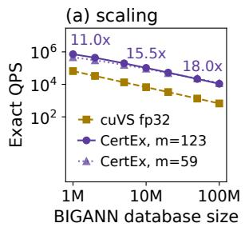

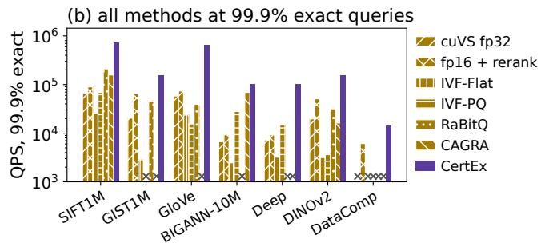

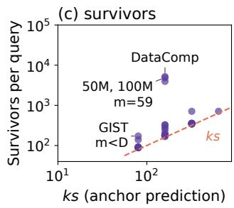

Figure 3: Scaling with N, all methods at 99.9% exact queries (×: never reached), and survivors against ks (dashed).  
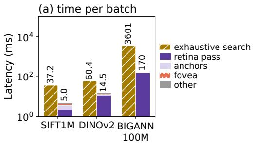

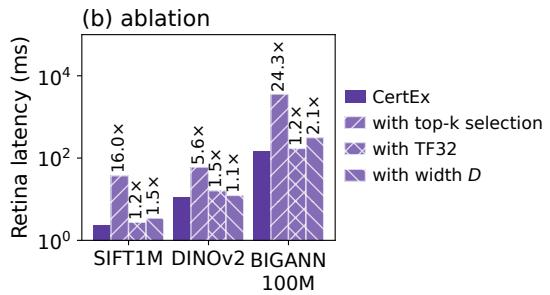

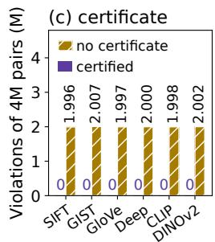  
Figure 4: Time per batch of 2048 queries, ablation of the retina pass, and violations without the certificate.

18.0×, because only the retina pass scales with N whereas the anchors and the fovea cost nearly the same at every size. At 99.9% exact queries (Figure 3(b)), CertEx is 27.2× to 84.9× faster than IVF-Flat [62], 3.7× to 124× faster than IVF-PQ [37], and 2.3× to 10.7× faster than IVF-RaBitQ [22], which is the strongest index on the ImageNet embeddings. Moreover, CertEx is exact for all queries on every dataset, whereas CAGRA [49] reaches this level on only two of the thirteen datasets on which it can be built. In addition, the retina is built in 0.03 to 2.47 seconds, against 2.2 to 29.7 seconds for each CAGRA graph. On the 12.79M DataComp images [21], CertEx is the only method that is exact for every image query. Finally, Figure 3(c) compares the survivors of all datasets and BIGANN strides with the estimate ks. Specifically, survivors lie at most 1.15× above ks wherever the width nears the dimension and further above it for narrow widths (Proposition 5).

## 4.3 Ablation of the Design Elements

We then ask where the speed of CertEx comes from and what its certificate costs, with every element isolated on the same kernel and threshold (Figure 4). For 2048 queries, a complete CertEx search takes 5.0 ms against 37.2 ms for exhaustive search on SIFT1M and 170 ms against 3.6 s on BIGANN-100M, of which the anchors and the fovea take only 2.2 ms and 22 ms (Figure 4(a)). Most of the remaining time therefore belongs to the retina pass, which costs less than a plain fp16 matrix multiplication (GEMM) over the same vectors (2.3 ms against 4.1 ms on SIFT1M and 148 ms against 289 ms on BIGANN-100M) because it compares every product with its threshold inside one kernel instead of writing the matrix of all products. In contrast, exhaustive search must select the top 100 candidates among all N products, which costs 3.3× to 12.5× the GEMM alone. Moreover, the ablation in Figure 4(b) shows that certified exclusion provides most of the speed: the top-k selection instead slows the pass by 5.6× to 24.3×, whereas TF32 instead of fp16 and the width D instead of m slow it by only 1.2× to 1.5× and 1.1× to 2.1×.

In addition, the certificate makes the half-precision decision exact (Figure 4(c)). The hardest test places every pair exactly on the decision boundary: for four million random pairs per dataset and width, we set the threshold of each pair to its own lower bound. In this test, the retina keeps every pair, whereas the same retina without the error terms of Eq. (10) excludes 1.996M to 2.007M of the 4M pairs, because half-precision rounding errs in either direction with equal frequency. Moreover, the largest accumulation error that we measure for $1 0 ^ { 8 }$ pairs per dataset and every kernel configuration is 0.43% to 0.74% of the certified bound, so that the certificate holds with a margin of more than two orders of magnitude. The certificate costs only 0.4% to 2.7% of throughput, yet it decides real boundary pairs: without it, the exact self-join of the DINOv2 [50] embeddings misses 299, 50, and 1 duplicate pairs at $\tau = 0 . 9 0$

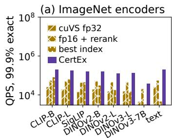

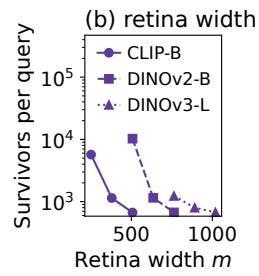

Figure 5: Seven ImageNet encoders and the retina width.  
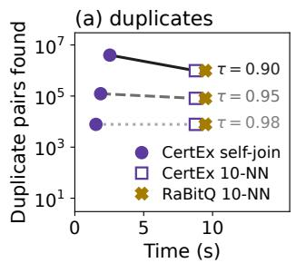

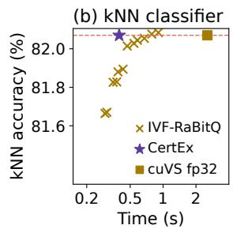  
Figure 6: Duplicates and kNN classification on DINOv2.

0.95, and 0.98. The remaining parameters affect only the cost, so that CertEx stays faster than exhaustive search for every k from 1 to 100 and every batch size from 1 to 4096.

## 4.4 Vision Encoders

We next ask whether the retina stays selective on modern vision encoders (Figure 5). On all seven ImageNet encoders, the retina keeps few survivors, so that CertEx is exact for every query and faster than every baseline at 99.9% exact queries (Figure 5(a)). Moreover, a larger width tightens the bound, so that the survivors per query on DINOv2 [50] fall from 10.3k at m = 507 to 671 at m = 763 (Figure 5(b)).

Cross-modal queries further test exactness under a shift of the query distribution, because CLIP [56] text embeddings occupy a different region of the joint embedding space than the image embeddings [40]. Consequently, IVF-Flat [62] is the only index that reaches 99.9% exact text queries, whereas CertEx is exact for every text query at 41× its throughput (Figure 5(a), right), because certified exclusion does not depend on the query distribution.

## 4.5 Downstream Tasks

We finally ask what exact neighbors change in deduplication and kNN classification (Figure 6 and Figure 7). For duplicate detection, the exact self-join of the 1.28M ImageNet [15] training images takes 1.5 to 2.5 seconds, which is 22× to 37× faster than an exhaustive fp32 join, whereas an exact 10-NN graph contains only 24.6% of its 4.0M pairs at τ = 0.90 (Figure 6(a)). Similarly, SemDeDup [1] avoids the quadratic join by comparing only the pairs inside each k-means cluster. Measured against the exact self-join of CertEx, this restriction misses up to 26% of the pairs of the worst ImageNet classes and up to 66% of all pairs with 50,000 clusters. At web scale, the exact selfjoin finds all 31.4 billion pairs among 1.97M of the 12.79M DataComp images [21] at τ = 0.95, whereas the cluster restriction cannot detect the duplicates of 41,875 to 56,416 of these images. Similarly, at τ = 0.98, the exact self-join finds all 40 ImageNet images whose copies k-means places in other clusters, whereas SemDeDup with one cluster per class finds none (Figure 7(a)).

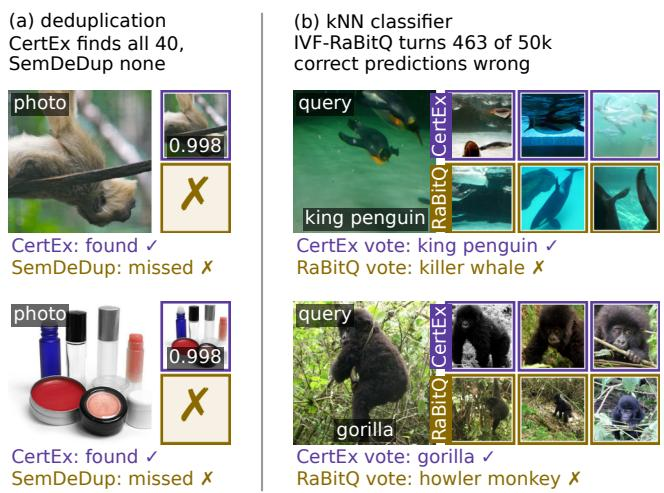  
Figure 7: Real ImageNet examples of both downstream tasks.

For the kNN classifier of DINO [12], CertEx returns the exact neighbors of all 50,000 validation images in 0.40 seconds, which is 6.4× faster than the fastest cuVS fp32 configuration (Figure 6(b)). In contrast, the approximate neighbors of IVF-RaBitQ [22] lower the top-1 accuracy of 82.07% by up to 0.42 points, so that a reported kNN accuracy also measures the index. Specifically, IVF-RaBitQ turns 463 of the 50,000 correct predictions wrong and only 259 wrong ones correct. For instance, the exact neighbors of a king penguin are king penguins, whereas its approximate ones are killer whales (Figure 7(b)).

## 5 Conclusion

Nearest-neighbor search serves image retrieval and deduplication and, increasingly, agentic retrieval and the longcontext memory of LLMs. However, exact kNN search has so far required either a full-precision distance to every vector or an index that gives up exactness. CertEx shows that exact search needs neither: a lifted lower bound with a certificate for its rounding error excludes almost every vector in one half-precision tensor-core pass without a false dismissal. On sixteen datasets, including seven vision encoders and 12.8M web images, CertEx is exact for every query at up to 18.0× the throughput of the fastest exhaustive GPU search. Exact search thus becomes a practical default for image retrieval, web-scale image deduplication, and the evaluation of visual representations.

## References

[1] Amro Abbas, Kushal Tirumala, Dániel Simig, Surya Ganguli, and Ari S. Morcos. SemDeDup: Data-Efficient Learning at Web-Scale through Semantic Deduplication. In ICLR 2023 Workshop on Multimodal Representation Learning (MRL), 2023. [URL]. 2, 3, 8, 10

[2] Mian Muhammad Naeem Abid and Radu Timofte. Gazemo: Mimicking human saccades via foveal-peripheral feature modeling for lightweight semantic segmentation. In Proceedings of the IEEE/CVF Conference on Computer Vision and Pattern Recognition (CVPR) Findings, pages 7293– 7303, 2026. [URL]. 3

[3] Relja Arandjelovic, Petr Gronat, Akihiko Torii, Tomas Pajdla, and Josef Sivic. NetVLAD: CNN Architecture for Weakly Supervised Place Recognition. In 2016 IEEE Conference on Computer Vision and Pattern Recognition (CVPR), pages 5297–5307, 2016. [URL]. 3

[4] Akari Asai, Zeqiu Wu, Yizhong Wang, Avirup Sil, and Hannaneh Hajishirzi. Self-RAG: Learning to Retrieve, Generate, and Critique through Self-Reflection. In International Conference on Learning Representations (ICLR), 2024. [URL]. 1

[5] Martin Aumüller, Erik Bernhardsson, and Alexander Faithfull. ANN-Benchmarks: A benchmarking tool for approximate nearest neighbor algorithms. Information Systems, 87: 101374, 2020. [URL]. 3

[6] A. Babenko and V. Lempitsky. The inverted multi-index. In 2012 IEEE Conference on Computer Vision and Pattern Recognition, pages 3069–3076, 2012. [URL]. 2

[7] Jon Louis Bentley. Multidimensional binary search trees used for associative searching. Communications ofthe ACM, 18(9):509–517, 1975. [URL]. 2

[8] Kevin Beyer, Jonathan Goldstein, Raghu Ramakrishnan, and Uri Shaft. When Is “Nearest Neighbor” Meaningful? In Lecture Notes in Computer Science, pages 217–235, 1999. [URL]. 2

[9] Alina Beygelzimer, Sham Kakade, and John Langford. Cover trees for nearest neighbor. In Proceedings of the 23rd international conference on Machine learning, pages 97– 104, 2006. [URL]. 2

[10] Pierre Blanchard, Nicholas J. Higham, Florent Lopez, Theo Mary, and Srikara Pranesh. Mixed Precision Block Fused Multiply-Add: Error Analysis and Application to GPU Tensor Cores. SIAM Journal on Scientific Computing, 42(3): C124–C141, 2020. [URL]. 1, 2, 3, 5, 6

[11] Sebastian Borgeaud, Arthur Mensch, Jordan Hoffmann, Trevor Cai, Eliza Rutherford, Katie Millican, George van den Driessche, Jean-Baptiste Lespiau, Bogdan Damoc, Aidan Clark, Diego de Las Casas, Aurelia Guy, Jacob Menick, Roman Ring, Tom Hennigan, Saffron Huang, Loren Maggiore, Chris Jones, Albin Cassirer, Andy Brock, Michela Paganini, Geoffrey Irving, Oriol Vinyals, Simon Osindero, Karen Simonyan, Jack W. Rae, Erich Elsen, and Laurent Sifre. Improving Language Models by Retrieving from Trillions of Tokens. In International Conference on Machine Learning (ICML), 2022. [URL]. 1

[12] Mathilde Caron, Hugo Touvron, Ishan Misra, Hervé Jé- gou, Julien Mairal, Piotr Bojanowski, and Armand Joulin. Emerging Properties in Self-Supervised Vision Transformers. In IEEE/CVF International Conference on Computer Vision (ICCV), 2021. [URL]. 1, 3, 10

[13] Christine A. Curcio, Kenneth R. Sloan, Robert E. Kalina, and Anita E. Hendrickson. Human photoreceptor topography. Journal of Comparative Neurology, 292(4):497–523, 1990. [URL]. 1, 3

[14] Mayur Datar, Nicole Immorlica, Piotr Indyk, and Vahab S. Mirrokni. Locality-sensitive hashing scheme based on pstable distributions. In Proceedings of the twentieth annual symposium on Computational geometry, pages 253– 262, 2004. [URL]. 2

[15] Jia Deng, Wei Dong, Richard Socher, Li-Jia Li, Kai Li, and Li Fei-Fei. ImageNet: A large-scale hierarchical im age database. In IEEE Conference on Computer Vision and Pattern Recognition (CVPR), pages 248–255, 2009. [URL]. 2, 8, 10

[16] Alexey Dosovitskiy, Lucas Beyer, Alexander Kolesnikov, Dirk Weissenborn, Xiaohua Zhai, Thomas Unterthiner, Mostafa Dehghani, Matthias Minderer, Georg Heigold, Sylvain Gelly, Jakob Uszkoreit, and Neil Houlsby. An Image is Worth 16x16 Words: Transformers for Image Recognition at Scale. In International Conference on Learning Representations (ICLR), 2021. [URL]. 8

[17] Matthijs Douze, Giorgos Tolias, Ed Pizzi, Zoë Papakipos, Lowik Chanussot, Filip Radenovic, Tomas Jenicek, Maxim Maximov, Laura Leal-Taixé, Ismail Elezi, Ondˇrej Chum, and Cristian Canton Ferrer. The 2021 Image Similarity Dataset and Challenge. arXiv preprint arXiv:2106.09672, 2021. [URL]. 3

[18] Matthijs Douze, Alexandr Guzhva, Chengqi Deng, Jeff John son, Gergely Szilvasy, Pierre-Emmanuel Mazaré, Maria Lomeli, Lucas Hosseini, and Hervé Jégou. The Faiss Library. IEEE Transactions on Big Data, 12(2):346–361, 2026. [URL]. 1

[19] Christos Faloutsos, M. Ranganathan, and Yannis Manolopoulos. Fast subsequence matching in timeseries databases. In Proceedings ofthe 1994 ACM SIGMOD international conference on Management of data, pages 419–429, 1994. [URL]. 2

[20] Steven Fortune and Christopher J. Van Wyk. Efficient exact arithmetic for computational geometry. In Proceedings of the Ninth Annual Symposium on Computational Geometry (SoCG), pages 163–172, 1993. [URL]. 3

[21] Samir Yitzhak Gadre, Gabriel Ilharco, Alex Fang, Jonathan Hayase, Georgios Smyrnis, Thao Nguyen, Ryan Marten, Mitchell Wortsman, Dhruba Ghosh, Jieyu Zhang, Eyal Orgad, Rahim Entezari, Giannis Daras, Sarah Pratt, Vivek Ramanujan, Yonatan Bitton, Kalyani Marathe, Stephen Mussmann, Richard Vencu, Mehdi Cherti, Ranjay Krishna, Pang Wei Koh, Olga Saukh, Alexander Ratner, Shuran Song, Hannaneh Hajishirzi, Ali Farhadi, Romain Beaumont, Sewoong Oh, Alex Dimakis, Jenia Jitsev, Yair Carmon, Vaishaal Shankar, and Ludwig Schmidt. DataComp: In search of the next generation of multimodal datasets. In Advances in Neural Information Processing Systems (NeurIPS), 2023. [URL]. 2, 3, 8, 9, 10

[22] Jianyang Gao and Cheng Long. RaBitQ: Quantizing High-Dimensional Vectors with a Theoretical Error Bound for Approximate Nearest Neighbor Search. Proceedings of the ACM on Management of Data (SIGMOD), 2024. [URL]. 1, 2, 3, 8, 9, 10

[23] Jianyang Gao, Yutong Gou, Yuexuan Xu, Yongyi Yang, Cheng Long, and Raymond Chi-Wing Wong. Practical and Asymptotically Optimal Quantization of High-Dimensional Vectors in Euclidean Space for Approximate Nearest Neighbor Search. Proceedings of the ACM on Management of Data, 2025. [URL]. 3

[24] Vincent Garcia, Eric Debreuve, and Michel Barlaud. Fast k nearest neighbor search using GPU. In 2008 IEEE Computer Society Conference on Computer Vision and Pattern Recognition Workshops, pages 1–6, 2008. [URL]. 2

[25] Tiezheng Ge, Kaiming He, Qifa Ke, and Jian Sun. Optimized Product Quantization for Approximate Nearest Neighbor Search. In IEEE Conference on Computer Vision and Pattern Recognition (CVPR), pages 2946–2953, 2013. [URL]. 2

[26] Fabian Groh, Lukas Ruppert, Patrick Wieschollek, and Hendrik P. A. Lensch. GGNN: Graph-Based GPU Nearest Neighbor Search. IEEE Transactions on Big Data, 9(1):267– 279, 2023. [URL]. 3

[27] Brian Guenter, Mark Finch, Steven Drucker, Desney Tan, and John Snyder. Foveated 3D graphics. ACM Transactions on Graphics, 31(6):1–10, 2012. [URL]. 3

[28] Ruiqi Guo, Philip Sun, Erik Lindgren, Quan Geng, David Simcha, Felix Chern, and Sanjiv Kumar. Accelerating Large-Scale Inference with Anisotropic Vector Quantization. In In-

ternational Conference on Machine Learning (ICML), 2020. [URL]. 1, 2

[29] Nicholas J. Higham. Accuracy and Stability of Numerical Algorithms. Society for Industrial and Applied Mathematics, 2002. [URL]. 1, 3, 5

[30] Piotr Indyk and Rajeev Motwani. Approximate Nearest Neighbors: Towards Removing the Curse of Dimensionality. In Proceedings of the thirtieth annual ACM symposium on Theory of computing - STOC ’98, pages 604–613, 1998. [URL]. 2

[31] L. Itti, C. Koch, and E. Niebur. A model of saliency-based visual attention for rapid scene analysis. IEEE Transactions on Pattern Analysis and Machine Intelligence, 20(11):1254– 1259, 1998. [URL]. 3

[32] Herve Jegou, Matthijs Douze, and Cordelia Schmid. Hamming Embedding and Weak Geometric Consistency for Large Scale Image Search. In European Conference on Computer Vision (ECCV), pages 304–317, 2008. [URL]. 3

[33] Herve Jegou, Romain Tavenard, Matthijs Douze, and Lau rent Amsaleg. Searching in one billion vectors: Re-rank with source coding. In 2011 IEEE International Conference on Acoustics, Speech and Signal Processing (ICASSP), pages 861–864, 2011. [URL]. 8

[34] Bernal Jiménez Gutiérrez, Yiheng Shu, Yu Gu, Michihiro Yasunaga, and Yu Su. HippoRAG: Neurobiologically Inspired Long-Term Memory for Large Language Mod els. In Advances in Neural Information Processing Systems (NeurIPS), 2024. [URL]. 1

[35] Jeff Johnson, Matthijs Douze, and Herve Jegou. Billion-Scale Similarity Search with GPUs. IEEE Transactions on Big Data, 7(3):535–547, 2021. [URL]. 1, 2

[36] William B. Johnson and Joram Lindenstrauss. Extensions of Lipschitz mappings into a Hilbert space. Contemporary Mathematics, pages 189–206, 1984. [URL]. 2

[37] Hervé Jégou, Matthijs Douze, and Cordelia Schmid. Product Quantization for Nearest Neighbor Search. IEEE Transactions on Pattern Analysis and Machine Intelligence, 33(1): 117–128, 2011. [URL]. 1, 2, 8, 9

[38] Urvashi Khandelwal, Omer Levy, Dan Jurafsky, Luke Zettlemoyer, and Mike Lewis. Generalization through Memorization: Nearest Neighbor Language Models. In International Conference on Learning Representations (ICLR), 2020. [URL]. 1

[39] Patrick Lewis, Ethan Perez, Aleksandra Piktus, Fabio Petroni, Vladimir Karpukhin, Naman Goyal, Heinrich Küttler, Mike Lewis, Wen-tau Yih, Tim Rocktäschel, Sebastian Riedel, and Douwe Kiela. Retrieval-Augmented Generation for Knowledge-Intensive NLP Tasks. In Advances in Neural Information Processing Systems (NeurIPS), 2020. [URL]. 1

[40] Weixin Liang, Yuhui Zhang, Yongchan Kwon, Serena Yeung, and James Zou. Mind the Gap: Understanding the Modality Gap in Multi-modal Contrastive Representation Learning. In Advances in Neural Information Processing Systems (NeurIPS), 2022. [URL]. 10

[41] Alexander Long, Wei Yin, Thalaiyasingam Ajanthan, Vu Nguyen, Pulak Purkait, Ravi Garg, Alan Blair, Chunhua Shen, and Anton van den Hengel. Retrieval Augmented Classification for Long-Tail Visual Recognition. In 2022 IEEE/CVF Conference on Computer Vision and Pattern Recognition (CVPR), pages 6949–6959, 2022. [URL]. 3

[42] David G. Lowe. Distinctive Image Features from Scale-Invariant Keypoints. International Journal of Computer Vision, 60(2):91–110, 2004. [URL]. 1, 8

[43] Yu A. Malkov and D. A. Yashunin. Efficient and Robust Approximate Nearest Neighbor Search Using Hierarchical Navigable Small World Graphs. IEEE Transactions on Pattern Analysis and Machine Intelligence, 42(4):824–836, 2020. [URL]. 1, 2, 3

[44] Paulius Micikevicius, Sharan Narang, Jonah Alben, Gregory Diamos, Erich Elsen, David Garcia, Boris Ginsburg, Michael Houston, Oleksii Kuchaiev, Ganesh Venkatesh, and Hao Wu. Mixed Precision Training. In International Conference on Learning Representations (ICLR), 2018. [URL]. 3

[45] Volodymyr Mnih, Nicolas Heess, Alex Graves, and Koray Kavukcuoglu. Recurrent Models of Visual Attention. In Advances in Neural Information Processing Systems (NeurIPS), 2014. [URL]. 3

[46] Marius Muja and David G. Lowe. Scalable Nearest Neighbor Algorithms for High Dimensional Data. IEEE Transactions on Pattern Analysis and Machine Intelligence, 36(11):2227– 2240, 2014. [URL]. 3

[47] NVIDIA. cuVS: Vector search and clustering on the GPU. https://github.com/NVIDIA/cuvs, 2026. [URL]. Version 26.10. 2, 8

[48] Aude Oliva and Antonio Torralba. Modeling the Shape of the Scene: A Holistic Representation of the Spatial Envelope. International Journal of Computer Vision, 42(3):145– 175, 2001. [URL]. 8

[49] Hiroyuki Ootomo, Akira Naruse, Corey Nolet, Ray Wang, Tamas Feher, and Yong Wang. CAGRA: Highly Parallel Graph Construction and Approximate Nearest Neighbor Search for GPUs. In IEEE International Conference on Data Engineering (ICDE), 2024. [URL]. 1, 2, 3, 8, 9

[50] Maxime Oquab, Timothée Darcet, Théo Moutakanni, Huy Vo, Marc Szafraniec, Vasil Khalidov, Pierre Fernandez, Daniel Haziza, Francisco Massa, Alaaeldin El-Nouby, Mahmoud Assran, Nicolas Ballas, Wojciech Galuba, Russell Howes, Po-Yao Huang, Shang-Wen Li, Ishan Misra, Michael Rabbat, Vasu Sharma, Gabriel Synnaeve, Hu Xu, Hervé Jegou, Julien Mairal, Patrick Labatut, Armand Joulin, and Piotr Bojanowski. DINOv2: Learning Robust Visual Features

without Supervision. Transactions on Machine Learning Research, 2024. [URL]. 1, 2, 3, 8, 9, 10

[51] Adam Paszke, Sam Gross, Francisco Massa, Adam Lerer, James Bradbury, Gregory Chanan, Trevor Killeen, Zeming Lin, Natalia Gimelshein, Luca Antiga, Alban Desmaison, Andreas Köpf, Edward Yang, Zach DeVito, Martin Rai son, Alykhan Tejani, Sasank Chilamkurthy, Benoit Steiner, Lu Fang, Junjie Bai, and Soumith Chintala. PyTorch: An Imperative Style, High-Performance Deep Learning Li brary. In Advances in Neural Information Processing Systems (NeurIPS), 2019. [URL]. 8

[52] Jeffrey Pennington, Richard Socher, and Christopher D. Manning. GloVe: Global Vectors for Word Representation. In Proceedings of the Conference on Empirical Methods in Natural Language Processing (EMNLP), pages 1532–1543, 2014. [URL]. 8

[53] James Philbin, Ondrej Chum, Michael Isard, Josef Sivic, and Andrew Zisserman. Object retrieval with large vocabular ies and fast spatial matching. In 2007 IEEE Conference on Computer Vision and Pattern Recognition, pages 1–8, 2007. [URL]. 3

[54] Ed Pizzi, Sreya Dutta Roy, Sugosh Nagavara Ravindra, Priya Goyal, and Matthijs Douze. A Self-Supervised Descriptor for Image Copy Detection. In IEEE/CVF Conference on Computer Vision and Pattern Recognition (CVPR), 2022. [URL]. 1, 3

[55] Filip Radenovic, Ahmet Iscen, Giorgos Tolias, Yannis Avrithis, and Ondrej Chum. Revisiting Oxford and Paris: Large-Scale Image Retrieval Benchmarking. In 2018 IEEE/CVF Conference on Computer Vision and Pattern Recognition, pages 5706–5715, 2018. [URL]. 3

[56] Alec Radford, Jong Wook Kim, Chris Hallacy, Aditya Ramesh, Gabriel Goh, Sandhini Agarwal, Girish Sastry, Amanda Askell, Pamela Mishkin, Jack Clark, Gretchen Krueger, and Ilya Sutskever. Learning Transferable Visual Models From Natural Language Supervision. In International Conference on Machine Learning (ICML), 2021. [URL]. 2, 8, 10

[57] Olga Russakovsky, Jia Deng, Hao Su, Jonathan Krause, San jeev Satheesh, Sean Ma, Zhiheng Huang, Andrej Karpathy, Aditya Khosla, Michael Bernstein, Alexander C. Berg, and Li Fei-Fei. ImageNet Large Scale Visual Recognition Challenge. International Journal of Computer Vision, 115(3): 211–252, 2015. [URL]. 8

[58] Christoph Schuhmann, Romain Beaumont, Richard Vencu, Cade Gordon, Ross Wightman, Mehdi Cherti, Theo Coombes, Aarush Katta, Clayton Mullis, Mitchell Wortsman, Patrick Schramowski, Srivatsa Kundurthy, Katherine Crowson, Ludwig Schmidt, Robert Kaczmarczyk, and Jenia Jitsev. LAION-5B: An open large-scale dataset for training next generation image-text models. In Advances in Neural Information Processing Systems (NeurIPS) Datasets and Benchmarks Track, 2022. [URL]. 1

[59] Jonathan Richard Shewchuk. Adaptive precision floatingpoint arithmetic and fast robust geometric predicates. Discrete & Computational Geometry, 18(3):305–363, 1997. [URL]. 3, 5

[60] Harsha Vardhan Simhadri, George Williams, Martin Aumüller, Matthijs Douze, Artem Babenko, Dmitry Baranchuk, Qi Chen, Lucas Hosseini, Ravishankar Krishnaswamy, Gopal Srinivasa, Suhas Jayaram Subramanya, and Jingdong Wang. Results of the NeurIPS’21 Challenge on Billion-Scale Approximate Nearest Neighbor Search. In Proceedings ofthe NeurIPS 2021 Competitions and Demonstrations Track, pages 177–189, 2022. [URL]. 3

[61] Oriane Siméoni, Huy V. Vo, Maximilian Seitzer, Federico Baldassarre, Maxime Oquab, Cijo Jose, Vasil Khalidov, Marc Szafraniec, Seungeun Yi, Michaël Ramamonjisoa, Francisco Massa, Daniel Haziza, Luca Wehrstedt, Jianyuan Wang, Timothée Darcet, Théo Moutakanni, Leonel Sentana, Claire Roberts, Andrea Vedaldi, Jamie Tolan, John Brandt, Camille Couprie, Julien Mairal, Hervé Jégou, Patrick Labatut, and Piotr Bojanowski. DINOv3. arXiv preprint arXiv:2508.10104, 2025. [URL]. 2, 3, 8

[62] Josef Sivic and Andrew Zisserman. Video Google: A Text Retrieval Approach to Object Matching in Videos. In Proceedings Ninth IEEE International Conference on Computer Vision, pages 1470–1477 vol.2, 2003. [URL]. 2, 3, 8, 9, 10

[63] Suhas Jayaram Subramanya, Devvrit, Rohan Kadekodi, Ravishankar Krishnaswamy, and Harsha Vardhan Simhadri. DiskANN: Fast Accurate Billion-point Nearest Neighbor Search on a Single Node. In Advances in Neural Information Processing Systems (NeurIPS), 2019. [URL]. 1, 3

[64] Philippe Tillet, H. T. Kung, and David Cox. Triton: an intermediate language and compiler for tiled neural network computations. In Proceedings ofthe 3rd ACM SIGPLAN International Workshop on Machine Learning and Programming Languages, pages 10–19, 2019. [URL]. 8

[65] Anne M. Treisman and Garry Gelade. A feature-integration theory of attention. Cognitive Psychology, 12(1):97–136, 1980. [URL]. 1

[66] Enrique Vidal Ruiz. An algorithm for finding nearest neighbours in (approximately) constant average time. Pattern Recognition Letters, 4(3):145–157, 1986. [URL]. 2

[67] Weizhi Wang, Li Dong, Hao Cheng, Xiaodong Liu, Xifeng Yan, Jianfeng Gao, and Furu Wei. Augmenting Language Models with Long-Term Memory. In Advances in Neural Information Processing Systems (NeurIPS), 2023. [URL]. 1

[68] Roger Weber, Hans-Jörg Schek, and Stephen Blott. A Quantitative Analysis and Performance Study for Similarity-Search Methods in High-Dimensional Spaces. In Proceedings of the International Conference on Very Large Data Bases (VLDB), pages 194–205, 1998. [URL]. 2

[69] Yuhuai Wu, Markus N. Rabe, DeLesley Hutchins, and Christian Szegedy. Memorizing Transformers. In International Conference on Learning Representations (ICLR), 2022. [URL]. 1

[70] Zhirong Wu, Yuanjun Xiong, Stella Yu, and Dahua Lin. Unsupervised Feature Learning via Non-Parametric Instancelevel Discrimination. In IEEE/CVF Conference on Computer Vision and Pattern Recognition (CVPR), 2018. [URL]. 1

[71] Peng Xu, Wei Ping, Xianchao Wu, Lawrence McAfee, Chen Zhu, Zihan Liu, Sandeep Subramanian, Evelina Bakhturina, Mohammad Shoeybi, and Bryan Catanzaro. Retrieval Meets Long Context Large Language Models. In International Conference on Learning Representations (ICLR), 2024. [URL]. 1

[72] Artem Babenko Yandex and Victor Lempitsky. Efficient Indexing of Billion-Scale Datasets of Deep Descriptors. In 2016 IEEE Conference on Computer Vision and Pattern Recognition (CVPR), pages 2055–2063, 2016. [URL]. 8

[73] Xiaohua Zhai, Basil Mustafa, Alexander Kolesnikov, and Lucas Beyer. Sigmoid Loss for Language Image Pre-Training. In 2023 IEEE/CVF International Conference on Computer Vision (ICCV), pages 11941–11952, 2023. [URL]. 8

[74] Dongfang Zhao. SIVF: GPU-Resident IVF Index for Streaming Vector Analytics. In ACM International Symposium on High-Performance Parallel and Distributed Computing (HPDC), pages 31–44, 2026. [URL]. 1

[75] Weijie Zhao, Shulong Tan, and Ping Li. SONG: Approx imate Nearest Neighbor Search on GPU. In 2020 IEEE 36th International Conference on Data Engineering (ICDE), pages 1033–1044, 2020. [URL]. 3