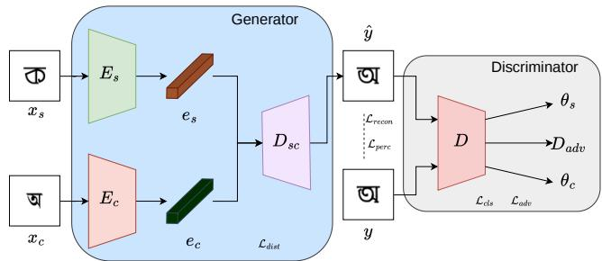
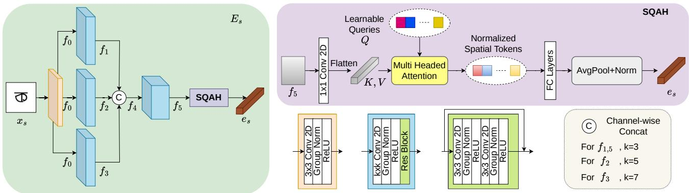
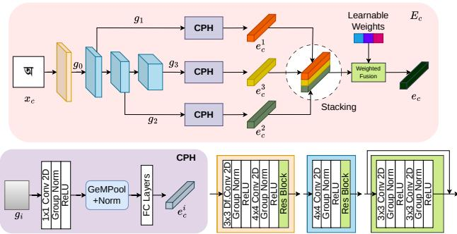
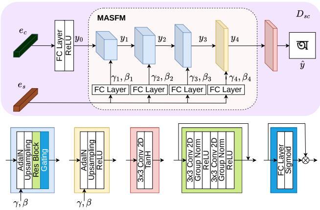
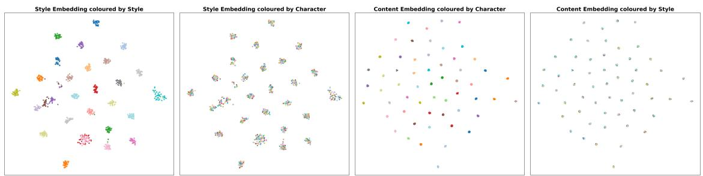

# CoDeFont: One-Shot Font Generation via Multi-Scale Factor-Specific Representation Learning

Rejoy Chakraborty1 Prasun Roy1

1Indian Statistical Institute Kolkata

Saumik Bhattacharya2 Umapada Pal1

2Indian Institute of Technology Kharagpur

https://rejoycs.github.io/codefont

## Abstract

One-shot Font Generation (OFG) aims to synthesize a target glyph by transferring the stylistic characteristics of a single reference glyph while preserving the structure of the target character. However, accurately capturing font style from a single reference image remains challenging due to the limited stylistic information available in a single glyph, and this challenge is further amplified for complex scripts. We propose CoDeFont, a scriptagnostic OFG framework that addresses this challenge through multi-level style-contentfactorization and progressive style-content reconciliation. CoDeFont independently aggregates complementary style and structural information across multiple spatial levels to obtain factor-specific representations, while a contrastive objective explicitly encourages separation between style and content embeddings. During reconstruction, the disentangled representations are progressively injected through multi-level style conditioning, enabling stylistic information to be incorporated at different decoding resolutions while preserving the underlying glyph structure. We evaluate CoDeFont on structurally distinct Bengali and Latin scripts across seen and unseen font styles. Extensive quantitative and qualitative analyses demonstrate consistent improvements over existing state-of-the-art methods, highlighting the effectiveness of the proposed framework for OFG across diverse writing systems.

## 1. Introduction

In the domain of Image-to-Image (I2I) translation, Fewshot Font Generation (FFG) is an active research problem that aims to synthesize glyphs in a target font style using few reference glyphs. One-shot Font Generation (OFG) is a subdomain of FFG where we fix the set of style references to one. TrueType Font (TTF) files are widely used for digital font rendering, as they encode the geometric structure and stylistic characteristics of a font style. Given a small set of reference glyphs, estimating the underlying TTF is highly challenging because the available references do not provide sufficient information to infer all fontspecific properties and glyph outlines. To overcome the issue, FFG methods focus on directly generating the target glyph image.

In the early stages of FFG methods, researchers primarily adopted image-to-image (I2I) style transfer mechanisms to synthesize glyphs in a target font style [9, 20]. While these approaches demonstrated the feasibility of font style transfer, they often struggled to preserve finegrained stylistic details, spatial relationships, and structural consistency across generated glyphs. To address these limitations, structure-aware methods [27] were proposed, where the encoder learns spatial correspondences between reference and target glyphs. Recent studies [34] use stroke decomposition to represent glyphs with predefined components, but such representations are often scriptdependent. Alternatively, other approaches [16, 27] disentangle style and structural information by learning separate latent representations.

Despite recent progress, existing approaches largely treat style-content disentanglement, multi-scale representation, and style injection as separate components, lacking a unified mechanism for multi-level factorization and progressive fusion during reconstruction. Further, there are limited methods [7] available focusing on structurally complex scripts such as Indic scripts, which feature intricate strokes and multi-zone layouts. To address these, we propose CoDeFont (Contrastively Disentangled Font), a script-agnostic OFG framework that synthesizes highfidelity glyphs from a single style reference image. Unlike existing approaches that primarily aggregate or propagate representations through a shared reconstruction pathway, CoDeFont explicitly factorizes style using SQAH module and content across multiple representation levels using CPH module, and progressively fuses the disentangled style information with content during decoding through

MASFM module. This design enables effective preservation of font-specific stylistic characteristics while maintaining the structural integrity of target glyphs.

## Contributions:

1. We propose CoDeFont, a one-shot font generation framework that formulates font synthesis as multi-level style-content factorization, aggregating rich representations and progressively reconciling them during glyph reconstruction without relying on script-specific information.

2. We introduce a factor-specific representation learning strategy that combines contrastive and auxiliary classification objectives to disentangle style and content embeddings, yielding strong factor-specificity validated through embedding-space analysis.

3. Extensive qualitative and quantitative experiments demonstrate that the proposed method consistently outperforms existing state-of-the-art (SOTA) font generation approaches on Bengali and Latin scripts, demonstrating its effectiveness across scripts with distinct structural characteristics.

The remainder of this paper is organized as follows. Section 2 reviews the relevant literature, Section 3 presents the proposed methodology, Section 4 reports the comparative results and analysis, and Section 5 concludes the paper with a summary of the key findings and future directions.

## 2. Related Works

## 2.1. Image-to-Image Translation

Image-to-Image (I2I) translation methods primarily aim to transform content from the source domain to the target domain. With the emergence of GAN [6], several I2I methods [4, 33] based on GANs have been proposed. Pix2Pix [9] introduced a conditional GAN pipeline using paired image data. Later, DualGAN [33] proposed an unsupervised I2I pipeline using unlabeled data. CycleGAN [37] enables unsupervised imageto-image translation through cycle-consistency learning, whereas FUNIT [13] synthesizes target-domain images by conditioning content features on style embeddings using AdaIN [8]. Later, a few methods like [11, 24] incorporated a diffusion-based method to handle complex fonts.

## 2.2. Few-shot Font Generation

Early font generation methods [2, 36] primarily relied on handcrafted structural representations, such as strokes and radicals. Although effective for regular typefaces, these approaches struggle to model complex artistic styles. With the advent of deep generative models [30], substantial progress has been achieved in font synthesis.

STEFANN [20] pioneered scene text editing by introducing FANnet, a character-level adaptive font style generation network. MC-GAN [1] enabled artistic glyph synthesis from only a few reference samples, generating a complete character set in a single forward pass. Subsequently, numerous studies adopted style-content disentanglement paradigms, where style and content information are encoded into separate latent representations and later combined for glyph generation. DG-Font [27] proposed a Feature Deformation Skip Connection module that employs deformable convolutions [38] to capture finegrained geometric variations across font styles. MA-Font [17] further enhanced feature integration through a multi-level adaptation mechanism that progressively injects style information into content representations. FASTER [5] proposed a skeleton-mapping approach inspired by pose translation [21], leveraging residual downsampling and upsampling blocks to capture and propagate structura characteristics across character glyphs or words. Recent studies have increasingly leveraged CLIP [18] embeddings to capture semantic and structural information from segmented glyph strokes. CLIP-Font [28] employs contrastive learning to emphasize informative regions and enhances content consistency by maximizing the cosine similarity between text-image embeddings extracted using CN-CLIP [29] for Chinese scripts. Moving beyond component decomposition-based methods, Patch-Font [14] learns patch-level style representations directly from reference glyphs, enabling the synthesis of novel characters while preserving fine-grained stroke details. More recently, diffusion-based approaches have demonstrated remarkable performance in few-shot font generation. FontDiffuser [31] proposes a one-shot conditional diffusion framework that combines multi-scale content aggregation for preserving stroke details with style contrastive learning for consistent style transfer. To the best of our knowledge, multilevel representation, style-content disentanglement, and progressive style adaptation have largely been explored separately, while their unified modeling for multi-level style-content representation and progressive reconstruction remains less explored.

## 3. Methodology

Let F denote a collection of N font styles, where each font $f _ { a } \in \mathcal { F }$ contains a character set C of M characters. We denote by $x _ { a , b }$ the glyph image of character $c _ { b } \in \mathcal { C }$ rendered in font style $f _ { a } .$ Given a style reference image $x _ { s } = x _ { a , \star } \in$ $f _ { a } \times \mathcal { C }$ and a content reference image $x _ { c } = x _ { \star , b } \in \mathcal { F } \times c _ { b } .$ our proposed method CoDeFont generates the target glyph $\hat { y } = x _ { a , b }$ . Following prior FFG methods [3, 27, 31], the content reference is sampled from a fixed standard font $f _ { t } ,$ which preserves a consistent character structure across different font styles. The Style Encoder $( E _ { s } )$ extracts a style embedding $e _ { s } \in \mathbb { R } ^ { d }$ from $x _ { s }$ , while the Content Encoder $( E _ { c } )$ projects $x _ { c }$ into a content embedding $e _ { c } \in \mathbb { R } ^ { d }$ . These factorized embeddings are progressively reconciled by the Decoder $( D _ { s c } )$ through multi-stage style conditioning to generate the target glyph $\hat { y } ,$ and a Discriminator (D) is employed to provide adversarial supervision for improving generation quality. The workflow is illustrated in Figure 1.

  
Figure 1. Overview of the proposed CoDeFont. The generator independently encodes the style reference $x _ { s }$ and content reference $x _ { c }$ using the Style Encoder $E _ { s }$ and Content Encoder $E _ { c }$ to obtain style embedding $e _ { s }$ and content embedding $e _ { c } ,$ respectively. The factorized representations are progressively reconciled in the Decoder $D _ { s c }$ to generate the target glyph $\hat { y } .$ The Discriminator provides adversarial supervision and jointly performs auxiliary style and content classification, encouraging style consistency and content preservation.

## 3.1. Generator Network (G)

The Generator Network consists of $E _ { s } , E _ { c } ,$ , and $D _ { s c } .$ which are detailed as follows.

## 3.1.1. Style Encoder $( E _ { s } ) { : }$

Given a single style reference glyph $\begin{array} { r c l } { x _ { s } } & { \in } & { \mathbb { R } ^ { 3 \times H \times W } } \end{array}$ stylistic cues may occur at different spatial scales, from local stroke patterns to global characteristics. The Style Encoder therefore extracts and aggregates multi-scale features into a unified style representation.

An initial convolutional block is first applied on $x _ { s }$ to extract a low-level feature representation f0 ∈ RC×H×W while preserving the spatial resolution. Subsequently, $f _ { 0 }$ is processed through three parallel convolutional branches followed by a residual block, with different kernel sizes, producing $f _ { 1 } , f _ { 2 } , f _ { 3 }$ to capture stylistic cues at multiple spatial scales. These feature maps are concatenated along the channel dimension to obtain $f _ { 4 }$ , which is subsequently refined to produce the final fused feature representation $f _ { 5 } \in \mathbb { R } ^ { 4 C \times \mathbf { \bar { H } } \times W }$

To selectively aggregate stylistically informative regions, we employ Style-Query Attention Head (SQAH) a learnable query-based attention mechanism, to extract discriminative style representations from the fused feature map. Specifically, $f _ { 5 }$ is projected to a d-dimensional embedding space and reshaped into a sequence of spatial tokens $\begin{array} { r } {  { \boldsymbol { X } } \in \mathbb { R } ^ { H W \times d } } \end{array}$ A set of u learnable queries $Q \in \mathbb { R } ^ { u \times d }$ interacts with X through multi-head attention to produce style tokens $\textit { T } \in \mathbb { R } ^ { u \times d }$ , where each query attends to different spatial regions. The resulting tokens are refined using Layer Normalization and fully connected layers, followed by average pooling and $\ell _ { 2 }$ normalization to obtain the final style embedding $\boldsymbol { e } _ { s } .$ . Figure 2 illustrates the architecture of $E _ { s }$

## 3.1.2. Content Encoder $( E _ { c } ) { : }$

Unlike style, which is inferred from the reference glyph, content must preserve the target character’s structural identity independently of font appearance. Since glyph structure spans fine-grained stroke details and global spatial organization, the Content Encoder extracts representations at multiple spatial resolutions.

With the content image $\boldsymbol { x } _ { c } \in \mathbb { R } ^ { 3 \times H \times W }$ , a deformable convolutional block produces the initial feature map $g _ { 0 } \in$ $\textstyle \mathbb { R } ^ { 2 C \times { \frac { H } { 2 } } \times { \frac { W } { 2 } } }$ . The deformable convolution enables adaptive sampling of local neighborhoods. Subsequently, the extracted features are progressively downsampled through three convolutional blocks, producing multi-scale feature maps $g _ { j } \in \mathbb { R } ^ { 2 ^ { j + 1 } C \times \frac { H } { 2 ^ { j + 1 } } \times \frac { \bar { W } } { 2 ^ { j + 1 } } }$ , where $j \in \{ 1 , 2 , 3 \}$ . The feature maps generated through the hierarchical backbone help the encoder to capture both local stroke details and global glyph structures. To exploit multi-scale features, $\{ g _ { 1 } , g _ { 2 } , g _ { 3 } \}$ are used to capture rich structural information at different scales.

Each feature map $g _ { j }$ is processed by a Content Pooling Head (CPH) consisting of a projection layer to map features into an embedding space, followed by normalization, and two fully connected layers. Finally, each scale-specific embedding is normalized to obtain $e _ { c } ^ { j } \in$ $\mathbb { R } ^ { d }$ . Finally, the scale-specific embeddings are adaptively combined using learnable weights, allowing the network to determine the relative contribution of structural information from different resolutions., i.e., $\textstyle \sum _ { j = 1 } ^ { 3 } \alpha _ { j } e _ { c } ^ { j } ,$ where $\alpha _ { j }$ denotes the learnable weight for the j-th embedding, with $\textstyle \sum _ { j = 1 } ^ { 3 } \alpha _ { j } \ = \ 1$ The workflow of the proposed $E _ { c }$ is illustrated in Figure 3.

## 3.1.3. Decoder $( D _ { s c } )$

The decoder combines factorized content and style representations while preserving the target glyph’s structural identity. Style information is progressively introduced across decoding stages, enabling its integration with structural features at different spatial scales.

Given the content embedding $e _ { c }$ and style embedding $\boldsymbol { e } _ { s } ,$ the decoder first projects $e _ { c }$ through a fully connected layer to obtain a low-resolution latent feature map, denoted by $y _ { 0 } \in \mathbb { R } ^ { 1 6 C \times \frac { H } { 1 6 } \times \frac { W } { 1 6 } }$ . To progressively reconcile stylistic information with the structural representation during reconstruction, the decoder employs the Multi-level Adaptive Style Fusion Module (MASFM), which consists of four hierarchical upsampling stages. At the k-th stage, where $k ~ = ~ \{ 1 , 2 , 3 , 4 \}$ , the style embedding is transformed into stage-specific affine parameters $( \gamma _ { k } , \beta _ { k } )$ through a linear layer. These parameters modulate the normalized input feature map $y _ { k - 1 }$ using AdaIN [8], thereby introducing style information at the corresponding reconstruction level. The modulated features are progressively upsampled using bilinear interpolation, convolution, and residual blocks to recover finer spatial details. After the first three stages, a channel-wise gating module uses the projected style embedding to recalibrate decoder features, complementing the statistical modulation of AdaIN, producing $\boldsymbol { y } _ { k } \in \bar { \mathbb { R } } ^ { 2 ^ { 4 - k } C \times \frac { H } { 2 ^ { 4 - k } } \times \frac { W } { 2 ^ { 4 - k } } }$ . Finally, the refined feature map $y _ { 4 } \in \mathbb { R } ^ { C \times H \times W }$ is mapped to RGB through a convolution block to generate the reconstructed glyph $\hat { y } \in \mathbb { R } ^ { 3 \times H \times W }$ The progressive decoding process is illustrated in Figure 4.

  
Figure 2. Architectural overview of the proposed Style Encoder $E _ { s }$ . Given a style image $x _ { s } ,$ the encoder extracts multi-scale style features through parallel convolutional branches with different kernel sizes and fuses them into a unified representation. The fused features are then processed by the Style-Query Attention Head (SQAH) to obtain the final style embedding $e _ { s }$

  
Figure 3. Architecture of the proposed Content Encoder $E _ { c } .$ Given a content image $x _ { c } ,$ the encoder extracts multi-scale features through successive convolutional blocks. The three downsampling features are processed by the Content Pooling Head (CPH) and adaptively fused using learnable scale weights to obtain the final content embedding $e _ { c } .$

  
Figure 4. Architecture of the proposed Decoder $D _ { s c } .$ The decoder projects the content embedding into a low-resolution latent feature map and progressively upsamples it through the Multi-level Adaptive Style Fusion Module (MASFM), which injects style information at multiple decoding levels using AdaIN [8] and channel-wise gating. The refined features are finally mapped to the target glyph yˆ through a convolutional output layer.

## 3.2. Discriminator (D)

We adopt the PatchGAN [9] multi-task strategy for our discriminator D. To produce high-quality, realistic generation, D provides adversarial supervision to distinguish between fake and real images. Further, we impose auxiliary supervision [15] using separate classification heads for style and content. Given an input image $\begin{array} { r l r } { x ^ { \prime } } & { { } \in } & { \mathbb { R } ^ { C \times \mathbf { \breve { H } } \times W } } \end{array}$ , a convolutional feature extractor is used with spectral normalization and LeakyReLU activations is employed to learn hierarchical feature representations of size $C _ { D } \times H _ { D } \times W _ { D }$ These shared features are then processed by an adversarial branch that produces a patch-level authenticity map, $D _ { a d v } ( x ^ { \prime } ) \in \mathbb { R } ^ { 1 \times \mathbf { \bar { H } } _ { D } \times W _ { D } }$ enabling the discriminator to assess image realism across local spatial regions. In parallel, the same feature representation undergoes global average pooling before being passed to two separate prediction branches, each consisting of spectral normalization and fully connected layers, to estimate the style and content classification logits, denoted by ${ \theta _ { s } } ( x ^ { \prime } ) \in \bar { \mathbb { R } ^ { N } } , { \theta _ { c } } ( x ^ { \prime } ) \in \mathbb { R } ^ { M }$ , respectively.

## 3.3. Training Objective

We impose a hybrid objective function with five loss components to train our proposed pipeline.

## 3.3.1. Reconstruction loss:

To enforce pixel-wise consistency between the generated image $\hat { y }$ and the ground-truth image y, we employ the $\ell _ { 1 }$ reconstruction loss, defined as

$$
\mathcal { L } _ { \mathrm { r e c o n } } = \mathbb { E } \left[ \left. \hat { y } - y \right. _ { 1 } \right] .\tag{1}
$$

## 3.3.2. Perceptual loss:

To enhance the perceptual quality of the generated image ${ \hat { y } } ,$ we employ a perceptual loss [10]. Let $\phi _ { \mathrm { v g g } } ( \cdot ) ~ \in$ $\mathbb { R } ^ { C _ { l } \times H _ { l } \times W _ { l } }$ denote the feature representation extracted from the l-th layer of a pretrained VGG19 [22] network. The perceptual loss is formulated as

$$
\mathcal { L } _ { \mathrm { p e r c } } = \sum _ { l \in \mathbb { L } = \{ 3 , 8 , 1 7 , 2 6 \} } \omega _ { l } \left. \phi _ { \mathrm { v g g } } ( \hat { y } ) - \phi _ { \mathrm { v g g } } ( y ) \right. _ { 1 } ,\tag{2}
$$

where L denotes the selected VGG19 layers, and we assigned progressively lower weights $\omega _ { l } = \{ 1 . 0 , 0 . 7 5 , 0 . 5 , 0 . 2 5 \}$ for deeper layers [10].

## 3.3.3. Adversarial loss:

To achieve the generation of visually realistic glyphs, we adopt a hinge-based adversarial loss. Let $D _ { \mathrm { a d v } } ( \cdot )$ denote the discriminator output. The discriminator objective is formulated as

$$
\begin{array} { r } { \mathcal { L } _ { \mathrm { a d v } } ^ { \mathrm { D } } = \mathbb { E } _ { y \sim p _ { \mathrm { d a t a } } } \left[ \operatorname* { m a x } ( 0 , 1 - D _ { \mathrm { a d v } } ( y ) ) \right] } \\ { + \mathbb { E } _ { \hat { y } \sim p _ { G } } \left[ \operatorname* { m a x } ( 0 , 1 + D _ { \mathrm { a d v } } ( \hat { y } ) ) \right] , } \end{array}\tag{3}
$$

while the generator is optimized using

$$
\mathcal { L } _ { \mathrm { a d v } } ^ { \mathrm { G } } = - \mathbb { E } _ { \hat { y } \sim p _ { G } } \left[ D _ { \mathrm { a d v } } ( \hat { y } ) \right] ,\tag{4}
$$

where $p _ { \mathrm { d a t a } }$ and $p _ { G }$ denote the distributions of real and generated glyph images, respectively.

## 3.3.4. Auxiliary classification loss:

To preserve both style and content consistency in the generated glyphs, we employ an auxiliary classification loss [15]. Let $\theta _ { s } ( \cdot )$ and $\theta _ { c } ( \cdot )$ denote the style and content classification heads of the discriminator, respectively, and let $y _ { \mathrm { l a b e l } } ^ { \mathrm { s t y l e } }$ and $y _ { \mathrm { l a b e l } } ^ { \mathrm { c o n t e n t } }$ represent the corresponding groundtruth labels. The discriminator is optimized using

$$
\mathcal { L } _ { \mathrm { c l s } } ^ { \mathrm { D } } = \mathcal { L } _ { \mathrm { C E } } \left( \theta _ { s } ( y ) , y _ { \mathrm { l a b e l } } ^ { \mathrm { s t y l e } } \right) + \mathcal { L } _ { \mathrm { C E } } \left( \theta _ { c } ( y ) , y _ { \mathrm { l a b e l } } ^ { \mathrm { c o n t e n t } } \right)\tag{5}
$$

while the generator is trained with

$$
\mathcal { L } _ { \mathrm { c l s } } ^ { \mathrm { G } } = \mathcal { L } _ { \mathrm { C E } } \left( \theta _ { s } ( \boldsymbol { \hat { y } } ) , y _ { \mathrm { l a b e l } } ^ { \mathrm { s t y l e } } \right) + \mathcal { L } _ { \mathrm { C E } } \left( \theta _ { c } ( \boldsymbol { \hat { y } } ) , y _ { \mathrm { l a b e l } } ^ { \mathrm { c o n t e n t } } \right) ,\tag{6}
$$

where $\mathcal { L } _ { \mathrm { C E } }$ denotes the cross-entropy loss.

## 3.3.5. Disentanglement loss:

To ensure a well-structured embedding space, a contrastive loss is imposed to encourage compact clusters for positive pairs (from the same class) and large margins between negative pairs (from different class).

For the embeddings, $e _ { r } .$ , where $r \in \{ s , c \}$ , taking as the anchor embedding, while $e _ { r } ^ { \mathrm { p o s } }$ and $e _ { r } ^ { \mathrm { n e g } }$ denote the corresponding positive and negative embeddings, respectively. The cosine similarities between the positive and negative pairs are denoted by $u _ { p r }$ and $u _ { n r } .$

Circle Loss [23] assigns adaptive weights $\delta _ { p r }$ and $\delta _ { n r }$ to positive and negative pairs, respectively, according to their optimization difficulty, with a margin hyperparameter η. During optimization, the adaptive weighting factors are treated as constants. The Circle Loss for the style embeddings is defined as

$$
\mathcal { L } _ { \mathrm { c i r c l e } } ^ { r } = \log \left( 1 + e ^ { \gamma \left( \delta _ { n r } \left( u _ { n r } - \eta \right) - \delta _ { p r } \left( u _ { p r } - \left( 1 - \eta \right) \right) \right) } \right) ,\tag{7}
$$

where $\gamma$ is a scaling factor controlling the optimization strength.

Therefore, the overall disentanglement loss is given by

$$
{ \mathcal { L } } _ { \mathrm { d i s t } } = { \mathcal { L } } _ { \mathrm { c i r c l e } } ^ { s } + { \mathcal { L } } _ { \mathrm { c i r c l e } } ^ { c } .\tag{8}
$$

## 3.3.6. Total loss:

The overall objective follows a min–max optimization strategy between the generator G and discriminator $D ,$ minG maxD ${ \mathcal { L } } ( G , D )$ ), where the generator objective is defined as

$$
\begin{array} { r l } & { { \mathcal { L } } _ { \mathrm { G } } = \lambda _ { \mathrm { r e c o n } } { \mathcal { L } } _ { \mathrm { r e c o n } } + \lambda _ { \mathrm { p e r c } } { \mathcal { L } } _ { \mathrm { p e r c } } + \lambda _ { \mathrm { a d v } } { \mathcal { L } } _ { \mathrm { a d v } } ^ { \mathrm { G } } } \\ & { ~ + \lambda _ { \mathrm { c l s } } { \mathcal { L } } _ { \mathrm { c l s } } ^ { \mathrm { G } } + \lambda _ { \mathrm { d i s t } } { \mathcal { L } } _ { \mathrm { d i s t } } . } \end{array}\tag{9}
$$

and the discriminator objective is defined as

$$
\mathcal { L } _ { \mathrm { D } } = \lambda _ { \mathrm { a d v } } \mathcal { L } _ { \mathrm { a d v } } ^ { \mathrm { D } } + \lambda _ { \mathrm { c l s } } \mathcal { L } _ { \mathrm { c l s } } ^ { \mathrm { D } } ,\tag{10}
$$

where $\lambda _ { \mathrm { r e c o n } } , \lambda _ { \mathrm { p e r c } } , \lambda _ { \mathrm { a d v } } , \lambda _ { \mathrm { c l s } }$ , and $\lambda _ { \mathrm { d i s t } }$ are empirically set to 5.0, 1.0, 0.5, 1.0, and 0.2 respectively.

## 4. Results

## 4.1. Experimental Setup

## 4.1.1. Dataset:

To evaluate the efficacy of the proposed pipeline, we use two font datasets spanning structurally distinct scripts. The first is a Bengali glyph dataset comprising 595 font styles (curated and will be released), where each font contains 57 characters (10 numerals and 47 characters), with each glyph image at a spatial resolution of 64 × 64. The second is a Latin (English) glyph dataset [12] comprising 811 unique font styles, with 52 characters each. Both datasets are split into train, validation, and test sets with an 8:1:1 ratio.

Table 1. Quantitative comparison with existing SOTA methods on Unseen and Seen Bengali and Latin fonts. The top and bottom sections correspond to Bengali and Latin, respectively. The best and second-best results are highlighted in bold and underlined.
<table><tr><td rowspan="13"></td><td colspan="8">L1↓</td><td colspan="3">Unseen Fonts LPIPS ↓</td><td colspan="5">Seen Fonts</td><td colspan="6"></td><td colspan="7"></td></tr><tr><td colspan="5">Method</td><td colspan="3">RMSE↓</td><td colspan="8">SSIM ↑</td><td colspan="3">RMSE↓</td><td colspan="3">SSIM ↑</td><td colspan="5">LPIPS ↓ User Score↑</td><td colspan="5"></td></tr><tr><td colspan="3">FANnet [20] MA-Font [17]</td><td colspan="3"></td><td colspan="3">0.027</td><td colspan="3">0.118</td><td colspan="2">0.903</td><td colspan="3">Bengali 0.092</td><td colspan="3">0.023</td><td colspan="3">0.108</td><td colspan="3">0.926</td><td colspan="3">0.084</td><td colspan="5">3.333 1.795</td></tr><tr><td colspan="3">PatchFont [14] FontDiffuser [31]</td><td colspan="3"></td><td colspan="3">0.032 0.042</td><td colspan="3">0.148 0.181</td><td colspan="2">0.893 0.836</td><td colspan="3">0.071 0.057</td><td colspan="3">0.030 0.041</td><td colspan="3">0.145 0.178</td><td colspan="10">0.896 0.069</td><td colspan="7"></td></tr><tr><td colspan="3">FASTER [5] Proposed</td><td colspan="3"></td><td colspan="2">0.020 0.019</td><td colspan="3">0.094 0.083</td><td colspan="2">0.912 0.881</td><td colspan="3">0.047 0.081</td><td colspan="3">0.014 0.018</td><td colspan="3">0.067</td><td colspan="3">0.842 0.954</td><td colspan="3">0.053 0.043</td><td colspan="3"></td><td colspan="3">3.590 43.846</td></tr><tr><td colspan="3"></td><td colspan="3"></td><td colspan="3">0.017 0.090</td><td colspan="3">0.949</td><td colspan="3">0.030</td><td colspan="3">0.006</td><td colspan="3">0.081 0.042</td><td colspan="3">0.887 0.988</td><td colspan="3">0.077 0.010</td><td colspan="3"></td><td colspan="3">0.769 46.667</td></tr><tr><td colspan="3">FANnet [20] MA-Font [17]</td><td colspan="3">0.077 0.089 0.276</td><td>0.271</td><td colspan="3">0.238</td><td colspan="3">0.731</td><td colspan="3">Latin 0.185 0.087</td><td colspan="3">0.071</td><td colspan="3">0.229</td><td colspan="3">0.779</td><td colspan="10"></td><td colspan="7"></td></tr><tr><td colspan="11">PatchFont [14] 0.098 FontDiffuser [31]</td><td colspan="11">0.694 0.143 0.675 0.143</td><td colspan="7">0.116 0.712 0.138 2.308 1.795 14.872</td><td colspan="7">7.179</td></tr><tr><td colspan="3"></td><td colspan="3">FASTER [5] Proposed 0.069</td><td colspan="3">0.081 0.075</td><td colspan="3">0.267 0.246 0.228</td><td colspan="3">0.697 0.723</td><td colspan="3">0.135 0.139 0.106</td><td colspan="3">0.079 0.075 0.028</td><td colspan="3">0.261 0.239</td><td colspan="3">0.271</td><td colspan="3">0.681 0.713 0.731 0.137</td><td colspan="7">0.142 0.127</td><td colspan="7"></td></tr><tr><td colspan="11"></td><td colspan="10">0.749</td><td colspan="11">8.462 0.128 0.906 0.044 65.385</td><td colspan="7"></td></tr><tr><td colspan="2"></td><td colspan="3"></td><td></td><td></td><td>4</td><td></td><td></td><td>Unseen Bengali</td><td></td><td></td><td></td><td></td><td></td><td></td><td></td><td></td><td>t</td><td></td><td></td><td></td><td>2 币</td><td></td><td>寸</td><td></td><td>外</td><td></td><td></td><td></td><td></td><td></td><td>Seen Bengali</td><td></td><td></td><td></td><td></td><td></td><td></td><td></td><td></td><td></td><td></td><td></td><td></td><td></td></tr><tr><td>FANnet</td><td colspan="3">d 司</td><td>J</td><td>心</td><td></td><td>4</td><td></td><td>3</td><td>日</td><td></td><td>d</td><td></td><td>π</td><td>2</td><td></td><td>百</td><td>6</td><td>5</td><td></td><td>G</td><td>9</td><td></td><td>2</td><td>布</td><td>q</td><td>9</td><td></td><td>e</td><td></td><td>方</td><td>可</td><td>今</td><td></td><td>万</td><td></td><td></td><td></td><td></td><td></td><td>G</td><td></td><td></td><td></td><td>年 4</td><td></td></tr><tr><td>MA-Font</td><td colspan="3">可 2 可</td><td>4</td><td>of</td><td>G</td><td>5</td><td></td><td>G</td><td></td><td>习</td><td></td><td>à</td><td>π</td><td></td><td>ē</td><td>西</td><td></td><td>b</td><td>6</td><td>0</td><td>s</td><td></td><td>2</td></table>

Figure 5. Qualitative comparison of our proposed method with existing SOTA techniques on Unseen and Seen Bengali and Latin fonts. The top and bottom sections correspond to Bengali and Latin, respectively. Red boxes highlight major failures, including poor style adaptation, structural deformation, and missing strokes, while blue boxes indicate minor artifacts and structural inconsistencies for existing methods.

## 4.1.2. Evaluation metrics:

To perform quantitative analysis of the proposed method, we employed four standard metrics as follows: L1, Root Mean Square Error (RMSE), Structural Similarity Index Measure (SSIM) [26], and Learned Perceptual Image Patch Similarity (LPIPS) [35]. L1 and RMSE assess pixel-wise differences between the generated and groundtruth images. SSIM measures perceptual similarity by considering structural information, luminance, and contrast, while LPIPS evaluates perceptual similarity in a deep feature space using feature representations extracted from a pretrained convolutional neural network.

Table 2. Comparative analysis of SOTA methods on the number of trainable parameters.
<table><tr><td>Method</td><td>#Parameters ↓</td></tr><tr><td>FANnet [20]</td><td>4.2M</td></tr><tr><td>MA-Font [17]</td><td>34.4M</td></tr><tr><td>PatchFont [14]</td><td>51.3M</td></tr><tr><td>FontDiffuser [31]</td><td>323.2M</td></tr><tr><td>FASTER [5]</td><td>82.9M</td></tr><tr><td>Proposed</td><td>73.5M</td></tr></table>

Since no single quantitative metric can fully capture the visual quality of generated images, a user study was conducted for subjective evaluation. The study used 10 randomly selected Bangla and Latin characters (5 from each), where 78 participants were shown a ground-truth image and six corresponding images generated by six different methods, including the proposed approach. Using the ground truth as a reference, participants selected the generated image that most closely matched it. The User Score for each method was computed by averaging its preference rate across all participants and evaluated samples.

## 4.1.3. Implementation details:

We trained the proposed network for 500 epochs with a batch size of 64. For optimization, we employed the Adam optimizer with a learning rate of $2 \times 1 0 ^ { - 4 }$ The style and content embeddings were represented as vectors in $\mathbb { R } ^ { d }$ where the embedding dimensionality was fixed at $d = 6 4$ and $C = 6 4$ . All experiments were conducted on a single Nvidia GeForce RTX 4080 GPU with 16GB of VRAM.

## 4.2. Comparative Results

To evaluate the efficacy of our proposed method, we compare it with several SOTA methods, including FANnet [20], MA-Font [17], PatchFont [14], FontDiffuser [31], and FASTER [5]. To ensure methodological comparability, we intentionally discarded methods [27, 28, 32] that are solely dependent on script-specific decomposition rules.

Table 1 shows that the proposed method achieves the best overall performance across the evaluated metrics on both Bengali and Latin scripts, with particularly consistent gains on the structurally complex Bengali script. The proposed method obtains the highest User Score on both Bengali and Latin, corresponding to an overall average preference of 56.026%. These results further support the visual quality and style fidelity of the generated glyphs. As illustrated in Figure 5, FANnet produces noisy glyphs, while MA-Font and PatchFont exhibit structural distortions, style inconsistencies, and visual artifacts. FASTER produces comparatively sharper results but still exhibits noticeable structural inaccuracies and artifacts. FontDiffuser generally generates sharper glyphs, but occasionally confuses characters with similar structures and produces noisy background regions. In contrast, the proposed method consistently generates clean glyphs with accurate character structures and faithful style characteristics across both scripts. The consistent improvements across structurally distinct scripts suggest that the proposed multi-level style-content factorization and progressive style conditioning effectively preserve character structure while transferring font-specific characteristics. Further, Table 2 compares the number of trainable parameters of the competing methods to provide an estimate of their computational complexity.

## 4.3. Ablation Study

We conduct controlled ablation studies to evaluate the proposed multi-level style-content factorization and progressive style conditioning. Unless stated otherwise, experiments use the Unseen Bengali font set.

## 4.3.1. Style-Content disentanglement:

To verify the effectiveness of the proposed style-content disentanglement, we visualize the embedding spaces of $e _ { s }$ and $e _ { c }$ using t-SNE [25], as shown in Fig. 6. As observed, the style embeddings $( e _ { s } )$ form distinct and well-separated clusters when grouped according to style labels, while the same embeddings exhibit substantial overlap when grouped by content labels. Conversely, the content embeddings $( e _ { c } )$ produce clearly separated clusters based on content labels but become highly overlapping when visualized with style labels.

Furthermore, to quantitatively validate the observed clustering behavior, we compute the silhouette scores [19] for all embedding-label combinations, as reported in Table 3. The style embedding $( e _ { s } )$ achieves a high silhouette score when evaluated with style labels, whereas its score becomes negative when evaluated with content labels. Conversely, the content embedding $( e _ { c } )$ attains an almost perfect silhouette score with content labels while yielding a near-zero negative score with style labels.

Table 3. Silhouette scores of the style and content embeddings under different label assignments
<table><tr><td> $e _ { s }$  by Style</td><td> $e _ { s }$  by Content</td><td> $e _ { c }$  by Style</td><td> $e _ { c }$  by Content</td></tr><tr><td>0.695</td><td>-0.055</td><td>-0.017</td><td>0.999</td></tr></table>

These results show that $e _ { s }$ is primarily associated with style and largely insensitive to content, while $e _ { c }$ exhibits the complementary behavior, supporting the proposed factorspecific representation learning strategy.

  
Figure 6. The t-SNE [25] visualization of the style (es) and content (ec) embeddings, illustrating their factor-specific clustering.

## 4.3.2. Embedding dimension:

To determine an appropriate embedding dimension, we evaluate the proposed method with different embedding sizes. As shown in Table 4, the best performance is achieved at $\begin{array} { r l r } { d } & { { } = } & { 6 4 . } \end{array}$ Smaller embeddings suffer from limited representational capacity, while larger ones degrade performance due to increased model complexity and overfitting.

Table 4. Effect of embedding dimension on the performance of our proposed method. Best results are shown in bold.
<table><tr><td>Emb. Dim.</td><td>L1↓</td><td>RMSE↓</td><td>SSIM ↑</td><td>LPIPS↓</td></tr><tr><td>32</td><td>0.018</td><td>0.095</td><td>0.945</td><td>0.033</td></tr><tr><td>64</td><td>0.017</td><td>0.090</td><td>0.949</td><td>0.030</td></tr><tr><td>128</td><td>0.017</td><td>0.091</td><td>0.948</td><td>0.031</td></tr><tr><td>256</td><td>0.018</td><td>0.096</td><td>0.944</td><td>0.034</td></tr><tr><td>512</td><td>0.033</td><td>0.151</td><td>0.886</td><td>0.077</td></tr></table>

## 4.3.3. Impact of loss components:

To evaluate the proposed loss functions, we conduct an ablation study by training the model with and without ${ \mathcal L } _ { \mathrm { c l s } }$ and ${ \mathcal { L } } _ { \mathrm { d i s t } }$ while keeping the remaining losses unchanged. As shown in Table 5, removing either objective degrades generation quality, while jointly incorporating $L _ { c l s }$ and $L _ { d i s t }$ yields the best performance. This indicates that explicit supervision of factor identity and embedding separation provides complementary benefits to image-level reconstruction and perceptual objectives.

## 4.3.4. Impact of style gating:

To evaluate the proposed style-gating mechanism, we compare the full decoder with a variant without style gating while keeping all other settings unchanged. As shown in Table 6, the style-gating module consistently improves performance across all evaluation metrics, demonstrating that channel-wise feature modulation enhances style transfer while preserving the underlying glyph structure.

Table 5. Quantitative analysis of the effectiveness of ${ \mathcal { L } } _ { \mathrm { c l s } }$ and ${ \mathcal { L } } _ { \mathrm { d i s t } }$ on the generation quality. Better results are shown in bold.
<table><tr><td colspan="2">Loss Function</td><td colspan="4">Metrics</td></tr><tr><td> ${ \mathcal { L } } _ { \mathrm { d i s t } }$ </td><td> $\mathcal { L } _ { \mathrm { c l s } }$ </td><td>L1 ↓</td><td>RMSE↓</td><td>SSIM↑</td><td>LPIPS ↓</td></tr><tr><td>x</td><td>x</td><td>0.034</td><td>0.251</td><td>0.852</td><td>0.153</td></tr><tr><td>x</td><td>√</td><td>0.029</td><td>0.219</td><td>0.874</td><td>0.132</td></tr><tr><td>√</td><td>x</td><td>0.022</td><td>0.168</td><td>0.885</td><td>0.072</td></tr><tr><td>√</td><td>√</td><td>0.017</td><td>0.090</td><td>0.949</td><td>0.030</td></tr></table>

Table 6. Effect of gating mechanism on the performance of our proposed method. Better results are shown in bold.
<table><tr><td>Gating</td><td>L1↓</td><td>RMSE↓</td><td>SSIM↑</td><td>LPIPS↓</td></tr><tr><td>x</td><td>0.019</td><td>0.097</td><td>0.938</td><td>0.038</td></tr><tr><td>√</td><td>0.017</td><td>0.090</td><td>0.949</td><td>0.030</td></tr></table>

## 4.3.5. Impact of multi-scale feature:

As shown in Table 7, multi-scale representations benefit both style and content modeling. Removing them from both encoders yields the poorest performance, while enabling them in either encoder improves the results. Using multiscale representations in both encoders achieves the best performance across all metrics, highlighting the benefit of jointly modeling complementary multi-level style and structural information.

Table 7. Quantitative analysis of the effectiveness of multi-scale (MS) features in the style encoders $E _ { s }$ and $E _ { c }$ on generation quality. Best results are shown in bold.
<table><tr><td colspan="2">MS Feature</td><td colspan="4">Metrics</td></tr><tr><td> $E _ { s }$ </td><td> $E _ { c }$ </td><td>L1↓</td><td>RMSE↓</td><td>SSIM ↑</td><td>LPIPS ↓</td></tr><tr><td>x</td><td>x</td><td>0.029</td><td>0.192</td><td>0.932</td><td>0.121</td></tr><tr><td>x</td><td>√</td><td>0.021</td><td>0.154</td><td>0.939</td><td>0.075</td></tr><tr><td>√</td><td>x</td><td>0.019</td><td>0.108</td><td>0.943</td><td>0.054</td></tr><tr><td>√</td><td>√</td><td>0.017</td><td>0.090</td><td>0.949</td><td>0.030</td></tr></table>

## 5. Conclusion

In this paper, we introduced CoDeFont, a one-shot font generation framework that performs multi-level style-content factorization and progressively reconciles style information during decoding. Extensive experiments demonstrate that CoDeFont consistently outperforms existing state-of-the-art methods for Bengali font generation while generalizing effectively to Latin scripts. Comprehensive ablation studies further validate the effectiveness of disentangled embedding spaces, multi-level representations, factor-specific learning, and progressive style conditioning. In future work, we plan to extend CoDeFont to more challenging scenarios, including cross-script and multilingual font generation.

## References

[1] Samaneh Azadi, Matthew Fisher, Vladimir G Kim, Zhaowen Wang, Eli Shechtman, and Trevor Darrell. Multi-content gan for few-shot font style transfer. In Proceedings of the IEEE conference on computer vision and pattern recognition, pages 7564–7573, 2018. 2

[2] Neill DF Campbell and Jan Kautz. Learning a manifold of fonts. ACM Transactions on Graphics (ToG), 33(4):1–11, 2014. 2

[3] Weiran Chen, Guiqian Zhu, Ying Li, Yi Ji, and Chunping Liu. Da-font: Few-shot font generation via dual-attention hybrid integration. In Proceedings of the 33rd ACM International Conference on Multimedia, pages 6644–6653, 2025. 2

[4] Yunjey Choi, Minje Choi, Munyoung Kim, Jung-Woo Ha, Sunghun Kim, and Jaegul Choo. Stargan: Unified generative adversarial networks for multi-domain image-toimage translation. In Proceedings ofthe IEEE conference on computer vision and pattern recognition, pages 8789–8797, 2018. 2

[5] Alloy Das, Sanket Biswas, Prasun Roy, Subhankar Ghosh, Umapada Pal, Michael Blumenstein, Josep Llados, and´ Saumik Bhattacharya. Faster: A font-agnostic scene text editing and rendering framework. In 2025 IEEE/CVF Winter Conference on Applications of Computer Vision (WACV), pages 1944–1954. IEEE, 2025. 2, 6, 7

[6] Ian J Goodfellow, Jean Pouget-Abadie, Mehdi Mirza, Bing Xu, David Warde-Farley, Sherjil Ozair, Aaron Courville, and Yoshua Bengio. Generative adversarial nets. Advances in neural information processing systems, 27, 2014. 2

[7] Md Bilayet Hossain, Honghui Yuan, Shabnur Anonna Akhy, and Keiji Yanai. Bengalidiff: Diffusion model for fewshot bengali font generation. In International Conference on Document Analysis and Recognition, pages 101–115. Springer, 2025. 1

[8] Xun Huang and Serge Belongie. Arbitrary style transfer in real-time with adaptive instance normalization. In Proceedings of the IEEE international conference on computer vision, pages 1501–1510, 2017. 2, 4

[9] Phillip Isola, Jun-Yan Zhu, Tinghui Zhou, and Alexei A Efros. Image-to-image translation with conditional adversarial networks. In Proceedings of the IEEE conference on computer vision and pattern recognition, pages 1125–1134, 2017. 1, 2, 4

[10] Justin Johnson, Alexandre Alahi, and Li Fei-Fei. Perceptual losses for real-time style transfer and super-resolution. In European conference on computer vision, pages 694–711. Springer, 2016. 5

[11] Bo Li, Kaitao Xue, Bin Liu, and Yu-Kun Lai. Bbdm: Imageto-image translation with brownian bridge diffusion models. In Proceedings of the IEEE/CVF conference on computer vision and pattern recognition, pages 1952–1961, 2023. 2

[12] Chenhao Li, Yuta Taniguchi, Min Lu, and Shin’ichi Konomi. Few-shot font style transfer between different languages. In Proceedings of the IEEE/CVF winter conference on applications of computer vision, pages 433–442, 2021. 6

[13] Ming-Yu Liu, Xun Huang, Arun Mallya, Tero Karras, Timo Aila, Jaakko Lehtinen, and Jan Kautz. Few-shot unsupervised image-to-image translation. In Proceedings of the IEEE/CVF international conference on computer vision, pages 10551–10560, 2019. 2

[14] Irfanullah Memon, Muhammad Ammar Ul Hassan, and Jaeyoung Choi. Patch-font: Enhancing few-shot font generation with patch-based attention and multitask encoding. Applied Sciences, 15(3):1654, 2025. 2, 6, 7

[15] Augustus Odena, Christopher Olah, and Jonathon Shlens. Conditional image synthesis with auxiliary classifier gans. In International conference on machine learning, pages 2642– 2651. PMLR, 2017. 4, 5

[16] Song Park, Sanghyuk Chun, Junbum Cha, Bado Lee, and Hyunjung Shim. Multiple heads are better than one: Few shot font generation with multiple localized experts. In Proceedings of the IEEE/CVF international conference on computer vision, pages 13900–13909, 2021. 1

[17] Yanbo Qiu, Kaibin Chu, Ji Zhang, and Chengtao Feng. Ma font: Few-shot font generation by multi-adaptation method. IEEE Access, 12:60765–60781, 2024. 2, 6, 7

[18] Alec Radford, Jong Wook Kim, Chris Hallacy, Aditya Ramesh, Gabriel Goh, Sandhini Agarwal, Girish Sastry, Amanda Askell, Pamela Mishkin, Jack Clark, et al. Learning transferable visual models from natural language supervision. In International conference on machine learning, pages 8748–8763. PmLR, 2021. 2

[19] Peter J Rousseeuw. Silhouettes: a graphical aid to the interpretation and validation of cluster analysis. Journal of computational and applied mathematics, 20:53–65, 1987. 7

[20] Prasun Roy, Saumik Bhattacharya, Subhankar Ghosh, and Umapada Pal. Stefann: scene text editor using font adaptive neural network. In Proceedings ofthe IEEE/CVF Conference on Computer Vision and Pattern Recognition, pages 13228– 13237, 2020. 1, 2, 6, 7

[21] Prasun Roy, Saumik Bhattacharya, Subhankar Ghosh, and Umapada Pal. Multi-scale attention guided pose transfer. Pattern Recognition, 137:109315, 2023. 2

[22] Karen Simonyan and Andrew Zisserman. Very deep convolutional networks for large-scale image recognition. arXiv preprint arXiv:1409.1556, 2014. 5

[23] Yifan Sun, Changmao Cheng, Yuhan Zhang, Chi Zhang, Liang Zheng, Zhongdao Wang, and Yichen Wei. Circle loss: A unified perspective of pair similarity optimization. In Proceedings of the IEEE/CVF conference on computer vision and pattern recognition, pages 6398–6407, 2020. 5

[24] Narek Tumanyan, Michal Geyer, Shai Bagon, and Tali Dekel. Plug-and-play diffusion features for text-driven image-to-image translation. In Proceedings ofthe IEEE/CVF conference on computer vision and pattern recognition, pages 1921–1930, 2023. 2

[25] Laurens Van der Maaten and Geoffrey Hinton. Visualizing data using t-sne. Journal of machine learning research, 9 (11), 2008. 7, 8

[26] Zhou Wang, Alan C Bovik, Hamid R Sheikh, and Eero P Simoncelli. Image quality assessment: from error visibility to structural similarity. IEEE transactions on image processing, 13(4):600–612, 2004. 6

[27] Yangchen Xie, Xinyuan Chen, Li Sun, and Yue Lu. Dgfont: Deformable generative networks for unsupervised font generation. In Proceedings of the IEEE/CVF conference on computer vision and pattern recognition, pages 5130–5140, 2021. 1, 2, 7

[28] Jialu Xiong, Yefei Wang, and Jinshan Zeng. Clip-font: Sementic self-supervised few-shot font generation with clip. In ICASSP 2024-2024 IEEE International Conference on Acoustics, Speech and Signal Processing (ICASSP), pages 3620–3624. IEEE, 2024. 2, 7

[29] An Yang, Junshu Pan, Junyang Lin, Rui Men, Yichang Zhang, Jingren Zhou, and Chang Zhou. Chinese clip: Contrastive vision-language pretraining in chinese. arXiv preprint arXiv:2211.01335, 2022. 2

[30] Shuai Yang, Jiaying Liu, Zhouhui Lian, and Zongming Guo. Awesome typography: Statistics-based text effects transfer. In Proceedings ofthe IEEE Conference on Computer Vision and Pattern Recognition, pages 7464–7473, 2017. 2

[31] Zhenhua Yang, Dezhi Peng, Yuxin Kong, Yuyi Zhang, Cong Yao, and Lianwen Jin. Fontdiffuser: One-shot font generation via denoising diffusion with multi-scale content aggregation and style contrastive learning. In Proceedings of the AAAI conference on artificial intelligence, pages 6603– 6611, 2024. 2, 6, 7

[32] Mingshuai Yao, Yabo Zhang, Xianhui Lin, Xiaoming Li, and Wangmeng Zuo. Vq-font: Few-shot font generation with structure-aware enhancement and quantization. In Proceedings of the AAAI Conference on Artificial Intelligence, pages 16407–16415, 2024. 7

[33] Zili Yi, Hao Zhang, Ping Tan, and Minglun Gong. Dualgan: Unsupervised dual learning for image-to-image translation. In Proceedings of the IEEE international conference on computer vision, pages 2849–2857, 2017. 2

[34] Jinshan Zeng, Yan Zhang, Yiyang Yuan, Ling Tu, and Yefei Wang. Few-shot font generation via stroke prompt and hierarchical representation learning. Expert Systems with Applications, page 128656, 2025. 1

[35] Richard Zhang, Phillip Isola, Alexei A Efros, Eli Shechtman, and Oliver Wang. The unreasonable effectiveness of deep features as a perceptual metric. In Proceedings of the IEEE

conference on computer vision and pattern recognition, pages 586–595, 2018. 6

[36] Baoyao Zhou, Weihong Wang, and Zhanghui Chen. Easy generation of personal chinese handwritten fonts. In 2011 IEEE international conference on multimedia and expo, pages 1–6. IEEE, 2011. 2

[37] Jun-Yan Zhu, Taesung Park, Phillip Isola, and Alexei A Efros. Unpaired image-to-image translation using cycleconsistent adversarial networks. In Proceedings of the IEEE international conference on computer vision, pages 2223– 2232, 2017. 2

[38] Xizhou Zhu, Han Hu, Stephen Lin, and Jifeng Dai. Deformable convnets v2: More deformable, better results. In Proceedings of the IEEE/CVF conference on computer vision and pattern recognition, pages 9308–9316, 2019. 2