# ControlFlow3D: Distilling Multi-View Knowledge into Latent Flow Matching for Point Cloud Upsampling

Yuang Liu1∗ Zhi Zuo1,3,∗† Zhengkai Zhao1 Lirui Zhang1 Pan Gao1‡ Hao Feng2 Zhengzhe Liu2‡

1Nanjing University of Aeronautics and Astronautics 2Lingnan University 3Weidian Corporation

{liuyuang, zuozhi, zhengkai.zhao, lirui.zhang, pan.gao}@nuaa.edu.cn {haofeng2, zhengzheliu}@ln.edu.hk

## Abstract

Point cloud upsampling is essential for 3D applications but remains challenging due to sparse, under-constrained observations. Multi-view images can resolve geometric ambiguity, but existing multi-modal methods do not fully exploit visual cues. We propose ControlFlow3D, a framework that distills knowledge from pretrained foundation models into a lightweight generation network during training, enabling strong performance without multi-view images available at test time. Specifically, our method performs conditional flow matching in a structured latent space defined by a frozen 3D encoder. Multi-view image tokens and 3D latent tokens are jointly clustered into shared prototypes via unsupervised soft KMeans, the resulting prototypes guide the flow trajectory through velocity control and are aligned by a consistency loss that progressively transfers image knowledge into the base network. A Mamba-based geometry decoder then maps latent features to dense coordinates with linear complexity. We also construct ShapeNetPU, a 35Kobject multi-modal benchmark that is 31× larger than prior datasets. Extensive experiments across multiple benchmarks demonstrate the effectiveness of our method and its strong generalization capability. Code and dataset are available at https://github.com/I2-Multimedia-Lab/ControlFlow3D.

## 1 Introduction

Point cloud upsampling aims to generate a denser point set from a sparse input while preserving the underlying 3D surface geometry [1, 2, 3, 4]. This task is useful for 3D perception and reconstruction systems, where point clouds are widely used in autonomous driving [5, 6], robotics [7, 8, 9], and augmented reality [10, 11]. In practical sensing scenarios, point clouds can be sparse and non-uniform because of limited sensor resolution, occlusions, and viewpoint-dependent sampling. Recovering dense geometry from such observations remains challenging because the sparse input provides only partial measurements of the underlying surface.

The main difficulty of point cloud upsampling is that a sparse input provides incomplete observations of the underlying surface, so multiple dense point sets may be consistent with the same input. Additional visual observations can provide useful cues for reducing this ambiguity, including objectlevel semantics, visible boundaries, and geometry-aware latent features [12, 13, 14]. However, using such cues at inference time can reduce the practicality of an upsampling model, especially when synchronized multi-view images are unavailable.

Existing multi-modal upsampling methods such as MVP-Net [12] rely on rendered multi-view depth images during both training and inference. Generated by projecting point clouds into 2D views, these depth maps introduce preprocessing and may lose fine 3D structure; they also mainly encode depth and contour rather than richer visual priors from pretrained multi-view image models. SSPU-Net [13] avoids test-time images by using differentiable rendering as a self-supervised signal, but image features are never fed to the upsampling network, preventing it from internalizing visual semantics. These limitations motivate our distillation setting: we leverage rich features from pretrained multiview image models as training-time guidance, while keeping the final model point-only at inference.

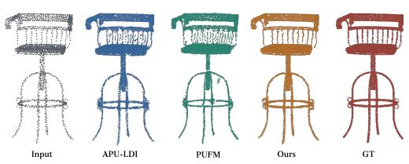  
(a) Visualization comparison with regression-based (APU-LDI) and generative-based (PUFM) paradigms.

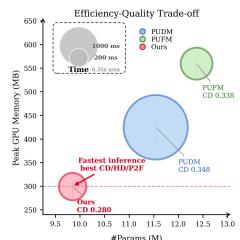

(b) Visualization of the efficiency-quality trade-off for point cloud upsampling  
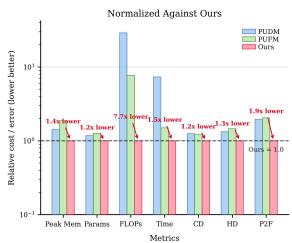  
Figure 1: Motivation and empirical overview of ControlFlow3D.

In this work, we propose ControlFlow3D, a framework that distills knowledge from pretrained multiview models into an efficient point cloud upsampling network. A central challenge is transferring multi-view knowledge without paired pixel-to-point supervision. We address this through a shared prototype space, where joint clustering of image and 3D tokens discovers cross-modal semantic correspondences in an unsupervised manner. During training, image patch tokens from VGGT [15] and 3D target tokens from Utonia [14] are projected into a common space and jointly clustered by soft KMeans [16, 17]. Each cluster yields two complementary prototypes: an image-side prototype that aggregates semantic cues from multi-view observations, and a 3D-side prototype that aggregates dense latent structure at the same query support. A prototype consistency loss aligns the two sides, encouraging the 3D-side prototypes to absorb the texture and semantic cues encoded in the image-side prototypes. The 3D-side prototypes, now enriched with distilled visual knowledge, then produce query-wise scale and shift controls over the latent velocity field via soft query-to-prototype assignment. Through this design, multi-view images guide the flow trajectory during training, while the base velocity network progressively internalizes the cross-modal knowledge and operates on sparse point clouds alone at inference.

Built on the above core design, ControlFlow3D is composed of three complementary components. First, conditional flow matching is performed in a structured latent space defined by a frozen pretrained 3D encoder, providing a geometry-aware representation that stabilizes generation. Second, the prototype-based distillation mechanism injects multi-view knowledge into the velocity field through semantic alignment and control. Finally, a Mamba-based geometry decoder maps the generated latent features to dense Euclidean coordinates, enabling efficient high-density reconstruction.

Training this multi-modal pipeline at scale requires precisely aligned 2D and 3D data. Existing benchmarks such as PU-GAN [2] and PU1K [3] are too small for large-scale multi-modal training, and none provide synchronized multi-view images aligned with point clouds. We therefore construct ShapeNetPU, a high-fidelity multi-modal dataset derived from ShapeNet, containing 35K objects with clean point clouds and synchronized multi-view images, providing 31× more data than prior benchmarks.

Extensive experiments demonstrate state-of-the-art (SOTA) performance on multiple benchmarks, with 1.5× faster inference than flow-matching baselines and 7.3× faster than diffusion-based methods. Our method also generalizes well to other upsampling benchmarks [2, 3] and to real-world scene-level point clouds [18].

Overall, our main contributions are summarized as follows:

• We propose a new paradigm for efficient point cloud upsampling that distills knowledge from foundation models into a generation network.

• We propose an unsupervised shared-prototype distillation mechanism that jointly clusters multi-view image tokens and 3D target tokens into shared centers, making 3D prototypes absorb visual knowledge and produce guidance for the latent velocity field.

• We design a Mamba-based geometry decoder that efficiently maps generated latent features to dense point coordinates with linear-complexity sequence modeling.

• We construct ShapeNetPU, a large-scale, high-fidelity multi-modal benchmark for point cloud upsampling, with clean point clouds and synchronized multi-view images.

## 2 Related Work

Flow Matching. Flow matching [19, 20, 21] has emerged as a powerful generative paradigm that learns a velocity field transporting a simple prior to the data distribution, offering simulation-free training and efficient ODE-based sampling. It has been successfully applied to high-dimensional visual generation tasks [22, 23, 24]. We adopt flow matching for 3D upsampling but address a different setting: transporting sparse-conditioned latent features toward dense 3D targets, with multi-view image guidance distilled into a point-only inference model.

Point Cloud Upsampling. Existing methods fall into regression-based and generative approaches. Regression-based methods directly predict dense point coordinates [1, 25, 3, 26, 4, 27, 28]. Although these methods achieve strong benchmark performance, deterministic coordinate regression may favor averaged predictions in ambiguous regions. This reflects the ill-posed nature of point cloud upsampling, where a sparse input may correspond to multiple plausible dense surfaces [1]. Generative methods [2, 29, 30, 31] model more flexible output distributions, but typically operate in the raw coordinate space, where the lack of structural regularization can cause unstable generation. To reduce the ambiguity of sparse 3D observations, prior work has explored external modalities, primarily for point cloud completion [32, 33, 34, 35, 36, 37] rather than upsampling. For upsampling, SSPU-Net [13] imposes image-space consistency via differentiable rendering, but uses images only as a pixel-level loss signal without feeding image features into the network. In contrast, MVP-Net [12] and PULLM [38] fuse multi-view depth or language features into the pipeline via concatenation or cross-attention, requiring these external modalities at inference. Our method differs from both: through unsupervised prototype alignment, we distill multi-view knowledge into the generation network during training, allowing the model to operate on point clouds alone at inference. More related works are discussed in the Appendix.

## 3 Methodology

## 3.1 Overview

Given a sparse input point cloud (and multi-view images during training), our goal is to produce a dense and geometrically consistent point cloud. The framework is organized as follows. We first define a structured latent space using the frozen 3D encoder (§3.2). Within this space, we design a conditional flow-matching generation network (§3.3) that transports sparse-conditioned features toward the dense prior target. To distill multi-view knowledge into this network, we introduce an unsupervised prototype-guided velocity controller (§3.3): image and 3D tokens are jointly clustered into shared prototypes, which guide the flow trajectory during training and are progressively absorbed into the base velocity network via a consistency loss. Finally, a Mamba-based geometry decoder (§3.4) maps the generated latent features to dense coordinates, completing the latent encoding-to-decoding pipeline alongside the frozen encoder.

## 3.2 Structured 3D Latent Representation

Point clouds are inherently unstructured and irregular, making direct generation in Euclidean coordinate space unstable and difficult to regularize. To address this, we shift the generative process to a structured latent manifold by adopting a frozen pretrained 3D encoder to define the target latent space. We denote the sparse input point cloud as $\mathcal { P } _ { \mathrm { i n } }$ and the dense ground-truth point cloud as ${ \mathcal { P } } _ { \mathrm { g t } }$ The sparse query support is sampled from the input as $Q \in \mathbb { R } ^ { N _ { q } \times 3 } = \mathrm { F P S } ( \mathcal { P } _ { \mathrm { i n } } )$ , where $N _ { q }$ is the number of sparse query points, set to 256 by default. The encoder extracts latent representations from the dense ground-truth point clouds: $\dot { Z } _ { \mathrm { g t } } = E _ { \mathrm { 3 D } } ( \mathcal { P } _ { \mathrm { g t } } ) , Z _ { \mathrm { g t } } \in \mathbb { R } ^ { N _ { g } \times D }$ , where $ { E _ { \mathrm { 3 D } } }$ denotes Utonia [14], $N _ { g }$ is the number of latent tokens, and D is the latent dimension. These frozen features provide a geometry-aware but coordinate-abstract target space, allowing the generation network to learn dense 3D structure in latent space before coordinate decoding. To align this dense 3D prior with the sparse query support used by the latent flow, we interpolate the dense latent features onto $Q \colon Z _ { \mathrm { t a r } } \stackrel { \bullet } { = } \mathrm { I n t e r p } ( \stackrel { \bullet } { Q } ; \mathcal { P } _ { \mathrm { g t } } ^ { \bullet \bullet } , Z _ { \mathrm { g t } } ) , Z _ { \mathrm { t a r } } \stackrel { \bullet } { \in } \mathbb { R } ^ { N _ { q } \times D }$ . Here, Interp denotes 3-NN feature interpolation, which estimates a dense latent feature at each query location in $Q .$ . Here, Q defines the spatial support for latent flow matching, and $Z _ { \mathrm { t a r } }$ serves as the target endpoint in the flow process. The encoder is kept frozen throughout training to preserve the geometric priors from large-scale pretraining and provide a stable target distribution for flow matching. This subsection defines the target space only; the generation network that operates within it and the multi-view distillation mechanism are described in the following subsection.

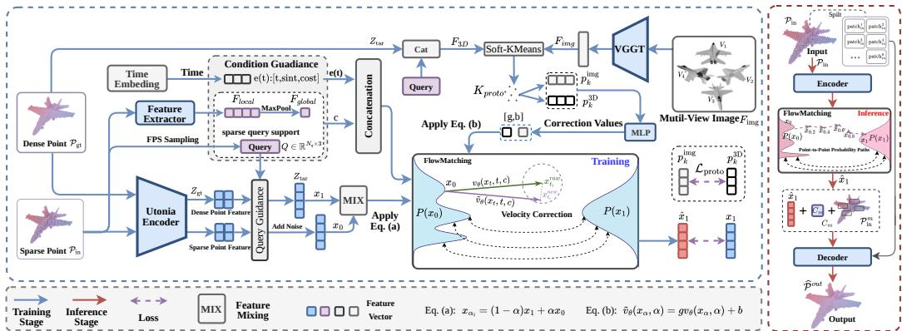  
Figure 2: Overview of our Latent Flow Matching. We first use a frozen pretrained 3D encoder (Utonia) to define a structured target latent space for dense geometry. Within this space, we design a conditional flow-matching generation network that transports sparse-conditioned features toward the dense prior target. To distill multi-view knowledge into this network, we introduce an unsupervised prototype-guided velocity controller that jointly clusters image $F _ { i m g }$ and 3D tokens $F _ { 3 D }$ into shared prototypes. During inference, the model takes only the sparse point cloud as input and produces the final dense point cloud.

## 3.3 Multi-View Distilled Latent Flow Matching

This section presents the core generation network: a conditional latent flow that transports sparsealigned features toward the 3D target, with multi-view knowledge distilled into the velocity network during training to enable image-free inference.

Sparse geometry conditioning. The sparse input point cloud serves as the geometric condition for latent transport. We encode the sparse observation $\mathcal { P } _ { \mathrm { i n } }$ using a lightweight Point-Net++ [8] backbone $\operatorname { F E } ( \cdot )$ to obtain point-wise local features and a global shape descriptor: $F _ { \mathrm { l o c a l } } = \mathrm { F E } ( \mathcal { P } _ { \mathrm { i n } } , Q ) , F _ { \mathrm { g l o b a l } } = \mathrm { M a x P o o l } ( F _ { \mathrm { l o c a l } } )$ . The sparse-query support $Q$ anchors all subsequent feature operations to explicit 3D locations. The local sparse features are aligned to $Q .$ , and the conditioning vector is then formed as $c = \mathrm { C o n c a t } [ F _ { \mathrm { l o c a l } } , \mathbf { \bar { \mathit { F } } } _ { \mathrm { g l o b a l } } , Q ]$ , ensuring that the latent dynamics remain continuously grounded in the observed sparse geometry.

Conditional Latent Flow Matching. With the sparse-query support Q and condition c already defined above, we construct the source state $x _ { 0 } = \mathrm { G a t h e r } ( E _ { \mathrm { 3 D } } ( \mathcal { P } _ { \mathrm { i n } } ) , Q ) + \sigma \epsilon$ , where $\epsilon \sim \mathcal { N } ( 0 , I )$ denotes Gaussian noise, and σ controls the noise strength. Here, Gather(·) reuses the FPS indices used to sample Q to select the corresponding sparse latent tokens from $E _ { \mathrm { 3 D } } ( \dot { \mathcal { P } } _ { \mathrm { i n } } )$ , yielding $N _ { q }$ tokens of dimension D. In the implementation, Gaussian noise is added to the gathered features, followed by 3-NN interpolation onto the sparse-query support $Q .$ . The target endpoint is $x _ { 1 } = Z _ { \mathrm { t a r } }$ . Although both $x _ { 0 }$ and $x _ { 1 }$ are encoded by $ { E _ { \mathrm { 3 D } } }$ , they carry fundamentally different information: $x _ { 0 }$ captures only sparse-resolution context at the query locations, while $x _ { 1 }$ encodes dense-resolution geometric detail indexed to the same spatial support. The flow must therefore learn to synthesize the missing fine-grained structural information that the sparse encoding lacks. Given these two endpoints, we define a linear interpolation path in latent space: $x _ { t } = t x _ { 1 } + \left( 1 - t \right) x _ { 0 }$ , where t is sampled with cosine reparameterization to distribute supervision over a smoother transport trajectory. A velocity network $\widetilde { v } _ { \theta }$ is trained to predict the displacement from $x _ { 0 } \ { \mathrm { t o } } \ x _ { 1 }$ at each interpolant $x _ { t } .$

$$
\mathcal { L } _ { \mathrm { F M } } = \mathbb { E } _ { t , x _ { 0 } , x _ { 1 } } \Big [ \big \| \widetilde v _ { \theta } ( x _ { t } , t , c , \mathcal { T } ) - ( x _ { 1 } - x _ { 0 } ) \big \| _ { 2 } ^ { 2 } \Big ] ,\tag{1}
$$

where c denotes the sparse geometric condition and I denotes the multi-view image features extracted by VGGT [15]. This formulation casts point cloud upsampling as a conditional transport problem on a structured latent manifold: the flow learns geometry-aware structural evolution, while the recovery of Euclidean coordinates is deferred to the subsequent decoding stage. More details are provided in the Appendix.

## Unsupervised Prototype-Guided Velocity Control

While $Z _ { \mathrm { t a r } }$ defines the target latent endpoint, the sparse condition c alone may leave the transport trajectory ambiguous. Multi-view images carry rich complementary cues, such as appearance, boundaries and part-level semantics, that can disambiguate this trajectory. Rather than directly fusing 2D features into the 3D pipeline, we design a distillation mechanism based on unsupervised prototype learning: image knowledge guides the velocity field during training and is progressively absorbed into the base network, enabling image-free inference. To transfer multi-view cues without pixel-to-point correspondence while retaining point-only inference, we use shared prototypes as a compact interface for training-time velocity guidance.

Given I, VGGT [15] extracts multi-view patch tokens $F _ { \mathrm { i m g } } \in \mathbb { R } ^ { V \times T \times C _ { I } }$ , where $V , T , C _ { I }$ denote the number of views, tokens per view, and feature dimension, respectively. Each view is optionally average-pooled to $T ^ { \prime }$ tokens and flattened into $F _ { \mathrm { m v } } \in \mathbb { R } ^ { ( V T ^ { \prime } ) \times C _ { I } }$ . Meanwhile, target-side 3D tokens are formed as ${ \cal F } _ { \mathrm { 3 D } } = \mathrm { C o n c a t } [ Z _ { \mathrm { t a r } } , Q ]$ from the target latent features and query coordinates defined in $\ S 3 . 2$ . Both token sets are projected to a shared space, where soft-KMeans [16, 17] produces $K _ { p r o t o }$ shared centers without any label supervision. All objects share the same learned prototype seeds. For each object, soft-KMeans updates the centers from these seeds while preserving their indices, providing a common index convention across objects. The image-side prototypes $\mathbf { p } _ { k } ^ { \mathrm { i m g } }$ and 3D-side prototypes $\mathbf { p } _ { k } ^ { \mathrm { 3 D } }$ are obtained by softly aggregating their respective tokens around the same updated centers.

To inject prototype-level guidance into the latent flow, we compute a prototype distribution for each query. Let $\mathbf { s } _ { k }$ denote the k-th shared center, and let $q _ { j } \in Q$ be the coordinate of the j-th query. We form the query token $\boldsymbol { u } _ { j } = \mathrm { C o n c a t } [ \boldsymbol { x } _ { t , j } , \boldsymbol { q } _ { j } , \boldsymbol { e } ( t ) ]$ ], where $e ( t ) = [ t ,$ sin t, cos t], and compute

$$
a _ { k j } = \frac { \exp { ( \tau \left. \psi _ { q } ( u _ { j } ) , \psi _ { s } ( \mathbf { s } _ { k } ) \right. ) } } { \sum _ { \ell = 1 } ^ { K _ { p r o t o } } \exp { ( \tau \left. \psi _ { q } ( u _ { j } ) , \psi _ { s } ( \mathbf { s } _ { \ell } ) \right. ) } } ,\tag{2}
$$

where $\psi _ { q }$ and $\psi _ { s }$ are learnable projections, τ controls the assignment sharpness, and $\textstyle \sum _ { k } a _ { k j } = 1$ . A lightweight MLP predicts bounded prototype-level controls $\mathbf { g } _ { k } ^ { p r o t o }$ and $\mathbf { b } _ { k } ^ { p r o t o }$ from the image-side prototypes and pooled multi-view context. Query-wise controls are then obtained by assignmentweighted aggregation:

$$
\mathbf { g } _ { : , j } = \sum _ { k = 1 } ^ { K _ { p r o t o } } a _ { k j } \mathbf { g } _ { k } ^ { p r o t o } , \qquad \mathbf { b } _ { : , j } = \sum _ { k = 1 } ^ { K _ { p r o t o } } a _ { k j } \mathbf { b } _ { k } ^ { p r o t o } .\tag{3}
$$

The controlled velocity is:

$$
\widetilde v _ { \theta } ( x _ { t } , t , c , \mathbb { Z } ) = \mathbf g ( x _ { t } , t , \mathbb { Z } ) \odot v _ { \theta } ( x _ { t } , t , c ) + \mathbf b ( x _ { t } , t , \mathbb { Z } ) ,\tag{4}
$$

where $v _ { \theta } ( x _ { t } , t , c )$ is the base velocity from the sparse condition, $\mathbf { g } \in \mathbb { R } ^ { D \times N _ { q } }$ is a query-wise scaling term centered around one that reweights the transport direction, and b $\mathbf { \Psi } \in \mathbb { R } ^ { D \times N _ { q } }$ is a bounded additive correction from the multi-view prototypes. The soft assignment transfers prototype-level semantic guidance to spatially anchored query locations.

To keep the visual controller aligned with the 3D target structure, we impose a prototype consistency regularization:

$$
\mathcal { L } _ { \mathrm { p r o t o } } = 1 - \frac { 1 } { K _ { p r o t o } } \sum _ { i = 1 } ^ { K _ { p r o t o } } \cos \Bigl ( \mathbf { p } _ { i } ^ { \mathrm { i m g } } , \ \mathbf { p } _ { i } ^ { \mathrm { 3 D } } \Bigr ) .\tag{5}
$$

## 3.4 Geometry Decoder

The geometry decoder maps the latent features to Euclidean coordinates. The density growth inherent in upsampling makes this stage computationally demanding. We therefore adopt a SSM-based architecture [39], whose linear-complexity selective sequence modeling balances efficiency with long-range modeling capacity. Figure 3 illustrates the overview of Mamba-based decoder.

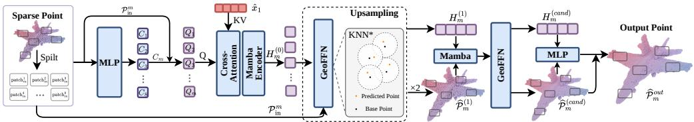  
Figure 3: Architecture of the Patch-wise Mamba-based Geometry Decoder. The decoder fuses local patch features with the terminal latent endpoint $\widehat { x } _ { 1 }$ , then applies cascaded GeoFFN and Mamba blocks to predict dense patches with supervision on intermediate and final outputs.

Latent Endpoint Estimation. Let $\widehat { x } _ { 1 }$ denote the terminal latent feature passed to the decoder. During training, we first estimate the latent endpoint from the sampled state on the linear interpolation path and the predicted velocity:

$$
\widehat { x } _ { 1 } = x _ { t } + ( 1 - t ) \widetilde { v } _ { \theta } ( x _ { t } , t , c , \mathbb { Z } ) .\tag{6}
$$

Patch-wise Feature Fusion. The sparse input $\mathcal { P } _ { \mathrm { i n } }$ is divided into patches $\{ \mathcal { P } _ { \mathrm { i n } } ^ { m } \} _ { m = 1 } ^ { M }$ . Let $Q$ be the sparse-query support used by the latent flow, and let $C ^ { m }$ denote the point-wise sparse local condition gathered for patch $m .$ . For each patch, the predicted latent tokens $\widehat { x } _ { 1 }$ are interpolated to the patch points via 3-nearest-neighbor weighting on the query support $Q ,$ , yielding a patch-specific flow condition that is then fused with $C ^ { m }$ through the first decoder block. We use CrossAttention to fuse the features to obtain the input features for the Patch-wise Up-sampling module: $H _ { m } ^ { ( 0 ) } = C A ( \mathcal { P } _ { \mathrm { i n } } ^ { m } , \ \widehat { x } _ { 1 } , \ C ^ { m } )$ .

Geometry-Aware Mamba Decoder. We serialize patch points with space-filling curve orders and aggregate bidirectional scans to reduce the anisotropic bias of one-dimensional ordering. Block 1 uses Hilbert and trans-Hilbert orders to preserve local neighborhoods during the initial fusion of sparse conditions and predicted latent features. Block 2 uses z order and trans-z order at higher point density, providing complementary traversal for refinement. Since linear scans may weaken geometric cues, we adopt GeoFFN, inspired by the LCFFN module in LCM [40], to enhance geometry awareness. The two-block decoder produces patch point sets and hidden features:

$$
\begin{array} { r l } & { ( \widehat { \mathcal { P } } _ { m } ^ { ( 1 ) } , \ H _ { m } ^ { ( 1 ) } ) = G e o F F N _ { 1 } ( M a m b a B l o c k _ { 1 } ( { \mathcal { P } } _ { \mathrm { i n } } ^ { m } , \ H _ { m } ^ { ( 0 ) } ) ) , } \\ & { ( \widehat { \mathcal { P } } _ { m } ^ { ( 2 ) } , \ H _ { m } ^ { ( 2 ) } ) = G e o F F N _ { 2 } ( M a m b a B l o c k _ { 2 } ( \widehat { \mathcal { P } } _ { m } ^ { ( 1 ) } , \ H _ { m } ^ { ( 1 ) } ) ) . } \end{array}\tag{7}
$$

The Block-1 points and the Block-2 branch are concatenated into candidate points $\widehat { \mathcal { P } } _ { m } ^ { \mathrm { c a n d } } \ =$ $[ \widehat { \mathcal { P } } _ { m } ^ { ( 1 ) } ; \widehat { \mathcal { P } } _ { m } ^ { ( 2 ) } ]$ and features $H _ { m } ^ { \mathrm { c a n d } } = [ H _ { m } ^ { ( 1 ) } ; H _ { m } ^ { ( 2 ) } ]$ , which are processed by a position-aware residual head that predicts a bounded coordinate offset:

$$
\begin{array} { r } { \widehat { \mathcal { P } } _ { m } ^ { o u t } = \widehat { \mathcal { P } } _ { m } ^ { \mathrm { c a n d } } + \operatorname { t a n h } \left( M L P \Big ( [ H _ { m } ^ { \mathrm { c a n d } } , ~ \mathrm { P E } ( \widehat { \mathcal { P } } _ { m } ^ { \mathrm { c a n d } } ) ] \Big ) \right) . } \end{array}\tag{8}
$$

Here, $[ \cdot ; \cdot ]$ denotes concatenation along the point/token dimension. The final dense point cloud $\widehat { \mathcal P }$ is obtained by merging all patch outputs. Importantly, the decoder is a deterministic Euclidean reconstruction module conditioned on the predicted latent features and does not introduce another generative process. PE denotes positional encoding. The geometric loss is applied in a stage-wise manner to the decoder outputs:

$$
\mathcal { L } _ { \mathrm { g e o } } = \sum _ { l } C D ( \widehat { \mathcal { P } } ^ { ( l ) } , \mathcal { P } _ { \mathrm { g t } } ) + \sum _ { l } \frac { 1 } { M } \sum _ { m } ^ { M } C D ( \widehat { \mathcal { P } } _ { m } ^ { ( l ) } , \mathcal { P } _ { \mathrm { m } } ^ { g t } )\tag{9}
$$

where $\widehat { \mathcal { P } } ^ { ( l ) } = [ \widehat { \mathcal { P } } _ { m } ^ { ( l ) } ] _ { m = 1 } ^ { M }$ , denotes the output of decoder block l, $\mathcal { P } _ { \mathrm { m } } ^ { g t }$ is also divided into M parts, $C D ( \cdot , \cdot )$ is the Chamfer Distance.

## 3.5 Overall Training Objective

The full framework is optimized by combining latent flow matching, prototype alignment, and coordinate reconstruction. The overall objective is:

$$
\begin{array} { r } { \mathcal { L } = \mathcal { L } _ { \mathrm { g e o } } + \lambda _ { \mathrm { F M } } \mathcal { L } _ { \mathrm { F M } } + \lambda _ { \mathrm { p r o t o } } \mathcal { L } _ { \mathrm { p r o t o } } . } \end{array}\tag{10}
$$

Each loss term reflects the separation of concerns in our framework: $\mathcal { L } _ { \mathrm { F M } }$ drives the latent trajectory toward the Utonia 3D prior target, $\mathcal { L } _ { \mathrm { p r o t o } }$ aligns the multi-view prototypes with the 3D prior to keep the visual controller geometrically consistent, and $\mathcal { L } _ { \mathrm { g e o } }$ supervises the final coordinate reconstruction.

## 4 Experiments

## 4.1 Datasets and Metrics

Our main evaluation is conducted on ShapeNetPU, a multi-modal point cloud upsampling benchmark. It contains 35K valid samples from 13 categories. Each object is associated with eight selected views. We also evaluate on PU-GAN [2] and PU1K [3]. Following prior works [3, 4, 41], we report Chamfer Distance (CD), Hausdorff Distance (HD), and point-to-surface distance (P2F), all in units of $1 0 ^ { - 3 }$ Lower is better for all three metrics. For more details of the datasets, please refer to the Appendix.

## 4.2 Quantitative and Qualitative Comparison on ShapeNetPU

## Quantitative Comparison.

Table 1 compares our method with representative regression-based and generative baselines on ShapeNetPU under 4× and 16× upsampling. For a fair comparison, we have replicated all the methods based on our experimental setup and on the dataset. Our method achieves the best results on all three metrics under both settings. Two comparisons are particularly informative. First, our method outperforms PUFM, the strongest coordinate-space flow matching baseline, supporting our claim that latent-space generation is more stable than coordinate-space generation. Second, the largest gain appears in P2F, which measures distance to the underlying continuous surface rather than to discrete target points. The roughly 50% improvement over competing methods suggests that the 3D latent space provides a strong surface-aware representation, while multi-view guidance further helps the generated points align with the underlying geometric manifold.

Qualitative Comparison. Figure 4 presents qualitative 4× upsampling results on ShapeNetPU. Compared with the sparse input, the generated point clouds recover denser and more continuous object surfaces while preserving local structures such as thin parts, boundaries, and curved regions. These visual results are consistent with the quantitative gains in Table 1, especially the lower P2F error, showing that the predicted points are better attached to the underlying surface instead of simply increasing point density. It demonstrates the effectiveness of our proposed distillation mechanism.

Table 1: Quantitative results on ShapeNetPU at 4× and 16× upsampling. The top three results are in red, blue, and green, respectively.
<table><tr><td rowspan="2">Method</td><td colspan="3">ShapeNetPU 4×</td><td colspan="3">ShapeNetPU 16×</td></tr><tr><td>CD↓</td><td>HD↓</td><td>P2F↓</td><td>CD↓</td><td>HD↓</td><td>P2F↓</td></tr><tr><td>PU-Net [1]</td><td>1.084</td><td>12.628</td><td>5.381</td><td>1.274</td><td>20.292</td><td>6.894</td></tr><tr><td>PU-GAN [2]</td><td>0.645</td><td>8.829</td><td>3.420</td><td>0.459</td><td>13.494 3.852</td><td></td></tr><tr><td>PU-GCN [3]</td><td>0.593</td><td>7.692</td><td>2.527</td><td>0.312</td><td>9.603</td><td>2.722</td></tr><tr><td>Grad-PU [4]</td><td>0.414</td><td>3.429</td><td>1.684</td><td>0.280</td><td>3.372</td><td>1.892</td></tr><tr><td>APU-LDI [41]</td><td>0.364</td><td>3.182</td><td>1.447</td><td>0.246</td><td>2.735</td><td>1.845</td></tr><tr><td>PUDM [29]</td><td>0.348</td><td>3.180</td><td>1.590</td><td>0.278</td><td>2.952</td><td>1.757</td></tr><tr><td>PUFM [31]</td><td>0.338</td><td>3.286</td><td>1.672</td><td>0.265</td><td>3.215</td><td>1.903</td></tr><tr><td>Ours</td><td>0.280</td><td>2.259</td><td>0.818</td><td>0.221</td><td>2.498</td><td>1.167</td></tr></table>

Table 2: Quantitative results on PU-GAN and PU1K at 4× upsampling. The top three results are in red, blue, and green, respectively.
<table><tr><td rowspan="2">Method</td><td colspan="2">PU-GAN 4×</td><td colspan="3">PU1K 4×</td></tr><tr><td>CD↓</td><td>HD↓ P2F↓</td><td>CD↓</td><td>HD↓</td><td>P2F↓</td></tr><tr><td>PU-Net [1]</td><td>0.507</td><td>4.312 4.694</td><td>1.155</td><td>15.170</td><td>4.834</td></tr><tr><td>PU-GAN [2] PU-GCN [3]</td><td>0.284</td><td>3.301 2.660</td><td>0.735</td><td>9.939</td><td>4.234</td></tr><tr><td>Grad-PU [4]</td><td>0.274</td><td>2.974 2.535</td><td>0.585</td><td>7.577</td><td>2.499</td></tr><tr><td></td><td>0.260</td><td>2.462 1.949</td><td>0.404</td><td>3.732</td><td>1.474</td></tr><tr><td>APU-LDI [41] PUDM [29]</td><td>0.232</td><td>1.673 1.507</td><td>0.399</td><td>3.603</td><td>1.287</td></tr><tr><td>PUFM [31]</td><td>0.264 0.250</td><td>2.441 3.080 2.341</td><td>0.478 0.421</td><td>4.441 3.763</td><td>1.725</td></tr><tr><td></td><td></td><td></td><td>2.292</td><td></td><td>1.682</td></tr><tr><td>Ours</td><td>0.257</td><td>2.418</td><td>1.854 0.390</td><td>3.492</td><td>1.222</td></tr></table>

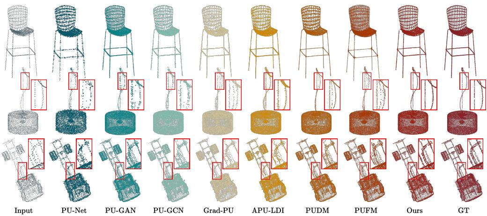  
Figure 4: Qualitative visualization on ShapeNetPU under the 4× upsampling setting.

## 4.3 Quantitative and Qualitative Comparison on PU-GAN and PU1K

To evaluate the transferability of our method, we further conduct experiments on the PU-GAN and PU1K benchmarks to assess cross-dataset generalization. Note: PU-GAN and PU1K use overlapping local patches as input samples, whereas our ShapeNetPU pre-training uses complete object-level point clouds; the non-overlapping patches in our framework are only used inside the decoder. Thus, PU-GAN/PU1K provide less geometric and semantic context to the frozen 3D encoder, and their lack of aligned multi-view images further weakens the benefit of visual distillation. Cropped patches provide incomplete geometry, making it harder for the frozen 3D encoder to extract sufficiently informative latent features, while the absence of images also prevents the prototype controller from fully exploiting visual guidance. These factors explain the limited gains on PU-GAN as shown in Tab 2. PU1K shows stronger results partly because it contains PU-GAN and ShapeNet-derived shapes, making its distribution closer to ShapeNetPU; after removing all PU1K test shapes from the ShapeNetPU pre-training split, this reflects distributional overlap rather than test-shape leakage. Although our PU-GAN metrics are not uniformly state of the art, Figure 5 shows that our visual details, such as local structures and surface continuity, are comparable to recent SOTA methods. This indicates that the learned information from ShapeNetPU remains transferable despite patch-based inputs and missing multi-view supervision.

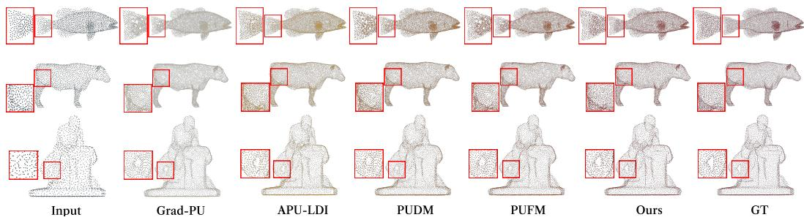  
Figure 5: Qualitative visualization on PU-GAN under the 4× upsampling setting.

## 4.4 Arbitrary-Rate Upsampling

A practical upsampler should not be tied to a single density ratio. We therefore evaluate arbitrary-rate upsampling on ShapeNetPU and compare with PUFM and APU-LDI. This experiment tests whether the learned transport remains stable as the target density changes. Before reporting the numerical comparison, Figure 6.(b) provides a visual example of how different methods behave when the requested output density varies. The stable results across ratios suggest that image guidance during training remains reliable at different output resolutions, with the distilled network retaining 2D detail cues. We have provided quantitative results in the Appendix.

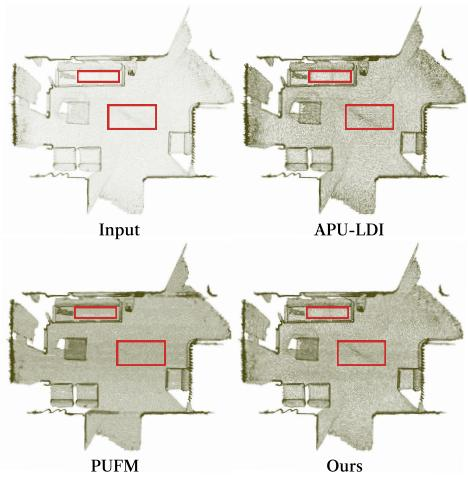

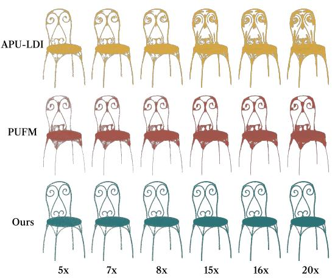  
Figure 6: More visualization results. (a) Visualization of ScanNet; (b) Visualization of Arbitrary-Rate Upsampling.

Table 3: Ablation studies on ShapeNetPU under 4× upsampling. Lower is better.
<table><tr><td>Variant</td><td>CD↓</td><td>HD↓</td><td>P2F↓</td></tr><tr><td colspan="4">Image Distillation</td></tr><tr><td>w/o distillation</td><td>0.329</td><td>2.842</td><td>1.139</td></tr><tr><td>w/ distillation</td><td>0.280</td><td>2.259</td><td>0.818</td></tr><tr><td colspan="4">2D Backbone</td></tr><tr><td>DINOv2 [42]</td><td>0.292</td><td>2.374</td><td>0.884</td></tr><tr><td>VGGT [15]</td><td>0.280</td><td>2.259</td><td>0.818</td></tr><tr><td colspan="4">Prototype Count</td></tr><tr><td>Kproto = 2</td><td>0.302</td><td>2.493</td><td>0.952</td></tr><tr><td>Kproto = 4</td><td>0.291</td><td>2.378</td><td>0.882</td></tr><tr><td>Kproto = 6</td><td>0.284</td><td>2.301</td><td>0.841</td></tr><tr><td>Kproto = 10</td><td>0.283</td><td>2.287</td><td>0.834</td></tr><tr><td>Kproto = 8 (default)</td><td>0.280</td><td>2.259</td><td>0.818</td></tr></table>

<table><tr><td>Variant</td><td>CD↓</td><td>HD↓</td><td>P2F↓</td></tr><tr><td colspan="4">GeoFFN</td></tr><tr><td>w/o GeoFFN</td><td>0.299</td><td>2.454</td><td>0.920</td></tr><tr><td>w/ GeoFFN</td><td>0.280</td><td>2.259</td><td>0.818</td></tr><tr><td colspan="4">3D Encoder</td></tr><tr><td>PTv3 [43]</td><td>0.287</td><td>2.361</td><td>0.878</td></tr><tr><td>Utonia [14]</td><td>0.280</td><td>2.259</td><td>0.818</td></tr><tr><td colspan="4">Mamba Scan</td></tr><tr><td>Sequential scan</td><td>0.306</td><td>2.514</td><td>0.962</td></tr><tr><td>Hilbert only</td><td>0.294</td><td>2.401</td><td>0.890</td></tr><tr><td>z-order only</td><td>0.298</td><td>2.436</td><td>0.911</td></tr><tr><td>Bi-dir. same scan</td><td>0.288</td><td>2.352</td><td>0.861</td></tr><tr><td>Hilbert/rev. + z/rev.</td><td>0.280</td><td>2.259</td><td>0.818</td></tr></table>

## 4.5 Ablation Study

We conduct ablation studies on ShapeNetPU under the 4× setting to demonstrate the effectiveness of our method.

Table 3 shows that the gains do not come from a single isolated component. Removing image distillation weakens the training signal that connects sparse geometry to dense surface structure, as also shown by the visual comparison in Figure 7. Image distillation improves CD, HD, and P2F while retaining point-only inference. Figure 8 visualizes corresponding prototype assignments across the 3D input and image views.

Using VGGT as the 2D backbone outperforms DINOv2, indicating that stronger multi-view visual tokens better guide latent transport. In the 3D space, a larger-scale pretrained encoder further improves performance. This is expected because the frozen 3D encoder defines the target latent space, and its representation capacity affects latent supervision quality. Nevertheless, the overall trend remains stable as long as the encoder provides an informative geometry-aware latent space.

For the prototype count, increasing $K _ { p r o t o }$ from 2 to 8 consistently improves all metrics, while 10 prototypes bring no further gain, suggesting that too few prototypes under-represent multi-view semantics, whereas excessive clustering may fragment the shared prototype space.

GeoFFN improves over the version without it, showing that lightweight geometry-aware decoding helps predicted points stay attached to the surface. The lower CD and HD complement the improvement in P2F, indicating more accurate coordinate reconstruction from the latent features. This is consistent with the role of GeoFFN in enhancing geometry awareness within the Mamba-based geometry decoder when predicting dense point coordinates. For Mamba scan design, spatial scan curves improve geometric fidelity over naive sequential ordering, and complementary forward/reverse scans achieve the best result. Together, these results support the overall design: the latent generator provides structured features, while the Mamba with GeoFFN decoder converts them into dense and faithful coordinates. More analyses are provided in Appendix.

Figure 7: Qualitative comparison with and without image distillation on ShapeNetPU under the 4× upsampling setting.  
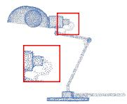  
w/o distillation

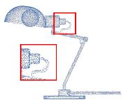  
w/ distillation

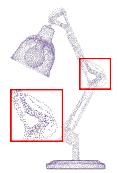  
w/o distillation

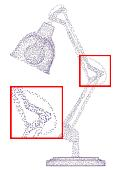  
w/ distillation

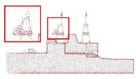  
w/o distillation

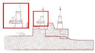  
w/ distillation

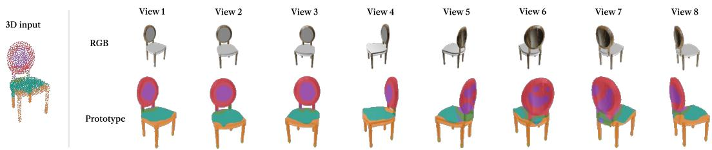  
Figure 8: Shared-prototype visualization of a chair: colored 3D input (left), eight RGB views (top right), and assignment maps (bottom right). Colors denote shared prototype indices.

## 4.6 Generalization to Real-World Point Cloud Upsampling in ScanNet

Finally, we evaluate qualitative generalization on ScanNet [18], a real-world indoor RGB-D scanning dataset. Figure 6(a) shows representative ScanNet upsampling results. Our method increases point density along visible walls, floors, and object boundaries while largely preserving the layout of the original scan. This suggests that the frozen Utonia latent space provides stable representations at the scene level, while the Mamba decoder with GeoFFN helps a compact network transfer pretrained 3D knowledge to real scans.

## 5 Limitation and Conclusion

Limitation. Our framework depends on a frozen pretrained 3D encoder and thus inherits the expressiveness of its latent space. When the input is an incomplete local patch rather than a complete object-level point cloud, the encoder may lack sufficient geometric and semantic context, and outof-distribution shapes may not be faithfully represented by the pretrained 3D encoder. Although inference is image-free, training still requires aligned multi-view images, limiting scalability to datasets with such pairs.

Conclusion. We presented ControlFlow3D, a multi-view distilled latent flow matching framework for point cloud upsampling. Our method shifts generation from unstable raw coordinates to a structured latent space defined by a pretrained 3D encoder, and uses an unsupervised shared-prototype distillation mechanism to transfer multi-view visual knowledge into the velocity network during training. A Mamba-based geometry decoder maps the generated latent features to dense coordinates with linear complexity sequence modeling. We further construct ShapeNetPU, a multi-modal upsampling dataset for training. Extensive experiments on multiple benchmarks demonstrate the effectiveness and strong generalization of our method.

## Acknowledgments and Disclosure of Funding

This work was supported by the National Natural Science Foundation of China (No. 62272227). The authors declare no competing interests.

## References

[1] Lequan Yu, Xianzhi Li, Chi-Wing Fu, Daniel Cohen-Or, and Pheng-Ann Heng. Pu-net: Point cloud upsampling network. In Proceedings ofthe IEEE conference on computer vision and pattern recognition, pages 2790–2799, 2018.

[2] Ruihui Li, Xianzhi Li, Chi-Wing Fu, Daniel Cohen-Or, and Pheng-Ann Heng. Pu-gan: a point cloud upsampling adversarial network. In Proceedings of the IEEE/CVF international conference on computer vision, pages 7203–7212, 2019.

[3] Guocheng Qian, Abdulellah Abualshour, Guohao Li, Ali Thabet, and Bernard Ghanem. Pu-gcn: Point cloud upsampling using graph convolutional networks. In Proceedings ofthe IEEE/CVF conference on computer vision and pattern recognition, pages 11683–11692, 2021.

[4] Yun He, Danhang Tang, Yinda Zhang, Xiangyang Xue, and Yanwei Fu. Grad-pu: Arbitrary-scale point cloud upsampling via gradient descent with learned distance functions. In Proceedings of the IEEE/CVF conference on computer vision and pattern recognition, pages 5354–5363, 2023.

[5] Alex H Lang, Sourabh Vora, Holger Caesar, Lubing Zhou, Jiong Yang, and Oscar Beijbom. Pointpillars: Fast encoders for object detection from point clouds. In Proceedings of the IEEE/CVF conference on computer vision and pattern recognition, pages 12697–12705, 2019.

[6] Shaoshuai Shi, Xiaogang Wang, and Hongsheng Li. Pointrcnn: 3d object proposal generation and detection from point cloud. In Proceedings ofthe IEEE/CVF conference on computer vision and pattern recognition, pages 770–779, 2019.

[7] Charles R Qi, Hao Su, Kaichun Mo, and Leonidas J Guibas. Pointnet: Deep learning on point sets for 3d classification and segmentation. In Proceedings ofthe IEEE conference on computer vision and pattern recognition, pages 652–660, 2017.

[8] Charles Ruizhongtai Qi, Li Yi, Hao Su, and Leonidas J Guibas. Pointnet++: Deep hierarchical feature learning on point sets in a metric space. Advances in neural information processing systems, 30, 2017.

[9] Jeffrey Mahler, Jacky Liang, Sherdil Niyaz, Michael Laskey, Richard Doan, Xinyu Liu, Juan Aparicio Ojea, and Ken Goldberg. Dex-net 2.0: Deep learning to plan robust grasps with synthetic point clouds and analytic grasp metrics. arXiv preprint arXiv:1703.09312, 2017.

[10] Richard A Newcombe, Shahram Izadi, Otmar Hilliges, David Molyneaux, David Kim, Andrew J Davison, Pushmeet Kohi, Jamie Shotton, Steve Hodges, and Andrew Fitzgibbon. Kinectfusion: Real-time dense surface mapping and tracking. In 2011 10th IEEE international symposium on mixed and augmented reality, pages 127–136. Ieee, 2011.

[11] Shahram Izadi, David Kim, Otmar Hilliges, David Molyneaux, Richard Newcombe, Pushmeet Kohli, Jamie Shotton, Steve Hodges, Dustin Freeman, Andrew Davison, et al. Kinectfusion: real-time 3d reconstruction and interaction using a moving depth camera. In Proceedings ofthe 24th annual ACM symposium on User interface software and technology, pages 559–568, 2011.

[12] Jiade Chen, Jin Wang, Yunhui Shi, Nam Ling, and Baocai Yin. Mvp-net: Multi-view depth image guided cross-modal distillation network for point cloud upsampling. In Proceedings ofthe 32nd ACM International Conference on Multimedia, pages 9759–9768, 2024.

[13] Yifan Zhao, Le Hui, and Jin Xie. Sspu-net: Self-supervised point cloud upsampling via differentiable rendering. In Proceedings of the 29th ACM international conference on multimedia, pages 2214–2223, 2021.

[14] Yujia Zhang, Xiaoyang Wu, Yunhan Yang, Xianzhe Fan, Han Li, Yuechen Zhang, Zehao Huang, Naiyan Wang, and Hengshuang Zhao. Utonia: Toward one encoder for all point clouds. arXiv preprint arXiv:2603.03283, 2026.

[15] Jianyuan Wang, Minghao Chen, Nikita Karaev, Andrea Vedaldi, Christian Rupprecht, and David Novotny. Vggt: Visual geometry grounded transformer. In Proceedings of the Computer Vision and Pattern Recognition Conference, pages 5294–5306, 2025.

[16] Stuart Lloyd. Least squares quantization in pcm. IEEE transactions on information theory, 28(2):129–137, 1982.

[17] Arthur P Dempster, Nan M Laird, and Donald B Rubin. Maximum likelihood from incomplete data via the em algorithm. Journal ofthe royal statistical society: series B (methodological), 39(1):1–22, 1977.

[18] Angela Dai, Angel X Chang, Manolis Savva, Maciej Halber, Thomas Funkhouser, and Matthias Nießner. Scannet: Richly-annotated 3d reconstructions of indoor scenes. In Proceedings ofthe IEEE conference on computer vision and pattern recognition, pages 5828–5839, 2017.

[19] Yaron Lipman, Ricky TQ Chen, Heli Ben-Hamu, Maximilian Nickel, and Matt Le. Flow matching for generative modeling. arXiv preprint arXiv:2210.02747, 2022.

[20] Alexander Tong, Kilian Fatras, Nikolay Malkin, Guillaume Huguet, Yanlei Zhang, Jarrid Rector-Brooks, Guy Wolf, and Yoshua Bengio. Improving and generalizing flow-based generative models with minibatch optimal transport. arXiv preprint arXiv:2302.00482, 2023.

[21] Xingchao Liu, Chengyue Gong, and Qiang Liu. Flow straight and fast: Learning to generate and transfer data with rectified flow. arXiv preprint arXiv:2209.03003, 2022.

[22] Patrick Esser, Sumith Kulal, Andreas Blattmann, Rahim Entezari, Jonas Müller, Harry Saini, Yam Levi, Dominik Lorenz, Axel Sauer, Frederic Boesel, et al. Scaling rectified flow transformers for high-resolution image synthesis. In Forty-first international conference on machine learning, 2024.

[23] Yang Jin, Zhicheng Sun, Ningyuan Li, Kun Xu, Hao Jiang, Nan Zhuang, Quzhe Huang, Yang Song, Yadong Mu, and Zhouchen Lin. Pyramidal flow matching for efficient video generative modeling. arXiv preprint arXiv:2410.05954, 2024.

[24] Adam Polyak, Amit Zohar, Andrew Brown, Andros Tjandra, Animesh Sinha, Ann Lee, Apoorv Vyas, Bowen Shi, Chih-Yao Ma, Ching-Yao Chuang, et al. Movie gen: A cast of media foundation models. arXiv preprint arXiv:2410.13720, 2024.

[25] Wang Yifan, Shihao Wu, Hui Huang, Daniel Cohen-Or, and Olga Sorkine-Hornung. Patch-based progressive 3d point set upsampling. In Proceedings ofthe IEEE/CVF conference on computer vision and pattern recognition, pages 5958–5967, 2019.

[26] Yue Qian, Junhui Hou, Sam Kwong, and Ying He. Pugeo-net: A geometry-centric network for 3d point cloud upsampling. In European conference on computer vision, pages 752–769. Springer, 2020.

[27] Shi Qiu, Saeed Anwar, and Nick Barnes. Pu-transformer: Point cloud upsampling transformer. In Proceedings of the Asian conference on computer vision, pages 2475–2493, 2022.

[28] Yi Rong, Haoran Zhou, Kang Xia, Cheng Mei, Jiahao Wang, and Tong Lu. Repkpu: Point cloud upsampling with kernel point representation and deformation. In Proceedings of the IEEE/CVF conference on computer vision and pattern recognition, pages 21050–21060, 2024.

[29] Wentao Qu, Yuantian Shao, Lingwu Meng, Xiaoshui Huang, and Liang Xiao. A conditional denoising diffusion probabilistic model for point cloud upsampling. In Proceedings ofthe IEEE/CVF Conference on Computer Vision and Pattern Recognition, pages 20786–20795, 2024.

[30] Boqian Zhang, Shen Yang, Hao Chen, Chao Yang, Jing Jia, and Guang Jiang. Point cloud upsampling using conditional diffusion module with adaptive noise suppression. In Proceedings of the IEEE/CVF Conference on Computer Vision and Pattern Recognition, pages 16987–16996, 2025.

[31] Zhi-Song Liu, Chenhang He, Yakun Ju, and Lei Li. Pufm: Efficient point cloud upsampling via flow matching. In Proceedings of the AAAI Conference on Artificial Intelligence, volume 40, pages 7458–7466, 2026.

[32] Angela Dai, Charles Ruizhongtai Qi, and Matthias Nießner. Shape completion using 3d-encoder-predictor cnns and shape synthesis. In Proceedings of the IEEE conference on computer vision and pattern recognition, pages 5868–5877, 2017.

[33] Christopher B Choy, Danfei Xu, JunYoung Gwak, Kevin Chen, and Silvio Savarese. 3d-r2n2: A unified approach for single and multi-view 3d object reconstruction. In European conference on computer vision, pages 628–644. Springer, 2016.

[34] Haoqiang Fan, Hao Su, and Leonidas J Guibas. A point set generation network for 3d object reconstruction from a single image. In Proceedings ofthe IEEE conference on computer vision and pattern recognition, pages 605–613, 2017.

[35] Priyanka Mandikal, KL Navaneet, Mayank Agarwal, and R Venkatesh Babu. 3d-lmnet: Latent embedding matching for accurate and diverse 3d point cloud reconstruction from a single image. arXiv preprint arXiv:1807.07796, 2018.

[36] Nanyang Wang, Yinda Zhang, Zhuwen Li, Yanwei Fu, Wei Liu, and Yu-Gang Jiang. Pixel2mesh: Generating 3d mesh models from single rgb images. In Proceedings of the European conference on computer vision (ECCV), pages 52–67, 2018.

[37] Lirui Zhang, Zhengkai Zhao, Zhi Zuo, Pan Gao, and Jie Qin. Simba: Towards high-fidelity and geometrically-consistent point cloud completion via transformation diffusion. In Proceedings of the AAAI Conference on Artificial Intelligence, volume 40, pages 12636–12644, 2026.

[38] Zhiyong Zhang, Ruyu Liu, Xiufeng Liu, Yunrui Zhu, Yanyan Yang, Chaochao Wang, and Jianhua Zhang. Pullm: A multimodal framework for enhanced 3d point cloud upsampling using large language models. In Proceedings of the 40th ACM/SIGAPP Symposium on Applied Computing, pages 1223–1230, 2025.

[39] Albert Gu and Tri Dao. Mamba: Linear-time sequence modeling with selective state spaces. arXiv preprint arXiv:2312.00752, 2023.

[40] Yaohua Zha, Naiqi Li, Yanzi Wang, Tao Dai, Hang Guo, Bin Chen, Zhi Wang, Zhihao Ouyang, and Shu-Tao Xia. Lcm: Locally constrained compact point cloud model for masked point modeling. arXiv preprint arXiv:2405.17149, 2024.

[41] Shujuan Li, Junsheng Zhou, Baorui Ma, Yu-Shen Liu, and Zhizhong Han. Learning continuous implicit field with local distance indicator for arbitrary-scale point cloud upsampling. In Proceedings of the AAAI conference on artificial intelligence, volume 38, pages 3181–3189, 2024.

[42] Maxime Oquab, Timothée Darcet, Theo Moutakanni, Huy V. Vo, Marc Szafraniec, Vasil Khalidov, Pierre Fernandez, Daniel Haziza, Francisco Massa, Alaaeldin El-Nouby, Russell Howes, Po-Yao Huang, Hu Xu, Vasu Sharma, Shang-Wen Li, Wojciech Galuba, Mike Rabbat, Mido Assran, Nicolas Ballas, Gabriel Synnaeve, Ishan Misra, Herve Jegou, Julien Mairal, Patrick Labatut, Armand Joulin, and Piotr Bojanowski. Dinov2: Learning robust visual features without supervision, 2023.

[43] Xiaoyang Wu, Li Jiang, Peng-Shuai Wang, Zhijian Liu, Xihui Liu, Yu Qiao, Wanli Ouyang, Tong He, and Hengshuang Zhao. Point transformer v3: Simpler faster stronger. In Proceedings of the IEEE/CVF conference on computer vision and pattern recognition, pages 4840–4851, 2024.

[44] Geoffrey Hinton, Oriol Vinyals, and Jeff Dean. Distilling the knowledge in a neural network. arXiv preprint arXiv:1503.02531, 2015.

[45] Yuenan Hou, Xinge Zhu, Yuexin Ma, Chen Change Loy, and Yikang Li. Point-to-voxel knowledge distillation for lidar semantic segmentation. In Proceedings of the IEEE/CVF conference on computer vision and pattern recognition, pages 8479–8488, 2022.

[46] Linfeng Zhang, Runpei Dong, Hung-Shuo Tai, and Kaisheng Ma. Pointdistiller: Structured knowledge distillation towards efficient and compact 3d detection. In Proceedings ofthe IEEE/CVF conference on computer vision and pattern recognition, pages 21791–21801, 2023.

[47] Peipei Li, Xing Cui, Yibo Hu, Man Zhang, Ting Yao, and Tao Mei. Bidirectional knowledge reconfiguration for lightweight point cloud analysis. IEEE Transactions on Multimedia, 26:7962–7972, 2023.

[48] Xu Yan, Heshen Zhan, Chaoda Zheng, Jiantao Gao, Ruimao Zhang, Shuguang Cui, and Zhen Li. Let images give you more: Point cloud cross-modal training for shape analysis. Advances in Neural Information Processing Systems, 35:32398–32411, 2022.

[49] Qijian Zhang, Junhui Hou, and Yue Qian. Pointmcd: Boosting deep point cloud encoders via multi-view cross-modal distillation for 3d shape recognition. IEEE Transactions on Multimedia, 27:754–767, 2023.

[50] Zhaoxin Fan, Yulin He, Zhicheng Wang, Kejian Wu, Hongyan Liu, and Jun He. Reconstruction-aware prior distillation for semi-supervised point cloud completion. arXiv preprint arXiv:2204.09186, 2022.

[51] Weibing Zhao, Haiming Zhang, Chaoda Zheng, Xu Yan, Shuguang Cui, and Zhen Li. Cpu: Codebook lookup transformer with knowledge distillation for point cloud upsampling. In Proceedings ofthe 31st ACM International Conference on Multimedia, pages 3917–3925, 2023.

[52] Angel X. Chang, Thomas Funkhouser, Leonidas Guibas, Pat Hanrahan, Qixing Huang, Zimo Li, Silvio Savarese, Manolis Savva, Shuran Song, Hao Su, Jianxiong Xiao, Li Yi, and Fisher Yu. ShapeNet: An Information-Rich 3D Model Repository. Technical Report arXiv:1512.03012 [cs.GR], Stanford University — Princeton University — Toyota Technological Institute at Chicago, 2015.

Appendix organization. We first provide the theoretical analysis and additional related work, then describe dataset preparation, followed by network and experimental details for reproducibility. We further report additional experiments, qualitative visualizations, and limitations.

## A Theoretical Analysis

This section provides two formal observations that match the design logic of ControlFlow3D. The first explains why multi-view information is useful as a training-time control signal for the latent velocity field. The second explains why aligning image-side and 3D-side prototypes helps keep the visual controller geometrically consistent. These results are population-level statements under standard square-integrability and Lipschitz assumptions. They do not claim an optimization guarantee for the finite neural network. Consistent with the main method, multi-view variables are used only by the training-time controller, while inference remains point-only.

## A.1 Training-Time Multi-View Conditioning Reduces Oracle Flow-Matching Risk

Assumption A.1. Let $X _ { 0 } , X _ { 1 } \in \mathbb { R } ^ { d }$ denote the sparse-aligned source state and dense-target latent state on the same sparse-query support, and let $\bar { U } = X _ { 1 } \bar { - } X _ { 0 }$ be the flow-matching target. For a sampled time t, let $\bar { X } _ { t } = \bar { ( 1 - t ) } \bar { X _ { 0 } } + t X _ { 1 }$ . Let c denote the sparse geometric condition and define $\boldsymbol { Z } \stackrel { - } { = } \left( X _ { t } , t , c \right)$ as the information available to the sparse-conditioned velocity network. Let I denote the multi-view image feature available during training. We assume $\mathbb { E } \| U \| _ { 2 } ^ { 2 } < \infty$ and consider oracle predictors over all square-integrable measurable functions.

Theorem A.1 (Value of training-time multi-view information). Under Assumption A.1, define the oracle sparse-conditioned and training-time multi-view-conditioned flow-matching risks as

$$
\mathcal { R } _ { b a s e } ^ { * } = \operatorname* { i n f } _ { f } \mathbb { E } \left[ \| U - f ( Z ) \| _ { 2 } ^ { 2 } \right] ,\tag{11}
$$

$$
\mathcal { R } _ { c t r l } ^ { * } = \operatorname* { i n f } _ { g } \mathbb { E } \left[ \| U - g ( Z , \mathcal { T } ) \| _ { 2 } ^ { 2 } \right] .\tag{12}
$$

Then

$$
\begin{array} { r } { \mathcal { R } _ { b a s e } ^ { * } - \mathcal { R } _ { c t r l } ^ { * } = \mathbb { E } \left[ \left. \mathbb { E } [ U \mid Z , \mathbb { Z } ] - \mathbb { E } [ U \mid Z ] \right. _ { 2 } ^ { 2 } \right] \geq 0 . } \end{array}\tag{13}
$$

Consequently, at the oracle level, conditioning on multi-view information cannot increase the optimal squared flow-matching risk. The inequality is strict exactly when $\mathbb { E } [ U \mid Z , { \mathcal { T } } ] \neq \mathbb { E } [ U \mid Z ]$ with positive probability.

Proof. For any square-integrable random vector U and conditioning variable Y, the minimizer of $\mathbb { E } \| U - h ( Y ) \| _ { 2 } ^ { 2 }$ over measurable h is the conditional expectation $h ^ { * } ( Y ) = \mathbb { E } [ U \mid Y ]$ . This follows from the orthogonal projection property of conditional expectation in $\hat { L } ^ { 2 } . \ \mathrm { A p p l y i n g } ^ { \mathrm { ~ ~ } }$ this fact with $Y = Z$ and $\boldsymbol { Y } \overset { ^ { \cdot } } { = } \left( \boldsymbol { Z } , \overset { ^ { \cdot } } { \boldsymbol { Z } } \right)$ gives

$$
\mathcal { R } _ { b a s e } ^ { * } = \mathbb { E } \left[ \| U - \mathbb { E } [ U \mid Z ] \| _ { 2 } ^ { 2 } \right] ,\tag{14}
$$

$$
\mathcal { R } _ { c t r l } ^ { * } = \mathbb { E } \left\lceil \| U - \mathbb { E } [ U \mid Z , \mathcal { I } ] \| _ { 2 } ^ { 2 } \right\rceil .\tag{15}
$$

By the tower property, $\mathbb { E } [ \mathbb { E } [ U \mid Z , { \mathcal { T } } ] \mid Z ] = \mathbb { E } [ U \mid Z ]$ . Define $\mu _ { Z } = \operatorname { \mathbb { E } } [ U \mid Z ]$ and $\mu _ { Z , \mathcal { T } } = \mathbb { E } [ U \ |$ $Z , Z ]$ . Then $U - \mathbb { E } [ U \mid Z ]$ decomposes into

$$
U - \mu _ { Z } = ( U - \mu _ { Z , \overline { { { \chi } } } } ) + \left( \mu _ { Z , \overline { { { \chi } } } } - \mu _ { Z } \right) .\tag{16}
$$

The cross term is zero because

$$
\begin{array} { r } { \mathbb { E } \left[ \langle U - \mu _ { Z , \mathcal { T } } , \mu _ { Z , \mathcal { T } } - \mu _ { Z } \rangle \right] = \mathbb { E } \left[ \langle \mathbb { E } [ U - \mu _ { Z , \mathcal { T } } \mid Z , \mathcal { Z } ] , \mu _ { Z , \mathcal { T } } - \mu _ { Z } \rangle \right] = 0 . } \end{array}\tag{17}
$$

Taking squared norms and expectations therefore yields Eq. (13). Non-negativity follows from the squared norm, and strictness holds precisely when the second term is nonzero with positive probability. □

Implication. The theorem formalizes a population-level reason for using multi-view cues to control the latent velocity field during training. If the images contain information about the dense latent displacement that is not recoverable from the sparse point condition alone, a training-time multi-view controller can provide a lower-risk velocity signal than a sparse-only oracle. In ControlFlow3D, this does not introduce image inputs at inference: the multi-view signal is used to guide training, and the model predicts at inference from the sparse point cloud and sparse 3D features.

## A.2 Prototype Consistency Controls Velocity-Modulation Mismatch

Assumption A.2. Let $P ^ { i m g } , P ^ { 3 D } \in \mathbb { R } ^ { K _ { p } \times d _ { p } }$ be image-side and 3D-side prototypes paired by the shared soft-KMeans centers, with each row normalized to unit Euclidean norm. Let

$$
\mathcal { L } _ { \mathrm { p r o t o } } = 1 - \frac { 1 } { K _ { p } } \sum _ { i = 1 } ^ { K _ { p } } \left. P _ { i } ^ { i m g } , P _ { i } ^ { 3 D } \right. .\tag{18}
$$

Let $m ( P ) = ( \gamma ( P ) , \beta ( P ) )$ ) be the prototype-to-modulation map that produces affine velocity parameters, and assume it is L-Lipschitz:

$$
\begin{array} { r } { \big ( \| \gamma ( P ) - \gamma ( P ^ { \prime } ) \| _ { 2 } ^ { 2 } + \| \beta ( P ) - \beta ( P ^ { \prime } ) \| _ { 2 } ^ { 2 } \big ) ^ { 1 / 2 } \leq L \| P - P ^ { \prime } \| _ { F } . } \end{array}\tag{19}
$$

For a base velocity $v ,$ define the affine controller

$$
\begin{array} { r } { A _ { m ( P ) } ( v ) = \gamma ( P ) \odot v + \beta ( P ) . } \end{array}\tag{20}
$$

Theorem A.2 (Prototype consistency bound). Under Assumption A.2, for any base velocity satisfying $\| v \| _ { \infty } \leq B$

$$
\begin{array} { r } { \left\| \mathcal { A } _ { m ( P ^ { i m g } ) } ( v ) - \mathcal { A } _ { m ( P ^ { 3 D } ) } ( v ) \right\| _ { 2 } \leq L \sqrt { 2 K _ { p } ( B ^ { 2 } + 1 ) } \mathcal { L } _ { \mathrm { p r o t o } } . } \end{array}\tag{21}
$$

Proof. Let $\Delta _ { \gamma } = \gamma ( P ^ { i m g } ) - \gamma ( P ^ { 3 D } )$ and $\Delta _ { \beta } = \beta ( P ^ { i m g } ) - \beta ( P ^ { 3 D } )$ . The controller difference is

$$
\mathcal { A } _ { m ( P ^ { i m g } ) } ( v ) - \mathcal { A } _ { m ( P ^ { 3 D } ) } ( v ) = \Delta _ { \gamma } \odot v + \Delta _ { \beta } .\tag{22}
$$

Using $\| v \| _ { \infty } \leq B$ and the Cauchy–Schwarz inequality,

$$
\| \Delta _ { \gamma } \odot v + \Delta _ { \beta } \| _ { 2 } \le B \| \Delta _ { \gamma } \| _ { 2 } + \| \Delta _ { \beta } \| _ { 2 }\tag{23}
$$

$$
\leq \sqrt { B ^ { 2 } + 1 } \left( \| \Delta _ { \gamma } \| _ { 2 } ^ { 2 } + \| \Delta _ { \beta } \| _ { 2 } ^ { 2 } \right) ^ { 1 / 2 } .\tag{24}
$$

By the Lipschitz condition in Eq. (19),

$$
\begin{array} { r } { \left( \| \Delta _ { \gamma } \| _ { 2 } ^ { 2 } + \| \Delta _ { \beta } \| _ { 2 } ^ { 2 } \right) ^ { 1 / 2 } \leq L \| P ^ { i m g } - P ^ { 3 D } \| _ { F } . } \end{array}\tag{25}
$$

Since each prototype is unit-normalized,

$$
\Vert P ^ { i m g } - P ^ { 3 D } \Vert _ { F } ^ { 2 } = \sum _ { i = 1 } ^ { K _ { p } } \Vert P _ { i } ^ { i m g } - P _ { i } ^ { 3 D } \Vert _ { 2 } ^ { 2 }\tag{26}
$$

$$
= \sum _ { i = 1 } ^ { K _ { p } } { \left( 2 - 2 \left. P _ { i } ^ { i m g } , P _ { i } ^ { 3 D } \right. \right) }\tag{27}
$$

$$
= 2 K _ { p } { \mathcal { L } } _ { \mathrm { p r o t o } } .\tag{28}
$$

Substituting this identity into Eq. (24) proves Eq. (21).

Implication. The bound should be read as a smoothness statement for the prototype controller. If the same locally Lipschitz modulation map is evaluated on paired image-side and 3D-side prototypes, reducing their cosine mismatch also reduces the possible mismatch between the corresponding affine velocity modulations. This supports using $\mathcal { L } _ { \mathrm { p r o t o } }$ as a stability regularizer that discourages image-driven control from becoming inconsistent with geometry-supported 3D prototypes.

## B Additional Related Work on Knowledge Distillation

Knowledge distillation for point cloud learning. Knowledge distillation transfers information from richer predictions, features, or auxiliary modalities into a target model [44]. In point cloud learning, prior methods adapt the transferred signal to 3D structure through point-level or voxellevel supervision [45, 46]. Other works introduce local-structure, global-context, or cross-modal constraints to improve the student representation [47, 48, 49]. These methods mainly rely on direct imitation or auxiliary losses, such as matching logits, responses, attention maps, intermediate features, or visual supervisory signals.

Distillation for point cloud reconstruction and upsampling. For reconstruction and upsampling, existing work transfers completion priors or vector-quantized codebook knowledge to improve dense geometry prediction [50, 51]. MVP-Net is closely related because it uses rendered multi-view depth images for upsampling [12]. However, it still requires inference-time depth images, extra preprocessing, and direct point-depth feature fusion. These methods show the value of geometric distillation, while remaining different from our training-time image distillation setting.

ControlFlow3D uses shared-prototype distillation instead of direct feature imitation or direct concatenation of 2D and 3D features. During training, VGGT image tokens and Utonia dense-target tokens are projected into a common prototype space, where image-side and 3D-side prototypes are aligned without explicit pixel-to-point correspondence. The aligned prototypes modulate the latent velocity field during training, and inference uses only the sparse point cloud and sparse 3D features.

## C Dataset Preparation

Existing point cloud upsampling benchmarks, such as PU-GAN [2] and PU1K [3], are mainly designed for patch-based learning. Their source models are relatively limited, and each object is usually decomposed into many overlapping local patches. This design has two limitations. First, the network mainly observes isolated local neighborhoods rather than complete object-level context, making it difficult to model global structural consistency across different regions. Second, during inference, multiple upsampled patches are usually merged and then downsampled by FPS. Although this strategy reduces duplicated candidates, it may alter the original density distribution of the object. Since different regions of a shape do not necessarily have the same sampling density, fusion based on overlapping local patches may affect the preservation of fine geometric details.

To address these issues, we construct a new multi-modal point cloud upsampling dataset, denoted as ShapeNetPU. Unlike previous patch-only benchmarks, ShapeNetPU provides both whole-object context and non-overlapping patch-level upsampling pairs, making it suitable for global-to-local upsampling pipelines. Starting from the R2N2 release [33], we collect 43,783 samples, each with 24 rendered views and camera metadata. For each object, we select eight views with relatively diverse camera poses as the multi-view image input. We then match each sample to its corresponding OBJ mesh in ShapeNetCore.v1 [52].

We generate the point-cloud supervision directly from the matched ShapeNetCore.v1 OBJ meshes. For each mesh, we first perform area-weighted random surface sampling to obtain 50K surface points. This dense random set is then downsampled by farthest point sampling (FPS) to 20K points, which is used as the intermediate surface pool. The 50K-to-20K procedure reduces the randomness of direct low-count sampling while keeping the final pool well spread over the mesh surface.

From the 20K surface pool, we construct paired sparse and dense point clouds with aligned nonoverlapping patches. We first run KMeans on the 20K points to obtain eight object-level spatial patches. For each patch, we apply a two-stage FPS strategy. In the first stage, points are over-sampled within each KMeans patch, using an over-sampling factor α before the final quota is enforced. The local FPS is initialized from the point closest to the object centroid, which gives a deterministic initial point for each patch. In the second stage, candidates from all patches are merged and selected by a global FPS procedure with a strict per-patch quota. This global second pass prevents any single patch from dominating the sampling process and alleviates local density inconsistency caused by uneven raw mesh tessellation or random surface sampling.

The final sparse input contains 2048 points, with eight patches of 256 points each, while the dense target contains 8192 points, with the corresponding eight patches of 1024 points each. Points are written in patch order, and the patch index lists record the contiguous vertex ranges, so the model can recover the sparse-dense patch correspondence without re-clustering during training. A stable seed derived from the sample path makes the preprocessing reproducible.

After preprocessing and filtering invalid cases, ShapeNetPU contains 35,762 valid 3D models from 13 ShapeNet categories. Each sample contains the whole-object sparse point cloud, dense target point cloud, multi-view images, and original mesh. The sparse and dense point clouds retain the standard 4× patch upsampling setting with 256 input points and 1024 target points per local patch.

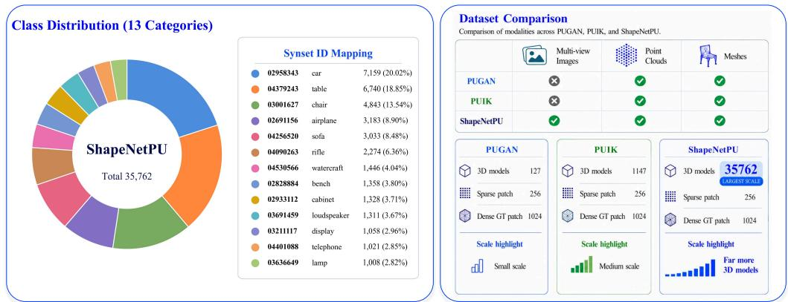  
(a) Class distribution and synset mapping of the ShapeNetPU. (b) ShapeNetPU vs. PUGAN & PUIK  
Figure 9: Dataset statistics and benchmark comparison for ShapeNetPU. (a) The category distribution and ShapeNet synset mapping cover 13 object classes. (b) Compared with PU-GAN and PU1K, ShapeNetPU retains the standard sparse and dense point-cloud patch sizes while additionally provid ing multi-view images.

## D Network and Experimental Details

## D.1 Utonia Details

Utonia is used as the frozen 3D encoder that defines the structural latent space in our framework. Rather than asking the flow model to generate Euclidean coordinates directly, we first encode both sparse and dense point sets into a compact geometry-aware feature space. In implementation, the pretrained Utonia encoder processes point clouds with their original 3D coordinates and returns pointwise features, which are then projected to a 128-dimensional latent representation. These features are stored offline for both sparse inputs and dense ground truth point sets, so the training loop can focus on learning the transport dynamics rather than repeatedly running the frozen 3D foundation model. Keeping the encoder frozen preserves the geometric priors learned from large-scale pretraining and provides a stable target distribution for flow matching. If the encoder were jointly optimized with the generator, the target endpoint would keep changing during training and make the latent transport problem less well defined.

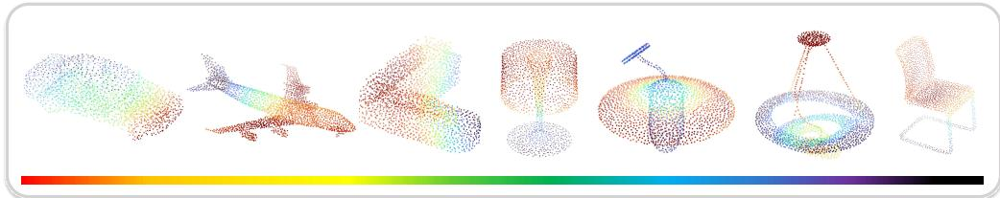  
Figure 10: Visualization of point-wise Utonia features on representative shapes. The feature responses vary smoothly over coherent geometric regions, indicating that the frozen 3D encoder provides a structured latent space for sparse-to-dense transport.

The two Utonia feature streams play different roles. The sparse-aligned feature initializes the source state $x _ { 0 } ,$ , while the dense ground-truth feature defines the target state $x _ { 1 }$ . We align the dense feature to the sparse query support through three-nearest-neighbor interpolation, so each flow token has a dense-feature endpoint at an inference-available query location.

## D.2 Sparse Geometry Condition Network Details

The sparse geometry condition network is deliberately lightweight and input-driven. We use a PointNet++ MSG encoder-decoder to extract both local and global descriptors from the sparse input point cloud. The set abstraction hierarchy samples $1 0 2 4 \stackrel {  } {  } 2 5 6 \stackrel {  } {  } 6 4 \stackrel {  } {  } 1 6$ points and uses two radii at each level to capture local neighborhoods of different sizes. Feature propagation then lifts the coarse descriptors back to the original sparse resolution, producing a point-wise local feature map with 256 channels. A max-pooled global descriptor is projected to the same 256-dimensional channel space.

From the sparse coordinates, we select 256 flow-token locations by FPS. The local condition is gathered or interpolated to these token locations, while the global descriptor is broadcast to every token. The final condition token for each query therefore contains three pieces of information:

$$
c _ { i } = { \mathrm { C o n c a t } } \left[ q _ { i } , f _ { i } ^ { \mathrm { l o c a l } } , f ^ { \mathrm { g l o b a l } } \right] , \qquad c _ { i } \in \mathbb { R } ^ { 3 + 2 5 6 + 2 5 6 } .\tag{29}
$$

The coordinate term specifies the token location in 3D space, the local descriptor describes the neighborhood around that token, and the global descriptor provides object-level context for the local patch. This conditioning design keeps each latent update tied to an explicit sparse geometry support, even though the flow evolves in feature space.

## D.3 Latent Flow Matching Network Details

The latent velocity network predicts the displacement from the sparse latent state to the dense latent target. Given $\boldsymbol { x } _ { t } \ \mathbf { \bar { \Pi } } \mathbf { \Phi } \qquad \mathbf { \bar { x } } _ { t } \ \in \ \mathbb { R } ^ { 1 2 8 \times 2 5 6 }$ , the network first injects the time embedding through a FiLM-style conditional linear layer. We use the compact time code [t, sin(t), cos(t)], which gives the velocity field both monotonic progress information and periodic basis functions for smoother conditioning. Four cross-attention blocks then repeatedly exchange information between latent flow tokens and sparse geometry condition tokens. Each block contains a multi-head cross-attention layer, a feed-forward layer, residual connections, layer normalization, and time-dependent affine modulation.

The prototype-guided controller is applied after the base velocity field during training. Multi-view image features are provided as patch tokens from VGGT. To avoid noisy token-wise 2D and 3D fusion, we compress the visual evidence into $K _ { p r o t o } = 8$ shared semantic prototypes by default. These prototypes summarize local visual evidence and provide a compact basis for query-wise semantic modulation. Each soft-KMeans update uses cosine-normalized tokens and a temperature-controlled assignment, with four update iterations by default.

At training time, the prototype clustering observes both VGGT image tokens and query-aligned dense 3D target tokens. The image tokens provide cross-view cues for velocity modulation, while the dense target tokens constrain the shared prototypes using the geometry of the target surface. The soft query-to-prototype assignment distributes prototype-level scale and bias terms back to each query token, yielding the controlled training velocity

$$
\widetilde v _ { \theta } = g ( \mathcal { T } , x _ { t } , t ) \odot v _ { \theta } ( x _ { t } , t , c ) + b ( \mathcal { T } , x _ { t } , t ) .\tag{30}
$$

In the implementation, the prototype scale is parameterized as $1 + 0 . 3 5 \operatorname { t a n h } ( \cdot )$ and the bias as 0.35 tanh(·), so the control signal stays centered around the base velocity and remains bounded. We further regularize the image prototypes and 3D target prototypes with a cosine consistency loss, which discourages the visual controller from overemphasizing appearance cues that are not geometrically supported.

For inference, we integrate the learned ODE with a fixed 5-step Euler solver. Starting from the sparse-aligned latent state, the model repeatedly evaluates the learned velocity field and updates the latent tokens. A small residual endpoint MLP is then applied to the final state before decoding, which corrects endpoint bias accumulated by the finite-step rollout.

## D.4 Decoder Network Details

The geometry decoder converts terminal latent tokens into dense point coordinates through a direct feed-forward reconstruction path. Given the sparse point cloud, sparse local condition, and predicted latent endpoint, it produces coordinates without adding a separate sampling or diffusion process. The latent flow outputs 256 global query tokens. For each sparse patch, these tokens are used as a flow-condition token set and fused with the patch’s local sparse features inside the decoder.

We use a two-stage Mamba-based decoder with upsampling factors (2, 2). The first stage takes a sparse patch and produces a 2× point set. It fuses the sparse local condition, positional embedding, and latent flow condition through a cross-attention layer, followed by a multi-scan Mamba block.

The scan orders are Hilbert and reversed Hilbert curves, which preserve local neighborhoods while exposing the sequence model to two traversal directions. The second stage takes the 2× intermediate points and predicts another $2 \times$ point set using a pure Mamba block with z-order and reversed z-order scans. Finally, the stage-1 and stage-2 points are concatenated and passed through a position-aware residual head:

$$
\widehat { P } _ { o u t } = \widehat { P } _ { c a n d } + \operatorname { t a n h } \Big ( \operatorname { M L P } \Big [ H _ { c a n d } , \mathrm { P E } ( \widehat { P } _ { c a n d } ) \Big ] \Big ) .\tag{31}
$$

This design avoids treating upsampling as a one-shot coordinate expansion. The first stage predicts an intermediate denser point set, the second stage adds complementary points, and the residual head performs a final surface-aware adjustment. Because Mamba scales linearly with sequence length, the decoder can model longer surface dependencies than purely local MLP operators without incurring the quadratic cost of full self-attention.

Training and inference use the same patch organization defined by the dataset construction. The sparse input is divided into eight non-overlapping object patches. Each local patch is decoded with shared decoder weights, and the patch outputs are merged to form the final dense point cloud.

## D.5 Implementation Details

We implement ControlFlow3D in PyTorch and train it with distributed data parallelism on four NVIDIA RTX 4090 GPUs. Unless otherwise specified, all models are trained for 500 epochs with a global batch size of 128, corresponding to 32 samples per GPU. The global test batch size is also set to 128. We set OMP\_NUM\_THREADS=1 and MKL\_NUM\_THREADS=1, and use four dataloader workers per training process with a prefetch factor of 2. We use AdamW as the optimizer with an initial learning rate of $2 \times 1 0 ^ { - 4 }$ and weight decay $1 \times 1 0 ^ { - 4 }$ . The learning rate follows a cosine annealing schedule and decays to $1 \times 1 0 ^ { - 6 }$ by the end of training. Gradients are clipped with a maximum norm of 1.0 for stable optimization.

## D.6 Training Protocol

For ShapeNetPU training, each sample contains a sparse input of 2048 points and a dense target of 8192 points. Point coordinates are normalized by the sparse input centroid and scale before being processed by the model. We use a patch-based training protocol by default, where the sparse input is divided into eight non-overlapping patches of 256 points and the dense target is divided into the corresponding eight patches of 1024 points. The latent flow still observes the complete sparse object context, while the Mamba-based decoder receives patch-level supervision for local reconstruction.

The training objective combines the global coordinate reconstruction loss, local patch-level reconstruction loss, latent flow matching loss, and prototype consistency loss. We use the weighted objective

$$
\begin{array} { r } { \mathcal { L } = \mathcal { L } _ { \mathrm { g e o } } + \lambda _ { \mathrm { F M } } \mathcal { L } _ { \mathrm { F M } } + \lambda _ { \mathrm { p r o t o } } \mathcal { L } _ { \mathrm { p r o t o } } , } \end{array}\tag{32}
$$

where $\mathcal { L } _ { \mathrm { g e o } }$ contains the global coordinate reconstruction term and the local patch-level reconstruction term. In the default setting, the local patch-level term is weighted by 0.35 within $\mathcal { L } _ { \mathrm { g e o } }$ . The flowmatching loss weight is linearly scheduled from 0.003 to 0.0015, with a 20-epoch warm-up at the initial value. The prototype consistency loss weight is linearly scheduled from 0.01 to 0.005. During training, multi-view image features guide the latent velocity field.

## D.7 Loss-Weight Selection and Ablation

The auxiliary latent losses have different numerical scales from the coordinate reconstruction loss. We therefore use small decaying weights: $\lambda _ { \mathrm { F M } }$ provides latent endpoint supervision early in training, and $\lambda _ { \mathrm { p r o t o } }$ aligns image-side and 3D-side prototypes before becoming a lightweight regularizer. This ablation changes only these auxiliary weights and keeps the multi-view controller architecture fixed, so it differs from the “w/o distillation” setting in the main paper.

The default schedule gives the lowest errors in this ablation. Too little auxiliary supervision weakens latent alignment, while larger weights can overemphasize feature-space objectives relative to coordinate reconstruction.

Table 4: Loss-weight ablation on ShapeNetPU under 4× upsampling. Lower is better. The default setting is used in all main experiments.
<table><tr><td>Variant</td><td>λFM</td><td>λproto</td><td>CD↓</td><td>HD↓</td><td>P2F↓</td></tr><tr><td>No auxiliary latent loss</td><td>0</td><td>0</td><td>0.338</td><td>2.901</td><td>1.168</td></tr><tr><td>Unit auxiliary weights</td><td>1</td><td>1</td><td>0.347</td><td>3.018</td><td>1.241</td></tr><tr><td>Weak FM</td><td>0.0015 → 0.00075</td><td>0.01 → 0.005</td><td>0.292</td><td>2.388</td><td>0.891</td></tr><tr><td>Strong FM</td><td>0.006 → 0.003</td><td>0.01 → 0.005</td><td>0.290</td><td>2.371</td><td>0.878</td></tr><tr><td>Weak prototype alignment</td><td>0.003 → 0.0015</td><td>0.005 → 0.0025</td><td>0.287</td><td>2.342</td><td>0.860</td></tr><tr><td>Strong prototype alignment</td><td> $0 . 0 0 3  0 . 0 0 1 5$ </td><td>0.02 → 0.01</td><td>0.286</td><td>2.336</td><td>0.852</td></tr><tr><td>Default</td><td> $\mathbf { 0 . 0 0 3  0 . 0 0 1 5 }$ </td><td> $\mathbf { 0 . 0 1 }  \mathbf { 0 . 0 0 5 }$ </td><td>0.280</td><td>2.259</td><td>0.818</td></tr></table>

## D.8 Additional Ablation Results

We further report controlled ablations for design choices and hyperparameters that are not exhaustively covered in the main paper. We evaluate all variants on the ShapeNetPU test set under 4× upsampling. Unless a row explicitly changes a factor, we keep the frozen Utonia encoder, the weighted objective in Sec. D.6, the default $K _ { p r o t o } = 8 \mathrm { { ; } }$ , eight VGGT views, 256 sparse-query tokens, and a 5-step Euler solver.

Table 5: Additional ablations of the prototype controller on ShapeNetPU under 4× upsampling. Lower is better.
<table><tr><td>Variant</td><td>Main changed factor</td><td>CD↓</td><td>HD↓</td><td>P2F↓</td></tr><tr><td>No image-guided controller</td><td>Base velocity only</td><td>0.329</td><td>2.842</td><td>1.139</td></tr><tr><td>All-token image fusion</td><td>Raw VGGT cross-attn</td><td>0.303</td><td>2.501</td><td>0.958</td></tr><tr><td>Image-only prototypes</td><td>No target 3D tokens</td><td>0.296</td><td>2.421</td><td>0.900</td></tr><tr><td>Hard query assignment</td><td>Nearest prototype</td><td>0.291</td><td>2.366</td><td>0.872</td></tr><tr><td>Scale-only controller</td><td>Use g  vθ only</td><td>0.293</td><td>2.394</td><td>0.886</td></tr><tr><td>Bias-only controller</td><td>Use  $v _ { \theta } + \mathbf { b } \ \mathrm { o n l y }$ </td><td>0.289</td><td>2.352</td><td>0.862</td></tr><tr><td>No prototype consistency</td><td>Set  $\lambda _ { \mathrm { p r o t o } } = 0$ </td><td>0.294</td><td>2.386</td><td>0.884</td></tr><tr><td>Default</td><td>Shared prototypes + g, b</td><td>0.280</td><td>2.259</td><td>0.818</td></tr></table>

Table 5 supports the shared-prototype controller. Removing image guidance gives the largest error, while direct all-token fusion and image-only prototypes remain weaker than the default. The scaleonly and bias-only rows indicate that g and b provide complementary controls.

Table 6: Additional ablations of latent-state construction and geometry decoding on ShapeNetPU under 4× upsampling. Lower is better.
<table><tr><td>Variant</td><td>Main changed factor</td><td>CD↓</td><td>HD↓</td><td>P2F↓</td></tr><tr><td>Gaussian source</td><td>Gaussian x0</td><td>0.318</td><td>2.721</td><td>1.061</td></tr><tr><td>Learned source</td><td>Learned  $x _ { 0 }$ </td><td>0.301</td><td>2.494</td><td>0.941</td></tr><tr><td>Train Utonia</td><td>Jointly update encoder</td><td>0.305</td><td>2.548</td><td>0.956</td></tr><tr><td>Independent target</td><td>Unaligned target tokens</td><td>0.307</td><td>2.566</td><td>0.968</td></tr><tr><td>1-NN target alignment</td><td>Replace 3-NN with 1-NN</td><td>0.292</td><td>2.373</td><td>0.875</td></tr><tr><td>No source perturbation</td><td>Set σ = 0</td><td>0.287</td><td>2.326</td><td>0.850</td></tr><tr><td>No endpoint residual</td><td>Remove endpoint MLP</td><td>0.286</td><td>2.315</td><td>0.844</td></tr><tr><td>No local patch term</td><td>No local term in  $\mathcal { L } _ { \mathrm { g e o } }$ </td><td>0.295</td><td>2.407</td><td>0.909</td></tr><tr><td>Default</td><td> $\mathrm { F r o z e n ~ U t o n i a } + 3 { \cdot } \mathrm { N N } \mathrm { a l i g n m e n t }$ </td><td>0.280</td><td>2.259</td><td>0.818</td></tr></table>

Table 6 shows that the default latent construction is the most reliable among the tested variants. Gaussian or learned source states remove sparse Utonia initialization, joint Utonia training destabilizes the target latent features, and independent target support breaks the query alignment used at inference. Removing the local patch term mainly increases P2F, consistent with its role in loca surface supervision.

The budget ablations justify the default setting. Eight views, 256 query tokens, and a 5-step Euler solver give the lowest errors among the tested budgets, while larger settings add computation without consistent gains.

Table 7: Additional budget ablations on ShapeNetPU under 4× upsampling. Each block changes one factor while keeping all other defaults fixed. Lower is better.
<table><tr><td>Factor</td><td>Setting</td><td>CD↓</td><td>HD↓</td><td>P2F↓</td></tr><tr><td colspan="5">Number of training views</td></tr><tr><td>Views</td><td>1 view</td><td>0.306</td><td>2.536</td><td>0.994</td></tr><tr><td>Views</td><td>2 views</td><td>0.297</td><td>2.430</td><td>0.918</td></tr><tr><td>Views</td><td>4 views</td><td>0.287</td><td>2.328</td><td>0.850</td></tr><tr><td>Views</td><td>12 views</td><td>0.284</td><td>2.302</td><td>0.838</td></tr><tr><td>Views</td><td>8 views (default)</td><td>0.280</td><td>2.259</td><td>0.818</td></tr><tr><td colspan="5">Number of sparse-query tokens</td></tr><tr><td>Query tokens</td><td>128</td><td>0.295</td><td>2.402</td><td>0.893</td></tr><tr><td>Query tokens</td><td>384</td><td>0.284</td><td>2.296</td><td>0.839</td></tr><tr><td>Query tokens</td><td>512</td><td>0.288</td><td>2.337</td><td>0.858</td></tr><tr><td>Query tokens</td><td>256 (default)</td><td>0.280</td><td>2.259</td><td>0.818</td></tr><tr><td colspan="5">Euler steps for latent rollout</td></tr><tr><td>Euler steps</td><td>1 step</td><td>0.302</td><td>2.490</td><td>0.944</td></tr><tr><td>Euler steps</td><td>3 steps</td><td>0.286</td><td>2.320</td><td>0.850</td></tr><tr><td>Euler steps</td><td>7 steps</td><td>0.283</td><td>2.292</td><td>0.835</td></tr><tr><td>Euler steps</td><td>10 steps</td><td>0.286</td><td>2.319</td><td>0.846</td></tr><tr><td>Euler steps</td><td>5 steps (default)</td><td>0.280</td><td>2.259</td><td>0.818</td></tr></table>

## D.9 Supervised Fine-Tuning on PU-GAN and PU1K

To evaluate transferability on standard public benchmarks, we further perform supervised fine-tuning on PU-GAN [2] and PU1K [3]. Since these benchmarks do not provide synchronized multi-view images, fine-tuning is conducted in a sparse-only setting starting from the supervised ShapeNetPU checkpoint. Both benchmarks are trained on the official 4× patch training sets: each sparse training patch contains 256 points, and the corresponding dense target contains 1024 points. The official PU-GAN training set contains 24K patch pairs, and the official PU1K training set contains 69K patch pairs. Sparse Utonia features are used as the feature initialization for the sparse input points.

We fine-tune all model parameters with the AdamW optimizer. The base learning rate is $2 \times 1 0 ^ { - 6 }$ with weight decay $1 \times 1 \bar { 0 } ^ { - 5 }$ and betas (0.9, 0.95). Following the different roles of model components, we use learning-rate multipliers of 0.5, 1.0, and 1.5 for the sparse geometry backbone, latent flow network, and Mamba decoder, respectively. The learning rate follows cosine annealing with a minimum value of 0.1 times the base learning rate. Gradients are clipped with maximum norm 1.0. We use two RTX 4090 GPUs for each fine-tuning run, with a global batch size of 128. PU-GAN is fine-tuned for 50 epochs, while PU1K is fine-tuned for 40 epochs.

The supervised fine-tuning objective is the Chamfer-distance reconstruction loss computed after a 5-step sparse-only rollout. During testing, we follow the patch-based evaluation protocol: each 2048-point input shape is divided into 256-point patches, patch predictions are merged, and FPS is used to match the target output size of 8192 points. Testing is performed every epoch with patch size 256 and patch rate 3.0. This protocol keeps the fine-tuning and public-benchmark evaluation aligned with the patch-based setting of PU-GAN and PU1K.

## D.10 Inference and Evaluation

At inference time, ControlFlow3D takes only the sparse point cloud as the raw input, and sparse 3D features are computed from this point input. We use a fixed 5-step Euler solver for latent flow integration. The predicted terminal latent tokens are then decoded by the Mamba-based geometry decoder to produce the dense point cloud. For the default 4× setting on ShapeNetPU, the model upsamples 2048 input points to 8192 output points. For larger ratios, we follow the same model rollout strategy used in the main experiments.

Following common point cloud upsampling protocols, we report Chamfer Distance (CD), Hausdorff Distance (HD), and point-to-surface distance (P2F). CD and HD are computed between the predicted and ground-truth point sets in the normalized coordinate frame. For P2F, predictions are transformed back to the original object coordinate frame and evaluated against the retained mesh surface. Lower values indicate better performance for all metrics.

## E Additional Experiments and Visualizations

This section provides supplementary evidence beyond the main quantitative tables. We include additional visual comparisons, robustness tests under synthetic input perturbations, and arbitrary-rate evaluations. These experiments examine whether the learned sparse-to-dense mapping remains stable when the input distribution or target upsampling ratio changes, while keeping the inference setting point-only.

## E.1 Additional Qualitative Results

We provide additional qualitative examples on ShapeNetPU and PU-GAN. The ShapeNetPU examples cover object-level cases with synchronized training views, while the PU-GAN examples evaluate the fine-tuned model under the standard patch-based public benchmark setting.

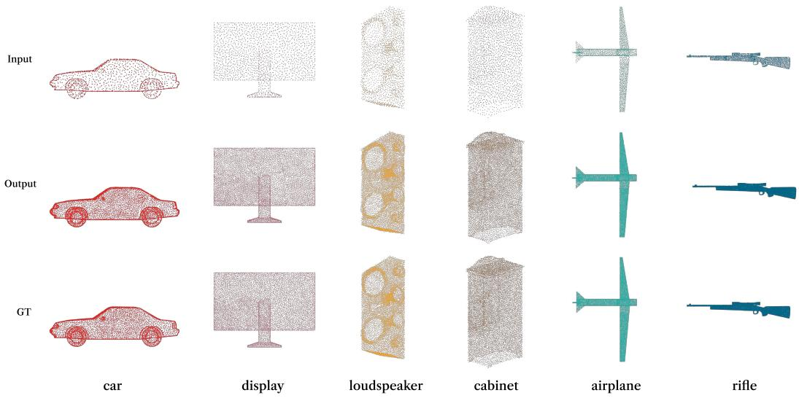  
Figure 11: More visualization results on ShapeNetPU.

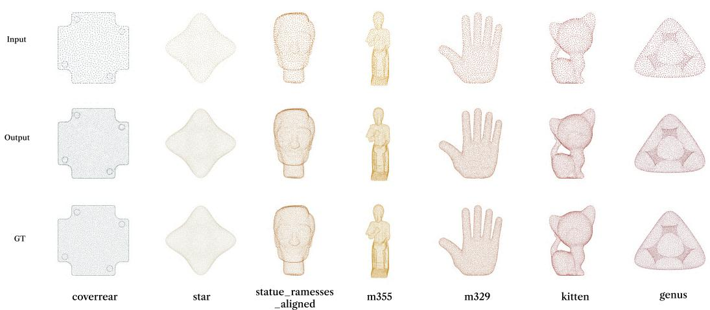  
Figure 12: More visualization results on PU-GAN under the 4× upsampling setting.

Across these examples, ControlFlow3D generally preserves the global object structure while adding points along visible surfaces and thin components. The PU-GAN results further indicate that supervised fine-tuning transfers the learned decoder to regular patch-based surfaces without requiring image inputs at inference.

## E.2 Robustness to Random Noise

Sparse inputs acquired in practical settings often contain measurement noise. To evaluate robustness, we add random Gaussian noise to ShapeNetPU inputs and perform 4× upsampling under four noise levels, $\tau = 0 . 0 1 , \tau = 0 . 0 2 , \tau = 0 . 0 5$ , and $\tau = 0 . 1 0$

Table 8: Noise robustness comparison on ShapeNetPU under 4× upsampling. Lower values are better.
<table><tr><td>Noise Levels</td><td colspan="3"> $\tau = 0 . 0 1$ </td><td colspan="3"> $\tau = 0 . 0 2$ </td><td colspan="3"> $\tau = 0 . 0 5$ </td><td colspan="3"> $\tau = 0 . 1 0$ </td></tr><tr><td>Methods</td><td>CD↓</td><td>HD↓</td><td>P2F↓</td><td>CD↓</td><td>HD↓</td><td>P2F↓</td><td>CD↓</td><td>HD↓</td><td>P2F↓</td><td>CD↓</td><td>HD↓</td><td>P2F↓</td></tr><tr><td>Grad-PU [4]</td><td>0.638</td><td>5.462</td><td>4.684</td><td>1.176</td><td>8.936</td><td>9.752</td><td>1.384</td><td>10.284</td><td>15.876</td><td>1.692</td><td>11.438</td><td>18.420</td></tr><tr><td>APU-LDI [41]</td><td>0.586</td><td>5.108</td><td>3.986</td><td>1.084</td><td>8.412</td><td>8.926</td><td>1.276</td><td>9.672</td><td>14.286</td><td>1.548</td><td>10.864</td><td>17.126</td></tr><tr><td>PUDM [29]</td><td>0.542</td><td>4.946</td><td>4.214</td><td>0.986</td><td>7.846</td><td>8.684</td><td>1.168</td><td>9.142</td><td>13.768</td><td>1.406</td><td>10.326</td><td>16.204</td></tr><tr><td>PUFM [31]</td><td>0.518</td><td>4.812</td><td>4.386</td><td>0.948</td><td>7.632</td><td>8.984</td><td>1.126</td><td>9.284</td><td>14.026</td><td>1.358</td><td>10.052</td><td>15.862</td></tr><tr><td>Ours</td><td>0.431</td><td>3.620</td><td>2.384</td><td>0.792</td><td>6.684</td><td>5.426</td><td>0.982</td><td>8.216</td><td>9.384</td><td>1.138</td><td>9.428</td><td>11.562</td></tr></table>

This experiment evaluates how performance changes when the sparse input is perturbed around the underlying surface. All methods degrade as the noise level increases, but ControlFlow3D keeps lower CD, HD, and P2F across the tested levels. This suggests that the structured sparse features and geometric decoder reduce sensitivity to small coordinate perturbations.

## E.3 Quantitative comparison of Arbitrary-Rate Upsampling

In addition to the arbitrary-rate visual results shown in the main paper, we report quantitative results on ShapeNetPU. The same trained model is evaluated from 5× to 20× upsampling to test whether the learned generation process generalizes beyond the native 4× setting.

Table 9: Arbitrary-rate upsampling comparison with PUFM and APU-LDI on ShapeNetPU. Lower values are better.
<table><tr><td>Rates</td><td colspan="3">PUFM [31]</td><td colspan="3">APU-LDI [41]</td><td colspan="3">Ours</td></tr><tr><td></td><td>CD↓</td><td>HD↓</td><td>P2F↓</td><td>CD↓</td><td>HD↓</td><td>P2F↓</td><td>CD↓</td><td>HD↓</td><td>P2F↓</td></tr><tr><td>5×</td><td>0.325</td><td>3.260</td><td>1.707</td><td>0.342</td><td>3.105</td><td>1.505</td><td>0.268</td><td>2.300</td><td>0.893</td></tr><tr><td>7×</td><td>0.306</td><td>3.238</td><td>1.762</td><td>0.311</td><td>3.025</td><td>1.620</td><td>0.258</td><td>2.410</td><td>0.970</td></tr><tr><td>8×</td><td>0.299</td><td>3.252</td><td>1.790</td><td>0.299</td><td>3.045</td><td>1.600</td><td>0.251</td><td>2.335</td><td>1.002</td></tr><tr><td>15×</td><td>0.268</td><td>3.226</td><td>1.890</td><td>0.251</td><td>2.970</td><td>1.745</td><td>0.225</td><td>2.465</td><td>1.150</td></tr><tr><td>20×</td><td>0.255</td><td>3.178</td><td>1.945</td><td>0.238</td><td>2.925</td><td>1.860</td><td>0.217</td><td>2.575</td><td>1.210</td></tr></table>

ControlFlow3D obtains the lowest CD, HD, and P2F among the compared methods for all evaluated ratios. The gains are most pronounced in P2F, indicating that the generated points remain closer to the underlying surface when the requested output density increases.

## F Discussion

## F.1 Failure Analysis

The sparse-to-dense mapping remains under-constrained when the input provides weak geometric evidence or when the relevant structure is only partially observed.

The first pattern is weak evidence for thin structures, as shown in Figure 13(a). Narrow parts such as airplane wings, chair legs, lamp supports, and similar elongated components may contain only a small number of sparse input points. The latent flow can infer the coarse structural identity, but the decoder may place points slightly off the true surface or recover an incomplete structure compared with the ground truth

The second pattern is ambiguity caused by limited local evidence, as shown in Figure 13(b). When several dense surfaces are compatible with the same sparse observations, the model may generate a geometrically plausible averaged solution. This behavior can blur sharp local boundaries or create small density leakage between adjacent semantic parts.

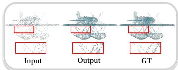  
(a) Weak evidence for thin structures

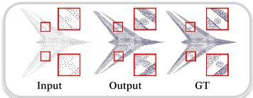  
(b) Ambiguous geometry with limited local evidence

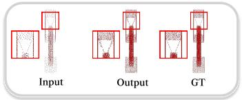  
(c) Incomplete recovery of occluded structures  
Figure 13: Failure analysis of ControlFlow3D. Red boxes highlight challenging regions in the sparse input, our output, and the dense ground truth (GT).

The third pattern is incomplete recovery of occluded or sparsely visible structures, as shown in Figure 13(c). Multi-view distillation provides additional boundary and part-level cues during training, and these cues are encoded by the learned velocity field. At inference, the model does not require 2D inputs. It predicts from the sparse point cloud and the distilled prior. If a structure is poorly represented in the point input and not reliably encoded in the learned prior, the output may preserve the main visible region while missing part of the occluded or narrow component.

## F.2 Limitations

Our framework relies on pretrained visual and 3D foundation models. This provides the latent flow with a structured representation space, but it also makes the method dependent on the coverage and biases of these encoders. If the frozen 3D encoder under-represents a particular geometry family, the corresponding latent targets may not faithfully preserve its fine structures. Similarly, if the rendered multi-view images do not reveal important regions because of occlusion or limited viewpoints, the prototype controller cannot recover information that is absent from the training signals.

Finally, the decoder is designed around a native 4× decoding path. Larger arbitrary ratios are handled by repeated rollout or post-processing, which keeps the architecture simple but may increase inference cost and affect density preservation at very high ratios. A future direction is to condition the latent flow and decoder directly on the target density ratio.

## G Broader Impact

ControlFlow3D leverages multi-view and 3D foundation model knowledge during training while requiring only sparse point clouds at inference. This setting is relevant to applications where dense geometric observations are expensive or difficult to obtain, such as robotics, autonomous driving, augmented reality, digital twins, and cultural heritage digitization. Denser and more surface-consistent point clouds may benefit downstream perception, reconstruction, and visualization systems. However, point cloud upsampling also carries potential risks because the generated points are inferred from learned priors rather than directly measured by sensors. In safety-critical applications, such as autonomous navigation or industrial inspection, upsampled geometry should therefore be treated as model-assisted estimation rather than ground-truth observation. Although our method does not use identity-related data, real-world 3D scans may still contain sensitive spatial information, and responsible use should consider privacy, fairness, and uncertainty in practical use.

## NeurIPS Paper Checklist

## 1. Claims

Question: Do the main claims made in the abstract and introduction accurately reflect the paper’s contributions and scope?

Answer: [Yes]

Justification: The main contributions and scope have been included in the abstract and introduction.

Guidelines:

• The answer [N/A] means that the abstract and introduction do not include the claims made in the paper.

• The abstract and/or introduction should clearly state the claims made, including the contributions made in the paper and important assumptions and limitations. A [No] or [N/A] answer to this question will not be perceived well by the reviewers.

• The claims made should match theoretical and experimental results, and reflect how much the results can be expected to generalize to other settings.

• It is fine to include aspirational goals as motivation as long as it is clear that these goals are not attained by the paper.

## 2. Limitations

Question: Does the paper discuss the limitations of the work performed by the authors?

Answer: [Yes]

Justification: The discussion on the limitations of our work is stated in Sec. 5 and Appendix F. Guidelines:

• The answer [N/A] means that the paper has no limitation while the answer [No] means that the paper has limitations, but those are not discussed in the paper.

• The authors are encouraged to create a separate “Limitations” section in their paper.

• The paper should point out any strong assumptions and how robust the results are to violations of these assumptions (e.g., independence assumptions, noiseless settings, model well-specification, asymptotic approximations only holding locally). The authors should reflect on how these assumptions might be violated in practice and what the implications would be.

• The authors should reflect on the scope of the claims made, e.g., if the approach was only tested on a few datasets or with a few runs. In general, empirical results often depend on implicit assumptions, which should be articulated.

• The authors should reflect on the factors that influence the performance of the approach. For example, a facial recognition algorithm may perform poorly when image resolution is low or images are taken in low lighting. Or a speech-to-text system might not be used reliably to provide closed captions for online lectures because it fails to handle technical jargon.

• The authors should discuss the computational efficiency of the proposed algorithms and how they scale with dataset size.

• If applicable, the authors should discuss possible limitations of their approach to address problems of privacy and fairness.

• While the authors might fear that complete honesty about limitations might be used by reviewers as grounds for rejection, a worse outcome might be that reviewers discover limitations that aren’t acknowledged in the paper. The authors should use their best judgment and recognize that individual actions in favor of transparency play an important role in developing norms that preserve the integrity of the community. Reviewers will be specifically instructed to not penalize honesty concerning limitations.

## 3. Theory assumptions and proofs

Question: For each theoretical result, does the paper provide the full set of assumptions and a complete (and correct) proof?

Answer: [Yes]

Justification: We provide the assumptions, theorem statements, and complete proofs for the multi-view conditioning result and the prototype-consistency stability bound in Appendix A. Guidelines:

• The answer [N/A] means that the paper does not include theoretical results.

• All the theorems, formulas, and proofs in the paper should be numbered and crossreferenced.

• All assumptions should be clearly stated or referenced in the statement of any theorems.

• The proofs can either appear in the main paper or the supplemental material, but if they appear in the supplemental material, the authors are encouraged to provide a short proof sketch to provide intuition.

• Inversely, any informal proof provided in the core of the paper should be complemented by formal proofs provided in appendix or supplemental material.

• Theorems and Lemmas that the proof relies upon should be properly referenced.

## 4. Experimental result reproducibility

Question: Does the paper fully disclose all the information needed to reproduce the main experimental results of the paper to the extent that it affects the main claims and/or conclusions of the paper (regardless of whether the code and data are provided or not)?

Answer: [Yes]

Justification: Comprehensive experimental details necessary for reproducibility, including datasets and model configurations, are thoroughly detailed in Sec. 4 and Appendix D. These details collectively ensure that the main experimental results supporting the claim and conclusions of the paper can be independently reproduced.

Guidelines:

• The answer [N/A] means that the paper does not include experiments.

• If the paper includes experiments, a [No] answer to this question will not be perceived well by the reviewers: Making the paper reproducible is important, regardless of whether the code and data are provided or not.

• If the contribution is a dataset and/or model, the authors should describe the steps taken to make their results reproducible or verifiable.

• Depending on the contribution, reproducibility can be accomplished in various ways. For example, if the contribution is a novel architecture, describing the architecture fully might suffice, or if the contribution is a specific model and empirical evaluation, it may be necessary to either make it possible for others to replicate the model with the same dataset, or provide access to the model. In general. releasing code and data is often one good way to accomplish this, but reproducibility can also be provided via detailed instructions for how to replicate the results, access to a hosted model (e.g., in the case of a large language model), releasing of a model checkpoint, or other means that are appropriate to the research performed.

• While NeurIPS does not require releasing code, the conference does require all submissions to provide some reasonable avenue for reproducibility, which may depend on the nature of the contribution. For example

(a) If the contribution is primarily a new algorithm, the paper should make it clear how to reproduce that algorithm.

(b) If the contribution is primarily a new model architecture, the paper should describe the architecture clearly and fully.

(c) If the contribution is a new model (e.g., a large language model), then there should either be a way to access this model for reproducing the results or a way to reproduce the model (e.g., with an open-source dataset or instructions for how to construct the dataset).

(d) We recognize that reproducibility may be tricky in some cases, in which case authors are welcome to describe the particular way they provide for reproducibility. In the case of closed-source models, it may be that access to the model is limited in some way (e.g., to registered users), but it should be possible for other researchers to have some path to reproducing or verifying the results.

## 5. Open access to data and code

Question: Does the paper provide open access to the data and code, with sufficient instructions to faithfully reproduce the main experimental results, as described in supplemental material?

Answer: [Yes]

Justification: The code and dataset are publicly available via the link provided immediately after the abstract, along with instructions for reproducing the main experimental results.

Guidelines:

• The answer [N/A] means that paper does not include experiments requiring code.

• Please see the NeurIPS code and data submission guidelines (https://neurips.cc/ public/guides/CodeSubmissionPolicy) for more details.

• While we encourage the release of code and data, we understand that this might not be possible, so [No] is an acceptable answer. Papers cannot be rejected simply for not including code, unless this is central to the contribution (e.g., for a new open-source benchmark).

• The instructions should contain the exact command and environment needed to run to reproduce the results. See the NeurIPS code and data submission guidelines (https: //neurips.cc/public/guides/CodeSubmissionPolicy) for more details.

• The authors should provide instructions on data access and preparation, including how to access the raw data, preprocessed data, intermediate data, and generated data, etc.

• The authors should provide scripts to reproduce all experimental results for the new proposed method and baselines. If only a subset of experiments are reproducible, they should state which ones are omitted from the script and why.

• At submission time, to preserve anonymity, the authors should release anonymized versions (if applicable).

• Providing as much information as possible in supplemental material (appended to the paper) is recommended, but including URLs to data and code is permitted.

## 6. Experimental setting/details

Question: Does the paper specify all the training and test details (e.g., data splits, hyperparameters, how they were chosen, type of optimizer) necessary to understand the results?

Answer: [Yes]

Justification: We specify the datasets, metrics, training protocol, optimizer, learning-rate schedule, batch size, model configurations, fine-tuning settings, and inference/evaluation details in Sec. 4 and Appendix D.

Guidelines:

• The answer [N/A] means that the paper does not include experiments.

• The experimental setting should be presented in the core of the paper to a level of detail that is necessary to appreciate the results and make sense of them.

• The full details can be provided either with the code, in appendix, or as supplemental material.

## 7. Experiment statistical significance

Question: Does the paper report error bars suitably and correctly defined or other appropriate information about the statistical significance of the experiments?

Answer: [Yes]

Justification: We report the performance in terms of chamfer distance (CD), hausdorff distance (HD) and the point-to-surface distance (P2F) in Sec. 4.

Guidelines:

• The answer [N/A] means that the paper does not include experiments.

• The authors should answer [Yes] if the results are accompanied by error bars, confidence intervals, or statistical significance tests, at least for the experiments that support the main claims of the paper.

• The factors of variability that the error bars are capturing should be clearly stated (for example, train/test split, initialization, random drawing of some parameter, or overall run with given experimental conditions).

• The method for calculating the error bars should be explained (closed form formula, call to a library function, bootstrap, etc.)

• The assumptions made should be given (e.g., Normally distributed errors).

• It should be clear whether the error bar is the standard deviation or the standard error of the mean.

• It is OK to report 1-sigma error bars, but one should state it. The authors should preferably report a 2-sigma error bar than state that they have a 96% CI, if the hypothesis of Normality of errors is not verified.

• For asymmetric distributions, the authors should be careful not to show in tables or figures symmetric error bars that would yield results that are out of range (e.g., negative error rates).

• If error bars are reported in tables or plots, the authors should explain in the text how they were calculated and reference the corresponding figures or tables in the text.

## 8. Experiments compute resources

Question: For each experiment, does the paper provide sufficient information on the computer resources (type of compute workers, memory, time of execution) needed to reproduce the experiments?

Answer: [Yes]

Justification: We primarily executed all experiments relying on GPU resources, with details of the specific GPUs used provided in Sec. 4, and corresponding execution times reported in Fig. 1(b).

Guidelines:

• The answer [N/A] means that the paper does not include experiments.

• The paper should indicate the type of compute workers CPU or GPU, internal cluster, or cloud provider, including relevant memory and storage.

• The paper should provide the amount of compute required for each of the individual experimental runs as well as estimate the total compute.

• The paper should disclose whether the full research project required more compute than the experiments reported in the paper (e.g., preliminary or failed experiments that didn’t make it into the paper).

## 9. Code of ethics

Question: Does the research conducted in the paper conform, in every respect, with the NeurIPS Code of Ethics https://neurips.cc/public/EthicsGuidelines?

Answer: [Yes]

Justification: We have carefully reviewed the NeurIPS Code of Ethics, and we affirm that the research conducted in our paper adheres to the NeurIPS Code of Ethics in every respect.

Guidelines:

• The answer [N/A] means that the authors have not reviewed the NeurIPS Code of Ethics.

• If the authors answer [No], they should explain the special circumstances that require a deviation from the Code of Ethics.

• The authors should make sure to preserve anonymity (e.g., if there is a special consideration due to laws or regulations in their jurisdiction).

## 10. Broader impacts

Question: Does the paper discuss both potential positive societal impacts and negative societal impacts of the work performed?

Answer: [Yes]

Justification: We present broader impacts of our work in Appendix G.

## Guidelines:

• The answer [N/A] means that there is no societal impact of the work performed.

• If the authors answer [N/A] or [No], they should explain why their work has no societal impact or why the paper does not address societal impact.

• Examples of negative societal impacts include potential malicious or unintended uses (e.g., disinformation, generating fake profiles, surveillance), fairness considerations (e.g., deployment of technologies that could make decisions that unfairly impact specific groups), privacy considerations, and security considerations.

• The conference expects that many papers will be foundational research and not tied to particular applications, let alone deployments. However, if there is a direct path to any negative applications, the authors should point it out. For example, it is legitimate to point out that an improvement in the quality of generative models could be used to generate Deepfakes for disinformation. On the other hand, it is not needed to point out that a generic algorithm for optimizing neural networks could enable people to train models that generate Deepfakes faster.

• The authors should consider possible harms that could arise when the technology is being used as intended and functioning correctly, harms that could arise when the technology is being used as intended but gives incorrect results, and harms following from (intentional or unintentional) misuse of the technology.

• If there are negative societal impacts, the authors could also discuss possible mitigation strategies (e.g., gated release of models, providing defenses in addition to attacks, mechanisms for monitoring misuse, mechanisms to monitor how a system learns from feedback over time, improving the efficiency and accessibility of ML).

## 11. Safeguards

Question: Does the paper describe safeguards that have been put in place for responsible release of data or models that have a high risk for misuse (e.g., pre-trained language models, image generators, or scraped datasets)?

Answer: [N/A]

Justification: To our knowledge, our work is not at risk of this issue.

Guidelines:

• The answer [N/A] means that the paper poses no such risks.

• Released models that have a high risk for misuse or dual-use should be released with necessary safeguards to allow for controlled use of the model, for example by requiring that users adhere to usage guidelines or restrictions to access the model or implementing safety filters.

• Datasets that have been scraped from the Internet could pose safety risks. The authors should describe how they avoided releasing unsafe images.

• We recognize that providing effective safeguards is challenging, and many papers do not require this, but we encourage authors to take this into account and make a best faith effort.

## 12. Licenses for existing assets

Question: Are the creators or original owners of assets (e.g., code, data, models), used in the paper, properly credited and are the license and terms of use explicitly mentioned and properly respected?

Answer: [Yes]

Justification: We properly cite related works, codes and datasets.

Guidelines:

• The answer [N/A] means that the paper does not use existing assets.

• The authors should cite the original paper that produced the code package or dataset.

• The authors should state which version of the asset is used and, if possible, include a URL.

• The name of the license (e.g., CC-BY 4.0) should be included for each asset.

• For scraped data from a particular source (e.g., website), the copyright and terms of service of that source should be provided.

• If assets are released, the license, copyright information, and terms of use in the package should be provided. For popular datasets, paperswithcode.com/datasets has curated licenses for some datasets. Their licensing guide can help determine the license of a dataset.

• For existing datasets that are re-packaged, both the original license and the license of the derived asset (if it has changed) should be provided.

• If this information is not available online, the authors are encouraged to reach out to the asset’s creators.

## 13. New assets

Question: Are new assets introduced in the paper well documented and is the documentation provided alongside the assets?

Answer: [Yes]

Justification: ShapeNetPU is documented in Appendix C and the accompanying dataset card, which describes the dataset structure, splits, file formats, download procedure, and terms of use.

Guidelines:

• The answer [N/A] means that the paper does not release new assets.

• Researchers should communicate the details of the dataset/code/model as part of their submissions via structured templates. This includes details about training, license, limitations, etc.

• The paper should discuss whether and how consent was obtained from people whose asset is used.

• At submission time, remember to anonymize your assets (if applicable). You can either create an anonymized URL or include an anonymized zip file.

## 14. Crowdsourcing and research with human subjects

Question: For crowdsourcing experiments and research with human subjects, does the paper include the full text of instructions given to participants and screenshots, if applicable, as well as details about compensation (if any)?

Answer: [N/A]

Justification: Our experiments focus on point cloud data and do not include crowdsourcing or involve research with human subjects.

Guidelines:

• The answer [N/A] means that the paper does not involve crowdsourcing nor research with human subjects.

• Including this information in the supplemental material is fine, but if the main contribution of the paper involves human subjects, then as much detail as possible should be included in the main paper.

• According to the NeurIPS Code of Ethics, workers involved in data collection, curation, or other labor should be paid at least the minimum wage in the country of the data collector.

## 15. Institutional review board (IRB) approvals or equivalent for research with human subjects

Question: Does the paper describe potential risks incurred by study participants, whether such risks were disclosed to the subjects, and whether Institutional Review Board (IRB) approvals (or an equivalent approval/review based on the requirements of your country or institution) were obtained?

Answer: [N/A]

Justification: The research presented in the paper does not involve human subjects or crowdsourcing experiments.

Guidelines:

• The answer [N/A] means that the paper does not involve crowdsourcing nor research with human subjects.

• Depending on the country in which research is conducted, IRB approval (or equivalent) may be required for any human subjects research. If you obtained IRB approval, you should clearly state this in the paper.

• We recognize that the procedures for this may vary significantly between institutions and locations, and we expect authors to adhere to the NeurIPS Code of Ethics and the guidelines for their institution.

• For initial submissions, do not include any information that would break anonymity (if applicable), such as the institution conducting the review.

## 16. Declaration of LLM usage

Question: Does the paper describe the usage of LLMs if it is an important, original, or non-standard component of the core methods in this research? Note that if the LLM is used only for writing, editing, or formatting purposes and does not impact the core methodology, scientific rigor, or originality of the research, declaration is not required.

Answer: [N/A]

Justification: We do not involve LLMs as any important, original, or non-standard components.

Guidelines:

• The answer [N/A] means that the core method development in this research does not involve LLMs as any important, original, or non-standard components.

• Please refer to our LLM policy in the NeurIPS handbook for what should or should not be described.