# DIAL: Dynamic and Informed Adjustment of the Native Stochastic Law for Reliable Weather Ensembles

Yucheng Wang1,2, Haonan Guo1,2, Tianhao Zhao1,2, Di Wang1,2, Yu Wu1,2, Zengmao Wang1, Bo Du1

1Wuhan University 2Zhongguancun Academy

## Abstract

Ensemble weather forecasts can look reliable in global averages while hiding too little spread in some cases and too much in others. These errors vary across variables, spatial scales, lead times, and weather states. Adapting randomness during forecasting can correct these errors, but training fixes stochastic behavior beforehand and output calibration acts afterward. Inference guidance also acts during forecasting, but typically scores ensemble members separately rather than the ensemble as a whole. Reliability feedback arrives at the end, and tracing it backward through many chaotic forecast steps is expensive and unstable. We therefore introduce Dynamic and Informed Adjustment ofthe Native Stochastic Law (DIAL), which controls a frozen model’s native stochasticity. DIAL learns from past forecasts to predict whether each variable and scale needs more or less spread. As a forecast develops, it estimates how possible noise changes will afect later forecast accuracy and reliability. It combines these predictions to make small noise updates at each step. This loop avoids retraining the weather model and full backpropagation through the forecast.

We evaluate DIAL on FourCastNet 3 (FCN3) using later ERA5 years unseen during training. DIAL provides better scale-resolved reliability than learned postprocessing and reward-based control baselines. Relative to the unmodified Native FCN3 reference, DIAL achieves an 8.27% improvement in the primary multiscale continuous ranked probability score (CRPS).

## Introduction

Ensemble weather forecasts represent atmospheric uncertainty by generating multiple plausible futures rather than a single deterministic forecast (Price et al. 2025; Lang et al. 2026). An ensemble is reliable when its spread matches the error of its ensemble mean forecast across many cases (Gneiting, Balabdaoui, and Raftery 2007; Dirkson and Buehner 2026). The spread-to-skill ratio (SSR) quantifies this relationship: low values indicate an overconfident ensemble, whereas high values indicate an underconfident ensemble (Dirkson and Buehner 2026). Yet Figure 1 shows that global averages can hide opposing reliability gaps across variables, spatial scales, forecast lead times, and weather states (Rodwell et al. 2018; Jung and Leutbecher 2008).

Reliability diagnostics reveal gaps in FourCastNet 3 (FCN3) (Bonev et al. 2025), NeuralGCM (Kochkov et al. 2024), and ArchesWeatherGen (AWG) (Couairon et al.

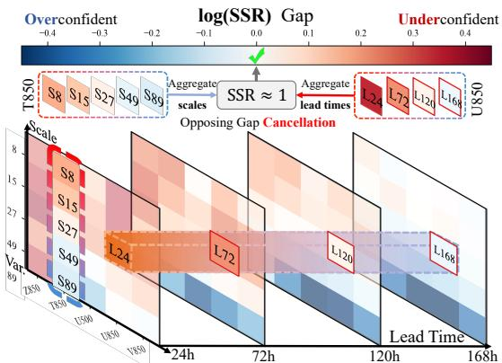

(a) Aggregation Hides Reliability Gaps  
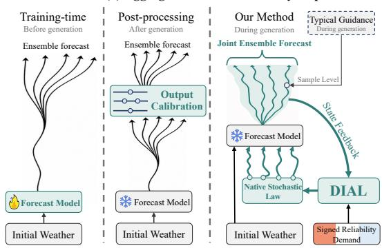  
(b) Reliability Control Across Generation Stages  
Figure 1: Why pooled reliability is insuficient. (a) Aggregation can cancel signed SSR gaps across variables, scales, and leads. (b) Unlike training-time stochasticity or output post-processing, DIAL uses signed reliability demand and forecast-state feedback to adjust the native noise during ensemble generation.

2024). The patterns difer across systems, and FCN3 exhibits reliability gaps in both directions within a single model. Figure 1(a) shows that FCN3 is overconfident at large scales but underconfident at the smallest scales. For several wind variables, the gap also changes direction with lead time. Together, these patterns require reliability control to work in both directions, making FCN3 a demanding test case.

Achieving this control requires deciding when and where to intervene in the forecasting process. Existing methods act at three stages, and each stage has a diferent limitation.

Training methods learn stochastic behavior together with the forecast model, but this behavior is usually fixed after deployment and cannot adapt to the current forecast state (Price et al. 2025; Lang et al. 2026; Bonev et al. 2025). Output calibration corrects completed forecasts, but cannot change how randomness enters the model or develops through weather dynamics (Chen et al. 2024; Ben Bouallègue et al. 2024). Inference guidance steers a pretrained generator during sampling without retraining it (Dhariwal and Nichol 2021; Ren et al. 2026). Such guidance usually scores samples separately rather than learning how possible updates afect joint ensemble reliability. These limitations motivate closed-loop control that adjusts the native noise of a frozen model as the forecast evolves and corrects signed reliability gaps.

Implementing this control in FCN3 requires estimating how each possible change to its native noise afects future skill and reliability. FCN3 injects this noise at every forecast step, so control decisions occur every six hours (Bonev et al. 2025). Reliability feedback arrives much later. It can be computed only after the ensemble forecast is complete and the verifying weather data are available. Full backpropagation through every forecast step and ensemble member would be too expensive. Chaotic atmospheric dynamics can also make long-range gradients explode or vanish before they reach early control decisions (Mikhaeil, Monfared, and Durstewitz 2022). Our 28-step reliability objective is much longer than FCN3’s final 8-step training stage, worsening both problems (Bonev et al. 2025). Reliable long-horizon control therefore needs a way to assign delayed feedback without backpropagating through the complete forecast.

Recent image generation methods tune sampling with reinforcement learning or stochastic optimal control without backpropagating the final reward through the full process (Black et al. 2024; Fan et al. 2023; Domingo-Enrich et al. 2025). Yet their objectives do not transfer directly to ensemble weather reliability. First, image methods score outputs separately, but reliability is measured over the ensemble. Second, one reward summarizes image quality, but reliability gaps must remain signed and separate by variable, spatial scale, and lead time. Combining these gaps can let too little spread cancel too much spread elsewhere. Third, image objectives usually favor one direction, but forecast spread can be above or below its target. These diferences require an ensemble reliability constraint. A weather controller must therefore handle delayed feedback and increase or decrease spread separately for each variable and spatial scale.

Figure 2 summarizes DIAL’s learning and control loop. DIAL treats reliability repair as control of the native noise in a frozen weather model. It uses signed ensemble constraints to state where spread should increase or decrease without assuming that the future weather distribution is known. A KL budget limits how far the controlled distribution can move from the model’s native distribution. Together with forecast loss, these constraints define an ideal Gibbs tilt that gives more weight to skillful and reliable forecast paths (Donsker and Varadhan 1975). To handle delayed feedback without complete backpropagation, DIAL approximates this tilt through a closed loop. The Estimator predicts reliability needs, while the Pilot tracks the evolving forecast. The

Q-Critic estimates how possible noise changes afect future skill and reliability. The Controller then uses the Actuator’s variable- and scale-matched noise bases to make allowed updates within the remaining KL budget. Our contributions are as follows.

• We formulate ensemble reliability repair as stochastic optimal control of a frozen model’s native noise under signed ensemble and KL constraints.

• We propose DIAL, a closed loop that approximates the ideal path law without backpropagation through the full forecast. The Estimator and Pilot track reliability needs and forecast evolution, while the Q-Critic and Controller guide variable- and scale-matched Actuator updates.

• We evaluate DIAL on later ERA5 years against learned postprocessing and reward-based control. Relative to the unmodified Native FCN3 reference, DIAL achieves an 8.27% improvement in the primary multiscale CRPS. It also reduces reliability errors in both directions.

## Related Work

Probabilistic weather models represent uncertainty with learned ensembles or stochastic perturbations (Lang et al. 2026; Bonev et al. 2025; Berner et al. 2017). Their stochastic behavior is usually fixed before deployment, even though reliability varies with regime, scale, and lead time (Jung and Leutbecher 2008; Rodwell et al. 2018). DIAL instead adjusts native noise during forecasting while keeping the model frozen.

Post-processing calibrates completed ensembles, including their cross-variable and spatial dependence (Gneiting et al. 2005; Schefzik, Thorarinsdottir, and Gneiting 2013; Vannitsem et al. 2021; Chen et al. 2024; Ben Bouallègue et al. 2024). These methods cannot change where randomness enters a frozen model or how it develops through weather dynamics. DIAL acts inside the forecast.

Generative guidance and reward fine-tuning steer sampling with likelihoods, rewards, gradients, or policies (Uehara et al. 2025; Ren et al. 2026; Clark et al. 2024; Black et al. 2024). These methods usually favor individual samples in one direction, whereas ensemble reliability is joint, scale-resolved, and bidirectional. DIAL therefore controls an ensemble law rather than a preferred sample.

Reliability feedback is delayed, and long-horizon gradients are costly and unstable in chaotic dynamics (Mikhaeil, Monfared, and Durstewitz 2022). Stochastic-control methods handle delayed efects with value, policy, or adjoint quantities, while KL regularization limits deviation from a reference process (Domingo-Enrich et al. 2025; Han, Razaviyayn, and Xu 2025; Blessing et al. 2025). Unlike methods that target a supplied reward, DIAL derives signed ensemble demand and applies budgeted updates in the model’s native KL geometry without full-forecast backpropagation.

## Method

## Problem Formulation and DIAL Overview

Problem formulation. Let $x _ { 0 }$ be an initial weather state, $Y _ { 1 : T }$ the verifying weather sequence, and M the number of scored ensemble members. A frozen weather model advances each member m as $X _ { t + 1 } ^ { ( m ) } = F _ { \mathrm { w x } } ( X _ { t } ^ { ( m ) } , Z _ { t + 1 } ^ { ( m ) } )$ , where the stochastic forcing $Z _ { t + 1 } ^ { ( m ) }$ is drawn from the model’s native noise kernel $K _ { 0 } .$ . We collect the weather states and noise draws of all scored members in $\Omega ^ { \mathrm { e v a l } } = \{ X _ { 0 : T } ^ { ( 1 : M ) } , Z _ { 1 : T } ^ { ( 1 : M ) } \}$ DIAL also runs a Pilot forecast using an independent random stream, denoted by $\Omega ^ { \mathrm { { p i l o t } } }$ . The Pilot provides live information about how the controlled forecast is evolving but is excluded from ensemble scoring.

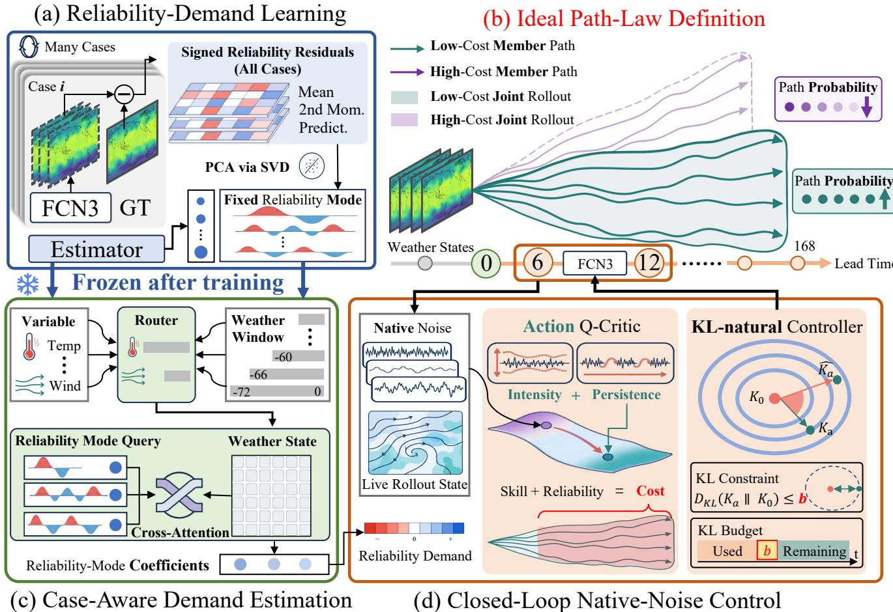  
Figure 2: DIAL learns where reliability needs correction and controls native noise as the forecast evolves. (a) Training forecast and verifying weather reveal signed reliability errors, which define a fixed set of reliability modes. (b) The ideal path law gives more weight to ensemble paths with lower combined forecast and reliability cost. (c) The frozen Estimator uses recent weather history for each variable and scale to predict signed reliability demand for the current case. (d) During forecasting, the Pilot provides the live rollout state and the Q-Critic scores possible native-noise changes. The Controller sends an allowed action to the native-noise Actuator within the remaining KL budget.

We combine the scored and Pilot paths into the augmented path $\widetilde \Omega \ = \ ( \Omega ^ { \mathrm { e v a l } } , \Omega ^ { \mathrm { p i l o t } } )$ , whose native law is $P _ { 0 }$ . Feasible adjustments through the Actuator induce controlled laws $P ;$ we denote their reachable family by $\mathcal { P } _ { A }$ We measure native-law fidelity by the normalized Path-KL $\bar { D } _ { \mathrm { p a t h } } ( P \| P _ { 0 } ) : = \nu _ { \mathrm { K L } } ^ { - 1 } D _ { \mathrm { K L } } ( \bar { P | } | \bar { P _ { 0 } } )$ . Among these reachable laws, DIAL seeks to improve multiscale probabilistic skill while satisfying ensemble-reliability and native-law fidelity

constraints:

$$
\begin{array} { r l } { \underset { P \in \mathcal { P } _ { A } } { \mathrm { m i n } } } & { \mathbb { E } _ { P } \left[ S _ { \mathrm { M S } } ( \Omega ^ { \mathrm { e v a l } } , Y ) \right] } \\ { \mathrm { s . t . } } & { J _ { \mathrm { 2 n d } } ( P ) \leq \epsilon _ { \mathrm { r e l } } , \quad \bar { D } _ { \mathrm { p a t h } } ( P \| P _ { 0 } ) \leq \beta _ { \mathrm { p a t h } } . } \end{array}\tag{1}
$$

Here ${ \cal S } _ { \mathrm { M S } }$ is a multiscale forecast score that evaluates ensemble distributions over both full weather fields and fixed spatial-scale projections; its weights are frozen after training. The normalization $\nu _ { \mathrm { K L } }$ is also frozen and shared across methods. The reliability constraint $J _ { \mathrm { 2 n d } }$ compares ensemble moments with verifying weather across a population of forecast cases. The Path-KL constraint uses no truth and limits how far the controlled stochastic law can depart from the frozen model’s native law. Under absolute continuity, Path-KL decomposes into expected one-step kernel KL terms, allowing DIAL to track and allocate the remaining budget as the forecast evolves.

DIAL overview. DIAL tackles this constrained problem with the closed loop in Figure 2. The Estimator predicts signed reliability demand, while the Pilot and recurrent memory track forecast evolution. The Q-Critic evaluates candidate noise updates, and the Controller uses its gradient and the native KL geometry to obtain a legal Actuator action within the remaining budget. The following subsections derive the pooled reliability cost and its future estimate, then describe the local update, learning, and inference.

From Pooled Reliability to an Ideal Stochastic Law Reliability is a property of the jointly generated weather ensemble, not a reward assigned independently to each member. For a base coordinate j indexing variable, spatial scale, and lead, let $\widetilde { X } _ { i m j }$ and $\widetilde { Y } _ { i j }$ be forecast-member and verifyingweather values normalized with training statistics for initialization i, and let $\begin{array} { r } { \overline { { X } } _ { i j } = M ^ { - 1 } \sum _ { m } \widetilde { X } _ { i m j } } \end{array}$ . We measure three complementary signed residuals. The mean row matches the climatological first moment:

$$
h _ { i j } ^ { \mathrm { m e a n } } = \overline { { X } } _ { i j } - \widetilde { Y } _ { i j } .\tag{2a}
$$

The second-moment row analogously matches the climatological second moment:

$$
h _ { i j } ^ { \mathrm { s e c o n d } } = \frac { 1 } { M } \sum _ { m } \widetilde { X } _ { i m j } ^ { 2 } - \widetilde { Y } _ { i j } ^ { 2 } .\tag{2b}
$$

The predictability row compares member–member and member–truth dependence through ordered pairs:

$$
h _ { i j } ^ { \mathrm { p r e d } } = \frac { \sum _ { m \neq m ^ { \prime } } \widetilde { X } _ { i m j } \widetilde { X } _ { i m ^ { \prime } j } } { M ( M - 1 ) } - \overline { { X } } _ { i j } \widetilde { Y } _ { i j } .\tag{2c}
$$

Stacking the three row types over all base coordinates gives $h _ { i } \in \mathbb { R } ^ { \breve { D } }$ , and $W \succ 0$ is a training-frozen cell-weight matrix. DIAL pools the signed residuals across independent forecast initializations as

$$
g ( P ) = \mathbb { E } _ { i } \left[ \mathbb { E } _ { \Omega \sim P ( \cdot | x _ { 0 , i } ) } \left[ h _ { i } ( \Omega , Y _ { i } ) \right] \right] .\tag{3a}
$$

Only after this pooling does DIAL apply the quadratic penalty:

$$
J _ { \mathrm { 2 n d } } ( P ) = g ( P ) ^ { \top } W g ( P ) .\tag{3b}
$$

Pooling must precede the penalty because $J _ { \mathrm { 2 n d } } \quad \neq \quad$ $\mathbb { E } _ { i } [ h _ { i } ^ { \top } \check { W } h _ { i } ]$ , which would be separable by case rather than a population reliability constraint.

To make this pooled reliability constraint usable by a sequential controller, we dualize its quadratic penalty into a signed cost on each joint ensemble path. For reliability multiplier $\eta > 0$ , the quadratic penalty admits the variational form

$$
\eta g ^ { \top } W g = \operatorname* { s u p } _ { \xi \in \mathbb { R } ^ { D } } \left\{ \xi ^ { \top } g - ( 4 \eta ) ^ { - 1 } \xi ^ { \top } W ^ { - 1 } \xi \right\} .\tag{4}
$$

For fixed ξ, the dual vector defines the joint ensemble cost $\mathcal { C } _ { \xi } = \mathcal { S } _ { \mathrm { M S } } + \xi ^ { \top } h$ and assigns signed weights that favor movement toward pooled reliability and penalize the reverse. Let H denote the deployment-available history and initial state. Marginalizing the unavailable verifying weather gives

$$
\overline { { \mathscr { C } } } _ { \xi } ( H , \Omega ) = \mathbb { E } _ { Y | H } [ \mathscr { C } _ { \xi } ( \Omega , Y ) ] .\tag{5a}
$$

Under the native law, the corresponding normalizer is

$$
\begin{array} { r } { \mathcal { Z } _ { \xi } ( H ) = \mathbb { E } _ { P _ { 0 } ( \cdot | H ) } \left[ \exp \left( - \overline { { \mathcal { C } } } _ { \xi } / \bar { \lambda } _ { \mathrm { K L } } \right) \right] . } \end{array}\tag{5b}
$$

Eq. (1) normalizes Path-KL by $\nu _ { \mathrm { K L } }$ , so the temperature for raw Path-KL is λ¯KL $: = \lambda _ { \mathrm { K L } } / \nu _ { \mathrm { K L } } > 0$ . For fixed $\xi ,$ absolute continuity and finite exponential moments give the ideal Gibbs law relative to $P _ { 0 }$ (Donsker and Varadhan 1975):

$$
\frac { d P _ { \xi } ^ { * } ( \cdot \mid H ) } { d P _ { 0 } ( \cdot \mid H ) } ( \Omega ) = \frac { \exp [ - \overline { { \mathcal { C } } } _ { \xi } ( H , \Omega ) / \bar { \lambda } _ { \mathrm { K L } } ] } { \mathcal { Z } _ { \xi } ( H ) } .\tag{6}
$$

This law tilts the native stochastic law toward joint ensemble forecasts with lower combined forecast and reliability cost. It is a path-space I-projection toward a reliability set defined by pooled moments (Csiszár 1975), rather than a classical bridge with prescribed endpoint marginals (Léonard 2014). The variational identity is standard; DIAL contributes the pooled ensemble reliability constraint and its execution through native weather-noise coordinates.

This ideal law is not directly executable. Its normalizer integrates over all future joint ensemble forecasts, and its future cost is unknown at decision time. It may also require noise changes that the Actuator cannot realize. DIAL therefore avoids the global normalizer and estimates the future cost from forecast-visible state. At inference, it converts this estimate into a legal local update of the native noise without online truth.

## Cost-to-Go from Forecast-Visible State

The ideal law depends on a future cost that is unknown when a control action is chosen. DIAL constructs a forecastvisible estimate in two stages: the Estimator predicts casespecific reliability demand before forecasting, and the Q-Critic represents the action-conditioned cost-to-go as live Pilot information becomes available.

The Estimator supplies demand rather than an action. From the available pre-forecast weather history, it dynamically selects a context of 3 to 12 frames for each variable and spatial scale, then predicts low-rank coeficients $\widehat { \alpha } = E _ { \psi } ( H ^ { \mathrm { p r e } } )$ . A training-frozen decoder $B _ { r }$ reconstructs the signed demand field $\widehat { r } = \bar { R } + B _ { r } \widehat { \alpha }$ over moment types, variables, scales, and lead times. The sign and magnitude of $\widehat { r }$ describe the direction and size of the predicted reliability residual. The Estimator runs once at $t _ { 0 } .$ . At forecast step t, a deterministic mask $M _ { t }$ zeros out lead times that have already passed, giving the lead-masked demand $\widehat { r } _ { t : } = M _ { t } \widehat { r }$ . This masking does not revise the demand forecast: memory and past actions afect the Q-Critic state, not rb.

The online state augments this fixed demand forecast with live information. The Pilot token $W _ { t }$ summarizes the current controlled weather state without access to verifying weather, while recurrent memory $m _ { t - 1 }$ summarizes earlier Pilot changes and executed noise adjustments. The state also contains the previous executed action and the exact remaining KL ledger:

$$
s _ { t } = ( \widehat { r } _ { t : } , W _ { t } , t , a _ { t - 1 } ^ { \mathrm { e x e c } } , m _ { t - 1 } , b _ { t } ^ { \mathrm { r e m } } ) .\tag{7}
$$

A dueling Q-Critic uses separate heads for the remaining multiscale score and low-rank moment contributions. For each head $\ell \in \ \{ \mathrm { s k i l l } , h \}$ , subtracting the advantage at the native action $a = 0 \mathrm { g i v e s }$

$$
\begin{array} { r } { Q _ { \phi } ^ { \ell } ( s , a ) = V _ { \phi } ^ { \ell } ( s ) + \widetilde { A } _ { \phi } ^ { \ell } ( s , a ) - \widetilde { A } _ { \phi } ^ { \ell } ( s , 0 ) . } \end{array}\tag{8a}
$$

The pooled dual combines the two heads into the actionconditioned cost-to-go

$$
\begin{array} { r } { Q _ { \phi , \xi } ( s , a ) = Q _ { \phi } ^ { \mathrm { s k i l l } } ( s , a ) + ( B _ { r } ^ { \top } \xi ) ^ { \top } Q _ { \phi } ^ { h } ( s , a ) . } \end{array}\tag{8b}
$$

This construction gives $Q _ { \phi } ^ { \ell } ( s , 0 ) = V _ { \phi } ^ { \ell } ( s )$ , so the native action has zero advantage. The moment head $Q _ { \phi } ^ { h } \in \mathbb { R } ^ { K }$ predicts remaining moment coeficients, while $Q _ { \phi } ^ { \mathrm { s k i l l } }$ predicts the remaining multiscale score. The pooled dual ξ weights the moment head and preserves the population objective. Action conditioning lets the Controller use $\nabla _ { a } Q _ { \phi , \xi } ( \bar { s } _ { t } , 0 )$ to choose a local noise update.

## Projected KL-Natural Control of the Native Kernel

KL-natural proposal. The Q-Critic provides the cost gradient at the native action $a = 0 ,$ . The Controller has no learned policy parameters. Near the native action, the Hessian of the normalized one-step kernel KL in Actuator coordinates defines the native Fisher geometry. This geometry is computed from the kernel parameterization rather than learned. A second-order expansion gives

$$
\begin{array} { r l } & { \bar { D } _ { \mathrm { K L } , t } ( \boldsymbol { a } \mid \boldsymbol { s } ) = \frac { 1 } { 2 } \boldsymbol { a } ^ { \top } F _ { \mathrm { K L } } ( \boldsymbol { s } ) \boldsymbol { a } + o ( \Vert \boldsymbol { a } \Vert ^ { 2 } ) , } \\ & { \qquad F _ { \mathrm { K L } } ( \boldsymbol { s } ) = \nabla _ { \boldsymbol { a } } ^ { 2 } \bar { D } _ { \mathrm { K L } , t } ( \boldsymbol { a } \mid \boldsymbol { s } ) \big \rvert _ { \boldsymbol { a } = 0 } . } \end{array}\tag{9}
$$

The native Fisher penalizes directions that would change the stochastic law most strongly. Adding a damping term $\gamma I$ gives the damped metric $G _ { t } = \lambda _ { \mathrm { K L } } F _ { \mathrm { K L } } ( s _ { t } ) + \gamma I$ and stabilizes the local solve. Combining this damped metric with the learned Q-gradient then yields the unconstrained natural proposal

$$
a _ { t } ^ { \mathrm { n a t } } = - G _ { t } ^ { - 1 } \nabla _ { a } Q _ { \phi , \xi } ( s _ { t } , 0 ) .\tag{10}
$$

Only this unconstrained proposal is closed form; the complete Controller also enforces feasibility explicitly.

Feasible Actuator execution. A validation-frozen rule first allocates the one-step allowance $b _ { t } ^ { \mathrm { s t e p } }$ from the remaining ledger $b _ { t } ^ { \mathrm { r e m } }$ . The intersection of the legal action set and this KL allowance defines

$$
\mathcal { F } _ { t } = \mathcal { A } _ { \mathrm { l e g a l } } \cap B _ { \mathrm { K L } } ( b _ { t } ^ { \mathrm { s t e p } } ) .\tag{11a}
$$

DIAL projects the natural proposal onto this set in the damped Fisher metric:

$$
\begin{array} { r } { a _ { t } ^ { \mathrm { e x e c } } = \Pi _ { \mathcal { F } _ { t } } ^ { G _ { t } } ( a _ { t } ^ { \mathrm { n a t } } ) . } \end{array}\tag{11b}
$$

The evaluated Actuator controls the innovation scale $\sigma _ { k , \mathrm { i } }$ and persistence ${ \rho } _ { k , t }$ of each native source k. Each source evolves according to

$$
Z _ { k , t + 1 } ^ { \prime } = \rho _ { k , t } Z _ { k , t } ^ { \prime } + \sigma _ { k , t } B _ { k } ^ { 0 } \varepsilon _ { k , t + 1 } .\tag{12a}
$$

The corresponding Actuator coordinates are

$$
a _ { k , t } = \left[ \Delta \log \sigma _ { k , t } , \Delta \operatorname { a t a n h } \rho _ { k , t } \right] .\tag{12b}
$$

Here $B _ { k } ^ { 0 }$ maps a standardized innovation into the fixed native spatial structure of source k. The two coordinates change innovation scale and persistence. Eight sources yield 16 control coordinates, while richer matched bases are outside the evaluated instance. In this instance, $\mathcal { A } _ { \mathrm { l e g a l } }$ bounds $\sigma _ { k , t }$ and ${ \rho } _ { k , t }$ and $\boldsymbol { B } _ { \mathrm { K L } } ( \boldsymbol { b } _ { t } ^ { \mathrm { s t e p } } )$ enforces the step allowance. The map from Actuator coordinates to the kernel is nonlinear, so DIAL recomputes the exact KL of the executed kernel and backtracks toward the native action until both the step allowance and cumulative budget hold. This gives a Gibbs-motivated local approximation within the Actuator-reachable family rather than an exact global solution of Eq. (1).

Algorithm 1 DIAL closed-loop inference.   
Require: Frozen $F _ { \mathrm { w x } } , E _ { \psi } , Q _ { \phi } , K _ { 0 } , B _ { r } , \bar { R } ,$ , Actuator, duals,   
and budget rules; $H ^ { \mathrm { p r e } } , x _ { 0 } , \beta _ { \mathrm { p a t h } }$   
1: Predict $\hat { r }  \bar { R } + B _ { r } E _ { \psi } ( H ^ { \mathrm { p r e } } )$ ; initialize scored mem  
bers, Pilot, memory, and the KL ledger   
2: for $t = 0 , \ldots , T - 1$ do   
3: Mask $\hat { r } _ { t : } \gets M _ { t } { \widehat { r } }$ and form st by Eq. (7)   
4: Compute $\nabla _ { a } Q _ { \phi , \xi } ( s _ { t } , 0 )$ and $F _ { \mathrm { K L } } ( s _ { t } ) ;$ ; obtain $a _ { t } ^ { \mathrm { n a t } }$ by   
Eq. (10)   
5: Allocate $b _ { t } ^ { \mathrm { s t e p } }$ , project to $a _ { t } ^ { \mathrm { { e x e c } } }$ , and backtrack with the   
exact KL of the executed kernel   
6: Advance the Pilot and scored members under $K _ { a _ { t } ^ { \mathrm { e x e c } } }$   
with independent streams   
7: Update memory from the Pilot change and executed   
action; update the KL ledger   
8: end for   
9: return the M scored ensemble members

## Learning and Closed-Loop Inference

DIAL learns only the two predictions required by the local solver: reliability demand from the Estimator and actionconditioned future cost from the Q-Critic. Native weather ensembles paired with verifying analyses provide the Estimator’s signed reliability labels. Normalization and low-rank bases are fitted only on the training split, and the Q-Critic receives out-of-fold Estimator predictions rather than demand estimates fitted to the same forecast cases. To train the Q-Critic, each pair starts from the same weather state and matched random innovations: one branch keeps the native noise settings, whereas the other executes an exploratory adjustment. The remaining-forecast score and moment contributions supervise the two heads. Diferences between the paired branches isolate the action efect and check whether the learned action gradient points toward lower cost. After each pooled training batch, DIAL increases the reliability multiplier η when the pooled reliability constraint is violated and increases the fidelity multiplier λ when the Path-KL budget is exceeded. The signed moment weights $\xi$ are updated from the pooled reliability residual rather than from individual forecast cases. After validation, DIAL freezes the selected checkpoint, dual variables, action bounds, and budget rules; all training-fitted normalizers and low-rank bases also remain fixed.

At inference, all learned components and control rules are frozen, and no verifying weather is available. The Estimator runs once from the pre-forecast history. At each forecast step, the Controller uses the lead-masked demand, live Pilot state, recurrent memory, and remaining KL ledger to compute the next feasible action, as summarized in Algorithm 1.

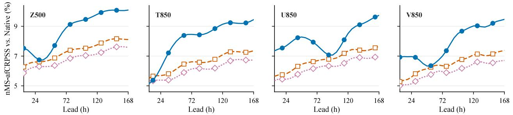

(a)  
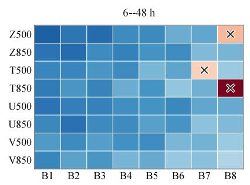

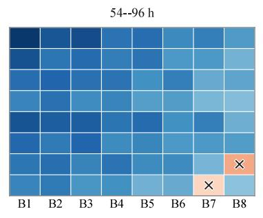

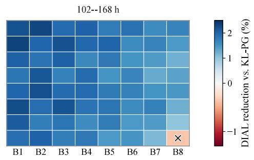

(b)  
Figure 3: Scale- and lead-resolved nMS-afCRPS. (a) DIAL’s relative reduction over KL-PG across the reported fields, bands B1–B8 (largest to smallest), and three lead windows; positive values favor DIAL and × marks nonpositive cells. (b) Nativerelative skill across 28 six-hour leads for DIAL and the strongest output-side and reward-control baselines, shown for Z500, T850, U850, and V850. Lead curves for all reported fields appear in the supplement.  
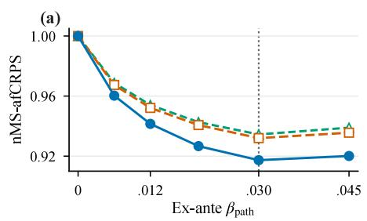

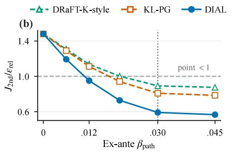

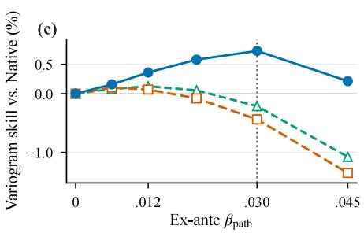  
Figure 4: Budget robustness. DIAL and the reward-control baselines use the same validation-frozen ex-ante Path-KL grid. Panels report (a) nMS-afCRPS, (b) pooled reliability $J _ { \mathrm { 2 n d } } / \epsilon _ { \mathrm { r e l } }$ , and (c) Native-relative fixed-pair variogram skill. Dotted and dashed lines mark the registered budget and point reliability threshold, respectively.

## Experiments

## Experimental Setup

Data and Forecast Task. We evaluate DIAL on frozen FCN3 forecasts initialized and verified with ERA5. DIAL applies native-noise control across all FCN3 variables throughout each rollout. We evaluate geopotential, temperature, and both wind components at 500 and 850 hPa, and include all eight fields in every aggregate. Scores cover eight spectral bands and 28 six-hour leads through 168 h. Training uses 240 initializations from 2017–2020, and validation uses 60 from 2021. The sealed test set contains 60 initializations from 2022, each with 30 ensemble members. We freeze all learned components, metric choices, action bounds, budgets, and statistical rules before test evaluation. Checkpoint, initialization sampling, preprocessing, and regridding details

appear in the supplement.

Baselines. We compare seven ensemble methods with equal member weights. Native FCN3 is the unmodified reference. Three baselines act after the ensemble forecast is generated. Cond-SP uses forecast-visible state and estimated reliability demand to correct spread by variable, band, and lead while preserving the ensemble mean. PoET is retrained on Native FCN3 ensembles and retains its member-set processing and ensemble size (Ben Bouallègue et al. 2024). Generative multivariate postprocessing is adapted to sample complete forecast paths (Chen et al. 2024). DIAL is compared with two generation-time controllers. DRaFT-K-style and KL-PG share DIAL’s forecast-visible state, native-noise actions, legal set, objective, and training budget. All three use the same ex-ante Path-KL budget, chosen on validation.

<table><tr><td>Method</td><td>nMS- afCRPS↓</td><td>fCRPSS (%) ↑</td><td>RMSE gain RMS(C) (%) ↑</td><td>↓</td></tr><tr><td>Native FCN3</td><td>1.0000</td><td>0.000</td><td>0.000</td><td>0.4353</td></tr><tr><td>Cond-SP</td><td>0.9681</td><td>2.737</td><td>0.018</td><td>0.3207</td></tr><tr><td>PoET</td><td>0.9453</td><td>4.824</td><td>1.274</td><td>0.2491</td></tr><tr><td>Gen. postproc.</td><td>0.9370</td><td>5.913</td><td>2.413</td><td>0.2278</td></tr><tr><td>DRaFT-K-style</td><td>0.9345</td><td>5.663</td><td>1.537</td><td>0.2436</td></tr><tr><td>KL-PG</td><td>0.9320</td><td>6.050</td><td>1.780</td><td>0.2310</td></tr><tr><td>DIAL</td><td>0.9173</td><td>7.543</td><td>2.117</td><td>0.1794</td></tr></table>

Table 1: Aggregate equal-weight ensemble performance. DIAL applies native-noise control across all FCN3 variables, while scores aggregate all eight evaluated fields (Z, T, U, and V at 500 and 850 hPa). nMS-afCRPS uses $\alpha = 0 . 9 5$ and Native normalization; fCRPSS and RMSE improvement are relative to Native FCN3; RMS(C)=0 is ideal.

DRaFT-K-style diferentiates through the final K steps, with K selected on validation (Clark et al. 2024). KL-PG uses at most a capacity-matched scalar value baseline and excludes DIAL’s action-conditioned Q-Critic and KL-natural solver (Black et al. 2024; Fan et al. 2023). Detailed information, compute, and output-distortion ledgers appear in the supplement.

Evaluation Protocol. nMS-afCRPS with $\alpha = 0 . 9 5$ is primary, with training-frozen normalizers, bands, and weights (Lang et al. 2026). We also report full-field fCRPSS, Nativerelative ensemble-mean RMSE improvement, RMS(C) with $C = - 2 \log \mathrm { S S R } _ { \mathrm { f i n i t e - M } } , J _ { \mathrm { 2 n d } } / \epsilon _ { \mathrm { r e l } }$ , and realized Path-KL; further diagnostics appear in the supplement. Dates, not members, are the statistical units. Two-sided 95% confidence intervals resample paired date blocks; common member seeds preserve method pairing. Each learned method uses three training seeds. At the validation-frozen budget, one-sided contrasts with the four learned baselines use Holm correction at familywise level 0.05.

## Main Results

Overall Forecast Quality. At the validation-frozen budget, DIAL reduces nMS-afCRPS by 8.27% from Native FCN3 and by 1.57% from KL-PG, the strongest baseline (95% CI [0.05, 3.10]%; Holm-adjusted p = 0.022). All four are significant. DIAL has the highest fCRPSS and lowest RMS(C), but generative postprocessing gives the largest improvement in ensemble-mean RMSE.

Variation across Scale and Lead. The aggregate gain is broad but not uniform. Figure 3(a) favors DIAL in 186 of 192 reported field–band–window cells, with six local exceptions concentrated at the shortest spatial scales. The representative lead curves in Figure 3(b) show the same advantage over most of the seven-day forecast. The two short-range T850 points do not improve over KL-PG, so the result does not rely on a claim of universal cellwise dominance.

Reliability within the Native-Law Budget. At the registered ex-ante budget $\beta _ { \mathrm { { p a t h } } } = 0 . 0 3 0$ , DIAL realizes a Path-KL of 0.0259 and gives $J _ { \mathrm { 2 n d } } / \epsilon _ { \mathrm { r e l } } = 0 . 5 9 1$ , with a one-sided

<table><tr><td>nMS- RMSE gain Variant afCRPS↓</td></tr><tr><td>(%) ↑  $\epsilon _ { \mathrm { r e l } } \downarrow$  Path-KL (A) Forecast-visible information</td></tr><tr><td>No Estimator 0.9449 1.084 0.874 0.0238</td></tr><tr><td>Matched stale-weather 0.9283 1.736 0.719 0.0269</td></tr><tr><td>Full DIAL 0.9173 2.117 0.591 0.0259</td></tr><tr><td>(B) Control-mechanism failures</td></tr><tr><td>Myopic future cost 0.9286 1.423 0.772 0.0246</td></tr><tr><td>Euclidean update 0.9252 1.834 0.682 0.0291</td></tr><tr><td>No  $J _ { \mathrm { 2 n d } }$  0.9133 2.284 1.137† 0.0267</td></tr><tr><td>Full DIAL 0.9173 2.117 0.591 0.0259</td></tr></table>

Table 2: Ablations at the registered Path-KL budget. Panel A tests forecast-visible information; Panel B tests control mechanisms. Ratios are point estimates; † marks values above 1. Formal feasibility uses a one-sided 95% upper confidence bound. Metrics use each row’s final executed kernel.

95% upper confidence bound of 0.79. Since this bound is below one, DIAL passes the reliability gate at the same operating point, while ensemble-mean RMSE remains better than Native. We examine budget efects below.

## Ablation Studies

Budget Robustness. Figure 4 varies the ex-ante budget while holding all components fixed. DIAL gives lower nMSafCRPS than both reward-control baselines at every nonzero budget and crosses the point threshold at a smaller budget. Beyond the registered point, additional budget lowers $\bar { J _ { \mathrm { 2 n d } } }$ but worsens nMS-afCRPS and variogram skill.

Forecast-Visible Information. Panel A of Table 2 separates case-specific demand from live weather feedback. Replacing Estimator demand with a training-only climatology or reusing the initial weather token at every step degrades nMS-afCRPS relative to full DIAL. Both variants retain the Controller, legal action space, and ex-ante budget. These results support both information sources without asserting an interaction.

Control-Mechanism Failures. Panel B isolates three mechanisms. A myopic cost degrades 102–168 h nMS skill, matching the preregistered long lead signature. This supports modeling how early actions afect later forecasts. The Euclidean update uses more Path-KL yet gives worse nMSafCRPS, supporting the native Fisher geometry. Removing $J _ { \mathrm { 2 n d } }$ improves the primary score, but the reliability ratio rises above one. A better primary score alone therefore does not satisfy the pooled-reliability criterion.

## Conclusion

DIAL adapts ensemble stochasticity during generation rather than calibrating completed forecasts. It converts signed reliability gaps across scales into future costs and adjusts native noise through KL-natural updates within a Path-KL budget. On frozen FCN3, DIAL improves multiscale skill and pooled reliability over learned postprocessing and rewardbased control at the registered budget, although not every metric improves. Its local control is limited to the Actuator’s noise coordinates and requires a Pilot forecast and multi-member scoring. DIAL therefore provides an auditable reliability-aware stochastic closure without retraining the forecaster.

## Scope and Reading Guide

The main paper states the complete problem, method, and evidence required for its central claims. This document supplies derivations, protocol definitions, and extended diagnostic views. Sections A and B formalize the pooled reliability objective, ideal path law, and forecast-visible approximation. Section C fixes the comparison and aggregation rules used by the extended results. Sections D–F report complete field coverage, signed reliability response, budget behavior, and mechanism audits. The notation follows the main paper; repeated definitions are included where they are needed to make a proof or table independently readable.

## A Pooled Reliability and the Ideal Path Law A.1 Augmented Joint-Path Setup and Assumptions

Let H denote the weather information available when a forecast is initialized and let $Y _ { 1 : T }$ be the verifying weather sequence. The frozen forecaster advances scored member m according to

$$
X _ { t + 1 } ^ { ( m ) } = F _ { \mathrm { w x } } \left( X _ { t } ^ { ( m ) } , Z _ { t + 1 } ^ { ( m ) } \right) , \qquad Z _ { t + 1 } ^ { ( m ) } \sim K _ { 0 } ( \cdot \mid H _ { t } ^ { ( m ) } ) .\tag{A.1}
$$

The $M \geq 2$ scored paths form $\Omega ^ { \mathrm { e v a l } }$ . A Pilot path $\Omega ^ { \mathrm { p i l o t } }$ driven by an independent random stream supplies live forecast information but never enters an ensemble score. The theoretical path variable is therefore $\widetilde { \boldsymbol \Omega } = ( \Omega ^ { \mathrm { e v a l } } , \Omega ^ { \mathrm { p i l o t } } )$ Its conditional native law is $P _ { 0 } ( \cdot \mid H )$ , and legal Actuator updates induce a reachable family $\mathcal { P } _ { A }$ of controlled laws.

The derivations use the following conditions.

Assumption A.1 (Information and conditional sampling). The native and controlled systems share the law of $( H , Y ) ;$ denote their common history marginal by $\mu _ { H }$ . Every admissible deployedpolicy is a deterministic measurablefunction of theforecastfiltration generated by H and theforecast paths observed so far; stochasticity comes from the native scored and Pilot innovations already contained in $\widetilde { \Omega } .$ Conditional on H, all scored and Pilot innovation streams are sampled independently of the verifying weather $Y .$ . Consequently, for every admissible conditional path law,

$$
P ( d \omega , d y \mid H = h ) = P ( d \omega \mid H = h ) Q ( d y \mid H = h ) ,\tag{A.2}
$$

where Q is the common verifying-weather kernel. Neither the Pilot nor the Controller observes Y at inference.

Assumption A.2 (Absolute continuity). Every considered controlled transition is absolutely continuous with respect to the corresponding native augmented transition. Consequently, $P \ll P _ { 0 }$ for every $P \in { \mathcal { P } } _ { A }$ with finite Path-KL.

Assumption A.3 (Moment and exponential integrability). The multiscale score and moment residuals are absolutely integrable under every law in the variational domain. For each fixed dual vector ξ and positive temperature $\bar { \lambda } _ { \mathrm { K I } }$ considered below, the following conditions hold for $\mu _ { H }$ -almost every $h ;$ no parameter-uniform common null set is claimed.

The conditional potential $\overline { { \mathcal { C } } } _ { \xi } ( h , \cdot )$ is finite $P _ { 0 } ( \cdot \mid h )$ )-almost surely and

$$
0 < \mathcal { Z } _ { \xi } ( h ) < \infty , \qquad \mathbb { E } _ { P _ { 0 } ( \cdot | h ) } \Big [ e ^ { - \overline { { \mathcal { C } } } _ { \xi } / \bar { \lambda } _ { \mathrm { K L } } } \big | \overline { { \mathcal { C } } } _ { \xi } \big | \Big ] < \infty .\tag{A.3}
$$

For each such $( h , \xi , \bar { \lambda } _ { \mathrm { K L } } )$ , the variational domain is exactly

$$
\mathfrak { D } _ { \xi } ( h ) = \left\{ P _ { h } \ll P _ { 0 , h } \left| \begin{array} { l } { D _ { \mathrm { K L } } ( P _ { h } \| P _ { 0 , h } ) < \infty , } \\ { \mathbb { E } _ { P _ { h } } | \overline { { \ell } } _ { \xi } ( h , \Omega ) | < \infty } \end{array} \right. \right\} .\tag{A.4}
$$

Thus the exponentially tilted law belongs to the domain under Equation $( \mathsf { A } . 3 ) ;$ the domain is not an additional restricted modelfamily.

Assumption A.4 (Frozen reliability geometry). The cellweight matrix W is symmetric positive definite. All projections, normalizers, cell weights, and the Path-KL normalization $\nu _ { \mathrm { K L } } > 0$ arefitted before evaluation and then heldfixed.

Regard P and $P _ { 0 }$ as joint laws on $( H , { \widetilde { \Omega } } )$ with the same H-marginal. For $P \in \mathcal { \bar { P } } _ { A }$ , the conditional chain rule then gives the normalized native-law deviation

$$
\begin{array} { r l } & { \quad D _ { H } ( P \| P _ { 0 } ) = D _ { \mathrm { K L } } ( P ( \cdot  { | } \ H ) \| P _ { 0 } ( \cdot  { | } \ H ) ) , } \\ & { \quad \bar { D } _ { \mathrm { p a t h } } ( P \| P _ { 0 } ) \equiv \nu _ { \mathrm { K L } } ^ { - 1 } D _ { \mathrm { K L } } ( P \| P _ { 0 } ) = \nu _ { \mathrm { K L } } ^ { - 1 } \mathbb { E } _ { H } [ D _ { H } ( P \| P _ { 0 } ) ] . } \end{array}\tag{A.5}
$$

This quantity measures deviation after legality has been enforced. It does not replace stability, support, covariance, or balance constraints imposed by the Actuator.

## A.2 Finite-Member Scores and the Signed Spread–Error Gap

For a scalar forecast ensemble $x _ { 1 : M }$ and observation $y ,$ the almost-fair score is

$$
\begin{array} { c } { { \ell _ { \alpha } ( x _ { m } , x _ { m ^ { \prime } } ; y ) = | x _ { m } - y | + | x _ { m ^ { \prime } } - y | } } \\ { { { } } } \\ { { - \left( 1 - \displaystyle \frac { 1 - \alpha } { M } \right) | x _ { m } - x _ { m ^ { \prime } } | , } } \\ { { { } } } \\ { { \mathrm { a f C R P S } _ { \alpha } ( x _ { 1 : M } , y ) = \displaystyle \frac { 1 } { M ( M - 1 ) } \sum _ { m < m ^ { \prime } } \ell _ { \alpha } ( x _ { m } , x _ { m ^ { \prime } } ; y ) . } } \end{array}\tag{A.6}
$$

Equivalently, $\mathrm { a f C R P S } _ { \alpha } = \alpha \mathrm { f C R P S } + ( 1 - \alpha ) \mathrm { C R P S } ,$ , where fCRPS uses the finite-ensemble unbiased member-pair coefficient (Ferro 2014; Leutbecher 2019). The reported primary score fixes $\alpha = 0 . 9 5$ . For variable v, lead τ, and fixed spectral projection $\Pi _ { b } .$ , the multiscale objective is

$$
\begin{array} { r l } & { L _ { v , \tau } = \omega _ { 0 } \mathrm { a f C R P S } ( X _ { 1 : M , v , \tau } , Y _ { v , \tau } ) } \\ & { \qquad + \displaystyle \sum _ { b } \omega _ { b } \mathrm { a f C R P S } ( \Pi _ { b } X _ { 1 : M , v , \tau } , \Pi _ { b } Y _ { v , \tau } ) , } \\ & { S _ { \mathrm { M S } } = \displaystyle \sum _ { v , \tau } w _ { v , \tau } L _ { v , \tau } . } \end{array}\tag{A.7}
$$

Here $\alpha \in [ 0 , 1 ] ;$ all $\omega _ { 0 } , \omega _ { b }$ , and $w _ { v , \tau }$ are nonnegative, with nonzero total weight at each aggregation level. The weights and projections are frozen before evaluation. Under these conditions the objective is a weighted collection of proper marginal or projected scores; it is not claimed to identify the complete spatiotemporal joint law.

The signed mechanism diagnostic uses the same pooling weights for spread and ensemble-mean error. For a diagnostic cell c, let $\langle \dot { \cdot } \rangle _ { c }$ denote its normalized frozen average over initializations and valid projected coordinates, and define

$$
\begin{array} { c l } { { } } & { { E _ { \mathrm { e r r } , c } = \left. ( \overline { X } - Y ) ^ { 2 } \right. _ { c } , } } \\ { { } } & { { E _ { \mathrm { s p r e a d } , c } ^ { \mathrm { s a m p l e } } = \displaystyle \left. \frac { 1 } { M - 1 } \sum _ { m = 1 } ^ { M } ( X _ { m } - \overline { X } ) ^ { 2 } \right. _ { c } , } } \\ { { } } & { { E _ { \mathrm { s p r e a d } , c } ^ { \mathrm { f a i r } } = \displaystyle \frac { M + 1 } { M } E _ { \mathrm { s p r e a d } , c } ^ { \mathrm { s a m p l e } } , } } \\ { { } } & { { C _ { c } = \log E _ { \mathrm { e r r } , c } - \log E _ { \mathrm { s p r e a d } , c } ^ { \mathrm { f a i r } } . } } \end{array}\tag{A.8}
$$

Subsequent formulas suppress the cell subscript. The diagnostic is reported only for cells with $E _ { \mathrm { e r r } , c } ~ > ~ 0$ and $E _ { \mathrm { s p r e a d } , c } ^ { \mathrm { s a m p l e } } > 0 ;$ degenerate cells are outside this logarithmic diagnostic rather than assigned an implicit regularizer. Thus $\overset { \cdot } { C } = - 2 \log \mathrm { S S R } _ { \mathrm { f i n i t e - M } }$ . Positive $C ^ { ' }$ means that error energy exceeds efective spread energy and therefore calls for more spread; negative $\dot { C }$ calls for less. If an intervention changes log error and log spread amplitudes by $\delta _ { e }$ and $\delta _ { s } ,$ respectively, then

$$
C _ { \mathrm { a f t e r } } = C _ { \mathrm { n a t i v e } } + 2 \delta _ { e } - 2 \delta _ { s } .\tag{A.9}
$$

This identity is used in every signed-response audit below.

## A.3 Population Reliability Must Be Pooled Before Squaring

For initialization i and cell $j ,$ let $\widetilde { X } _ { i m j }$ and $\widetilde { Y } _ { i j }$ be forecast and truth coordinates normalized by a common training reference, with $\begin{array} { r } { \overline { { X } } _ { i j } = M ^ { - 1 } \sum _ { m } \widetilde { X } _ { i m j } } \end{array}$ . The three moment rows are

$$
\begin{array} { r l r } {  { \boldsymbol { h } _ { i j } ^ { \mathrm { m e a n } } = \overline { { \boldsymbol { X } } } _ { i j } - \widetilde { Y } _ { i j } , } } \\ & { } & { \boldsymbol { h } _ { i j } ^ { \mathrm { s e c o n d } } = \boldsymbol { M } ^ { - 1 } \sum _ { m } \widetilde { \boldsymbol { X } } _ { i m j } ^ { 2 } - \widetilde { Y } _ { i j } ^ { 2 } , } \\ & { } & { \boldsymbol { h } _ { i j } ^ { \mathrm { p r e d } } = \frac { \sum _ { m \neq m ^ { \prime } } \widetilde { \boldsymbol { X } } _ { i m j } \widetilde { \boldsymbol { X } } _ { i m ^ { \prime } j } } { \boldsymbol { M } ( M - 1 ) } - \overline { { \boldsymbol { X } } } _ { i j } \widetilde { \boldsymbol { Y } } _ { i j } . } \end{array}\tag{A.10}
$$

The predictability row uses ordered member pairs and excludes diagonal terms. Stacking every valid row gives $h _ { i } \in$ $\mathbb { R } ^ { D }$ . Equivalently, let $r _ { \mathrm { m o m } } ( h , \omega , y )$ denote that stacked random vector before a case is realized. DIAL first pools signed residuals over the common history, controlled forecast, and verifying-weather laws,

$$
\begin{array} { c } { { \displaystyle g ( P ) = \int \mu _ { H } ( d h ) \int P ( d \omega \mid h ) } } \\ { { \displaystyle ~ \times \int Q ( d y \mid h ) r _ { \mathrm { m o m } } ( h , \omega , y ) , } } \\ { { \displaystyle J _ { \mathrm { 2 n d } } ( P ) = g ( P ) ^ { \top } W g ( P ) . } } \end{array}\tag{A.11}
$$

Absolute integrability in Assumption A.3 makes the iterated integral and the equivalent expectation order well defined. In general, $J _ { \mathrm { 2 n d } } ( \dot { P } ) \neq \mathbb { E } _ { i } [ h _ { i } ^ { \top } \dot { W } h _ { i } ]$ . The right-hand side is a casewise risk and would penalize weather-to-weather variability even when the population moment is correct. Equation (A.11) instead expresses a population reliability constraint.

## A.4 Quadratic Dualization and the Gibbs Law

Proposition A.1 (Quadratic reliability dual). Under Assumption A.4, $f o r \eta > 0$ and any $g \in \mathbb { R } ^ { \mathbf { \check { D } } }$

$$
\eta g ^ { \top } W g = \operatorname* { s u p } _ { \xi \in \mathbb { R } ^ { D } } \left\{ \xi ^ { \top } g - \frac { 1 } { 4 \eta } \xi ^ { \top } W ^ { - 1 } \xi \right\} ,\tag{A.12}
$$

and the unique maximizer is $\xi ^ { * } = 2 \eta W g .$

Proof. Writing $\Delta = \xi - 2 \eta W g .$ , completing the square gives

$$
\begin{array} { c } { { \xi ^ { \top } g - \displaystyle \frac { 1 } { 4 \eta } \xi ^ { \top } W ^ { - 1 } \xi = \eta g ^ { \top } W g } } \\ { { - \displaystyle \frac { 1 } { 4 \eta } \Delta ^ { \top } W ^ { - 1 } \Delta . } } \end{array}\tag{A.13}
$$

Positive definiteness makes the last term nonpositive and zero only at $\xi = 2 \eta W g$ □

The notation $r _ { \mathrm { m o m } }$ also separates the residual vector from a fixed history value h. For fixed ξ, define the joint-ensemble cost $\mathcal { C } _ { \xi } = \dot { S _ { \mathrm { M S } } } + \xi ^ { \top } r _ { \mathrm { m o m } }$ . Since future truth is not available to the deployed controller, its forecast-side potential is

$$
\begin{array} { r } { \overline { { \mathscr { C } } } _ { \xi } ( h , \omega ) = \displaystyle \int \mathscr { C } _ { \xi } ( \omega , y ) Q ( d y \mid h ) } \\ { = \mathbb { E } _ { Y \sim Q ( \cdot \mid h ) } [ \mathscr { C } _ { \xi } ( \omega , Y ) ] . } \end{array}\tag{A.14}
$$

By absolute integrability, averaging this cost under $( \mu _ { H } , P , Q )$ gives $\begin{array} { r } { \mathbb { \breve { E } } _ { P } [ S _ { \mathrm { M S } } ] + \xi ^ { \top } g ( P ) } \end{array}$ . Equation (A.2) is what permits this truth-only conditional expectation while retaining ω as the argument to be tilted.

Proposition A.2 (Ideal conditional path law). Suppose Assumptions A.1–A.3 hold and let $\begin{array} { r } { \bar { \lambda } _ { \mathrm { K L } } > 0 . } \end{array}$ . For $\mu _ { H }$ -almost every fixed history $H = h ,$ among all laws $P _ { h } \in \mathsf { \mathfrak { D } } _ { \xi } ( h )$ , the unique minimizer of

$$
\mathbb { E } _ { P _ { h } } [ \overline { { \mathscr { C } } } _ { \xi } ( h , \Omega ) ] + \bar { \lambda } _ { \mathrm { K L } } D _ { \mathrm { K L } } ( P _ { h } \| P _ { 0 , h } )\tag{A.15}
$$

has density

$$
\begin{array} { r l r } {  { \frac { d P _ { \xi , h } ^ { * } } { d P _ { 0 , h } } ( \omega ) = \frac { \exp [ - \overline { { \mathcal { C } } } _ { \xi } ( h , \omega ) / \bar { \lambda } _ { \mathrm { K L } } ] } { \mathcal { Z } _ { \xi } ( h ) } , } } \\ & { } & { \mathcal { Z } _ { \xi } ( h ) = \mathbb { E } _ { P _ { 0 , h } } \exp [ - \overline { { \mathcal { C } } } _ { \xi } ( h , \Omega ) / \bar { \lambda } _ { \mathrm { K L } } ] . } \end{array}\tag{A.16}
$$

For any restricted conditional family $\mathcal { P } _ { \mathcal { A } } ( h ) \cap \mathfrak { D } _ { \xi } ( h )$ , the regularized objective and $D _ { \mathrm { K L } } \big ( P _ { h } \big | \big | P _ { \xi , h } ^ { * } \big )$ have the same infimizers whenever the infimum is attained. More precisely, the restricted infima obey

$$
\operatorname* { i n f } _ { P _ { h } } J _ { h } ( P _ { h } ) = \bar { \lambda } _ { \mathrm { K L } } \operatorname* { i n f } _ { P _ { h } } D _ { \mathrm { K L } } ( P _ { h } \| P _ { \xi , h } ^ { * } ) - \bar { \lambda } _ { \mathrm { K L } } \log \mathcal { Z } _ { \xi } ( h ) ,\tag{A.17}
$$

where $J _ { h }$ denotes Equation (A.15) and both infima range over the same restricted domain. No attainment or global optimality is assertedfor a nonclosed, nonconvex reachable family.

Proof. Fix an admissible h. For any $P _ { h } \ll P _ { 0 , h }$ in the stated domain, substitute Equation (A.16) into the Radon–Nikodym derivative:

$$
\begin{array} { r l } { \bar { \lambda } _ { \mathrm { K L } } D _ { \mathrm { K L } } ( P _ { h } \| P _ { \xi , h } ^ { * } ) = \mathbb { E } _ { P _ { h } } [ \overline { { \mathcal { C } } } _ { \xi } ( h , \Omega ) ] } & { } \\ & { ~ + ~ \bar { \lambda } _ { \mathrm { K L } } D _ { \mathrm { K L } } ( P _ { h } \| P _ { 0 , h } ) } \\ & { ~ + ~ \bar { \lambda } _ { \mathrm { K L } } \log \mathcal { Z } _ { \xi } ( h ) . } \end{array}\tag{A.18}
$$

The last term is independent of $P _ { h }$ . Assumption ${ \mathrm { A } } . 3$ makes every term finite on the domain and makes the tilted law admissible. Nonnegativity of KL proves that $P _ { \xi , h } ^ { * }$ minimizes Equation (A.15), with uniqueness up to $P _ { 0 , h } \mathrm { - n u l l }$ sets. $\mathsf { A p - }$ plying the same identity on a restricted family proves the infimum and infimizer statement. This is the Gibbs variational identity (Donsker and Varadhan 1975; Csiszár 1975). □

For fixed $\xi ,$ the ideal law specifies a full-path skill-andmoment tilt relative to the native process. It does not prescribe a terminal marginal and is therefore not a classical fixedendpoint bridge (Léonard 2014). Proposition A.1 alone does not establish a saddle-point interchange, an optimal multiplier, or projection onto the zero-moment reliability set. The reachable family can also be nonconvex, so the practical controller is a receding local approximation to the fixed-dual Gibbs objective, not an exact global reliability projection. For precision, despite the main paper’s compact “I-projection toward reliability” shorthand, $P _ { \xi , h } ^ { * }$ is not literally asserted to be a KL projection onto a reliability set. The formal result is only the fixed-ξ Gibbs identity above: it does not assert that $P _ { \xi , h } ^ { * }$ belongs to the zero-moment reliability set or solves the original constrained problem.

## A.5 Path-KL Accounting and the Local Projection Identity

Proposition A.3 (Augmented-kernel KL chain rule). Suppose the native and controlled augmented processes have the same initial law. Let $\mathcal { G } _ { t }$ be the complete pre-transition filtration ofΩe, including the scored-member states, Pilot and stochastic-source states, and earlier actions. If the regular conditional kernels $K _ { 0 , t } ^ { \mathrm { a u g } } ( \cdot \mid \mathcal { G } _ { t } )$ and $K _ { a _ { t } , t } ^ { \mathrm { a u g } } ( \cdot \mid \dot { \mathcal { G } } _ { t } )$ satisfy Assumption A.2, then, in the common finite or extended-value sense,

$$
D _ { \mathrm { K L } } ( P \| P _ { 0 } ) = \mathbb { E } _ { P } \sum _ { t = 0 } ^ { T - 1 } D _ { \mathrm { K L } } \big ( K _ { a _ { t } , t } ^ { \mathrm { a u g } } ( \cdot \mid \mathcal { G } _ { t } ) \| K _ { 0 , t } ^ { \mathrm { a u g } } ( \cdot \mid \mathcal { G } _ { t } ) \big ) .\tag{A.19}
$$

Proof. The path-density ratio factorizes into the finite product of full-history conditional transition-density ratios because the initial laws coincide. Taking its logarithm gives a finite sum over forecast steps. Conditional expectation under $P ,$ , followed by the tower property, converts each integrable summand into the conditional kernel KL in Equation (A.19); the standard nonnegative extended-value chain rule covers the infinite-KL case. □

The augmented kernel contains all scored members and the Pilot. Writing a kernel as $K ( \cdot \mid s _ { t } )$ is valid only when $s _ { t }$ is a suficient controlled Markov state for $\mathcal { G } _ { t } ;$ the accounting theorem itself does not require that reduction. The joint kernel may be further decomposed memberwise only when the declared conditional independence structure is valid. Shared actions and Pilot feedback remain part of the conditioning information even in that special case. This prevents the Pilot cost or correlated native innovations from disappearing through an unjustified factorization.

## B Forecast-Visible Closed-Loop Approximation

## B.1 Demand Is Predicted Once; Feedback Updates the Control State

The Estimator maps pre-forecast history $H ^ { \mathrm { p r e } }$ to a signed, scale-resolved demand field

$$
\begin{array} { r } { \widehat { r } = \bar { R } + B _ { r } E _ { \psi } ( H ^ { \mathrm { p r e } } ) . } \end{array}\tag{B.1}
$$

The decoder and normalization are frozen before evaluation. The Estimator predicts demand, not an action, and it runs once at initialization. At step $t ,$ a deterministic mask removes leads that have already passed: $\widehat { \boldsymbol { r } } _ { t : } = \boldsymbol { M } _ { t } \widehat { \boldsymbol { r } } .$ . Live feedback does not rewrite $\widehat { r } ;$ it enters the cost-to-go state separately.

The forecast-visible state is

$$
s _ { t } = ( \widehat { r } _ { t : } , W _ { t } , t , a _ { t - 1 } ^ { \mathrm { e x e c } } , m _ { t - 1 } , b _ { t } ^ { \mathrm { r e m } } ) ,\tag{B.2}
$$

where $W _ { t }$ is the Pilot weather token, $m _ { t - 1 }$ summarizes ear lier Pilot changes and executed actions, and $b _ { t } ^ { \mathrm { r e m } }$ is the exact remaining KL ledger defined below. None of these quantities uses verifying weather.

## B.2 Action-Conditioned Future Cost

The Q-Critic separates future multiscale score from lowrank moment contributions. For each head $\ell \in \ \{ \mathrm { s k i l l } , h \}$ zero advantage at the native action is enforced by

$$
\begin{array} { r } { Q _ { \phi } ^ { \ell } ( s , a ) = V _ { \phi } ^ { \ell } ( s ) + \widetilde { A } _ { \phi } ^ { \ell } ( s , a ) - \widetilde { A } _ { \phi } ^ { \ell } ( s , 0 ) . } \end{array}\tag{B.3}
$$

The pooled dual then produces the local cost-to-go

$$
\begin{array} { r } { Q _ { \phi , \xi } ( s , a ) = Q _ { \phi } ^ { \mathrm { s k i l l } } ( s , a ) + ( B _ { r } ^ { \top } \xi ) ^ { \top } Q _ { \phi } ^ { h } ( s , a ) . } \end{array}\tag{B.4}
$$

The low-rank representation is a control approximation; the full reliability functional remains defined in the original cell space. Action conditioning is essential because the Controller needs $\nabla _ { a } Q _ { \phi , \xi } ( s _ { t } , 0 )$ , not only a state-value prediction.

## B.3 KL-Natural Proposal and Exact Feasibility

For each fixed (t, G ) represented by a suficient state $s ,$ assume the augmented fixed-support kernel family is diferentiable in quadratic mean at $a = 0$ , its KL is twice diferentiable there, and the Q-Critic is diferentiable at the native action. Define exact normalized one-step cost by

$$
d _ { t } ( a \mid \mathcal { G } _ { t } ) = \nu _ { \mathrm { K L } } ^ { - 1 } D _ { \mathrm { K L } } \big ( K _ { a , t } ^ { \mathrm { a u g } } ( \cdot \mid \mathcal { G } _ { t } ) \| K _ { 0 , t } ^ { \mathrm { a u g } } ( \cdot \mid \mathcal { G } _ { t } ) \big ) \ : _ { \mathcal { D } } .\tag{B.5}
$$

Near $a = 0$ , this cost has the pointwise-in-(s, t) expansion

$$
\begin{array} { r l } & { \bar { D } _ { \mathrm { K L } , t } ( \boldsymbol { a } \mid \boldsymbol { s } ) \equiv d _ { t } ( \boldsymbol { a } \mid \mathcal { G } _ { t } ) } \\ & { \quad \quad \quad = \frac { 1 } { 2 } \boldsymbol { a } ^ { \top } F _ { \mathrm { K L } } ( \boldsymbol { s } ) \boldsymbol { a } + o ( \Vert \boldsymbol { a } \Vert ^ { 2 } ) , } \\ & { \quad \quad F _ { \mathrm { K L } } ( \boldsymbol { s } ) = \nabla _ { \boldsymbol { a } } ^ { 2 } \bar { D } _ { \mathrm { K L } , t } ( \boldsymbol { a } \mid \boldsymbol { s } ) \big \rvert _ { \boldsymbol { a } = 0 } . } \end{array}\tag{B.6}
$$

The Fisher matrix comes from the native kernel and Actuator parameterization, not from the Q-Critic.

Proposition B.1 (Local KL-natural step). Let $q _ { t } =$ $\nabla _ { a } \bar { Q } _ { \phi , \xi } ( s _ { t } , 0 )$ and $G _ { t } = \lambda _ { \mathrm { K L } } F _ { \mathrm { K L } } ( s _ { t } ) + \gamma I \succ 0 .$ . The unique minimizer ofthe local unconstrained model

$$
q _ { t } ^ { \top } a + \frac { 1 } { 2 } a ^ { \top } G _ { t } a\tag{B.7}
$$

is $a _ { t } ^ { \mathrm { n a t } } = - G _ { t } ^ { - 1 } q _ { t } . \ I f { \mathcal F } _ { t } ^ { \mathrm { q u a d } }$ is a nonempty closed convex localfeasible set, its constrained quadratic minimizer is

$$
\begin{array} { r l } & { \mathcal { B } _ { t } ^ { \mathrm { q u a d } } = \left\{ a : \frac { 1 } { 2 } a ^ { \top } F _ { \mathrm { K L } } ( s _ { t } ) a \leq b _ { t } ^ { \mathrm { s t e p } } \right\} , } \\ & { \mathcal { F } _ { t } ^ { \mathrm { q u a d } } = \mathcal { A } _ { \mathrm { l e g a l } } ^ { \mathrm { l o c } } \cap \mathcal { B } _ { t } ^ { \mathrm { q u a d } } , } \\ & { a _ { t } ^ { \mathrm { q u a d } } = \Pi _ { \mathcal { F } _ { t } ^ { \mathrm { q u a d } } } ^ { G _ { t } } ( a _ { t } ^ { \mathrm { n a t } } ) . } \end{array}\tag{B.8}
$$

Proof. The gradient of Equation (B.7) is $q _ { t } + G _ { t } a ;$ positive definiteness gives the unique stationary minimizer $\bar { - G _ { t } ^ { - 1 } } q _ { t }$ Completing the square rewrites the objective as

$$
\begin{array} { r } { \frac 1 2 \| \boldsymbol { a } - \boldsymbol { a } _ { t } ^ { \mathrm { n a t } } \| _ { { G } _ { t } } ^ { 2 } - \frac { 1 } { 2 } \boldsymbol { q } _ { t } ^ { \top } \boldsymbol { G } _ { t } ^ { - 1 } \boldsymbol { q } _ { t } . } \end{array}\tag{B.9}
$$

The second term is constant in $^ { a , }$ so constrained minimization is exactly the $G _ { t }$ -metric projection in Equation (B.8). Closed convexity and coercivity give existence and uniqueness. This proposition is a conditional result for the declared local set; it does not assert convexity or uniqueness after the nonlinear legal Actuator map. □

The Fisher quadratic is used only to propose a locally feasible action. After the nonlinear legal Actuator map is applied, DIAL evaluates Equation (B.5) and backtracks toward $a = 0$ until

$$
\begin{array} { r l } & { 0 \leq d _ { t } ( a _ { t } ^ { \mathrm { e x e c } } \mid \mathcal { G } _ { t } ) \leq b _ { t } ^ { \mathrm { s t e p } } \leq b _ { t } ^ { \mathrm { r e m } } , } \\ & { \qquad b _ { t + 1 } ^ { \mathrm { r e m } } = b _ { t } ^ { \mathrm { r e m } } - d _ { t } ( a _ { t } ^ { \mathrm { e x e c } } \mid \mathcal { G } _ { t } ) . } \end{array}\tag{B.10}
$$

The native action $a = 0$ is always legal and has zero exact KL. If $b _ { t } ^ { \mathrm { s t e p } } = 0$ or a finite backtracking search does not find an acceptable nonzero action, the Controller executes this native fallback. With $b _ { 0 } ^ { \mathrm { r e m } } ~ = ~ \beta _ { \mathrm { p a t h } }$ , induction $\begin{array} { r } { \mathrm { g i v e s } \sum _ { t } { d _ { t } ( a _ { t } ^ { \mathrm { e x e c } } \mid \mathcal { G } _ { t } ) } \le \beta _ { \mathrm { p a t h } } } \end{array}$ along every executed path, and Proposition ${ \mathrm { A } } . 3$ gives the corresponding expected normalized Path-KL bound. The reported realized Path-KL is the evaluation average of that executed-kernel sum, not a pathwise probability statement. All scores and responses are computed from the same executed kernel, never from the pre-projection proposal.

For precision, the compact projected-action equation in the main paper is schematic notation for this complete proposaland-execution pipeline, not a literal projection identity for the nonlinear executed action. Formally, $a _ { t } ^ { \mathrm { q u a d } }$ is the metric projection proved in Proposition B.1, whereas $a _ { t } ^ { \mathrm { { e x e c } } }$ is the result after the nonlinear legal map, exact-KL check, and any backtracking. They coincide only when the exact legal set agrees with the declared local set and no execution correction is required; no such identity is used in the ledger proof.

## B.4 One Matched-Basis Actuator Library

For stochastic source $k ,$ the general Actuator library may be written abstractly as

$$
Z _ { k , t + 1 } ^ { \prime } = \rho _ { k , t } Z _ { k , t } ^ { \prime } + \sigma _ { k , t } B _ { k } ( \gamma _ { k , t } ) \varepsilon _ { k , t + 1 } .\tag{B.11}
$$

Innovation scale, persistence, and the optional basis coordinate $\gamma$ describe one library of legal perturbations. They are not separate proposed methods. The matched-basis principle assigns amplitude coordinates where the missing degree of freedom is amplitude and configurational coordinates where the missing degree of freedom is phase, balance, or regime structure. Every extension is zero-initialized at the native kernel. The operating point and all numerical audits in Sections D–F use the main-paper evaluated instance: $B _ { k } ( \gamma _ { k , t } ) = B _ { k } ^ { 0 }$ is fixed, and the available coordinates are the source-matched innovation scales and persistence terms. Configurational bases describe the larger method family but are not assigned the reported headline values. In the sourcetied restriction used in Table S6, the intensity and persistence changes of each native source are coupled and cannot be selected independently. The full evaluated Actuator retains both coordinates independently for every source.

Hard feasibility precedes fidelity accounting. The legal projection preserves the declared persistence range, covariance validity, support, normalization, and variable balance. Path-KL then measures how far the resulting legal kernel moves from the native kernel. A weak response from one frozen basis is evidence about that basis, not proof that a trained matched-basis closure cannot work.

## B.5 When Live Feedback Can Improve on Stale Weather

Let $\mathcal { F } _ { t } ^ { \mathrm { s t a l e } }$ be the information generated by pre-forecast demand, the initial weather token, time, earlier executed actions, and the budget ledger. Let $\mathcal { F } _ { t } ^ { \mathrm { l i v e } } = \sigma ( \mathcal { F } _ { t } ^ { \mathrm { s t a l e } } , W _ { t } )$ add the current Pilot token.

Proposition B.2 (Value of live forecast information). Let $\Pi _ { \mathrm { s t a l e } }$ and $\Pi _ { \mathrm { l i v e } }$ be the admissible policy classes measurable with respect to $\mathcal { F } _ { t } ^ { \mathrm { s t a l e } }$ and $\mathcal { F } _ { t } ^ { \mathrm { l i v e } }$ , with the same actions and constraints. Compare both classes under a common predecision probability law $\mathbb { P } _ { t } ,$ , and suppose $L ( \pi ) \in L ^ { 1 } ( { \dot { \mathbb { P } } } _ { t } ) f o r$ every policy being compared. Then

$$
\operatorname* { i n f } _ { \pi \in \Pi _ { \mathrm { l i v e } } } \mathbb { E } [ L ( \pi ) ] \leq \operatorname* { i n f } _ { \pi \in \Pi _ { \mathrm { s t a l e } } } \mathbb { E } [ L ( \pi ) ] .\tag{B.12}
$$

For strictness, additionally suppose that a feasible selector $a ^ { * } \in \Pi _ { \mathrm { l i v e } }$ attains the unique conditional minimum of remaining expected cost almost surely over the same admissible continuation class, a stale optimum $\pi _ { \mathrm { s t a l e } } ^ { \ast } \in \Pi _ { \mathrm { s t a l e } }$ is attained, and $\mathbb { P } _ { t } \{ \pi _ { \mathrm { s t a l e } } ^ { * } \neq a ^ { * } \} > 0 .$ . Then the inequality is strict.

Proof. Every stale-information policy is also liveinformation measurable because $\dot { \mathcal { F } } _ { t } ^ { \mathrm { s t a l e } } ~ \subseteq ~ \mathcal { F } _ { t } ^ { \mathrm { l i v e } }$ . Hence $\Pi _ { \mathrm { s t a l e } } \subseteq \Pi _ { \mathrm { l i v e } } ,$ which proves the weak inequality. Under the additional hypotheses, uniqueness makes the conditional regret of $\pi _ { \mathrm { s t a l e } } ^ { * }$ nonnegative everywhere and strictly positive on the positive-probability set where it difers from the feasible live selector $a ^ { * }$ . The common predecision law makes this a comparison on one probability space. Integrability makes the regret expectation finite, and a nonnegative random variable that is positive with positive probability has strictly positive expectation. The attained stale value is therefore strictly larger than the live value. 口

The proposition is conditional, not an unconditional superiority theorem for trained networks. It motivates two empirical checks: the preferred action must change with live forecast state, and the Pilot token must predict that change beyond stale information.

## C Experimental Protocol and Comparability Rules

## C.1 Forecast Scope and Frozen Evaluation Grid

All comparisons use the same frozen FCN3 forecast task and ERA5 verification operator as the main paper. The reported fields are geopotential, temperature, zonal wind, and meridional wind at 500 and 850 hPa: Z500, Z850, T500, T850, U500, U850, V500, and V850. Each field is evaluated in eight training-frozen spectral bands and at 28 six-hour leads through 168 h. The three lead windows are 6–48 h, 54–96 h, and 102–168 h. Two validation-frozen strata of a forecastvisible large-scale flow index support the state-conditional audit. They are low/high index strata, not a discovered synoptic taxonomy.

All learned components, normalizers, spectral projections, metric weights, action constraints, and comparison rules are frozen before the reported evaluation. Scored members have equal weight. The Pilot uses an independent random stream and is excluded from every ensemble score.

## C.2 Method Boundaries

The comparison roster separates methods by where they intervene.

Static output reference. Static-SP applies one trainingfrozen, mean-preserving spread action for each variable– band pair. The action is shared across all leads and weather states.

Adaptive output-only methods. Cond-SP performs weather-conditioned scale-resolved output calibration. PoET processes the completed member set, while generative multivariate postprocessing samples a completed output law (Ben Bouallègue et al. 2024; Chen et al. 2024). These methods can modify final members but do not execute native-noise actions during the forecast.

Generation-time controllers. DRaFT-K-style, KL-PG, and DIAL act in the same native-noise coordinates and use the same legal action boundary and ex-ante Path-KL budget. DRaFT-K-style uses truncated reward backpropagation, KL-PG uses a KL-regularized policy-gradient controller, and DIAL uses the action-conditioned critic and projected KLnatural update (Clark et al. 2024; Black et al. 2024; Fan et al. 2023).

Path-KL is defined only for generation-time controllers. Output distortion is defined only for output interventions. Aggregate signed action alignment is reported only for controllers because an output remapping does not expose a likefor-like sequence of native-kernel actions. When an output method appears in a signed-response table, its separately named spread-response direction fraction diagnoses the final-member change and is not treated as controller action alignment.

## C.3 Metrics and Aggregation Orders

The primary metric is Native-normalized MS-afCRPS:

$$
\mathrm { n M S - a f C R P S } ( m ) = \frac { S _ { \mathrm { M S } } ( m ) } { S _ { \mathrm { M S } } ( \mathrm { N a t i v e } ) } .\tag{C.1}
$$

Full-field fCRPSS is computed separately from full-field fair CRPS. Ensemble mean RMSE skill, RMS(C), $J _ { \mathrm { 2 n d } } / \epsilon _ { \mathrm { r e l } }$ a fixed-pair variogram skill, and realized Path-KL are complementary audits. Lower values are better for nMS-afCRPS, RMS(C), and $J _ { \mathrm { 2 n d } } / \epsilon _ { \mathrm { r e l } }$ ; higher values are better for the three skill scores.

Two noncommuting aggregation orders are used deliberately. A field–lead curve first averages normalized scores over bands and state strata, then converts the mean to Nativerelative skill. A scorecard cell first computes the cellwise DIAL-to-KL-PG ratio, then averages relative reduction inside one field–band–lead-window block. The two views therefore answer diferent questions and need not be numerically identical after marginalization. The mechanism tables retain a third registered distinction. Their primaryweighted long-window skill uses the full-field/band weights of Equation (C.1), whereas the Actuator scale and lead diagnostics average normalized projected-cell scores with equal cell weight. The latter isolates where a coordinate restriction acts; it is not a second estimate of the primary long-window endpoint.

For signed response, a cell is materially underdispersed when $C _ { \mathrm { n a t i v e } } ^ { \mathbf { ^ { - } } } \geq 0$ .15 and materially overdispersed when $C _ { \mathrm { n a t i v e } } \leq - 0 . 1 5$ . For a controller, action alignment is the fraction for which $C _ { \mathrm { n a t i v e } } \delta _ { s } > 0$ . For an output method, the same sign calculation is called the spread-response direction fraction. State and lead sign-change subsets are defined before method comparison. The document reports point comparisons only; an inferential claim would require paired forecast-date resampling and a pre-specified multiplicity procedure.

## C.4 Joint Consistency Rules

Every cell-derived aggregate, lead curve, signed subset, and equal-cell Actuator diagnostic is computed from one field–band–lead–state tensor. Registered main-paper and ablation anchors retain their frozen primary aggregation rather than being relabeled as equal-cell diagnostics. Within each method and aggregation view, the following identities are enforced jointly:

$$
\begin{array} { r l } { \mathrm { a f C R P S } _ { 0 . 9 5 } = 0 . 9 5 \mathrm { f C R P S } + 0 . 0 5 \mathrm { C R P S } , } & { } \\ { C _ { \mathrm { a f t e r } } = C _ { \mathrm { n a t i v e } } + 2 \delta _ { e } - 2 \delta _ { s } . } & { } \end{array}\tag{C.2}
$$

RMSE is recomputed from the same error amplitudes, and $J _ { \mathrm { 2 n d } } / \epsilon _ { \mathrm { r e l } }$ is recomputed from the same residual field and its registered auxiliary moment contribution. Existing mainpaper result and ablation values are inherited without alteration. No selected local case is used to estimate an aggregate response frequency.

## D Extended Results Across Variables, Scales, and Leads

## D.1 Aggregate Point Comparison with Static-SP

Table S1 separates reliability, mean skill, and native-law fidelity. DIAL has the lowest primary score, RMS(C), and pooled reliability ratio while using less realized Path-KL than the two generation-time comparators at the registered budget. Generative postprocessing retains the largest ensemble-mean RMSE gain. It also retains the strongest fixed-pair variogram skill (2.681%, compared with 0.728% for DIAL), showing that the primary-score and fixed-pair fidelity rankings capture complementary behavior. Static-SP improves the Native score but remains above the reliability threshold, consistent with the value of lead- and state-dependent actions.

(a) Primary score andforecast skill
<table><tr><td>Method</td><td>nMS-afCRPS ↓ fCRPSS (%) ↑ RMSE gain (%) ↑</td></tr><tr><td>Native FCN3</td><td>1.0000 0.000</td></tr><tr><td>Static-SP 0.9827</td><td>0.000 1.431 0.000</td></tr><tr><td>Cond-SP</td><td>0.9681 2.737</td></tr><tr><td>PoET 0.9453</td><td>0.018 4.824 1.274</td></tr><tr><td>Gen. postproc. 0.9370</td><td>5.913 2.413</td></tr><tr><td>DRaFT-K-style</td><td>0.9345 5.663 1.537</td></tr><tr><td>KL-PG 0.9320</td><td>6.050 1.780</td></tr><tr><td>DIAL 0.9173</td><td>7.543 2.117</td></tr></table>

(b) Reliability and native-lawfidelity
<table><tr><td>Method</td><td>RMS(C)↓  $J _ { \mathrm { 2 n d } } / \epsilon _ { \mathrm { r e l } } \downarrow$ </td><td>Path-KL</td></tr><tr><td>Native FCN3</td><td>0.4353</td><td>1.480 0.0000</td><td rowspan="5">一 一 一</td></tr><tr><td>Static-SP</td><td>0.3751</td><td>1.236</td></tr><tr><td>Cond-SP</td><td>0.3207</td><td>1.104</td></tr><tr><td>PoET</td><td>0.2491</td><td>0.928</td></tr><tr><td>Gen. postproc.</td><td>0.2278</td><td>0.817</td></tr><tr><td>DRaFT-K-style</td><td>0.2436</td><td>0.892</td><td>0.0266</td></tr><tr><td>KL-PG</td><td>0.2310</td><td>0.808</td><td>0.0273</td></tr><tr><td>DIAL</td><td>0.1794</td><td>0.591</td><td>0.0259</td></tr></table>

Table S1: Extended aggregate comparison. DIAL has the lowest nMS-afCRPS, RMS(C), and $J _ { \mathrm { 2 n d } } / \epsilon _ { \mathrm { r e l } }$ , and uses less Path-KL than both generation-time comparators; generative postprocessing retains the largest RMSE gain. Static-SP is a mean-preserving training-frozen correction reported as a supplement-only control. For the seven methods shared with the main paper, nMS-afCRPS, fCRPSS, RMSE gain, and RMS(C) reproduce the same validation-frozen operating points; panel (b) adds the corresponding pooled- reliability and Path-KL audits. Path-KL is reported for Native and generation-time controllers; em dashes identify output interventions.

## D.2 Complete Eight-Field Lead Curves

Figure S1 extends the representative main-paper curves to all eight pressure-level fields. DIAL has the largest average skill in every field, but its margin varies with lead. Z500 dips at short range before widening at medium and long leads; U850 and V850 show additional lead structure, whereas Z850,

T500, U500, and V500 vary more smoothly. These fieldlevel averages are complemented by signed audits that retain local DIAL losses.

## E Signed Reliability Response Across State and Lead

## E.1 Bidirectional Response on Material Gaps

(a) Underdispersed: $C _ { \mathrm { n a t i v e } }$ ≥ 0.15
<table><tr><td>Method</td><td>nMS-afCRPS</td><td>∆ log spread</td><td>RMS(C)</td></tr><tr><td>Static-SP</td><td>0.9692</td><td>+0.0315</td><td>0.4150</td></tr><tr><td>Gen. postproc.</td><td>0.9256</td><td>+0.0858</td><td>0.2437</td></tr><tr><td>KL-PG</td><td>0.9329</td><td>+0.0769</td><td>0.2794</td></tr><tr><td>DIAL</td><td>0.9199</td><td>+0.1059</td><td>0.2268</td></tr></table>

(b) Overdispersed: $C _ { \mathrm { n a t i v e } }$ ≤ −0.15
<table><tr><td>Method</td><td>nMS-afCRPS</td><td>∆ log spread</td><td>RMS(C)</td></tr><tr><td>Static-SP</td><td>0.9957</td><td>-0.0354</td><td>0.4413</td></tr><tr><td>Gen. postproc.</td><td>0.9492</td><td>-0.1331</td><td>0.2782</td></tr><tr><td>KL-PG</td><td>0.9316</td><td>-0.1444</td><td>0.2449</td></tr><tr><td>DIAL</td><td>0.9157</td><td>-0.1809</td><td>0.1767</td></tr></table>

Table S2: Bidirectional response on material Native reliability gaps. DIAL adds efective spread on underdispersed cells (+0.1059) and suppresses it on overdispersed cells (−0.1809), attaining the lowest nMS-afCRPS and RMS(C) in both groups. The groups contain 1464 and 1267 field– band–lead–state cells, respectively.

The direction of DIAL’s mean response reverses with the Native gap: +0.1059 on underdispersed cells and −0.1809 on overdispersed cells. Equation (A.9) then gives lower residual RMS(C) than KL-PG and the output-side comparators in both material groups. Each group is scored on its own. Improvement therefore cannot arise by cancelling opposing signed residuals.

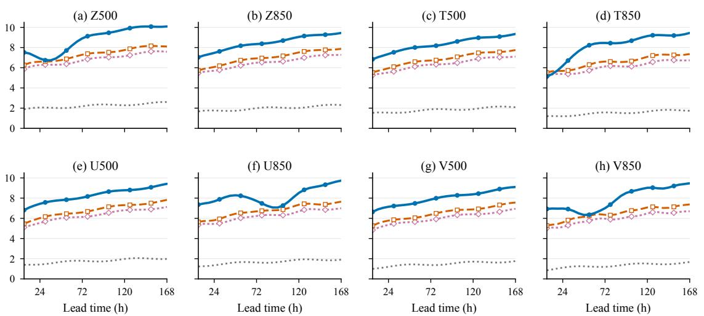  
Figure S1: Native-relative nMS-afCRPS skill across all eight fields and 28 six-hour leads. DIAL has the highest lead-averaged skill in every field, while its margin varies with lead. Static-SP is a training-frozen output correction; generative postprocessing has the lowest aggregate nMS-afCRPS among output-side comparators, and KL-PG has the lowest aggregate nMS-afCRPS among generation-time baselines. Positive values favor the displayed method over Native FCN3.

## E.2 Weather-State and Lead Sign Changes

(a) Primary score by sign-change subset
<table><tr><td>Subset</td><td>Cells</td><td>Static-SP</td><td>Gen. postproc.</td><td>KL-PG</td><td>DIAL</td></tr><tr><td>Stable</td><td>2218</td><td>0.9732</td><td>0.9304</td><td>0.9320</td><td>0.9176</td></tr><tr><td>State flip</td><td>470</td><td>0.9976</td><td>0.9471</td><td>0.9323</td><td>0.9167</td></tr><tr><td>Lead flip</td><td>488</td><td>0.9978</td><td>0.9464</td><td>0.9289</td><td>0.9128</td></tr><tr><td>Both flips</td><td>408</td><td>0.9989</td><td>0.9498</td><td>0.9353</td><td>0.9218</td></tr></table>

(b) Signed-response diagnostics
<table><tr><td>Subset</td><td>DIAL margin vs. best static/output (%)</td><td>Gen. spread response fraction</td><td>DIAL action alignment</td></tr><tr><td>Stable</td><td>1.377</td><td>0.9558</td><td>0.8454</td></tr><tr><td>State flip</td><td>3.214</td><td>0.4936</td><td>0.9340</td></tr><tr><td>Lead flip</td><td>3.555</td><td>0.6475</td><td>0.9344</td></tr><tr><td>Both flips</td><td>2.945</td><td>0.5466</td><td>0.9412</td></tr></table>

Table S3: Primary-score and signed-response behavior stratified by whether the Native reliability-gap sign changes with weather state, lead, or both. DIAL’s margin over the best static or output-only comparator rises from 1.377% on stable-sign cells to 2.945–3.555% on sign-changing subsets, where its action alignment remains above 0.93. Method columns report nMS-afCRPS; the generative response fraction records whether the final-member spread change has the required sign, and DIAL alignment records whether the Controller action has that sign. nMS-afCRPS supplies the proper-score comparison, while the last two columns diagnose response direction.

DIAL’s primary-score margin over the best static or outputonly method is 1.377% on stable-sign cells; count-weighted pooling gives 3.256% across the three sign-changing groups,

1.879 percentage points larger. Generative postprocessing’s spread-response fraction exceeds DIAL’s action alignment on stable cells but falls under sign changes, whereas DIAL’s alignment remains above 0.93 in all three groups. This isolates live response to a changing correction direction, while the stable-cell comparison remains method- and diagnosticspecific.

## E.3 Selected Signed Challenge Cells

The U500 pair makes the lead-dependent reversal explicit: the same variable and band require increased spread at 48 h and suppressed spread at 132 h. Table S4 also keeps two counterexamples where DIAL moves in the wrong direction. Together with the group averages, they document both typical correction and retained local failures.

(a) Intended-direction responses
<table><tr><td>Field</td><td>Band, lead</td><td> $C _ { \mathrm { N } }$ </td><td> $\Delta s _ { \mathrm { D } }$ </td><td> $\Delta e _ { \mathrm { D } }$ </td><td> $C _ { \mathrm { D } }$ </td><td> $C _ { \mathrm { G } }$ </td></tr><tr><td>Z500</td><td>B2, 72 h</td><td></td><td>+0.347 +0.126</td><td>-0.006 +0.083 +0.118</td><td></td><td></td></tr><tr><td>T850</td><td>B5, 120 h</td><td>+0.281</td><td>+0.091</td><td></td><td>-0.004 +0.091 +0.076</td><td></td></tr><tr><td>U500</td><td>B3, 48 h</td><td>+0.224</td><td>+0.071</td><td></td><td>+0.003 +0.088 +0.106</td><td></td></tr><tr><td>U500</td><td>B3, 132 h</td><td>-0.196</td><td>-0.060</td><td>-0.002</td><td>-0.080</td><td>-0.112</td></tr><tr><td>V850</td><td>B7, 96 h</td><td>-0.318</td><td></td><td>-0.101 +0.004</td><td>-0.108</td><td>-0.132</td></tr><tr><td>T500</td><td>B8, 168 h</td><td>-0.247</td><td>-0.069</td><td>+0.005</td><td>-0.099</td><td>-0.081</td></tr><tr><td>Z850</td><td>B1, 24 h</td><td>+0.183</td><td></td><td></td><td>+0.046 +0.001 +0.093 +0.069</td><td></td></tr><tr><td></td><td>V500 B4, 144 h</td><td></td><td></td><td></td><td>+0.296 +0.086 -0.005 +0.114 +0.146</td><td></td></tr></table>

<table><tr><td colspan="6">(b) Retained wrong-direction responses</td></tr><tr><td>Field Band, lead</td><td> $C _ { \mathrm { N } }$ </td><td> $\Delta { s } _ { \mathrm { { D } } }$ </td><td> $\Delta e _ { \mathrm { D } }$ </td><td> $C _ { \mathrm { D } }$ </td><td> $C _ { \mathrm { G } }$ </td></tr><tr><td>T850 B2, 54 h</td><td></td><td></td><td></td><td>-0.172 +0.017 -0.003 -0.212 -0.074</td><td></td></tr><tr><td>Z500 B8, 30 h</td><td>+0.164 -0.011 +0.002 +0.190 +0.092</td><td></td><td></td><td></td><td></td></tr></table>

Table S4: Selected signed challenge cells satisfying Equation $( \mathsf { A } . 9 )$ DIAL moves in the intended direction in the eight panel-(a) exam ples; panel (b) retains two local wrong-direction responses. Generative postprocessing has lower |C| in five of ten rows. $C _ { \mathrm { N } } , C _ { \mathrm { D } } ,$ and $C _ { \mathrm { G } }$ are Native, DIAL, and generative-postprocessing reliability gaps; $\Delta s _ { \mathrm { D } }$ and $\Delta e _ { \mathrm { D } }$ are DIAL changes in log spread and log error. These examples illustrate local response mechanisms and retained failures; the exhaustive partition in Table S3 supplies aggregate alignment.

long-lead skill while giving lower small-scale and aggregate skill. Coupling intensity and persistence within each source recovers complementary scale and lead benefits: the sourcetied restriction improves nMS-afCRPS, large-scale skill, and long-lead skill over either single-coordinate restriction, with the full evaluated source-matched coordinate set retaining the strongest overall performance.

## F.3 Forecast-Visible Information and Memory

Each information restriction degrades the primary score and long-lead skill. Removing recurrent memory produces the smallest loss, while removing the Pilot or both information sources produces substantially larger losses. The main-paper matched stale-weather ablation retains case-specific demand and repeats the initial weather token. Here, No Pilot retains that demand but replaces every weather token with its training mean, while the first row also replaces demand with its training climatology. The four rows establish directional component audits; estimating an Estimator-by-feedback interaction requires paired uncertainty for the complete factorial contrast.

## F Budget Robustness and Mechanism Audits

## F.1 Registered Budget and Sensitivity Grid

Table S5 shows a constrained optimum at the registered operating point. Increasing the budget to the pre-specified value $\beta _ { \mathrm { { p a t h } } } = 0 . 0 3 0$ improves the primary score, pooled reliability, and variogram audit together. Raising it further to 0.045 only reduces $J _ { \mathrm { 2 n d } } / \epsilon _ { \mathrm { r e l } }$ while worsening both nMSafCRPS and variogram skill. We therefore retain 0.030 as the validation-frozen operating point.

<table><tr><td colspan="3">Realized</td><td colspan="2">Variogram</td></tr><tr><td> $\beta _ { \mathrm { p a t h } }$ </td><td>KL</td><td>nMS-afCRPS</td><td> $J _ { \mathrm { 2 n d } } / \epsilon _ { \mathrm { r e l } }$ </td><td>skill (%)</td></tr><tr><td>0.000</td><td>0.0000</td><td>1.0000</td><td>1.480</td><td>0.000</td></tr><tr><td>0.006</td><td>0.0048</td><td>0.9603</td><td>1.193</td><td>0.158</td></tr><tr><td>0.012</td><td>0.0098</td><td>0.9415</td><td>0.951</td><td>0.361</td></tr><tr><td>0.020</td><td>0.0165</td><td>0.9267</td><td>0.728</td><td>0.579</td></tr><tr><td>0.030</td><td>0.0259</td><td>0.9173</td><td>0.591</td><td>0.728</td></tr><tr><td>0.045</td><td>0.0387</td><td>0.9201</td><td>0.566</td><td>0.214</td></tr></table>

Table S5: DIAL sensitivity across the validation-frozen exante Path-KL grid. The pre-specified $\beta _ { \mathrm { { p a t h } } } = 0 . 0 3 0$ gives the lowest nMS-afCRPS and the highest variogram skill; raising the budget to 0.045 only lowers $J _ { \mathrm { 2 n d } } / \epsilon _ { \mathrm { r e l } }$ while degrading both metrics. Other rows are sensitivity points around this registered operating point.

The full evaluated coordinate set gives the best primary score, RMSE gain, and pooled reliability ratio at comparable realized KL. Amplitude-only control retains 97.9% of full DIAL’s small-scale skill but 77.5% of its large-scale skill, consistent with amplitude repair being more complete at smaller scales. Persistence-only control retains substantial

## F.2 Restrictions of the Matched-Basis Actuator

(a) Aggregate score, mean skill, reliability, and fidelity
<table><tr><td>Actuator restriction</td><td>nMS-afCRPS</td><td>RMSE gain (%)</td><td> $J _ { \mathrm { 2 n d } } / \epsilon _ { \mathrm { r e l } }$ </td><td>Path-KL</td></tr><tr><td>Amplitude only</td><td>0.9258</td><td>1.905</td><td>0.704</td><td>0.0243</td></tr><tr><td>Persistence only</td><td>0.9321</td><td>1.442</td><td>0.803</td><td>0.0228</td></tr><tr><td>Source-tied</td><td>0.9234</td><td>2.004</td><td>0.654</td><td>0.0261</td></tr><tr><td>Full evaluated</td><td>0.9173</td><td>2.117</td><td>0.591</td><td>0.0259</td></tr></table>

(b) Native-relative equal-cell scale and lead skill
<table><tr><td>Restriction</td><td>Large-scale skill (%)</td><td>Mid-scale skill (%)</td><td>Small-scale skill (%)</td><td>Long-lead skill (%)</td></tr><tr><td>Amplitude only</td><td>6.632</td><td>7.601</td><td>7.764</td><td>8.236</td></tr><tr><td>Persistence only</td><td>7.509</td><td>7.061</td><td>6.039</td><td>7.873</td></tr><tr><td>Source-tied</td><td>7.949</td><td>7.790</td><td>7.338</td><td>8.476</td></tr><tr><td>Full evaluated</td><td>8.556</td><td>8.413</td><td>7.929</td><td>9.084</td></tr></table>

Table S6: Restrictions of the evaluated source-matched Actuator. At comparable Path-KL, the full evaluated Actuator has the lowest nMS-afCRPS and $J _ { \mathrm { 2 n d } } / \epsilon _ { \mathrm { r e l } }$ and the highest RMSE gain and every displayed scale and lead skill. Scale columns pool B1–B2, B3–B5, and B6–B8; long lead covers 102–168 h. Each row evaluates the DIAL Estimator–Controller framework under a diferent admissible subset of Actuator coordinates.

## References

Ben Bouallègue, Z.; Weyn, J. A.; Clare, M. C. A.; Dramsch, J.; Dueben, P. D.; and Chantry, M. 2024. Improving Medium-Range Ensemble Weather Forecasts with Hierarchical Ensemble Transformers. Artificial Intelligencefor the Earth Systems, 3(1): e230027.

Berner, J.; Achatz, U.; Batté, L.; Bengtsson, L.; de la Cá- mara, A.; Christensen, H. M.; Colangeli, M.; Coleman, D. R. B.; Crommelin, D.; Dolaptchiev, S. I.; Franzke, C. L. E.; Friederichs, P.; Imkeller, P.; Järvinen, H.; Juricke, S.; Kitsios, V.; Lott, F.; Lucarini, V.; Mahajan, S.; Palmer, T. N.; Penland, C.; Sakradzija, M.; von Storch, J.-S.; Weisheimer, A.; Weniger, M.; Williams, P. D.; and Yano, J.-I. 2017. Stochastic Parameterization: Toward a New View of Weather and Climate Models. Bulletin of the American Meteorological Society, 98(3): 565–588.

Black, K.; Janner, M.; Du, Y.; Kostrikov, I.; and Levine, S. 2024. Training Difusion Models with Reinforcement Learning. In International Conference on Learning Representations, 4965–4987.

Blessing, D.; Berner, J.; Richter, L.; Domingo i Enrich, C.; Du, Y.; Vahdat, A.; and Neumann, G. 2025. Trust Region Constrained Measure Transport in Path Space for Stochastic Optimal Control and Inference. In Advances in Neural Information Processing Systems, volume 38, 165462–165510. Curran Associates, Inc.

Bonev, B.; Kurth, T.; Mahesh, A.; Bisson, M.; Kossaifi, J.; Kashinath, K.; Anandkumar, A.; Collins, W. D.; Pritchard, M. S.; and Keller, A. 2025. FourCastNet 3: A Geometric Approach to Probabilistic Machine-Learning Weather Forecasting at Scale. ArXiv preprint, version 2, arXiv:2507.12144.

Chen, J.; Janke, T.; Steinke, F.; and Lerch, S. 2024. Generative Machine Learning Methods for Multivariate Ensemble

(a) Aggregate performance
<table><tr><td>Information variant</td><td>nMS-afCRPS RMSE gain (%)  $J _ { \mathrm { 2 n d } } / \epsilon _ { \mathrm { r e l } }$ </td></tr><tr><td>Climatology + stale wx.</td><td>0.9595 0.628</td></tr><tr><td>No Pilot</td><td>0.946 0.9509 0.923 0.852</td></tr><tr><td>No recurrent memory 0.9224</td><td>1.904 0.628</td></tr><tr><td>Full DIAL 0.9173</td><td>2.117 0.591</td></tr></table>

(b) Native-law fidelity and long-lead skill
<table><tr><td>Information variant</td><td>Primary-weighted Realized Path-KL 102–168 h skill (%)</td></tr><tr><td></td><td>3.814</td></tr><tr><td>Climatology + stale wx. No Pilot</td><td>0.0229 0.0246</td></tr><tr><td></td><td>4.672 0.0262 7.964</td></tr><tr><td>No recurrent memory</td><td></td></tr><tr><td>Full DIAL</td><td>0.0259 8.617</td></tr></table>

Table S7: Supplementary information-source audit. Full DIAL has the lowest nMS-afCRPS and $J _ { \mathrm { 2 n d } } / \epsilon _ { \mathrm { r e l } }$ and the highest RMSE gain and primary-weighted long-lead skill. Removing recurrent memory causes the smallest degradation; removing live forecast information causes larger losses. The first row combines training-climatological demand with the initial weather token; No Pilot uses the training-mean weather token; and No recurrent memory resets Q-Critic memory at each step.

Postprocessing. The Annals ofApplied Statistics, 18(1): 159– 183.

Clark, K.; Vicol, P.; Swersky, K.; and Fleet, D. 2024. Directly Fine-Tuning Difusion Models on Diferentiable Rewards. In International Conference on Learning Representations, volume 2024, 4793–4822.

Couairon, G.; Singh, R.; Charantonis, A.; Lessig, C.; and Monteleoni, C. 2024. ArchesWeather & ArchesWeather-Gen: A Deterministic and Generative Model for Eficient ML Weather Forecasting. ArXiv preprint, arXiv:2412.12971.

Csiszár, I. 1975. I-Divergence Geometry of Probability Distributions and Minimization Problems. The Annals ofProbability, 3(1): 146–158.

Dhariwal, P.; and Nichol, A. 2021. Difusion Models Beat GANs on Image Synthesis. In Advances in Neural Information Processing Systems, volume 34, 8780–8794. Curran Associates, Inc.

Dirkson, A.; and Buehner, M. 2026. Are We Misdiagnosing Ensemble Forecast Reliability? On the Insuficiency of Spread–Error and Rank-Based Reliability Metrics. Quarterly Journal of the Royal Meteorological Society. Advance online publication.

Domingo-Enrich, C.; Drozdzal, M.; Karrer, B.; and Chen, R. T. Q. 2025. Adjoint Matching: Fine-Tuning Flow and Difusion Generative Models with Memoryless Stochastic Optimal Control. In International Conference on Learning Representations, 53791–53846.

Donsker, M. D.; and Varadhan, S. R. S. 1975. Asymptotic Evaluation ofCertain Markov Process Expectations for Large Time, I. Communications on Pure andApplied Mathematics, 28(1): 1–47.

Fan, Y.; Watkins, O.; Du, Y.; Liu, H.; Ryu, M.; Boutilier, C.; Abbeel, P.; Ghavamzadeh, M.; Lee, K.; and Lee, K.

2023. DPOK: Reinforcement Learning for Fine-Tuning Textto-Image Difusion Models. In Advances in Neural Information Processing Systems, volume 36, 79858–79885. Curran Associates, Inc.

Ferro, C. A. T. 2014. Fair Scores for Ensemble Forecasts. Quarterly Journal of the Royal Meteorological Society, 140(683): 1917–1923.

Gneiting, T.; Balabdaoui, F.; and Raftery, A. E. 2007. Probabilistic Forecasts, Calibration and Sharpness. Journal ofthe Royal Statistical Society Series B: Statistical Methodology, 69(2): 243–268.

Gneiting, T.; Raftery, A. E.; Westveld, A. H. I.; and Goldman, T. 2005. Calibrated Probabilistic Forecasting Using Ensemble Model Output Statistics and Minimum CRPS Estimation. Monthly Weather Review, 133(5): 1098–1118.

Han, Y.; Razaviyayn, M.; and Xu, R. 2025. Stochastic Control for Fine-tuning Difusion Models: Optimality, Regularity, and Convergence. In Proceedings of the 42nd International Conference on Machine Learning, volume 267 of Proceedings ofMachine Learning Research, 21844–21870. PMLR.

Jung, T.; and Leutbecher, M. 2008. Scale-Dependent Verification of Ensemble Forecasts. Quarterly Journal of the Royal Meteorological Society, 134(633): 973–984.

Kochkov, D.; Yuval, J.; Langmore, I.; Norgaard, P.; Smith, J.; Mooers, G.; Klöwer, M.; Lottes, J.; Rasp, S.; Düben, P.; Hatfield, S.; Battaglia, P.; Sanchez-Gonzalez, A.; Willson, M.; Brenner, M. P.; and Hoyer, S. 2024. Neural General Circulation Models for Weather and Climate. Nature, 632(8027): 1060–1066.

Lang, S.; Alexe, M.; Clare, M. C. A.; Roberts, C.; Adewoyin, R.; Ben Bouallègue, Z.; Chantry, M.; Dramsch, J.; Dueben, P. D.; Hahner, S.; Maciel, P.; Prieto-Nemesio, A.; O’Brien, C.; Pinault, F.; Polster, J.; Raoult, B.; Tietsche, S.; and Leutbecher, M. 2026. AIFS-CRPS: Ensemble Forecasting Using a Model Trained with a Loss Function Based on the Continuous Ranked Probability Score. npj Artificial Intelligence, 2(1): 18.

Léonard, C. 2014. A Survey of the Schrödinger Problem and Some of Its Connections with Optimal Transport. Discrete and Continuous Dynamical Systems, 34(4): 1533–1574.

Leutbecher, M. 2019. Ensemble Size: How Suboptimal Is Less than Infinity? Quarterly Journal ofthe Royal Meteorological Society, 145(Suppl. 1): 107–128.

Mikhaeil, J.; Monfared, Z.; and Durstewitz, D. 2022. On the Dificulty of Learning Chaotic Dynamics with RNNs. In Advances in Neural Information Processing Systems, volume 35, 11297–11312. Curran Associates, Inc.

Price, I.; Sanchez-Gonzalez, A.; Alet, F.; Andersson, T. R.; El-Kadi, A.; Masters, D.; Ewalds, T.; Stott, J.; Mohamed, S.; Battaglia, P.; Lam, R.; and Willson, M. 2025. Probabilistic Weather Forecasting with Machine Learning. Nature, 637(8044): 84–90.

Ren, Y.; Gao, W.; Ying, L.; Rotskof, G. M.; and Han, J. 2026. DriftLite: Lightweight Drift Control for Inference-Time Scaling of Difusion Models. In The Fourteenth International Conference on Learning Representations.

Rodwell, M. J.; Richardson, D. S.; Parsons, D. B.; and Wernli, H. 2018. Flow-Dependent Reliability: A Path to More Skillful Ensemble Forecasts. Bulletin of the American Meteorological Society, 99(5): 1015–1026.

Schefzik, R.; Thorarinsdottir, T. L.; and Gneiting, T. 2013. Uncertainty Quantification in Complex Simulation Models Using Ensemble Copula Coupling. Statistical Science, 28(4): 616–640.

Uehara, M.; Zhao, Y.; Wang, C.; Li, X.; Regev, A.; Levine, S.; and Biancalani, T. 2025. Inference-Time Alignment in Difusion Models with Reward-Guided Generation: Tutorial and Review. CoRR, abs/2501.09685.

Vannitsem, S.; Bremnes, J. B.; Demaeyer, J.; Evans, G. R.; Flowerdew, J.; Hemri, S.; Lerch, S.; Roberts, N.; Theis, S.; Atencia, A.; Ben Bouallègue, Z.; Bhend, J.; Dabernig, M.; De Cruz, L.; Hieta, L.; Mestre, O.; Moret, L.; Plenković, I. O.; Schmeits, M.; Taillardat, M.; Van den Bergh, J.; Van Schaeybroeck, B.; Whan, K.; and Ylhaisi, J. 2021. Statistical Postprocessing for Weather Forecasts: Review, Challenges, and Avenues in a Big Data World. Bulletin of the American Meteorological Society, 102(3): E681–E699.